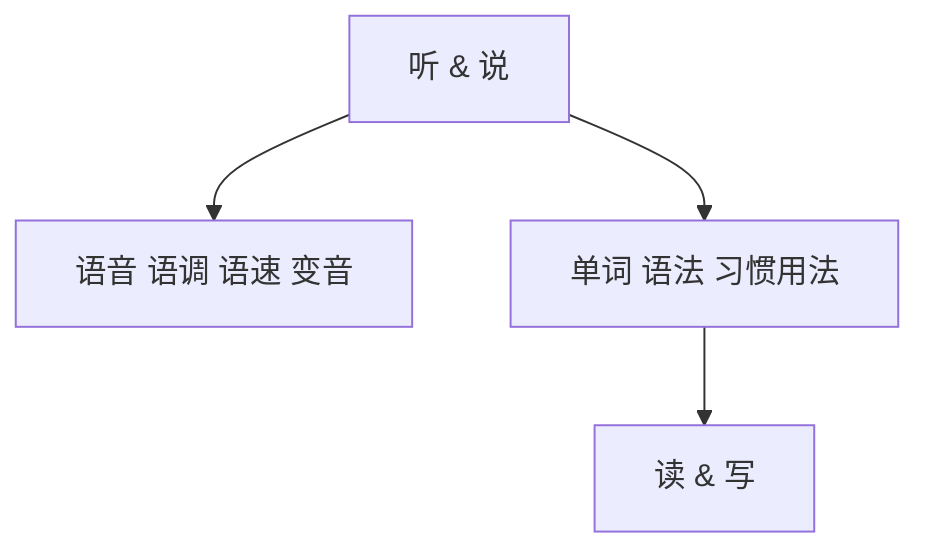

# 开篇

来源：Drive `10uVhZ95G8jjDfjyT0weRNrsyZbPA6311`；SHA256 `9c6824232446b27553b3e89ba0428b4d6bb9146ee963bec898b8c22b18a4cf57`。

语音原文、画面文字、视觉模型观察按源视频时间排列。视觉描述属于待核验的模型输出。

## 00:00:00–00:00:30

Hello, everyone. Welcome to Capsule Academy. This is Leo.那今天我们一起来看一下新概念一册的开篇内容啊。在这个视频当中呢，我们主要讲解三个部分。第一个，一个简单的自我介绍；第二，一个我们课前要准备哪些学习材料；最后一个问题就是我们如何使用我们的课程。好，那上来呢，我们先看一下自我介绍啊。我于

### 画面 00:00:00


[OCR 原始输出](evidence/ocr/frame_00000000_0000000000.json) · [视觉原始输出](evidence/visual/frame_00000000_0000000000.json)

OCR 原文：

```text

```

视觉观察（机器输出，未人工核验）：

本帧未追加通用视觉模型描述；原始截图、OCR及文档解析已保留。

#### PaddleOCR-VL 原文与结构

[独立结果](evidence/document/frame_00000000_0000000000/1793117469_5694.md)

<div style="text-align: center;">

胶学 bilibili

</div>


### 画面 00:00:01


[OCR 原始输出](evidence/ocr/frame_00000038_0000001267.json) · [视觉原始输出](evidence/visual/frame_00000038_0000001267.json)

OCR 原文：

```text

```

视觉接口逐字读图候选：

```text
胶学 bilibili
```

视觉观察（机器输出，未人工核验）：

浅灰色背景中央有一个很淡的灰色圆形轮廓。

标注、结构与待核验文字：

```json
{
  "uncertain": [
    "中央圆形轮廓颜色很淡，其性质无法确认。"
  ]
}
```

#### PaddleOCR-VL 原文与结构

[独立结果](evidence/document/frame_00000038_0000001267/1793117470_7343.md)

<div style="text-align: center;">

胶学 bilibili

</div>


<div style="text-align: center;">


</div>


### 画面 00:00:01


[OCR 原始输出](evidence/ocr/frame_00000054_0000001800.json) · [视觉原始输出](evidence/visual/frame_00000054_0000001800.json)

OCR 原文：

```text
胶学bilibili
O
```

视觉接口逐字读图候选：

```text
胶学 bilibili
```

视觉观察（机器输出，未人工核验）：

浅灰色背景中央有一个浅灰色圆环，圆环中心有一个小的横向圆角图形，左侧为浅青色，右侧为浅粉色。右上角有白色水印。

标注、结构与待核验文字：

```json
{
  "uncertain": [
    "画面整体对比度较低，中央图形的颜色和细节不十分清晰。"
  ]
}
```

#### PaddleOCR-VL 原文与结构

[独立结果](evidence/document/frame_00000054_0000001800/1793117470_1971.md)

<div style="text-align: center;">

胶学 bilibili

</div>


<div style="text-align: center;">

O

</div>


### 画面 00:00:02


[OCR 原始输出](evidence/ocr/frame_00000085_0000002833.json) · [视觉原始输出](evidence/visual/frame_00000085_0000002833.json)

OCR 原文：

```text
胶学bilibili
CAPSULEACADRN
胶囊助学计划
```

视觉观察（机器输出，未人工核验）：

本帧未追加通用视觉模型描述；原始截图、OCR及文档解析已保留。

#### PaddleOCR-VL 原文与结构

[独立结果](evidence/document/frame_00000085_0000002833/region_repairs.md)

##### 布局遗漏区域的独立复查

原图位置：[838, 524, 987, 557]；PP-OCRv5 候选：CAPSULEACADRN


CAPSULE ACADEMY


#### PaddleOCR-VL 原文与结构

[独立结果](evidence/document/frame_00000085_0000002833/1793117471_2478.md)

<div style="text-align: center;">

胶学 bilibili

</div>


<div style="text-align: center;">

CAPSULE ACADEMY

</div>


胶囊助学计划

#### MinerU 独立解析

[独立结果](evidence/mineru/frame_00000085_0000002833/markdown.md)


<details>
<summary>donut</summary>

| Category | Value |
| --- | --- |
| Light Blue Segment | ~50% |
| Pink Segment | ~50% |
</details>

胶囊助学计划

### 画面 00:00:03


[OCR 原始输出](evidence/ocr/frame_00000090_0000003000.json) · [视觉原始输出](evidence/visual/frame_00000090_0000003000.json)

OCR 原文：

```text
胶学bilibili
CAPSULEACADEN
胶囊助学计划
```

视觉观察（机器输出，未人工核验）：

本帧未追加通用视觉模型描述；原始截图、OCR及文档解析已保留。

#### PaddleOCR-VL 原文与结构

[独立结果](evidence/document/frame_00000090_0000003000/region_repairs.md)

##### 布局遗漏区域的独立复查

原图位置：[838, 524, 987, 557]；PP-OCRv5 候选：CAPSULEACADEN


CAPSULE ACADEMY


#### PaddleOCR-VL 原文与结构

[独立结果](evidence/document/frame_00000090_0000003000/1793117473_2752.md)

<div style="text-align: center;">

胶学 bilibili

</div>


<div style="text-align: center;">

CAPSULE ACADEMY

</div>


胶囊助学计划

#### MinerU 独立解析

[独立结果](evidence/mineru/frame_00000090_0000003000/markdown.md)


<details>
<summary>donut</summary>

| Category | Value |
| --- | --- |
| Light Blue Segment | ~50% |
| Pink Segment | ~50% |
</details>

胶囊助学计划

### 画面 00:00:03


[OCR 原始输出](evidence/ocr/frame_00000109_0000003633.json) · [视觉原始输出](evidence/visual/frame_00000109_0000003633.json)

OCR 原文：

```text
胶学bilibili
CAPSUILEACADEMN
胶囊助学计划
```

视觉观察（机器输出，未人工核验）：

本帧未追加通用视觉模型描述；原始截图、OCR及文档解析已保留。

#### PaddleOCR-VL 原文与结构

[独立结果](evidence/document/frame_00000109_0000003633/region_repairs.md)

##### 布局遗漏区域的独立复查

原图位置：[840, 524, 985, 554]；PP-OCRv5 候选：CAPSUILEACADEMN


CAPSULE ACADEMY


#### PaddleOCR-VL 原文与结构

[独立结果](evidence/document/frame_00000109_0000003633/1793117474_2848.md)

<div style="text-align: center;">

胶学 bilibili

</div>


<div style="text-align: center;">

CAPSULE ACADEMY

</div>


胶囊助学计划

### 画面 00:00:03


[OCR 原始输出](evidence/ocr/frame_00000114_0000003800.json) · [视觉原始输出](evidence/visual/frame_00000114_0000003800.json)

OCR 原文：

```text
胶学bibli
CAPSULEACADIMN
胶囊助学计划
```

视觉观察（机器输出，未人工核验）：

本帧未追加通用视觉模型描述；原始截图、OCR及文档解析已保留。

#### PaddleOCR-VL 原文与结构

[独立结果](evidence/document/frame_00000114_0000003800/region_repairs.md)

##### 布局遗漏区域的独立复查

原图位置：[1636, 20, 1903, 114]；PP-OCRv5 候选：胶学bibli


胶学 bilibili

原图位置：[838, 522, 987, 557]；PP-OCRv5 候选：CAPSULEACADIMN


CAPSULE ACADEMY


#### PaddleOCR-VL 原文与结构

[独立结果](evidence/document/frame_00000114_0000003800/1793117476_6426.md)

<div style="text-align: center;">

胶学 bilibili

</div>


<div style="text-align: center;">

CAPSULE ACADEMY

</div>


胶囊助学计划

### 画面 00:00:03


[OCR 原始输出](evidence/ocr/frame_00000119_0000003967.json) · [视觉原始输出](evidence/visual/frame_00000119_0000003967.json)

OCR 原文：

```text
胶学ト出
胶囊助学计划
```

视觉观察（机器输出，未人工核验）：

本帧未追加通用视觉模型描述；原始截图、OCR及文档解析已保留。

#### PaddleOCR-VL 原文与结构

[独立结果](evidence/document/frame_00000119_0000003967/region_repairs.md)

##### 布局遗漏区域的独立复查

原图位置：[1637, 20, 1903, 113]；PP-OCRv5 候选：胶学ト出


胶学 bilibili


#### PaddleOCR-VL 原文与结构

[独立结果](evidence/document/frame_00000119_0000003967/1793117478_9466.md)

<div style="text-align: center;">

胶学 bilibili

</div>


<div style="text-align: center;">

1

</div>


胶囊助学计划

### 画面 00:00:04


[OCR 原始输出](evidence/ocr/frame_00000124_0000004133.json) · [视觉原始输出](evidence/visual/frame_00000124_0000004133.json)

OCR 原文：

```text
胶学
胶囊助学计划
```

视觉观察（机器输出，未人工核验）：

本帧未追加通用视觉模型描述；原始截图、OCR及文档解析已保留。

#### PaddleOCR-VL 原文与结构

[独立结果](evidence/document/frame_00000124_0000004133/1793117479_6242.md)

<div style="text-align: center;">

胶学

</div>


<div style="text-align: center;">

QUINIA

</div>


胶囊助学计划

### 画面 00:00:04


[OCR 原始输出](evidence/ocr/frame_00000129_0000004300.json) · [视觉原始输出](evidence/visual/frame_00000129_0000004300.json)

OCR 原文：

```text
胶学
胶囊助学计划
```

视觉观察（机器输出，未人工核验）：

本帧未追加通用视觉模型描述；原始截图、OCR及文档解析已保留。

#### PaddleOCR-VL 原文与结构

[独立结果](evidence/document/frame_00000129_0000004300/1793117480_2024.md)

<div style="text-align: center;">

数学おかん

</div>


胶囊助学计划

#### PaddleOCR-VL 原文与结构

[独立结果](evidence/document/frame_00000129_0000004300/region_repairs.md)

##### 布局遗漏区域的独立复查

原图位置：[1640, 20, 1903, 113]；PP-OCRv5 候选：胶学


留学 bilibili


### 画面 00:00:04


[OCR 原始输出](evidence/ocr/frame_00000134_0000004467.json) · [视觉原始输出](evidence/visual/frame_00000134_0000004467.json)

OCR 原文：

```text
bl
```

视觉接口逐字读图候选：

```text
[无法确认]
```

视觉观察（机器输出，未人工核验）：

画面近乎全白，中下部有极淡的文字痕迹。

标注、结构与待核验文字：

```json
{
  "uncertain": [
    "中下部文字对比度极低，无法确认具体内容。",
    "画面过浅，无法确定是否存在其他教学内容或标注。"
  ]
}
```

#### PaddleOCR-VL 原文与结构

[独立结果](evidence/document/frame_00000134_0000004467/1793117481_8016.md)

<div style="text-align: center;">

2024 bilibil

</div>


### 画面 00:00:05


[OCR 原始输出](evidence/ocr/frame_00000164_0000005467.json) · [视觉原始输出](evidence/visual/frame_00000164_0000005467.json)

OCR 原文：

```text
胶学l
NCE
BOOKI
开篇
NO
WHa
```

视觉接口逐字读图候选：

```text
NCE BOOK I
开篇
```

视觉观察（机器输出，未人工核验）：

画面左侧是蓝色矩形标题区域，右侧一人坐在圆桌后，桌上放有平板设备，一只手举起。

#### PaddleOCR-VL 原文与结构

[独立结果](evidence/document/frame_00000164_0000005467/region_repairs.md)

##### 布局遗漏区域的独立复查

原图位置：[1638, 17, 1902, 115]；PP-OCRv5 候选：胶学l


文学


#### PaddleOCR-VL 原文与结构

[独立结果](evidence/document/frame_00000164_0000005467/1793117483_2038.md)

教学 bilibili

###### NCE BOOKI

开篇

<div style="text-align: center;">

NO WHO

</div>


### 画面 00:00:06


[OCR 原始输出](evidence/ocr/frame_00000194_0000006467.json) · [视觉原始输出](evidence/visual/frame_00000194_0000006467.json)

OCR 原文：

```text
胶学
NCE
BOOKI
开篇
NU
WAR
```

视觉接口逐字读图候选：

```text
NCE BOOK I
开篇
```

视觉观察（机器输出，未人工核验）：

画面左侧是蓝色矩形标题区域，英文为白色，中文为橙色。右侧一人坐在圆桌旁，桌上放有平板设备。

#### PaddleOCR-VL 原文与结构

[独立结果](evidence/document/frame_00000194_0000006467/region_repairs.md)

##### 布局遗漏区域的独立复查

原图位置：[1638, 16, 1902, 115]；PP-OCRv5 候选：胶学


教学

原图位置：[1549, 629, 1589, 660]；PP-OCRv5 候选：NU


NO
WUE

原图位置：[1546, 642, 1594, 673]；PP-OCRv5 候选：WAR


NO
WAR


#### PaddleOCR-VL 原文与结构

[独立结果](evidence/document/frame_00000194_0000006467/1793117486_2978.md)

教学 bilibili

###### NCE BOOKI

开篇

<div style="text-align: center;">

NO
WR


</div>


### 画面 00:00:07


[OCR 原始输出](evidence/ocr/frame_00000224_0000007467.json) · [视觉原始输出](evidence/visual/frame_00000224_0000007467.json)

OCR 原文：

```text
胶学
NCE
BOOKI
开篇
```

视觉接口逐字读图候选：

```text
NCE BOOK I
开篇
```

视觉观察（机器输出，未人工核验）：

左侧为蓝色矩形画面，英文为白色，中文为橙色。右侧一人坐在圆桌后，桌上放有一台支在支架上的平板设备。

#### PaddleOCR-VL 原文与结构

[独立结果](evidence/document/frame_00000224_0000007467/region_repairs.md)

##### 布局遗漏区域的独立复查

原图位置：[1638, 16, 1902, 115]；PP-OCRv5 候选：胶学


教学


#### PaddleOCR-VL 原文与结构

[独立结果](evidence/document/frame_00000224_0000007467/1793117490_6762.md)

教学 bilibili

###### NCE BOOKI

开篇

<div style="text-align: center;">


</div>


### 画面 00:00:08


[OCR 原始输出](evidence/ocr/frame_00000254_0000008467.json) · [视觉原始输出](evidence/visual/frame_00000254_0000008467.json)

OCR 原文：

```text
胶学
NCE
BOOKI
开篇
WIR
NU
```

视觉接口逐字读图候选：

```text
NCE BOOK I
开篇
```

视觉观察（机器输出，未人工核验）：

画面左侧为蓝色矩形标题区域，右侧一人坐在圆桌后，桌上有支架和平板设备。

#### PaddleOCR-VL 原文与结构

[独立结果](evidence/document/frame_00000254_0000008467/region_repairs.md)

##### 布局遗漏区域的独立复查

原图位置：[1638, 16, 1902, 115]；PP-OCRv5 候选：胶学


教学

原图位置：[1557, 593, 1608, 627]；PP-OCRv5 候选：WIR


NO
WHR

原图位置：[1565, 584, 1602, 614]；PP-OCRv5 候选：NU


NO
WITH


#### PaddleOCR-VL 原文与结构

[独立结果](evidence/document/frame_00000254_0000008467/1793117492_5995.md)

教学 bilibili

###### NCE BOOKI

开篇

<div style="text-align: center;">

NO WHI

</div>


### 画面 00:00:09


[OCR 原始输出](evidence/ocr/frame_00000284_0000009467.json) · [视觉原始输出](evidence/visual/frame_00000284_0000009467.json)

OCR 原文：

```text
胶学
NCE
BOOKI
开篇
```

视觉接口逐字读图候选：

```text
NCE BOOK I
开篇
```

视觉观察（机器输出，未人工核验）：

画面左侧是蓝色矩形区域，英文为白色，中文为橙色。右侧一人坐在桌后，桌上有平板设备。

#### PaddleOCR-VL 原文与结构

[独立结果](evidence/document/frame_00000284_0000009467/region_repairs.md)

##### 布局遗漏区域的独立复查

原图位置：[1637, 18, 1902, 114]；PP-OCRv5 候选：胶学


放学


#### PaddleOCR-VL 原文与结构

[独立结果](evidence/document/frame_00000284_0000009467/1793117496_3864.md)

教学 bilibili

###### NCE BOOKI

开篇

<div style="text-align: center;">


</div>


### 画面 00:00:10


[OCR 原始输出](evidence/ocr/frame_00000314_0000010467.json) · [视觉原始输出](evidence/visual/frame_00000314_0000010467.json)

OCR 原文：

```text
胶学
NCE
BOOKI
开篇
```

视觉接口逐字读图候选：

```text
NCE BOOK I
开篇
```

视觉观察（机器输出，未人工核验）：

画面左侧为蓝色矩形区域，文字分别位于其左上方和右下方。右侧一人坐在圆桌后，手持笔，桌上有一台支在支架上的设备。

#### PaddleOCR-VL 原文与结构

[独立结果](evidence/document/frame_00000314_0000010467/region_repairs.md)

##### 布局遗漏区域的独立复查

原图位置：[1639, 24, 1902, 113]；PP-OCRv5 候选：胶学


K学 bilbil


#### PaddleOCR-VL 原文与结构

[独立结果](evidence/document/frame_00000314_0000010467/1793117498_1856.md)

教学 bilibili

###### NCE BOOKI

开篇

<div style="text-align: center;">


</div>


### 画面 00:00:11


[OCR 原始输出](evidence/ocr/frame_00000344_0000011467.json) · [视觉原始输出](evidence/visual/frame_00000344_0000011467.json)

OCR 原文：

```text
胶学
NCE
BOOKI
开篇

```

视觉接口逐字读图候选：

```text
NCE BOOK I
开篇
```

视觉观察（机器输出，未人工核验）：

画面左侧是蓝色矩形，右侧一人坐在圆桌后，桌上有平板和支架，手中拿着白色笔。

#### PaddleOCR-VL 原文与结构

[独立结果](evidence/document/frame_00000344_0000011467/1793117501_5078.md)

教学 bil

教学 bil

###### NCE BOOKI

开篇

<div style="text-align: center;">


</div>


#### PaddleOCR-VL 原文与结构

[独立结果](evidence/document/frame_00000344_0000011467/region_repairs.md)

##### 布局遗漏区域的独立复查

原图位置：[1639, 24, 1902, 113]；PP-OCRv5 候选：胶学


K学 bil bil


### 画面 00:00:12


[OCR 原始输出](evidence/ocr/frame_00000374_0000012467.json) · [视觉原始输出](evidence/visual/frame_00000374_0000012467.json)

OCR 原文：

```text
胶学
NCE
BOOKI
开篇
NO
WIR
```

视觉接口逐字读图候选：

```text
NCE BOOK I
开篇
```

视觉观察（机器输出，未人工核验）：

画面左侧是蓝色矩形区域，右侧一人坐在圆桌后，桌上放有平板电脑。

#### PaddleOCR-VL 原文与结构

[独立结果](evidence/document/frame_00000374_0000012467/region_repairs.md)

##### 布局遗漏区域的独立复查

原图位置：[1639, 22, 1902, 112]；PP-OCRv5 候选：胶学


医学 bmbii


#### PaddleOCR-VL 原文与结构

[独立结果](evidence/document/frame_00000374_0000012467/1793117504_9628.md)

教学 bilibili

###### NCE BOOKI

开篇

<div style="text-align: center;">

NO WHI

</div>


### 画面 00:00:13


[OCR 原始输出](evidence/ocr/frame_00000404_0000013467.json) · [视觉原始输出](evidence/visual/frame_00000404_0000013467.json)

OCR 原文：

```text
胶学
NCE
BOOKI
开篇
WIR
NU
```

视觉接口逐字读图候选：

```text
NCE BOOK I
开篇
```

视觉观察（机器输出，未人工核验）：

画面左侧为蓝色矩形区域，右侧一人坐在圆桌后，桌上有平板电脑和支架，手中持白色笔。

#### PaddleOCR-VL 原文与结构

[独立结果](evidence/document/frame_00000404_0000013467/region_repairs.md)

##### 布局遗漏区域的独立复查

原图位置：[1639, 23, 1902, 112]；PP-OCRv5 候选：胶学


法学 bilibili

原图位置：[1549, 620, 1601, 659]；PP-OCRv5 候选：WIR


NO
WAR

原图位置：[1555, 611, 1595, 643]；PP-OCRv5 候选：NU


NO
WHO


#### PaddleOCR-VL 原文与结构

[独立结果](evidence/document/frame_00000404_0000013467/1793117506_6881.md)

教学 bilibili

###### NCE BOOKI

开篇

<div style="text-align: center;">

NO WAR

</div>


### 画面 00:00:14


[OCR 原始输出](evidence/ocr/frame_00000434_0000014467.json) · [视觉原始输出](evidence/visual/frame_00000434_0000014467.json)

OCR 原文：

```text
胶学
NCE
BOOKI
开篇
①
自我介绍
```

视觉接口逐字读图候选：

```text
NCE BOOK I
开篇
①
自我介绍
```

视觉观察（机器输出，未人工核验）：

左侧为蓝色矩形区域，其下方的“自我介绍”竖排显示。右侧一人坐在圆桌后，桌上有平板及支架，手中持白色笔。

标注、结构与待核验文字：

```json
{
  "annotations": [
    {
      "type": "圆圈",
      "color": "黑色",
      "target": "1",
      "position": "蓝色矩形下方、“自我介绍”上方",
      "uncertain": false,
      "requires_review": false,
      "grounding": "api_visual_observation_not_human_verified"
    }
  ]
}
```

#### PaddleOCR-VL 原文与结构

[独立结果](evidence/document/frame_00000434_0000014467/region_repairs.md)

##### 布局遗漏区域的独立复查

原图位置：[1639, 22, 1902, 112]；PP-OCRv5 候选：胶学


医学 bmbii

原图位置：[494, 524, 690, 639]；PP-OCRv5 候选：开篇


开篇


#### PaddleOCR-VL 原文与结构

[独立结果](evidence/document/frame_00000434_0000014467/1793117510_7365.md)

教学 bilibili

###### NCE BOOKI

###### ① 自我介绍

<div style="text-align: center;">


</div>


### 画面 00:00:15


[OCR 原始输出](evidence/ocr/frame_00000464_0000015467.json) · [视觉原始输出](evidence/visual/frame_00000464_0000015467.json)

OCR 原文：

```text
胶学山
NCE
BOOKI
开篇
NU
1
VAR
①
自我介绍
```

视觉接口逐字读图候选：

```text
NCE BOOK I
开篇
①
自我介绍
```

视觉观察（机器输出，未人工核验）：

左侧有蓝色矩形区域，英文标题为白色，右下角中文为橙色；矩形下方的中文竖排。右侧一人坐在圆桌旁，桌上有平板设备和支架，手持白色笔。

标注、结构与待核验文字：

```json
{
  "annotations": [
    {
      "type": "圆圈",
      "color": "黑色",
      "target": "1",
      "position": "蓝色矩形下方、自我介绍上方",
      "uncertain": false,
      "requires_review": false,
      "grounding": "api_visual_observation_not_human_verified"
    }
  ]
}
```

#### PaddleOCR-VL 原文与结构

[独立结果](evidence/document/frame_00000464_0000015467/region_repairs.md)

##### 布局遗漏区域的独立复查

原图位置：[1638, 21, 1903, 114]；PP-OCRv5 候选：胶学山


教学 bmbk

原图位置：[1547, 605, 1592, 641]；PP-OCRv5 候选：NU


NO
VAR


#### PaddleOCR-VL 原文与结构

[独立结果](evidence/document/frame_00000464_0000015467/1793117513_6762.md)

教学 bilibili

###### NCE BOOKI

###### 开篇

###### ① 自我介绍

<div style="text-align: center;">

NO
VAR

</div>


### 画面 00:00:16


[OCR 原始输出](evidence/ocr/frame_00000495_0000016500.json) · [视觉原始输出](evidence/visual/frame_00000495_0000016500.json)

OCR 原文：

```text
胶学
NCE
BOOKI
开篇
①
自我介绍
```

视觉接口逐字读图候选：

```text
NCE BOOK I
开篇
①
自我介绍
```

视觉观察（机器输出，未人工核验）：

画面左侧有蓝色矩形区域；“自我介绍”在矩形下方竖排。右侧一人坐在圆桌后，桌上有支架和平板设备，手持白色笔状物。

标注、结构与待核验文字：

```json
{
  "annotations": [
    {
      "type": "圈",
      "color": "黑色",
      "target": "1",
      "position": "蓝色矩形下方、“自我介绍”上方",
      "uncertain": false,
      "requires_review": false,
      "grounding": "api_visual_observation_not_human_verified"
    }
  ]
}
```

#### PaddleOCR-VL 原文与结构

[独立结果](evidence/document/frame_00000495_0000016500/region_repairs.md)

##### 布局遗漏区域的独立复查

原图位置：[1637, 19, 1903, 114]；PP-OCRv5 候选：胶学


教学 bilibili


#### PaddleOCR-VL 原文与结构

[独立结果](evidence/document/frame_00000495_0000016500/1793117516_6251.md)

教学 bilibili

###### NCE BOOKI

###### 开篇

###### ① 自我介绍

<div style="text-align: center;">


</div>


### 画面 00:00:17


[OCR 原始输出](evidence/ocr/frame_00000525_0000017500.json) · [视觉原始输出](evidence/visual/frame_00000525_0000017500.json)

OCR 原文：

```text
胶学山
NCE
BOOKI
2
开篇
①
自我介绍
```

视觉接口逐字读图候选：

```text
NCE BOOK I
开篇
①
自我介绍
```

视觉观察（机器输出，未人工核验）：

画面左侧有蓝色矩形区域，英文为白色，中文“开篇”为橙色。矩形下方的“自我介绍”竖排。右侧一人坐在桌旁，桌上有平板设备。

#### PaddleOCR-VL 原文与结构

[独立结果](evidence/document/frame_00000525_0000017500/region_repairs.md)

##### 布局遗漏区域的独立复查

原图位置：[1638, 21, 1903, 114]；PP-OCRv5 候选：胶学山


教学 bmbk


#### PaddleOCR-VL 原文与结构

[独立结果](evidence/document/frame_00000525_0000017500/1793117519_4755.md)

教学 bilibili

###### NCE BOOKI

###### 开篇

###### ① 自我介绍

<div style="text-align: center;">


</div>


### 画面 00:00:18


[OCR 原始输出](evidence/ocr/frame_00000555_0000018500.json) · [视觉原始输出](evidence/visual/frame_00000555_0000018500.json)

OCR 原文：

```text
胶学#
NCE
BOOKI
小
开篇
②
①
课前准备
自我介绍
```

视觉接口逐字读图候选：

```text
NCE BOOK I
开篇
②
①
课前准备
自我介绍
```

视觉观察（机器输出，未人工核验）：

左侧为蓝色矩形区域，英文文字为白色，中文“开篇”为橙色。矩形下方有两列竖排中文：左列“课前准备”，右列“自我介绍”，各列上方分别有带圆圈的数字。右侧一人坐在圆桌后，桌上放有平板设备，手中持笔。

标注、结构与待核验文字：

```json
{
  "annotations": [
    {
      "type": "圆圈",
      "color": "黑色",
      "target": "2",
      "position": "左下方，“课前准备”上方",
      "uncertain": false,
      "requires_review": false,
      "grounding": "api_visual_observation_not_human_verified"
    },
    {
      "type": "圆圈",
      "color": "黑色",
      "target": "1",
      "position": "左下方，“自我介绍”上方",
      "uncertain": false,
      "requires_review": false,
      "grounding": "api_visual_observation_not_human_verified"
    }
  ]
}
```

#### PaddleOCR-VL 原文与结构

[独立结果](evidence/document/frame_00000555_0000018500/region_repairs.md)

##### 布局遗漏区域的独立复查

原图位置：[1637, 18, 1903, 114]；PP-OCRv5 候选：胶学#


政学


#### PaddleOCR-VL 原文与结构

[独立结果](evidence/document/frame_00000555_0000018500/1793117522_3367.md)

教学 bilingual

###### NCE BOOKI

###### 开篇

② ①

课前准备

自我介绍

<div style="text-align: center;">


</div>


### 画面 00:00:19


[OCR 原始输出](evidence/ocr/frame_00000585_0000019500.json) · [视觉原始输出](evidence/visual/frame_00000585_0000019500.json)

OCR 原文：

```text
胶学#
A
NCE
BOOKI
开篇
②
①
课前准备
自我介绍
```

视觉接口逐字读图候选：

```text
NCE BOOK I
开篇
②
课前准备
①
自我介绍
```

视觉观察（机器输出，未人工核验）：

左侧是蓝色矩形区域，英文为白色，中文“开篇”为橙色。矩形下方有两列竖排中文，左列上方是②，右列上方是①。右侧一人坐在圆桌后，桌上放有支架和平板设备。

#### PaddleOCR-VL 原文与结构

[独立结果](evidence/document/frame_00000585_0000019500/region_repairs.md)

##### 布局遗漏区域的独立复查

原图位置：[1637, 18, 1903, 114]；PP-OCRv5 候选：胶学#


政学


#### PaddleOCR-VL 原文与结构

[独立结果](evidence/document/frame_00000585_0000019500/1793117525_2019.md)

教学 bilingual

###### NCE BOOKI

###### 开篇

② ①

课前准备

自我介绍

<div style="text-align: center;">


</div>


### 画面 00:00:20


[OCR 原始输出](evidence/ocr/frame_00000615_0000020500.json) · [视觉原始输出](evidence/visual/frame_00000615_0000020500.json)

OCR 原文：

```text
胶学
NCE
BOOKI
开篇
NO
WIR
②
①
课前准备
自我介绍
```

视觉接口逐字读图候选：

```text
NCE BOOK I
开篇
②
①
课前准备
自我介绍
```

视觉观察（机器输出，未人工核验）：

左侧为蓝色矩形区域，下方有两列竖排文字。右侧一人坐在圆桌后，双手抬至头部两侧；桌上有一台支架托起的设备。

标注、结构与待核验文字：

```json
{
  "annotations": [
    {
      "type": "圆圈",
      "color": "黑色",
      "target": "2",
      "position": "左下方，“课前准备”上方",
      "uncertain": false,
      "requires_review": false,
      "grounding": "api_visual_observation_not_human_verified"
    },
    {
      "type": "圆圈",
      "color": "黑色",
      "target": "1",
      "position": "左下方，“自我介绍”上方",
      "uncertain": false,
      "requires_review": false,
      "grounding": "api_visual_observation_not_human_verified"
    }
  ]
}
```

#### PaddleOCR-VL 原文与结构

[独立结果](evidence/document/frame_00000615_0000020500/region_repairs.md)

##### 布局遗漏区域的独立复查

原图位置：[1638, 20, 1903, 114]；PP-OCRv5 候选：胶学


教学 bilibili

原图位置：[1547, 597, 1599, 636]；PP-OCRv5 候选：WIR


NO WOR


#### PaddleOCR-VL 原文与结构

[独立结果](evidence/document/frame_00000615_0000020500/1793117528_6558.md)

教学 bilibili

###### NCE BOOKI

开篇

② ①

课前准备

自我介绍

<div style="text-align: center;">

NO WON

</div>


### 画面 00:00:21


[OCR 原始输出](evidence/ocr/frame_00000645_0000021500.json) · [视觉原始输出](evidence/visual/frame_00000645_0000021500.json)

OCR 原文：

```text
胶学##
NCE
BOOKI
开篇
②
①
课前准备
自我介绍
```

视觉接口逐字读图候选：

```text
NCE BOOK I
开篇
②
①
课前准备
自我介绍
```

视觉观察（机器输出，未人工核验）：

左侧有蓝色矩形色块，文字“开篇”为橙色；下方两列中文文字竖排。右侧一人坐在圆桌后，桌上有平板电脑及支架。

标注、结构与待核验文字：

```json
{
  "annotations": [
    {
      "type": "圆圈",
      "color": "黑色",
      "target": "2",
      "position": "左下方，“课前准备”上方",
      "uncertain": false,
      "requires_review": false,
      "grounding": "api_visual_observation_not_human_verified"
    },
    {
      "type": "圆圈",
      "color": "黑色",
      "target": "1",
      "position": "左下方，“自我介绍”上方",
      "uncertain": false,
      "requires_review": false,
      "grounding": "api_visual_observation_not_human_verified"
    }
  ]
}
```

#### PaddleOCR-VL 原文与结构

[独立结果](evidence/document/frame_00000645_0000021500/region_repairs.md)

##### 布局遗漏区域的独立复查

原图位置：[1637, 18, 1903, 114]；PP-OCRv5 候选：胶学##


政学


#### PaddleOCR-VL 原文与结构

[独立结果](evidence/document/frame_00000645_0000021500/1793117531_5654.md)

教学 bilibil

###### NCE BOOKI

###### 开篇

② ①

课前准备

自我介绍

<div style="text-align: center;">


</div>


### 画面 00:00:22


[OCR 原始输出](evidence/ocr/frame_00000675_0000022500.json) · [视觉原始输出](evidence/visual/frame_00000675_0000022500.json)

OCR 原文：

```text
胶学
NCE
BOOKI
P
开篇
③
②
①
使用指南
课前准备
自我介绍
```

视觉接口逐字读图候选：

```text
NCE BOOK I
开篇
③ 使用指南
② 课前准备
① 自我介绍
```

视觉观察（机器输出，未人工核验）：

左侧蓝色矩形中有白色英文和橙色中文；矩形下方有三列黑色竖排中文，列顶分别是带圆圈的数字。右侧一人坐在圆桌后，桌上放有带支架的平板电脑。

标注、结构与待核验文字：

```json
{
  "annotations": [
    {
      "type": "圆圈",
      "color": "黑色",
      "target": "3",
      "position": "左侧“使用指南”上方",
      "uncertain": false,
      "requires_review": false,
      "grounding": "api_visual_observation_not_human_verified"
    },
    {
      "type": "圆圈",
      "color": "黑色",
      "target": "2",
      "position": "左侧“课前准备”上方",
      "uncertain": false,
      "requires_review": false,
      "grounding": "api_visual_observation_not_human_verified"
    },
    {
      "type": "圆圈",
      "color": "黑色",
      "target": "1",
      "position": "左侧“自我介绍”上方",
      "uncertain": false,
      "requires_review": false,
      "grounding": "api_visual_observation_not_human_verified"
    }
  ]
}
```

#### PaddleOCR-VL 原文与结构

[独立结果](evidence/document/frame_00000675_0000022500/region_repairs.md)

##### 布局遗漏区域的独立复查

原图位置：[1638, 20, 1902, 114]；PP-OCRv5 候选：胶学


教学

原图位置：[183, 650, 265, 740]；PP-OCRv5 候选：③


③

原图位置：[305, 649, 394, 741]；PP-OCRv5 候选：②


②

原图位置：[174, 761, 272, 1036]；PP-OCRv5 候选：使用指南


使用指南

原图位置：[301, 761, 399, 1038]；PP-OCRv5 候选：课前准备


课前准备


#### PaddleOCR-VL 原文与结构

[独立结果](evidence/document/frame_00000675_0000022500/1793117534_1178.md)

教学 bilibil

###### NCE BOOKI

###### 开篇

①

自我介绍

<div style="text-align: center;">


</div>


### 画面 00:00:23


[OCR 原始输出](evidence/ocr/frame_00000705_0000023500.json) · [视觉原始输出](evidence/visual/frame_00000705_0000023500.json)

OCR 原文：

```text
胶学
NCE
BOOKI
开篇
NO
WIR
③
②
①
使用指南
课前准备
自我介绍
```

视觉接口逐字读图候选：

```text
NCE BOOK I
开篇
③
②
①
使用指南
课前准备
自我介绍
```

视觉观察（机器输出，未人工核验）：

左侧有蓝色矩形区域，白色英文位于区域左上方，橙色中文位于区域右下方。矩形下方有三列竖排中文，各列上方分别有带圆圈的数字。右侧一人坐在圆桌后，桌上放有支架和平板设备。

标注、结构与待核验文字：

```json
{
  "annotations": [
    {
      "type": "圆圈",
      "color": "黑色",
      "target": "3",
      "position": "左下方，“使用指南”上方",
      "uncertain": false,
      "requires_review": false,
      "grounding": "api_visual_observation_not_human_verified"
    },
    {
      "type": "圆圈",
      "color": "黑色",
      "target": "2",
      "position": "左下方，“课前准备”上方",
      "uncertain": false,
      "requires_review": false,
      "grounding": "api_visual_observation_not_human_verified"
    },
    {
      "type": "圆圈",
      "color": "黑色",
      "target": "1",
      "position": "左下方，“自我介绍”上方",
      "uncertain": false,
      "requires_review": false,
      "grounding": "api_visual_observation_not_human_verified"
    }
  ]
}
```

#### PaddleOCR-VL 原文与结构

[独立结果](evidence/document/frame_00000705_0000023500/region_repairs.md)

##### 布局遗漏区域的独立复查

原图位置：[1638, 20, 1902, 114]；PP-OCRv5 候选：胶学


教学

原图位置：[1563, 609, 1614, 643]；PP-OCRv5 候选：WIR


NO
WHR

原图位置：[305, 649, 394, 741]；PP-OCRv5 候选：②


②

原图位置：[301, 761, 399, 1037]；PP-OCRv5 候选：课前准备


课前准备


#### PaddleOCR-VL 原文与结构

[独立结果](evidence/document/frame_00000705_0000023500/1793117539_7937.md)

教学 bilingual

###### NCE BOOKI

③使用指南

###### 开篇

①

自我

介绍

<div style="text-align: center;">

NO WHR

</div>


### 画面 00:00:24


[OCR 原始输出](evidence/ocr/frame_00000735_0000024500.json) · [视觉原始输出](evidence/visual/frame_00000735_0000024500.json)

OCR 原文：

```text
胶学
NCE
BOOKI
L
开篇
③
②
①
使用指南
课前准备
自我介绍
```

视觉接口逐字读图候选：

```text
NCE BOOK I
开篇
③
②
①
使用指南
课前准备
自我介绍
```

视觉观察（机器输出，未人工核验）：

左侧为蓝色矩形标题区，下方有三列竖排文字；右侧一人坐在圆桌后，桌上有支架和平板设备。

标注、结构与待核验文字：

```json
{
  "annotations": [
    {
      "type": "圆圈",
      "color": "黑色",
      "target": "3",
      "position": "左下方“使用指南”上方",
      "uncertain": false,
      "requires_review": false,
      "grounding": "api_visual_observation_not_human_verified"
    },
    {
      "type": "圆圈",
      "color": "黑色",
      "target": "2",
      "position": "左下方“课前准备”上方",
      "uncertain": false,
      "requires_review": false,
      "grounding": "api_visual_observation_not_human_verified"
    },
    {
      "type": "圆圈",
      "color": "黑色",
      "target": "1",
      "position": "左下方“自我介绍”上方",
      "uncertain": false,
      "requires_review": false,
      "grounding": "api_visual_observation_not_human_verified"
    }
  ]
}
```

#### PaddleOCR-VL 原文与结构

[独立结果](evidence/document/frame_00000735_0000024500/region_repairs.md)

##### 布局遗漏区域的独立复查

原图位置：[1638, 20, 1902, 114]；PP-OCRv5 候选：胶学


教学

原图位置：[305, 649, 393, 741]；PP-OCRv5 候选：②


②

原图位置：[301, 761, 399, 1037]；PP-OCRv5 候选：课前准备


课前准备


#### PaddleOCR-VL 原文与结构

[独立结果](evidence/document/frame_00000735_0000024500/1793117544_9318.md)

教学 bilibili

###### NCE BOOKI

###### 开篇

③使用指南

①

自我

介绍

<div style="text-align: center;">


</div>


### 画面 00:00:25


[OCR 原始输出](evidence/ocr/frame_00000765_0000025500.json) · [视觉原始输出](evidence/visual/frame_00000765_0000025500.json)

OCR 原文：

```text
胶学#
NCE
BOOKI
开篇
NO
WAR
③
②
①
使用指南
课前准备
自我介绍
```

视觉接口逐字读图候选：

```text
NCE BOOK I
开篇
③
使用指南
②
课前准备
①
自我介绍
```

视觉观察（机器输出，未人工核验）：

画面左侧有蓝色矩形区域，标题为白色，右下角文字为橙色。矩形下方有三列竖排文字，每列上方各有一个带圆圈的数字。画面右侧一人坐在圆桌后，桌上放有支架和平板，手持白色笔。

标注、结构与待核验文字：

```json
{
  "annotations": [
    {
      "type": "圆圈",
      "color": "黑色",
      "target": "3",
      "position": "左侧竖排文字“使用指南”上方",
      "uncertain": false,
      "requires_review": false,
      "grounding": "api_visual_observation_not_human_verified"
    },
    {
      "type": "圆圈",
      "color": "黑色",
      "target": "2",
      "position": "中间竖排文字“课前准备”上方",
      "uncertain": false,
      "requires_review": false,
      "grounding": "api_visual_observation_not_human_verified"
    },
    {
      "type": "圆圈",
      "color": "黑色",
      "target": "1",
      "position": "右侧竖排文字“自我介绍”上方",
      "uncertain": false,
      "requires_review": false,
      "grounding": "api_visual_observation_not_human_verified"
    }
  ]
}
```

#### PaddleOCR-VL 原文与结构

[独立结果](evidence/document/frame_00000765_0000025500/region_repairs.md)

##### 布局遗漏区域的独立复查

原图位置：[1637, 18, 1903, 114]；PP-OCRv5 候选：胶学#


政学

原图位置：[183, 650, 265, 740]；PP-OCRv5 候选：③


③

原图位置：[306, 649, 394, 742]；PP-OCRv5 候选：②


②

原图位置：[174, 760, 272, 1036]；PP-OCRv5 候选：使用指南


使用指南

原图位置：[299, 760, 400, 1039]；PP-OCRv5 候选：课前准备


课前准备


#### PaddleOCR-VL 原文与结构

[独立结果](evidence/document/frame_00000765_0000025500/1793117548_8785.md)

教学 bilingual

###### NCE BOOKI

###### 开篇

①

自我介绍

<div style="text-align: center;">

NO WAR

</div>


### 画面 00:00:26


[OCR 原始输出](evidence/ocr/frame_00000795_0000026500.json) · [视觉原始输出](evidence/visual/frame_00000795_0000026500.json)

OCR 原文：

```text
-
胶学
自我介绍
NO
WOR
```

视觉接口逐字读图候选：

```text
自我介绍
```

视觉观察（机器输出，未人工核验）：

左上方有蓝色横幅。画面右侧一人坐在圆桌后，桌上放有平板和支架，手持白色笔。

#### PaddleOCR-VL 原文与结构

[独立结果](evidence/document/frame_00000795_0000026500/region_repairs.md)

##### 布局遗漏区域的独立复查

原图位置：[1638, 20, 1902, 113]；PP-OCRv5 候选：胶学


教学 bilibili


#### PaddleOCR-VL 原文与结构

[独立结果](evidence/document/frame_00000795_0000026500/1793117552_2951.md)

教学 bilibili

自我介绍

<div style="text-align: center;">

NO
WOR

</div>


### 画面 00:00:27


[OCR 原始输出](evidence/ocr/frame_00000825_0000027500.json) · [视觉原始输出](evidence/visual/frame_00000825_0000027500.json)

OCR 原文：

```text
-
胶学
自我介绍
```

视觉接口逐字读图候选：

```text
自我介绍
```

视觉观察（机器输出，未人工核验）：

左上方有蓝色横幅。画面右侧一人坐在圆桌后，一手抬起，另一手持白色笔；桌上有放在支架上的平板电脑。

#### PaddleOCR-VL 原文与结构

[独立结果](evidence/document/frame_00000825_0000027500/region_repairs.md)

##### 布局遗漏区域的独立复查

原图位置：[1638, 20, 1902, 113]；PP-OCRv5 候选：胶学


教学 bilibili


#### PaddleOCR-VL 原文与结构

[独立结果](evidence/document/frame_00000825_0000027500/1793117554_4838.md)

教学 bilibili

自我介绍

<div style="text-align: center;">


</div>


### 画面 00:00:28


[OCR 原始输出](evidence/ocr/frame_00000855_0000028500.json) · [视觉原始输出](evidence/visual/frame_00000855_0000028500.json)

OCR 原文：

```text
胶学
自我介绍
-
NO
WOR
```

视觉接口逐字读图候选：

```text
自我介绍
```

视觉观察（机器输出，未人工核验）：

左上方有蓝色横幅。画面右侧有一人坐在圆桌后，桌上放有平板电脑和支架，手持白色笔状物。

#### PaddleOCR-VL 原文与结构

[独立结果](evidence/document/frame_00000855_0000028500/region_repairs.md)

##### 布局遗漏区域的独立复查

原图位置：[1638, 20, 1902, 113]；PP-OCRv5 候选：胶学


教学 bilibili


#### PaddleOCR-VL 原文与结构

[独立结果](evidence/document/frame_00000855_0000028500/1793117556_4506.md)

自我介绍

教学 bilibili

<div style="text-align: center;">

NO
WOR

</div>


### 画面 00:00:29


[OCR 原始输出](evidence/ocr/frame_00000885_0000029500.json) · [视觉原始输出](evidence/visual/frame_00000885_0000029500.json)

OCR 原文：

```text
胶学
自我介绍
·奥克兰大学教育学研究生（入学时QS专业全球排名17）
WI
```

视觉接口逐字读图候选：

```text
自我介绍
•奥克兰大学教育学研究生（入学时QS专业全球排名17）
```

视觉观察（机器输出，未人工核验）：

白色背景，左上方有蓝色横幅。画面右侧一人坐在圆桌后，双手抬起，一手持白色笔状物；桌上有一台支在架子上的平板设备。

#### PaddleOCR-VL 原文与结构

[独立结果](evidence/document/frame_00000885_0000029500/region_repairs.md)

##### 布局遗漏区域的独立复查

原图位置：[1638, 20, 1902, 113]；PP-OCRv5 候选：胶学


教学 bilibili


#### PaddleOCR-VL 原文与结构

[独立结果](evidence/document/frame_00000885_0000029500/1793117559_6906.md)

教学 bilibili

###### 自我介绍

·奥克兰大学教育学研究生（入学时QS专业全球排名17）

<div style="text-align: center;">

17)

</div>


## 00:00:30–00:01:00

二零一八年到二零二零年，大概花了两年的时间在澳大啊，奥克兰大学读了一个教育学的研究生。其次呢，呃，我在二零一二年到二零一八年的时候，在北京新东方的英语学习部啊，当一名英语老师啊，现在已经离职了。OK，呃，其次呢，然后这个我有一个TKT的英语教学资格证书，这个实际上是剑桥大学颁发的。各位如果不太清楚这是什么呢，你就理解为是我们行业

待复核：asr_disagreement_unresolved, raw_asr_disagreement。

Whisper 原始候选：

我介绍我于2018年到2020年大概花了两年的时间在澳大奥克兰大学读了一个教育学的研究生其次我在2012年到2018年的时候在北京新东方的英语学习部当一名英语老师现在已经离职了其次然后我有一个TKT的英语教学资格证书这个实际上是剑桥大学颁发的各位如果不太清楚这是什么你就理解为是我们行业的教师资格证就可以了

### 画面 00:00:29


[OCR 原始输出](evidence/ocr/frame_00000885_0000029500.json) · [视觉原始输出](evidence/visual/frame_00000885_0000029500.json)

OCR 原文：

```text
胶学
自我介绍
·奥克兰大学教育学研究生（入学时QS专业全球排名17）
WI
```

视觉接口逐字读图候选：

```text
自我介绍
•奥克兰大学教育学研究生（入学时QS专业全球排名17）
```

视觉观察（机器输出，未人工核验）：

白色背景，左上方有蓝色横幅。画面右侧一人坐在圆桌后，双手抬起，一手持白色笔状物；桌上有一台支在架子上的平板设备。

#### PaddleOCR-VL 原文与结构

[独立结果](evidence/document/frame_00000885_0000029500/region_repairs.md)

##### 布局遗漏区域的独立复查

原图位置：[1638, 20, 1902, 113]；PP-OCRv5 候选：胶学


教学 bilibili


#### PaddleOCR-VL 原文与结构

[独立结果](evidence/document/frame_00000885_0000029500/1793117559_6906.md)

教学 bilibili

###### 自我介绍

·奥克兰大学教育学研究生（入学时QS专业全球排名17）

<div style="text-align: center;">

17)

</div>


### 画面 00:00:30


[OCR 原始输出](evidence/ocr/frame_00000915_0000030500.json) · [视觉原始输出](evidence/visual/frame_00000915_0000030500.json)

OCR 原文：

```text
胶学山
自我介绍
·奥克兰大学教育学研究生（入学时QS专业全球排名17）
7
```

视觉接口逐字读图候选：

```text
自我介绍
•奥克兰大学教育学研究生（入学时QS专业全球排名17）
```

视觉观察（机器输出，未人工核验）：

左上方有蓝色横幅；右侧一人坐在圆桌后，桌上有平板设备。

#### PaddleOCR-VL 原文与结构

[独立结果](evidence/document/frame_00000915_0000030500/region_repairs.md)

##### 布局遗漏区域的独立复查

原图位置：[1638, 20, 1903, 113]；PP-OCRv5 候选：胶学山


教学 bilibili


#### PaddleOCR-VL 原文与结构

[独立结果](evidence/document/frame_00000915_0000030500/1793117562_3248.md)

教学 bilibili

###### 自我介绍

·奥克兰大学教育学研究生（入学时QS专业全球排名17）

<div style="text-align: center;">

17)

</div>


### 画面 00:00:31


[OCR 原始输出](evidence/ocr/frame_00000945_0000031500.json) · [视觉原始输出](evidence/visual/frame_00000945_0000031500.json)

OCR 原文：

```text
胶学
自我介绍
·奥克兰大学教育学研究生（入学时QS专业全球排名17）
ND
wnR
```

视觉接口逐字读图候选：

```text
自我介绍
•奥克兰大学教育学研究生（入学时QS专业全球排名17）
```

视觉观察（机器输出，未人工核验）：

左上方有蓝色横幅，右端为凹入的尖角形。画面右侧一人坐在圆桌后，桌上有一台置于支架上的平板设备。

#### PaddleOCR-VL 原文与结构

[独立结果](evidence/document/frame_00000945_0000031500/region_repairs.md)

##### 布局遗漏区域的独立复查

原图位置：[1639, 22, 1901, 112]；PP-OCRv5 候选：胶学


医学�批

原图位置：[1569, 604, 1605, 632]；PP-OCRv5 候选：ND


NO


#### PaddleOCR-VL 原文与结构

[独立结果](evidence/document/frame_00000945_0000031500/1793117565_7617.md)

教学 bilibili

###### 自我介绍

·奥克兰大学教育学研究生（入学时QS专业全球排名17）

<div style="text-align: center;">

17)

</div>


### 画面 00:00:32


[OCR 原始输出](evidence/ocr/frame_00000975_0000032500.json) · [视觉原始输出](evidence/visual/frame_00000975_0000032500.json)

OCR 原文：

```text
胶学
自我介绍
·奥克兰大学教育学研究生（入学时QS专业全球排名17）
NU
WaR
```

视觉接口逐字读图候选：

```text
自我介绍
•奥克兰大学教育学研究生（入学时QS专业全球排名17）
```

视觉观察（机器输出，未人工核验）：

白色背景，左上方是蓝色横幅。画面右侧有一人坐在圆桌后，桌上放有支架和一台平板。

#### PaddleOCR-VL 原文与结构

[独立结果](evidence/document/frame_00000975_0000032500/1793117569_1938.md)

教学 bilibili

###### 自我介绍

·奥克兰大学教育学研究生（入学时QS专业全球排名17）

<div style="text-align: center;">

17)

</div>


#### PaddleOCR-VL 原文与结构

[独立结果](evidence/document/frame_00000975_0000032500/region_repairs.md)

##### 布局遗漏区域的独立复查

原图位置：[1639, 22, 1901, 112]；PP-OCRv5 候选：胶学


医学�批

原图位置：[1564, 604, 1605, 637]；PP-OCRv5 候选：NU


NO
WITH


### 画面 00:00:33


[OCR 原始输出](evidence/ocr/frame_00001005_0000033500.json) · [视觉原始输出](evidence/visual/frame_00001005_0000033500.json)

OCR 原文：

```text
胶学
自我介绍
·奥克兰大学教育学研究生（入学时QS专业全球排名17）
NO
WOR
```

视觉接口逐字读图候选：

```text
自我介绍
•奥克兰大学教育学研究生（入学时QS专业全球排名17）
```

视觉观察（机器输出，未人工核验）：

左上方为蓝色横幅，右端有凹口。右侧一人坐在圆桌后，桌上放有支架和平板设备。

#### PaddleOCR-VL 原文与结构

[独立结果](evidence/document/frame_00001005_0000033500/region_repairs.md)

##### 布局遗漏区域的独立复查

原图位置：[1639, 22, 1901, 112]；PP-OCRv5 候选：胶学


医学�批

原图位置：[1569, 603, 1609, 631]；PP-OCRv5 候选：NO


NO

原图位置：[1563, 611, 1614, 649]；PP-OCRv5 候选：WOR


NO
WHR


#### PaddleOCR-VL 原文与结构

[独立结果](evidence/document/frame_00001005_0000033500/1793117572_4492.md)

教学 bilibili

###### 自我介绍

·奥克兰大学教育学研究生（入学时QS专业全球排名17）

<div style="text-align: center;">

17)

</div>


### 画面 00:00:34


[OCR 原始输出](evidence/ocr/frame_00001035_0000034500.json) · [视觉原始输出](evidence/visual/frame_00001035_0000034500.json)

OCR 原文：

```text
胶学li
自我介绍

·奥克兰大学教育学研究生（入学时QS专业全球排名17）
```

视觉接口逐字读图候选：

```text
自我介绍
•奥克兰大学教育学研究生（入学时QS专业全球排名17）
```

视觉观察（机器输出，未人工核验）：

白色背景，左上方有蓝色横幅。画面右侧一人坐在圆桌后，双手抬起，桌上有一台支架上的平板设备。

#### PaddleOCR-VL 原文与结构

[独立结果](evidence/document/frame_00001035_0000034500/region_repairs.md)

##### 布局遗漏区域的独立复查

原图位置：[1639, 20, 1902, 113]；PP-OCRv5 候选：胶学li


教学 bilibili


#### PaddleOCR-VL 原文与结构

[独立结果](evidence/document/frame_00001035_0000034500/1793117576_8850.md)

教学 bilibili

###### 自我介绍

·奥克兰大学教育学研究生（入学时QS专业全球排名17）

<div style="text-align: center;">

17)

</div>


### 画面 00:00:35


[OCR 原始输出](evidence/ocr/frame_00001065_0000035500.json) · [视觉原始输出](evidence/visual/frame_00001065_0000035500.json)

OCR 原文：

```text
胶学业
自我介绍
·奥克兰大学教育学研究生（入学时QS专业全球排名17）
NU
WIR
```

视觉接口逐字读图候选：

```text
自我介绍
•奥克兰大学教育学研究生（入学时QS专业全球排名17）
```

视觉观察（机器输出，未人工核验）：

白色背景，左上方有蓝色横幅。画面右侧一人坐在圆桌后，桌上放有一台带支架的设备。

#### PaddleOCR-VL 原文与结构

[独立结果](evidence/document/frame_00001065_0000035500/region_repairs.md)

##### 布局遗漏区域的独立复查

原图位置：[1637, 17, 1902, 115]；PP-OCRv5 候选：胶学业


政学 bilibili

原图位置：[1571, 611, 1611, 642]；PP-OCRv5 候选：NU


NO
WITH

原图位置：[1566, 623, 1615, 656]；PP-OCRv5 候选：WIR


NO
WHR


#### PaddleOCR-VL 原文与结构

[独立结果](evidence/document/frame_00001065_0000035500/1793117579_2988.md)

教学 bilibili

###### 自我介绍

·奥克兰大学教育学研究生（入学时QS专业全球排名17）

<div style="text-align: center;">

17)

</div>


### 画面 00:00:36


[OCR 原始输出](evidence/ocr/frame_00001095_0000036500.json) · [视觉原始输出](evidence/visual/frame_00001095_0000036500.json)

OCR 原文：

```text
胶学
自我介绍
·奥克兰大学教育学研究生（入学时QS专业全球排名17）
NU
WnR
```

视觉接口逐字读图候选：

```text
自我介绍
•奥克兰大学教育学研究生（入学时QS专业全球排名17）
```

视觉观察（机器输出，未人工核验）：

左上方是蓝色横幅，右端有向内的缺口。右侧一人坐在圆桌后，双手抬起；桌上有支架和平板设备。

#### PaddleOCR-VL 原文与结构

[独立结果](evidence/document/frame_00001095_0000036500/region_repairs.md)

##### 布局遗漏区域的独立复查

原图位置：[1638, 21, 1902, 114]；PP-OCRv5 候选：胶学


教学 lab

原图位置：[1569, 604, 1606, 632]；PP-OCRv5 候选：NU


NU

原图位置：[1564, 616, 1611, 647]；PP-OCRv5 候选：WnR


NO
WHR


#### PaddleOCR-VL 原文与结构

[独立结果](evidence/document/frame_00001095_0000036500/1793117583_1220.md)

教学 bilibili

###### 自我介绍

·奥克兰大学教育学研究生（入学时QS专业全球排名17）

<div style="text-align: center;">

17)

</div>


### 画面 00:00:37


[OCR 原始输出](evidence/ocr/frame_00001125_0000037500.json) · [视觉原始输出](evidence/visual/frame_00001125_0000037500.json)

OCR 原文：

```text
胶学
自我介绍
·奥克兰大学教育学研究生（入学时QS专业全球排名17）
NU
wIR
```

视觉接口逐字读图候选：

```text
自我介绍
•奥克兰大学教育学研究生（入学时QS专业全球排名17）
```

视觉观察（机器输出，未人工核验）：

左上方有蓝色横幅。画面右侧一人坐在圆桌后，桌上有平板设备和支架，手持白色笔。

#### PaddleOCR-VL 原文与结构

[独立结果](evidence/document/frame_00001125_0000037500/region_repairs.md)

##### 布局遗漏区域的独立复查

原图位置：[1638, 21, 1902, 114]；PP-OCRv5 候选：胶学


教学 lab

原图位置：[1571, 613, 1610, 644]；PP-OCRv5 候选：NU


NO
WIP

原图位置：[1563, 623, 1615, 659]；PP-OCRv5 候选：wIR


NO
WHR


#### PaddleOCR-VL 原文与结构

[独立结果](evidence/document/frame_00001125_0000037500/1793117587_8724.md)

教学 bilibili

###### 自我介绍

·奥克兰大学教育学研究生（入学时QS专业全球排名17）

<div style="text-align: center;">

(17)

</div>


### 画面 00:00:38


[OCR 原始输出](evidence/ocr/frame_00001155_0000038500.json) · [视觉原始输出](evidence/visual/frame_00001155_0000038500.json)

OCR 原文：

```text
胶学
自我介绍
·奥克兰大学教育学研究生（入学时QS专业全球排名17)
NO
WAR
```

视觉接口逐字读图候选：

```text
自我介绍
•奥克兰大学教育学研究生（入学时QS专业全球排名17）
```

视觉观察（机器输出，未人工核验）：

左上方有蓝色横幅，右端呈缺口状。画面右侧一人坐在圆桌后，桌上有平板和支架，手边有一支白色笔。

#### PaddleOCR-VL 原文与结构

[独立结果](evidence/document/frame_00001155_0000038500/region_repairs.md)

##### 布局遗漏区域的独立复查

原图位置：[1637, 16, 1902, 115]；PP-OCRv5 候选：胶学


政学 bilibili

原图位置：[1571, 613, 1610, 644]；PP-OCRv5 候选：NO


NO
WUD

原图位置：[1566, 625, 1613, 657]；PP-OCRv5 候选：WAR


NO WAR


#### PaddleOCR-VL 原文与结构

[独立结果](evidence/document/frame_00001155_0000038500/1793117591_4956.md)

教学 bilibili

###### 自我介绍

·奥克兰大学教育学研究生（入学时QS专业全球排名17）

<div style="text-align: center;">

名17)

</div>


### 画面 00:00:39


[OCR 原始输出](evidence/ocr/frame_00001185_0000039500.json) · [视觉原始输出](evidence/visual/frame_00001185_0000039500.json)

OCR 原文：

```text
胶学
自我介绍
·奥克兰大学教育学研究生（入学时QS专业全球排名17）
·前北京新东方英语学习部优秀教师（2012-2018)
NO
1mR
```

视觉接口逐字读图候选：

```text
自我介绍
•奥克兰大学教育学研究生（入学时QS专业全球排名17）
•前北京新东方英语学习部优秀教师（2012-2018）
```

视觉观察（机器输出，未人工核验）：

左上方有蓝色横幅。画面右侧有一人坐在圆桌旁，手持白色笔状物，桌上放有平板设备。

#### PaddleOCR-VL 原文与结构

[独立结果](evidence/document/frame_00001185_0000039500/region_repairs.md)

##### 布局遗漏区域的独立复查

原图位置：[1638, 21, 1902, 114]；PP-OCRv5 候选：胶学


教学 lab

原图位置：[1571, 599, 1611, 630]；PP-OCRv5 候选：NO


NO


#### PaddleOCR-VL 原文与结构

[独立结果](evidence/document/frame_00001185_0000039500/1793117595_9099.md)

教学 bilibili

###### 自我介绍

·奥克兰大学教育学研究生（入学时QS专业全球排名17）·前北京新东方英语学习部优秀教师（2012-2018）

<div style="text-align: center;">

17)

</div>


### 画面 00:00:40


[OCR 原始输出](evidence/ocr/frame_00001215_0000040500.json) · [视觉原始输出](evidence/visual/frame_00001215_0000040500.json)

OCR 原文：

```text
胶学
自我介绍
2
·奥克兰大学教育学研究生（入学时QS专业全球排名17)
·前北京新东方英语学习部优秀教师(2012-2018)
```

视觉接口逐字读图候选：

```text
自我介绍
•奥克兰大学教育学研究生（入学时QS专业全球排名17）
•前北京新东方英语学习部优秀教师（2012-2018）
```

视觉观察（机器输出，未人工核验）：

白色背景，左上方有蓝色横幅。右侧一人坐在圆桌后，手持白色笔状物，桌上放有带支架的平板设备。

#### PaddleOCR-VL 原文与结构

[独立结果](evidence/document/frame_00001215_0000040500/region_repairs.md)

##### 布局遗漏区域的独立复查

原图位置：[1639, 22, 1902, 112]；PP-OCRv5 候选：胶学


文学 bilibili


#### PaddleOCR-VL 原文与结构

[独立结果](evidence/document/frame_00001215_0000040500/1793117599_9532.md)

教学 bilibili

###### 自我介绍

·奥克兰大学教育学研究生（入学时QS专业全球排名17）·前北京新东方英语学习部优秀教师（2012-2018）

<div style="text-align: center;">

17)

</div>


### 画面 00:00:41


[OCR 原始输出](evidence/ocr/frame_00001245_0000041500.json) · [视觉原始输出](evidence/visual/frame_00001245_0000041500.json)

OCR 原文：

```text
胶学
自我介绍
·奥克兰大学教育学研究生（入学时QS专业全球排名17）
·前北京新东方英语学习部优秀教师 (2012-2018)
六
```

视觉接口逐字读图候选：

```text
自我介绍
•奥克兰大学教育学研究生（入学时QS专业全球排名17）
•前北京新东方英语学习部优秀教师（2012-2018）
```

视觉观察（机器输出，未人工核验）：

白色背景，左上方有蓝色横幅。画面右侧一人坐在圆桌后，手持白色笔，桌上有支架和屏幕设备。

#### PaddleOCR-VL 原文与结构

[独立结果](evidence/document/frame_00001245_0000041500/region_repairs.md)

##### 布局遗漏区域的独立复查

原图位置：[1639, 22, 1901, 112]；PP-OCRv5 候选：胶学


教学


#### PaddleOCR-VL 原文与结构

[独立结果](evidence/document/frame_00001245_0000041500/1793117603_9898.md)

教学 bilibili

###### 自我介绍

·奥克兰大学教育学研究生（入学时QS专业全球排名17）·前北京新东方英语学习部优秀教师（2012-2018）

<div style="text-align: center;">

17)

</div>


### 画面 00:00:42


[OCR 原始输出](evidence/ocr/frame_00001275_0000042500.json) · [视觉原始输出](evidence/visual/frame_00001275_0000042500.json)

OCR 原文：

```text
胶学
自我介绍
·奥克兰大学教育学研究生（入学时QS专业全球排名17）
·前北京新东方英语学习部优秀教师(2012-2018)
NO
WAR
```

视觉接口逐字读图候选：

```text
自我介绍
•奥克兰大学教育学研究生（入学时QS专业全球排名17）
•前北京新东方英语学习部优秀教师（2012-2018）
```

视觉观察（机器输出，未人工核验）：

左上方有蓝色横幅，右端呈凹口形。画面右侧一人坐在圆桌后，手持白色笔，桌上放有平板设备。

#### PaddleOCR-VL 原文与结构

[独立结果](evidence/document/frame_00001275_0000042500/region_repairs.md)

##### 布局遗漏区域的独立复查

原图位置：[1639, 22, 1901, 112]；PP-OCRv5 候选：胶学


教学

原图位置：[1570, 602, 1615, 637]；PP-OCRv5 候选：NO


NO
WAR

原图位置：[1562, 613, 1618, 651]；PP-OCRv5 候选：WAR


NO WAR


#### PaddleOCR-VL 原文与结构

[独立结果](evidence/document/frame_00001275_0000042500/1793117606_8865.md)

教学 bilibili

###### 自我介绍

·奥克兰大学教育学研究生（入学时QS专业全球排名17）·前北京新东方英语学习部优秀教师（2012-2018）

<div style="text-align: center;">

17)

</div>


### 画面 00:00:43


[OCR 原始输出](evidence/ocr/frame_00001305_0000043500.json) · [视觉原始输出](evidence/visual/frame_00001305_0000043500.json)

OCR 原文：

```text
胶学
自我介绍
·奥克兰大学教育学研究生（入学时QS专业全球排名17）
·前北京新东方英语学习部优秀教师(2012-2018)
NO
WIR
```

视觉接口逐字读图候选：

```text
自我介绍
•奥克兰大学教育学研究生（入学时QS专业全球排名17）
•前北京新东方英语学习部优秀教师（2012-2018）
```

视觉观察（机器输出，未人工核验）：

左上方有蓝色横幅，右端有内凹的尖角。画面右侧一人坐在圆桌后，桌上有平板电脑和支架，一只手持白色笔，另一只手抬起。

#### PaddleOCR-VL 原文与结构

[独立结果](evidence/document/frame_00001305_0000043500/region_repairs.md)

##### 布局遗漏区域的独立复查

原图位置：[1638, 20, 1902, 113]；PP-OCRv5 候选：胶学


教学

原图位置：[1574, 602, 1616, 633]；PP-OCRv5 候选：NO


NO
WIP

原图位置：[1567, 613, 1618, 647]；PP-OCRv5 候选：WIR


NO
WHR


#### PaddleOCR-VL 原文与结构

[独立结果](evidence/document/frame_00001305_0000043500/1793117611_4761.md)

教学 bilibili

###### 自我介绍

·奥克兰大学教育学研究生（入学时QS专业全球排名17）·前北京新东方英语学习部优秀教师（2012-2018）

<div style="text-align: center;">

17)

</div>


### 画面 00:00:44


[OCR 原始输出](evidence/ocr/frame_00001335_0000044500.json) · [视觉原始输出](evidence/visual/frame_00001335_0000044500.json)

OCR 原文：

```text
胶学
自我介绍
·奥克兰大学教育学研究生（入学时QS专业全球排名17）
早
·前北京新东方英语学习部优秀教师 (2012-2018)
1
```

视觉接口逐字读图候选：

```text
自我介绍
•奥克兰大学教育学研究生（入学时QS专业全球排名17）
•前北京新东方英语学习部优秀教师（2012-2018）
```

视觉观察（机器输出，未人工核验）：

左上方为蓝色横幅，文字在其下方排列。画面右侧一人坐在圆桌后，桌上有平板和支架，手中持白色笔。

#### PaddleOCR-VL 原文与结构

[独立结果](evidence/document/frame_00001335_0000044500/region_repairs.md)

##### 布局遗漏区域的独立复查

原图位置：[1638, 20, 1902, 113]；PP-OCRv5 候选：胶学


教学


#### PaddleOCR-VL 原文与结构

[独立结果](evidence/document/frame_00001335_0000044500/1793117616_3005.md)

教学 bilibili

###### 自我介绍

·奥克兰大学教育学研究生（入学时QS专业全球排名17）·前北京新东方英语学习部优秀教师（2012-2018）

<div style="text-align: center;">

17)

</div>


### 画面 00:00:45


[OCR 原始输出](evidence/ocr/frame_00001365_0000045500.json) · [视觉原始输出](evidence/visual/frame_00001365_0000045500.json)

OCR 原文：

```text
胶学
自我介绍
·奥克兰大学教育学研究生（入学时QS专业全球排名17）
·前北京新东方英语学习部优秀教师(2012-2018)
ND
WIR
```

视觉接口逐字读图候选：

```text
自我介绍
•奥克兰大学教育学研究生（入学时QS专业全球排名17）
•前北京新东方英语学习部优秀教师（2012-2018）
```

视觉观察（机器输出，未人工核验）：

左上方是蓝色横幅标题，左侧下方有两行黑色项目符号文字。画面右侧一人坐在圆桌后，桌上有平板设备和支架，手持白色笔。

#### PaddleOCR-VL 原文与结构

[独立结果](evidence/document/frame_00001365_0000045500/region_repairs.md)

##### 布局遗漏区域的独立复查

原图位置：[1637, 19, 1904, 114]；PP-OCRv5 候选：胶学


教学 bilibili

原图位置：[1564, 616, 1609, 654]；PP-OCRv5 候选：ND


ND
WIR

原图位置：[1557, 629, 1612, 669]；PP-OCRv5 候选：WIR


NO
WIR


#### PaddleOCR-VL 原文与结构

[独立结果](evidence/document/frame_00001365_0000045500/1793117619_2937.md)

教学 bilibili

###### 自我介绍

·奥克兰大学教育学研究生（入学时QS专业全球排名17）·前北京新东方英语学习部优秀教师（2012-2018）

<div style="text-align: center;">

17)

</div>


### 画面 00:00:46


[OCR 原始输出](evidence/ocr/frame_00001395_0000046500.json) · [视觉原始输出](evidence/visual/frame_00001395_0000046500.json)

OCR 原文：

```text
胶学山
自我介绍
·奥克兰大学教育学研究生（入学时QS专业全球排名17）
·前北京新东方英语学习部优秀教师(2012-2018)
```

视觉接口逐字读图候选：

```text
自我介绍
•奥克兰大学教育学研究生（入学时QS专业全球排名17）
•前北京新东方英语学习部优秀教师（2012-2018）
```

视觉观察（机器输出，未人工核验）：

左上方有蓝色横幅，右端呈内凹形。画面右侧一人坐在圆桌后，桌上有支架、平板和连接线，手持白色笔。

#### PaddleOCR-VL 原文与结构

[独立结果](evidence/document/frame_00001395_0000046500/region_repairs.md)

##### 布局遗漏区域的独立复查

原图位置：[1639, 22, 1902, 112]；PP-OCRv5 候选：胶学山


文学 bilingual


#### PaddleOCR-VL 原文与结构

[独立结果](evidence/document/frame_00001395_0000046500/1793117624_3626.md)

教学 bilibili

###### 自我介绍

·奥克兰大学教育学研究生（入学时QS专业全球排名17）·前北京新东方英语学习部优秀教师（2012-2018）

<div style="text-align: center;">

17)

</div>


### 画面 00:00:47


[OCR 原始输出](evidence/ocr/frame_00001425_0000047500.json) · [视觉原始输出](evidence/visual/frame_00001425_0000047500.json)

OCR 原文：

```text
胶学
自我介绍
·奥克兰大学教育学研究生（入学时QS专业全球排名17)
·前北京新东方英语学习部优秀教师 (2012-2018)
●TKT英语教学能力证书（剑桥大学颁发)
WAR
NO
```

视觉接口逐字读图候选：

```text
自我介绍
•奥克兰大学教育学研究生（入学时QS专业全球排名17）
•前北京新东方英语学习部优秀教师（2012-2018）
•TKT英语教学能力证书（剑桥大学颁发）
```

视觉观察（机器输出，未人工核验）：

左上方是蓝色横幅标题，下面有三行黑色圆点条目。画面右侧一人坐在圆桌后，桌上有平板设备和支架，手持白色笔。

#### PaddleOCR-VL 原文与结构

[独立结果](evidence/document/frame_00001425_0000047500/region_repairs.md)

##### 布局遗漏区域的独立复查

原图位置：[1637, 19, 1903, 114]；PP-OCRv5 候选：胶学


教学 bilibili

原图位置：[1565, 623, 1617, 661]；PP-OCRv5 候选：WAR


NO
WUR

原图位置：[1572, 614, 1611, 646]；PP-OCRv5 候选：NO


NO
WUR


#### PaddleOCR-VL 原文与结构

[独立结果](evidence/document/frame_00001425_0000047500/1793117628_4535.md)

教学 bilibili

###### 自我介绍

·奥克兰大学教育学研究生（入学时QS专业全球排名17）

·前北京新东方英语学习部优秀教师（2012-2018）

·TKT英语教学能力证书（剑桥大学颁发）

<div style="text-align: center;">

17)

</div>


### 画面 00:00:48


[OCR 原始输出](evidence/ocr/frame_00001455_0000048500.json) · [视觉原始输出](evidence/visual/frame_00001455_0000048500.json)

OCR 原文：

```text
胶学
自我介绍
2
●奥克兰大学教育学研究生（入学时QS专业全球排名17)
●前北京新东方英语学习部优秀教师(2012-2018)
●TKT英语教学能力证书(剑桥大学颁发)
```

视觉接口逐字读图候选：

```text
自我介绍
•奥克兰大学教育学研究生（入学时QS专业全球排名17）
•前北京新东方英语学习部优秀教师（2012-2018）
•TKT英语教学能力证书（剑桥大学颁发）
```

视觉观察（机器输出，未人工核验）：

左上方是蓝色横幅，右端有凹口；文字排列在画面左上部。右侧一人坐在圆桌后，桌上有带支架的平板设备。

#### PaddleOCR-VL 原文与结构

[独立结果](evidence/document/frame_00001455_0000048500/region_repairs.md)

##### 布局遗漏区域的独立复查

原图位置：[1637, 19, 1904, 114]；PP-OCRv5 候选：胶学


教学 bilibili


#### PaddleOCR-VL 原文与结构

[独立结果](evidence/document/frame_00001455_0000048500/1793117633_7787.md)

教学 bilibili

###### 自我介绍

·奥克兰大学教育学研究生（入学时QS专业全球排名17）

·前北京新东方英语学习部优秀教师（2012-2018）

·TKT英语教学能力证书（剑桥大学颁发）

<div style="text-align: center;">

17)

</div>


### 画面 00:00:49


[OCR 原始输出](evidence/ocr/frame_00001485_0000049500.json) · [视觉原始输出](evidence/visual/frame_00001485_0000049500.json)

OCR 原文：

```text
胶学
自我介绍
●奥克兰大学教育学研究生 （入学时QS专业全球排名17)
•前北京新东方英语学习部优秀教师 (2012-2018)
●TKT英语教学能力证书(剑桥大学颁发)
```

视觉接口逐字读图候选：

```text
自我介绍
•奥克兰大学教育学研究生（入学时QS专业全球排名17）
•前北京新东方英语学习部优秀教师（2012-2018）
•TKT英语教学能力证书（剑桥大学颁发）
```

视觉观察（机器输出，未人工核验）：

左上方是蓝色横幅。画面右侧一人坐在圆桌后，手持白色笔状物，桌上放着带支架的平板设备。

#### PaddleOCR-VL 原文与结构

[独立结果](evidence/document/frame_00001485_0000049500/region_repairs.md)

##### 布局遗漏区域的独立复查

原图位置：[1637, 19, 1904, 114]；PP-OCRv5 候选：胶学


教学 bilibili


#### PaddleOCR-VL 原文与结构

[独立结果](evidence/document/frame_00001485_0000049500/1793117638_8525.md)

教学 bilibili

###### 自我介绍

·奥克兰大学教育学研究生（入学时QS专业全球排名17）

·前北京新东方英语学习部优秀教师（2012-2018）

·TKT英语教学能力证书（剑桥大学颁发）

<div style="text-align: center;">

17)

</div>


### 画面 00:00:50


[OCR 原始输出](evidence/ocr/frame_00001515_0000050500.json) · [视觉原始输出](evidence/visual/frame_00001515_0000050500.json)

OCR 原文：

```text
胶学山
自我介绍

●奥克兰大学教育学研究生 （入学时QS专业全球排名17)
·前北京新东方英语学习部优秀教师 (2012-2018)
●TKT英语教学能力证书（剑桥大学颁发)
```

视觉接口逐字读图候选：

```text
自我介绍
•奥克兰大学教育学研究生（入学时QS专业全球排名17）
•前北京新东方英语学习部优秀教师（2012-2018）
•TKT英语教学能力证书（剑桥大学颁发）
```

视觉观察（机器输出，未人工核验）：

左上方有蓝色横幅，标题为白色。画面右侧一人坐在圆桌后，桌上有一台支在支架上的设备。

#### PaddleOCR-VL 原文与结构

[独立结果](evidence/document/frame_00001515_0000050500/region_repairs.md)

##### 布局遗漏区域的独立复查

原图位置：[1639, 22, 1901, 112]；PP-OCRv5 候选：胶学山


文学 bilibil


#### PaddleOCR-VL 原文与结构

[独立结果](evidence/document/frame_00001515_0000050500/1793117642_5317.md)

教学 bilibili

###### 自我介绍

·奥克兰大学教育学研究生（入学时QS专业全球排名17）

·前北京新东方英语学习部优秀教师（2012-2018）

·TKT英语教学能力证书（剑桥大学颁发）

<div style="text-align: center;">

17)

</div>


### 画面 00:00:51


[OCR 原始输出](evidence/ocr/frame_00001545_0000051500.json) · [视觉原始输出](evidence/visual/frame_00001545_0000051500.json)

OCR 原文：

```text
胶学
自我介绍
A
●奥克兰大学教育学研究生 （入学时QS专业全球排名17)
●前北京新东方英语学习部优秀教师(2012-2018)
●TKT英语教学能力证书(剑桥大学颁发)
```

视觉接口逐字读图候选：

```text
自我介绍
•奥克兰大学教育学研究生（入学时QS专业全球排名17）
•前北京新东方英语学习部优秀教师（2012-2018）
•TKT英语教学能力证书（剑桥大学颁发）
```

视觉观察（机器输出，未人工核验）：

左上方是蓝色横幅。画面右侧一人坐在圆桌后，桌上有支架和一台设备。

#### PaddleOCR-VL 原文与结构

[独立结果](evidence/document/frame_00001545_0000051500/region_repairs.md)

##### 布局遗漏区域的独立复查

原图位置：[1638, 20, 1902, 113]；PP-OCRv5 候选：胶学


教学 bilingual


#### PaddleOCR-VL 原文与结构

[独立结果](evidence/document/frame_00001545_0000051500/1793117646_1492.md)

教学 bilibili

###### 自我介绍

·奥克兰大学教育学研究生（入学时QS专业全球排名17）

·前北京新东方英语学习部优秀教师（2012-2018）

·TKT英语教学能力证书（剑桥大学颁发）

<div style="text-align: center;">

17)

</div>


### 画面 00:00:52


[OCR 原始输出](evidence/ocr/frame_00001575_0000052500.json) · [视觉原始输出](evidence/visual/frame_00001575_0000052500.json)

OCR 原文：

```text
胶学
自我介绍
●奥克兰大学教育学研究生 (入学时QS专业全球排名17)
·前北京新东方英语学习部优秀教师 (2012-2018)
●TKT英语教学能力证书(剑桥大学颁发)
```

视觉接口逐字读图候选：

```text
自我介绍
•奥克兰大学教育学研究生（入学时QS专业全球排名17）
•前北京新东方英语学习部优秀教师（2012-2018）
•TKT英语教学能力证书（剑桥大学颁发）
```

视觉观察（机器输出，未人工核验）：

左上方是蓝色横幅，标题为白色；其下有三行黑色圆点列表。画面右侧一人坐在圆桌后，桌上有平板电脑和支架。

#### PaddleOCR-VL 原文与结构

[独立结果](evidence/document/frame_00001575_0000052500/1793117650_7475.md)

教学 bilibili

###### 自我介绍

·奥克兰大学教育学研究生（入学时QS专业全球排名17）

·前北京新东方英语学习部优秀教师（2012-2018）

·TKT英语教学能力证书（剑桥大学颁发）

<div style="text-align: center;">

7)

</div>


#### PaddleOCR-VL 原文与结构

[独立结果](evidence/document/frame_00001575_0000052500/region_repairs.md)

##### 布局遗漏区域的独立复查

原图位置：[1638, 20, 1902, 113]；PP-OCRv5 候选：胶学


教学 bilingual


### 画面 00:00:53


[OCR 原始输出](evidence/ocr/frame_00001605_0000053500.json) · [视觉原始输出](evidence/visual/frame_00001605_0000053500.json)

OCR 原文：

```text
胶学
自我介绍
X
●奥克兰大学教育学研究生（入学时QS专业全球排名17)
●前北京新东方英语学习部优秀教师(2012-2018)
●TKT英语教学能力证书(剑桥大学颁发)
```

视觉接口逐字读图候选：

```text
自我介绍
•奥克兰大学教育学研究生（入学时QS专业全球排名17）
•前北京新东方英语学习部优秀教师（2012-2018）
•TKT英语教学能力证书（剑桥大学颁发）
```

视觉观察（机器输出，未人工核验）：

左上方是蓝色横幅，右侧有一人坐在圆桌后，桌上有平板电脑和支架，手持白色笔状物。

#### PaddleOCR-VL 原文与结构

[独立结果](evidence/document/frame_00001605_0000053500/region_repairs.md)

##### 布局遗漏区域的独立复查

原图位置：[1638, 20, 1902, 113]；PP-OCRv5 候选：胶学


教学 bilingual


#### PaddleOCR-VL 原文与结构

[独立结果](evidence/document/frame_00001605_0000053500/1793117654_9943.md)

教学 bilibili

###### 自我介绍

·奥克兰大学教育学研究生（入学时QS专业全球排名17）

·前北京新东方英语学习部优秀教师（2012-2018）

·TKT英语教学能力证书（剑桥大学颁发）

<div style="text-align: center;">

17)

</div>


### 画面 00:00:54


[OCR 原始输出](evidence/ocr/frame_00001635_0000054500.json) · [视觉原始输出](evidence/visual/frame_00001635_0000054500.json)

OCR 原文：

```text
胶学
自我介绍
2
●奥克兰大学教育学研究生（入学时QS专业全球排名17)
·前北京新东方英语学习部优秀教师(2012-2018)
●TKT英语教学能力证书(剑桥大学颁发)
```

视觉接口逐字读图候选：

```text
自我介绍
•奥克兰大学教育学研究生（入学时QS专业全球排名17）
•前北京新东方英语学习部优秀教师（2012-2018）
•TKT英语教学能力证书（剑桥大学颁发）
```

视觉观察（机器输出，未人工核验）：

白色背景，左上方有蓝色横幅。画面右侧一人坐在圆桌后，桌上有平板电脑和支架，手边有一支笔。

#### PaddleOCR-VL 原文与结构

[独立结果](evidence/document/frame_00001635_0000054500/1793117659_6289.md)

教学 bilibili

###### 自我介绍

·奥克兰大学教育学研究生（入学时QS专业全球排名17）

·前北京新东方英语学习部优秀教师（2012-2018）

·TKT英语教学能力证书（剑桥大学颁发）

<div style="text-align: center;">

17)

</div>


#### PaddleOCR-VL 原文与结构

[独立结果](evidence/document/frame_00001635_0000054500/region_repairs.md)

##### 布局遗漏区域的独立复查

原图位置：[1638, 20, 1902, 113]；PP-OCRv5 候选：胶学


教学 bilingual


### 画面 00:00:55


[OCR 原始输出](evidence/ocr/frame_00001665_0000055500.json) · [视觉原始输出](evidence/visual/frame_00001665_0000055500.json)

OCR 原文：

```text
胶学
自我介绍
●奥克兰大学教育学研究生（入学时QS专业全球排名17)
·前北京新东方英语学习部优秀教师(2012-2018)
●TKT英语教学能力证书（剑桥大学颁发)
M
```

视觉接口逐字读图候选：

```text
自我介绍
•奥克兰大学教育学研究生（入学时QS专业全球排名17）
•前北京新东方英语学习部优秀教师（2012-2018）
•TKT英语教学能力证书（剑桥大学颁发）
```

视觉观察（机器输出，未人工核验）：

左上方有蓝色横幅，右端为内凹的燕尾形。画面右侧一人坐在圆桌后，一手拿着白色笔，另一手抬起；桌上有支架和一台带线的平板设备。

#### PaddleOCR-VL 原文与结构

[独立结果](evidence/document/frame_00001665_0000055500/region_repairs.md)

##### 布局遗漏区域的独立复查

原图位置：[1640, 22, 1900, 112]；PP-OCRv5 候选：胶学


K学 Lishan


#### PaddleOCR-VL 原文与结构

[独立结果](evidence/document/frame_00001665_0000055500/1793117663_2752.md)

教学 bilibili

###### 自我介绍

·奥克兰大学教育学研究生（入学时QS专业全球排名17）

·前北京新东方英语学习部优秀教师（2012-2018）

·TKT英语教学能力证书（剑桥大学颁发）

<div style="text-align: center;">

(7)

</div>


### 画面 00:00:56


[OCR 原始输出](evidence/ocr/frame_00001695_0000056500.json) · [视觉原始输出](evidence/visual/frame_00001695_0000056500.json)

OCR 原文：

```text
胶学l
自我介绍
●奥克兰大学教育学研究生（入学时QS专业全球排名17)
·前北京新东方英语学习部优秀教师 (2012-2018)
●TKT英语教学能力证书(剑桥大学颁发)
```

视觉接口逐字读图候选：

```text
自我介绍
•奥克兰大学教育学研究生（入学时QS专业全球排名17）
•前北京新东方英语学习部优秀教师（2012-2018）
•TKT英语教学能力证书（剑桥大学颁发）
```

视觉观察（机器输出，未人工核验）：

左上方为蓝色横幅，文字排列在其下方。画面右侧有一人坐在圆桌后，桌上放有支架和一台设备。

#### PaddleOCR-VL 原文与结构

[独立结果](evidence/document/frame_00001695_0000056500/region_repairs.md)

##### 布局遗漏区域的独立复查

原图位置：[1640, 22, 1901, 112]；PP-OCRv5 候选：胶学l


KSL BIBLI


#### PaddleOCR-VL 原文与结构

[独立结果](evidence/document/frame_00001695_0000056500/1793117667_1072.md)

教学 bilibili

###### 自我介绍

·奥克兰大学教育学研究生（入学时QS专业全球排名17）

·前北京新东方英语学习部优秀教师（2012-2018）

·TKT英语教学能力证书（剑桥大学颁发）

<div style="text-align: center;">

7)

</div>


### 画面 00:00:57


[OCR 原始输出](evidence/ocr/frame_00001725_0000057500.json) · [视觉原始输出](evidence/visual/frame_00001725_0000057500.json)

OCR 原文：

```text
胶学山
自我介绍
●奥克兰大学教育学研究生（入学时QS专业全球排名17)
●前北京新东方英语学习部优秀教师(2012-2018)
●TKT英语教学能力证书(剑桥大学颁发)
NU
WUR
```

视觉接口逐字读图候选：

```text
自我介绍
•奥克兰大学教育学研究生（入学时QS专业全球排名17）
•前北京新东方英语学习部优秀教师（2012-2018）
•TKT英语教学能力证书（剑桥大学颁发）
```

视觉观察（机器输出，未人工核验）：

左上方是蓝色横幅标题，下方有三行黑色项目文字。画面右侧一人坐在圆桌后，桌上放有平板设备。

#### PaddleOCR-VL 原文与结构

[独立结果](evidence/document/frame_00001725_0000057500/region_repairs.md)

##### 布局遗漏区域的独立复查

原图位置：[1639, 20, 1901, 113]；PP-OCRv5 候选：胶学山


教学 bilibili

原图位置：[1563, 603, 1609, 639]；PP-OCRv5 候选：NU


NU
WUR

原图位置：[1558, 617, 1610, 651]；PP-OCRv5 候选：WUR


NU
WHR


#### PaddleOCR-VL 原文与结构

[独立结果](evidence/document/frame_00001725_0000057500/1793117671_7402.md)

教学 bilibili

###### 自我介绍

·奥克兰大学教育学研究生（入学时QS专业全球排名17）

·前北京新东方英语学习部优秀教师（2012-2018）

·TKT英语教学能力证书（剑桥大学颁发）

<div style="text-align: center;">

17)

</div>


### 画面 00:00:58


[OCR 原始输出](evidence/ocr/frame_00001755_0000058500.json) · [视觉原始输出](evidence/visual/frame_00001755_0000058500.json)

OCR 原文：

```text
胶学山
自我介绍
●奥克兰大学教育学研究生（入学时QS专业全球排名17)
●前北京新东方英语学习部优秀教师(2012-2018)
●TKT英语教学能力证书(剑桥大学颁发)
X
```

视觉接口逐字读图候选：

```text
自我介绍
•奥克兰大学教育学研究生（入学时QS专业全球排名17）
•前北京新东方英语学习部优秀教师（2012-2018）
•TKT英语教学能力证书（剑桥大学颁发）
```

视觉观察（机器输出，未人工核验）：

左上方有蓝色横幅，右端呈凹口形状；其下为三行黑色项目符号文字。画面右侧一人坐在圆桌后，桌上放有支架和平板设备。

#### PaddleOCR-VL 原文与结构

[独立结果](evidence/document/frame_00001755_0000058500/region_repairs.md)

##### 布局遗漏区域的独立复查

原图位置：[1639, 20, 1901, 113]；PP-OCRv5 候选：胶学山


教学 bilibili


#### PaddleOCR-VL 原文与结构

[独立结果](evidence/document/frame_00001755_0000058500/1793117676_2851.md)

教学 bilibili

###### 自我介绍

·奥克兰大学教育学研究生（入学时QS专业全球排名17）

·前北京新东方英语学习部优秀教师（2012-2018）

·TKT英语教学能力证书（剑桥大学颁发）

<div style="text-align: center;">

17)

</div>


### 画面 00:00:59


[OCR 原始输出](evidence/ocr/frame_00001785_0000059500.json) · [视觉原始输出](evidence/visual/frame_00001785_0000059500.json)

OCR 原文：

```text
胶学
自我介绍
天
●奥克兰大学教育学研究生（入学时QS专业全球排名17)
●前北京新东方英语学习部优秀教师 (2012-2018)
●TKT英语教学能力证书(剑桥大学颁发)
```

视觉接口逐字读图候选：

```text
自我介绍
•奥克兰大学教育学研究生（入学时QS专业全球排名17）
•前北京新东方英语学习部优秀教师（2012-2018）
•TKT英语教学能力证书（剑桥大学颁发）
```

视觉观察（机器输出，未人工核验）：

左上方是蓝色横幅，右端有缺口。右侧一人坐在圆桌后，桌上有平板电脑和支架，手持白色笔。

#### PaddleOCR-VL 原文与结构

[独立结果](evidence/document/frame_00001785_0000059500/region_repairs.md)

##### 布局遗漏区域的独立复查

原图位置：[1638, 20, 1902, 113]；PP-OCRv5 候选：胶学


教学


#### PaddleOCR-VL 原文与结构

[独立结果](evidence/document/frame_00001785_0000059500/1793117681_2042.md)

教学 bilibili

###### 自我介绍

·奥克兰大学教育学研究生（入学时QS专业全球排名17）

·前北京新东方英语学习部优秀教师（2012-2018）

·TKT英语教学能力证书（剑桥大学颁发）

<div style="text-align: center;">

17)

</div>


## 00:01:00–00:01:30

的教师资格证就可以了啊。OK，然后我之前有六年的线下教学经验，然后有四年的线上的教学经验，合起来就是十年了啊。那到今年其实已经开始十一年了。好，托福呢，之前去考的时候是一百零二分，然后阅读和听力是接近满分，更具体一点，那是听力实际上是满分，阅读呢是差一分满分。OK，好，然后我在出国前进行考了一次雅思，

### 画面 00:00:59


[OCR 原始输出](evidence/ocr/frame_00001785_0000059500.json) · [视觉原始输出](evidence/visual/frame_00001785_0000059500.json)

OCR 原文：

```text
胶学
自我介绍
天
●奥克兰大学教育学研究生（入学时QS专业全球排名17)
●前北京新东方英语学习部优秀教师 (2012-2018)
●TKT英语教学能力证书(剑桥大学颁发)
```

视觉接口逐字读图候选：

```text
自我介绍
•奥克兰大学教育学研究生（入学时QS专业全球排名17）
•前北京新东方英语学习部优秀教师（2012-2018）
•TKT英语教学能力证书（剑桥大学颁发）
```

视觉观察（机器输出，未人工核验）：

左上方是蓝色横幅，右端有缺口。右侧一人坐在圆桌后，桌上有平板电脑和支架，手持白色笔。

#### PaddleOCR-VL 原文与结构

[独立结果](evidence/document/frame_00001785_0000059500/region_repairs.md)

##### 布局遗漏区域的独立复查

原图位置：[1638, 20, 1902, 113]；PP-OCRv5 候选：胶学


教学


#### PaddleOCR-VL 原文与结构

[独立结果](evidence/document/frame_00001785_0000059500/1793117681_2042.md)

教学 bilibili

###### 自我介绍

·奥克兰大学教育学研究生（入学时QS专业全球排名17）

·前北京新东方英语学习部优秀教师（2012-2018）

·TKT英语教学能力证书（剑桥大学颁发）

<div style="text-align: center;">

17)

</div>


### 画面 00:01:00


[OCR 原始输出](evidence/ocr/frame_00001815_0000060500.json) · [视觉原始输出](evidence/visual/frame_00001815_0000060500.json)

OCR 原文：

```text
胶学山山
自我介绍
●奥克兰大学教育学研究生（入学时QS专业全球排名17)
·前北京新东方英语学习部优秀教师 (2012-2018)
小
●TKT英语教学能力证书（剑桥大学颁发)
```

视觉接口逐字读图候选：

```text
自我介绍
•奥克兰大学教育学研究生（入学时QS专业全球排名17）
•前北京新东方英语学习部优秀教师（2012-2018）
•TKT英语教学能力证书（剑桥大学颁发）
```

视觉观察（机器输出，未人工核验）：

白色背景，左上方有蓝色横幅。画面右侧一人坐在圆桌后，桌上有支架和平板，手持白色笔。

#### PaddleOCR-VL 原文与结构

[独立结果](evidence/document/frame_00001815_0000060500/region_repairs.md)

##### 布局遗漏区域的独立复查

原图位置：[1638, 21, 1903, 114]；PP-OCRv5 候选：胶学山山


文学 bilibili


#### PaddleOCR-VL 原文与结构

[独立结果](evidence/document/frame_00001815_0000060500/1793117685_8276.md)

教学 bilibili

###### 自我介绍

·奥克兰大学教育学研究生（入学时QS专业全球排名17）

·前北京新东方英语学习部优秀教师（2012-2018）

·TKT英语教学能力证书（剑桥大学颁发）

<div style="text-align: center;">

17)

</div>


### 画面 00:01:01


[OCR 原始输出](evidence/ocr/frame_00001845_0000061500.json) · [视觉原始输出](evidence/visual/frame_00001845_0000061500.json)

OCR 原文：

```text
胶学山山
自我介绍
●奥克兰大学教育学研究生（入学时QS专业全球排名17)
·前北京新东方英语学习部优秀教师 (2012-2018)
●TKT英语教学能力证书(剑桥大学颁发)
WIR
NU
```

视觉接口逐字读图候选：

```text
自我介绍
•奥克兰大学教育学研究生（入学时QS专业全球排名17）
•前北京新东方英语学习部优秀教师（2012-2018）
•TKT英语教学能力证书（剑桥大学颁发）
```

视觉观察（机器输出，未人工核验）：

左上方有蓝色横幅，右端呈凹口形。画面右侧有一人坐在圆桌后，桌上放有平板电脑，手中持有白色笔状物。

#### PaddleOCR-VL 原文与结构

[独立结果](evidence/document/frame_00001845_0000061500/region_repairs.md)

##### 布局遗漏区域的独立复查

原图位置：[1638, 21, 1903, 114]；PP-OCRv5 候选：胶学山山


文学 bilibili

原图位置：[1553, 634, 1606, 672]；PP-OCRv5 候选：WIR


NO
WITH

原图位置：[1562, 625, 1603, 657]；PP-OCRv5 候选：NU


NO
WHO


#### PaddleOCR-VL 原文与结构

[独立结果](evidence/document/frame_00001845_0000061500/1793117689_3369.md)

教学 bilibili

###### 自我介绍

·奥克兰大学教育学研究生（入学时QS专业全球排名17）

·前北京新东方英语学习部优秀教师（2012-2018）

·TKT英语教学能力证书（剑桥大学颁发）

<div style="text-align: center;">

17)

</div>


### 画面 00:01:02


[OCR 原始输出](evidence/ocr/frame_00001875_0000062500.json) · [视觉原始输出](evidence/visual/frame_00001875_0000062500.json)

OCR 原文：

```text
胶学#
自我介绍
·奥克兰大学教育学研究生（入学时QS专业全球排名17）
·前北京新东方英语学习部优秀教师 (2012-2018)
●TKT英语教学能力证书(剑桥大学颁发)
●6年线下，4年线上教龄
WIR
```

视觉接口逐字读图候选：

```text
自我介绍
•奥克兰大学教育学研究生（入学时QS专业全球排名17）
•前北京新东方英语学习部优秀教师（2012-2018）
•TKT英语教学能力证书（剑桥大学颁发）
•6年线下，4年线上教龄
```

视觉观察（机器输出，未人工核验）：

左上方有蓝色横幅，右端呈凹口形。右侧一人坐在圆桌后，桌上有平板设备和支架，手持白色笔。

#### PaddleOCR-VL 原文与结构

[独立结果](evidence/document/frame_00001875_0000062500/1793117695_4558.md)

教学 bilibili

###### 自我介绍

·奥克兰大学教育学研究生（入学时QS专业全球排名17）

·前北京新东方英语学习部优秀教师（2012-2018）

·TKT英语教学能力证书（剑桥大学颁发）

·6年线下，4年线上教龄

<div style="text-align: center;">

17)

</div>


#### PaddleOCR-VL 原文与结构

[独立结果](evidence/document/frame_00001875_0000062500/region_repairs.md)

##### 布局遗漏区域的独立复查

原图位置：[1637, 19, 1902, 114]；PP-OCRv5 候选：胶学#


教学


### 画面 00:01:03


[OCR 原始输出](evidence/ocr/frame_00001905_0000063500.json) · [视觉原始输出](evidence/visual/frame_00001905_0000063500.json)

OCR 原文：

```text
胶学
自我介绍

●奥克兰大学教育学研究生（入学时QS专业全球排名17)
·前北京新东方英语学习部优秀教师 (2012-2018)
●TKT英语教学能力证书(剑桥大学颁发)
●6年线下，4年线上教龄
```

视觉接口逐字读图候选：

```text
自我介绍
•奥克兰大学教育学研究生（入学时QS专业全球排名17）
•前北京新东方英语学习部优秀教师（2012-2018）
•TKT英语教学能力证书（剑桥大学颁发）
•6年线下，4年线上教龄
```

视觉观察（机器输出，未人工核验）：

左上方是蓝色横幅标题，下方有四行黑色圆点项目。画面右侧有一人坐在圆桌旁，桌上放有平板和支架。

#### PaddleOCR-VL 原文与结构

[独立结果](evidence/document/frame_00001905_0000063500/region_repairs.md)

##### 布局遗漏区域的独立复查

原图位置：[1638, 20, 1902, 113]；PP-OCRv5 候选：胶学


教学 bilibili


#### PaddleOCR-VL 原文与结构

[独立结果](evidence/document/frame_00001905_0000063500/1793117699_6974.md)

教学 bilibili

###### 自我介绍

·奥克兰大学教育学研究生（入学时QS专业全球排名17）

·前北京新东方英语学习部优秀教师（2012-2018）

·TKT英语教学能力证书（剑桥大学颁发）

·6年线下，4年线上教龄

<div style="text-align: center;">

7)

</div>


### 画面 00:01:04


[OCR 原始输出](evidence/ocr/frame_00001935_0000064500.json) · [视觉原始输出](evidence/visual/frame_00001935_0000064500.json)

OCR 原文：

```text
胶学动山
自我介绍
●奥克兰大学教育学研究生（入学时QS专业全球排名17)
·前北京新东方英语学习部优秀教师 (2012-2018)
●TKT英语教学能力证书(剑桥大学颁发)
●6年线下，4年线上教龄
```

视觉接口逐字读图候选：

```text
自我介绍
•奥克兰大学教育学研究生（入学时QS专业全球排名17）
•前北京新东方英语学习部优秀教师（2012-2018）
•TKT英语教学能力证书（剑桥大学颁发）
•6年线下，4年线上教龄
```

视觉观察（机器输出，未人工核验）：

左上方是蓝色横幅，右端有凹口。右侧一人坐在圆桌后，双手在胸前相对，桌上放有带支架的平板设备。

#### PaddleOCR-VL 原文与结构

[独立结果](evidence/document/frame_00001935_0000064500/region_repairs.md)

##### 布局遗漏区域的独立复查

原图位置：[1639, 22, 1901, 112]；PP-OCRv5 候选：胶学动山


文学 bilibil


#### PaddleOCR-VL 原文与结构

[独立结果](evidence/document/frame_00001935_0000064500/1793117704_7792.md)

教学 bilibili

###### 自我介绍

·奥克兰大学教育学研究生（入学时QS专业全球排名17）

·前北京新东方英语学习部优秀教师（2012-2018）

·TKT英语教学能力证书（剑桥大学颁发）

·6年线下，4年线上教龄

<div style="text-align: center;">

17)

</div>


### 画面 00:01:05


[OCR 原始输出](evidence/ocr/frame_00001965_0000065500.json) · [视觉原始输出](evidence/visual/frame_00001965_0000065500.json)

OCR 原文：

```text
胶学
自我介绍
·奥克兰大学教育学研究生（入学时QS专业全球排名17)
·前北京新东方英语学习部优秀教师 (2012-2018)
●TKT英语教学能力证书(剑桥大学颁发)
●6年线下，4年线上教龄
NU
WOR
```

视觉接口逐字读图候选：

```text
自我介绍
•奥克兰大学教育学研究生（入学时QS专业全球排名17）
•前北京新东方英语学习部优秀教师（2012-2018）
•TKT英语教学能力证书（剑桥大学颁发）
•6年线下，4年线上教龄
```

视觉观察（机器输出，未人工核验）：

左上方有蓝色横幅，文字位于画面左侧。右侧一人坐在圆桌后，双手在胸前相拢，桌上放有支架托起的平板设备。

#### PaddleOCR-VL 原文与结构

[独立结果](evidence/document/frame_00001965_0000065500/region_repairs.md)

##### 布局遗漏区域的独立复查

原图位置：[1639, 23, 1901, 113]；PP-OCRv5 候选：胶学


文学 bilingual

原图位置：[1580, 609, 1623, 641]；PP-OCRv5 候选：NU


NO
WOR

原图位置：[1574, 619, 1626, 655]；PP-OCRv5 候选：WOR


NO
WHR


#### PaddleOCR-VL 原文与结构

[独立结果](evidence/document/frame_00001965_0000065500/1793117709_1105.md)

教学 bilibili

###### 自我介绍

·奥克兰大学教育学研究生（入学时QS专业全球排名17）

·前北京新东方英语学习部优秀教师（2012-2018）

·TKT英语教学能力证书（剑桥大学颁发）

·6年线下，4年线上教龄

<div style="text-align: center;">

17)

</div>


### 画面 00:01:06


[OCR 原始输出](evidence/ocr/frame_00001995_0000066500.json) · [视觉原始输出](evidence/visual/frame_00001995_0000066500.json)

OCR 原文：

```text
胶学#
自我介绍
·奥克兰大学教育学研究生（入学时QS专业全球排名17)
·前北京新东方英语学习部优秀教师 (2012-2018)
●TKT英语教学能力证书（剑桥大学颁发)
●6年线下，4年线上教龄
NO
WIR
```

视觉接口逐字读图候选：

```text
自我介绍
•奥克兰大学教育学研究生（入学时QS专业全球排名17）
•前北京新东方英语学习部优秀教师（2012-2018）
•TKT英语教学能力证书（剑桥大学颁发）
•6年线下，4年线上教龄
```

视觉观察（机器输出，未人工核验）：

左上方是蓝色横幅，标题下方有四行黑色项目符号文字。画面右侧一人坐在圆桌后，桌上放有支架托起的平板设备。

#### PaddleOCR-VL 原文与结构

[独立结果](evidence/document/frame_00001995_0000066500/region_repairs.md)

##### 布局遗漏区域的独立复查

原图位置：[1637, 19, 1902, 114]；PP-OCRv5 候选：胶学#


教学

原图位置：[1581, 602, 1618, 630]；PP-OCRv5 候选：NO


NO
WUP

原图位置：[1574, 612, 1621, 643]；PP-OCRv5 候选：WIR


NO
WHR


#### PaddleOCR-VL 原文与结构

[独立结果](evidence/document/frame_00001995_0000066500/1793117714_2857.md)

教学 bilibili

###### 自我介绍

·奥克兰大学教育学研究生（入学时QS专业全球排名17）

·前北京新东方英语学习部优秀教师（2012-2018）

·TKT英语教学能力证书（剑桥大学颁发）

·6年线下，4年线上教龄

<div style="text-align: center;">

7)

</div>


### 画面 00:01:07


[OCR 原始输出](evidence/ocr/frame_00002025_0000067500.json) · [视觉原始输出](evidence/visual/frame_00002025_0000067500.json)

OCR 原文：

```text
胶学#
自我介绍
·奥克兰大学教育学研究生（入学时QS专业全球排名17)
·前北京新东方英语学习部优秀教师(2012-2018)
●TKT英语教学能力证书(剑桥大学颁发)
●6年线下，4年线上教龄
NO
WIR
```

视觉接口逐字读图候选：

```text
自我介绍
•奥克兰大学教育学研究生（入学时QS专业全球排名17）
•前北京新东方英语学习部优秀教师（2012-2018）
•TKT英语教学能力证书（剑桥大学颁发）
•6年线下，4年线上教龄
```

视觉观察（机器输出，未人工核验）：

左上方有蓝色横幅，右端呈凹口形。右侧一人坐在圆桌后，手持白色笔，桌上有带支架的平板电脑。

#### PaddleOCR-VL 原文与结构

[独立结果](evidence/document/frame_00002025_0000067500/region_repairs.md)

##### 布局遗漏区域的独立复查

原图位置：[1638, 21, 1902, 114]；PP-OCRv5 候选：胶学#


教学 bishii

原图位置：[1560, 600, 1599, 631]；PP-OCRv5 候选：NO


NO
WIR

原图位置：[1555, 612, 1604, 645]；PP-OCRv5 候选：WIR


NO
WHR


#### PaddleOCR-VL 原文与结构

[独立结果](evidence/document/frame_00002025_0000067500/1793117720_7213.md)

教学 bilibili

###### 自我介绍

·奥克兰大学教育学研究生（入学时QS专业全球排名17）

·前北京新东方英语学习部优秀教师（2012-2018）

·TKT英语教学能力证书（剑桥大学颁发）

·6年线下，4年线上教龄

<div style="text-align: center;">

7)

</div>


### 画面 00:01:08


[OCR 原始输出](evidence/ocr/frame_00002055_0000068500.json) · [视觉原始输出](evidence/visual/frame_00002055_0000068500.json)

OCR 原文：

```text
胶学#
自我介绍
·奥克兰大学教育学研究生 （入学时QS专业全球排名17)
·前北京新东方英语学习部优秀教师 (2012-2018)
●TKT英语教学能力证书(剑桥大学颁发)
●6年线下，4年线上教龄
NO
WIR
```

视觉接口逐字读图候选：

```text
自我介绍
•奥克兰大学教育学研究生（入学时QS专业全球排名17）
•前北京新东方英语学习部优秀教师（2012-2018）
•TKT英语教学能力证书（剑桥大学颁发）
•6年线下，4年线上教龄
```

视觉观察（机器输出，未人工核验）：

左上方是蓝色横幅，文字位于其下方。画面右侧一人坐在圆桌后，桌上有支架和一台平板设备。

#### PaddleOCR-VL 原文与结构

[独立结果](evidence/document/frame_00002055_0000068500/region_repairs.md)

##### 布局遗漏区域的独立复查

原图位置：[1637, 19, 1902, 114]；PP-OCRv5 候选：胶学#


教学

原图位置：[1573, 609, 1610, 637]；PP-OCRv5 候选：NO


NO
WHO

原图位置：[1566, 619, 1615, 652]；PP-OCRv5 候选：WIR


NO
WHR


#### PaddleOCR-VL 原文与结构

[独立结果](evidence/document/frame_00002055_0000068500/1793117725_6243.md)

教学 bilibili

###### 自我介绍

·奥克兰大学教育学研究生（入学时QS专业全球排名17）

·前北京新东方英语学习部优秀教师（2012-2018）

·TKT英语教学能力证书（剑桥大学颁发）

·6年线下，4年线上教龄

<div style="text-align: center;">

7)

</div>


### 画面 00:01:09


[OCR 原始输出](evidence/ocr/frame_00002085_0000069500.json) · [视觉原始输出](evidence/visual/frame_00002085_0000069500.json)

OCR 原文：

```text
胶学#
自我介绍
·奥克兰大学教育学研究生（入学时QS专业全球排名17)
·前北京新东方英语学习部优秀教师(2012-2018)
●TKT英语教学能力证书（剑桥大学颁发)
●6年线下，4年线上教龄
●TOEFL托福102分 (阅读听力接近满分)
NO
WAR
```

视觉接口逐字读图候选：

```text
自我介绍
•奥克兰大学教育学研究生（入学时QS专业全球排名17）
•前北京新东方英语学习部优秀教师（2012-2018）
•TKT英语教学能力证书（剑桥大学颁发）
•6年线下，4年线上教龄
•TOEFL 托福 102分（阅读听力接近满分）
```

视觉观察（机器输出，未人工核验）：

左上方是蓝色横幅，右端有凹口；文字下方以黑色圆点分项排列。画面右侧一人坐在圆桌后，手持白色笔，桌上有支架和平板设备。

#### PaddleOCR-VL 原文与结构

[独立结果](evidence/document/frame_00002085_0000069500/region_repairs.md)

##### 布局遗漏区域的独立复查

原图位置：[1638, 21, 1902, 114]；PP-OCRv5 候选：胶学#


数学

原图位置：[1573, 618, 1614, 649]；PP-OCRv5 候选：NO


NO
WIP

原图位置：[1565, 629, 1618, 665]；PP-OCRv5 候选：WAR


NO
WHR


#### PaddleOCR-VL 原文与结构

[独立结果](evidence/document/frame_00002085_0000069500/1793117732_5000.md)

教学 bilibili

###### 自我介绍

·奥克兰大学教育学研究生（入学时QS专业全球排名17）

·前北京新东方英语学习部优秀教师（2012-2018）

·TKT英语教学能力证书（剑桥大学颁发）

·6年线下，4年线上教龄

·TOEFL 托福 102分（阅读听力接近满分）

<div style="text-align: center;">

7)

</div>


### 画面 00:01:10


[OCR 原始输出](evidence/ocr/frame_00002115_0000070500.json) · [视觉原始输出](evidence/visual/frame_00002115_0000070500.json)

OCR 原文：

```text
胶学
自我介绍
·奥克兰大学教育学研究生（入学时QS专业全球排名17)
·前北京新东方英语学习部优秀教师(2012-2018)
●TKT英语教学能力证书(剑桥大学颁发)
●6年线下，4年线上教龄
·TOEFL托福 102分 (阅读听力接近满分)
7
```

视觉接口逐字读图候选：

```text
自我介绍
•奥克兰大学教育学研究生（入学时QS专业全球排名17）
•前北京新东方英语学习部优秀教师（2012-2018）
•TKT英语教学能力证书（剑桥大学颁发）
•6年线下，4年线上教龄
•TOEFL 托福 102分（阅读听力接近满分）
```

视觉观察（机器输出，未人工核验）：

左上方为蓝色横幅，右端有缺口；文字位于画面左侧。右侧一人坐在圆桌后，手持白色笔，桌上有支架和平板设备。

#### PaddleOCR-VL 原文与结构

[独立结果](evidence/document/frame_00002115_0000070500/region_repairs.md)

##### 布局遗漏区域的独立复查

原图位置：[1639, 23, 1902, 113]；PP-OCRv5 候选：胶学


法学 bzhb


#### PaddleOCR-VL 原文与结构

[独立结果](evidence/document/frame_00002115_0000070500/1793117738_2428.md)

教学 bilibili

###### 自我介绍

·奥克兰大学教育学研究生（入学时QS专业全球排名17）

·前北京新东方英语学习部优秀教师（2012-2018）

·TKT英语教学能力证书（剑桥大学颁发）

·6年线下，4年线上教龄

·TOEFL 托福 102分（阅读听力接近满分）

<div style="text-align: center;">

7)

</div>


### 画面 00:01:11


[OCR 原始输出](evidence/ocr/frame_00002145_0000071500.json) · [视觉原始输出](evidence/visual/frame_00002145_0000071500.json)

OCR 原文：

```text
胶学
自我介绍
·奥克兰大学教育学研究生（入学时QS专业全球排名17)
·前北京新东方英语学习部优秀教师(2012-2018)
●TKT英语教学能力证书(剑桥大学颁发)
●6年线下，4年线上教龄
●TOEFL托福 102分 (阅读听力接近满分)
NU
WOR
```

视觉接口逐字读图候选：

```text
自我介绍
•奥克兰大学教育学研究生（入学时QS专业全球排名17）
•前北京新东方英语学习部优秀教师（2012-2018）
•TKT英语教学能力证书（剑桥大学颁发）
•6年线下，4年线上教龄
•TOEFL 托福 102分（阅读听力接近满分）
```

视觉观察（机器输出，未人工核验）：

左侧为白色背景的文字页面，标题位于蓝色横幅内。右侧一人坐在圆桌后，桌上放有支架和屏幕设备。

#### PaddleOCR-VL 原文与结构

[独立结果](evidence/document/frame_00002145_0000071500/region_repairs.md)

##### 布局遗漏区域的独立复查

原图位置：[1639, 22, 1902, 112]；PP-OCRv5 候选：胶学


文学 bilibili

原图位置：[1575, 606, 1615, 637]；PP-OCRv5 候选：NU


NO
WUP

原图位置：[1569, 616, 1618, 651]；PP-OCRv5 候选：WOR


NO
WHR


#### PaddleOCR-VL 原文与结构

[独立结果](evidence/document/frame_00002145_0000071500/1793117743_3898.md)

教学 bilibili

###### 自我介绍

·奥克兰大学教育学研究生（入学时QS专业全球排名17）

·前北京新东方英语学习部优秀教师（2012-2018）

·TKT英语教学能力证书（剑桥大学颁发）

·6年线下，4年线上教龄

·TOEFL 托福 102分（阅读听力接近满分）

<div style="text-align: center;">

17)

</div>


### 画面 00:01:12


[OCR 原始输出](evidence/ocr/frame_00002175_0000072500.json) · [视觉原始输出](evidence/visual/frame_00002175_0000072500.json)

OCR 原文：

```text
胶学#
自我介绍
·奥克兰大学教育学研究生（入学时QS专业全球排名17)
●前北京新东方英语学习部优秀教师(2012-2018)
●TKT英语教学能力证书(剑桥大学颁发)
●6年线下，4年线上教龄
●TOEFL托福 102分 (阅读听力接近满分)
WHR
NO
```

视觉接口逐字读图候选：

```text
自我介绍
•奥克兰大学教育学研究生（入学时QS专业全球排名17）
•前北京新东方英语学习部优秀教师（2012-2018）
•TKT英语教学能力证书（剑桥大学颁发）
•6年线下，4年线上教龄
•TOEFL 托福 102分（阅读听力接近满分）
```

视觉观察（机器输出，未人工核验）：

左上方有蓝色横幅，右端呈缺口形。右侧一人坐在圆桌后，桌上放有平板设备。

#### PaddleOCR-VL 原文与结构

[独立结果](evidence/document/frame_00002175_0000072500/region_repairs.md)

##### 布局遗漏区域的独立复查

原图位置：[1637, 17, 1903, 115]；PP-OCRv5 候选：胶学#


政学

原图位置：[1567, 623, 1619, 661]；PP-OCRv5 候选：WHR


NO WAR

原图位置：[1574, 614, 1614, 646]；PP-OCRv5 候选：NO


NO
WHR


#### PaddleOCR-VL 原文与结构

[独立结果](evidence/document/frame_00002175_0000072500/1793117750_2576.md)

教学 bilibili

###### 自我介绍

·奥克兰大学教育学研究生（入学时QS专业全球排名17）

·前北京新东方英语学习部优秀教师（2012-2018）

·TKT英语教学能力证书（剑桥大学颁发）

·6年线下，4年线上教龄

·TOEFL 托福 102分（阅读听力接近满分）

<div style="text-align: center;">

7)

</div>


### 画面 00:01:13


[OCR 原始输出](evidence/ocr/frame_00002205_0000073500.json) · [视觉原始输出](evidence/visual/frame_00002205_0000073500.json)

OCR 原文：

```text
胶学l
自我介绍
·奥克兰大学教育学研究生（入学时QS专业全球排名17)
●前北京新东方英语学习部优秀教师(2012-2018)
●TKT英语教学能力证书(剑桥大学颁发)
●6年线下，4年线上教龄
●TOEFL托福 102分 (阅读听力接近满分)
NO
WIR
```

视觉接口逐字读图候选：

```text
自我介绍
•奥克兰大学教育学研究生（入学时QS专业全球排名17）
•前北京新东方英语学习部优秀教师（2012-2018）
•TKT英语教学能力证书（剑桥大学颁发）
•6年线下，4年线上教龄
•TOEFL 托福 102分（阅读听力接近满分）
```

视觉观察（机器输出，未人工核验）：

左上方有蓝色横幅，文字位于横幅和其下方。画面右侧一人坐在圆桌后，桌上有一台架在支架上的平板设备。

#### PaddleOCR-VL 原文与结构

[独立结果](evidence/document/frame_00002205_0000073500/region_repairs.md)

##### 布局遗漏区域的独立复查

原图位置：[1637, 19, 1903, 114]；PP-OCRv5 候选：胶学l


法学 bzhln

原图位置：[1575, 612, 1614, 644]；PP-OCRv5 候选：NO


NO
WHO

原图位置：[1570, 625, 1619, 658]；PP-OCRv5 候选：WIR


NO
WAR


#### PaddleOCR-VL 原文与结构

[独立结果](evidence/document/frame_00002205_0000073500/1793117756_8099.md)

教学 bilibili

###### 自我介绍

·奥克兰大学教育学研究生（入学时QS专业全球排名17）

·前北京新东方英语学习部优秀教师（2012-2018）

·TKT英语教学能力证书（剑桥大学颁发）

·6年线下，4年线上教龄

·TOEFL 托福 102分（阅读听力接近满分）

<div style="text-align: center;">

17)

</div>


### 画面 00:01:14


[OCR 原始输出](evidence/ocr/frame_00002235_0000074500.json) · [视觉原始输出](evidence/visual/frame_00002235_0000074500.json)

OCR 原文：

```text
胶学
自我介绍
R
·奥克兰大学教育学研究生（入学时QS专业全球排名17)
●前北京新东方英语学习部优秀教师(2012-2018)
●TKT英语教学能力证书(剑桥大学颁发)
●6年线下，4年线上教龄
●TOEFL托福102分 (阅读听力接近满分)
```

视觉接口逐字读图候选：

```text
自我介绍
•奥克兰大学教育学研究生（入学时QS专业全球排名17）
•前北京新东方英语学习部优秀教师（2012-2018）
•TKT英语教学能力证书（剑桥大学颁发）
•6年线下，4年线上教龄
•TOEFL 托福 102分（阅读听力接近满分）
```

视觉观察（机器输出，未人工核验）：

左上方为蓝色横幅，右端呈凹口形。画面右侧一人坐在圆桌后，双手抬起，一手持白色笔；桌上有一台支架支撑的设备。

#### PaddleOCR-VL 原文与结构

[独立结果](evidence/document/frame_00002235_0000074500/region_repairs.md)

##### 布局遗漏区域的独立复查

原图位置：[1637, 17, 1902, 115]；PP-OCRv5 候选：胶学


政学 | 1111111


#### PaddleOCR-VL 原文与结构

[独立结果](evidence/document/frame_00002235_0000074500/1793117762_4574.md)

教学 bilibili

###### 自我介绍

·奥克兰大学教育学研究生（入学时QS专业全球排名17）

·前北京新东方英语学习部优秀教师（2012-2018）

·TKT英语教学能力证书（剑桥大学颁发）

·6年线下，4年线上教龄

·TOEFL 托福 102分（阅读听力接近满分）

<div style="text-align: center;">

7)

</div>


### 画面 00:01:15


[OCR 原始输出](evidence/ocr/frame_00002265_0000075500.json) · [视觉原始输出](evidence/visual/frame_00002265_0000075500.json)

OCR 原文：

```text
胶学人#
自我介绍
●奥克兰大学教育学研究生（入学时QS专业全球排名17)
•前北京新东方英语学习部优秀教师 (2012-2018)
●TKT英语教学能力证书(剑桥大学颁发)
●6年线下，4年线上教龄
●TOEFL托福102分 (阅读听力接近满分)
WAR
NU
```

视觉接口逐字读图候选：

```text
自我介绍
•奥克兰大学教育学研究生（入学时QS专业全球排名17）
•前北京新东方英语学习部优秀教师（2012-2018）
•TKT英语教学能力证书（剑桥大学颁发）
•6年线下，4年线上教龄
•TOEFL 托福 102分（阅读听力接近满分）
```

视觉观察（机器输出，未人工核验）：

左上方为蓝色横幅，左侧文字以黑色圆点分项排列。右侧一人坐在圆桌后，桌上有支架和平板设备。

#### PaddleOCR-VL 原文与结构

[独立结果](evidence/document/frame_00002265_0000075500/region_repairs.md)

##### 布局遗漏区域的独立复查

原图位置：[1567, 620, 1619, 658]；PP-OCRv5 候选：WAR


NU WAR

原图位置：[1573, 611, 1614, 643]；PP-OCRv5 候选：NU


NU
WHO


#### PaddleOCR-VL 原文与结构

[独立结果](evidence/document/frame_00002265_0000075500/1793117768_5751.md)

教学 bilibili

###### 自我介绍

·奥克兰大学教育学研究生（入学时QS专业全球排名17）

·前北京新东方英语学习部优秀教师（2012-2018）

·TKT英语教学能力证书（剑桥大学颁发）

·6年线下，4年线上教龄

·TOEFL 托福 102分（阅读听力接近满分）

<div style="text-align: center;">

17)

</div>


### 画面 00:01:16


[OCR 原始输出](evidence/ocr/frame_00002295_0000076500.json) · [视觉原始输出](evidence/visual/frame_00002295_0000076500.json)

OCR 原文：

```text
胶学
自我介绍
·奥克兰大学教育学研究生 （入学时QS专业全球排名17)
●前北京新东方英语学习部优秀教师 (2012-2018)
●TKT英语教学能力证书(剑桥大学颁发)
●6年线下，4年线上教龄
●TOEFL托福102分 (阅读听力接近满分)
NU
WAR
```

视觉接口逐字读图候选：

```text
自我介绍
•奥克兰大学教育学研究生（入学时QS专业全球排名17）
•前北京新东方英语学习部优秀教师（2012-2018）
•TKT英语教学能力证书（剑桥大学颁发）
•6年线下，4年线上教龄
•TOEFL 托福 102分（阅读听力接近满分）
```

视觉观察（机器输出，未人工核验）：

白色背景，左上方有蓝色横幅，文字位于画面左侧。画面右侧有一人坐在圆桌后，桌上放有平板设备。

#### PaddleOCR-VL 原文与结构

[独立结果](evidence/document/frame_00002295_0000076500/region_repairs.md)

##### 布局遗漏区域的独立复查

原图位置：[1639, 23, 1902, 112]；PP-OCRv5 候选：胶学


法学 bilibili

原图位置：[1576, 610, 1615, 641]；PP-OCRv5 候选：NU


NU
WUU

原图位置：[1571, 622, 1620, 655]；PP-OCRv5 候选：WAR


NO
WHR


#### PaddleOCR-VL 原文与结构

[独立结果](evidence/document/frame_00002295_0000076500/1793117773_4059.md)

教学 bilibili

###### 自我介绍

·奥克兰大学教育学研究生（入学时QS专业全球排名17）

·前北京新东方英语学习部优秀教师（2012-2018）

·TKT英语教学能力证书（剑桥大学颁发）

·6年线下，4年线上教龄

·TOEFL 托福 102分（阅读听力接近满分）

<div style="text-align: center;">

/）

</div>


### 画面 00:01:17


[OCR 原始输出](evidence/ocr/frame_00002325_0000077500.json) · [视觉原始输出](evidence/visual/frame_00002325_0000077500.json)

OCR 原文：

```text
胶学
自我介绍
·奥克兰大学教育学研究生（入学时QS专业全球排名17)
●前北京新东方英语学习部优秀教师 (2012-2018)
●TKT英语教学能力证书(剑桥大学颁发)
●6年线下，4年线上教龄
●TOEFL托福102分 (阅读听力接近满分)
X
```

视觉接口逐字读图候选：

```text
自我介绍
•奥克兰大学教育学研究生（入学时QS专业全球排名17）
•前北京新东方英语学习部优秀教师（2012-2018）
•TKT英语教学能力证书（剑桥大学颁发）
•6年线下，4年线上教龄
•TOEFL 托福 102分（阅读听力接近满分）
```

视觉观察（机器输出，未人工核验）：

左上方有蓝色横幅，标题为白色；其下为黑色项目符号文字。画面右侧一人坐在圆桌后，手持白色笔状物，桌上放有平板电脑。

#### PaddleOCR-VL 原文与结构

[独立结果](evidence/document/frame_00002325_0000077500/region_repairs.md)

##### 布局遗漏区域的独立复查

原图位置：[1639, 23, 1903, 112]；PP-OCRv5 候选：胶学


文学 bilibili


#### PaddleOCR-VL 原文与结构

[独立结果](evidence/document/frame_00002325_0000077500/1793117780_8441.md)

教学 bilibili

###### 自我介绍

·奥克兰大学教育学研究生（入学时QS专业全球排名17）

·前北京新东方英语学习部优秀教师（2012-2018）

·TKT英语教学能力证书（剑桥大学颁发）

·6年线下，4年线上教龄

·TOEFL 托福 102分（阅读听力接近满分）

<div style="text-align: center;">

7)

</div>


### 画面 00:01:18


[OCR 原始输出](evidence/ocr/frame_00002355_0000078500.json) · [视觉原始输出](evidence/visual/frame_00002355_0000078500.json)

OCR 原文：

```text
胶学
自我介绍
·奥克兰大学教育学研究生（入学时QS专业全球排名17)
●前北京新东方英语学习部优秀教师 (2012-2018)
●TKT英语教学能力证书(剑桥大学颁发)
●6年线下，4年线上教龄
●TOEFL托福102分 (阅读听力接近满分)
NU
WIR
```

视觉接口逐字读图候选：

```text
自我介绍
•奥克兰大学教育学研究生（入学时QS专业全球排名17）
•前北京新东方英语学习部优秀教师（2012-2018）
•TKT英语教学能力证书（剑桥大学颁发）
•6年线下，4年线上教龄
•TOEFL 托福 102分（阅读听力接近满分）
```

视觉观察（机器输出，未人工核验）：

左上方有蓝色横幅。右侧一人坐在圆桌后，手持白色笔，桌上有一台放在支架上的平板设备。

#### PaddleOCR-VL 原文与结构

[独立结果](evidence/document/frame_00002355_0000078500/1793117785_9511.md)

教学 bilibili

###### 自我介绍

·奥克兰大学教育学研究生（入学时QS专业全球排名17）

·前北京新东方英语学习部优秀教师（2012-2018）

·TKT英语教学能力证书（剑桥大学颁发）

·6年线下，4年线上教龄

·TOEFL 托福 102分（阅读听力接近满分）

<div style="text-align: center;">

7)

</div>


#### PaddleOCR-VL 原文与结构

[独立结果](evidence/document/frame_00002355_0000078500/region_repairs.md)

##### 布局遗漏区域的独立复查

原图位置：[1639, 22, 1903, 112]；PP-OCRv5 候选：胶学


文学 bilingual

原图位置：[1572, 600, 1612, 631]；PP-OCRv5 候选：NU


NU
WUR

原图位置：[1566, 612, 1616, 643]；PP-OCRv5 候选：WIR


NO
WHR


### 画面 00:01:19


[OCR 原始输出](evidence/ocr/frame_00002385_0000079500.json) · [视觉原始输出](evidence/visual/frame_00002385_0000079500.json)

OCR 原文：

```text
胶学
自我介绍
·奥克兰大学教育学研究生（入学时QS专业全球排名17)
●前北京新东方英语学习部优秀教师 (2012-2018)
●TKT英语教学能力证书(剑桥大学颁发)
●6年线下，4年线上教龄
●TOEFL托福102分 (阅读听力接近满分)
NO
WIR
```

视觉接口逐字读图候选：

```text
自我介绍
•奥克兰大学教育学研究生（入学时QS专业全球排名17）
•前北京新东方英语学习部优秀教师（2012-2018）
•TKT英语教学能力证书（剑桥大学颁发）
•6年线下，4年线上教龄
•TOEFL 托福 102分（阅读听力接近满分）
```

视觉观察（机器输出，未人工核验）：

左上方是蓝色横幅。画面右侧有一名戴眼镜的人坐在圆桌后，桌上有平板电脑、支架和连接线。

#### PaddleOCR-VL 原文与结构

[独立结果](evidence/document/frame_00002385_0000079500/region_repairs.md)

##### 布局遗漏区域的独立复查

原图位置：[1639, 23, 1902, 112]；PP-OCRv5 候选：胶学


法学 bilibili

原图位置：[1569, 600, 1606, 629]；PP-OCRv5 候选：NO


NO
WOR

原图位置：[1563, 608, 1611, 643]；PP-OCRv5 候选：WIR


NO
WHR


#### PaddleOCR-VL 原文与结构

[独立结果](evidence/document/frame_00002385_0000079500/1793117791_3227.md)

教学 bilibili

###### 自我介绍

·奥克兰大学教育学研究生（入学时QS专业全球排名17）

·前北京新东方英语学习部优秀教师（2012-2018）

·TKT英语教学能力证书（剑桥大学颁发）

·6年线下，4年线上教龄

·TOEFL 托福 102分（阅读听力接近满分）

<div style="text-align: center;">

7)

</div>


### 画面 00:01:20


[OCR 原始输出](evidence/ocr/frame_00002415_0000080500.json) · [视觉原始输出](evidence/visual/frame_00002415_0000080500.json)

OCR 原文：

```text
胶学山山
自我介绍
·奥克兰大学教育学研究生（入学时QS专业全球排名17)
·前北京新东方英语学习部优秀教师 (2012-2018)
●TKT英语教学能力证书(剑桥大学颁发)
●6年线下，4年线上教龄
●TOEFL 托福 102分 (阅读听力接近满分)
```

视觉观察（机器输出，未人工核验）：

本帧未追加通用视觉模型描述；原始截图、OCR及文档解析已保留。

#### PaddleOCR-VL 原文与结构

[独立结果](evidence/document/frame_00002415_0000080500/region_repairs.md)

##### 布局遗漏区域的独立复查

原图位置：[1638, 21, 1903, 114]；PP-OCRv5 候选：胶学山山


文学 bilibili


#### PaddleOCR-VL 原文与结构

[独立结果](evidence/document/frame_00002415_0000080500/1793117797_2278.md)

教学 bilibili

###### 自我介绍

·奥克兰大学教育学研究生（入学时QS专业全球排名17）

·前北京新东方英语学习部优秀教师（2012-2018）

·TKT英语教学能力证书（剑桥大学颁发）

·6年线下，4年线上教龄

·TOEFL 托福 102分（阅读听力接近满分）

<div style="text-align: center;">

7)

</div>


### 画面 00:01:21


[OCR 原始输出](evidence/ocr/frame_00002445_0000081500.json) · [视觉原始输出](evidence/visual/frame_00002445_0000081500.json)

OCR 原文：

```text
胶学出
自我介绍
●奥克兰大学教育学研究生（入学时QS专业全球排名17)
·前北京新东方英语学习部优秀教师(2012-2018)
●TKT英语教学能力证书（剑桥大学颁发)
●6年线下，4年线上教龄
●TOEFL 托福 102分 (阅读听力接近满分)
NU
WIR
```

视觉接口逐字读图候选：

```text
自我介绍
•奥克兰大学教育学研究生（入学时QS专业全球排名17）
•前北京新东方英语学习部优秀教师（2012-2018）
•TKT英语教学能力证书（剑桥大学颁发）
•6年线下，4年线上教龄
•TOEFL 托福 102分（阅读听力接近满分）
```

视觉观察（机器输出，未人工核验）：

白色背景，左上方是蓝色横幅，文字排列在画面左侧。右侧一人坐在圆桌后，桌上有支架支撑的平板，手中持白色笔状物。

#### PaddleOCR-VL 原文与结构

[独立结果](evidence/document/frame_00002445_0000081500/region_repairs.md)

##### 布局遗漏区域的独立复查

原图位置：[1639, 23, 1902, 113]；PP-OCRv5 候选：胶学出


文学 bilibili

原图位置：[1572, 605, 1612, 636]；PP-OCRv5 候选：NU


NU
WUR

原图位置：[1568, 617, 1615, 649]；PP-OCRv5 候选：WIR


NO
WHR


#### PaddleOCR-VL 原文与结构

[独立结果](evidence/document/frame_00002445_0000081500/1793117803_2358.md)

教学 bilibili

###### 自我介绍

·奥克兰大学教育学研究生（入学时QS专业全球排名17）

·前北京新东方英语学习部优秀教师（2012-2018）

·TKT英语教学能力证书（剑桥大学颁发）

·6年线下，4年线上教龄

·TOEFL 托福 102分（阅读听力接近满分）

<div style="text-align: center;">

7)

</div>


### 画面 00:01:22


[OCR 原始输出](evidence/ocr/frame_00002475_0000082500.json) · [视觉原始输出](evidence/visual/frame_00002475_0000082500.json)

OCR 原文：

```text
胶学##
自我介绍
·奥克兰大学教育学研究生（入学时QS专业全球排名17)
·前北京新东方英语学习部优秀教师 (2012-2018)
●TKT英语教学能力证书（剑桥大学颁发)
●6年线下，4年线上教龄
●TOEFL 托福 102分 (阅读听力接近满分)
NO
WIIR
```

视觉接口逐字读图候选：

```text
自我介绍
•奥克兰大学教育学研究生（入学时QS专业全球排名17）
•前北京新东方英语学习部优秀教师（2012-2018）
•TKT英语教学能力证书（剑桥大学颁发）
•6年线下，4年线上教龄
•TOEFL 托福 102分（阅读听力接近满分）
```

视觉观察（机器输出，未人工核验）：

白色背景，左上方有蓝色横幅；画面右侧有一名戴眼镜的人坐在圆桌后，桌上放着支架上的平板设备。

#### PaddleOCR-VL 原文与结构

[独立结果](evidence/document/frame_00002475_0000082500/1793117809_2462.md)

教学 bilibili

###### 自我介绍

·奥克兰大学教育学研究生（入学时QS专业全球排名17）

·前北京新东方英语学习部优秀教师（2012-2018）

·TKT英语教学能力证书（剑桥大学颁发）

·6年线下，4年线上教龄

·TOEFL 托福 102分（阅读听力接近满分）

<div style="text-align: center;">

7)

</div>


#### PaddleOCR-VL 原文与结构

[独立结果](evidence/document/frame_00002475_0000082500/region_repairs.md)

##### 布局遗漏区域的独立复查

原图位置：[1637, 17, 1903, 115]；PP-OCRv5 候选：胶学##


政学

原图位置：[1573, 606, 1612, 638]；PP-OCRv5 候选：NO


NU
WUR

原图位置：[1571, 618, 1616, 650]；PP-OCRv5 候选：WIIR


NO
WHR


### 画面 00:01:23


[OCR 原始输出](evidence/ocr/frame_00002505_0000083500.json) · [视觉原始输出](evidence/visual/frame_00002505_0000083500.json)

OCR 原文：

```text
胶学1山
自我介绍
·奥克兰大学教育学研究生（入学时QS专业全球排名17)
·前北京新东方英语学习部优秀教师（2012-2018)
●TKT英语教学能力证书（剑桥大学颁发)
●6年线下，4年线上教龄
●TOEFL 托福 102分 (阅读听力接近满分)
```

视觉接口逐字读图候选：

```text
自我介绍
•奥克兰大学教育学研究生（入学时QS专业全球排名17）
•前北京新东方英语学习部优秀教师（2012-2018）
•TKT英语教学能力证书（剑桥大学颁发）
•6年线下，4年线上教龄
•TOEFL 托福 102分（阅读听力接近满分）
```

视觉观察（机器输出，未人工核验）：

左上方有蓝色横幅，右端为凹口形。画面右侧一人坐在圆桌后，桌上有平板电脑及支架，手持白色笔。

#### PaddleOCR-VL 原文与结构

[独立结果](evidence/document/frame_00002505_0000083500/region_repairs.md)

##### 布局遗漏区域的独立复查

原图位置：[1638, 17, 1903, 115]；PP-OCRv5 候选：胶学1山


政学 bilily


#### PaddleOCR-VL 原文与结构

[独立结果](evidence/document/frame_00002505_0000083500/1793117815_5933.md)

教学 bilibili

###### 自我介绍

·奥克兰大学教育学研究生（入学时QS专业全球排名17）

·前北京新东方英语学习部优秀教师（2012-2018）

·TKT英语教学能力证书（剑桥大学颁发）

·6年线下，4年线上教龄

·TOEFL 托福 102分（阅读听力接近满分）

<div style="text-align: center;">

7)

</div>


### 画面 00:01:24


[OCR 原始输出](evidence/ocr/frame_00002535_0000084500.json) · [视觉原始输出](evidence/visual/frame_00002535_0000084500.json)

OCR 原文：

```text
胶学##
自我介绍
●奥克兰大学教育学研究生（入学时QS专业全球排名17)
·前北京新东方英语学习部优秀教师 (2012-2018)
●TKT英语教学能力证书(剑桥大学颁发)
●6年线下，4年线上教龄
●TOEFL托福 102分 (阅读听力接近满分)
NU
WIR
```

视觉接口逐字读图候选：

```text
自我介绍
•奥克兰大学教育学研究生（入学时QS专业全球排名17）
•前北京新东方英语学习部优秀教师（2012-2018）
•TKT英语教学能力证书（剑桥大学颁发）
•6年线下，4年线上教龄
•TOEFL 托福 102分（阅读听力接近满分）
```

视觉观察（机器输出，未人工核验）：

左上方有蓝色横幅，文字位于横幅内及其下方。画面右侧一人坐在圆桌后，桌上有平板电脑和支架，手持白色笔。

#### PaddleOCR-VL 原文与结构

[独立结果](evidence/document/frame_00002535_0000084500/region_repairs.md)

##### 布局遗漏区域的独立复查

原图位置：[1637, 17, 1903, 115]；PP-OCRv5 候选：胶学##


政学

原图位置：[1564, 614, 1607, 646]；PP-OCRv5 候选：NU


NO
WUD


#### PaddleOCR-VL 原文与结构

[独立结果](evidence/document/frame_00002535_0000084500/1793117821_2130.md)

教学 bilingual

###### 自我介绍

·奥克兰大学教育学研究生（入学时QS专业全球排名17）

·前北京新东方英语学习部优秀教师（2012-2018）

·TKT英语教学能力证书（剑桥大学颁发）

·6年线下，4年线上教龄

·TOEFL 托福 102分（阅读听力接近满分）

<div style="text-align: center;">

7)

</div>


### 画面 00:01:25


[OCR 原始输出](evidence/ocr/frame_00002565_0000085500.json) · [视觉原始输出](evidence/visual/frame_00002565_0000085500.json)

OCR 原文：

```text
胶学
自我介绍
·奥克兰大学教育学研究生（入学时QS专业全球排名17)
·前北京新东方英语学习部优秀教师 (2012-2018)
●TKT英语教学能力证书(剑桥大学颁发)
●6年线下，4年线上教龄
●TOEFL托福102分 (阅读听力接近满分)
NO
WIR
```

视觉接口逐字读图候选：

```text
自我介绍
•奥克兰大学教育学研究生（入学时QS专业全球排名17）
•前北京新东方英语学习部优秀教师（2012-2018）
•TKT英语教学能力证书（剑桥大学颁发）
•6年线下，4年线上教龄
•TOEFL 托福 102分（阅读听力接近满分）
```

视觉观察（机器输出，未人工核验）：

左上方有蓝色横幅，正文以黑色圆点分列。画面右侧一人坐在圆桌后，桌上有平板电脑及支架，手边有白色笔。

#### PaddleOCR-VL 原文与结构

[独立结果](evidence/document/frame_00002565_0000085500/region_repairs.md)

##### 布局遗漏区域的独立复查

原图位置：[1638, 17, 1904, 115]；PP-OCRv5 候选：胶学


文学 bilingual

原图位置：[1567, 613, 1609, 648]；PP-OCRv5 候选：NO


NO
WITH

原图位置：[1562, 626, 1611, 661]；PP-OCRv5 候选：WIR


NO
WITH


#### PaddleOCR-VL 原文与结构

[独立结果](evidence/document/frame_00002565_0000085500/1793117826_9423.md)

教学 bilibili

###### 自我介绍

·奥克兰大学教育学研究生（入学时QS专业全球排名17）

·前北京新东方英语学习部优秀教师（2012-2018）

·TKT英语教学能力证书（剑桥大学颁发）

·6年线下，4年线上教龄

·TOEFL 托福 102分（阅读听力接近满分）

<div style="text-align: center;">

7)

</div>


### 画面 00:01:26


[OCR 原始输出](evidence/ocr/frame_00002595_0000086500.json) · [视觉原始输出](evidence/visual/frame_00002595_0000086500.json)

OCR 原文：

```text
胶学
自我介绍
·奥克兰大学教育学研究生（入学时QS专业全球排名17)
●前北京新东方英语学习部优秀教师(2012-2018)
●TKT英语教学能力证书(剑桥大学颁发)
●6年线下，4年线上教龄
·TOEFL托福 102分 (阅读听力接近满分)
●IELTS 雅思7.5 (World: Top88%-93%, China: Top98%)
```

视觉观察（机器输出，未人工核验）：

本帧未追加通用视觉模型描述；原始截图、OCR及文档解析已保留。

#### PaddleOCR-VL 原文与结构

[独立结果](evidence/document/frame_00002595_0000086500/region_repairs.md)

##### 布局遗漏区域的独立复查

原图位置：[1640, 22, 1902, 112]；PP-OCRv5 候选：胶学


de-2 bihil


#### PaddleOCR-VL 原文与结构

[独立结果](evidence/document/frame_00002595_0000086500/1793117834_2654.md)

教学 bilibili

###### 自我介绍

·奥克兰大学教育学研究生（入学时QS专业全球排名17）

·前北京新东方英语学习部优秀教师（2012-2018）

·TKT英语教学能力证书（剑桥大学颁发）

·6年线下，4年线上教龄

·TOEFL 托福 102分（阅读听力接近满分）

•IELTS 雅思7.5 (World: Top88% – 93%, China: Top98%)

<div style="text-align: center;">

6)

</div>


### 画面 00:01:27


[OCR 原始输出](evidence/ocr/frame_00002625_0000087500.json) · [视觉原始输出](evidence/visual/frame_00002625_0000087500.json)

OCR 原文：

```text
胶学
自我介绍
·奥克兰大学教育学研究生（入学时QS专业全球排名17)
●前北京新东方英语学习部优秀教师(2012-2018)
●TKT英语教学能力证书(剑桥大学颁发)
●6年线下，4年线上教龄
●TOEFL托福 102分 (阅读听力接近满分)
●IELTS 雅思7.5 (World: Top88%-93%, China: Top98%)
```

视觉观察（机器输出，未人工核验）：

本帧未追加通用视觉模型描述；原始截图、OCR及文档解析已保留。

#### PaddleOCR-VL 原文与结构

[独立结果](evidence/document/frame_00002625_0000087500/region_repairs.md)

##### 布局遗漏区域的独立复查

原图位置：[1639, 22, 1902, 112]；PP-OCRv5 候选：胶学


法学 bzhbi


#### PaddleOCR-VL 原文与结构

[独立结果](evidence/document/frame_00002625_0000087500/1793117840_7675.md)

教学 bilibili

###### 自我介绍

·奥克兰大学教育学研究生（入学时QS专业全球排名17）

·前北京新东方英语学习部优秀教师（2012-2018）

·TKT英语教学能力证书（剑桥大学颁发）

·6年线下，4年线上教龄

·TOEFL 托福 102分（阅读听力接近满分）

•IELTS 雅思7.5 (World: Top88% – 93%, China: Top98%)

<div style="text-align: center;">

7)

%)

</div>


### 画面 00:01:28


[OCR 原始输出](evidence/ocr/frame_00002655_0000088500.json) · [视觉原始输出](evidence/visual/frame_00002655_0000088500.json)

OCR 原文：

```text
胶学
自我介绍
·奥克兰大学教育学研究生（入学时QS专业全球排名17)
●前北京新东方英语学习部优秀教师(2012-2018)
●TKT英语教学能力证书（剑桥大学颁发)
●6年线下，4年线上教龄
·TOEFL托福 102分 (阅读听力接近满分)
●IELTS 雅思7.5 (World: Top88%-93%, China: Top98%)
NO
WIR
```

视觉观察（机器输出，未人工核验）：

本帧未追加通用视觉模型描述；原始截图、OCR及文档解析已保留。

#### PaddleOCR-VL 原文与结构

[独立结果](evidence/document/frame_00002655_0000088500/region_repairs.md)

##### 布局遗漏区域的独立复查

原图位置：[1639, 20, 1903, 113]；PP-OCRv5 候选：胶学


文学 bilibili

原图位置：[1576, 596, 1611, 624]；PP-OCRv5 候选：NO


NO

原图位置：[1567, 603, 1618, 641]；PP-OCRv5 候选：WIR


NO
WAR


#### PaddleOCR-VL 原文与结构

[独立结果](evidence/document/frame_00002655_0000088500/1793117846_5479.md)

教学 bilibili

###### 自我介绍

·奥克兰大学教育学研究生（入学时QS专业全球排名17）

·前北京新东方英语学习部优秀教师（2012-2018）

·TKT英语教学能力证书（剑桥大学颁发）

·6年线下，4年线上教龄

·TOEFL 托福 102分（阅读听力接近满分）

•IELTS 雅思7.5 (World: Top88% – 93%, China: Top98%)

<div style="text-align: center;">

7)
%)

</div>


### 画面 00:01:29


[OCR 原始输出](evidence/ocr/frame_00002685_0000089500.json) · [视觉原始输出](evidence/visual/frame_00002685_0000089500.json)

OCR 原文：

```text
胶学
自我介绍
·奥克兰大学教育学研究生（入学时QS专业全球排名17)
·前北京新东方英语学习部优秀教师(2012-2018)
●TKT英语教学能力证书(剑桥大学颁发)
●6年线下，4年线上教龄
·TOEFL托福 102分 (阅读听力接近满分)
●IELTS 雅思7.5 (World: Top88%-93%, China: Top98%)
WIR
```

视觉观察（机器输出，未人工核验）：

本帧未追加通用视觉模型描述；原始截图、OCR及文档解析已保留。

#### PaddleOCR-VL 原文与结构

[独立结果](evidence/document/frame_00002685_0000089500/region_repairs.md)

##### 布局遗漏区域的独立复查

原图位置：[1640, 22, 1902, 112]；PP-OCRv5 候选：胶学


de-2 bihil

原图位置：[1553, 601, 1606, 639]；PP-OCRv5 候选：WIR


NO
WHR


#### PaddleOCR-VL 原文与结构

[独立结果](evidence/document/frame_00002685_0000089500/1793117854_1993.md)

教学 bilibili

###### 自我介绍

·奥克兰大学教育学研究生（入学时QS专业全球排名17）

·前北京新东方英语学习部优秀教师（2012-2018）

·TKT英语教学能力证书（剑桥大学颁发）

·6年线下，4年线上教龄

·TOEFL 托福 102分（阅读听力接近满分）

•IELTS 雅思7.5 (World: Top88% – 93%, China: Top98%)

<div style="text-align: center;">

)
%)

</div>


## 00:01:30–00:02:00

当时考试七点五啊，这个在全球范围内呢是超过了百分之八十八到百分之九十三的考生，然后在中国范围之内呢是超过了百分之九十八的考生。最后一个分数呢就是高考啊，当时考到了一百三十八分。好，我们为什么把最后这三个放到一起去说，尤其是高考这个成绩啊，主要是想跟大家说一件事情啊，这件事情呢结论就是说，我们用我们这样的学习方法，接下来去学新一也好，

待复核：asr_disagreement_unresolved, raw_asr_disagreement。

Whisper 原始候选：

进行考了一次雅思当时考试7.5这个在全球范围内是超过了88%到93%的考生然后在中国范围之内是超过了98%的考生最后一个分数就是高考当时考到了138分我们为什么把最后这三个放到一起去说尤其是高考这个成绩主要是想跟大家说一件事情这件事情事情呢结论就是说我们用我们这样的学习方法接下来去学新一也好新二也好您不仅

### 画面 00:01:29


[OCR 原始输出](evidence/ocr/frame_00002685_0000089500.json) · [视觉原始输出](evidence/visual/frame_00002685_0000089500.json)

OCR 原文：

```text
胶学
自我介绍
·奥克兰大学教育学研究生（入学时QS专业全球排名17)
·前北京新东方英语学习部优秀教师(2012-2018)
●TKT英语教学能力证书(剑桥大学颁发)
●6年线下，4年线上教龄
·TOEFL托福 102分 (阅读听力接近满分)
●IELTS 雅思7.5 (World: Top88%-93%, China: Top98%)
WIR
```

视觉观察（机器输出，未人工核验）：

本帧未追加通用视觉模型描述；原始截图、OCR及文档解析已保留。

#### PaddleOCR-VL 原文与结构

[独立结果](evidence/document/frame_00002685_0000089500/region_repairs.md)

##### 布局遗漏区域的独立复查

原图位置：[1640, 22, 1902, 112]；PP-OCRv5 候选：胶学


de-2 bihil

原图位置：[1553, 601, 1606, 639]；PP-OCRv5 候选：WIR


NO
WHR


#### PaddleOCR-VL 原文与结构

[独立结果](evidence/document/frame_00002685_0000089500/1793117854_1993.md)

教学 bilibili

###### 自我介绍

·奥克兰大学教育学研究生（入学时QS专业全球排名17）

·前北京新东方英语学习部优秀教师（2012-2018）

·TKT英语教学能力证书（剑桥大学颁发）

·6年线下，4年线上教龄

·TOEFL 托福 102分（阅读听力接近满分）

•IELTS 雅思7.5 (World: Top88% – 93%, China: Top98%)

<div style="text-align: center;">

)
%)

</div>


### 画面 00:01:30


[OCR 原始输出](evidence/ocr/frame_00002715_0000090500.json) · [视觉原始输出](evidence/visual/frame_00002715_0000090500.json)

OCR 原文：

```text
胶学
自我介绍
·奥克兰大学教育学研究生（入学时QS专业全球排名17)
●前北京新东方英语学习部优秀教师(2012-2018)
●TKT英语教学能力证书(剑桥大学颁发)
●6年线下，4年线上教龄
·TOEFL托福102分 (阅读听力接近满分)
●IELTS 雅思7.5 (World: Top88%- 93%, China: Top98%)
WIt
ND
```

视觉观察（机器输出，未人工核验）：

本帧未追加通用视觉模型描述；原始截图、OCR及文档解析已保留。

#### PaddleOCR-VL 原文与结构

[独立结果](evidence/document/frame_00002715_0000090500/region_repairs.md)

##### 布局遗漏区域的独立复查

原图位置：[1640, 23, 1902, 112]；PP-OCRv5 候选：胶学


法学 bihil

原图位置：[1566, 606, 1612, 638]；PP-OCRv5 候选：WIt


NO
WHR

原图位置：[1573, 597, 1607, 624]；PP-OCRv5 候选：ND


ND


#### PaddleOCR-VL 原文与结构

[独立结果](evidence/document/frame_00002715_0000090500/1793117860_7593.md)

教学 bilibili

###### 自我介绍

·奥克兰大学教育学研究生（入学时QS专业全球排名17）

·前北京新东方英语学习部优秀教师（2012-2018）

·TKT英语教学能力证书（剑桥大学颁发）

·6年线下，4年线上教龄

·TOEFL 托福 102分（阅读听力接近满分）

•IELTS 雅思7.5 (World: Top88% – 93%, China: Top98%)

<div style="text-align: center;">

7)

(%)

</div>


### 画面 00:01:31


[OCR 原始输出](evidence/ocr/frame_00002745_0000091500.json) · [视觉原始输出](evidence/visual/frame_00002745_0000091500.json)

OCR 原文：

```text
胶学
自我介绍
·奥克兰大学教育学研究生（入学时QS专业全球排名17)
●前北京新东方英语学习部优秀教师(2012-2018)
●TKT英语教学能力证书（剑桥大学颁发)
●6年线下，4年线上教龄
●TOEFL 托福 102分(阅读听力接近满分)
●IELTS 雅思7.5 (World: Top88%-93%, China: Top98%)
WAR
```

视觉观察（机器输出，未人工核验）：

本帧未追加通用视觉模型描述；原始截图、OCR及文档解析已保留。

#### PaddleOCR-VL 原文与结构

[独立结果](evidence/document/frame_00002745_0000091500/region_repairs.md)

##### 布局遗漏区域的独立复查

原图位置：[1639, 22, 1902, 112]；PP-OCRv5 候选：胶学


文学 bilibil

原图位置：[1567, 615, 1614, 647]；PP-OCRv5 候选：WAR


NTH
WHR


#### PaddleOCR-VL 原文与结构

[独立结果](evidence/document/frame_00002745_0000091500/1793117868_3369.md)

教学 bilibili

###### 自我介绍

·奥克兰大学教育学研究生（入学时QS专业全球排名17）

·前北京新东方英语学习部优秀教师（2012-2018）

·TKT英语教学能力证书（剑桥大学颁发）

·6年线下，4年线上教龄

·TOEFL 托福 102分（阅读听力接近满分）

•IELTS 雅思7.5 (World: Top88% – 93%, China: Top98%)

<div style="text-align: center;">

)

</div>


### 画面 00:01:32


[OCR 原始输出](evidence/ocr/frame_00002775_0000092500.json) · [视觉原始输出](evidence/visual/frame_00002775_0000092500.json)

OCR 原文：

```text
胶学
自我介绍
·奥克兰大学教育学研究生（入学时QS专业全球排名17)
●前北京新东方英语学习部优秀教师(2012-2018)
●TKT英语教学能力证书(剑桥大学颁发)
●6年线下，4年线上教龄
●TOEFL 托福 102分(阅读听力接近满分)
●IELTS 雅思7.5 (World: Top88%- 93%, China: Top98%)
```

视觉观察（机器输出，未人工核验）：

本帧未追加通用视觉模型描述；原始截图、OCR及文档解析已保留。

#### PaddleOCR-VL 原文与结构

[独立结果](evidence/document/frame_00002775_0000092500/region_repairs.md)

##### 布局遗漏区域的独立复查

原图位置：[1640, 22, 1902, 112]；PP-OCRv5 候选：胶学


de-2 bilibil


#### PaddleOCR-VL 原文与结构

[独立结果](evidence/document/frame_00002775_0000092500/1793117874_8056.md)

教学 bilibili

###### 自我介绍

·奥克兰大学教育学研究生（入学时QS专业全球排名17）

·前北京新东方英语学习部优秀教师（2012-2018）

·TKT英语教学能力证书（剑桥大学颁发）

·6年线下，4年线上教龄

·TOEFL 托福 102分（阅读听力接近满分）

•IELTS 雅思7.5 (World: Top88% – 93%, China: Top98%)

<div style="text-align: center;">

)

6)

</div>


### 画面 00:01:33


[OCR 原始输出](evidence/ocr/frame_00002805_0000093500.json) · [视觉原始输出](evidence/visual/frame_00002805_0000093500.json)

OCR 原文：

```text
胶学
自我介绍
·奥克兰大学教育学研究生（入学时QS专业全球排名17)
●前北京新东方英语学习部优秀教师(2012-2018)
●TKT英语教学能力证书(剑桥大学颁发)
●6年线下，4年线上教龄
●TOEFL 托福 102分(阅读听力接近满分)
●IELTS 雅思7.5 (World: Top88%-93%, China: Top98%)
NU
WIR
```

视觉接口逐字读图候选：

```text
自我介绍
•奥克兰大学教育学研究生（入学时QS专业全球排名17）
•前北京新东方英语学习部优秀教师（2012-2018）
•TKT英语教学能力证书（剑桥大学颁发）
•6年线下，4年线上教龄
•TOEFL 托福 102分（阅读听力接近满分）
•IELTS 雅思7.5（World: Top88% – 93%, China: Top98%）
```

视觉观察（机器输出，未人工核验）：

左上方有蓝色横幅。画面右侧一人坐在圆桌后，桌上有平板设备及支架。

#### PaddleOCR-VL 原文与结构

[独立结果](evidence/document/frame_00002805_0000093500/region_repairs.md)

##### 布局遗漏区域的独立复查

原图位置：[1640, 22, 1902, 112]；PP-OCRv5 候选：胶学


de-2 bilibil

原图位置：[1568, 608, 1612, 643]；PP-OCRv5 候选：NU


NU
WHR

原图位置：[1564, 621, 1615, 655]；PP-OCRv5 候选：WIR


NO
WHR


#### PaddleOCR-VL 原文与结构

[独立结果](evidence/document/frame_00002805_0000093500/1793117881_6408.md)

教学 bilibili

###### 自我介绍

·奥克兰大学教育学研究生（入学时QS专业全球排名17）

·前北京新东方英语学习部优秀教师（2012-2018）

·TKT英语教学能力证书（剑桥大学颁发）

·6年线下，4年线上教龄

·TOEFL 托福 102分（阅读听力接近满分）

•IELTS 雅思7.5 (World: Top88% – 93%, China: Top98%)

<div style="text-align: center;">

(7)
8%)
NO
WHR

</div>


### 画面 00:01:34


[OCR 原始输出](evidence/ocr/frame_00002835_0000094500.json) · [视觉原始输出](evidence/visual/frame_00002835_0000094500.json)

OCR 原文：

```text
胶学
自我介绍
·奥克兰大学教育学研究生（入学时QS专业全球排名17)
·前北京新东方英语学习部优秀教师（2012-2018)
●TKT英语教学能力证书(剑桥大学颁发)
●6年线下，4年线上教龄
●TOEFL 托福 102分(阅读听力接近满分)
●IELTS 雅思7.5 (World: Top88%-93%, China: Top98%)
```

视觉观察（机器输出，未人工核验）：

本帧未追加通用视觉模型描述；原始截图、OCR及文档解析已保留。

#### PaddleOCR-VL 原文与结构

[独立结果](evidence/document/frame_00002835_0000094500/region_repairs.md)

##### 布局遗漏区域的独立复查

原图位置：[1640, 22, 1902, 112]；PP-OCRv5 候选：胶学


de-2 bilibil


#### PaddleOCR-VL 原文与结构

[独立结果](evidence/document/frame_00002835_0000094500/1793117888_8377.md)

教学 bilibili

###### 自我介绍

·奥克兰大学教育学研究生（入学时QS专业全球排名17）

·前北京新东方英语学习部优秀教师（2012-2018）

·TKT英语教学能力证书（剑桥大学颁发）

·6年线下，4年线上教龄

·TOEFL 托福 102分（阅读听力接近满分）

•IELTS 雅思7.5 (World: Top88% – 93%, China: Top98%)

<div style="text-align: center;">

)
%)

</div>


### 画面 00:01:35


[OCR 原始输出](evidence/ocr/frame_00002865_0000095500.json) · [视觉原始输出](evidence/visual/frame_00002865_0000095500.json)

OCR 原文：

```text
胶学
自我介绍
·奥克兰大学教育学研究生（入学时QS专业全球排名17）
·前北京新东方英语学习部优秀教师（2012-2018）
●TKT英语教学能力证书（剑桥大学颁发)
●6年线下，4年线上教龄
●TOEFL 托福 102分(阅读听力接近满分)
●IELTS 雅思7.5 (World: Top88%- 93%, China: Top98%)
```

视觉接口逐字读图候选：

```text
自我介绍
•奥克兰大学教育学研究生（入学时QS专业全球排名17）
•前北京新东方英语学习部优秀教师（2012-2018）
•TKT英语教学能力证书（剑桥大学颁发）
•6年线下，4年线上教龄
•TOEFL 托福 102分（阅读听力接近满分）
•IELTS 雅思7.5 (World: Top88% – 93%, China: Top98%)
```

视觉观察（机器输出，未人工核验）：

左上方有蓝色横幅，右端呈内凹的旗尾形状。正文位于画面左侧，分六行，行首为黑色圆点。画面右侧一人坐在圆桌后，桌上有支架和平板设备。

#### PaddleOCR-VL 原文与结构

[独立结果](evidence/document/frame_00002865_0000095500/region_repairs.md)

##### 布局遗漏区域的独立复查

原图位置：[1639, 22, 1903, 112]；PP-OCRv5 候选：胶学


文学 bilibili


#### PaddleOCR-VL 原文与结构

[独立结果](evidence/document/frame_00002865_0000095500/1793117895_7424.md)

教学 bilingual

###### 自我介绍

·奥克兰大学教育学研究生（入学时QS专业全球排名17）

·前北京新东方英语学习部优秀教师（2012-2018）

·TKT英语教学能力证书（剑桥大学颁发）

·6年线下，4年线上教龄

·TOEFL 托福 102分（阅读听力接近满分）

•IELTS 雅思7.5 (World: Top88% – 93%, China: Top98%)

<div style="text-align: center;">

7) 8%)

</div>


### 画面 00:01:36


[OCR 原始输出](evidence/ocr/frame_00002895_0000096500.json) · [视觉原始输出](evidence/visual/frame_00002895_0000096500.json)

OCR 原文：

```text
胶学
自我介绍
·奥克兰大学教育学研究生（入学时QS专业全球排名17)
●前北京新东方英语学习部优秀教师(2012-2018)
●TKT英语教学能力证书（剑桥大学颁发)
●6年线下，4年线上教龄
●TOEFL 托福 102分 (阅读听力接近满分)
●lELTS 雅思7.5 (World: Top88%- 93%, China: Top98%)
```

视觉观察（机器输出，未人工核验）：

本帧未追加通用视觉模型描述；原始截图、OCR及文档解析已保留。

#### PaddleOCR-VL 原文与结构

[独立结果](evidence/document/frame_00002895_0000096500/region_repairs.md)

##### 布局遗漏区域的独立复查

原图位置：[1637, 17, 1903, 115]；PP-OCRv5 候选：胶学


政学

原图位置：[86, 535, 1128, 602]；PP-OCRv5 候选：●lELTS 雅思7.5 (World: Top88%- 93%, China: Top98%)


•IELTS 雅思7.5 (World: Top88% – 93%, China: Top98%)


#### PaddleOCR-VL 原文与结构

[独立结果](evidence/document/frame_00002895_0000096500/1793117901_8172.md)

教学 bilingual

###### 自我介绍

·奥克兰大学教育学研究生（入学时QS专业全球排名17）

·前北京新东方英语学习部优秀教师（2012-2018）

·TKT英语教学能力证书（剑桥大学颁发）

·6年线下，4年线上教龄

·TOEFL 托福 102分（阅读听力接近满分）

•IELTS 雅思7.5 (World: Top88% – 93%, China: Top98%)

<div style="text-align: center;">

7)

%)

</div>


#### MinerU 独立解析

[独立结果](evidence/mineru/frame_00002895_0000096500/markdown.md)

###### 自我介绍

- 奥克兰大学教育学研究生（入学时QS专业全球排名17）
- 前北京新东方英语学习部优秀教师 (2012-2018)
- TKT英语教学能力证书（剑桥大学颁发）
- 6年线下，4年线上教龄
- TOEFL 托福 102 分（阅读听力接近满分）
- IELTS 雅思7.5 (World: Top88% – 93%, China: Top98%)


<details>
<summary>natural_image</summary>

Man speaking at a wooden table with a tablet and microphone (no visible text or symbols)
</details>

### 画面 00:01:37


[OCR 原始输出](evidence/ocr/frame_00002925_0000097500.json) · [视觉原始输出](evidence/visual/frame_00002925_0000097500.json)

OCR 原文：

```text
胶学
自我介绍
·奥克兰大学教育学研究生（入学时QS专业全球排名17)
●前北京新东方英语学习部优秀教师(2012-2018)
●TKT英语教学能力证书（剑桥大学颁发)
●6年线下，4年线上教龄
●TOEFL 托福 102分 (阅读听力接近满分)
●IELTS 雅思7.5 (World: Top88%- 93%, China: Top98%)
NU
WIR
```

视觉接口逐字读图候选：

```text
自我介绍
•奥克兰大学教育学研究生（入学时QS专业全球排名17）
•前北京新东方英语学习部优秀教师（2012-2018）
•TKT英语教学能力证书（剑桥大学颁发）
•6年线下，4年线上教龄
•TOEFL 托福 102分（阅读听力接近满分）
•IELTS 雅思7.5 (World: Top88% – 93%, China: Top98%)
```

视觉观察（机器输出，未人工核验）：

白色背景，左上方有蓝色横幅，文字以黑色项目符号排列在左侧。右侧一名戴眼镜的人坐在圆桌旁，桌上有一台放在支架上的平板设备。

#### PaddleOCR-VL 原文与结构

[独立结果](evidence/document/frame_00002925_0000097500/region_repairs.md)

##### 布局遗漏区域的独立复查

原图位置：[1639, 22, 1902, 112]；PP-OCRv5 候选：胶学


文学 bilibili

原图位置：[1570, 620, 1609, 648]；PP-OCRv5 候选：NU


NU

原图位置：[1564, 632, 1613, 665]；PP-OCRv5 候选：WIR


NO
WHR


#### PaddleOCR-VL 原文与结构

[独立结果](evidence/document/frame_00002925_0000097500/1793117908_3554.md)

教学 bilibili

###### 自我介绍

·奥克兰大学教育学研究生（入学时QS专业全球排名17）

·前北京新东方英语学习部优秀教师（2012-2018）

·TKT英语教学能力证书（剑桥大学颁发）

·6年线下，4年线上教龄

·TOEFL 托福 102分（阅读听力接近满分）

•IELTS 雅思7.5 (World: Top88% – 93%, China: Top98%)

<div style="text-align: center;">

17)
8%)

</div>


### 画面 00:01:38


[OCR 原始输出](evidence/ocr/frame_00002955_0000098500.json) · [视觉原始输出](evidence/visual/frame_00002955_0000098500.json)

OCR 原文：

```text
胶学断
自我介绍
·奥克兰大学教育学研究生（入学时QS专业全球排名17)
·前北京新东方英语学习部优秀教师 （2012-2018)
●TKT英语教学能力证书(剑桥大学颁发)
●6年线下，4年线上教龄
●TOEFL 托福 102分(阅读听力接近满分)
●lELTS雅思7.5 (World: Top88% -93%, China:Top98%)
h
```

视觉观察（机器输出，未人工核验）：

本帧未追加通用视觉模型描述；原始截图、OCR及文档解析已保留。

#### PaddleOCR-VL 原文与结构

[独立结果](evidence/document/frame_00002955_0000098500/region_repairs.md)

##### 布局遗漏区域的独立复查

原图位置：[1639, 22, 1902, 112]；PP-OCRv5 候选：胶学断


文学 bilibili

原图位置：[87, 536, 1127, 601]；PP-OCRv5 候选：●lELTS雅思7.5 (World: Top88% -93%, China:Top98%)


•IELTS 雅思7.5 (World: Top88% – 93%, China: Top98%)


#### PaddleOCR-VL 原文与结构

[独立结果](evidence/document/frame_00002955_0000098500/1793117916_2825.md)

教学 bilingual

###### 自我介绍

·奥克兰大学教育学研究生（入学时QS专业全球排名17）

·前北京新东方英语学习部优秀教师（2012-2018）

·TKT英语教学能力证书（剑桥大学颁发）

·6年线下，4年线上教龄

·TOEFL 托福 102分（阅读听力接近满分）

•IELTS 雅思7.5 (World: Top88% – 93%, China: Top98%)

<div style="text-align: center;">

6)

</div>


#### MinerU 独立解析

[独立结果](evidence/mineru/frame_00002955_0000098500/markdown.md)

###### 自我介绍

- 奥克兰大学教育学研究生（入学时QS专业全球排名17）
- 前北京新东方英语学习部优秀教师 (2012-2018)
- TKT英语教学能力证书（剑桥大学颁发）
- 6年线下，4年线上教龄
- TOEFL 托福 102 分（阅读听力接近满分）
- IELTS 雅思7.5 (World: Top88% – 93%, China: Top98%)


<details>
<summary>natural_image</summary>

Man sitting at a wooden table with a tablet and microphone, no visible text or symbols
</details>

### 画面 00:01:39


[OCR 原始输出](evidence/ocr/frame_00002985_0000099500.json) · [视觉原始输出](evidence/visual/frame_00002985_0000099500.json)

OCR 原文：

```text
胶学
自我介绍
·奥克兰大学教育学研究生（入学时QS专业全球排名17)
·前北京新东方英语学习部优秀教师(2012-2018)
●TKT英语教学能力证书(剑桥大学颁发)
●6年线下，4年线上教龄
●TOEFL托福 102分 (阅读听力接近满分)
●lELTS 雅思7.5 (World: Top88%-93%, China: Top98%)
NU
WAR
```

视觉观察（机器输出，未人工核验）：

本帧未追加通用视觉模型描述；原始截图、OCR及文档解析已保留。

#### PaddleOCR-VL 原文与结构

[独立结果](evidence/document/frame_00002985_0000099500/region_repairs.md)

##### 布局遗漏区域的独立复查

原图位置：[1639, 23, 1902, 113]；PP-OCRv5 候选：胶学


法学 bzhbl

原图位置：[86, 535, 1128, 602]；PP-OCRv5 候选：●lELTS 雅思7.5 (World: Top88%-93%, China: Top98%)


•IELTS 雅思7.5 (World: Top88% – 93%, China: Top98%)

原图位置：[1574, 605, 1614, 637]；PP-OCRv5 候选：NU


NU
WUP

原图位置：[1567, 615, 1618, 653]；PP-OCRv5 候选：WAR


NU
WHR


#### PaddleOCR-VL 原文与结构

[独立结果](evidence/document/frame_00002985_0000099500/1793117923_6564.md)

教学 bilibil

###### 自我介绍

·奥克兰大学教育学研究生（入学时QS专业全球排名17）

·前北京新东方英语学习部优秀教师（2012-2018）

·TKT英语教学能力证书（剑桥大学颁发）

·6年线下，4年线上教龄

·TOEFL 托福 102分（阅读听力接近满分）

•IELTS 雅思7.5 (World: Top88% – 93%, China: Top98%)

<div style="text-align: center;">

7)
3%)

</div>


#### MinerU 独立解析

[独立结果](evidence/mineru/frame_00002985_0000099500/markdown.md)

###### 自我介绍

- 奥克兰大学教育学研究生（入学时QS专业全球排名17）
- 前北京新东方英语学习部优秀教师 (2012-2018)
- TKT英语教学能力证书（剑桥大学颁发）
- 6年线下，4年线上教龄
- TOEFL 托福 102 分（阅读听力接近满分）
- IELTS 雅思7.5 (World: Top88% – 93%, China: Top98%)


<details>
<summary>natural_image</summary>

Man wearing glasses and a T-shirt, seated at a wooden table with a tablet and microphone (no visible text or symbols)
</details>

### 画面 00:01:40


[OCR 原始输出](evidence/ocr/frame_00003015_0000100500.json) · [视觉原始输出](evidence/visual/frame_00003015_0000100500.json)

OCR 原文：

```text
胶学#
自我介绍
●奥克兰大学教育学研究生（入学时QS专业全球排名17)
·前北京新东方英语学习部优秀教师（2012-2018)
●TKT英语教学能力证书(剑桥大学颁发)
●6年线下，4年线上教龄
●TOEFL 托福 102分 (阅读听力接近满分)
●IELTS 雅思7.5 (World: Top88%-93%, China: Top98%)
WIIR
N
```

视觉观察（机器输出，未人工核验）：

本帧未追加通用视觉模型描述；原始截图、OCR及文档解析已保留。

#### PaddleOCR-VL 原文与结构

[独立结果](evidence/document/frame_00003015_0000100500/region_repairs.md)

##### 布局遗漏区域的独立复查

原图位置：[1637, 17, 1903, 115]；PP-OCRv5 候选：胶学#


政学

原图位置：[1559, 614, 1610, 650]；PP-OCRv5 候选：WIIR


WHR


#### PaddleOCR-VL 原文与结构

[独立结果](evidence/document/frame_00003015_0000100500/1793117931_3822.md)

教学 bilibili

###### 自我介绍

·奥克兰大学教育学研究生（入学时QS专业全球排名17）

·前北京新东方英语学习部优秀教师（2012-2018）

·TKT英语教学能力证书（剑桥大学颁发）

·6年线下，4年线上教龄

·TOEFL 托福 102分（阅读听力接近满分）

•IELTS 雅思7.5 (World: Top88% – 93%, China: Top98%)

<div style="text-align: center;">


</div>


### 画面 00:01:41


[OCR 原始输出](evidence/ocr/frame_00003045_0000101500.json) · [视觉原始输出](evidence/visual/frame_00003045_0000101500.json)

OCR 原文：

```text
胶学
自我介绍
●奥克兰大学教育学研究生（入学时QS专业全球排名17)
·前北京新东方英语学习部优秀教师(2012-2018)
●TKT英语教学能力证书(剑桥大学颁发)
●6年线下，4年线上教龄
●TOEFL 托福 102分 (阅读听力接近满分)
●IELTS 雅思7.5 (World: Top88% -93%, China: Top98%)
·高考英语138分
NU
WAR
```

视觉观察（机器输出，未人工核验）：

本帧未追加通用视觉模型描述；原始截图、OCR及文档解析已保留。

#### PaddleOCR-VL 原文与结构

[独立结果](evidence/document/frame_00003045_0000101500/1793117938_8645.md)

教学 bilibili

###### 自我介绍

·奥克兰大学教育学研究生（入学时QS专业全球排名17）

·前北京新东方英语学习部优秀教师（2012-2018）

·TKT英语教学能力证书（剑桥大学颁发）

·6年线下，4年线上教龄

·TOEFL 托福 102分（阅读听力接近满分）

•IELTS 雅思7.5 (World: Top88% – 93%, China: Top98%)

高考英语138分

<div style="text-align: center;">

)
%)

</div>


#### PaddleOCR-VL 原文与结构

[独立结果](evidence/document/frame_00003045_0000101500/region_repairs.md)

##### 布局遗漏区域的独立复查

原图位置：[1638, 16, 1902, 115]；PP-OCRv5 候选：胶学


政学 bilily

原图位置：[1566, 617, 1608, 649]；PP-OCRv5 候选：NU


NO
WIP

原图位置：[1560, 628, 1611, 664]；PP-OCRv5 候选：WAR


NO
WHR


### 画面 00:01:42


[OCR 原始输出](evidence/ocr/frame_00003075_0000102500.json) · [视觉原始输出](evidence/visual/frame_00003075_0000102500.json)

OCR 原文：

```text
胶学山
自我介绍
·奥克兰大学教育学研究生（入学时QS专业全球排名17)
·前北京新东方英语学习部优秀教师（2012-2018)
●TKT英语教学能力证书(剑桥大学颁发)
●6年线下，4年线上教龄
●TOEFL 托福 102分 (阅读听力接近满分)
●IELTS 雅思7.5 (World: Top88%-93%, China: Top98%)
·高考英语138分
```

视觉观察（机器输出，未人工核验）：

本帧未追加通用视觉模型描述；原始截图、OCR及文档解析已保留。

#### PaddleOCR-VL 原文与结构

[独立结果](evidence/document/frame_00003075_0000102500/1793117946_1538.md)

教学 bilibili

###### 自我介绍

·奥克兰大学教育学研究生（入学时QS专业全球排名17）

·前北京新东方英语学习部优秀教师（2012-2018）

·TKT英语教学能力证书（剑桥大学颁发）

·6年线下，4年线上教龄

·TOEFL 托福 102分（阅读听力接近满分）

•IELTS 雅思7.5 (World: Top88% – 93%, China: Top98%)

高考英语138分

<div style="text-align: center;">

)

%)

</div>


#### PaddleOCR-VL 原文与结构

[独立结果](evidence/document/frame_00003075_0000102500/region_repairs.md)

##### 布局遗漏区域的独立复查

原图位置：[1637, 16, 1903, 115]；PP-OCRv5 候选：胶学山


政学


### 画面 00:01:43


[OCR 原始输出](evidence/ocr/frame_00003105_0000103500.json) · [视觉原始输出](evidence/visual/frame_00003105_0000103500.json)

OCR 原文：

```text
胶学#
自我介绍
●奥克兰大学教育学研究生（入学时QS专业全球排名17)
●前北京新东方英语学习部优秀教师(2012-2018)
●TKT英语教学能力证书（剑桥大学颁发)
●6年线下，4年线上教龄
●TOEFL托福 102分 (阅读听力接近满分)
●IELTS 雅思7.5 (World: Top88%-93%, China: Top98%)
·高考英语138分
```

视觉观察（机器输出，未人工核验）：

本帧未追加通用视觉模型描述；原始截图、OCR及文档解析已保留。

#### PaddleOCR-VL 原文与结构

[独立结果](evidence/document/frame_00003105_0000103500/region_repairs.md)

##### 布局遗漏区域的独立复查

原图位置：[1638, 20, 1903, 114]；PP-OCRv5 候选：胶学#


教学 bmbk


#### PaddleOCR-VL 原文与结构

[独立结果](evidence/document/frame_00003105_0000103500/1793117952_2491.md)

教学 bilibili

###### 自我介绍

·奥克兰大学教育学研究生（入学时QS专业全球排名17）

·前北京新东方英语学习部优秀教师（2012-2018）

·TKT英语教学能力证书（剑桥大学颁发）

·6年线下，4年线上教龄

·TOEFL 托福 102分（阅读听力接近满分）

•IELTS 雅思7.5 (World: Top88% – 93%, China: Top98%)

高考英语138分

<div style="text-align: center;">

7)

(%)

</div>


### 画面 00:01:44


[OCR 原始输出](evidence/ocr/frame_00003135_0000104500.json) · [视觉原始输出](evidence/visual/frame_00003135_0000104500.json)

OCR 原文：

```text
胶学
自我介绍
·奥克兰大学教育学研究生（入学时QS专业全球排名17)
●前北京新东方英语学习部优秀教师(2012-2018)
●TKT英语教学能力证书(剑桥大学颁发)
●6年线下，4年线上教龄
●TOEFL托福 102分 (阅读听力接近满分)
●IELTS 雅思7.5 (World: Top88%-93%, China: Top98%)
·高考英语138分
```

视觉观察（机器输出，未人工核验）：

本帧未追加通用视觉模型描述；原始截图、OCR及文档解析已保留。

#### PaddleOCR-VL 原文与结构

[独立结果](evidence/document/frame_00003135_0000104500/region_repairs.md)

##### 布局遗漏区域的独立复查

原图位置：[1638, 20, 1902, 114]；PP-OCRv5 候选：胶学


教学


#### PaddleOCR-VL 原文与结构

[独立结果](evidence/document/frame_00003135_0000104500/1793117959_7156.md)

教学 bilibili

###### 自我介绍

·奥克兰大学教育学研究生（入学时QS专业全球排名17）

·前北京新东方英语学习部优秀教师（2012-2018）

·TKT英语教学能力证书（剑桥大学颁发）

·6年线下，4年线上教龄

·TOEFL 托福 102分（阅读听力接近满分）

•IELTS 雅思7.5 (World: Top88% – 93%, China: Top98%)

高考英语138分

<div style="text-align: center;">


</div>


### 画面 00:01:45


[OCR 原始输出](evidence/ocr/frame_00003165_0000105500.json) · [视觉原始输出](evidence/visual/frame_00003165_0000105500.json)

OCR 原文：

```text
胶学山
自我介绍
●奥克兰大学教育学研究生（入学时QS专业全球排名17)
●前北京新东方英语学习部优秀教师 (2012-2018)
●TKT英语教学能力证书(剑桥大学颁发)
●6年线下，4年线上教龄
●TOEFL 托福 102分 (阅读听力接近满分)
●IELTS 雅思7.5 (World: Top88% -93%, China: Top98%)
·高考英语138分
NU
WOR
```

视觉观察（机器输出，未人工核验）：

本帧未追加通用视觉模型描述；原始截图、OCR及文档解析已保留。

#### PaddleOCR-VL 原文与结构

[独立结果](evidence/document/frame_00003165_0000105500/region_repairs.md)

##### 布局遗漏区域的独立复查

原图位置：[1638, 20, 1903, 114]；PP-OCRv5 候选：胶学山


教学 bzhb

原图位置：[1562, 614, 1602, 645]；PP-OCRv5 候选：NU


NU
WUP


#### PaddleOCR-VL 原文与结构

[独立结果](evidence/document/frame_00003165_0000105500/1793117966_6227.md)

教学 bilibili

###### 自我介绍

·奥克兰大学教育学研究生（入学时QS专业全球排名17）

·前北京新东方英语学习部优秀教师（2012-2018）

·TKT英语教学能力证书（剑桥大学颁发）

·6年线下，4年线上教龄

·TOEFL 托福 102分（阅读听力接近满分）

•IELTS 雅思7.5 (World: Top88% – 93%, China: Top98%)

高考英语138分

<div style="text-align: center;">

7)

(%)

</div>


### 画面 00:01:46


[OCR 原始输出](evidence/ocr/frame_00003195_0000106500.json) · [视觉原始输出](evidence/visual/frame_00003195_0000106500.json)

OCR 原文：

```text
胶学山
自我介绍
·奥克兰大学教育学研究生（入学时QS专业全球排名17)
·前北京新东方英语学习部优秀教师 (2012-2018)
●TKT英语教学能力证书(剑桥大学颁发)
●6年线下，4年线上教龄
●TOEFL 托福 102分 (阅读听力接近满分)
●IELTS 雅思7.5 (World: Top88%-93%, China: Top98%)
·高考英语138分
```

视觉观察（机器输出，未人工核验）：

本帧未追加通用视觉模型描述；原始截图、OCR及文档解析已保留。

#### PaddleOCR-VL 原文与结构

[独立结果](evidence/document/frame_00003195_0000106500/region_repairs.md)

##### 布局遗漏区域的独立复查

原图位置：[1638, 20, 1903, 114]；PP-OCRv5 候选：胶学山


教学 bzhb


#### PaddleOCR-VL 原文与结构

[独立结果](evidence/document/frame_00003195_0000106500/1793117973_9243.md)

教学 bilibili

###### 自我介绍

·奥克兰大学教育学研究生（入学时QS专业全球排名17）

·前北京新东方英语学习部优秀教师（2012-2018）

·TKT英语教学能力证书（剑桥大学颁发）

·6年线下，4年线上教龄

·TOEFL 托福 102分（阅读听力接近满分）

•IELTS 雅思7.5 (World: Top88% – 93%, China: Top98%)

高考英语138分

<div style="text-align: center;">

7)

%)

</div>


### 画面 00:01:47


[OCR 原始输出](evidence/ocr/frame_00003225_0000107500.json) · [视觉原始输出](evidence/visual/frame_00003225_0000107500.json)

OCR 原文：

```text
胶学山
自我介绍
·奥克兰大学教育学研究生（入学时QS专业全球排名17)
·前北京新东方英语学习部优秀教师(2012-2018)
●TKT英语教学能力证书(剑桥大学颁发)
●6年线下，4年线上教龄
●TOEFL 托福 102分 (阅读听力接近满分)
●IELTS 雅思7.5 (World: Top88%-93%, China: Top98%)
·高考英语138分
WOR
NO
```

视觉观察（机器输出，未人工核验）：

本帧未追加通用视觉模型描述；原始截图、OCR及文档解析已保留。

#### PaddleOCR-VL 原文与结构

[独立结果](evidence/document/frame_00003225_0000107500/region_repairs.md)

##### 布局遗漏区域的独立复查

原图位置：[1638, 20, 1903, 114]；PP-OCRv5 候选：胶学山


教学 bzhb

原图位置：[1600, 610, 1637, 638]；PP-OCRv5 候选：NO


NO


#### PaddleOCR-VL 原文与结构

[独立结果](evidence/document/frame_00003225_0000107500/1793117980_3032.md)

教学 bilibili

###### 自我介绍

·奥克兰大学教育学研究生（入学时QS专业全球排名17）

·前北京新东方英语学习部优秀教师（2012-2018）

·TKT英语教学能力证书（剑桥大学颁发）

·6年线下，4年线上教龄

·TOEFL 托福 102分（阅读听力接近满分）

•IELTS 雅思7.5 (World: Top88% – 93%, China: Top98%)

高考英语138分

<div style="text-align: center;">

7)

(%)

</div>


### 画面 00:01:48


[OCR 原始输出](evidence/ocr/frame_00003255_0000108500.json) · [视觉原始输出](evidence/visual/frame_00003255_0000108500.json)

OCR 原文：

```text
胶学山
自我介绍
·奥克兰大学教育学研究生（入学时QS专业全球排名17)
·前北京新东方英语学习部优秀教师(2012-2018)
●TKT英语教学能力证书(剑桥大学颁发)
●6年线下，4年线上教龄
●TOEFL 托福 102分 (阅读听力接近满分)
●IELTS 雅思7.5 (World: Top88%-93%, China: Top98%)
高考英语138分
NU
WIR
```

视觉接口逐字读图候选：

```text
自我介绍
•奥克兰大学教育学研究生（入学时QS专业全球排名17）
•前北京新东方英语学习部优秀教师（2012-2018）
•TKT英语教学能力证书（剑桥大学颁发）
•6年线下，4年线上教龄
•TOEFL 托福 102分（阅读听力接近满分）
•IELTS 雅思7.5 (World: Top88% – 93%, China: Top98%)
•高考 英语 138 分
```

视觉观察（机器输出，未人工核验）：

左上方有蓝色横幅。右侧一人坐在圆桌后，手持白色笔，桌上放有平板电脑。

标注、结构与待核验文字：

```json
{
  "annotations": [
    {
      "type": "弧形括线",
      "color": "橙色",
      "target": "•IELTS 雅思7.5 (World: Top88% – 93%, China: Top98%)；•高考 英语 138 分",
      "position": "两行文字左侧，上端靠近TOEFL行下方，下端延伸至高考行下方",
      "uncertain": false,
      "requires_review": false,
      "grounding": "api_visual_observation_not_human_verified"
    }
  ]
}
```

#### PaddleOCR-VL 原文与结构

[独立结果](evidence/document/frame_00003255_0000108500/region_repairs.md)

##### 布局遗漏区域的独立复查

原图位置：[1638, 21, 1903, 114]；PP-OCRv5 候选：胶学山


文学 bilibili

原图位置：[1598, 612, 1638, 643]；PP-OCRv5 候选：NU


NO
WIP

原图位置：[1591, 622, 1641, 659]；PP-OCRv5 候选：WIR


NO
WHR


#### PaddleOCR-VL 原文与结构

[独立结果](evidence/document/frame_00003255_0000108500/1793117987_6852.md)

教学 bilibili

###### 自我介绍

·奥克兰大学教育学研究生（入学时QS专业全球排名17）

·前北京新东方英语学习部优秀教师（2012-2018）

·TKT英语教学能力证书（剑桥大学颁发）

·6年线下，4年线上教龄

·TOEFL 托福 102分（阅读听力接近满分）

•IELTS 雅思7.5 (World: Top88% – 93%, China: Top98%)

高考英语138分

<div style="text-align: center;">

7)
3%)

</div>


### 画面 00:01:49


[OCR 原始输出](evidence/ocr/frame_00003285_0000109500.json) · [视觉原始输出](evidence/visual/frame_00003285_0000109500.json)

OCR 原文：

```text
胶学山
自我介绍
·奥克兰大学教育学研究生（入学时QS专业全球排名17)
●前北京新东方英语学习部优秀教师(2012-2018)
●TKT英语教学能力证书（剑桥大学颁发)
●6年线下，4年线上教龄
●TOEFL托福 102分 (阅读听力接近满分)
●IELTS 雅思7.5 (World: Top88% - 93%, China: Top98%)
高考英语138分
NO
WIR
```

视觉接口逐字读图候选：

```text
自我介绍
•奥克兰大学教育学研究生（入学时QS专业全球排名17）
•前北京新东方英语学习部优秀教师（2012-2018）
•TKT英语教学能力证书（剑桥大学颁发）
•6年线下，4年线上教龄
•TOEFL 托福 102分（阅读听力接近满分）
•IELTS 雅思7.5 (World: Top88% – 93%, China: Top98%)
•高考 英语 138 分
```

视觉观察（机器输出，未人工核验）：

左上方是蓝色横幅标题，左侧为黑色项目符号列表。画面右侧一人坐在圆桌后，桌上放有平板设备。

标注、结构与待核验文字：

```json
{
  "annotations": [
    {
      "type": "弧形括号",
      "color": "橙色",
      "target": "•IELTS 雅思7.5 (World: Top88% – 93%, China: Top98%)；•高考 英语 138 分",
      "position": "两行文字的左侧",
      "uncertain": false,
      "requires_review": false,
      "grounding": "api_visual_observation_not_human_verified"
    }
  ]
}
```

#### PaddleOCR-VL 原文与结构

[独立结果](evidence/document/frame_00003285_0000109500/region_repairs.md)

##### 布局遗漏区域的独立复查

原图位置：[1638, 21, 1903, 114]；PP-OCRv5 候选：胶学山


文学 bilibili

原图位置：[1574, 604, 1614, 635]；PP-OCRv5 候选：NO


NU

原图位置：[1569, 617, 1617, 648]；PP-OCRv5 候选：WIR


NO
WHR


#### PaddleOCR-VL 原文与结构

[独立结果](evidence/document/frame_00003285_0000109500/1793117995_1694.md)

教学 bilibili

###### 自我介绍

·奥克兰大学教育学研究生（入学时QS专业全球排名17）

·前北京新东方英语学习部优秀教师（2012-2018）

·TKT英语教学能力证书（剑桥大学颁发）

·6年线下，4年线上教龄

·TOEFL 托福 102分（阅读听力接近满分）

·IELTS 雅思7.5 (World: Top88% – 93%, China: Top98%)

高考英语138分

<div style="text-align: center;">

7)
%)

</div>


### 画面 00:01:50


[OCR 原始输出](evidence/ocr/frame_00003315_0000110500.json) · [视觉原始输出](evidence/visual/frame_00003315_0000110500.json)

OCR 原文：

```text
胶学
自我介绍
·奥克兰大学教育学研究生（入学时QS专业全球排名17)
·前北京新东方英语学习部优秀教师(2012-2018)
●TKT英语教学能力证书(剑桥大学颁发)
●6年线下，4年线上教龄
·TOEFL托福102分 (阅读听力接近满分)
●IELTS 雅思7.5 (World: Top88% - 93%, China: Top98%)
高考英语138分
NU
WIR
```

视觉接口逐字读图候选：

```text
自我介绍
•奥克兰大学教育学研究生（入学时QS专业全球排名17）
•前北京新东方英语学习部优秀教师（2012-2018）
•TKT英语教学能力证书（剑桥大学颁发）
•6年线下，4年线上教龄
•TOEFL 托福 102分（阅读听力接近满分）
•IELTS 雅思7.5 (World: Top88% – 93%, China: Top98%)
•高考 英语 138 分
```

视觉观察（机器输出，未人工核验）：

左侧是浅色背景的文字页，标题位于蓝色横幅内。右侧一人坐在圆桌后，手持笔，桌上放有带支架的平板设备。

标注、结构与待核验文字：

```json
{
  "annotations": [
    {
      "type": "弧形括线",
      "color": "橙色",
      "target": "•IELTS 雅思7.5 (World: Top88% – 93%, China: Top98%)；•高考 英语 138 分",
      "position": "两行文字左侧，弧线顶部靠近上一行文字下方",
      "uncertain": false,
      "requires_review": false,
      "grounding": "api_visual_observation_not_human_verified"
    }
  ]
}
```

#### PaddleOCR-VL 原文与结构

[独立结果](evidence/document/frame_00003315_0000110500/region_repairs.md)

##### 布局遗漏区域的独立复查

原图位置：[1638, 20, 1902, 113]；PP-OCRv5 候选：胶学


教学 bilibili

原图位置：[1567, 605, 1607, 637]；PP-OCRv5 候选：NU


NU
WU


#### PaddleOCR-VL 原文与结构

[独立结果](evidence/document/frame_00003315_0000110500/1793118002_3642.md)

教学 bilibili

###### 自我介绍

·奥克兰大学教育学研究生（入学时QS专业全球排名17）

·前北京新东方英语学习部优秀教师（2012-2018）

·TKT英语教学能力证书（剑桥大学颁发）

·6年线下，4年线上教龄

·TOEFL 托福 102分（阅读听力接近满分）

•IELTS 雅思7.5 (World: Top88% – 93%, China: Top98%)

高考英语138分

<div style="text-align: center;">

)
%)

</div>


### 画面 00:01:51


[OCR 原始输出](evidence/ocr/frame_00003345_0000111500.json) · [视觉原始输出](evidence/visual/frame_00003345_0000111500.json)

OCR 原文：

```text
胶学
自我介绍
·奥克兰大学教育学研究生（入学时QS专业全球排名17)
●前北京新东方英语学习部优秀教师(2012-2018)
●TKT英语教学能力证书(剑桥大学颁发)
●6年线下，4年线上教龄
·TOEFL托福102分 (阅读听力接近满分）
●IELTS 雅思7.5 (World: Top88% - 93%, China: Top98%)
高考英语138分
NO
WIR
```

视觉接口逐字读图候选：

```text
自我介绍
•奥克兰大学教育学研究生（入学时QS专业全球排名17）
•前北京新东方英语学习部优秀教师（2012-2018）
•TKT英语教学能力证书（剑桥大学颁发）
•6年线下，4年线上教龄
•TOEFL 托福 102分（阅读听力接近满分）
•IELTS 雅思7.5 (World: Top88% – 93%, China: Top98%)
•高考 英语 138 分
```

视觉观察（机器输出，未人工核验）：

左上方有蓝色横幅，左侧为项目符号文字。右侧一人坐在圆桌后，桌上有带支架的平板设备。

标注、结构与待核验文字：

```json
{
  "annotations": [
    {
      "type": "弧形括线",
      "color": "橙色",
      "target": "•IELTS 雅思7.5 (World: Top88% – 93%, China: Top98%)；•高考 英语 138 分",
      "position": "两行文字左侧，起点略高于IELTS行，终点略低于高考行",
      "uncertain": false,
      "requires_review": false,
      "grounding": "api_visual_observation_not_human_verified"
    }
  ]
}
```

#### PaddleOCR-VL 原文与结构

[独立结果](evidence/document/frame_00003345_0000111500/region_repairs.md)

##### 布局遗漏区域的独立复查

原图位置：[1638, 21, 1902, 114]；PP-OCRv5 候选：胶学


教学 bzhb

原图位置：[1577, 610, 1618, 641]；PP-OCRv5 候选：NO


NO
WUD

原图位置：[1571, 621, 1622, 655]；PP-OCRv5 候选：WIR


NO
WHR


#### PaddleOCR-VL 原文与结构

[独立结果](evidence/document/frame_00003345_0000111500/1793118010_4967.md)

教学 bilibili

###### 自我介绍

·奥克兰大学教育学研究生（入学时QS专业全球排名17）

·前北京新东方英语学习部优秀教师（2012-2018）

·TKT英语教学能力证书（剑桥大学颁发）

·6年线下，4年线上教龄

·TOEFL 托福 102分（阅读听力接近满分）

•IELTS 雅思7.5 (World: Top88% – 93%, China: Top98%)

高考英语138分

<div style="text-align: center;">

7)
8%)

</div>


### 画面 00:01:52


[OCR 原始输出](evidence/ocr/frame_00003375_0000112500.json) · [视觉原始输出](evidence/visual/frame_00003375_0000112500.json)

OCR 原文：

```text
胶学山
自我介绍
·奥克兰大学教育学研究生（入学时QS专业全球排名17)
●前北京新东方英语学习部优秀教师(2012-2018)
●TKT英语教学能力证书(剑桥大学颁发)
●6年线下，4年线上教龄
·TOEFL托福102分 (阅读听力接近满分)
●IELTS 雅思7.5 (World: Top88% - 93%, China: Top98%)
高考英语138分
```

视觉接口逐字读图候选：

```text
自我介绍
•奥克兰大学教育学研究生（入学时QS专业全球排名17）
•前北京新东方英语学习部优秀教师（2012-2018）
•TKT英语教学能力证书（剑桥大学颁发）
•6年线下，4年线上教龄
•TOEFL 托福 102分（阅读听力接近满分）
•IELTS 雅思7.5（World: Top88% – 93%, China: Top98%）
•高考 英语 138 分
```

视觉观察（机器输出，未人工核验）：

左上方是蓝色横幅。画面右侧一人坐在圆桌后，桌上有一台支架支撑的平板设备。

标注、结构与待核验文字：

```json
{
  "annotations": [
    {
      "type": "弧形括线",
      "color": "橙色",
      "target": "•IELTS 雅思7.5（World: Top88% – 93%, China: Top98%）；•高考 英语 138 分",
      "position": "两行文字左侧",
      "uncertain": false,
      "requires_review": false,
      "grounding": "api_visual_observation_not_human_verified"
    }
  ]
}
```

#### PaddleOCR-VL 原文与结构

[独立结果](evidence/document/frame_00003375_0000112500/region_repairs.md)

##### 布局遗漏区域的独立复查

原图位置：[1637, 19, 1902, 114]；PP-OCRv5 候选：胶学山


教学


#### PaddleOCR-VL 原文与结构

[独立结果](evidence/document/frame_00003375_0000112500/1793118017_8979.md)

教学 bilibili

###### 自我介绍

·奥克兰大学教育学研究生（入学时QS专业全球排名17）

·前北京新东方英语学习部优秀教师（2012-2018）

·TKT英语教学能力证书（剑桥大学颁发）

·6年线下，4年线上教龄

·TOEFL 托福 102分（阅读听力接近满分）

•IELTS 雅思7.5 (World: Top88% – 93%, China: Top98%)

高考英语138分

<div style="text-align: center;">

)
%)

</div>


### 画面 00:01:53


[OCR 原始输出](evidence/ocr/frame_00003405_0000113500.json) · [视觉原始输出](evidence/visual/frame_00003405_0000113500.json)

OCR 原文：

```text
胶学
自我介绍
·奥克兰大学教育学研究生（入学时QS专业全球排名17）
●前北京新东方英语学习部优秀教师(2012-2018)
●TKT英语教学能力证书（剑桥大学颁发)
●6年线下，4年线上教龄
●TOEFL托福 102分(阅读听力接近满分)
●IELTS 雅思7.5 (World: Top88% - 93%, China: Top98%)
高考英语138分
NO
WAR
```

视觉接口逐字读图候选：

```text
自我介绍
•奥克兰大学教育学研究生（入学时QS专业全球排名17）
•前北京新东方英语学习部优秀教师（2012-2018）
•TKT英语教学能力证书（剑桥大学颁发）
•6年线下，4年线上教龄
•TOEFL 托福 102分（阅读听力接近满分）
•IELTS 雅思7.5 (World: Top88% – 93%, China: Top98%)
•高考 英语 138 分
```

视觉观察（机器输出，未人工核验）：

左上方有蓝色横幅。画面右侧一人坐在圆桌旁，桌上有平板设备。

标注、结构与待核验文字：

```json
{
  "annotations": [
    {
      "type": "括线",
      "color": "橙色",
      "target": "•IELTS 雅思7.5 (World: Top88% – 93%, China: Top98%)；•高考 英语 138 分",
      "position": "两行文字左侧",
      "uncertain": false,
      "requires_review": false,
      "grounding": "api_visual_observation_not_human_verified"
    }
  ]
}
```

#### PaddleOCR-VL 原文与结构

[独立结果](evidence/document/frame_00003405_0000113500/region_repairs.md)

##### 布局遗漏区域的独立复查

原图位置：[1638, 21, 1902, 114]；PP-OCRv5 候选：胶学


教学 bzhb

原图位置：[1581, 609, 1622, 641]；PP-OCRv5 候选：NO


NO
WHR

原图位置：[1574, 620, 1626, 655]；PP-OCRv5 候选：WAR


NO WAR


#### PaddleOCR-VL 原文与结构

[独立结果](evidence/document/frame_00003405_0000113500/1793118024_2054.md)

教学 bilibili

###### 自我介绍

·奥克兰大学教育学研究生（入学时QS专业全球排名17）

·前北京新东方英语学习部优秀教师（2012-2018）

·TKT英语教学能力证书（剑桥大学颁发）

·6年线下，4年线上教龄

·TOEFL 托福 102分（阅读听力接近满分）

•IELTS 雅思7.5 (World: Top88% – 93%, China: Top98%)

高考英语138分

<div style="text-align: center;">

7)
3%)

</div>


### 画面 00:01:54


[OCR 原始输出](evidence/ocr/frame_00003435_0000114500.json) · [视觉原始输出](evidence/visual/frame_00003435_0000114500.json)

OCR 原文：

```text
胶学山
自我介绍
·奥克兰大学教育学研究生（入学时QS专业全球排名17)
·前北京新东方英语学习部优秀教师(2012-2018)
●TKT英语教学能力证书（剑桥大学颁发)
●6年线下，4年线上教龄
●TOEFL托福102分(阅读听力接近满分)
●IELTS 雅思7.5 (World: Top88% - 93%, China: Top98%)
高考英语138分

wi
```

视觉接口逐字读图候选：

```text
自我介绍
•奥克兰大学教育学研究生（入学时QS专业全球排名17）
•前北京新东方英语学习部优秀教师（2012-2018）
•TKT英语教学能力证书（剑桥大学颁发）
•6年线下，4年线上教龄
•TOEFL 托福 102分（阅读听力接近满分）
•IELTS 雅思7.5 (World: Top88% – 93%, China: Top98%)
•高考 英语 138 分
```

视觉观察（机器输出，未人工核验）：

左上方有蓝色横幅。画面右侧一人坐在圆桌后，桌上有平板设备。

标注、结构与待核验文字：

```json
{
  "annotations": [
    {
      "type": "弧形括线",
      "color": "橙色",
      "target": "•IELTS 雅思7.5 (World: Top88% – 93%, China: Top98%)；•高考 英语 138 分",
      "position": "两行文字左侧，弧线顶部接近上一行文字下缘，底部延伸至最后一行下方",
      "uncertain": false,
      "requires_review": false,
      "grounding": "api_visual_observation_not_human_verified"
    }
  ]
}
```

#### PaddleOCR-VL 原文与结构

[独立结果](evidence/document/frame_00003435_0000114500/region_repairs.md)

##### 布局遗漏区域的独立复查

原图位置：[1637, 18, 1902, 114]；PP-OCRv5 候选：胶学山


政学 | 1981

原图位置：[1571, 612, 1611, 651]；PP-OCRv5 候选：wi


WA


#### PaddleOCR-VL 原文与结构

[独立结果](evidence/document/frame_00003435_0000114500/1793118032_5090.md)

教学 bilibili

###### 自我介绍

·奥克兰大学教育学研究生（入学时QS专业全球排名17）

·前北京新东方英语学习部优秀教师（2012-2018）

·TKT英语教学能力证书（剑桥大学颁发）

·6年线下，4年线上教龄

·TOEFL 托福 102分（阅读听力接近满分）

•IELTS 雅思7.5 (World: Top88% – 93%, China: Top98%)

高考英语138分

<div style="text-align: center;">

)
%)

</div>


### 画面 00:01:55


[OCR 原始输出](evidence/ocr/frame_00003465_0000115500.json) · [视觉原始输出](evidence/visual/frame_00003465_0000115500.json)

OCR 原文：

```text
胶学
自我介绍
●奥克兰大学教育学研究生（入学时QS专业全球排名17)
●前北京新东方英语学习部优秀教师(2012-2018)
●TKT英语教学能力证书(剑桥大学颁发)
●6年线下，4年线上教龄
●TOEFL托福102分 (阅读听力接近满分)
●IELTS 雅思7.5 (World: Top88% - 93%, China: Top98%)
高考英语138分
WI
```

视觉接口逐字读图候选：

```text
自我介绍
•奥克兰大学教育学研究生（入学时QS专业全球排名17）
•前北京新东方英语学习部优秀教师（2012-2018）
•TKT英语教学能力证书（剑桥大学颁发）
•6年线下，4年线上教龄
•TOEFL 托福 102分（阅读听力接近满分）
•IELTS 雅思7.5 (World: Top88% – 93%, China: Top98%)
•高考 英语 138 分
```

视觉观察（机器输出，未人工核验）：

左上方为蓝色横幅。右侧一人坐在圆桌后，桌上有一台放在支架上的设备。

标注、结构与待核验文字：

```json
{
  "annotations": [
    {
      "type": "括线",
      "color": "橙色",
      "target": "•IELTS 雅思7.5 (World: Top88% – 93%, China: Top98%)；•高考 英语 138 分",
      "position": "两行文字左侧",
      "uncertain": false,
      "requires_review": false,
      "grounding": "api_visual_observation_not_human_verified"
    }
  ]
}
```

#### PaddleOCR-VL 原文与结构

[独立结果](evidence/document/frame_00003465_0000115500/region_repairs.md)

##### 布局遗漏区域的独立复查

原图位置：[1640, 22, 1902, 112]；PP-OCRv5 候选：胶学


de-2 bilibil

原图位置：[1573, 614, 1606, 643]；PP-OCRv5 候选：WI


wn.


#### PaddleOCR-VL 原文与结构

[独立结果](evidence/document/frame_00003465_0000115500/1793118039_3112.md)

教学 bilibili

###### 自我介绍

·奥克兰大学教育学研究生（入学时QS专业全球排名17）

·前北京新东方英语学习部优秀教师（2012-2018）

·TKT英语教学能力证书（剑桥大学颁发）

·6年线下，4年线上教龄

·TOEFL 托福 102分（阅读听力接近满分）

•IELTS 雅思7.5 (World: Top88% – 93%, China: Top98%)

高考英语138分

<div style="text-align: center;">

6)

</div>


### 画面 00:01:56


[OCR 原始输出](evidence/ocr/frame_00003495_0000116500.json) · [视觉原始输出](evidence/visual/frame_00003495_0000116500.json)

OCR 原文：

```text
胶学
自我介绍
●奥克兰大学教育学研究生（入学时QS专业全球排名17)
●前北京新东方英语学习部优秀教师(2012-2018)
●TKT英语教学能力证书(剑桥大学颁发)
●6年线下，4年线上教龄
·TOEFL托福102分 (阅读听力接近满分)
●IELTS 雅思7.5 (World: Top88% - 93%, China: Top98%)
高考英语138分
OR
```

视觉接口逐字读图候选：

```text
自我介绍
•奥克兰大学教育学研究生（入学时QS专业全球排名17）
•前北京新东方英语学习部优秀教师（2012-2018）
•TKT英语教学能力证书（剑桥大学颁发）
•6年线下，4年线上教龄
•TOEFL 托福 102分（阅读听力接近满分）
•IELTS 雅思7.5 (World: Top88% – 93%, China: Top98%)
•高考 英语 138 分
```

视觉观察（机器输出，未人工核验）：

左上方是蓝色横幅标题，下方为黑色项目列表。画面右侧一人坐在圆桌后，桌上放有平板设备。

标注、结构与待核验文字：

```json
{
  "annotations": [
    {
      "type": "弧形括线",
      "color": "橙色",
      "target": "•IELTS 雅思7.5 (World: Top88% – 93%, China: Top98%)；•高考 英语 138 分",
      "position": "两行文字左侧，弧线顶端延伸至上一行附近",
      "uncertain": false,
      "requires_review": false,
      "grounding": "api_visual_observation_not_human_verified"
    }
  ]
}
```

#### PaddleOCR-VL 原文与结构

[独立结果](evidence/document/frame_00003495_0000116500/1793118046_5477.md)

教学 bilibili

###### 自我介绍

·奥克兰大学教育学研究生（入学时QS专业全球排名17）

·前北京新东方英语学习部优秀教师（2012-2018）

·TKT英语教学能力证书（剑桥大学颁发）

·6年线下，4年线上教龄

·TOEFL 托福 102分（阅读听力接近满分）

•IELTS 雅思7.5 (World: Top88% – 93%, China: Top98%)

高考英语138分

<div style="text-align: center;">

)

%)

</div>


#### PaddleOCR-VL 原文与结构

[独立结果](evidence/document/frame_00003495_0000116500/region_repairs.md)

##### 布局遗漏区域的独立复查

原图位置：[1640, 22, 1902, 112]；PP-OCRv5 候选：胶学


de-2 bilibil


### 画面 00:01:57


[OCR 原始输出](evidence/ocr/frame_00003525_0000117500.json) · [视觉原始输出](evidence/visual/frame_00003525_0000117500.json)

OCR 原文：

```text
胶学
自我介绍
·奥克兰大学教育学研究生（入学时QS专业全球排名17)
●前北京新东方英语学习部优秀教师(2012-2018)
●TKT英语教学能力证书(剑桥大学颁发)
●6年线下，4年线上教龄
·TOEFL托福102分 (阅读听力接近满分)
●IELTS 雅思7.5 (World: Top88% - 93%, China: Top98%)
高考英语138分
NU
WIR
```

视觉接口逐字读图候选：

```text
自我介绍
•奥克兰大学教育学研究生（入学时QS专业全球排名17）
•前北京新东方英语学习部优秀教师（2012-2018）
•TKT英语教学能力证书（剑桥大学颁发）
•6年线下，4年线上教龄
•TOEFL 托福 102分（阅读听力接近满分）
•IELTS 雅思7.5 (World: Top88% – 93%, China: Top98%)
•高考 英语 138 分
```

视觉观察（机器输出，未人工核验）：

左上方是蓝色横幅标题，下面是黑色项目符号列表。画面右侧一人坐在圆桌后，手持白色笔状物，桌上有平板设备。

标注、结构与待核验文字：

```json
{
  "annotations": [
    {
      "type": "括弧状曲线",
      "color": "橙色",
      "target": "•IELTS 雅思7.5 (World: Top88% – 93%, China: Top98%)；•高考 英语 138 分",
      "position": "两行文字左侧，曲线顶部靠近上一行TOEFL文字下方，底部延伸至高考一行下方",
      "uncertain": false,
      "requires_review": false,
      "grounding": "api_visual_observation_not_human_verified"
    }
  ]
}
```

#### PaddleOCR-VL 原文与结构

[独立结果](evidence/document/frame_00003525_0000117500/region_repairs.md)

##### 布局遗漏区域的独立复查

原图位置：[1640, 22, 1902, 112]；PP-OCRv5 候选：胶学


de-2 bilibil

原图位置：[1554, 595, 1591, 624]；PP-OCRv5 候选：NU


NU
WUR

原图位置：[1546, 603, 1594, 638]；PP-OCRv5 候选：WIR


NU
WHR


#### PaddleOCR-VL 原文与结构

[独立结果](evidence/document/frame_00003525_0000117500/1793118053_6603.md)

教学 bilibili

###### 自我介绍

·奥克兰大学教育学研究生（入学时QS专业全球排名17）

·前北京新东方英语学习部优秀教师（2012-2018）

·TKT英语教学能力证书（剑桥大学颁发）

·6年线下，4年线上教龄

·TOEFL 托福 102分（阅读听力接近满分）

•IELTS 雅思7.5 (World: Top88% – 93%, China: Top98%)

高考英语138分

<div style="text-align: center;">

6)

</div>


### 画面 00:01:58


[OCR 原始输出](evidence/ocr/frame_00003555_0000118500.json) · [视觉原始输出](evidence/visual/frame_00003555_0000118500.json)

OCR 原文：

```text
胶学
自我介绍
·奥克兰大学教育学研究生（入学时QS专业全球排名17)
●前北京新东方英语学习部优秀教师 (2012-2018)
●TKT英语教学能力证书（剑桥大学颁发)
●6年线下，4年线上教龄
·TOEFL托福102分(阅读听力接近满分)
●IELTS 雅思7.5 (World: Top88% - 93%, China: Top98%)
高考英语138分
NU
WIR
```

视觉接口逐字读图候选：

```text
自我介绍
•奥克兰大学教育学研究生（入学时QS专业全球排名17）
•前北京新东方英语学习部优秀教师（2012-2018）
•TKT英语教学能力证书（剑桥大学颁发）
•6年线下，4年线上教龄
•TOEFL 托福 102分（阅读听力接近满分）
•IELTS 雅思7.5 (World: Top88% – 93%, China: Top98%)
•高考 英语 138 分
```

视觉观察（机器输出，未人工核验）：

左上方为蓝色横幅标题，下面是黑色项目符号列表。画面右侧一人坐在圆桌后，桌上放有支架支撑的平板设备。

标注、结构与待核验文字：

```json
{
  "annotations": [
    {
      "type": "弧形括线",
      "color": "橙色",
      "target": "•IELTS 雅思7.5 (World: Top88% – 93%, China: Top98%)；•高考 英语 138 分",
      "position": "两行文字左侧，弧线顶部靠近上一行文字下方",
      "uncertain": false,
      "requires_review": false,
      "grounding": "api_visual_observation_not_human_verified"
    }
  ]
}
```

#### PaddleOCR-VL 原文与结构

[独立结果](evidence/document/frame_00003555_0000118500/region_repairs.md)

##### 布局遗漏区域的独立复查

原图位置：[1639, 20, 1902, 113]；PP-OCRv5 候选：胶学


文学 bilibil

原图位置：[1576, 610, 1615, 641]；PP-OCRv5 候选：NU


NO
WUR

原图位置：[1570, 622, 1619, 655]；PP-OCRv5 候选：WIR


NO
WHR


#### PaddleOCR-VL 原文与结构

[独立结果](evidence/document/frame_00003555_0000118500/1793118060_6365.md)

教学 bilibili

###### 自我介绍

·奥克兰大学教育学研究生（入学时QS专业全球排名17）

·前北京新东方英语学习部优秀教师（2012-2018）

·TKT英语教学能力证书（剑桥大学颁发）

·6年线下，4年线上教龄

·TOEFL 托福 102分（阅读听力接近满分）

•IELTS 雅思7.5 (World: Top88% – 93%, China: Top98%)

高考英语138分

<div style="text-align: center;">

7)
%)

</div>


### 画面 00:01:59


[OCR 原始输出](evidence/ocr/frame_00003585_0000119500.json) · [视觉原始输出](evidence/visual/frame_00003585_0000119500.json)

OCR 原文：

```text
胶学
自我介绍
·奥克兰大学教育学研究生（入学时QS专业全球排名17)
●前北京新东方英语学习部优秀教师(2012-2018)
●TKT英语教学能力证书(剑桥大学颁发)
●6年线下，4年线上教龄
·TOEFL托福102分(阅读听力接近满分)
●IELTS 雅思7.5 (World: Top88% - 93%, China: Top98%)
高考英语138分
NU
WIR
```

视觉接口逐字读图候选：

```text
自我介绍
•奥克兰大学教育学研究生（入学时QS专业全球排名17）
•前北京新东方英语学习部优秀教师（2012-2018）
•TKT英语教学能力证书（剑桥大学颁发）
•6年线下，4年线上教龄
•TOEFL 托福 102分（阅读听力接近满分）
•IELTS 雅思7.5 (World: Top88% – 93%, China: Top98%)
•高考 英语 138 分
```

视觉观察（机器输出，未人工核验）：

左上方为蓝色横幅，正文为左侧黑色项目符号列表。画面右侧有一名坐着的人，面前的圆桌上放有支架和平板设备。

标注、结构与待核验文字：

```json
{
  "annotations": [
    {
      "type": "弧形括线",
      "color": "橙色",
      "target": "•IELTS 雅思7.5 (World: Top88% – 93%, China: Top98%)；•高考 英语 138 分",
      "position": "两行文字左侧",
      "uncertain": false,
      "requires_review": false,
      "grounding": "api_visual_observation_not_human_verified"
    }
  ]
}
```

#### PaddleOCR-VL 原文与结构

[独立结果](evidence/document/frame_00003585_0000119500/region_repairs.md)

##### 布局遗漏区域的独立复查

原图位置：[1639, 20, 1902, 113]；PP-OCRv5 候选：胶学


文学 bilibil

原图位置：[1581, 599, 1617, 626]；PP-OCRv5 候选：NU


NU

原图位置：[1574, 609, 1621, 641]；PP-OCRv5 候选：WIR


NO
WHR


#### PaddleOCR-VL 原文与结构

[独立结果](evidence/document/frame_00003585_0000119500/1793118068_1606.md)

教学 bilibili

###### 自我介绍

·奥克兰大学教育学研究生（入学时QS专业全球排名17）

·前北京新东方英语学习部优秀教师（2012-2018）

·TKT英语教学能力证书（剑桥大学颁发）

·6年线下，4年线上教龄

·TOEFL 托福 102分（阅读听力接近满分）

•IELTS 雅思7.5 (World: Top88% – 93%, China: Top98%)

高考英语138分

<div style="text-align: center;">

7)

%)

</div>


## 00:02:00–00:02:30

新二也好，您不仅会在实际应用上，比如说像托福、雅思这样听说读写四项都考的考试，你能获得一个还不错、比较理想的分数。您在应试考试当中，当然这个应试考试不仅仅包含了高考，对吧？那中考我觉得就太远了，没有必要说了啊。中考、高考，包括我们的四六级和考研，您应该都能获得一个比较高的分数。也就是我们接下来的教学方法，不仅能帮助

### 画面 00:01:59


[OCR 原始输出](evidence/ocr/frame_00003585_0000119500.json) · [视觉原始输出](evidence/visual/frame_00003585_0000119500.json)

OCR 原文：

```text
胶学
自我介绍
·奥克兰大学教育学研究生（入学时QS专业全球排名17)
●前北京新东方英语学习部优秀教师(2012-2018)
●TKT英语教学能力证书(剑桥大学颁发)
●6年线下，4年线上教龄
·TOEFL托福102分(阅读听力接近满分)
●IELTS 雅思7.5 (World: Top88% - 93%, China: Top98%)
高考英语138分
NU
WIR
```

视觉接口逐字读图候选：

```text
自我介绍
•奥克兰大学教育学研究生（入学时QS专业全球排名17）
•前北京新东方英语学习部优秀教师（2012-2018）
•TKT英语教学能力证书（剑桥大学颁发）
•6年线下，4年线上教龄
•TOEFL 托福 102分（阅读听力接近满分）
•IELTS 雅思7.5 (World: Top88% – 93%, China: Top98%)
•高考 英语 138 分
```

视觉观察（机器输出，未人工核验）：

左上方为蓝色横幅，正文为左侧黑色项目符号列表。画面右侧有一名坐着的人，面前的圆桌上放有支架和平板设备。

标注、结构与待核验文字：

```json
{
  "annotations": [
    {
      "type": "弧形括线",
      "color": "橙色",
      "target": "•IELTS 雅思7.5 (World: Top88% – 93%, China: Top98%)；•高考 英语 138 分",
      "position": "两行文字左侧",
      "uncertain": false,
      "requires_review": false,
      "grounding": "api_visual_observation_not_human_verified"
    }
  ]
}
```

#### PaddleOCR-VL 原文与结构

[独立结果](evidence/document/frame_00003585_0000119500/region_repairs.md)

##### 布局遗漏区域的独立复查

原图位置：[1639, 20, 1902, 113]；PP-OCRv5 候选：胶学


文学 bilibil

原图位置：[1581, 599, 1617, 626]；PP-OCRv5 候选：NU


NU

原图位置：[1574, 609, 1621, 641]；PP-OCRv5 候选：WIR


NO
WHR


#### PaddleOCR-VL 原文与结构

[独立结果](evidence/document/frame_00003585_0000119500/1793118068_1606.md)

教学 bilibili

###### 自我介绍

·奥克兰大学教育学研究生（入学时QS专业全球排名17）

·前北京新东方英语学习部优秀教师（2012-2018）

·TKT英语教学能力证书（剑桥大学颁发）

·6年线下，4年线上教龄

·TOEFL 托福 102分（阅读听力接近满分）

•IELTS 雅思7.5 (World: Top88% – 93%, China: Top98%)

高考英语138分

<div style="text-align: center;">

7)

%)

</div>


### 画面 00:02:00


[OCR 原始输出](evidence/ocr/frame_00003615_0000120500.json) · [视觉原始输出](evidence/visual/frame_00003615_0000120500.json)

OCR 原文：

```text
胶学#
自我介绍
●奥克兰大学教育学研究生（入学时QS专业全球排名17)
●前北京新东方英语学习部优秀教师 (2012-2018)
●TKT英语教学能力证书(剑桥大学颁发)
●6年线下，4年线上教龄
●TOEFL托福 102分 (阅读听力接近满分)
●IELTS 雅思7.5 (World: Top88% - 93%, China: Top98%)
高考英语138分
NO
WIR
```

视觉接口逐字读图候选：

```text
自我介绍
•奥克兰大学教育学研究生（入学时QS专业全球排名17）
•前北京新东方英语学习部优秀教师（2012-2018）
•TKT英语教学能力证书（剑桥大学颁发）
•6年线下，4年线上教龄
•TOEFL 托福 102分（阅读听力接近满分）
•IELTS 雅思7.5 (World: Top88% – 93%, China: Top98%)
•高考 英语 138 分
```

视觉观察（机器输出，未人工核验）：

左上方有蓝色横幅，正文以黑色圆点分项排列。右侧有一人坐在圆桌后，手持白色笔状物，桌上放有平板设备。

标注、结构与待核验文字：

```json
{
  "annotations": [
    {
      "type": "弧形括线",
      "color": "橙色",
      "target": "•IELTS 雅思7.5 (World: Top88% – 93%, China: Top98%)；•高考 英语 138 分",
      "position": "两行文字左侧，纵向延伸",
      "uncertain": false,
      "requires_review": false,
      "grounding": "api_visual_observation_not_human_verified"
    }
  ]
}
```

#### PaddleOCR-VL 原文与结构

[独立结果](evidence/document/frame_00003615_0000120500/region_repairs.md)

##### 布局遗漏区域的独立复查

原图位置：[1638, 21, 1903, 114]；PP-OCRv5 候选：胶学#


文学 bilibili

原图位置：[1571, 600, 1609, 631]；PP-OCRv5 候选：NO


NO
WHR

原图位置：[1564, 610, 1614, 645]；PP-OCRv5 候选：WIR


NO
WHR


#### PaddleOCR-VL 原文与结构

[独立结果](evidence/document/frame_00003615_0000120500/1793118076_4734.md)

教学 bilibili

###### 自我介绍

·奥克兰大学教育学研究生（入学时QS专业全球排名17）

·前北京新东方英语学习部优秀教师（2012-2018）

·TKT英语教学能力证书（剑桥大学颁发）

·6年线下，4年线上教龄

·TOEFL 托福 102分（阅读听力接近满分）

•IELTS 雅思7.5 (World: Top88% – 93%, China: Top98%)

高考英语138分

<div style="text-align: center;">

%)

</div>


### 画面 00:02:01


[OCR 原始输出](evidence/ocr/frame_00003645_0000121500.json) · [视觉原始输出](evidence/visual/frame_00003645_0000121500.json)

OCR 原文：

```text
胶学
自我介绍
●奥克兰大学教育学研究生（入学时QS专业全球排名17)
●前北京新东方英语学习部优秀教师 (2012-2018)
●TKT英语教学能力证书(剑桥大学颁发)
●6年线下，4年线上教龄
·TOEFL托福 102分 (阅读听力接近满分)
●IELTS 雅思7.5 (World: Top88% - 93%, China: Top98%)
高考英语138分
NU
wIn
```

视觉接口逐字读图候选：

```text
自我介绍
•奥克兰大学教育学研究生（入学时QS专业全球排名17）
•前北京新东方英语学习部优秀教师（2012-2018）
•TKT英语教学能力证书（剑桥大学颁发）
•6年线下，4年线上教龄
•TOEFL 托福 102分（阅读听力接近满分）
•IELTS 雅思7.5 (World: Top88% – 93%, China: Top98%)
•高考 英语 138 分
```

视觉观察（机器输出，未人工核验）：

白色背景，左上方有蓝色横幅。右侧一人坐在圆桌后，桌上有支架和平板设备。

标注、结构与待核验文字：

```json
{
  "annotations": [
    {
      "type": "弧形括线",
      "color": "橙色",
      "target": "•IELTS 雅思7.5 (World: Top88% – 93%, China: Top98%)；•高考 英语 138 分",
      "position": "两行文字左侧，弧线顶部靠近TOEFL行下方，底部延伸至高考行下方",
      "uncertain": false,
      "requires_review": false,
      "grounding": "api_visual_observation_not_human_verified"
    }
  ]
}
```

#### PaddleOCR-VL 原文与结构

[独立结果](evidence/document/frame_00003645_0000121500/region_repairs.md)

##### 布局遗漏区域的独立复查

原图位置：[1640, 22, 1901, 112]；PP-OCRv5 候选：胶学


de-bilibili

原图位置：[1593, 584, 1633, 616]；PP-OCRv5 候选：NU


NU
WU


#### PaddleOCR-VL 原文与结构

[独立结果](evidence/document/frame_00003645_0000121500/1793118084_5365.md)

教学 bilibili

###### 自我介绍

·奥克兰大学教育学研究生（入学时QS专业全球排名17）

·前北京新东方英语学习部优秀教师（2012-2018）

·TKT英语教学能力证书（剑桥大学颁发）

·6年线下，4年线上教龄

·TOEFL 托福 102分（阅读听力接近满分）

•IELTS 雅思7.5 (World: Top88% – 93%, China: Top98%)

高考英语138分

<div style="text-align: center;">

)

%)

</div>


### 画面 00:02:02


[OCR 原始输出](evidence/ocr/frame_00003675_0000122500.json) · [视觉原始输出](evidence/visual/frame_00003675_0000122500.json)

OCR 原文：

```text
胶学
自我介绍
●奥克兰大学教育学研究生（入学时QS专业全球排名17)
·前北京新东方英语学习部优秀教师 (2012-2018)
●TKT英语教学能力证书(剑桥大学颁发)
●6年线下，4年线上教龄
·TOEFL托福102分 (阅读听力接近满分)
●IELTS 雅思7.5 (World: Top88% - 93%, China: Top98%)
高考英语138分
```

视觉接口逐字读图候选：

```text
自我介绍
•奥克兰大学教育学研究生（入学时QS专业全球排名17）
•前北京新东方英语学习部优秀教师（2012-2018）
•TKT英语教学能力证书（剑桥大学颁发）
•6年线下，4年线上教龄
•TOEFL 托福 102分（阅读听力接近满分）
•IELTS 雅思7.5 (World: Top88% – 93%, China: Top98%)
•高考 英语 138 分
```

视觉观察（机器输出，未人工核验）：

左上方是蓝色横幅，正文为黑色项目符号列表。画面右侧一人坐在圆桌后，桌上有支架和平板设备。

标注、结构与待核验文字：

```json
{
  "annotations": [
    {
      "type": "弧形括线",
      "color": "橙色",
      "target": "•IELTS 雅思7.5 (World: Top88% – 93%, China: Top98%)；•高考 英语 138 分",
      "position": "两行文字左侧",
      "uncertain": false,
      "requires_review": false,
      "grounding": "api_visual_observation_not_human_verified"
    },
    {
      "type": "点",
      "color": "橙色",
      "target": "",
      "position": "正文右侧空白处，约与“6年线下，4年线上教龄”一行齐平",
      "uncertain": false,
      "requires_review": false,
      "grounding": "api_visual_observation_not_human_verified"
    }
  ]
}
```

#### PaddleOCR-VL 原文与结构

[独立结果](evidence/document/frame_00003675_0000122500/region_repairs.md)

##### 布局遗漏区域的独立复查

原图位置：[1639, 22, 1902, 112]；PP-OCRv5 候选：胶学


数学 bihb


#### PaddleOCR-VL 原文与结构

[独立结果](evidence/document/frame_00003675_0000122500/1793118091_1080.md)

教学 bilibili

###### 自我介绍

·奥克兰大学教育学研究生（入学时QS专业全球排名17）

·前北京新东方英语学习部优秀教师（2012-2018）

·TKT英语教学能力证书（剑桥大学颁发）

·6年线下，4年线上教龄

·TOEFL 托福 102分（阅读听力接近满分）

•IELTS 雅思7.5 (World: Top88% – 93%, China: Top98%)

高考英语138分

<div style="text-align: center;">

7)

%)

</div>


### 画面 00:02:03


[OCR 原始输出](evidence/ocr/frame_00003705_0000123500.json) · [视觉原始输出](evidence/visual/frame_00003705_0000123500.json)

OCR 原文：

```text
胶学购山
自我介绍
·奥克兰大学教育学研究生（入学时QS专业全球排名17)
●前北京新东方英语学习部优秀教师 (2012-2018)
●TKT英语教学能力证书（剑桥大学颁发)
●6年线下，4年线上教龄
·TOEFL托福102分 (阅读听力接近满分)
●IELTS 雅思7.5 (World: Top88% - 93%, China: Top98%)
高考英语138分
```

视觉接口逐字读图候选：

```text
自我介绍
•奥克兰大学教育学研究生（入学时QS专业全球排名17）
•前北京新东方英语学习部优秀教师（2012-2018）
•TKT英语教学能力证书（剑桥大学颁发）
•6年线下，4年线上教龄
•TOEFL 托福 102分（阅读听力接近满分）
•IELTS 雅思7.5 (World: Top88% – 93%, China: Top98%)
•高考 英语 138 分
```

视觉观察（机器输出，未人工核验）：

左上方为蓝色横幅标题，左侧为黑色项目符号文字。画面右侧一人坐在圆桌后，桌上有平板设备和支架，手持笔状物。

标注、结构与待核验文字：

```json
{
  "annotations": [
    {
      "type": "弧线",
      "color": "橙色",
      "target": "•IELTS 雅思7.5 (World: Top88% – 93%, China: Top98%)；•高考 英语 138 分",
      "position": "两行文字左侧，弧线顶端靠近TOEFL行下方，底端延伸至高考行下方",
      "uncertain": false,
      "requires_review": false,
      "grounding": "api_visual_observation_not_human_verified"
    },
    {
      "type": "弧线",
      "color": "橙色",
      "target": "•TOEFL 托福 102分（阅读听力接近满分）；•IELTS 雅思7.5 (World: Top88% – 93%, China: Top98%)",
      "position": "文字右侧，弧线从TOEFL行上方延伸至IELTS行附近",
      "uncertain": false,
      "requires_review": false,
      "grounding": "api_visual_observation_not_human_verified"
    }
  ]
}
```

#### PaddleOCR-VL 原文与结构

[独立结果](evidence/document/frame_00003705_0000123500/region_repairs.md)

##### 布局遗漏区域的独立复查

原图位置：[1639, 23, 1901, 112]；PP-OCRv5 候选：胶学购山


教学 bilibili


#### PaddleOCR-VL 原文与结构

[独立结果](evidence/document/frame_00003705_0000123500/1793118097_7585.md)

教学 bilibili

###### 自我介绍

·奥克兰大学教育学研究生（入学时QS专业全球排名17）

·前北京新东方英语学习部优秀教师（2012-2018）

·TKT英语教学能力证书（剑桥大学颁发）

·6年线下，4年线上教龄

·TOEFL 托福 102分（阅读听力接近满分）

•IELTS 雅思7.5 (World: Top88% – 93%, China: Top98%)

高考英语138分

<div style="text-align: center;">


</div>


### 画面 00:02:04


[OCR 原始输出](evidence/ocr/frame_00003735_0000124500.json) · [视觉原始输出](evidence/visual/frame_00003735_0000124500.json)

OCR 原文：

```text
胶学
自我介绍
·奥克兰大学教育学研究生（入学时QS专业全球排名17)
●前北京新东方英语学习部优秀教师(2012-2018)
●TKT英语教学能力证书(剑桥大学颁发)
●6年线下，4年线上教龄
·TOEFL托福102分 (阅读听力接近满分)
●IELTS 雅思7.5 (World: Top88% - 93%, China: Top98%)
高考英语138分
WIR
NU
```

视觉接口逐字读图候选：

```text
自我介绍
•奥克兰大学教育学研究生（入学时QS专业全球排名17）
•前北京新东方英语学习部优秀教师（2012-2018）
•TKT英语教学能力证书（剑桥大学颁发）
•6年线下，4年线上教龄
•TOEFL 托福 102分（阅读听力接近满分）
•IELTS 雅思7.5 (World: Top88% – 93%, China: Top98%)
•高考 英语 138 分
```

视觉观察（机器输出，未人工核验）：

左上方是蓝色横幅，右端有凹口。右侧一人坐在圆桌后，一手拿笔，另一手抬起张开；桌上有支架和屏幕设备。

标注、结构与待核验文字：

```json
{
  "annotations": [
    {
      "type": "弧线",
      "color": "橙色",
      "target": "•IELTS 雅思7.5 (World: Top88% – 93%, China: Top98%)；•高考 英语 138 分",
      "position": "两行文字左侧，从托福行下部附近向下弯至高考行下方",
      "uncertain": false,
      "requires_review": false,
      "grounding": "api_visual_observation_not_human_verified"
    },
    {
      "type": "弧线",
      "color": "橙色",
      "target": "•TOEFL 托福 102分（阅读听力接近满分）；•IELTS 雅思7.5 (World: Top88% – 93%, China: Top98%)",
      "position": "文字右侧，从托福行上方附近向下弯至雅思行中部附近",
      "uncertain": false,
      "requires_review": false,
      "grounding": "api_visual_observation_not_human_verified"
    }
  ]
}
```

#### PaddleOCR-VL 原文与结构

[独立结果](evidence/document/frame_00003735_0000124500/region_repairs.md)

##### 布局遗漏区域的独立复查

原图位置：[1639, 22, 1901, 112]；PP-OCRv5 候选：胶学


医学 bilingual

原图位置：[1565, 603, 1620, 642]；PP-OCRv5 候选：WIR


NO WAR

原图位置：[1576, 597, 1610, 625]；PP-OCRv5 候选：NU


NO


#### PaddleOCR-VL 原文与结构

[独立结果](evidence/document/frame_00003735_0000124500/1793118104_9223.md)

教学 bilibili

###### 自我介绍

·奥克兰大学教育学研究生（入学时QS专业全球排名17）

·前北京新东方英语学习部优秀教师（2012-2018）

·TKT英语教学能力证书（剑桥大学颁发）

·6年线下，4年线上教龄

·TOEFL 托福 102分（阅读听力接近满分）

•IELTS 雅思7.5 (World: Top88% – 93%, China: Top98%)

高考英语138分

<div style="text-align: center;">

)
%)

</div>


### 画面 00:02:05


[OCR 原始输出](evidence/ocr/frame_00003765_0000125500.json) · [视觉原始输出](evidence/visual/frame_00003765_0000125500.json)

OCR 原文：

```text
胶学
自我介绍
·奥克兰大学教育学研究生（入学时QS专业全球排名17)
·前北京新东方英语学习部优秀教师(2012-2018)
●TKT英语教学能力证书(剑桥大学颁发)
●6年线下，4年线上教龄
·TOEFL托福102分(阅读听力接近满分)
●IELTS 雅思7.5 (World: Top88%- 93%, China: Top98%)
高考英语138分
NU
WIIR
```

视觉接口逐字读图候选：

```text
自我介绍
•奥克兰大学教育学研究生（入学时QS专业全球排名17）
•前北京新东方英语学习部优秀教师（2012-2018）
•TKT英语教学能力证书（剑桥大学颁发）
•6年线下，4年线上教龄
•TOEFL 托福 102分（阅读听力接近满分）
•IELTS 雅思7.5 (World: Top88% – 93%, China: Top98%)
•高考 英语 138 分
```

视觉观察（机器输出，未人工核验）：

白色背景，左上方有蓝色横幅。画面右侧一人坐在圆桌后，双手抬起，一手持白色笔；桌上有支架和屏幕设备。

标注、结构与待核验文字：

```json
{
  "annotations": [
    {
      "type": "弧线",
      "color": "橙色",
      "target": "•IELTS 雅思7.5 (World: Top88% – 93%, China: Top98%)；•高考 英语 138 分",
      "position": "两行文字左侧，呈左括号形",
      "uncertain": false,
      "requires_review": false,
      "grounding": "api_visual_observation_not_human_verified"
    },
    {
      "type": "弧线",
      "color": "橙色",
      "target": "•TOEFL 托福 102分（阅读听力接近满分）；•IELTS 雅思7.5 (World: Top88% – 93%, China: Top98%)",
      "position": "两行文字右侧，呈右括号形",
      "uncertain": false,
      "requires_review": false,
      "grounding": "api_visual_observation_not_human_verified"
    }
  ]
}
```

#### PaddleOCR-VL 原文与结构

[独立结果](evidence/document/frame_00003765_0000125500/region_repairs.md)

##### 布局遗漏区域的独立复查

原图位置：[1639, 22, 1901, 112]；PP-OCRv5 候选：胶学


医学 biling

原图位置：[1574, 600, 1615, 632]；PP-OCRv5 候选：NU


NU
WHR

原图位置：[1565, 609, 1619, 648]；PP-OCRv5 候选：WIIR


NU
WHR


#### PaddleOCR-VL 原文与结构

[独立结果](evidence/document/frame_00003765_0000125500/1793118111_2166.md)

教学 bilibili

###### 自我介绍

·奥克兰大学教育学研究生（入学时QS专业全球排名17）

·前北京新东方英语学习部优秀教师（2012-2018）

·TKT英语教学能力证书（剑桥大学颁发）

·6年线下，4年线上教龄

TOEFL 托福 102分（阅读听力接近满分）

•IELTS 雅思7.5 (World: Top88% – 93%, China: Top98%)

高考英语138分

<div style="text-align: center;">

NO-
WIR

</div>


### 画面 00:02:06


[OCR 原始输出](evidence/ocr/frame_00003795_0000126500.json) · [视觉原始输出](evidence/visual/frame_00003795_0000126500.json)

OCR 原文：

```text
胶学
自我介绍
·奥克兰大学教育学研究生（入学时QS专业全球排名17)
●前北京新东方英语学习部优秀教师 (2012-2018)
●TKT英语教学能力证书(剑桥大学颁发)
●6年线下，4年线上教龄
●TOEFL托福 102分 (阅读听力接近满分)
●IELTS 雅思7.5 (World: Top88%- 93%, China: Top98%)
高考英语138分
NU
WIR
```

视觉接口逐字读图候选：

```text
自我介绍
•奥克兰大学教育学研究生（入学时QS专业全球排名17）
•前北京新东方英语学习部优秀教师（2012-2018）
•TKT英语教学能力证书（剑桥大学颁发）
•6年线下，4年线上教龄
•TOEFL 托福 102分（阅读听力接近满分）
•IELTS 雅思7.5 (World: Top88% – 93%, China: Top98%)
•高考 英语 138 分
```

视觉观察（机器输出，未人工核验）：

左上方是蓝色横幅标题，左侧下方是七行项目符号文字。画面右侧有一人坐在桌后，双手抬起，一手持白色笔；桌上有带支架的平板设备。

标注、结构与待核验文字：

```json
{
  "annotations": [
    {
      "type": "弧形括线",
      "color": "橙色",
      "target": "•IELTS 雅思7.5 (World: Top88% – 93%, China: Top98%)；•高考 英语 138 分",
      "position": "两行文字左侧",
      "uncertain": false,
      "requires_review": false,
      "grounding": "api_visual_observation_not_human_verified"
    },
    {
      "type": "弧形括线",
      "color": "橙色",
      "target": "•TOEFL 托福 102分（阅读听力接近满分）；•IELTS 雅思7.5 (World: Top88% – 93%, China: Top98%)",
      "position": "两行文字右侧",
      "uncertain": false,
      "requires_review": false,
      "grounding": "api_visual_observation_not_human_verified"
    }
  ]
}
```

#### PaddleOCR-VL 原文与结构

[独立结果](evidence/document/frame_00003795_0000126500/region_repairs.md)

##### 布局遗漏区域的独立复查

原图位置：[1639, 23, 1902, 113]；PP-OCRv5 候选：胶学


法学 bzhbili

原图位置：[1575, 607, 1614, 638]；PP-OCRv5 候选：NU


NU
WUR

原图位置：[1568, 617, 1619, 652]；PP-OCRv5 候选：WIR


NO
WHR


#### PaddleOCR-VL 原文与结构

[独立结果](evidence/document/frame_00003795_0000126500/1793118119_2241.md)

教学 bilibili

###### 自我介绍

·奥克兰大学教育学研究生（入学时QS专业全球排名17）

·前北京新东方英语学习部优秀教师（2012-2018）

·TKT英语教学能力证书（剑桥大学颁发）

·6年线下，4年线上教龄

·TOEFL 托福 102分（阅读听力接近满分）

•IELTS 雅思7.5 (World: Top88% – 93%, China: Top98%)

高考英语138分

<div style="text-align: center;">

)

</div>


### 画面 00:02:07


[OCR 原始输出](evidence/ocr/frame_00003825_0000127500.json) · [视觉原始输出](evidence/visual/frame_00003825_0000127500.json)

OCR 原文：

```text
胶学
自我介绍
●奥克兰大学教育学研究生（入学时QS专业全球排名17)
●前北京新东方英语学习部优秀教师(2012-2018)
●TKT英语教学能力证书(剑桥大学颁发)
●6年线下，4年线上教龄
●TOEFL托福102分 (阅读听力接近满分)
●IELTS 雅思7.5 (World: Top88%-93%, China: Top98%)
H
高考英语138分
```

视觉接口逐字读图候选：

```text
自我介绍
•奥克兰大学教育学研究生（入学时QS专业全球排名17）
•前北京新东方英语学习部优秀教师（2012-2018）
•TKT英语教学能力证书（剑桥大学颁发）
•6年线下，4年线上教龄
•TOEFL 托福 102分（阅读听力接近满分）
•IELTS 雅思7.5 (World: Top88% – 93%, China: Top98%)
•高考 英语 138 分
```

视觉观察（机器输出，未人工核验）：

左上方是蓝色横幅，下面排列黑色项目符号文字。画面右侧有一人坐在圆桌后，手持白色笔，桌上有带支架的平板设备。

标注、结构与待核验文字：

```json
{
  "annotations": [
    {
      "type": "弧形括线",
      "color": "橙色",
      "target": "•IELTS 雅思7.5 (World: Top88% – 93%, China: Top98%)；•高考 英语 138 分",
      "position": "两行文字左侧",
      "uncertain": false,
      "requires_review": false,
      "grounding": "api_visual_observation_not_human_verified"
    },
    {
      "type": "弧形括线",
      "color": "橙色",
      "target": "•TOEFL 托福 102分（阅读听力接近满分）；•IELTS 雅思7.5 (World: Top88% – 93%, China: Top98%)",
      "position": "两行文字右侧",
      "uncertain": false,
      "requires_review": false,
      "grounding": "api_visual_observation_not_human_verified"
    }
  ]
}
```

#### PaddleOCR-VL 原文与结构

[独立结果](evidence/document/frame_00003825_0000127500/region_repairs.md)

##### 布局遗漏区域的独立复查

原图位置：[1641, 25, 1901, 111]；PP-OCRv5 候选：胶学


K学 bilbil


#### PaddleOCR-VL 原文与结构

[独立结果](evidence/document/frame_00003825_0000127500/1793118126_4433.md)

教学 bilibili

###### 自我介绍

·奥克兰大学教育学研究生（入学时QS专业全球排名17）

·前北京新东方英语学习部优秀教师（2012-2018）

·TKT英语教学能力证书（剑桥大学颁发）

·6年线下，4年线上教龄

·TOEFL 托福 102分（阅读听力接近满分）

•IELTS 雅思7.5 (World: Top88% – 93%, China: Top98%)

高考英语138分

<div style="text-align: center;">


</div>


### 画面 00:02:08


[OCR 原始输出](evidence/ocr/frame_00003855_0000128500.json) · [视觉原始输出](evidence/visual/frame_00003855_0000128500.json)

OCR 原文：

```text
胶学
自我介绍
●奥克兰大学教育学研究生（入学时QS专业全球排名17)
·前北京新东方英语学习部优秀教师（2012-2018)
●TKT英语教学能力证书(剑桥大学颁发)
●6年线下，4年线上教龄
·TOEFL托福102分 (阅读听力接近满分)
●IELTS 雅思7.5 (World: Top88%-93%, China: Top98%)
高考英语138分
```

视觉接口逐字读图候选：

```text
自我介绍
•奥克兰大学教育学研究生（入学时QS专业全球排名17）
•前北京新东方英语学习部优秀教师（2012-2018）
•TKT英语教学能力证书（剑桥大学颁发）
•6年线下，4年线上教龄
•TOEFL 托福 102分（阅读听力接近满分）
•IELTS 雅思7.5 (World: Top88% – 93%, China: Top98%)
•高考 英语 138 分
```

视觉观察（机器输出，未人工核验）：

左上方有蓝色横幅，文字列表位于画面左侧。右侧一人坐在圆桌后，手持白色笔，桌上有带支架的平板设备。

标注、结构与待核验文字：

```json
{
  "annotations": [
    {
      "type": "弧线",
      "color": "橙色",
      "target": "•IELTS 雅思7.5 (World: Top88% – 93%, China: Top98%)；•高考 英语 138 分",
      "position": "两行文字左侧",
      "uncertain": false,
      "requires_review": false,
      "grounding": "api_visual_observation_not_human_verified"
    },
    {
      "type": "弧线",
      "color": "橙色",
      "target": "•TOEFL 托福 102分（阅读听力接近满分）；•IELTS 雅思7.5 (World: Top88% – 93%, China: Top98%)",
      "position": "两行文字右侧",
      "uncertain": true,
      "requires_review": true,
      "grounding": "api_visual_observation_not_human_verified"
    }
  ],
  "uncertain": [
    "右侧橙色弧线位于托福和雅思两行右侧，未直接接触文字，其具体对应范围不完全确定。"
  ]
}
```

#### PaddleOCR-VL 原文与结构

[独立结果](evidence/document/frame_00003855_0000128500/region_repairs.md)

##### 布局遗漏区域的独立复查

原图位置：[1639, 23, 1902, 112]；PP-OCRv5 候选：胶学


法学 bilingual


#### PaddleOCR-VL 原文与结构

[独立结果](evidence/document/frame_00003855_0000128500/1793118133_3176.md)

教学 bilibili

###### 自我介绍

·奥克兰大学教育学研究生（入学时QS专业全球排名17）

·前北京新东方英语学习部优秀教师（2012-2018）

·TKT英语教学能力证书（剑桥大学颁发）

·6年线下，4年线上教龄

·TOEFL 托福 102分（阅读听力接近满分）

•IELTS 雅思7.5 (World: Top88% – 93%, China: Top98%)

高考英语138分

<div style="text-align: center;">


</div>


### 画面 00:02:09


[OCR 原始输出](evidence/ocr/frame_00003885_0000129500.json) · [视觉原始输出](evidence/visual/frame_00003885_0000129500.json)

OCR 原文：

```text
胶学
自我介绍
●奥克兰大学教育学研究生（入学时QS专业全球排名17）
●前北京新东方英语学习部优秀教师(2012-2018)
●TKT英语教学能力证书(剑桥大学颁发)
●6年线下，4年线上教龄
·TOEFL托福102分 (阅读听力接近满分)
●IELTS 雅思7.5 (World: Top88%-93%, China: Top98%)
高考英语138分
NO
```

视觉接口逐字读图候选：

```text
自我介绍
•奥克兰大学教育学研究生（入学时QS专业全球排名17）
•前北京新东方英语学习部优秀教师（2012-2018）
•TKT英语教学能力证书（剑桥大学颁发）
•6年线下，4年线上教龄
•TOEFL 托福 102分（阅读听力接近满分）
•IELTS 雅思7.5 (World: Top88% – 93%, China: Top98%)
•高考 英语 138 分
```

视觉观察（机器输出，未人工核验）：

左上方是蓝色横幅，正文位于画面左侧。右侧有一人坐在圆桌后，桌上有带支架的平板设备。

标注、结构与待核验文字：

```json
{
  "annotations": [
    {
      "type": "弧线",
      "color": "橙色",
      "target": "•IELTS 雅思7.5 (World: Top88% – 93%, China: Top98%)；•高考 英语 138 分",
      "position": "两行文字左侧",
      "uncertain": false,
      "requires_review": false,
      "grounding": "api_visual_observation_not_human_verified"
    },
    {
      "type": "弧线",
      "color": "橙色",
      "target": "•TOEFL 托福 102分（阅读听力接近满分）；•IELTS 雅思7.5 (World: Top88% – 93%, China: Top98%)",
      "position": "两行文字右侧",
      "uncertain": false,
      "requires_review": false,
      "grounding": "api_visual_observation_not_human_verified"
    }
  ]
}
```

#### PaddleOCR-VL 原文与结构

[独立结果](evidence/document/frame_00003885_0000129500/region_repairs.md)

##### 布局遗漏区域的独立复查

原图位置：[1640, 25, 1901, 111]；PP-OCRv5 候选：胶学


KSL BIBLI


#### PaddleOCR-VL 原文与结构

[独立结果](evidence/document/frame_00003885_0000129500/1793118139_2953.md)

教学 bilibili

###### 自我介绍

·奥克兰大学教育学研究生（入学时QS专业全球排名17）

·前北京新东方英语学习部优秀教师（2012-2018）

·TKT英语教学能力证书（剑桥大学颁发）

·6年线下，4年线上教龄

·TOEFL 托福 102分（阅读听力接近满分）

•IELTS 雅思7.5 (World: Top88% – 93%, China: Top98%)

高考英语138分

<div style="text-align: center;">

NO

</div>


### 画面 00:02:10


[OCR 原始输出](evidence/ocr/frame_00003915_0000130500.json) · [视觉原始输出](evidence/visual/frame_00003915_0000130500.json)

OCR 原文：

```text
胶学
自我介绍
●奥克兰大学教育学研究生（入学时QS专业全球排名17)
●前北京新东方英语学习部优秀教师(2012-2018)
●TKT英语教学能力证书（剑桥大学颁发)
●6年线下，4年线上教龄
·TOEFL托福102分 (阅读听力接近满分)
●IELTS 雅思7.5 (World: Top88%-93%, China: Top98%)
高考英语138分
NO
WAR
```

视觉接口逐字读图候选：

```text
自我介绍
•奥克兰大学教育学研究生（入学时QS专业全球排名17）
•前北京新东方英语学习部优秀教师（2012-2018）
•TKT英语教学能力证书（剑桥大学颁发）
•6年线下，4年线上教龄
•TOEFL 托福 102分（阅读听力接近满分）
•IELTS 雅思7.5 (World: Top88% – 93%, China: Top98%)
•高考 英语 138 分
```

视觉观察（机器输出，未人工核验）：

左上方有蓝色横幅。画面右侧一人坐在圆桌后，桌上有平板设备和支架。

标注、结构与待核验文字：

```json
{
  "annotations": [
    {
      "type": "弧线",
      "color": "橙色",
      "target": "•IELTS 雅思7.5 (World: Top88% – 93%, China: Top98%)；•高考 英语 138 分",
      "position": "两行文字左侧",
      "uncertain": false,
      "requires_review": false,
      "grounding": "api_visual_observation_not_human_verified"
    },
    {
      "type": "弧线",
      "color": "橙色",
      "target": "•TOEFL 托福 102分（阅读听力接近满分）；•IELTS 雅思7.5 (World: Top88% – 93%, China: Top98%)",
      "position": "文字右侧，纵向大致覆盖TOEFL行和IELTS行",
      "uncertain": false,
      "requires_review": false,
      "grounding": "api_visual_observation_not_human_verified"
    }
  ]
}
```

#### PaddleOCR-VL 原文与结构

[独立结果](evidence/document/frame_00003915_0000130500/region_repairs.md)

##### 布局遗漏区域的独立复查

原图位置：[1640, 25, 1901, 111]；PP-OCRv5 候选：胶学


K学 bilbil

原图位置：[1569, 615, 1606, 645]；PP-OCRv5 候选：NO


NO
WOP

原图位置：[1563, 626, 1612, 659]；PP-OCRv5 候选：WAR


NO
WAR


#### PaddleOCR-VL 原文与结构

[独立结果](evidence/document/frame_00003915_0000130500/1793118146_5181.md)

教学 bilibili

###### 自我介绍

·奥克兰大学教育学研究生（入学时QS专业全球排名17）

·前北京新东方英语学习部优秀教师（2012-2018）

·TKT英语教学能力证书（剑桥大学颁发）

·6年线下，4年线上教龄

·TOEFL 托福 102分（阅读听力接近满分）

•IELTS 雅思7.5 (World: Top88% – 93%, China: Top98%)

高考英语138分

<div style="text-align: center;">

)
%)

</div>


### 画面 00:02:11


[OCR 原始输出](evidence/ocr/frame_00003945_0000131500.json) · [视觉原始输出](evidence/visual/frame_00003945_0000131500.json)

OCR 原文：

```text
胶学人山
自我介绍
·奥克兰大学教育学研究生（入学时QS专业全球排名17)
●前北京新东方英语学习部优秀教师(2012-2018)
●TKT英语教学能力证书(剑桥大学颁发)
●6年线下，4年线上教龄
●TOEFL 托福 102分 (阅读听力接近满分)
●IELTS 雅思7.5 (World: Top88% -93%, China: Top98%)
高考英语138分
```

视觉接口逐字读图候选：

```text
自我介绍
•奥克兰大学教育学研究生（入学时QS专业全球排名17）
•前北京新东方英语学习部优秀教师（2012-2018）
•TKT英语教学能力证书（剑桥大学颁发）
•6年线下，4年线上教龄
•TOEFL 托福 102分（阅读听力接近满分）
•IELTS 雅思7.5 (World: Top88% – 93%, China: Top98%)
•高考 英语 138 分
```

视觉观察（机器输出，未人工核验）：

左上方是蓝色横幅，下面是黑色项目符号列表。画面右侧一人坐在圆桌后，桌上放有平板设备。

标注、结构与待核验文字：

```json
{
  "annotations": [
    {
      "type": "弧线",
      "color": "橙色",
      "target": "“IELTS 雅思7.5 (World: Top88% – 93%, China: Top98%)”和“高考 英语 138 分”",
      "position": "两行文字左侧，呈左括号形",
      "uncertain": false,
      "requires_review": false,
      "grounding": "api_visual_observation_not_human_verified"
    },
    {
      "type": "弧线",
      "color": "橙色",
      "target": "“TOEFL 托福 102分（阅读听力接近满分）”和“IELTS 雅思7.5 (World: Top88% – 93%, China: Top98%)”附近",
      "position": "文字列表右侧，呈右括号形",
      "uncertain": false,
      "requires_review": false,
      "grounding": "api_visual_observation_not_human_verified"
    },
    {
      "type": "短线",
      "color": "橙色",
      "target": "“高考 英语 138 分”",
      "position": "该行末尾“分”字右上方",
      "uncertain": false,
      "requires_review": false,
      "grounding": "api_visual_observation_not_human_verified"
    }
  ]
}
```

#### PaddleOCR-VL 原文与结构

[独立结果](evidence/document/frame_00003945_0000131500/1793118153_2062.md)

教学 bilibili

###### 自我介绍

·奥克兰大学教育学研究生（入学时QS专业全球排名17）

·前北京新东方英语学习部优秀教师（2012-2018）

·TKT英语教学能力证书（剑桥大学颁发）

·6年线下，4年线上教龄

·TOEFL 托福 102分（阅读听力接近满分）

•IELTS 雅思7.5 (World: Top88% – 93%, China: Top98%)

高考英语138分

<div style="text-align: center;">


</div>


#### PaddleOCR-VL 原文与结构

[独立结果](evidence/document/frame_00003945_0000131500/region_repairs.md)

##### 布局遗漏区域的独立复查

原图位置：[1640, 22, 1903, 112]；PP-OCRv5 候选：胶学人山


医学 bilibili


### 画面 00:02:12


[OCR 原始输出](evidence/ocr/frame_00003975_0000132500.json) · [视觉原始输出](evidence/visual/frame_00003975_0000132500.json)

OCR 原文：

```text
胶学
自我介绍
●奥克兰大学教育学研究生（入学时QS专业全球排名17)
●前北京新东方英语学习部优秀教师(2012-2018)
●TKT英语教学能力证书(剑桥大学颁发)
●6年线下，4年线上教龄
·TOEFL托福102分 (阅读听力接近满分)
●IELTS 雅思7.5 (World: Top88%–93%, China: Top98%)
·高考英语138分
NU
WIR
```

视觉接口逐字读图候选：

```text
自我介绍
•奥克兰大学教育学研究生（入学时QS专业全球排名17）
•前北京新东方英语学习部优秀教师（2012-2018）
•TKT英语教学能力证书（剑桥大学颁发）
•6年线下，4年线上教龄
•TOEFL 托福 102分（阅读听力接近满分）
•IELTS 雅思7.5 (World: Top88% – 93%, China: Top98%)
•高考 英语 138 分
```

视觉观察（机器输出，未人工核验）：

左上方是蓝色横幅，其下为黑色项目符号列表。画面右侧一人坐在圆桌后，桌上有一台带支架的平板设备。

标注、结构与待核验文字：

```json
{
  "annotations": [
    {
      "type": "弧形括线",
      "color": "橙色",
      "target": "•IELTS 雅思7.5 (World: Top88% – 93%, China: Top98%)；•高考 英语 138 分",
      "position": "两行文字左侧",
      "uncertain": false,
      "requires_review": false,
      "grounding": "api_visual_observation_not_human_verified"
    },
    {
      "type": "弧形括线",
      "color": "橙色",
      "target": "•IELTS 雅思7.5 (World: Top88% – 93%, China: Top98%)",
      "position": "该行右侧，弧线向上延伸至上一行右侧",
      "uncertain": false,
      "requires_review": false,
      "grounding": "api_visual_observation_not_human_verified"
    },
    {
      "type": "弧形括线",
      "color": "橙色",
      "target": "•高考 英语 138 分",
      "position": "该行文字右侧",
      "uncertain": false,
      "requires_review": false,
      "grounding": "api_visual_observation_not_human_verified"
    }
  ]
}
```

#### PaddleOCR-VL 原文与结构

[独立结果](evidence/document/frame_00003975_0000132500/region_repairs.md)

##### 布局遗漏区域的独立复查

原图位置：[1639, 23, 1903, 113]；PP-OCRv5 候选：胶学


文学 bilibili


#### PaddleOCR-VL 原文与结构

[独立结果](evidence/document/frame_00003975_0000132500/1793118160_6517.md)

教学 bilibili

###### 自我介绍

·奥克兰大学教育学研究生（入学时QS专业全球排名17）

·前北京新东方英语学习部优秀教师（2012-2018）

·TKT英语教学能力证书（剑桥大学颁发）

·6年线下，4年线上教龄

·TOEFL 托福 102分（阅读听力接近满分）

•IELTS 雅思7.5 (World: Top88% – 93%, China: Top98%)

高考英语138分

<div style="text-align: center;">

NU
WIR

</div>


### 画面 00:02:13


[OCR 原始输出](evidence/ocr/frame_00004005_0000133500.json) · [视觉原始输出](evidence/visual/frame_00004005_0000133500.json)

OCR 原文：

```text
胶学山
自我介绍
·奥克兰大学教育学研究生（入学时QS专业全球排名17）
●前北京新东方英语学习部优秀教师(2012-2018)
●TKT英语教学能力证书(剑桥大学颁发)
●6年线下，4年线上教龄
·TOEFL托福102分(阅读听力接近满分）
●IELTS 雅思7.5 (World: Top88%-93%, China: Top98%)
·高考英语138分
NO
WIR
```

视觉接口逐字读图候选：

```text
自我介绍
•奥克兰大学教育学研究生（入学时QS专业全球排名17）
•前北京新东方英语学习部优秀教师（2012-2018）
•TKT英语教学能力证书（剑桥大学颁发）
•6年线下，4年线上教龄
•TOEFL 托福 102分（阅读听力接近满分）
•IELTS 雅思7.5 (World: Top88% – 93%, China: Top98%)
•高考 英语 138 分
```

视觉观察（机器输出，未人工核验）：

左上方是蓝色横幅标题，下方为黑色项目符号列表。画面右侧可见一人坐在圆桌后，桌上放有支架和屏幕设备。

标注、结构与待核验文字：

```json
{
  "annotations": [
    {
      "type": "弧线",
      "color": "橙色",
      "target": "•IELTS 雅思7.5 (World: Top88% – 93%, China: Top98%)；•高考 英语 138 分",
      "position": "两行文字左侧，呈左括号形",
      "uncertain": false,
      "requires_review": false,
      "grounding": "api_visual_observation_not_human_verified"
    },
    {
      "type": "弧线",
      "color": "橙色",
      "target": "•TOEFL 托福 102分（阅读听力接近满分）；•IELTS 雅思7.5 (World: Top88% – 93%, China: Top98%)",
      "position": "两行文字右侧，呈右括号形",
      "uncertain": true,
      "requires_review": true,
      "grounding": "api_visual_observation_not_human_verified"
    },
    {
      "type": "弧线",
      "color": "橙色",
      "target": "•高考 英语 138 分",
      "position": "该行文字右侧，呈右括号形",
      "uncertain": false,
      "requires_review": false,
      "grounding": "api_visual_observation_not_human_verified"
    }
  ],
  "uncertain": [
    "右侧上方橙色弧线位于TOEFL行和IELTS行右侧，其具体对应范围不能完全确认。"
  ]
}
```

#### PaddleOCR-VL 原文与结构

[独立结果](evidence/document/frame_00004005_0000133500/region_repairs.md)

##### 布局遗漏区域的独立复查

原图位置：[1639, 23, 1902, 112]；PP-OCRv5 候选：胶学山


法学 bilibili

原图位置：[1573, 605, 1613, 636]；PP-OCRv5 候选：NO


NO
WUD

原图位置：[1568, 617, 1617, 650]；PP-OCRv5 候选：WIR


NO
WHR


#### PaddleOCR-VL 原文与结构

[独立结果](evidence/document/frame_00004005_0000133500/1793118166_5232.md)

教学 bilibili

###### 自我介绍

·奥克兰大学教育学研究生（入学时QS专业全球排名17）

·前北京新东方英语学习部优秀教师（2012-2018）

·TKT英语教学能力证书（剑桥大学颁发）

·6年线下，4年线上教龄

·TOEFL 托福 102分（阅读听力接近满分）

•IELTS 雅思7.5 (World: Top88% – 93%, China: Top98%)

高考英语138分

<div style="text-align: center;">

)
%)

</div>


### 画面 00:02:14


[OCR 原始输出](evidence/ocr/frame_00004035_0000134500.json) · [视觉原始输出](evidence/visual/frame_00004035_0000134500.json)

OCR 原文：

```text
胶学
自我介绍
·奥克兰大学教育学研究生（入学时QS专业全球排名17)
●前北京新东方英语学习部优秀教师(2012-2018)
●TKT英语教学能力证书(剑桥大学颁发)
●6年线下，4年线上教龄
·TOEFL托福102分 (阅读听力接近满分）
●IELTS 雅思7.5 (World: Top88% -93%, China: Top98%)
·高考英语138分
NU
VIR
```

视觉接口逐字读图候选：

```text
自我介绍
•奥克兰大学教育学研究生（入学时QS专业全球排名17）
•前北京新东方英语学习部优秀教师（2012-2018）
•TKT英语教学能力证书（剑桥大学颁发）
•6年线下，4年线上教龄
•TOEFL 托福 102分（阅读听力接近满分）
•IELTS 雅思7.5 (World: Top88% – 93%, China: Top98%)
•高考 英语 138 分
```

视觉观察（机器输出，未人工核验）：

左侧为蓝色横幅标题和黑色项目符号列表。右侧一人坐在圆桌后，桌上有支架和平板设备，手持笔状物。

标注、结构与待核验文字：

```json
{
  "annotations": [
    {
      "type": "弧形括号状线",
      "color": "橙色",
      "target": "IELTS 雅思7.5 (World: Top88% – 93%, China: Top98%)；高考 英语 138 分",
      "position": "两行左侧，弧线从TOEFL行下方延伸至高考行下方",
      "uncertain": false,
      "requires_review": false,
      "grounding": "api_visual_observation_not_human_verified"
    },
    {
      "type": "弧形括号状线",
      "color": "橙色",
      "target": "TOEFL 托福 102分（阅读听力接近满分）；IELTS 雅思7.5 (World: Top88% – 93%, China: Top98%)",
      "position": "文字右侧，弧线从6年线下行下部高度延伸至IELTS行高度",
      "uncertain": false,
      "requires_review": false,
      "grounding": "api_visual_observation_not_human_verified"
    },
    {
      "type": "弧形括号状线",
      "color": "橙色",
      "target": "高考 英语 138 分",
      "position": "该行右侧",
      "uncertain": false,
      "requires_review": false,
      "grounding": "api_visual_observation_not_human_verified"
    }
  ]
}
```

#### PaddleOCR-VL 原文与结构

[独立结果](evidence/document/frame_00004035_0000134500/region_repairs.md)

##### 布局遗漏区域的独立复查

原图位置：[1639, 23, 1902, 113]；PP-OCRv5 候选：胶学


文学 by H. J.

原图位置：[1572, 605, 1611, 638]；PP-OCRv5 候选：NU


NII


#### PaddleOCR-VL 原文与结构

[独立结果](evidence/document/frame_00004035_0000134500/1793118174_3125.md)

教学 bilibili

###### 自我介绍

·奥克兰大学教育学研究生（入学时QS专业全球排名17）

·前北京新东方英语学习部优秀教师（2012-2018）

·TKT英语教学能力证书（剑桥大学颁发）

·6年线下，4年线上教龄

·TOEFL 托福 102分（阅读听力接近满分）

•IELTS 雅思7.5 (World: Top88% – 93%, China: Top98%)

高考英语138分

<div style="text-align: center;">

NO
VIR

</div>


### 画面 00:02:15


[OCR 原始输出](evidence/ocr/frame_00004065_0000135500.json) · [视觉原始输出](evidence/visual/frame_00004065_0000135500.json)

OCR 原文：

```text
胶学
自我介绍
●奥克兰大学教育学研究生（入学时QS专业全球排名17)
●前北京新东方英语学习部优秀教师(2012-2018)
●TKT英语教学能力证书(剑桥大学颁发)
●6年线下，4年线上教龄
·TOEFL托福102分 (阅读听力接近满分)
•IELTS 雅思7.5 (World: Top88% -93%, China: Top98%)
·高考英语138分
NO
WIR
```

视觉接口逐字读图候选：

```text
自我介绍
•奥克兰大学教育学研究生（入学时QS专业全球排名17）
•前北京新东方英语学习部优秀教师（2012-2018）
•TKT英语教学能力证书（剑桥大学颁发）
•6年线下，4年线上教龄
•TOEFL 托福 102分（阅读听力接近满分）
•IELTS 雅思7.5 (World: Top88% – 93%, China: Top98%)
•高考 英语 138 分
```

视觉观察（机器输出，未人工核验）：

左上方有蓝色横幅，右端呈凹口形。右侧一名戴眼镜的人坐在圆桌后，桌上有支架支撑的平板和连接线。

标注、结构与待核验文字：

```json
{
  "annotations": [
    {
      "type": "弧形括画",
      "color": "橙色",
      "target": "•IELTS 雅思7.5 (World: Top88% – 93%, China: Top98%)；•高考 英语 138 分",
      "position": "两行文字左侧，从IELTS行上方延伸至高考行下方",
      "uncertain": false,
      "requires_review": false,
      "grounding": "api_visual_observation_not_human_verified"
    },
    {
      "type": "弧形括画",
      "color": "橙色",
      "target": "•TOEFL 托福 102分（阅读听力接近满分）；•IELTS 雅思7.5 (World: Top88% – 93%, China: Top98%)",
      "position": "文字区右侧，从TOEFL行上方延伸至IELTS行附近",
      "uncertain": true,
      "requires_review": true,
      "grounding": "api_visual_observation_not_human_verified"
    },
    {
      "type": "弧形括画",
      "color": "橙色",
      "target": "•高考 英语 138 分",
      "position": "该行文字右侧",
      "uncertain": false,
      "requires_review": false,
      "grounding": "api_visual_observation_not_human_verified"
    }
  ],
  "uncertain": [
    "右侧较长橙色弧线位于TOEFL和IELTS两行右侧，具体括画范围不完全明确。"
  ]
}
```

#### PaddleOCR-VL 原文与结构

[独立结果](evidence/document/frame_00004065_0000135500/region_repairs.md)

##### 布局遗漏区域的独立复查

原图位置：[1639, 23, 1902, 113]；PP-OCRv5 候选：胶学


文学 by H. J.

原图位置：[1567, 622, 1617, 657]；PP-OCRv5 候选：WIR


NO
WHR


#### PaddleOCR-VL 原文与结构

[独立结果](evidence/document/frame_00004065_0000135500/1793118181_1108.md)

教学 bilibili

###### 自我介绍

·奥克兰大学教育学研究生（入学时QS专业全球排名17）

·前北京新东方英语学习部优秀教师（2012-2018）

·TKT英语教学能力证书（剑桥大学颁发）

·6年线下，4年线上教龄

TOEFL 托福 102分（阅读听力接近满分）

•IELTS 雅思7.5 (World: Top88% – 93%, China: Top98%)

高考英语138分

<div style="text-align: center;">

)
NO
WITH

</div>


### 画面 00:02:16


[OCR 原始输出](evidence/ocr/frame_00004095_0000136500.json) · [视觉原始输出](evidence/visual/frame_00004095_0000136500.json)

OCR 原文：

```text
胶学
自我介绍
·奥克兰大学教育学研究生 （入学时QS专业全球排名17)
●前北京新东方英语学习部优秀教师(2012-2018)
●TKT英语教学能力证书(剑桥大学颁发)
●6年线下，4年线上教龄
·TOEFL托福102分 (阅读听力接近满分)
●IELTS 雅思7.5 (World: Top88% - 93%, China: Top98%)
·高考英语138分
WIR
NU
```

视觉接口逐字读图候选：

```text
自我介绍
•奥克兰大学教育学研究生（入学时QS专业全球排名17）
•前北京新东方英语学习部优秀教师（2012-2018）
•TKT英语教学能力证书（剑桥大学颁发）
•6年线下，4年线上教龄
•TOEFL 托福 102分（阅读听力接近满分）
•IELTS 雅思7.5 (World: Top88% – 93%, China: Top98%)
•高考 英语 138 分
```

视觉观察（机器输出，未人工核验）：

左上方是蓝色横幅，左侧为黑色项目符号文字。右侧有一名戴眼镜的人，坐在圆桌后，桌上有支架和电子设备。

标注、结构与待核验文字：

```json
{
  "annotations": [
    {
      "type": "括号形弧线",
      "color": "橙色",
      "target": "•IELTS 雅思7.5 (World: Top88% – 93%, China: Top98%)；•高考 英语 138 分",
      "position": "两行文字左侧",
      "uncertain": false,
      "requires_review": false,
      "grounding": "api_visual_observation_not_human_verified"
    },
    {
      "type": "括号形弧线",
      "color": "橙色",
      "target": "•TOEFL 托福 102分（阅读听力接近满分）；•IELTS 雅思7.5 (World: Top88% – 93%, China: Top98%)",
      "position": "两行文字右侧",
      "uncertain": false,
      "requires_review": false,
      "grounding": "api_visual_observation_not_human_verified"
    },
    {
      "type": "括号形弧线",
      "color": "橙色",
      "target": "•高考 英语 138 分",
      "position": "该行文字右侧",
      "uncertain": false,
      "requires_review": false,
      "grounding": "api_visual_observation_not_human_verified"
    }
  ]
}
```

#### PaddleOCR-VL 原文与结构

[独立结果](evidence/document/frame_00004095_0000136500/region_repairs.md)

##### 布局遗漏区域的独立复查

原图位置：[1639, 23, 1902, 112]；PP-OCRv5 候选：胶学


法学 bilibili

原图位置：[1570, 623, 1621, 661]；PP-OCRv5 候选：WIR


NO
WIR

原图位置：[1578, 614, 1617, 645]；PP-OCRv5 候选：NU


NO
WIR


#### PaddleOCR-VL 原文与结构

[独立结果](evidence/document/frame_00004095_0000136500/1793118188_3687.md)

教学 bilibili

###### 自我介绍

·奥克兰大学教育学研究生（入学时QS专业全球排名17）

·前北京新东方英语学习部优秀教师（2012-2018）

·TKT英语教学能力证书（剑桥大学颁发）

·6年线下，4年线上教龄

TOEFL 托福 102分（阅读听力接近满分）

•IELTS 雅思7.5 (World: Top88% – 93%, China: Top98%)

高考英语138分

<div style="text-align: center;">

)
%)

</div>


### 画面 00:02:17


[OCR 原始输出](evidence/ocr/frame_00004125_0000137500.json) · [视觉原始输出](evidence/visual/frame_00004125_0000137500.json)

OCR 原文：

```text
胶学
自我介绍
●奥克兰大学教育学研究生（入学时QS专业全球排名17)
·前北京新东方英语学习部优秀教师（2012-2018)
●TKT英语教学能力证书（剑桥大学颁发)
●6年线下，4年线上教龄
·TOEFL托福102分 (阅读听力接近满分)
●IELTS 雅思7.5 (World: Top88% -93%, China: Top98%)

·高考英语138分
```

视觉接口逐字读图候选：

```text
自我介绍
•奥克兰大学教育学研究生（入学时QS专业全球排名17）
•前北京新东方英语学习部优秀教师（2012-2018）
•TKT英语教学能力证书（剑桥大学颁发）
•6年线下，4年线上教龄
•TOEFL 托福 102分（阅读听力接近满分）
•IELTS 雅思7.5 (World: Top88% – 93%, China: Top98%)
•高考 英语 138 分
```

视觉观察（机器输出，未人工核验）：

左上方是蓝色横幅标题，正文以黑色圆点分列。画面右侧一人坐在圆桌后，桌上有一台置于支架上的设备。

标注、结构与待核验文字：

```json
{
  "annotations": [
    {
      "type": "弧形括画",
      "color": "橙色",
      "target": "•IELTS 雅思7.5 (World: Top88% – 93%, China: Top98%)；•高考 英语 138 分",
      "position": "两行文字左侧",
      "uncertain": false,
      "requires_review": false,
      "grounding": "api_visual_observation_not_human_verified"
    },
    {
      "type": "弧形括画",
      "color": "橙色",
      "target": "•TOEFL 托福 102分（阅读听力接近满分）；•IELTS 雅思7.5 (World: Top88% – 93%, China: Top98%)",
      "position": "两行文字右侧",
      "uncertain": true,
      "requires_review": true,
      "grounding": "api_visual_observation_not_human_verified"
    },
    {
      "type": "弧形括画",
      "color": "橙色",
      "target": "•高考 英语 138 分",
      "position": "该行文字右侧",
      "uncertain": false,
      "requires_review": false,
      "grounding": "api_visual_observation_not_human_verified"
    }
  ],
  "uncertain": [
    "右侧上方橙色弧线位于TOEFL和IELTS两行右方，其具体对应范围不完全明确。"
  ]
}
```

#### PaddleOCR-VL 原文与结构

[独立结果](evidence/document/frame_00004125_0000137500/region_repairs.md)

##### 布局遗漏区域的独立复查

原图位置：[1639, 23, 1902, 112]；PP-OCRv5 候选：胶学


法学 bilibili


#### PaddleOCR-VL 原文与结构

[独立结果](evidence/document/frame_00004125_0000137500/1793118196_1714.md)

教学 bilibili

###### 自我介绍

·奥克兰大学教育学研究生（入学时QS专业全球排名17）

·前北京新东方英语学习部优秀教师（2012-2018）

·TKT英语教学能力证书（剑桥大学颁发）

·6年线下，4年线上教龄

TOEFL 托福 102分（阅读听力接近满分）

•IELTS 雅思7.5 (World: Top88% – 93%, China: Top98%)

高考英语138分

<div style="text-align: center;">


</div>


### 画面 00:02:18


[OCR 原始输出](evidence/ocr/frame_00004155_0000138500.json) · [视觉原始输出](evidence/visual/frame_00004155_0000138500.json)

OCR 原文：

```text
胶学
自我介绍
·奥克兰大学教育学研究生 （入学时QS专业全球排名17)
●前北京新东方英语学习部优秀教师(2012-2018)
●TKT英语教学能力证书(剑桥大学颁发)
●6年线下，4年线上教龄
·TOEFL托福102分 (阅读听力接近满分)
●IELTS 雅思7.5 (World: Top88% -93%, China: Top98%)
·高考英语138分
NO
WOR
```

视觉接口逐字读图候选：

```text
自我介绍
•奥克兰大学教育学研究生（入学时QS专业全球排名17）
•前北京新东方英语学习部优秀教师（2012-2018）
•TKT英语教学能力证书（剑桥大学颁发）
•6年线下，4年线上教龄
•TOEFL 托福 102分（阅读听力接近满分）
•IELTS 雅思7.5 (World: Top88% – 93%, China: Top98%)
•高考 英语 138 分
```

视觉观察（机器输出，未人工核验）：

左上方是蓝色横幅。画面右侧有一人坐在圆桌后，桌上有平板设备。

标注、结构与待核验文字：

```json
{
  "annotations": [
    {
      "type": "弧线",
      "color": "橙色",
      "target": "•IELTS 雅思7.5 (World: Top88% – 93%, China: Top98%)；•高考 英语 138 分",
      "position": "两行文字左侧",
      "uncertain": false,
      "requires_review": false,
      "grounding": "api_visual_observation_not_human_verified"
    },
    {
      "type": "弧线",
      "color": "橙色",
      "target": "•TOEFL 托福 102分（阅读听力接近满分）；•IELTS 雅思7.5 (World: Top88% – 93%, China: Top98%)",
      "position": "两行文字右侧",
      "uncertain": true,
      "requires_review": true,
      "grounding": "api_visual_observation_not_human_verified"
    },
    {
      "type": "弧线",
      "color": "橙色",
      "target": "•高考 英语 138 分",
      "position": "该行文字右侧",
      "uncertain": false,
      "requires_review": false,
      "grounding": "api_visual_observation_not_human_verified"
    }
  ],
  "uncertain": [
    "右侧较长橙色弧线位于TOEFL行和IELTS行右方，其对应范围不完全明确。"
  ]
}
```

#### PaddleOCR-VL 原文与结构

[独立结果](evidence/document/frame_00004155_0000138500/region_repairs.md)

##### 布局遗漏区域的独立复查

原图位置：[1639, 23, 1903, 112]；PP-OCRv5 候选：胶学


法学 bilibili


#### PaddleOCR-VL 原文与结构

[独立结果](evidence/document/frame_00004155_0000138500/1793118203_6089.md)

教学 bilibili

###### 自我介绍

·奥克兰大学教育学研究生（入学时QS专业全球排名17）

·前北京新东方英语学习部优秀教师（2012-2018）

·TKT英语教学能力证书（剑桥大学颁发）

·6年线下，4年线上教龄

·TOEFL 托福 102分（阅读听力接近满分）

•IELTS 雅思7.5 (World: Top88% – 93%, China: Top98%)

高考英语138分

<div style="text-align: center;">

6) NO WHR

</div>


### 画面 00:02:19


[OCR 原始输出](evidence/ocr/frame_00004185_0000139500.json) · [视觉原始输出](evidence/visual/frame_00004185_0000139500.json)

OCR 原文：

```text
胶学
自我介绍
●奥克兰大学教育学研究生（入学时QS专业全球排名17)
·前北京新东方英语学习部优秀教师（2012-2018)
●TKT英语教学能力证书（剑桥大学颁发)
●6年线下，4年线上教龄
·TOEFL托福102分 (阅读听力接近满分)
天
●IELTS 雅思7.5 (World: Top88% -93%, China: Top98%)
·高考英语138分
```

视觉接口逐字读图候选：

```text
自我介绍
•奥克兰大学教育学研究生（入学时QS专业全球排名17）
•前北京新东方英语学习部优秀教师（2012-2018）
•TKT英语教学能力证书（剑桥大学颁发）
•6年线下，4年线上教龄
•TOEFL 托福 102分（阅读听力接近满分）
•IELTS 雅思7.5 (World: Top88% – 93%, China: Top98%)
•高考 英语 138 分
```

视觉观察（机器输出，未人工核验）：

左上方是蓝色横幅。右侧有一人坐在圆桌后，手持白色笔状物，桌上放有一台带支架的设备。

标注、结构与待核验文字：

```json
{
  "annotations": [
    {
      "type": "弧形括线",
      "color": "橙色",
      "target": "•IELTS 雅思7.5 (World: Top88% – 93%, China: Top98%)；•高考 英语 138 分",
      "position": "两行文字左侧",
      "uncertain": false,
      "requires_review": false,
      "grounding": "api_visual_observation_not_human_verified"
    },
    {
      "type": "弧形括线",
      "color": "橙色",
      "target": "•TOEFL 托福 102分（阅读听力接近满分）；•IELTS 雅思7.5 (World: Top88% – 93%, China: Top98%)",
      "position": "文字区域右侧，约从TOEFL行上方延伸至IELTS行",
      "uncertain": true,
      "requires_review": true,
      "grounding": "api_visual_observation_not_human_verified"
    },
    {
      "type": "弧形括线",
      "color": "橙色",
      "target": "•高考 英语 138 分",
      "position": "该行文字右侧",
      "uncertain": false,
      "requires_review": false,
      "grounding": "api_visual_observation_not_human_verified"
    }
  ],
  "uncertain": [
    "右侧较大的橙色弧线位于TOEFL和IELTS两行右方，具体对应范围不完全明确。"
  ]
}
```

#### PaddleOCR-VL 原文与结构

[独立结果](evidence/document/frame_00004185_0000139500/region_repairs.md)

##### 布局遗漏区域的独立复查

原图位置：[1639, 22, 1903, 112]；PP-OCRv5 候选：胶学


文学 bilibili


#### PaddleOCR-VL 原文与结构

[独立结果](evidence/document/frame_00004185_0000139500/1793118209_7328.md)

教学 bilibili

###### 自我介绍

·奥克兰大学教育学研究生（入学时QS专业全球排名17）

·前北京新东方英语学习部优秀教师（2012-2018）

·TKT英语教学能力证书（剑桥大学颁发）

·6年线下，4年线上教龄

TOEFL 托福 102分（阅读听力接近满分）

•IELTS 雅思7.5 (World: Top88% – 93%, China: Top98%)

高考英语138分

<div style="text-align: center;">


</div>


### 画面 00:02:20


[OCR 原始输出](evidence/ocr/frame_00004215_0000140500.json) · [视觉原始输出](evidence/visual/frame_00004215_0000140500.json)

OCR 原文：

```text
胶学
自我介绍
●奥克兰大学教育学研究生（入学时QS专业全球排名17)
·前北京新东方英语学习部优秀教师 (2012-2018)
●TKT英语教学能力证书（剑桥大学颁发)
●6年线下，4年线上教龄
·TOEFL托福102分 (阅读听力接近满分)
●IELTS 雅思7.5 (World: Top88% -93%, China: Top98%)
·高考英语138分
NU
WIR
```

视觉接口逐字读图候选：

```text
自我介绍
•奥克兰大学教育学研究生（入学时QS专业全球排名17）
•前北京新东方英语学习部优秀教师（2012-2018）
•TKT英语教学能力证书（剑桥大学颁发）
•6年线下，4年线上教龄
•TOEFL 托福 102分（阅读听力接近满分）
•IELTS 雅思7.5 (World: Top88% – 93%, China: Top98%)
•高考 英语 138 分
```

视觉观察（机器输出，未人工核验）：

左上方有蓝色横幅，文字列表位于画面左侧。右侧一人坐在圆桌后，手持白色笔状物，桌上放有支架上的平板设备。

标注、结构与待核验文字：

```json
{
  "annotations": [
    {
      "type": "弧形括号状线条",
      "color": "橙色",
      "target": "•IELTS 雅思7.5 (World: Top88% – 93%, China: Top98%)；•高考 英语 138 分",
      "position": "两行文字左侧",
      "uncertain": false,
      "requires_review": false,
      "grounding": "api_visual_observation_not_human_verified"
    },
    {
      "type": "弧形括号状线条",
      "color": "橙色",
      "target": "•TOEFL 托福 102分（阅读听力接近满分）；•IELTS 雅思7.5 (World: Top88% – 93%, China: Top98%)",
      "position": "两行文字右侧",
      "uncertain": false,
      "requires_review": false,
      "grounding": "api_visual_observation_not_human_verified"
    },
    {
      "type": "弧形括号状线条",
      "color": "橙色",
      "target": "•高考 英语 138 分",
      "position": "该行文字右侧",
      "uncertain": false,
      "requires_review": false,
      "grounding": "api_visual_observation_not_human_verified"
    }
  ]
}
```

#### PaddleOCR-VL 原文与结构

[独立结果](evidence/document/frame_00004215_0000140500/region_repairs.md)

##### 布局遗漏区域的独立复查

原图位置：[1639, 23, 1903, 112]；PP-OCRv5 候选：胶学


法学 bihil

原图位置：[1572, 602, 1612, 633]；PP-OCRv5 候选：NU


NU
WUR

原图位置：[1567, 614, 1616, 647]；PP-OCRv5 候选：WIR


NO
WHR


#### PaddleOCR-VL 原文与结构

[独立结果](evidence/document/frame_00004215_0000140500/1793118216_9519.md)

教学 bilibili

###### 自我介绍

·奥克兰大学教育学研究生（入学时QS专业全球排名17）

·前北京新东方英语学习部优秀教师（2012-2018）

·TKT英语教学能力证书（剑桥大学颁发）

·6年线下，4年线上教龄

TOEFL 托福 102分（阅读听力接近满分）

•IELTS 雅思7.5 (World: Top88% – 93%, China: Top98%)

高考英语138分

<div style="text-align: center;">

6)

</div>


### 画面 00:02:21


[OCR 原始输出](evidence/ocr/frame_00004245_0000141500.json) · [视觉原始输出](evidence/visual/frame_00004245_0000141500.json)

OCR 原文：

```text
胶学
自我介绍
·奥克兰大学教育学研究生（入学时QS专业全球排名17）
·前北京新东方英语学习部优秀教师（2012-2018)

●TKT英语教学能力证书(剑桥大学颁发)
●6年线下，4年线上教龄
●TOEFL托福102分 (阅读听力接近满分)
●IELTS 雅思7.5 (World: Top88%- 93%, China: Top98%)
高考英语138分
NU
```

视觉接口逐字读图候选：

```text
自我介绍
•奥克兰大学教育学研究生（入学时QS专业全球排名17）
•前北京新东方英语学习部优秀教师（2012-2018）
•TKT英语教学能力证书（剑桥大学颁发）
•6年线下，4年线上教龄
•TOEFL 托福 102分（阅读听力接近满分）
•IELTS 雅思7.5 (World: Top88% – 93%, China: Top98%)
•高考 英语 138 分
```

视觉观察（机器输出，未人工核验）：

白色背景，左上方有蓝色横幅。右侧有一名戴眼镜的人，手持白色笔状物，坐在圆桌后；桌上有支架和一台设备。

标注、结构与待核验文字：

```json
{
  "annotations": [
    {
      "type": "弧形括号",
      "color": "橙色",
      "target": "•IELTS 雅思7.5 (World: Top88% – 93%, China: Top98%)；•高考 英语 138 分",
      "position": "两行文字左侧",
      "uncertain": false,
      "requires_review": false,
      "grounding": "api_visual_observation_not_human_verified"
    },
    {
      "type": "弧形括号",
      "color": "橙色",
      "target": "•TOEFL 托福 102分（阅读听力接近满分）；•IELTS 雅思7.5 (World: Top88% – 93%, China: Top98%)",
      "position": "两行文字右侧",
      "uncertain": true,
      "requires_review": true,
      "grounding": "api_visual_observation_not_human_verified"
    },
    {
      "type": "弧形括号",
      "color": "橙色",
      "target": "•高考 英语 138 分",
      "position": "该行文字右侧",
      "uncertain": false,
      "requires_review": false,
      "grounding": "api_visual_observation_not_human_verified"
    }
  ],
  "uncertain": [
    "右上方橙色弧线位于托福和雅思两行文字右侧，其具体对应范围不完全明确。"
  ]
}
```

#### PaddleOCR-VL 原文与结构

[独立结果](evidence/document/frame_00004245_0000141500/region_repairs.md)

##### 布局遗漏区域的独立复查

原图位置：[1637, 19, 1903, 114]；PP-OCRv5 候选：胶学


教学 bilibili

原图位置：[1567, 584, 1608, 616]；PP-OCRv5 候选：NU


NU


#### PaddleOCR-VL 原文与结构

[独立结果](evidence/document/frame_00004245_0000141500/1793118223_1804.md)

教学 bilibili

###### 自我介绍

·奥克兰大学教育学研究生（入学时QS专业全球排名17）

·前北京新东方英语学习部优秀教师（2012-2018）

·TKT英语教学能力证书（剑桥大学颁发）

·6年线下，4年线上教龄

·TOEFL 托福 102分（阅读听力接近满分）

•IELTS 雅思7.5 (World: Top88% – 93%, China: Top98%)

高考英语138分

<div style="text-align: center;">


</div>


### 画面 00:02:22


[OCR 原始输出](evidence/ocr/frame_00004275_0000142500.json) · [视觉原始输出](evidence/visual/frame_00004275_0000142500.json)

OCR 原文：

```text
胶学
自我介绍
·奥克兰大学教育学研究生（入学时QS专业全球排名17)
·前北京新东方英语学习部优秀教师（2012-2018)
●TKT英语教学能力证书(剑桥大学颁发)
●6年线下，4年线上教龄
●TOEFL 托福 102分 (阅读听力接近满分)
●IELTS 雅思7.5 (World: Top88% - 93%, China: Top98%)
·高考英语138分
WI
```

视觉接口逐字读图候选：

```text
自我介绍
•奥克兰大学教育学研究生（入学时QS专业全球排名17）
•前北京新东方英语学习部优秀教师（2012-2018）
•TKT英语教学能力证书（剑桥大学颁发）
•6年线下，4年线上教龄
•TOEFL 托福 102分（阅读听力接近满分）
•IELTS 雅思7.5 (World: Top88% – 93%, China: Top98%)
•高考 英语 138 分
```

视觉观察（机器输出，未人工核验）：

左侧为标题和项目符号文字。右侧一人坐在圆桌后，手持白色笔状物，桌上有支架及屏幕设备。

标注、结构与待核验文字：

```json
{
  "annotations": [
    {
      "type": "弧形括画",
      "color": "橙色",
      "target": "•IELTS 雅思7.5 (World: Top88% – 93%, China: Top98%)；•高考 英语 138 分",
      "position": "两行左侧",
      "uncertain": false,
      "requires_review": false,
      "grounding": "api_visual_observation_not_human_verified"
    },
    {
      "type": "弧形括画",
      "color": "橙色",
      "target": "•TOEFL 托福 102分（阅读听力接近满分）；•IELTS 雅思7.5 (World: Top88% – 93%, China: Top98%)",
      "position": "两行右侧",
      "uncertain": false,
      "requires_review": false,
      "grounding": "api_visual_observation_not_human_verified"
    },
    {
      "type": "弧形括画",
      "color": "橙色",
      "target": "•高考 英语 138 分",
      "position": "该行右侧",
      "uncertain": false,
      "requires_review": false,
      "grounding": "api_visual_observation_not_human_verified"
    }
  ]
}
```

#### PaddleOCR-VL 原文与结构

[独立结果](evidence/document/frame_00004275_0000142500/1793118230_4346.md)

教学 bilibili

###### 自我介绍

·奥克兰大学教育学研究生（入学时QS专业全球排名17）

·前北京新东方英语学习部优秀教师（2012-2018）

·TKT英语教学能力证书（剑桥大学颁发）

·6年线下，4年线上教龄

TOEFL 托福 102分（阅读听力接近满分）

•IELTS 雅思7.5 (World: Top88% – 93%, China: Top98%)

高考英语138分

<div style="text-align: center;">

NO
WR

</div>


#### PaddleOCR-VL 原文与结构

[独立结果](evidence/document/frame_00004275_0000142500/region_repairs.md)

##### 布局遗漏区域的独立复查

原图位置：[1639, 22, 1902, 112]；PP-OCRv5 候选：胶学


文学 bilibili


### 画面 00:02:23


[OCR 原始输出](evidence/ocr/frame_00004305_0000143500.json) · [视觉原始输出](evidence/visual/frame_00004305_0000143500.json)

OCR 原文：

```text
胶学
自我介绍
·奥克兰大学教育学研究生（入学时QS专业全球排名17)
●前北京新东方英语学习部优秀教师(2012-2018)
●TKT英语教学能力证书(剑桥大学颁发)
●6年线下，4年线上教龄
●TOEFL托福 102分 (阅读听力接近满分)
●IELTS 雅思7.5 (World: Top88% - 93%, China: Top98%)
·高考英语138分
NO
WIR
```

视觉接口逐字读图候选：

```text
自我介绍
•奥克兰大学教育学研究生（入学时QS专业全球排名17）
•前北京新东方英语学习部优秀教师（2012-2018）
•TKT英语教学能力证书（剑桥大学颁发）
•6年线下，4年线上教龄
•TOEFL 托福 102分（阅读听力接近满分）
•IELTS 雅思7.5 (World: Top88% – 93%, China: Top98%)
•高考 英语 138 分
```

视觉观察（机器输出，未人工核验）：

左上方是蓝色横幅，左侧排列黑色项目符号文字。右侧一人坐在圆桌后，手持白色笔，桌上有平板设备。

标注、结构与待核验文字：

```json
{
  "annotations": [
    {
      "type": "弧线",
      "color": "橙色",
      "target": "•IELTS 雅思7.5 (World: Top88% – 93%, China: Top98%)；•高考 英语 138 分",
      "position": "两行文字左侧",
      "uncertain": false,
      "requires_review": false,
      "grounding": "api_visual_observation_not_human_verified"
    },
    {
      "type": "弧线",
      "color": "橙色",
      "target": "•TOEFL 托福 102分（阅读听力接近满分）；•IELTS 雅思7.5 (World: Top88% – 93%, China: Top98%)",
      "position": "两行文字右侧",
      "uncertain": false,
      "requires_review": false,
      "grounding": "api_visual_observation_not_human_verified"
    },
    {
      "type": "弧线",
      "color": "橙色",
      "target": "•高考 英语 138 分",
      "position": "该行文字右侧",
      "uncertain": false,
      "requires_review": false,
      "grounding": "api_visual_observation_not_human_verified"
    }
  ]
}
```

#### PaddleOCR-VL 原文与结构

[独立结果](evidence/document/frame_00004305_0000143500/region_repairs.md)

##### 布局遗漏区域的独立复查

原图位置：[1639, 23, 1902, 112]；PP-OCRv5 候选：胶学


法学 bilibili

原图位置：[1560, 611, 1612, 649]；PP-OCRv5 候选：WIR


NO
WHR


#### PaddleOCR-VL 原文与结构

[独立结果](evidence/document/frame_00004305_0000143500/1793118236_1026.md)

教学 bilibili

###### 自我介绍

·奥克兰大学教育学研究生（入学时QS专业全球排名17）

·前北京新东方英语学习部优秀教师（2012-2018）

·TKT英语教学能力证书（剑桥大学颁发）

·6年线下，4年线上教龄

·TOEFL 托福 102分（阅读听力接近满分）

•IELTS 雅思7.5 (World: Top88% – 93%, China: Top98%)

高考英语138分

<div style="text-align: center;">

NO
WAR

</div>


### 画面 00:02:24


[OCR 原始输出](evidence/ocr/frame_00004335_0000144500.json) · [视觉原始输出](evidence/visual/frame_00004335_0000144500.json)

OCR 原文：

```text
胶学
自我介绍
C
·奥克兰大学教育学研究生（入学时QS专业全球排名17）
●前北京新东方英语学习部优秀教师(2012-2018)
●TKT英语教学能力证书(剑桥大学颁发)
●6年线下，4年线上教龄
·TOEFL托福 102分 (阅读听力接近满分)
●IELTS 雅思7.5 (World: Top88% - 93%, China: Top98%)
·高考英语138分
```

视觉接口逐字读图候选：

```text
自我介绍
•奥克兰大学教育学研究生（入学时QS专业全球排名17）
•前北京新东方英语学习部优秀教师（2012-2018）
•TKT英语教学能力证书（剑桥大学颁发）
•6年线下，4年线上教龄
•TOEFL 托福 102分（阅读听力接近满分）
•IELTS 雅思7.5 (World: Top88% – 93%, China: Top98%)
•高考 英语 138 分
```

视觉观察（机器输出，未人工核验）：

左侧是白底文字页面，标题位于蓝色横幅内。右侧一人坐在圆桌后，桌上有支架托着的平板电脑。

标注、结构与待核验文字：

```json
{
  "annotations": [
    {
      "type": "弧线",
      "color": "橙色",
      "target": "•IELTS 雅思7.5 (World: Top88% – 93%, China: Top98%)；•高考 英语 138 分",
      "position": "两行文字左侧",
      "uncertain": false,
      "requires_review": false,
      "grounding": "api_visual_observation_not_human_verified"
    },
    {
      "type": "弧线",
      "color": "橙色",
      "target": "•TOEFL 托福 102分（阅读听力接近满分）；•IELTS 雅思7.5 (World: Top88% – 93%, China: Top98%)",
      "position": "两行文字右侧",
      "uncertain": false,
      "requires_review": false,
      "grounding": "api_visual_observation_not_human_verified"
    },
    {
      "type": "弧线",
      "color": "橙色",
      "target": "•高考 英语 138 分",
      "position": "该行文字右侧",
      "uncertain": false,
      "requires_review": false,
      "grounding": "api_visual_observation_not_human_verified"
    }
  ]
}
```

#### PaddleOCR-VL 原文与结构

[独立结果](evidence/document/frame_00004335_0000144500/1793118243_5245.md)

教学 bilibili

###### 自我介绍

·奥克兰大学教育学研究生（入学时QS专业全球排名17）

·前北京新东方英语学习部优秀教师（2012-2018）

·TKT英语教学能力证书（剑桥大学颁发）

·6年线下，4年线上教龄

·TOEFL 托福 102分（阅读听力接近满分）

•IELTS 雅思7.5 (World: Top88% – 93%, China: Top98%)

高考英语138分

<div style="text-align: center;">


</div>


#### PaddleOCR-VL 原文与结构

[独立结果](evidence/document/frame_00004335_0000144500/region_repairs.md)

##### 布局遗漏区域的独立复查

原图位置：[1639, 23, 1902, 112]；PP-OCRv5 候选：胶学


法学 bilibili


### 画面 00:02:25


[OCR 原始输出](evidence/ocr/frame_00004365_0000145500.json) · [视觉原始输出](evidence/visual/frame_00004365_0000145500.json)

OCR 原文：

```text
胶学
自我介绍
·奥克兰大学教育学研究生（入学时QS专业全球排名17)
·前北京新东方英语学习部优秀教师（2012-2018)
●TKT英语教学能力证书(剑桥大学颁发)
●6年线下，4年线上教龄
·TOEFL托福102分 (阅读听力接近满分）
●IELTS 雅思7.5 (World: Top88% -93%, China: Top98%)
高考英语138分）
```

视觉接口逐字读图候选：

```text
自我介绍
•奥克兰大学教育学研究生（入学时QS专业全球排名17）
•前北京新东方英语学习部优秀教师（2012-2018）
•TKT英语教学能力证书（剑桥大学颁发）
•6年线下，4年线上教龄
•TOEFL 托福 102分（阅读听力接近满分）
•IELTS 雅思7.5 (World: Top88% – 93%, China: Top98%)
•高考 英语 138 分
```

视觉观察（机器输出，未人工核验）：

左上方有蓝色横幅，左侧为项目符号列表。右侧一人坐在圆桌后，双手抬起；桌上放有支架支撑的平板设备。

标注、结构与待核验文字：

```json
{
  "annotations": [
    {
      "type": "弧形线",
      "color": "橙色",
      "target": "•IELTS 雅思7.5 (World: Top88% – 93%, China: Top98%)；•高考 英语 138 分",
      "position": "两行文字左侧",
      "uncertain": false,
      "requires_review": false,
      "grounding": "api_visual_observation_not_human_verified"
    },
    {
      "type": "弧形线",
      "color": "橙色",
      "target": "•TOEFL 托福 102分（阅读听力接近满分）；•IELTS 雅思7.5 (World: Top88% – 93%, China: Top98%)",
      "position": "两行文字右侧",
      "uncertain": true,
      "requires_review": true,
      "grounding": "api_visual_observation_not_human_verified"
    },
    {
      "type": "弧形线",
      "color": "橙色",
      "target": "•高考 英语 138 分",
      "position": "该行文字右侧",
      "uncertain": false,
      "requires_review": false,
      "grounding": "api_visual_observation_not_human_verified"
    }
  ],
  "uncertain": [
    "右侧较长橙色弧形线位于托福和雅思两行右方，未直接接触文字，其对应范围不完全明确。"
  ]
}
```

#### PaddleOCR-VL 原文与结构

[独立结果](evidence/document/frame_00004365_0000145500/region_repairs.md)

##### 布局遗漏区域的独立复查

原图位置：[1639, 23, 1902, 112]；PP-OCRv5 候选：胶学


法学 bilibili


#### PaddleOCR-VL 原文与结构

[独立结果](evidence/document/frame_00004365_0000145500/1793118250_5435.md)

教学 bilibili

###### 自我介绍

·奥克兰大学教育学研究生（入学时QS专业全球排名17）

·前北京新东方英语学习部优秀教师（2012-2018）

·TKT英语教学能力证书（剑桥大学颁发）

·6年线下，4年线上教龄

·TOEFL 托福 102分（阅读听力接近满分）

•IELTS 雅思7.5 (World: Top88% – 93%, China: Top98%)

高考英语138分

<div style="text-align: center;">


</div>


### 画面 00:02:26


[OCR 原始输出](evidence/ocr/frame_00004395_0000146500.json) · [视觉原始输出](evidence/visual/frame_00004395_0000146500.json)

OCR 原文：

```text
胶学
自我介绍
·奥克兰大学教育学研究生（入学时QS专业全球排名17）
·前北京新东方英语学习部优秀教师（2012-2018)
●TKT英语教学能力证书(剑桥大学颁发)
●6年线下，4年线上教龄
·TOEFL托福102分 (阅读听力接近满分)
●IELTS 雅思7.5 (World: Top88% -93%, China: Top98%)
高考英语138分
```

视觉接口逐字读图候选：

```text
自我介绍
•奥克兰大学教育学研究生（入学时QS专业全球排名17）
•前北京新东方英语学习部优秀教师（2012-2018）
•TKT英语教学能力证书（剑桥大学颁发）
•6年线下，4年线上教龄
•TOEFL 托福 102分（阅读听力接近满分）
•IELTS 雅思7.5 (World: Top88% – 93%, China: Top98%)
•高考 英语 138 分
```

视觉观察（机器输出，未人工核验）：

白色背景左侧为蓝色横幅标题和黑色项目符号文字。右侧一人坐在圆桌后，双手抬起；桌上有一台置于支架上的平板设备。

标注、结构与待核验文字：

```json
{
  "annotations": [
    {
      "type": "弧线",
      "color": "橙色",
      "target": "•IELTS 雅思7.5 (World: Top88% – 93%, China: Top98%)；•高考 英语 138 分",
      "position": "两行文字左侧，从IELTS行上方延伸到高考行下方",
      "uncertain": false,
      "requires_review": false,
      "grounding": "api_visual_observation_not_human_verified"
    },
    {
      "type": "弧线",
      "color": "橙色",
      "target": "•TOEFL 托福 102分（阅读听力接近满分）；•IELTS 雅思7.5 (World: Top88% – 93%, China: Top98%)",
      "position": "文字区域右侧，从TOEFL行上方延伸到IELTS行右侧",
      "uncertain": true,
      "requires_review": true,
      "grounding": "api_visual_observation_not_human_verified"
    },
    {
      "type": "弧线",
      "color": "橙色",
      "target": "•高考 英语 138 分",
      "position": "该行文字右侧",
      "uncertain": false,
      "requires_review": false,
      "grounding": "api_visual_observation_not_human_verified"
    }
  ],
  "uncertain": [
    "右侧较大的橙色弧线位于TOEFL行和IELTS行右方，其具体对应范围不确定。"
  ]
}
```

#### PaddleOCR-VL 原文与结构

[独立结果](evidence/document/frame_00004395_0000146500/region_repairs.md)

##### 布局遗漏区域的独立复查

原图位置：[1639, 22, 1903, 112]；PP-OCRv5 候选：胶学


de学 bình lư


#### PaddleOCR-VL 原文与结构

[独立结果](evidence/document/frame_00004395_0000146500/1793118256_7518.md)

教学 bilibili

###### 自我介绍

·奥克兰大学教育学研究生（入学时QS专业全球排名17）

·前北京新东方英语学习部优秀教师（2012-2018）

·TKT英语教学能力证书（剑桥大学颁发）

·6年线下，4年线上教龄

TOEFL 托福 102分（阅读听力接近满分）

•IELTS 雅思7.5 (World: Top88% – 93%, China: Top98%)

高考英语138分

<div style="text-align: center;">


</div>


### 画面 00:02:27


[OCR 原始输出](evidence/ocr/frame_00004425_0000147500.json) · [视觉原始输出](evidence/visual/frame_00004425_0000147500.json)

OCR 原文：

```text
胶学
自我介绍
·奥克兰大学教育学研究生（入学时QS专业全球排名17)
·前北京新东方英语学习部优秀教师（2012-2018)
●TKT英语教学能力证书（剑桥大学颁发)
●6年线下，4年线上教龄
中
●TOEFL 托福 102分 (阅读听力接近满分)
●IELTS 雅思7.5 (World: Top88% -93%, China: Top98%)
高考英语138分
```

视觉接口逐字读图候选：

```text
自我介绍
•奥克兰大学教育学研究生（入学时QS专业全球排名17）
•前北京新东方英语学习部优秀教师（2012-2018）
•TKT英语教学能力证书（剑桥大学颁发）
•6年线下，4年线上教龄
•TOEFL 托福 102分（阅读听力接近满分）
•IELTS 雅思7.5 (World: Top88% – 93%, China: Top98%)
•高考 英语 138 分
```

视觉观察（机器输出，未人工核验）：

左侧是白底幻灯片，标题位于蓝色横幅中。右侧有一人坐在圆桌后，双手抬起；桌上有带支架的平板设备。

标注、结构与待核验文字：

```json
{
  "annotations": [
    {
      "type": "括号状曲线",
      "color": "橙色",
      "target": "•IELTS 雅思7.5 (World: Top88% – 93%, China: Top98%)；•高考 英语 138 分",
      "position": "两行文字左侧",
      "uncertain": false,
      "requires_review": false,
      "grounding": "api_visual_observation_not_human_verified"
    },
    {
      "type": "括号状曲线",
      "color": "橙色",
      "target": "•TOEFL 托福 102分（阅读听力接近满分）；•IELTS 雅思7.5 (World: Top88% – 93%, China: Top98%)",
      "position": "两行文字右侧",
      "uncertain": true,
      "requires_review": true,
      "grounding": "api_visual_observation_not_human_verified"
    },
    {
      "type": "括号状曲线",
      "color": "橙色",
      "target": "•高考 英语 138 分",
      "position": "该行文字右侧",
      "uncertain": false,
      "requires_review": false,
      "grounding": "api_visual_observation_not_human_verified"
    }
  ],
  "uncertain": [
    "右侧较长的橙色括号状曲线位于TOEFL行和IELTS行右侧，具体对应范围无法完全确认。"
  ]
}
```

#### PaddleOCR-VL 原文与结构

[独立结果](evidence/document/frame_00004425_0000147500/region_repairs.md)

##### 布局遗漏区域的独立复查

原图位置：[1639, 22, 1903, 112]；PP-OCRv5 候选：胶学


de学 bình lư


#### PaddleOCR-VL 原文与结构

[独立结果](evidence/document/frame_00004425_0000147500/1793118263_5990.md)

教学 bilibili

###### 自我介绍

·奥克兰大学教育学研究生（入学时QS专业全球排名17）

·前北京新东方英语学习部优秀教师（2012-2018）

·TKT英语教学能力证书（剑桥大学颁发）

·6年线下，4年线上教龄

·TOEFL 托福 102分（阅读听力接近满分）

•IELTS 雅思7.5 (World: Top88% – 93%, China: Top98%)

高考英语138分

<div style="text-align: center;">


</div>


### 画面 00:02:28


[OCR 原始输出](evidence/ocr/frame_00004455_0000148500.json) · [视觉原始输出](evidence/visual/frame_00004455_0000148500.json)

OCR 原文：

```text
胶学
自我介绍
●奥克兰大学教育学研究生（入学时QS专业全球排名17)
●前北京新东方英语学习部优秀教师(2012-2018)
●TKT英语教学能力证书（剑桥大学颁发)
●6年线下，4年线上教龄
●TOEFL托福102分 (阅读听力接近满分)
●IELTS 雅思7.5 (World: Top88% -93%, China: Top98%)
·高考英语138分
```

视觉接口逐字读图候选：

```text
自我介绍
•奥克兰大学教育学研究生（入学时QS专业全球排名17）
•前北京新东方英语学习部优秀教师（2012-2018）
•TKT英语教学能力证书（剑桥大学颁发）
•6年线下，4年线上教龄
•TOEFL 托福 102分（阅读听力接近满分）
•IELTS 雅思7.5 (World: Top88% – 93%, China: Top98%)
•高考 英语 138 分
```

视觉观察（机器输出，未人工核验）：

左上方有蓝色横幅，左侧为项目符号列表。画面右侧一人坐在圆桌后，桌上有支架上的平板和连接线。

标注、结构与待核验文字：

```json
{
  "annotations": [
    {
      "type": "弧线",
      "color": "橙色",
      "target": "•IELTS 雅思7.5 (World: Top88% – 93%, China: Top98%)；•高考 英语 138 分",
      "position": "两行文字左侧",
      "uncertain": false,
      "requires_review": false,
      "grounding": "api_visual_observation_not_human_verified"
    },
    {
      "type": "弧线",
      "color": "橙色",
      "target": "•TOEFL 托福 102分（阅读听力接近满分）；•IELTS 雅思7.5 (World: Top88% – 93%, China: Top98%)",
      "position": "两行文字右侧",
      "uncertain": false,
      "requires_review": false,
      "grounding": "api_visual_observation_not_human_verified"
    },
    {
      "type": "弧线",
      "color": "橙色",
      "target": "•高考 英语 138 分",
      "position": "该行文字右侧",
      "uncertain": false,
      "requires_review": false,
      "grounding": "api_visual_observation_not_human_verified"
    }
  ],
  "uncertain": [
    "右上角有浅色水印，文字无法完全确认。"
  ]
}
```

#### PaddleOCR-VL 原文与结构

[独立结果](evidence/document/frame_00004455_0000148500/region_repairs.md)

##### 布局遗漏区域的独立复查

原图位置：[1637, 19, 1903, 114]；PP-OCRv5 候选：胶学


教学 bilibili


#### PaddleOCR-VL 原文与结构

[独立结果](evidence/document/frame_00004455_0000148500/1793118269_8324.md)

教学 bilibili

###### 自我介绍

·奥克兰大学教育学研究生（入学时QS专业全球排名17）

·前北京新东方英语学习部优秀教师（2012-2018）

·TKT英语教学能力证书（剑桥大学颁发）

·6年线下，4年线上教龄

·TOEFL 托福 102分（阅读听力接近满分）

•IELTS 雅思7.5 (World: Top88% – 93%, China: Top98%)

高考英语138分

<div style="text-align: center;">


</div>


### 画面 00:02:29


[OCR 原始输出](evidence/ocr/frame_00004485_0000149500.json) · [视觉原始输出](evidence/visual/frame_00004485_0000149500.json)

OCR 原文：

```text
胶学山
自我介绍
·奥克兰大学教育学研究生（入学时QS专业全球排名17）
·前北京新东方英语学习部优秀教师（2012-2018)
●TKT英语教学能力证书(剑桥大学颁发)
●6年线下，4年线上教龄
·TOEFL托福102分 (阅读听力接近满分)
●IELTS 雅思7.5 (World: Top88% -93%, China: Top98%)
·高考英语138分
```

视觉接口逐字读图候选：

```text
自我介绍
•奥克兰大学教育学研究生（入学时QS专业全球排名17）
•前北京新东方英语学习部优秀教师（2012-2018）
•TKT英语教学能力证书（剑桥大学颁发）
•6年线下，4年线上教龄
•TOEFL 托福 102分（阅读听力接近满分）
•IELTS 雅思7.5 (World: Top88% – 93%, China: Top98%)
•高考 英语 138 分
```

视觉观察（机器输出，未人工核验）：

左上方有蓝色横幅，左侧排列文字；右侧一人坐在圆桌后，桌上有平板设备。

标注、结构与待核验文字：

```json
{
  "annotations": [
    {
      "type": "弧线",
      "color": "橙色",
      "target": "•IELTS 雅思7.5 (World: Top88% – 93%, China: Top98%)；•高考 英语 138 分",
      "position": "两行文字左侧",
      "uncertain": false,
      "requires_review": false,
      "grounding": "api_visual_observation_not_human_verified"
    },
    {
      "type": "弧线",
      "color": "橙色",
      "target": "•IELTS 雅思7.5 (World: Top88% – 93%, China: Top98%)",
      "position": "该行右侧，弧线向上延伸至上一行右侧",
      "uncertain": false,
      "requires_review": false,
      "grounding": "api_visual_observation_not_human_verified"
    },
    {
      "type": "弧线",
      "color": "橙色",
      "target": "•高考 英语 138 分",
      "position": "该行文字右侧",
      "uncertain": false,
      "requires_review": false,
      "grounding": "api_visual_observation_not_human_verified"
    }
  ]
}
```

#### PaddleOCR-VL 原文与结构

[独立结果](evidence/document/frame_00004485_0000149500/region_repairs.md)

##### 布局遗漏区域的独立复查

原图位置：[1638, 21, 1902, 113]；PP-OCRv5 候选：胶学山


教学 bilibili


#### PaddleOCR-VL 原文与结构

[独立结果](evidence/document/frame_00004485_0000149500/1793118276_4265.md)

教学 bilibili

###### 自我介绍

·奥克兰大学教育学研究生（入学时QS专业全球排名17）

·前北京新东方英语学习部优秀教师（2012-2018

·TKT英语教学能力证书（剑桥大学颁发）

·6年线下，4年线上教龄

·TOEFL 托福 102分（阅读听力接近满分）

•IELTS 雅思7.5 (World: Top88% – 93%, China: Top98%)

高考英语138分

<div style="text-align: center;">


</div>


## 00:02:30–00:03:00

您提升实际英语水平，也能帮助各位去提升各位的应试啊这个英语水平。好，那最后呢，其实是一个很简单的事情。我曾经去这个甘肃文县啊进行过一个非常简短的支教，这个呢实际上也支持了到今天啊我和Berlin我们两个人去做这样的事情，对吧？OK，那这是一个简单的自我介绍。接下来

### 画面 00:02:29


[OCR 原始输出](evidence/ocr/frame_00004485_0000149500.json) · [视觉原始输出](evidence/visual/frame_00004485_0000149500.json)

OCR 原文：

```text
胶学山
自我介绍
·奥克兰大学教育学研究生（入学时QS专业全球排名17）
·前北京新东方英语学习部优秀教师（2012-2018)
●TKT英语教学能力证书(剑桥大学颁发)
●6年线下，4年线上教龄
·TOEFL托福102分 (阅读听力接近满分)
●IELTS 雅思7.5 (World: Top88% -93%, China: Top98%)
·高考英语138分
```

视觉接口逐字读图候选：

```text
自我介绍
•奥克兰大学教育学研究生（入学时QS专业全球排名17）
•前北京新东方英语学习部优秀教师（2012-2018）
•TKT英语教学能力证书（剑桥大学颁发）
•6年线下，4年线上教龄
•TOEFL 托福 102分（阅读听力接近满分）
•IELTS 雅思7.5 (World: Top88% – 93%, China: Top98%)
•高考 英语 138 分
```

视觉观察（机器输出，未人工核验）：

左上方有蓝色横幅，左侧排列文字；右侧一人坐在圆桌后，桌上有平板设备。

标注、结构与待核验文字：

```json
{
  "annotations": [
    {
      "type": "弧线",
      "color": "橙色",
      "target": "•IELTS 雅思7.5 (World: Top88% – 93%, China: Top98%)；•高考 英语 138 分",
      "position": "两行文字左侧",
      "uncertain": false,
      "requires_review": false,
      "grounding": "api_visual_observation_not_human_verified"
    },
    {
      "type": "弧线",
      "color": "橙色",
      "target": "•IELTS 雅思7.5 (World: Top88% – 93%, China: Top98%)",
      "position": "该行右侧，弧线向上延伸至上一行右侧",
      "uncertain": false,
      "requires_review": false,
      "grounding": "api_visual_observation_not_human_verified"
    },
    {
      "type": "弧线",
      "color": "橙色",
      "target": "•高考 英语 138 分",
      "position": "该行文字右侧",
      "uncertain": false,
      "requires_review": false,
      "grounding": "api_visual_observation_not_human_verified"
    }
  ]
}
```

#### PaddleOCR-VL 原文与结构

[独立结果](evidence/document/frame_00004485_0000149500/region_repairs.md)

##### 布局遗漏区域的独立复查

原图位置：[1638, 21, 1902, 113]；PP-OCRv5 候选：胶学山


教学 bilibili


#### PaddleOCR-VL 原文与结构

[独立结果](evidence/document/frame_00004485_0000149500/1793118276_4265.md)

教学 bilibili

###### 自我介绍

·奥克兰大学教育学研究生（入学时QS专业全球排名17）

·前北京新东方英语学习部优秀教师（2012-2018

·TKT英语教学能力证书（剑桥大学颁发）

·6年线下，4年线上教龄

·TOEFL 托福 102分（阅读听力接近满分）

•IELTS 雅思7.5 (World: Top88% – 93%, China: Top98%)

高考英语138分

<div style="text-align: center;">


</div>


### 画面 00:02:30


[OCR 原始输出](evidence/ocr/frame_00004515_0000150500.json) · [视觉原始输出](evidence/visual/frame_00004515_0000150500.json)

OCR 原文：

```text
胶学
自我介绍
·奥克兰大学教育学研究生（入学时QS专业全球排名17)
●前北京新东方英语学习部优秀教师(2012-2018)
●TKT英语教学能力证书(剑桥大学颁发)
●6年线下，4年线上教龄
·TOEFL托福102分 (阅读听力接近满分)
●IELTS 雅思7.5 (World: Top88% -93%, China: Top98%)
·高考英语138分
NU
YIR
```

视觉接口逐字读图候选：

```text
自我介绍
•奥克兰大学教育学研究生（入学时QS专业全球排名17）
•前北京新东方英语学习部优秀教师（2012-2018）
•TKT英语教学能力证书（剑桥大学颁发）
•6年线下，4年线上教龄
•TOEFL 托福 102分（阅读听力接近满分）
•IELTS 雅思7.5 (World: Top88% – 93%, China: Top98%)
•高考 英语 138 分
```

视觉观察（机器输出，未人工核验）：

左上方有蓝色横幅，文字列表位于画面左侧。右侧一人坐在圆桌后，桌上有一台放在支架上的平板设备。

标注、结构与待核验文字：

```json
{
  "annotations": [
    {
      "type": "弧线",
      "color": "橙色",
      "target": "•IELTS 雅思7.5 (World: Top88% – 93%, China: Top98%)；•高考 英语 138 分",
      "position": "两行文字左侧",
      "uncertain": false,
      "requires_review": false,
      "grounding": "api_visual_observation_not_human_verified"
    },
    {
      "type": "弧线",
      "color": "橙色",
      "target": "•TOEFL 托福 102分（阅读听力接近满分）；•IELTS 雅思7.5 (World: Top88% – 93%, China: Top98%)",
      "position": "两行文字右侧",
      "uncertain": true,
      "requires_review": true,
      "grounding": "api_visual_observation_not_human_verified"
    },
    {
      "type": "弧线",
      "color": "橙色",
      "target": "•高考 英语 138 分",
      "position": "该行文字右侧",
      "uncertain": false,
      "requires_review": false,
      "grounding": "api_visual_observation_not_human_verified"
    }
  ],
  "uncertain": [
    "右侧较长橙色弧线的具体覆盖范围不完全明确。"
  ]
}
```

#### PaddleOCR-VL 原文与结构

[独立结果](evidence/document/frame_00004515_0000150500/region_repairs.md)

##### 布局遗漏区域的独立复查

原图位置：[1639, 23, 1901, 113]；PP-OCRv5 候选：胶学


文学 bilibili

原图位置：[1569, 605, 1610, 638]；PP-OCRv5 候选：NU


NU
VUR


#### PaddleOCR-VL 原文与结构

[独立结果](evidence/document/frame_00004515_0000150500/1793118282_9746.md)

教学 bilibili

###### 自我介绍

·奥克兰大学教育学研究生（入学时QS专业全球排名17）

·前北京新东方英语学习部优秀教师（2012-2018）

·TKT英语教学能力证书（剑桥大学颁发）

·6年线下，4年线上教龄

TOEFL 托福 102分（阅读听力接近满分）

•IELTS 雅思7.5 (World: Top88% – 93%, China: Top98%)

高考英语138分

<div style="text-align: center;">


</div>


### 画面 00:02:31


[OCR 原始输出](evidence/ocr/frame_00004545_0000151500.json) · [视觉原始输出](evidence/visual/frame_00004545_0000151500.json)

OCR 原文：

```text
胶学
自我介绍
●奥克兰大学教育学研究生（入学时QS专业全球排名17)
●前北京新东方英语学习部优秀教师(2012-2018)
●TKT英语教学能力证书(剑桥大学颁发)
·6年线下，4年线上教龄
·TOEFL托福102分 (阅读听力接近满分)
●IELTS 雅思7.5 (World: Top88% -93%, China: Top98%)
·高考英语138分
S
```

视觉接口逐字读图候选：

```text
自我介绍
•奥克兰大学教育学研究生（入学时QS专业全球排名17）
•前北京新东方英语学习部优秀教师（2012-2018）
•TKT英语教学能力证书（剑桥大学颁发）
•6年线下，4年线上教龄
•TOEFL 托福 102分（阅读听力接近满分）
•IELTS 雅思7.5 (World: Top88% – 93%, China: Top98%)
•高考 英语 138 分
```

视觉观察（机器输出，未人工核验）：

左上方有蓝色横幅，文字排列在画面左侧。右侧一人坐在圆桌后，面前有放在支架上的平板设备，双手抬起。

标注、结构与待核验文字：

```json
{
  "annotations": [
    {
      "type": "弧形括画",
      "color": "橙色",
      "target": "•IELTS 雅思7.5 (World: Top88% – 93%, China: Top98%)；•高考 英语 138 分",
      "position": "两行文字左侧",
      "uncertain": false,
      "requires_review": false,
      "grounding": "api_visual_observation_not_human_verified"
    },
    {
      "type": "弧形括画",
      "color": "橙色",
      "target": "•TOEFL 托福 102分（阅读听力接近满分）；•IELTS 雅思7.5 (World: Top88% – 93%, China: Top98%)",
      "position": "两行文字右侧",
      "uncertain": false,
      "requires_review": false,
      "grounding": "api_visual_observation_not_human_verified"
    },
    {
      "type": "弧形括画",
      "color": "橙色",
      "target": "•高考 英语 138 分",
      "position": "该行文字右侧",
      "uncertain": false,
      "requires_review": false,
      "grounding": "api_visual_observation_not_human_verified"
    }
  ]
}
```

#### PaddleOCR-VL 原文与结构

[独立结果](evidence/document/frame_00004545_0000151500/region_repairs.md)

##### 布局遗漏区域的独立复查

原图位置：[1640, 23, 1902, 112]；PP-OCRv5 候选：胶学


K学 bnhbil


#### PaddleOCR-VL 原文与结构

[独立结果](evidence/document/frame_00004545_0000151500/1793118289_2392.md)

文学 bilibili

###### 自我介绍

·奥克兰大学教育学研究生（入学时QS专业全球排名17）

·前北京新东方英语学习部优秀教师（2012-2018）

·TKT英语教学能力证书（剑桥大学颁发）

·6年线下，4年线上教龄

·TOEFL 托福 102分（阅读听力接近满分）

•IELTS 雅思7.5 (World: Top88% – 93%, China: Top98%)

高考英语138分

<div style="text-align: center;">


</div>


### 画面 00:02:32


[OCR 原始输出](evidence/ocr/frame_00004575_0000152500.json) · [视觉原始输出](evidence/visual/frame_00004575_0000152500.json)

OCR 原文：

```text
胶学
自我介绍
·奥克兰大学教育学研究生（入学时QS专业全球排名17)
·前北京新东方英语学习部优秀教师（2012-2018)
●TKT英语教学能力证书(剑桥大学颁发)
·6年线下，4年线上教龄
·TOEFL托福102分 (阅读听力接近满分)
●IELTS 雅思7.5 (World: Top88% -93%, China: Top98%)
·高考英语138分
```

视觉接口逐字读图候选：

```text
自我介绍
•奥克兰大学教育学研究生（入学时QS专业全球排名17）
•前北京新东方英语学习部优秀教师（2012-2018）
•TKT英语教学能力证书（剑桥大学颁发）
•6年线下，4年线上教龄
•TOEFL 托福 102分（阅读听力接近满分）
•IELTS 雅思7.5 (World: Top88% – 93%, China: Top98%)
•高考 英语 138 分
```

视觉观察（机器输出，未人工核验）：

左上方是蓝色横幅；文字排列在画面左侧。右侧一人坐在圆桌后，面前放有平板设备，双手抬起。

标注、结构与待核验文字：

```json
{
  "annotations": [
    {
      "type": "弧形括线",
      "color": "橙色",
      "target": "•IELTS 雅思7.5 (World: Top88% – 93%, China: Top98%)；•高考 英语 138 分",
      "position": "两行文字左侧，从托福行下部附近延伸至高考行下方",
      "uncertain": false,
      "requires_review": false,
      "grounding": "api_visual_observation_not_human_verified"
    },
    {
      "type": "弧形括线",
      "color": "橙色",
      "target": "•TOEFL 托福 102分（阅读听力接近满分）；•IELTS 雅思7.5 (World: Top88% – 93%, China: Top98%)",
      "position": "托福行与雅思行右侧",
      "uncertain": false,
      "requires_review": false,
      "grounding": "api_visual_observation_not_human_verified"
    },
    {
      "type": "弧形括线",
      "color": "橙色",
      "target": "•高考 英语 138 分",
      "position": "高考行右侧",
      "uncertain": false,
      "requires_review": false,
      "grounding": "api_visual_observation_not_human_verified"
    }
  ]
}
```

#### PaddleOCR-VL 原文与结构

[独立结果](evidence/document/frame_00004575_0000152500/region_repairs.md)

##### 布局遗漏区域的独立复查

原图位置：[1639, 22, 1902, 112]；PP-OCRv5 候选：胶学


文学 bilibili


#### PaddleOCR-VL 原文与结构

[独立结果](evidence/document/frame_00004575_0000152500/1793118295_3694.md)

文学 bilibili

###### 自我介绍

·奥克兰大学教育学研究生（入学时QS专业全球排名17）

·前北京新东方英语学习部优秀教师（2012-2018）

·TKT英语教学能力证书（剑桥大学颁发）

·6年线下，4年线上教龄

·TOEFL 托福 102分（阅读听力接近满分）

•IELTS 雅思7.5 (World: Top88% – 93%, China: Top98%)

高考英语138分

<div style="text-align: center;">


</div>


### 画面 00:02:33


[OCR 原始输出](evidence/ocr/frame_00004605_0000153500.json) · [视觉原始输出](evidence/visual/frame_00004605_0000153500.json)

OCR 原文：

```text
胶学#
自我介绍
·奥克兰大学教育学研究生（入学时QS专业全球排名17)
·前北京新东方英语学习部优秀教师(2012-2018)
●TKT英语教学能力证书(剑桥大学颁发)
●6年线下，4年线上教龄
●TOEFL托福102分 (阅读听力接近满分)
●IELTS 雅思7.5 (World: Top88% -93%, China: Top98%)
H
●高考英语138分
```

视觉接口逐字读图候选：

```text
自我介绍
•奥克兰大学教育学研究生（入学时QS专业全球排名17）
•前北京新东方英语学习部优秀教师（2012-2018）
•TKT英语教学能力证书（剑桥大学颁发）
•6年线下，4年线上教龄
•TOEFL 托福 102分（阅读听力接近满分）
•IELTS 雅思7.5 (World: Top88% – 93%, China: Top98%)
•高考 英语 138 分
```

视觉观察（机器输出，未人工核验）：

左上方是蓝色横幅。右侧一人坐在圆桌后，双手抬在胸前；桌上放有支架和平板设备。

标注、结构与待核验文字：

```json
{
  "annotations": [
    {
      "type": "弧线",
      "color": "橙色",
      "target": "•IELTS 雅思7.5 (World: Top88% – 93%, China: Top98%)；•高考 英语 138 分",
      "position": "两行文字左侧",
      "uncertain": false,
      "requires_review": false,
      "grounding": "api_visual_observation_not_human_verified"
    },
    {
      "type": "弧线",
      "color": "橙色",
      "target": "•TOEFL 托福 102分（阅读听力接近满分）；•IELTS 雅思7.5 (World: Top88% – 93%, China: Top98%)",
      "position": "两行文字右侧",
      "uncertain": true,
      "requires_review": true,
      "grounding": "api_visual_observation_not_human_verified"
    },
    {
      "type": "弧线",
      "color": "橙色",
      "target": "•高考 英语 138 分",
      "position": "文字右侧",
      "uncertain": false,
      "requires_review": false,
      "grounding": "api_visual_observation_not_human_verified"
    }
  ],
  "uncertain": [
    "右侧较长橙色弧线横跨TOEFL行和IELTS行，具体对应范围不能完全确认。"
  ]
}
```

#### PaddleOCR-VL 原文与结构

[独立结果](evidence/document/frame_00004605_0000153500/region_repairs.md)

##### 布局遗漏区域的独立复查

原图位置：[1639, 22, 1903, 112]；PP-OCRv5 候选：胶学#


文学 bilibili


#### PaddleOCR-VL 原文与结构

[独立结果](evidence/document/frame_00004605_0000153500/1793118302_8124.md)

文学 bilibili

###### 自我介绍

·奥克兰大学教育学研究生（入学时QS专业全球排名17）

·前北京新东方英语学习部优秀教师（2012-2018）

·TKT英语教学能力证书（剑桥大学颁发）

·6年线下，4年线上教龄

TOEFL 托福 102分（阅读听力接近满分）

•IELTS 雅思7.5 (World: Top88% – 93%, China: Top98%)

高考英语138分

<div style="text-align: center;">


</div>


### 画面 00:02:34


[OCR 原始输出](evidence/ocr/frame_00004635_0000154500.json) · [视觉原始输出](evidence/visual/frame_00004635_0000154500.json)

OCR 原文：

```text
胶学
自我介绍
·奥克兰大学教育学研究生（入学时QS专业全球排名17)
·前北京新东方英语学习部优秀教师(2012-2018)
●TKT英语教学能力证书(剑桥大学颁发)
●6年线下，4年线上教龄
·TOEFL托福102分 (阅读听力接近满分）
●IELTS 雅思7.5 (World: Top88% - 93%, China: Top98%)
·高考英语138分
NU
VnR
```

视觉接口逐字读图候选：

```text
自我介绍
•奥克兰大学教育学研究生（入学时QS专业全球排名17）
•前北京新东方英语学习部优秀教师（2012-2018）
•TKT英语教学能力证书（剑桥大学颁发）
•6年线下，4年线上教龄
•TOEFL 托福 102分（阅读听力接近满分）
•IELTS 雅思7.5 (World: Top88% – 93%, China: Top98%)
•高考 英语 138 分
```

视觉观察（机器输出，未人工核验）：

左侧为蓝色横幅标题和黑色项目符号文字；右侧有一人坐在圆桌后，桌上放着支架和平板设备。

标注、结构与待核验文字：

```json
{
  "annotations": [
    {
      "type": "弧形括号",
      "color": "橙色",
      "target": "•IELTS 雅思7.5 (World: Top88% – 93%, China: Top98%)；•高考 英语 138 分",
      "position": "两行文字左侧",
      "uncertain": false,
      "requires_review": false,
      "grounding": "api_visual_observation_not_human_verified"
    },
    {
      "type": "弧形括号",
      "color": "橙色",
      "target": "•TOEFL 托福 102分（阅读听力接近满分）；•IELTS 雅思7.5 (World: Top88% – 93%, China: Top98%)",
      "position": "两行文字右侧",
      "uncertain": true,
      "requires_review": true,
      "grounding": "api_visual_observation_not_human_verified"
    },
    {
      "type": "弧形括号",
      "color": "橙色",
      "target": "•高考 英语 138 分",
      "position": "该行文字右侧",
      "uncertain": false,
      "requires_review": false,
      "grounding": "api_visual_observation_not_human_verified"
    }
  ],
  "uncertain": [
    "右侧较大的橙色弧形括号位于托福和雅思两行右侧，其具体括定范围不完全明确。"
  ]
}
```

#### PaddleOCR-VL 原文与结构

[独立结果](evidence/document/frame_00004635_0000154500/region_repairs.md)

##### 布局遗漏区域的独立复查

原图位置：[1640, 23, 1902, 112]；PP-OCRv5 候选：胶学


K学 Lihbil

原图位置：[1572, 602, 1612, 633]；PP-OCRv5 候选：NU


NU


#### PaddleOCR-VL 原文与结构

[独立结果](evidence/document/frame_00004635_0000154500/1793118309_3703.md)

文学 bilibili

###### 自我介绍

·奥克兰大学教育学研究生（入学时QS专业全球排名17）

·前北京新东方英语学习部优秀教师（2012-2018）

·TKT英语教学能力证书（剑桥大学颁发）

·6年线下，4年线上教龄

·TOEFL 托福 102分（阅读听力接近满分）

•IELTS 雅思7.5 (World: Top88% – 93%, China: Top98%)

高考英语138分

<div style="text-align: center;">

NO
VNR

</div>


### 画面 00:02:35


[OCR 原始输出](evidence/ocr/frame_00004665_0000155500.json) · [视觉原始输出](evidence/visual/frame_00004665_0000155500.json)

OCR 原文：

```text
胶学
自我介绍
·奥克兰大学教育学研究生（入学时QS专业全球排名17）
·前北京新东方英语学习部优秀教师（2012-2018)
●TKT英语教学能力证书(剑桥大学颁发)
●6年线下，4年线上教龄
·TOEFL托福102分 (阅读听力接近满分)
●IELTS 雅思7.5 (World: Top88%-93%, China: Top98%)
·高考英语138分
```

视觉接口逐字读图候选：

```text
自我介绍
•奥克兰大学教育学研究生（入学时QS专业全球排名17）
•前北京新东方英语学习部优秀教师（2012-2018）
•TKT英语教学能力证书（剑桥大学颁发）
•6年线下，4年线上教龄
•TOEFL 托福 102分（阅读听力接近满分）
•IELTS 雅思7.5 (World: Top88% – 93%, China: Top98%)
•高考 英语 138 分
```

视觉观察（机器输出，未人工核验）：

白色背景，左上方有蓝色横幅。右侧一人坐在圆桌后，手持白色笔，桌上有支架上的平板设备。

标注、结构与待核验文字：

```json
{
  "annotations": [
    {
      "type": "弧线",
      "color": "橙色",
      "target": "•IELTS 雅思7.5 (World: Top88% – 93%, China: Top98%)；•高考 英语 138 分",
      "position": "两行左侧",
      "uncertain": false,
      "requires_review": false,
      "grounding": "api_visual_observation_not_human_verified"
    },
    {
      "type": "弧线",
      "color": "橙色",
      "target": "•TOEFL 托福 102分（阅读听力接近满分）；•IELTS 雅思7.5 (World: Top88% – 93%, China: Top98%)",
      "position": "两行右侧",
      "uncertain": true,
      "requires_review": true,
      "grounding": "api_visual_observation_not_human_verified"
    },
    {
      "type": "弧线",
      "color": "橙色",
      "target": "•高考 英语 138 分",
      "position": "该行右侧",
      "uncertain": false,
      "requires_review": false,
      "grounding": "api_visual_observation_not_human_verified"
    }
  ],
  "uncertain": [
    "右侧较长橙色弧线覆盖的具体行范围不完全确定。"
  ]
}
```

#### PaddleOCR-VL 原文与结构

[独立结果](evidence/document/frame_00004665_0000155500/region_repairs.md)

##### 布局遗漏区域的独立复查

原图位置：[1640, 23, 1902, 112]；PP-OCRv5 候选：胶学


K学 Lzhbil


#### PaddleOCR-VL 原文与结构

[独立结果](evidence/document/frame_00004665_0000155500/1793118316_7211.md)

文学 bilibili

###### 自我介绍

·奥克兰大学教育学研究生（入学时QS专业全球排名17）

·前北京新东方英语学习部优秀教师（2012-2018）

·TKT英语教学能力证书（剑桥大学颁发）

·6年线下，4年线上教龄

TOEFL 托福 102分（阅读听力接近满分）

•IELTS 雅思7.5 (World: Top88% – 93%, China: Top98%)

高考英语138分

<div style="text-align: center;">

)
)

</div>


### 画面 00:02:36


[OCR 原始输出](evidence/ocr/frame_00004695_0000156500.json) · [视觉原始输出](evidence/visual/frame_00004695_0000156500.json)

OCR 原文：

```text
胶学
自我介绍
·奥克兰大学教育学研究生（入学时QS专业全球排名17）
·前北京新东方英语学习部优秀教师（2012-2018)
●TKT英语教学能力证书（剑桥大学颁发)
●6年线下，4年线上教龄
·TOEFL托福102分 (阅读听力接近满分)
●IELTS 雅思7.5 (World: Top88% - 93%, China: Top98%)
·高考英语138分
```

视觉接口逐字读图候选：

```text
自我介绍
•奥克兰大学教育学研究生（入学时QS专业全球排名17）
•前北京新东方英语学习部优秀教师（2012-2018）
•TKT英语教学能力证书（剑桥大学颁发）
•6年线下，4年线上教龄
•TOEFL 托福 102分（阅读听力接近满分）
•IELTS 雅思7.5 (World: Top88% – 93%, China: Top98%)
•高考 英语 138 分
```

视觉观察（机器输出，未人工核验）：

白色背景，左上方有蓝色横幅；文字排列在画面左侧。右侧一人坐在圆桌后，手持白色笔状物，桌上有支架和平板设备。

标注、结构与待核验文字：

```json
{
  "annotations": [
    {
      "type": "弧线",
      "color": "橙色",
      "target": "•IELTS 雅思7.5 (World: Top88% – 93%, China: Top98%)；•高考 英语 138 分",
      "position": "两行文字左侧，从IELTS行上方延伸至高考行下方",
      "uncertain": false,
      "requires_review": false,
      "grounding": "api_visual_observation_not_human_verified"
    },
    {
      "type": "弧线",
      "color": "橙色",
      "target": "•TOEFL 托福 102分（阅读听力接近满分）；•IELTS 雅思7.5 (World: Top88% – 93%, China: Top98%)",
      "position": "两行文字右侧，从TOEFL行上方延伸至IELTS行附近",
      "uncertain": true,
      "requires_review": true,
      "grounding": "api_visual_observation_not_human_verified"
    },
    {
      "type": "弧线",
      "color": "橙色",
      "target": "•高考 英语 138 分",
      "position": "该行文字右侧",
      "uncertain": false,
      "requires_review": false,
      "grounding": "api_visual_observation_not_human_verified"
    }
  ],
  "uncertain": [
    "右侧上方橙色弧线跨越TOEFL和IELTS两行附近，但未接触文字，其具体对应范围不确定。"
  ]
}
```

#### PaddleOCR-VL 原文与结构

[独立结果](evidence/document/frame_00004695_0000156500/region_repairs.md)

##### 布局遗漏区域的独立复查

原图位置：[1640, 23, 1901, 112]；PP-OCRv5 候选：胶学


FKS LbHbM


#### PaddleOCR-VL 原文与结构

[独立结果](evidence/document/frame_00004695_0000156500/1793118322_6484.md)

教学 bilibili

###### 自我介绍

·奥克兰大学教育学研究生（入学时QS专业全球排名17）

·前北京新东方英语学习部优秀教师（2012-2018）

·TKT英语教学能力证书（剑桥大学颁发）

·6年线下，4年线上教龄

TOEFL 托福 102分（阅读听力接近满分）

•IELTS 雅思7.5 (World: Top88% – 93%, China: Top98%)

高考英语138分

<div style="text-align: center;">


</div>


### 画面 00:02:37


[OCR 原始输出](evidence/ocr/frame_00004725_0000157500.json) · [视觉原始输出](evidence/visual/frame_00004725_0000157500.json)

OCR 原文：

```text
胶学
自我介绍
·奥克兰大学教育学研究生（入学时QS专业全球排名17）
·前北京新东方英语学习部优秀教师(2012-2018)
●TKT英语教学能力证书（剑桥大学颁发)
●6年线下，4年线上教龄
·TOEFL托福102分 (阅读听力接近满分）
●IELTS 雅思7.5 (World: Top88%-93%, China: Top98%)
高考英语138分
WIR
NU
甘肃文县支教
```

视觉接口逐字读图候选：

```text
自我介绍
•奥克兰大学教育学研究生（入学时QS专业全球排名17）
•前北京新东方英语学习部优秀教师（2012-2018）
•TKT英语教学能力证书（剑桥大学颁发）
•6年线下，4年线上教龄
•TOEFL 托福 102分（阅读听力接近满分）
•IELTS 雅思7.5 (World: Top88% – 93%, China: Top98%)
•高考 英语 138 分
•甘肃文县支教
```

视觉观察（机器输出，未人工核验）：

左上方是蓝色横幅，文字列表位于画面左侧。右侧一人坐在圆桌后，桌上放有支架和平板设备，手持白色笔状物。

标注、结构与待核验文字：

```json
{
  "annotations": [
    {
      "type": "弧形括画",
      "color": "橙色",
      "target": "•IELTS 雅思7.5 (World: Top88% – 93%, China: Top98%)；•高考 英语 138 分",
      "position": "两行文字左侧",
      "uncertain": false,
      "requires_review": false,
      "grounding": "api_visual_observation_not_human_verified"
    },
    {
      "type": "弧形括画",
      "color": "橙色",
      "target": "•TOEFL 托福 102分（阅读听力接近满分）；•IELTS 雅思7.5 (World: Top88% – 93%, China: Top98%)",
      "position": "两行文字右侧",
      "uncertain": true,
      "requires_review": true,
      "grounding": "api_visual_observation_not_human_verified"
    },
    {
      "type": "弧形括画",
      "color": "橙色",
      "target": "•高考 英语 138 分",
      "position": "该行文字右侧",
      "uncertain": false,
      "requires_review": false,
      "grounding": "api_visual_observation_not_human_verified"
    }
  ],
  "uncertain": [
    "右侧较大的橙色弧线位于托福和雅思两行右侧，其确切对应范围不完全明确。"
  ]
}
```

#### PaddleOCR-VL 原文与结构

[独立结果](evidence/document/frame_00004725_0000157500/region_repairs.md)

##### 布局遗漏区域的独立复查

原图位置：[1640, 22, 1901, 112]；PP-OCRv5 候选：胶学


de学 bilibil

原图位置：[1570, 615, 1622, 653]；PP-OCRv5 候选：WIR


NO
WHR

原图位置：[1577, 606, 1617, 637]；PP-OCRv5 候选：NU


NU
WUD


#### PaddleOCR-VL 原文与结构

[独立结果](evidence/document/frame_00004725_0000157500/1793118329_2248.md)

教学 bilibili

###### 自我介绍

·奥克兰大学教育学研究生（入学时QS专业全球排名17）

·前北京新东方英语学习部优秀教师（2012-2018）

·TKT英语教学能力证书（剑桥大学颁发）

·6年线下，4年线上教龄

·TOEFL 托福 102分（阅读听力接近满分）

•IELTS 雅思7.5 (World: Top88% – 93%, China: Top98%)

高考英语138分

·甘肃文县支教

<div style="text-align: center;">

)
%)

</div>


### 画面 00:02:38


[OCR 原始输出](evidence/ocr/frame_00004755_0000158500.json) · [视觉原始输出](evidence/visual/frame_00004755_0000158500.json)

OCR 原文：

```text
胶学
自我介绍
·奥克兰大学教育学研究生（入学时QS专业全球排名17）
●前北京新东方英语学习部优秀教师(2012-2018)
●TKT英语教学能力证书（剑桥大学颁发)
●6年线下，4年线上教龄
·TOEFL托福102分(阅读听力接近满分）
●IELTS 雅思7.5 (World: Top88% - 93%, China: Top98%)
高考英语138分
甘肃文县支教
```

视觉接口逐字读图候选：

```text
自我介绍
• 奥克兰大学教育学研究生（入学时QS专业全球排名17）
• 前北京新东方英语学习部优秀教师（2012-2018）
• TKT英语教学能力证书（剑桥大学颁发）
• 6年线下，4年线上教龄
• TOEFL 托福 102分（阅读听力接近满分）
• IELTS 雅思7.5 (World: Top88% – 93%, China: Top98%)
• 高考 英语 138 分
• 甘肃文县支教
```

视觉观察（机器输出，未人工核验）：

白色背景，左上有蓝色横幅标题，左侧为黑色项目符号文字。右侧一人坐在圆桌后，桌上有支架和平板设备。

标注、结构与待核验文字：

```json
{
  "annotations": [
    {
      "type": "弧线",
      "color": "橙色",
      "target": "• IELTS 雅思7.5 (World: Top88% – 93%, China: Top98%)；• 高考 英语 138 分",
      "position": "两行项目符号左侧",
      "uncertain": false,
      "requires_review": false,
      "grounding": "api_visual_observation_not_human_verified"
    },
    {
      "type": "弧线",
      "color": "橙色",
      "target": "• TOEFL 托福 102分（阅读听力接近满分）；• IELTS 雅思7.5 (World: Top88% – 93%, China: Top98%)",
      "position": "两行文字右侧",
      "uncertain": false,
      "requires_review": false,
      "grounding": "api_visual_observation_not_human_verified"
    },
    {
      "type": "弧线",
      "color": "橙色",
      "target": "• 高考 英语 138 分",
      "position": "该行文字右侧",
      "uncertain": false,
      "requires_review": false,
      "grounding": "api_visual_observation_not_human_verified"
    }
  ]
}
```

#### PaddleOCR-VL 原文与结构

[独立结果](evidence/document/frame_00004755_0000158500/region_repairs.md)

##### 布局遗漏区域的独立复查

原图位置：[1640, 22, 1901, 112]；PP-OCRv5 候选：胶学


de学 bilibil


#### PaddleOCR-VL 原文与结构

[独立结果](evidence/document/frame_00004755_0000158500/1793118337_7964.md)

教学 bilibili

###### 自我介绍

·奥克兰大学教育学研究生（入学时QS专业全球排名17）

·前北京新东方英语学习部优秀教师（2012-2018）

·TKT英语教学能力证书（剑桥大学颁发）

·6年线下，4年线上教龄

·TOEFL 托福 102分（阅读听力接近满分）

•IELTS 雅思7.5 (World: Top88% – 93%, China: Top98%)

高考英语138分

·甘肃文县支教

<div style="text-align: center;">

6)

</div>


### 画面 00:02:39


[OCR 原始输出](evidence/ocr/frame_00004785_0000159500.json) · [视觉原始输出](evidence/visual/frame_00004785_0000159500.json)

OCR 原文：

```text
胶学
自我介绍
·奥克兰大学教育学研究生（入学时QS专业全球排名17)
●前北京新东方英语学习部优秀教师(2012-2018)
●TKT英语教学能力证书（剑桥大学颁发)
·6年线下，4年线上教龄
·TOEFL托福102分 (阅读听力接近满分)
●IELTS 雅思7.5 (World: Top88%-93%, China: Top98%)
高考英语138分
NU
WAR
甘肃文县支教
```

视觉接口逐字读图候选：

```text
自我介绍
•奥克兰大学教育学研究生（入学时QS专业全球排名17）
•前北京新东方英语学习部优秀教师（2012-2018）
•TKT英语教学能力证书（剑桥大学颁发）
•6年线下，4年线上教龄
•TOEFL 托福 102分（阅读听力接近满分）
•IELTS 雅思7.5 (World: Top88% – 93%, China: Top98%)
•高考 英语 138 分
•甘肃文县支教
```

视觉观察（机器输出，未人工核验）：

左上方是蓝色横幅，其下为黑色项目符号文字。画面右侧一人坐在圆桌后，桌上有平板电脑及支架。

标注、结构与待核验文字：

```json
{
  "annotations": [
    {
      "type": "弧形括线",
      "color": "橙色",
      "target": "•IELTS 雅思7.5 (World: Top88% – 93%, China: Top98%)；•高考 英语 138 分",
      "position": "两行文字左侧",
      "uncertain": false,
      "requires_review": false,
      "grounding": "api_visual_observation_not_human_verified"
    },
    {
      "type": "弧形括线",
      "color": "橙色",
      "target": "•TOEFL 托福 102分（阅读听力接近满分）；•IELTS 雅思7.5 (World: Top88% – 93%, China: Top98%)",
      "position": "两行文字右侧",
      "uncertain": false,
      "requires_review": false,
      "grounding": "api_visual_observation_not_human_verified"
    },
    {
      "type": "弧形括线",
      "color": "橙色",
      "target": "•高考 英语 138 分",
      "position": "该行文字右侧",
      "uncertain": false,
      "requires_review": false,
      "grounding": "api_visual_observation_not_human_verified"
    }
  ],
  "uncertain": [
    "右侧上方橙色弧形括线跨越托福和雅思两行的高度，但没有接触文字，具体对应范围不完全明确。"
  ]
}
```

#### PaddleOCR-VL 原文与结构

[独立结果](evidence/document/frame_00004785_0000159500/1793118344_3729.md)

教学 bilibili

###### 自我介绍

·奥克兰大学教育学研究生（入学时QS专业全球排名17）

·前北京新东方英语学习部优秀教师（2012-2018）

·TKT英语教学能力证书（剑桥大学颁发）

·6年线下，4年线上教龄

TOEFL 托福 102分（阅读听力接近满分）

•IELTS 雅思7.5 (World: Top88% – 93%, China: Top98%)

高考英语138分

·甘肃文县支教

<div style="text-align: center;">

)
%)

</div>


#### PaddleOCR-VL 原文与结构

[独立结果](evidence/document/frame_00004785_0000159500/region_repairs.md)

##### 布局遗漏区域的独立复查

原图位置：[1640, 22, 1901, 112]；PP-OCRv5 候选：胶学


de学 bilibil

原图位置：[1579, 608, 1618, 639]；PP-OCRv5 候选：NU


NO
WHR

原图位置：[1571, 618, 1622, 652]；PP-OCRv5 候选：WAR


NO
WAR


### 画面 00:02:40


[OCR 原始输出](evidence/ocr/frame_00004815_0000160500.json) · [视觉原始输出](evidence/visual/frame_00004815_0000160500.json)

OCR 原文：

```text
胶学
自我介绍
·奥克兰大学教育学研究生（入学时QS专业全球排名17）
●前北京新东方英语学习部优秀教师(2012-2018)
●TKT英语教学能力证书(剑桥大学颁发)
·6年线下，4年线上教龄
·TOEFL托福102分(阅读听力接近满分）
●IELTS 雅思7.5 (World: Top88% - 93%, China: Top98%)
高考英语138分
NU
WIR
甘肃文县支教
```

视觉接口逐字读图候选：

```text
自我介绍
•奥克兰大学教育学研究生（入学时QS专业全球排名17）
•前北京新东方英语学习部优秀教师（2012-2018）
•TKT英语教学能力证书（剑桥大学颁发）
•6年线下，4年线上教龄
•TOEFL 托福 102分（阅读听力接近满分）
•IELTS 雅思7.5 (World: Top88% – 93%, China: Top98%)
•高考 英语 138 分
•甘肃文县支教
```

视觉观察（机器输出，未人工核验）：

左上方是蓝色横幅。右侧一人坐在圆桌后，手持笔，桌上有平板设备。

标注、结构与待核验文字：

```json
{
  "annotations": [
    {
      "type": "弧线",
      "color": "橙色",
      "target": "•IELTS 雅思7.5 (World: Top88% – 93%, China: Top98%)；•高考 英语 138 分",
      "position": "两行文字左侧",
      "uncertain": false,
      "requires_review": false,
      "grounding": "api_visual_observation_not_human_verified"
    },
    {
      "type": "弧线",
      "color": "橙色",
      "target": "•IELTS 雅思7.5 (World: Top88% – 93%, China: Top98%)",
      "position": "该行右侧，弧线向上延伸至上一行右侧",
      "uncertain": false,
      "requires_review": false,
      "grounding": "api_visual_observation_not_human_verified"
    },
    {
      "type": "弧线",
      "color": "橙色",
      "target": "•高考 英语 138 分",
      "position": "该行末尾右侧",
      "uncertain": false,
      "requires_review": false,
      "grounding": "api_visual_observation_not_human_verified"
    }
  ]
}
```

#### PaddleOCR-VL 原文与结构

[独立结果](evidence/document/frame_00004815_0000160500/region_repairs.md)

##### 布局遗漏区域的独立复查

原图位置：[1640, 22, 1901, 112]；PP-OCRv5 候选：胶学


de学 bilibil

原图位置：[1576, 606, 1615, 638]；PP-OCRv5 候选：NU


NU
WIR

原图位置：[1574, 617, 1620, 652]；PP-OCRv5 候选：WIR


NU
WIR


#### PaddleOCR-VL 原文与结构

[独立结果](evidence/document/frame_00004815_0000160500/1793118351_9022.md)

教学 bilibili

###### 自我介绍

·奥克兰大学教育学研究生（入学时QS专业全球排名17）

·前北京新东方英语学习部优秀教师（2012-2018）

·TKT英语教学能力证书（剑桥大学颁发）

·6年线下，4年线上教龄

·TOEFL 托福 102分（阅读听力接近满分）

•IELTS 雅思7.5 (World: Top88% – 93%, China: Top98%)

高考英语138分

·甘肃文县支教

<div style="text-align: center;">

NO
WAR

</div>


### 画面 00:02:41


[OCR 原始输出](evidence/ocr/frame_00004845_0000161500.json) · [视觉原始输出](evidence/visual/frame_00004845_0000161500.json)

OCR 原文：

```text
胶学
自我介绍
·奥克兰大学教育学研究生（入学时QS专业全球排名17）
·前北京新东方英语学习部优秀教师（2012-2018)
●TKT英语教学能力证书（剑桥大学颁发)
●6年线下，4年线上教龄
·TOEFL托福102分(阅读听力接近满分）
●IELTS 雅思7.5 (World: Top88% -93%, China: Top98%)
高考英语138分
NO
WIR
甘肃文县支教
```

视觉接口逐字读图候选：

```text
自我介绍
•奥克兰大学教育学研究生（入学时QS专业全球排名17）
•前北京新东方英语学习部优秀教师（2012-2018）
•TKT英语教学能力证书（剑桥大学颁发）
•6年线下，4年线上教龄
•TOEFL 托福 102分（阅读听力接近满分）
•IELTS 雅思7.5 (World: Top88% – 93%, China: Top98%)
•高考 英语 138 分
•甘肃文县支教
```

视觉观察（机器输出，未人工核验）：

左侧为蓝色横幅标题及项目符号文字；右侧一人坐在圆桌后，手持白色笔，桌上有平板设备。

标注、结构与待核验文字：

```json
{
  "annotations": [
    {
      "type": "弧形括线",
      "color": "橙色",
      "target": "•IELTS 雅思7.5 (World: Top88% – 93%, China: Top98%)；•高考 英语 138 分",
      "position": "两行左侧",
      "uncertain": false,
      "requires_review": false,
      "grounding": "api_visual_observation_not_human_verified"
    },
    {
      "type": "弧形括线",
      "color": "橙色",
      "target": "•TOEFL 托福 102分（阅读听力接近满分）；•IELTS 雅思7.5 (World: Top88% – 93%, China: Top98%)",
      "position": "两行右侧",
      "uncertain": false,
      "requires_review": false,
      "grounding": "api_visual_observation_not_human_verified"
    },
    {
      "type": "弧形括线",
      "color": "橙色",
      "target": "•高考 英语 138 分",
      "position": "该行右侧",
      "uncertain": false,
      "requires_review": false,
      "grounding": "api_visual_observation_not_human_verified"
    }
  ]
}
```

#### PaddleOCR-VL 原文与结构

[独立结果](evidence/document/frame_00004845_0000161500/region_repairs.md)

##### 布局遗漏区域的独立复查

原图位置：[1637, 19, 1903, 114]；PP-OCRv5 候选：胶学


教学 bilibili

原图位置：[1576, 614, 1613, 644]；PP-OCRv5 候选：NO


NU
WUR


#### PaddleOCR-VL 原文与结构

[独立结果](evidence/document/frame_00004845_0000161500/1793118359_3571.md)

教学 bilibili

###### 自我介绍

·奥克兰大学教育学研究生（入学时QS专业全球排名17）

·前北京新东方英语学习部优秀教师（2012-2018）

·TKT英语教学能力证书（剑桥大学颁发）

·6年线下，4年线上教龄

·TOEFL 托福 102分（阅读听力接近满分）

•IELTS 雅思7.5 (World: Top88% – 93%, China: Top98%)

高考英语138分

·甘肃文县支教

<div style="text-align: center;">

)
%)

</div>


### 画面 00:02:42


[OCR 原始输出](evidence/ocr/frame_00004875_0000162500.json) · [视觉原始输出](evidence/visual/frame_00004875_0000162500.json)

OCR 原文：

```text
胶学ト#
自我介绍
●奥克兰大学教育学研究生（入学时QS专业全球排名17)
·前北京新东方英语学习部优秀教师（2012-2018)
●TKT英语教学能力证书(剑桥大学颁发)
●6年线下，4年线上教龄
·TOEFL托福102分(阅读听力接近满分）
●IELTS 雅思7.5 (World: Top88%-93%, China: Top98%)
高考英语138分
WII
甘肃文县支教
```

视觉接口逐字读图候选：

```text
自我介绍
•奥克兰大学教育学研究生（入学时QS专业全球排名17）
•前北京新东方英语学习部优秀教师（2012-2018）
•TKT英语教学能力证书（剑桥大学颁发）
•6年线下，4年线上教龄
•TOEFL 托福 102分（阅读听力接近满分）
•IELTS 雅思7.5 (World: Top88% – 93%, China: Top98%)
•高考 英语 138 分
•甘肃文县支教
```

视觉观察（机器输出，未人工核验）：

白色背景，左上方有蓝色横幅。右侧一人坐在圆桌后，手持白色笔状物，桌上有支架和平板设备。

标注、结构与待核验文字：

```json
{
  "annotations": [
    {
      "type": "弧形括线",
      "color": "橙色",
      "target": "•IELTS 雅思7.5 (World: Top88% – 93%, China: Top98%)；•高考 英语 138 分",
      "position": "两行文字左侧，弧线顶端接近上一行TOEFL文字的下缘",
      "uncertain": false,
      "requires_review": false,
      "grounding": "api_visual_observation_not_human_verified"
    },
    {
      "type": "弧形括线",
      "color": "橙色",
      "target": "•IELTS 雅思7.5 (World: Top88% – 93%, China: Top98%)",
      "position": "文字右侧，弧线从TOEFL行右上方延伸至IELTS行右侧",
      "uncertain": false,
      "requires_review": false,
      "grounding": "api_visual_observation_not_human_verified"
    },
    {
      "type": "弧形括线",
      "color": "橙色",
      "target": "•高考 英语 138 分",
      "position": "该行文字右侧",
      "uncertain": false,
      "requires_review": false,
      "grounding": "api_visual_observation_not_human_verified"
    }
  ]
}
```

#### PaddleOCR-VL 原文与结构

[独立结果](evidence/document/frame_00004875_0000162500/region_repairs.md)

##### 布局遗漏区域的独立复查

原图位置：[1637, 17, 1903, 115]；PP-OCRv5 候选：胶学ト#


政学


#### PaddleOCR-VL 原文与结构

[独立结果](evidence/document/frame_00004875_0000162500/1793118367_9264.md)

教学 bilibili

###### 自我介绍

·奥克兰大学教育学研究生（入学时QS专业全球排名17）

·前北京新东方英语学习部优秀教师（2012-2018）

·TKT英语教学能力证书（剑桥大学颁发）

·6年线下，4年线上教龄

·TOEFL 托福 102分（阅读听力接近满分）

•IELTS 雅思7.5 (World: Top88% – 93%, China: Top98%)

高考英语138分

·甘肃文县支教

<div style="text-align: center;">


</div>


### 画面 00:02:43


[OCR 原始输出](evidence/ocr/frame_00004905_0000163500.json) · [视觉原始输出](evidence/visual/frame_00004905_0000163500.json)

OCR 原文：

```text
胶学
自我介绍
●奥克兰大学教育学研究生（入学时QS专业全球排名17)
·前北京新东方英语学习部优秀教师（2012-2018)
●TKT英语教学能力证书(剑桥大学颁发)
●6年线下，4年线上教龄
·TOEFL托福102分 (阅读听力接近满分）
●IELTS 雅思7.5 (World: Top88% - 93%, China: Top98%)
高考英语138分
甘肃文县支教
```

视觉接口逐字读图候选：

```text
自我介绍
•奥克兰大学教育学研究生（入学时QS专业全球排名17）
•前北京新东方英语学习部优秀教师（2012-2018）
•TKT英语教学能力证书（剑桥大学颁发）
•6年线下，4年线上教龄
•TOEFL 托福 102分（阅读听力接近满分）
•IELTS 雅思7.5 (World: Top88% – 93%, China: Top98%)
•高考 英语 138 分
•甘肃文县支教
```

视觉观察（机器输出，未人工核验）：

左上方是蓝色横幅标题，下方为黑色项目符号列表。画面右侧有一人坐在圆桌后，手持白色笔，桌上有支架和平板设备。

标注、结构与待核验文字：

```json
{
  "annotations": [
    {
      "type": "弧线",
      "color": "橙色",
      "target": "•IELTS 雅思7.5 (World: Top88% – 93%, China: Top98%)；•高考 英语 138 分",
      "position": "两行文字左侧",
      "uncertain": false,
      "requires_review": false,
      "grounding": "api_visual_observation_not_human_verified"
    },
    {
      "type": "弧线",
      "color": "橙色",
      "target": "•IELTS 雅思7.5 (World: Top88% – 93%, China: Top98%)",
      "position": "该行右侧，弧线上端延伸至上一行右侧",
      "uncertain": true,
      "requires_review": true,
      "grounding": "api_visual_observation_not_human_verified"
    },
    {
      "type": "弧线",
      "color": "橙色",
      "target": "•高考 英语 138 分",
      "position": "该行末尾右侧",
      "uncertain": false,
      "requires_review": false,
      "grounding": "api_visual_observation_not_human_verified"
    }
  ],
  "uncertain": [
    "右侧较大橙色弧线的上端延伸至TOEFL行右侧，其具体对应范围不完全明确。"
  ]
}
```

#### PaddleOCR-VL 原文与结构

[独立结果](evidence/document/frame_00004905_0000163500/region_repairs.md)

##### 布局遗漏区域的独立复查

原图位置：[1640, 22, 1902, 112]；PP-OCRv5 候选：胶学


成学 biling


#### PaddleOCR-VL 原文与结构

[独立结果](evidence/document/frame_00004905_0000163500/1793118373_8288.md)

教学 bilibili

###### 自我介绍

·奥克兰大学教育学研究生（入学时QS专业全球排名17）

·前北京新东方英语学习部优秀教师（2012-2018）

·TKT英语教学能力证书（剑桥大学颁发）

·6年线下，4年线上教龄

·TOEFL 托福 102分（阅读听力接近满分）

•IELTS 雅思7.5 (World: Top88% – 93%, China: Top98%)

高考英语138分

·甘肃文县支教

<div style="text-align: center;">


</div>


### 画面 00:02:44


[OCR 原始输出](evidence/ocr/frame_00004935_0000164500.json) · [视觉原始输出](evidence/visual/frame_00004935_0000164500.json)

OCR 原文：

```text
胶学ト#
自我介绍
·奥克兰大学教育学研究生（入学时QS专业全球排名17)
●前北京新东方英语学习部优秀教师(2012-2018)
●TKT英语教学能力证书(剑桥大学颁发)
●6年线下，4年线上教龄
·TOEFL托福102分(阅读听力接近满分）
●IELTS 雅思7.5 (World: Top88% -93%, China: Top98%)
高考英语138分
NO
WIR
甘肃文县支教
```

视觉接口逐字读图候选：

```text
自我介绍
•奥克兰大学教育学研究生（入学时QS专业全球排名17）
•前北京新东方英语学习部优秀教师（2012-2018）
•TKT英语教学能力证书（剑桥大学颁发）
•6年线下，4年线上教龄
•TOEFL 托福 102分（阅读听力接近满分）
•IELTS 雅思7.5 (World: Top88% – 93%, China: Top98%)
•高考 英语 138 分
•甘肃文县支教
```

视觉观察（机器输出，未人工核验）：

左侧为白底幻灯片，标题位于蓝色横幅内，正文为黑色项目符号列表。画面右侧有一人坐在圆桌后，桌上放有支架和一台平板设备。

标注、结构与待核验文字：

```json
{
  "annotations": [
    {
      "type": "弧线",
      "color": "橙色",
      "target": "•IELTS 雅思7.5 (World: Top88% – 93%, China: Top98%)；•高考 英语 138 分",
      "position": "两行文字左侧",
      "uncertain": false,
      "requires_review": false,
      "grounding": "api_visual_observation_not_human_verified"
    },
    {
      "type": "弧线",
      "color": "橙色",
      "target": "•TOEFL 托福 102分（阅读听力接近满分）；•IELTS 雅思7.5 (World: Top88% – 93%, China: Top98%)",
      "position": "两行文字右侧",
      "uncertain": false,
      "requires_review": false,
      "grounding": "api_visual_observation_not_human_verified"
    },
    {
      "type": "弧线",
      "color": "橙色",
      "target": "•高考 英语 138 分",
      "position": "该行文字右侧",
      "uncertain": false,
      "requires_review": false,
      "grounding": "api_visual_observation_not_human_verified"
    }
  ]
}
```

#### PaddleOCR-VL 原文与结构

[独立结果](evidence/document/frame_00004935_0000164500/region_repairs.md)

##### 布局遗漏区域的独立复查

原图位置：[1638, 17, 1903, 115]；PP-OCRv5 候选：胶学ト#


政学 bilibili

原图位置：[1568, 626, 1613, 657]；PP-OCRv5 候选：WIR


NO
WHR


#### PaddleOCR-VL 原文与结构

[独立结果](evidence/document/frame_00004935_0000164500/1793118380_2934.md)

教学 bilibili

###### 自我介绍

·奥克兰大学教育学研究生（入学时QS专业全球排名17）

·前北京新东方英语学习部优秀教师（2012-2018）

·TKT英语教学能力证书（剑桥大学颁发）

·6年线下，4年线上教龄

·TOEFL 托福 102分（阅读听力接近满分）

•IELTS 雅思7.5 (World: Top88% – 93%, China: Top98%)

高考英语138分

·甘肃文县支教

<div style="text-align: center;">

6) NO WUR

</div>


### 画面 00:02:45


[OCR 原始输出](evidence/ocr/frame_00004965_0000165500.json) · [视觉原始输出](evidence/visual/frame_00004965_0000165500.json)

OCR 原文：

```text
胶学
自我介绍
·奥克兰大学教育学研究生（入学时QS专业全球排名17)
●前北京新东方英语学习部优秀教师(2012-2018)
●TKT英语教学能力证书(剑桥大学颁发)
●6年线下，4年线上教龄
·TOEFL托福102分(阅读听力接近满分）
●IELTS 雅思7.5 (World: Top88% -93%, China: Top98%)
高考英语138分
甘肃文县支教
```

视觉接口逐字读图候选：

```text
自我介绍
•奥克兰大学教育学研究生（入学时QS专业全球排名17）
•前北京新东方英语学习部优秀教师（2012-2018）
•TKT英语教学能力证书（剑桥大学颁发）
•6年线下，4年线上教龄
•TOEFL 托福 102分（阅读听力接近满分）
•IELTS 雅思7.5 (World: Top88% – 93%, China: Top98%)
•高考 英语 138 分
•甘肃文县支教
```

视觉观察（机器输出，未人工核验）：

左侧为蓝色标题条和黑色项目符号文字。右侧一人坐在圆桌后，手持白色笔状物，桌上有支架和平板设备。

标注、结构与待核验文字：

```json
{
  "annotations": [
    {
      "type": "弧形括线",
      "color": "橙色",
      "target": "•IELTS 雅思7.5 (World: Top88% – 93%, China: Top98%)；•高考 英语 138 分",
      "position": "两行左侧",
      "uncertain": false,
      "requires_review": false,
      "grounding": "api_visual_observation_not_human_verified"
    },
    {
      "type": "弧形括线",
      "color": "橙色",
      "target": "•TOEFL 托福 102分（阅读听力接近满分）；•IELTS 雅思7.5 (World: Top88% – 93%, China: Top98%)",
      "position": "两行右侧",
      "uncertain": false,
      "requires_review": false,
      "grounding": "api_visual_observation_not_human_verified"
    },
    {
      "type": "弧形括线",
      "color": "橙色",
      "target": "•高考 英语 138 分",
      "position": "该行右侧",
      "uncertain": false,
      "requires_review": false,
      "grounding": "api_visual_observation_not_human_verified"
    }
  ],
  "uncertain": [
    "右上角浅色水印中的部分文字无法确认。"
  ]
}
```

#### PaddleOCR-VL 原文与结构

[独立结果](evidence/document/frame_00004965_0000165500/1793118388_6298.md)

教学 bilibili

###### 自我介绍

·奥克兰大学教育学研究生（入学时QS专业全球排名17）

·前北京新东方英语学习部优秀教师（2012-2018）

·TKT英语教学能力证书（剑桥大学颁发）

·6年线下，4年线上教龄

·TOEFL 托福 102分（阅读听力接近满分）

•IELTS 雅思7.5 (World: Top88% – 93%, China: Top98%)

高考英语138分

·甘肃文县支教

<div style="text-align: center;">

NO
NO
NO

</div>


#### PaddleOCR-VL 原文与结构

[独立结果](evidence/document/frame_00004965_0000165500/region_repairs.md)

##### 布局遗漏区域的独立复查

原图位置：[1639, 22, 1902, 112]；PP-OCRv5 候选：胶学


文学 bilibili


### 画面 00:02:46


[OCR 原始输出](evidence/ocr/frame_00004995_0000166500.json) · [视觉原始输出](evidence/visual/frame_00004995_0000166500.json)

OCR 原文：

```text
胶学
自我介绍
●奥克兰大学教育学研究生（入学时QS专业全球排名17)
·前北京新东方英语学习部优秀教师（2012-2018)
●TKT英语教学能力证书(剑桥大学颁发)
●6年线下，4年线上教龄
·TOEFL托福102分 (阅读听力接近满分)
●IELTS 雅思7.5 (World: Top88% - 93%, China: Top98%)
高考英语138分
NO
WAR
甘肃文县支教
```

视觉接口逐字读图候选：

```text
自我介绍
•奥克兰大学教育学研究生（入学时QS专业全球排名17）
•前北京新东方英语学习部优秀教师（2012-2018）
•TKT英语教学能力证书（剑桥大学颁发）
•6年线下，4年线上教龄
•TOEFL 托福 102分（阅读听力接近满分）
•IELTS 雅思7.5 (World: Top88% – 93%, China: Top98%)
•高考 英语 138 分
•甘肃文县支教
```

视觉观察（机器输出，未人工核验）：

左上方有蓝色横幅。画面右侧一人坐在圆桌旁，桌上有平板设备。

标注、结构与待核验文字：

```json
{
  "annotations": [
    {
      "type": "弧线",
      "color": "橙色",
      "target": "•IELTS 雅思7.5 (World: Top88% – 93%, China: Top98%)；•高考 英语 138 分",
      "position": "两行文字左侧，弧线顶部靠近上一行文字",
      "uncertain": false,
      "requires_review": false,
      "grounding": "api_visual_observation_not_human_verified"
    },
    {
      "type": "弧线",
      "color": "橙色",
      "target": "•TOEFL 托福 102分（阅读听力接近满分）；•IELTS 雅思7.5 (World: Top88% – 93%, China: Top98%)",
      "position": "两行文字右侧",
      "uncertain": false,
      "requires_review": false,
      "grounding": "api_visual_observation_not_human_verified"
    },
    {
      "type": "弧线",
      "color": "橙色",
      "target": "•高考 英语 138 分",
      "position": "该行文字右侧",
      "uncertain": false,
      "requires_review": false,
      "grounding": "api_visual_observation_not_human_verified"
    }
  ]
}
```

#### PaddleOCR-VL 原文与结构

[独立结果](evidence/document/frame_00004995_0000166500/region_repairs.md)

##### 布局遗漏区域的独立复查

原图位置：[1639, 22, 1902, 112]；PP-OCRv5 候选：胶学


法学 bilibili

原图位置：[1573, 614, 1613, 645]；PP-OCRv5 候选：NO


NO
WIP

原图位置：[1569, 626, 1616, 658]；PP-OCRv5 候选：WAR


NO
WHR


#### PaddleOCR-VL 原文与结构

[独立结果](evidence/document/frame_00004995_0000166500/1793118395_7999.md)

教学 bilibili

###### 自我介绍

·奥克兰大学教育学研究生（入学时QS专业全球排名17）

·前北京新东方英语学习部优秀教师（2012-2018）

·TKT英语教学能力证书（剑桥大学颁发）

·6年线下，4年线上教龄

·TOEFL 托福 102分（阅读听力接近满分）

•IELTS 雅思7.5 (World: Top88% – 93%, China: Top98%)

高考英语138分

·甘肃文县支教

<div style="text-align: center;">

6)

</div>


### 画面 00:02:47


[OCR 原始输出](evidence/ocr/frame_00005025_0000167500.json) · [视觉原始输出](evidence/visual/frame_00005025_0000167500.json)

OCR 原文：

```text
胶学
自我介绍
●奥克兰大学教育学研究生（入学时QS专业全球排名17)
·前北京新东方英语学习部优秀教师 (2012-2018)
●TKT英语教学能力证书（剑桥大学颁发)
●6年线下，4年线上教龄
·TOEFL托福102分 (阅读听力接近满分)
●IELTS 雅思7.5 (World: Top88%-93%, China: Top98%)
高考英语138分
NU
WIR
甘肃文县支教
```

视觉接口逐字读图候选：

```text
自我介绍
•奥克兰大学教育学研究生（入学时QS专业全球排名17）
•前北京新东方英语学习部优秀教师（2012-2018）
•TKT英语教学能力证书（剑桥大学颁发）
•6年线下，4年线上教龄
•TOEFL 托福 102分（阅读听力接近满分）
•IELTS 雅思7.5 (World: Top88% – 93%, China: Top98%)
•高考 英语 138 分
•甘肃文县支教
```

视觉观察（机器输出，未人工核验）：

左侧是浅色背景的幻灯片，标题位于蓝色横幅内。右侧一名戴眼镜的人坐在圆桌后，桌上有支架和屏幕设备。

标注、结构与待核验文字：

```json
{
  "annotations": [
    {
      "type": "弧形括线",
      "color": "橙色",
      "target": "•IELTS 雅思7.5 (World: Top88% – 93%, China: Top98%)；•高考 英语 138 分",
      "position": "两行文字左侧",
      "uncertain": false,
      "requires_review": false,
      "grounding": "api_visual_observation_not_human_verified"
    },
    {
      "type": "弧形括线",
      "color": "橙色",
      "target": "•TOEFL 托福 102分（阅读听力接近满分）；•IELTS 雅思7.5 (World: Top88% – 93%, China: Top98%)",
      "position": "两行文字右侧",
      "uncertain": false,
      "requires_review": false,
      "grounding": "api_visual_observation_not_human_verified"
    },
    {
      "type": "弧形括线",
      "color": "橙色",
      "target": "•高考 英语 138 分",
      "position": "该行文字右侧",
      "uncertain": false,
      "requires_review": false,
      "grounding": "api_visual_observation_not_human_verified"
    }
  ],
  "uncertain": [
    "右侧上方橙色弧线位于托福和雅思两行右侧，其具体对应范围不完全明确。"
  ]
}
```

#### PaddleOCR-VL 原文与结构

[独立结果](evidence/document/frame_00005025_0000167500/region_repairs.md)

##### 布局遗漏区域的独立复查

原图位置：[1639, 23, 1902, 112]；PP-OCRv5 候选：胶学


文学 bilibil

原图位置：[1571, 600, 1611, 631]；PP-OCRv5 候选：NU


NU


#### PaddleOCR-VL 原文与结构

[独立结果](evidence/document/frame_00005025_0000167500/1793118403_7317.md)

教学 bilibili

###### 自我介绍

·奥克兰大学教育学研究生（入学时QS专业全球排名17）

·前北京新东方英语学习部优秀教师（2012-2018）

·TKT英语教学能力证书（剑桥大学颁发）

·6年线下，4年线上教龄

·TOEFL 托福 102分（阅读听力接近满分）

•IELTS 雅思7.5 (World: Top88% – 93%, China: Top98%)

高考英语138分

·甘肃文县支教

<div style="text-align: center;">

NO
WIR

</div>


### 画面 00:02:48


[OCR 原始输出](evidence/ocr/frame_00005055_0000168500.json) · [视觉原始输出](evidence/visual/frame_00005055_0000168500.json)

OCR 原文：

```text
胶学
自我介绍
●奥克兰大学教育学研究生（入学时QS专业全球排名17)
●前北京新东方英语学习部优秀教师 (2012-2018)
●TKT英语教学能力证书（剑桥大学颁发)
●6年线下，4年线上教龄
·TOEFL托福102分 (阅读听力接近满分)
A
●IELTS 雅思7.5 (World: Top88% - 93%, China: Top98%)
高考英语138分
甘肃文县支教
```

视觉接口逐字读图候选：

```text
自我介绍
•奥克兰大学教育学研究生（入学时QS专业全球排名17）
•前北京新东方英语学习部优秀教师（2012-2018）
•TKT英语教学能力证书（剑桥大学颁发）
•6年线下，4年线上教龄
•TOEFL 托福 102分（阅读听力接近满分）
•IELTS 雅思7.5 (World: Top88% – 93%, China: Top98%)
•高考 英语 138 分
•甘肃文县支教
教学 bilibili
```

视觉观察（机器输出，未人工核验）：

左上方有蓝色横幅。右侧一人坐在圆桌后，桌上放着一台有支架的平板设备；此人双手抬起，一手持笔。

标注、结构与待核验文字：

```json
{
  "annotations": [
    {
      "type": "弧形括线",
      "color": "橙色",
      "target": "•IELTS 雅思7.5 (World: Top88% – 93%, China: Top98%)；•高考 英语 138 分",
      "position": "两行文字左侧",
      "uncertain": false,
      "requires_review": false,
      "grounding": "api_visual_observation_not_human_verified"
    },
    {
      "type": "弧形括线",
      "color": "橙色",
      "target": "•TOEFL 托福 102分（阅读听力接近满分）；•IELTS 雅思7.5 (World: Top88% – 93%, China: Top98%)",
      "position": "两行文字右侧",
      "uncertain": true,
      "requires_review": true,
      "grounding": "api_visual_observation_not_human_verified"
    },
    {
      "type": "弧形括线",
      "color": "橙色",
      "target": "•高考 英语 138 分",
      "position": "该行文字右侧",
      "uncertain": false,
      "requires_review": false,
      "grounding": "api_visual_observation_not_human_verified"
    }
  ],
  "uncertain": [
    "右上方橙色弧形括线位于TOEFL行和IELTS行右侧，其具体涵盖范围不完全明确。"
  ]
}
```

#### PaddleOCR-VL 原文与结构

[独立结果](evidence/document/frame_00005055_0000168500/region_repairs.md)

##### 布局遗漏区域的独立复查

原图位置：[1639, 22, 1901, 112]；PP-OCRv5 候选：胶学


文学 LiHai


#### PaddleOCR-VL 原文与结构

[独立结果](evidence/document/frame_00005055_0000168500/1793118410_9190.md)

教学 bilibili

###### 自我介绍

·奥克兰大学教育学研究生（入学时QS专业全球排名17）

·前北京新东方英语学习部优秀教师（2012-2018）

·TKT英语教学能力证书（剑桥大学颁发）

·6年线下，4年线上教龄

·TOEFL 托福 102分（阅读听力接近满分）

•IELTS 雅思7.5 (World: Top88% – 93%, China: Top98%)

高考英语138分

·甘肃文县支教

<div style="text-align: center;">


</div>


### 画面 00:02:49


[OCR 原始输出](evidence/ocr/frame_00005085_0000169500.json) · [视觉原始输出](evidence/visual/frame_00005085_0000169500.json)

OCR 原文：

```text
胶学
自我介绍
·奥克兰大学教育学研究生（入学时QS专业全球排名17)
●前北京新东方英语学习部优秀教师(2012-2018)
●TKT英语教学能力证书(剑桥大学颁发)
●6年线下，4年线上教龄
·TOEFL托福102分 (阅读听力接近满分)
●IELTS 雅思7.5 (World: Top88% -93%, China: Top98%)
高考英语138分
甘肃文县支教
```

视觉接口逐字读图候选：

```text
自我介绍
•奥克兰大学教育学研究生（入学时QS专业全球排名17）
•前北京新东方英语学习部优秀教师（2012-2018）
•TKT英语教学能力证书（剑桥大学颁发）
•6年线下，4年线上教龄
•TOEFL 托福 102分（阅读听力接近满分）
•IELTS 雅思7.5 (World: Top88% – 93%, China: Top98%)
•高考 英语 138 分
•甘肃文县支教
```

视觉观察（机器输出，未人工核验）：

左上方有蓝色横幅。画面右侧有一人坐在圆桌后，桌上有放在支架上的平板设备。

标注、结构与待核验文字：

```json
{
  "annotations": [
    {
      "type": "弧线",
      "color": "橙色",
      "target": "•IELTS 雅思7.5 (World: Top88% – 93%, China: Top98%)；•高考 英语 138 分",
      "position": "两行左侧",
      "uncertain": false,
      "requires_review": false,
      "grounding": "api_visual_observation_not_human_verified"
    },
    {
      "type": "弧线",
      "color": "橙色",
      "target": "•TOEFL 托福 102分（阅读听力接近满分）；•IELTS 雅思7.5 (World: Top88% – 93%, China: Top98%)",
      "position": "两行右侧",
      "uncertain": true,
      "requires_review": true,
      "grounding": "api_visual_observation_not_human_verified"
    },
    {
      "type": "弧线",
      "color": "橙色",
      "target": "•高考 英语 138 分",
      "position": "该行右侧",
      "uncertain": false,
      "requires_review": false,
      "grounding": "api_visual_observation_not_human_verified"
    }
  ],
  "uncertain": [
    "右侧较长橙色弧线位于TOEFL和IELTS两行右方，其具体对应范围不完全明确。"
  ]
}
```

#### PaddleOCR-VL 原文与结构

[独立结果](evidence/document/frame_00005085_0000169500/1793118417_2918.md)

教学 bilibili

###### 自我介绍

·奥克兰大学教育学研究生（入学时QS专业全球排名17）

·前北京新东方英语学习部优秀教师（2012-2018）

·TKT英语教学能力证书（剑桥大学颁发）

·6年线下，4年线上教龄

·TOEFL 托福 102分（阅读听力接近满分）

•IELTS 雅思7.5 (World: Top88% – 93%, China: Top98%)

高考英语138分

·甘肃文县支教

<div style="text-align: center;">


</div>


#### PaddleOCR-VL 原文与结构

[独立结果](evidence/document/frame_00005085_0000169500/region_repairs.md)

##### 布局遗漏区域的独立复查

原图位置：[1639, 22, 1901, 112]；PP-OCRv5 候选：胶学


法学 LiHai


### 画面 00:02:50


[OCR 原始输出](evidence/ocr/frame_00005115_0000170500.json) · [视觉原始输出](evidence/visual/frame_00005115_0000170500.json)

OCR 原文：

```text
胶学
自我介绍
●奥克兰大学教育学研究生（入学时QS专业全球排名17)
·前北京新东方英语学习部优秀教师(2012-2018)
●TKT英语教学能力证书(剑桥大学颁发)
●6年线下，4年线上教龄
·TOEFL托福102分（阅读听力接近满分）
●IELTS 雅思7.5 (World: Top88% - 93%, China: Top98%)
高考英语138分
甘肃文县支教
```

视觉接口逐字读图候选：

```text
自我介绍
•奥克兰大学教育学研究生（入学时QS专业全球排名17）
•前北京新东方英语学习部优秀教师（2012-2018）
•TKT英语教学能力证书（剑桥大学颁发）
•6年线下，4年线上教龄
•TOEFL 托福 102分（阅读听力接近满分）
•IELTS 雅思7.5 (World: Top88% – 93%, China: Top98%)
•高考 英语 138 分
•甘肃文县支教
```

视觉观察（机器输出，未人工核验）：

左侧为蓝色横幅标题和黑色项目符号文字。右侧一名戴眼镜的人坐在圆桌后，双手抬起；桌上有一台放在支架上的平板设备。

标注、结构与待核验文字：

```json
{
  "annotations": [
    {
      "type": "弧线",
      "color": "橙色",
      "target": "•IELTS 雅思7.5 (World: Top88% – 93%, China: Top98%)；•高考 英语 138 分",
      "position": "两行文字左侧，纵向弯曲",
      "uncertain": false,
      "requires_review": false,
      "grounding": "api_visual_observation_not_human_verified"
    },
    {
      "type": "弧线",
      "color": "橙色",
      "target": "•IELTS 雅思7.5 (World: Top88% – 93%, China: Top98%)",
      "position": "该行文字右侧",
      "uncertain": false,
      "requires_review": false,
      "grounding": "api_visual_observation_not_human_verified"
    },
    {
      "type": "弧线",
      "color": "橙色",
      "target": "•高考 英语 138 分",
      "position": "该行文字右侧",
      "uncertain": false,
      "requires_review": false,
      "grounding": "api_visual_observation_not_human_verified"
    }
  ]
}
```

#### PaddleOCR-VL 原文与结构

[独立结果](evidence/document/frame_00005115_0000170500/region_repairs.md)

##### 布局遗漏区域的独立复查

原图位置：[1639, 22, 1901, 112]；PP-OCRv5 候选：胶学


法学 LiHai


#### PaddleOCR-VL 原文与结构

[独立结果](evidence/document/frame_00005115_0000170500/1793118423_2501.md)

教学 bilibili

###### 自我介绍

·奥克兰大学教育学研究生（入学时QS专业全球排名17）

·前北京新东方英语学习部优秀教师（2012-2018）

·TKT英语教学能力证书（剑桥大学颁发）

·6年线下，4年线上教龄

·TOEFL 托福 102分（阅读听力接近满分）

•IELTS 雅思7.5 (World: Top88% – 93%, China: Top98%)

高考英语138分

·甘肃文县支教

<div style="text-align: center;">


</div>


### 画面 00:02:51


[OCR 原始输出](evidence/ocr/frame_00005145_0000171500.json) · [视觉原始输出](evidence/visual/frame_00005145_0000171500.json)

OCR 原文：

```text
胶学
自我介绍
·奥克兰大学教育学研究生（入学时QS专业全球排名17）
·前北京新东方英语学习部优秀教师（2012-2018)
●TKT英语教学能力证书（剑桥大学颁发)
●6年线下，4年线上教龄
·TOEFL托福102分 (阅读听力接近满分)
●IELTS 雅思7.5 (World: Top88% -93%, China: Top98%)
高考英语138分
NO
WAR
甘肃文县支教
```

视觉接口逐字读图候选：

```text
自我介绍
•奥克兰大学教育学研究生（入学时QS专业全球排名17）
•前北京新东方英语学习部优秀教师（2012-2018）
•TKT英语教学能力证书（剑桥大学颁发）
•6年线下，4年线上教龄
•TOEFL 托福 102分（阅读听力接近满分）
•IELTS 雅思7.5 (World: Top88% – 93%, China: Top98%)
•高考 英语 138 分
•甘肃文县支教
```

视觉观察（机器输出，未人工核验）：

左上方是蓝色横幅标题，左侧下方为黑色项目符号列表。画面右侧有一名坐着的人，面前的圆桌上放着平板设备。

标注、结构与待核验文字：

```json
{
  "annotations": [
    {
      "type": "弧线",
      "color": "橙色",
      "target": "•IELTS 雅思7.5 (World: Top88% – 93%, China: Top98%)；•高考 英语 138 分",
      "position": "两行文字左侧，弧线向左凸出",
      "uncertain": false,
      "requires_review": false,
      "grounding": "api_visual_observation_not_human_verified"
    },
    {
      "type": "弧线",
      "color": "橙色",
      "target": "•TOEFL 托福 102分（阅读听力接近满分）；•IELTS 雅思7.5 (World: Top88% – 93%, China: Top98%)",
      "position": "两行文字右侧，弧线向右凸出",
      "uncertain": true,
      "requires_review": true,
      "grounding": "api_visual_observation_not_human_verified"
    },
    {
      "type": "弧线",
      "color": "橙色",
      "target": "•高考 英语 138 分",
      "position": "该行文字右侧，弧线向右凸出",
      "uncertain": false,
      "requires_review": false,
      "grounding": "api_visual_observation_not_human_verified"
    }
  ],
  "uncertain": [
    "右上方橙色弧线纵向覆盖TOEFL和IELTS两行，但没有箭头，具体对应范围无法完全确认。"
  ]
}
```

#### PaddleOCR-VL 原文与结构

[独立结果](evidence/document/frame_00005145_0000171500/region_repairs.md)

##### 布局遗漏区域的独立复查

原图位置：[1638, 20, 1902, 113]；PP-OCRv5 候选：胶学


教学


#### PaddleOCR-VL 原文与结构

[独立结果](evidence/document/frame_00005145_0000171500/1793118430_9820.md)

教学 bilibili

###### 自我介绍

·奥克兰大学教育学研究生（入学时QS专业全球排名17）

·前北京新东方英语学习部优秀教师（2012-2018）

·TKT英语教学能力证书（剑桥大学颁发）

·6年线下，4年线上教龄

·TOEFL 托福 102分（阅读听力接近满分）

•IELTS 雅思7.5 (World: Top88% – 93%, China: Top98%)

高考英语138分

·甘肃文县支教

<div style="text-align: center;">

NO WAR

</div>


### 画面 00:02:52


[OCR 原始输出](evidence/ocr/frame_00005175_0000172500.json) · [视觉原始输出](evidence/visual/frame_00005175_0000172500.json)

OCR 原文：

```text
胶学
自我介绍
·奥克兰大学教育学研究生（入学时QS专业全球排名17）
·前北京新东方英语学习部优秀教师（2012-2018)
●TKT英语教学能力证书（剑桥大学颁发)
●6年线下，4年线上教龄
·TOEFL托福102分 (阅读听力接近满分)
●IELTS 雅思7.5 (World: Top88% -93%, China: Top98%)
高考英语138分
NU
WAR
甘肃文县支教
```

视觉接口逐字读图候选：

```text
自我介绍
•奥克兰大学教育学研究生（入学时QS专业全球排名17）
•前北京新东方英语学习部优秀教师（2012-2018）
•TKT英语教学能力证书（剑桥大学颁发）
•6年线下，4年线上教龄
•TOEFL 托福 102分（阅读听力接近满分）
•IELTS 雅思7.5 (World: Top88% – 93%, China: Top98%)
•高考 英语 138 分
•甘肃文县支教
```

视觉观察（机器输出，未人工核验）：

白色背景，左上方有蓝色横幅，正文以黑色圆点分项排列。画面右侧有一人坐在圆桌旁，面前放着平板设备，手边有一支白色笔。

标注、结构与待核验文字：

```json
{
  "annotations": [
    {
      "type": "弧形括线",
      "color": "橙色",
      "target": "•IELTS 雅思7.5 (World: Top88% – 93%, China: Top98%)；•高考 英语 138 分",
      "position": "两行文字左侧",
      "uncertain": false,
      "requires_review": false,
      "grounding": "api_visual_observation_not_human_verified"
    },
    {
      "type": "弧形括线",
      "color": "橙色",
      "target": "•TOEFL 托福 102分（阅读听力接近满分）；•IELTS 雅思7.5 (World: Top88% – 93%, China: Top98%)",
      "position": "两行文字右侧",
      "uncertain": false,
      "requires_review": false,
      "grounding": "api_visual_observation_not_human_verified"
    },
    {
      "type": "弧形括线",
      "color": "橙色",
      "target": "•高考 英语 138 分",
      "position": "该行文字右侧",
      "uncertain": false,
      "requires_review": false,
      "grounding": "api_visual_observation_not_human_verified"
    }
  ]
}
```

#### PaddleOCR-VL 原文与结构

[独立结果](evidence/document/frame_00005175_0000172500/region_repairs.md)

##### 布局遗漏区域的独立复查

原图位置：[1638, 20, 1902, 113]；PP-OCRv5 候选：胶学


教学

原图位置：[1572, 605, 1614, 637]；PP-OCRv5 候选：NU


NU
WIP

原图位置：[1566, 617, 1616, 652]；PP-OCRv5 候选：WAR


NU
WIR


#### PaddleOCR-VL 原文与结构

[独立结果](evidence/document/frame_00005175_0000172500/1793118437_3220.md)

教学 bilibili

###### 自我介绍

·奥克兰大学教育学研究生（入学时QS专业全球排名17）

·前北京新东方英语学习部优秀教师（2012-2018）

·TKT英语教学能力证书（剑桥大学颁发）

·6年线下，4年线上教龄

·TOEFL 托福 102分（阅读听力接近满分）

•IELTS 雅思7.5 (World: Top88% – 93%, China: Top98%)

高考英语138分

·甘肃文县支教

<div style="text-align: center;">

6) NO WIR

</div>


### 画面 00:02:53


[OCR 原始输出](evidence/ocr/frame_00005205_0000173500.json) · [视觉原始输出](evidence/visual/frame_00005205_0000173500.json)

OCR 原文：

```text
胶学#
自我介绍
·奥克兰大学教育学研究生（入学时QS专业全球排名17）
·前北京新东方英语学习部优秀教师（2012-2018)
●TKT英语教学能力证书(剑桥大学颁发)
·6年线下，4年线上教龄
·TOEFL托福102分 (阅读听力接近满分)
●IELTS 雅思7.5 (World: Top88% -93%, China: Top98%)
高考英语138分
NU
WIR
甘肃文县支教
```

视觉接口逐字读图候选：

```text
自我介绍
•奥克兰大学教育学研究生（入学时QS专业全球排名17）
•前北京新东方英语学习部优秀教师（2012-2018）
•TKT英语教学能力证书（剑桥大学颁发）
•6年线下，4年线上教龄
•TOEFL 托福 102分（阅读听力接近满分）
•IELTS 雅思7.5 (World: Top88% – 93%, China: Top98%)
•高考 英语 138 分
•甘肃文县支教
```

视觉观察（机器输出，未人工核验）：

左上方是蓝色横幅标题，左侧为黑色项目符号列表。右侧一人坐在圆桌旁，桌上有平板设备和支架，手持白色笔。

标注、结构与待核验文字：

```json
{
  "annotations": [
    {
      "type": "弧形括线",
      "color": "橙色",
      "target": "•IELTS 雅思7.5 (World: Top88% – 93%, China: Top98%)；•高考 英语 138 分",
      "position": "两行文字左侧，从托福行下缘附近延伸至高考行下缘",
      "uncertain": false,
      "requires_review": false,
      "grounding": "api_visual_observation_not_human_verified"
    },
    {
      "type": "弧形括线",
      "color": "橙色",
      "target": "•TOEFL 托福 102分（阅读听力接近满分）；•IELTS 雅思7.5 (World: Top88% – 93%, China: Top98%)",
      "position": "两行文字右侧，上端接近教龄行下缘，下端接近雅思行",
      "uncertain": true,
      "requires_review": true,
      "grounding": "api_visual_observation_not_human_verified"
    },
    {
      "type": "弧形括线",
      "color": "橙色",
      "target": "•高考 英语 138 分",
      "position": "该行文字右侧",
      "uncertain": false,
      "requires_review": false,
      "grounding": "api_visual_observation_not_human_verified"
    }
  ],
  "uncertain": [
    "右侧较大橙色弧形括线位于托福和雅思两行右侧，其具体对应范围不完全明确。"
  ]
}
```

#### PaddleOCR-VL 原文与结构

[独立结果](evidence/document/frame_00005205_0000173500/region_repairs.md)

##### 布局遗漏区域的独立复查

原图位置：[1638, 21, 1903, 114]；PP-OCRv5 候选：胶学#


文学 bilibili

原图位置：[1575, 615, 1615, 646]；PP-OCRv5 候选：NU


NO
WUD

原图位置：[1568, 626, 1617, 660]；PP-OCRv5 候选：WIR


NO
WITH


#### PaddleOCR-VL 原文与结构

[独立结果](evidence/document/frame_00005205_0000173500/1793118445_5319.md)

教学 bilibili

###### 自我介绍

·奥克兰大学教育学研究生（入学时QS专业全球排名17）

·前北京新东方英语学习部优秀教师（2012-2018）

·TKT英语教学能力证书（剑桥大学颁发）

·6年线下，4年线上教龄

·TOEFL 托福 102分（阅读听力接近满分）

•IELTS 雅思7.5 (World: Top88% – 93%, China: Top98%)

高考英语138分

·甘肃文县支教

<div style="text-align: center;">

)
%)

</div>


### 画面 00:02:54


[OCR 原始输出](evidence/ocr/frame_00005235_0000174500.json) · [视觉原始输出](evidence/visual/frame_00005235_0000174500.json)

OCR 原文：

```text
胶学bilibil
刘羽Leo老师个人账号
B站搜：刘羽Leo
公众号搜：刘羽Leo(账号：liuyuleo42)
或扫如下二维码关注账号，获取如下内容
国
..
1.原价2499元，现免费雅思托福课
2.直播（及回放）答疑解惑
3.英语学习方法论+教育文章合集
4.内部读书会（英文原著）积极心理学，批判性思维，冥想等
5.学英语看世界系列
6.新概念英语·伴读 (暂定：答疑解惑+判作业+直播语法/发音/口语练习)
7.英语老师师资培训
8.更多免费课程与知识分享...
```

视觉接口逐字读图候选：

```text
刘羽Leo老师个人账号
B站搜：刘羽Leo
公众号搜：刘羽Leo（账号：liuyuleo42）
或扫如下二维码关注账号，获取如下内容
1. 原价2499元，现免费雅思托福课
2. 直播（及回放）答疑解惑
3. 英语学习方法论+教育文章合集
4. 内部读书会（英文原著）积极心理学，批判性思维，冥想等
5. 学英语看世界系列
6. 新概念英语·伴读（暂定：答疑解惑+判作业+直播语法/发音/口语练习）
7. 英语老师师资培训
8. 更多免费课程与知识分享...
胶学 bilibili
```

视觉观察（机器输出，未人工核验）：

灰色背景。标题为蓝色，标题下方有一条蓝色水平线。页面中上部并排显示两个方形二维码：左侧以黑白为主，中央有蓝色小图；右侧以蓝白为主，边缘有黄色点状装饰。二维码上方一行白字位于深灰色矩形底色上。右上角有白色水印。

#### PaddleOCR-VL 原文与结构

[独立结果](evidence/document/frame_00005235_0000174500/1793118454_4320.md)

###### 刘羽Leo老师个人账号

<div style="text-align: center;">

胶学 Bilibili

</div>


B站搜：刘羽Leo

公众号搜：刘羽Leo（账号：liuyuleo42）

或扫如下二维码关注账号，获取如下内容

<div style="text-align: center;">

女

</div>


<div style="text-align: center;">

“

</div>


1. 原价2499元，现免费雅思托福课

2. 直播（及回放）答疑解惑

3. 英语学习方法论+教育文章合集

4. 内部读书会（英文原著）积极心理学，批判性思维，冥想等

5. 学英语看世界系列

6. 新概念英语·伴读（暂定：答疑解惑+判作业+直播语法/发音/口语练习）

7. 英语老师师资培训

8. 更多免费课程与知识分享...

### 画面 00:02:59


[OCR 原始输出](evidence/ocr/frame_00005376_0000179200.json) · [视觉原始输出](evidence/visual/frame_00005376_0000179200.json)

OCR 原文：

```text
`
胶学
课前准备
WHR
NO
```

视觉接口逐字读图候选：

```text
课前准备
```

视觉观察（机器输出，未人工核验）：

白色背景，左上方有蓝色横幅；画面右侧一人坐在圆桌旁，桌上有支架和平板，手边有白色笔状物。

标注、结构与待核验文字：

```json
{
  "uncertain": [
    "右上角有浅色标识，文字无法确认。"
  ]
}
```

#### PaddleOCR-VL 原文与结构

[独立结果](evidence/document/frame_00005376_0000179200/region_repairs.md)

##### 布局遗漏区域的独立复查

原图位置：[1642, 27, 1897, 109]；PP-OCRv5 候选：胶学


W = | x | | y

原图位置：[1567, 620, 1621, 658]；PP-OCRv5 候选：WHR


NO
WHR


#### PaddleOCR-VL 原文与结构

[独立结果](evidence/document/frame_00005376_0000179200/1793118456_6973.md)

W = 1.31141

课前准备

<div style="text-align: center;">

NO
WIR

</div>


## 00:03:00–00:03:30

呢，那我们说一些我们课前应该准备什么样的一些内容和学习材料。首先，第一个，那新概念第一册的教材，您肯定需要准备一下，对吧？各位不用买各种花里胡哨的版本，就是最简单二三十块钱的那个最基础的版本啊就可以了，学生版就OK了啊。注意。其次呢，各位还要准备一个叫新概念一册的英语语法练习。这个地方我重点提一句啊，各位首先它是一个三十二开比较厚的一本书，

### 画面 00:02:59


[OCR 原始输出](evidence/ocr/frame_00005376_0000179200.json) · [视觉原始输出](evidence/visual/frame_00005376_0000179200.json)

OCR 原文：

```text
`
胶学
课前准备
WHR
NO
```

视觉接口逐字读图候选：

```text
课前准备
```

视觉观察（机器输出，未人工核验）：

白色背景，左上方有蓝色横幅；画面右侧一人坐在圆桌旁，桌上有支架和平板，手边有白色笔状物。

标注、结构与待核验文字：

```json
{
  "uncertain": [
    "右上角有浅色标识，文字无法确认。"
  ]
}
```

#### PaddleOCR-VL 原文与结构

[独立结果](evidence/document/frame_00005376_0000179200/region_repairs.md)

##### 布局遗漏区域的独立复查

原图位置：[1642, 27, 1897, 109]；PP-OCRv5 候选：胶学


W = | x | | y

原图位置：[1567, 620, 1621, 658]；PP-OCRv5 候选：WHR


NO
WHR


#### PaddleOCR-VL 原文与结构

[独立结果](evidence/document/frame_00005376_0000179200/1793118456_6973.md)

W = 1.31141

课前准备

<div style="text-align: center;">

NO
WIR

</div>


### 画面 00:03:00


[OCR 原始输出](evidence/ocr/frame_00005406_0000180200.json) · [视觉原始输出](evidence/visual/frame_00005406_0000180200.json)

OCR 原文：

```text
-
胶学
课前准备
WIR
NO
```

视觉接口逐字读图候选：

```text
课前准备
```

视觉观察（机器输出，未人工核验）：

白色背景，左上方有蓝色横幅。画面右侧一人坐在圆桌后，桌上有支架和平板，手中持白色笔。

#### PaddleOCR-VL 原文与结构

[独立结果](evidence/document/frame_00005406_0000180200/region_repairs.md)

##### 布局遗漏区域的独立复查

原图位置：[1640, 24, 1900, 110]；PP-OCRv5 候选：胶学


WS-130H

原图位置：[1569, 610, 1621, 648]；PP-OCRv5 候选：WIR


NO
WHR


#### PaddleOCR-VL 原文与结构

[独立结果](evidence/document/frame_00005406_0000180200/1793118460_4858.md)

m=1.5km/h

课前准备

<div style="text-align: center;">

NO
WIIR

</div>


### 画面 00:03:01


[OCR 原始输出](evidence/ocr/frame_00005436_0000181200.json) · [视觉原始输出](evidence/visual/frame_00005436_0000181200.json)

OCR 原文：

```text

胶学
课前准备
```

视觉接口逐字读图候选：

```text
课前准备
```

视觉观察（机器输出，未人工核验）：

左上方有蓝色横幅，右端呈凹口形。画面右侧一人坐在圆桌后，桌上放有支架和平板设备。

#### PaddleOCR-VL 原文与结构

[独立结果](evidence/document/frame_00005436_0000181200/region_repairs.md)

##### 布局遗漏区域的独立复查

原图位置：[1640, 25, 1901, 111]；PP-OCRv5 候选：胶学


法学 bilibili


#### PaddleOCR-VL 原文与结构

[独立结果](evidence/document/frame_00005436_0000181200/1793118462_1549.md)

教学 bilibili

课前准备

<div style="text-align: center;">


</div>


### 画面 00:03:02


[OCR 原始输出](evidence/ocr/frame_00005466_0000182200.json) · [视觉原始输出](evidence/visual/frame_00005466_0000182200.json)

OCR 原文：

```text

胶学
课前准备
五
```

视觉接口逐字读图候选：

```text
课前准备
```

视觉观察（机器输出，未人工核验）：

左上方有蓝色横幅。画面右侧有一人坐在圆桌后，桌上放着支架和平板设备。

#### PaddleOCR-VL 原文与结构

[独立结果](evidence/document/frame_00005466_0000182200/region_repairs.md)

##### 布局遗漏区域的独立复查

原图位置：[1639, 23, 1902, 112]；PP-OCRv5 候选：胶学


文学 bilingual


#### PaddleOCR-VL 原文与结构

[独立结果](evidence/document/frame_00005466_0000182200/1793118465_7204.md)

教学 bilibili

课前准备

<div style="text-align: center;">


</div>


### 画面 00:03:03


[OCR 原始输出](evidence/ocr/frame_00005496_0000183200.json) · [视觉原始输出](evidence/visual/frame_00005496_0000183200.json)

OCR 原文：

```text
`
胶学
课前准备
A

```

视觉接口逐字读图候选：

```text
课前准备
```

视觉观察（机器输出，未人工核验）：

左上方有蓝色横幅。画面右侧一人坐在圆桌后，桌上有带支架的平板设备及连接线。

#### PaddleOCR-VL 原文与结构

[独立结果](evidence/document/frame_00005496_0000183200/region_repairs.md)

##### 布局遗漏区域的独立复查

原图位置：[1640, 25, 1901, 111]；PP-OCRv5 候选：胶学


法学 bilibili


#### PaddleOCR-VL 原文与结构

[独立结果](evidence/document/frame_00005496_0000183200/1793118467_5845.md)

文学 bilibili

课前准备

<div style="text-align: center;">


</div>


### 画面 00:03:04


[OCR 原始输出](evidence/ocr/frame_00005526_0000184200.json) · [视觉原始输出](evidence/visual/frame_00005526_0000184200.json)

OCR 原文：

```text
胶学
课前准备
```

视觉接口逐字读图候选：

```text
课前准备
```

视觉观察（机器输出，未人工核验）：

左上方有蓝色横幅。画面右侧一人坐在圆桌后，桌上有支架和平板设备。

#### PaddleOCR-VL 原文与结构

[独立结果](evidence/document/frame_00005526_0000184200/region_repairs.md)

##### 布局遗漏区域的独立复查

原图位置：[1639, 23, 1902, 112]；PP-OCRv5 候选：胶学


文学 bilingual


#### PaddleOCR-VL 原文与结构

[独立结果](evidence/document/frame_00005526_0000184200/1793118469_4780.md)

文学 bilibili

课前准备

<div style="text-align: center;">


</div>


### 画面 00:03:05


[OCR 原始输出](evidence/ocr/frame_00005556_0000185200.json) · [视觉原始输出](evidence/visual/frame_00005556_0000185200.json)

OCR 原文：

```text

胶学
课前准备

```

视觉接口逐字读图候选：

```text
课前准备
```

视觉观察（机器输出，未人工核验）：

左上方有蓝色横幅，右端呈凹口形。画面右侧一人坐在圆桌旁，桌上有平板电脑和支架，手中拿着白色笔。

#### PaddleOCR-VL 原文与结构

[独立结果](evidence/document/frame_00005556_0000185200/region_repairs.md)

##### 布局遗漏区域的独立复查

原图位置：[1640, 22, 1902, 112]；PP-OCRv5 候选：胶学


de-bilibili


#### PaddleOCR-VL 原文与结构

[独立结果](evidence/document/frame_00005556_0000185200/1793118472_5199.md)

课前准备

教学 bilibili

<div style="text-align: center;">

NO
NIR

</div>


### 画面 00:03:06


[OCR 原始输出](evidence/ocr/frame_00005586_0000186200.json) · [视觉原始输出](evidence/visual/frame_00005586_0000186200.json)

OCR 原文：

```text
胶学
课前准备
① 新概念第一册教材
```

视觉接口逐字读图候选：

```text
课前准备
① 新概念第一册教材
```

视觉观察（机器输出，未人工核验）：

左上方是蓝色横幅，右端有凹口。画面右侧一人坐在圆桌后，桌上有支架和一台平板设备。

#### PaddleOCR-VL 原文与结构

[独立结果](evidence/document/frame_00005586_0000186200/region_repairs.md)

##### 布局遗漏区域的独立复查

原图位置：[1640, 22, 1902, 112]；PP-OCRv5 候选：胶学


de-bình


#### PaddleOCR-VL 原文与结构

[独立结果](evidence/document/frame_00005586_0000186200/1793118474_5307.md)

教学 bilibili

###### 课前准备

① 新概念第一册教材

<div style="text-align: center;">

NO
WIR

</div>


### 画面 00:03:07


[OCR 原始输出](evidence/ocr/frame_00005616_0000187200.json) · [视觉原始输出](evidence/visual/frame_00005616_0000187200.json)

OCR 原文：

```text
胶学
课前准备
① 新概念第一册教材
R
```

视觉接口逐字读图候选：

```text
课前准备
① 新概念第一册教材
```

视觉观察（机器输出，未人工核验）：

左上方有蓝色横幅，右端呈凹口形。画面右侧一人坐在圆桌后，桌上有带支架的平板设备，手中持白色笔状物。

#### PaddleOCR-VL 原文与结构

[独立结果](evidence/document/frame_00005616_0000187200/region_repairs.md)

##### 布局遗漏区域的独立复查

原图位置：[1640, 23, 1901, 112]；PP-OCRv5 候选：胶学


R=1.11h/h


#### PaddleOCR-VL 原文与结构

[独立结果](evidence/document/frame_00005616_0000187200/1793118477_4650.md)

教学 bilibili

###### 课前准备

① 新概念第一册教材

<div style="text-align: center;">

NO
WITH

</div>


### 画面 00:03:08


[OCR 原始输出](evidence/ocr/frame_00005646_0000188200.json) · [视觉原始输出](evidence/visual/frame_00005646_0000188200.json)

OCR 原文：

```text
胶学业
课前准备
新概念第一册教材
WI
NO
```

视觉接口逐字读图候选：

```text
课前准备
① 新概念第一册教材
```

视觉观察（机器输出，未人工核验）：

左上方有蓝色横幅，右端呈内凹形。

#### PaddleOCR-VL 原文与结构

[独立结果](evidence/document/frame_00005646_0000188200/region_repairs.md)

##### 布局遗漏区域的独立复查

原图位置：[1640, 23, 1902, 112]；PP-OCRv5 候选：胶学业


K学 bilibili


#### PaddleOCR-VL 原文与结构

[独立结果](evidence/document/frame_00005646_0000188200/1793118479_7444.md)

教学 bilibili

###### 课前准备

① 新概念第一册教材

<div style="text-align: center;">

NO WHI

</div>


### 画面 00:03:09


[OCR 原始输出](evidence/ocr/frame_00005676_0000189200.json) · [视觉原始输出](evidence/visual/frame_00005676_0000189200.json)

OCR 原文：

```text
胶学
课前准备
① 新概念第一册教材
NO
wIR
```

视觉接口逐字读图候选：

```text
课前准备
① 新概念第一册教材
```

视觉观察（机器输出，未人工核验）：

白色背景，左上方有蓝色横幅；右侧一人坐在圆桌后，手持白色笔，桌上放有平板设备。

#### PaddleOCR-VL 原文与结构

[独立结果](evidence/document/frame_00005676_0000189200/region_repairs.md)

##### 布局遗漏区域的独立复查

原图位置：[1639, 22, 1902, 112]；PP-OCRv5 候选：胶学


法学 bilibili


#### PaddleOCR-VL 原文与结构

[独立结果](evidence/document/frame_00005676_0000189200/1793118482_6138.md)

教学 bilibili

###### 课前准备

① 新概念第一册教材

<div style="text-align: center;">

NO WAR

</div>


### 画面 00:03:10


[OCR 原始输出](evidence/ocr/frame_00005706_0000190200.json) · [视觉原始输出](evidence/visual/frame_00005706_0000190200.json)

OCR 原文：

```text
胶学
课前准备
① 新概念第一册教材
-
```

视觉接口逐字读图候选：

```text
课前准备
① 新概念第一册教材
```

视觉观察（机器输出，未人工核验）：

白色背景，左上方有蓝色横幅；右侧一人坐在圆桌后，桌上放有支架和一台设备。

#### PaddleOCR-VL 原文与结构

[独立结果](evidence/document/frame_00005706_0000190200/region_repairs.md)

##### 布局遗漏区域的独立复查

原图位置：[1639, 22, 1901, 112]；PP-OCRv5 候选：胶学


数学 bilibili


#### PaddleOCR-VL 原文与结构

[独立结果](evidence/document/frame_00005706_0000190200/1793118484_9813.md)

教学 bilibili

###### 课前准备

① 新概念第一册教材

<div style="text-align: center;">


</div>


### 画面 00:03:11


[OCR 原始输出](evidence/ocr/frame_00005736_0000191200.json) · [视觉原始输出](evidence/visual/frame_00005736_0000191200.json)

OCR 原文：

```text
胶学
课前准备
A
① 新概念第一册教材
-
```

视觉接口逐字读图候选：

```text
课前准备
① 新概念第一册教材
```

视觉观察（机器输出，未人工核验）：

左上方为蓝色横幅；右侧一人坐在圆桌后，手持白色笔，桌上有平板设备。

#### PaddleOCR-VL 原文与结构

[独立结果](evidence/document/frame_00005736_0000191200/region_repairs.md)

##### 布局遗漏区域的独立复查

原图位置：[1639, 23, 1902, 112]；PP-OCRv5 候选：胶学


法学 bilibili


#### PaddleOCR-VL 原文与结构

[独立结果](evidence/document/frame_00005736_0000191200/1793118487_7695.md)

教学 bilibil

###### 课前准备

① 新概念第一册教材

<div style="text-align: center;">


</div>


### 画面 00:03:12


[OCR 原始输出](evidence/ocr/frame_00005766_0000192200.json) · [视觉原始输出](evidence/visual/frame_00005766_0000192200.json)

OCR 原文：

```text
胶学
课前准备
①
新概念第一册教材
```

视觉接口逐字读图候选：

```text
课前准备
① 新概念第一册教材
```

视觉观察（机器输出，未人工核验）：

左上方是蓝色横幅。画面右侧一人坐在圆桌后，手持白色笔状物，桌上有支架和一台设备。

#### PaddleOCR-VL 原文与结构

[独立结果](evidence/document/frame_00005766_0000192200/region_repairs.md)

##### 布局遗漏区域的独立复查

原图位置：[1640, 23, 1901, 112]；PP-OCRv5 候选：胶学


de-bilibili


#### PaddleOCR-VL 原文与结构

[独立结果](evidence/document/frame_00005766_0000192200/1793118489_6505.md)

教学 bilibili

###### 课前准备

① 新概念第一册教材

<div style="text-align: center;">


</div>


### 画面 00:03:13


[OCR 原始输出](evidence/ocr/frame_00005796_0000193200.json) · [视觉原始输出](evidence/visual/frame_00005796_0000193200.json)

OCR 原文：

```text
胶学
课前准备
① 新概念第一册教材
```

视觉接口逐字读图候选：

```text
课前准备
① 新概念第一册教材
```

视觉观察（机器输出，未人工核验）：

左上方有蓝色横幅，右端呈内凹形。画面右侧一人坐在圆桌后，手持白色笔，桌上有平板电脑。

#### PaddleOCR-VL 原文与结构

[独立结果](evidence/document/frame_00005796_0000193200/region_repairs.md)

##### 布局遗漏区域的独立复查

原图位置：[1640, 23, 1901, 112]；PP-OCRv5 候选：胶学


de-bilibili


#### PaddleOCR-VL 原文与结构

[独立结果](evidence/document/frame_00005796_0000193200/1793118492_7251.md)

教学 bilin

###### 课前准备

① 新概念第一册教材

<div style="text-align: center;">


</div>


### 画面 00:03:14


[OCR 原始输出](evidence/ocr/frame_00005826_0000194200.json) · [视觉原始输出](evidence/visual/frame_00005826_0000194200.json)

OCR 原文：

```text
胶学
课前准备
① 新概念第一册教材
NO
WIR
-
```

视觉接口逐字读图候选：

```text
课前准备
① 新概念第一册教材
```

视觉观察（机器输出，未人工核验）：

左上方是蓝色横幅。画面右侧有一人坐在圆桌后，桌上放有平板设备和支架，手中拿着白色笔状物。

#### PaddleOCR-VL 原文与结构

[独立结果](evidence/document/frame_00005826_0000194200/region_repairs.md)

##### 布局遗漏区域的独立复查

原图位置：[1640, 23, 1901, 112]；PP-OCRv5 候选：胶学


de-bilibili

原图位置：[1564, 613, 1610, 645]；PP-OCRv5 候选：WIR


NO
WHR


#### PaddleOCR-VL 原文与结构

[独立结果](evidence/document/frame_00005826_0000194200/1793118494_4532.md)

教学 bilibili

###### 课前准备

① 新概念第一册教材

<div style="text-align: center;">

NO
WITH

</div>


### 画面 00:03:15


[OCR 原始输出](evidence/ocr/frame_00005856_0000195200.json) · [视觉原始输出](evidence/visual/frame_00005856_0000195200.json)

OCR 原文：

```text
胶学
课前准备
① 新概念第一册教材
n
```

视觉接口逐字读图候选：

```text
课前准备
① 新概念第一册教材
```

视觉观察（机器输出，未人工核验）：

左上方有蓝色横幅，右端为凹口形。画面右侧一人坐在圆桌后，桌上有平板电脑及支架，手持白色笔。

#### PaddleOCR-VL 原文与结构

[独立结果](evidence/document/frame_00005856_0000195200/region_repairs.md)

##### 布局遗漏区域的独立复查

原图位置：[1640, 23, 1901, 112]；PP-OCRv5 候选：胶学


de-bilibili


#### PaddleOCR-VL 原文与结构

[独立结果](evidence/document/frame_00005856_0000195200/1793118497_5309.md)

教学 bilibili

###### 课前准备

① 新概念第一册教材

<div style="text-align: center;">


</div>


### 画面 00:03:16


[OCR 原始输出](evidence/ocr/frame_00005886_0000196200.json) · [视觉原始输出](evidence/visual/frame_00005886_0000196200.json)

OCR 原文：

```text
胶学
课前准备
①亲
新概念第一册教材
NO
WIN
```

视觉接口逐字读图候选：

```text
课前准备
① 新概念第一册教材
```

视觉观察（机器输出，未人工核验）：

左上方是蓝色横幅，右端有凹口。画面右侧一人坐在圆桌后，桌上有支架和平板，一手持白色笔，另一手抬起。

#### PaddleOCR-VL 原文与结构

[独立结果](evidence/document/frame_00005886_0000196200/region_repairs.md)

##### 布局遗漏区域的独立复查

原图位置：[1640, 23, 1902, 112]；PP-OCRv5 候选：胶学


K学 bilih

原图位置：[88, 284, 206, 352]；PP-OCRv5 候选：①亲


① 亲


#### PaddleOCR-VL 原文与结构

[独立结果](evidence/document/frame_00005886_0000196200/1793118500_3086.md)

教学 bilibili

###### 课前准备

① 新概念第一册教材

<div style="text-align: center;">

NO WIN

</div>


### 画面 00:03:17


[OCR 原始输出](evidence/ocr/frame_00005916_0000197200.json) · [视觉原始输出](evidence/visual/frame_00005916_0000197200.json)

OCR 原文：

```text
胶学
课前准备
① 新概念第一册教材
```

视觉接口逐字读图候选：

```text
课前准备
① 新概念第一册教材
```

视觉观察（机器输出，未人工核验）：

左上方有蓝色横幅。画面右侧有一名坐在圆桌后的人，桌上放着平板设备，人物手持白色笔。

#### PaddleOCR-VL 原文与结构

[独立结果](evidence/document/frame_00005916_0000197200/region_repairs.md)

##### 布局遗漏区域的独立复查

原图位置：[1640, 23, 1902, 112]；PP-OCRv5 候选：胶学


K学 bilih


#### PaddleOCR-VL 原文与结构

[独立结果](evidence/document/frame_00005916_0000197200/1793118503_5246.md)

教学 bilibili

###### 课前准备

① 新概念第一册教材

<div style="text-align: center;">


</div>


### 画面 00:03:18


[OCR 原始输出](evidence/ocr/frame_00005946_0000198200.json) · [视觉原始输出](evidence/visual/frame_00005946_0000198200.json)

OCR 原文：

```text
胶学
课前准备
①
新概念第一册教材
NU
WIR
```

视觉接口逐字读图候选：

```text
课前准备
① 新概念第一册教材
```

视觉观察（机器输出，未人工核验）：

左上方有蓝色横幅。画面右侧一人坐在圆桌后，桌上放有平板和支架，手边有白色笔。

#### PaddleOCR-VL 原文与结构

[独立结果](evidence/document/frame_00005946_0000198200/region_repairs.md)

##### 布局遗漏区域的独立复查

原图位置：[1639, 23, 1902, 112]；PP-OCRv5 候选：胶学


文学 bilibil

原图位置：[1568, 612, 1606, 644]；PP-OCRv5 候选：NU


NU
WUP


#### PaddleOCR-VL 原文与结构

[独立结果](evidence/document/frame_00005946_0000198200/1793118506_7268.md)

教学 bilibili

###### 课前准备

① 新概念第一册教材

<div style="text-align: center;">

NO
WIR

</div>


### 画面 00:03:19


[OCR 原始输出](evidence/ocr/frame_00005976_0000199200.json) · [视觉原始输出](evidence/visual/frame_00005976_0000199200.json)

OCR 原文：

```text
胶学
课前准备
①
新概念第一册教材
②
新概念一册英语语法练习
NO
WIR
《新舰念美送》
（新版）储导从
新概念英语
新概念英语
NCE Grammar Practice
语法练习
语法练习NCEGrmarPracice
主编：HT
.HgKapln.(）
FirsteThings First
2en Ad
英语初阶

水硕社
外语教学与研究出版社
```

视觉接口逐字读图候选：

```text
课前准备
① 新概念第一册教材
② 新概念一册英语语法练习
新概念英语 1
NCE Grammar Practice
语法练习
First Things First
英语初阶
[无法确认]
外语教学与研究出版社
```

视觉观察（机器输出，未人工核验）：

左上方有蓝色横幅。左下方有一本黄绿蓝色封面的书的图片，封面上有多个彩色圆形图案。右侧一人坐在圆桌后，桌上有平板电脑，手持白色笔。

标注、结构与待核验文字：

```json
{
  "uncertain": [
    "书封面顶部及作者等位置的小字无法确认。",
    "书脊及封面底部的部分小字无法确认。"
  ]
}
```

#### PaddleOCR-VL 原文与结构

[独立结果](evidence/document/frame_00005976_0000199200/region_repairs.md)

##### 布局遗漏区域的独立复查

原图位置：[1639, 23, 1903, 112]；PP-OCRv5 候选：胶学


法学 bilibili

原图位置：[170, 346, 738, 420]；PP-OCRv5 候选：新概念一册英语语法练习


新概念—册英语语法练习

原图位置：[304, 678, 401, 712]；PP-OCRv5 候选：（新版）储导从


（新版）辅导丛书

原图位置：[183, 815, 212, 980]；PP-OCRv5 候选：语法练习NCEGrmarPracice


绍兴插冈 NCE Grammar Practice

原图位置：[343, 819, 397, 848]；PP-OCRv5 候选：主编：HT


十编：林比平
Midi: Ron King

原图位置：[223, 847, 316, 881]；PP-OCRv5 候选：FirsteThings First


First things First


#### PaddleOCR-VL 原文与结构

[独立结果](evidence/document/frame_00005976_0000199200/1793118511_6519.md)

教学 bilibili

###### 课前准备

① 新概念第一册教材

② 新概念—册英语语法练习

<div style="text-align: center;">

《新概念美国》（新版）辅导丛书
新概念英语 新概念英语
NCE Grammar Practice
语法练习
First things First
英语初阶
外语教学与研究出版社

</div>


<div style="text-align: center;">

NO WIR

</div>


#### MinerU 独立解析

[独立结果](evidence/mineru/frame_00005976_0000199200/markdown.md)

###### 课前准备

① 新概念第一册教材
② 新概念一册英语语法练习


<details>
<summary>text_image</summary>

新概念英语
NCE Grammar Practice
1
语法练习
First Things First
英语教育
主编：林佳华
编：Rou Kinghanyi（&）
Julia Alvarez（E）
译者：周晓梅
外语教学与研究出版社
</details>


<details>
<summary>natural_image</summary>

Man wearing glasses and a T-shirt, sitting at a wooden table with a tablet and small electronic device (no visible text or symbols)
</details>

### 画面 00:03:20


[OCR 原始输出](evidence/ocr/frame_00006006_0000200200.json) · [视觉原始输出](evidence/visual/frame_00006006_0000200200.json)

OCR 原文：

```text
胶学
课前准备
①
新概念第一册教材
②
新概念一册英语语法练习
NO
WIR
（新联念英话》
（版）辅导从书
新概念英语
新概念英语
NCE Grammar Practice
语法练习
语法练习NCEGramar Pacc
主编：H
.Haghapln.()
FirstThings First
Sal Akud
英语初阶

外硕社
外语数学与研究出版社
```

视觉接口逐字读图候选：

```text
课前准备
① 新概念第一册教材
② 新概念一册英语语法练习
新概念英语
NCE Grammar Practice
1
语法练习
First Things First
英语初阶
外语教学与研究出版社
[无法确认]
```

视觉观察（机器输出，未人工核验）：

白色背景。左上方有蓝色横幅，左下方有一本黄绿蓝色封面的书的图片，封面下部有一组彩色圆形图案。右侧一人坐在圆桌旁，桌上有平板设备和支架，手中持白色笔。

标注、结构与待核验文字：

```json
{
  "uncertain": [
    "书封面顶部及中部部分小字无法确认。",
    "书脊及封面底部部分小字无法确认。"
  ]
}
```

#### PaddleOCR-VL 原文与结构

[独立结果](evidence/document/frame_00006006_0000200200/region_repairs.md)

##### 布局遗漏区域的独立复查

原图位置：[1639, 22, 1902, 112]；PP-OCRv5 候选：胶学


文学 bilibil

原图位置：[169, 345, 738, 420]；PP-OCRv5 候选：新概念一册英语语法练习


新概念—册英语语法练习

原图位置：[1560, 608, 1607, 640]；PP-OCRv5 候选：WIR


NO
WHR

原图位置：[302, 678, 401, 712]；PP-OCRv5 候选：（版）辅导从书


）（新版）辅性丛书

原图位置：[183, 816, 212, 980]；PP-OCRv5 候选：语法练习NCEGramar Pacc


毁损版 NCE Grammar Practice

原图位置：[343, 819, 397, 848]；PP-OCRv5 候选：主编：H


十编：林其平
Midi: No King

原图位置：[245, 869, 297, 904]；PP-OCRv5 候选：英语初阶


英语初阶

原图位置：[214, 1008, 311, 1041]；PP-OCRv5 候选：外语数学与研究出版社


外语教学与研究出版社


#### PaddleOCR-VL 原文与结构

[独立结果](evidence/document/frame_00006006_0000200200/1793118517_2303.md)

教学 bilibili

###### 课前准备

① 新概念第一册教材

② 新概念—册英语语法练习

<div style="text-align: center;">

《新概念英语》（新版）辅导丛书
新概念英语 新概念英语 NCE Grammar Practice 语法练习
First things First 英语知识
外语教学与研究出版社

</div>


<div style="text-align: center;">

NO
WHR

</div>


#### MinerU 独立解析

[独立结果](evidence/mineru/frame_00006006_0000200200/markdown.md)

###### 课前准备

① 新概念第一册教材
② 新概念一册英语语法练习


<details>
<summary>text_image</summary>

新概念英语
1
NCE Grammar Practice
1
语法练习
[英] 韩利芬
Midiu, No. Kinghanyi (E)
Jielia Alexandry (R)
陈浩, 吴晓梅
First Things First
英语学习
外语教学与研究出版社
</details>


<details>
<summary>natural_image</summary>

Man sitting at a wooden table using a tablet with a screen, focused on their hand (no visible text or symbols)
</details>

### 画面 00:03:21


[OCR 原始输出](evidence/ocr/frame_00006036_0000201200.json) · [视觉原始输出](evidence/visual/frame_00006036_0000201200.json)

OCR 原文：

```text
胶学
课前准备
①
新概念第一册教材
②
新概念一册英语语法练习
《新公）（新板）
新概念英语
新概念英语
NCE Grammar Practice
语法练习
语法练习NCEGramar Pracice
主编：KT
Wit.Han Kiaplury ()
FisteThings First
Ja Akud
英语初阶

外硕社
外语教学与研究出版社
```

视觉接口逐字读图候选：

```text
课前准备
① 新概念第一册教材
② 新概念一册英语语法练习
新概念英语 1
NCE Grammar Practice
语法练习
First Things First
英语初阶
外语教学与研究出版社
[无法确认]
```

视觉观察（机器输出，未人工核验）：

左上方有蓝色横幅。左下方有一本黄、绿、蓝色封面的书，封面上有多个彩色圆形图案。右侧一人坐在圆桌旁，桌上有平板设备，手中持白色笔状物。

标注、结构与待核验文字：

```json
{
  "uncertain": [
    "书籍封面及书脊上部分小字分辨不清。",
    "Independent image models disagree on circled_text; both candidates retained in source evidence."
  ]
}
```

#### PaddleOCR-VL 原文与结构

[独立结果](evidence/document/frame_00006036_0000201200/1793118525_1782.md)

教学 bilibili

###### 课前准备

① 新概念第一册教材

② 新概念—册英语语法练习

<div style="text-align: center;">

《新概念英语》（新版）辅导丛书
新概念英语 新概念英语 NCE Grammar Practice 语法练习
语法练习 First things First 英语和阶
外语教学与研究出版社

</div>


<div style="text-align: center;">

NO
WHO

</div>


#### PaddleOCR-VL 原文与结构

[独立结果](evidence/document/frame_00006036_0000201200/region_repairs.md)

##### 布局遗漏区域的独立复查

原图位置：[1639, 22, 1901, 112]；PP-OCRv5 候选：胶学


法学 bilibili

原图位置：[170, 346, 738, 421]；PP-OCRv5 候选：新概念一册英语语法练习


新概念—册英语语法练习

原图位置：[235, 676, 401, 711]；PP-OCRv5 候选：《新公）（新板）


《新概念英语》（新版）辅导丛书

原图位置：[182, 815, 212, 981]；PP-OCRv5 候选：语法练习NCEGramar Pracice


毁损版 NCE Grammar Practice

原图位置：[224, 847, 316, 881]；PP-OCRv5 候选：FisteThings First


First things First

原图位置：[245, 869, 298, 904]；PP-OCRv5 候选：英语初阶


英语粉阶


#### MinerU 独立解析

[独立结果](evidence/mineru/frame_00006036_0000201200/markdown.md)

###### 课前准备

① 新概念第一册教材
② 新概念一册英语语法练习


<details>
<summary>text_image</summary>

新概念英语
1
NCE Grammar Practice
1
语法练习
[英] 威伯特 著
王敏：林佳芳
Midi：Rou Kungsherry（&）
Jiha Alvarez（&）
陈浩：许培梅
First Things First
英语知识
外语教学与研究出版社
</details>


<details>
<summary>natural_image</summary>

Man wearing glasses and a T-shirt sitting at a wooden table with a tablet and keyboard (no visible text or symbols)
</details>

### 画面 00:03:22


[OCR 原始输出](evidence/ocr/frame_00006066_0000202200.json) · [视觉原始输出](evidence/visual/frame_00006066_0000202200.json)

OCR 原文：

```text
胶学
课前准备
①
新概念第一册教材
②
新概念一册英语语法练习
n
NO
WIRE
《新公）（新板）导
新概念英语
新概念英语
NCE Grammar Practice
语法练习
语法练习NCEGramar Pracice
主编：K
Mlt.Hgkiaplury()
FisteThings First
Ja Akud
英语初阶

外硕社
外语教学与研究出版社
```

视觉接口逐字读图候选：

```text
课前准备
① 新概念第一册教材
② 新概念一册英语语法练习
新概念英语 1
NCE Grammar Practice
语法练习
First Things First
英语初阶
外语教学与研究出版社
[无法确认]
```

视觉观察（机器输出，未人工核验）：

左上方有蓝色横幅。左下方是一册黄、绿、蓝色封面的书，封面上有多个彩色圆形图案。画面右侧一人坐在圆桌旁，桌上有平板设备，手持白色笔。

标注、结构与待核验文字：

```json
{
  "uncertain": [
    "书封面顶部及中部的部分小字无法确认。"
  ]
}
```

#### PaddleOCR-VL 原文与结构

[独立结果](evidence/document/frame_00006066_0000202200/region_repairs.md)

##### 布局遗漏区域的独立复查

原图位置：[1640, 22, 1901, 112]；PP-OCRv5 候选：胶学


de-bilibili

原图位置：[171, 347, 738, 420]；PP-OCRv5 候选：新概念一册英语语法练习


新概念—册英语语法练习

原图位置：[182, 815, 212, 981]；PP-OCRv5 候选：语法练习NCEGramar Pracice


毁损版 NCE Grammar Practice

原图位置：[343, 819, 397, 848]；PP-OCRv5 候选：主编：K


主编：林其平
Wijl: Han King

原图位置：[224, 847, 316, 881]；PP-OCRv5 候选：FisteThings First


First things First

原图位置：[245, 869, 298, 904]；PP-OCRv5 候选：英语初阶


英语粉阶


#### PaddleOCR-VL 原文与结构

[独立结果](evidence/document/frame_00006066_0000202200/1793118532_1241.md)

教学 bilibili

###### 课前准备

① 新概念第一册教材

② 新概念—册英语语法练习

<div style="text-align: center;">

《新概念英语》（新版）辅导丛书
新概念英语 新概念英语
NCE Grammar Practice
语法练习
First things First
英语知识
外语教学与研究出版社

</div>


<div style="text-align: center;">

NO WHI

</div>


#### MinerU 独立解析

[独立结果](evidence/mineru/frame_00006066_0000202200/markdown.md)

###### 课前准备

① 新概念第一册教材
② 新概念一册英语语法练习


<details>
<summary>text_image</summary>

新概念英语
1
NCE Grammar Practice
1
语法练习
[英] 阿尔德·M. 委伦 著
[S]. 王利华
Mélin, Ron Kinghanyi (R)
Jielia Alvarez (R)
陈浩, 李培梅
First Things First
英语知识
外语教学与研究出版社
</details>


<details>
<summary>natural_image</summary>

Man wearing glasses and a T-shirt, sitting at a wooden table with a tablet and microphone (no visible text or symbols)
</details>

### 画面 00:03:23


[OCR 原始输出](evidence/ocr/frame_00006096_0000203200.json) · [视觉原始输出](evidence/visual/frame_00006096_0000203200.json)

OCR 原文：

```text
胶学
S
课前准备
①
新概念第一册教材
②
新概念一册英语语法练习
《新念》（新饭）导
新概念英语
新概念英语
NCE Grammar Practice
语法练习
语法练习NCEGrmmar Pracie
主编：KT
Wlt.Han Kiapluy ()
FisteThings First
Ja Akud
英语初阶

外硕社
外语教学与研究出版社
```

视觉接口逐字读图候选：

```text
课前准备
① 新概念第一册教材
② 新概念一册英语语法练习
新概念英语 1
NCE Grammar Practice
语法练习
First Things First
英语初阶
[无法确认]
外语教学与研究出版社
```

视觉观察（机器输出，未人工核验）：

白色背景，左上方有蓝色横幅，左下方有一本以黄色、绿色和蓝色为主的书的封面图片。右侧一人坐在圆桌后，一手持白色笔，另一手抬起；桌上有支架和平板设备。

标注、结构与待核验文字：

```json
{
  "uncertain": [
    "书封面顶部及中部的部分小字无法确认。",
    "书封面圆形区域内的中文小字辨认为“英语初阶”，清晰度有限。",
    "书封面底部出版社名称清晰度有限。",
    "Independent image models disagree on circled_text; both candidates retained in source evidence."
  ]
}
```

#### PaddleOCR-VL 原文与结构

[独立结果](evidence/document/frame_00006096_0000203200/region_repairs.md)

##### 布局遗漏区域的独立复查

原图位置：[1640, 22, 1902, 112]；PP-OCRv5 候选：胶学


de= bilibil

原图位置：[171, 346, 739, 419]；PP-OCRv5 候选：新概念一册英语语法练习


新概念—册英语语法练习

原图位置：[235, 675, 401, 712]；PP-OCRv5 候选：《新念》（新饭）导


《新概念英语》（新版）辅导丛书

原图位置：[182, 815, 212, 980]；PP-OCRv5 候选：语法练习NCEGrmmar Pracie


毁坏标 NCE Grammar Practice

原图位置：[224, 847, 316, 881]；PP-OCRv5 候选：FisteThings First


First things First

原图位置：[245, 869, 298, 904]；PP-OCRv5 候选：英语初阶


英语粉阶


#### PaddleOCR-VL 原文与结构

[独立结果](evidence/document/frame_00006096_0000203200/1793118539_5334.md)

教学 bilibili

###### 课前准备

① 新概念第一册教材

② 新概念—册英语语法练习

<div style="text-align: center;">

《新概念英语》（新版）辅导丛书
新概念英语 新概念英语 NCE Grammar Practice 语法练习
First things First 英语新功
外语教学与研究出版社

</div>


<div style="text-align: center;">


</div>


#### MinerU 独立解析

[独立结果](evidence/mineru/frame_00006096_0000203200/markdown.md)

###### 课前准备

① 新概念第一册教材
② 新概念一册英语语法练习


<details>
<summary>text_image</summary>

《新概念英语》（新版）随译丛书
新概念英语
1
NCE Grammar Practice
1
语法练习
[英] 韩利芬
Midiu, Ron Kinghanyi (&)
Jielia Alvarez (R)
陈浩  肖培梅
First Things First
英语知识
外语教学与研究出版社
</details>


<details>
<summary>natural_image</summary>

Man giving a thumbs-up while seated at a wooden table with a tablet and microphone (no visible text or symbols)
</details>

### 画面 00:03:24


[OCR 原始输出](evidence/ocr/frame_00006126_0000204200.json) · [视觉原始输出](evidence/visual/frame_00006126_0000204200.json)

OCR 原文：

```text
胶学
课前准备
①
新概念第一册教材
②
新概念一册英语语法练习
R
1
（新念》（新版）辅导
新概念英语
新概念英语
NCE Grammar Practice
语法练习
语法练习NCEGrmmarPractice
主编：H
M.HagKaplry()
FisteThings First
Ja Akud
英语初阶

水源社
外语教学与研究出版社
```

视觉接口逐字读图候选：

```text
课前准备
① 新概念第一册教材
② 新概念一册英语语法练习
新概念英语 1
NCE Grammar Practice
语法练习
First Things First
英语初阶
外语教学与研究出版社
[无法确认]
```

视觉观察（机器输出，未人工核验）：

左上方有蓝色横幅，左下方有一本黄绿相间的书的封面及书脊图片，封面上有多个彩色圆形图案。右侧一人坐在圆桌旁，桌上有平板电脑，手持白色笔。

标注、结构与待核验文字：

```json
{
  "uncertain": [
    "书封面顶部及中部有多处小字，无法确认。",
    "书脊部分小字无法确认。"
  ]
}
```

#### PaddleOCR-VL 原文与结构

[独立结果](evidence/document/frame_00006126_0000204200/region_repairs.md)

##### 布局遗漏区域的独立复查

原图位置：[1640, 22, 1902, 112]；PP-OCRv5 候选：胶学


de= bilibil

原图位置：[171, 347, 738, 420]；PP-OCRv5 候选：新概念一册英语语法练习


新概念—册英语语法练习

原图位置：[1245, 629, 1483, 775]；PP-OCRv5 候选：1


[无法确认]

原图位置：[236, 675, 401, 712]；PP-OCRv5 候选：（新念》（新版）辅导


《新概念英语》（新版）辅导丛书

原图位置：[183, 815, 212, 980]；PP-OCRv5 候选：语法练习NCEGrmmarPractice


毁损版 NCE Grammar Practice

原图位置：[224, 847, 316, 881]；PP-OCRv5 候选：FisteThings First


First things First

原图位置：[245, 869, 298, 904]；PP-OCRv5 候选：英语初阶


英语粉阶


#### PaddleOCR-VL 原文与结构

[独立结果](evidence/document/frame_00006126_0000204200/1793118546_9982.md)

教学 bilibili

###### 课前准备

① 新概念第一册教材

② 新概念—册英语语法练习

<div style="text-align: center;">

《新概念英语》（新版）辅导丛书
新概念英语 新概念英语
NCE Grammar Practice
语法练习
First things First
英语训练
外语教学与研究出版社

</div>


<div style="text-align: center;">

NO
WAR

</div>


#### MinerU 独立解析

[独立结果](evidence/mineru/frame_00006126_0000204200/markdown.md)

###### 课前准备

① 新概念第一册教材
② 新概念一册英语语法练习


<details>
<summary>text_image</summary>

《新概念英语》 | 新院 | 建设丛书
新概念英语
1
新概念英语
NCE Grammar Practice
1
语法练习
[英] 韩利芬
Midiu, Ron Kinghanyi (&)
Jielia Alvarez (R)
陈杰，彭艳梅
First Things First
英语知识
外语教学与研究出版社
</details>


<details>
<summary>natural_image</summary>

Man wearing glasses and a T-shirt sitting at a wooden table with a tablet and microphone (no visible text or symbols)
</details>

### 画面 00:03:25


[OCR 原始输出](evidence/ocr/frame_00006156_0000205200.json) · [视觉原始输出](evidence/visual/frame_00006156_0000205200.json)

OCR 原文：

```text
胶学
课前准备
①
新概念第一册教材
②
新概念一册英语语法练习
A
（新念》（新版）辅导
新概念英语
新概念英语
NCE Grammar Practice
语法练习
语法练习NCEGrmarPracice
主编：H
M.Hag kiapluy.()
FisteThings First
Ja Akud
英语初阶

水源社
外语教学与研究出版社
```

视觉接口逐字读图候选：

```text
课前准备
① 新概念第一册教材
② 新概念一册英语语法练习
新概念英语 1
NCE Grammar Practice
语法练习
First Things First
英语初阶
外语教学与研究出版社
[无法确认]
```

视觉观察（机器输出，未人工核验）：

白色背景，左上有蓝色横幅，左下有一本黄、绿、蓝色封面的书的图片，封面上有多个彩色球形图案。画面右侧一人坐在圆桌旁，手持笔，桌上有支架和电子设备。

标注、结构与待核验文字：

```json
{
  "uncertain": [
    "书封面及书脊上的部分小字无法确认。",
    "右上角浅色水印的中文部分无法确认。",
    "Independent image models disagree on circled_text; both candidates retained in source evidence."
  ]
}
```

#### PaddleOCR-VL 原文与结构

[独立结果](evidence/document/frame_00006156_0000205200/region_repairs.md)

##### 布局遗漏区域的独立复查

原图位置：[1640, 22, 1902, 112]；PP-OCRv5 候选：胶学


de= bilibil

原图位置：[171, 347, 738, 420]；PP-OCRv5 候选：新概念一册英语语法练习


新概念—册英语语法练习

原图位置：[236, 675, 401, 712]；PP-OCRv5 候选：（新念》（新版）辅导


《新概念英语》（新版）辅导丛书

原图位置：[183, 815, 212, 980]；PP-OCRv5 候选：语法练习NCEGrmarPracice


毁损版 NCE Grammar Practice

原图位置：[224, 847, 316, 881]；PP-OCRv5 候选：FisteThings First


First things First

原图位置：[245, 869, 297, 904]；PP-OCRv5 候选：英语初阶


英语粉粉


#### PaddleOCR-VL 原文与结构

[独立结果](evidence/document/frame_00006156_0000205200/1793118553_7605.md)

教学 bilibili

###### 课前准备

① 新概念第一册教材

② 新概念—册英语语法练习

<div style="text-align: center;">

《新概念英语》（新版）辅导丛书
新概念英语 新概念英语
NCE Grammar Practice
语法练习
First things First
英语新阶
外语教学与研究出版社

</div>


<div style="text-align: center;">


</div>


#### MinerU 独立解析

[独立结果](evidence/mineru/frame_00006156_0000205200/markdown.md)

###### 课前准备

① 新概念第一册教材
② 新概念一册英语语法练习


<details>
<summary>text_image</summary>

新概念英语
1
NCE Grammar Practice
1
语法练习
[英] 韩利芬
Midiu, Ron Kinghanyi (R)
Jielia Alexandrye (R)
秦苏, 刘艳梅
First Things First
英语创新
外语教学与研究出版社
</details>


<details>
<summary>natural_image</summary>

Man sitting at a wooden table with a tablet and microphone, writing on paper (no visible text or symbols)
</details>

### 画面 00:03:26


[OCR 原始输出](evidence/ocr/frame_00006186_0000206200.json) · [视觉原始输出](evidence/visual/frame_00006186_0000206200.json)

OCR 原文：

```text
胶学
课前准备
①
新概念第一册教材
②
新概念一册英语语法练习
NU
"
H
《新载公关话》
（新版）储导从
新概念英语
新概念英语
NCE Grammar Practice
语法练习
语法练习NCEGrammar Pracice
主编：HT
Wf.Han kiaplury.(）
FirsteThings First
Jal Aud
英语初阶
水硕社
外语数学与研究出版社
```

视觉接口逐字读图候选：

```text
课前准备
① 新概念第一册教材
② 新概念一册英语语法练习
新概念英语 1
NCE Grammar Practice
语法练习
First Things First
英语初阶
外语教学与研究出版社
[无法确认]
```

视觉观察（机器输出，未人工核验）：

白色背景。左上方是蓝色横幅，左下方有一本黄绿蓝色书籍的封面及书脊图像，封面有多个彩色圆形图案。右侧一人坐在圆桌后，桌上放有带支架的平板设备。

标注、结构与待核验文字：

```json
{
  "uncertain": [
    "书封面顶部、右侧及底部的部分小字无法确认。",
    "书脊上的部分小字无法确认。"
  ]
}
```

#### PaddleOCR-VL 原文与结构

[独立结果](evidence/document/frame_00006186_0000206200/region_repairs.md)

##### 布局遗漏区域的独立复查

原图位置：[1639, 23, 1901, 113]；PP-OCRv5 候选：胶学


文学 by Jill

原图位置：[172, 349, 737, 419]；PP-OCRv5 候选：新概念一册英语语法练习


新概念—册英语语法练习

原图位置：[1573, 600, 1611, 632]；PP-OCRv5 候选：NU


NU

原图位置：[182, 815, 212, 980]；PP-OCRv5 候选：语法练习NCEGrammar Pracice


毁损版 NCE Grammar Practice

原图位置：[223, 847, 316, 881]；PP-OCRv5 候选：FirsteThings First


First things First

原图位置：[214, 1008, 311, 1041]；PP-OCRv5 候选：外语数学与研究出版社


外语教学与研究出版社


#### PaddleOCR-VL 原文与结构

[独立结果](evidence/document/frame_00006186_0000206200/1793118560_7311.md)

教学 bilibili

###### 课前准备

① 新概念第一册教材

② 新概念—册英语语法练习

<div style="text-align: center;">

《新概念英语》（新版）辅导丛书
新概念英语
NCE Grammar Practice
语法练习
First things First
英语初阶
外语教学与研究出版社

</div>


<div style="text-align: center;">


</div>


#### MinerU 独立解析

[独立结果](evidence/mineru/frame_00006186_0000206200/markdown.md)

###### 课前准备

① 新概念第一册教材
② 新概念一册英语语法练习


<details>
<summary>text_image</summary>

新概念英语
1
NCE Grammar Practice
1
语法练习
[英] 韩利芬
Midiu, New Kinghanyi (R)
Jielia Alvarez (R)
徐浩, 吴晓梅
外语教学与研究出版社
</details>


<details>
<summary>natural_image</summary>

Man wearing glasses and a T-shirt sitting at a wooden table with a tablet and small display (no visible text or symbols)
</details>

### 画面 00:03:27


[OCR 原始输出](evidence/ocr/frame_00006216_0000207200.json) · [视觉原始输出](evidence/visual/frame_00006216_0000207200.json)

OCR 原文：

```text
胶学
课前准备
①
新概念第一册教材
②
新概念一册英语语法练习
《新我公关话》
（新版）储导从
新概念英语
新概念英语
NCE Grammar Practice
语法练习
语法练习NCEGrammar Pracic
主编：KT
M.Hn kinpluy.(
FirsteThings First
Je Audn
英语初阶

水泵社
外语教学与研究出版社
```

视觉接口逐字读图候选：

```text
课前准备
① 新概念第一册教材
② 新概念一册英语语法练习
新概念英语
NCE Grammar Practice
1
语法练习
First Things First
英语初阶
外语教学与研究出版社
[无法确认]
```

视觉观察（机器输出，未人工核验）：

左上方是蓝色横幅，左下方有一本黄绿色封面的书，封面上有多个彩色圆形图案。画面右侧一人坐在圆桌旁，双手抬起，一只手持白色细棒；桌上有支架、平板设备和线缆。

标注、结构与待核验文字：

```json
{
  "uncertain": [
    "书封面顶部及中部的部分小字无法确认。",
    "右上角淡色水印无法完整确认。"
  ]
}
```

#### PaddleOCR-VL 原文与结构

[独立结果](evidence/document/frame_00006216_0000207200/region_repairs.md)

##### 布局遗漏区域的独立复查

原图位置：[1639, 22, 1902, 112]；PP-OCRv5 候选：胶学


文学 bilibili

原图位置：[169, 346, 738, 421]；PP-OCRv5 候选：新概念一册英语语法练习


新概念—册英语语法练习

原图位置：[303, 678, 401, 712]；PP-OCRv5 候选：（新版）储导从


（新版）辅导丛书

原图位置：[182, 815, 212, 980]；PP-OCRv5 候选：语法练习NCEGrammar Pracic


毁损版 NCE Grammar Practice

原图位置：[223, 847, 316, 881]；PP-OCRv5 候选：FirsteThings First


First things First

原图位置：[245, 869, 297, 904]；PP-OCRv5 候选：英语初阶


英语初阶

原图位置：[184, 994, 211, 1040]；PP-OCRv5 候选：水泵社


外籍社


#### PaddleOCR-VL 原文与结构

[独立结果](evidence/document/frame_00006216_0000207200/1793118566_9704.md)

教学 bilibili

###### 课前准备

① 新概念第一册教材

② 新概念—册英语语法练习

<div style="text-align: center;">

《新概念英语》（新版）辅导丛书
新概念英语 新概念英语
NCE Grammar Practice
语法练习
First things First
英语训练
外语教学与研究出版社

</div>


<div style="text-align: center;">

A

</div>


#### MinerU 独立解析

[独立结果](evidence/mineru/frame_00006216_0000207200/markdown.md)

###### 课前准备

① 新概念第一册教材
② 新概念一册英语语法练习


<details>
<summary>text_image</summary>

《新概念英语》 | 新版 | 建写或化
新概念英语
NCE Grammar Practice
1
新概念英语
1
语法练习
[英语初版]
主编：刘伟华
副主编：宋 Kingbury（A）
Jadila Avedra（B）
编著：许晓燕
外语教学与研究出版社
</details>


<details>
<summary>natural_image</summary>

Person sitting at a wooden table with a tablet and microphone, gesturing with one hand (no visible text or symbols)
</details>

### 画面 00:03:28


[OCR 原始输出](evidence/ocr/frame_00006246_0000208200.json) · [视觉原始输出](evidence/visual/frame_00006246_0000208200.json)

OCR 原文：

```text
胶学
课前准备
①
新概念第一册教材
A
②
新概念一册英语语法练习
《新载公灭话》
（新版）导从
新概念英语
新概念英语
NCE Grammar Practice
语法练习
语法练习NCEGrmar Pracc
主编：KT
Mft.Hankply.(
FirsteThings First
Jal Aud
英语初阶

水硕社
外语数学与研究出版社
```

视觉接口逐字读图候选：

```text
课前准备
① 新概念第一册教材
② 新概念一册英语语法练习
新概念英语
1
NCE Grammar Practice
语法练习
First Things First
英语初阶
外语教学与研究出版社
[无法确认]
```

视觉观察（机器输出，未人工核验）：

左上方是蓝色横幅，左下方显示一本黄、绿、蓝色封面的书，封面有多个彩色圆形图案。画面右侧一人坐在圆桌后，桌上有支架和平板设备，手中持白色笔状物。

标注、结构与待核验文字：

```json
{
  "uncertain": [
    "书封面顶部及中部的部分小字无法确认。",
    "右上角浅色水印文字无法完整确认。"
  ]
}
```

#### PaddleOCR-VL 原文与结构

[独立结果](evidence/document/frame_00006246_0000208200/region_repairs.md)

##### 布局遗漏区域的独立复查

原图位置：[1639, 22, 1902, 112]；PP-OCRv5 候选：胶学


文学 bilibili

原图位置：[171, 346, 737, 419]；PP-OCRv5 候选：新概念一册英语语法练习


新概念—册英语语法练习

原图位置：[304, 678, 401, 712]；PP-OCRv5 候选：（新版）导从


（新版）辅导丛书

原图位置：[182, 815, 212, 980]；PP-OCRv5 候选：语法练习NCEGrmar Pracc


毁损版 NCE Grammar Practice

原图位置：[223, 847, 316, 881]；PP-OCRv5 候选：FirsteThings First


First things First

原图位置：[245, 869, 297, 904]；PP-OCRv5 候选：英语初阶


英语粉

原图位置：[214, 1008, 311, 1041]；PP-OCRv5 候选：外语数学与研究出版社


外语教学与研究出版社


#### PaddleOCR-VL 原文与结构

[独立结果](evidence/document/frame_00006246_0000208200/1793118573_7257.md)

教学 bilibili

###### 课前准备

① 新概念第一册教材

② 新概念—册英语语法练习

<div style="text-align: center;">

《新概念英语》（新版）辅导丛书
新概念英语 新概念英语 NCE Grammar Practice 语法练习
First things First 英语训练营
外语教学与研究出版社

</div>


<div style="text-align: center;">

A

</div>


#### MinerU 独立解析

[独立结果](evidence/mineru/frame_00006246_0000208200/markdown.md)

###### 课前准备

① 新概念第一册教材
② 新概念一册英语语法练习


<details>
<summary>text_image</summary>

新概念英语
1
NCE Grammar Practice
1
语法练习
[英] 马克·利伦 著
Midi (宋 Kinghary) (E)
Jiha Alvarez (R)
徐浩（郑晓梅）
外语教学与研究出版社
</details>


<details>
<summary>natural_image</summary>

Man speaking at a wooden table with a tablet and microphone, wearing glasses and denim pants (no visible text or symbols)
</details>

### 画面 00:03:29


[OCR 原始输出](evidence/ocr/frame_00006276_0000209200.json) · [视觉原始输出](evidence/visual/frame_00006276_0000209200.json)

OCR 原文：

```text
胶学
课前准备
①
新概念第一册教材
②
新概念一册英语语法练习
N
《新税公关话》
（新版）导从
新概念英语
新概念英语
NCE Grammar Practice
语法练习
语法练习NCEGrammar Pracic
编:HH7
it.Hgkply(）
Fistethings First
JalAkud
英语初阶

水泵社
外语数学与研究出版社
```

视觉接口逐字读图候选：

```text
课前准备
① 新概念第一册教材
② 新概念一册英语语法练习
新概念英语 1
NCE Grammar Practice
语法练习
First Things First
英语初阶
外语教学与研究出版社
[无法确认]
```

视觉观察（机器输出，未人工核验）：

白色背景，左上方是蓝色横幅。左下方有一本黄、绿、蓝色的书的封面及书脊图片，封面上有多个彩色圆形图案。画面右侧一人坐在圆桌后，桌上放有支架和平板设备。

标注、结构与待核验文字：

```json
{
  "uncertain": [
    "书封面顶部及作者信息等小字无法确认。",
    "书脊上的部分小字无法确认。"
  ]
}
```

#### PaddleOCR-VL 原文与结构

[独立结果](evidence/document/frame_00006276_0000209200/region_repairs.md)

##### 布局遗漏区域的独立复查

原图位置：[1639, 22, 1902, 112]；PP-OCRv5 候选：胶学


文学 bilibili

原图位置：[170, 346, 737, 419]；PP-OCRv5 候选：新概念一册英语语法练习


新概念—册英语语法练习

原图位置：[304, 678, 401, 712]；PP-OCRv5 候选：（新版）导从


（新版）辅导丛书

原图位置：[182, 815, 212, 980]；PP-OCRv5 候选：语法练习NCEGrammar Pracic


毁损版 NCE Grammar Practice

原图位置：[223, 847, 316, 881]；PP-OCRv5 候选：Fistethings First


First things First

原图位置：[215, 1008, 310, 1041]；PP-OCRv5 候选：外语数学与研究出版社


外语教学与研究出版社


#### PaddleOCR-VL 原文与结构

[独立结果](evidence/document/frame_00006276_0000209200/1793118581_4396.md)

教学 bilibili

###### 课前准备

① 新概念第一册教材

② 新概念—册英语语法练习

<div style="text-align: center;">

《新概念英语》（新版）辅导丛书
新概念英语
NCE Grammar Practice
语法练习
First things First
英语初阶
外语教学与研究出版社

</div>


<div style="text-align: center;">


</div>


#### MinerU 独立解析

[独立结果](evidence/mineru/frame_00006276_0000209200/markdown.md)

###### 课前准备

① 新概念第一册教材
② 新概念一册英语语法练习


<details>
<summary>text_image</summary>

新概念英语
1
NCE Grammar Practice
1
语法练习
[英] 威伯特 著
王敏：林佳芳
Mélie, New Kinghanyi (R)
Jiha Alvarez (R)
徐芸：彭艳梅
First Things First
英语教育
外语教学与研究出版社
</details>


<details>
<summary>natural_image</summary>

Man wearing glasses and a T-shirt sitting at a wooden table with a tablet and microphone (no visible text or symbols)
</details>

## 00:03:30–00:04:00

新概念教材配合的这种练习册非常的多，你一定要注意看着这个图去购买，千万别买错，对吧？就这本是我观察了那些之后，我觉得对于大家来说最好用的一本，所以千万别买错啊啊！以后呢，我们在这个留作业的时候就管它叫绿皮书了。OK，接下来呢还有一个叫做剑桥初级英语语法，剑桥初级英语语法呢也是各位不要买错，它还有一个东西

### 画面 00:03:29


[OCR 原始输出](evidence/ocr/frame_00006276_0000209200.json) · [视觉原始输出](evidence/visual/frame_00006276_0000209200.json)

OCR 原文：

```text
胶学
课前准备
①
新概念第一册教材
②
新概念一册英语语法练习
N
《新税公关话》
（新版）导从
新概念英语
新概念英语
NCE Grammar Practice
语法练习
语法练习NCEGrammar Pracic
编:HH7
it.Hgkply(）
Fistethings First
JalAkud
英语初阶

水泵社
外语数学与研究出版社
```

视觉接口逐字读图候选：

```text
课前准备
① 新概念第一册教材
② 新概念一册英语语法练习
新概念英语 1
NCE Grammar Practice
语法练习
First Things First
英语初阶
外语教学与研究出版社
[无法确认]
```

视觉观察（机器输出，未人工核验）：

白色背景，左上方是蓝色横幅。左下方有一本黄、绿、蓝色的书的封面及书脊图片，封面上有多个彩色圆形图案。画面右侧一人坐在圆桌后，桌上放有支架和平板设备。

标注、结构与待核验文字：

```json
{
  "uncertain": [
    "书封面顶部及作者信息等小字无法确认。",
    "书脊上的部分小字无法确认。"
  ]
}
```

#### PaddleOCR-VL 原文与结构

[独立结果](evidence/document/frame_00006276_0000209200/region_repairs.md)

##### 布局遗漏区域的独立复查

原图位置：[1639, 22, 1902, 112]；PP-OCRv5 候选：胶学


文学 bilibili

原图位置：[170, 346, 737, 419]；PP-OCRv5 候选：新概念一册英语语法练习


新概念—册英语语法练习

原图位置：[304, 678, 401, 712]；PP-OCRv5 候选：（新版）导从


（新版）辅导丛书

原图位置：[182, 815, 212, 980]；PP-OCRv5 候选：语法练习NCEGrammar Pracic


毁损版 NCE Grammar Practice

原图位置：[223, 847, 316, 881]；PP-OCRv5 候选：Fistethings First


First things First

原图位置：[215, 1008, 310, 1041]；PP-OCRv5 候选：外语数学与研究出版社


外语教学与研究出版社


#### PaddleOCR-VL 原文与结构

[独立结果](evidence/document/frame_00006276_0000209200/1793118581_4396.md)

教学 bilibili

###### 课前准备

① 新概念第一册教材

② 新概念—册英语语法练习

<div style="text-align: center;">

《新概念英语》（新版）辅导丛书
新概念英语
NCE Grammar Practice
语法练习
First things First
英语初阶
外语教学与研究出版社

</div>


<div style="text-align: center;">


</div>


#### MinerU 独立解析

[独立结果](evidence/mineru/frame_00006276_0000209200/markdown.md)

###### 课前准备

① 新概念第一册教材
② 新概念一册英语语法练习


<details>
<summary>text_image</summary>

新概念英语
1
NCE Grammar Practice
1
语法练习
[英] 威伯特 著
王敏：林佳芳
Mélie, New Kinghanyi (R)
Jiha Alvarez (R)
徐芸：彭艳梅
First Things First
英语教育
外语教学与研究出版社
</details>


<details>
<summary>natural_image</summary>

Man wearing glasses and a T-shirt sitting at a wooden table with a tablet and microphone (no visible text or symbols)
</details>

### 画面 00:03:30


[OCR 原始输出](evidence/ocr/frame_00006306_0000210200.json) · [视觉原始输出](evidence/visual/frame_00006306_0000210200.json)

OCR 原文：

```text
胶学
课前准备
①
新概念第一册教材
②
新概念一册英语语法练习
X
《新载公关话》
（新版）储导从
新概念英语
新概念英语
NCE Grammar Practice
语法练习
语法练习NCEGrammar Pracic
主编：HT
Mf.Hagkaplury.(）
Fistethings First
JalAkudin
英语初阶

外源社
外语教学与研究出版社
```

视觉接口逐字读图候选：

```text
课前准备
① 新概念第一册教材
② 新概念一册英语语法练习
新概念英语
NCE Grammar Practice
1
语法练习
First Things First
英语初阶
外语教学与研究出版社
[无法确认]
```

视觉观察（机器输出，未人工核验）：

左上方是蓝色横幅。左下方有一本黄绿相间的书的封面和书脊图片，封面上有多个彩色圆形图案。画面右侧一人坐在圆桌旁，桌上有平板设备。

标注、结构与待核验文字：

```json
{
  "uncertain": [
    "书封面顶部、作者信息及部分书脊的小字无法确认。",
    "右上角淡色水印中的部分文字无法确认。"
  ]
}
```

#### PaddleOCR-VL 原文与结构

[独立结果](evidence/document/frame_00006306_0000210200/region_repairs.md)

##### 布局遗漏区域的独立复查

原图位置：[1639, 22, 1902, 112]；PP-OCRv5 候选：胶学


文学 bilibili

原图位置：[171, 347, 739, 420]；PP-OCRv5 候选：新概念一册英语语法练习


新概念—册英语语法练习

原图位置：[843, 53, 1920, 1080]；PP-OCRv5 候选：X


胶学

原图位置：[303, 678, 401, 712]；PP-OCRv5 候选：（新版）储导从


（新版）辅导丛书

原图位置：[182, 815, 212, 980]；PP-OCRv5 候选：语法练习NCEGrammar Pracic


塑类断NCE Grammar Pract

原图位置：[223, 847, 316, 881]；PP-OCRv5 候选：Fistethings First


First things First

原图位置：[245, 869, 297, 904]；PP-OCRv5 候选：英语初阶


英语初阶


#### PaddleOCR-VL 原文与结构

[独立结果](evidence/document/frame_00006306_0000210200/1793118587_4728.md)

教学 bilibili

###### 课前准备

① 新概念第一册教材

② 新概念—册英语语法练习

<div style="text-align: center;">

《新概念英语》（新版）辅导丛书
新概念英语 新概念英语
NCE Grammar Practice
语法练习
First things First
英语训练
外语教学与研究出版社

</div>


<div style="text-align: center;">


</div>


#### MinerU 独立解析

[独立结果](evidence/mineru/frame_00006306_0000210200/markdown.md)

###### 课前准备

① 新概念第一册教材
② 新概念一册英语语法练习


<details>
<summary>text_image</summary>

新概念英语
1
NCE Grammar Practice
1
语法练习
[英] 威伯特 著
王敏：林佳芳
Midiu, New Kinghanyi (R)
Jielia Arwoody (R)
徐浩：张晓梅
外语教学与研究出版社
</details>


<details>
<summary>natural_image</summary>

Man sitting at a wooden table with a tablet and microphone, wearing glasses and a T-shirt (no visible text or symbols)
</details>

### 画面 00:03:31


[OCR 原始输出](evidence/ocr/frame_00006336_0000211200.json) · [视觉原始输出](evidence/visual/frame_00006336_0000211200.json)

OCR 原文：

```text
胶学
课前准备
①
新概念第一册教材
②
新概念一册英语语法练习
小
《新念美话》
（新版）辅导
新概念英语
新概念英语
NCE Grammar Practice
语法练习
语法练习NCEGrammar Pracice
主编：K
Wf.HagKaply()
Fistethings First
Jal Akudn
英语初阶

水源社
外语数学与研究出版社
```

视觉接口逐字读图候选：

```text
课前准备
① 新概念第一册教材
② 新概念一册英语语法练习
新概念英语 1
NCE Grammar Practice
语法练习
First Things First
英语初阶
外语教学与研究出版社
[无法确认]
bilibili
```

视觉观察（机器输出，未人工核验）：

左上方是蓝色横幅，下面有两行黑色文字。左下方展示一本以黄、绿、蓝色为主的书，封面上有多个彩色圆形图案。右侧一人坐在圆桌后，手持白色笔，桌上有平板设备。

标注、结构与待核验文字：

```json
{
  "uncertain": [
    "书封面顶部及中部的部分小字无法确认。",
    "右上角水印中的中文无法确认。"
  ]
}
```

#### PaddleOCR-VL 原文与结构

[独立结果](evidence/document/frame_00006336_0000211200/region_repairs.md)

##### 布局遗漏区域的独立复查

原图位置：[1639, 22, 1902, 112]；PP-OCRv5 候选：胶学


文学 bilibili

原图位置：[172, 348, 738, 418]；PP-OCRv5 候选：新概念一册英语语法练习


新概念—册英语语法练习

原图位置：[182, 815, 212, 980]；PP-OCRv5 候选：语法练习NCEGrammar Pracice


毁损版 NCE Grammar Practice

原图位置：[223, 847, 316, 881]；PP-OCRv5 候选：Fistethings First


First things First

原图位置：[214, 1008, 311, 1041]；PP-OCRv5 候选：外语数学与研究出版社


外语教学与研究出版社


#### PaddleOCR-VL 原文与结构

[独立结果](evidence/document/frame_00006336_0000211200/1793118597_9315.md)

教学 bilibili

###### 课前准备

① 新概念第一册教材

② 新概念—册英语语法练习

<div style="text-align: center;">

《新概念英语》（新版）辅导丛书
新概念英语 新概念英语 NCE Grammar Practice 语法练习
First things First 英语初阶
外语教学与研究出版社 外籍社

</div>


<div style="text-align: center;">


</div>


#### MinerU 独立解析

[独立结果](evidence/mineru/frame_00006336_0000211200/markdown.md)

###### 课前准备

① 新概念第一册教材
② 新概念一册英语语法练习


<details>
<summary>text_image</summary>

新概念英语
1
NCE Grammar Practice
1
语法练习
[英] 威利芬
Midiu, New Kinghanyi (&)
Johia Avesandry (E)
陈勇, 韩晓梅
First Things First
英语知识
外语教学与研究出版社
</details>


<details>
<summary>natural_image</summary>

Man sitting at a wooden table with a tablet and microphone, gesturing with his hand (no visible text or symbols)
</details>

### 画面 00:03:32


[OCR 原始输出](evidence/ocr/frame_00006366_0000212200.json) · [视觉原始输出](evidence/visual/frame_00006366_0000212200.json)

OCR 原文：

```text
胶学人
课前准备
①
新概念第一册教材
②
新概念一册英语语法练习
#
NU
WIR
《新念支话》
（新版）辅导从
新概念英语
新概念英语
NCE Grammar Practice
语法练习
语法练习NCEGrammar Practice
主编KT
Mi.Hag kiaplury ()
Fistethings First
Jal Akudn
英语初阶

水源社
外语数学与研究出版社
```

视觉接口逐字读图候选：

```text
课前准备
① 新概念第一册教材
② 新概念一册英语语法练习
新概念英语
NCE Grammar Practice
1
语法练习
First Things First
英语初阶
外语教学与研究出版社
[无法确认]
```

视觉观察（机器输出，未人工核验）：

左上方是蓝色横幅，左下方有一本黄绿配色的书的封面及书脊图片。右侧一人坐在圆桌后，手持白色笔，桌上放有带支架的平板设备。

标注、结构与待核验文字：

```json
{
  "uncertain": [
    "书封面上方及中部有数行小字，无法逐字确认。",
    "书脊及封面底部的部分小字无法逐字确认。",
    "书封面圆形图案内的中文“英语初阶”字迹较小，无法完全确认。",
    "Independent image models disagree on circled_text; both candidates retained in source evidence."
  ]
}
```

#### PaddleOCR-VL 原文与结构

[独立结果](evidence/document/frame_00006366_0000212200/region_repairs.md)

##### 布局遗漏区域的独立复查

原图位置：[1637, 19, 1903, 114]；PP-OCRv5 候选：胶学人


教学 bilibili

原图位置：[171, 346, 737, 419]；PP-OCRv5 候选：新概念一册英语语法练习


新概念—册英语语法练习

原图位置：[1564, 616, 1610, 648]；PP-OCRv5 候选：WIR


NO
WHR

原图位置：[182, 815, 212, 980]；PP-OCRv5 候选：语法练习NCEGrammar Practice


毁损版 NCE Grammar Practice

原图位置：[223, 847, 316, 881]；PP-OCRv5 候选：Fistethings First


First things First

原图位置：[245, 869, 297, 904]；PP-OCRv5 候选：英语初阶


英语粉

原图位置：[214, 1008, 311, 1041]；PP-OCRv5 候选：外语数学与研究出版社


外语教学与研究出版社


#### PaddleOCR-VL 原文与结构

[独立结果](evidence/document/frame_00006366_0000212200/1793118603_4861.md)

教学 bilibili

###### 课前准备

① 新概念第一册教材

② 新概念—册英语语法练习

<div style="text-align: center;">

《新概念英语》（新版）辅导丛书
新概念英语 新概念英语 NCE Grammar Practice 语法练习
First things First 英语练习
外语教学与研究出版社

</div>


<div style="text-align: center;">

NUR

NI

WHR

</div>


#### MinerU 独立解析

[独立结果](evidence/mineru/frame_00006366_0000212200/markdown.md)

###### 课前准备

① 新概念第一册教材
② 新概念一册英语语法练习


<details>
<summary>text_image</summary>

新概念英语
NCE Grammar Practice
1
语法练习
[英] 马利芬
Midiu, New Kinghanyi (A)
Jielia Alvarez (R)
陈浩, 吴晓梅
First Things First
英语知识
外语教学与研究出版社
</details>


<details>
<summary>natural_image</summary>

Man speaking at a wooden table with a tablet and microphone, wearing glasses and a T-shirt (no visible text or symbols)
</details>

### 画面 00:03:33


[OCR 原始输出](evidence/ocr/frame_00006396_0000213200.json) · [视觉原始输出](evidence/visual/frame_00006396_0000213200.json)

OCR 原文：

```text
胶学
课前准备
①
新概念第一册教材
A
②
新概念一册英语语法练习
《新银念英话》
（新版）辅导风
新概念英语
新概念英语
NCE Grammar Practice
语法练习
语法练习NCEGrammar Pracice
主编：KT
Mf.HagKaply (
FisteThings First
Jal Akudn
英语初阶

水源社
外语数学与研究出版社
```

视觉接口逐字读图候选：

```text
课前准备
① 新概念第一册教材
② 新概念一册英语语法练习
新概念英语
NCE Grammar Practice
1
语法练习
First Things First
英语初阶
[无法确认]
外语教学与研究出版社
```

视觉观察（机器输出，未人工核验）：

左上方有蓝色横幅。左下方有一本黄色、绿色封面的书籍图片，封面上有多个彩色圆形图案。画面右侧一人坐在圆桌后，手持白色笔，桌上有平板设备。

标注、结构与待核验文字：

```json
{
  "uncertain": [
    "书籍封面顶部及中部的部分小字无法确认。",
    "书籍封面圆形图案内的中文“英语初阶”因字号较小，读取不完全确定。"
  ]
}
```

#### PaddleOCR-VL 原文与结构

[独立结果](evidence/document/frame_00006396_0000213200/region_repairs.md)

##### 布局遗漏区域的独立复查

原图位置：[1638, 22, 1902, 112]；PP-OCRv5 候选：胶学


教学 lab

原图位置：[171, 346, 739, 419]；PP-OCRv5 候选：新概念一册英语语法练习


新概念—册英语语法练习

原图位置：[303, 678, 401, 712]；PP-OCRv5 候选：（新版）辅导风


）（新版）辅导丛书

原图位置：[182, 815, 212, 980]；PP-OCRv5 候选：语法练习NCEGrammar Pracice


毁损版 NCE Grammar Practice

原图位置：[224, 847, 316, 881]；PP-OCRv5 候选：FisteThings First


First things First

原图位置：[245, 869, 297, 904]；PP-OCRv5 候选：英语初阶


英语奶粉

原图位置：[214, 1008, 311, 1041]；PP-OCRv5 候选：外语数学与研究出版社


外语教学与研究出版社


#### PaddleOCR-VL 原文与结构

[独立结果](evidence/document/frame_00006396_0000213200/1793118610_7390.md)

教学 bilibili

###### 课前准备

① 新概念第一册教材

② 新概念—册英语语法练习

<div style="text-align: center;">

《新概念英语》（新版）辅导丛书
新概念英语 新概念英语 NCE Grammar Practice 语法练习
First things First 英语新
外语教学与研究出版社

</div>


<div style="text-align: center;">

NO
UR

</div>


#### MinerU 独立解析

[独立结果](evidence/mineru/frame_00006396_0000213200/markdown.md)

###### 课前准备

① 新概念第一册教材
② 新概念一册英语语法练习


<details>
<summary>text_image</summary>

新概念英语
NCE Grammar Practice
1
语法练习
First Things First
英语知识
主编：林伟哲
编：Jiang Xiaoyang（&）
刘红 张爱华（&）
杨之：周晓梅
外语教学与研究出版社
</details>


<details>
<summary>natural_image</summary>

Man speaking at a wooden table with a tablet and microphone, wearing glasses and a T-shirt (no visible text or symbols)
</details>

### 画面 00:03:34


[OCR 原始输出](evidence/ocr/frame_00006426_0000214200.json) · [视觉原始输出](evidence/visual/frame_00006426_0000214200.json)

OCR 原文：

```text
胶学
课前准备
小
①
新概念第一册教材
②
新概念一册英语语法练习
《新银念英话》
（新版）辅导风
新概念英语
新概念英语
NCE Grammar Practice
语法练习
语法练习NCEGrammar Pracice
主编：HT
M.HagKaply (
FisteThings First
Jal Akudn
英语初阶

外研社
外语数学与研究出版社
```

视觉接口逐字读图候选：

```text
课前准备
① 新概念第一册教材
② 新概念一册英语语法练习
新概念英语
NCE Grammar Practice 1
语法练习
First Things First
英语初阶
外语教学与研究出版社
[无法确认]
```

视觉观察（机器输出，未人工核验）：

左上方有蓝色横幅。左下方有一本黄绿色封面的书，封面上有多个彩色圆形图案。画面右侧有一人坐在圆桌旁，桌上有一台带支架的设备。

标注、结构与待核验文字：

```json
{
  "uncertain": [
    "书封面顶部、作者信息及其他小字无法确认。",
    "书脊上的部分小字无法确认。"
  ]
}
```

#### PaddleOCR-VL 原文与结构

[独立结果](evidence/document/frame_00006426_0000214200/region_repairs.md)

##### 布局遗漏区域的独立复查

原图位置：[1639, 22, 1902, 112]；PP-OCRv5 候选：胶学


文学 bilibili

原图位置：[171, 346, 739, 420]；PP-OCRv5 候选：新概念一册英语语法练习


新概念—册英语语法练习

原图位置：[303, 678, 401, 712]；PP-OCRv5 候选：（新版）辅导风


）（新版）辅性丛书

原图位置：[182, 815, 212, 980]；PP-OCRv5 候选：语法练习NCEGrammar Pracice


毁损版 NCE Grammar Practice

原图位置：[224, 847, 316, 881]；PP-OCRv5 候选：FisteThings First


First things First

原图位置：[245, 869, 297, 904]；PP-OCRv5 候选：英语初阶


英语奶粉

原图位置：[214, 1008, 311, 1041]；PP-OCRv5 候选：外语数学与研究出版社


外语教学与研究出版社


#### PaddleOCR-VL 原文与结构

[独立结果](evidence/document/frame_00006426_0000214200/1793118618_2688.md)

教学 bilibili

###### 课前准备

① 新概念第一册教材

② 新概念—册英语语法练习

<div style="text-align: center;">

《新概念英语》（新版）辅导丛书
新概念英语 新概念英语 NCE Grammar Practice 语法练习
First things First
英语新功
外语教学与研究出版社

</div>


<div style="text-align: center;">

A

</div>


#### MinerU 独立解析

[独立结果](evidence/mineru/frame_00006426_0000214200/markdown.md)

###### 课前准备

① 新概念第一册教材
② 新概念一册英语语法练习


<details>
<summary>text_image</summary>

《新概念英语》（新院） 编辑及书名
新概念英语
1
新概念英语
NCE Grammar Practice
1
语法练习
[英] 威伯特 著
王敏：林佳芳
Ming Li, New Kinghanyi (&)
Jinfa Avesandry (R)
杨之：周晓梅
First Things First
英语知识
外语教学与研究出版社
</details>


<details>
<summary>natural_image</summary>

Man speaking at a wooden table with a tablet and microphone, wearing glasses and denim pants (no visible text or symbols)
</details>

### 画面 00:03:35


[OCR 原始输出](evidence/ocr/frame_00006456_0000215200.json) · [视觉原始输出](evidence/visual/frame_00006456_0000215200.json)

OCR 原文：

```text
胶学
课前准备
①
新概念第一册教材
②
新概念一册英语语法练习

NO
WIR
《新念英话》
（新版）辅导
新概念英语
新概念英语
NCE Grammar Practice
语法练习
语法练习NCEGrmmar Pracice
主编：H
Mit.Hagkiaplury()
FirseThings First
Jal Akudn
英语初阶

外研社
外语数学与研究出版社
```

视觉接口逐字读图候选：

```text
课前准备
① 新概念第一册教材
② 新概念一册英语语法练习
新概念英语
NCE Grammar Practice
1
语法练习
First Things First
英语初阶
[无法确认]
外语教学与研究出版社
```

视觉观察（机器输出，未人工核验）：

白色背景，左上方是蓝色横幅；左下方有一本黄绿色封面的书，封面和书脊上有文字及彩色圆形图案。画面右侧一人坐在圆桌后，桌上放有平板设备。

标注、结构与待核验文字：

```json
{
  "uncertain": [
    "书封面上方的小字、署名及部分书脊小字无法确认。",
    "书封面底部出版社名称下方的小字无法确认。"
  ]
}
```

#### PaddleOCR-VL 原文与结构

[独立结果](evidence/document/frame_00006456_0000215200/region_repairs.md)

##### 布局遗漏区域的独立复查

原图位置：[1638, 21, 1903, 114]；PP-OCRv5 候选：胶学


文学 bilibili

原图位置：[172, 348, 737, 418]；PP-OCRv5 候选：新概念一册英语语法练习


新概念—册英语语法练习

原图位置：[1567, 619, 1617, 654]；PP-OCRv5 候选：WIR


NO
WHR

原图位置：[182, 815, 212, 980]；PP-OCRv5 候选：语法练习NCEGrmmar Pracice


毁坏断尺 NCE Grammar Practice

原图位置：[343, 819, 397, 848]；PP-OCRv5 候选：主编：H


十编：林其平
Midi, Ning King

原图位置：[224, 847, 316, 881]；PP-OCRv5 候选：FirseThings First


First things First

原图位置：[245, 869, 297, 904]；PP-OCRv5 候选：英语初阶


英语粉粉

原图位置：[184, 994, 211, 1040]；PP-OCRv5 候选：外研社


外籍社

原图位置：[214, 1008, 311, 1041]；PP-OCRv5 候选：外语数学与研究出版社


外语教学与研究出版社


#### PaddleOCR-VL 原文与结构

[独立结果](evidence/document/frame_00006456_0000215200/1793118625_2602.md)

教学 bilibili

###### 课前准备

① 新概念第一册教材

② 新概念—册英语语法练习

<div style="text-align: center;">

《新概念英语》（新版）辅导丛书
新概念英语 新概念英语 NCE Grammar Practice 语法练习
First things First 英语练习
外语教学与研究出版社

</div>


<div style="text-align: center;">

NO WHR

</div>


#### MinerU 独立解析

[独立结果](evidence/mineru/frame_00006456_0000215200/markdown.md)

###### 课前准备

① 新概念第一册教材
② 新概念一册英语语法练习


<details>
<summary>text_image</summary>

新概念英语
1
NCE Grammar Practice
1
语法练习
[英] 威利芬
Midiu, New Kinghanyi (A)
Jielia Alvarez (R)
陈浩, 吴晓梅
First Things First
英语知识
外语教学与研究出版社
</details>


<details>
<summary>natural_image</summary>

Man speaking at a wooden table with a tablet and microphone, wearing glasses and a T-shirt (no visible text or symbols)
</details>

### 画面 00:03:36


[OCR 原始输出](evidence/ocr/frame_00006486_0000216200.json) · [视觉原始输出](evidence/visual/frame_00006486_0000216200.json)

OCR 原文：

```text
胶学
课前准备
①
新概念第一册教材
②
新概念一册英语语法练习
NI
WIR
7
《新之关话》
（城）
新概念英语
新概念英语
NCE Grammar Practice
语法练习
语法练习NCEGrmar Pracice
主编：H
Mif.Hag kinplury.()
FirsteThings First
Jal Akud
英语初阶

水源社
外语教学与研究出版社
```

视觉接口逐字读图候选：

```text
课前准备
① 新概念第一册教材
② 新概念一册英语语法练习
新概念英语 1
NCE Grammar Practice
语法练习
First Things First
英语初阶
外语教学与研究出版社
[无法确认]
```

视觉观察（机器输出，未人工核验）：

左上方是蓝色横幅，左侧排列两行文字。左下方有一本黄绿蓝色封面的书的图片，封面有一组彩色圆形图案。右侧一人坐在圆桌旁，手持白色笔，桌上放有支架上的平板设备。

标注、结构与待核验文字：

```json
{
  "uncertain": [
    "书封面顶部、作者信息及书脊上的部分小字无法确认。",
    "书封面圆形图案内“英语初阶”字样较小，辨认不完全确定。"
  ]
}
```

#### PaddleOCR-VL 原文与结构

[独立结果](evidence/document/frame_00006486_0000216200/region_repairs.md)

##### 布局遗漏区域的独立复查

原图位置：[1639, 23, 1903, 113]；PP-OCRv5 候选：胶学


法学 bzhbl

原图位置：[168, 345, 738, 420]；PP-OCRv5 候选：新概念一册英语语法练习


新概念—册英语语法练习

原图位置：[1573, 603, 1614, 635]；PP-OCRv5 候选：NI


NO
WITH

原图位置：[1567, 614, 1618, 648]；PP-OCRv5 候选：WIR


NO WITH

原图位置：[1267, 625, 1471, 795]；PP-OCRv5 候选：7


[无法确认]

原图位置：[182, 815, 212, 980]；PP-OCRv5 候选：语法练习NCEGrmar Pracice


毁坏播NCE Grammar Practice

原图位置：[343, 819, 397, 848]；PP-OCRv5 候选：主编：H


主编：林其平
Midi: No King

原图位置：[224, 847, 316, 881]；PP-OCRv5 候选：FirsteThings First


First things First

原图位置：[245, 869, 298, 904]；PP-OCRv5 候选：英语初阶


英语初阶


#### PaddleOCR-VL 原文与结构

[独立结果](evidence/document/frame_00006486_0000216200/1793118633_4600.md)

教学 bilibili

###### 课前准备

① 新概念第一册教材

② 新概念—册英语语法练习

<div style="text-align: center;">

《新概念英语》（新版）辅导丛书
新概念英语 新概念英语
NCE Grammar Practice
语法练习
First things First
英语新功
外语教学与研究出版社

</div>


<div style="text-align: center;">

NO WHI

</div>


#### MinerU 独立解析

[独立结果](evidence/mineru/frame_00006486_0000216200/markdown.md)

###### 课前准备

① 新概念第一册教材
② 新概念一册英语语法练习


<details>
<summary>text_image</summary>

新概念英语
1
NCE Grammar Practice
1
语法练习
[英] 马克·柯利芬
Médi, New Kinghanyi (R)
Jielia Alvarez (R)
杨浩, 刘晓梅
First Things First
英语知识
外语教学与研究出版社
</details>


<details>
<summary>natural_image</summary>

A person sitting at a wooden table using a tablet device, focused on writing or editing (no visible text or symbols)
</details>

### 画面 00:03:37


[OCR 原始输出](evidence/ocr/frame_00006516_0000217200.json) · [视觉原始输出](evidence/visual/frame_00006516_0000217200.json)

OCR 原文：

```text
胶学
课前准备
①
新概念第一册教材
②
新概念一册英语语法练习

NI
7
WIR
（新之美）（新饭）辅导
新概念英语
新概念英语
NCE Grammar Practice
语法练习
语法练习NCEGramamar Pradcr
主编：NR
f.HagKnply.()
FirsteThings First
Dal Akud
英语初阶

水泵社
外语数学与研究出版社
```

视觉接口逐字读图候选：

```text
课前准备
① 新概念第一册教材
② 新概念一册英语语法练习
新概念英语 1
NCE Grammar Practice
语法练习
First Things First
英语初阶
外语教学与研究出版社
[无法确认]
```

视觉观察（机器输出，未人工核验）：

白色背景左上方有蓝色横幅，左下方有一本以黄色、绿色和蓝色为主的书的封面及书脊图片，封面下部有多个彩色圆形图案。画面右侧一人坐在圆桌后，手持白色笔，桌上有架起的平板设备。

标注、结构与待核验文字：

```json
{
  "uncertain": [
    "书封面顶部的小字、封面中部的署名等小字及书脊部分小字无法逐字确认。",
    "右上角有浅色水印，文字无法完全确认。",
    "Independent image models disagree on circled_text; both candidates retained in source evidence."
  ]
}
```

#### PaddleOCR-VL 原文与结构

[独立结果](evidence/document/frame_00006516_0000217200/region_repairs.md)

##### 布局遗漏区域的独立复查

原图位置：[1638, 21, 1904, 114]；PP-OCRv5 候选：胶学


学bilibili

原图位置：[168, 345, 738, 420]；PP-OCRv5 候选：新概念一册英语语法练习


新概念—册英语语法练习

原图位置：[1572, 603, 1617, 638]；PP-OCRv5 候选：NI


NDU WUR

原图位置：[1567, 615, 1620, 651]；PP-OCRv5 候选：WIR


NO
WHR

原图位置：[182, 815, 212, 981]；PP-OCRv5 候选：语法练习NCEGramamar Pradcr


毁损版 NCE Grammar Practice

原图位置：[224, 847, 316, 881]；PP-OCRv5 候选：FirsteThings First


First things First

原图位置：[214, 1008, 311, 1041]；PP-OCRv5 候选：外语数学与研究出版社


外语教学与研究出版社


#### PaddleOCR-VL 原文与结构

[独立结果](evidence/document/frame_00006516_0000217200/1793118642_5620.md)

教学 bilibili

###### 课前准备

① 新概念第一册教材

② 新概念—册英语语法练习

<div style="text-align: center;">

《新概念英语》（新版）辅导丛书
新概念英语 新概念英语
NCE Grammar Practice
语法练习
First things First
英语初阶
外语教学与研究出版社

</div>


<div style="text-align: center;">

NO
WHR

</div>


#### MinerU 独立解析

[独立结果](evidence/mineru/frame_00006516_0000217200/markdown.md)

###### 课前准备

① 新概念第一册教材
② 新概念一册英语语法练习


<details>
<summary>text_image</summary>

新概念英语
1
NCE Grammar Practice
1
语法练习
[英] 马克·柯利芬
Midiu, New Kinghanyi (A)
Jedla Alvarez (R)
陈浩 译
外语教学与研究出版社
</details>


<details>
<summary>natural_image</summary>

Man speaking at a wooden table with a tablet and microphone, wearing glasses and a T-shirt (no visible text or symbols)
</details>

### 画面 00:03:38


[OCR 原始输出](evidence/ocr/frame_00006546_0000218200.json) · [视觉原始输出](evidence/visual/frame_00006546_0000218200.json)

OCR 原文：

```text
胶学
课前准备
①
新概念第一册教材
②
新概念一册英语语法练习
《新#公美话》
（新城）辅导从
新概念英语
新概念英语
NCE Grammar Practice
语法练习
语法练习NCEGrmar Practic
编：K
Wft.Hghinply()
FirsteThings First
Jl Akud
英语初阶

水硕社
外语数学与研究出版社
```

视觉接口逐字读图候选：

```text
课前准备
① 新概念第一册教材
② 新概念一册英语语法练习
新概念英语 1
NCE Grammar Practice
语法练习
First Things First
英语初阶
外语教学与研究出版社
[无法确认]
```

视觉观察（机器输出，未人工核验）：

左上方有蓝色横幅。左下方有一本黄、绿、蓝色封面的书的图片，封面上有多个彩色圆形图案。右侧一人坐在圆桌旁，桌上放着平板设备。

标注、结构与待核验文字：

```json
{
  "uncertain": [
    "书封面顶部及中部的小字无法完整辨认。",
    "书脊和封面底部部分小字无法完整辨认。",
    "书封面圆形图案中的中文“英语初阶”辨认不十分清晰。"
  ]
}
```

#### PaddleOCR-VL 原文与结构

[独立结果](evidence/document/frame_00006546_0000218200/1793118649_9940.md)

教学 bilibili

###### 课前准备

① 新概念第一册教材

② 新概念—册英语语法练习

<div style="text-align: center;">

《新概念英语》（新版）辅导丛书
新概念英语 新概念英语 NCE Grammar Practice 语法练习
First things First
英语知阶
外语教学与研究出版社

</div>


<div style="text-align: center;">

NO WAR

</div>


#### PaddleOCR-VL 原文与结构

[独立结果](evidence/document/frame_00006546_0000218200/region_repairs.md)

##### 布局遗漏区域的独立复查

原图位置：[1639, 23, 1903, 113]；PP-OCRv5 候选：胶学


法学 binh

原图位置：[169, 345, 739, 420]；PP-OCRv5 候选：新概念一册英语语法练习


新概念—册英语语法练习

原图位置：[182, 815, 212, 980]；PP-OCRv5 候选：语法练习NCEGrmar Practic


毁损版 NCE Grammar Practice

原图位置：[224, 847, 316, 881]；PP-OCRv5 候选：FirsteThings First


First things First

原图位置：[245, 869, 297, 904]；PP-OCRv5 候选：英语初阶


英语初阶

原图位置：[214, 1008, 311, 1041]；PP-OCRv5 候选：外语数学与研究出版社


外语教学与研究出版社


#### MinerU 独立解析

[独立结果](evidence/mineru/frame_00006546_0000218200/markdown.md)

###### 课前准备

① 新概念第一册教材
② 新概念一册英语语法练习


<details>
<summary>text_image</summary>

新概念英语
1
NCE Grammar Practice
语法练习
[英] 马伯特 著
Médi, New Kinghanyi (R)
Jielia Alvarez (R)
陈浩 译
外语教学与研究出版社
</details>


<details>
<summary>natural_image</summary>

Man speaking at a wooden table with a tablet and microphone, gesturing while gesturing (no visible text or symbols)
</details>

### 画面 00:03:39


[OCR 原始输出](evidence/ocr/frame_00006576_0000219200.json) · [视觉原始输出](evidence/visual/frame_00006576_0000219200.json)

OCR 原文：

```text
胶学
课前准备
①
新概念第一册教材
②
新概念一册英语语法练习
NU
WIR
《新之话）（新版）辅导
新概念英语
新概念英语
NCE Grammar Practice
语法练习
语法练习NCEGrmmar Pracic
编：K
Mf.HagKnly.()
FirsteThings First
Sl Akud
英语初阶

水泵社
外语数学与研究出版社
```

视觉接口逐字读图候选：

```text
课前准备
① 新概念第一册教材
② 新概念一册英语语法练习
新概念英语
NCE Grammar Practice
1
语法练习
First Things First
英语初阶
外语教学与研究出版社
[无法确认]
```

视觉观察（机器输出，未人工核验）：

左下方有一本黄、绿、蓝色书封面图片，封面下部有多个大小不一的彩色圆形。右侧一人坐在圆桌后，桌上放有平板设备，手中持白色细长物体。

标注、结构与待核验文字：

```json
{
  "uncertain": [
    "书封面顶部及中部的部分小字无法确认。",
    "书脊及封面底部的部分小字无法确认。"
  ]
}
```

#### PaddleOCR-VL 原文与结构

[独立结果](evidence/document/frame_00006576_0000219200/1793118656_7128.md)

教学 bilibili

###### 课前准备

① 新概念第一册教材

② 新概念—册英语语法练习

<div style="text-align: center;">

《新概念英语》（新版）辅导丛书
新概念英语 新概念英语
NCE Grammar Practice
语法练习
First things First
英语初阶
外语教学与研究出版社

</div>


<div style="text-align: center;">

NO
WIR

</div>


#### PaddleOCR-VL 原文与结构

[独立结果](evidence/document/frame_00006576_0000219200/region_repairs.md)

##### 布局遗漏区域的独立复查

原图位置：[1639, 23, 1903, 113]；PP-OCRv5 候选：胶学


法学 binh

原图位置：[171, 345, 737, 419]；PP-OCRv5 候选：新概念一册英语语法练习


新概念—册英语语法练习

原图位置：[1576, 602, 1616, 634]；PP-OCRv5 候选：NU


NO
WUD

原图位置：[182, 815, 212, 980]；PP-OCRv5 候选：语法练习NCEGrmmar Pracic


毁损版 NCE Grammar Practice

原图位置：[224, 847, 316, 881]；PP-OCRv5 候选：FirsteThings First


First things First

原图位置：[214, 1008, 311, 1041]；PP-OCRv5 候选：外语数学与研究出版社


外语教学与研究出版社


#### MinerU 独立解析

[独立结果](evidence/mineru/frame_00006576_0000219200/markdown.md)

###### 课前准备

① 新概念第一册教材
② 新概念一册英语语法练习


<details>
<summary>text_image</summary>

新概念英语
NCE Grammar Practice
1
语法练习
[英] 马克·M. 著
Médi, Ron Kinghanyi (R)
Jielia Alexandry (R)
杨之，彭晓梅
First Things First
英语短语
外语教学与研究出版社
</details>


<details>
<summary>natural_image</summary>

Man speaking at a wooden table with a tablet and microphone, gesturing while gesturing (no visible text or symbols)
</details>

### 画面 00:03:40


[OCR 原始输出](evidence/ocr/frame_00006606_0000220200.json) · [视觉原始输出](evidence/visual/frame_00006606_0000220200.json)

OCR 原文：

```text
胶学
课前准备
①
新概念第一册教材
②
新概念一册英语语法练习
NU
WAR
《新公支）（新版）辅从
新概念英语
新概念英语
NCE Grammar Practice
语法练习
语法练习NCEGrmmar Practicr
主编：K
Wf.Hag kinpluy.()
FirsteThings First
Jal Akud
英语初阶
水源社
外语数学与研究出版社
```

视觉接口逐字读图候选：

```text
课前准备
① 新概念第一册教材
② 新概念第一册英语语法练习
新概念英语
NCE Grammar Practice
1
语法练习
First Things First
英语初阶
外语教学与研究出版社
[无法确认]
```

视觉观察（机器输出，未人工核验）：

左上方有蓝色横幅。左下方有一本黄绿配色的书的封面及书脊图片，封面下部排列着多个彩色圆形。画面右侧有一人坐在圆桌后，桌上有一台带支架的平板设备；其手中持白色笔状物。

标注、结构与待核验文字：

```json
{
  "uncertain": [
    "书封面顶部、作者信息及底部的部分小字无法确认。",
    "书脊上的部分小字无法确认。"
  ]
}
```

#### PaddleOCR-VL 原文与结构

[独立结果](evidence/document/frame_00006606_0000220200/region_repairs.md)

##### 布局遗漏区域的独立复查

原图位置：[1639, 23, 1903, 113]；PP-OCRv5 候选：胶学


法学 binh

原图位置：[169, 345, 738, 420]；PP-OCRv5 候选：新概念一册英语语法练习


新概念—册英语语法练习

原图位置：[1571, 605, 1614, 637]；PP-OCRv5 候选：NU


NU
WUP

原图位置：[1565, 617, 1617, 652]；PP-OCRv5 候选：WAR


NU
WHR

原图位置：[182, 815, 212, 980]；PP-OCRv5 候选：语法练习NCEGrmmar Practicr


毁损版 NCE Grammar Practice

原图位置：[224, 847, 316, 881]；PP-OCRv5 候选：FirsteThings First


First things First

原图位置：[214, 1008, 311, 1041]；PP-OCRv5 候选：外语数学与研究出版社


外语教学与研究出版社


#### PaddleOCR-VL 原文与结构

[独立结果](evidence/document/frame_00006606_0000220200/1793118663_1990.md)

教学 bilibili

###### 课前准备

① 新概念第一册教材

② 新概念—册英语语法练习

<div style="text-align: center;">

《新概念英语》（新版）辅导丛书
新概念英语 新概念英语
NCE Grammar Practice
语法练习
First things First
英语初阶
外语教学与研究出版社

</div>


<div style="text-align: center;">

NO WHR

</div>


#### MinerU 独立解析

[独立结果](evidence/mineru/frame_00006606_0000220200/markdown.md)

###### 课前准备

① 新概念第一册教材
② 新概念一册英语语法练习


<details>
<summary>text_image</summary>

新概念英语
1
NCE Grammar Practice
1
语法练习
[英] 马克·柯利芬
Médi, Ron Kinghanyi (R)
Jielia Alvarez (R)
陈浩：胡晓梅
外语教学与研究出版社
</details>


<details>
<summary>natural_image</summary>

Man speaking at a wooden table with a tablet and microphone (no visible text or symbols)
</details>

### 画面 00:03:41


[OCR 原始输出](evidence/ocr/frame_00006636_0000221200.json) · [视觉原始输出](evidence/visual/frame_00006636_0000221200.json)

OCR 原文：

```text
胶学
课前准备
①
新概念第一册教材
②
新概念一册英语语法练习
NU
WIR
《新之美话》
（版）辅
新概念英语
新概念英语
NCE Grammar Practice
语法练习
语法练习NCEGramar Praccr
主编：K
Wf.HagKaply.()
Firstethings First
Sa Akud
英语初阶

水源社
外语教学与研究出版社
```

视觉接口逐字读图候选：

```text
课前准备
① 新概念第一册教材
② 新概念一册英语语法练习
新概念英语 1
NCE Grammar Practice
语法练习
First Things First
英语初阶
外语教学与研究出版社
[无法确认]
```

视觉观察（机器输出，未人工核验）：

左上方是蓝色横幅；左下方有一本黄、绿、蓝色封面的书的图片，封面上有多个彩色圆形图案。画面右侧一人坐在圆桌旁，桌上有平板设备和支架。

标注、结构与待核验文字：

```json
{
  "uncertain": [
    "书封面顶部及作者等小字无法完整辨认。",
    "书封面圆形图案内的中文读作“英语初阶”不完全确定。"
  ]
}
```

#### PaddleOCR-VL 原文与结构

[独立结果](evidence/document/frame_00006636_0000221200/region_repairs.md)

##### 布局遗漏区域的独立复查

原图位置：[1639, 23, 1902, 113]；PP-OCRv5 候选：胶学


法学 bzhbl

原图位置：[171, 347, 738, 420]；PP-OCRv5 候选：新概念一册英语语法练习


新概念—册英语语法练习

原图位置：[1568, 604, 1609, 635]；PP-OCRv5 候选：NU


NO
WIR

原图位置：[1565, 616, 1614, 649]；PP-OCRv5 候选：WIR


NO
WHR

原图位置：[182, 815, 212, 980]；PP-OCRv5 候选：语法练习NCEGramar Praccr


毁损版 NCE Grammar Practice

原图位置：[343, 819, 397, 848]；PP-OCRv5 候选：主编：K


主编：林其平
Wijl: No King

原图位置：[224, 847, 316, 881]；PP-OCRv5 候选：Firstethings First


First things First

原图位置：[245, 869, 297, 904]；PP-OCRv5 候选：英语初阶


英语初阶


#### PaddleOCR-VL 原文与结构

[独立结果](evidence/document/frame_00006636_0000221200/1793118670_7908.md)

教学 bilibili

###### 课前准备

① 新概念第一册教材

② 新概念—册英语语法练习

<div style="text-align: center;">

（新概念英语）（新版）辅导丛书
新概念英语 新概念英语 NCE Grammar Practice 1
语法练习
语法练习 First things First 英语助
外语教学与研究出版社

</div>


<div style="text-align: center;">

NO WHR

</div>


#### MinerU 独立解析

[独立结果](evidence/mineru/frame_00006636_0000221200/markdown.md)

###### 课前准备

① 新概念第一册教材
② 新概念一册英语语法练习


<details>
<summary>text_image</summary>

新概念英语
1
NCE Grammar Practice
1
语法练习
[英] 威伯特 著
王敏：林佳芳
Mélin, New Kinghanyi (A)
Jiha Alvarez (R)
杨浩：彭晓梅
外语教学与研究出版社
</details>


<details>
<summary>natural_image</summary>

Man speaking at a wooden table with a tablet and microphone, gesturing while gesturing (no visible text or symbols)
</details>

### 画面 00:03:42


[OCR 原始输出](evidence/ocr/frame_00006666_0000222200.json) · [视觉原始输出](evidence/visual/frame_00006666_0000222200.json)

OCR 原文：

```text
胶学
课前准备
A
①
新概念第一册教材
②
新概念一册英语语法练习
《新之美话》
（新）辅导
新概念英语
新概念英语
NCE Grammar Practice
语法练习
语法练习NCEGrmar Praccr
主编：K
Wf.HagKaply.(
Firstethings First
Sal Akud
英语初阶

水源社
外语教学与研究出版社
```

视觉接口逐字读图候选：

```text
课前准备
① 新概念第一册教材
② 新概念一册英语语法练习
新概念英语
NCE Grammar Practice
1
语法练习
First Things First
英语初阶
[无法确认]
外语教学与研究出版社
新概念英语
1
语法练习
NCE Grammar Practice
[无法确认]
```

视觉观察（机器输出，未人工核验）：

白色背景，左上方有蓝色横幅。左下方是一册黄、绿、蓝色封面的书，封面有多个彩色圆形图案。右侧一人坐在圆桌后，手持白色笔，桌上放有带支架的平板设备。

标注、结构与待核验文字：

```json
{
  "uncertain": [
    "书封面顶部及中部的多行小字无法确认。",
    "书脊下方的小字无法确认。"
  ]
}
```

#### PaddleOCR-VL 原文与结构

[独立结果](evidence/document/frame_00006666_0000222200/region_repairs.md)

##### 布局遗漏区域的独立复查

原图位置：[1640, 23, 1901, 112]；PP-OCRv5 候选：胶学


de学 bilibili

原图位置：[171, 346, 738, 419]；PP-OCRv5 候选：新概念一册英语语法练习


新概念—册英语语法练习

原图位置：[301, 678, 401, 712]；PP-OCRv5 候选：（新）辅导


》（新版）辅导丛书

原图位置：[182, 815, 212, 980]；PP-OCRv5 候选：语法练习NCEGrmar Praccr


毁坏标 NCE Grammar Practice

原图位置：[343, 819, 397, 848]；PP-OCRv5 候选：主编：K


主编：林其平
Wijl: No King

原图位置：[223, 847, 316, 881]；PP-OCRv5 候选：Firstethings First


First things First


#### PaddleOCR-VL 原文与结构

[独立结果](evidence/document/frame_00006666_0000222200/1793118678_6613.md)

教学 bilibili

###### 课前准备

① 新概念第一册教材

② 新概念—册英语语法练习

<div style="text-align: center;">

《新概念英语》（新版）辅导丛书
新概念英语 新概念英语
NCE Grammar Practice
语法练习
First things First
英语初阶
外语教学与研究出版社

</div>


<div style="text-align: center;">


</div>


#### MinerU 独立解析

[独立结果](evidence/mineru/frame_00006666_0000222200/markdown.md)

###### 课前准备

① 新概念第一册教材
② 新概念一册英语语法练习


<details>
<summary>text_image</summary>

新概念英语
NCE Grammar Practice
1
语法练习
[英] 马克特 著
王敏：林佳芳
Médi，Rou Kungsherry（&）
Jiha Alvarez（&）
杨杰：彭晓梅
First Things First
英语知识
外语教学与研究出版社
</details>


<details>
<summary>natural_image</summary>

Man sitting at a wooden table with a tablet and microphone, gesturing with his hand (no visible text or symbols)
</details>

### 画面 00:03:43


[OCR 原始输出](evidence/ocr/frame_00006696_0000223200.json) · [视觉原始输出](evidence/visual/frame_00006696_0000223200.json)

OCR 原文：

```text
胶学
课前准备
①
新概念第一册教材
②
新概念一册英语语法练习
口
《新舰念美话）
（新版）辅
新概念英语
新概念英语
NCE Grammar Practice
语法练习
语法练习NCEGrmarPracice
主编：HT
f.Hoy Kaplry.()
Firstethings First
al Akud
英语初阶

水泵社
外语教学与研究出版社
```

视觉接口逐字读图候选：

```text
课前准备
① 新概念第一册教材
② 新概念一册英语语法练习
新概念英语 1
NCE Grammar Practice
语法练习
First Things First
英语初阶
[无法确认]
外语教学与研究出版社
```

视觉观察（机器输出，未人工核验）：

左上方是蓝色横幅。左下方有一本黄、绿、蓝色封面的书，封面上有多个彩色圆形图案。画面右侧一人坐在圆桌旁，手持白色笔，桌上放有平板设备。

标注、结构与待核验文字：

```json
{
  "uncertain": [
    "书封面顶部及中部的部分小字无法确认。",
    "书脊和封面底部的部分小字无法确认。"
  ]
}
```

#### PaddleOCR-VL 原文与结构

[独立结果](evidence/document/frame_00006696_0000223200/region_repairs.md)

##### 布局遗漏区域的独立复查

原图位置：[1637, 19, 1902, 114]；PP-OCRv5 候选：胶学


教学

原图位置：[171, 347, 738, 420]；PP-OCRv5 候选：新概念一册英语语法练习


新概念—册英语语法练习

原图位置：[183, 815, 212, 980]；PP-OCRv5 候选：语法练习NCEGrmarPracice


毁损版 NCE Grammar Practice

原图位置：[223, 847, 316, 881]；PP-OCRv5 候选：Firstethings First


First things First

原图位置：[245, 869, 297, 904]；PP-OCRv5 候选：英语初阶


英语初阶

原图位置：[184, 994, 211, 1040]；PP-OCRv5 候选：水泵社


外籍社


#### PaddleOCR-VL 原文与结构

[独立结果](evidence/document/frame_00006696_0000223200/1793118684_9093.md)

教学 bilibili

###### 课前准备

① 新概念第一册教材

② 新概念—册英语语法练习

<div style="text-align: center;">

《新概念英语》（新版）辅导丛书
新概念英语 新概念英语
NCE Grammar Practice
语法练习
First things First
英语练习
外语教学与研究出版社

</div>


<div style="text-align: center;">


</div>


#### MinerU 独立解析

[独立结果](evidence/mineru/frame_00006696_0000223200/markdown.md)

###### 课前准备

① 新概念第一册教材
② 新概念一册英语语法练习


<details>
<summary>text_image</summary>

新概念英语
1
NCE Grammar Practice
1
语法练习
[主编] 李佳芬
Midiu, Ron Kinghary (A)
Jiha Alvarez (R)
徐浩, 郑晓梅
First Things First
英语知识
外语教学与研究出版社
</details>


<details>
<summary>natural_image</summary>

Man in green T-shirt and glasses gesturing while seated at a wooden table with a tablet and screen (no visible text or symbols)
</details>

### 画面 00:03:44


[OCR 原始输出](evidence/ocr/frame_00006726_0000224200.json) · [视觉原始输出](evidence/visual/frame_00006726_0000224200.json)

OCR 原文：

```text
胶学
课前准备
①
新概念第一册教材
②
新概念一册英语语法练习
NU
WIIR
《新舰公天话》
（）
新概念英语
新概念英语
NCE Grammar Practice
语法练习
语法练习NCEGrmar Pracice
主编：HT
M.HagKnpl.()
FirsteThings First
Jal Akud
英语初阶

水泵社
外语教学与研究出版社
```

视觉接口逐字读图候选：

```text
课前准备
① 新概念第一册教材
② 新概念一册英语语法练习
新概念英语
NCE Grammar Practice
1
语法练习
First Things First
英语初阶
外语教学与研究出版社
[无法确认]
```

视觉观察（机器输出，未人工核验）：

白色背景。左上方有蓝色横幅，左下方有一本黄、绿、蓝色封面的书的图片。右侧一人坐在圆桌后，桌上放有支架和平板设备，手中持白色笔状物。

标注、结构与待核验文字：

```json
{
  "uncertain": [
    "书封面顶部及中部有多处小字，无法逐字确认。",
    "书封面圆形图案内中文看起来是“英语初阶”，但字迹较小。"
  ]
}
```

#### PaddleOCR-VL 原文与结构

[独立结果](evidence/document/frame_00006726_0000224200/region_repairs.md)

##### 布局遗漏区域的独立复查

原图位置：[1639, 22, 1901, 112]；PP-OCRv5 候选：胶学


教学 bilibili

原图位置：[172, 348, 737, 418]；PP-OCRv5 候选：新概念一册英语语法练习


新概念—册英语语法练习

原图位置：[1577, 612, 1618, 645]；PP-OCRv5 候选：NU


NU
WHR

原图位置：[1572, 622, 1621, 658]；PP-OCRv5 候选：WIIR


NU
WHR

原图位置：[183, 815, 212, 980]；PP-OCRv5 候选：语法练习NCEGrmar Pracice


毁损版 NCE Grammar Pract

原图位置：[224, 847, 316, 881]；PP-OCRv5 候选：FirsteThings First


First things First

原图位置：[245, 869, 297, 904]；PP-OCRv5 候选：英语初阶


英语奶粉


#### PaddleOCR-VL 原文与结构

[独立结果](evidence/document/frame_00006726_0000224200/1793118691_3035.md)

教学 bilibili

###### 课前准备

① 新概念第一册教材

② 新概念—册英语语法练习

<div style="text-align: center;">

《新概念英语》（新版）辅导丛书
新概念英语 新概念英语
NCE Grammar Practice
语法练习
语法练习 First things First 英语知识
外语教学与研究出版社 外籍社

</div>


<div style="text-align: center;">

NO WITH

</div>


#### MinerU 独立解析

[独立结果](evidence/mineru/frame_00006726_0000224200/markdown.md)

###### 课前准备

① 新概念第一册教材
② 新概念一册英语语法练习


<details>
<summary>text_image</summary>

《新概念英语》[新探] 键号丛书
新概念英语
1
新概念英语
NCE Grammar Practice
1
语法练习
主编：刘伟华
副主编：宋 Kingshury（A）
Jedua Avedra（B）
编著：李晓梅
First Things First
英语初版
外语教学与研究出版社
</details>


<details>
<summary>natural_image</summary>

Man speaking at a wooden table with a tablet and microphone (no visible text or symbols)
</details>

### 画面 00:03:45


[OCR 原始输出](evidence/ocr/frame_00006756_0000225200.json) · [视觉原始输出](evidence/visual/frame_00006756_0000225200.json)

OCR 原文：

```text
胶学
课前准备
①
新概念第一册教材
②
新概念一册英语语法练习
NO
WAR
《新钱念美话）
（城）辅
新概念英语
新概念英语
NCE Grammar Practice
语法练习
语法练习NCEGrmar Pracice
主编：KT
t.gkiply(）
FisteThings First
Jal Akud
英语初阶

水泵社
外语教学与研究出版社
```

视觉接口逐字读图候选：

```text
课前准备
① 新概念第一册教材
② 新概念一册英语语法练习
新概念英语 1
NCE Grammar Practice
语法练习
First Things First
英语初阶
外语教学与研究出版社
[无法确认]
```

视觉观察（机器输出，未人工核验）：

左上方有蓝色横幅。左下方有一本黄、绿、蓝色封面的书，封面上有多个彩色圆形图案。右侧一人坐在圆桌旁，桌上放有支架和平板设备，手中拿着白色笔状物。

标注、结构与待核验文字：

```json
{
  "uncertain": [
    "书封面顶部及右侧的部分小字无法确认。"
  ]
}
```

#### PaddleOCR-VL 原文与结构

[独立结果](evidence/document/frame_00006756_0000225200/region_repairs.md)

##### 布局遗漏区域的独立复查

原图位置：[1640, 22, 1901, 112]；PP-OCRv5 候选：胶学


医学 bilibili

原图位置：[172, 348, 737, 418]；PP-OCRv5 候选：新概念一册英语语法练习


新概念—册英语语法练习

原图位置：[183, 815, 212, 980]；PP-OCRv5 候选：语法练习NCEGrmar Pracice


毁损版 NCE Grammar Pract

原图位置：[224, 847, 316, 881]；PP-OCRv5 候选：FisteThings First


First things First

原图位置：[245, 869, 297, 904]；PP-OCRv5 候选：英语初阶


英语初阶


#### PaddleOCR-VL 原文与结构

[独立结果](evidence/document/frame_00006756_0000225200/1793118698_6355.md)

教学 bilibili

###### 课前准备

① 新概念第一册教材

② 新概念—册英语语法练习

<div style="text-align: center;">

《新概念英语》（新版）辅导丛书
新概念英语 新概念英语
NCE Grammar Practice
语法练习
First things First
英语知识
外语教学与研究出版社

</div>


<div style="text-align: center;">

NO WAR

</div>


#### MinerU 独立解析

[独立结果](evidence/mineru/frame_00006756_0000225200/markdown.md)

###### 课前准备

① 新概念第一册教材
② 新概念一册英语语法练习


<details>
<summary>text_image</summary>

新概念英语
1
NCE Grammar Practice
1
语法练习
[英] 马伯特 著
王敏：林佳芳
Midiu, Ron Kinghanyi (R)
Jielia Alvarez (R)
陈浩：许晓梅
外语教学与研究出版社
</details>


<details>
<summary>natural_image</summary>

Man speaking at a wooden table with a tablet and microphone (no visible text or symbols)
</details>

### 画面 00:03:46


[OCR 原始输出](evidence/ocr/frame_00006786_0000226200.json) · [视觉原始输出](evidence/visual/frame_00006786_0000226200.json)

OCR 原文：

```text
胶学
课前准备
①
新概念第一册教材
②
新概念一册英语语法练习
NU
WIR
《新银公英话》
（新城）辅导M
新概念英语
新概念英语
NCE Grammar Practice
语法练习
语法练习NCEGrammarPracice
主编：HT
Wf.HagKnplry.()
FirstThings First
Jal Akud
英语初阶

水泵社
外语教学与研究出版社
```

视觉接口逐字读图候选：

```text
课前准备
① 新概念第一册教材
② 新概念一册英语语法练习
新概念英语
NCE Grammar Practice
1
语法练习
First Things First
英语初阶
外语教学与研究出版社
[无法确认]
```

视觉观察（机器输出，未人工核验）：

左上方是蓝色横幅。左下方有一本黄、绿、蓝色封面的书，封面有多个彩色圆形图案。右侧一人坐在圆桌后，桌上有平板设备；一只手持白色笔状物。

标注、结构与待核验文字：

```json
{
  "uncertain": [
    "书封面上方、作者信息及底部的部分小字无法确认。",
    "书封面圆形图案内的中文疑似“英语初阶”，字迹较小。"
  ]
}
```

#### PaddleOCR-VL 原文与结构

[独立结果](evidence/document/frame_00006786_0000226200/1793118705_3993.md)

教学 bilibili

###### 课前准备

① 新概念第一册教材

② 新概念—册英语语法练习

<div style="text-align: center;">

《新概念英语》（新版）辅导丛书
新概念英语 新概念英语 NCE Grammar Practice 语法练习
First things First
英语初阶
外语教学与研究出版社

</div>


<div style="text-align: center;">

NO
WIR

</div>


#### PaddleOCR-VL 原文与结构

[独立结果](evidence/document/frame_00006786_0000226200/region_repairs.md)

##### 布局遗漏区域的独立复查

原图位置：[1638, 21, 1903, 114]；PP-OCRv5 候选：胶学


文学 bilibili

原图位置：[170, 347, 738, 420]；PP-OCRv5 候选：新概念一册英语语法练习


新概念—册英语语法练习

原图位置：[1572, 607, 1613, 639]；PP-OCRv5 候选：NU


NO
WUR

原图位置：[183, 815, 212, 980]；PP-OCRv5 候选：语法练习NCEGrammarPracice


毁损版 NCE Grammar Practice


#### MinerU 独立解析

[独立结果](evidence/mineru/frame_00006786_0000226200/markdown.md)

###### 课前准备

① 新概念第一册教材
② 新概念一册英语语法练习


<details>
<summary>text_image</summary>

新概念英语
1
NCE Grammar Practice
1
语法练习
[英] 威伯特 著
王敏：林佳芳
Mizhi, New Kinghanyi (A)
Jiha Alvarez (R)
徐浩：许培梅
First Things First
英语班列
外语教学与研究出版社
</details>


<details>
<summary>natural_image</summary>

Man speaking at a wooden table with a tablet and microphone, wearing glasses and denim pants (no visible text or symbols)
</details>

### 画面 00:03:47


[OCR 原始输出](evidence/ocr/frame_00006816_0000227200.json) · [视觉原始输出](evidence/visual/frame_00006816_0000227200.json)

OCR 原文：

```text
胶学
课前准备
①
新概念第一册教材
②
新概念一册英语语法练习
NU
WIR
《新银公英话》
（新城）导M
新概念英语
新概念英语
NCE Grammar Practice
语法练习
语法练习NCEGramarPadc
主编：HT
Wf.Hagknplry.()
FirsteThings First
Jal Akud
英语初阶
，
水原北
外语教学与研究出版社
```

视觉接口逐字读图候选：

```text
课前准备
① 新概念第一册教材
② 新概念一册英语语法练习
新概念英语
NCE Grammar Practice
1
语法练习
First Things First
英语初阶
[无法确认]
外语教学与研究出版社
```

视觉观察（机器输出，未人工核验）：

左上方是蓝色横幅，下面有两行编号文字。左下方有一本黄、绿、蓝色封面的书的图片，封面上有多个彩色圆形。画面右侧有一名戴眼镜的人坐在桌旁，手持白色笔，桌上放着一台带支架的平板设备。

标注、结构与待核验文字：

```json
{
  "uncertain": [
    "书封面顶部和中部有多行较小文字，无法确认。",
    "书脊上的部分小字无法确认。"
  ]
}
```

#### PaddleOCR-VL 原文与结构

[独立结果](evidence/document/frame_00006816_0000227200/1793118711_8379.md)

教学 bilibili

###### 课前准备

① 新概念第一册教材

② 新概念—册英语语法练习

<div style="text-align: center;">

《新概念英语》（新版）辅导丛书
新概念英语 新概念英语 NCE Grammar Practice 语法练习
First things First 英语新阶
外语教学与研究出版社

</div>


<div style="text-align: center;">

NO
WITH

</div>


#### PaddleOCR-VL 原文与结构

[独立结果](evidence/document/frame_00006816_0000227200/region_repairs.md)

##### 布局遗漏区域的独立复查

原图位置：[1639, 23, 1902, 112]；PP-OCRv5 候选：胶学


文学 bilibil

原图位置：[170, 346, 737, 419]；PP-OCRv5 候选：新概念一册英语语法练习


新概念—册英语语法练习

原图位置：[1570, 607, 1613, 639]；PP-OCRv5 候选：NU


NU
WUP

原图位置：[1565, 618, 1616, 654]；PP-OCRv5 候选：WIR


NO
WHR

原图位置：[182, 815, 212, 981]；PP-OCRv5 候选：语法练习NCEGramarPadc


毁损版 NCE Grammar Practice

原图位置：[223, 847, 316, 881]；PP-OCRv5 候选：FirsteThings First


First things First

原图位置：[245, 869, 297, 904]；PP-OCRv5 候选：英语初阶


英语初阶


#### MinerU 独立解析

[独立结果](evidence/mineru/frame_00006816_0000227200/markdown.md)

###### 课前准备

① 新概念第一册教材
② 新概念一册英语语法练习


<details>
<summary>text_image</summary>

新概念英语
1
NCE Grammar Practice
1
语法练习
[英] 威斯特 著
王敏：林佳芳
Midiu, New Kinghanyi (R)
Jielia Alvarez (R)
杨之：许晓梅
外语教学与研究出版社
</details>


<details>
<summary>natural_image</summary>

Man speaking at a wooden table with a tablet and microphone, wearing glasses and a T-shirt (no visible text or symbols)
</details>

### 画面 00:03:48


[OCR 原始输出](evidence/ocr/frame_00006846_0000228200.json) · [视觉原始输出](evidence/visual/frame_00006846_0000228200.json)

OCR 原文：

```text
胶学
课前准备
①
新概念第一册教材
②
新概念一册英语语法练习
WR
（新公美话》
（新城）
新概念英语
新概念英语
NCE Grammar Practice
语法练习
语法练习NCEGrammar Pracice
主编：HT
Mf.Hgknply.(
FirsteThings First
Sal Akud
英语初阶
，
水泵社
外语数学与研究出版社
```

视觉接口逐字读图候选：

```text
课前准备
① 新概念第一册教材
② 新概念一册英语语法练习
新概念英语 1
NCE Grammar Practice
语法练习
First Things First
英语初阶
外语教学与研究出版社
[无法确认]
```

视觉观察（机器输出，未人工核验）：

左上方有蓝色横幅。左下方有一本黄、绿、蓝色封面的书的图片，封面上排列着多个彩色圆形图案。画面右侧一人坐在圆桌后，桌上放有平板设备，手持白色笔。

标注、结构与待核验文字：

```json
{
  "uncertain": [
    "书封面顶部、作者信息及其他部分小字无法确认。",
    "书封面圆形图案中的中文疑似为“英语初阶”，画面较小。"
  ]
}
```

#### PaddleOCR-VL 原文与结构

[独立结果](evidence/document/frame_00006846_0000228200/region_repairs.md)

##### 布局遗漏区域的独立复查

原图位置：[1639, 22, 1902, 112]；PP-OCRv5 候选：胶学


FKS LbHbM

原图位置：[170, 346, 738, 420]；PP-OCRv5 候选：新概念一册英语语法练习


新概念—册英语语法练习

原图位置：[182, 815, 212, 980]；PP-OCRv5 候选：语法练习NCEGrammar Pracice


毁损版 NCE Grammar Practice

原图位置：[223, 847, 316, 881]；PP-OCRv5 候选：FirsteThings First


First things First

原图位置：[245, 869, 297, 904]；PP-OCRv5 候选：英语初阶


英语粉粉

原图位置：[214, 1008, 311, 1041]；PP-OCRv5 候选：外语数学与研究出版社


外语教学与研究出版社


#### PaddleOCR-VL 原文与结构

[独立结果](evidence/document/frame_00006846_0000228200/1793118718_2871.md)

教学 bilibili

###### 课前准备

① 新概念第一册教材

② 新概念—册英语语法练习

<div style="text-align: center;">

《新概念英语》（新版）辅导丛书
新概念英语 新概念英语 NCE Grammar Practice 语法练习
First things First
英语新阶
外语教学与研究出版社

</div>


<div style="text-align: center;">


</div>


#### MinerU 独立解析

[独立结果](evidence/mineru/frame_00006846_0000228200/markdown.md)

###### 课前准备

① 新概念第一册教材
② 新概念一册英语语法练习


<details>
<summary>text_image</summary>

新概念英语
1
NCE Grammar Practice
1
语法练习
[英] 威斯特·阿德曼（M. K. K.）
[英] 马尔克（M. K. K.）
[英] 罗伯特（M. K. K.）
[英] 赵亚（M. K. K.）
外语教学与研究出版社
</details>


<details>
<summary>natural_image</summary>

Man sitting at a wooden table using a tablet device, no visible text or symbols
</details>

### 画面 00:03:49


[OCR 原始输出](evidence/ocr/frame_00006876_0000229200.json) · [视觉原始输出](evidence/visual/frame_00006876_0000229200.json)

OCR 原文：

```text
胶学业
课前准备
①
新概念第一册教材
②
新概念一册英语语法练习
(新银念英话》
（新城）
新概念英语
新概念英语
NCE Grammar Practice
语法练习
语法练习NCEGrmmar Pracice
主编：HT
Wf.HagKply.(
FisteThings First
Jal Aud

英语初阶
水源社
外语数学与研究出版社
```

视觉接口逐字读图候选：

```text
课前准备
① 新概念第一册教材
② 新概念一册英语语法练习
新概念英语 1
NCE Grammar Practice
语法练习
First Things First
英语初阶
外语教学与研究出版社
[无法确认]
```

视觉观察（机器输出，未人工核验）：

左上方有蓝色横幅；左下方显示一本黄绿蓝色封面的书，封面有多个彩色圆形图案。画面右侧有一人坐在圆桌后，桌上放有支架和平板设备，手持白色笔状物。

标注、结构与待核验文字：

```json
{
  "uncertain": [
    "书籍封面顶部、右侧及底部的部分小字无法确认。",
    "书脊上的部分小字无法确认。",
    "书封面圆形图案内的中文小字读作“英语初阶”不完全确定。"
  ]
}
```

#### PaddleOCR-VL 原文与结构

[独立结果](evidence/document/frame_00006876_0000229200/region_repairs.md)

##### 布局遗漏区域的独立复查

原图位置：[1640, 23, 1902, 112]；PP-OCRv5 候选：胶学业


K学 bilibili

原图位置：[171, 346, 738, 420]；PP-OCRv5 候选：新概念一册英语语法练习


新概念—册英语语法练习

原图位置：[182, 815, 212, 980]；PP-OCRv5 候选：语法练习NCEGrmmar Pracice


毁损版 NCE Grammar Practice

原图位置：[224, 847, 316, 881]；PP-OCRv5 候选：FisteThings First


First things First

原图位置：[214, 1008, 311, 1041]；PP-OCRv5 候选：外语数学与研究出版社


外语教学与研究出版社


#### PaddleOCR-VL 原文与结构

[独立结果](evidence/document/frame_00006876_0000229200/1793118725_6825.md)

教学 bilibili

###### 课前准备

① 新概念第一册教材

② 新概念—册英语语法练习

<div style="text-align: center;">

《新概念英语》（新版）辅导丛书
新概念英语 新概念英语 NCE Grammar Practice 语法练习
语法练习 First things First 英语初阶
外语教学与研究出版社 外籍社

</div>


<div style="text-align: center;">


</div>


#### MinerU 独立解析

[独立结果](evidence/mineru/frame_00006876_0000229200/markdown.md)

###### 课前准备

① 新概念第一册教材
② 新概念一册英语语法练习


<details>
<summary>text_image</summary>

新概念英语
NCE Grammar Practice
1
语法练习
[英] 马利芬
Midi, No. Kinghanyi (E)
Jielia Alvarez (R)
徐浩, 吴培梅
First Things First
英语知识
外语教学与研究出版社
</details>


<details>
<summary>natural_image</summary>

Man sitting at a wooden table with a tablet and microphone, gesturing while speaking (no visible text or symbols)
</details>

### 画面 00:03:50


[OCR 原始输出](evidence/ocr/frame_00006906_0000230200.json) · [视觉原始输出](evidence/visual/frame_00006906_0000230200.json)

OCR 原文：

```text
胶学
课前准备
①
新概念第一册教材
②
新概念一册英语语法练习
NU
wIk
《新银公英话》
（）
新概念英语
新概念英语
NCE Grammar Practice
语法练习
语法练习NCEGrmmar Pracice
主编：HT
Mf.HagKnplry.(）
FisteThings First
JalAud
英语初阶

外硕社
外语数学与研究出版社
```

视觉接口逐字读图候选：

```text
课前准备
① 新概念第一册教材
② 新概念一册英语语法练习
新概念英语
NCE Grammar Practice
1
语法练习
First Things First
英语初阶
外语教学与研究出版社
[无法确认]
```

视觉观察（机器输出，未人工核验）：

左上方是蓝色横幅，左下方有一本以黄色、绿色和蓝色为主色的书籍封面图片。右侧一人坐在圆桌旁，手持笔，桌上放有平板设备。

标注、结构与待核验文字：

```json
{
  "uncertain": [
    "书籍封面上方及右侧的细小文字无法完整辨认。",
    "书脊上的部分细小文字无法完整辨认。"
  ]
}
```

#### PaddleOCR-VL 原文与结构

[独立结果](evidence/document/frame_00006906_0000230200/region_repairs.md)

##### 布局遗漏区域的独立复查

原图位置：[1638, 19, 1902, 114]；PP-OCRv5 候选：胶学


教学 bilibili

原图位置：[171, 346, 738, 419]；PP-OCRv5 候选：新概念一册英语语法练习


新概念—册英语语法练习

原图位置：[1569, 603, 1607, 635]；PP-OCRv5 候选：NU


N1
White

原图位置：[182, 815, 212, 980]；PP-OCRv5 候选：语法练习NCEGrmmar Pracice


毁损版 NCE Grammar Practice

原图位置：[224, 847, 316, 881]；PP-OCRv5 候选：FisteThings First


First things First

原图位置：[245, 869, 297, 904]；PP-OCRv5 候选：英语初阶


英语奶粉

原图位置：[215, 1008, 310, 1041]；PP-OCRv5 候选：外语数学与研究出版社


外语教学与研究出版社


#### PaddleOCR-VL 原文与结构

[独立结果](evidence/document/frame_00006906_0000230200/1793118731_3319.md)

教学 bilibili

###### 课前准备

① 新概念第一册教材

② 新概念—册英语语法练习

<div style="text-align: center;">

《新概念英语》（新版）辅导丛书
新概念英语 新概念英语 NCE Grammar Practice 语法练习
First things First
英语知识
外语教学与研究出版社

</div>


<div style="text-align: center;">


</div>


#### MinerU 独立解析

[独立结果](evidence/mineru/frame_00006906_0000230200/markdown.md)

###### 课前准备

① 新概念第一册教材
② 新概念一册英语语法练习


<details>
<summary>text_image</summary>

新概念英语
NCE Grammar Practice
1
语法练习
[英] 韩利芬
Midiu, No Kungshanyi (E)
Jielia Alvarez (R)
第2章: 周晓梅
外语教学与研究出版社
</details>


<details>
<summary>natural_image</summary>

Man in glasses and tie sitting at a wooden table with a tablet and microphone, gesturing with his hand (no visible text or symbols)
</details>

### 画面 00:03:51


[OCR 原始输出](evidence/ocr/frame_00006936_0000231200.json) · [视觉原始输出](evidence/visual/frame_00006936_0000231200.json)

OCR 原文：

```text
胶学
课前准备
①
新概念第一册教材
②
新概念一册英语语法练习
《新念美话》
（新板）辅从
新概念英语
新概念英语
NCE Grammar Practice
语法练习
语法练习NCEGrmmar Pra
主编：KT
f.Hnhapl.(）
FirstThings First
Jl A
英语初阶

水社
外语教学与研究出版社
```

视觉接口逐字读图候选：

```text
课前准备
① 新概念第一册教材
② 新概念一册英语语法练习
新概念英语
NCE Grammar Practice 1
语法练习
First Things First
英语初阶
外语教学与研究出版社
[无法确认]
bilibili
```

视觉观察（机器输出，未人工核验）：

左上方是蓝色横幅。左下方有一本黄、绿、蓝色封面的书，封面上有多个彩色圆形图案。画面右侧一人坐在圆桌后，桌上放着带支架的平板设备。

标注、结构与待核验文字：

```json
{
  "uncertain": [
    "书封面顶部及中部的部分小字无法确认。",
    "书脊上的部分小字无法确认。",
    "右上角 bilibili 左侧的文字无法确认。"
  ]
}
```

#### PaddleOCR-VL 原文与结构

[独立结果](evidence/document/frame_00006936_0000231200/region_repairs.md)

##### 布局遗漏区域的独立复查

原图位置：[1638, 23, 1902, 113]；PP-OCRv5 候选：胶学


教学

原图位置：[170, 346, 738, 419]；PP-OCRv5 候选：新概念一册英语语法练习


新概念—册英语语法练习

原图位置：[182, 815, 212, 981]；PP-OCRv5 候选：语法练习NCEGrmmar Pra


毁损版 NCE Grammar Practice

原图位置：[245, 869, 297, 904]；PP-OCRv5 候选：英语初阶


英语初阶

原图位置：[184, 994, 210, 1040]；PP-OCRv5 候选：水社


外籍社


#### PaddleOCR-VL 原文与结构

[独立结果](evidence/document/frame_00006936_0000231200/1793118738_7288.md)

教学 bilibili

###### 课前准备

① 新概念第一册教材

② 新概念—册英语语法练习

<div style="text-align: center;">

《新概念英语》（新版）辅导丛书
新概念英语 新概念英语
NCE Grammar Practice
语法练习
First things First
英语知识
外语教学与研究出版社

</div>


<div style="text-align: center;">


</div>


#### MinerU 独立解析

[独立结果](evidence/mineru/frame_00006936_0000231200/markdown.md)

###### 课前准备

① 新概念第一册教材
② 新概念一册英语语法练习


<details>
<summary>text_image</summary>

新概念英语
1
NCE Grammar Practice
1
语法练习
[英] 马克特 著
王敏：林仕芳
Milton, New Kinghanyi (R)
Jade Arrendorf (R)
杨之：张晓梅
外语教学与研究出版社
</details>


<details>
<summary>natural_image</summary>

Man wearing glasses and a T-shirt sitting at a wooden table with a tablet and microphone (no visible text or symbols)
</details>

### 画面 00:03:52


[OCR 原始输出](evidence/ocr/frame_00006966_0000232200.json) · [视觉原始输出](evidence/visual/frame_00006966_0000232200.json)

OCR 原文：

```text
胶学
课前准备
①
新概念第一册教材
②
新概念一册英语语法练习
③
剑桥初级英语语法
WIR
NO
《新念语》（新饭）辅从
M“语在”（EngishinUse）
CAMBRIDGE
新概念英语
新概念英语
剑桥初级
（第三中文版）
NCE Grammar Practice
英语语法
语法练习
ESSENTIALGRAMMARINUSE
语法练习NCEGrmrPracice
主编：HT
W.Hn kinplury ()
FisteThings First
SalAkud)
英语初阶
0
(）Raymond Murphy
英语在用
115ofrrndpace
115个单元语注讲解与练习
Self-studyandclassoomuse
水硕社
酒合自学及课堂使
外语教学与研文出版社
外语教学与研究出版社
副文学生服
```

视觉接口逐字读图候选：

```text
课前准备
① 新概念第一册教材
② 新概念一册英语语法练习
③ 剑桥初级英语语法
新概念英语 1
NCE Grammar Practice
语法练习
First Things First
英语初阶
[无法确认]
CAMBRIDGE
剑桥初级
英语语法
ESSENTIAL GRAMMAR IN USE
（英）Raymond Murphy 著
英语在用
[无法确认]
```

视觉观察（机器输出，未人工核验）：

白色背景，左上方有蓝色横幅。左下方并排显示两本书的封面：左侧以黄、绿、蓝色为主，带有多个彩色圆形图案；右侧为红色封面。画面右侧一人坐在圆桌后，桌上放有平板设备和支架，手旁有白色笔状物。

标注、结构与待核验文字：

```json
{
  "uncertain": [
    "两本书封面及书脊上还有较小文字，部分无法辨认。",
    "画面右上角有浅色水印，文字无法完整确认。"
  ]
}
```

#### PaddleOCR-VL 原文与结构

[独立结果](evidence/document/frame_00006966_0000232200/region_repairs.md)

##### 布局遗漏区域的独立复查

原图位置：[1639, 22, 1902, 112]；PP-OCRv5 候选：胶学


FKSL BIHBI

原图位置：[173, 348, 737, 418]；PP-OCRv5 候选：新概念一册英语语法练习


新概念—册英语语法练习

原图位置：[555, 689, 682, 721]；PP-OCRv5 候选：M“语在”（EngishinUse）


创桥“英语在舞”（English in Use）丛书

原图位置：[712, 690, 785, 721]；PP-OCRv5 候选：CAMBRIDGE


CAMBRIDGE

原图位置：[731, 718, 785, 748]；PP-OCRv5 候选：（第三中文版）


（第三版中文版）

原图位置：[182, 816, 212, 980]；PP-OCRv5 候选：语法练习NCEGrmrPracice


毁损版 NCE Grammar Practice

原图位置：[343, 819, 397, 848]；PP-OCRv5 候选：主编：HT


主编：林其平
副编：Han King

原图位置：[224, 847, 316, 881]；PP-OCRv5 候选：FisteThings First


First things First

原图位置：[245, 869, 297, 904]；PP-OCRv5 候选：英语初阶


英语粉

原图位置：[624, 862, 715, 887]；PP-OCRv5 候选：(）Raymond Murphy


（英）Raymond Murphy

原图位置：[568, 941, 705, 973]；PP-OCRv5 候选：115ofrrndpace


115 units of grammar reference and practice

原图位置：[569, 955, 663, 987]；PP-OCRv5 候选：115个单元语注讲解与练习


115 units of grammar reference
115个单元语法讲解与练习

原图位置：[569, 969, 668, 999]；PP-OCRv5 候选：Self-studyandclassoomuse


115个单元语法讲解与练习
Self-study and classroom use 混合自觉及课堂使用

原图位置：[568, 981, 645, 1013]；PP-OCRv5 候选：酒合自学及课堂使


Self-study and classroom 酒合自学及课堂使用


#### PaddleOCR-VL 原文与结构

[独立结果](evidence/document/frame_00006966_0000232200/1793118748_7766.md)

教学 bilibili

###### 课前准备

① 新概念第一册教材

② 新概念—册英语语法练习

③ 剑桥初级英语语法

<div style="text-align: center;">

（新概念英语）（新版）辅导丛书
新概念英语 新概念英语 NCE Grammar Practice 1
语法练习
语法练习 First things First
英语知识
外语教学与研究出版社

</div>


<div style="text-align: center;">

创桥“英语在胸”（English in Use）丛书
剑桥初级英语语法
ESSENTIAL GRAMMAR IN USE
英语在用
英语在用
115 units of grammar reference and practice
115个单元语法讲解与练习
Self-study and classroom use
混合自学及课堂使用
全国数字与语言出版社
剑桥大学出版社

</div>


<div style="text-align: center;">

NO WIR

</div>


#### MinerU 独立解析

[独立结果](evidence/mineru/frame_00006966_0000232200/markdown.md)

###### 课前准备

① 新概念第一册教材
② 新概念一册英语语法练习
③ 剑桥初级英语语法


<details>
<summary>natural_image</summary>

Man sitting at a wooden table using a tablet device, no visible text or symbols on the device or background.
</details>

### 画面 00:03:53


[OCR 原始输出](evidence/ocr/frame_00006996_0000233200.json) · [视觉原始输出](evidence/visual/frame_00006996_0000233200.json)

OCR 原文：

```text
胶学
课前准备
①
新概念第一册教材
②
新概念一册英语语法练习
③
剑桥初级英语语法
NU
IR
《新念英话》（新版）辅导
“英语在”（EngishinUse）
CAMBRIDGE
新概念英语
新概念英语
剑桥初级
第三新中文级）
NCE Grammar Practice
英语语法
语法练习
ESSENTIALGRAMMARINUSE
语法练习NCEGrmarPracice
主编：MT
.Hn kaply (

FisThings First
d
英语初阶

(）Raymond Murphy
英语在用
115ofrefcendpe
115个单元语法解与练习
Self-studyandclassroome
外社
酒合自学及课堂使用
外语教学与研究出版社
外通数学与究出版
副文学生服行
```

视觉接口逐字读图候选：

```text
课前准备
① 新概念第一册教材
② 新概念一册英语语法练习
③ 剑桥初级英语语法
新概念英语 1
NCE Grammar Practice
语法练习
First Things First
英语初阶
外语教学与研究出版社
CAMBRIDGE
剑桥初级
英语语法
ESSENTIAL GRAMMAR IN USE
英语在用
[无法确认]
```

视觉观察（机器输出，未人工核验）：

左上方有蓝色横幅。左下方并排显示两本书的封面，左侧封面以黄色、绿色和蓝色为主，右侧封面以红色为主。画面右侧有一人坐在圆桌后，桌上放有带支架的平板设备。

标注、结构与待核验文字：

```json
{
  "uncertain": [
    "两本书封面上的部分小字无法确认。",
    "书封面侧面的部分文字无法确认。"
  ]
}
```

#### PaddleOCR-VL 原文与结构

[独立结果](evidence/document/frame_00006996_0000233200/region_repairs.md)

##### 布局遗漏区域的独立复查

原图位置：[1639, 22, 1902, 112]；PP-OCRv5 候选：胶学


FKS LbHbM

原图位置：[173, 348, 737, 418]；PP-OCRv5 候选：新概念一册英语语法练习


新概念—册英语语法练习

原图位置：[554, 688, 683, 722]；PP-OCRv5 候选：“英语在”（EngishinUse）


创桥“英语在用”（English in Use）丛书

原图位置：[712, 689, 785, 722]；PP-OCRv5 候选：CAMBRIDGE


CAMBRIDGE

原图位置：[733, 721, 785, 747]；PP-OCRv5 候选：第三新中文级）


（第三版中文版）

原图位置：[183, 815, 212, 980]；PP-OCRv5 候选：语法练习NCEGrmarPracice


毁损版 NCE Grammar Practice

原图位置：[343, 819, 397, 849]；PP-OCRv5 候选：主编：MT


主编：何其华
策划：Hay King

原图位置：[222, 846, 316, 882]；PP-OCRv5 候选：FisThings First


First Things First

原图位置：[245, 869, 297, 904]；PP-OCRv5 候选：英语初阶


英语粉粉

原图位置：[569, 941, 705, 973]；PP-OCRv5 候选：115ofrefcendpe


115 units of grammar reference and practice

原图位置：[569, 955, 663, 987]；PP-OCRv5 候选：115个单元语法解与练习


115 units of grammar reference
115个单元语法讲解与练习
Self-study and classroom use

原图位置：[569, 969, 668, 999]；PP-OCRv5 候选：Self-studyandclassroome


115个单元语法讲解与练习
Self-study and classroom use 混合自觉及课堂使用

原图位置：[568, 981, 645, 1013]；PP-OCRv5 候选：酒合自学及课堂使用


Self-study and classroom 混合自学及课堂使用


#### PaddleOCR-VL 原文与结构

[独立结果](evidence/document/frame_00006996_0000233200/1793118762_9407.md)

教学 bilibili

###### 课前准备

① 新概念第一册教材

② 新概念—册英语语法练习

③ 剑桥初级英语语法

<div style="text-align: center;">

（新概念英语）（新版）辅导丛书
新概念英语 新概念英语
NCE Grammar Practice
语法练习
First things First
英语知识
外语教学与研究出版社

</div>


<div style="text-align: center;">

创桥“英语应用”（English in Use）丛书
剑桥初级英语语法
ESSENTIAL GRAMMAR IN USE
（第）Raymond Murphy
英语在用
115 units of grammar reference and practice
115个单元语法讲解与练习
Self-study and classroom use
适合自学及课堂使用
英语教学与研究出版社
剑桥大学出版社

</div>


<div style="text-align: center;">

NO
NO
NR

</div>


#### MinerU 独立解析

[独立结果](evidence/mineru/frame_00006996_0000233200/markdown.md)

###### 课前准备

① 新概念第一册教材
② 新概念一册英语语法练习
③ 剑桥初级英语语法


<details>
<summary>natural_image</summary>

Man wearing glasses and a T-shirt sitting at a wooden table with a tablet, gesturing while speaking (no visible text or symbols)
</details>

### 画面 00:03:54


[OCR 原始输出](evidence/ocr/frame_00007026_0000234200.json) · [视觉原始输出](evidence/visual/frame_00007026_0000234200.json)

OCR 原文：

```text
胶学
课前准备
①
新概念第一册教材
②
新概念一册英语语法练习
③
剑桥初级英语语法
Wnk
《新念英语》（新饭）辅导
“英语在”（EngishinUse）品
CAMBRIDGE
新概念英语
新概念英语
剑桥初级
第三新中文级
NCE Grammar Practice
英语语法
语法练习
ESSENTIALGRAMMARINUSE
语法练习NCEGrmar Pradice
主编：M
.Hy klaplury ()

FisThings First
d
英语初阶
京
(）Raymond Murphy
英语在用
115nofrreceandpce
115个单元语注训解与练习
Sef-studyandclassroom use
外社
合自宇及课堂用
外语教学与研文出版位
外语数学与研究出版社
副文学生服行
```

视觉接口逐字读图候选：

```text
课前准备
① 新概念第一册教材
② 新概念一册英语语法练习
③ 剑桥初级英语语法
新概念英语 1
NCE Grammar Practice
语法练习
First Things First
英语初阶
外语教学与研究出版社
CAMBRIDGE
剑桥初级英语语法
ESSENTIAL GRAMMAR IN USE
[无法确认]
（英）Raymond Murphy 著
英语在用
115 units of grammar reference and practice
[无法确认]
Self-study and classroom use
[无法确认]
```

视觉观察（机器输出，未人工核验）：

画面左上方有蓝色横幅，左下方并排放置两本书的封面图片：左侧封面以黄、绿、蓝色为主，右侧封面以红色为主。画面右侧一人坐在圆桌后，桌上放有带支架的平板设备。

标注、结构与待核验文字：

```json
{
  "uncertain": [
    "两本书封面上部分小字模糊，无法逐字确认。",
    "右侧书封面英文书名下方及底部部分小字无法确认。"
  ]
}
```

#### PaddleOCR-VL 原文与结构

[独立结果](evidence/document/frame_00007026_0000234200/region_repairs.md)

##### 布局遗漏区域的独立复查

原图位置：[1638, 22, 1901, 112]；PP-OCRv5 候选：胶学


教学 labism

原图位置：[172, 347, 737, 419]；PP-OCRv5 候选：新概念一册英语语法练习


新概念—册英语语法练习

原图位置：[236, 675, 401, 712]；PP-OCRv5 候选：《新念英语》（新饭）辅导


《新概之英语》（新版）辅导丛书

原图位置：[554, 688, 683, 722]；PP-OCRv5 候选：“英语在”（EngishinUse）品


创桥“英语在用”（English in Use）丛书

原图位置：[712, 689, 785, 722]；PP-OCRv5 候选：CAMBRIDGE


CAMBRIDGE

原图位置：[734, 723, 784, 746]；PP-OCRv5 候选：第三新中文级


（第三版中文版）

原图位置：[182, 816, 212, 981]；PP-OCRv5 候选：语法练习NCEGrmar Pradice


毁坏标 NCE Grammar Practice

原图位置：[343, 819, 397, 849]；PP-OCRv5 候选：主编：M


主编：何其华
策划：Huy King

原图位置：[223, 846, 316, 882]；PP-OCRv5 候选：FisThings First


First things First

原图位置：[245, 869, 297, 904]；PP-OCRv5 候选：英语初阶


英语粉

原图位置：[569, 955, 663, 987]；PP-OCRv5 候选：115个单元语注训解与练习


115 units of grammar reference
115个单元语法讲解与练习
Self-study and classroom use

原图位置：[569, 969, 668, 999]；PP-OCRv5 候选：Sef-studyandclassroom use


115个单元语法讲解与练习
Self-study and classroom use 混合自觉及课堂使用

原图位置：[184, 994, 210, 1040]；PP-OCRv5 候选：外社


外籍社

原图位置：[568, 981, 645, 1013]；PP-OCRv5 候选：合自宇及课堂用


Self-study and classroom 酒合自学及课堂使用

原图位置：[634, 997, 704, 1029]；PP-OCRv5 候选：外语教学与研文出版位


外语教学与研究出版社剑桥大学出版社

原图位置：[215, 1008, 310, 1041]；PP-OCRv5 候选：外语数学与研究出版社


外语教学与研究出版社


#### PaddleOCR-VL 原文与结构

[独立结果](evidence/document/frame_00007026_0000234200/1793118776_6866.md)

文学 bilibili

###### 课前准备

① 新概念第一册教材

② 新概念—册英语语法练习

③ 剑桥初级英语语法

<div style="text-align: center;">

（新概念英语）（新版）辅导丛书
新概念英语 新概念英语
NCE Grammar Practice
语法练习
First things First
英语知识
外语教学与研究出版社

</div>


<div style="text-align: center;">

创桥“英语应用”（English in Use）丛书
剑桥初级英语语法
ESSENTIAL GRAMMAR IN USE
(英) Raymond Murphy
英语在用
115 units of grammar reference and practice
115个单元语法讲解与练习
Self-study and classroom use
适合自学及课堂使用
英语教学研究出版社
剑桥大学出版社

</div>


<div style="text-align: center;">


</div>


#### MinerU 独立解析

[独立结果](evidence/mineru/frame_00007026_0000234200/markdown.md)

###### 课前准备

① 新概念第一册教材
② 新概念一册英语语法练习
③ 剑桥初级英语语法


<details>
<summary>natural_image</summary>

Man sitting at a wooden table with a tablet and microphone, wearing glasses and a T-shirt (no visible text or symbols)
</details>

### 画面 00:03:55


[OCR 原始输出](evidence/ocr/frame_00007056_0000235200.json) · [视觉原始输出](evidence/visual/frame_00007056_0000235200.json)

OCR 原文：

```text
胶学
课前准备
①
新概念第一册教材
②
新概念一册英语语法练习
③
剑桥初级英语语法
NU
WAR
《新念英话》
（饭）辅导风
M“英语在”（EngishinUse）
CAMBRIDGE
新概念英语
新概念英语
剑桥初级
第三新中文级
NCE Grammar Practice
英语语法
语法练习
ESSENTIALGRAMMARINUSE
语法练习
主编：HT
.Hn Kaplury.()

FiseThings First
d
英语初阶
(）Raymond Murphy
NCE Gramar Pracier
英语在用
115ofrroceandpce
115个单元语注讲解与练习
Self-studyandclassomue
水源社
合自宇及课堂使用
外语教学与研文出版位
外语数学与研究出版社
制桥文学生行
```

视觉接口逐字读图候选：

```text
课前准备
① 新概念第一册教材
② 新概念一册英语语法练习
③ 剑桥初级英语语法
新概念英语 1
NCE Grammar Practice
语法练习
First Things First
英语初阶
外语教学与研究出版社
剑桥“英语在用”（English in Use）丛书
CAMBRIDGE
剑桥初级
英语语法
ESSENTIAL GRAMMAR IN USE
Third Edition
（英）Raymond Murphy 著
英语在用
115 units of grammar reference and practice
Self-study and classroom use
[无法确认]
```

视觉观察（机器输出，未人工核验）：

左上方有蓝色横幅；左下方并排显示两本书的封面，左侧以黄、绿、蓝色为主，右侧以红色为主。画面右侧有一人坐在圆桌后，桌上有平板设备。

标注、结构与待核验文字：

```json
{
  "uncertain": [
    "两本书封面上的部分细小文字无法确认。",
    "右侧书封面顶部的丛书说明及英文版次文字较小，读取不完全确定。"
  ]
}
```

#### PaddleOCR-VL 原文与结构

[独立结果](evidence/document/frame_00007056_0000235200/region_repairs.md)

##### 布局遗漏区域的独立复查

原图位置：[1638, 23, 1901, 113]；PP-OCRv5 候选：胶学


教学 bilibili

原图位置：[172, 346, 738, 419]；PP-OCRv5 候选：新概念一册英语语法练习


新概念—册英语语法练习

原图位置：[1570, 626, 1618, 657]；PP-OCRv5 候选：WAR


NO
WHR

原图位置：[236, 675, 320, 708]；PP-OCRv5 候选：《新念英话》


《新概念英语》

原图位置：[555, 688, 682, 722]；PP-OCRv5 候选：M“英语在”（EngishinUse）


创桥“英语在用”（English in Use）丛书

原图位置：[712, 689, 785, 722]；PP-OCRv5 候选：CAMBRIDGE


CAMBRIDGE

原图位置：[734, 723, 784, 746]；PP-OCRv5 候选：第三新中文级


（第三版中文版）

原图位置：[343, 820, 397, 848]；PP-OCRv5 候选：主编：HT


主编：何其平
副刊：Hu Kng

原图位置：[224, 847, 316, 881]；PP-OCRv5 候选：FiseThings First


First things First

原图位置：[184, 875, 210, 980]；PP-OCRv5 候选：NCE Gramar Pracier


NCE Grammar Practice

原图位置：[569, 941, 705, 973]；PP-OCRv5 候选：115ofrroceandpce


115 units of grammar reference and practice

原图位置：[569, 955, 663, 987]；PP-OCRv5 候选：115个单元语注讲解与练习


115 units of grammar reference
115个单元语法讲解与练习
Self-study and classroom use

原图位置：[570, 969, 668, 999]；PP-OCRv5 候选：Self-studyandclassomue


115个单元语法讲解与练习
Self-study and classroom use
混合课堂及课堂使用

原图位置：[569, 981, 645, 1013]；PP-OCRv5 候选：合自宇及课堂使用


Self-study and classroom 适合自学及课堂使用

原图位置：[634, 997, 704, 1029]；PP-OCRv5 候选：外语教学与研文出版位


外语教学与研究出版社
剑桥大学出版社

原图位置：[215, 1008, 310, 1041]；PP-OCRv5 候选：外语数学与研究出版社


外语教学与研究出版社


#### PaddleOCR-VL 原文与结构

[独立结果](evidence/document/frame_00007056_0000235200/1793118792_5373.md)

教学 bilibili

###### 课前准备

① 新概念第一册教材

② 新概念—册英语语法练习

③ 剑桥初级英语语法

<div style="text-align: center;">

（新概念英语）（新版）（辅导丛书）
新概念英语 新概念英语
NCE Grammar Practice
语法练习
First things First
英语初阶
外语教学与研究出版社

</div>


<div style="text-align: center;">

创新“英语应用”（English in Use）丛书
剑桥初级英语语法
ESSENTIAL GRAMMAR IN USE
(1994) Raymond Murphy
英语在用
115 units of grammar reference and practice
115个单元语法讲解与练习
Self-study and classroom use
适合自学及课堂使用
先进教学与研究出版社
剑桥大学出版社

</div>


<div style="text-align: center;">

NU
WIR

</div>


#### MinerU 独立解析

[独立结果](evidence/mineru/frame_00007056_0000235200/markdown.md)

###### 课前准备

① 新概念第一册教材
② 新概念一册英语语法练习
③ 剑桥初级英语语法


<details>
<summary>natural_image</summary>

Man wearing glasses and a T-shirt, seated at a wooden table with a tablet and small electronic device (no visible text or symbols)
</details>

### 画面 00:03:56


[OCR 原始输出](evidence/ocr/frame_00007086_0000236200.json) · [视觉原始输出](evidence/visual/frame_00007086_0000236200.json)

OCR 原文：

```text
胶学
课前准备
①
新概念第一册教材
②
新概念一册英语语法练习
③
剑桥初级英语语法
Nb
WRA
《新上页话》
（新饭）辅导
M“英语在”（EnglishinUse）
CAMBRIDGE
新概念英语
新概念英语
剑桥初级
（第工版中文题）
NCE Grammar Practice
英语语法
语法练习
ESSENTIAL GRAMMAR INUSE
语法练习NCEGrmarPractice
主编：N
W.RnKpl.(
Tircicclon
FistThings First
d
英语初阶
（）RaymondMurphy
英语在用
115ofrrofcendpce
115个单元语注解与练习
Sef-studyandclassoom use
水泵社
酒合自宇及课堂局
外海教学与研文出版位
外语数学与研究出版社
制文学生
```

视觉接口逐字读图候选：

```text
课前准备
① 新概念第一册教材
② 新概念一册英语语法练习
③ 剑桥初级英语语法
新概念英语 1
NCE Grammar Practice
语法练习
First Things First
英语初阶
外语教学与研究出版社
CAMBRIDGE
剑桥初级英语语法
ESSENTIAL GRAMMAR IN USE
（英）Raymond Murphy 著
英语在用
115 units of grammar reference and practice
Self-study and classroom use
[无法确认]
```

视觉观察（机器输出，未人工核验）：

左上方是蓝色横幅，左侧列有三项文字；左下方并排展示两本书的封面，左边封面以黄、绿、蓝色为主，右边封面以红色为主。右侧一人坐在圆桌后，桌上放有带支架的平板设备。

标注、结构与待核验文字：

```json
{
  "uncertain": [
    "两本书封面上的部分小字无法辨认。",
    "Independent image models disagree on circled_text; both candidates retained in source evidence."
  ]
}
```

#### PaddleOCR-VL 原文与结构

[独立结果](evidence/document/frame_00007086_0000236200/region_repairs.md)

##### 布局遗漏区域的独立复查

原图位置：[1639, 22, 1902, 112]；PP-OCRv5 候选：胶学


文学 bilibili

原图位置：[172, 347, 737, 419]；PP-OCRv5 候选：新概念一册英语语法练习


新概念—册英语语法练习

原图位置：[1572, 595, 1613, 630]；PP-OCRv5 候选：Nb


NL
WTA

原图位置：[236, 675, 319, 708]；PP-OCRv5 候选：《新上页话》


《新概念英语》

原图位置：[555, 689, 682, 721]；PP-OCRv5 候选：M“英语在”（EnglishinUse）


剑桥“英语在用”（English in Use）丛书

原图位置：[731, 719, 785, 748]；PP-OCRv5 候选：（第工版中文题）


（第三版中文版）

原图位置：[182, 816, 212, 980]；PP-OCRv5 候选：语法练习NCEGrmarPractice


毁坏标 NCE Grammar Practice

原图位置：[223, 847, 316, 881]；PP-OCRv5 候选：FistThings First


First things First

原图位置：[245, 869, 297, 904]；PP-OCRv5 候选：英语初阶


英语初阶

原图位置：[623, 862, 714, 887]；PP-OCRv5 候选：（）RaymondMurphy


（英）Raymond Murphy

原图位置：[569, 941, 705, 973]；PP-OCRv5 候选：115ofrrofcendpce


115 units of grammar reference and practice

原图位置：[569, 955, 663, 987]；PP-OCRv5 候选：115个单元语注解与练习


115 units of grammar reference
115个单元语法讲解与练习
Self-study and classroom use

原图位置：[569, 969, 668, 999]；PP-OCRv5 候选：Sef-studyandclassoom use


115个单元语法讲解与练习
Self-study and classroom use 混合课堂及课堂使用

原图位置：[568, 981, 645, 1013]；PP-OCRv5 候选：酒合自宇及课堂局


Self-study and classroom 混合自学及课堂使用

原图位置：[215, 1008, 310, 1041]；PP-OCRv5 候选：外语数学与研究出版社


外语教学与研究出版社


#### PaddleOCR-VL 原文与结构

[独立结果](evidence/document/frame_00007086_0000236200/1793118807_1150.md)

教学 bilibili

###### 课前准备

① 新概念第一册教材

② 新概念—册英语语法练习

③ 剑桥初级英语语法

<div style="text-align: center;">

（新概念英语）（新版）辅导丛书
新概念英语 新概念英语
NCE Grammar Practice
语法练习
First things First
英语和阶
外语教学与研究出版社

</div>


<div style="text-align: center;">

创桥“英语在胸”（English in Use）丛书 CAMBRIDGE
剑桥初级英语语法
ESSENTIAL GRAMMAR IN USE
英语在用
115 units of grammar reference and practice
115个单元语法讲解与练习
Self-study and classroom use
适合自学及课堂使用
卓越教学研究出版社
剑桥大学出版社

</div>


<div style="text-align: center;">

NO WA

</div>


#### MinerU 独立解析

[独立结果](evidence/mineru/frame_00007086_0000236200/markdown.md)

###### 课前准备

① 新概念第一册教材
② 新概念一册英语语法练习
③ 剑桥初级英语语法


<details>
<summary>natural_image</summary>

Man wearing glasses and a T-shirt sitting at a wooden table with a tablet and microphone (no visible text or symbols)
</details>

### 画面 00:03:57


[OCR 原始输出](evidence/ocr/frame_00007116_0000237200.json) · [视觉原始输出](evidence/visual/frame_00007116_0000237200.json)

OCR 原文：

```text
胶学
课前准备
①
新概念第一册教材
②
新概念一册英语语法练习
③
剑桥初级英语语法
ND
WIR
《新上关话》
（新版）辅导
M“语在”（EngishinUs）
CAMBRIDGE
新概念英语
新概念英语
剑桥初级
（第三中文级）
NCE Grammar Practice
英语语法
语法练习
ESSENTIALGRAMMARINUSE
语法练习NCEGrmarPacicr
主编：H
W.Rankinplun.()
FistThings First
英语初阶
(）Raymond Murphy
英语在用
115ofrrocedpce
115个单元语注解与练习
Sef-studyandclassroomue
水泵社
酒合自宇及课堂使用
外教学与研究社
外语数学与研究出版社
制文学生服行
```

视觉接口逐字读图候选：

```text
课前准备
① 新概念第一册教材
② 新概念一册英语语法练习
③ 剑桥初级英语语法
新概念英语 1
NCE Grammar Practice
语法练习
First Things First
英语初阶
外语教学与研究出版社
CAMBRIDGE
剑桥初级
英语语法
ESSENTIAL GRAMMAR IN USE
（英）Raymond Murphy 著
英语在用
115 units of grammar reference and practice
Self-study and classroom use
[无法确认]
```

视觉观察（机器输出，未人工核验）：

左上方是蓝色横幅。左下方并排显示两本书的封面：左侧封面以黄、绿、蓝色为主，右侧封面以红色为主。右侧有一人坐在圆桌后，桌上放有平板设备。

标注、结构与待核验文字：

```json
{
  "uncertain": [
    "两本书封面上有部分细小文字无法确认。",
    "Independent image models disagree on circled_text; both candidates retained in source evidence."
  ]
}
```

#### PaddleOCR-VL 原文与结构

[独立结果](evidence/document/frame_00007116_0000237200/region_repairs.md)

##### 布局遗漏区域的独立复查

原图位置：[1639, 22, 1902, 112]；PP-OCRv5 候选：胶学


文学 bilibili

原图位置：[172, 347, 737, 419]；PP-OCRv5 候选：新概念一册英语语法练习


新概念—册英语语法练习

原图位置：[1570, 614, 1625, 652]；PP-OCRv5 候选：WIR


NO
WHR

原图位置：[236, 675, 319, 708]；PP-OCRv5 候选：《新上关话》


《新概念英语》

原图位置：[555, 689, 682, 721]；PP-OCRv5 候选：M“语在”（EngishinUs）


剑桥“英语在用”（English in Use）丛书

原图位置：[731, 718, 785, 748]；PP-OCRv5 候选：（第三中文级）


（第三版中文版）

原图位置：[182, 816, 212, 980]；PP-OCRv5 候选：语法练习NCEGrmarPacicr


毁坏标 NCE Grammar Practice

原图位置：[343, 819, 397, 848]；PP-OCRv5 候选：主编：H


主编：何其学
编辑：Rui King

原图位置：[223, 847, 316, 881]；PP-OCRv5 候选：FistThings First


First things First

原图位置：[624, 862, 715, 887]；PP-OCRv5 候选：(）Raymond Murphy


（美）Raymond Murphy

原图位置：[569, 941, 705, 973]；PP-OCRv5 候选：115ofrrocedpce


115 units of grammar reference and practice

原图位置：[569, 955, 663, 987]；PP-OCRv5 候选：115个单元语注解与练习


115 units of grammar reference
115个单元语法讲解与练习
Self-study and classroom use

原图位置：[569, 969, 668, 999]；PP-OCRv5 候选：Sef-studyandclassroomue


115个单元语法讲解与练习
Self-study and classroom use 混合课堂及课堂使用

原图位置：[568, 981, 645, 1013]；PP-OCRv5 候选：酒合自宇及课堂使用


Self-study and classroom 混合自学及课堂使用

原图位置：[635, 998, 704, 1028]；PP-OCRv5 候选：外教学与研究社


外语教学与研究出版社
包括大学出版社

原图位置：[215, 1008, 310, 1041]；PP-OCRv5 候选：外语数学与研究出版社


外语教学与研究出版社


#### PaddleOCR-VL 原文与结构

[独立结果](evidence/document/frame_00007116_0000237200/1793118822_6162.md)

教学 bilibili

###### 课前准备

① 新概念第一册教材

② 新概念—册英语语法练习

③ 剑桥初级英语语法

<div style="text-align: center;">

《新概念英语》（新版）辅导热线
新概念英语 新概念英语
NCE Grammar Practice
语法练习
First things First
英语初阶
外语教学与研究出版社

</div>


<div style="text-align: center;">

创桥“英语在胸”（English in Use）丛书 CAMBRIDGE
剑桥初级英语语法
ESSENTIAL GRAMMAR IN USE
英语在用
115 units of grammar reference and practice
115个单元语法讲解与练习
Self-study and classroom use
适合自学及课堂使用
参选教学与研究出版社
剑桥大学出版社

</div>


<div style="text-align: center;">

NO WAR

</div>


#### MinerU 独立解析

[独立结果](evidence/mineru/frame_00007116_0000237200/markdown.md)

###### 课前准备

① 新概念第一册教材
② 新概念一册英语语法练习
③ 剑桥初级英语语法


<details>
<summary>natural_image</summary>

Man wearing glasses and a T-shirt sitting at a wooden table with a tablet and small display (no visible text or symbols)
</details>

### 画面 00:03:58


[OCR 原始输出](evidence/ocr/frame_00007146_0000238200.json) · [视觉原始输出](evidence/visual/frame_00007146_0000238200.json)

OCR 原文：

```text
胶学
课前准备
①
新概念第一册教材
②
新概念一册英语语法练习
③
剑桥初级英语语法
《新上话》
（版）导
M“英语在”（EngishinUse）
CAMBRIDGE
新概念英语
新概念英语
剑桥初级
（第三质中文题）
NCE Grammar Practice
英语语法
语法练习
ESSENTIALGRAMMARINUSE
语法练习NCEGramarPractice
主编：HRT
.RKplun ()
FirsThings First
ud
英语初阶
(）Raymond Murphy
英语在用
115ofrofcendpce
115个单元语注解与练习
Sef-studyandclassroomuse
外硕社
酒合自宇及课堂用
海教学与研文出版社
外语教学与研究出版社
新文学生
```

视觉接口逐字读图候选：

```text
课前准备
① 新概念第一册教材
② 新概念一册英语语法练习
③ 剑桥初级英语语法
新概念英语 1
NCE Grammar Practice
语法练习
First Things First
英语初阶
CAMBRIDGE
剑桥初级
英语语法
ESSENTIAL GRAMMAR IN USE
英语在用
[无法确认]
```

视觉观察（机器输出，未人工核验）：

画面左上方是蓝色横幅，左侧列出三项文字；左下方并排显示两本书的封面，左边封面以黄色、绿色和蓝色为主，右边封面以红色为主。画面右侧一人坐在圆桌旁，桌上有一台放在支架上的平板设备。

标注、结构与待核验文字：

```json
{
  "uncertain": [
    "两本书封面及书脊上的部分小字因画面分辨率无法确认。",
    "右上角白色标识中的文字无法完整确认。"
  ]
}
```

#### PaddleOCR-VL 原文与结构

[独立结果](evidence/document/frame_00007146_0000238200/region_repairs.md)

##### 布局遗漏区域的独立复查

原图位置：[1640, 22, 1902, 112]；PP-OCRv5 候选：胶学


de la bible

原图位置：[172, 347, 737, 419]；PP-OCRv5 候选：新概念一册英语语法练习


新概念—册英语语法练习

原图位置：[235, 675, 319, 708]；PP-OCRv5 候选：《新上话》


《新概念英语》

原图位置：[302, 678, 401, 712]；PP-OCRv5 候选：（版）导


（新版）辅导丛书

原图位置：[555, 689, 682, 721]；PP-OCRv5 候选：M“英语在”（EngishinUse）


剑桥“英语在用”（English in Use）丛书

原图位置：[713, 688, 785, 723]；PP-OCRv5 候选：CAMBRIDGE


CAMBRIDGE

原图位置：[731, 719, 785, 748]；PP-OCRv5 候选：（第三质中文题）


（第三版中文版）

原图位置：[183, 815, 212, 980]；PP-OCRv5 候选：语法练习NCEGramarPractice


毁损版 NCE Grammar Practice

原图位置：[223, 847, 316, 881]；PP-OCRv5 候选：FirsThings First


First things First

原图位置：[245, 869, 297, 904]；PP-OCRv5 候选：英语初阶


英语初阶

原图位置：[624, 862, 716, 887]；PP-OCRv5 候选：(）Raymond Murphy


（英）Raymond Murphy

原图位置：[569, 941, 705, 973]；PP-OCRv5 候选：115ofrofcendpce


115 units of grammar reference and practice

原图位置：[569, 955, 663, 987]；PP-OCRv5 候选：115个单元语注解与练习


115 units of grammar reference
115个单元语法讲解与练习
Self-study and classroom use

原图位置：[569, 969, 668, 999]；PP-OCRv5 候选：Sef-studyandclassroomuse


115个单元语法讲解与练习
Self-study and classroom use 适合自觉及课堂使用

原图位置：[568, 981, 645, 1013]；PP-OCRv5 候选：酒合自宇及课堂用


Self-study and classroom 适合自学及课堂使用

原图位置：[635, 997, 704, 1029]；PP-OCRv5 候选：海教学与研文出版社


外语教学与研究出版社
剑桥大学出版社


#### PaddleOCR-VL 原文与结构

[独立结果](evidence/document/frame_00007146_0000238200/1793118838_6118.md)

教学 bilibili

###### 课前准备

① 新概念第一册教材

② 新概念—册英语语法练习

③ 剑桥初级英语语法

<div style="text-align: center;">

（新概念英语）（新版）辅导丛书
新概念英语 新概念英语
NCE Grammar Practice
语法练习
First things First
英语知识
外语教学与研究出版社

</div>


<div style="text-align: center;">

创桥“英语在网”（English in Use）丛书
剑桥初级英语语法
ESSENTIAL GRAMMAR IN USE
英语在用
115 units of grammar reference and practice
115个单元语法讲解与练习
Self-study and classroom use
适合自学及课堂使用
参加教学与研究出版社
剑桥大学出版社

</div>


<div style="text-align: center;">


</div>


#### MinerU 独立解析

[独立结果](evidence/mineru/frame_00007146_0000238200/markdown.md)

###### 课前准备

① 新概念第一册教材
② 新概念一册英语语法练习
③ 剑桥初级英语语法


<details>
<summary>natural_image</summary>

Man wearing glasses and a T-shirt sitting at a wooden table with a tablet and small display (no visible text or symbols)
</details>

### 画面 00:03:59


[OCR 原始输出](evidence/ocr/frame_00007176_0000239200.json) · [视觉原始输出](evidence/visual/frame_00007176_0000239200.json)

OCR 原文：

```text
胶学
课前准备
①
新概念第一册教材
②
新概念一册英语语法练习
③
剑桥初级英语语法
心
《新念英话》
（饭）辅导
“英语在”（EngishinUse）品
CAMBRIDGE
新概念英语
新概念英语
剑桥初级
（第工质中文题）
NCE Grammar Practice
英语语法
语法练习
ESSENTIALGRAMMARINUSE
语法练习NCEGramarPracice
主编：HT
W.Rn Kipluny.()
FiseThings First
d
英语初阶
（）RaymondMurphy
英语在用
115ofrcendpce
115个单元语注解与练习
Sef-studyandclassroom use
外社
请合自宇及课堂用
外海教学与研定出版社
外语教学与研究出版社
制文学生服
```

视觉接口逐字读图候选：

```text
课前准备
① 新概念第一册教材
② 新概念一册英语语法练习
③ 剑桥初级英语语法
新概念英语 1
NCE Grammar Practice
语法练习
First Things First
英语初阶
外语教学与研究出版社
CAMBRIDGE
剑桥初级
英语语法
ESSENTIAL GRAMMAR IN USE
（Third Edition）
（英）Raymond Murphy 著
英语在用
115 units of grammar reference and practice
Self-study and classroom use
[无法确认]
```

视觉观察（机器输出，未人工核验）：

左上方为蓝色横幅标题，下方有三行编号文字。左下方并排显示两本书的封面：左侧以黄色、绿色和蓝色为主，右侧以红色为主。画面右侧一人坐在圆桌旁，桌上有支架和平板设备。

标注、结构与待核验文字：

```json
{
  "uncertain": [
    "两本书封面上的部分小字无法辨认。",
    "右侧书封面上的“（Third Edition）”字迹较小，辨读不确定。"
  ]
}
```

#### PaddleOCR-VL 原文与结构

[独立结果](evidence/document/frame_00007176_0000239200/region_repairs.md)

##### 布局遗漏区域的独立复查

原图位置：[1639, 22, 1902, 112]；PP-OCRv5 候选：胶学


文学 bilibili

原图位置：[172, 347, 737, 419]；PP-OCRv5 候选：新概念一册英语语法练习


新概念—册英语语法练习

原图位置：[235, 675, 319, 708]；PP-OCRv5 候选：《新念英话》


《新概之英语》

原图位置：[555, 688, 682, 722]；PP-OCRv5 候选：“英语在”（EngishinUse）品


剑桥“英语在用”（English in Use）丛书

原图位置：[712, 689, 785, 722]；PP-OCRv5 候选：CAMBRIDGE


CAMBRIDGE

原图位置：[731, 719, 785, 748]；PP-OCRv5 候选：（第工质中文题）


（第三版中文版）

原图位置：[183, 815, 212, 980]；PP-OCRv5 候选：语法练习NCEGramarPracice


毁损版 NCE Grammar Practice

原图位置：[224, 847, 316, 881]；PP-OCRv5 候选：FiseThings First


First things First

原图位置：[245, 869, 297, 904]；PP-OCRv5 候选：英语初阶


英语初阶

原图位置：[623, 862, 715, 887]；PP-OCRv5 候选：（）RaymondMurphy


（英）Raymond Murphy

原图位置：[569, 941, 705, 973]；PP-OCRv5 候选：115ofrcendpce


115 units of grammar reference and practice

原图位置：[569, 955, 663, 987]；PP-OCRv5 候选：115个单元语注解与练习


115 units of grammar reference
115个单元语法讲解与练习
Self-study and classroom use

原图位置：[569, 969, 668, 999]；PP-OCRv5 候选：Sef-studyandclassroom use


115个单元语法讲解与练习
Self-study and classroom use 混合自觉及课堂使用

原图位置：[184, 994, 211, 1040]；PP-OCRv5 候选：外社


外研社

原图位置：[568, 981, 645, 1013]；PP-OCRv5 候选：请合自宇及课堂用


Self-study and classroom 酒合自学及课堂使用


#### PaddleOCR-VL 原文与结构

[独立结果](evidence/document/frame_00007176_0000239200/1793118853_2788.md)

教学 bilibili

###### 课前准备

① 新概念第一册教材

② 新概念—册英语语法练习

③ 剑桥初级英语语法

<div style="text-align: center;">

《新概念英语》（新版）辅导丛书
新概念英语 新概念英语 NCE Grammar Practice 1
语法练习
First things First
英语训练
外语教学与研究出版社

</div>


<div style="text-align: center;">

创桥“英语在网”（English in Use）丛书
剑桥初级英语语法
ESSENTIAL GRAMMAR IN USE
英语在用
115 units of grammar reference and practice
115个单元语法讲解与练习
Self-study and classroom use
适合自学及课堂使用
参加数学学习研究出版社
剑桥大学出版社

</div>


<div style="text-align: center;">


</div>


#### MinerU 独立解析

[独立结果](evidence/mineru/frame_00007176_0000239200/markdown.md)

###### 课前准备

① 新概念第一册教材
② 新概念一册英语语法练习
③ 剑桥初级英语语法


<details>
<summary>natural_image</summary>

Man sitting at a wooden table with a tablet and microphone, no visible text or symbols
</details>

## 00:04:00–00:04:30

跟它配套的叫《剑桥初级英语语法练习册》，特别薄，这本呢比那本要厚一点，那本各位是可以不买的，这本你是要去买的啊。同理，各位照着图去看就可以了，对吧？确保自己不要买错。以后呢，我们再去留作业，尤其是进入新概念一册下半册，包括进入新概念二册甚至三册的时候，我们管它就会统一的叫为红皮书。OK，好，手机词典各位一定要准备一个或多

### 画面 00:03:59


[OCR 原始输出](evidence/ocr/frame_00007176_0000239200.json) · [视觉原始输出](evidence/visual/frame_00007176_0000239200.json)

OCR 原文：

```text
胶学
课前准备
①
新概念第一册教材
②
新概念一册英语语法练习
③
剑桥初级英语语法
心
《新念英话》
（饭）辅导
“英语在”（EngishinUse）品
CAMBRIDGE
新概念英语
新概念英语
剑桥初级
（第工质中文题）
NCE Grammar Practice
英语语法
语法练习
ESSENTIALGRAMMARINUSE
语法练习NCEGramarPracice
主编：HT
W.Rn Kipluny.()
FiseThings First
d
英语初阶
（）RaymondMurphy
英语在用
115ofrcendpce
115个单元语注解与练习
Sef-studyandclassroom use
外社
请合自宇及课堂用
外海教学与研定出版社
外语教学与研究出版社
制文学生服
```

视觉接口逐字读图候选：

```text
课前准备
① 新概念第一册教材
② 新概念一册英语语法练习
③ 剑桥初级英语语法
新概念英语 1
NCE Grammar Practice
语法练习
First Things First
英语初阶
外语教学与研究出版社
CAMBRIDGE
剑桥初级
英语语法
ESSENTIAL GRAMMAR IN USE
（Third Edition）
（英）Raymond Murphy 著
英语在用
115 units of grammar reference and practice
Self-study and classroom use
[无法确认]
```

视觉观察（机器输出，未人工核验）：

左上方为蓝色横幅标题，下方有三行编号文字。左下方并排显示两本书的封面：左侧以黄色、绿色和蓝色为主，右侧以红色为主。画面右侧一人坐在圆桌旁，桌上有支架和平板设备。

标注、结构与待核验文字：

```json
{
  "uncertain": [
    "两本书封面上的部分小字无法辨认。",
    "右侧书封面上的“（Third Edition）”字迹较小，辨读不确定。"
  ]
}
```

#### PaddleOCR-VL 原文与结构

[独立结果](evidence/document/frame_00007176_0000239200/region_repairs.md)

##### 布局遗漏区域的独立复查

原图位置：[1639, 22, 1902, 112]；PP-OCRv5 候选：胶学


文学 bilibili

原图位置：[172, 347, 737, 419]；PP-OCRv5 候选：新概念一册英语语法练习


新概念—册英语语法练习

原图位置：[235, 675, 319, 708]；PP-OCRv5 候选：《新念英话》


《新概之英语》

原图位置：[555, 688, 682, 722]；PP-OCRv5 候选：“英语在”（EngishinUse）品


剑桥“英语在用”（English in Use）丛书

原图位置：[712, 689, 785, 722]；PP-OCRv5 候选：CAMBRIDGE


CAMBRIDGE

原图位置：[731, 719, 785, 748]；PP-OCRv5 候选：（第工质中文题）


（第三版中文版）

原图位置：[183, 815, 212, 980]；PP-OCRv5 候选：语法练习NCEGramarPracice


毁损版 NCE Grammar Practice

原图位置：[224, 847, 316, 881]；PP-OCRv5 候选：FiseThings First


First things First

原图位置：[245, 869, 297, 904]；PP-OCRv5 候选：英语初阶


英语初阶

原图位置：[623, 862, 715, 887]；PP-OCRv5 候选：（）RaymondMurphy


（英）Raymond Murphy

原图位置：[569, 941, 705, 973]；PP-OCRv5 候选：115ofrcendpce


115 units of grammar reference and practice

原图位置：[569, 955, 663, 987]；PP-OCRv5 候选：115个单元语注解与练习


115 units of grammar reference
115个单元语法讲解与练习
Self-study and classroom use

原图位置：[569, 969, 668, 999]；PP-OCRv5 候选：Sef-studyandclassroom use


115个单元语法讲解与练习
Self-study and classroom use 混合自觉及课堂使用

原图位置：[184, 994, 211, 1040]；PP-OCRv5 候选：外社


外研社

原图位置：[568, 981, 645, 1013]；PP-OCRv5 候选：请合自宇及课堂用


Self-study and classroom 酒合自学及课堂使用


#### PaddleOCR-VL 原文与结构

[独立结果](evidence/document/frame_00007176_0000239200/1793118853_2788.md)

教学 bilibili

###### 课前准备

① 新概念第一册教材

② 新概念—册英语语法练习

③ 剑桥初级英语语法

<div style="text-align: center;">

《新概念英语》（新版）辅导丛书
新概念英语 新概念英语 NCE Grammar Practice 1
语法练习
First things First
英语训练
外语教学与研究出版社

</div>


<div style="text-align: center;">

创桥“英语在网”（English in Use）丛书
剑桥初级英语语法
ESSENTIAL GRAMMAR IN USE
英语在用
115 units of grammar reference and practice
115个单元语法讲解与练习
Self-study and classroom use
适合自学及课堂使用
参加数学学习研究出版社
剑桥大学出版社

</div>


<div style="text-align: center;">


</div>


#### MinerU 独立解析

[独立结果](evidence/mineru/frame_00007176_0000239200/markdown.md)

###### 课前准备

① 新概念第一册教材
② 新概念一册英语语法练习
③ 剑桥初级英语语法


<details>
<summary>natural_image</summary>

Man sitting at a wooden table with a tablet and microphone, no visible text or symbols
</details>

### 画面 00:04:00


[OCR 原始输出](evidence/ocr/frame_00007206_0000240200.json) · [视觉原始输出](evidence/visual/frame_00007206_0000240200.json)

OCR 原文：

```text
胶学
课前准备
①
新概念第一册教材

②
新概念一册英语语法练习
③
剑桥初级英语语法
《新念页》
（新）导
“英语在”（EnglishinUse）品
CAMBRIDGE
新概念英语
新概念英语
剑桥初级
（第工中文题）
NCE Grammar Practice
英语语法
语法练习
ESSENTIAL GRAMMAR INUSE
语法练习NCEGrammar Pracice
编：HT
.Ranhaplun ()

FirstThings First
d
英语初阶
(）Raymond Murphy
英语在用
115ofrefecedptce
115个单元语注调解与练习
Sef-studyandclasroom use
水源社
酒合自学及课堂使局
外通教学与研文出版位
外语教学与研究出版社
创文学生
```

视觉接口逐字读图候选：

```text
课前准备
① 新概念第一册教材
② 新概念一册英语语法练习
③ 剑桥初级英语语法
新概念英语 1
NCE Grammar Practice
语法练习
First Things First
英语初阶
外语教学与研究出版社
CAMBRIDGE
剑桥初级英语语法
ESSENTIAL GRAMMAR IN USE
（英）Raymond Murphy 著
英语在用
115 units of grammar reference and practice
Self-study and classroom use
[无法确认]
```

视觉观察（机器输出，未人工核验）：

左下方并排显示两本书的封面：左侧为黄、绿、蓝色封面，右侧为红色封面。画面右侧有一人坐在圆桌旁，桌上放着带支架的平板设备。

标注、结构与待核验文字：

```json
{
  "uncertain": [
    "两本书封面及书脊上的部分小字分辨率不足，无法确认。",
    "红色书封面下方两行英文及作者行可以辨认，但附近的中文小字无法完整确认。",
    "Independent image models disagree on circled_text; both candidates retained in source evidence."
  ]
}
```

#### PaddleOCR-VL 原文与结构

[独立结果](evidence/document/frame_00007206_0000240200/1793118868_5697.md)

教学 bilibili

###### 课前准备

① 新概念第一册教材

② 新概念—册英语语法练习

③ 剑桥初级英语语法

<div style="text-align: center;">

《新概念英语》（新版）辅导丛书
新概念英语 新概念英语
NCE Grammar Practice
语法练习
First things First
英语和阶
外语教学与研究出版社

</div>


<div style="text-align: center;">

创桥“英语在胸”（English in Use）丛书
剑桥初级英语语法
ESSENTIAL GRAMMAR IN USE
英语在用
115 units of grammar reference and practice
115个单元语法讲解与练习
Self-study and classroom use
适合自学及课堂使用
全国教学与研究出版社
剑桥大学出版社

</div>


<div style="text-align: center;">


</div>


#### PaddleOCR-VL 原文与结构

[独立结果](evidence/document/frame_00007206_0000240200/region_repairs.md)

##### 布局遗漏区域的独立复查

原图位置：[1639, 24, 1901, 113]；PP-OCRv5 候选：胶学


K学 BHHH

原图位置：[173, 349, 737, 419]；PP-OCRv5 候选：新概念一册英语语法练习


新概念—册英语语法练习

原图位置：[236, 675, 319, 709]；PP-OCRv5 候选：《新念页》


《新概之英语》

原图位置：[554, 688, 683, 722]；PP-OCRv5 候选：“英语在”（EnglishinUse）品


创桥“英语在用”（English in Use）丛书

原图位置：[712, 689, 785, 722]；PP-OCRv5 候选：CAMBRIDGE


CAMBRIDGE

原图位置：[731, 719, 785, 748]；PP-OCRv5 候选：（第工中文题）


（第三版中文版）

原图位置：[182, 815, 212, 980]；PP-OCRv5 候选：语法练习NCEGrammar Pracice


毁损版 NCE Grammar Practice

原图位置：[245, 869, 297, 904]；PP-OCRv5 候选：英语初阶


英语粉

原图位置：[624, 862, 716, 887]；PP-OCRv5 候选：(）Raymond Murphy


（英）Raymond Murphy

原图位置：[569, 941, 705, 973]；PP-OCRv5 候选：115ofrefecedptce


115 units of grammar reference and practice

原图位置：[569, 955, 663, 987]；PP-OCRv5 候选：115个单元语注调解与练习


115 units of grammar reference
115个单元语法讲解与练习
Self-study and classroom use

原图位置：[569, 968, 669, 999]；PP-OCRv5 候选：Sef-studyandclasroom use


115个单元语法讲解与练习
Self-study and classroom use 混合课堂及课堂使用

原图位置：[569, 981, 645, 1013]；PP-OCRv5 候选：酒合自学及课堂使局


Self-study and classroom 混合自学及课堂使用

原图位置：[633, 997, 704, 1029]；PP-OCRv5 候选：外通教学与研文出版位


外语教学与研究出版社剑桥文学出版社


#### MinerU 独立解析

[独立结果](evidence/mineru/frame_00007206_0000240200/markdown.md)

###### 课前准备

① 新概念第一册教材
② 新概念一册英语语法练习
③ 剑桥初级英语语法


<details>
<summary>natural_image</summary>

Man sitting at a wooden table with a tablet and microphone, no visible text or symbols
</details>

### 画面 00:04:01


[OCR 原始输出](evidence/ocr/frame_00007236_0000241200.json) · [视觉原始输出](evidence/visual/frame_00007236_0000241200.json)

OCR 原文：

```text
胶学
课前准备
①
新概念第一册教材
②
新概念一册英语语法练习
③
剑桥初级英语语法
《新念美话》
（新）导
“语在”（EnglishinUse）品
CAMBRIDGE
新概念英语
新概念英语
剑桥初级
（第三新中文级）
NCE Grammar Practice
英语语法
语法练习
ESSENTIAL GRAMMAR INUSE
语法练习NCEGrammarPractice
主编：HT
.Hnkaplun.()
(
FistThings First
d
英语初阶
（）RaymondMurphy
英语在用
115nofrefncedpace
115个单元语注调解与练习
Sef-studyandclassoom une
水源社
合自学及课堂使用
外通教学与研定出版位
外语数学与研究出版社
创文学生
```

视觉接口逐字读图候选：

```text
课前准备
① 新概念第一册教材
② 新概念一册英语语法练习
③ 剑桥初级英语语法
新概念英语
NCE Grammar Practice 1
语法练习
First Things First
英语初阶
外语教学与研究出版社
CAMBRIDGE
剑桥初级
英语语法
ESSENTIAL GRAMMAR IN USE
（英）Raymond Murphy 著
英语在用
115 units of grammar reference and practice
Self-study and classroom use
[无法确认]
```

视觉观察（机器输出，未人工核验）：

画面左上方是蓝色横幅，下方排列三行文字。左下方并排显示两本书的封面图片：左侧封面以黄、绿、蓝色为主，右侧封面以红色为主。画面右侧一人坐在圆桌后，桌上有带支架的平板设备。

标注、结构与待核验文字：

```json
{
  "uncertain": [
    "两本书封面及书脊上的部分小字无法确认。",
    "右上角浅色水印文字无法完整确认。"
  ]
}
```

#### PaddleOCR-VL 原文与结构

[独立结果](evidence/document/frame_00007236_0000241200/region_repairs.md)

##### 布局遗漏区域的独立复查

原图位置：[1638, 21, 1902, 113]；PP-OCRv5 候选：胶学


教学 bilibili

原图位置：[173, 348, 737, 418]；PP-OCRv5 候选：新概念一册英语语法练习


新概念—册英语语法练习

原图位置：[236, 675, 318, 708]；PP-OCRv5 候选：《新念美话》


《新概念英语》

原图位置：[555, 688, 682, 722]；PP-OCRv5 候选：“语在”（EnglishinUse）品


剑桥“英语在用”（English in Use）丛书

原图位置：[712, 689, 785, 722]；PP-OCRv5 候选：CAMBRIDGE


CAMBRIDGE

原图位置：[731, 718, 785, 748]；PP-OCRv5 候选：（第三新中文级）


（第三版中文版）

原图位置：[183, 815, 212, 980]；PP-OCRv5 候选：语法练习NCEGrammarPractice


毁损版 NCE Grammar Practice

原图位置：[223, 847, 316, 881]；PP-OCRv5 候选：FistThings First


First things First

原图位置：[623, 862, 714, 887]；PP-OCRv5 候选：（）RaymondMurphy


（英）Raymond Murphy

原图位置：[569, 955, 663, 987]；PP-OCRv5 候选：115个单元语注调解与练习


115 units of grammar reference
115个单元语法讲解与练习
Self-study and classroom use

原图位置：[570, 969, 668, 999]；PP-OCRv5 候选：Sef-studyandclassoom une


115个单元语法讲解与练习
Self-study and classroom use 混合课堂及课堂使用

原图位置：[634, 997, 704, 1029]；PP-OCRv5 候选：外通教学与研定出版位


外语教学与研究出版社
剑桥大学出版社

原图位置：[214, 1008, 311, 1041]；PP-OCRv5 候选：外语数学与研究出版社


外语教学与研究出版社


#### PaddleOCR-VL 原文与结构

[独立结果](evidence/document/frame_00007236_0000241200/1793118882_7858.md)

教学 bilibili

###### 课前准备

① 新概念第一册教材

② 新概念—册英语语法练习

③ 剑桥初级英语语法

<div style="text-align: center;">

《新概念英语》（新版）辅导丛书
新概念英语 新概念英语 NCE Grammar Practice 语法练习
语法练习 First things First 英语初阶
外语教学与研究出版社

</div>


<div style="text-align: center;">

创牌“英语在胸”（English in Use）品牌
剑桥初级英语语法
ESSENTIAL GRAMMAR IN USE
英语在用
115 units of grammar reference and practice
115个单元语法讲解与练习
Self-study and classroom use
适合自学及课堂使用
参加教学与研究出版社
创桥大学出版社

</div>


<div style="text-align: center;">


</div>


#### MinerU 独立解析

[独立结果](evidence/mineru/frame_00007236_0000241200/markdown.md)

###### 课前准备

① 新概念第一册教材
② 新概念一册英语语法练习
③ 剑桥初级英语语法


<details>
<summary>natural_image</summary>

Man sitting at a wooden table with a tablet and microphone, gesturing while speaking (no visible text or symbols)
</details>

### 画面 00:04:02


[OCR 原始输出](evidence/ocr/frame_00007266_0000242200.json) · [视觉原始输出](evidence/visual/frame_00007266_0000242200.json)

OCR 原文：

```text
胶学出
课前准备
①
新概念第一册教材
②
新概念一册英语语法练习
③
剑桥初级英语语法
《新念天语》
（新版）辅导
“英语在”（EngishinUse）
CAMBRIDGE
新概念英语
新概念英语
剑桥初级
（第工版中文）
NCE Grammar Practice
英语语法
语法练习
ESSENTIAL GRAMMAR INUSE
语法练习NCEGramar Pracice
主编：HT
.Hankpl()
nCIC
FisThings First
ud
英语初阶
1
（）RaymondMurphy
英语在用
115ofrefecedpce
115个单元语注调解与练习
Seff-studyandclassoom une
水源社
合自学及课堂使用
外教学与研定出版位
外语数学与研究出版社
制文学生
```

视觉接口逐字读图候选：

```text
课前准备
① 新概念第一册教材
② 新概念一册英语语法练习
③ 剑桥初级英语语法
新概念英语 1
NCE Grammar Practice
语法练习
First Things First
英语初阶
外语教学与研究出版社
剑桥“英语在用”（English in Use）丛书
CAMBRIDGE
剑桥初级
英语语法
ESSENTIAL GRAMMAR IN USE
（英）Raymond Murphy 著
英语在用
115 units of grammar reference and practice
Self-study and classroom use
[无法确认]
```

视觉观察（机器输出，未人工核验）：

左上方是蓝色横幅，左侧为三行编号文字。左下方并排显示两本书的封面：左侧以黄色、绿色和蓝色为主，带多个彩色圆形图案；右侧以红色为主。画面右侧一人坐在圆桌后，桌上有一台架在支架上的平板设备。

标注、结构与待核验文字：

```json
{
  "uncertain": [
    "两本书封面上的部分小字分辨率不足，无法确认。",
    "红色书封面顶部丛书文字较小，读取可能不准确。"
  ]
}
```

#### PaddleOCR-VL 原文与结构

[独立结果](evidence/document/frame_00007266_0000242200/region_repairs.md)

##### 布局遗漏区域的独立复查

原图位置：[1639, 23, 1902, 113]；PP-OCRv5 候选：胶学出


数学 b.H.H

原图位置：[173, 348, 736, 418]；PP-OCRv5 候选：新概念一册英语语法练习


新概念—册英语语法练习

原图位置：[236, 676, 319, 708]；PP-OCRv5 候选：《新念天语》


《新概之英语》

原图位置：[555, 689, 682, 721]；PP-OCRv5 候选：“英语在”（EngishinUse）


剑桥“英语在用”（English in Use）丛书

原图位置：[712, 690, 785, 721]；PP-OCRv5 候选：CAMBRIDGE


CAMBRIDGE

原图位置：[731, 719, 785, 748]；PP-OCRv5 候选：（第工版中文）


（第三版中文版）

原图位置：[182, 815, 212, 980]；PP-OCRv5 候选：语法练习NCEGramar Pracice


毁损版 NCE Grammar Practice

原图位置：[343, 820, 397, 848]；PP-OCRv5 候选：主编：HT


主编：何其平
副刊：Hui King

原图位置：[223, 847, 316, 881]；PP-OCRv5 候选：FisThings First


Finetشings First

原图位置：[623, 862, 714, 887]；PP-OCRv5 候选：（）RaymondMurphy


（英）Raymond Murphy

原图位置：[569, 941, 705, 973]；PP-OCRv5 候选：115ofrefecedpce


115 units of grammar reference and practice

原图位置：[569, 955, 663, 987]；PP-OCRv5 候选：115个单元语注调解与练习


115 units of grammar reference
115个单元语法讲解与练习
Self-study and classroom use

原图位置：[570, 969, 668, 999]；PP-OCRv5 候选：Seff-studyandclassoom une


115个单元语法讲解与练习
Self-study and classroom use 混合课堂及课堂使用

原图位置：[634, 997, 704, 1029]；PP-OCRv5 候选：外教学与研定出版位


外语教学与研究出版社
剑桥大学出版社

原图位置：[214, 1008, 311, 1041]；PP-OCRv5 候选：外语数学与研究出版社


外语教学与研究出版社


#### PaddleOCR-VL 原文与结构

[独立结果](evidence/document/frame_00007266_0000242200/1793118896_8851.md)

教学 bilingual

###### 课前准备

① 新概念第一册教材

② 新概念—册英语语法练习

③ 剑桥初级英语语法

<div style="text-align: center;">

《新概念英语》（新版）辅导丛书
新概念英语 新概念英语 NCE Grammar Practice 语法练习
First things First 英语初阶
外语教学与研究出版社

</div>


<div style="text-align: center;">

创桥“英语在商”（English in Use）丛书
剑桥初级英语语法
ESSENTIAL GRAMMAR IN USE
英语在用
115 units of grammar reference and practice
115个单元语法讲解与练习
Self-study and classroom use
适合自学及课堂使用
卓越教学与研究出版社
创桥大学出版社

</div>


<div style="text-align: center;">


</div>


#### MinerU 独立解析

[独立结果](evidence/mineru/frame_00007266_0000242200/markdown.md)

###### 课前准备

① 新概念第一册教材
② 新概念一册英语语法练习
③ 剑桥初级英语语法


<details>
<summary>natural_image</summary>

Man wearing glasses and a green T-shirt sitting at a wooden table with a tablet and microphone (no visible text or symbols)
</details>

### 画面 00:04:03


[OCR 原始输出](evidence/ocr/frame_00007296_0000243200.json) · [视觉原始输出](evidence/visual/frame_00007296_0000243200.json)

OCR 原文：

```text
胶学#
课前准备
①
新概念第一册教材
②
新概念一册英语语法练习
③
剑桥初级英语语法
《新念天语》
（新版）辅导
“语在”（EnglishinUse）品
CAMBRIDGE
新概念英语
新概念英语
剑桥初级
（第三新中文级）
NCE Grammar Practice
英语语法
语法练习
ESSENTIAL GRAMMAR INUSE
语法练习NCEGrmmarPractice
主编：HT
.Hankapluy ()
FisThings First
d
英语初阶
(）Raymond Murphy
英语在用
115ofrefecedpce
115个单元语注调解与练习
Seff-studyandclassoomune
水社
酒合自学及课堂使用
外语数学与研究出版社
制文学生
```

视觉接口逐字读图候选：

```text
课前准备
① 新概念第一册教材
② 新概念一册英语语法练习
③ 剑桥初级英语语法
新概念英语
NCE Grammar Practice 1
语法练习
First Things First
英语初阶
外语教学与研究出版社
CAMBRIDGE
剑桥初级
英语语法
ESSENTIAL GRAMMAR IN USE
（英）Raymond Murphy 著
英语在用
115 units of grammar reference and practice
Self-study and classroom use
[无法确认]
```

视觉观察（机器输出，未人工核验）：

左上方有蓝色横幅。左下方并排显示两本书的封面：左侧书封面以黄、绿、蓝色为主，右侧书封面以红色为主。画面右侧一人坐在圆桌后，手持白色笔状物，桌上有一台架起的平板设备。

标注、结构与待核验文字：

```json
{
  "uncertain": [
    "两本书封面上的部分小字分辨率不足，无法逐字确认。",
    "画面中的①、②、③是印刷的带圈序号，未作为手写圈画记录。"
  ]
}
```

#### PaddleOCR-VL 原文与结构

[独立结果](evidence/document/frame_00007296_0000243200/region_repairs.md)

##### 布局遗漏区域的独立复查

原图位置：[1639, 24, 1902, 113]；PP-OCRv5 候选：胶学#


K学 LiHai

原图位置：[172, 348, 736, 418]；PP-OCRv5 候选：新概念一册英语语法练习


新概念—册英语语法练习

原图位置：[236, 676, 319, 708]；PP-OCRv5 候选：《新念天语》


《新概之英语》

原图位置：[555, 688, 682, 722]；PP-OCRv5 候选：“语在”（EnglishinUse）品


剑桥“英语在用”（English in Use）丛书

原图位置：[712, 689, 785, 722]；PP-OCRv5 候选：CAMBRIDGE


CAMBRIDGE

原图位置：[732, 721, 785, 747]；PP-OCRv5 候选：（第三新中文级）


（第三版中文版）

原图位置：[182, 815, 212, 980]；PP-OCRv5 候选：语法练习NCEGrmmarPractice


毁损版 NCE Grammar Practice

原图位置：[343, 820, 397, 848]；PP-OCRv5 候选：主编：HT


主编：何其平
副刊：Hui King

原图位置：[223, 847, 316, 881]；PP-OCRv5 候选：FisThings First


Finetشings First

原图位置：[624, 862, 715, 887]；PP-OCRv5 候选：(）Raymond Murphy


（英）Raymond Murphy

原图位置：[569, 941, 705, 973]；PP-OCRv5 候选：115ofrefecedpce


115 units of grammar reference and practice

原图位置：[569, 955, 663, 987]；PP-OCRv5 候选：115个单元语注调解与练习


115 units of grammar reference
115个单元语法讲解与练习
Self-study and classroom use

原图位置：[570, 969, 668, 999]；PP-OCRv5 候选：Seff-studyandclassoomune


115个单元语法讲解与练习
Self-study and classroom use
混合课堂及课堂使用

原图位置：[184, 994, 211, 1040]；PP-OCRv5 候选：水社


外籍社

原图位置：[569, 981, 645, 1013]；PP-OCRv5 候选：酒合自学及课堂使用


Self-study and classroom 适合自学及课堂使用

原图位置：[215, 1008, 310, 1041]；PP-OCRv5 候选：外语数学与研究出版社


外语教学与研究出版社


#### PaddleOCR-VL 原文与结构

[独立结果](evidence/document/frame_00007296_0000243200/1793118911_5656.md)

教学 bilingual

###### 课前准备

① 新概念第一册教材

② 新概念—册英语语法练习

③ 剑桥初级英语语法

<div style="text-align: center;">

（新概念英语）（新版）（辅导丛书）
新概念英语 新概念英语
NCE Grammar Practice
语法练习
First things First
英语初阶
外语教学与研究出版社

</div>


<div style="text-align: center;">

创桥“英语在商”（English in Use）丛书
剑桥初级英语语法
ESSENTIAL GRAMMAR IN USE
英语在用
115 units of grammar reference and practice
115个单元语法讲解与练习
Self-study and classroom use
适合自学及课堂使用
卓越教学与研究出版社
剑桥大学出版社

</div>


<div style="text-align: center;">

NO
WHR

</div>


#### MinerU 独立解析

[独立结果](evidence/mineru/frame_00007296_0000243200/markdown.md)

###### 课前准备

① 新概念第一册教材
② 新概念一册英语语法练习
③ 剑桥初级英语语法


<details>
<summary>natural_image</summary>

Man sitting at a wooden table with a tablet and microphone, wearing glasses and a T-shirt (no visible text or symbols)
</details>

### 画面 00:04:04


[OCR 原始输出](evidence/ocr/frame_00007326_0000244200.json) · [视觉原始输出](evidence/visual/frame_00007326_0000244200.json)

OCR 原文：

```text
胶学
课前准备
①
新概念第一册教材
②
新概念一册英语语法练习
③
剑桥初级英语语法
NO
WIH
《新念美》
（新版）辅导
“语在”（EngishinUse）
CAMBRIDGE
新概念英语
新概念英语
剑桥初级
（第三新中文级）
NCE Grammar Practice
英语语法
语法练习
ESSENTIALGRAMMARINUSE
语法练习NCEGrmmarPractice
编HRT
.Hn Kapln.()
C
FirsteThings First
ud
英语初阶
0
（）RaymondMurphy
英语在用
115ofar refenceandpce
115个单元语注调解与练习
Self-studyandclassome
外社
酒合自学及课堂使局
外语教学与研究出版社
创文学上
```

视觉接口逐字读图候选：

```text
课前准备
① 新概念第一册教材
② 新概念一册英语语法练习
③ 剑桥初级英语语法
新概念英语
NCE Grammar Practice 1
语法练习
First Things First
英语初阶
外语教学与研究出版社
剑桥“英语在用”（English in Use）丛书
CAMBRIDGE
剑桥初级
英语语法
ESSENTIAL GRAMMAR IN USE
（英）Raymond Murphy 著
英语在用
115 units of grammar reference and practice
Self-study and classroom use
[无法确认]
```

视觉观察（机器输出，未人工核验）：

左上方是蓝色横幅，其下有三行编号文字。左下方并排显示两本书的封面：左侧封面以黄、绿、蓝色为主，右侧封面以红色为主。画面右侧有一人坐在圆桌后，桌上放着带支架的平板设备。

标注、结构与待核验文字：

```json
{
  "uncertain": [
    "两本书封面和书脊上的部分小字无法确认。",
    "红色书封面上“剑桥‘英语在用’（English in Use）丛书”一行字较小，辨读不完全确定。",
    "Independent image models disagree on circled_text; both candidates retained in source evidence."
  ]
}
```

#### PaddleOCR-VL 原文与结构

[独立结果](evidence/document/frame_00007326_0000244200/region_repairs.md)

##### 布局遗漏区域的独立复查

原图位置：[1638, 21, 1902, 113]；PP-OCRv5 候选：胶学


教学 bilibili

原图位置：[172, 347, 737, 419]；PP-OCRv5 候选：新概念一册英语语法练习


新概念—册英语语法练习

原图位置：[1560, 589, 1600, 620]；PP-OCRv5 候选：NO


NO

原图位置：[236, 675, 319, 709]；PP-OCRv5 候选：《新念美》


《新概之英语》

原图位置：[555, 688, 682, 722]；PP-OCRv5 候选：“语在”（EngishinUse）


剑桥“英语在用”（English in Use）丛书

原图位置：[712, 689, 785, 722]；PP-OCRv5 候选：CAMBRIDGE


CAMBRIDGE

原图位置：[731, 718, 785, 748]；PP-OCRv5 候选：（第三新中文级）


（第三版中文版）

原图位置：[182, 815, 212, 980]；PP-OCRv5 候选：语法练习NCEGrmmarPractice


毁损版 NCE Grammar Practice

原图位置：[224, 847, 316, 881]；PP-OCRv5 候选：FirsteThings First


First things First

原图位置：[623, 862, 715, 887]；PP-OCRv5 候选：（）RaymondMurphy


（英）Raymond Murphy

原图位置：[569, 941, 705, 973]；PP-OCRv5 候选：115ofar refenceandpce


115 units of grammar reference and practice

原图位置：[569, 955, 663, 987]；PP-OCRv5 候选：115个单元语注调解与练习


115 units of grammar reference
115个单元语法讲解与练习
Self-study and classroom use

原图位置：[569, 969, 668, 999]；PP-OCRv5 候选：Self-studyandclassome


115个单元语法讲解与练习
Self-study and classroom use 混合自觉及课堂使用

原图位置：[184, 994, 211, 1040]；PP-OCRv5 候选：外社


外籍社

原图位置：[569, 981, 645, 1013]；PP-OCRv5 候选：酒合自学及课堂使局


Self-study and classroom 混合自学及课堂使用


#### PaddleOCR-VL 原文与结构

[独立结果](evidence/document/frame_00007326_0000244200/1793118926_8785.md)

教学 bilibili

###### 课前准备

① 新概念第一册教材

② 新概念—册英语语法练习

③ 剑桥初级英语语法

<div style="text-align: center;">

《新概念英语》（新版）辅导丛书
新概念英语 新概念英语 NCE Grammar Practice 语法练习
First things First 英语初阶
外语教学与研究出版社

</div>


<div style="text-align: center;">

创牌“英语在胸”（English in Use）丛书
剑桥初级英语语法
ESSENTIAL GRAMMAR IN USE
英语在用
115 units of grammar reference and practice
115个单元语法讲解与练习
Self-study and classroom use
混合自学及课堂使用
卓越教学与研究出版社
剑桥大学出版社

</div>


<div style="text-align: center;">


</div>


#### MinerU 独立解析

[独立结果](evidence/mineru/frame_00007326_0000244200/markdown.md)

###### 课前准备

① 新概念第一册教材
② 新概念一册英语语法练习
③ 剑桥初级英语语法


<details>
<summary>natural_image</summary>

Man wearing glasses and a T-shirt sitting at a wooden table with a tablet and microphone (no visible text or symbols)
</details>

### 画面 00:04:05


[OCR 原始输出](evidence/ocr/frame_00007356_0000245200.json) · [视觉原始输出](evidence/visual/frame_00007356_0000245200.json)

OCR 原文：

```text
胶学
课前准备
①
新概念第一册教材
②
新概念一册英语语法练习
③
剑桥初级英语语法
江
WIR
《新念天》
（新版）辅导
“语在”（EngishinUse）
CAMBRIDGE
新概念英语
新概念英语
剑桥初级
（第三新中文级）
NCE Grammar Practice
英语语法
语法练习
ESSENTIALGRAMMAR INUSE
语法练习
主编：H
.HnKaplun.()
(c
FirsThings First
d
英语初阶
(）Raymond Murphy
NCE GrammarPracir
英语在用
115ofrarenceanda
115个单元语法调解与练习
Sefstudyandclassome
水泵社
合自宇及课堂使局
外语教学与定出版位
外语教学与研究出版社
制桥文学生服
```

视觉接口逐字读图候选：

```text
课前准备
① 新概念第一册教材
② 新概念一册英语语法练习
③ 剑桥初级英语语法
新概念英语
NCE Grammar Practice 1
语法练习
First Things First
英语初阶
外语教学与研究出版社
CAMBRIDGE
剑桥初级
英语语法
ESSENTIAL GRAMMAR IN USE
（英）Raymond Murphy 著
英语在用
115 units of grammar reference and practice
Self-study and classroom use
[无法确认]
```

视觉观察（机器输出，未人工核验）：

左上方有蓝色横幅。左下方并排显示两本书的封面，左侧封面以黄、绿、蓝色为主，右侧封面以红色为主。画面右侧一人坐在圆桌后，面前有一台支在支架上的设备，手抬至面部附近。

标注、结构与待核验文字：

```json
{
  "uncertain": [
    "两本书封面上的部分小字无法确认。"
  ]
}
```

#### PaddleOCR-VL 原文与结构

[独立结果](evidence/document/frame_00007356_0000245200/1793122084_2176.md)

教学 bilibili

###### 课前准备

① 新概念第一册教材

② 新概念—册英语语法练习

③ 剑桥初级英语语法

<div style="text-align: center;">

《新概念英语》（新版）辅导丛书
新概念英语 新概念英语
NCE Grammar Practice
语法练习
First things First
英语训练营
外语教学与研究出版社

</div>


<div style="text-align: center;">

创“英语在周”（English in Use）丛格
剑桥初级英语语法
ESSENTIAL GRAMMAR IN USE
英语在用
英语在用
115 units of grammar reference and practice
115个单元语法讲解与练习
Self-study and classroom use
适合自学及课堂使用
普通教学与研究出版社
剑桥大学出版社

</div>


<div style="text-align: center;">


</div>


#### PaddleOCR-VL 原文与结构

[独立结果](evidence/document/frame_00007356_0000245200/region_repairs.md)

##### 布局遗漏区域的独立复查

原图位置：[1638, 22, 1901, 112]；PP-OCRv5 候选：胶学


教学 labism

原图位置：[174, 349, 737, 419]；PP-OCRv5 候选：新概念一册英语语法练习


新概念—册英语语法练习

原图位置：[1560, 597, 1610, 637]；PP-OCRv5 候选：WIR


NO WAR

原图位置：[236, 675, 320, 709]；PP-OCRv5 候选：《新念天》


《新概之英语》

原图位置：[555, 689, 682, 721]；PP-OCRv5 候选：“语在”（EngishinUse）


创桥“英语在肩”（English in Use）丛书

原图位置：[712, 688, 785, 723]；PP-OCRv5 候选：CAMBRIDGE


CAMBRIDGE

原图位置：[732, 722, 785, 748]；PP-OCRv5 候选：（第三新中文级）


（第三版中文版）

原图位置：[343, 819, 397, 848]；PP-OCRv5 候选：主编：H


主编：何其学
副刊：Hui King

原图位置：[223, 846, 316, 882]；PP-OCRv5 候选：FirsThings First


First Things First

原图位置：[245, 869, 297, 904]；PP-OCRv5 候选：英语初阶


英语粉粉

原图位置：[624, 862, 714, 887]；PP-OCRv5 候选：(）Raymond Murphy


（英）Raymond Murphy

原图位置：[184, 877, 210, 979]；PP-OCRv5 候选：NCE GrammarPracir


NCE Grammar Practice

原图位置：[569, 955, 663, 987]；PP-OCRv5 候选：115个单元语法调解与练习


115 units of grammar reference
115个单元语法讲解与练习
Self-study and classroom use

原图位置：[569, 969, 668, 999]；PP-OCRv5 候选：Sefstudyandclassome


115个单元语法讲解与练习
Self-study and classroom use 适合自觉及课堂使用

原图位置：[568, 981, 645, 1013]；PP-OCRv5 候选：合自宇及课堂使局


Self-study and classroom 酒合自学及课堂使用

原图位置：[634, 997, 704, 1029]；PP-OCRv5 候选：外语教学与定出版位


外语教学与研究出版社
剑桥大学出版社


#### MinerU 独立解析

[独立结果](evidence/mineru/frame_00007356_0000245200/markdown.md)

###### 课前准备

① 新概念第一册教材
② 新概念一册英语语法练习
③ 剑桥初级英语语法


<details>
<summary>natural_image</summary>

Man wearing glasses and a T-shirt sitting at a wooden table with a tablet and microphone (no visible text or symbols)
</details>

### 画面 00:04:06


[OCR 原始输出](evidence/ocr/frame_00007386_0000246200.json) · [视觉原始输出](evidence/visual/frame_00007386_0000246200.json)

OCR 原文：

```text
胶学
课前准备
①
新概念第一册教材
②
新概念一册英语语法练习
③
剑桥初级英语语法
WIR
XP
《新念更》
（新版）
“英语在”（EngishinUse）品
CAMBRIDGE
新概念英语
新概念英语
剑桥初级
（第三新中文级）
NCE Grammar Practice
英语语法
语法练习
ESSENTIALGRAMMARINUSE
语法练习
主编：M
.Hn Kaplun.()
(
FirstThings First
Sa Aud
英语初阶
0
(）Raymond Murphy
NCEGrmmarPraccr
英语在用
115ofrrreenceda
115个单元语注调解与练习
Seff-studyandclassroom une
水泵社
酒合自宇及课堂用
外语教学与研文出版社
外语教学与研究出版社
创桥文学生
```

视觉接口逐字读图候选：

```text
课前准备
① 新概念第一册教材
② 新概念一册英语语法练习
③ 剑桥初级英语语法
新概念英语
NCE Grammar Practice 1
语法练习
First Things First
英语初阶
外语教学与研究出版社
CAMBRIDGE
剑桥初级
英语语法
ESSENTIAL GRAMMAR IN USE
（英）Raymond Murphy 著
英语在用
[无法确认]
```

视觉观察（机器输出，未人工核验）：

左上方是蓝色横幅，下面是三行编号文字。左下方并排展示两本书的封面：左侧为黄绿色封面，右侧为红色封面。画面右侧一人坐在圆桌后，桌上放有平板设备。

标注、结构与待核验文字：

```json
{
  "uncertain": [
    "两本书封面及书脊上还有多处小字，因画面分辨率无法完整辨认。",
    "右侧人物衣服上有部分小字，无法确认。",
    "Independent image models disagree on circled_text; both candidates retained in source evidence."
  ]
}
```

#### PaddleOCR-VL 原文与结构

[独立结果](evidence/document/frame_00007386_0000246200/region_repairs.md)

##### 布局遗漏区域的独立复查

原图位置：[1639, 23, 1901, 112]；PP-OCRv5 候选：胶学


文学 bilibil

原图位置：[173, 349, 737, 419]；PP-OCRv5 候选：新概念一册英语语法练习


新概念—册英语语法练习

原图位置：[1564, 609, 1606, 641]；PP-OCRv5 候选：WIR


N.L
WHR

原图位置：[236, 675, 319, 709]；PP-OCRv5 候选：《新念更》


《新概之英语》

原图位置：[555, 688, 682, 722]；PP-OCRv5 候选：“英语在”（EngishinUse）品


剑桥“英语在用”（English in Use）丛书

原图位置：[712, 688, 785, 723]；PP-OCRv5 候选：CAMBRIDGE


CAMBRIDGE

原图位置：[732, 722, 785, 748]；PP-OCRv5 候选：（第三新中文级）


（第三版中文版）

原图位置：[343, 819, 397, 849]；PP-OCRv5 候选：主编：M


主编：何其学
策划：Huy King

原图位置：[624, 862, 714, 887]；PP-OCRv5 候选：(）Raymond Murphy


（英）Raymond Murphy

原图位置：[184, 875, 210, 980]；PP-OCRv5 候选：NCEGrmmarPraccr


NCE Grammar Practice

原图位置：[569, 942, 704, 973]；PP-OCRv5 候选：115ofrrreenceda


115 units of grammar reference and practice

原图位置：[569, 955, 663, 987]；PP-OCRv5 候选：115个单元语注调解与练习


115 units of grammar reference
115个单元语法讲解与练习

原图位置：[570, 969, 668, 999]；PP-OCRv5 候选：Seff-studyandclassroom une


115个单元语法讲解与练习
Self-study and classroom use
符合自觉及课堂使用

原图位置：[568, 981, 645, 1013]；PP-OCRv5 候选：酒合自宇及课堂用


Self-study and classroom 酒合自学及课堂使用


#### PaddleOCR-VL 原文与结构

[独立结果](evidence/document/frame_00007386_0000246200/1793122099_6442.md)

教学 bilibili

###### 课前准备

① 新概念第一册教材

② 新概念—册英语语法练习

③ 剑桥初级英语语法

<div style="text-align: center;">

《新概念英语》（新版）辅导丛书
新概念英语 新概念英语
NCE Grammar Practice
语法练习
First things First
英语初阶
外语教学与研究出版社

</div>


<div style="text-align: center;">

剑桥“英语应用”（English in Use）丛书
剑桥初级英语语法
ESSENTIAL GRAMMAR IN USE
英語在用
英语在用
115 units of grammar relevance and practice
115个单元语法讲解与练习
Self-study and classroom use
适合自学及课堂使用
全国教学与研究出版社
剑桥大学出版社

</div>


<div style="text-align: center;">


</div>


#### MinerU 独立解析

[独立结果](evidence/mineru/frame_00007386_0000246200/markdown.md)

###### 课前准备

① 新概念第一册教材
② 新概念一册英语语法练习
③ 剑桥初级英语语法


<details>
<summary>natural_image</summary>

Man sitting at a wooden table with a tablet and small object on the table (no visible text or symbols)
</details>

### 画面 00:04:07


[OCR 原始输出](evidence/ocr/frame_00007416_0000247200.json) · [视觉原始输出](evidence/visual/frame_00007416_0000247200.json)

OCR 原文：

```text
胶学
课前准备
①
新概念第一册教材
②
新概念一册英语语法练习
③
剑桥初级英语语法
《新顺念更》
（新版）辅导
“语在”（EngishinUse）
CAMBRIDGE
新概念英语
新概念英语
剑桥初级
（第三新中文级）
NCE Grammar Practice
英语语法
语法练习
ESSENTIALGRAMMARINUSE
语法练习
主编：HT
.HyKly (
(cec)
FirstThings First
d
英语初阶
专
(）Raymond Murphy
NCEGramamar Pracicr
英语在用
115ofre
115个单元语注调解与练习
Seff-studyand classoom une
水泵社
合自宇及课堂局
外语教学与研定出版位
外语数学与研究出版社
制桥文学生服行
```

视觉接口逐字读图候选：

```text
课前准备
① 新概念第一册教材
② 新概念一册英语语法练习
③ 剑桥初级英语语法
新概念英语 1
NCE Grammar Practice
语法练习
First Things First
英语初阶
外语教学与研究出版社
CAMBRIDGE
剑桥初级
英语语法
ESSENTIAL GRAMMAR IN USE
（英）Raymond Murphy 著
英语在用
115 units of grammar reference and practice
Self-study and classroom use
[无法确认]
```

视觉观察（机器输出，未人工核验）：

左上方是蓝色横幅标题，下面有三行编号文字。左下方并排显示两本书的封面：左边以黄色、绿色和蓝色为主，右边以红色为主。画面右侧有一人坐在圆桌旁，桌上放有平板设备。

标注、结构与待核验文字：

```json
{
  "uncertain": [
    "两本书封面上的部分小字过小，无法确认。"
  ]
}
```

#### PaddleOCR-VL 原文与结构

[独立结果](evidence/document/frame_00007416_0000247200/region_repairs.md)

##### 布局遗漏区域的独立复查

原图位置：[1638, 23, 1901, 112]；PP-OCRv5 候选：胶学


教学

原图位置：[174, 349, 737, 419]；PP-OCRv5 候选：新概念一册英语语法练习


新概念—册英语语法练习

原图位置：[236, 675, 319, 709]；PP-OCRv5 候选：《新顺念更》


《新概之英语》

原图位置：[555, 689, 682, 721]；PP-OCRv5 候选：“语在”（EngishinUse）


创桥“英语在肩”（English in Use）丛书

原图位置：[713, 690, 784, 721]；PP-OCRv5 候选：CAMBRIDGE


CAMBRIDGE

原图位置：[732, 722, 785, 748]；PP-OCRv5 候选：（第三新中文级）


（第三版中文版）

原图位置：[343, 820, 397, 848]；PP-OCRv5 候选：主编：HT


主编：何其平
副刊：No.King

原图位置：[245, 869, 297, 904]；PP-OCRv5 候选：英语初阶


英语初阶

原图位置：[624, 862, 711, 887]；PP-OCRv5 候选：(）Raymond Murphy


（英）Raymond Murphy

原图位置：[184, 876, 210, 980]；PP-OCRv5 候选：NCEGramamar Pracicr


NCE Grammar Practice

原图位置：[569, 941, 704, 973]；PP-OCRv5 候选：115ofre


115 units of grammar reference and practice

原图位置：[569, 955, 663, 987]；PP-OCRv5 候选：115个单元语注调解与练习


115 units of grammar reference
115个单元语法讲解与练习
Self-study and classroom use

原图位置：[570, 969, 668, 999]；PP-OCRv5 候选：Seff-studyand classoom une


115个单元语法讲解与练习
Self-study and classroom use
混合课堂及课堂使用

原图位置：[568, 981, 645, 1013]；PP-OCRv5 候选：合自宇及课堂局


Self-study and classroom 适合自学及课堂使用

原图位置：[215, 1008, 310, 1041]；PP-OCRv5 候选：外语数学与研究出版社


外语教学与研究出版社


#### PaddleOCR-VL 原文与结构

[独立结果](evidence/document/frame_00007416_0000247200/1793122113_8313.md)

教学 bilibili

###### 课前准备

① 新概念第一册教材

② 新概念—册英语语法练习

③ 剑桥初级英语语法

<div style="text-align: center;">

《新概念英语》（新版）辅导丛书
新概念英语 新概念英语
NCE Grammar Practice
语法练习
First things First
英语和阶
外语教学与研究出版社

</div>


<div style="text-align: center;">

创“英语在周”（English in Use）总
剑桥初级英语语法
ESSENTIAL GRAMMAR IN USE
英语在用
英语在用
115 units of grammar reference and practice
115个单元语法讲解与练习
Self-study and classroom use
适合自学及课堂使用
卓越学习研究出版社
剑桥大学出版社

</div>


<div style="text-align: center;">


</div>


#### MinerU 独立解析

[独立结果](evidence/mineru/frame_00007416_0000247200/markdown.md)

###### 课前准备

① 新概念第一册教材
② 新概念一册英语语法练习
③ 剑桥初级英语语法


<details>
<summary>natural_image</summary>

Man wearing glasses and a green T-shirt sitting at a wooden table with a tablet and small display (no visible text or symbols)
</details>

### 画面 00:04:08


[OCR 原始输出](evidence/ocr/frame_00007446_0000248200.json) · [视觉原始输出](evidence/visual/frame_00007446_0000248200.json)

OCR 原文：

```text
胶学
课前准备
①
新概念第一册教材
②
新概念一册英语语法练习
③
剑桥初级英语语法
NO
WIR
《新#念天》
（新版）辅导
“语在”（EngishinUse）
CAMBRIDGE
新概念英语
新概念英语
剑桥初级
NCE Grammar Practice
英语语法
语法练习
ESSENTIALGRAMMAR INUSE
语法练习NCEGrammar Practice
主编：HT
.HyKly (
CC
FisteThings First
d
英语初阶
专
(）Raymond Murphy
英语在用
115ofre
115个单元语注调解与练习
Seff-studyand classoom une
水泵社
合自宇及课堂局
外语教学与研定出版位
外语数学与研究出版社
制桥文学生服行
```

视觉接口逐字读图候选：

```text
课前准备
① 新概念第一册教材
② 新概念一册英语语法练习
③ 剑桥初级英语语法
新概念英语 1
NCE Grammar Practice
语法练习
First Things First
英语初阶
外语教学与研究出版社
CAMBRIDGE
剑桥初级
英语语法
ESSENTIAL GRAMMAR IN USE
（英）Raymond Murphy 著
英语在用
[无法确认]
```

视觉观察（机器输出，未人工核验）：

左上方是蓝色横幅，左侧排列三条文字。左下方并排显示两本书的封面：左书以黄、绿、蓝色为主，右书以红色为主。右侧一人坐在圆桌旁，手持白色笔，桌上有支架和一台屏幕设备。

标注、结构与待核验文字：

```json
{
  "uncertain": [
    "两本书封面上的部分小字无法确认。"
  ]
}
```

#### PaddleOCR-VL 原文与结构

[独立结果](evidence/document/frame_00007446_0000248200/region_repairs.md)

##### 布局遗漏区域的独立复查

原图位置：[1638, 23, 1901, 112]；PP-OCRv5 候选：胶学


教学

原图位置：[173, 349, 737, 419]；PP-OCRv5 候选：新概念一册英语语法练习


新概念—册英语语法练习

原图位置：[1569, 611, 1616, 643]；PP-OCRv5 候选：WIR


NO
WHR

原图位置：[236, 675, 320, 709]；PP-OCRv5 候选：《新#念天》


《新概之英语》

原图位置：[555, 689, 682, 721]；PP-OCRv5 候选：“语在”（EngishinUse）


创桥“英语在简”（English in Use）丛书

原图位置：[182, 815, 212, 980]；PP-OCRv5 候选：语法练习NCEGrammar Practice


塑形城 NCE Grammar Practice

原图位置：[343, 820, 397, 848]；PP-OCRv5 候选：主编：HT


主编：何其平
副刊：No.King

原图位置：[224, 847, 316, 881]；PP-OCRv5 候选：FisteThings First


First things First

原图位置：[245, 869, 297, 904]；PP-OCRv5 候选：英语初阶


英语初阶

原图位置：[624, 862, 711, 887]；PP-OCRv5 候选：(）Raymond Murphy


（英）Raymond Murphy

原图位置：[569, 941, 704, 973]；PP-OCRv5 候选：115ofre


115 units of grammar reference and practice

原图位置：[569, 955, 663, 987]；PP-OCRv5 候选：115个单元语注调解与练习


115 units of grammar reference
115个单元语法讲解与练习
Self-study and classroom use

原图位置：[570, 969, 668, 999]；PP-OCRv5 候选：Seff-studyand classoom une


115个单元语法讲解与练习
Self-study and classroom use
混合课堂及课堂使用

原图位置：[568, 981, 645, 1013]；PP-OCRv5 候选：合自宇及课堂局


Self-study and classroom 适合自学及课堂使用

原图位置：[215, 1008, 310, 1041]；PP-OCRv5 候选：外语数学与研究出版社


外语教学与研究出版社


#### PaddleOCR-VL 原文与结构

[独立结果](evidence/document/frame_00007446_0000248200/1793122128_3496.md)

教学 bilibili

###### 课前准备

① 新概念第一册教材

② 新概念—册英语语法练习

③ 剑桥初级英语语法

<div style="text-align: center;">

《新概念英语》（新版）辅导丛书
新概念英语 新概念英语
NCE Grammar Practice
语法练习
First things First
英语训练
外语教学与研究出版社

</div>


<div style="text-align: center;">

创桥“英语在周”（English in Use）丛桥 CAMBRIDGE
剑桥初级英语语法
ESSENTIAL GRAMMAR IN USE
英语在用
英语在用
115 units of grammar reference and practice
115个单元语法讲解与练习
Self-study and classroom use
适合自学及课堂使用
全国教学研究会在校

</div>


<div style="text-align: center;">

NO WHI

</div>


#### MinerU 独立解析

[独立结果](evidence/mineru/frame_00007446_0000248200/markdown.md)

###### 课前准备

① 新概念第一册教材
② 新概念一册英语语法练习
③ 剑桥初级英语语法


<details>
<summary>natural_image</summary>

Man speaking at a wooden table with a tablet and microphone, no visible text or symbols
</details>

### 画面 00:04:09


[OCR 原始输出](evidence/ocr/frame_00007476_0000249200.json) · [视觉原始输出](evidence/visual/frame_00007476_0000249200.json)

OCR 原文：

```text
胶学
课前准备
①
新概念第一册教材
②
新概念一册英语语法练习
③
剑桥初级英语语法
NU
WIR
《新#念天》
（新）辅导书
“语在”（EngishinUse）
CAMBRIDGE
新概念英语
新概念英语
剑桥初级
（第三新中文级）
NCE Grammar Practice
英语语法
语法练习
ESSENTIALGRAMMARINUSE
语法练习NCEGrammar Practice
主编：HT
.Hnly (
(eC)
FistgThings First
英语初阶
专
(）Raymond Murphy
英语在用
115ofrrreenceanda
115个单元语法调解与练习
Seff-studyand classoom une
水泵社
酒合自宇及课堂使局
外语教学与研定出版位
外语教学与研究出版社
制桥文学生服行
```

视觉接口逐字读图候选：

```text
课前准备
① 新概念第一册教材
② 新概念一册英语语法练习
③ 剑桥初级英语语法
新概念英语 1
NCE Grammar Practice
语法练习
First Things First
英语初阶
外语教学与研究出版社
CAMBRIDGE
剑桥初级
英语语法
ESSENTIAL GRAMMAR IN USE
（英）Raymond Murphy 著
英语在用
115 units of grammar reference and practice
Self-study and classroom use
```

视觉观察（机器输出，未人工核验）：

白色背景。左上方有蓝色横幅，左侧列出三行文字；左下方并列显示一本黄绿色书籍封面和一本红色书籍封面。右侧一人坐在圆桌后，桌上有支架和一台平板设备。

标注、结构与待核验文字：

```json
{
  "uncertain": [
    "两本书封面上部分小字及书脊文字过小，无法逐字确认：[无法确认]。",
    "红色书封面英文标题下方的细小文字无法确认：[无法确认]。",
    "红色书封面下方两行中文小字无法逐字确认：[无法确认]。"
  ]
}
```

#### PaddleOCR-VL 原文与结构

[独立结果](evidence/document/frame_00007476_0000249200/1793122143_2358.md)

教学 bilibili

###### 课前准备

① 新概念第一册教材

② 新概念—册英语语法练习

③ 剑桥初级英语语法

<div style="text-align: center;">

《新概念英语》（新版），辅导丛书
新概念英语 新概念英语 NCE Grammar Practice 语法练习
First things First 英语初阶
外语教学与研究出版社

</div>


<div style="text-align: center;">

创桥“英语应用”（English in Use）丛书
剑桥初级英语语法
ESSENTIAL GRAMMAR IN USE
英語在用
英语在用
115 units of grammar reference and practice
115个单元语法讲解与练习
Self-study and classroom use
适合自学及课堂使用
英语教学与研究出版社
剑桥大学出版社

</div>


<div style="text-align: center;">

NO
WIR

</div>


#### PaddleOCR-VL 原文与结构

[独立结果](evidence/document/frame_00007476_0000249200/region_repairs.md)

##### 布局遗漏区域的独立复查

原图位置：[1638, 23, 1901, 112]；PP-OCRv5 候选：胶学


教学 bilibili

原图位置：[173, 347, 738, 420]；PP-OCRv5 候选：新概念一册英语语法练习


新概念—册英语语法练习

原图位置：[236, 675, 320, 709]；PP-OCRv5 候选：《新#念天》


《新概之英语》

原图位置：[302, 678, 401, 712]；PP-OCRv5 候选：（新）辅导书


（新版）辅经丛书

原图位置：[555, 689, 682, 721]；PP-OCRv5 候选：“语在”（EngishinUse）


创桥“英语在简”（English in Use）丛书

原图位置：[713, 690, 785, 721]；PP-OCRv5 候选：CAMBRIDGE


CAMBRIDGE

原图位置：[732, 722, 785, 748]；PP-OCRv5 候选：（第三新中文级）


（第三版中文版）

原图位置：[182, 815, 212, 980]；PP-OCRv5 候选：语法练习NCEGrammar Practice


毁坏域NCE Grammar Practice

原图位置：[343, 820, 397, 848]；PP-OCRv5 候选：主编：HT


主编：何其平
副刊：No King

原图位置：[224, 847, 316, 881]；PP-OCRv5 候选：FistgThings First


First things First

原图位置：[624, 862, 715, 887]；PP-OCRv5 候选：(）Raymond Murphy


（英）Raymond Murphy

原图位置：[569, 955, 663, 987]；PP-OCRv5 候选：115个单元语法调解与练习


115 units of grammar reference
115个单元语法讲解与练习
Self-study and classroom use

原图位置：[570, 969, 668, 999]；PP-OCRv5 候选：Seff-studyand classoom une


115个单元语法讲解与练习
Self-study and classroom use
适合自觉及课堂使用

原图位置：[569, 981, 645, 1013]；PP-OCRv5 候选：酒合自宇及课堂使局


Self-study and classroom 适合自学及课堂使用


#### MinerU 独立解析

[独立结果](evidence/mineru/frame_00007476_0000249200/markdown.md)

###### 课前准备

① 新概念第一册教材
② 新概念一册英语语法练习
③ 剑桥初级英语语法


<details>
<summary>natural_image</summary>

Man wearing glasses and a T-shirt sitting at a wooden table with a tablet and microphone (no visible text or symbols)
</details>

### 画面 00:04:10


[OCR 原始输出](evidence/ocr/frame_00007506_0000250200.json) · [视觉原始输出](evidence/visual/frame_00007506_0000250200.json)

OCR 原文：

```text
胶学
课前准备
①
新概念第一册教材
②
新概念一册英语语法练习
③
剑桥初级英语语法
NU
WIR
《新上关语》
（新版）辅导风
“英语在”（EngishinUse）
CAMBRIDGE
新概念英语
新概念英语
剑桥初级
（第三新中文级）
NCE Grammar Practice
英语语法
语法练习
ESSENTIALGRAMMARINUSE
语法练习NCEGrmar Pracicr
主编：HT
.HnKply (
FiseThings First
英语初阶
（）RaymondMupty
英语在用
115ofreencendpce
115个单元语注解与练习
Sef-studyandclassroom use
水泵社
请合自宇及课堂局
办通教学与研究版社
外语数学与研究出版社
新桥文学上装
```

视觉接口逐字读图候选：

```text
课前准备
① 新概念第一册教材
② 新概念一册英语语法练习
③ 剑桥初级英语语法
新概念英语 1
NCE Grammar Practice
语法练习
First Things First
英语初阶
外语教学与研究出版社
CAMBRIDGE
剑桥初级
英语语法
ESSENTIAL GRAMMAR IN USE
（英）Raymond Murphy 著
英语在用
115 units of grammar reference and practice
Self-study and classroom use
[无法确认]
```

视觉观察（机器输出，未人工核验）：

左上方是蓝色横幅标题，下方是三项黑色编号文字。左下方并排显示两本书的封面：左侧以黄色、绿色和蓝色为主，右侧以红色为主。右侧可见一人坐在圆桌后，桌上有平板设备。

标注、结构与待核验文字：

```json
{
  "uncertain": [
    "两本书封面上的部分细小文字无法确认。",
    "左侧书封面圆形图案中的中文“英语初阶”较小，读取不完全确定。"
  ]
}
```

#### PaddleOCR-VL 原文与结构

[独立结果](evidence/document/frame_00007506_0000250200/region_repairs.md)

##### 布局遗漏区域的独立复查

原图位置：[1639, 23, 1902, 112]；PP-OCRv5 候选：胶学


文学 bilibil

原图位置：[173, 349, 737, 419]；PP-OCRv5 候选：新概念一册英语语法练习


新概念—册英语语法练习

原图位置：[1567, 615, 1618, 650]；PP-OCRv5 候选：WIR


NO
WHR

原图位置：[555, 688, 682, 722]；PP-OCRv5 候选：“英语在”（EngishinUse）


创桥“英语在简”（English in Use）丛书

原图位置：[732, 722, 785, 748]；PP-OCRv5 候选：（第三新中文级）


（第三版中文版）

原图位置：[182, 815, 212, 980]；PP-OCRv5 候选：语法练习NCEGrmar Pracicr


毁损版 NCE Grammar Practice

原图位置：[224, 847, 316, 881]；PP-OCRv5 候选：FiseThings First


First things First

原图位置：[245, 869, 297, 904]；PP-OCRv5 候选：英语初阶


英语初阶

原图位置：[623, 861, 715, 889]；PP-OCRv5 候选：（）RaymondMupty


（英）Raymond Murphy

原图位置：[569, 941, 705, 973]；PP-OCRv5 候选：115ofreencendpce


115 units of grammar reference and practice

原图位置：[569, 955, 663, 987]；PP-OCRv5 候选：115个单元语注解与练习


115 units of grammar reference
115个单元语法讲解与练习
Self-study and classroom use

原图位置：[569, 969, 669, 999]；PP-OCRv5 候选：Sef-studyandclassroom use


115个单元语法讲解与练习
Self-study and classroom use 混合自觉及课堂使用

原图位置：[184, 994, 211, 1040]；PP-OCRv5 候选：水泵社


外研社

原图位置：[568, 981, 645, 1013]；PP-OCRv5 候选：请合自宇及课堂局


Self-study and classroom 适合自学及课堂使用

原图位置：[636, 997, 704, 1028]；PP-OCRv5 候选：办通教学与研究版社


外语教学与研究出版社
包括大学出版社

原图位置：[214, 1008, 311, 1041]；PP-OCRv5 候选：外语数学与研究出版社


外语教学与研究出版社


#### PaddleOCR-VL 原文与结构

[独立结果](evidence/document/frame_00007506_0000250200/1793122157_6240.md)

教学 bilibili

###### 课前准备

① 新概念第一册教材

② 新概念—册英语语法练习

③ 剑桥初级英语语法

<div style="text-align: center;">

（新概念英语）（新版）辅导丛书
新概念英语
NCE Grammar Practice
语法练习
First things First
英语训练
外语教学与研究出版社

</div>


<div style="text-align: center;">

创桥“英语在胸”（English in Use）品格 CAMBRIDGE
剑桥初级英语语法
ESSENTIAL GRAMMAR IN USE
英语在用
115 units of grammar reference and practice
115个单元语法讲解与练习
Self-study and classroom use
适合自学及课堂使用
外语教学与研究出版社
剑桥大学出版社

</div>


<div style="text-align: center;">

NO
WAR

</div>


#### MinerU 独立解析

[独立结果](evidence/mineru/frame_00007506_0000250200/markdown.md)

###### 课前准备

① 新概念第一册教材
② 新概念一册英语语法练习
③ 剑桥初级英语语法


<details>
<summary>natural_image</summary>

Man sitting at a wooden table using a tablet device (no visible text or symbols)
</details>

### 画面 00:04:11


[OCR 原始输出](evidence/ocr/frame_00007536_0000251200.json) · [视觉原始输出](evidence/visual/frame_00007536_0000251200.json)

OCR 原文：

```text
胶学
课前准备
①
新概念第一册教材
②
新概念一册英语语法练习
③
剑桥初级英语语法
WAR
NU
《新上天话》
（新版）辅导风
“英语在”（EngishinUse）
CAMBRIDGE
新概念英语
新概念英语
剑桥初级
（第三新中文级）
NCE Grammar Practice
英语语法
语法练习
ESSENTIALGRAMMARINUSE
语法练习NCEGraaarPracicr
上编HR
W.RnKaplury.()
FiseThings First
d
英语初阶
(）Raymond Murphy
英语在用
115ofrrfcndrice
115个单元语法解与练习
Sef-studyandclassroom ue
水泵社
酒合自宇及课堂局
办通教学与研究电版社
外语数学与研究出版社
制桥文学上
```

视觉接口逐字读图候选：

```text
课前准备
① 新概念第一册教材
② 新概念一册英语语法练习
③ 剑桥初级英语语法
新概念英语 1
NCE Grammar Practice
语法练习
First Things First
英语初阶
外语教学与研究出版社
CAMBRIDGE
剑桥初级英语语法
ESSENTIAL GRAMMAR IN USE
（英）Raymond Murphy 著
英语在用
115 units of grammar reference and practice
Self-study and classroom use
[无法确认]
```

视觉观察（机器输出，未人工核验）：

左上方是蓝色横幅。左下方并列显示两本书的封面：左侧书封以黄、绿、蓝色为主，右侧书封以红色为主。右侧一人坐在圆桌后，面向左侧，双手抬起；桌上放有带支架的平板设备。

标注、结构与待核验文字：

```json
{
  "uncertain": [
    "两本书封面及书脊上的部分小字无法确认，未按常识补写。",
    "红色书封底部及顶部的部分小字无法确认。",
    "Independent image models disagree on circled_text; both candidates retained in source evidence."
  ]
}
```

#### PaddleOCR-VL 原文与结构

[独立结果](evidence/document/frame_00007536_0000251200/region_repairs.md)

##### 布局遗漏区域的独立复查

原图位置：[1639, 23, 1902, 112]；PP-OCRv5 候选：胶学


文学 bilibil

原图位置：[172, 347, 738, 420]；PP-OCRv5 候选：新概念一册英语语法练习


新概念—册英语语法练习

原图位置：[1566, 618, 1621, 657]；PP-OCRv5 候选：WAR


NO
WAR

原图位置：[555, 688, 682, 722]；PP-OCRv5 候选：“英语在”（EngishinUse）


创桥“英语在简”（English in Use）丛书

原图位置：[732, 722, 785, 748]；PP-OCRv5 候选：（第三新中文级）


（第三版中文版）

原图位置：[182, 815, 212, 980]；PP-OCRv5 候选：语法练习NCEGraaarPracicr


毁损版 NCE Grammar Practice

原图位置：[224, 847, 316, 881]；PP-OCRv5 候选：FiseThings First


First things First

原图位置：[245, 869, 297, 904]；PP-OCRv5 候选：英语初阶


英语粉

原图位置：[624, 862, 715, 887]；PP-OCRv5 候选：(）Raymond Murphy


（英）Raymond Murphy

原图位置：[569, 955, 663, 987]；PP-OCRv5 候选：115个单元语法解与练习


115 units of grammar reference
115个单元语法讲解与练习
Self-study and classroom use

原图位置：[569, 969, 669, 999]；PP-OCRv5 候选：Sef-studyandclassroom ue


115个单元语法讲解与练习
Self-study and classroom use 混合自觉及课堂使用

原图位置：[184, 994, 211, 1040]；PP-OCRv5 候选：水泵社


外研社

原图位置：[568, 981, 645, 1013]；PP-OCRv5 候选：酒合自宇及课堂局


Self-study and classroom 酒合自学及课堂使用

原图位置：[214, 1008, 311, 1041]；PP-OCRv5 候选：外语数学与研究出版社


外语教学与研究出版社


#### PaddleOCR-VL 原文与结构

[独立结果](evidence/document/frame_00007536_0000251200/1793122173_3493.md)

教学 bilibili

###### 课前准备

① 新概念第一册教材

② 新概念—册英语语法练习

③ 剑桥初级英语语法

<div style="text-align: center;">

（新概念英语）（新版）辅导丛书
新概念英语
NCE Grammar Practice
语法练习
First things First
英语知识
外语教学与研究出版社

</div>


<div style="text-align: center;">

创桥“英语在胸”（English in Use）品格 CAMBRIDGE
剑桥初级英语语法
ESSENTIAL GRAMMAR IN USE
英语在用
115 units of grammar reference and practice
115个单元语法讲解与练习
Self-study and classroom use
适合自学及课堂使用
全国慕尼黑大学研究生院
剑桥大学主修

</div>


<div style="text-align: center;">

NO WHR

</div>


#### MinerU 独立解析

[独立结果](evidence/mineru/frame_00007536_0000251200/markdown.md)

###### 课前准备

① 新概念第一册教材
② 新概念一册英语语法练习
③ 剑桥初级英语语法


<details>
<summary>natural_image</summary>

Man speaking at a wooden table with a tablet and microphone, gesturing while speaking (no visible text or symbols)
</details>

### 画面 00:04:12


[OCR 原始输出](evidence/ocr/frame_00007566_0000252200.json) · [视觉原始输出](evidence/visual/frame_00007566_0000252200.json)

OCR 原文：

```text
胶学
课前准备
①
新概念第一册教材
②
新概念一册英语语法练习
③
剑桥初级英语语法
NO
WIR
《新上天酒》（新版）辅导从
“英语在”（EngishinUse）品
CAMBRIDGE
新概念英语
新概念英语
剑桥初级
（第三新中文级）
NCE Grammar Practice
英语语法
语法练习
ESSENTIALGRAMMARINUSE
语法练习NCEGrammarPracicr
主编：HT
.HnKapluy ()
FirsteThings First
l Akud
英语初阶
（）RaymondMuphy
英语在用
115ofrreecendpce
115个单元语注解与练习
Sef-studyandclassroom use
水原社
合自宇及课堂局
办通教学与讲究老版社
外语数学与研究出版社
制桥文学上
```

视觉接口逐字读图候选：

```text
课前准备
① 新概念第一册教材
② 新概念一册英语语法练习
③ 剑桥初级英语语法
新概念英语 1
NCE Grammar Practice
语法练习
First Things First
英语初阶
外语教学与研究出版社
CAMBRIDGE
剑桥初级
英语语法
ESSENTIAL GRAMMAR IN USE
（英）Raymond Murphy 著
英语在用
[无法确认]
```

视觉观察（机器输出，未人工核验）：

左上方是蓝色横幅；左下方并排显示两本书的封面，左侧封面以黄、绿、蓝色为主，右侧封面以红色为主。右侧一人坐在圆桌后，手持白色笔，桌面上有支架托起的平板设备。

标注、结构与待核验文字：

```json
{
  "uncertain": [
    "两本书封面上还有较小文字，无法逐字确认。",
    "Independent image models disagree on circled_text; both candidates retained in source evidence."
  ]
}
```

#### PaddleOCR-VL 原文与结构

[独立结果](evidence/document/frame_00007566_0000252200/1793122187_8366.md)

教学 bilibili

###### 课前准备

① 新概念第一册教材

② 新概念—册英语语法练习

③ 剑桥初级英语语法

<div style="text-align: center;">

（新概念英语）（新版）辅导丛书
新概念英语
NCE Grammar Practice
语法练习
First things First
英语知识
外语教学与研究出版社

</div>


<div style="text-align: center;">

创桥“英语在胸”（English in Use）丛书
剑桥初级英语语法
ESSENTIAL GRAMMAR IN USE
英语在用
115 units of grammar reference and practice
115个单元语法讲解与练习
Self-study and classroom use
混合自学及课堂使用
卓越教学研究出版社
剑桥大学出版社

</div>


<div style="text-align: center;">

NO WHI

</div>


#### PaddleOCR-VL 原文与结构

[独立结果](evidence/document/frame_00007566_0000252200/region_repairs.md)

##### 布局遗漏区域的独立复查

原图位置：[1639, 22, 1901, 112]；PP-OCRv5 候选：胶学


文学 bilibil

原图位置：[172, 347, 737, 419]；PP-OCRv5 候选：新概念一册英语语法练习


新概念—册英语语法练习

原图位置：[1563, 621, 1614, 656]；PP-OCRv5 候选：WIR


NO
WHR

原图位置：[555, 688, 682, 722]；PP-OCRv5 候选：“英语在”（EngishinUse）品


创桥“英语在简”（English in Use）丛书

原图位置：[713, 689, 785, 722]；PP-OCRv5 候选：CAMBRIDGE


CAMBRIDGE

原图位置：[732, 722, 785, 748]；PP-OCRv5 候选：（第三新中文级）


（第三版中文版）

原图位置：[182, 816, 212, 980]；PP-OCRv5 候选：语法练习NCEGrammarPracicr


毁坏域NCE Grammar Practice

原图位置：[224, 847, 316, 881]；PP-OCRv5 候选：FirsteThings First


First things First

原图位置：[245, 869, 297, 904]；PP-OCRv5 候选：英语初阶


英语初阶

原图位置：[623, 862, 714, 887]；PP-OCRv5 候选：（）RaymondMuphy


（英）Raymond Murphy

原图位置：[569, 941, 705, 973]；PP-OCRv5 候选：115ofrreecendpce


115 units of grammar reference and practice

原图位置：[569, 955, 663, 987]；PP-OCRv5 候选：115个单元语注解与练习


115 units of grammar reference
115个单元语法讲解与练习
Self-study and classroom use

原图位置：[569, 969, 669, 999]；PP-OCRv5 候选：Sef-studyandclassroom use


115个单元语法讲解与练习
Self-study and classroom use 混合课堂及课堂使用

原图位置：[568, 981, 645, 1013]；PP-OCRv5 候选：合自宇及课堂局


Self-study and classroom 适合自学及课堂使用

原图位置：[214, 1008, 311, 1041]；PP-OCRv5 候选：外语数学与研究出版社


外语教学与研究出版社


#### MinerU 独立解析

[独立结果](evidence/mineru/frame_00007566_0000252200/markdown.md)

###### 课前准备

① 新概念第一册教材
② 新概念一册英语语法练习
③ 剑桥初级英语语法


<details>
<summary>natural_image</summary>

Man wearing glasses and a T-shirt, seated at a wooden table with a tablet and microphone (no visible text or symbols)
</details>

### 画面 00:04:13


[OCR 原始输出](evidence/ocr/frame_00007596_0000253200.json) · [视觉原始输出](evidence/visual/frame_00007596_0000253200.json)

OCR 原文：

```text
胶学
课前准备
①
新概念第一册教材
②
新概念一册英语语法练习
③
剑桥初级英语语法
NO
WIR
《新上天话》
（新版）辅导从
“语在”（EngishinUse）品
CAMBRIDGE
新概念英语
新概念英语
剑桥初级
（第工版中文题）
NCE Grammar Practice
英语语法
语法练习
ESSENTIAL GRAMMARINUSE
语法练习NCEGrmmar Practice
主编:HRT
W.Rn Kply.(

FiseThings First
a Akd
英语初阶
（）RaymondMurphy
英语在用
115ofrefecedpce
115个单元语注解与练习
Sef-studyandclassoomue
外硕社
酒合自宇及课堂使用
外通教学与讲究版社
外语教学与研究出版社
制桥文学生
```

视觉接口逐字读图候选：

```text
课前准备
① 新概念第一册教材
② 新概念一册英语语法练习
③ 剑桥初级英语语法
新概念英语 1
NCE Grammar Practice
语法练习
First Things First
英语初阶
外语教学与研究出版社
CAMBRIDGE
剑桥初级
英语语法
ESSENTIAL GRAMMAR IN USE
（英）Raymond Murphy 著
英语在用
[无法确认]
```

视觉观察（机器输出，未人工核验）：

左上方有蓝色横幅，左下方并列显示两本书的封面：一本以黄、绿、蓝色为主，另一本以红色为主。右侧一人坐在圆桌旁，桌上有支架和平板设备。

标注、结构与待核验文字：

```json
{
  "uncertain": [
    "两本书封面上还有多处较小文字，无法逐字确认。"
  ]
}
```

#### PaddleOCR-VL 原文与结构

[独立结果](evidence/document/frame_00007596_0000253200/region_repairs.md)

##### 布局遗漏区域的独立复查

原图位置：[1639, 22, 1901, 112]；PP-OCRv5 候选：胶学


文学 bilibil

原图位置：[173, 349, 737, 419]；PP-OCRv5 候选：新概念一册英语语法练习


新概念—册英语语法练习

原图位置：[1565, 617, 1616, 655]；PP-OCRv5 候选：WIR


NO
WITH

原图位置：[236, 676, 320, 708]；PP-OCRv5 候选：《新上天话》


《新概之英语》

原图位置：[555, 688, 682, 722]；PP-OCRv5 候选：“语在”（EngishinUse）品


创桥“英语在周”（English in Use）丛书

原图位置：[713, 690, 785, 721]；PP-OCRv5 候选：CAMBRIDGE


CAMBRIDGE

原图位置：[731, 719, 785, 748]；PP-OCRv5 候选：（第工版中文题）


（第三版中文版）

原图位置：[182, 815, 212, 980]；PP-OCRv5 候选：语法练习NCEGrmmar Practice


NCE Grammar Practice

原图位置：[224, 847, 316, 881]；PP-OCRv5 候选：FiseThings First


First things First

原图位置：[245, 869, 297, 904]；PP-OCRv5 候选：英语初阶


英语粉

原图位置：[623, 862, 714, 887]；PP-OCRv5 候选：（）RaymondMurphy


（英）Raymond Murphy

原图位置：[569, 955, 663, 987]；PP-OCRv5 候选：115个单元语注解与练习


115 units of grammar reference
115个单元语法讲解与练习
Self-study and classroom use

原图位置：[569, 969, 669, 999]；PP-OCRv5 候选：Sef-studyandclassoomue


115个单元语法讲解与练习
Self-study and classroom use 课余自觉及课堂使用

原图位置：[569, 981, 645, 1013]；PP-OCRv5 候选：酒合自宇及课堂使用


Self-study and classroom 酒合自学及课堂使用

原图位置：[636, 997, 704, 1028]；PP-OCRv5 候选：外通教学与讲究版社


外语教学与研究出版社
包括文学出版社


#### PaddleOCR-VL 原文与结构

[独立结果](evidence/document/frame_00007596_0000253200/1793122202_5797.md)

教学 bilibili

###### 课前准备

① 新概念第一册教材

② 新概念—册英语语法练习

③ 剑桥初级英语语法

<div style="text-align: center;">

（新概念英语）（新版）辅导丛书
新概念英语
NCE Grammar Practice
语法练习
First things First
英语训练营
外语教学与研究出版社

</div>


<div style="text-align: center;">

创桥“英语在商”（English in Use）丛书
剑桥初级英语语法
ESSENTIAL GRAMMAR IN USE
英语在用
英语在用
115 units of grammar reference and practice
115个单元语法讲解与练习
Self-study and classroom use
适合自学及课堂使用
全国教学研究会在校

</div>


<div style="text-align: center;">

NO WHI

</div>


#### MinerU 独立解析

[独立结果](evidence/mineru/frame_00007596_0000253200/markdown.md)

###### 课前准备

① 新概念第一册教材
② 新概念一册英语语法练习
③ 剑桥初级英语语法


<details>
<summary>natural_image</summary>

Man sitting on a wooden table using a tablet device, no visible text or symbols
</details>

### 画面 00:04:14


[OCR 原始输出](evidence/ocr/frame_00007626_0000254200.json) · [视觉原始输出](evidence/visual/frame_00007626_0000254200.json)

OCR 原文：

```text
胶学
课前准备
①
新概念第一册教材
②
新概念一册英语语法练习
③
剑桥初级英语语法
NU
WAR
《新上更话》
（城）辅导从
“英语在”（EngishinUse）品
CAMBRIDGE
新概念英语
新概念英语
剑桥初级
（第三版中文题）
NCE Grammar Practice
英语语法
语法练习
ESSENTIAL GRAMMAR IN USE
语法练习NCEGrmarPracice
主编：HR
.Rn Kply (）
FirseThings First
d
英语初阶
（）RaymondMurphy
英语在用
115ofrreecpr
115个单元语注调解与练习
Sef-studyandclassroom use
外硕社
合自宇及课堂使局
外通教学与研究版社
外语数学与研究出版社
制桥文学生
```

视觉接口逐字读图候选：

```text
课前准备
① 新概念第一册教材
② 新概念一册英语语法练习
③ 剑桥初级英语语法
新概念英语 1
NCE Grammar Practice
语法练习
First Things First
英语初阶
外语教学与研究出版社
CAMBRIDGE
剑桥初级
英语语法
ESSENTIAL GRAMMAR IN USE
Third Edition
（英）Raymond Murphy 著
英语在用
115 units of grammar reference and practice
Self-study and classroom use
[无法确认]
```

视觉观察（机器输出，未人工核验）：

左上方有蓝色横幅，左下方并排显示一本黄绿色封面书和一本红色封面书。画面右侧一人坐在圆桌旁，桌上有平板设备及支架，手持白色笔状物。

标注、结构与待核验文字：

```json
{
  "uncertain": [
    "两本书封面及书脊上的部分小字无法确认。",
    "红色书封面上的“Third Edition”字迹较小，识读不完全确定。",
    "右上角浅色水印中的部分文字无法确认。"
  ]
}
```

#### PaddleOCR-VL 原文与结构

[独立结果](evidence/document/frame_00007626_0000254200/region_repairs.md)

##### 布局遗漏区域的独立复查

原图位置：[1637, 19, 1903, 114]；PP-OCRv5 候选：胶学


教学 bilibili

原图位置：[172, 347, 737, 419]；PP-OCRv5 候选：新概念一册英语语法练习


新概念—册英语语法练习

原图位置：[1556, 628, 1609, 663]；PP-OCRv5 候选：WAR


NO
WHR

原图位置：[236, 675, 319, 709]；PP-OCRv5 候选：《新上更话》


《新概之英语》

原图位置：[555, 688, 682, 722]；PP-OCRv5 候选：“英语在”（EngishinUse）品


剑桥“英语在用”（English in Use）丛书

原图位置：[713, 689, 785, 722]；PP-OCRv5 候选：CAMBRIDGE


CAMBRIDGE

原图位置：[731, 719, 785, 748]；PP-OCRv5 候选：（第三版中文题）


（第三版中文版）

原图位置：[183, 815, 212, 980]；PP-OCRv5 候选：语法练习NCEGrmarPracice


毁损版 NCE Grammar Practice

原图位置：[224, 847, 316, 881]；PP-OCRv5 候选：FirseThings First


First things First

原图位置：[623, 862, 714, 887]；PP-OCRv5 候选：（）RaymondMurphy


（英）Raymond Murphy

原图位置：[569, 941, 704, 973]；PP-OCRv5 候选：115ofrreecpr


115 units of grammar reference and practice

原图位置：[569, 955, 663, 987]；PP-OCRv5 候选：115个单元语注调解与练习


115 units of grammar reference
115个单元语法讲解与练习
Self-study and classroom use

原图位置：[569, 969, 669, 999]；PP-OCRv5 候选：Sef-studyandclassroom use


115个单元语法讲解与练习
Self-study and classroom use 学会自觉及课堂使用

原图位置：[184, 994, 210, 1040]；PP-OCRv5 候选：外硕社


外籍社

原图位置：[569, 981, 645, 1013]；PP-OCRv5 候选：合自宇及课堂使局


Self-study and classroom 适合自学及课堂使用

原图位置：[635, 997, 704, 1028]；PP-OCRv5 候选：外通教学与研究版社


外语教学与研究出版社
包括文学出版社

原图位置：[214, 1008, 311, 1041]；PP-OCRv5 候选：外语数学与研究出版社


外语教学与研究出版社


#### PaddleOCR-VL 原文与结构

[独立结果](evidence/document/frame_00007626_0000254200/1793122216_7580.md)

教学 bilibili

###### 课前准备

① 新概念第一册教材

② 新概念—册英语语法练习

③ 剑桥初级英语语法

<div style="text-align: center;">

（新概念英语）（新版）辅导丛书
新概念英语 新概念英语
NCE Grammar Practice
语法练习
First things First
英语初阶
外语教学与研究出版社

</div>


<div style="text-align: center;">

创桥“英语在商”（English in Use）丛书
剑桥初级英语语法
ESSENTIAL GRAMMAR IN USE
英语在用
115 units of grammar reference and practice
115个单元语法讲解与练习
Self-study and classroom use
适合自学及课堂使用
全国教学与研究出版社

</div>


<div style="text-align: center;">

NO WOR

</div>


#### MinerU 独立解析

[独立结果](evidence/mineru/frame_00007626_0000254200/markdown.md)

###### 课前准备

① 新概念第一册教材
② 新概念一册英语语法练习
③ 剑桥初级英语语法


<details>
<summary>natural_image</summary>

Man wearing glasses and a T-shirt sitting at a wooden table with a tablet and microphone (no visible text or symbols)
</details>

### 画面 00:04:15


[OCR 原始输出](evidence/ocr/frame_00007656_0000255200.json) · [视觉原始输出](evidence/visual/frame_00007656_0000255200.json)

OCR 原文：

```text
胶学
课前准备
①
新概念第一册教材
②
新概念一册英语语法练习
③
剑桥初级英语语法
X
《新上天送》
（城）辅导
“英语在”（EngishinUse）
CAMBRIDGE
新概念英语
新概念英语
剑桥初级
第三新中文级
NCE Grammar Practice
英语语法
语法练习
ESSENTIALGRAMMARINUSE
语法练习NCEGramarPractice
主编：HT
.HnKpl (

FiaeThings First
SalAkud
英语初阶

(）Raymond Murphy
英语在用
115ofrndpace
115个单元语法解与练习
Sff-studyandclassoom une
外研社
酒合自宇及课堂局
外语教学与研文出版位
外语数学与研究出版社
创文学生
```

视觉接口逐字读图候选：

```text
课前准备
① 新概念第一册教材
② 新概念一册英语语法练习
③ 剑桥初级英语语法
新概念英语 1
NCE Grammar Practice
语法练习
First Things First
英语初阶
外语教学与研究出版社
剑桥[无法确认]（English in Use）丛书
CAMBRIDGE
剑桥初级
英语语法
ESSENTIAL GRAMMAR IN USE
（英）Raymond Murphy 著
英语在用
[无法确认]
```

视觉观察（机器输出，未人工核验）：

左上方有蓝色横幅，左侧排列三项文字；左下方并排显示两本书的封面，左本以黄、绿、蓝色为主，右本以红色为主。右侧一人坐在圆桌后，手持白色笔，桌上有一台放在支架上的设备。

标注、结构与待核验文字：

```json
{
  "uncertain": [
    "两本书封面上的部分小字及书脊文字分辨率不足，无法逐字确认。",
    "红色书封面顶部中文丛书名称的部分文字无法确认。"
  ]
}
```

#### PaddleOCR-VL 原文与结构

[独立结果](evidence/document/frame_00007656_0000255200/1793122232_6235.md)

教学 bilibili

###### 课前准备

① 新概念第一册教材

② 新概念—册英语语法练习

③ 剑桥初级英语语法

<div style="text-align: center;">

（新概念英语）（新版）（辅导丛书）
新概念英语 新概念英语
NCE Grammar Practice
语法练习
First things First
英语初阶
外语教学与研究出版社

</div>


<div style="text-align: center;">

创桥“英语在胸”（English in Use）丛书
剑桥初级英语语法
ESSENTIAL GRAMMAR IN USE
英语在用
英语在用
115 units of grammar reference and practice
115个单元语法讲解与练习
Self-study and classroom use
适合自学及课堂使用
卓越学习研究出版社
剑桥大学出版社

</div>


<div style="text-align: center;">


</div>


#### PaddleOCR-VL 原文与结构

[独立结果](evidence/document/frame_00007656_0000255200/region_repairs.md)

##### 布局遗漏区域的独立复查

原图位置：[1638, 23, 1902, 112]；PP-OCRv5 候选：胶学


教学 bilibili

原图位置：[173, 348, 737, 418]；PP-OCRv5 候选：新概念一册英语语法练习


新概念—册英语语法练习

原图位置：[880, 75, 1920, 1080]；PP-OCRv5 候选：X


辽宁广饶县

原图位置：[555, 688, 682, 722]；PP-OCRv5 候选：“英语在”（EngishinUse）


剑桥“英语在用”（English in Use）丛书

原图位置：[712, 689, 785, 722]；PP-OCRv5 候选：CAMBRIDGE


CAMBRIDGE

原图位置：[734, 723, 784, 746]；PP-OCRv5 候选：第三新中文级


（第三版中文版）

原图位置：[183, 816, 212, 980]；PP-OCRv5 候选：语法练习NCEGramarPractice


毁损版 NCE Grammar Practice

原图位置：[224, 847, 316, 881]；PP-OCRv5 候选：FiaeThings First


First things First

原图位置：[624, 862, 715, 887]；PP-OCRv5 候选：(）Raymond Murphy


（美）Raymond Murphy

原图位置：[568, 941, 705, 973]；PP-OCRv5 候选：115ofrndpace


115 units of grammar reference and practice

原图位置：[569, 955, 663, 987]；PP-OCRv5 候选：115个单元语法解与练习


115 units of grammar reference
115个单元语法讲解与练习
Self-study and classroom use

原图位置：[570, 969, 668, 999]；PP-OCRv5 候选：Sff-studyandclassoom une


115个单元语法讲解与练习
Self-study and classroom use 混合课堂及课堂使用

原图位置：[184, 994, 211, 1040]；PP-OCRv5 候选：外研社


外籍社

原图位置：[569, 981, 645, 1013]；PP-OCRv5 候选：酒合自宇及课堂局


Self-study and classroom 适合自学及课堂使用

原图位置：[215, 1008, 310, 1041]；PP-OCRv5 候选：外语数学与研究出版社


外语教学与研究出版社


#### MinerU 独立解析

[独立结果](evidence/mineru/frame_00007656_0000255200/markdown.md)

###### 课前准备

① 新概念第一册教材
② 新概念一册英语语法练习
③ 剑桥初级英语语法


<details>
<summary>natural_image</summary>

Man sitting at a wooden table with a tablet and microphone, gesturing while speaking (no visible text or symbols)
</details>

### 画面 00:04:16


[OCR 原始输出](evidence/ocr/frame_00007686_0000256200.json) · [视觉原始输出](evidence/visual/frame_00007686_0000256200.json)

OCR 原文：

```text
胶学#
课前准备
①
新概念第一册教材
②
新概念一册英语语法练习
③
剑桥初级英语语法
NO
WIR
《新上天话》
（饭）辅导
“语在”（EngishinUse）
CAMBRIDGE
新概念英语
新概念英语
剑桥初级
NCE Grammar Practice
英语语法
语法练习
ESSENTIAL GRAMMAR INUSE
语法练习NCEGramarPractice
主编：HT
.HnKl (
Whincicae
FiaeThings First
JalAkud
英语初阶

（）RaymondMurphy
英语在用
115ofrecedpace
115个单元语法调解与练习
Seff-study andclasroomuse
外研社
合自宇及课堂局
外语教学与研文出版位
外语数学与研究出版社
创文学生
```

视觉接口逐字读图候选：

```text
课前准备
① 新概念第一册教材
② 新概念一册英语语法练习
③ 剑桥初级英语语法
新概念英语 1
NCE Grammar Practice
语法练习
First Things First
英语初阶
外语教学与研究出版社
CAMBRIDGE
剑桥初级
英语语法
ESSENTIAL GRAMMAR IN USE
（英）Raymond Murphy 著
英语在用
115 units of grammar reference and practice
Self-study and classroom use
[无法确认]
胶学 bilibili
```

视觉观察（机器输出，未人工核验）：

左上方是蓝色横幅。左下方并排显示两本书的封面：左侧为黄绿蓝色封面，带多个彩色圆形图案；右侧为红色封面。画面右侧有一人坐在圆桌旁，手持白色笔，桌上放有平板设备。

标注、结构与待核验文字：

```json
{
  "uncertain": [
    "两本书封面上的部分小字和书脊文字过小，无法确认。",
    "右上角水印中的中文辨识不完全清晰。"
  ]
}
```

#### PaddleOCR-VL 原文与结构

[独立结果](evidence/document/frame_00007686_0000256200/1793122249_1951.md)

教学 bilibili

###### 课前准备

① 新概念第一册教材

② 新概念—册英语语法练习

③ 剑桥初级英语语法

<div style="text-align: center;">

（新概念英语）（新版）（辅导丛书）
新概念英语 新概念英语
NCE Grammar Practice
语法练习
First things First
英语知识
外语教学与研究出版社

</div>


<div style="text-align: center;">

创桥“英语在商”（English in Use）丛书
剑桥初级英语语法
ESSENTIAL GRAMMAR IN USE
英语在用
英语在用
115 units of grammar reference and practice
115个单元语法讲解与练习
Self-study and classroom use
适合自学及课堂使用
卓越英语学习研究出版社
剑桥大学出版社

</div>


<div style="text-align: center;">

NO WHI

</div>


#### PaddleOCR-VL 原文与结构

[独立结果](evidence/document/frame_00007686_0000256200/region_repairs.md)

##### 布局遗漏区域的独立复查

原图位置：[1638, 24, 1902, 113]；PP-OCRv5 候选：胶学#


K学 bilibili

原图位置：[173, 347, 737, 419]；PP-OCRv5 候选：新概念一册英语语法练习


新概念—册英语语法练习

原图位置：[1563, 621, 1614, 655]；PP-OCRv5 候选：WIR


NO
WHR

原图位置：[555, 689, 682, 721]；PP-OCRv5 候选：“语在”（EngishinUse）


创桥“英语在用”（English in Use）丛书

原图位置：[712, 690, 785, 721]；PP-OCRv5 候选：CAMBRIDGE


CAMBRIDGE

原图位置：[183, 815, 212, 980]；PP-OCRv5 候选：语法练习NCEGramarPractice


毁损版 NCE Grammar Practice

原图位置：[224, 847, 316, 881]；PP-OCRv5 候选：FiaeThings First


First things First

原图位置：[245, 869, 297, 904]；PP-OCRv5 候选：英语初阶


英语粉阶

原图位置：[623, 862, 714, 887]；PP-OCRv5 候选：（）RaymondMurphy


（英）Raymond Murphy

原图位置：[569, 955, 663, 987]；PP-OCRv5 候选：115个单元语法调解与练习


115 units of grammar reference
115个单元语法讲解与练习
Self-study and classroom use

原图位置：[570, 968, 668, 999]；PP-OCRv5 候选：Seff-study andclasroomuse


115个单元语法讲解与练习
Self-study and classroom use 混合课堂及课堂使用

原图位置：[569, 981, 645, 1013]；PP-OCRv5 候选：合自宇及课堂局


Self-study and classroom 适合自学及课堂使用

原图位置：[215, 1008, 310, 1041]；PP-OCRv5 候选：外语数学与研究出版社


外语教学与研究出版社


#### MinerU 独立解析

[独立结果](evidence/mineru/frame_00007686_0000256200/markdown.md)

###### 课前准备

① 新概念第一册教材
② 新概念一册英语语法练习
③ 剑桥初级英语语法


<details>
<summary>natural_image</summary>

Man wearing glasses and a T-shirt sitting at a wooden table with a tablet and microphone (no visible text or symbols)
</details>

### 画面 00:04:17


[OCR 原始输出](evidence/ocr/frame_00007716_0000257200.json) · [视觉原始输出](evidence/visual/frame_00007716_0000257200.json)

OCR 原文：

```text
胶学
课前准备

①
新概念第一册教材
②
新概念一册英语语法练习
③
剑桥初级英语语法
《新念天》
（城）辅导
“语在”（EngishinUse）
CAMBRIDGE
新概念英语
新概念英语
剑桥初级
（第三新中文级）
NCE Grammar Practice
英语语法
语法练习
ESSENTIALGRAMMARINUSE
语法练习NCEGramarPracice
主编：N
.nkply()
FiseThings First
l Ad
英语初阶

（）Raymond Murphy
英语在用
115nofrecendpace
115个单元语法调解与练习
Seff-study andclassoom use
外研社
合自宇及课堂使局
外通教学与研定出版位
外语教学与研究出版社
新文学生
```

视觉接口逐字读图候选：

```text
课前准备
① 新概念第一册教材
② 新概念一册英语语法练习
③ 剑桥初级英语语法
新概念英语
NCE Grammar Practice 1
语法练习
First Things First
英语初阶
外语教学与研究出版社
CAMBRIDGE
剑桥初级
英语语法
ESSENTIAL GRAMMAR IN USE
（英）Raymond Murphy 著
英语在用
[无法确认]
```

视觉观察（机器输出，未人工核验）：

左上方是蓝色横幅，下面排列三行文字。左下方并排显示两本书的封面：左侧为黄绿蓝色封面，右侧为红色封面。画面右侧一人坐在圆桌后，手持白色笔状物，桌上放有平板设备。

标注、结构与待核验文字：

```json
{
  "uncertain": [
    "两本书封面上的部分小字无法辨认。"
  ]
}
```

#### PaddleOCR-VL 原文与结构

[独立结果](evidence/document/frame_00007716_0000257200/region_repairs.md)

##### 布局遗漏区域的独立复查

原图位置：[1638, 23, 1902, 112]；PP-OCRv5 候选：胶学


教学 bilibili

原图位置：[172, 347, 737, 419]；PP-OCRv5 候选：新概念一册英语语法练习


新概念—册英语语法练习

原图位置：[236, 675, 320, 709]；PP-OCRv5 候选：《新念天》


《新概之英语》

原图位置：[555, 689, 682, 721]；PP-OCRv5 候选：“语在”（EngishinUse）


创桥“英语在用”（English in Use）丛书

原图位置：[712, 689, 785, 722]；PP-OCRv5 候选：CAMBRIDGE


CAMBRIDGE

原图位置：[732, 722, 785, 748]；PP-OCRv5 候选：（第三新中文级）


（第三版中文版）

原图位置：[183, 815, 212, 980]；PP-OCRv5 候选：语法练习NCEGramarPracice


毁损版 NCE Grammar Practice

原图位置：[343, 819, 397, 849]；PP-OCRv5 候选：主编：N


主编：何其学
策划：Han King

原图位置：[224, 847, 316, 881]；PP-OCRv5 候选：FiseThings First


First things First

原图位置：[245, 869, 297, 904]；PP-OCRv5 候选：英语初阶


英语初阶

原图位置：[624, 862, 715, 887]；PP-OCRv5 候选：（）Raymond Murphy


（美）Raymond Murphy

原图位置：[569, 955, 663, 987]；PP-OCRv5 候选：115个单元语法调解与练习


115 units of grammar reference
115个单元语法讲解与练习
Self-study and classroom use

原图位置：[570, 968, 668, 999]；PP-OCRv5 候选：Seff-study andclassoom use


115个单元语法讲解与练习
Self-study and classroom use 混合课堂及课堂使用

原图位置：[569, 981, 645, 1013]；PP-OCRv5 候选：合自宇及课堂使局


Self-study and classroom 适合自学及课堂使用


#### PaddleOCR-VL 原文与结构

[独立结果](evidence/document/frame_00007716_0000257200/1793122263_5892.md)

教学 bilibili

###### 课前准备

① 新概念第一册教材

② 新概念—册英语语法练习

③ 剑桥初级英语语法

<div style="text-align: center;">

（新概念英语）（新版）辅导热线
新概念英语 新概念英语 NCE Grammar Practice 1
语法练习
First things First
英语和阶
外语教学与研究出版社

</div>


<div style="text-align: center;">

创桥“英语在商”（English in Use）丛书
剑桥初级英语语法
ESSENTIAL GRAMMAR IN USE
英语在用
英语在用
115 units of grammar reference and practice
115个单元语法讲解与练习
Self-study and classroom use
适合自学及课堂使用
卓越学习研究出版社
剑桥大学出版社

</div>


<div style="text-align: center;">


</div>


#### MinerU 独立解析

[独立结果](evidence/mineru/frame_00007716_0000257200/markdown.md)

###### 课前准备

① 新概念第一册教材
② 新概念一册英语语法练习
③ 剑桥初级英语语法


<details>
<summary>natural_image</summary>

Man speaking at a wooden table with a tablet and microphone, wearing glasses and casual clothing (no visible text or symbols)
</details>

### 画面 00:04:18


[OCR 原始输出](evidence/ocr/frame_00007746_0000258200.json) · [视觉原始输出](evidence/visual/frame_00007746_0000258200.json)

OCR 原文：

```text
胶学
课前准备
①
新概念第一册教材
②
新概念一册英语语法练习
③
剑桥初级英语语法
NO
Wie
《新念系》
（城）辅导
“英语在”（EngishinUse）
CAMBRIDGE
新概念英语
新概念英语
剑桥初级
NCE Grammar Practice
英语语法
语法练习
ESSENTIALGRAMMARINUSE
语法练习NCEGramarPractice
主编：H
M.nKply (
cicw
FirsThings First
IaR Akud
英语初阶

（）RaymondMurphy
英语在用
115ofecendpace
115个单元语注解与练习
Seff-study andclasoom use
外社
合自宇及课堂使局
外语教学与研定出版位
外语款学与研究出版社
新文学生
```

视觉接口逐字读图候选：

```text
课前准备
① 新概念第一册教材
② 新概念一册英语语法练习
③ 剑桥初级英语语法
新概念英语 1
NCE Grammar Practice
语法练习
First Things First
英语初阶
外语教学与研究出版社
CAMBRIDGE
剑桥初级
英语语法
ESSENTIAL GRAMMAR IN USE
（英）Raymond Murphy 著
英语在用
[无法确认]
```

视觉观察（机器输出，未人工核验）：

左上方有蓝色横幅，左侧列出三项内容。左下方并排展示一本黄绿色封面的书和一本红色封面的书。画面右侧一人坐在圆桌后，手持白色笔；桌上有一台置于支架上的平板设备。

标注、结构与待核验文字：

```json
{
  "uncertain": [
    "两本书封面及书脊上的部分小字分辨率不足，无法逐字确认。",
    "右上角水印的中文部分无法确认。"
  ]
}
```

#### PaddleOCR-VL 原文与结构

[独立结果](evidence/document/frame_00007746_0000258200/region_repairs.md)

##### 布局遗漏区域的独立复查

原图位置：[1638, 23, 1902, 112]；PP-OCRv5 候选：胶学


教学 bilibili

原图位置：[172, 347, 737, 419]；PP-OCRv5 候选：新概念一册英语语法练习


新概念—册英语语法练习

原图位置：[1570, 609, 1612, 641]；PP-OCRv5 候选：NO


NO
WUR

原图位置：[236, 675, 320, 709]；PP-OCRv5 候选：《新念系》


《新概之英语》

原图位置：[302, 678, 401, 712]；PP-OCRv5 候选：（城）辅导


（新版）辅导丛书

原图位置：[555, 688, 682, 722]；PP-OCRv5 候选：“英语在”（EngishinUse）


剑桥“英语在用”（English in Use）丛书

原图位置：[712, 689, 785, 722]；PP-OCRv5 候选：CAMBRIDGE


CAMBRIDGE

原图位置：[183, 816, 212, 980]；PP-OCRv5 候选：语法练习NCEGramarPractice


毁损标NCE Grammar Practice

原图位置：[343, 819, 397, 848]；PP-OCRv5 候选：主编：H


主编：何其华
副刊：Han King

原图位置：[223, 846, 316, 882]；PP-OCRv5 候选：FirsThings First


First things First

原图位置：[245, 869, 297, 904]；PP-OCRv5 候选：英语初阶


英语粉粉

原图位置：[623, 862, 714, 887]；PP-OCRv5 候选：（）RaymondMurphy


（英）Raymond Murphy

原图位置：[569, 941, 705, 973]；PP-OCRv5 候选：115ofecendpace


115 units of grammar reference and practice

原图位置：[569, 955, 663, 987]；PP-OCRv5 候选：115个单元语注解与练习


115 units of grammar reference
115个单元语法讲解与练习
Self-study and classroom use

原图位置：[570, 968, 668, 999]；PP-OCRv5 候选：Seff-study andclasoom use


115个单元语法讲解与练习
Self-study and classroom use 混合自觉及课堂使用

原图位置：[184, 994, 211, 1040]；PP-OCRv5 候选：外社


外籍社

原图位置：[569, 981, 645, 1013]；PP-OCRv5 候选：合自宇及课堂使局


Self-study and classroom 适合自学及课堂使用

原图位置：[214, 1008, 311, 1041]；PP-OCRv5 候选：外语款学与研究出版社


外语教学与研究出版社


#### PaddleOCR-VL 原文与结构

[独立结果](evidence/document/frame_00007746_0000258200/1793122277_6324.md)

教学 bilibili

###### 课前准备

① 新概念第一册教材

② 新概念—册英语语法练习

③ 剑桥初级英语语法

<div style="text-align: center;">

（新概念英语）（新版）辅导热线
新概念英语 新概念英语
NCE Grammar Practice
语法练习
First things First
英语知识
外语教学与研究出版社

</div>


<div style="text-align: center;">

创桥“英语在商”（English in Use）丛书
剑桥初级英语语法
ESSENTIAL GRAMMAR IN USE
英语在用
英语在用
115 units of grammar reference and practice
115个单元语法讲解与练习
Self-study and classroom use
适合自学及课堂使用
卓越教学研究出版社
剑桥大学出版社

</div>


<div style="text-align: center;">


</div>


#### MinerU 独立解析

[独立结果](evidence/mineru/frame_00007746_0000258200/markdown.md)

###### 课前准备

① 新概念第一册教材
② 新概念一册英语语法练习
③ 剑桥初级英语语法


<details>
<summary>natural_image</summary>

Man speaking at a wooden table with a tablet and microphone, wearing glasses and a T-shirt (no visible text or symbols)
</details>

### 画面 00:04:19


[OCR 原始输出](evidence/ocr/frame_00007776_0000259200.json) · [视觉原始输出](evidence/visual/frame_00007776_0000259200.json)

OCR 原文：

```text
胶学山
课前准备
①
新概念第一册教材
②
新概念一册英语语法练习
③
剑桥初级英语语法
《新念天》
（饭）辅导
“英语在”（EngishinUse）品
CAMBRIDGE
新概念英语
新概念英语
剑桥初级
NCE Grammar Practice
英语语法
语法练习
ESSENTIAL GRAMMAR INUSE
语法练习NCEGramar Pracc
主编：K
M.Hn Kiaplury ()
(ncicam
FirstThings First
Jan Ad
英语初阶

（）RaymondMurphy
英语在用
115ofrecendpace
115个单元语注解与练习
Sef-study andclassoom use
外社
合自宇及课堂局
外语教学与研究出版位
外语教学与研究出版社
创文学生
```

视觉接口逐字读图候选：

```text
课前准备
① 新概念第一册教材
② 新概念一册英语语法练习
③ 剑桥初级英语语法
新概念英语 1
NCE Grammar Practice
语法练习
First Things First
英语初阶
外语教学与研究出版社
CAMBRIDGE
剑桥初级英语语法
ESSENTIAL GRAMMAR IN USE
（英）Raymond Murphy 著
英语在用
115 units of grammar reference and practice
Self-study and classroom use
[无法确认]
```

视觉观察（机器输出，未人工核验）：

左下方并排显示两本书的封面：左侧封面以黄、绿、蓝色为主，有多个彩色圆形图案；右侧封面以红色为主。右侧一人坐在圆桌后，手持白色笔，桌上有支架和平板设备。

标注、结构与待核验文字：

```json
{
  "uncertain": [
    "两本书封面及书脊上有部分小字无法确认。"
  ]
}
```

#### PaddleOCR-VL 原文与结构

[独立结果](evidence/document/frame_00007776_0000259200/region_repairs.md)

##### 布局遗漏区域的独立复查

原图位置：[1639, 23, 1902, 112]；PP-OCRv5 候选：胶学山


法学 bilibili

原图位置：[172, 347, 738, 420]；PP-OCRv5 候选：新概念一册英语语法练习


新概念—册英语语法练习

原图位置：[555, 688, 682, 722]；PP-OCRv5 候选：“英语在”（EngishinUse）品


剑桥“英语在用”（English in Use）丛书

原图位置：[712, 689, 785, 722]；PP-OCRv5 候选：CAMBRIDGE


CAMBRIDGE

原图位置：[183, 816, 212, 980]；PP-OCRv5 候选：语法练习NCEGramar Pracc


毁损标NCE Grammar Practice

原图位置：[343, 819, 397, 849]；PP-OCRv5 候选：主编：K


主编：何其华
策划：Han King

原图位置：[245, 869, 297, 904]；PP-OCRv5 候选：英语初阶


英语粉粉

原图位置：[623, 862, 714, 887]；PP-OCRv5 候选：（）RaymondMurphy


（英）Raymond Murphy

原图位置：[569, 941, 705, 973]；PP-OCRv5 候选：115ofrecendpace


115 units of grammar reference and practice

原图位置：[569, 955, 663, 987]；PP-OCRv5 候选：115个单元语注解与练习


115 units of grammar reference
115个单元语法讲解与练习
Self-study and classroom use

原图位置：[570, 968, 668, 999]；PP-OCRv5 候选：Sef-study andclassoom use


115个单元语法讲解与练习
Self-study and classroom use 混合课堂及课堂使用

原图位置：[184, 994, 211, 1040]；PP-OCRv5 候选：外社


外籍社

原图位置：[569, 981, 645, 1013]；PP-OCRv5 候选：合自宇及课堂局


Self-study and classroom 适合自学及课堂使用


#### PaddleOCR-VL 原文与结构

[独立结果](evidence/document/frame_00007776_0000259200/1793122294_8659.md)

教学 bilibili

###### 课前准备

① 新概念第一册教材

② 新概念—册英语语法练习

③ 剑桥初级英语语法

<div style="text-align: center;">

（新概念英语）（新版）（辅导热线）
新概念英语 新概念英语
NCE Grammar Practice
语法练习
First things First
英语知识
外语教学与研究出版社

</div>


<div style="text-align: center;">

创桥“英语在商”（English in Use）丛书
剑桥初级英语语法
ESSENTIAL GRAMMAR IN USE
英语在用
英语在用
115 units of grammar reference and practice
115个单元语法讲解与练习
Self-study and classroom use
适合自学及课堂使用
普通教学研究出版社
剑桥大学出版社

</div>


<div style="text-align: center;">

ND
WIR

</div>


#### MinerU 独立解析

[独立结果](evidence/mineru/frame_00007776_0000259200/markdown.md)

###### 课前准备

① 新概念第一册教材
② 新概念一册英语语法练习
③ 剑桥初级英语语法


<details>
<summary>natural_image</summary>

Man speaking at a wooden table with a tablet and microphone, wearing glasses and a T-shirt (no visible text or symbols)
</details>

### 画面 00:04:20


[OCR 原始输出](evidence/ocr/frame_00007806_0000260200.json) · [视觉原始输出](evidence/visual/frame_00007806_0000260200.json)

OCR 原文：

```text
胶学
课前准备
①
新概念第一册教材
②
新概念一册英语语法练习
③
剑桥初级英语语法
NU
AIR
《新顺念更》
（新版）精导书
“英语在”（EngishinUse）
CAMBRIDGE
新概念英语
新概念英语
剑桥初级
第三新中文级
NCE Grammar Practice
英语语法
语法练习
ESSENTIALGRAMMAR INUSE
语法练习
主编：NI7
.Hkapluny ()
Wcicame
FirstThings First
d
英语初阶
1
(）Raymond Murphy
NCEGraaamarPracr
英语在用
115ofreceadpce
115个单元语注调解与练习
Sef-studyandclassoomuse
水社
合自宇及课堂使局
外通教学与研文出版位
外语数学与研究出版社
新文学生
```

视觉接口逐字读图候选：

```text
课前准备
① 新概念第一册教材
② 新概念一册英语语法练习
③ 剑桥初级英语语法
新概念英语 1
NCE Grammar Practice
语法练习
First Things First
英语初阶
外语教学与研究出版社
CAMBRIDGE
剑桥初级
英语语法
ESSENTIAL GRAMMAR IN USE
（英）Raymond Murphy 著
英语在用
[无法确认]
```

视觉观察（机器输出，未人工核验）：

左上方是蓝色横幅，下面有三行编号文字。左下方并排显示两本书的封面：左侧为黄绿色封面，右侧为红色封面。画面右侧一人坐在圆桌后，手持白色笔，桌上有一台放在支架上的设备。

标注、结构与待核验文字：

```json
{
  "uncertain": [
    "两本书封面及书脊上的部分小字无法确认。"
  ]
}
```

#### PaddleOCR-VL 原文与结构

[独立结果](evidence/document/frame_00007806_0000260200/region_repairs.md)

##### 布局遗漏区域的独立复查

原图位置：[1638, 21, 1901, 113]；PP-OCRv5 候选：胶学


教学

原图位置：[172, 347, 737, 419]；PP-OCRv5 候选：新概念一册英语语法练习


新概念—册英语语法练习

原图位置：[1549, 583, 1606, 617]；PP-OCRv5 候选：AIR


NU
WHR

原图位置：[236, 675, 320, 709]；PP-OCRv5 候选：《新顺念更》


《新概之英语》

原图位置：[302, 678, 401, 712]；PP-OCRv5 候选：（新版）精导书


（新版）辅导丛书

原图位置：[555, 689, 682, 721]；PP-OCRv5 候选：“英语在”（EngishinUse）


创桥“英语在周”（English in Use）丛书

原图位置：[713, 689, 785, 722]；PP-OCRv5 候选：CAMBRIDGE


CAMBRIDGE

原图位置：[734, 723, 784, 746]；PP-OCRv5 候选：第三新中文级


（第三版中文版）

原图位置：[245, 869, 297, 904]；PP-OCRv5 候选：英语初阶


英语初阶

原图位置：[624, 862, 715, 887]；PP-OCRv5 候选：(）Raymond Murphy


（英）Raymond Murphy

原图位置：[184, 876, 210, 979]；PP-OCRv5 候选：NCEGraaamarPracr


NCE Grammar Practice

原图位置：[569, 941, 705, 973]；PP-OCRv5 候选：115ofreceadpce


115 units of grammar reference and practice

原图位置：[569, 955, 663, 987]；PP-OCRv5 候选：115个单元语注调解与练习


115 units of grammar reference
115个单元语法讲解与练习
Self-study and classroom use

原图位置：[569, 969, 668, 999]；PP-OCRv5 候选：Sef-studyandclassoomuse


115个单元语法讲解与练习
Self-study and classroom use 课余自觉及课堂使用

原图位置：[184, 994, 210, 1040]；PP-OCRv5 候选：水社


外籍社

原图位置：[568, 981, 645, 1013]；PP-OCRv5 候选：合自宇及课堂使局


Self-study and classroom 适合自学及课堂使用

原图位置：[633, 997, 704, 1029]；PP-OCRv5 候选：外通教学与研文出版位


外语教学与研究出版社剑桥大学出版社

原图位置：[215, 1008, 310, 1041]；PP-OCRv5 候选：外语数学与研究出版社


外语教学与研究出版社


#### PaddleOCR-VL 原文与结构

[独立结果](evidence/document/frame_00007806_0000260200/1793122308_1044.md)

教学 bilibili

###### 课前准备

① 新概念第一册教材

② 新概念—册英语语法练习

③ 剑桥初级英语语法

<div style="text-align: center;">

《新概念英语》（新版）辅导丛书
新概念英语 新概念英语
NCE Grammar Practice
语法练习
First things First
英语知识
外语教学与研究出版社

</div>


<div style="text-align: center;">

创“英语在商”（English in Use）丛书
剑桥初级英语语法
ESSENTIAL GRAMMAR IN USE
英语在用
115 units of grammar reference and practice
115个单元语法讲解与练习
Self-study and classroom use
适合自学及课堂使用
参加数学学习研究出版社
剑桥大学出版社

</div>


<div style="text-align: center;">

NO WIR

</div>


#### MinerU 独立解析

[独立结果](evidence/mineru/frame_00007806_0000260200/markdown.md)

###### 课前准备

① 新概念第一册教材
② 新概念一册英语语法练习
③ 剑桥初级英语语法


<details>
<summary>natural_image</summary>

Man speaking at a wooden table with a tablet and microphone, wearing glasses and a T-shirt (no visible text or symbols)
</details>

### 画面 00:04:21


[OCR 原始输出](evidence/ocr/frame_00007836_0000261200.json) · [视觉原始输出](evidence/visual/frame_00007836_0000261200.json)

OCR 原文：

```text
胶学
课前准备
①
新概念第一册教材
②
新概念一册英语语法练习
③
剑桥初级英语语法
NU
WIR
《新出天话》
（新版）辅导
“英语在”（EngishinUse）品
CAMBRIDGE
新概念英语
新概念英语
剑桥初级
第三新中文级
NCE Grammar Practice
英语语法
语法练习
ESSENTIALGRAMMAR INUSE
语法练习
主编：NI7
.H kaplury ()
dcaw
FirstThings First
d
英语初阶
10
(）Raymond Murphy
NCEGrammarPracier
英语在用
115ofreceadpce
115个单元语注调解与练习
Sef-studyandclassoomuse
水研社
合自宇及课堂使局
外语教学与研究出版位
外语教学与研究出版社
新文学生
```

视觉接口逐字读图候选：

```text
课前准备
① 新概念第一册教材
② 新概念一册英语语法练习
③ 剑桥初级英语语法
新概念英语 1
NCE Grammar Practice
语法练习
First Things First
英语初阶
外语教学与研究出版社
CAMBRIDGE
剑桥初级
英语语法
ESSENTIAL GRAMMAR IN USE
（美）Raymond Murphy 著
英语在用
115 units of grammar reference and practice
Self-study and classroom use
[无法确认]
```

视觉观察（机器输出，未人工核验）：

左上方有蓝色横幅。左下方并排显示两本书的封面：左侧封面以黄、绿、蓝色为主，有多个彩色圆形；右侧封面以红色为主。画面右侧一人坐在圆桌旁，桌上有支架和平板设备。

标注、结构与待核验文字：

```json
{
  "uncertain": [
    "两本书封面的部分小字因画面分辨率较低无法确认。"
  ]
}
```

#### PaddleOCR-VL 原文与结构

[独立结果](evidence/document/frame_00007836_0000261200/region_repairs.md)

##### 布局遗漏区域的独立复查

原图位置：[1637, 19, 1903, 114]；PP-OCRv5 候选：胶学


教学 bilibili

原图位置：[173, 349, 737, 419]；PP-OCRv5 候选：新概念一册英语语法练习


新概念—册英语语法练习

原图位置：[1558, 588, 1606, 622]；PP-OCRv5 候选：WIR


NU
WHR

原图位置：[236, 676, 319, 708]；PP-OCRv5 候选：《新出天话》


《新概之英语》

原图位置：[555, 688, 682, 722]；PP-OCRv5 候选：“英语在”（EngishinUse）品


创桥“英语在周”（English in Use）丛书

原图位置：[713, 689, 785, 722]；PP-OCRv5 候选：CAMBRIDGE


CAMBRIDGE

原图位置：[734, 723, 784, 746]；PP-OCRv5 候选：第三新中文级


（第三版中文版）

原图位置：[624, 862, 715, 887]；PP-OCRv5 候选：(）Raymond Murphy


（英）Raymond Murphy

原图位置：[184, 875, 210, 979]；PP-OCRv5 候选：NCEGrammarPracier


NCE Grammar Practice

原图位置：[569, 941, 705, 973]；PP-OCRv5 候选：115ofreceadpce


115 units of grammar reference and practice

原图位置：[569, 955, 663, 987]；PP-OCRv5 候选：115个单元语注调解与练习


115 units of grammar reference
115个单元语法讲解与练习
Self-study and classroom use

原图位置：[569, 969, 668, 999]；PP-OCRv5 候选：Sef-studyandclassoomuse


115个单元语法讲解与练习
Self-study and classroom use 适合自觉及课堂使用

原图位置：[568, 981, 645, 1013]；PP-OCRv5 候选：合自宇及课堂使局


Self-study and classroom 适合自学及课堂使用

原图位置：[634, 997, 704, 1029]；PP-OCRv5 候选：外语教学与研究出版位


外语教学与研究出版社剑桥大学出版社


#### PaddleOCR-VL 原文与结构

[独立结果](evidence/document/frame_00007836_0000261200/1793122324_2171.md)

教学 bilibil

###### 课前准备

① 新概念第一册教材

② 新概念—册英语语法练习

③ 剑桥初级英语语法

<div style="text-align: center;">

（新概念英语）（新版）（辅导版）
新概念英语 新概念英语
NCE Grammar Practice
语法练习
First things First
英语初阶
外语教学与研究出版社

</div>


<div style="text-align: center;">

创“英语在商”（English in Use）丛书
剑桥初级英语语法
ESSENTIAL GRAMMAR IN USE
英语在用
英语在用
115 units of grammar reference and practice
115个单元语法讲解与练习
Self-study and classroom use
适合自学及课堂使用
卓越教学研究出版社
剑桥大学出版社

</div>


<div style="text-align: center;">

NU
WHR

</div>


#### MinerU 独立解析

[独立结果](evidence/mineru/frame_00007836_0000261200/markdown.md)

###### 课前准备

① 新概念第一册教材
② 新概念一册英语语法练习
③ 剑桥初级英语语法


<details>
<summary>natural_image</summary>

Man wearing glasses and a T-shirt sitting at a wooden table with a tablet and microphone (no visible text or symbols)
</details>

### 画面 00:04:22


[OCR 原始输出](evidence/ocr/frame_00007866_0000262200.json) · [视觉原始输出](evidence/visual/frame_00007866_0000262200.json)

OCR 原文：

```text
胶学
课前准备
①
新概念第一册教材
②
新概念一册英语语法练习
③
剑桥初级英语语法
NU
WAR
《新出天话》
（新版）导
“英语在”（EngishnUse）
CAMBRIDGE
新概念英语
新概念英语
剑桥初级
第三新中文级
NCE Grammar Practice
英语语法
语法练习
ESSENTIALGRAMMARINUSE
语法练习NCEGrammarPracice
主编：HH7
.ankaplury(）
ccm
FirstThings First
d
英语初阶
1
(）Raymond Murphy
英语在用
115ofreeceandpce
115个单元语法讲解与练习
Sef-studyandcassome
水社
合自宇及课堂使局
外海教学与研定出版位
外语教学与研究出版社
新文学生
```

视觉接口逐字读图候选：

```text
课前准备
① 新概念第一册教材
② 新概念一册英语语法练习
③ 剑桥初级英语语法
新概念英语
NCE Grammar Practice 1
语法练习
First Things First
英语初阶
[无法确认]
CAMBRIDGE
剑桥初级
英语语法
ESSENTIAL GRAMMAR IN USE
[无法确认]
（英）Raymond Murphy 著
英语在用
115 units of grammar reference and practice
Self-study and classroom use
[无法确认]
```

视觉观察（机器输出，未人工核验）：

左上方是蓝色横幅，左侧列出三项文字。左下方并排显示两本书的封面：左边书封以黄、绿、蓝色为主，右边书封以红色为主。画面右侧一人坐在圆桌后，手持白色笔，桌上放有平板设备。

标注、结构与待核验文字：

```json
{
  "uncertain": [
    "两本书封面及书脊上的部分小字分辨率不足，无法逐字确认。",
    "红色书封上英文标题下方的小字及下方部分中文小字无法确认。"
  ]
}
```

#### PaddleOCR-VL 原文与结构

[独立结果](evidence/document/frame_00007866_0000262200/region_repairs.md)

##### 布局遗漏区域的独立复查

原图位置：[1640, 23, 1902, 112]；PP-OCRv5 候选：胶学


K学 bilih

原图位置：[172, 347, 737, 420]；PP-OCRv5 候选：新概念一册英语语法练习


新概念—册英语语法练习

原图位置：[1551, 598, 1604, 632]；PP-OCRv5 候选：WAR


NU WHR

原图位置：[236, 676, 319, 708]；PP-OCRv5 候选：《新出天话》


《新概之英语》

原图位置：[304, 678, 401, 712]；PP-OCRv5 候选：（新版）导


（新版）辅导丛书

原图位置：[555, 688, 682, 722]；PP-OCRv5 候选：“英语在”（EngishnUse）


创桥“英语在周”（English in Use）丛书

原图位置：[713, 689, 785, 722]；PP-OCRv5 候选：CAMBRIDGE


CAMBRIDGE

原图位置：[734, 723, 784, 746]；PP-OCRv5 候选：第三新中文级


（第三版中文版）

原图位置：[182, 815, 212, 980]；PP-OCRv5 候选：语法练习NCEGrammarPracice


毁坏域NCE Grammar Practice

原图位置：[245, 869, 297, 904]；PP-OCRv5 候选：英语初阶


英语初阶

原图位置：[624, 862, 715, 887]；PP-OCRv5 候选：(）Raymond Murphy


（英）Raymond Murphy

原图位置：[569, 941, 705, 973]；PP-OCRv5 候选：115ofreeceandpce


115 units of grammar reference and practice

原图位置：[569, 969, 668, 999]；PP-OCRv5 候选：Sef-studyandcassome


115个单元语法讲解与练习
Self-study and classroom use 混合课堂及课堂使用

原图位置：[184, 994, 210, 1040]；PP-OCRv5 候选：水社


外籍社

原图位置：[568, 981, 645, 1013]；PP-OCRv5 候选：合自宇及课堂使局


Self-study and classroom 适合自学及课堂使用


#### PaddleOCR-VL 原文与结构

[独立结果](evidence/document/frame_00007866_0000262200/1793122339_6152.md)

教学 bilibili

###### 课前准备

① 新概念第一册教材

② 新概念—册英语语法练习

③ 剑桥初级英语语法

<div style="text-align: center;">

（新概念英语）（新版）（辅导丛书）
新概念英语 新概念英语
NCE Grammar Practice
语法练习
First things First
英语训练
外语教学与研究出版社

</div>


<div style="text-align: center;">

创桥“英语应用”（English in Use）丛书
剑桥初级英语语法
ESSENTIAL GRAMMAR IN USE
英语在用
115 units of grammar reference and practice
115个单元语法讲解与练习
Self-study and classroom use
适合自学及课堂使用
先进教学与研究出版社
剑桥大学出版社

</div>


<div style="text-align: center;">

NO WHR

</div>


#### MinerU 独立解析

[独立结果](evidence/mineru/frame_00007866_0000262200/markdown.md)

###### 课前准备

① 新概念第一册教材
② 新概念一册英语语法练习
③ 剑桥初级英语语法


<details>
<summary>natural_image</summary>

Man sitting at a wooden table using a tablet with a microphone, gesturing while speaking (no visible text or symbols)
</details>

### 画面 00:04:23


[OCR 原始输出](evidence/ocr/frame_00007896_0000263200.json) · [视觉原始输出](evidence/visual/frame_00007896_0000263200.json)

OCR 原文：

```text
胶学
课前准备
①
新概念第一册教材
②
新概念一册英语语法练习
③
剑桥初级英语语法
WI
《新出关语》
（新）导
“英语在”（EngishinUse）
CAMBRIDGE
新概念英语
新概念英语
剑桥初级
第三新中文级
NCE Grammar Practice
英语语法
语法练习
ESSENTIAL GRAMMAR INUSE
语法练习NCEGramar Practice
主编：N
.HnKply (
WdcaM
FistThings First
d
英语初阶
3
(）Raymond Murphy
英语在用
115ofrefenceandpce
115个单元语注讲解与练习
Sef-studyandclassoomune
外社
酒合自宇及课堂使局
外通教学与研文出版位
外语教学与研究出版社
新文学生
```

视觉接口逐字读图候选：

```text
课前准备
① 新概念第一册教材
② 新概念一册英语语法练习
③ 剑桥初级英语语法
新概念英语 1
NCE Grammar Practice
语法练习
First Things First
[无法确认]
外语教学与研究出版社
CAMBRIDGE
剑桥初级
英语语法
ESSENTIAL GRAMMAR IN USE
[无法确认]
（英）Raymond Murphy 著
英语在用
[无法确认]
```

视觉观察（机器输出，未人工核验）：

左上方有蓝色横幅。左下方并排显示两本书的封面：左侧以绿色、黄色和蓝色为主，右侧以红色为主。右侧有一人坐在圆桌后，桌上有平板电脑和白色支架，手边有一支白色笔。

标注、结构与待核验文字：

```json
{
  "uncertain": [
    "两本书封面上的部分小字无法确认，包括左侧封面圆形图案内英文下方的中文，以及右侧封面的部分说明文字。",
    "Independent image models disagree on circled_text; both candidates retained in source evidence."
  ]
}
```

#### PaddleOCR-VL 原文与结构

[独立结果](evidence/document/frame_00007896_0000263200/region_repairs.md)

##### 布局遗漏区域的独立复查

原图位置：[1639, 23, 1901, 112]；PP-OCRv5 候选：胶学


文学 bilibil

原图位置：[172, 347, 737, 419]；PP-OCRv5 候选：新概念一册英语语法练习


新概念—册英语语法练习

原图位置：[1566, 616, 1599, 645]；PP-OCRv5 候选：WI


W.

原图位置：[555, 689, 682, 721]；PP-OCRv5 候选：“英语在”（EngishinUse）


创桥“英语在周”（English in Use）丛书

原图位置：[713, 690, 785, 721]；PP-OCRv5 候选：CAMBRIDGE


CAMBRIDGE

原图位置：[734, 723, 784, 746]；PP-OCRv5 候选：第三新中文级


（第三版中文版）

原图位置：[181, 814, 212, 980]；PP-OCRv5 候选：语法练习NCEGramar Practice


毁损版 NCE Grammar Practice

原图位置：[343, 819, 397, 849]；PP-OCRv5 候选：主编：N


主编：何其华
顾问：Hay King

原图位置：[222, 846, 316, 882]；PP-OCRv5 候选：FistThings First


First Things First

原图位置：[245, 869, 297, 904]；PP-OCRv5 候选：英语初阶


英语初阶

原图位置：[624, 862, 715, 887]；PP-OCRv5 候选：(）Raymond Murphy


（英）Raymond Murphy

原图位置：[569, 941, 705, 973]；PP-OCRv5 候选：115ofrefenceandpce


115 units of grammar reference and practice

原图位置：[569, 955, 663, 987]；PP-OCRv5 候选：115个单元语注讲解与练习


115 units of grammar reference
115个单元语法讲解与练习
Self-study and classroom use

原图位置：[569, 969, 668, 999]；PP-OCRv5 候选：Sef-studyandclassoomune


115个单元语法讲解与练习
Self-study and classroom use 课余自觉及课堂使用

原图位置：[184, 994, 210, 1040]；PP-OCRv5 候选：外社


外籍社

原图位置：[568, 981, 645, 1013]；PP-OCRv5 候选：酒合自宇及课堂使局


Self-study and classroom 酒合自学及课堂使用

原图位置：[634, 997, 704, 1029]；PP-OCRv5 候选：外通教学与研文出版位


外语教学与研究出版社剑桥大学出版社


#### PaddleOCR-VL 原文与结构

[独立结果](evidence/document/frame_00007896_0000263200/1793122353_6644.md)

教学 bilibili

###### 课前准备

① 新概念第一册教材

② 新概念—册英语语法练习

③ 剑桥初级英语语法

<div style="text-align: center;">

《新概念英语》（新版）辅导丛书
新概念英语 新概念英语
NCE Grammar Practice
语法练习
First things First
英语知识
外语教学与研究出版社

</div>


<div style="text-align: center;">

创“英语在商”（English in Use）丛书
剑桥初级英语语法
ESSENTIAL GRAMMAR IN USE
英语在用
英语在用
115 units of grammar reference and practice
115个单元语法讲解与练习
Self-study and classroom use
适合自学及课堂使用
卓越学习研究出版社
剑桥大学出版社

</div>


<div style="text-align: center;">


</div>


#### MinerU 独立解析

[独立结果](evidence/mineru/frame_00007896_0000263200/markdown.md)

###### 课前准备

① 新概念第一册教材
② 新概念一册英语语法练习
③ 剑桥初级英语语法


<details>
<summary>natural_image</summary>

Man wearing glasses and a T-shirt, seated at a wooden table with a tablet and microphone (no visible text or symbols)
</details>

### 画面 00:04:24


[OCR 原始输出](evidence/ocr/frame_00007926_0000264200.json) · [视觉原始输出](evidence/visual/frame_00007926_0000264200.json)

OCR 原文：

```text
胶学
课前准备
①
新概念第一册教材
②
新概念一册英语语法练习
i
③
剑桥初级英语语法
《新出天话》
（新版）辅导
“英语在”（EngishinUse）
CAMBRIDGE
新概念英语
新概念英语
剑桥初级
第三新中文级
NCE Grammar Practice
英语语法
语法练习
ESSENTIAL GRAMMARINUSE
语法练习NCEGrammarPracice
主编：N
.HnKpl (
WidcaMo
FisteThings First
d
英语初阶
3
（）Raymond Murphy
英语在用
115ofreeceandpce
115个单元语注讲解与练习
Sef-studyandclassoome
外社
酒合自宇及课堂使局
外通教学与研定出版位
外语教学与研究出版社
新文学生
```

视觉接口逐字读图候选：

```text
课前准备
① 新概念第一册教材
② 新概念一册英语语法练习
③ 剑桥初级英语语法
新概念英语
NCE Grammar Practice 1
语法练习
First Things First
英语初阶
外语教学与研究出版社
CAMBRIDGE
剑桥初级
英语语法
ESSENTIAL GRAMMAR IN USE
（英）Raymond Murphy 著
英语在用
115 units of grammar reference and practice
Self-study and classroom use
[无法确认]
```

视觉观察（机器输出，未人工核验）：

左上方为蓝色横幅标题，下方有三行编号文字。左下方并排显示两本书的封面：左侧书封面以黄、绿、蓝色为主，右侧书封面以红色为主。画面右侧一人坐在圆桌旁，桌上有平板设备和支架。

标注、结构与待核验文字：

```json
{
  "uncertain": [
    "两本书封面及书脊上的部分小字分辨率较低，无法逐字确认。",
    "①、②、③为列表编号，非另外圈画的标注。"
  ]
}
```

#### PaddleOCR-VL 原文与结构

[独立结果](evidence/document/frame_00007926_0000264200/region_repairs.md)

##### 布局遗漏区域的独立复查

原图位置：[1639, 23, 1901, 112]；PP-OCRv5 候选：胶学


文学 bilibil

原图位置：[172, 347, 737, 419]；PP-OCRv5 候选：新概念一册英语语法练习


新概念—册英语语法练习

原图位置：[236, 676, 319, 708]；PP-OCRv5 候选：《新出天话》


《新概之英语》

原图位置：[555, 689, 682, 721]；PP-OCRv5 候选：“英语在”（EngishinUse）


创桥“英语在周”（English in Use）丛书

原图位置：[713, 689, 785, 722]；PP-OCRv5 候选：CAMBRIDGE


CAMBRIDGE

原图位置：[734, 723, 784, 746]；PP-OCRv5 候选：第三新中文级


（第三版中文版）

原图位置：[182, 815, 212, 980]；PP-OCRv5 候选：语法练习NCEGrammarPracice


毁损版 NCE Grammar Practice

原图位置：[343, 819, 397, 849]；PP-OCRv5 候选：主编：N


主编：何其华
策划：Hay King

原图位置：[224, 847, 316, 881]；PP-OCRv5 候选：FisteThings First


First things First

原图位置：[245, 869, 297, 904]；PP-OCRv5 候选：英语初阶


英语初阶

原图位置：[624, 862, 715, 887]；PP-OCRv5 候选：（）Raymond Murphy


（英）Raymond Murphy

原图位置：[569, 941, 705, 973]；PP-OCRv5 候选：115ofreeceandpce


115 units of grammar reference and practice

原图位置：[569, 955, 663, 987]；PP-OCRv5 候选：115个单元语注讲解与练习


115 units of grammar reference
115个单元语法讲解与练习
Self-study and classroom use

原图位置：[569, 969, 668, 999]；PP-OCRv5 候选：Sef-studyandclassoome


115个单元语法讲解与练习
Self-study and classroom use 混合课堂及课堂使用

原图位置：[184, 994, 211, 1040]；PP-OCRv5 候选：外社


外籍社

原图位置：[568, 981, 645, 1013]；PP-OCRv5 候选：酒合自宇及课堂使局


Self-study and classroom 适合自学及课堂使用

原图位置：[634, 997, 704, 1029]；PP-OCRv5 候选：外通教学与研定出版位


外语教学与研究出版社剑桥大学出版社


#### PaddleOCR-VL 原文与结构

[独立结果](evidence/document/frame_00007926_0000264200/1793122369_2286.md)

教学 bilingual

###### 课前准备

① 新概念第一册教材

② 新概念—册英语语法练习

③ 剑桥初级英语语法

<div style="text-align: center;">

（新概念英语）（新版）辅导丛书
新概念英语 新概念英语
NCE Grammar Practice
语法练习
First things First
英语知识
外语教学与研究出版社

</div>


<div style="text-align: center;">

创“英语在商”（English in Use）丛书
剑桥初级英语语法
ESSENTIAL GRAMMAR IN USE
英语在用
115 units of grammar reference and practice
115个单元语法讲解与练习
Self-study and classroom use
混合自学及课堂使用
卓越教学研究出版社
剑桥大学出版社

</div>


<div style="text-align: center;">


</div>


#### MinerU 独立解析

[独立结果](evidence/mineru/frame_00007926_0000264200/markdown.md)

###### 课前准备

① 新概念第一册教材
② 新概念一册英语语法练习
③ 剑桥初级英语语法


<details>
<summary>natural_image</summary>

Man wearing glasses and a T-shirt sitting at a wooden table with a tablet and microphone, gesturing with his hand (no visible text or symbols)
</details>

### 画面 00:04:25


[OCR 原始输出](evidence/ocr/frame_00007956_0000265200.json) · [视觉原始输出](evidence/visual/frame_00007956_0000265200.json)

OCR 原文：

```text
胶学
课前准备
①
新概念第一册教材
②
新概念一册英语语法练习
③
剑桥初级英语语法
WAR
NO
【新出天话》（新版）辅导
“英语在”（EngishinUse）品
CAMBRIDGE
新概念英语
新概念英语
剑桥初级
第三新中文级
NCE Grammar Practice
英语语法
语法练习
ESSENTIALGRAMMAR INUSE
语法练习NCEGrammarPractice
主编：HI7
.HnKapln ()
(cicm
FiseThings First
d
英语初阶
（）Raymond Murphy
英语在用
115sofrefceandpce
115个单元语法调解与练习
Self-studyandclassoom une
水泵社
酒合自宇及课堂使局
外通教学与研文出版位
外语数学与研究出版社
创文学生
```

视觉接口逐字读图候选：

```text
课前准备
① 新概念第一册教材
② 新概念一册英语语法练习
③ 剑桥初级英语语法
新概念英语 1
NCE Grammar Practice
语法练习
First Things First
英语初阶
外语教学与研究出版社
CAMBRIDGE
剑桥初级
英语语法
ESSENTIAL GRAMMAR IN USE
（英）Raymond Murphy 著
英语在用
[无法确认]
```

视觉观察（机器输出，未人工核验）：

左上方为蓝色横幅，左侧中部为三行编号文字。左下方并排显示两本书的封面：左边以黄、绿、蓝色为主，右边以红色为主。画面右侧一人坐在圆桌后，桌上有平板设备。

标注、结构与待核验文字：

```json
{
  "uncertain": [
    "两本书封面上的部分小字无法辨认。"
  ]
}
```

#### PaddleOCR-VL 原文与结构

[独立结果](evidence/document/frame_00007956_0000265200/1793122385_2612.md)

教学 bilibili

###### 课前准备

① 新概念第一册教材

② 新概念—册英语语法练习

③ 剑桥初级英语语法

<div style="text-align: center;">

《新概念英语》（新版）辅导丛书
新概念英语 新概念英语 NCE Grammar Practice 语法练习
First things First 英语初阶
外语教学与研究出版社

</div>


<div style="text-align: center;">

创“英语在商”（English in Use）品
剑桥初级英语语法
ESSENTIAL GRAMMAR IN USE
英语在用
英语在用
115 units of grammar reference and practice
115个单元语法讲解与练习
Self-study and classroom use
适合自学及课堂使用
卓越教学研究出版社
剑桥大学出版社

</div>


<div style="text-align: center;">

NO WAR

</div>


#### PaddleOCR-VL 原文与结构

[独立结果](evidence/document/frame_00007956_0000265200/region_repairs.md)

##### 布局遗漏区域的独立复查

原图位置：[1637, 19, 1904, 114]；PP-OCRv5 候选：胶学


教学 bilibili

原图位置：[172, 347, 738, 420]；PP-OCRv5 候选：新概念一册英语语法练习


新概念—册英语语法练习

原图位置：[555, 688, 682, 722]；PP-OCRv5 候选：“英语在”（EngishinUse）品


创桥“英语在肩”（English in Use）丛书

原图位置：[713, 689, 785, 722]；PP-OCRv5 候选：CAMBRIDGE


CAMBRIDGE

原图位置：[734, 723, 784, 746]；PP-OCRv5 候选：第三新中文级


（第三版中文版）

原图位置：[183, 815, 212, 980]；PP-OCRv5 候选：语法练习NCEGrammarPractice


毁损版 NCE Grammar Practice

原图位置：[224, 847, 316, 881]；PP-OCRv5 候选：FiseThings First


First things First

原图位置：[624, 862, 715, 887]；PP-OCRv5 候选：（）Raymond Murphy


（英）Raymond Murphy

原图位置：[569, 955, 663, 987]；PP-OCRv5 候选：115个单元语法调解与练习


115 units of grammar reference
115个单元语法讲解与练习
Self-study and classroom use

原图位置：[569, 969, 668, 999]；PP-OCRv5 候选：Self-studyandclassoom une


115个单元语法讲解与练习
Self-study and classroom use 课余自觉及课堂使用

原图位置：[568, 981, 645, 1013]；PP-OCRv5 候选：酒合自宇及课堂使局


Self-study and classroom 适合自学及课堂使用

原图位置：[633, 997, 704, 1029]；PP-OCRv5 候选：外通教学与研文出版位


外语教学与研究出版社剑桥大学出版社

原图位置：[215, 1008, 310, 1041]；PP-OCRv5 候选：外语数学与研究出版社


外语教学与研究出版社


#### MinerU 独立解析

[独立结果](evidence/mineru/frame_00007956_0000265200/markdown.md)

###### 课前准备

① 新概念第一册教材
② 新概念一册英语语法练习
③ 剑桥初级英语语法


<details>
<summary>natural_image</summary>

Man wearing glasses and a T-shirt, seated at a wooden table with a tablet and microphone (no visible text or symbols)
</details>

### 画面 00:04:26


[OCR 原始输出](evidence/ocr/frame_00007986_0000266200.json) · [视觉原始输出](evidence/visual/frame_00007986_0000266200.json)

OCR 原文：

```text
胶学
课前准备
①
新概念第一册教材
②
新概念一册英语语法练习
③
剑桥初级英语语法
④
手机词典
NO
WIR
《新出更话》（新版）辅导
“语在”（EngishinUse）
CAMBRIDGE
新概念英语
新概念英语
剑桥初级
第三新中文级
NCE Grammar Practice
英语语法
语法练习
ESSENTIALGRAMMARINUSE
语法练习NCEGramarPracice
主编:HIT
i.Han Kaplun ()
hhecomon)
FirseThings First
Jal Aud
英语初阶
专
(）Raymond Murphy
英语在用
115sofrefceandpce
115个单元语注调解与练习
Self-studyandclassome
水原社
酒合自宇及课堂
外通教学与研文出版位
外语数学与研究出版社
新文学生
```

视觉接口逐字读图候选：

```text
课前准备
① 新概念第一册教材
② 新概念一册英语语法练习
③ 剑桥初级英语语法
④ 手机词典
新概念英语 1
NCE Grammar Practice
语法练习
First Things First
英语初阶
外语教学与研究出版社
CAMBRIDGE
剑桥初级
英语语法
ESSENTIAL GRAMMAR IN USE
（英）Raymond Murphy 著
英语在用
[无法确认]
```

视觉观察（机器输出，未人工核验）：

左上方是蓝色横幅，左侧为四行编号文字。左下方并排显示两本书的封面：左边以黄、绿、蓝色为主，带彩色圆形图案；右边以红色为主。画面右侧一人坐在圆桌旁，桌上有平板设备和支架，手旁有白色笔状物。

标注、结构与待核验文字：

```json
{
  "uncertain": [
    "两本书封面上的部分小字过于模糊，无法逐字确认。",
    "右上角有浅色标识，文字无法完整确认。"
  ]
}
```

#### PaddleOCR-VL 原文与结构

[独立结果](evidence/document/frame_00007986_0000266200/region_repairs.md)

##### 布局遗漏区域的独立复查

原图位置：[1639, 22, 1902, 112]；PP-OCRv5 候选：胶学


文学 bilibili

原图位置：[173, 348, 737, 418]；PP-OCRv5 候选：新概念一册英语语法练习


新概念—册英语语法练习

原图位置：[1560, 616, 1610, 653]；PP-OCRv5 候选：WIR


NO
WHR

原图位置：[235, 676, 401, 712]；PP-OCRv5 候选：《新出更话》（新版）辅导


《新概之英语》（新版）辅导丛书

原图位置：[555, 689, 682, 721]；PP-OCRv5 候选：“语在”（EngishinUse）


创桥“英语在简”（English in Use）丛书

原图位置：[713, 689, 785, 722]；PP-OCRv5 候选：CAMBRIDGE


CAMBRIDGE

原图位置：[734, 723, 784, 746]；PP-OCRv5 候选：第三新中文级


（第三版中文版）

原图位置：[183, 815, 212, 980]；PP-OCRv5 候选：语法练习NCEGramarPracice


毁损版 NCE Grammar Practice

原图位置：[223, 847, 316, 881]；PP-OCRv5 候选：FirseThings First


First things First

原图位置：[245, 869, 297, 904]；PP-OCRv5 候选：英语初阶


英语粉粉

原图位置：[624, 862, 715, 887]；PP-OCRv5 候选：(）Raymond Murphy


（英）Raymond Murphy

原图位置：[569, 941, 705, 973]；PP-OCRv5 候选：115sofrefceandpce


115 units of grammar reference and practice

原图位置：[569, 955, 663, 987]；PP-OCRv5 候选：115个单元语注调解与练习


115 units of grammar reference
115个单元语法讲解与练习
Self-study and classroom use

原图位置：[569, 969, 668, 999]；PP-OCRv5 候选：Self-studyandclassome


115个单元语法讲解与练习
Self-study and classroom use 课余自觉及课堂使用

原图位置：[183, 992, 212, 1041]；PP-OCRv5 候选：水原社


外研社

原图位置：[568, 981, 645, 1013]；PP-OCRv5 候选：酒合自宇及课堂


Self-study and classroom 适合自学及课堂使用

原图位置：[633, 997, 704, 1029]；PP-OCRv5 候选：外通教学与研文出版位


外语教学与研究出版社剑桥大学出版社

原图位置：[214, 1008, 311, 1041]；PP-OCRv5 候选：外语数学与研究出版社


外语教学与研究出版社


#### PaddleOCR-VL 原文与结构

[独立结果](evidence/document/frame_00007986_0000266200/1793122399_1433.md)

教学 bilibili

###### 课前准备

① 新概念第一册教材

② 新概念—册英语语法练习

③ 剑桥初级英语语法

④ 手机词典

<div style="text-align: center;">

《新概念英语》（新版）辅导热线
新概念英语 新概念英语
NCE Grammar Practice
语法练习
First things First
英语阶
外语教学与研究出版社

</div>


<div style="text-align: center;">

创新“英语应用”（English in Use）丛书
剑桥初级英语语法
ESSENTIAL GRAMMAR IN USE
英語在用
英语在用
115 units of grammar reference and practice
115个单元语法讲解与练习
Self-study and classroom use
适合自学及课堂使用
英语教学研究出版社

</div>


<div style="text-align: center;">

NO
WHR

</div>


#### MinerU 独立解析

[独立结果](evidence/mineru/frame_00007986_0000266200/markdown.md)

###### 课前准备

① 新概念第一册教材
② 新概念一册英语语法练习
③ 剑桥初级英语语法
④ 手机词典


<details>
<summary>natural_image</summary>

Man wearing glasses and a green T-shirt, sitting at a wooden table with a tablet and microphone (no visible text or symbols)
</details>

### 画面 00:04:27


[OCR 原始输出](evidence/ocr/frame_00008016_0000267200.json) · [视觉原始输出](evidence/visual/frame_00008016_0000267200.json)

OCR 原文：

```text
胶学
课前准备
①
新概念第一册教材
②
新概念一册英语语法练习
③
剑桥初级英语语法
④
手机词典

《新上天）（新城）储
“英语在”（EngishinUse）品
CAMBRIDGE
新概念英语
新概念英语
剑桥初级
第三新中文级
NCE Grammar Practice
英语语法
语法练习
ESSENTIALGRAMMAR INUSE
语法练习
主编：N
.Han Kaplun ()
hheicoMoo
FiseThings First
d
英语初阶
京
(）Raymond Murphy
NCE GrammarPracer
英语在用
115sofrefceandpce
115个单元语注调解与练习
Sef-studyandclassome
水社
酒合自宇及课堂
外通教学与研文出版位
外语教学与研究出版社
创文学生
```

视觉接口逐字读图候选：

```text
课前准备
① 新概念第一册教材
② 新概念一册英语语法练习
③ 剑桥初级英语语法
④ 手机词典
新概念英语 1
NCE Grammar Practice
语法练习
First Things First
英语初阶
外语教学与研究出版社
CAMBRIDGE
剑桥初级
英语语法
ESSENTIAL GRAMMAR IN USE
（英）Raymond Murphy 著
英语在用
115 units of grammar reference and practice
Self-study and classroom use
[无法确认]
```

视觉观察（机器输出，未人工核验）：

白色背景，左上方是蓝色横幅。左下方并排显示两本书的封面：左侧为黄、绿、蓝色封面，右侧为红色封面。右侧一人坐在圆桌后，桌上有支架和一台屏幕设备。

标注、结构与待核验文字：

```json
{
  "uncertain": [
    "两本书封面上有多处字号较小的文字，无法逐字确认。",
    "画面右上角有浅色水印，文字无法确认。"
  ]
}
```

#### PaddleOCR-VL 原文与结构

[独立结果](evidence/document/frame_00008016_0000267200/region_repairs.md)

##### 布局遗漏区域的独立复查

原图位置：[1637, 19, 1904, 114]；PP-OCRv5 候选：胶学


教学 bilibili

原图位置：[173, 347, 737, 419]；PP-OCRv5 候选：新概念一册英语语法练习


新概念—册英语语法练习

原图位置：[236, 675, 401, 713]；PP-OCRv5 候选：《新上天）（新城）储


《新概之英语》（新版）辅导丛书

原图位置：[555, 688, 682, 722]；PP-OCRv5 候选：“英语在”（EngishinUse）品


创桥“英语在肩”（English in Use）丛书

原图位置：[713, 689, 785, 722]；PP-OCRv5 候选：CAMBRIDGE


CAMBRIDGE

原图位置：[734, 723, 784, 746]；PP-OCRv5 候选：第三新中文级


（第三版中文版）

原图位置：[343, 819, 397, 849]；PP-OCRv5 候选：主编：N


主编：何其华
编者：Han King

原图位置：[223, 847, 316, 881]；PP-OCRv5 候选：FiseThings First


First things First

原图位置：[245, 869, 297, 904]；PP-OCRv5 候选：英语初阶


英语粉阶

原图位置：[624, 862, 715, 887]；PP-OCRv5 候选：(）Raymond Murphy


（英）Raymond Murphy

原图位置：[184, 875, 210, 979]；PP-OCRv5 候选：NCE GrammarPracer


NCE Grammar Practice

原图位置：[569, 941, 705, 973]；PP-OCRv5 候选：115sofrefceandpce


115 units of grammar reference and practice

原图位置：[569, 955, 663, 987]；PP-OCRv5 候选：115个单元语注调解与练习


115 units of grammar reference
115个单元语法讲解与练习
Self-study and classroom use

原图位置：[569, 969, 668, 999]；PP-OCRv5 候选：Sef-studyandclassome


115个单元语法讲解与练习
Self-study and classroom use 课余自觉及课堂使用

原图位置：[184, 994, 211, 1040]；PP-OCRv5 候选：水社


外研社

原图位置：[568, 981, 645, 1013]；PP-OCRv5 候选：酒合自宇及课堂


Self-study and classroom 适合自学及课堂使用

原图位置：[633, 997, 704, 1029]；PP-OCRv5 候选：外通教学与研文出版位


外语教学与研究出版社剑桥大学出版社


#### PaddleOCR-VL 原文与结构

[独立结果](evidence/document/frame_00008016_0000267200/1793122417_8330.md)

教学 bilibili

###### 课前准备

① 新概念第一册教材

② 新概念—册英语语法练习

③ 剑桥初级英语语法

④ 手机词典

<div style="text-align: center;">

《新概念英语》（新版）辅导热线
新概念英语 新概念英语
NCE Grammar Practice
语法练习
First things First
First Phonics
First Phonics Practice
语法练习
外语教学与研究出版社

</div>


<div style="text-align: center;">

创桥“英语应用”（English in Use）丛书
剑桥初级英语语法
ESSENTIAL GRAMMAR IN USE
(Thibd Eolition)
英语在用
115 units of grammar relevance and practice
115个单元语法讲解与练习
Self-study and classroom use
适合自学及课堂使用
全国教学与研究出版社
剑桥大学出版社

</div>


<div style="text-align: center;">


</div>


#### MinerU 独立解析

[独立结果](evidence/mineru/frame_00008016_0000267200/markdown.md)

###### 课前准备

① 新概念第一册教材
② 新概念一册英语语法练习
③ 剑桥初级英语语法
④ 手机词典


<details>
<summary>natural_image</summary>

Man sitting at a wooden table with a tablet and microphone, gesturing while speaking (no visible text or symbols)
</details>

### 画面 00:04:28


[OCR 原始输出](evidence/ocr/frame_00008046_0000268200.json) · [视觉原始输出](evidence/visual/frame_00008046_0000268200.json)

OCR 原文：

```text
胶学
课前准备
①
新概念第一册教材
②
新概念一册英语语法练习
③
剑桥初级英语语法
④
手机词典
NU
WIR
（新出天话》（新版）辅导
“语在”（EngishinUse）
CAMBRIDGE
新概念英语
新概念英语
剑桥初级
第三新中文级
NCE Grammar Practice
英语语法
语法练习
ESSENTIALGRAMMARINUSE
语法练习NCEGrammarPracice
主编：M
.Han Kaplun ()
ThidicoMe
FirstThings First
JalAkud
英语初阶
京
(）Raymond Murphy
英语在用
115ofrefecendpce
115个单元语注调解与练习
Self-studyandclassroome
水社
酒合自宇及课堂
外语教学与研文出版位
外语教学与研究出版社
新文学生
```

视觉接口逐字读图候选：

```text
课前准备
① 新概念第一册教材
② 新概念一册英语语法练习
③ 剑桥初级英语语法
④ 手机词典
新概念英语 1
NCE Grammar Practice
语法练习
First Things First
英语初阶
外语教学与研究出版社
CAMBRIDGE
剑桥初级
英语语法
ESSENTIAL GRAMMAR IN USE
（英）Raymond Murphy 著
英语在用
[无法确认]
```

视觉观察（机器输出，未人工核验）：

左下方并排显示两本书的封面：左侧以黄、绿、蓝色为主，右侧以红色为主。右侧一人坐在圆桌旁，桌上放有支架和平板设备。

标注、结构与待核验文字：

```json
{
  "uncertain": [
    "两本书封面上的部分小字无法确认。"
  ]
}
```

#### PaddleOCR-VL 原文与结构

[独立结果](evidence/document/frame_00008046_0000268200/1793122433_2602.md)

教学 bilibil

###### 课前准备

① 新概念第一册教材

② 新概念—册英语语法练习

③ 剑桥初级英语语法

④ 手机词典

<div style="text-align: center;">

《新概念英语》（新版）辅导丛书
新概念英语 新概念英语 NCE Grammar Practice 语法练习
First things First 英语初阶
外语教学与研究出版社

</div>


<div style="text-align: center;">

创桥“英语应用”（English in Use）丛书
剑桥初级英语语法
ESSENTIAL GRAMMAR IN USE
(Thibid Colchon)
英语在用
115 units of grammar reference and practice
115个单元语法讲解与练习
Self-study and classroom use
适合自学及课堂使用
全国教学与研究出版社
剑桥大学出版社

</div>


<div style="text-align: center;">

NO
WHR

</div>


#### PaddleOCR-VL 原文与结构

[独立结果](evidence/document/frame_00008046_0000268200/region_repairs.md)

##### 布局遗漏区域的独立复查

原图位置：[1638, 21, 1902, 113]；PP-OCRv5 候选：胶学


教学 bilibili

原图位置：[173, 347, 737, 419]；PP-OCRv5 候选：新概念一册英语语法练习


新概念—册英语语法练习

原图位置：[555, 689, 682, 721]；PP-OCRv5 候选：“语在”（EngishinUse）


创桥“英语在简”（English in Use）丛书

原图位置：[713, 690, 785, 721]；PP-OCRv5 候选：CAMBRIDGE


CAMBRIDGE

原图位置：[734, 723, 784, 746]；PP-OCRv5 候选：第三新中文级


（第三版中文版）

原图位置：[182, 815, 212, 980]；PP-OCRv5 候选：语法练习NCEGrammarPracice


毁损版 NCE Grammar Practice

原图位置：[343, 819, 397, 849]；PP-OCRv5 候选：主编：M


主编：何其华
编者：Han King

原图位置：[624, 862, 715, 887]；PP-OCRv5 候选：(）Raymond Murphy


（英）Raymond Murphy

原图位置：[569, 941, 705, 973]；PP-OCRv5 候选：115ofrefecendpce


115 units of grammar reference and practice

原图位置：[569, 955, 663, 987]；PP-OCRv5 候选：115个单元语注调解与练习


115 units of grammar reference
115个单元语法讲解与练习
Self-study and classroom use

原图位置：[569, 969, 668, 999]；PP-OCRv5 候选：Self-studyandclassroome


115个单元语法讲解与练习
Self-study and classroom use 混合课堂及课堂使用

原图位置：[184, 994, 211, 1040]；PP-OCRv5 候选：水社


外研社

原图位置：[568, 981, 645, 1013]；PP-OCRv5 候选：酒合自宇及课堂


Self-study and classroom 适合自学及课堂使用

原图位置：[633, 997, 704, 1029]；PP-OCRv5 候选：外语教学与研文出版位


外语教学与研究出版社剑桥大学出版社


#### MinerU 独立解析

[独立结果](evidence/mineru/frame_00008046_0000268200/markdown.md)

###### 课前准备

① 新概念第一册教材
② 新概念一册英语语法练习
③ 剑桥初级英语语法
④ 手机词典


<details>
<summary>natural_image</summary>

Man wearing glasses and a T-shirt sitting at a wooden table with a tablet and microphone (no visible text or symbols)
</details>

### 画面 00:04:29


[OCR 原始输出](evidence/ocr/frame_00008076_0000269200.json) · [视觉原始输出](evidence/visual/frame_00008076_0000269200.json)

OCR 原文：

```text
胶学
课前准备
①
新概念第一册教材
②
新概念一册英语语法练习
③
剑桥初级英语语法
④
手机词典
WAR
NO
（新出天话》（新版）辅导风
“英语在”（EngishinUse）
CAMBRIDGE
新概念英语
新概念英语
剑桥初级
第三新中文级
NCE Grammar Practice
英语语法
语法练习
ESSENTIALGRAMMAR INUSE
语法练习
主编：N片
.Hn Kalny ()
hidcomee
FirstThings First
d
英语初阶
(）Raymond Murphy
NCEGrammar Pracicr
英语在用
115ofrrefcendpce
115个单元语注调解与练习
Self-studyandclasoomuse
水社
酒合自宇及课堂用
外语教学与研文出版位
外语教学与研究出版社
创文学生
```

视觉接口逐字读图候选：

```text
课前准备
① 新概念第一册教材
② 新概念一册英语语法练习
③ 剑桥初级英语语法
④ 手机词典
新概念英语 1
NCE Grammar Practice
语法练习
First Things First
英语初阶
外语教学与研究出版社
CAMBRIDGE
剑桥初级英语语法
ESSENTIAL GRAMMAR IN USE
（英）Raymond Murphy 著
英语在用
115 units of grammar reference and practice
Self-study and classroom use
[无法确认]
```

视觉观察（机器输出，未人工核验）：

左上方是蓝色横幅，下面排列四项文字。左下方并排展示两本书的封面：左侧封面以黄、绿、蓝色为主，带多个彩色圆形；右侧封面以红色为主。画面右侧有一人坐在圆桌后，桌上放着支架上的平板设备。

标注、结构与待核验文字：

```json
{
  "uncertain": [
    "两本书封面上还有多处小字，画面分辨率不足，无法逐字确认。"
  ]
}
```

#### PaddleOCR-VL 原文与结构

[独立结果](evidence/document/frame_00008076_0000269200/1793122448_7354.md)

教学 bilibil

###### 课前准备

① 新概念第一册教材

② 新概念—册英语语法练习

③ 剑桥初级英语语法

④ 手机词典

<div style="text-align: center;">

《新概念英语》（新版）辅导丛书
新概念英语 新概念英语
NCE Grammar Practice
语法练习
语法练习 First things First 英语初阶
外语教学与研究出版社

</div>


<div style="text-align: center;">

创桥“英语应用”（English in Use）丛书
剑桥初级英语语法
ESSENTIAL GRAMMAR IN USE
英语在用
115 units of grammar reference and practice
115个单元语法训新与练习
Self-study and classroom use
适合自学及课堂使用
英语教学与研究出版社

</div>


<div style="text-align: center;">

NO
WAR

</div>


#### PaddleOCR-VL 原文与结构

[独立结果](evidence/document/frame_00008076_0000269200/region_repairs.md)

##### 布局遗漏区域的独立复查

原图位置：[1638, 21, 1902, 113]；PP-OCRv5 候选：胶学


教学 bilibili

原图位置：[173, 348, 737, 418]；PP-OCRv5 候选：新概念一册英语语法练习


新概念—册英语语法练习

原图位置：[555, 688, 682, 722]；PP-OCRv5 候选：“英语在”（EngishinUse）


剑桥“英语在用”（English in Use）丛书

原图位置：[713, 689, 785, 722]；PP-OCRv5 候选：CAMBRIDGE


CAMBRIDGE

原图位置：[734, 723, 784, 746]；PP-OCRv5 候选：第三新中文级


（第三版中文版）

原图位置：[342, 819, 397, 849]；PP-OCRv5 候选：主编：N片


主编：何其华
编者：Han King

原图位置：[624, 862, 715, 887]；PP-OCRv5 候选：(）Raymond Murphy


（英）Raymond Murphy

原图位置：[184, 876, 210, 979]；PP-OCRv5 候选：NCEGrammar Pracicr


NCE Grammar Practice

原图位置：[569, 941, 705, 973]；PP-OCRv5 候选：115ofrrefcendpce


115 units of grammar reference and practice

原图位置：[569, 955, 663, 987]；PP-OCRv5 候选：115个单元语注调解与练习


115 units of grammar relevance
115个单元语法讲解与练习
Self-study and classroom use

原图位置：[570, 968, 668, 999]；PP-OCRv5 候选：Self-studyandclasoomuse


115个单元语法讲解与练习
Self-study and classroom use 混合课堂及课堂使用

原图位置：[184, 994, 211, 1040]；PP-OCRv5 候选：水社


外研社

原图位置：[568, 981, 645, 1013]；PP-OCRv5 候选：酒合自宇及课堂用


Self-study and classroom 适合自学及课堂使用


#### MinerU 独立解析

[独立结果](evidence/mineru/frame_00008076_0000269200/markdown.md)

###### 课前准备

① 新概念第一册教材
② 新概念一册英语语法练习
③ 剑桥初级英语语法
④ 手机词典


<details>
<summary>natural_image</summary>

Man wearing glasses and a T-shirt sitting at a wooden table with a tablet, no visible text or symbols on the device or background.
</details>

## 00:04:30–00:05:00

个。那在这个地方呢，我不具体去推荐某一款字典，这样有这个打广告的嫌疑，对吧？呃，你呢可以多去下载一些，在手机应用商店当中多去下载一些词典，然后你去伴随着我的课，我会不停的给你一些标准，对吧？比如说学到可数不可数的时候，我会告诉你你的字典应该怎么样，对吧？随着课程往后去学习，我会逐渐告诉各位你的字典应该拥有哪些功能。往往可能

### 画面 00:04:29


[OCR 原始输出](evidence/ocr/frame_00008076_0000269200.json) · [视觉原始输出](evidence/visual/frame_00008076_0000269200.json)

OCR 原文：

```text
胶学
课前准备
①
新概念第一册教材
②
新概念一册英语语法练习
③
剑桥初级英语语法
④
手机词典
WAR
NO
（新出天话》（新版）辅导风
“英语在”（EngishinUse）
CAMBRIDGE
新概念英语
新概念英语
剑桥初级
第三新中文级
NCE Grammar Practice
英语语法
语法练习
ESSENTIALGRAMMAR INUSE
语法练习
主编：N片
.Hn Kalny ()
hidcomee
FirstThings First
d
英语初阶
(）Raymond Murphy
NCEGrammar Pracicr
英语在用
115ofrrefcendpce
115个单元语注调解与练习
Self-studyandclasoomuse
水社
酒合自宇及课堂用
外语教学与研文出版位
外语教学与研究出版社
创文学生
```

视觉接口逐字读图候选：

```text
课前准备
① 新概念第一册教材
② 新概念一册英语语法练习
③ 剑桥初级英语语法
④ 手机词典
新概念英语 1
NCE Grammar Practice
语法练习
First Things First
英语初阶
外语教学与研究出版社
CAMBRIDGE
剑桥初级英语语法
ESSENTIAL GRAMMAR IN USE
（英）Raymond Murphy 著
英语在用
115 units of grammar reference and practice
Self-study and classroom use
[无法确认]
```

视觉观察（机器输出，未人工核验）：

左上方是蓝色横幅，下面排列四项文字。左下方并排展示两本书的封面：左侧封面以黄、绿、蓝色为主，带多个彩色圆形；右侧封面以红色为主。画面右侧有一人坐在圆桌后，桌上放着支架上的平板设备。

标注、结构与待核验文字：

```json
{
  "uncertain": [
    "两本书封面上还有多处小字，画面分辨率不足，无法逐字确认。"
  ]
}
```

#### PaddleOCR-VL 原文与结构

[独立结果](evidence/document/frame_00008076_0000269200/1793122448_7354.md)

教学 bilibil

###### 课前准备

① 新概念第一册教材

② 新概念—册英语语法练习

③ 剑桥初级英语语法

④ 手机词典

<div style="text-align: center;">

《新概念英语》（新版）辅导丛书
新概念英语 新概念英语
NCE Grammar Practice
语法练习
语法练习 First things First 英语初阶
外语教学与研究出版社

</div>


<div style="text-align: center;">

创桥“英语应用”（English in Use）丛书
剑桥初级英语语法
ESSENTIAL GRAMMAR IN USE
英语在用
115 units of grammar reference and practice
115个单元语法训新与练习
Self-study and classroom use
适合自学及课堂使用
英语教学与研究出版社

</div>


<div style="text-align: center;">

NO
WAR

</div>


#### PaddleOCR-VL 原文与结构

[独立结果](evidence/document/frame_00008076_0000269200/region_repairs.md)

##### 布局遗漏区域的独立复查

原图位置：[1638, 21, 1902, 113]；PP-OCRv5 候选：胶学


教学 bilibili

原图位置：[173, 348, 737, 418]；PP-OCRv5 候选：新概念一册英语语法练习


新概念—册英语语法练习

原图位置：[555, 688, 682, 722]；PP-OCRv5 候选：“英语在”（EngishinUse）


剑桥“英语在用”（English in Use）丛书

原图位置：[713, 689, 785, 722]；PP-OCRv5 候选：CAMBRIDGE


CAMBRIDGE

原图位置：[734, 723, 784, 746]；PP-OCRv5 候选：第三新中文级


（第三版中文版）

原图位置：[342, 819, 397, 849]；PP-OCRv5 候选：主编：N片


主编：何其华
编者：Han King

原图位置：[624, 862, 715, 887]；PP-OCRv5 候选：(）Raymond Murphy


（英）Raymond Murphy

原图位置：[184, 876, 210, 979]；PP-OCRv5 候选：NCEGrammar Pracicr


NCE Grammar Practice

原图位置：[569, 941, 705, 973]；PP-OCRv5 候选：115ofrrefcendpce


115 units of grammar reference and practice

原图位置：[569, 955, 663, 987]；PP-OCRv5 候选：115个单元语注调解与练习


115 units of grammar relevance
115个单元语法讲解与练习
Self-study and classroom use

原图位置：[570, 968, 668, 999]；PP-OCRv5 候选：Self-studyandclasoomuse


115个单元语法讲解与练习
Self-study and classroom use 混合课堂及课堂使用

原图位置：[184, 994, 211, 1040]；PP-OCRv5 候选：水社


外研社

原图位置：[568, 981, 645, 1013]；PP-OCRv5 候选：酒合自宇及课堂用


Self-study and classroom 适合自学及课堂使用


#### MinerU 独立解析

[独立结果](evidence/mineru/frame_00008076_0000269200/markdown.md)

###### 课前准备

① 新概念第一册教材
② 新概念一册英语语法练习
③ 剑桥初级英语语法
④ 手机词典


<details>
<summary>natural_image</summary>

Man wearing glasses and a T-shirt sitting at a wooden table with a tablet, no visible text or symbols on the device or background.
</details>

### 画面 00:04:30


[OCR 原始输出](evidence/ocr/frame_00008106_0000270200.json) · [视觉原始输出](evidence/visual/frame_00008106_0000270200.json)

OCR 原文：

```text
胶学
课前准备
①
新概念第一册教材
②
新概念一册英语语法练习
③
剑桥初级英语语法
④
手机词典
心
《新#上天》
（新版）辅导书
“英语在”（EngishnUse）
CAMBRIDGE
新概念英语
新概念英语
剑桥初级
（第三新中文级）
NCE Grammar Practice
英语语法
语法练习
ESSENTIALGRAMMAR INUSE
语法练习NCEGrammarPracice
主编：N
M.HanKnplun ()
ccamo
FirtThings First
d
英语初阶
(）Raymond Murphy
英语在用
115ofrefceandpce
115个单元语注调解与练习
Sef-studyandclassom
水原社
合自宇及课堂使用
外通教学与研究服社
外语教学与研究出版社
创文学生
```

视觉接口逐字读图候选：

```text
课前准备
① 新概念第一册教材
② 新概念一册英语语法练习
③ 剑桥初级英语语法
④ 手机词典
新概念英语
NCE Grammar Practice 1
语法练习
First Things First
英语初阶
外语教学与研究出版社
CAMBRIDGE
剑桥初级
英语语法
ESSENTIAL GRAMMAR IN USE
(Third Edition)
（英）Raymond Murphy 著
英语在用
115 units of grammar reference and practice
Self-study and classroom use
[无法确认]
```

视觉观察（机器输出，未人工核验）：

左上方是蓝色横幅，左侧有四行编号文字。左下方并排显示两本书的封面：左侧书封以黄、绿、蓝色为主，右侧书封以红色为主。右侧一人坐在圆桌旁，手持白色笔状物，桌上放着支架支撑的平板设备。

标注、结构与待核验文字：

```json
{
  "uncertain": [
    "两本书封面上的部分小字无法确认。",
    "右上角浅色水印文字无法确认。"
  ]
}
```

#### PaddleOCR-VL 原文与结构

[独立结果](evidence/document/frame_00008106_0000270200/region_repairs.md)

##### 布局遗漏区域的独立复查

原图位置：[1640, 22, 1902, 112]；PP-OCRv5 候选：胶学


FK-LBM

原图位置：[172, 346, 738, 419]；PP-OCRv5 候选：新概念一册英语语法练习


新概念—册英语语法练习

原图位置：[236, 675, 320, 709]；PP-OCRv5 候选：《新#上天》


《新概之英语》

原图位置：[302, 678, 401, 712]；PP-OCRv5 候选：（新版）辅导书


（新版）辅导丛书

原图位置：[555, 688, 682, 722]；PP-OCRv5 候选：“英语在”（EngishnUse）


创桥“英语在周”（English in Use）丛书

原图位置：[712, 688, 785, 723]；PP-OCRv5 候选：CAMBRIDGE


CAMBRIDGE

原图位置：[732, 722, 785, 748]；PP-OCRv5 候选：（第三新中文级）


（第三版中文版）

原图位置：[183, 815, 212, 980]；PP-OCRv5 候选：语法练习NCEGrammarPracice


塑类播NCE Grammar Pracler

原图位置：[343, 819, 397, 849]；PP-OCRv5 候选：主编：N


主编：何其华
编者：Han King

原图位置：[223, 846, 316, 882]；PP-OCRv5 候选：FirtThings First


First things First

原图位置：[246, 869, 297, 904]；PP-OCRv5 候选：英语初阶


英语粉

原图位置：[624, 862, 715, 887]；PP-OCRv5 候选：(）Raymond Murphy


（美）Raymond Murphy

原图位置：[569, 941, 705, 973]；PP-OCRv5 候选：115ofrefceandpce


115 units of grammar reference and practice

原图位置：[569, 955, 663, 987]；PP-OCRv5 候选：115个单元语注调解与练习


115 units of grammar reference
115个单元语法讲解与练习
Self-study and classroom use

原图位置：[569, 969, 668, 999]；PP-OCRv5 候选：Sef-studyandclassom


115个单元语法讲解与练习
Self-study and classroom use 课余自觉及课堂使用

原图位置：[184, 994, 210, 1040]；PP-OCRv5 候选：水原社


外籍社

原图位置：[569, 981, 645, 1013]；PP-OCRv5 候选：合自宇及课堂使用


Self-study and classroom 适合自学及课堂使用

原图位置：[634, 998, 704, 1028]；PP-OCRv5 候选：外通教学与研究服社


外语教学与研究出版社
包括大学出版社


#### PaddleOCR-VL 原文与结构

[独立结果](evidence/document/frame_00008106_0000270200/1793122462_9961.md)

教学 bilibili

###### 课前准备

① 新概念第一册教材

② 新概念—册英语语法练习

③ 剑桥初级英语语法

④ 手机词典

<div style="text-align: center;">

（新概念英语）（新版）辅导丛书
新概念英语 新概念英语
NCE Grammar Practice
语法练习
First things First
英语训练
外语教学与研究出版社

</div>


<div style="text-align: center;">

创“英语在周”（English in Use）丛桥
剑桥初级英语语法
ESSENTIAL GRAMMAR IN USE
英语在用
英语在周
115 units of grammar reference and practice
115个单元语法讲解与练习
Self-study and classroom use
适合自学及课堂使用
外语教学与研究出版社
剑桥大学出版社

</div>


<div style="text-align: center;">


</div>


#### MinerU 独立解析

[独立结果](evidence/mineru/frame_00008106_0000270200/markdown.md)

###### 课前准备

① 新概念第一册教材
② 新概念一册英语语法练习
③ 剑桥初级英语语法
④ 手机词典


<details>
<summary>natural_image</summary>

Man speaking at a wooden table with a tablet and microphone, no visible text or symbols
</details>

### 画面 00:04:31


[OCR 原始输出](evidence/ocr/frame_00008136_0000271200.json) · [视觉原始输出](evidence/visual/frame_00008136_0000271200.json)

OCR 原文：

```text
胶学
课前准备

①
新概念第一册教材
②
新概念一册英语语法练习
③
剑桥初级英语语法
④
手机词典
《新出天话》
（新版）辅导
“英语在”（EngishnUse）
CAMBRIDGE
新概念英语
新概念英语
剑桥初级
、
NCE Grammar Practice
英语语法
语法练习
ESSENTIALGRAMMARINUSE
语法练习NCEGrammarPracice
主编：N
.Han kiaplun ()
cicamo
FirstThings First
d
英语初阶
(）Raymond Murphy
英语在用
115ofrefeceandpce
115个单元语注调解与练习
Sef-studyandclassom
水源社
合自宇及课堂
外海教学与研文出版社
外语教学与研究出版社
创桥文学生
```

视觉接口逐字读图候选：

```text
课前准备
① 新概念第一册教材
② 新概念一册英语语法练习
③ 剑桥初级英语语法
④ 手机词典
新概念英语 1
NCE Grammar Practice
语法练习
First Things First
英语初阶
外语教学与研究出版社
CAMBRIDGE
剑桥初级英语语法
ESSENTIAL GRAMMAR IN USE
(Third Edition)
（英）Raymond Murphy 著
英语在用
115 units of grammar reference and practice
Self-study and classroom use
[无法确认]
```

视觉观察（机器输出，未人工核验）：

左上方是蓝色横幅。左下方有两本书的封面图片：左侧以黄、绿、蓝色为主，右侧以红色为主。右侧一人坐在圆桌后，桌上有平板设备，人手中持白色笔状物。

标注、结构与待核验文字：

```json
{
  "uncertain": [
    "两本书封面上的部分小字无法确认。",
    "右上角白色水印文字无法完整确认。"
  ]
}
```

#### PaddleOCR-VL 原文与结构

[独立结果](evidence/document/frame_00008136_0000271200/region_repairs.md)

##### 布局遗漏区域的独立复查

原图位置：[1640, 22, 1902, 112]；PP-OCRv5 候选：胶学


FK-LBM

原图位置：[173, 348, 737, 418]；PP-OCRv5 候选：新概念一册英语语法练习


新概念—册英语语法练习

原图位置：[555, 688, 682, 722]；PP-OCRv5 候选：“英语在”（EngishnUse）


创桥“英语在周”（English in Use）丛书

原图位置：[712, 688, 785, 723]；PP-OCRv5 候选：CAMBRIDGE


CAMBRIDGE

原图位置：[182, 815, 212, 980]；PP-OCRv5 候选：语法练习NCEGrammarPracice


毁损版 NCE Grammar Practice

原图位置：[343, 819, 397, 849]；PP-OCRv5 候选：主编：N


主编：何其平
策划：Han King

原图位置：[624, 862, 715, 887]；PP-OCRv5 候选：(）Raymond Murphy


（美）Raymond Murphy

原图位置：[569, 941, 705, 973]；PP-OCRv5 候选：115ofrefeceandpce


115 units of grammar reference and practice

原图位置：[569, 955, 663, 987]；PP-OCRv5 候选：115个单元语注调解与练习


115 units of grammar reference
115个单元语法讲解与练习
Self-study and classroom use

原图位置：[569, 969, 668, 999]；PP-OCRv5 候选：Sef-studyandclassom


115个单元语法讲解与练习
Self-study and classroom use 课余自觉及课堂使用

原图位置：[568, 981, 645, 1013]；PP-OCRv5 候选：合自宇及课堂


Self-study and classroom 适合自学及课堂使用


#### PaddleOCR-VL 原文与结构

[独立结果](evidence/document/frame_00008136_0000271200/1793122478_9579.md)

教学 bilibil

###### 课前准备

① 新概念第一册教材

② 新概念—册英语语法练习

③ 剑桥初级英语语法

④ 手机词典

<div style="text-align: center;">

《新概念英语》（新版）辅导丛书
新概念英语
NCE Grammar Practice
语法练习
First things First
英语初阶
外语教学与研究出版社

</div>


<div style="text-align: center;">

创“英语在周”（English in Use）丛格
剑桥初级英语语法
ESSENTIAL GRAMMAR IN USE
英语在用
英语在周
115 units of grammar reference and practice
115个单元语法讲解与练习
Self-study and classroom use
适合自学及课堂使用
全国教学与研究出版社
创新教学出版社

</div>


<div style="text-align: center;">


</div>


#### MinerU 独立解析

[独立结果](evidence/mineru/frame_00008136_0000271200/markdown.md)

###### 课前准备

① 新概念第一册教材
② 新概念一册英语语法练习
③ 剑桥初级英语语法
④ 手机词典


<details>
<summary>natural_image</summary>

Man sitting at a wooden table with a tablet and microphone, gesturing with hand (no visible text or symbols)
</details>

### 画面 00:04:32


[OCR 原始输出](evidence/ocr/frame_00008166_0000272200.json) · [视觉原始输出](evidence/visual/frame_00008166_0000272200.json)

OCR 原文：

```text
胶学
课前准备
A
①
新概念第一册教材
②
新概念一册英语语法练习
③
剑桥初级英语语法
④
手机词典
《新上天销）（新城）辅导书
“英语在”（EngishinUse）
CAMBRIDGE
新概念英语
新概念英语
剑桥初级
、
NCE Grammar Practice
英语语法
语法练习
ESSENTIALGRAMMARINUSE
语法练习NCEGrammarPracice
主编：N
.Han Kpln (
camo
FirstThings First
Ial Aud
英语初阶
京
(）Raymond Murphy
英语在用
115ofrefeceandpce
115个单元语注调解与练习
Sef-studyandclassomue
水源社
酒合自宇及课堂局
外海教学与研定出版位
外语数学与研究出版社
创格文学生
```

视觉接口逐字读图候选：

```text
课前准备
① 新概念第一册教材
② 新概念一册英语语法练习
③ 剑桥初级英语语法
④ 手机词典
新概念英语 1
NCE Grammar Practice
语法练习
First Things First
英语初阶
外语教学与研究出版社
剑桥“英语在用”（English in Use）丛书
CAMBRIDGE
剑桥初级
英语语法
ESSENTIAL GRAMMAR IN USE
（英）Raymond Murphy 著
英语在用
[无法确认]
```

视觉观察（机器输出，未人工核验）：

左上方是蓝色横幅，左侧列有四项文字。左下方并排显示两本书的封面，左边书封面以黄、绿、蓝色为主，右边书封面以红色为主。右侧一人坐在圆桌后，桌上有带支架的平板设备。

标注、结构与待核验文字：

```json
{
  "uncertain": [
    "两本书封面及书脊上部分小字分辨率不足，无法逐字确认。",
    "右上角白色水印文字不清晰，未计入教学文字。"
  ]
}
```

#### PaddleOCR-VL 原文与结构

[独立结果](evidence/document/frame_00008166_0000272200/region_repairs.md)

##### 布局遗漏区域的独立复查

原图位置：[1639, 20, 1902, 112]；PP-OCRv5 候选：胶学


教学 bilingual

原图位置：[173, 348, 737, 418]；PP-OCRv5 候选：新概念一册英语语法练习


新概念—册英语语法练习

原图位置：[555, 688, 682, 722]；PP-OCRv5 候选：“英语在”（EngishinUse）


创桥“英语在周”（English in Use）丛书

原图位置：[712, 688, 785, 723]；PP-OCRv5 候选：CAMBRIDGE


CAMBRIDGE

原图位置：[183, 815, 212, 980]；PP-OCRv5 候选：语法练习NCEGrammarPracice


毁损版 NCE Grammar Pracler

原图位置：[343, 819, 397, 849]；PP-OCRv5 候选：主编：N


主编：何其华
编者：Han King

原图位置：[624, 862, 715, 887]；PP-OCRv5 候选：(）Raymond Murphy


（美）Raymond Murphy

原图位置：[569, 941, 705, 973]；PP-OCRv5 候选：115ofrefeceandpce


115 units of grammar reference and practice

原图位置：[569, 955, 663, 987]；PP-OCRv5 候选：115个单元语注调解与练习


115 units of grammar reference
115个单元语法讲解与练习
Self-study and classroom use

原图位置：[569, 969, 668, 999]；PP-OCRv5 候选：Sef-studyandclassomue


115个单元语法讲解与练习
Self-study and classroom use 课余自觉及课堂使用

原图位置：[568, 981, 645, 1013]；PP-OCRv5 候选：酒合自宇及课堂局


Self-study and classroom 适合自学及课堂使用

原图位置：[215, 1008, 310, 1041]；PP-OCRv5 候选：外语数学与研究出版社


外语教学与研究出版社


#### PaddleOCR-VL 原文与结构

[独立结果](evidence/document/frame_00008166_0000272200/1793122491_1297.md)

教学 bilibili

###### 课前准备

① 新概念第一册教材

② 新概念—册英语语法练习

③ 剑桥初级英语语法

④ 手机词典

<div style="text-align: center;">

《新概念英语》（新版）（辅导丛书）
新概念英语
NCE Grammar Practice
语法练习
First things First
英语初阶
外语教学与研究出版社

</div>


<div style="text-align: center;">

创“英语在周”（English in Use）丛书
剑桥初级英语语法
ESSENTIAL GRAMMAR IN USE
英语在用
英语在周
115 units of grammar reference and practice
115个单元语法讲解与练习
Self-study and classroom use
适合自学及课堂使用
全国教学研究会在校

</div>


<div style="text-align: center;">


</div>


#### MinerU 独立解析

[独立结果](evidence/mineru/frame_00008166_0000272200/markdown.md)

###### 课前准备

① 新概念第一册教材
② 新概念一册英语语法练习
③ 剑桥初级英语语法
④ 手机词典


<details>
<summary>natural_image</summary>

Man sitting at a wooden table with a tablet and microphone, gesturing with hand (no visible text or symbols)
</details>

### 画面 00:04:33


[OCR 原始输出](evidence/ocr/frame_00008196_0000273200.json) · [视觉原始输出](evidence/visual/frame_00008196_0000273200.json)

OCR 原文：

```text
胶学
课前准备
①
新概念第一册教材
②
新概念一册英语语法练习
③
剑桥初级英语语法
④
手机词典
NO
WIR
7
《新#念关语》
（新城）辅导
“语在”（EngishinUse）
CAMBRIDGE
新概念英语
新概念英语
剑桥初级
NCE Grammar Practice
英语语法
语法练习
ESSENTIALGRAMMAR INUSE
语法练习NCEGrammarPracice
主编：N
.Han kiaplun ()
ccam
FirstThings First
d
英语初阶

(）Raymond Murphy
英语在用
115ofrrrefenceandpce
115个单元语注讲解与练习
Seff-studyandclassoom unse
水源
合自宇及课堂使局
外海教学与研定出版位
外语数学与研究出版社
创格文学生
```

视觉接口逐字读图候选：

```text
课前准备
① 新概念第一册教材
② 新概念一册英语语法练习
③ 剑桥初级英语语法
④ 手机词典
新概念英语 1
NCE Grammar Practice
语法练习
First Things First
英语初阶
外语教学与研究出版社
CAMBRIDGE
剑桥初级英语语法
ESSENTIAL GRAMMAR IN USE
（英）Raymond Murphy 著
英语在用
[无法确认]
```

视觉观察（机器输出，未人工核验）：

左上方是蓝色横幅，左侧排列四项文字。左下方并排显示两本书的封面：左侧为黄、绿、蓝色封面，带多个彩色圆形图案；右侧为红色封面。右侧一人坐在圆桌后，手中持白色笔状物，桌上有支架及平板设备。

标注、结构与待核验文字：

```json
{
  "uncertain": [
    "两本书封面及书脊上有部分小字无法确认，未按词典或书目信息补写。",
    "列表中的①②③④是带圈序号，并非另行圈画。",
    "Independent image models disagree on circled_text; both candidates retained in source evidence."
  ]
}
```

#### PaddleOCR-VL 原文与结构

[独立结果](evidence/document/frame_00008196_0000273200/region_repairs.md)

##### 布局遗漏区域的独立复查

原图位置：[1640, 22, 1902, 112]；PP-OCRv5 候选：胶学


FKS LbHbM

原图位置：[173, 348, 737, 418]；PP-OCRv5 候选：新概念一册英语语法练习


新概念—册英语语法练习

原图位置：[299, 678, 401, 712]；PP-OCRv5 候选：（新城）辅导


（新版）辅导丛书

原图位置：[555, 689, 682, 721]；PP-OCRv5 候选：“语在”（EngishinUse）


创桥“英语在周”（English in Use）丛书

原图位置：[712, 688, 785, 723]；PP-OCRv5 候选：CAMBRIDGE


CAMBRIDGE

原图位置：[183, 815, 212, 980]；PP-OCRv5 候选：语法练习NCEGrammarPracice


塑类播NCE Grammar Pracler

原图位置：[343, 819, 397, 849]；PP-OCRv5 候选：主编：N


主编：何其华
策划：Han King

原图位置：[624, 862, 715, 887]；PP-OCRv5 候选：(）Raymond Murphy


（美）Raymond Murphy

原图位置：[569, 941, 705, 973]；PP-OCRv5 候选：115ofrrrefenceandpce


115 units of grammar reference and practice

原图位置：[569, 955, 663, 987]；PP-OCRv5 候选：115个单元语注讲解与练习


115 units of grammar reference
115个单元语法讲解与练习
Self-study and classroom use

原图位置：[570, 969, 668, 999]；PP-OCRv5 候选：Seff-studyandclassoom unse


115个单元语法讲解与练习
Self-study and classroom use 混合课堂及课堂使用

原图位置：[569, 981, 645, 1013]；PP-OCRv5 候选：合自宇及课堂使局


Self-study and classroom 适合自学及课堂使用

原图位置：[215, 1008, 310, 1041]；PP-OCRv5 候选：外语数学与研究出版社


外语教学与研究出版社


#### PaddleOCR-VL 原文与结构

[独立结果](evidence/document/frame_00008196_0000273200/1793122505_6842.md)

教学 bilibili

###### 课前准备

① 新概念第一册教材

② 新概念—册英语语法练习

③ 剑桥初级英语语法

④ 手机词典

<div style="text-align: center;">

（新概念英语）（新版）（辅导丛书）
新概念英语 新概念英语
NCE Grammar Practice
语法练习
First things First
英语初阶
外语教学与研究出版社

</div>


<div style="text-align: center;">

创“英语在周”（English in Use）丛书
剑桥初级英语语法
ESSENTIAL GRAMMAR IN USE
英语在用
英语在用
115 units of grammar reference and practice
115个单元语法讲解与练习
Self-study and classroom use
适合自学及课堂使用
全国教学研究会在校
创新教学大讲堂

</div>


<div style="text-align: center;">

NO WIR

</div>


#### MinerU 独立解析

[独立结果](evidence/mineru/frame_00008196_0000273200/markdown.md)

###### 课前准备

① 新概念第一册教材
② 新概念一册英语语法练习
③ 剑桥初级英语语法
④ 手机词典


<details>
<summary>natural_image</summary>

Man wearing glasses and a T-shirt sitting at a wooden table with a tablet and microphone (no visible text or symbols)
</details>

### 画面 00:04:34


[OCR 原始输出](evidence/ocr/frame_00008226_0000274200.json) · [视觉原始输出](evidence/visual/frame_00008226_0000274200.json)

OCR 原文：

```text
胶学
课前准备
①
新概念第一册教材
②
新概念一册英语语法练习
心
③
剑桥初级英语语法
④
手机词典
《新#念天》
（新级）辅导
“语在”（EngishinUse）
CAMBRIDGE
新概念英语
新概念英语
剑桥初级
、
NCE Grammar Practice
英语语法
语法练习
ESSENTIALGRAMMAR INUSE
语法练习NCEGrammarPracice
主编：N
f.Han kiaplun.()
ccam
FiateThings First
l Aud
英语初阶

(）Raymond Murphy
1
英语在用
115ofrfcandce
115个单元语注训解与练习
Seff-studyandclassoom unse
水源社
酒合自宇及课堂使局
外海教学与研文出版位
外语教学与研究出版社
创桥文学生
```

视觉接口逐字读图候选：

```text
课前准备
① 新概念第一册教材
② 新概念一册英语语法练习
③ 剑桥初级英语语法
④ 手机词典
新概念英语
NCE Grammar Practice 1
语法练习
First Things First
英语初阶
外语教学与研究出版社
剑桥“英语在用”（English in Use）丛书
CAMBRIDGE
剑桥初级
英语语法
ESSENTIAL GRAMMAR IN USE
[无法确认]
（英）Raymond Murphy 著
英语在用
115 units of grammar reference and practice
115个单元的语法讲解与练习
Self-study and classroom use
适合自学及课堂使用
[无法确认]
```

视觉观察（机器输出，未人工核验）：

左上方是蓝色横幅，左侧为四项编号文字；左下方并排显示两本书的封面，左书以黄、绿、蓝色为主，右书以红色为主。右侧一人坐在圆桌后，桌上有平板设备。

标注、结构与待核验文字：

```json
{
  "uncertain": [
    "两本书封面和书脊上的部分小字分辨率不足，无法逐字确认。",
    "右侧书封面英文标题下方的小字无法确认。"
  ]
}
```

#### PaddleOCR-VL 原文与结构

[独立结果](evidence/document/frame_00008226_0000274200/region_repairs.md)

##### 布局遗漏区域的独立复查

原图位置：[1639, 22, 1902, 112]；PP-OCRv5 候选：胶学


法学 bilibili

原图位置：[173, 348, 737, 418]；PP-OCRv5 候选：新概念一册英语语法练习


新概念—册英语语法练习

原图位置：[236, 675, 321, 709]；PP-OCRv5 候选：《新#念天》


《新概之英语》

原图位置：[298, 678, 401, 712]；PP-OCRv5 候选：（新级）辅导


（新版）辅导丛书

原图位置：[555, 689, 682, 721]；PP-OCRv5 候选：“语在”（EngishinUse）


创桥“英语在周”（English in Use）丛书

原图位置：[713, 690, 785, 721]；PP-OCRv5 候选：CAMBRIDGE


CAMBRIDGE

原图位置：[183, 815, 212, 980]；PP-OCRv5 候选：语法练习NCEGrammarPracice


塑类播NCE Grammar Pracler

原图位置：[343, 819, 397, 849]；PP-OCRv5 候选：主编：N


主编：何其华
策划：Huy King

原图位置：[224, 847, 316, 881]；PP-OCRv5 候选：FiateThings First


First things First

原图位置：[624, 862, 715, 887]；PP-OCRv5 候选：(）Raymond Murphy


（美）Raymond Murphy

原图位置：[568, 941, 705, 973]；PP-OCRv5 候选：115ofrfcandce


115 units of grammar reference and practice
115个单元语法理解与练习

原图位置：[569, 955, 663, 987]；PP-OCRv5 候选：115个单元语注训解与练习


115 units of grammar reference
115个单元语法讲解与练习
Self-study and classroom use

原图位置：[570, 969, 668, 999]；PP-OCRv5 候选：Seff-studyandclassoom unse


115个单元语法讲解与练习
Self-study and classroom use 混合课堂及课堂使用

原图位置：[184, 994, 211, 1040]；PP-OCRv5 候选：水源社


外研社

原图位置：[569, 981, 645, 1013]；PP-OCRv5 候选：酒合自宇及课堂使局


Self-study and classroom 适合自学及课堂使用


#### PaddleOCR-VL 原文与结构

[独立结果](evidence/document/frame_00008226_0000274200/1793122519_9426.md)

教学 bilibili

###### 课前准备

① 新概念第一册教材

② 新概念—册英语语法练习

③ 剑桥初级英语语法

④ 手机词典

<div style="text-align: center;">

（新概念英语）（新版）辅导热线
新概念英语 新概念英语
NCE Grammar Practice
语法练习
First things First
英语初阶
外语教学与研究出版社

</div>


<div style="text-align: center;">

创“英语在周”（English in Use）丛书
剑桥初级英语语法
ESSENTIAL GRAMMAR IN USE
英语在用
英语在周
115 units of grammar reference and practice
115个单元语法讲解与练习
Self-study and classroom use
适合自学及课堂使用
全国教学与研究出版社
创新教学出版社

</div>


<div style="text-align: center;">


</div>


#### MinerU 独立解析

[独立结果](evidence/mineru/frame_00008226_0000274200/markdown.md)

###### 课前准备

① 新概念第一册教材
② 新概念一册英语语法练习
③ 剑桥初级英语语法
④ 手机词典


<details>
<summary>natural_image</summary>

Man speaking at a wooden table with a tablet and microphone, no visible text or symbols
</details>

### 画面 00:04:35


[OCR 原始输出](evidence/ocr/frame_00008256_0000275200.json) · [视觉原始输出](evidence/visual/frame_00008256_0000275200.json)

OCR 原文：

```text
胶学
课前准备
①
新概念第一册教材
②
新概念一册英语语法练习
③
剑桥初级英语语法
④
手机词典

《新#上天话》
（新）精导
“英语在”（EnglishinUse）品
CAMBRIDGE
新概念英语
新概念英语
剑桥初级
（第三新中文级）
NCE Grammar Practice
英语语法
语法练习
ESSENTIALGRAMMAR INUSE
语法练习NCEGramarPracicr
主编：N
.Han kinplay.()

FisteThings First

英语初阶
1
(）RaymondMurpty
英语在用
115ofrofencendpce
115个单元语注讲解与练习
Seff-studyandclassoomue
水源社
酒合自学及课堂使局
外语教学与定出版位
外语数学与研究出版社
制文学生
```

视觉接口逐字读图候选：

```text
课前准备
① 新概念第一册教材
② 新概念一册英语语法练习
③ 剑桥初级英语语法
④ 手机词典
新概念英语 1
NCE Grammar Practice
语法练习
First Things First
英语初阶
外语教学与研究出版社
CAMBRIDGE
剑桥初级
英语语法
ESSENTIAL GRAMMAR IN USE
英语在用
[无法确认]
```

视觉观察（机器输出，未人工核验）：

白色背景左上方有蓝色横幅，左下方并排显示两本书的封面：左侧封面以黄色、绿色和蓝色为主，右侧封面以红色为主。画面右侧一人坐在圆桌后，手持白色笔，桌上有平板设备。

标注、结构与待核验文字：

```json
{
  "uncertain": [
    "两本书封面上还有多处小字，因尺寸和清晰度无法逐字确认。",
    "右上角有浅色水印，文字无法完全确认。",
    "Independent image models disagree on circled_text; both candidates retained in source evidence."
  ]
}
```

#### PaddleOCR-VL 原文与结构

[独立结果](evidence/document/frame_00008256_0000275200/region_repairs.md)

##### 布局遗漏区域的独立复查

原图位置：[1640, 22, 1901, 112]；PP-OCRv5 候选：胶学


es-bilibili

原图位置：[173, 348, 736, 418]；PP-OCRv5 候选：新概念一册英语语法练习


新概念—册英语语法练习

原图位置：[236, 675, 320, 709]；PP-OCRv5 候选：《新#上天话》


《新概之英语》

原图位置：[302, 679, 401, 712]；PP-OCRv5 候选：（新）精导


》（新版）辅导丛书

原图位置：[555, 688, 682, 722]；PP-OCRv5 候选：“英语在”（EnglishinUse）品


创桥“英语在用”（English in Use）丛书

原图位置：[713, 688, 785, 723]；PP-OCRv5 候选：CAMBRIDGE


CAMBRIDGE

原图位置：[732, 722, 785, 748]；PP-OCRv5 候选：（第三新中文级）


（第三版中文版）

原图位置：[183, 815, 212, 980]；PP-OCRv5 候选：语法练习NCEGramarPracicr


毁损冈 NCE Grammar Practice

原图位置：[224, 847, 316, 881]；PP-OCRv5 候选：FisteThings First


First things First

原图位置：[245, 869, 297, 904]；PP-OCRv5 候选：英语初阶


英语粉粉

原图位置：[623, 861, 715, 889]；PP-OCRv5 候选：(）RaymondMurpty


（英）Raymond Murphy

原图位置：[569, 941, 705, 973]；PP-OCRv5 候选：115ofrofencendpce


115 units of grammar reference and practice

原图位置：[569, 955, 663, 987]；PP-OCRv5 候选：115个单元语注讲解与练习


115 units of grammar reference
115个维元语法讲解与练习
Self-study and classroom use

原图位置：[570, 969, 669, 999]；PP-OCRv5 候选：Seff-studyandclassoomue


115个单元语法讲解与练习
Self-study and classroom use 混合课堂及课堂使用

原图位置：[569, 981, 645, 1013]；PP-OCRv5 候选：酒合自学及课堂使局


Self-study and classroom 适合自学及课堂使用

原图位置：[634, 997, 704, 1029]；PP-OCRv5 候选：外语教学与定出版位


外语教学创研究出版社创桥文学出版社

原图位置：[215, 1008, 310, 1041]；PP-OCRv5 候选：外语数学与研究出版社


外语教学与研究出版社


#### PaddleOCR-VL 原文与结构

[独立结果](evidence/document/frame_00008256_0000275200/1793122534_5485.md)

教学 bilibili

###### 课前准备

① 新概念第一册教材

② 新概念—册英语语法练习

③ 剑桥初级英语语法

④ 手机词典

<div style="text-align: center;">

（新概念英语）（新版）辅导热线
新概念英语 新概念英语
NCE Grammar Practice
语法练习
First things First
英语知识
外语教学与研究出版社

</div>


<div style="text-align: center;">

创桥“英语在座”（English in Use）丛书
剑桥初级英语语法
ESSENTIAL GRAMMAR IN USE
英语在用
英语在用
115 units of grammar reference and practice
115个单元语法讲解与练习
Self-study and classroom use
适合自学及课堂使用
外语教学与研究出版社
剑桥大学出版社

</div>


<div style="text-align: center;">


</div>


#### MinerU 独立解析

[独立结果](evidence/mineru/frame_00008256_0000275200/markdown.md)

###### 课前准备

① 新概念第一册教材
② 新概念一册英语语法练习
③ 剑桥初级英语语法
④ 手机词典


<details>
<summary>natural_image</summary>

Man speaking at a wooden table with a tablet and microphone (no visible text or symbols)
</details>

### 画面 00:04:36


[OCR 原始输出](evidence/ocr/frame_00008286_0000276200.json) · [视觉原始输出](evidence/visual/frame_00008286_0000276200.json)

OCR 原文：

```text
胶学
课前准备
①
新概念第一册教材
②
新概念一册英语语法练习
③
剑桥初级英语语法
④
手机词典
Xi
《新上天语》
（新）导
“英语在”（EngishinUse）
CAMBRIDGE
新概念英语
新概念英语
剑桥初级
（第三新中文级）
NCE Grammar Practice
英语语法
语法练习
ESSENTIALGRAMMAR INUSE
语法练习NCEGramarPractice
主编：HT
W.Hn Kpl.(
M
FisteThings First
J Akud
英语初阶
(）RaymondMurpty
英语在用
115ofroencendpce
115个单元语注解与练习
Seff-studyandclassoomue
水泵社
酒合自学及课堂用
外语教学与定出版位
外语教学与研究出版社
制文学生服
```

视觉接口逐字读图候选：

```text
课前准备
① 新概念第一册教材
② 新概念一册英语语法练习
③ 剑桥初级英语语法
④ 手机词典
新概念英语 1
NCE Grammar Practice
语法练习
First Things First
英语初阶
外语教学与研究出版社
CAMBRIDGE
剑桥初级
英语语法
ESSENTIAL GRAMMAR IN USE
（英）Raymond Murphy 著
英语在用
[无法确认]
```

视觉观察（机器输出，未人工核验）：

左上方有蓝色横幅。左下方并排显示两本书的封面：左侧封面以黄色、绿色和蓝色为主，右侧封面以红色为主。画面右侧一人坐在圆桌后，双手抬起，其中一只手拿着白色笔状物；桌上有支架和平板设备。

标注、结构与待核验文字：

```json
{
  "uncertain": [
    "两本书封面上还有部分小字，清晰度不足，无法逐字确认。"
  ]
}
```

#### PaddleOCR-VL 原文与结构

[独立结果](evidence/document/frame_00008286_0000276200/region_repairs.md)

##### 布局遗漏区域的独立复查

原图位置：[1640, 22, 1901, 112]；PP-OCRv5 候选：胶学


医学 bmb

原图位置：[172, 347, 737, 419]；PP-OCRv5 候选：新概念一册英语语法练习


新概念—册英语语法练习

原图位置：[236, 676, 320, 709]；PP-OCRv5 候选：《新上天语》


《新概之英语》

原图位置：[301, 679, 401, 712]；PP-OCRv5 候选：（新）导


》（新版）销售丛书

原图位置：[555, 688, 682, 722]；PP-OCRv5 候选：“英语在”（EngishinUse）


创桥“英语在用”（English in Use）丛书

原图位置：[713, 689, 785, 722]；PP-OCRv5 候选：CAMBRIDGE


CAMBRIDGE

原图位置：[732, 722, 785, 748]；PP-OCRv5 候选：（第三新中文级）


（第三版中文版）

原图位置：[183, 815, 212, 980]；PP-OCRv5 候选：语法练习NCEGramarPractice


毁损版 NCE Grammar Practice

原图位置：[224, 847, 316, 881]；PP-OCRv5 候选：FisteThings First


First things First

原图位置：[245, 869, 297, 904]；PP-OCRv5 候选：英语初阶


英语粉粉

原图位置：[623, 861, 715, 889]；PP-OCRv5 候选：(）RaymondMurpty


（英）Raymond Murphy

原图位置：[569, 941, 705, 973]；PP-OCRv5 候选：115ofroencendpce


115 units of grammar reference and practice

原图位置：[569, 955, 663, 987]；PP-OCRv5 候选：115个单元语注解与练习


115 units of grammar reference
115个维元语法讲解与练习
Self-study and classroom use

原图位置：[570, 969, 669, 999]；PP-OCRv5 候选：Seff-studyandclassoomue


115个单元语法讲解与练习
Self-study and classroom use 混合课堂及课堂使用

原图位置：[569, 981, 645, 1013]；PP-OCRv5 候选：酒合自学及课堂用


Self-study and classroom 适合自学及课堂使用

原图位置：[634, 997, 704, 1029]；PP-OCRv5 候选：外语教学与定出版位


外语教学创研究出版社创桥文学出版社


#### PaddleOCR-VL 原文与结构

[独立结果](evidence/document/frame_00008286_0000276200/1793122550_2654.md)

教学 bilibili

###### 课前准备

① 新概念第一册教材

② 新概念—册英语语法练习

③ 剑桥初级英语语法

④ 手机词典

<div style="text-align: center;">

（新概念英语）（新版）辅导热线
新概念英语 新概念英语
NCE Grammar Practice
语法练习
First things First
英语知识
外语教学与研究出版社

</div>


<div style="text-align: center;">

创桥“英语在胸”（English in Use）丛书
剑桥初级英语语法
ESSENTIAL GRAMMAR IN USE
英语在用
英语在用
115 units of grammar reference and practice
115个单元语法讲解与练习
Self-study and classroom use
适合自学及课堂使用
外语教学与研究出版社
剑桥大学出版社

</div>


<div style="text-align: center;">


</div>


#### MinerU 独立解析

[独立结果](evidence/mineru/frame_00008286_0000276200/markdown.md)

###### 课前准备

① 新概念第一册教材
② 新概念一册英语语法练习
③ 剑桥初级英语语法
④ 手机词典


<details>
<summary>natural_image</summary>

Man speaking at a wooden table with a tablet and microphone, no visible text or symbols
</details>

### 画面 00:04:37


[OCR 原始输出](evidence/ocr/frame_00008316_0000277200.json) · [视觉原始输出](evidence/visual/frame_00008316_0000277200.json)

OCR 原文：

```text
胶学
课前准备
①
新概念第一册教材
②
新概念一册英语语法练习
③
剑桥初级英语语法
④
手机词典
《新上天语》
（新版）辅导从
“英语在”（EngishinUse）
CAMBRIDGE
新概念英语
新概念英语
剑桥初级
NCE Grammar Practice
英语语法
语法练习
ESSENTIALGRAMMAR INUSE
语法练习
主编：M
M.HanKply()
FirsThings First
eAud
英语初阶
京
(）RaymondMurpty
NCEGrammar Pracer
英语在用
115ofrocendpce
115个单元语注调解与练习
Seff-studyandclassoomue
外社
酒合自学及课堂使局
外语教学与定出版位
外语数学与研究出版社
制文学生服
```

视觉接口逐字读图候选：

```text
课前准备
① 新概念第一册教材
② 新概念一册英语语法练习
③ 剑桥初级英语语法
④ 手机词典
新概念英语
NCE Grammar Practice
1
语法练习
First Things First
英语初阶
外语教学与研究出版社
剑桥“英语在用”（English in Use）丛书
CAMBRIDGE
剑桥初级英语语法
ESSENTIAL GRAMMAR IN USE
（Third Edition）
（英）Raymond Murphy 著
英语在用
115 units of grammar reference and practice
Self-study and classroom use
[无法确认]
```

视觉观察（机器输出，未人工核验）：

白色背景。左上方有蓝色横幅，左侧中部排列四条文字，左下方并排显示两本书的封面：左侧封面以黄、绿、蓝色为主，右侧封面以红色为主。画面右侧可见一人坐在圆桌旁，手持白色笔，桌上放有平板设备。

标注、结构与待核验文字：

```json
{
  "uncertain": [
    "两本书封面上的部分小字及书脊文字分辨率不足，无法逐字确认。",
    "右上角浅色标识文字无法完整确认。",
    "Independent image models disagree on circled_text; both candidates retained in source evidence."
  ]
}
```

#### PaddleOCR-VL 原文与结构

[独立结果](evidence/document/frame_00008316_0000277200/region_repairs.md)

##### 布局遗漏区域的独立复查

原图位置：[1639, 23, 1902, 112]；PP-OCRv5 候选：胶学


法学 bilibili

原图位置：[171, 345, 738, 420]；PP-OCRv5 候选：新概念一册英语语法练习


新概念—册英语语法练习

原图位置：[300, 678, 401, 712]；PP-OCRv5 候选：（新版）辅导从


》（新版）辅导丛书

原图位置：[555, 688, 682, 722]；PP-OCRv5 候选：“英语在”（EngishinUse）


创桥“英语在用”（English in Use）丛书

原图位置：[713, 689, 785, 722]；PP-OCRv5 候选：CAMBRIDGE


CAMBRIDGE

原图位置：[223, 846, 316, 882]；PP-OCRv5 候选：FirsThings First


First things First

原图位置：[245, 869, 297, 904]；PP-OCRv5 候选：英语初阶


英语粉

原图位置：[623, 861, 715, 889]；PP-OCRv5 候选：(）RaymondMurpty


（英）Raymond Murphy

原图位置：[184, 875, 210, 979]；PP-OCRv5 候选：NCEGrammar Pracer


NCE Grammar Practice

原图位置：[569, 941, 705, 973]；PP-OCRv5 候选：115ofrocendpce


115 units of grammar reference and practice

原图位置：[569, 955, 663, 987]；PP-OCRv5 候选：115个单元语注调解与练习


115 units of grammar reference
115个单元语法讲解与练习
Self-study and classroom use

原图位置：[570, 969, 669, 999]；PP-OCRv5 候选：Seff-studyandclassoomue


115个单元语法讲解与练习
Self-study and classroom use 混合课堂及课堂使用

原图位置：[184, 994, 211, 1040]；PP-OCRv5 候选：外社


外籍社

原图位置：[569, 981, 645, 1013]；PP-OCRv5 候选：酒合自学及课堂使局


Self-study and classroom 适合自学及课堂使用

原图位置：[634, 997, 704, 1029]；PP-OCRv5 候选：外语教学与定出版位


外语教学创研究出版社创桥文学出版社

原图位置：[214, 1008, 311, 1041]；PP-OCRv5 候选：外语数学与研究出版社


外语教学与研究出版社


#### PaddleOCR-VL 原文与结构

[独立结果](evidence/document/frame_00008316_0000277200/1793122566_6698.md)

教学 bilibili

###### 课前准备

① 新概念第一册教材

② 新概念—册英语语法练习

③ 剑桥初级英语语法

④ 手机词典

<div style="text-align: center;">

（新概念英语）（新版）辅导热线
新概念英语 新概念英语
NCE Grammar Practice
语法练习
First things First
英语知识
外语教学与研究出版社

</div>


<div style="text-align: center;">

创桥“英语在胸”（English in Use）丛书
剑桥初级英语语法
ESSENTIAL GRAMMAR IN USE
英语在用
英语在用
115 units of grammar reference and practice
115个单元语法讲解与练习
Self-study and classroom use
适合自学及课堂使用
外语教学与研究出版社
剑桥大学出版社

</div>


<div style="text-align: center;">


</div>


#### MinerU 独立解析

[独立结果](evidence/mineru/frame_00008316_0000277200/markdown.md)

###### 课前准备

① 新概念第一册教材
② 新概念一册英语语法练习
③ 剑桥初级英语语法
④ 手机词典


<details>
<summary>natural_image</summary>

Man speaking at a wooden table with a tablet and microphone, no visible text or symbols
</details>

### 画面 00:04:38


[OCR 原始输出](evidence/ocr/frame_00008346_0000278200.json) · [视觉原始输出](evidence/visual/frame_00008346_0000278200.json)

OCR 原文：

```text
胶学
课前准备
①
新概念第一册教材
②
新概念一册英语语法练习
③
剑桥初级英语语法
④
手机词典
《新上天语》
（新版）辅导程
“英语在”（EngishinUse）
CAMBRIDGE
新概念英语
新概念英语
剑桥初级
第三新中文级
NCE Grammar Practice
英语语法
语法练习
ESSENTIALGRAMMARINUSE
语法练习NCEGramarPracice
主编：N
.HanKiply()

FirThings First
IaeAud
英语初阶
(）RaymondMuhy
英语在用
115ofrrcedpce
115个单元语注调解与练习
Self-sludyandclassoomue
水源社
酒合自学及课堂使局
外语教学与研究出版位
外语数学与研究出版社
制文学生
```

视觉接口逐字读图候选：

```text
课前准备
① 新概念第一册教材
② 新概念一册英语语法练习
③ 剑桥初级英语语法
④ 手机词典
新概念英语 1
NCE Grammar Practice
语法练习
First Things First
英语初阶
外语教学与研究出版社
CAMBRIDGE
剑桥初级
英语语法
ESSENTIAL GRAMMAR IN USE
（英）Raymond Murphy 著
英语在用
115 units of grammar reference and practice
Self-study and classroom use
[无法确认]
```

视觉观察（机器输出，未人工核验）：

左上方有蓝色横幅，左侧列出四项内容。左下方并排显示一本黄绿蓝色封面和一本红色封面的书。右侧一人坐在圆桌后，双手抬起，一手持白色笔；桌上有支架和平板设备。

标注、结构与待核验文字：

```json
{
  "uncertain": [
    "两本书封面及书脊上的部分小字无法确认。",
    "画面中的①②③④为印刷体带圈序号，不作为圈画标注。"
  ]
}
```

#### PaddleOCR-VL 原文与结构

[独立结果](evidence/document/frame_00008346_0000278200/region_repairs.md)

##### 布局遗漏区域的独立复查

原图位置：[1640, 22, 1901, 112]；PP-OCRv5 候选：胶学


es-bilibili

原图位置：[172, 347, 737, 419]；PP-OCRv5 候选：新概念一册英语语法练习


新概念—册英语语法练习

原图位置：[236, 676, 321, 709]；PP-OCRv5 候选：《新上天语》


《新概之英语》

原图位置：[299, 678, 401, 712]；PP-OCRv5 候选：（新版）辅导程


（新版）辅导丛书

原图位置：[555, 688, 682, 722]；PP-OCRv5 候选：“英语在”（EngishinUse）


创桥“英语在用”（English in Use）丛书

原图位置：[713, 689, 785, 722]；PP-OCRv5 候选：CAMBRIDGE


CAMBRIDGE

原图位置：[733, 723, 784, 746]；PP-OCRv5 候选：第三新中文级


（第三版中文版）

原图位置：[183, 815, 212, 980]；PP-OCRv5 候选：语法练习NCEGramarPracice


毁损版 NCE Grammar Practice

原图位置：[223, 846, 316, 882]；PP-OCRv5 候选：FirThings First


First things First

原图位置：[245, 869, 297, 904]；PP-OCRv5 候选：英语初阶


英语初阶

原图位置：[623, 861, 711, 889]；PP-OCRv5 候选：(）RaymondMuhy


（英）Raymond Murphy

原图位置：[569, 941, 705, 973]；PP-OCRv5 候选：115ofrrcedpce


115 units of grammar reference and practice

原图位置：[569, 955, 663, 987]；PP-OCRv5 候选：115个单元语注调解与练习


115 units of grammar reference
115个单元语法讲解与练习

原图位置：[569, 969, 669, 999]；PP-OCRv5 候选：Self-sludyandclassoomue


115个单元语法讲解与练习
Self-study and classroom use 混合自觉及课堂使用

原图位置：[569, 981, 645, 1013]；PP-OCRv5 候选：酒合自学及课堂使局


Self-study and classroom 适合自学及课堂使用

原图位置：[214, 1008, 311, 1041]；PP-OCRv5 候选：外语数学与研究出版社


外语教学与研究出版社


#### PaddleOCR-VL 原文与结构

[独立结果](evidence/document/frame_00008346_0000278200/1793122582_8459.md)

教学 bilibili

###### 课前准备

① 新概念第一册教材

② 新概念—册英语语法练习

③ 剑桥初级英语语法

④ 手机词典

<div style="text-align: center;">

（新概念英语）（新版）辅导热线
新概念英语 新概念英语
NCE Grammar Practice
语法练习
语法练习 First things First
英语阶
外语教学与研究出版社

</div>


<div style="text-align: center;">

创“英语在商”（English in Use）丛书
剑桥初级英语语法
ESSENTIAL GRAMMAR IN USE
英语在用
英语在用
115 units of grammar reference and practice
115个单元语法讲解与练习
Self-study and classroom use
混合自学及课堂使用
外语教学与研究出版社
剑桥大学出版社

</div>


<div style="text-align: center;">


</div>


#### MinerU 独立解析

[独立结果](evidence/mineru/frame_00008346_0000278200/markdown.md)

###### 课前准备

① 新概念第一册教材
② 新概念一册英语语法练习
③ 剑桥初级英语语法
④ 手机词典


<details>
<summary>natural_image</summary>

Man speaking at a wooden table with a tablet and microphone, no visible text or symbols
</details>

### 画面 00:04:39


[OCR 原始输出](evidence/ocr/frame_00008376_0000279200.json) · [视觉原始输出](evidence/visual/frame_00008376_0000279200.json)

OCR 原文：

```text
胶学
课前准备
①
新概念第一册教材
②
新概念一册英语语法练习
③
剑桥初级英语语法
④
手机词典
NU
WAR
《新上天语》
（新版）辅导从
M“英语在”（EngishinUse）
CAMBRIDGE
新概念英语
新概念英语
剑桥初级
（第三新中文级）
NCE Grammar Practice
英语语法
语法练习
ESSENTIALGRAMMARINUSE
语法练习NCEGramarPracicr
主编：M
H.Hn Kaplny.()

FisteThings First
IaeAkd
英语初阶
(）RaymondMurpty
英语在用
115ofrrecendpce
115个单元语注调解与练习
Self-sludyandclassoomue
外社
酒合自学及课堂局
外语教学与研究出版位
外语数学与研究出版社
制文学生
```

视觉接口逐字读图候选：

```text
课前准备
① 新概念第一册教材
② 新概念一册英语语法练习
③ 剑桥初级英语语法
④ 手机词典
新概念英语 1
NCE Grammar Practice
语法练习
First Things First
英语初阶
外语教学与研究出版社
CAMBRIDGE
剑桥初级
英语语法
ESSENTIAL GRAMMAR IN USE
（英）Raymond Murphy 著
英语在用
115 units of grammar reference and practice
Self-study and classroom use
[无法确认]
```

视觉观察（机器输出，未人工核验）：

左上方是蓝色横幅标题，下方排列四项编号文字。左下方并排显示两本书的封面：左侧为黄绿蓝色封面，右侧为红色封面。画面右侧有一人坐在圆桌后，一手持白色笔，另一手抬起；桌上有支架和平板设备。

标注、结构与待核验文字：

```json
{
  "uncertain": [
    "两本书封面上的部分小字分辨率不足，无法逐字确认。",
    "圆圈中的①②③④是列表编号，未作为额外圈画记录。"
  ]
}
```

#### PaddleOCR-VL 原文与结构

[独立结果](evidence/document/frame_00008376_0000279200/region_repairs.md)

##### 布局遗漏区域的独立复查

原图位置：[1639, 20, 1902, 112]；PP-OCRv5 候选：胶学


文学 bilibil

原图位置：[172, 347, 737, 419]；PP-OCRv5 候选：新概念一册英语语法练习


新概念—册英语语法练习

原图位置：[236, 676, 320, 709]；PP-OCRv5 候选：《新上天语》


《新概之英语》

原图位置：[302, 678, 401, 712]；PP-OCRv5 候选：（新版）辅导从


》（新版）错误从

原图位置：[555, 689, 682, 721]；PP-OCRv5 候选：M“英语在”（EngishinUse）


创桥“英语在用”（English in Use）丛书

原图位置：[713, 690, 785, 721]；PP-OCRv5 候选：CAMBRIDGE


CAMBRIDGE

原图位置：[732, 722, 785, 748]；PP-OCRv5 候选：（第三新中文级）


（第三版中文版）

原图位置：[183, 815, 212, 980]；PP-OCRv5 候选：语法练习NCEGramarPracicr


毁损版 NCE Grammar Practice

原图位置：[224, 847, 316, 881]；PP-OCRv5 候选：FisteThings First


First things First

原图位置：[245, 869, 297, 904]；PP-OCRv5 候选：英语初阶


英语初阶

原图位置：[623, 861, 715, 889]；PP-OCRv5 候选：(）RaymondMurpty


（美）Raymond Murphy

原图位置：[569, 941, 705, 973]；PP-OCRv5 候选：115ofrrecendpce


115 units of grammar reference and practice

原图位置：[569, 955, 663, 987]；PP-OCRv5 候选：115个单元语注调解与练习


115 units of grammar reference
115个单元语法讲解与练习
Self-study and classroom use

原图位置：[569, 969, 669, 999]；PP-OCRv5 候选：Self-sludyandclassoomue


115个单元语法讲解与练习
Self-study and classroom use 适合自觉及课堂使用

原图位置：[184, 994, 211, 1040]；PP-OCRv5 候选：外社


外研社

原图位置：[569, 981, 645, 1013]；PP-OCRv5 候选：酒合自学及课堂局


Self-study and classroom 适合自学及课堂使用

原图位置：[215, 1008, 310, 1041]；PP-OCRv5 候选：外语数学与研究出版社


外语教学与研究出版社


#### PaddleOCR-VL 原文与结构

[独立结果](evidence/document/frame_00008376_0000279200/1793122597_2579.md)

教学 bilibil

###### 课前准备

① 新概念第一册教材

② 新概念—册英语语法练习

③ 剑桥初级英语语法

④ 手机词典

<div style="text-align: center;">

（新概念英语）（新版）辅导热线
新概念英语 新概念英语
NCE Grammar Practice
语法练习
First things First
英语阶
外语教学与研究出版社

</div>


<div style="text-align: center;">

创桥“英语在座”（English in Use）丛书
剑桥初级英语语法
ESSENTIAL GRAMMAR IN USE
英語在用
英语在用
115 units of grammar reference and practice
115个单元语法讲解与练习
Self-study and classroom use
适合自学及课堂使用
外语教学与研究出版社
创新教学出版社

</div>


<div style="text-align: center;">

NU
WRN

</div>


#### MinerU 独立解析

[独立结果](evidence/mineru/frame_00008376_0000279200/markdown.md)

###### 课前准备

① 新概念第一册教材
② 新概念一册英语语法练习
③ 剑桥初级英语语法
④ 手机词典


<details>
<summary>natural_image</summary>

Man speaking at a wooden table with a tablet and microphone, gesturing with hand (no visible text or symbols)
</details>

### 画面 00:04:40


[OCR 原始输出](evidence/ocr/frame_00008406_0000280200.json) · [视觉原始输出](evidence/visual/frame_00008406_0000280200.json)

OCR 原文：

```text
胶学
课前准备
①
新概念第一冊教材
②
新概念一册英语语法练习
③
剑桥初级英语语法
④
手机词典
中
《新上天话》
（）辅导从
M“英语在”（EngishinUse）
CAMBRIDGE
新概念英语
新概念英语
剑桥初级
（第三新中文级）
NCE Grammar Practice
英语语法
语法练习
ESSENTIALGRAMMARINUSE
语法练习NCEGramarPracicer
主编：M
W.HnKpl.(
FistThings First
IaAkud
英语初阶
1
(）Raymond Murphy
英语在用
115ofrroenceandpce
115个单元语注调解与练习
Selfsludyandclassomue
外社
请合自宇及课堂使
外通教学与研定出版位
外语数学与研究出版社
新文学上装
```

视觉接口逐字读图候选：

```text
课前准备
① 新概念第一册教材
② 新概念一册英语语法练习
③ 剑桥初级英语语法
④ 手机词典
新概念英语 1
NCE Grammar Practice
语法练习
First Things First
英语初阶
外语教学与研究出版社
CAMBRIDGE
剑桥初级
英语语法
ESSENTIAL GRAMMAR IN USE
（Third Edition）
（英）Raymond Murphy 著
英语在用
115 units of grammar reference and practice
Self-study and classroom use
[无法确认]
```

视觉观察（机器输出，未人工核验）：

白色背景左上方有蓝色横幅，下方排列四行文字。左下方并排显示两本书的封面：左侧封面以黄、绿、蓝色为主，右侧封面以红色为主。画面右侧一人坐在圆桌后，一手持白色笔，另一只手抬至头部上方；桌上有一台放在支架上的平板设备。

标注、结构与待核验文字：

```json
{
  "uncertain": [
    "两本书封面上还有多处小字，无法逐字确认。",
    "右上角白色水印文字无法完整确认。"
  ]
}
```

#### PaddleOCR-VL 原文与结构

[独立结果](evidence/document/frame_00008406_0000280200/region_repairs.md)

##### 布局遗漏区域的独立复查

原图位置：[1638, 20, 1902, 113]；PP-OCRv5 候选：胶学


教学

原图位置：[173, 286, 589, 355]；PP-OCRv5 候选：新概念第一冊教材


新概念第一册教材

原图位置：[173, 347, 737, 419]；PP-OCRv5 候选：新概念一册英语语法练习


新概念—册英语语法练习

原图位置：[236, 676, 320, 709]；PP-OCRv5 候选：《新上天话》


《新概之英语》

原图位置：[555, 689, 682, 721]；PP-OCRv5 候选：M“英语在”（EngishinUse）


创桥“英语在用”（English in Use）丛书

原图位置：[713, 689, 785, 722]；PP-OCRv5 候选：CAMBRIDGE


CAMBRIDGE

原图位置：[732, 722, 785, 748]；PP-OCRv5 候选：（第三新中文级）


（第三版中文版）

原图位置：[183, 815, 212, 980]；PP-OCRv5 候选：语法练习NCEGramarPracicer


毁损版 NCE Grammar Practice

原图位置：[343, 819, 397, 849]；PP-OCRv5 候选：主编：M


主编：何其华
策划：Han King

原图位置：[222, 846, 316, 882]；PP-OCRv5 候选：FistThings First


First Things First

原图位置：[245, 869, 297, 904]；PP-OCRv5 候选：英语初阶


英语初阶

原图位置：[624, 862, 715, 887]；PP-OCRv5 候选：(）Raymond Murphy


（美）Raymond Murphy

原图位置：[569, 941, 705, 973]；PP-OCRv5 候选：115ofrroenceandpce


115 units of grammar reference and practice

原图位置：[569, 955, 663, 987]；PP-OCRv5 候选：115个单元语注调解与练习


115 units of grammar reference
115个单元语法讲解与练习
Self-study and classroom use

原图位置：[569, 969, 668, 999]；PP-OCRv5 候选：Selfsludyandclassomue


115个单元语法讲解与练习
Self-study and classroom use 混合自觉及课堂使用

原图位置：[184, 994, 211, 1040]；PP-OCRv5 候选：外社


外籍社

原图位置：[569, 981, 645, 1013]；PP-OCRv5 候选：请合自宇及课堂使


Self-study and classroom 适合自学及课堂使用

原图位置：[634, 997, 704, 1029]；PP-OCRv5 候选：外通教学与研定出版位


外语教学与研究出版社
剑桥大学出版社

原图位置：[214, 1008, 311, 1041]；PP-OCRv5 候选：外语数学与研究出版社


外语教学与研究出版社


#### PaddleOCR-VL 原文与结构

[独立结果](evidence/document/frame_00008406_0000280200/1793122615_4961.md)

教学 bilibili

###### 课前准备

① 新概念第一册教材

② 新概念—册英语语法练习

③ 剑桥初级英语语法

④ 手机词典

<div style="text-align: center;">

（新概念英语）（新版）辅导丛书
新概念英语 新概念英语
NCE Grammar Practice
语法练习
First things First
First Phrases (英语)
First Phrases (英语)
语法练习
New Phrases (英语)
New Phrases (英语)
外语教学与研究出版社

</div>


<div style="text-align: center;">

创桥“英语在周”（English in Use）丛书
剑桥初级英语语法
ESSENTIAL GRAMMAR IN USE
英语在用
115 units of grammar reference and practice
115个单元语法讲解与练习
Self-study and classroom use
适合自学及课堂使用
普通教学与研究出版社
剑桥大学出版社

</div>


<div style="text-align: center;">


</div>


#### MinerU 独立解析

[独立结果](evidence/mineru/frame_00008406_0000280200/markdown.md)

###### 课前准备

① 新概念第一册教材
② 新概念一册英语语法练习
③ 剑桥初级英语语法
④ 手机词典


<details>
<summary>natural_image</summary>

Man wearing glasses and a T-shirt, seated at a wooden table with a tablet and microphone (no visible text or symbols)
</details>

### 画面 00:04:41


[OCR 原始输出](evidence/ocr/frame_00008436_0000281200.json) · [视觉原始输出](evidence/visual/frame_00008436_0000281200.json)

OCR 原文：

```text
胶学
课前准备
①
新概念第一册教材
②
新概念一册英语语法练习
③
剑桥初级英语语法
④
手机词典
WOR
NO
《新上更话》
（版）辅导从书
M“英语在”（EngishinUse）
CAMBRIDGE
新概念英语
新概念英语
剑桥初级
（第三新中文级）
NCE Grammar Practice
英语语法
语法练习
ESSENTIALGRAMMARINUSE
语法练习NCEGramarPracice
主编：MV
.Han Kiaplny.()

FirstThings First
d
英语初阶
(）Raymond Murphy
英语在用
115ofrroencendpce
115个单元语注调解与练习
Sefludyandclassome
水硕社
酒合自宇及课堂
外通数学与研究质社
外语数学与研究出版社
新文学上店
```

视觉接口逐字读图候选：

```text
课前准备
① 新概念第一册教材
② 新概念一册英语语法练习
③ 剑桥初级英语语法
④ 手机词典
新概念英语 1
NCE Grammar Practice
语法练习
First Things First
英语初阶
外语教学与研究出版社
CAMBRIDGE
剑桥初级英语语法
ESSENTIAL GRAMMAR IN USE
（英）Raymond Murphy 著
英语在用
[无法确认]
```

视觉观察（机器输出，未人工核验）：

左上方是蓝色横幅，左侧排列四行编号文字。左下方有两本书的封面图片：左边封面以黄、绿、蓝色为主，右边封面以红色为主。右侧一人坐在圆桌后，手持白色笔状物，另一只手抬至下巴附近；桌上有一台带支架的平板设备。

标注、结构与待核验文字：

```json
{
  "uncertain": [
    "两本书封面上的部分小字无法确认，已以[无法确认]标记。",
    "Independent image models disagree on circled_text; both candidates retained in source evidence."
  ]
}
```

#### PaddleOCR-VL 原文与结构

[独立结果](evidence/document/frame_00008436_0000281200/region_repairs.md)

##### 布局遗漏区域的独立复查

原图位置：[1638, 20, 1903, 113]；PP-OCRv5 候选：胶学


教学 bilibili

原图位置：[173, 347, 737, 419]；PP-OCRv5 候选：新概念一册英语语法练习


新概念—册英语语法练习

原图位置：[237, 675, 319, 709]；PP-OCRv5 候选：《新上更话》


《新概之英语》

原图位置：[555, 689, 682, 721]；PP-OCRv5 候选：M“英语在”（EngishinUse）


创桥“英语在用”（English in Use）丛书

原图位置：[713, 689, 785, 722]；PP-OCRv5 候选：CAMBRIDGE


CAMBRIDGE

原图位置：[732, 722, 785, 748]；PP-OCRv5 候选：（第三新中文级）


（第三版中文版）

原图位置：[183, 815, 212, 980]；PP-OCRv5 候选：语法练习NCEGramarPracice


毁损版 NCE Grammar Practice

原图位置：[343, 819, 397, 849]；PP-OCRv5 候选：主编：MV


主编：何其平
编者：Han King

原图位置：[624, 862, 715, 887]；PP-OCRv5 候选：(）Raymond Murphy


（美）Raymond Murphy

原图位置：[569, 941, 705, 973]；PP-OCRv5 候选：115ofrroencendpce


115 units of grammar reference and practice

原图位置：[569, 955, 663, 987]；PP-OCRv5 候选：115个单元语注调解与练习


115 units of grammar reference
115个单元语法讲解与练习
Self-study and classroom use

原图位置：[569, 969, 668, 999]；PP-OCRv5 候选：Sefludyandclassome


115个单元语法讲解与练习
Self-study and classroom use 课余自觉及课堂使用

原图位置：[568, 981, 645, 1013]；PP-OCRv5 候选：酒合自宇及课堂


Self-study and classroom 适合自学及课堂使用

原图位置：[634, 997, 704, 1028]；PP-OCRv5 候选：外通数学与研究质社


外语教学与研究出版社
包括大学出版社

原图位置：[215, 1008, 310, 1041]；PP-OCRv5 候选：外语数学与研究出版社


外语教学与研究出版社


#### PaddleOCR-VL 原文与结构

[独立结果](evidence/document/frame_00008436_0000281200/1793122632_8012.md)

教学 bilibili

###### 课前准备

① 新概念第一册教材

② 新概念—册英语语法练习

③ 剑桥初级英语语法

④ 手机词典

<div style="text-align: center;">

《新概念英语》（新版）辅导丛书
新概念英语 新概念英语
NCE Grammar Practice
语法练习
First things First
英语初阶
外语教学与研究出版社

</div>


<div style="text-align: center;">

创桥“英语在周”（English in Use）丛书
剑桥初级英语语法
ESSENTIAL GRAMMAR IN USE
英语在用
115 units of grammar reference and practice
115个单元语法讲解与练习
Self-study and classroom use
适合自学及课堂使用
普通教学与研究出版社
剑桥大学出版社

</div>


<div style="text-align: center;">

NO WOR

</div>


#### MinerU 独立解析

[独立结果](evidence/mineru/frame_00008436_0000281200/markdown.md)

###### 课前准备

① 新概念第一册教材
② 新概念一册英语语法练习
③ 剑桥初级英语语法
④ 手机词典


<details>
<summary>natural_image</summary>

Man in green T-shirt and glasses sitting at a wooden table with a tablet and microphone, gesturing with hand (no visible text or symbols)
</details>

### 画面 00:04:42


[OCR 原始输出](evidence/ocr/frame_00008466_0000282200.json) · [视觉原始输出](evidence/visual/frame_00008466_0000282200.json)

OCR 原文：

```text
胶学
课前准备
①
新概念第一册教材
②
新概念一册英语语法练习
③
剑桥初级英语语法
④
手机词典
门
《新上天话》
（新版）辅导从
M“英语在”（EngishinUse）
CAMBRIDGE
新概念英语
新概念英语
剑桥初级
（第三新中文级）
NCE Grammar Practice
英语语法
语法练习
ESSENTIALGRAMMARINUSE
语法练习NCEGrmar Pracice
主编：N
M.Ran Kapluy ()
TiCIcaNa
FirstThings First
d
英语初阶
京
(）Raymond Murphy
英语在用
115ofrrence
115个单元语注训解与练习
Sefludyandclassome
水社
合自宇及课堂使用
外海教学与研文出版位
外语数学与研究出版社
新文学上
```

视觉接口逐字读图候选：

```text
课前准备
① 新概念第一册教材
② 新概念一册英语语法练习
③ 剑桥初级英语语法
④ 手机词典
新概念英语 1
NCE Grammar Practice
语法练习
First Things First
英语初阶
外语教学与研究出版社
CAMBRIDGE
剑桥初级英语语法
ESSENTIAL GRAMMAR IN USE
（英）Raymond Murphy 著
英语在用
115 units of grammar reference and practice
Self-study and classroom use
[无法确认]
```

视觉观察（机器输出，未人工核验）：

左上方是蓝色横幅，左侧排列四行编号文字；左下方并排显示两本书的封面，左书以黄、绿、蓝色为主，右书为红色。画面右侧一人坐在圆桌后，桌上有平板设备。

标注、结构与待核验文字：

```json
{
  "uncertain": [
    "两本书封面上的部分小字无法确认。"
  ]
}
```

#### PaddleOCR-VL 原文与结构

[独立结果](evidence/document/frame_00008466_0000282200/region_repairs.md)

##### 布局遗漏区域的独立复查

原图位置：[1638, 20, 1902, 113]；PP-OCRv5 候选：胶学


教学

原图位置：[172, 347, 737, 419]；PP-OCRv5 候选：新概念一册英语语法练习


新概念—册英语语法练习

原图位置：[236, 676, 319, 709]；PP-OCRv5 候选：《新上天话》


《新概之英语》

原图位置：[555, 689, 682, 721]；PP-OCRv5 候选：M“英语在”（EngishinUse）


创桥“英语在用”（English in Use）丛书

原图位置：[712, 689, 785, 722]；PP-OCRv5 候选：CAMBRIDGE


CAMBRIDGE

原图位置：[732, 722, 785, 748]；PP-OCRv5 候选：（第三新中文级）


（第三版中文版）

原图位置：[183, 815, 212, 981]；PP-OCRv5 候选：语法练习NCEGrmar Pracice


毁损版 NCE Grammar Practice

原图位置：[343, 819, 397, 849]；PP-OCRv5 候选：主编：N


主编：何其平
副刊：Rey King

原图位置：[624, 862, 715, 887]；PP-OCRv5 候选：(）Raymond Murphy


（美）Raymond Murphy

原图位置：[569, 941, 704, 973]；PP-OCRv5 候选：115ofrrence


115 units of grammar reference and practice

原图位置：[569, 955, 663, 987]；PP-OCRv5 候选：115个单元语注训解与练习


115 units of grammar reference
115个单元语法讲解与练习
Self-study and classroom use

原图位置：[569, 969, 668, 999]；PP-OCRv5 候选：Sefludyandclassome


115个单元语法讲解与练习
Self-study and classroom use 课余自觉及课堂使用

原图位置：[184, 994, 211, 1040]；PP-OCRv5 候选：水社


外研社

原图位置：[569, 981, 645, 1013]；PP-OCRv5 候选：合自宇及课堂使用


Self-study and classroom 适合自学及课堂使用

原图位置：[214, 1008, 311, 1041]；PP-OCRv5 候选：外语数学与研究出版社


外语教学与研究出版社


#### PaddleOCR-VL 原文与结构

[独立结果](evidence/document/frame_00008466_0000282200/1793122647_8731.md)

教学 bilibili

###### 课前准备

① 新概念第一册教材

② 新概念—册英语语法练习

③ 剑桥初级英语语法

④ 手机词典

<div style="text-align: center;">

《新概念英语》（新版）辅导丛书
新概念英语 新概念英语
NCE Grammar Practice
语法练习
First things First
英语初阶
外语教学与研究出版社

</div>


<div style="text-align: center;">

创桥“英语在胸”（English in Use）丛书
剑桥初级英语语法
ESSENTIAL GRAMMAR IN USE
英语在用
英语在用
115 units of grammar reference and practice
115个单元语法讲解与练习
Self-study and classroom use
适合自学及课堂使用
外语教学与研究出版社
剑桥大学出版社

</div>


<div style="text-align: center;">


</div>


#### MinerU 独立解析

[独立结果](evidence/mineru/frame_00008466_0000282200/markdown.md)

###### 课前准备

① 新概念第一册教材
② 新概念一册英语语法练习
③ 剑桥初级英语语法
④ 手机词典


<details>
<summary>natural_image</summary>

Man speaking at a wooden table with a tablet and microphone, no visible text or symbols
</details>

### 画面 00:04:43


[OCR 原始输出](evidence/ocr/frame_00008496_0000283200.json) · [视觉原始输出](evidence/visual/frame_00008496_0000283200.json)

OCR 原文：

```text
胶学し
课前准备
①
新概念第一册教材
②
新概念一册英语语法练习
③
剑桥初级英语语法
④
手机词典
A
《新上天话》
（版）辅导从
M“英语在”（EngishinUse）
CAMBRIDGE
新概念英语
新概念英语
剑桥初级
（第三新中文级）
NCE Grammar Practice
英语语法
语法练习
ESSENTIALGRAMMARINUSE
语法练习NCEGramarPracice
主编：M
.Ran Kiapln.()
iCIcaN
FirstThings First
d
英语初阶

(）Raymond Murphy
英语在用
115ofrnce
115个单元语注训解与练习
Sefludyandclassome
外研社
酒合自宇及课堂使用
外海教学与研文出版位
外语数学与研究出版社
新文学上
```

视觉接口逐字读图候选：

```text
课前准备
① 新概念第一册教材
② 新概念一册英语语法练习
③ 剑桥初级英语语法
④ 手机词典
新概念英语
NCE Grammar Practice
1
语法练习
First Things First
英语初阶
外语教学与研究出版社
CAMBRIDGE
剑桥初级
英语语法
ESSENTIAL GRAMMAR IN USE
（英）Raymond Murphy 著
英语在用
[无法确认]
```

视觉观察（机器输出，未人工核验）：

左上方是蓝色横幅。左下方并排显示两本书的封面：左侧封面以黄色、绿色和蓝色为主，右侧封面以红色为主。右侧一人坐在圆桌后，桌上放有平板设备。

标注、结构与待核验文字：

```json
{
  "uncertain": [
    "两本书封面上的部分小字无法确认。",
    "右上角浅色水印文字无法完整确认。"
  ]
}
```

#### PaddleOCR-VL 原文与结构

[独立结果](evidence/document/frame_00008496_0000283200/region_repairs.md)

##### 布局遗漏区域的独立复查

原图位置：[1639, 24, 1902, 113]；PP-OCRv5 候选：胶学し


KSL

原图位置：[173, 347, 736, 417]；PP-OCRv5 候选：新概念一册英语语法练习


新概念—册英语语法练习

原图位置：[236, 676, 319, 709]；PP-OCRv5 候选：《新上天话》


《新概之英语》

原图位置：[555, 689, 682, 721]；PP-OCRv5 候选：M“英语在”（EngishinUse）


创桥“英语在用”（English in Use）丛书

原图位置：[713, 689, 785, 722]；PP-OCRv5 候选：CAMBRIDGE


CAMBRIDGE

原图位置：[732, 722, 785, 748]；PP-OCRv5 候选：（第三新中文级）


（第三版中文版）

原图位置：[183, 815, 212, 980]；PP-OCRv5 候选：语法练习NCEGramarPracice


毁损版 NCE Grammar Practice

原图位置：[624, 862, 715, 887]；PP-OCRv5 候选：(）Raymond Murphy


（美）Raymond Murphy

原图位置：[569, 941, 704, 973]；PP-OCRv5 候选：115ofrnce


115 units of grammar reference and practice

原图位置：[569, 955, 663, 987]；PP-OCRv5 候选：115个单元语注训解与练习


115 units of grammar reference
115个单元语法讲解与练习
Self-study and classroom use

原图位置：[569, 969, 668, 999]；PP-OCRv5 候选：Sefludyandclassome


115个单元语法讲解与练习
Self-study and classroom use 课余自觉及课堂使用

原图位置：[184, 994, 211, 1040]；PP-OCRv5 候选：外研社


外籍社

原图位置：[569, 981, 645, 1013]；PP-OCRv5 候选：酒合自宇及课堂使用


Self-study and classroom 适合自学及课堂使用

原图位置：[214, 1008, 311, 1041]；PP-OCRv5 候选：外语数学与研究出版社


外语教学与研究出版社


#### PaddleOCR-VL 原文与结构

[独立结果](evidence/document/frame_00008496_0000283200/1793122662_9751.md)

教学 bil bil

###### 课前准备

① 新概念第一册教材

② 新概念—册英语语法练习

③ 剑桥初级英语语法

④ 手机词典

<div style="text-align: center;">

《新概念英语》（黄城）辅导丛书
新概念英语 新概念英语
NCE Grammar Practice
语法练习
First things First
英语初阶
外语教学与研究出版社

</div>


<div style="text-align: center;">

创桥“英语在胸”（English in Use）丛书
剑桥初级英语语法
ESSENTIAL GRAMMAR IN USE
英语在用
115 units of grammar reference and practice
115个单元语法讲解与练习
Self-study and classroom use
适合自学及课堂使用
卓越教学与研究出版社
剑桥大学出版社

</div>


<div style="text-align: center;">


</div>


#### MinerU 独立解析

[独立结果](evidence/mineru/frame_00008496_0000283200/markdown.md)

###### 课前准备

① 新概念第一册教材
② 新概念一册英语语法练习
③ 剑桥初级英语语法
④ 手机词典


<details>
<summary>natural_image</summary>

Man speaking at a wooden table with a tablet and microphone (no visible text or symbols)
</details>

### 画面 00:04:44


[OCR 原始输出](evidence/ocr/frame_00008526_0000284200.json) · [视觉原始输出](evidence/visual/frame_00008526_0000284200.json)

OCR 原文：

```text
胶学#
课前准备
①
新概念第一册教材
②
新概念一册英语语法练习
③
剑桥初级英语语法
④
手机词典
A
《新上天话》
（新版）辅导
M“英语在”（EngishinUse）
CAMBRIDGE
新概念英语
新概念英语
剑桥初级
（第三新中文级）
NCE Grammar Practice
英语语法
语法练习
ESSENTIALGRAMMARINUSE
语法练习NCEGrmar Pracice
主编：N
.Han Kiaplun.()
Micicamo
FirstThings First
d
英语初阶

（）RaymondMurphy
英语在用
115ofrroenceandpce
115个单元语注训解与练习
Sefludyandclassome
外硕社
酒合自宇及课堂使用
外海教学与研究出版位
外语数学与研究出版社
新文学上
```

视觉接口逐字读图候选：

```text
课前准备
① 新概念第一册教材
② 新概念一册英语语法练习
③ 剑桥初级英语语法
④ 手机词典
新概念英语 1
NCE Grammar Practice
语法练习
First Things First
英语初阶
外语教学与研究出版社
CAMBRIDGE
剑桥初级
英语语法
ESSENTIAL GRAMMAR IN USE
(Third Edition)
（英）Raymond Murphy 著
英语在用
115 units of grammar reference and practice
Self-study and classroom use
[无法确认]
```

视觉观察（机器输出，未人工核验）：

左上方是蓝色横幅。左下方并排显示两本书的封面：左侧封面以黄、绿、蓝色为主，右侧封面以红色为主。右侧一人坐在圆桌后，桌上放有一台带支架的平板设备。

标注、结构与待核验文字：

```json
{
  "uncertain": [
    "两本书封面和书脊上还有多处小字，无法逐字确认。",
    "右上角白色水印文字无法完整确认。"
  ]
}
```

#### PaddleOCR-VL 原文与结构

[独立结果](evidence/document/frame_00008526_0000284200/1793122677_1340.md)

教学 bil bil

###### 课前准备

① 新概念第一册教材

② 新概念—册英语语法练习

③ 剑桥初级英语语法

④ 手机词典

<div style="text-align: center;">

《新概念英语》（新版）辅导丛书
新概念英语 新概念英语
NCE Grammar Practice
语法练习
First things First
英语初阶
外语教学与研究出版社

</div>


<div style="text-align: center;">

创桥“英语在胸”（English in Use）丛书
剑桥初级英语语法
ESSENTIAL GRAMMAR IN USE
英语在用
英语在用
115 units of grammar reference and practice
115个单元语法讲解与练习
Self-study and classroom use
适合自学及课堂使用
外语教学与研究出版社
剑桥大学出版社

</div>


<div style="text-align: center;">


</div>


#### PaddleOCR-VL 原文与结构

[独立结果](evidence/document/frame_00008526_0000284200/region_repairs.md)

##### 布局遗漏区域的独立复查

原图位置：[1639, 23, 1902, 112]；PP-OCRv5 候选：胶学#


法学 bilibili

原图位置：[172, 347, 737, 419]；PP-OCRv5 候选：新概念一册英语语法练习


新概念—册英语语法练习

原图位置：[236, 676, 319, 709]；PP-OCRv5 候选：《新上天话》


《新概之英语》

原图位置：[555, 689, 682, 721]；PP-OCRv5 候选：M“英语在”（EngishinUse）


创桥“英语在用”（English in Use）丛书

原图位置：[713, 688, 785, 723]；PP-OCRv5 候选：CAMBRIDGE


CAMBRIDGE

原图位置：[732, 722, 785, 748]；PP-OCRv5 候选：（第三新中文级）


（第三版中文版）

原图位置：[183, 815, 212, 981]；PP-OCRv5 候选：语法练习NCEGrmar Pracice


毁损版 NCE Grammar Practice

原图位置：[623, 862, 714, 887]；PP-OCRv5 候选：（）RaymondMurphy


（英）Raymond Murphy

原图位置：[569, 941, 705, 973]；PP-OCRv5 候选：115ofrroenceandpce


115 units of grammar reference and practice

原图位置：[569, 955, 663, 987]；PP-OCRv5 候选：115个单元语注训解与练习


115 units of grammar reference
115个单元语法讲解与练习
Self-study and classroom use

原图位置：[569, 969, 668, 999]；PP-OCRv5 候选：Sefludyandclassome


115个单元语法讲解与练习
Self-study and classroom use 课余自觉及课堂使用

原图位置：[569, 981, 645, 1013]；PP-OCRv5 候选：酒合自宇及课堂使用


Self-study and classroom 适合自学及课堂使用

原图位置：[214, 1008, 311, 1041]；PP-OCRv5 候选：外语数学与研究出版社


外语教学与研究出版社


#### MinerU 独立解析

[独立结果](evidence/mineru/frame_00008526_0000284200/markdown.md)

###### 课前准备

① 新概念第一册教材
② 新概念一册英语语法练习
③ 剑桥初级英语语法
④ 手机词典


<details>
<summary>natural_image</summary>

Man speaking at a wooden table with a tablet and microphone (no visible text or symbols)
</details>

### 画面 00:04:45


[OCR 原始输出](evidence/ocr/frame_00008556_0000285200.json) · [视觉原始输出](evidence/visual/frame_00008556_0000285200.json)

OCR 原文：

```text
胶学
课前准备
①
新概念第一册教材
②
新概念一册英语语法练习
③
剑桥初级英语语法
④
手机词典
NU
WIR
《新出支话》
（新版）辅
“英语在”（EngishinUse）
CAMBRIDGE
新概念英语
新概念英语
剑桥初级
（第三新中文级）
NCE Grammar Practice
英语语法
语法练习
ESSENTIALGRAMMARINUSE
语法练习NCEGrammarPracice
主编：M
MH.Han Kapluy ()
FiThings First
ud
英语初阶

(）Raymond Murphy
英语在用
115ofrrefce
115个单元语注训解与练习
Sefstudyandclassome
水泵社
合自学及课堂用
外语教学与研究出版位
外语数学与研究出版社
创桥文学生
```

视觉接口逐字读图候选：

```text
课前准备
① 新概念第一册教材
② 新概念一册英语语法练习
③ 剑桥初级英语语法
④ 手机词典
新概念英语 1
NCE Grammar Practice
语法练习
First Things First
英语初阶
外语教学与研究出版社
CAMBRIDGE
剑桥初级
英语语法
ESSENTIAL GRAMMAR IN USE
（英）Raymond Murphy 著
英语在用
[无法确认]
```

视觉观察（机器输出，未人工核验）：

左上方是蓝色横幅，左侧文字下方并排显示两本书的封面：左边以黄、绿、蓝色为主，右边以红色为主。右侧一人坐在圆桌后，桌上有支架和平板设备。

标注、结构与待核验文字：

```json
{
  "uncertain": [
    "两本书封面上的部分小字无法辨认。",
    "右上角水印文字无法完整确认。"
  ]
}
```

#### PaddleOCR-VL 原文与结构

[独立结果](evidence/document/frame_00008556_0000285200/region_repairs.md)

##### 布局遗漏区域的独立复查

原图位置：[1639, 22, 1902, 112]；PP-OCRv5 候选：胶学


文学 bilibili

原图位置：[172, 346, 737, 419]；PP-OCRv5 候选：新概念一册英语语法练习


新概念—册英语语法练习

原图位置：[1561, 598, 1614, 632]；PP-OCRv5 候选：WIR


NO
WHR

原图位置：[236, 676, 319, 708]；PP-OCRv5 候选：《新出支话》


《新概之英语》

原图位置：[555, 688, 682, 722]；PP-OCRv5 候选：“英语在”（EngishinUse）


创桥“英语在用”（English in Use）丛书

原图位置：[712, 689, 785, 722]；PP-OCRv5 候选：CAMBRIDGE


CAMBRIDGE

原图位置：[732, 722, 785, 748]；PP-OCRv5 候选：（第三新中文级）


（第三版中文版）

原图位置：[183, 815, 212, 980]；PP-OCRv5 候选：语法练习NCEGrammarPracice


塑类播NCE Grammar Pracler

原图位置：[342, 819, 397, 849]；PP-OCRv5 候选：主编：M


主编：何其平
策划：Han King

原图位置：[222, 846, 316, 882]；PP-OCRv5 候选：FiThings First


First Things First

原图位置：[624, 862, 715, 887]；PP-OCRv5 候选：(）Raymond Murphy


（英）Raymond Murphy

原图位置：[569, 941, 704, 973]；PP-OCRv5 候选：115ofrrefce


115 units of grammar reference and practice

原图位置：[569, 955, 663, 987]；PP-OCRv5 候选：115个单元语注训解与练习


115 units of grammar reference
115个单元语法讲解与练习
Self-study and classroom use

原图位置：[569, 969, 668, 999]；PP-OCRv5 候选：Sefstudyandclassome


115个单元语法讲解与练习
Self-study and classroom use 混合自觉及课堂使用

原图位置：[568, 981, 645, 1013]；PP-OCRv5 候选：合自学及课堂用


Self-study and classroom 适合自学及课堂使用

原图位置：[215, 1008, 310, 1041]；PP-OCRv5 候选：外语数学与研究出版社


外语教学与研究出版社


#### PaddleOCR-VL 原文与结构

[独立结果](evidence/document/frame_00008556_0000285200/1793122691_2487.md)

教学 bilibili

###### 课前准备

① 新概念第一册教材

② 新概念—册英语语法练习

③ 剑桥初级英语语法

④ 手机词典

<div style="text-align: center;">

（新概念英语）（新版）辅导丛书
新概念英语 新概念英语
NCE Grammar Practice
语法练习
First things First
英语初阶
外语教学与研究出版社

</div>


<div style="text-align: center;">

创桥“英语在师”（English in Use）丛书
剑桥初级英语语法
ESSENTIAL GRAMMAR IN USE
英语在用
英语在用
115 units of grammar reference and practice
115个单元语法讲解与练习
Self-study and classroom use
适合自学及课堂使用
全国教学与研究出版社
创新教学出版社

</div>


<div style="text-align: center;">

NO
WHR

</div>


#### MinerU 独立解析

[独立结果](evidence/mineru/frame_00008556_0000285200/markdown.md)

###### 课前准备

① 新概念第一册教材
② 新概念一册英语语法练习
③ 剑桥初级英语语法
④ 手机词典


<details>
<summary>natural_image</summary>

Man sitting at a wooden table with a tablet and microphone, gesturing with his hand (no visible text or symbols)
</details>

### 画面 00:04:46


[OCR 原始输出](evidence/ocr/frame_00008586_0000286200.json) · [视觉原始输出](evidence/visual/frame_00008586_0000286200.json)

OCR 原文：

```text
胶学
课前准备
①
新概念第一册教材
②
新概念一册英语语法练习
③
剑桥初级英语语法
④
手机词典
NU
WIR
《新#出天话》
（版）辅导从
“英语在”（EngishinUse）
CAMBRIDGE
新概念英语
新概念英语
剑桥初级
第三新中文级）
NCE Grammar Practice
英语语法
语法练习
ESSENTIALGRAMMARINUSE
语法练习NCEGramarPracicr
主编：M
M.Han Kaplury.()
FisThings First
SAkud
英语初阶

(）Raymond Murphy
英语在用
115ofarrefencendpce
115个单元语注训解与练习
Seff-studyandclassoomue
外源社
酒合自学及课堂使用
外通教学与研究出版社
外语教学与研究出版社
创桥文学生
```

视觉接口逐字读图候选：

```text
课前准备
① 新概念第一册教材
② 新概念一册英语语法练习
③ 剑桥初级英语语法
④ 手机词典
新概念英语 1
NCE Grammar Practice
语法练习
First Things First
英语初阶
外语教学与研究出版社
CAMBRIDGE
剑桥初级
英语语法
ESSENTIAL GRAMMAR IN USE
英语在用
[无法确认]
```

视觉观察（机器输出，未人工核验）：

画面左下方有两本书的封面图片：左侧书封面以黄、绿、蓝色为主，右侧书封面以红色为主。画面右侧有一人坐在圆桌后，手持白色笔状物，桌上有平板设备。

标注、结构与待核验文字：

```json
{
  "uncertain": [
    "两本书封面上的部分小字及画面右上角水印无法确认。"
  ]
}
```

#### PaddleOCR-VL 原文与结构

[独立结果](evidence/document/frame_00008586_0000286200/region_repairs.md)

##### 布局遗漏区域的独立复查

原图位置：[1639, 22, 1902, 112]；PP-OCRv5 候选：胶学


文学 bilibili

原图位置：[173, 348, 736, 418]；PP-OCRv5 候选：新概念一册英语语法练习


新概念—册英语语法练习

原图位置：[1561, 609, 1608, 640]；PP-OCRv5 候选：WIR


NO
WHR

原图位置：[555, 689, 682, 721]；PP-OCRv5 候选：“英语在”（EngishinUse）


剑桥“英语在用”（English in Use）丛书

原图位置：[712, 689, 785, 722]；PP-OCRv5 候选：CAMBRIDGE


CAMBRIDGE

原图位置：[733, 722, 785, 748]；PP-OCRv5 候选：第三新中文级）


（第三版中文版）

原图位置：[183, 815, 212, 980]；PP-OCRv5 候选：语法练习NCEGramarPracicr


毁损版 NCE Grammar Practice

原图位置：[342, 819, 397, 849]；PP-OCRv5 候选：主编：M


主编：何其华
编者：Han King

原图位置：[223, 846, 316, 882]；PP-OCRv5 候选：FisThings First


First things First

原图位置：[245, 869, 297, 904]；PP-OCRv5 候选：英语初阶


英语初阶

原图位置：[624, 862, 715, 887]；PP-OCRv5 候选：(）Raymond Murphy


（英）Raymond Murphy

原图位置：[569, 941, 705, 973]；PP-OCRv5 候选：115ofarrefencendpce


115 units of grammar reference and practice

原图位置：[569, 955, 663, 987]；PP-OCRv5 候选：115个单元语注训解与练习


115 units of grammar reference
115个单元语法讲解与练习
Self-study and classroom use

原图位置：[570, 969, 668, 999]；PP-OCRv5 候选：Seff-studyandclassoomue


115个单元语法讲解与练习
Self-study and classroom use 适合自觉及课堂使用

原图位置：[569, 981, 645, 1013]；PP-OCRv5 候选：酒合自学及课堂使用


Self-study and classroom 适合自学及课堂使用


#### PaddleOCR-VL 原文与结构

[独立结果](evidence/document/frame_00008586_0000286200/1793122707_9668.md)

教学 bilibili

###### 课前准备

① 新概念第一册教材

② 新概念—册英语语法练习

③ 剑桥初级英语语法

④ 手机词典

<div style="text-align: center;">

（新概念英语）（新版）辅导丛书
新概念英语 新概念英语 NCE Grammar Practice 语法练习
First things First
英语知识
外语教学与研究出版社

</div>


<div style="text-align: center;">

创桥“英语在商”（English in Use）丛书
剑桥初级英语语法
ESSENTIAL GRAMMAR IN USE
英语在用
英语在用
115 units of grammar reference and practice
115个单元语法讲解与练习
Self-study and classroom use
适合自学及课堂使用
全国教学与研究出版社
创新教学出版社

</div>


<div style="text-align: center;">

NO WITH

</div>


#### MinerU 独立解析

[独立结果](evidence/mineru/frame_00008586_0000286200/markdown.md)

###### 课前准备

① 新概念第一册教材
② 新概念一册英语语法练习
③ 剑桥初级英语语法
④ 手机词典


<details>
<summary>natural_image</summary>

Man speaking at a wooden table with a tablet and microphone, wearing glasses and a T-shirt (no visible text or symbols)
</details>

### 画面 00:04:47


[OCR 原始输出](evidence/ocr/frame_00008616_0000287200.json) · [视觉原始输出](evidence/visual/frame_00008616_0000287200.json)

OCR 原文：

```text
胶学
课前准备
①
新概念第一册教材
②
新概念一册英语语法练习

③
剑桥初级英语语法
④
手机词典
《新#念美话》
（版）辅导从
“英语在”（EngishinUse）
CAMBRIDGE
新概念英语
新概念英语
剑桥初级
第三新中文级）
NCE Grammar Practice
英语语法
语法练习
ESSENTIALGRAMMARINUSE
语法练习NCEGramarPracticr
主编：MR
.HagKiaplury(）
FistThings First
d
英语初阶

(）Raymond Murphy
英语在用
115ofrrefncendpce
115个单元语注训解与练习
Seff-studyandclassoom une
外社
酒合自宇及课堂使用
外通教学与研文出版位
外语教学与研究出版社
制桥文学生服
```

视觉接口逐字读图候选：

```text
课前准备
① 新概念第一册教材
② 新概念一册英语语法练习
③ 剑桥初级英语语法
④ 手机词典
新概念英语 1
NCE Grammar Practice
语法练习
First Things First
英语初阶
外语教学与研究出版社
CAMBRIDGE
剑桥初级
英语语法
ESSENTIAL GRAMMAR IN USE
（英）Raymond Murphy 著
英语在用
[无法确认]
```

视觉观察（机器输出，未人工核验）：

左下方并排显示两本书的封面：左侧为黄绿配色，带多个彩色圆形；右侧为红色。画面右侧有一人坐在圆桌旁，手持白色笔，桌上有支架和设备。

标注、结构与待核验文字：

```json
{
  "uncertain": [
    "两本书封面上的部分小字无法确认。"
  ]
}
```

#### PaddleOCR-VL 原文与结构

[独立结果](evidence/document/frame_00008616_0000287200/region_repairs.md)

##### 布局遗漏区域的独立复查

原图位置：[1638, 22, 1902, 112]；PP-OCRv5 候选：胶学


教学 bilibili

原图位置：[173, 348, 736, 418]；PP-OCRv5 候选：新概念一册英语语法练习


新概念—册英语语法练习

原图位置：[555, 689, 682, 721]；PP-OCRv5 候选：“英语在”（EngishinUse）


剑桥“英语在用”（English in Use）丛书

原图位置：[712, 688, 785, 723]；PP-OCRv5 候选：CAMBRIDGE


CAMBRIDGE

原图位置：[733, 722, 785, 748]；PP-OCRv5 候选：第三新中文级）


（第三版中文版）

原图位置：[183, 815, 212, 980]；PP-OCRv5 候选：语法练习NCEGramarPracticr


毁损版 NCE Grammar Practi

原图位置：[223, 846, 316, 882]；PP-OCRv5 候选：FistThings First


First things First

原图位置：[624, 862, 715, 887]；PP-OCRv5 候选：(）Raymond Murphy


（英）Raymond Murphy

原图位置：[569, 941, 705, 973]；PP-OCRv5 候选：115ofrrefncendpce


115 units of grammar reference and practice

原图位置：[569, 955, 663, 987]；PP-OCRv5 候选：115个单元语注训解与练习


115 units of grammar reference
115个单元语法讲解与练习
Self-study and classroom use

原图位置：[570, 969, 668, 999]；PP-OCRv5 候选：Seff-studyandclassoom une


115个单元语法讲解与练习
Self-study and classroom use 混合自觉及课堂使用

原图位置：[184, 994, 211, 1040]；PP-OCRv5 候选：外社


外研社

原图位置：[569, 981, 645, 1013]；PP-OCRv5 候选：酒合自宇及课堂使用


Self-study and classroom 适合自学及课堂使用


#### PaddleOCR-VL 原文与结构

[独立结果](evidence/document/frame_00008616_0000287200/1793122722_4880.md)

教学 bilibili

###### 课前准备

① 新概念第一册教材

② 新概念—册英语语法练习

③ 剑桥初级英语语法

④ 手机词典

<div style="text-align: center;">

《新概念英语》（新版）辅导热线
新概念英语 新概念英语 NCE Grammar Practice 语法练习
First things First
英语初阶
外语教学与研究出版社

</div>


<div style="text-align: center;">

创桥“英语在商”（English in Use）丛桥
剑桥初级英语语法
ESSENTIAL GRAMMAR IN USE
英语在用
英语在用
115 units of grammar reference and practice
115个单元语法讲解与练习
Self-study and classroom use
适合自学及课堂使用
全国教学与研究出版社
创新教学出版社

</div>


<div style="text-align: center;">

NO
YOUR

</div>


#### MinerU 独立解析

[独立结果](evidence/mineru/frame_00008616_0000287200/markdown.md)

###### 课前准备

① 新概念第一册教材
② 新概念一册英语语法练习
③ 剑桥初级英语语法
④ 手机词典


<details>
<summary>natural_image</summary>

Man speaking at a wooden table with a tablet and microphone, wearing glasses and a T-shirt (no visible text or symbols)
</details>

### 画面 00:04:48


[OCR 原始输出](evidence/ocr/frame_00008646_0000288200.json) · [视觉原始输出](evidence/visual/frame_00008646_0000288200.json)

OCR 原文：

```text
胶学
课前准备
①
新概念第一册教材
②
新概念一册英语语法练习
③
剑桥初级英语语法
④
手机词典
NO
WAR
《新念美）（版）从
“英语在”（EngishinUse）
CAMBRIDGE
新概念英语
新概念英语
剑桥初级
（第三新中文级）
NCE Grammar Practice
英语语法
语法练习
ESSENTIALGRAMMARINUSE
语法练习
主编：M
.RanKpl.(
FiseThings First
Jee Akud
英语初阶

(）Raymond Murphy
NCEGrammar Pracier
英语在用
115ofrrefencedpce
115个单元语注训解与练习
Seff-studyandclassoomuse
水硕社
合自学及课堂使用
外语教学与研文出版社
外语教学与研究出版社
制桥文学生服行
```

视觉接口逐字读图候选：

```text
课前准备
① 新概念第一册教材
② 新概念一册英语语法练习
③ 剑桥初级英语语法
④ 手机词典
新概念英语
NCE Grammar Practice
1
语法练习
First Things First
英语初阶
外语教学与研究出版社
CAMBRIDGE
剑桥初级
英语语法
ESSENTIAL GRAMMAR IN USE
英语在用
[无法确认]
```

视觉观察（机器输出，未人工核验）：

左上方是蓝色横幅；左侧列出四项文字，左下方并排显示两本书的封面图片。右侧一人坐在圆桌后，一手持白色笔，桌上有支架支撑的平板设备。

标注、结构与待核验文字：

```json
{
  "uncertain": [
    "两本书封面上还有多处小字，无法完整辨认。",
    "右上角有浅色水印，文字无法完整确认。"
  ]
}
```

#### PaddleOCR-VL 原文与结构

[独立结果](evidence/document/frame_00008646_0000288200/region_repairs.md)

##### 布局遗漏区域的独立复查

原图位置：[1639, 22, 1901, 112]；PP-OCRv5 候选：胶学


文学 bilibil

原图位置：[172, 346, 737, 418]；PP-OCRv5 候选：新概念一册英语语法练习


新概念—册英语语法练习

原图位置：[1562, 615, 1615, 653]；PP-OCRv5 候选：WAR


NO
WHR

原图位置：[555, 689, 682, 721]；PP-OCRv5 候选：“英语在”（EngishinUse）


创桥“英语在简”（English in Use）丛书

原图位置：[712, 689, 785, 722]；PP-OCRv5 候选：CAMBRIDGE


CAMBRIDGE

原图位置：[732, 722, 785, 748]；PP-OCRv5 候选：（第三新中文级）


（第三版中文版）

原图位置：[343, 819, 397, 849]；PP-OCRv5 候选：主编：M


主编：何其平
策划：Huy King

原图位置：[224, 847, 316, 881]；PP-OCRv5 候选：FiseThings First


First things First

原图位置：[245, 869, 297, 904]；PP-OCRv5 候选：英语初阶


英语初阶

原图位置：[624, 862, 715, 887]；PP-OCRv5 候选：(）Raymond Murphy


（英）Raymond Murphy

原图位置：[184, 875, 210, 979]；PP-OCRv5 候选：NCEGrammar Pracier


NCE Grammar Practice

原图位置：[569, 941, 705, 973]；PP-OCRv5 候选：115ofrrefencedpce


115 units of grammar reference and practice

原图位置：[569, 955, 663, 987]；PP-OCRv5 候选：115个单元语注训解与练习


115 units of grammar reference
115个单元语法讲解与练习
Self-study and classroom use

原图位置：[570, 969, 668, 999]；PP-OCRv5 候选：Seff-studyandclassoomuse


115个单元语法讲解与练习
Self-study and classroom use 混合课堂及课堂使用

原图位置：[634, 997, 704, 1029]；PP-OCRv5 候选：外语教学与研文出版社


外语教学与研究出版社剑桥大学出版社


#### PaddleOCR-VL 原文与结构

[独立结果](evidence/document/frame_00008646_0000288200/1793122736_6842.md)

教学 bilibili

###### 课前准备

① 新概念第一册教材

② 新概念—册英语语法练习

③ 剑桥初级英语语法

④ 手机词典

<div style="text-align: center;">

（新概念英语）（新版）辅导热线
新概念英语 新概念英语 NCE Grammar Practice 语法练习
First things First
英语和阶
外语教学与研究出版社

</div>


<div style="text-align: center;">

创牌“英语在座”（English in Use）丛书
剑桥初级英语语法
ESSENTIAL GRAMMAR IN USE
英语在用
英语在用
115 units of grammar reference and practice
115个单元语法讲解与练习
Self-study and classroom use
适合自学及课堂使用
全国教学与研究出版社
创新大学出版社

</div>


<div style="text-align: center;">

NO WIR

</div>


#### MinerU 独立解析

[独立结果](evidence/mineru/frame_00008646_0000288200/markdown.md)

###### 课前准备

① 新概念第一册教材
② 新概念一册英语语法练习
③ 剑桥初级英语语法
④ 手机词典


<details>
<summary>natural_image</summary>

Man in casual attire speaking at a wooden table with a tablet and microphone (no visible text or symbols)
</details>

### 画面 00:04:49


[OCR 原始输出](evidence/ocr/frame_00008676_0000289200.json) · [视觉原始输出](evidence/visual/frame_00008676_0000289200.json)

OCR 原文：

```text
胶学
课前准备
①
新概念第一册教材
小
②
新概念一册英语语法练习
③
剑桥初级英语语法
④
手机词典
《新美话）（版）辅导书
“语在”（EngishinUse）品
CAMBRIDGE
新概念英语
新概念英语
剑桥初级
（第三新中文级）
NCE Grammar Practice
英语语法
语法练习
ESSENTIALGRAMMARINUSE
语法练习NCEGrammarPractice
主编：N
.Hn Kpl.(
FisteThings First
d
英语初阶
专
(）Raymond Murphy
英语在用
115ofrefecendpce
115个单元语注训解与练习
Sef-studyandclassoom une
水源社
酒合自学及课堂用
外通教学与研文出版位
外语数学与研究出版社
制桥文学生服
```

视觉接口逐字读图候选：

```text
课前准备
① 新概念第一册教材
② 新概念一册英语语法练习
③ 剑桥初级英语语法
④ 手机词典
新概念英语 1
NCE Grammar Practice
语法练习
First Things First
英语初阶
外语教学与研究出版社
剑桥“英语在用”（English in Use）丛书
CAMBRIDGE
剑桥初级英语语法
ESSENTIAL GRAMMAR IN USE
（英）Raymond Murphy 著
英语在用
[无法确认]
```

视觉观察（机器输出，未人工核验）：

左下方并排显示两本书的封面：左侧以绿色和黄色为主，右侧以红色为主。右侧一人坐在圆桌后，桌上放有支架和平板设备。

标注、结构与待核验文字：

```json
{
  "uncertain": [
    "两本书封面及书脊上的部分小字无法确认。"
  ]
}
```

#### PaddleOCR-VL 原文与结构

[独立结果](evidence/document/frame_00008676_0000289200/region_repairs.md)

##### 布局遗漏区域的独立复查

原图位置：[1639, 22, 1902, 112]；PP-OCRv5 候选：胶学


文学 bilibili

原图位置：[172, 346, 738, 419]；PP-OCRv5 候选：新概念一册英语语法练习


新概念—册英语语法练习

原图位置：[555, 688, 682, 722]；PP-OCRv5 候选：“语在”（EngishinUse）品


创桥“英语在周”（English in Use）丛书

原图位置：[712, 689, 785, 722]；PP-OCRv5 候选：CAMBRIDGE


CAMBRIDGE

原图位置：[732, 722, 785, 748]；PP-OCRv5 候选：（第三新中文级）


（第三版中文版）

原图位置：[183, 815, 212, 980]；PP-OCRv5 候选：语法练习NCEGrammarPractice


毁损版 NCE Grammar Practice

原图位置：[343, 819, 397, 849]；PP-OCRv5 候选：主编：N


主编：何其华
策划：Hay King

原图位置：[224, 847, 316, 881]；PP-OCRv5 候选：FisteThings First


First things First

原图位置：[624, 862, 715, 887]；PP-OCRv5 候选：(）Raymond Murphy


（英）Raymond Murphy

原图位置：[569, 941, 705, 973]；PP-OCRv5 候选：115ofrefecendpce


115 units of grammar reference and practice

原图位置：[569, 955, 663, 987]；PP-OCRv5 候选：115个单元语注训解与练习


115 units of grammar reference
115个单元语法讲解与练习
Self-study and classroom use

原图位置：[570, 969, 668, 999]；PP-OCRv5 候选：Sef-studyandclassoom une


115个单元语法讲解与练习
Self-study and classroom use 混合自觉及课堂使用

原图位置：[569, 981, 645, 1013]；PP-OCRv5 候选：酒合自学及课堂用


Self-study and classroom 适合自学及课堂使用

原图位置：[633, 997, 704, 1029]；PP-OCRv5 候选：外通教学与研文出版位


外语教学与研究出版社剑桥文学出版社

原图位置：[215, 1008, 310, 1041]；PP-OCRv5 候选：外语数学与研究出版社


外语教学与研究出版社


#### PaddleOCR-VL 原文与结构

[独立结果](evidence/document/frame_00008676_0000289200/1793122751_9776.md)

教学 bilibili

###### 课前准备

① 新概念第一册教材

② 新概念—册英语语法练习

③ 剑桥初级英语语法

④ 手机词典

<div style="text-align: center;">

《新概念英语》（新版）辅导热线
新概念英语 新概念英语 NCE Grammar Practice 1 语法练习
语法练习 First things First 英语初阶
外语教学与研究出版社

</div>


<div style="text-align: center;">

创桥“英语在商”（English in Use）丛书
剑桥初级英语语法
ESSENTIAL GRAMMAR IN USE
英语在用
英语在用
115 units of grammar reference and practice
115个单元语法讲解与练习
Self-study and classroom use
适合自学及课堂使用
全国教学与研究出版社
创新教学大讲堂

</div>


<div style="text-align: center;">


</div>


#### MinerU 独立解析

[独立结果](evidence/mineru/frame_00008676_0000289200/markdown.md)

###### 课前准备

① 新概念第一册教材
② 新概念一册英语语法练习
③ 剑桥初级英语语法
④ 手机词典


<details>
<summary>natural_image</summary>

Man speaking at a wooden table with a tablet and microphone (no visible text or symbols)
</details>

### 画面 00:04:50


[OCR 原始输出](evidence/ocr/frame_00008706_0000290200.json) · [视觉原始输出](evidence/visual/frame_00008706_0000290200.json)

OCR 原文：

```text
胶学
课前准备
①
新概念第一册教材
②
新概念一册英语语法练习
③
剑桥初级英语语法
④
手机词典
NO
VJIR
《新上天送》
（版）辅导
“英语在”（EngishinUse）
CAMBRIDGE
新概念英语
新概念英语
剑桥初级
NCE Grammar Practice
英语语法
语法练习
ESSENTIALGRAMMARINUSE
语法练习NCEGramar Pracice
主编：NT
W.Han kapln.()
FirstThings First
d)
英语初阶
(）Raymond Murphy
英语在用
115ofreencendpace
115个单元语法调解与练习
Sef-studyandclassome
外硕社
酒合自宇及课堂局
外语教学与研究出版位
外语教学与研究出版社
新文学上
```

视觉接口逐字读图候选：

```text
课前准备
① 新概念第一册教材
② 新概念一册英语语法练习
③ 剑桥初级英语语法
④ 手机词典
新概念英语 1
NCE Grammar Practice
语法练习
First Things First
英语初阶
外语教学与研究出版社
CAMBRIDGE
剑桥初级英语语法
ESSENTIAL GRAMMAR IN USE
（Third Edition）
（英）Raymond Murphy 著
英语在用
115 units of grammar reference and practice
Self-study and classroom use
[无法确认]
```

视觉观察（机器输出，未人工核验）：

左上方是蓝色横幅。左侧下方并排显示两本书的封面：左边以黄、绿、蓝色为主，带有多个圆形图案；右边以红色为主。画面右侧一人坐在圆桌后，桌上放有平板设备，手中拿着白色笔状物。

标注、结构与待核验文字：

```json
{
  "uncertain": [
    "两本书封面及书脊上的部分小字分辨率不足，无法逐字确认。",
    "右上角有浅色水印，文字无法完整确认。",
    "Independent image models disagree on circled_text; both candidates retained in source evidence."
  ]
}
```

#### PaddleOCR-VL 原文与结构

[独立结果](evidence/document/frame_00008706_0000290200/region_repairs.md)

##### 布局遗漏区域的独立复查

原图位置：[1639, 22, 1902, 112]；PP-OCRv5 候选：胶学


教学 bilibili

原图位置：[172, 346, 737, 419]；PP-OCRv5 候选：新概念一册英语语法练习


新概念—册英语语法练习

原图位置：[1564, 618, 1605, 650]；PP-OCRv5 候选：VJIR


NO
NIR

原图位置：[555, 688, 682, 722]；PP-OCRv5 候选：“英语在”（EngishinUse）


剑桥“英语在用”（English in Use）丛书

原图位置：[713, 689, 785, 722]；PP-OCRv5 候选：CAMBRIDGE


CAMBRIDGE

原图位置：[182, 815, 212, 980]；PP-OCRv5 候选：语法练习NCEGramar Pracice


强於城NCE Grammar Practice

原图位置：[624, 862, 715, 887]；PP-OCRv5 候选：(）Raymond Murphy


（美）Raymond Murphy

原图位置：[569, 941, 705, 973]；PP-OCRv5 候选：115ofreencendpace


115 units of grammar reference and practice

原图位置：[569, 955, 663, 987]；PP-OCRv5 候选：115个单元语法调解与练习


115 units of grammar reference
115个单元语法讲解与练习
Self-study and classroom use

原图位置：[569, 969, 668, 999]；PP-OCRv5 候选：Sef-studyandclassome


115个单元语法讲解与练习
Self-study and classroom use 混合自觉及课堂使用

原图位置：[184, 994, 211, 1040]；PP-OCRv5 候选：外硕社


外籍社

原图位置：[569, 981, 645, 1013]；PP-OCRv5 候选：酒合自宇及课堂局


Self-study and classroom 适合自学及课堂使用


#### PaddleOCR-VL 原文与结构

[独立结果](evidence/document/frame_00008706_0000290200/1793122767_7958.md)

教学 bilibili

###### 课前准备

① 新概念第一册教材

② 新概念—册英语语法练习

③ 剑桥初级英语语法

④ 手机词典

<div style="text-align: center;">

《新概念英语》（新版）辅导热线
新概念英语 新概念英语
NCE Grammar Practice
语法练习
First things First
英语初阶
外语教学与研究出版社

</div>


<div style="text-align: center;">

创桥“英语在胸”（English in Use）丛书
剑桥初级英语语法
ESSENTIAL GRAMMAR IN USE
英语在用
英语在用
115 units of grammar reference and practice
115个单元语法讲解与练习
Self-study and classroom use
适合自学及课堂使用
全国教学与研究出版社
创新教学出版社

</div>


<div style="text-align: center;">

NO
NIR

</div>


#### MinerU 独立解析

[独立结果](evidence/mineru/frame_00008706_0000290200/markdown.md)

###### 课前准备

① 新概念第一册教材
② 新概念一册英语语法练习
③ 剑桥初级英语语法
④ 手机词典


<details>
<summary>natural_image</summary>

Man speaking at a wooden table with a tablet and microphone, no visible text or symbols
</details>

### 画面 00:04:51


[OCR 原始输出](evidence/ocr/frame_00008736_0000291200.json) · [视觉原始输出](evidence/visual/frame_00008736_0000291200.json)

OCR 原文：

```text
胶学
课前准备
①
新概念第一册教材
②
新概念一册英语语法练习
③
剑桥初级英语语法
④
手机词典
小
NU
《新概上天话》
（城）辅导M
“英语在”（EngishinUse）品
CAMBRIDGE
新概念英语
新概念英语
剑桥初级
（第三新中文版）
NCE Grammar Practice
英语语法
语法练习
ESSENTIALGRAMMAR INUSE
语法练习NCEGrmar Pracice
主编：NT
W.Han kiaplan.()
FirstThings First
d)
专
英语初阶
(）Raymond Murphy
英语在用
115ofrecendpce
115个单元语注训解与练习
Seff-studyandclassoomune
水硕社
酒合自宇及课堂使局
外语教学与研定出版位
外语教学与研究出版社
新文学上
```

视觉接口逐字读图候选：

```text
课前准备
① 新概念第一册教材
② 新概念一册英语语法练习
③ 剑桥初级英语语法
④ 手机词典
新概念英语 1
NCE Grammar Practice
语法练习
First Things First
英语初阶
外语教学与研究出版社
CAMBRIDGE
剑桥初级
英语语法
ESSENTIAL GRAMMAR IN USE
（英）Raymond Murphy 著
英语在用
115 units of grammar reference and practice
Self-study and classroom use
教学 bilibili
```

视觉观察（机器输出，未人工核验）：

左下方并排显示两本书的封面：左侧以黄、绿、蓝色为主，右侧以红色为主。画面右侧一人坐在圆桌后，手持白色笔状物，桌上放有带支架的平板设备。

标注、结构与待核验文字：

```json
{
  "uncertain": [
    "两本书封面上另有多处小字，无法确认。",
    "右上角水印中的中文为“教学”[无法确认]。",
    "Independent image models disagree on circled_text; both candidates retained in source evidence."
  ]
}
```

#### PaddleOCR-VL 原文与结构

[独立结果](evidence/document/frame_00008736_0000291200/1793122780_4605.md)

教学 bilibili

###### 课前准备

① 新概念第一册教材

② 新概念—册英语语法练习

③ 剑桥初级英语语法

④ 手机词典

<div style="text-align: center;">

《新概念英语》（新版）辅导热线
新概念英语 新概念英语
NCE Grammar Practice
语法练习
First things First
英语初阶
外语教学与研究出版社

</div>


<div style="text-align: center;">

创桥“英语在胸”（English in Use）丛书
剑桥初级英语语法
ESSENTIAL GRAMMAR IN USE
英语在用
英语在用
115 units of grammar reference and practice
115个单元语法讲解与练习
Self-study and classroom use
适合自学及课堂使用
全国教学研究会在校
创新教学大讲堂

</div>


<div style="text-align: center;">

NO
NUR

</div>


#### PaddleOCR-VL 原文与结构

[独立结果](evidence/document/frame_00008736_0000291200/region_repairs.md)

##### 布局遗漏区域的独立复查

原图位置：[1639, 22, 1902, 112]；PP-OCRv5 候选：胶学


教学 bilibili

原图位置：[172, 346, 737, 418]；PP-OCRv5 候选：新概念一册英语语法练习


新概念—册英语语法练习

原图位置：[555, 688, 682, 722]；PP-OCRv5 候选：“英语在”（EngishinUse）品


创桥“英语在期”（English in Use）丛书

原图位置：[712, 689, 785, 722]；PP-OCRv5 候选：CAMBRIDGE


CAMBRIDGE

原图位置：[732, 722, 785, 748]；PP-OCRv5 候选：（第三新中文版）


（第三版中文版）

原图位置：[183, 815, 212, 980]；PP-OCRv5 候选：语法练习NCEGrmar Pracice


塑类播网 NCE Grammar Practice

原图位置：[624, 862, 715, 887]；PP-OCRv5 候选：(）Raymond Murphy


（美）Raymond Murphy

原图位置：[569, 941, 705, 973]；PP-OCRv5 候选：115ofrecendpce


115 units of grammar reference and practice

原图位置：[569, 955, 663, 987]；PP-OCRv5 候选：115个单元语注训解与练习


115 units of grammar reference
115个单元语法讲解与练习
Self-study and classroom use

原图位置：[570, 969, 668, 999]；PP-OCRv5 候选：Seff-studyandclassoomune


115个单元语法讲解与练习
Self-study and classroom use
适合自觉及课堂使用

原图位置：[569, 981, 645, 1013]；PP-OCRv5 候选：酒合自宇及课堂使局


Self-study and classroom 适合自学及课堂使用


#### MinerU 独立解析

[独立结果](evidence/mineru/frame_00008736_0000291200/markdown.md)

###### 课前准备

① 新概念第一册教材
② 新概念一册英语语法练习
③ 剑桥初级英语语法
④ 手机词典


<details>
<summary>natural_image</summary>

Man in green T-shirt and glasses sitting at a wooden table with a tablet and microphone, gesturing while speaking (no visible text or symbols)
</details>

### 画面 00:04:52


[OCR 原始输出](evidence/ocr/frame_00008766_0000292200.json) · [视觉原始输出](evidence/visual/frame_00008766_0000292200.json)

OCR 原文：

```text
胶学
课前准备
①
新概念第一册教材
②
新概念一册英语语法练习
③
剑桥初级英语语法
④
手机词典
NO
WAR
《新上天》
（版）辅导
“英语在”（EngishinUse）
CAMBRIDGE
新概念英语
新概念英语
剑桥初级
（第三版中文题）
NCE Grammar Practice
英语语法
语法练习
ESSENTIAL GRAMMAR INUSE
语法练习NCEGrmarPracice
主编：N
.Han Kalan.()
FirstThings First
DelAkud
英语初阶

(）Raymond Murphy
英语在用
115ofrecendpce
115个单元语注解与练习
Sef-studyandclassome
外社
酒合自宇及课堂局
外语教学与研定出版位
外语教学与研究出版社
新文学生
```

视觉接口逐字读图候选：

```text
课前准备
① 新概念第一册教材
② 新概念一册英语语法练习
③ 剑桥初级英语语法
④ 手机词典
新概念英语 1
NCE Grammar Practice
语法练习
First Things First
英语初阶
外语教学与研究出版社
CAMBRIDGE
剑桥初级
英语语法
ESSENTIAL GRAMMAR IN USE
(Third Edition)
（英）Raymond Murphy 著
英语在用
115 units of grammar reference and practice
Self-study and classroom use
[无法确认]
```

视觉观察（机器输出，未人工核验）：

白色背景，左上方有蓝色横幅；左下方并排显示一本绿色和黄色封面的书及一本红色封面的书。画面右侧一人坐在圆桌后，桌上有带支架的平板设备。

标注、结构与待核验文字：

```json
{
  "uncertain": [
    "两本书封面的部分小字无法确认。",
    "绿色书封面圆形区域内的“英语初阶”字样较小，读取不完全确定。"
  ]
}
```

#### PaddleOCR-VL 原文与结构

[独立结果](evidence/document/frame_00008766_0000292200/1793122794_7588.md)

教学 bilibili

###### 课前准备

① 新概念第一册教材

② 新概念—册英语语法练习

③ 剑桥初级英语语法

④ 手机词典

<div style="text-align: center;">

《新概念英语》（新版）辅导热线
新概念英语 新概念英语
NCE Grammar Practice
语法练习
First things First
英语初阶
外语教学与研究出版社

</div>


<div style="text-align: center;">

创桥“英语在胸”（English in Use）丛书
剑桥初级英语语法
ESSENTIAL GRAMMAR IN USE
英语在用
英语在用
115 units of grammar reference and practice
115个单元语法讲解与练习
Self-study and classroom use
适合自学及课堂使用
外语教学与研究出版社
剑桥大学出版社

</div>


<div style="text-align: center;">

NO
VAR

</div>


#### PaddleOCR-VL 原文与结构

[独立结果](evidence/document/frame_00008766_0000292200/region_repairs.md)

##### 布局遗漏区域的独立复查

原图位置：[1639, 22, 1903, 112]；PP-OCRv5 候选：胶学


文学 bilibil

原图位置：[172, 346, 737, 418]；PP-OCRv5 候选：新概念一册英语语法练习


新概念—册英语语法练习

原图位置：[1557, 623, 1606, 660]；PP-OCRv5 候选：WAR


NO
NHR

原图位置：[236, 676, 320, 708]；PP-OCRv5 候选：《新上天》


《新概之英语》

原图位置：[555, 688, 682, 722]；PP-OCRv5 候选：“英语在”（EngishinUse）


剑桥“英语在用”（English in Use）丛书

原图位置：[713, 688, 785, 723]；PP-OCRv5 候选：CAMBRIDGE


CAMBRIDGE

原图位置：[731, 719, 785, 748]；PP-OCRv5 候选：（第三版中文题）


（第三版中文版）

原图位置：[183, 815, 212, 980]；PP-OCRv5 候选：语法练习NCEGrmarPracice


塑类播网 NCE Grammar Practice

原图位置：[343, 819, 397, 849]；PP-OCRv5 候选：主编：N


主编：何其平
策划：Han King

原图位置：[624, 862, 716, 887]；PP-OCRv5 候选：(）Raymond Murphy


（英）Raymond Murphy

原图位置：[569, 941, 705, 973]；PP-OCRv5 候选：115ofrecendpce


115 units of grammar reference and practice

原图位置：[569, 955, 663, 987]；PP-OCRv5 候选：115个单元语注解与练习


115 units of grammar reference
115个单元语法讲解与练习
Self-study and classroom use

原图位置：[569, 969, 668, 999]；PP-OCRv5 候选：Sef-studyandclassome


115个单元语法讲解与练习
Self-study and classroom use 课余自觉及课堂使用

原图位置：[184, 994, 211, 1040]；PP-OCRv5 候选：外社


外籍社

原图位置：[569, 981, 645, 1013]；PP-OCRv5 候选：酒合自宇及课堂局


Self-study and classroom 混合自学及课堂使用

原图位置：[634, 997, 704, 1029]；PP-OCRv5 候选：外语教学与研定出版位


外语教学与研究出版社剑桥大学出版社


#### MinerU 独立解析

[独立结果](evidence/mineru/frame_00008766_0000292200/markdown.md)

###### 课前准备

① 新概念第一册教材
② 新概念一册英语语法练习
③ 剑桥初级英语语法
④ 手机词典


<details>
<summary>natural_image</summary>

Man speaking at a wooden table with a tablet and microphone (no visible text or symbols)
</details>

### 画面 00:04:53


[OCR 原始输出](evidence/ocr/frame_00008796_0000293200.json) · [视觉原始输出](evidence/visual/frame_00008796_0000293200.json)

OCR 原文：

```text
胶学
课前准备
①
新概念第一册教材
②
新概念一册英语语法练习

③
剑桥初级英语语法
④
手机词典
《新上天话》
（新饭）辅导从
“英语在”（EngishinUse）
CAMBRIDGE
新概念英语
新概念英语
剑桥初级
（第三新中文级）
NCE Grammar Practice
英语语法
语法练习
ESSENTIAL GRAMMARINUSE
语法练习NCEGrmarPracice
主编：M
l.Hn Kaply (
FirstThings First
d
英语初阶
(）Raymond Murphy
英语在用
115ofrofnceandpce
115个单元语注解与练习
Seff-studyandclassoom une
水源社
酒合自宇及课堂局
外语教学与研定出版位
外语款学与研究出版社
制#文学生店
```

视觉接口逐字读图候选：

```text
课前准备
① 新概念第一册教材
② 新概念一册英语语法练习
③ 剑桥初级英语语法
④ 手机词典
新概念英语 1
NCE Grammar Practice
语法练习
First Things First
英语初阶
外语教学与研究出版社
CAMBRIDGE
剑桥初级
英语语法
ESSENTIAL GRAMMAR IN USE
（英）Raymond Murphy 著
英语在用
115 units of grammar reference and practice
Self-study and classroom use
[无法确认]
```

视觉观察（机器输出，未人工核验）：

画面左上有蓝色横幅，左侧列出四项内容；左下并排显示一本黄绿蓝色封面的书和一本红色封面的书。右侧一人坐在圆桌后，手持白色笔状物，桌上有平板设备。

标注、结构与待核验文字：

```json
{
  "uncertain": [
    "两本书封面及书脊上的部分小字分辨率不足，无法确认。",
    "右上角浅色水印文字不完全清晰。"
  ]
}
```

#### PaddleOCR-VL 原文与结构

[独立结果](evidence/document/frame_00008796_0000293200/region_repairs.md)

##### 布局遗漏区域的独立复查

原图位置：[1639, 22, 1901, 112]；PP-OCRv5 候选：胶学


教学 bilibili

原图位置：[172, 346, 737, 418]；PP-OCRv5 候选：新概念一册英语语法练习


新概念—册英语语法练习

原图位置：[236, 676, 320, 708]；PP-OCRv5 候选：《新上天话》


《新概之英语》

原图位置：[555, 688, 682, 722]；PP-OCRv5 候选：“英语在”（EngishinUse）


剑桥“英语在用”（English in Use）丛书

原图位置：[713, 689, 785, 722]；PP-OCRv5 候选：CAMBRIDGE


CAMBRIDGE

原图位置：[732, 721, 785, 747]；PP-OCRv5 候选：（第三新中文级）


（第三版中文版）

原图位置：[183, 815, 212, 980]；PP-OCRv5 候选：语法练习NCEGrmarPracice


塑形酱 NCE Grammar Practice

原图位置：[343, 819, 397, 849]；PP-OCRv5 候选：主编：M


主编：何其平
策划：Han King

原图位置：[624, 862, 715, 887]；PP-OCRv5 候选：(）Raymond Murphy


（美）Raymond Murphy

原图位置：[569, 941, 705, 973]；PP-OCRv5 候选：115ofrofnceandpce


115 units of grammar reference and practice

原图位置：[569, 955, 663, 987]；PP-OCRv5 候选：115个单元语注解与练习


115 units of grammar reference
115个单元语法讲解与练习
Self-study and classroom use

原图位置：[570, 969, 668, 999]；PP-OCRv5 候选：Seff-studyandclassoom une


115个单元语法讲解与练习
Self-study and classroom use 混合课堂及课堂使用

原图位置：[569, 981, 645, 1013]；PP-OCRv5 候选：酒合自宇及课堂局


Self-study and classroom 混合自学及课堂使用

原图位置：[214, 1008, 311, 1041]；PP-OCRv5 候选：外语款学与研究出版社


外语教学与研究出版社


#### PaddleOCR-VL 原文与结构

[独立结果](evidence/document/frame_00008796_0000293200/1793122810_6376.md)

教学 bilibili

###### 课前准备

① 新概念第一册教材

② 新概念—册英语语法练习

③ 剑桥初级英语语法

④ 手机词典

<div style="text-align: center;">

《新概念英语》（新版）辅导丛书
新概念英语 新概念英语
NCE Grammar Practice
语法练习
First things First
英语初阶
外语教学与研究出版社

</div>


<div style="text-align: center;">

创桥“英语在胸”（English in Use）丛书
剑桥初级英语语法
ESSENTIAL GRAMMAR IN USE
英语在用
英语在用
115 units of grammar reference and practice
115个单元语法讲解与练习
Self-study and classroom use
适合自学及课堂使用
全国教学与研究出版社
创新教学出版社

</div>


<div style="text-align: center;">


</div>


#### MinerU 独立解析

[独立结果](evidence/mineru/frame_00008796_0000293200/markdown.md)

###### 课前准备

① 新概念第一册教材
② 新概念一册英语语法练习
③ 剑桥初级英语语法
④ 手机词典


<details>
<summary>natural_image</summary>

Man in green shirt and glasses sitting at a wooden table with a tablet and microphone, gesturing with his hand (no visible text or symbols)
</details>

### 画面 00:04:54


[OCR 原始输出](evidence/ocr/frame_00008826_0000294200.json) · [视觉原始输出](evidence/visual/frame_00008826_0000294200.json)

OCR 原文：

```text
胶学
课前准备
①
新概念第一册教材
②
新概念一册英语语法练习
③
剑桥初级英语语法
④
手机词典
《新上天话》
（新饭）精导
“英语在”（EngishinUse）品
CAMBRIDGE
新概念英语
新概念英语
剑桥初级
（第三新中文级）
NCE Grammar Practice
英语语法
语法练习
ESSENTIAL GRAMMAR INUSE
语法练习NCEGramarPracticr
主编：N
.Han Kapl.()
First Things First
ud
英语初阶
(）Raymond Murphy
英语在用
115ofrrecendpce
115个单元语注调解与练习
Self-studyandclassoomue
水源社
酒合自宇及课堂局
外语教学与研定出版社
外语教学与研究出版社
新文学生
```

视觉接口逐字读图候选：

```text
课前准备
① 新概念第一册教材
② 新概念一册英语语法练习
③ 剑桥初级英语语法
④ 手机词典
新概念英语 1
NCE Grammar Practice
语法练习
First Things First
英语初阶
CAMBRIDGE
剑桥初级
英语语法
ESSENTIAL GRAMMAR IN USE
英语在用
[无法确认]
```

视觉观察（机器输出，未人工核验）：

白色背景左上方有蓝色横幅，左侧列出四项文字；左下方并排显示一本黄绿蓝色封面的书和一本红色封面的书。画面右侧一人坐在圆桌后，手持白色笔状物，桌上有支架和一台屏幕背面朝向观众的设备。

标注、结构与待核验文字：

```json
{
  "uncertain": [
    "两本书封面和书脊上部分小字无法确认。"
  ]
}
```

#### PaddleOCR-VL 原文与结构

[独立结果](evidence/document/frame_00008826_0000294200/region_repairs.md)

##### 布局遗漏区域的独立复查

原图位置：[1639, 23, 1902, 112]；PP-OCRv5 候选：胶学


文学 bilibil

原图位置：[172, 346, 737, 418]；PP-OCRv5 候选：新概念一册英语语法练习


新概念—册英语语法练习

原图位置：[236, 676, 320, 708]；PP-OCRv5 候选：《新上天话》


《新概之英语》

原图位置：[555, 688, 682, 722]；PP-OCRv5 候选：“英语在”（EngishinUse）品


剑桥“英语在简”（English in Use）丛书

原图位置：[732, 721, 785, 747]；PP-OCRv5 候选：（第三新中文级）


（第三版中文版）

原图位置：[183, 816, 212, 980]；PP-OCRv5 候选：语法练习NCEGramarPracticr


毁坏版 NCE Grammar Practice

原图位置：[343, 819, 397, 849]；PP-OCRv5 候选：主编：N


主编：何其平
编者：Han King

原图位置：[624, 862, 716, 887]；PP-OCRv5 候选：(）Raymond Murphy


（美）Raymond Murphy

原图位置：[569, 941, 705, 973]；PP-OCRv5 候选：115ofrrecendpce


115 units of grammar reference and practice

原图位置：[569, 955, 663, 987]；PP-OCRv5 候选：115个单元语注调解与练习


115 units of grammar reference
115个单元语法讲解与练习
Self-study and classroom use

原图位置：[569, 969, 668, 999]；PP-OCRv5 候选：Self-studyandclassoomue


115个单元语法讲解与练习
Self-study and classroom use 课余自觉及课堂使用

原图位置：[568, 981, 645, 1013]；PP-OCRv5 候选：酒合自宇及课堂局


Self-study and classroom 适合自学及课堂使用


#### PaddleOCR-VL 原文与结构

[独立结果](evidence/document/frame_00008826_0000294200/1793122824_6620.md)

教学 bilibili

###### 课前准备

① 新概念第一册教材

② 新概念—册英语语法练习

③ 剑桥初级英语语法

④ 手机词典

<div style="text-align: center;">

《新概念英语》（新版）辅导热线
新概念英语 新概念英语
NCE Grammar Practice
语法练习
First things First
英语初阶
外语教学与研究出版社

</div>


<div style="text-align: center;">

创桥“英语在胸”（English in Use）丛桥 CAMBRIDGE
剑桥初级英语语法
ESSENTIAL GRAMMAR IN USE
英语在用
115 units of grammar reference and practice
115个单元语法讲解与练习
Self-study and classroom use
适合自学及课堂使用
卓越数字研究出版社
剑桥大学出版社

</div>


<div style="text-align: center;">


</div>


#### MinerU 独立解析

[独立结果](evidence/mineru/frame_00008826_0000294200/markdown.md)

###### 课前准备

① 新概念第一册教材
② 新概念一册英语语法练习
③ 剑桥初级英语语法
④ 手机词典


<details>
<summary>natural_image</summary>

Man in green T-shirt and glasses speaking at a wooden table with a tablet and microphone (no visible text or symbols)
</details>

### 画面 00:04:55


[OCR 原始输出](evidence/ocr/frame_00008856_0000295200.json) · [视觉原始输出](evidence/visual/frame_00008856_0000295200.json)

OCR 原文：

```text
胶学
课前准备
①
新概念第一册教材
②
新概念一册英语语法练习
③
剑桥初级英语语法
④
手机词典
《新顺念更》
（新版）辅导
“英语在”（EnglishinUse）
CAMBRIDGE
新概念英语
新概念英语
剑桥初级
（第三中文题）
NCE Grammar Practice
英语语法
语法练习
ESSENTIALGRAMMAR INUSE
语法练习
主编：N
.Rankaplun ()
(
FiseThings First
SlAkud
英语初阶
34
(）Raymond Murphy
NCEGrammarPraler
英语在用
115ofrefencedpce
115个单元语法调解与练习
Sef-studyandclassroom use
水原
合自学及课堂使用
外海教学与定出版位
外语数学与研究出版社
制格文学生服行
```

视觉接口逐字读图候选：

```text
课前准备
① 新概念第一册教材
② 新概念一册英语语法练习
③ 剑桥初级英语语法
④ 手机词典
新概念英语
NCE Grammar Practice 1
语法练习
First Things First
英语初阶
外语教学与研究出版社
CAMBRIDGE
剑桥初级
英语语法
ESSENTIAL GRAMMAR IN USE
[无法确认]
（英）Raymond Murphy 著
英语在用
115 units of grammar reference and practice
Self-study and classroom use
[无法确认]
```

视觉观察（机器输出，未人工核验）：

左上方为蓝色横幅，左侧列出四项文字；左下方并排放置两本书的封面图片，左边书封以黄色、绿色和蓝色为主，右边书封以红色为主。画面右侧有一人坐在圆桌后，桌上有一台放在支架上的平板设备。

标注、结构与待核验文字：

```json
{
  "uncertain": [
    "两本书封面上的部分小字无法清晰辨认，已用[无法确认]表示。",
    "右侧红色书封面英文标题下方的小字无法清晰辨认。",
    "Independent image models disagree on circled_text; both candidates retained in source evidence."
  ]
}
```

#### PaddleOCR-VL 原文与结构

[独立结果](evidence/document/frame_00008856_0000295200/region_repairs.md)

##### 布局遗漏区域的独立复查

原图位置：[1639, 22, 1901, 112]；PP-OCRv5 候选：胶学


KSL BIBLI

原图位置：[172, 347, 737, 420]；PP-OCRv5 候选：新概念一册英语语法练习


新概念—册英语语法练习

原图位置：[236, 675, 319, 709]；PP-OCRv5 候选：《新顺念更》


《新概之英语》

原图位置：[555, 688, 682, 722]；PP-OCRv5 候选：“英语在”（EnglishinUse）


剑桥“英语在用”（English in Use）丛书

原图位置：[712, 689, 785, 722]；PP-OCRv5 候选：CAMBRIDGE


CAMBRIDGE

原图位置：[731, 719, 785, 748]；PP-OCRv5 候选：（第三中文题）


（第三版中文版）

原图位置：[224, 847, 316, 881]；PP-OCRv5 候选：FiseThings First


First things First

原图位置：[624, 862, 716, 887]；PP-OCRv5 候选：(）Raymond Murphy


（英）Raymond Murphy

原图位置：[184, 876, 210, 979]；PP-OCRv5 候选：NCEGrammarPraler


NCE Grammar Practice

原图位置：[569, 941, 705, 973]；PP-OCRv5 候选：115ofrefencedpce


115 units of grammar reference and practice

原图位置：[569, 955, 663, 987]；PP-OCRv5 候选：115个单元语法调解与练习


115 units of grammar reference
115个单元语法讲解与练习
Self-study and classroom use

原图位置：[569, 969, 669, 999]；PP-OCRv5 候选：Sef-studyandclassroom use


115个单元语法讲解与练习
Self-study and classroom use 混合自觉及课堂使用

原图位置：[634, 997, 704, 1029]；PP-OCRv5 候选：外海教学与定出版位


外语教学与研究出版社
剑桥大学出版社

原图位置：[215, 1008, 310, 1041]；PP-OCRv5 候选：外语数学与研究出版社


外语教学与研究出版社


#### PaddleOCR-VL 原文与结构

[独立结果](evidence/document/frame_00008856_0000295200/1793122838_2854.md)

教学 bilibili

###### 课前准备

① 新概念第一册教材

② 新概念—册英语语法练习

③ 剑桥初级英语语法

④ 手机词典

<div style="text-align: center;">

（新概念英语）（新版）辅导热线
新概念英语 新概念英语
NCE Grammar Practice
语法练习
语法练习 First things First 英语初阶
外语教学与研究出版社

</div>


<div style="text-align: center;">

剑桥“英语在周”（English in Use）丛书
剑桥初级英语语法
ESSENTIAL GRAMMAR IN USE
英语在用
115 units of grammar reference and practice
115个单元语法讲解与练习
Self-study and classroom use
适合自学及课堂使用
英语教学研究出版社
剑桥大学出版社

</div>


<div style="text-align: center;">


</div>


#### MinerU 独立解析

[独立结果](evidence/mineru/frame_00008856_0000295200/markdown.md)

###### 课前准备

① 新概念第一册教材
② 新概念一册英语语法练习
③ 剑桥初级英语语法
④ 手机词典


<details>
<summary>natural_image</summary>

Man wearing glasses and a T-shirt, seated at a wooden table with a tablet and microphone (no visible text or symbols)
</details>

### 画面 00:04:56


[OCR 原始输出](evidence/ocr/frame_00008886_0000296200.json) · [视觉原始输出](evidence/visual/frame_00008886_0000296200.json)

OCR 原文：

```text
胶学
课前准备
①
新概念第一册教材
②
新概念一册英语语法练习
S
③
剑桥初级英语语法
④
手机词典
《新念）（新版）辅导
“英语在”（EngishinUse）
CAMBRIDGE
新概念英语
新概念英语
剑桥初级
（第三新中文题）
NCE Grammar Practice
英语语法
语法练习
ESSENTIAL GRAMMARINUSE
语法练习NCEGrammar Practicr
主编：N
.Han Kapln (
WCicaN
FiseThings First
IelAkd
英语初阶
京
(）Raymond Murphy
英语在用
115ofrefencendpce
115个单元语法调解与练习
Self-studyandclassoomue
水原社
酒合自宇及课堂局
外海教学与研定出版位
外语数学与研究出版社
创文学生
```

视觉接口逐字读图候选：

```text
课前准备
① 新概念第一册教材
② 新概念一册英语语法练习
③ 剑桥初级英语语法
④ 手机词典
新概念英语 1
NCE Grammar Practice
语法练习
First Things First
英语初阶
外语教学与研究出版社
CAMBRIDGE
剑桥初级
英语语法
ESSENTIAL GRAMMAR IN USE
（英）Raymond Murphy 著
英语在用
115 units of grammar reference and practice
Self-study and classroom use
[无法确认]
```

视觉观察（机器输出，未人工核验）：

左上方是蓝色横幅，左侧中部是四项编号列表。左下方并排显示两本书的封面图片：左边以绿色、黄色和蓝色为主，右边以红色为主。画面右侧一人坐在圆桌后，桌上有带支架的平板设备，手中拿着笔。

标注、结构与待核验文字：

```json
{
  "uncertain": [
    "两本书封面及书脊上还有部分小字，无法逐字确认。",
    "右上角有浅色水印，文字无法确认。"
  ]
}
```

#### PaddleOCR-VL 原文与结构

[独立结果](evidence/document/frame_00008886_0000296200/region_repairs.md)

##### 布局遗漏区域的独立复查

原图位置：[1639, 22, 1901, 112]；PP-OCRv5 候选：胶学


KSL BIBLI

原图位置：[172, 347, 736, 420]；PP-OCRv5 候选：新概念一册英语语法练习


新概念—册英语语法练习

原图位置：[236, 676, 401, 713]；PP-OCRv5 候选：《新念）（新版）辅导


《新概之英语》（新版）辅导丛书

原图位置：[555, 688, 682, 722]；PP-OCRv5 候选：“英语在”（EngishinUse）


剑桥“英语在用”（English in Use）丛书

原图位置：[712, 688, 785, 723]；PP-OCRv5 候选：CAMBRIDGE


CAMBRIDGE

原图位置：[731, 719, 785, 748]；PP-OCRv5 候选：（第三新中文题）


（第三版中文版）

原图位置：[183, 815, 212, 980]；PP-OCRv5 候选：语法练习NCEGrammar Practicr


塑类播网 NCE Grammar Practice

原图位置：[343, 819, 397, 849]；PP-OCRv5 候选：主编：N


主编：何其平
编者：Han King

原图位置：[224, 847, 316, 881]；PP-OCRv5 候选：FiseThings First


First things First

原图位置：[624, 862, 716, 887]；PP-OCRv5 候选：(）Raymond Murphy


（英）Raymond Murphy

原图位置：[569, 941, 705, 973]；PP-OCRv5 候选：115ofrefencendpce


115 units of grammar reference and practice

原图位置：[569, 955, 663, 987]；PP-OCRv5 候选：115个单元语法调解与练习


115 units of grammar reference
115个单元语法讲解与练习
Self-study and classroom use

原图位置：[569, 969, 668, 999]；PP-OCRv5 候选：Self-studyandclassoomue


115个单元语法讲解与练习
Self-study and classroom use 课余自觉及课堂使用

原图位置：[569, 981, 645, 1013]；PP-OCRv5 候选：酒合自宇及课堂局


Self-study and classroom 适合自学及课堂使用

原图位置：[215, 1008, 310, 1041]；PP-OCRv5 候选：外语数学与研究出版社


外语教学与研究出版社


#### PaddleOCR-VL 原文与结构

[独立结果](evidence/document/frame_00008886_0000296200/1793122852_1807.md)

教学 bilibili

###### 课前准备

① 新概念第一册教材

② 新概念—册英语语法练习

③ 剑桥初级英语语法

④ 手机词典

<div style="text-align: center;">

《新概念英语》（新版）辅导英语
新概念英语 新概念英语
NCE Grammar Practice
语法练习
First things First
英语初阶
外语教学与研究出版社

</div>


<div style="text-align: center;">

创桥“英语在师”（English in Use）丛书
剑桥初级英语语法
ESSENTIAL GRAMMAR IN USE
英语在用
英语在用
115 units of grammar reference and practice
115个单元语法讲解与练习
Self-study and classroom use
适合自学及课堂使用
全国教学与研究出版社
创新大学出版社

</div>


<div style="text-align: center;">


</div>


#### MinerU 独立解析

[独立结果](evidence/mineru/frame_00008886_0000296200/markdown.md)

###### 课前准备

① 新概念第一册教材
② 新概念一册英语语法练习
③ 剑桥初级英语语法
④ 手机词典


<details>
<summary>natural_image</summary>

Man speaking at a wooden table with a tablet and microphone, wearing glasses and a T-shirt (no visible text or symbols)
</details>

### 画面 00:04:57


[OCR 原始输出](evidence/ocr/frame_00008916_0000297200.json) · [视觉原始输出](evidence/visual/frame_00008916_0000297200.json)

OCR 原文：

```text
胶学山
课前准备
①
新概念第一册教材
②
新概念一册英语语法练习
③
剑桥初级英语语法
④
手机词典
心
《新念语）（新饭）辅导
“英语在”（EnglishinUse）
CAMBRIDGE
新概念英语
新概念英语
剑桥初级
（工中文）
NCE Grammar Practice
英语语法
语法练习
ESSENTIALGRAMMAR INUSE
语法练习
主编：N
.Hankipln(）
c
FirstThings First
SelAkud
英语初阶
京
(）Raymond Murphy
NCEGrammarPracer
英语在用
115ofreencendpce
115个单元语法调解与练习
Selfstudyandclassoomue
外社
酒合自宇及课堂局
外海教学与研定出版位
外语教学与研究出版社
创文学生
```

视觉接口逐字读图候选：

```text
课前准备
① 新概念第一册教材
② 新概念一册英语语法练习
③ 剑桥初级英语语法
④ 手机词典
新概念英语 1
NCE Grammar Practice
语法练习
First Things First
英语初阶
外语教学与研究出版社
[无法确认]（English in Use）丛书
CAMBRIDGE
剑桥初级
英语语法
ESSENTIAL GRAMMAR IN USE
（Third Edition）
（英）Raymond Murphy 著
英语在用
115 units of grammar reference and practice
Self-study and classroom use
[无法确认] bilibili
```

视觉观察（机器输出，未人工核验）：

左上方有蓝色横幅。左下方并排显示两本书的封面：左侧以黄、绿、蓝色为主，右侧以红色为主。右侧一人坐在圆桌旁，桌上有平板设备，手中拿着白色笔状物。

标注、结构与待核验文字：

```json
{
  "uncertain": [
    "两本书封面上的部分小字分辨率不足，无法逐字确认。",
    "右上角水印中 bilibili 左侧的中文字无法确认。"
  ]
}
```

#### PaddleOCR-VL 原文与结构

[独立结果](evidence/document/frame_00008916_0000297200/region_repairs.md)

##### 布局遗漏区域的独立复查

原图位置：[1639, 22, 1902, 112]；PP-OCRv5 候选：胶学山


KSL BIMBI

原图位置：[172, 347, 736, 419]；PP-OCRv5 候选：新概念一册英语语法练习


新概念—册英语语法练习

原图位置：[555, 688, 682, 722]；PP-OCRv5 候选：“英语在”（EnglishinUse）


剑桥“英语在用”（English in Use）丛书

原图位置：[712, 689, 785, 722]；PP-OCRv5 候选：CAMBRIDGE


CAMBRIDGE

原图位置：[732, 719, 784, 747]；PP-OCRv5 候选：（工中文）


（第三版中文版）

原图位置：[343, 819, 397, 849]；PP-OCRv5 候选：主编：N


主编：何其平
编者：Han King

原图位置：[245, 869, 297, 904]；PP-OCRv5 候选：英语初阶


英语粉

原图位置：[624, 862, 716, 887]；PP-OCRv5 候选：(）Raymond Murphy


（英）Raymond Murphy

原图位置：[184, 875, 210, 979]；PP-OCRv5 候选：NCEGrammarPracer


NCE Grammar Practice

原图位置：[569, 941, 705, 973]；PP-OCRv5 候选：115ofreencendpce


115 units of grammar reference and practice

原图位置：[569, 955, 663, 987]；PP-OCRv5 候选：115个单元语法调解与练习


115 units of grammar reference
115个单元语法讲解与练习
Self-study and classroom use

原图位置：[569, 969, 668, 999]；PP-OCRv5 候选：Selfstudyandclassoomue


115个单元语法讲解与练习
Self-study and classroom use 课余自觉及课堂使用

原图位置：[569, 981, 645, 1013]；PP-OCRv5 候选：酒合自宇及课堂局


Self-study and classroom 适合自学及课堂使用


#### PaddleOCR-VL 原文与结构

[独立结果](evidence/document/frame_00008916_0000297200/1793122868_7013.md)

教学 bilibili

###### 课前准备

① 新概念第一册教材

② 新概念—册英语语法练习

③ 剑桥初级英语语法

④ 手机词典

<div style="text-align: center;">

（新概念英语）（新版）辅导英语
新概念英语 新概念英语
NCE Grammar Practice
语法练习
语法练习 First things First
英语阶
外语教学与研究出版社

</div>


<div style="text-align: center;">

创桥“英语在周”（English in Use）丛书
剑桥初级英语语法
ESSENTIAL GRAMMAR IN USE
英语在用
115 units of grammar reference and practice
115个单元语法讲解与练习
Self-study and classroom use
适合自学及课堂使用
卓越教学与研究出版社
剑桥大学出版社

</div>


<div style="text-align: center;">

WIIA

</div>


#### MinerU 独立解析

[独立结果](evidence/mineru/frame_00008916_0000297200/markdown.md)

###### 课前准备

① 新概念第一册教材
② 新概念一册英语语法练习
③ 剑桥初级英语语法
④ 手机词典


<details>
<summary>natural_image</summary>

Man in casual attire sitting at a wooden table with a tablet and microphone, gesturing with his hand (no visible text or symbols)
</details>

### 画面 00:04:58


[OCR 原始输出](evidence/ocr/frame_00008946_0000298200.json) · [视觉原始输出](evidence/visual/frame_00008946_0000298200.json)

OCR 原文：

```text
胶学山
课前准备
①
新概念第一册教材
②
新概念一册英语语法练习
③
剑桥初级英语语法
④
手机词典
工
《新念语）（新版）辅导书
“英语在”（EnglishinUse）
CAMBRIDGE
新概念英语
新概念英语
剑桥初级
（第三新中文题）
NCE Grammar Practice
英语语法
语法练习
ESSENTIALGRAMMAR INUSE
语法练习
主编：M片
F.Rn Kaln (
dicam
FirsThings First
Fal Akud
英语初阶
专
(）Raymond Murphy
NCEGramamarPraler
英语在用
115ofrefencendpce
115个单元语法调解与练习
Selfstudyandcassomue
水社
合自宇及课堂用
外海教学与研定出版位
外语教学与研究出版社
创格文学生
```

视觉接口逐字读图候选：

```text
课前准备
① 新概念第一册教材
② 新概念一册英语语法练习
③ 剑桥初级英语语法
④ 手机词典
新概念英语
NCE Grammar Practice 1
语法练习
First Things First
英语初阶
外语教学与研究出版社
CAMBRIDGE
剑桥初级英语语法
ESSENTIAL GRAMMAR IN USE
（英）Raymond Murphy 著
英语在用
115 units of grammar reference and practice
Self-study and classroom use
[无法确认]
```

视觉观察（机器输出，未人工核验）：

白色背景，左上方有蓝色横幅，左侧中部为四行编号文字，左下方并排显示一本黄绿蓝色书籍和一本红色书籍的封面。右侧一人坐在圆桌后，戴眼镜，一手持白色笔，桌上有支架和一台设备。

标注、结构与待核验文字：

```json
{
  "uncertain": [
    "两本书封面上的部分小字和书脊文字无法辨认，未按常见版本补写。",
    "右上角淡色水印中的部分文字无法确认。"
  ]
}
```

#### PaddleOCR-VL 原文与结构

[独立结果](evidence/document/frame_00008946_0000298200/region_repairs.md)

##### 布局遗漏区域的独立复查

原图位置：[1639, 23, 1901, 112]；PP-OCRv5 候选：胶学山


教学 bilibili

原图位置：[173, 347, 736, 419]；PP-OCRv5 候选：新概念一册英语语法练习


新概念—册英语语法练习

原图位置：[555, 688, 682, 722]；PP-OCRv5 候选：“英语在”（EnglishinUse）


剑桥“英语在用”（English in Use）丛书

原图位置：[712, 689, 785, 722]；PP-OCRv5 候选：CAMBRIDGE


CAMBRIDGE

原图位置：[731, 719, 785, 748]；PP-OCRv5 候选：（第三新中文题）


（第三版中文版）

原图位置：[343, 819, 397, 849]；PP-OCRv5 候选：主编：M片


主编：何其平
策划：Han King

原图位置：[223, 846, 316, 882]；PP-OCRv5 候选：FirsThings First


First things First

原图位置：[245, 869, 297, 904]；PP-OCRv5 候选：英语初阶


英语粉粉

原图位置：[624, 862, 716, 887]；PP-OCRv5 候选：(）Raymond Murphy


（英）Raymond Murphy

原图位置：[184, 876, 210, 979]；PP-OCRv5 候选：NCEGramamarPraler


NCE Grammar Practice

原图位置：[569, 941, 705, 973]；PP-OCRv5 候选：115ofrefencendpce


115 units of grammar reference and practice

原图位置：[569, 955, 663, 987]；PP-OCRv5 候选：115个单元语法调解与练习


115 units of grammar reference
115个单元语法讲解与练习
Self-study and classroom use

原图位置：[569, 969, 668, 999]；PP-OCRv5 候选：Selfstudyandcassomue


115个单元语法讲解与练习
Self-study and classroom use 学会自觉及课堂使用

原图位置：[184, 994, 210, 1040]；PP-OCRv5 候选：水社


外籍社

原图位置：[569, 981, 645, 1013]；PP-OCRv5 候选：合自宇及课堂用


Self-study and classroom 适合自学及课堂使用


#### PaddleOCR-VL 原文与结构

[独立结果](evidence/document/frame_00008946_0000298200/1793122882_3909.md)

教学 bilibili

###### 课前准备

① 新概念第一册教材

② 新概念—册英语语法练习

③ 剑桥初级英语语法

④ 手机词典

<div style="text-align: center;">

《新概念英语》（新版）辅导丛书
新概念英语 新概念英语
NCE Grammar Practice
语法练习
First things First
英语知识
外语教学与研究出版社

</div>


<div style="text-align: center;">

创“英语在周”（English in Use）丛书
剑桥初级英语语法
ESSENTIAL GRAMMAR IN USE
英语在用
英语在周
115 units of grammar reference and practice
115个单元语法讲解与练习
Self-study and classroom use
适合自学及课堂使用
全国教学与研究出版社
创新大学出版社

</div>


<div style="text-align: center;">


</div>


#### MinerU 独立解析

[独立结果](evidence/mineru/frame_00008946_0000298200/markdown.md)

###### 课前准备

① 新概念第一册教材
② 新概念一册英语语法练习
③ 剑桥初级英语语法
④ 手机词典


<details>
<summary>natural_image</summary>

Man sitting at a wooden table with a tablet and microphone, gesturing with his hand (no visible text or symbols)
</details>

### 画面 00:04:59


[OCR 原始输出](evidence/ocr/frame_00008976_0000299200.json) · [视觉原始输出](evidence/visual/frame_00008976_0000299200.json)

OCR 原文：

```text
胶学
课前准备
①
新概念第一册教材
②
新概念一册英语语法练习
③
剑桥初级英语语法
④
手机词典
NO
WIR
《新上天）（新版）导从书
“英语在”（EnglishinUse）品
CAMBRIDGE
新概念英语
新概念英语
剑桥初级
（第三版中文题）
NCE Grammar Practice
英语语法
语法练习
ESSENTIALGRAMMAR INUSE
语法练习
主编：M
MF.Han Kinplun.()
FirsteThings First
d
英语初阶
0
(）Raymond Murphy
NCEGrammar Pracer
英语在用
115ofrefencendpce
115个单元语注解与练习
Sefstudyandclassomue
水社
通合自宇及课堂用
外通教学与辅文出版位
外语教学与研究出版社
创文学生
```

视觉接口逐字读图候选：

```text
课前准备
① 新概念第一册教材
② 新概念一册英语语法练习
③ 剑桥初级英语语法
④ 手机词典
新概念英语
NCE Grammar Practice 1
语法练习
First Things First
英语初阶
外语教学与研究出版社
CAMBRIDGE
剑桥初级
英语语法
ESSENTIAL GRAMMAR IN USE
（英）Raymond Murphy 著
英语在用
115 units of grammar reference and practice
Self-study and classroom use
[无法确认]
```

视觉观察（机器输出，未人工核验）：

白色背景左上方有蓝色横幅，左侧为四行编号文字，下方并排放置两本书的封面图片：左侧以黄、绿、蓝色为主，右侧以红色为主。画面右侧一人坐在圆桌后，桌上有支架和一台屏幕设备，手中持笔。

标注、结构与待核验文字：

```json
{
  "uncertain": [
    "两本书封面及书脊上的部分小字因尺寸过小无法确认，未按词典或其他资料补写。",
    "Independent image models disagree on circled_text; both candidates retained in source evidence."
  ]
}
```

#### PaddleOCR-VL 原文与结构

[独立结果](evidence/document/frame_00008976_0000299200/region_repairs.md)

##### 布局遗漏区域的独立复查

原图位置：[1639, 22, 1901, 112]；PP-OCRv5 候选：胶学


KSL BIBLI

原图位置：[172, 347, 736, 419]；PP-OCRv5 候选：新概念一册英语语法练习


新概念—册英语语法练习

原图位置：[1563, 607, 1611, 638]；PP-OCRv5 候选：WIR


NO
WHR

原图位置：[555, 688, 682, 722]；PP-OCRv5 候选：“英语在”（EnglishinUse）品


剑桥“英语在用”（English in Use）丛书

原图位置：[712, 688, 785, 723]；PP-OCRv5 候选：CAMBRIDGE


CAMBRIDGE

原图位置：[731, 719, 785, 748]；PP-OCRv5 候选：（第三版中文题）


（第三版中文版）

原图位置：[343, 819, 397, 849]；PP-OCRv5 候选：主编：M


主编：何其华
编者：Han King

原图位置：[224, 847, 316, 881]；PP-OCRv5 候选：FirsteThings First


First things First

原图位置：[245, 869, 297, 904]；PP-OCRv5 候选：英语初阶


英语粉粉

原图位置：[624, 862, 715, 887]；PP-OCRv5 候选：(）Raymond Murphy


（美）Raymond Murphy

原图位置：[184, 875, 210, 979]；PP-OCRv5 候选：NCEGrammar Pracer


NCE Grammar Practice

原图位置：[569, 941, 705, 973]；PP-OCRv5 候选：115ofrefencendpce


115 units of grammar reference and practice

原图位置：[569, 955, 663, 987]；PP-OCRv5 候选：115个单元语注解与练习


115 units of grammar reference
115个单元语法讲解与练习
Self-study and classroom use

原图位置：[569, 969, 668, 999]；PP-OCRv5 候选：Sefstudyandclassomue


115个单元语法讲解与练习
Self-study and classroom use 混合自觉及课堂使用

原图位置：[569, 981, 645, 1013]；PP-OCRv5 候选：通合自宇及课堂用


Self-study and classroom 适合自学及课堂使用


#### PaddleOCR-VL 原文与结构

[独立结果](evidence/document/frame_00008976_0000299200/1793122898_9184.md)

教学 bilibili

###### 课前准备

① 新概念第一册教材

② 新概念—册英语语法练习

③ 剑桥初级英语语法

④ 手机词典

<div style="text-align: center;">

（新概念英语）（新版）辅导丛书
新概念英语 新概念英语
NCE Grammar Practice
语法练习
语法练习 First things First
英语知识
外语教学与研究出版社

</div>


<div style="text-align: center;">

创“英语在周”（English in Use）丛书
剑桥初级英语语法
ESSENTIAL GRAMMAR IN USE
英语在用
英语在115个单元的grammar reference and practice
115个单元的语法讲解与练习
Self-study and classroom use
适合自学及课堂使用
全国教学与研究出版社
创新大学出版社

</div>


<div style="text-align: center;">

NO WHI

NO WHI

</div>


#### MinerU 独立解析

[独立结果](evidence/mineru/frame_00008976_0000299200/markdown.md)

###### 课前准备

① 新概念第一册教材
② 新概念一册英语语法练习
③ 剑桥初级英语语法
④ 手机词典


<details>
<summary>natural_image</summary>

Man sitting at a wooden table with a tablet and pen, no visible text or symbols
</details>

## 00:05:00–00:05:30

一个字典是没有办法满足你所有功能的。你像实际上我们去备课的时候，也要伴随着很多其他的字典同时去使用啊，等等。好，所以各位呢可以下一堆，然后呢随着去听课，随着去用，挨个你都试一试，最终呢筛选出来几个自己用起来比较舒服的、顺手的，并且能满足这个我是课上提的这些功能的。OK，好，接下来呢，那你聚在手机的这个还是同样

待复核：asr_disagreement_unresolved, raw_asr_disagreement。

Whisper 原始候选：

往往可能一个字典是没有办法满足你所有功能的你像实际上我们去备课的时候也要伴随着很多其他的字典同时去使用啊等等好所以各位呢可以下一堆然后呢随着去听课随着去用挨个你都试一试最终呢筛选出来几个自己用起来比较舒服的顺手的并且能满足这个我是课上提的这些功能的OK好好 接下来呢 那你聚在手机的这个还是同样app对吧application手机的app

### 画面 00:04:59


[OCR 原始输出](evidence/ocr/frame_00008976_0000299200.json) · [视觉原始输出](evidence/visual/frame_00008976_0000299200.json)

OCR 原文：

```text
胶学
课前准备
①
新概念第一册教材
②
新概念一册英语语法练习
③
剑桥初级英语语法
④
手机词典
NO
WIR
《新上天）（新版）导从书
“英语在”（EnglishinUse）品
CAMBRIDGE
新概念英语
新概念英语
剑桥初级
（第三版中文题）
NCE Grammar Practice
英语语法
语法练习
ESSENTIALGRAMMAR INUSE
语法练习
主编：M
MF.Han Kinplun.()
FirsteThings First
d
英语初阶
0
(）Raymond Murphy
NCEGrammar Pracer
英语在用
115ofrefencendpce
115个单元语注解与练习
Sefstudyandclassomue
水社
通合自宇及课堂用
外通教学与辅文出版位
外语教学与研究出版社
创文学生
```

视觉接口逐字读图候选：

```text
课前准备
① 新概念第一册教材
② 新概念一册英语语法练习
③ 剑桥初级英语语法
④ 手机词典
新概念英语
NCE Grammar Practice 1
语法练习
First Things First
英语初阶
外语教学与研究出版社
CAMBRIDGE
剑桥初级
英语语法
ESSENTIAL GRAMMAR IN USE
（英）Raymond Murphy 著
英语在用
115 units of grammar reference and practice
Self-study and classroom use
[无法确认]
```

视觉观察（机器输出，未人工核验）：

白色背景左上方有蓝色横幅，左侧为四行编号文字，下方并排放置两本书的封面图片：左侧以黄、绿、蓝色为主，右侧以红色为主。画面右侧一人坐在圆桌后，桌上有支架和一台屏幕设备，手中持笔。

标注、结构与待核验文字：

```json
{
  "uncertain": [
    "两本书封面及书脊上的部分小字因尺寸过小无法确认，未按词典或其他资料补写。",
    "Independent image models disagree on circled_text; both candidates retained in source evidence."
  ]
}
```

#### PaddleOCR-VL 原文与结构

[独立结果](evidence/document/frame_00008976_0000299200/region_repairs.md)

##### 布局遗漏区域的独立复查

原图位置：[1639, 22, 1901, 112]；PP-OCRv5 候选：胶学


KSL BIBLI

原图位置：[172, 347, 736, 419]；PP-OCRv5 候选：新概念一册英语语法练习


新概念—册英语语法练习

原图位置：[1563, 607, 1611, 638]；PP-OCRv5 候选：WIR


NO
WHR

原图位置：[555, 688, 682, 722]；PP-OCRv5 候选：“英语在”（EnglishinUse）品


剑桥“英语在用”（English in Use）丛书

原图位置：[712, 688, 785, 723]；PP-OCRv5 候选：CAMBRIDGE


CAMBRIDGE

原图位置：[731, 719, 785, 748]；PP-OCRv5 候选：（第三版中文题）


（第三版中文版）

原图位置：[343, 819, 397, 849]；PP-OCRv5 候选：主编：M


主编：何其华
编者：Han King

原图位置：[224, 847, 316, 881]；PP-OCRv5 候选：FirsteThings First


First things First

原图位置：[245, 869, 297, 904]；PP-OCRv5 候选：英语初阶


英语粉粉

原图位置：[624, 862, 715, 887]；PP-OCRv5 候选：(）Raymond Murphy


（美）Raymond Murphy

原图位置：[184, 875, 210, 979]；PP-OCRv5 候选：NCEGrammar Pracer


NCE Grammar Practice

原图位置：[569, 941, 705, 973]；PP-OCRv5 候选：115ofrefencendpce


115 units of grammar reference and practice

原图位置：[569, 955, 663, 987]；PP-OCRv5 候选：115个单元语注解与练习


115 units of grammar reference
115个单元语法讲解与练习
Self-study and classroom use

原图位置：[569, 969, 668, 999]；PP-OCRv5 候选：Sefstudyandclassomue


115个单元语法讲解与练习
Self-study and classroom use 混合自觉及课堂使用

原图位置：[569, 981, 645, 1013]；PP-OCRv5 候选：通合自宇及课堂用


Self-study and classroom 适合自学及课堂使用


#### PaddleOCR-VL 原文与结构

[独立结果](evidence/document/frame_00008976_0000299200/1793122898_9184.md)

教学 bilibili

###### 课前准备

① 新概念第一册教材

② 新概念—册英语语法练习

③ 剑桥初级英语语法

④ 手机词典

<div style="text-align: center;">

（新概念英语）（新版）辅导丛书
新概念英语 新概念英语
NCE Grammar Practice
语法练习
语法练习 First things First
英语知识
外语教学与研究出版社

</div>


<div style="text-align: center;">

创“英语在周”（English in Use）丛书
剑桥初级英语语法
ESSENTIAL GRAMMAR IN USE
英语在用
英语在115个单元的grammar reference and practice
115个单元的语法讲解与练习
Self-study and classroom use
适合自学及课堂使用
全国教学与研究出版社
创新大学出版社

</div>


<div style="text-align: center;">

NO WHI

NO WHI

</div>


#### MinerU 独立解析

[独立结果](evidence/mineru/frame_00008976_0000299200/markdown.md)

###### 课前准备

① 新概念第一册教材
② 新概念一册英语语法练习
③ 剑桥初级英语语法
④ 手机词典


<details>
<summary>natural_image</summary>

Man sitting at a wooden table with a tablet and pen, no visible text or symbols
</details>

### 画面 00:05:00


[OCR 原始输出](evidence/ocr/frame_00009006_0000300200.json) · [视觉原始输出](evidence/visual/frame_00009006_0000300200.json)

OCR 原文：

```text
胶学山
课前准备
①
新概念第一册教材
②
新概念一册英语语法练习
③
剑桥初级英语语法
4
手机词典
NU
WI
《新上》（新版）储导从
“语在”（EngishinUse）
CAMBRIDGE
新概念英语
新概念英语
剑桥初级
（第三新中文级）
NCE Grammar Practice
英语语法
语法练习
ESSENTIALGRAMMAR INUSE
语法练习
主编：N
.Hankapln ()

FisteThings First
ud
英语初阶
(）Raymond Murphy
NCEGrammar Pracir
英语在用
115ofreceandpce
115个单元语法调解与练习
Sef-studyandclassome
水原社
酒合自宇及课堂局
外通教学与研文出版位
外语教学与研究出版社
新文学生
```

视觉接口逐字读图候选：

```text
课前准备
① 新概念第一册教材
② 新概念一册英语语法练习
③ 剑桥初级英语语法
④ 手机词典
新概念英语 1
NCE Grammar Practice
语法练习
First Things First
英语初阶
外语教学与研究出版社
CAMBRIDGE
剑桥初级
英语语法
ESSENTIAL GRAMMAR IN USE
(Third Edition)
（英）Raymond Murphy 著
英语在用
115 units of grammar reference and practice
Self-study and classroom use
[无法确认]
```

视觉观察（机器输出，未人工核验）：

左上方是蓝色横幅标题，左侧排列四项文字；左下方并排放有两本书的封面图片，左边封面以黄、绿、蓝色为主，右边为红色。右侧一人坐在圆桌后，手持白色笔状物，桌上有支架托着的平板设备。

标注、结构与待核验文字：

```json
{
  "uncertain": [
    "两本书封面上的部分小字和书脊文字因尺寸较小无法确认。",
    "红色书封面“ESSENTIAL GRAMMAR IN USE”下方括号内的小字辨认不清。",
    "Independent image models disagree on circled_text; both candidates retained in source evidence."
  ]
}
```

#### PaddleOCR-VL 原文与结构

[独立结果](evidence/document/frame_00009006_0000300200/region_repairs.md)

##### 布局遗漏区域的独立复查

原图位置：[1639, 23, 1901, 112]；PP-OCRv5 候选：胶学山


教学 bilibili

原图位置：[173, 347, 737, 419]；PP-OCRv5 候选：新概念一册英语语法练习


新概念—册英语语法练习

原图位置：[92, 477, 149, 539]；PP-OCRv5 候选：4


④

原图位置：[236, 675, 401, 713]；PP-OCRv5 候选：《新上》（新版）储导从


《新概之英语》（新版）请任从书

原图位置：[555, 689, 682, 721]；PP-OCRv5 候选：“语在”（EngishinUse）


创桥“英语在周”（English in Use）丛书

原图位置：[713, 689, 785, 722]；PP-OCRv5 候选：CAMBRIDGE


CAMBRIDGE

原图位置：[732, 722, 785, 748]；PP-OCRv5 候选：（第三新中文级）


（第三版中文版）

原图位置：[343, 819, 397, 849]；PP-OCRv5 候选：主编：N


主编：何其平
编者：Han King

原图位置：[224, 847, 316, 881]；PP-OCRv5 候选：FisteThings First


First things First

原图位置：[624, 862, 715, 887]；PP-OCRv5 候选：(）Raymond Murphy


（英）Raymond Murphy

原图位置：[184, 877, 210, 979]；PP-OCRv5 候选：NCEGrammar Pracir


NCE Grammar Practice

原图位置：[569, 941, 705, 973]；PP-OCRv5 候选：115ofreceandpce


115 units of grammar reference and practice

原图位置：[569, 955, 663, 987]；PP-OCRv5 候选：115个单元语法调解与练习


115 units of grammar reference
115个单元语法讲解与练习
Self-study and classroom use

原图位置：[569, 969, 668, 999]；PP-OCRv5 候选：Sef-studyandclassome


115个单元语法讲解与练习
Self-study and classroom use 课余自觉及课堂使用

原图位置：[568, 981, 645, 1013]；PP-OCRv5 候选：酒合自宇及课堂局


Self-study and classroom 适合自学及课堂使用

原图位置：[633, 997, 704, 1029]；PP-OCRv5 候选：外通教学与研文出版位


外语教学与研究出版社剑桥大学出版社


#### PaddleOCR-VL 原文与结构

[独立结果](evidence/document/frame_00009006_0000300200/1793122913_3176.md)

教学 bilibili

###### 课前准备

① 新概念第一册教材

② 新概念—册英语语法练习

③ 剑桥初级英语语法

④ 手机词典

<div style="text-align: center;">

《新概念英语》（新版）辅导丛书
新概念英语 新概念英语
NCE Grammar Practice
语法练习
语法练习 First things First 英语初阶
外语教学与研究出版社

</div>


<div style="text-align: center;">

创桥“英语在商”（English in Use）丛桥
剑桥初级英语语法
ESSENTIAL GRAMMAR IN USE
英语在用
英语在用
115 units of grammar reference and practice
115个单元语法讲解与练习
Self-study and classroom use
适合自学及课堂使用
全国教学研究会在校

</div>


<div style="text-align: center;">

NO WILL

</div>


#### MinerU 独立解析

[独立结果](evidence/mineru/frame_00009006_0000300200/markdown.md)

###### 课前准备

① 新概念第一册教材
② 新概念一册英语语法练习
③ 剑桥初级英语语法
④ 手机词典


<details>
<summary>natural_image</summary>

Man sitting at a wooden table with a tablet and microphone, wearing glasses and a T-shirt (no visible text or symbols)
</details>

### 画面 00:05:01


[OCR 原始输出](evidence/ocr/frame_00009036_0000301200.json) · [视觉原始输出](evidence/visual/frame_00009036_0000301200.json)

OCR 原文：

```text
胶学
课前准备
①
新概念第一册教材
②
新概念一册英语语法练习
③
剑桥初级英语语法
4
手机词典
XR
《新之美话》（新版）辅导
“英语在”（EngishinUse）品
CAMBRIDGE
新概念英语
新概念英语
剑桥初级
NCE Grammar Practice
英语语法
语法练习
ESSENTIALGRAMMAR INUSE
语法练习NCEGrammarPractice
主编：N
.Han kaplun ()
wicicm
FirstThings First
ud
英语初阶
(）Raymond Murphy
英语在用
115ofrefcendpce
115个单元语注调解与练习
Sef-studyandclassroomne
外社
合自宇及课堂使局
外语教学与研文出版位
外语教学与研究出版社
新格文学生
```

视觉接口逐字读图候选：

```text
课前准备
① 新概念第一册教材
② 新概念一册英语语法练习
③ 剑桥初级英语语法
④ 手机词典
新概念英语
1
NCE Grammar Practice
语法练习
First Things First
英语初阶
外语教学与研究出版社
剑桥“英语在用”（English in Use）丛书
CAMBRIDGE
剑桥初级
英语语法
ESSENTIAL GRAMMAR IN USE
（英）Raymond Murphy 著
英语在用
115 units of grammar reference and practice
Self-study and classroom use
[无法确认]
```

视觉观察（机器输出，未人工核验）：

左上方是蓝色横幅，左侧中部为四行编号文字。左下方并排显示两本书的封面：左边为黄、绿、蓝色封面，带有多个彩色圆形图案；右边为红色封面。画面右侧一人坐在圆桌后，手持笔，桌上有支架托着的平板设备。

标注、结构与待核验文字：

```json
{
  "uncertain": [
    "两本书封面上的部分小字无法辨认。",
    "右上角白色水印文字无法完整确认。"
  ]
}
```

#### PaddleOCR-VL 原文与结构

[独立结果](evidence/document/frame_00009036_0000301200/region_repairs.md)

##### 布局遗漏区域的独立复查

原图位置：[1639, 22, 1901, 112]；PP-OCRv5 候选：胶学


KSL BIBLI

原图位置：[173, 347, 737, 419]；PP-OCRv5 候选：新概念一册英语语法练习


新概念—册英语语法练习

原图位置：[92, 477, 149, 539]；PP-OCRv5 候选：4


④

原图位置：[555, 688, 682, 722]；PP-OCRv5 候选：“英语在”（EngishinUse）品


剑桥“英语在简”（English in Use）丛书

原图位置：[183, 815, 212, 980]；PP-OCRv5 候选：语法练习NCEGrammarPractice


毁坏播NCE Grammar Practice

原图位置：[343, 819, 397, 849]；PP-OCRv5 候选：主编：N


主编：何其平
编者：Han King

原图位置：[624, 862, 715, 887]；PP-OCRv5 候选：(）Raymond Murphy


（英）Raymond Murphy

原图位置：[569, 941, 705, 973]；PP-OCRv5 候选：115ofrefcendpce


115 units of grammar reference and practice

原图位置：[569, 955, 663, 987]；PP-OCRv5 候选：115个单元语注调解与练习


115 units of grammar reference
115个单元语法讲解与练习
Self-study and classroom use

原图位置：[569, 969, 668, 999]；PP-OCRv5 候选：Sef-studyandclassroomne


115个单元语法讲解与练习
Self-study and classroom use 混合自觉及课堂使用

原图位置：[184, 994, 210, 1040]；PP-OCRv5 候选：外社


外籍社

原图位置：[568, 981, 645, 1013]；PP-OCRv5 候选：合自宇及课堂使局


Self-study and classroom 混合自学及课堂使用

原图位置：[633, 997, 704, 1029]；PP-OCRv5 候选：外语教学与研文出版位


外语教学与研究出版社剑桥大学出版社


#### PaddleOCR-VL 原文与结构

[独立结果](evidence/document/frame_00009036_0000301200/1793122929_8875.md)

教学 bilibili

###### 课前准备

① 新概念第一册教材

② 新概念—册英语语法练习

③ 剑桥初级英语语法

④ 手机词典

<div style="text-align: center;">

《新概念英语》（新版）辅修丛书
新概念英语 新概念英语 NCE Grammar Practice 1
语法练习
语法练习 First things First 英语初阶
外语教学与研究出版社

</div>


<div style="text-align: center;">

剑桥“英语在周”（English in Use）丛书
CAMBRIDGE
剑桥初级英语语法
ESSENTIAL GRAMMAR IN USE
英语在用
115 units of grammar reference and practice
115个单元语法讲解与练习
Self-study and classroom use
混合自学及课堂使用
卓越教学与研究出版社
剑桥大学出版社

</div>


<div style="text-align: center;">


</div>


#### MinerU 独立解析

[独立结果](evidence/mineru/frame_00009036_0000301200/markdown.md)

###### 课前准备

① 新概念第一册教材
② 新概念一册英语语法练习
③ 剑桥初级英语语法
④ 手机词典


<details>
<summary>natural_image</summary>

Man sitting at a wooden table with a tablet and a pen, wearing glasses and a T-shirt (no visible text or symbols)
</details>

### 画面 00:05:02


[OCR 原始输出](evidence/ocr/frame_00009066_0000302200.json) · [视觉原始输出](evidence/visual/frame_00009066_0000302200.json)

OCR 原文：

```text
胶学山
课前准备
①
新概念第一册教材
②
新概念一册英语语法练习
③
剑桥初级英语语法
4
手机词典
NU
WIR
《新之美话》（新）辅导书
“语在”（EngishnUse）
CAMBRIDGE
新概念英语
新概念英语
剑桥初级
（第工版中文版）
NCE Grammar Practice
英语语法
语法练习
ESSENTIALGRAMMAR INUSE
语法练习
主编：HT
.Ran apln (
FirstThings First
d
英语初阶
(）Raymond Murphy
NCEGrammarPracer
英语在用
115ofreecedpce
115个单元语注调解与练习
Sef-studyandclassome
外研社
酒合自宇及课堂使用
外资教学与研究出版位
外语教学与研究出版社
新文学上
```

视觉接口逐字读图候选：

```text
课前准备
① 新概念第一册教材
② 新概念一册英语语法练习
③ 剑桥初级英语语法
④ 手机词典
新概念英语 1
NCE Grammar Practice
语法练习
First Things First
英语初阶
外语教学与研究出版社
[无法确认]
CAMBRIDGE
剑桥初级
英语语法
ESSENTIAL GRAMMAR IN USE
（英）Raymond Murphy 著
英语在用
[无法确认]
```

视觉观察（机器输出，未人工核验）：

左上方是蓝色横幅，左侧排列四行带圆圈数字的文字。左下方有两本书的封面图片：左边以黄色和绿色为主，右边以红色为主。画面右侧一人坐在圆桌后，桌上有支架和平板设备。

标注、结构与待核验文字：

```json
{
  "uncertain": [
    "两本书封面的部分小字过小，无法逐字确认。",
    "Independent image models disagree on circled_text; both candidates retained in source evidence."
  ]
}
```

#### PaddleOCR-VL 原文与结构

[独立结果](evidence/document/frame_00009066_0000302200/region_repairs.md)

##### 布局遗漏区域的独立复查

原图位置：[1639, 22, 1902, 112]；PP-OCRv5 候选：胶学山


KSL BIHBI

原图位置：[173, 347, 737, 419]；PP-OCRv5 候选：新概念一册英语语法练习


新概念—册英语语法练习

原图位置：[1561, 616, 1610, 649]；PP-OCRv5 候选：WIR


NU
WHR

原图位置：[555, 688, 682, 722]；PP-OCRv5 候选：“语在”（EngishnUse）


剑桥“英语在用”（English in Use）丛书

原图位置：[731, 719, 785, 748]；PP-OCRv5 候选：（第工版中文版）


（第三版中文版）

原图位置：[624, 862, 715, 887]；PP-OCRv5 候选：(）Raymond Murphy


（英）Raymond Murphy

原图位置：[184, 875, 210, 979]；PP-OCRv5 候选：NCEGrammarPracer


NCE Grammar Practice

原图位置：[569, 941, 705, 973]；PP-OCRv5 候选：115ofreecedpce


115 units of grammar reference and practice

原图位置：[569, 955, 663, 987]；PP-OCRv5 候选：115个单元语注调解与练习


115 units of grammar reference
115个单元语法讲解与练习
Self-study and classroom use

原图位置：[569, 969, 668, 999]；PP-OCRv5 候选：Sef-studyandclassome


115个单元语法讲解与练习
Self-study and classroom use 课余自觉及课堂使用

原图位置：[184, 994, 211, 1040]；PP-OCRv5 候选：外研社


外研社

原图位置：[568, 981, 645, 1013]；PP-OCRv5 候选：酒合自宇及课堂使用


Self-study and classroom 适合自学及课堂使用

原图位置：[633, 997, 704, 1029]；PP-OCRv5 候选：外资教学与研究出版位


外语教学与研究出版社剑桥大学出版社


#### PaddleOCR-VL 原文与结构

[独立结果](evidence/document/frame_00009066_0000302200/1793122943_2347.md)

教学 bilibili

###### 课前准备

① 新概念第一册教材

② 新概念—册英语语法练习

③ 剑桥初级英语语法

④ 手机词典

<div style="text-align: center;">

《新概念英语》（新版）请登热
新概念英语 新概念英语
NCE Grammar Practice
语法练习
语法练习 First things First 英语初阶
外语教学与研究出版社

</div>


<div style="text-align: center;">

创桥“英语在周”（English in Use）丛桥 CAMBRIDGE
剑桥初级英语语法
ESSENTIAL GRAMMAR IN USE
英语在用
115 units of grammar reference and practice
115个单元语法讲解与练习
Self-study and classroom use
适合自学及课堂使用
卓越教学研究出版社
剑桥大学出版社

</div>


<div style="text-align: center;">

NO WHR

</div>


#### MinerU 独立解析

[独立结果](evidence/mineru/frame_00009066_0000302200/markdown.md)

###### 课前准备

① 新概念第一册教材
② 新概念一册英语语法练习
③ 剑桥初级英语语法
④ 手机词典


<details>
<summary>natural_image</summary>

Man wearing glasses and a T-shirt sitting at a wooden table with a tablet and microphone (no visible text or symbols)
</details>

### 画面 00:05:03


[OCR 原始输出](evidence/ocr/frame_00009096_0000303200.json) · [视觉原始输出](evidence/visual/frame_00009096_0000303200.json)

OCR 原文：

```text
胶学山
课前准备
①
新概念第一册教材
②
新概念一册英语语法练习
③
剑桥初级英语语法
4
手机词典
NU
WIR
《新上）（新）
“英语在”（EngishinUse）
CAMBRIDGE
新概念英语
新概念英语
剑桥初级
（第工版中文版）
NCE Grammar Practice
英语语法
语法练习
ESSENTIAL GRAMMARINUSE
语法练习NCEGramarPractice
主编：N
.Ran kaplun ()
FirstThings First
d
英语初阶
(英）Raymond Murphy
英语在用
115ofreecedpce
115个单元语注调解与练习
Sef-studyandclassoome
外社
酒合自宇及课堂使用
外海教学与研究出版位
外语教学与研究出版社
新文学上
```

视觉接口逐字读图候选：

```text
课前准备
① 新概念第一册教材
② 新概念一册英语语法练习
③ 剑桥初级英语语法
④ 手机词典
新概念英语 1
NCE Grammar Practice
语法练习
First Things First
英语初阶
外语教学与研究出版社
CAMBRIDGE
剑桥初级英语语法
ESSENTIAL GRAMMAR IN USE
（英）Raymond Murphy 著
英语在用
[无法确认]
```

视觉观察（机器输出，未人工核验）：

左上方是蓝色横幅，左侧列有四行文字；左下方并排显示两本书的封面，左边为黄绿蓝色，右边为红色。右侧有一人坐在圆桌后，桌上放有平板设备。

标注、结构与待核验文字：

```json
{
  "uncertain": [
    "两本书封面及书脊上的部分小字无法确认。"
  ]
}
```

#### PaddleOCR-VL 原文与结构

[独立结果](evidence/document/frame_00009096_0000303200/region_repairs.md)

##### 布局遗漏区域的独立复查

原图位置：[1639, 22, 1902, 112]；PP-OCRv5 候选：胶学山


KSL BIHBI

原图位置：[173, 347, 737, 419]；PP-OCRv5 候选：新概念一册英语语法练习


新概念—册英语语法练习

原图位置：[236, 675, 401, 713]；PP-OCRv5 候选：《新上）（新）


《新概之英语》（新版）请尽从书

原图位置：[555, 688, 682, 722]；PP-OCRv5 候选：“英语在”（EngishinUse）


创桥“英语在周”（English in Use）丛书

原图位置：[713, 688, 785, 723]；PP-OCRv5 候选：CAMBRIDGE


CAMBRIDGE

原图位置：[731, 719, 785, 748]；PP-OCRv5 候选：（第工版中文版）


（第三版中文版）

原图位置：[183, 815, 212, 980]；PP-OCRv5 候选：语法练习NCEGramarPractice


毁损版 NCE Grammar Practice

原图位置：[343, 819, 397, 849]；PP-OCRv5 候选：主编：N


主编：何其平
编者：Rui King

原图位置：[624, 862, 715, 887]；PP-OCRv5 候选：(英）Raymond Murphy


（英）Raymond Murphy

原图位置：[569, 941, 705, 973]；PP-OCRv5 候选：115ofreecedpce


115 units of grammar reference and practice

原图位置：[569, 955, 663, 987]；PP-OCRv5 候选：115个单元语注调解与练习


115 units of grammar reference
115个单元语法讲解与练习
Self-study and classroom use

原图位置：[569, 969, 668, 999]；PP-OCRv5 候选：Sef-studyandclassoome


115个单元语法讲解与练习
Self-study and classroom use 课余自觉及课堂使用

原图位置：[184, 994, 211, 1040]；PP-OCRv5 候选：外社


外研社

原图位置：[568, 981, 645, 1013]；PP-OCRv5 候选：酒合自宇及课堂使用


Self-study and classroom 适合自学及课堂使用

原图位置：[634, 997, 704, 1029]；PP-OCRv5 候选：外海教学与研究出版位


外语教学与研究出版社剑桥大学出版社


#### PaddleOCR-VL 原文与结构

[独立结果](evidence/document/frame_00009096_0000303200/1793122958_9783.md)

教学 bilibili

###### 课前准备

① 新概念第一册教材

② 新概念—册英语语法练习

③ 剑桥初级英语语法

④ 手机词典

<div style="text-align: center;">

《新概念英语》（新版），请尽快阅读
新概念英语
NCE Grammar Practice
语法练习
First things First
英语初阶
外语教学与研究出版社

</div>


<div style="text-align: center;">

创牌“英语在周”（English in Use）丛桥
剑桥初级英语语法
ESSENTIAL GRAMMAR IN USE
英语在用
英语在用
115 units of grammar reference and practice
115个单元语法讲解与练习
Self-study and classroom use
适合自学及课堂使用
全国教学与研究会在校

</div>


<div style="text-align: center;">

NO
WIR

</div>


#### MinerU 独立解析

[独立结果](evidence/mineru/frame_00009096_0000303200/markdown.md)

###### 课前准备

① 新概念第一册教材
② 新概念一册英语语法练习
③ 剑桥初级英语语法
④ 手机词典


<details>
<summary>natural_image</summary>

Man wearing glasses and a green T-shirt sitting at a wooden table with a tablet and small electronic device (no visible text or symbols)
</details>

### 画面 00:05:04


[OCR 原始输出](evidence/ocr/frame_00009126_0000304200.json) · [视觉原始输出](evidence/visual/frame_00009126_0000304200.json)

OCR 原文：

```text
胶学
课前准备
①
新概念第一册教材
②
新概念一册英语语法练习
③
剑桥初级英语语法
4
手机词典
ND
WIR
《新上）（新版）储风
“语在”（EnglishinUse）
CAMBRIDGE
新概念英语
新概念英语
剑桥初级
NCE Grammar Practice
英语语法
语法练习
ESSENTIAL GRAMMARINUSE
语法练习NCEGramarPractice
主编：HT
Mf.Hn kaplun ()
FirstThings First
Fal Akud
英语初阶
(）Raymond Murphy
英语在用
115ofrreecedprce
115个单元语法调解与练习
Self-studyandclassoomue
水社
酒合自宇及课堂局
外教学与研文出版位
外语教学与研究出版社
新文学生
```

视觉接口逐字读图候选：

```text
课前准备
① 新概念第一册教材
② 新概念一册英语语法练习
③ 剑桥初级英语语法
④ 手机词典
新概念英语 1
NCE Grammar Practice
语法练习
First Things First
英语初阶
外语教学与研究出版社
CAMBRIDGE
剑桥初级
英语语法
ESSENTIAL GRAMMAR IN USE
（英）Raymond Murphy 著
英语在用
[无法确认]
```

视觉观察（机器输出，未人工核验）：

左上方有蓝色横幅，左侧列出四项文字。左下方并排显示两本书的封面：左侧为黄、绿、蓝色封面，带一组大小不同的圆形图案；右侧为红色封面。画面右侧一人坐在圆桌旁，手持白色笔状物，桌上有平板和支架。

标注、结构与待核验文字：

```json
{
  "uncertain": [
    "两本书封面上的部分小字无法确认。",
    "左侧书封面的作者等小字无法确认。",
    "右侧书封面的顶部小字、版本信息及底部小字无法完整确认。"
  ]
}
```

#### PaddleOCR-VL 原文与结构

[独立结果](evidence/document/frame_00009126_0000304200/region_repairs.md)

##### 布局遗漏区域的独立复查

原图位置：[1639, 22, 1901, 112]；PP-OCRv5 候选：胶学


KSL BIBLI

原图位置：[173, 347, 737, 419]；PP-OCRv5 候选：新概念一册英语语法练习


新概念—册英语语法练习

原图位置：[236, 675, 401, 713]；PP-OCRv5 候选：《新上）（新版）储风


《新概之英语》（新版）请从书

原图位置：[555, 689, 682, 721]；PP-OCRv5 候选：“语在”（EnglishinUse）


创桥“英语在周”（English in Use）丛书

原图位置：[713, 689, 785, 722]；PP-OCRv5 候选：CAMBRIDGE


CAMBRIDGE

原图位置：[183, 815, 212, 980]；PP-OCRv5 候选：语法练习NCEGramarPractice


强升密NCE Grammar Practice

原图位置：[624, 862, 715, 887]；PP-OCRv5 候选：(）Raymond Murphy


（英）Raymond Murphy

原图位置：[569, 941, 705, 973]；PP-OCRv5 候选：115ofrreecedprce


115 units of grammar reference and practice

原图位置：[569, 955, 663, 987]；PP-OCRv5 候选：115个单元语法调解与练习


115 units of grammar reference
115个单元语法讲解与练习
Self-study and classroom use

原图位置：[569, 969, 668, 999]；PP-OCRv5 候选：Self-studyandclassoomue


115个单元语法讲解与练习
Self-study and classroom use 适合自觉及课堂使用

原图位置：[184, 994, 210, 1040]；PP-OCRv5 候选：水社


外籍社

原图位置：[568, 981, 645, 1013]；PP-OCRv5 候选：酒合自宇及课堂局


Self-study and classroom 适合自学及课堂使用

原图位置：[633, 997, 704, 1029]；PP-OCRv5 候选：外教学与研文出版位


外语教学与研究出版社剑桥大学出版社


#### PaddleOCR-VL 原文与结构

[独立结果](evidence/document/frame_00009126_0000304200/1793122973_1648.md)

教学 bilibili

###### 课前准备

① 新概念第一册教材

② 新概念—册英语语法练习

③ 剑桥初级英语语法

④ 手机词典

<div style="text-align: center;">

《新概念英语》（新版），请使用新概念英语

新概念英语
NCE Grammar Practice
语法练习

First things First
英语初阶

外语教学与研究出版社

</div>


<div style="text-align: center;">

创牌“英语在周”（English in Use）丛桥
剑桥初级英语语法
ESSENTIAL GRAMMAR IN USE
英语在用
英语在用
115 units of grammar reference and practice
115个单元语法讲解与练习
Self-study and classroom use
适合自学及课堂使用
全国教学与研究出版社

</div>


<div style="text-align: center;">

NO WIR

</div>


#### MinerU 独立解析

[独立结果](evidence/mineru/frame_00009126_0000304200/markdown.md)

###### 课前准备

① 新概念第一册教材
② 新概念一册英语语法练习
③ 剑桥初级英语语法
④ 手机词典


<details>
<summary>natural_image</summary>

Man sitting at a wooden table with a tablet and microphone, holding a pen (no visible text or symbols)
</details>

### 画面 00:05:05


[OCR 原始输出](evidence/ocr/frame_00009156_0000305200.json) · [视觉原始输出](evidence/visual/frame_00009156_0000305200.json)

OCR 原文：

```text
胶学
课前准备
*
①
新概念第一册教材
②
新概念一册英语语法练习
③
剑桥初级英语语法
④
手机词典
《新上天话》
（新）辅导
“英语在”（EngishinUse）品
CAMBRIDGE
新概念英语
新概念英语
剑桥初级
第三新中文级
NCE Grammar Practice
英语语法
语法练习
ESSENTIALGRAMMAR INUSE
语法练习
主编：N
.HanKaplany.()
FisThings First
Jee Akud
英语初阶

(）Raymond Murphy
NCEGramarPracier
英语在用
115ofrocedpce
115个单元语注解与练习
Self-studyandclassroomuse
水原社
酒合自宇及课堂使用
外语教学与定出版位
外语教学与研究出版社
制桥文学生服
```

视觉接口逐字读图候选：

```text
课前准备
① 新概念第一册教材
② 新概念一册英语语法练习
③ 剑桥初级英语语法
④ 手机词典
新概念英语 1
NCE Grammar Practice
语法练习
First Things First
[无法确认]
外语教学与研究出版社
CAMBRIDGE
剑桥初级
英语语法
ESSENTIAL GRAMMAR IN USE
（英）Raymond Murphy 著
英语在用
[无法确认]
```

视觉观察（机器输出，未人工核验）：

左侧为蓝色横幅标题和四项黑色文字，左下方并排显示两本书的封面：左侧以黄、绿、蓝色为主，右侧以红色为主。右侧一人坐在圆桌后，桌上有支架和平板设备，手中持白色细长物体。

标注、结构与待核验文字：

```json
{
  "uncertain": [
    "两本书封面上部分小字及左侧书脊文字过小，无法逐字确认。",
    "Independent image models disagree on circled_text; both candidates retained in source evidence."
  ]
}
```

#### PaddleOCR-VL 原文与结构

[独立结果](evidence/document/frame_00009156_0000305200/region_repairs.md)

##### 布局遗漏区域的独立复查

原图位置：[1639, 22, 1901, 112]；PP-OCRv5 候选：胶学


文学 Lishan

原图位置：[171, 344, 738, 420]；PP-OCRv5 候选：新概念一册英语语法练习


新概念—册英语语法练习

原图位置：[236, 676, 319, 708]；PP-OCRv5 候选：《新上天话》


《新概之英语》

原图位置：[555, 688, 682, 722]；PP-OCRv5 候选：“英语在”（EngishinUse）品


创桥“英语在用”（English in Use）丛书

原图位置：[713, 689, 785, 722]；PP-OCRv5 候选：CAMBRIDGE


CAMBRIDGE

原图位置：[733, 723, 784, 746]；PP-OCRv5 候选：第三新中文级


（第三版中文版）

原图位置：[223, 847, 316, 881]；PP-OCRv5 候选：FisThings First


First things First

原图位置：[245, 869, 297, 904]；PP-OCRv5 候选：英语初阶


英语粉

原图位置：[624, 862, 715, 887]；PP-OCRv5 候选：(）Raymond Murphy


（美）Raymond Murphy

原图位置：[184, 877, 210, 980]；PP-OCRv5 候选：NCEGramarPracier


NCE Grammar Practitioner

原图位置：[569, 941, 705, 973]；PP-OCRv5 候选：115ofrocedpce


115 units of grammar reference and practice

原图位置：[569, 955, 663, 987]；PP-OCRv5 候选：115个单元语注解与练习


115 units of grammar reference
115个单元语法讲解与练习
Self-study and classroom use

原图位置：[569, 981, 645, 1013]；PP-OCRv5 候选：酒合自宇及课堂使用


Self-study and classroom 适合自学及课堂使用

原图位置：[634, 997, 704, 1029]；PP-OCRv5 候选：外语教学与定出版位


外语教学与研究出版社
剑桥大学出版社


#### PaddleOCR-VL 原文与结构

[独立结果](evidence/document/frame_00009156_0000305200/1793122987_4675.md)

教学 bilibili

###### 课前准备

① 新概念第一册教材

② 新概念—册英语语法练习

③ 剑桥初级英语语法

④ 手机词典

<div style="text-align: center;">

《新概念英语》（新版）辅导丛书
新概念英语 新概念英语
NCE Grammar Practice
语法练习
语法练习
First things First
英语知识
外语教学与研究出版社

</div>


<div style="text-align: center;">

创桥“英语在胸”（English in Use）丛书
剑桥初级英语语法
ESSENTIAL GRAMMAR IN USE
英語在用
英语在用
115 units of grammar reference and practice
115个单元语法讲解与练习
Self-study and classroom use
适合自学及课堂使用
外语教学与研究出版社
剑桥大学出版社

</div>


<div style="text-align: center;">


</div>


#### MinerU 独立解析

[独立结果](evidence/mineru/frame_00009156_0000305200/markdown.md)

###### 课前准备

① 新概念第一册教材
② 新概念一册英语语法练习
③ 剑桥初级英语语法
④ 手机词典


<details>
<summary>natural_image</summary>

Man wearing glasses and a T-shirt, seated at a wooden table with a tablet and microphone (no visible text or symbols)
</details>

### 画面 00:05:06


[OCR 原始输出](evidence/ocr/frame_00009186_0000306200.json) · [视觉原始输出](evidence/visual/frame_00009186_0000306200.json)

OCR 原文：

```text
胶学

课前准备
①
新概念第一册教材
②
新概念一册英语语法练习
③
剑桥初级英语语法
④
手机词典
《新上英话》
（新）辅导
M“英语在”（EngishinUse）
CAMBRIDGE
新概念英语
新概念英语
剑桥初级
（第三新中文级）
NCE Grammar Practice
英语语法
语法练习
ESSENTIALGRAMMAR INUSE
语法练习NCEGrmarPracticer
主编：N
.Han Kapl.(

FisThings First
Jee Aud
英语初阶
专
（）RaymondMurphy
英语在用
115ofrocedpce
115个单元语注调解与练习
Self-studyandclassoomue
水硕社
酒合自学及课堂
外海教学与研文出版位
外语教学与研究出版社
新文学上
```

视觉接口逐字读图候选：

```text
课前准备
① 新概念第一册教材
② 新概念一册英语语法练习
③ 剑桥初级英语语法
④ 手机词典
新概念英语 1
NCE Grammar Practice
语法练习
First Things First
英语初阶
外语教学与研究出版社
CAMBRIDGE
剑桥初级
英语语法
ESSENTIAL GRAMMAR IN USE
（英）Raymond Murphy 著
英语在用
[无法确认]
```

视觉观察（机器输出，未人工核验）：

左下方并排显示两本书的封面：左侧封面以黄色、绿色和蓝色为主，右侧封面以红色为主。画面右侧一人坐在圆桌后，手持白色笔状物，桌上有放在支架上的平板设备。

标注、结构与待核验文字：

```json
{
  "uncertain": [
    "两本书封面上的部分小字无法确认。",
    "Independent image models disagree on circled_text; both candidates retained in source evidence."
  ]
}
```

#### PaddleOCR-VL 原文与结构

[独立结果](evidence/document/frame_00009186_0000306200/region_repairs.md)

##### 布局遗漏区域的独立复查

原图位置：[1639, 22, 1900, 112]；PP-OCRv5 候选：胶学


教学 bilibin

原图位置：[173, 348, 737, 418]；PP-OCRv5 候选：新概念一册英语语法练习


新概念—册英语语法练习

原图位置：[236, 676, 319, 708]；PP-OCRv5 候选：《新上英话》


《新概之英语》

原图位置：[303, 679, 401, 712]；PP-OCRv5 候选：（新）辅导


（新版）辅导丛书

原图位置：[555, 689, 682, 721]；PP-OCRv5 候选：M“英语在”（EngishinUse）


创桥“英语在用”（English in Use）丛书

原图位置：[713, 689, 785, 722]；PP-OCRv5 候选：CAMBRIDGE


CAMBRIDGE

原图位置：[732, 722, 785, 748]；PP-OCRv5 候选：（第三新中文级）


（第三版中文版）

原图位置：[183, 815, 212, 981]；PP-OCRv5 候选：语法练习NCEGrmarPracticer


毁损版 NCE Grammar Practice

原图位置：[343, 819, 397, 849]；PP-OCRv5 候选：主编：N


主编：何其平
策划：Han King

原图位置：[223, 847, 316, 881]；PP-OCRv5 候选：FisThings First


First things First

原图位置：[245, 869, 297, 904]；PP-OCRv5 候选：英语初阶


英语初阶

原图位置：[623, 862, 714, 887]；PP-OCRv5 候选：（）RaymondMurphy


（英）Raymond Murphy

原图位置：[569, 941, 705, 973]；PP-OCRv5 候选：115ofrocedpce


115 units of grammar reference and practice

原图位置：[569, 955, 663, 987]；PP-OCRv5 候选：115个单元语注调解与练习


115 units of grammar reference
115个单元语法讲解与练习
Self-study and classroom use

原图位置：[569, 969, 669, 999]；PP-OCRv5 候选：Self-studyandclassoomue


115个单元语法讲解与练习
Self-study and classroom use 混合自觉及课堂使用

原图位置：[569, 981, 645, 1013]；PP-OCRv5 候选：酒合自学及课堂


Self-study and classroom 适合自学及课堂使用

原图位置：[635, 997, 704, 1029]；PP-OCRv5 候选：外海教学与研文出版位


外语教学与研究出版社剑桥大学出版社


#### PaddleOCR-VL 原文与结构

[独立结果](evidence/document/frame_00009186_0000306200/1793123002_8413.md)

教学 bilily

###### 课前准备

① 新概念第一册教材

② 新概念—册英语语法练习

③ 剑桥初级英语语法

④ 手机词典

<div style="text-align: center;">

《新概念英语》（新版）辅导丛书
新概念英语 新概念英语 NCE Grammar Practice 1
语法练习
语法练习 First things First 英语训练营
外语教学与研究出版社

</div>


<div style="text-align: center;">

创桥“英语在胸”（English in Use）丛书
剑桥初级英语语法
ESSENTIAL GRAMMAR IN USE
英语在用
英语在用
115 units of grammar reference and practice
115个单元语法讲解与练习
Self-study and classroom use
适合自学及课堂使用
全国教学与研究出版社

</div>


<div style="text-align: center;">


</div>


#### MinerU 独立解析

[独立结果](evidence/mineru/frame_00009186_0000306200/markdown.md)

###### 课前准备

① 新概念第一册教材
② 新概念一册英语语法练习
③ 剑桥初级英语语法
④ 手机词典


<details>
<summary>natural_image</summary>

Man sitting at a wooden table with a tablet and a small electronic device, no visible text or symbols
</details>

### 画面 00:05:07


[OCR 原始输出](evidence/ocr/frame_00009216_0000307200.json) · [视觉原始输出](evidence/visual/frame_00009216_0000307200.json)

OCR 原文：

```text
胶学
课前准备
①
新概念第一册教材
②
新概念一册英语语法练习
③
剑桥初级英语语法
④
手机词典

《新上英话》
（新版）导
“英语在”（EngishinUse）品
CAMBRIDGE
新概念英语
新概念英语
剑桥初级
（第三新中文级）
NCE Grammar Practice
英语语法
语法练习
ESSENTIALGRAMMAR INUSE
语法练习
主编：N
.HanKiapluy()
kdIcaM
FisThings First
Sal Akud
英语初阶
1
(）Raymond Murphy
NCEGrammarPractiler
英语在用
115ofrocedpce
115个单元语注训解与练习
Self-studyandclassoomuse
水泵社
酒合自学及课堂使局
外海教学与研文出版位
外语教学与研究出版社
新文学上
```

视觉接口逐字读图候选：

```text
课前准备
① 新概念第一册教材
② 新概念一册英语语法练习
③ 剑桥初级英语语法
④ 手机词典
新概念英语 1
NCE Grammar Practice
语法练习
First Things First
英语初阶
外语教学与研究出版社
剑桥“英语在用”（English in Use）丛书
CAMBRIDGE
剑桥初级
英语语法
ESSENTIAL GRAMMAR IN USE
（英）Raymond Murphy 著
英语在用
115 units of grammar reference and practice
Self-study and classroom use
[无法确认]
```

视觉观察（机器输出，未人工核验）：

白色背景左上有蓝色横幅，左侧是四项编号文字，下方并排显示两本书的封面：左边为黄、绿、蓝色封面，右边为红色封面。右侧一人坐在圆桌后，桌上有支架和平板设备，手中持白色笔状物。

标注、结构与待核验文字：

```json
{
  "uncertain": [
    "两本书封面及书脊上的部分小字分辨率不足，无法逐字确认。",
    "红色书封面顶部丛书名称中的部分标点及小字不够清晰。"
  ]
}
```

#### PaddleOCR-VL 原文与结构

[独立结果](evidence/document/frame_00009216_0000307200/region_repairs.md)

##### 布局遗漏区域的独立复查

原图位置：[1638, 20, 1902, 113]；PP-OCRv5 候选：胶学


教学 bilingual

原图位置：[172, 346, 738, 419]；PP-OCRv5 候选：新概念一册英语语法练习


新概念—册英语语法练习

原图位置：[236, 676, 319, 708]；PP-OCRv5 候选：《新上英话》


《新概之英语》

原图位置：[302, 678, 401, 712]；PP-OCRv5 候选：（新版）导


（新版）辅导丛书

原图位置：[555, 688, 682, 722]；PP-OCRv5 候选：“英语在”（EngishinUse）品


创桥“英语在用”（English in Use）丛书

原图位置：[713, 689, 785, 722]；PP-OCRv5 候选：CAMBRIDGE


CAMBRIDGE

原图位置：[732, 722, 785, 748]；PP-OCRv5 候选：（第三新中文级）


（第三版中文版）

原图位置：[223, 847, 316, 881]；PP-OCRv5 候选：FisThings First


First things First

原图位置：[245, 869, 297, 904]；PP-OCRv5 候选：英语初阶


英语初阶

原图位置：[624, 862, 715, 887]；PP-OCRv5 候选：(）Raymond Murphy


（美）Raymond Murphy

原图位置：[184, 875, 210, 980]；PP-OCRv5 候选：NCEGrammarPractiler


NCE Grammar Practice

原图位置：[569, 941, 705, 973]；PP-OCRv5 候选：115ofrocedpce


115 units of grammar reference and practice

原图位置：[569, 955, 663, 987]；PP-OCRv5 候选：115个单元语注训解与练习


115 units of grammar reference
115个单元语法讲解与练习
Self-study and classroom use

原图位置：[569, 969, 669, 999]；PP-OCRv5 候选：Self-studyandclassoomuse


115个单元语法讲解与练习
Self-study and classroom use 混合自觉及课堂使用

原图位置：[569, 981, 645, 1013]；PP-OCRv5 候选：酒合自学及课堂使局


Self-study and classroom 适合自学及课堂使用

原图位置：[635, 997, 704, 1029]；PP-OCRv5 候选：外海教学与研文出版位


外语教学与研究出版社剑桥大学出版社


#### PaddleOCR-VL 原文与结构

[独立结果](evidence/document/frame_00009216_0000307200/1793123018_9957.md)

教学 bilily

###### 课前准备

① 新概念第一册教材

② 新概念—册英语语法练习

③ 剑桥初级英语语法

④ 手机词典

<div style="text-align: center;">

（新概念英语）（新版）辅导丛书
新概念英语 新概念英语
NCE Grammar Practice
语法练习
First things First
英语训练营
外语教学与研究出版社

</div>


<div style="text-align: center;">

创桥“英语在胸”（English in Use）丛书
剑桥初级英语语法
ESSENTIAL GRAMMAR IN USE
英语在用
英语在用
115 units of grammar reference and practice
115个单元语法讲解与练习
Self-study and classroom use
适合自学及课堂使用
全国教学与研究出版社

</div>


<div style="text-align: center;">

NO
WAR

</div>


#### MinerU 独立解析

[独立结果](evidence/mineru/frame_00009216_0000307200/markdown.md)

###### 课前准备

① 新概念第一册教材
② 新概念一册英语语法练习
③ 剑桥初级英语语法
④ 手机词典


<details>
<summary>natural_image</summary>

Man speaking at a wooden table with a tablet and microphone, wearing glasses and a T-shirt (no visible text or symbols)
</details>

### 画面 00:05:08


[OCR 原始输出](evidence/ocr/frame_00009246_0000308200.json) · [视觉原始输出](evidence/visual/frame_00009246_0000308200.json)

OCR 原文：

```text
胶学
课前准备
①
新概念第一册教材
②
新概念一册英语语法练习
③
剑桥初级英语语法
④
手机词典
NU
WAR
《新念英语》
（新版）销导
M“英语在”（EngishinUse）
CAMBRIDGE
新概念英语
新概念英语
剑桥初级
（第工版中文题）
NCE Grammar Practice
英语语法
语法练习
ESSENTIALGRAMMAR INUSE
语法练习NCEGrmarPracice
主编：N
t.Ran Kiaplun.()
dC
FisteThings First
Dal Alud
英语初阶

(）Raymond Murphy
英语在用
115ofrocendpce
115个单元语注训解与练习
Self-studyandclassoomuse
水源社
酒合自学及课堂使局
外海教学与研文出版位
外语教学与研究出版社
制桥文学生服
```

视觉接口逐字读图候选：

```text
课前准备
① 新概念第一册教材
② 新概念一册英语语法练习
③ 剑桥初级英语语法
④ 手机词典
新概念英语 1
NCE Grammar Practice
语法练习
First Things First
英语初阶
外语教学与研究出版社
CAMBRIDGE
剑桥初级
英语语法
ESSENTIAL GRAMMAR IN USE
（英）Raymond Murphy 著
英语在用
115 units of grammar reference and practice
Self-study and classroom use
[无法确认]
```

视觉观察（机器输出，未人工核验）：

白色背景，左上方为蓝色横幅，左侧排列四项文字，左下方并排显示两本书的封面图片：左侧为黄绿色封面，右侧为红色封面。右侧一人坐在圆桌后，桌上有支架和平板设备。

标注、结构与待核验文字：

```json
{
  "uncertain": [
    "两本书封面上的部分小字分辨率不足，无法逐字确认。"
  ]
}
```

#### PaddleOCR-VL 原文与结构

[独立结果](evidence/document/frame_00009246_0000308200/1793123033_2838.md)

教学 bilily

###### 课前准备

① 新概念第一册教材

② 新概念—册英语语法练习

③ 剑桥初级英语语法

④ 手机词典

<div style="text-align: center;">

《新概念英语》（新版）辅导丛书
新概念英语 新概念英语
NCE Grammar Practice
语法练习
First things First
英语初阶
外语教学与研究出版社

</div>


<div style="text-align: center;">

创桥“英语在座”（English in Use）丛书
剑桥初级英语语法
ESSENTIAL GRAMMAR IN USE
英语在用
英语在册
115 units of grammar reference and practice
115个单元语法讲解与练习
Self-study and classroom use
混合自学及课堂使用
全国教学与研究出版社
创新教学大讲堂

</div>


<div style="text-align: center;">

NO
WAR

</div>


#### PaddleOCR-VL 原文与结构

[独立结果](evidence/document/frame_00009246_0000308200/region_repairs.md)

##### 布局遗漏区域的独立复查

原图位置：[1638, 22, 1901, 112]；PP-OCRv5 候选：胶学


教学 labbin

原图位置：[172, 346, 738, 419]；PP-OCRv5 候选：新概念一册英语语法练习


新概念—册英语语法练习

原图位置：[236, 676, 320, 709]；PP-OCRv5 候选：《新念英语》


《新概之英语》

原图位置：[300, 678, 401, 712]；PP-OCRv5 候选：（新版）销导


（新版）辅导丛书

原图位置：[555, 689, 682, 721]；PP-OCRv5 候选：M“英语在”（EngishinUse）


创桥“英语在用”（English in Use）丛书

原图位置：[713, 688, 785, 723]；PP-OCRv5 候选：CAMBRIDGE


CAMBRIDGE

原图位置：[731, 719, 785, 748]；PP-OCRv5 候选：（第工版中文题）


（第三版中文版）

原图位置：[183, 815, 212, 981]；PP-OCRv5 候选：语法练习NCEGrmarPracice


毁损版 NCE Grammar Practice

原图位置：[343, 819, 397, 849]；PP-OCRv5 候选：主编：N


主编：何其华
地址：Hengjing

原图位置：[224, 847, 316, 881]；PP-OCRv5 候选：FisteThings First


First things First

原图位置：[624, 862, 715, 887]；PP-OCRv5 候选：(）Raymond Murphy


（美）Raymond Murphy

原图位置：[569, 941, 705, 973]；PP-OCRv5 候选：115ofrocendpce


115 units of grammar reference and practice

原图位置：[569, 955, 663, 987]；PP-OCRv5 候选：115个单元语注训解与练习


115 units of grammar reference
115个单元语法讲解与练习

原图位置：[569, 969, 669, 999]；PP-OCRv5 候选：Self-studyandclassoomuse


115个单元语法讲解与练习
Self-study and classroom use 混合自觉及课堂使用

原图位置：[569, 981, 645, 1013]；PP-OCRv5 候选：酒合自学及课堂使局


Self-study and classroom 适合自学及课堂使用

原图位置：[635, 997, 704, 1029]；PP-OCRv5 候选：外海教学与研文出版位


外语教学与研究出版社
剑桥大学出版社


#### MinerU 独立解析

[独立结果](evidence/mineru/frame_00009246_0000308200/markdown.md)

###### 课前准备

① 新概念第一册教材
② 新概念一册英语语法练习
③ 剑桥初级英语语法
④ 手机词典


<details>
<summary>natural_image</summary>

Man wearing glasses and a T-shirt sitting at a wooden table with a tablet and microphone (no visible text or symbols)
</details>

### 画面 00:05:09


[OCR 原始输出](evidence/ocr/frame_00009276_0000309200.json) · [视觉原始输出](evidence/visual/frame_00009276_0000309200.json)

OCR 原文：

```text
胶学
课前准备
①
新概念第一册教材
②
新概念一册英语语法练习
③
剑桥初级英语语法
④
手机词典
NO
WOR
《新#念英话》
（新版）导
“英语在”（EngishinUse）品
CAMBRIDGE
新概念英语
新概念英语
剑桥初级
（第工版中文题）
NCE Grammar Practice
英语语法
语法练习
ESSENTIALGRAMMAR INUSE
语法练习NCEGrmarPracticr
主编：N
.Ran Kiaplun.()
Rokcicare
FistThings First
d
英语初阶

(）Raymond Murphy
英语在用
115ofrrofncendpce
115个单元语注解与练习
Sef-studyandclassoomuse
水源社
酒合自学及课堂
外海教学与研定出版位
外语数学与研究出版社
制文学生
```

视觉接口逐字读图候选：

```text
课前准备
① 新概念第一册教材
② 新概念一册英语语法练习
③ 剑桥初级英语语法
④ 手机词典
新概念英语 1
NCE Grammar Practice
语法练习
First Things First
英语初阶
外语教学与研究出版社
CAMBRIDGE
剑桥初级
英语语法
ESSENTIAL GRAMMAR IN USE
（英）Raymond Murphy 著
英语在用
115 units of grammar reference and practice
Self-study and classroom use
[无法确认]
```

视觉观察（机器输出，未人工核验）：

左上方有蓝色横幅；左下方并排显示一本黄绿蓝色封面和一本红色封面的书。右侧一人坐在圆桌后，桌上有带支架的平板设备。

标注、结构与待核验文字：

```json
{
  "uncertain": [
    "两本书封面上还有多处小字，无法逐字确认。",
    "右上角有浅色水印，文字无法完整确认。"
  ]
}
```

#### PaddleOCR-VL 原文与结构

[独立结果](evidence/document/frame_00009276_0000309200/region_repairs.md)

##### 布局遗漏区域的独立复查

原图位置：[1637, 20, 1902, 113]；PP-OCRv5 候选：胶学


教学

原图位置：[172, 346, 738, 419]；PP-OCRv5 候选：新概念一册英语语法练习


新概念—册英语语法练习

原图位置：[236, 675, 320, 709]；PP-OCRv5 候选：《新#念英话》


《新概之英语》

原图位置：[555, 688, 682, 722]；PP-OCRv5 候选：“英语在”（EngishinUse）品


创桥“英语在用”（English in Use）丛书

原图位置：[713, 689, 785, 722]；PP-OCRv5 候选：CAMBRIDGE


CAMBRIDGE

原图位置：[731, 719, 785, 748]；PP-OCRv5 候选：（第工版中文题）


（第三版中文版）

原图位置：[183, 815, 212, 980]；PP-OCRv5 候选：语法练习NCEGrmarPracticr


塑类播NCE Grammar Practie

原图位置：[343, 819, 397, 849]；PP-OCRv5 候选：主编：N


主编：何其华
地址：Huy King

原图位置：[223, 847, 316, 881]；PP-OCRv5 候选：FistThings First


First things First

原图位置：[624, 862, 715, 887]；PP-OCRv5 候选：(）Raymond Murphy


（美）Raymond Murphy

原图位置：[569, 941, 705, 973]；PP-OCRv5 候选：115ofrrofncendpce


115 units of grammar reference and practice

原图位置：[569, 955, 663, 987]；PP-OCRv5 候选：115个单元语注解与练习


115 units of grammar reference
115个单元语法讲解与练习

原图位置：[569, 969, 669, 999]；PP-OCRv5 候选：Sef-studyandclassoomuse


115个单元语法讲解与练习
Self-study and classroom use 混合自觉及课堂使用

原图位置：[569, 981, 645, 1013]；PP-OCRv5 候选：酒合自学及课堂


Self-study and classroom 适合自学及课堂使用

原图位置：[214, 1008, 311, 1041]；PP-OCRv5 候选：外语数学与研究出版社


外语教学与研究出版社


#### PaddleOCR-VL 原文与结构

[独立结果](evidence/document/frame_00009276_0000309200/1793123049_5755.md)

教学 bilily

###### 课前准备

① 新概念第一册教材

② 新概念—册英语语法练习

③ 剑桥初级英语语法

④ 手机词典

<div style="text-align: center;">

《新概念英语》（新版）辅导丛书
新概念英语 新概念英语
NCE Grammar Practice
语法练习
First things First
英语初阶
外语教学与研究出版社

</div>


<div style="text-align: center;">

创桥“英语在胸”（English in Use）丛书
剑桥初级英语语法
ESSENTIAL GRAMMAR IN USE
英语在用
英语在用
115 units of grammar reference and practice
115个单元语法讲解与练习
Self-study and classroom use
混合自学及课堂使用
全国教学与研究出版社
剑桥大学出版社

</div>


<div style="text-align: center;">

NO WOR

</div>


#### MinerU 独立解析

[独立结果](evidence/mineru/frame_00009276_0000309200/markdown.md)

###### 课前准备

① 新概念第一册教材
② 新概念一册英语语法练习
③ 剑桥初级英语语法
④ 手机词典


<details>
<summary>natural_image</summary>

Man wearing glasses and a T-shirt sitting at a wooden table with a tablet, no visible text or symbols
</details>

### 画面 00:05:10


[OCR 原始输出](evidence/ocr/frame_00009306_0000310200.json) · [视觉原始输出](evidence/visual/frame_00009306_0000310200.json)

OCR 原文：

```text
胶学
课前准备
小
①
新概念第一册教材
②
新概念一册英语语法练习
③
剑桥初级英语语法
④
手机词典
《新念更》
（）M导
“英语在”（EngishinUse）品
CAMBRIDGE
新概念英语
新概念英语
剑桥初级
NCE Grammar Practice
英语语法
语法练习
ESSENTIALGRAMMAR INUSE
语法练习
主编：M
.Han apluny.()

FiseThings First
d
英语初阶

（）RaymondMurphy
NCEGrammarPracier
英语在用
115ofrrofencendpce
115个单元语注训解与练习
Self-studyandclassroomuse
外社
酒合自宇及课堂
外通教学与研究电版社
外语教学与研究出版社
制桥文学上装
```

视觉接口逐字读图候选：

```text
课前准备
① 新概念第一册教材
② 新概念一册英语语法练习
③ 剑桥初级英语语法
④ 手机词典
新概念英语 1
NCE Grammar Practice
语法练习
First Things First
英语初阶
外语教学与研究出版社
CAMBRIDGE
剑桥初级
英语语法
ESSENTIAL GRAMMAR IN USE
（英）Raymond Murphy 著
英语在用
115 units of grammar reference and practice
Self-study and classroom use
[无法确认]
```

视觉观察（机器输出，未人工核验）：

左上方是蓝色横幅，左侧排列四项文字。左下方并排显示两本书的封面：左边为黄、绿、蓝色封面，右边为红色封面。右侧一人坐在圆桌后，手持白色笔，桌上有支架和平板设备。

标注、结构与待核验文字：

```json
{
  "uncertain": [
    "两本书封面上还有多处小字，分辨率不足，无法逐字确认。"
  ]
}
```

#### PaddleOCR-VL 原文与结构

[独立结果](evidence/document/frame_00009306_0000310200/region_repairs.md)

##### 布局遗漏区域的独立复查

原图位置：[1640, 22, 1902, 112]；PP-OCRv5 候选：胶学


医学 bilibili

原图位置：[172, 347, 737, 419]；PP-OCRv5 候选：新概念一册英语语法练习


新概念—册英语语法练习

原图位置：[236, 675, 319, 709]；PP-OCRv5 候选：《新念更》


《新概之英语》

原图位置：[555, 688, 682, 722]；PP-OCRv5 候选：“英语在”（EngishinUse）品


创桥“英语在简”（English in Use）丛书

原图位置：[712, 689, 786, 722]；PP-OCRv5 候选：CAMBRIDGE


CAMBRIDGE

原图位置：[343, 819, 397, 849]；PP-OCRv5 候选：主编：M


主编：何其平
编者：Han King

原图位置：[224, 847, 316, 881]；PP-OCRv5 候选：FiseThings First


First Things First

原图位置：[623, 862, 714, 887]；PP-OCRv5 候选：（）RaymondMurphy


（英）Raymond Murphy

原图位置：[184, 875, 210, 979]；PP-OCRv5 候选：NCEGrammarPracier


NCE Grammar Practice

原图位置：[569, 941, 705, 973]；PP-OCRv5 候选：115ofrrofencendpce


115 units of grammar reference and practice

原图位置：[569, 955, 663, 987]；PP-OCRv5 候选：115个单元语注训解与练习


115 units of grammar reference
115个单元语法讲解与练习
Self-study and classroom use

原图位置：[184, 994, 210, 1040]；PP-OCRv5 候选：外社


外籍社

原图位置：[568, 981, 645, 1013]；PP-OCRv5 候选：酒合自宇及课堂


Self-study and classroom 适合自学及课堂使用

原图位置：[636, 997, 704, 1028]；PP-OCRv5 候选：外通教学与研究电版社


外语教学与研究出版社
包括大学出版社


#### PaddleOCR-VL 原文与结构

[独立结果](evidence/document/frame_00009306_0000310200/1793123064_5391.md)

教学 bilibili

###### 课前准备

① 新概念第一册教材

② 新概念—册英语语法练习

③ 剑桥初级英语语法

④ 手机词典

<div style="text-align: center;">

（新概念英语）（新版）辅导丛书
新概念英语 新概念英语
NCE Grammar Practice
语法练习
First things First
英语初阶
外语教学与研究出版社

</div>


<div style="text-align: center;">

创桥“英语在商”（English in Use）丛书
剑桥初级英语语法
ESSENTIAL GRAMMAR IN USE
英语在用
英语在用
115 units of grammar reference and practice
115个单元语法讲解与练习
Self-study and classroom use
适合自学及课堂使用
外语教学与研究出版社
剑桥大学出版社

</div>


<div style="text-align: center;">


</div>


#### MinerU 独立解析

[独立结果](evidence/mineru/frame_00009306_0000310200/markdown.md)

###### 课前准备

① 新概念第一册教材
② 新概念一册英语语法练习
③ 剑桥初级英语语法
④ 手机词典


<details>
<summary>natural_image</summary>

Man sitting at a wooden table using a tablet with a pen, no visible text or symbols
</details>

### 画面 00:05:11


[OCR 原始输出](evidence/ocr/frame_00009336_0000311200.json) · [视觉原始输出](evidence/visual/frame_00009336_0000311200.json)

OCR 原文：

```text
胶学
课前准备
①
新概念第一册教材
②
新概念一册英语语法练习
③
剑桥初级英语语法
④
手机词典
n
WAR
N
《新念更》
（）导
M“英语在”（EngishinUse）
CAMBRIDGE
新概念英语
新概念英语
剑桥初级
（第三新中文题）
NCE Grammar Practice
英语语法
语法练习
ESSENTIALGRAMMAR INUSE
语法练习NCEGrmar Pracice
主编：M
.Han Kapluny.()
wiC(Cm
FisaThings First
SlAkud
英语初阶

(）RaymondMurphy
英语在用
115ofrrofecendpce
115个单元语注训解与练习
Self-studyandclassroomuse
外研社
合自宇及课堂
外通教学与研究社
外语数学与研究出版社
制文学上
```

视觉接口逐字读图候选：

```text
课前准备
① 新概念第一册教材
② 新概念一册英语语法练习
③ 剑桥初级英语语法
④ 手机词典
新概念英语 1
NCE Grammar Practice
语法练习
First Things First
英语初阶
外语教学与研究出版社
CAMBRIDGE
剑桥初级
英语语法
ESSENTIAL GRAMMAR IN USE
英语在用
（英）Raymond Murphy 著
115 units of grammar reference and practice
Self-study and classroom use
[无法确认]
```

视觉观察（机器输出，未人工核验）：

左上方为蓝色横幅，左侧是四行编号文字。左下方并排显示两本书的封面：左边为黄绿蓝色封面，右边为红色封面。画面右侧一人坐在圆桌后，桌上有支架和平板设备。

标注、结构与待核验文字：

```json
{
  "uncertain": [
    "两本书封面上部分小字无法确认。",
    "右上角浅色标识中的文字无法完整确认。"
  ]
}
```

#### PaddleOCR-VL 原文与结构

[独立结果](evidence/document/frame_00009336_0000311200/region_repairs.md)

##### 布局遗漏区域的独立复查

原图位置：[1640, 22, 1902, 112]；PP-OCRv5 候选：胶学


医学 bilibili

原图位置：[173, 349, 736, 419]；PP-OCRv5 候选：新概念一册英语语法练习


新概念—册英语语法练习

原图位置：[1566, 607, 1610, 639]；PP-OCRv5 候选：WAR


Nb
WHR

原图位置：[236, 675, 319, 709]；PP-OCRv5 候选：《新念更》


《新概之英语》

原图位置：[555, 689, 682, 721]；PP-OCRv5 候选：M“英语在”（EngishinUse）


创桥“英语在简”（English in Use）丛书

原图位置：[714, 689, 785, 722]；PP-OCRv5 候选：CAMBRIDGE


CAMBRIDGE

原图位置：[732, 722, 785, 748]；PP-OCRv5 候选：（第三新中文题）


（第三版中文版）

原图位置：[183, 815, 212, 981]；PP-OCRv5 候选：语法练习NCEGrmar Pracice


毁损版 NCE Grammar Practice

原图位置：[343, 819, 397, 849]；PP-OCRv5 候选：主编：M


主编：何其平
编者：Han King

原图位置：[224, 847, 316, 881]；PP-OCRv5 候选：FisaThings First


Finetشings First

原图位置：[245, 869, 297, 904]；PP-OCRv5 候选：英语初阶


英语粉粉

原图位置：[623, 861, 715, 889]；PP-OCRv5 候选：(）RaymondMurphy


（英）Raymond Murphy

原图位置：[569, 941, 705, 973]；PP-OCRv5 候选：115ofrrofecendpce


115 units of grammar reference and practice

原图位置：[569, 955, 663, 987]；PP-OCRv5 候选：115个单元语注训解与练习


115 units of grammar reference
115个单元语法讲解与练习
Self-study and classroom use

原图位置：[184, 994, 210, 1040]；PP-OCRv5 候选：外研社


外籍社

原图位置：[568, 981, 645, 1013]；PP-OCRv5 候选：合自宇及课堂


Self-study and classroom 适合自学及课堂使用

原图位置：[635, 998, 704, 1028]；PP-OCRv5 候选：外通教学与研究社


外语教学与研究出版社
包括大学出版社

原图位置：[214, 1008, 311, 1041]；PP-OCRv5 候选：外语数学与研究出版社


外语教学与研究出版社


#### PaddleOCR-VL 原文与结构

[独立结果](evidence/document/frame_00009336_0000311200/1793123078_7374.md)

教学 bilibili

###### 课前准备

① 新概念第一册教材

② 新概念—册英语语法练习

③ 剑桥初级英语语法

④ 手机词典

<div style="text-align: center;">

（新概念英语）（新版）辅导丛书
新概念英语 新概念英语
NCE Grammar Practice
语法练习
First things First
英语知识
外语教学与研究出版社

</div>


<div style="text-align: center;">

创桥“英语应用”（English in Use）丛书
剑桥初级英语语法
ESSENTIAL GRAMMAR IN USE
英语在用
115 units of grammar reference and practice
115个单元语法词新句练习
Self-study and classroom use
适合自学及课堂使用
卓越教学与研究出版社
剑桥大学出版社

</div>


<div style="text-align: center;">

NO WIR

</div>


#### MinerU 独立解析

[独立结果](evidence/mineru/frame_00009336_0000311200/markdown.md)

###### 课前准备

① 新概念第一册教材
② 新概念一册英语语法练习
③ 剑桥初级英语语法
④ 手机词典


<details>
<summary>natural_image</summary>

Man speaking at a wooden table with a tablet and microphone (no visible text or symbols)
</details>

### 画面 00:05:12


[OCR 原始输出](evidence/ocr/frame_00009366_0000312200.json) · [视觉原始输出](evidence/visual/frame_00009366_0000312200.json)

OCR 原文：

```text
胶学
课前准备
①
新概念第一册教材
②
新概念一册英语语法练习
③
剑桥初级英语语法
④
手机词典
ND
WA
《新念更》
（饭）辅导从书
M“英语在”（EngishinUse）
CAMBRIDGE
新概念英语
新概念英语
剑桥初级
（第三新中文题）
NCE Grammar Practice
英语语法
语法练习
ESSENTIALGRAMMAR INUSE
语法练习NCEGrammarPracticr
主编：N
.HayKiaplury(）
FisgThings First
Sal Akud
英语初阶

（）RaymondMurphy
英语在用
115ofrrefenceandpce
115个单元语注训解与练习
Self-studyandclassoomuse
外研社
合自宇及课堂用
外海教学与研文出版社
外语教学与研究出版社
新文学生
```

视觉接口逐字读图候选：

```text
课前准备
① 新概念第一册教材
② 新概念一册英语语法练习
③ 剑桥初级英语语法
④ 手机词典
新概念英语
NCE Grammar Practice 1
语法练习
First Things First
英语初阶
CAMBRIDGE
剑桥初级
英语语法
ESSENTIAL GRAMMAR IN USE
（英）Raymond Murphy 著
英语在用
[无法确认]
```

视觉观察（机器输出，未人工核验）：

左上方有蓝色横幅，左侧排列四项文字。左下方并排显示两本书的封面：左侧为黄、绿、蓝色封面，右侧为红色封面。画面右侧一人坐在圆桌后，桌上有平板设备及支架。

标注、结构与待核验文字：

```json
{
  "uncertain": [
    "两本书封面及书脊上还有多处小字，分辨率不足，无法逐字确认。",
    "右上角有浅色水印，文字无法确认。"
  ]
}
```

#### PaddleOCR-VL 原文与结构

[独立结果](evidence/document/frame_00009366_0000312200/region_repairs.md)

##### 布局遗漏区域的独立复查

原图位置：[1639, 20, 1903, 113]；PP-OCRv5 候选：胶学


文学 bilibil

原图位置：[172, 347, 736, 419]；PP-OCRv5 候选：新概念一册英语语法练习


新概念—册英语语法练习

原图位置：[236, 675, 319, 709]；PP-OCRv5 候选：《新念更》


《新概之英语》

原图位置：[555, 689, 682, 721]；PP-OCRv5 候选：M“英语在”（EngishinUse）


创桥“英语在简”（English in Use）丛书

原图位置：[713, 689, 785, 722]；PP-OCRv5 候选：CAMBRIDGE


CAMBRIDGE

原图位置：[732, 722, 785, 748]；PP-OCRv5 候选：（第三新中文题）


（第三版中文版）

原图位置：[183, 815, 212, 980]；PP-OCRv5 候选：语法练习NCEGrammarPracticr


毁损版 NCE Grammar Practice

原图位置：[343, 819, 397, 849]；PP-OCRv5 候选：主编：N


主编：何其平
策划：Rey King

原图位置：[224, 847, 316, 881]；PP-OCRv5 候选：FisgThings First


Finetشings First

原图位置：[245, 869, 297, 904]；PP-OCRv5 候选：英语初阶


英语初阶

原图位置：[623, 862, 714, 887]；PP-OCRv5 候选：（）RaymondMurphy


（英）Raymond Murphy

原图位置：[569, 941, 705, 973]；PP-OCRv5 候选：115ofrrefenceandpce


115 units of grammar reference and practice

原图位置：[569, 955, 663, 987]；PP-OCRv5 候选：115个单元语注训解与练习


115 units of grammar reference
115个单元语法讲解与练习
Self-study and classroom use

原图位置：[569, 969, 669, 999]；PP-OCRv5 候选：Self-studyandclassoomuse


115个单元语法讲解与练习
Self-study and classroom use 混合自觉及课堂使用

原图位置：[184, 994, 210, 1040]；PP-OCRv5 候选：外研社


外籍社

原图位置：[568, 981, 645, 1013]；PP-OCRv5 候选：合自宇及课堂用


Self-study and classroom 适合自学及课堂使用


#### PaddleOCR-VL 原文与结构

[独立结果](evidence/document/frame_00009366_0000312200/1793123095_7121.md)

教学 bilibili

###### 课前准备

① 新概念第一册教材

② 新概念—册英语语法练习

③ 剑桥初级英语语法

④ 手机词典

<div style="text-align: center;">

（新概念英语）（新版）辅导丛书
新概念英语 新概念英语
NCE Grammar Practice
语法练习
First things First
英语训练营
外语教学与研究出版社

</div>


<div style="text-align: center;">

创桥“英语在胸”（English in Use）丛书
剑桥初级英语语法
ESSENTIAL GRAMMAR IN USE
英语在用
英语在用
115 units of grammar reference and practice
115个单元语法讲解与练习
Self-study and classroom use
混合自学及课堂使用
全国教学与研究出版社
创新教学出版社

</div>


<div style="text-align: center;">

NO WA

</div>


#### MinerU 独立解析

[独立结果](evidence/mineru/frame_00009366_0000312200/markdown.md)

###### 课前准备

① 新概念第一册教材
② 新概念一册英语语法练习
③ 剑桥初级英语语法
④ 手机词典


<details>
<summary>natural_image</summary>

Man wearing glasses and a T-shirt sitting at a wooden table with a tablet and microphone (no visible text or symbols)
</details>

### 画面 00:05:13


[OCR 原始输出](evidence/ocr/frame_00009396_0000313200.json) · [视觉原始输出](evidence/visual/frame_00009396_0000313200.json)

OCR 原文：

```text
胶学
课前准备
①
新概念第一册教材
②
新概念一册英语语法练习
③
剑桥初级英语语法
④
手机词典

《新念》
（城）辅导从
“英语在”（EngishinUse）
CAMBRIDGE
新概念英语
新概念英语
剑桥初级
（第三版中文题）
NCE Grammar Practice
英语语法
语法练习
ESSENTIALGRAMMAR INUSE
语法练习NCEGramarPractice
主编：M
.HanKpln.()

Fisehings First
Jele Akudi
英语初阶

（）Raymond Murphy
英语在用
115ofrrefencendpce
115个单元语注训解与练习
Sef-studyandclassroomuse
水社
合自宇及课堂
外海教学与研文出版社
外语数学与研究出版社
新杯文学生
```

视觉接口逐字读图候选：

```text
课前准备
① 新概念第一册教材
② 新概念一册英语语法练习
③ 剑桥初级英语语法
④ 手机词典
新概念英语 1
NCE Grammar Practice
语法练习
First Things First
英语初阶
外语教学与研究出版社
剑桥“英语在用”（English in Use）丛书
CAMBRIDGE
剑桥初级英语语法
ESSENTIAL GRAMMAR IN USE
（英）Raymond Murphy 著
英语在用
115 units of grammar reference and practice
Self-study and classroom use
[无法确认]
教学 bilibili
```

视觉观察（机器输出，未人工核验）：

左下方并排显示两本书的封面：左侧以黄、绿、蓝色为主，右侧以红色为主。画面右侧一人坐在圆桌后，桌上放有支架和一台设备。

标注、结构与待核验文字：

```json
{
  "uncertain": [
    "两本书封面及书脊上的部分小字分辨率不足，无法逐字确认。",
    "右侧书封面顶部的丛书文字较小，识读有不确定性。",
    "右上角水印中的中文辨识度较低。"
  ]
}
```

#### PaddleOCR-VL 原文与结构

[独立结果](evidence/document/frame_00009396_0000313200/region_repairs.md)

##### 布局遗漏区域的独立复查

原图位置：[1639, 20, 1903, 113]；PP-OCRv5 候选：胶学


文学 bilibil

原图位置：[173, 349, 736, 419]；PP-OCRv5 候选：新概念一册英语语法练习


新概念—册英语语法练习

原图位置：[236, 675, 319, 709]；PP-OCRv5 候选：《新念》


《新概之英语》

原图位置：[555, 688, 682, 722]；PP-OCRv5 候选：“英语在”（EngishinUse）


创桥“英语在周”（English in Use）丛书

原图位置：[713, 689, 785, 722]；PP-OCRv5 候选：CAMBRIDGE


CAMBRIDGE

原图位置：[729, 718, 785, 748]；PP-OCRv5 候选：（第三版中文题）


（第三版中文版）

原图位置：[183, 815, 212, 980]；PP-OCRv5 候选：语法练习NCEGramarPractice


塑类播NCE Grammar Pracler

原图位置：[343, 819, 397, 849]；PP-OCRv5 候选：主编：M


主编：何其平
编者：Rui King

原图位置：[224, 847, 316, 881]；PP-OCRv5 候选：Fisehings First


First things First

原图位置：[360, 843, 431, 868]；PP-OCRv5 候选：Jele Akudi


Jolla Alexander (女)

原图位置：[245, 869, 297, 904]；PP-OCRv5 候选：英语初阶


英语初阶

原图位置：[624, 862, 715, 887]；PP-OCRv5 候选：（）Raymond Murphy


（英）Raymond Murphy

原图位置：[569, 941, 705, 973]；PP-OCRv5 候选：115ofrrefencendpce


115 units of grammar reference and practice

原图位置：[569, 955, 663, 987]；PP-OCRv5 候选：115个单元语注训解与练习


115 units of grammar reference
115个单元语法讲解与练习
Self-study and classroom use

原图位置：[569, 969, 669, 999]；PP-OCRv5 候选：Sef-studyandclassroomuse


115个单元语法讲解与练习
Self-study and classroom use 混合自觉及课堂使用

原图位置：[184, 994, 211, 1040]；PP-OCRv5 候选：水社


外籍社

原图位置：[568, 981, 645, 1013]；PP-OCRv5 候选：合自宇及课堂


Self-study and classroom 适合自学及课堂使用

原图位置：[214, 1008, 311, 1041]；PP-OCRv5 候选：外语数学与研究出版社


外语教学与研究出版社


#### PaddleOCR-VL 原文与结构

[独立结果](evidence/document/frame_00009396_0000313200/1793123110_5686.md)

教学 bilibili

###### 课前准备

① 新概念第一册教材

② 新概念—册英语语法练习

③ 剑桥初级英语语法

④ 手机词典

<div style="text-align: center;">

《新概念英语》（新版）辅导丛书
新概念英语 新概念英语 NCE Grammar Practice 1
语法练习
语法练习 First things First 英语新
外语教学与研究出版社

</div>


<div style="text-align: center;">

创桥“英语在商”（English in Use）丛桥
剑桥初级英语语法
ESSENTIAL GRAMMAR IN USE
英语在用
英语在用
115 units of grammar reference and practice
115个单元语法讲解与练习
Self-study and classroom use
适合自学及课堂使用
全国教学与研究出版社
创新大学出版社

</div>


<div style="text-align: center;">


</div>


#### MinerU 独立解析

[独立结果](evidence/mineru/frame_00009396_0000313200/markdown.md)

###### 课前准备

① 新概念第一册教材
② 新概念一册英语语法练习
③ 剑桥初级英语语法
④ 手机词典


<details>
<summary>natural_image</summary>

Man wearing glasses and a T-shirt, seated at a wooden table with a tablet and microphone (no visible text or symbols)
</details>

### 画面 00:05:14


[OCR 原始输出](evidence/ocr/frame_00009426_0000314200.json) · [视觉原始输出](evidence/visual/frame_00009426_0000314200.json)

OCR 原文：

```text
胶学
课前准备
①
新概念第一册教材
②
新概念一册英语语法练习
③
剑桥初级英语语法
④
手机词典
wm
《新念更送》
（饭）销导
“英语在”（EngishinUse）
CAMBRIDGE
新概念英语
新概念英语
剑桥初级
（第工中文题）
NCE Grammar Practice
英语语法
语法练习
ESSENTIALGRAMMAR INUSE
语法练习NCEGrammarPractice
主编：NV
.Han Knpln.()
wcGa
FisteThings First
Jele Alud
英语初阶

（）RaymondMuphy
英语在用
115ofrrefencendpce
115个单元语注训解与练习
Self-studyandclassroomuse
水社
酒合自宇及课堂
外语教学与研文出版位
外语教学与研究出版社
新文学上
```

视觉接口逐字读图候选：

```text
课前准备
① 新概念第一册教材
② 新概念一册英语语法练习
③ 剑桥初级英语语法
④ 手机词典
新概念英语 1
NCE Grammar Practice
语法练习
First Things First
英语初阶
外语教学与研究出版社
CAMBRIDGE
剑桥初级
英语语法
ESSENTIAL GRAMMAR IN USE
（英）Raymond Murphy 著
英语在用
[无法确认]
```

视觉观察（机器输出，未人工核验）：

左上方是蓝色横幅，其下为四行编号文字。左下方并排显示两本书的封面：左侧为绿黄色封面，右侧为红色封面。画面右侧有一人坐在圆桌后，手持白色笔状物；桌上有一台放在支架上的平板设备。

标注、结构与待核验文字：

```json
{
  "uncertain": [
    "两本书封面及书脊上的部分小字无法确认。",
    "右上角淡色水印文字无法完整确认。"
  ]
}
```

#### PaddleOCR-VL 原文与结构

[独立结果](evidence/document/frame_00009426_0000314200/region_repairs.md)

##### 布局遗漏区域的独立复查

原图位置：[1639, 22, 1902, 112]；PP-OCRv5 候选：胶学


教学 bilibili

原图位置：[172, 347, 736, 419]；PP-OCRv5 候选：新概念一册英语语法练习


新概念—册英语语法练习

原图位置：[1565, 610, 1607, 642]；PP-OCRv5 候选：wm


N, with

原图位置：[236, 675, 319, 709]；PP-OCRv5 候选：《新念更送》


《新概之英语》

原图位置：[302, 678, 401, 712]；PP-OCRv5 候选：（饭）销导


（新版）辅导丛书

原图位置：[555, 688, 682, 722]；PP-OCRv5 候选：“英语在”（EngishinUse）


创桥“英语在周”（English in Use）丛书

原图位置：[713, 688, 785, 723]；PP-OCRv5 候选：CAMBRIDGE


CAMBRIDGE

原图位置：[731, 719, 785, 748]；PP-OCRv5 候选：（第工中文题）


（第三版中文版）

原图位置：[183, 815, 212, 980]；PP-OCRv5 候选：语法练习NCEGrammarPractice


毁坏版 NCE Grammar Practice

原图位置：[343, 819, 397, 849]；PP-OCRv5 候选：主编：NV


主编：何其平
编者：Han King

原图位置：[224, 847, 316, 881]；PP-OCRv5 候选：FisteThings First


First things First

原图位置：[245, 869, 297, 904]；PP-OCRv5 候选：英语初阶


英语粉阶

原图位置：[623, 862, 714, 887]；PP-OCRv5 候选：（）RaymondMuphy


（英）Raymond Murphy

原图位置：[569, 941, 705, 973]；PP-OCRv5 候选：115ofrrefencendpce


115 units of grammar reference and practice

原图位置：[569, 955, 663, 987]；PP-OCRv5 候选：115个单元语注训解与练习


115 units of grammar reference
115个单元语法讲解与练习
Self-study and classroom use

原图位置：[568, 981, 645, 1013]；PP-OCRv5 候选：酒合自宇及课堂


Self-study and classroom 适合自学及课堂使用


#### PaddleOCR-VL 原文与结构

[独立结果](evidence/document/frame_00009426_0000314200/1793123127_3628.md)

教学 bilibili

###### 课前准备

① 新概念第一册教材

② 新概念—册英语语法练习

③ 剑桥初级英语语法

④ 手机词典

<div style="text-align: center;">

（新概念英语）（新版）辅导热线
新概念英语 新概念英语
NCE Grammar Practice
语法练习
First things First
英语知识
外语教学与研究出版社

</div>


<div style="text-align: center;">

创桥“英语在胸”（English in Use）丛桥
剑桥初级英语语法
ESSENTIAL GRAMMAR IN USE
英语在用
英语在用
115 units of grammar reference and practice
115个单元语法讲解与练习
Self-study and classroom use
混合自学及课堂使用
全国教学与研究会在联社

</div>


<div style="text-align: center;">


</div>


#### MinerU 独立解析

[独立结果](evidence/mineru/frame_00009426_0000314200/markdown.md)

###### 课前准备

① 新概念第一册教材
② 新概念一册英语语法练习
③ 剑桥初级英语语法
④ 手机词典


<details>
<summary>natural_image</summary>

Man sitting at a wooden table with a tablet and a pen, gesturing with hand (no visible text or symbols)
</details>

### 画面 00:05:15


[OCR 原始输出](evidence/ocr/frame_00009456_0000315200.json) · [视觉原始输出](evidence/visual/frame_00009456_0000315200.json)

OCR 原文：

```text
胶学
课前准备
①
新概念第一册教材
②
新概念一册英语语法练习
③
剑桥初级英语语法
④
手机词典
NO
WAN
《新上天话》
（新版）辅导
“英语在”（EngishinUse）品
CAMBRIDGE
新概念英语
新概念英语
剑桥初级
（第三新中文级）
NCE Grammar Practice
英语语法
语法练习
ESSENTIAL GRAMMAR INUSE
语法练习NCEGramarPracicr
主编：N
M.HanKaplan.()
FirstThings First
Jel Akud
英语初阶
1
（）Raymond Murphy
英语在用
115ofrrencendpce
115个单元语注训解与练习
Seff-studyandclassoomune
水硕社
酒合自宇及课堂局
通教学与研究服社
外语教学与研究出版社
制文学生
```

视觉接口逐字读图候选：

```text
课前准备
① 新概念第一册教材
② 新概念一册英语语法练习
③ 剑桥初级英语语法
④ 手机词典
新概念英语 1
NCE Grammar Practice
语法练习
First Things First
英语初阶
外语教学与研究出版社
CAMBRIDGE
剑桥初级
英语语法
ESSENTIAL GRAMMAR IN USE
（英）Raymond Murphy 著
英语在用
115 units of grammar reference and practice
Self-study and classroom use
[无法确认]
```

视觉观察（机器输出，未人工核验）：

左上方有蓝色横幅。左下方并排显示两本书的封面：左侧为黄绿蓝色封面，右侧为红色封面。画面右侧一人坐在圆桌后，桌上有支架和一台设备。

标注、结构与待核验文字：

```json
{
  "uncertain": [
    "两本书封面及书脊上的部分小字无法确认。",
    "右上角浅色水印文字无法完整确认。"
  ]
}
```

#### PaddleOCR-VL 原文与结构

[独立结果](evidence/document/frame_00009456_0000315200/region_repairs.md)

##### 布局遗漏区域的独立复查

原图位置：[1639, 22, 1902, 112]；PP-OCRv5 候选：胶学


法学 binh

原图位置：[173, 347, 737, 417]；PP-OCRv5 候选：新概念一册英语语法练习


新概念—册英语语法练习

原图位置：[1573, 598, 1607, 625]；PP-OCRv5 候选：NO


NO

原图位置：[236, 676, 319, 708]；PP-OCRv5 候选：《新上天话》


《新概之英语》

原图位置：[555, 688, 682, 722]；PP-OCRv5 候选：“英语在”（EngishinUse）品


剑桥“英语在用”（English in Use）丛书

原图位置：[712, 689, 785, 722]；PP-OCRv5 候选：CAMBRIDGE


CAMBRIDGE

原图位置：[732, 721, 785, 747]；PP-OCRv5 候选：（第三新中文级）


（第三版中文版）

原图位置：[183, 815, 212, 980]；PP-OCRv5 候选：语法练习NCEGramarPracicr


毁损版 NCE Grammar Pracler

原图位置：[343, 819, 397, 849]；PP-OCRv5 候选：主编：N


主编：何其平
策划：Han King

原图位置：[624, 862, 715, 887]；PP-OCRv5 候选：（）Raymond Murphy


（美）Raymond Murphy

原图位置：[569, 941, 705, 973]；PP-OCRv5 候选：115ofrrencendpce


115 units of grammar reference and practice

原图位置：[569, 955, 663, 987]；PP-OCRv5 候选：115个单元语注训解与练习


115 units of grammar reference
115个单元语法讲解与练习
Self-study and classroom use

原图位置：[570, 969, 668, 999]；PP-OCRv5 候选：Seff-studyandclassoomune


115个单元语法讲解与练习
Self-study and classroom use 混合自觉及课堂使用

原图位置：[569, 981, 645, 1013]；PP-OCRv5 候选：酒合自宇及课堂局


Self-study and classroom 适合自学及课堂使用

原图位置：[636, 998, 704, 1028]；PP-OCRv5 候选：通教学与研究服社


外语教学与研究出版社
包括大学出版社


#### PaddleOCR-VL 原文与结构

[独立结果](evidence/document/frame_00009456_0000315200/1793123142_7657.md)

教学 bilibili

###### 课前准备

① 新概念第一册教材

② 新概念—册英语语法练习

③ 剑桥初级英语语法

④ 手机词典

<div style="text-align: center;">

《新概念英语》（新版）辅导丛书
新概念英语 新概念英语 NCE Grammar Practice 语法练习
语法练习 First things First 英语初阶
外语教学与研究出版社

</div>


<div style="text-align: center;">

创桥“英语在胸”（English in Use）丛书
剑桥初级英语语法
ESSENTIAL GRAMMAR IN USE
英语在用
英语在用
115 units of grammar reference and practice
115个单元语法讲解与练习
Self-study and classroom use
适合自学及课堂使用
全国教学与研究出版社
创新大学出版社

</div>


<div style="text-align: center;">


</div>


#### MinerU 独立解析

[独立结果](evidence/mineru/frame_00009456_0000315200/markdown.md)

###### 课前准备

① 新概念第一册教材
② 新概念一册英语语法练习
③ 剑桥初级英语语法
④ 手机词典


<details>
<summary>natural_image</summary>

Man wearing glasses and a green T-shirt sitting at a wooden table with a tablet and small display (no visible text or symbols)
</details>

### 画面 00:05:16


[OCR 原始输出](evidence/ocr/frame_00009486_0000316200.json) · [视觉原始输出](evidence/visual/frame_00009486_0000316200.json)

OCR 原文：

```text
胶学#
课前准备
①
新概念第一册教材
②
新概念一册英语语法练习
③
剑桥初级英语语法
④
手机词典
wn
《新上天话》
（新版）辅导
“英语在”（EngishnUse）
CAMBRIDGE
新概念英语
新概念英语
剑桥初级
（第三新中文级）
NCE Grammar Practice
英语语法
语法练习
ESSENTIAL GRAMMAR INUSE
语法练习NCEGramarPracticr
主编：N
M.Han Kapln (
FirstThings First
Ja Akud
英语初阶
1
（）Raymond Murphy
英语在用
115nofrrencendpice
115个单元语注调解与练习
Sff-studyandclassoomue
外硕社
通合自宇及课堂局
外通教学与研文出版社
外语教学与研究出版社
制格文学生
```

视觉接口逐字读图候选：

```text
课前准备
① 新概念第一册教材
② 新概念一册英语语法练习
③ 剑桥初级英语语法
④ 手机词典
新概念英语 1
NCE Grammar Practice
语法练习
First Things First
英语初阶
外语教学与研究出版社
CAMBRIDGE
剑桥初级英语语法
ESSENTIAL GRAMMAR IN USE
（英）Raymond Murphy 著
英语在用
[无法确认]
```

视觉观察（机器输出，未人工核验）：

画面左上方是蓝色横幅和文字列表，左下方有两本书的封面图片：左侧以黄、绿、蓝色为主，右侧以红色为主。画面右侧一名戴眼镜的人坐在圆桌旁，桌上有支架托着的平板设备。

标注、结构与待核验文字：

```json
{
  "uncertain": [
    "两本书封面上的部分小字分辨率不足，无法逐字确认。",
    "右上角浅色水印中的部分文字无法确认。"
  ]
}
```

#### PaddleOCR-VL 原文与结构

[独立结果](evidence/document/frame_00009486_0000316200/region_repairs.md)

##### 布局遗漏区域的独立复查

原图位置：[1638, 21, 1903, 114]；PP-OCRv5 候选：胶学#


医学 bmb.tw

原图位置：[172, 346, 737, 418]；PP-OCRv5 候选：新概念一册英语语法练习


新概念—册英语语法练习

原图位置：[1563, 613, 1603, 645]；PP-OCRv5 候选：wn


NWA

原图位置：[236, 676, 319, 708]；PP-OCRv5 候选：《新上天话》


《新概之英语》

原图位置：[555, 688, 682, 722]；PP-OCRv5 候选：“英语在”（EngishnUse）


剑桥“英语在用”（English in Use）丛书

原图位置：[712, 689, 785, 722]；PP-OCRv5 候选：CAMBRIDGE


CAMBRIDGE

原图位置：[732, 721, 785, 747]；PP-OCRv5 候选：（第三新中文级）


（第三版中文版）

原图位置：[183, 815, 212, 980]；PP-OCRv5 候选：语法练习NCEGramarPracticr


毁损版 NCE Grammar Practice

原图位置：[343, 819, 397, 849]；PP-OCRv5 候选：主编：N


主编：何其平
策划：Han King

原图位置：[624, 862, 715, 887]；PP-OCRv5 候选：（）Raymond Murphy


（美）Raymond Murphy

原图位置：[569, 941, 705, 973]；PP-OCRv5 候选：115nofrrencendpice


115 units of grammar reference and practice

原图位置：[569, 955, 662, 987]；PP-OCRv5 候选：115个单元语注调解与练习


115 units of grammar reference
115个单元语法讲解与练习
Self-study and classroom use

原图位置：[570, 969, 668, 999]；PP-OCRv5 候选：Sff-studyandclassoomue


115个单元语法讲解与练习
Self-study and classroom use 混合自觉及课堂使用

原图位置：[569, 981, 645, 1013]；PP-OCRv5 候选：通合自宇及课堂局


Self-study and classroom 适合自学及课堂使用


#### PaddleOCR-VL 原文与结构

[独立结果](evidence/document/frame_00009486_0000316200/1793123158_1376.md)

教学 bilibili

###### 课前准备

① 新概念第一册教材

② 新概念—册英语语法练习

③ 剑桥初级英语语法

④ 手机词典

<div style="text-align: center;">

《新概念英语》（新版）辅导热线
新概念英语 新概念英语
NCE Grammar Practice
语法练习
First things First
英语初阶
外语教学与研究出版社

</div>


<div style="text-align: center;">

创桥“英语在胸”（English in Use）丛书
剑桥初级英语语法
ESSENTIAL GRAMMAR IN USE
英语在用
英语在用
115 units of grammar reference and practice
115个单元语法讲解与练习
Self-study and classroom use
适合自学及课堂使用
外语教学与研究出版社
剑桥大学出版社

</div>


<div style="text-align: center;">


</div>


#### MinerU 独立解析

[独立结果](evidence/mineru/frame_00009486_0000316200/markdown.md)

###### 课前准备

① 新概念第一册教材
② 新概念一册英语语法练习
③ 剑桥初级英语语法
④ 手机词典


<details>
<summary>natural_image</summary>

Man wearing glasses and a T-shirt sitting at a wooden table with a tablet and microphone (no visible text or symbols)
</details>

### 画面 00:05:17


[OCR 原始输出](evidence/ocr/frame_00009516_0000317200.json) · [视觉原始输出](evidence/visual/frame_00009516_0000317200.json)

OCR 原文：

```text
胶学
课前准备
①
新概念第一册教材
②
新概念一册英语语法练习
③
剑桥初级英语语法
④
手机词典
NU
WIR
《新概上天语》
（新版）辅导
“英语在”（EngishinUse）
CAMBRIDGE
新概念英语
新概念英语
剑桥初级
（第三新中文级）
NCE Grammar Practice
英语语法
语法练习
ESSENTIAL GRAMMARINUSE
语法练习NCEGramarPracicr
主编：N
l.Han Kinplury ()
FirtThings First
d
京
英语初阶
(）Raymond Murphy
英语在用
115ofrefcendpce
115个单元语注训解与练习
Seff-studyandclasroomuse
水源社
合自宇及课堂局
通教学与研究版社
外语款学与研究出版社
制桥文学生
```

视觉接口逐字读图候选：

```text
课前准备
① 新概念第一册教材
② 新概念一册英语语法练习
③ 剑桥初级英语语法
④ 手机词典
新概念英语 1
NCE Grammar Practice
语法练习
First Things First
英语初阶
外语教学与研究出版社
CAMBRIDGE
剑桥初级
英语语法
ESSENTIAL GRAMMAR IN USE
（英）Raymond Murphy 著
英语在用
115 units of grammar reference and practice
Self-study and classroom use
[无法确认]
```

视觉观察（机器输出，未人工核验）：

左上方有蓝色横幅。左下方并排显示两本书的封面：左侧以黄色和绿色为主，带有多个彩色圆形图案；右侧以红色为主。右侧有一名戴眼镜的人坐在圆桌后，桌上放有平板设备。

标注、结构与待核验文字：

```json
{
  "uncertain": [
    "两本书封面上的部分细小文字无法确认。"
  ]
}
```

#### PaddleOCR-VL 原文与结构

[独立结果](evidence/document/frame_00009516_0000317200/region_repairs.md)

##### 布局遗漏区域的独立复查

原图位置：[1637, 19, 1903, 114]；PP-OCRv5 候选：胶学


教学

原图位置：[172, 346, 737, 418]；PP-OCRv5 候选：新概念一册英语语法练习


新概念—册英语语法练习

原图位置：[1567, 608, 1613, 640]；PP-OCRv5 候选：WIR


NO
WAR

原图位置：[555, 688, 682, 722]；PP-OCRv5 候选：“英语在”（EngishinUse）


剑桥“英语在用”（English in Use）丛书

原图位置：[712, 689, 785, 722]；PP-OCRv5 候选：CAMBRIDGE


CAMBRIDGE

原图位置：[732, 721, 785, 747]；PP-OCRv5 候选：（第三新中文级）


（第三版中文版）

原图位置：[183, 815, 212, 980]；PP-OCRv5 候选：语法练习NCEGramarPracicr


毁损版 NCE Grammar Pracler

原图位置：[343, 819, 397, 849]；PP-OCRv5 候选：主编：N


主编：何其平
策划：Rui King

原图位置：[223, 846, 316, 882]；PP-OCRv5 候选：FirtThings First


First things First

原图位置：[624, 862, 715, 887]；PP-OCRv5 候选：(）Raymond Murphy


（英）Raymond Murphy

原图位置：[569, 941, 705, 973]；PP-OCRv5 候选：115ofrefcendpce


115 units of grammar reference and practice

原图位置：[569, 955, 663, 987]；PP-OCRv5 候选：115个单元语注训解与练习


115 units of grammar reference
115个单元语法讲解与练习
Self-study and classroom use

原图位置：[570, 968, 668, 999]；PP-OCRv5 候选：Seff-studyandclasroomuse


115个单元语法讲解与练习
Self-study and classroom use 混合课堂及课堂使用

原图位置：[569, 981, 645, 1013]；PP-OCRv5 候选：合自宇及课堂局


Self-study and classroom 适合自学及课堂使用

原图位置：[636, 998, 704, 1028]；PP-OCRv5 候选：通教学与研究版社


外语教学与研究出版社
包括文学出版社

原图位置：[215, 1008, 310, 1041]；PP-OCRv5 候选：外语款学与研究出版社


外语教学与研究出版社


#### PaddleOCR-VL 原文与结构

[独立结果](evidence/document/frame_00009516_0000317200/1793123173_8324.md)

教学 bilibili

###### 课前准备

① 新概念第一册教材

② 新概念—册英语语法练习

③ 剑桥初级英语语法

④ 手机词典

<div style="text-align: center;">

《新概念英语》（新版）辅导热线
新概念英语 新概念英语
NCE Grammar Practice
语法练习
First things First
英语初阶
外语教学与研究出版社

</div>


<div style="text-align: center;">

创桥“英语在胸”（English in Use）丛书
剑桥初级英语语法
ESSENTIAL GRAMMAR IN USE
英语在用
英语在用
115 units of grammar reference and practice
115个单元语法讲解与练习
Self-study and classroom use
适合自学及课堂使用
全国教学与研究出版社
剑桥大学出版社

</div>


<div style="text-align: center;">

NO
WHR

</div>


#### MinerU 独立解析

[独立结果](evidence/mineru/frame_00009516_0000317200/markdown.md)

###### 课前准备

① 新概念第一册教材
② 新概念一册英语语法练习
③ 剑桥初级英语语法
④ 手机词典


<details>
<summary>natural_image</summary>

Man wearing glasses and a T-shirt sitting at a wooden table with a tablet and microphone (no visible text or symbols)
</details>

### 画面 00:05:18


[OCR 原始输出](evidence/ocr/frame_00009546_0000318200.json) · [视觉原始输出](evidence/visual/frame_00009546_0000318200.json)

OCR 原文：

```text
胶学#
课前准备
①
新概念第一册教材
②
新概念一册英语语法练习
③
剑桥初级英语语法
④
手机词典
《新概上天话》
（城）辅导
X
“英语在”（EngishnUse）
CAMBRIDGE
新概念英语
新概念英语
剑桥初级
（第三中文级）
NCE Grammar Practice
英语语法
语法练习
ESSENTIALGRAMMAR INUSE
语法练习NCEGramarPracicr
主编：N
t.HanKply.(
FirtThings First
Sal Akud

英语初阶
(）Raymond Murphy
英语在用
115ofrefcendpce
115个单元语注调解与练习
Seff-studyandclassoomne
外原社
酒合自宇及课堂局
通教学与研究版社
外语数学与研究出版社
制桥文学生服行
```

视觉接口逐字读图候选：

```text
课前准备
① 新概念第一册教材
② 新概念一册英语语法练习
③ 剑桥初级英语语法
④ 手机词典
新概念英语 1
NCE Grammar Practice
语法练习
First Things First
英语初阶
外语教学与研究出版社
CAMBRIDGE
剑桥初级
英语语法
ESSENTIAL GRAMMAR IN USE
（英）Raymond Murphy 著
英语在用
115 units of grammar reference and practice
Self-study and classroom use
[无法确认]
```

视觉观察（机器输出，未人工核验）：

左上方有蓝色横幅，左侧列出四项内容；左下方并排显示一本黄绿色封面和一本红色封面的书。右侧有一名坐在圆桌后的人，桌上放着平板和支架，手中持有白色笔状物。

标注、结构与待核验文字：

```json
{
  "uncertain": [
    "两本书封面及书脊上部分小字无法确认。",
    "右上角浅色水印文字无法完整确认。"
  ]
}
```

#### PaddleOCR-VL 原文与结构

[独立结果](evidence/document/frame_00009546_0000318200/region_repairs.md)

##### 布局遗漏区域的独立复查

原图位置：[1637, 18, 1903, 114]；PP-OCRv5 候选：胶学#


政学

原图位置：[173, 348, 737, 418]；PP-OCRv5 候选：新概念一册英语语法练习


新概念—册英语语法练习

原图位置：[1014, 196, 1920, 1080]；PP-OCRv5 候选：X


[无法确认]

原图位置：[555, 688, 682, 722]；PP-OCRv5 候选：“英语在”（EngishnUse）


剑桥“英语在简”（English in Use）丛书

原图位置：[712, 689, 785, 722]；PP-OCRv5 候选：CAMBRIDGE


CAMBRIDGE

原图位置：[731, 718, 785, 748]；PP-OCRv5 候选：（第三中文级）


（第三版中文版）

原图位置：[183, 815, 212, 980]；PP-OCRv5 候选：语法练习NCEGramarPracicr


毁损版 NCE Grammar Pracler

原图位置：[343, 819, 397, 849]；PP-OCRv5 候选：主编：N


主编：何其平
策划：Han King

原图位置：[223, 846, 316, 882]；PP-OCRv5 候选：FirtThings First


First things First

原图位置：[624, 862, 715, 887]；PP-OCRv5 候选：(）Raymond Murphy


（英）Raymond Murphy

原图位置：[569, 941, 705, 973]；PP-OCRv5 候选：115ofrefcendpce


115 units of grammar reference and practice

原图位置：[569, 955, 662, 987]；PP-OCRv5 候选：115个单元语注调解与练习


115 units of grammar reference
115个单元语法讲解与练习
Self-study and classroom use

原图位置：[570, 969, 668, 999]；PP-OCRv5 候选：Seff-studyandclassoomne


115个单元语法讲解与练习
Self-study and classroom use 混合课堂及课堂使用

原图位置：[569, 981, 645, 1013]；PP-OCRv5 候选：酒合自宇及课堂局


Self-study and classroom 适合自学及课堂使用

原图位置：[636, 998, 704, 1028]；PP-OCRv5 候选：通教学与研究版社


外语教学与研究出版社
包括文学出版社

原图位置：[215, 1008, 310, 1041]；PP-OCRv5 候选：外语数学与研究出版社


外语教学与研究出版社


#### PaddleOCR-VL 原文与结构

[独立结果](evidence/document/frame_00009546_0000318200/1793123188_6031.md)

教学 bilibili

###### 课前准备

① 新概念第一册教材

② 新概念—册英语语法练习

③ 剑桥初级英语语法

④ 手机词典

<div style="text-align: center;">

《新概念英语》（新版）辅导丛书
新概念英语 新概念英语
NCE Grammar Practice
语法练习
First things First
英语初阶
外语教学与研究出版社

</div>


<div style="text-align: center;">

创桥“英语在胸”（English in Use）丛书
剑桥初级英语语法
ESSENTIAL GRAMMAR IN USE
英语在用
115 units of grammar reference and practice
115个单元语法讲解与练习
Self-study and classroom use
适合自学及课堂使用
卓越教学与研究出版社
剑桥大学出版社

</div>


<div style="text-align: center;">


</div>


#### MinerU 独立解析

[独立结果](evidence/mineru/frame_00009546_0000318200/markdown.md)

###### 课前准备

① 新概念第一册教材
② 新概念一册英语语法练习
③ 剑桥初级英语语法
④ 手机词典


<details>
<summary>natural_image</summary>

Man wearing glasses and a T-shirt sitting at a wooden table with a tablet and microphone (no visible text or symbols)
</details>

### 画面 00:05:19


[OCR 原始输出](evidence/ocr/frame_00009576_0000319200.json) · [视觉原始输出](evidence/visual/frame_00009576_0000319200.json)

OCR 原文：

```text
胶学
课前准备
①
新概念第一册教材
②
新概念一册英语语法练习
③
剑桥初级英语语法
④
手机词典
WIR
NU
《新概上天话》
（新版）辅导
“英语在”（EngishinUse）
CAMBRIDGE
新概念英语
新概念英语
剑桥初级
（第三版中文题）
NCE Grammar Practice
英语语法
语法练习
ESSENTIALGRAMMARINUSE
语法练习NCEGramarPracice
主编：N
.HanKaplny ()
FirstThings First
Jal Akud
英语初阶
0
(）Raymond Murphy
英语在用
115ofrecedpce
115个单元语注训解与练习
Sff-studyandclassoomune
外原社
通合自宇及课堂局
外语教学与研究出版位
外语数学与研究出版社
制桥文学生行
```

视觉接口逐字读图候选：

```text
课前准备
① 新概念第一册教材
② 新概念一册英语语法练习
③ 剑桥初级英语语法
④ 手机词典
新概念英语 1
NCE Grammar Practice
语法练习
First Things First
英语初阶
外语教学与研究出版社
CAMBRIDGE
剑桥初级英语语法
ESSENTIAL GRAMMAR IN USE
（英）Raymond Murphy 著
英语在用
115 units of grammar reference and practice
Self-study and classroom use
[无法确认]
```

视觉观察（机器输出，未人工核验）：

左上方有蓝色横幅，左侧为四行编号文字。左下方并排显示两本书的封面，左边封面以黄、绿、蓝色为主，右边封面以红色为主。右侧一人坐在圆桌旁，桌上有支架和平板，手持白色笔状物。

标注、结构与待核验文字：

```json
{
  "uncertain": [
    "两本书封面上的部分小字无法清晰辨认，未按可能的原文补写。",
    "画面右上角有浅色水印，文字无法确认。"
  ]
}
```

#### PaddleOCR-VL 原文与结构

[独立结果](evidence/document/frame_00009576_0000319200/region_repairs.md)

##### 布局遗漏区域的独立复查

原图位置：[1637, 16, 1903, 115]；PP-OCRv5 候选：胶学


教学

原图位置：[173, 348, 737, 418]；PP-OCRv5 候选：新概念一册英语语法练习


新概念—册英语语法练习

原图位置：[1554, 613, 1606, 648]；PP-OCRv5 候选：WIR


NDU WHR

原图位置：[555, 689, 682, 721]；PP-OCRv5 候选：“英语在”（EngishinUse）


创桥“英语在简”（English in Use）丛书

原图位置：[712, 689, 785, 722]；PP-OCRv5 候选：CAMBRIDGE


CAMBRIDGE

原图位置：[732, 719, 785, 748]；PP-OCRv5 候选：（第三版中文题）


（第三版中文版）

原图位置：[183, 815, 212, 980]；PP-OCRv5 候选：语法练习NCEGramarPracice


毁损版 NCE Grammar Pracler

原图位置：[343, 819, 397, 849]；PP-OCRv5 候选：主编：N


主编：何其平
策划：Rey King

原图位置：[624, 862, 715, 887]；PP-OCRv5 候选：(）Raymond Murphy


（美）Raymond Murphy

原图位置：[569, 941, 705, 973]；PP-OCRv5 候选：115ofrecedpce


115 units of grammar reference and practice

原图位置：[569, 955, 663, 987]；PP-OCRv5 候选：115个单元语注训解与练习


115 units of grammar reference
115个单元语法讲解与练习
Self-study and classroom use

原图位置：[570, 969, 668, 999]；PP-OCRv5 候选：Sff-studyandclassoomune


115个单元语法讲解与练习
Self-study and classroom use 混合课堂及课堂使用

原图位置：[569, 981, 645, 1013]；PP-OCRv5 候选：通合自宇及课堂局


Self-study and classroom 适合自学及课堂使用

原图位置：[215, 1008, 310, 1041]；PP-OCRv5 候选：外语数学与研究出版社


外语教学与研究出版社


#### PaddleOCR-VL 原文与结构

[独立结果](evidence/document/frame_00009576_0000319200/1793123205_6621.md)

教学 bilibili

###### 课前准备

① 新概念第一册教材

② 新概念—册英语语法练习

③ 剑桥初级英语语法

④ 手机词典

<div style="text-align: center;">

《新概念英语》（新版）辅导热线
新概念英语 新概念英语
NCE Grammar Practice
语法练习
语法练习 First things First 英语初阶
外语教学与研究出版社

</div>


<div style="text-align: center;">

创桥“英语在胸”（English in Use）丛书
剑桥初级英语语法
ESSENTIAL GRAMMAR IN USE
英语在用
115 units of grammar reference and practice
115个单元语法讲解与练习
Self-study and classroom use
适合自学及课堂使用
卓越学习研究出版社
剑桥大学出版社

</div>


<div style="text-align: center;">

ND
WAR

</div>


#### MinerU 独立解析

[独立结果](evidence/mineru/frame_00009576_0000319200/markdown.md)

###### 课前准备

① 新概念第一册教材
② 新概念一册英语语法练习
③ 剑桥初级英语语法
④ 手机词典


<details>
<summary>natural_image</summary>

Man sitting at a wooden table using a tablet device, focused on screen interaction (no visible text or symbols)
</details>

### 画面 00:05:20


[OCR 原始输出](evidence/ocr/frame_00009606_0000320200.json) · [视觉原始输出](evidence/visual/frame_00009606_0000320200.json)

OCR 原文：

```text
胶学山
课前准备
①
新概念第一册教材
②
新概念一册英语语法练习
③
剑桥初级英语语法
④
手机词典
NO
WIR
《新念页话》
（新版）辅导从
“英语在”（EngishinUse）品
CAMBRIDGE
新概念英语
新概念英语
剑桥初级
第三新中文级
NCE Grammar Practice
英语语法
语法练习
ESSENTIALGRAMMAR INUSE
语法练习NCEGramamarPrace
主编：N
W.Han kaplun ()
cicamen
FistThings First
d
英语初阶
0
(）Raymond Murphy
英语在用
115ofrrefced
115个单元语法调解与练习
Sef-studyandclassroomuse
水硕社
合自学及课堂使
外语教学与研文出版位
外语教学与研究出版社
新文学生
```

视觉接口逐字读图候选：

```text
课前准备
① 新概念第一册教材
② 新概念一册英语语法练习
③ 剑桥初级英语语法
④ 手机词典
新概念英语
NCE Grammar Practice
1
语法练习
First Things First
英语初阶
外语教学与研究出版社
CAMBRIDGE
剑桥初级
英语语法
ESSENTIAL GRAMMAR IN USE
(Third Edition)
（英）Raymond Murphy 著
英语在用
115 units of grammar reference and practice
Self-study and classroom use
[无法确认]
```

视觉观察（机器输出，未人工核验）：

左上方是蓝色横幅，左侧列出四项文字；左下方并排展示两本书的封面，左边书封面以黄色、绿色和蓝色为主，右边书封面以红色为主。右侧一人坐在圆桌后，桌上有平板设备及支架，手持白色笔状物。

标注、结构与待核验文字：

```json
{
  "uncertain": [
    "两本书封面上的部分小字无法确认，已以[无法确认]标示。"
  ]
}
```

#### PaddleOCR-VL 原文与结构

[独立结果](evidence/document/frame_00009606_0000320200/region_repairs.md)

##### 布局遗漏区域的独立复查

原图位置：[1639, 23, 1901, 112]；PP-OCRv5 候选：胶学山


文学 bilibil

原图位置：[172, 346, 737, 420]；PP-OCRv5 候选：新概念一册英语语法练习


新概念—册英语语法练习

原图位置：[1554, 632, 1608, 670]；PP-OCRv5 候选：WIR


NO
WHR

原图位置：[301, 678, 401, 712]；PP-OCRv5 候选：（新版）辅导从


（新版）辅导丛书

原图位置：[555, 688, 682, 722]；PP-OCRv5 候选：“英语在”（EngishinUse）品


创桥“英语在用”（English in Use）丛书

原图位置：[712, 689, 786, 722]；PP-OCRv5 候选：CAMBRIDGE


CAMBRIDGE

原图位置：[734, 723, 784, 746]；PP-OCRv5 候选：第三新中文级


（第三版中文版）

原图位置：[182, 815, 212, 981]；PP-OCRv5 候选：语法练习NCEGramamarPrace


毁坏城NCE Grammar Practice

原图位置：[343, 819, 397, 849]；PP-OCRv5 候选：主编：N


主编：何其平
编者：Han King

原图位置：[224, 847, 316, 881]；PP-OCRv5 候选：FistThings First


First Things First

原图位置：[624, 862, 715, 887]；PP-OCRv5 候选：(）Raymond Murphy


（英）Raymond Murphy

原图位置：[569, 941, 704, 973]；PP-OCRv5 候选：115ofrrefced


115 units of grammar reference and practice

原图位置：[569, 955, 663, 987]；PP-OCRv5 候选：115个单元语法调解与练习


115 units of grammar reference
115个单元语法讲解与练习
Self-study and classroom use

原图位置：[569, 969, 668, 999]；PP-OCRv5 候选：Sef-studyandclassroomuse


115个单元语法讲解与练习
Self-study and classroom use 适合自觉及课堂使用

原图位置：[633, 997, 704, 1029]；PP-OCRv5 候选：外语教学与研文出版位


外语教学与研究出版社剑桥大学出版社


#### PaddleOCR-VL 原文与结构

[独立结果](evidence/document/frame_00009606_0000320200/1793123220_9475.md)

教学 bilibili

###### 课前准备

① 新概念第一册教材

② 新概念—册英语语法练习

③ 剑桥初级英语语法

④ 手机词典

<div style="text-align: center;">

《新概念英语》（新版）辅导丛书
新概念英语 新概念英语
NCE Grammar Practice
语法练习
First things First
英语初阶
外语教学与研究出版社

</div>


<div style="text-align: center;">

创桥“英语应用”（English in Use）丛书
剑桥初级英语语法
ESSENTIAL GRAMMAR IN USE
英语在用
115 units of grammar reference and practice
115个单元语法讲解与练习
Self-study and classroom use
适合自学及课堂使用
英语教学研究出版社

</div>


<div style="text-align: center;">

NO
WHR

</div>


#### MinerU 独立解析

[独立结果](evidence/mineru/frame_00009606_0000320200/markdown.md)

###### 课前准备

① 新概念第一册教材
② 新概念一册英语语法练习
③ 剑桥初级英语语法
④ 手机词典


<details>
<summary>natural_image</summary>

Man wearing glasses and a T-shirt sitting at a wooden table with a tablet and microphone (no visible text or symbols)
</details>

### 画面 00:05:21


[OCR 原始输出](evidence/ocr/frame_00009636_0000321200.json) · [视觉原始输出](evidence/visual/frame_00009636_0000321200.json)

OCR 原文：

```text
胶学山
课前准备
A
①
新概念第一册教材
②
新概念一册英语语法练习
③
剑桥初级英语语法
④
手机词典
《新上语》（新版）辅导
“英语在”（EngishinUse）品
CAMBRIDGE
新概念英语
新概念英语
剑桥初级
第三新中文级
NCE Grammar Practice
英语语法
语法练习
ESSENTIALGRAMMARINUSE
语法练习NCEGramamarPraice
主编：NV
.Hankapln (
wCIcaw
FirstThings First
d
英语初阶
专
（）Raymond Murphy
英语在用
115ofrrefce
115个单元语法调解与练习
Sef-studyandclassomue
外社
酒合自学及课堂
外语教学与研究出版位
外语教学与研究出版社
新文学上
```

视觉接口逐字读图候选：

```text
课前准备
① 新概念第一册教材
② 新概念一册英语语法练习
③ 剑桥初级英语语法
④ 手机词典
新概念英语 1
NCE Grammar Practice
语法练习
First Things First
英语初阶
外语教学与研究出版社
CAMBRIDGE
剑桥初级
英语语法
ESSENTIAL GRAMMAR IN USE
(Third Edition)
（英）Raymond Murphy 著
英语在用
115 units of grammar reference and practice
Self-study and classroom use
[无法确认]
```

视觉观察（机器输出，未人工核验）：

左上方是蓝色横幅，下面是四项黑色文字列表。左下方并排显示两本书的封面：左侧以黄、绿、蓝色为主，右侧以红色为主。画面右侧一人坐在圆桌旁，桌上有平板和支架，手持白色笔状物。

标注、结构与待核验文字：

```json
{
  "uncertain": [
    "两本书封面上的部分小字无法确认。",
    "右上角水印中的部分文字无法确认。"
  ]
}
```

#### PaddleOCR-VL 原文与结构

[独立结果](evidence/document/frame_00009636_0000321200/region_repairs.md)

##### 布局遗漏区域的独立复查

原图位置：[1639, 23, 1902, 112]；PP-OCRv5 候选：胶学山


法学 bilibili

原图位置：[172, 347, 737, 419]；PP-OCRv5 候选：新概念一册英语语法练习


新概念—册英语语法练习

原图位置：[235, 676, 401, 713]；PP-OCRv5 候选：《新上语》（新版）辅导


《新概之英语》（新版）辅导丛书

原图位置：[555, 688, 682, 722]；PP-OCRv5 候选：“英语在”（EngishinUse）品


创桥“英语在用”（English in Use）丛书

原图位置：[712, 689, 786, 722]；PP-OCRv5 候选：CAMBRIDGE


CAMBRIDGE

原图位置：[734, 723, 784, 746]；PP-OCRv5 候选：第三新中文级


（第三版中文版）

原图位置：[182, 815, 212, 981]；PP-OCRv5 候选：语法练习NCEGramamarPraice


毁损版 NCE Grammar Practice

原图位置：[245, 869, 297, 904]；PP-OCRv5 候选：英语初阶


英语初阶

原图位置：[624, 862, 715, 887]；PP-OCRv5 候选：（）Raymond Murphy


（美）Raymond Murphy

原图位置：[569, 941, 704, 973]；PP-OCRv5 候选：115ofrrefce


115 units of grammar reference and practice

原图位置：[569, 955, 663, 987]；PP-OCRv5 候选：115个单元语法调解与练习


115 units of grammar reference
115个单元语法讲解与练习
Self-study and classroom use

原图位置：[569, 969, 668, 999]；PP-OCRv5 候选：Sef-studyandclassomue


115个单元语法讲解与练习
Self-study and classroom use 课余自觉及课堂使用

原图位置：[184, 994, 211, 1040]；PP-OCRv5 候选：外社


外研社

原图位置：[568, 981, 645, 1013]；PP-OCRv5 候选：酒合自学及课堂


Self-study and classroom 适合自学及课堂使用


#### PaddleOCR-VL 原文与结构

[独立结果](evidence/document/frame_00009636_0000321200/1793123234_7880.md)

教学 bilibili

###### 课前准备

① 新概念第一册教材

② 新概念—册英语语法练习

③ 剑桥初级英语语法

④ 手机词典

<div style="text-align: center;">

《新概念英语》（新版）辅导热线
新概念英语 新概念英语 NCE Grammar Practice 语法练习
First things First
语法练习
外语教学与研究出版社

</div>


<div style="text-align: center;">

创桥“英语应用”（English in Use）丛书
剑桥初级英语语法
ESSENTIAL GRAMMAR IN USE
英语在用
英语在用
115 units of grammar reference and practice
115个单元语法讲解与练习
Self-study and classroom use
适合自学及课堂使用
英语教学研究出版社

</div>


<div style="text-align: center;">


</div>


#### MinerU 独立解析

[独立结果](evidence/mineru/frame_00009636_0000321200/markdown.md)

###### 课前准备

① 新概念第一册教材
② 新概念一册英语语法练习
③ 剑桥初级英语语法
④ 手机词典


<details>
<summary>natural_image</summary>

Man sitting at a wooden table with a tablet and microphone, gesturing with his hand (no visible text or symbols)
</details>

### 画面 00:05:22


[OCR 原始输出](evidence/ocr/frame_00009666_0000322200.json) · [视觉原始输出](evidence/visual/frame_00009666_0000322200.json)

OCR 原文：

```text
胶学山
课前准备
①
新概念第一册教材
②
新概念一册英语语法练习
③
剑桥初级英语语法
④
手机词典
NU
WIR
《新念天话》
（新）辅导
“英语在”（EngishinUse）品
CAMBRIDGE
新概念英语
新概念英语
剑桥初级
第三新中文级
NCE Grammar Practice
英语语法
语法练习
ESSENTIALGRAMMAR INUSE
语法练习NCEGrammarPracice
主编：N
.Han kaplun ()
ncicamen)
FirstThings First
Ia Akud
英语初阶
专
(）Raymond Murphy
英语在用
115ofrece
115个单元语法调解与练习
Sef-studyandclassroomuse
水社
酒合自学及课堂使局
外语教学与研文出版位
外语数学与研究出版社
新文学生
```

视觉接口逐字读图候选：

```text
课前准备
① 新概念第一册教材
② 新概念一册英语语法练习
③ 剑桥初级英语语法
④ 手机词典
新概念英语 1
NCE Grammar Practice
语法练习
First Things First
英语初阶
外语教学与研究出版社
CAMBRIDGE
剑桥初级英语语法
ESSENTIAL GRAMMAR IN USE
（英）Raymond Murphy 著
英语在用
115 units of grammar reference and practice
Self-study and classroom use
```

视觉观察（机器输出，未人工核验）：

画面左上是蓝色横幅，左侧为编号列表，左下方并列显示两本书的封面。右侧一人坐在圆桌后，桌上有平板电脑及支架，手中持白色笔状物。

标注、结构与待核验文字：

```json
{
  "uncertain": [
    "两本书封面及书脊上的部分细小文字[无法确认]。"
  ]
}
```

#### PaddleOCR-VL 原文与结构

[独立结果](evidence/document/frame_00009666_0000322200/region_repairs.md)

##### 布局遗漏区域的独立复查

原图位置：[1639, 23, 1902, 112]；PP-OCRv5 候选：胶学山


法学 bilibili

原图位置：[173, 347, 737, 419]；PP-OCRv5 候选：新概念一册英语语法练习


新概念—册英语语法练习

原图位置：[1557, 617, 1607, 652]；PP-OCRv5 候选：WIR


NO
WHR

原图位置：[235, 676, 321, 709]；PP-OCRv5 候选：《新念天话》


《新概之英语》

原图位置：[299, 678, 401, 712]；PP-OCRv5 候选：（新）辅导


（新版）辅导丛书

原图位置：[555, 688, 682, 722]；PP-OCRv5 候选：“英语在”（EngishinUse）品


创桥“英语在周”（English in Use）丛书

原图位置：[712, 689, 786, 722]；PP-OCRv5 候选：CAMBRIDGE


CAMBRIDGE

原图位置：[734, 723, 784, 746]；PP-OCRv5 候选：第三新中文级


（第三版中文版）

原图位置：[182, 815, 212, 980]；PP-OCRv5 候选：语法练习NCEGrammarPracice


毁损版 NCE Grammar Practice

原图位置：[343, 819, 397, 849]；PP-OCRv5 候选：主编：N


主编：何其平
策划：Han King

原图位置：[624, 862, 715, 887]；PP-OCRv5 候选：(）Raymond Murphy


（美）Raymond Murphy

原图位置：[569, 941, 704, 973]；PP-OCRv5 候选：115ofrece


115 units of grammar reference and practice

原图位置：[569, 955, 663, 987]；PP-OCRv5 候选：115个单元语法调解与练习


115 units of grammar reference
115个单元语法讲解与练习
Self-study and classroom use

原图位置：[569, 969, 668, 999]；PP-OCRv5 候选：Sef-studyandclassroomuse


115个单元语法讲解与练习
Self-study and classroom use 课余自觉及课堂使用

原图位置：[184, 994, 210, 1040]；PP-OCRv5 候选：水社


外籍社

原图位置：[568, 981, 645, 1013]；PP-OCRv5 候选：酒合自学及课堂使局


Self-study and classroom 适合自学及课堂使用

原图位置：[214, 1008, 311, 1041]；PP-OCRv5 候选：外语数学与研究出版社


外语教学与研究出版社


#### PaddleOCR-VL 原文与结构

[独立结果](evidence/document/frame_00009666_0000322200/1793123249_7053.md)

教学 bilibili

###### 课前准备

① 新概念第一册教材

② 新概念—册英语语法练习

③ 剑桥初级英语语法

④ 手机词典

<div style="text-align: center;">

《新概念英语》（新版）辅导丛书
新概念英语 新概念英语
NCE Grammar Practice
语法练习
First things First
英语初阶
外语教学与研究出版社

</div>


<div style="text-align: center;">

创桥“英语应用”（English in Use）丛书
剑桥初级英语语法
ESSENTIAL GRAMMAR IN USE
英语在用
英语在用
115 units of grammar reference and practice
115个单元语法讲解与练习
Self-study and classroom use
适合自学及课堂使用
英语教学与研究出版社
剑桥大学出版社

</div>


<div style="text-align: center;">

NO WIN

</div>


#### MinerU 独立解析

[独立结果](evidence/mineru/frame_00009666_0000322200/markdown.md)

###### 课前准备

① 新概念第一册教材
② 新概念一册英语语法练习
③ 剑桥初级英语语法
④ 手机词典


<details>
<summary>natural_image</summary>

Man wearing glasses and a green T-shirt sitting at a wooden table with a tablet and microphone (no visible text or symbols)
</details>

### 画面 00:05:23


[OCR 原始输出](evidence/ocr/frame_00009696_0000323200.json) · [视觉原始输出](evidence/visual/frame_00009696_0000323200.json)

OCR 原文：

```text
胶学山
课前准备
①
新概念第一册教材
②
新概念一册英语语法练习
③
剑桥初级英语语法
④
手机词典
《新念天）（新版）储导
“英语在”（EngishinUse）品
CAMBRIDGE
新概念英语
新概念英语
剑桥初级
第三新中文级
NCE Grammar Practice
英语语法
语法练习
ESSENTIAL GRAMMAR INUSE
语法练习NCEGrammarPractice
主编：H
.Han kaplun ()
Mncicamn
First Things First
Se Akud
英语初阶
(）Raymond Murphy
英语在用
115ofrrece
115个单元语法调解与练习
Sefstudyandclassoomne
水原社
合自学及课堂使用
外语教学与研文出版位
外语数学与研究出版社
新文学生
```

视觉接口逐字读图候选：

```text
课前准备
① 新概念第一册教材
② 新概念一册英语语法练习
③ 剑桥初级英语语法
④ 手机词典
新概念英语 1
NCE Grammar Practice
语法练习
First Things First
英语初阶
外语教学与研究出版社
CAMBRIDGE
剑桥初级
英语语法
ESSENTIAL GRAMMAR IN USE
（英）Raymond Murphy 著
英语在用
115 units of grammar reference and practice
Self-study and classroom use
[无法确认]
胶囊 bilibili
```

视觉观察（机器输出，未人工核验）：

白色背景左上方有蓝色横幅。左侧列表下方并排显示两本书的封面：左边以黄色、绿色和蓝色为主，右边以红色为主。右侧一人坐在圆桌后，桌上有带支架的平板设备，手中持白色笔状物。

标注、结构与待核验文字：

```json
{
  "uncertain": [
    "两本书封面上的部分小字及书脊文字分辨率不足，无法逐字确认。",
    "右上角水印前两个汉字识读不确定。"
  ]
}
```

#### PaddleOCR-VL 原文与结构

[独立结果](evidence/document/frame_00009696_0000323200/region_repairs.md)

##### 布局遗漏区域的独立复查

原图位置：[1639, 23, 1902, 112]；PP-OCRv5 候选：胶学山


法学 bilibili

原图位置：[172, 346, 737, 419]；PP-OCRv5 候选：新概念一册英语语法练习


新概念—册英语语法练习

原图位置：[236, 675, 401, 713]；PP-OCRv5 候选：《新念天）（新版）储导


《新概之英语》（新版）辅导丛书

原图位置：[555, 688, 682, 722]；PP-OCRv5 候选：“英语在”（EngishinUse）品


剑桥“英语在用”（English in Use）丛书

原图位置：[712, 689, 786, 722]；PP-OCRv5 候选：CAMBRIDGE


CAMBRIDGE

原图位置：[733, 723, 784, 746]；PP-OCRv5 候选：第三新中文级


（第三版中文版）

原图位置：[182, 815, 212, 980]；PP-OCRv5 候选：语法练习NCEGrammarPractice


强恐城NCE Grammar Practice

原图位置：[343, 819, 397, 848]；PP-OCRv5 候选：主编：H


主编：何其平
编辑：Han King

原图位置：[624, 862, 715, 887]；PP-OCRv5 候选：(）Raymond Murphy


（美）Raymond Murphy

原图位置：[569, 941, 704, 973]；PP-OCRv5 候选：115ofrrece


115 units of grammar reference and practice

原图位置：[569, 955, 663, 987]；PP-OCRv5 候选：115个单元语法调解与练习


115 units of grammar reference
115个单元语法讲解与练习
Self-study and classroom use

原图位置：[569, 969, 668, 999]；PP-OCRv5 候选：Sefstudyandclassoomne


115个单元语法讲解与练习
Self-study and classroom use 混合自觉及课堂使用

原图位置：[214, 1008, 311, 1041]；PP-OCRv5 候选：外语数学与研究出版社


外语教学与研究出版社


#### PaddleOCR-VL 原文与结构

[独立结果](evidence/document/frame_00009696_0000323200/1793123265_7996.md)

教学 bilibili

###### 课前准备

① 新概念第一册教材

② 新概念—册英语语法练习

③ 剑桥初级英语语法

④ 手机词典

<div style="text-align: center;">

《新概念英语》（新版）辅导丛书
新概念英语 新概念英语 NCE Grammar Practice 1
语法练习
语法练习 First things First 英语初阶
外语教学与研究出版社

</div>


<div style="text-align: center;">

创桥“英语应用”（English in Use）丛书
剑桥初级英语语法
ESSENTIAL GRAMMAR IN USE
英语在用
英语在用
115 units of grammar reference and practice
115个单元语法讲解与练习
Self-study and classroom use
适合自学及课堂使用
英语教学与研究出版社
剑桥大学出版社

</div>


<div style="text-align: center;">


</div>


#### MinerU 独立解析

[独立结果](evidence/mineru/frame_00009696_0000323200/markdown.md)

###### 课前准备

① 新概念第一册教材
② 新概念一册英语语法练习
③ 剑桥初级英语语法
④ 手机词典


<details>
<summary>natural_image</summary>

Man speaking at a wooden table with a tablet and microphone, no visible text or symbols
</details>

### 画面 00:05:24


[OCR 原始输出](evidence/ocr/frame_00009726_0000324200.json) · [视觉原始输出](evidence/visual/frame_00009726_0000324200.json)

OCR 原文：

```text
胶学
课前准备
小
①
新概念第一册教材
②
新概念一册英语语法练习
③
剑桥初级英语语法
④
手机词典
《新念天语》
（新城）辅导
“英语在”（EngishnUse）
CAMBRIDGE
新概念英语
新概念英语
剑桥初级
（第三新中文级）
NCE Grammar Practice
英语语法
语法练习
ESSENTIALGRAMMAR INUSE
语法练习NCEGrammar Practir
主编：N
.Han Kiaplr(）
icicemen
FirstThings First
d
英语初阶
(）Raymond Murphy
英语在用
115ofrrecea
115个单元语法调解与练习
Sefstudyandclassome
水原社
合自学及课堂使用
外语教学与研文出版位
外语数学与研究出版社
新文学生
```

视觉接口逐字读图候选：

```text
课前准备
① 新概念第一册教材
② 新概念一册英语语法练习
③ 剑桥初级英语语法
④ 手机词典
新概念英语 1
NCE Grammar Practice
语法练习
First Things First
英语初阶
外语教学与研究出版社
CAMBRIDGE
剑桥初级
英语语法
ESSENTIAL GRAMMAR IN USE
（Third Edition）
（英）Raymond Murphy 著
英语在用
115 units of grammar reference and practice
Self-study and classroom use
[无法确认]
```

视觉观察（机器输出，未人工核验）：

白色背景左上方有蓝色横幅，左侧排列四项文字；左下方并排显示一本黄绿蓝色封面的书和一本红色封面的书。画面右侧一人坐在圆桌后，桌上有带支架的平板设备，手持白色笔。

标注、结构与待核验文字：

```json
{
  "uncertain": [
    "两本书封面及书脊上的部分小字分辨率不足，无法完整确认。",
    "右上角浅色水印文字无法完整确认。"
  ]
}
```

#### PaddleOCR-VL 原文与结构

[独立结果](evidence/document/frame_00009726_0000324200/region_repairs.md)

##### 布局遗漏区域的独立复查

原图位置：[1639, 23, 1901, 112]；PP-OCRv5 候选：胶学


文学 bilingual

原图位置：[172, 346, 737, 420]；PP-OCRv5 候选：新概念一册英语语法练习


新概念—册英语语法练习

原图位置：[236, 676, 321, 709]；PP-OCRv5 候选：《新念天语》


《新概之英语》

原图位置：[555, 688, 682, 722]；PP-OCRv5 候选：“英语在”（EngishnUse）


剑桥“英语在用”（English in Use）丛书

原图位置：[712, 689, 786, 722]；PP-OCRv5 候选：CAMBRIDGE


CAMBRIDGE

原图位置：[731, 717, 785, 748]；PP-OCRv5 候选：（第三新中文级）


（第三版中文版）

原图位置：[182, 815, 212, 980]；PP-OCRv5 候选：语法练习NCEGrammar Practir


强恐城NCE Grammar Practice

原图位置：[343, 819, 397, 849]；PP-OCRv5 候选：主编：N


主编：何其平
编者：Han King

原图位置：[245, 869, 297, 904]；PP-OCRv5 候选：英语初阶


英语初阶

原图位置：[624, 862, 715, 887]；PP-OCRv5 候选：(）Raymond Murphy


（美）Raymond Murphy

原图位置：[569, 955, 663, 987]；PP-OCRv5 候选：115个单元语法调解与练习


115 units of grammar reference
115个单元语法讲解与练习
Self-study and classroom use

原图位置：[569, 969, 668, 999]；PP-OCRv5 候选：Sefstudyandclassome


115个单元语法讲解与练习
Self-study and classroom use 混合自觉及课堂使用

原图位置：[215, 1008, 310, 1041]；PP-OCRv5 候选：外语数学与研究出版社


外语教学与研究出版社


#### PaddleOCR-VL 原文与结构

[独立结果](evidence/document/frame_00009726_0000324200/1793123280_2041.md)

教学 bilibili

###### 课前准备

① 新概念第一册教材

② 新概念—册英语语法练习

③ 剑桥初级英语语法

④ 手机词典

<div style="text-align: center;">

《新概念英语》（新版）辅导丛书
新概念英语 新概念英语
NCE Grammar Practice
语法练习
First things First
英语训练营
外语教学与研究出版社

</div>


<div style="text-align: center;">

创桥“英语应用”（English in Use）丛书
剑桥初级英语语法
ESSENTIAL GRAMMAR IN USE
英語在用
英语在用
115 units of grammar reference and practice
115个单元语法讲解与练习
Self-study and classroom use
适合自学及课堂使用
英语教学与研究出版社
剑桥大学出版社

</div>


<div style="text-align: center;">


</div>


#### MinerU 独立解析

[独立结果](evidence/mineru/frame_00009726_0000324200/markdown.md)

###### 课前准备

① 新概念第一册教材
② 新概念一册英语语法练习
③ 剑桥初级英语语法
④ 手机词典


<details>
<summary>natural_image</summary>

Man sitting at a wooden table with a tablet and microphone, wearing glasses and a T-shirt (no visible text or symbols)
</details>

### 画面 00:05:25


[OCR 原始输出](evidence/ocr/frame_00009756_0000325200.json) · [视觉原始输出](evidence/visual/frame_00009756_0000325200.json)

OCR 原文：

```text
胶学
课前准备
①
新概念第一册教材
②
新概念一册英语语法练习
③
剑桥初级英语语法
④
手机词典
5
手机App:新概念文章音频
WIR
NU
（新之天话》（新版）辅导
“英语在”（EnglishinUs）
CAMBRIDGE
新概念英语
新概念英语
剑桥初级
（第三新中文版）
NCE Grammar Practice
英语语法
语法练习
ESSENTIAL GRAMMARINUSE
语法练习
主编：H学
W.Rag kinplan.()

FistgThings First
Fal Akud
英语初阶

(）Raymond Murphy
NCEGraamarPracicr
英语在用
115ofarfendrace
115个单元语法讲解与练习
Self-studyandclassoom use
水原社
合自宇及课堂使局
外海教学与究出版社
外语款学与研究出版社
新文学生行
```

视觉接口逐字读图候选：

```text
课前准备
① 新概念第一册教材
② 新概念一册英语语法练习
③ 剑桥初级英语语法
④ 手机词典
⑤ 手机App: 新概念文章音频
新概念英语
NCE Grammar Practice
1
语法练习
First Things First
英语初阶
外语教学与研究出版社
CAMBRIDGE
剑桥初级
英语语法
ESSENTIAL GRAMMAR IN USE
（英）Raymond Murphy 著
英语在用
115 units of grammar reference and practice
Self-study and classroom use
[无法确认]
```

视觉观察（机器输出，未人工核验）：

左上方有蓝色横幅，左侧排列五条带圈数字的文字。左下方并排显示两本书的封面，左书以黄、绿、蓝色为主，右书以红色为主。右侧一人坐在圆桌后，桌上有平板电脑和支架，手边有一支白色笔。

标注、结构与待核验文字：

```json
{
  "uncertain": [
    "两本书封面上有部分小字无法确认。"
  ]
}
```

#### PaddleOCR-VL 原文与结构

[独立结果](evidence/document/frame_00009756_0000325200/region_repairs.md)

##### 布局遗漏区域的独立复查

原图位置：[1638, 21, 1902, 114]；PP-OCRv5 候选：胶学


文学 bilibili

原图位置：[173, 347, 737, 417]；PP-OCRv5 候选：新概念一册英语语法练习


新概念—册英语语法练习

原图位置：[555, 689, 682, 721]；PP-OCRv5 候选：“英语在”（EnglishinUs）


剑桥“英语在用”（English in Use）丛书

原图位置：[732, 721, 785, 747]；PP-OCRv5 候选：（第三新中文版）


（第三版中文版）

原图位置：[224, 847, 316, 881]；PP-OCRv5 候选：FistgThings First


First things First

原图位置：[184, 877, 210, 979]；PP-OCRv5 候选：NCEGraamarPracicr


NCE Grammar Practice

原图位置：[568, 941, 705, 973]；PP-OCRv5 候选：115ofarfendrace


115 units of grammar reference and practice

原图位置：[569, 955, 663, 987]；PP-OCRv5 候选：115个单元语法讲解与练习


115 units of grammar reference
115个单元语法讲解与练习
Self-study and classroom use

原图位置：[570, 969, 668, 999]；PP-OCRv5 候选：Self-studyandclassoom use


115个单元语法讲解与练习
Self-study and classroom use 混合自学及课堂使用

原图位置：[183, 992, 212, 1041]；PP-OCRv5 候选：水原社


外籍社

原图位置：[569, 981, 645, 1013]；PP-OCRv5 候选：合自宇及课堂使局


Self-study and classroom 适合自学及课堂使用

原图位置：[215, 1008, 310, 1041]；PP-OCRv5 候选：外语款学与研究出版社


外语教学与研究出版社


#### PaddleOCR-VL 原文与结构

[独立结果](evidence/document/frame_00009756_0000325200/1793123295_9502.md)

教学 bilibili

###### 课前准备

① 新概念第一册教材

② 新概念—册英语语法练习

③ 剑桥初级英语语法

④ 手机词典

⑤ 手机App：新概念文章音频

<div style="text-align: center;">

《新概念英语》（新版）辅导丛书
新概念英语 新概念英语
NCE Grammar Practice
语法练习
First things First
英语初阶
外语教学与研究出版社

</div>


<div style="text-align: center;">

创桥“英语在线”（English in Use）丛书 CAMBRIDGE
剑桥初级英语语法
ESSENTIAL GRAMMAR IN USE
(英) Raymond Murphy
英语在用
115 units of grammar reference and practice
115个美元语语译和写练习
Self-study and classroom use
适合自学及课堂使用
免费教学与研究出版社
剑桥大学出版社

</div>


<div style="text-align: center;">

NO
WIR

</div>


#### MinerU 独立解析

[独立结果](evidence/mineru/frame_00009756_0000325200/markdown.md)

###### 课前准备

① 新概念第一册教材
② 新概念一册英语语法练习
③ 剑桥初级英语语法
④ 手机词典
⑤ 手机App: 新概念文章音频


<details>
<summary>natural_image</summary>

Man sitting at a wooden table using a tablet device, no visible text or symbols on the device or background.
</details>

### 画面 00:05:26


[OCR 原始输出](evidence/ocr/frame_00009786_0000326200.json) · [视觉原始输出](evidence/visual/frame_00009786_0000326200.json)

OCR 原文：

```text
胶学
课前准备
h
①
新概念第一册教材
②
新概念一册英语语法练习
③
剑桥初级英语语法
④
手机词典
5
手机App:新概念文章音频
（新公美》（新）辅导从
“英语在”（EngishinUse）
CAMBRIDGE
新概念英语
新概念英语
剑桥初级
（第三版中文题）
NCE Grammar Practice
英语语法
语法练习
ESSENTIAL GRAMMARINUSE
语法练习
主编：H
l.HagKaplay.(
FirstThings First
Jl Akud
英语初阶
(）Raymond Murphy
NCEGrammarPraccr
英语在用
115ofrrfendpace
115个单元语法讲解与练习
Slf-studyandclassoom ue
水场社
合自宇及课堂使局
外语教学与标究出版位
外语款学与研究出版社
新文学生行
```

视觉接口逐字读图候选：

```text
课前准备
① 新概念第一册教材
② 新概念一册英语语法练习
③ 剑桥初级英语语法
④ 手机词典
⑤ 手机App: 新概念文章音频
新概念英语 1
NCE Grammar Practice
语法练习
First Things First
英语初阶
外语教学与研究出版社
CAMBRIDGE
剑桥初级
英语语法
ESSENTIAL GRAMMAR IN USE
（英）Raymond Murphy 著
英语在用
115 units of grammar reference and practice
Self-study and classroom use
[无法确认]
```

视觉观察（机器输出，未人工核验）：

左上方有蓝色横幅，左下方并排显示两本书的封面：左侧书封以黄、绿、蓝色为主，带有一串彩色圆形图案；右侧书封以红色为主。画面右侧有一人坐在圆桌后，桌上放有平板设备。

标注、结构与待核验文字：

```json
{
  "uncertain": [
    "两本书封面及书脊上的部分小字模糊，无法逐字确认。",
    "Independent image models disagree on circled_text; both candidates retained in source evidence."
  ]
}
```

#### PaddleOCR-VL 原文与结构

[独立结果](evidence/document/frame_00009786_0000326200/region_repairs.md)

##### 布局遗漏区域的独立复查

原图位置：[1638, 21, 1902, 114]；PP-OCRv5 候选：胶学


文学 bilibili

原图位置：[173, 347, 737, 417]；PP-OCRv5 候选：新概念一册英语语法练习


新概念—册英语语法练习

原图位置：[555, 689, 682, 721]；PP-OCRv5 候选：“英语在”（EngishinUse）


剑桥“英语在用”（English in Use）丛书

原图位置：[731, 719, 785, 748]；PP-OCRv5 候选：（第三版中文题）


（第三版中文版）

原图位置：[342, 819, 397, 848]；PP-OCRv5 候选：主编：H


主编：何其学
策划：Rui King

原图位置：[184, 875, 210, 979]；PP-OCRv5 候选：NCEGrammarPraccr


NCE Grammar Practice

原图位置：[568, 941, 705, 973]；PP-OCRv5 候选：115ofrrfendpace


115 units of grammar reference and practice

原图位置：[569, 955, 663, 987]；PP-OCRv5 候选：115个单元语法讲解与练习


115 units of grammar reference
115个单元语法讲解与练习
Self-study and classroom use

原图位置：[570, 969, 668, 999]；PP-OCRv5 候选：Slf-studyandclassoom ue


115个单元语法讲解与练习
Self-study and classroom use 混合自觉及课堂使用

原图位置：[569, 981, 645, 1013]；PP-OCRv5 候选：合自宇及课堂使局


Self-study and classroom 适合自学及课堂使用

原图位置：[214, 1008, 311, 1041]；PP-OCRv5 候选：外语款学与研究出版社


外语教学与研究出版社


#### PaddleOCR-VL 原文与结构

[独立结果](evidence/document/frame_00009786_0000326200/1793123309_1126.md)

教学 bilibili

###### 课前准备

① 新概念第一册教材

② 新概念—册英语语法练习

③ 剑桥初级英语语法

④ 手机词典

⑤ 手机App: 新概念文章音频

<div style="text-align: center;">

《新概念英语》（新版）辅导丛书
新概念英语 新概念英语
NCE Grammar Practice
语法练习
First things First
英语初阶
外语教学与研究出版社

</div>


<div style="text-align: center;">

创桥“英语在线”（English in Use）丛书 CAMBRIDGE
剑桥初级英语语法
ESSENTIAL GRAMMAR IN USE
(英) Raymond Murphy
英语在用
115 units of grammar reference and practice
115个美元语语译与练习
Self-study and classroom use
适合自学及课堂使用
免费数字与研究出版社
剑桥大学出版社

</div>


<div style="text-align: center;">


</div>


#### MinerU 独立解析

[独立结果](evidence/mineru/frame_00009786_0000326200/markdown.md)

###### 课前准备

① 新概念第一册教材
② 新概念一册英语语法练习
③ 剑桥初级英语语法
④ 手机词典
⑤ 手机App: 新概念文章音频


<details>
<summary>natural_image</summary>

Man sitting at a wooden table using a tablet device, no visible text or symbols
</details>

### 画面 00:05:27


[OCR 原始输出](evidence/ocr/frame_00009816_0000327200.json) · [视觉原始输出](evidence/visual/frame_00009816_0000327200.json)

OCR 原文：

```text
胶学i
课前准备

①
新概念第一册教材
②
新概念一册英语语法练习
③
剑桥初级英语语法
④
手机词典
5
手机App:新概念文章音频
《新舰公关》
（新城）导
M“英语在”（EngishinUse）
CAMBRIDGE
新概念英语
新概念英语
剑桥初级
（第三中文题）
NCE Grammar Practice
英语语法
语法练习
ESSENTIAL GRAMMARINUSE
语法练习NCEGramarPractice
主编：HT
.HagKaplry ()
FirseThings First
Jel Akud)
英语初阶

(）Raymond Murphy
英语在用
115sofrrfndpace
115个单元语法讲解与练习
Self-studyandclassoomuse
水硕社
合自宇及课堂使局
外通数学与研究社
外语数学与研究出版社
新文学生
```

视觉接口逐字读图候选：

```text
课前准备
① 新概念第一册教材
② 新概念一册英语语法练习
③ 剑桥初级英语语法
④ 手机词典
⑤ 手机App: 新概念文章音频
新概念英语 1
NCE Grammar Practice
语法练习
First things First
英语初阶
外语教学与研究出版社
CAMBRIDGE
剑桥初级
英语语法
ESSENTIAL GRAMMAR IN USE
（英）Raymond Murphy 著
英语在用
115 units of grammar reference and practice
Self-study and classroom use
[无法确认]
胶学 bilibili
```

视觉观察（机器输出，未人工核验）：

左下方并排显示两本书的封面：左侧以黄、绿、蓝色为主，右侧以红色为主。右侧一人坐在圆桌后，桌上有支架和屏幕设备。

标注、结构与待核验文字：

```json
{
  "uncertain": [
    "两本书封面上的部分小字及书脊文字分辨不清。",
    "右上角水印中的中文辨认不完全确定。"
  ]
}
```

#### PaddleOCR-VL 原文与结构

[独立结果](evidence/document/frame_00009816_0000327200/region_repairs.md)

##### 布局遗漏区域的独立复查

原图位置：[1637, 18, 1902, 114]；PP-OCRv5 候选：胶学i


教学 bilibili

原图位置：[173, 347, 737, 417]；PP-OCRv5 候选：新概念一册英语语法练习


新概念—册英语语法练习

原图位置：[300, 678, 401, 712]；PP-OCRv5 候选：（新城）导


（新版）辅导丛书

原图位置：[555, 689, 682, 721]；PP-OCRv5 候选：M“英语在”（EngishinUse）


剑桥“英语在用”（English in Use）丛书

原图位置：[731, 719, 785, 748]；PP-OCRv5 候选：（第三中文题）


（第三版中文版）

原图位置：[183, 815, 212, 980]；PP-OCRv5 候选：语法练习NCEGramarPractice


毁损标 NCE Grammar Practice

原图位置：[223, 847, 316, 881]；PP-OCRv5 候选：FirseThings First


First things First

原图位置：[245, 869, 297, 904]；PP-OCRv5 候选：英语初阶


英语粉粉

原图位置：[568, 941, 705, 973]；PP-OCRv5 候选：115sofrrfndpace


115 units of grammar reference and practice

原图位置：[569, 955, 663, 987]；PP-OCRv5 候选：115个单元语法讲解与练习


115 units of grammar reference
115个单元语法讲解与练习

原图位置：[570, 968, 668, 999]；PP-OCRv5 候选：Self-studyandclassoomuse


115个单元语法讲解与练习
Self-study and classroom use 混合课堂及课堂使用

原图位置：[569, 981, 645, 1013]；PP-OCRv5 候选：合自宇及课堂使局


Self-study and classroom 适合自学及课堂使用

原图位置：[635, 998, 704, 1028]；PP-OCRv5 候选：外通数学与研究社


外语教学与研究出版社
包括大学出版社

原图位置：[215, 1008, 310, 1041]；PP-OCRv5 候选：外语数学与研究出版社


外语教学与研究出版社


#### PaddleOCR-VL 原文与结构

[独立结果](evidence/document/frame_00009816_0000327200/1793123322_1688.md)

教学 bilibili

###### 课前准备

① 新概念第一册教材

② 新概念—册英语语法练习

③ 剑桥初级英语语法

④ 手机词典

⑤ 手机App：新概念文章音频

<div style="text-align: center;">

《新概念英语》（新版）辅导丛书
新概念英语 新概念英语 NCE Grammar Practice 语法练习
First things First 英语知识
外语教学与研究出版社

</div>


<div style="text-align: center;">

创桥“英语在线”（English in Use）丛书 CAMBRIDGE
剑桥初级英语语法
ESSENTIAL GRAMMAR IN USE
(英) Raymond Murphy
英语在用
115 units of grammar reference and practice
115个美元语语译与练习
Self-study and classroom use
适合自学及课堂使用
免费教学与研究出版社

</div>


<div style="text-align: center;">


</div>


#### MinerU 独立解析

[独立结果](evidence/mineru/frame_00009816_0000327200/markdown.md)

###### 课前准备

① 新概念第一册教材
② 新概念一册英语语法练习
③ 剑桥初级英语语法
④ 手机词典
⑤ 手机App: 新概念文章音频


<details>
<summary>natural_image</summary>

Man speaking at a wooden table with a tablet and microphone (no visible text or symbols)
</details>

### 画面 00:05:28


[OCR 原始输出](evidence/ocr/frame_00009846_0000328200.json) · [视觉原始输出](evidence/visual/frame_00009846_0000328200.json)

OCR 原文：

```text
胶学
课前准备
①
新概念第一册教材
②
新概念一册英语语法练习
③
剑桥初级英语语法
④
手机词典
5
手机App:新概念文章音频
NO
WIR
1
《新舰公交》
（城）导从
M“英语在”（EngishinUse）
CAMBRIDGE
新概念英语
新概念英语
剑桥初级
（第三中文题）
NCE Grammar Practice
英语语法
语法练习
ESSENTIAL GRAMMARINUSE
语法练习NCEGramarPractice
主编：H
W.Hag Kaplary ()
FirseThings First
Jee Alud)
英语初阶
，
(）Raymond Murphy
英语在用
115ofrrfndace
115个单元语注讲解与练习
Self-studyandclassroomue
水硕社
合自宇及课堂使局
外通数学与研究社
外源数学与研究出版社
新文学生
```

视觉接口逐字读图候选：

```text
课前准备
① 新概念第一册教材
② 新概念一册英语语法练习
③ 剑桥初级英语语法
④ 手机词典
⑤ 手机App: 新概念文章音频
新概念英语
NCE Grammar Practice 1
语法练习
First Things First
英语初阶
外语教学与研究出版社
CAMBRIDGE
剑桥初级
英语语法
ESSENTIAL GRAMMAR IN USE
（英）Raymond Murphy 著
英语在用
115 units of grammar reference and practice
Self-study and classroom use
[无法确认]
```

视觉观察（机器输出，未人工核验）：

左上方有蓝色横幅。左下方并排显示两本书的封面：左侧以黄、绿、蓝色为主，右侧以红色为主。右侧一人坐在圆桌后，桌上有带支架的平板设备。

标注、结构与待核验文字：

```json
{
  "uncertain": [
    "两本书封面上有多处小字，包括顶部、作者信息和底部文字，无法全部确认。",
    "右上角白色标识文字不清晰。",
    "Independent image models disagree on circled_text; both candidates retained in source evidence."
  ]
}
```

#### PaddleOCR-VL 原文与结构

[独立结果](evidence/document/frame_00009846_0000328200/region_repairs.md)

##### 布局遗漏区域的独立复查

原图位置：[1638, 20, 1902, 114]；PP-OCRv5 候选：胶学


教学 bilibili

原图位置：[173, 347, 737, 417]；PP-OCRv5 候选：新概念一册英语语法练习


新概念—册英语语法练习

原图位置：[1562, 614, 1612, 649]；PP-OCRv5 候选：WIR


NO
WITH

原图位置：[555, 689, 682, 721]；PP-OCRv5 候选：M“英语在”（EngishinUse）


剑桥“英语在用”（English in Use）丛书

原图位置：[731, 719, 785, 748]；PP-OCRv5 候选：（第三中文题）


（第三版中文版）

原图位置：[183, 815, 212, 980]；PP-OCRv5 候选：语法练习NCEGramarPractice


毁损版 NCE Grammar Practice

原图位置：[223, 847, 316, 881]；PP-OCRv5 候选：FirseThings First


First things First

原图位置：[624, 862, 716, 887]；PP-OCRv5 候选：(）Raymond Murphy


（英）Raymond Murphy

原图位置：[568, 941, 705, 973]；PP-OCRv5 候选：115ofrrfndace


115 units of grammar reference and practice

原图位置：[569, 955, 663, 987]；PP-OCRv5 候选：115个单元语注讲解与练习


115 units of grammar reference
115个单元语法讲解与练习

原图位置：[569, 969, 668, 999]；PP-OCRv5 候选：Self-studyandclassroomue


115个单元语法讲解与练习
Self-study and classroom use 混合自觉及课堂使用

原图位置：[569, 981, 645, 1013]；PP-OCRv5 候选：合自宇及课堂使局


Self-study and classroom 适合自学及课堂使用

原图位置：[636, 998, 704, 1028]；PP-OCRv5 候选：外通数学与研究社


外语教学与研究出版社
包括文学出版社

原图位置：[215, 1008, 310, 1041]；PP-OCRv5 候选：外源数学与研究出版社


外语教学与研究出版社


#### PaddleOCR-VL 原文与结构

[独立结果](evidence/document/frame_00009846_0000328200/1793123337_6957.md)

教学 bilibili

###### 课前准备

① 新概念第一册教材

② 新概念—册英语语法练习

③ 剑桥初级英语语法

④ 手机词典

⑤ 手机App: 新概念文章音频

<div style="text-align: center;">

《新概念英语》（新版）辅导丛书
新概念英语 新概念英语 NCE Grammar Practice 语法练习
First things First 英语初阶
外语教学与研究出版社

</div>


<div style="text-align: center;">

创桥“英语在线”（English in Use）丛书 CAMBRIDGE
剑桥初级英语语法
ESSENTIAL GRAMMAR IN USE
英語在用
英语在用
115 units of grammar reference and practice
115个美元法课程与练习
Self-study and classroom use
适合自学及课堂使用
英语教学与研究出版社

</div>


<div style="text-align: center;">

NO WINE

</div>


#### MinerU 独立解析

[独立结果](evidence/mineru/frame_00009846_0000328200/markdown.md)

###### 课前准备

① 新概念第一册教材
② 新概念一册英语语法练习
③ 剑桥初级英语语法
④ 手机词典
⑤ 手机App: 新概念文章音频


<details>
<summary>natural_image</summary>

Man speaking at a wooden table with a tablet and microphone (no visible text or symbols)
</details>

### 画面 00:05:29


[OCR 原始输出](evidence/ocr/frame_00009876_0000329200.json) · [视觉原始输出](evidence/visual/frame_00009876_0000329200.json)

OCR 原文：

```text
胶学
课前准备
心
①
新概念第一册教材
②
新概念一册英语语法练习
③
剑桥初级英语语法
④
手机词典
5
手机App:新概念文章音频
《新舰公美）（新饭）8导风站
M“英语在”（EngishinUse）
CAMBRIDGE
新概念英语
新概念英语
剑桥初级
（第三版中文题）
NCE Grammar Practice
英语语法
语法练习
ESSENTIALGRAMMARINUSE
语法练习NCEGrammarPractice
主编：H学
i.RgKiply(）
FirseThings First
JelAkud
英语初阶
京
(）Raymond Murphy
英语在用
115ofamarrfndpace
115个单元语法讲解与练习
Self-studyandclassoom use
水社
请合自宇及课堂
通教学与研究版社
外语教学与研究出版社
文学生店
```

视觉接口逐字读图候选：

```text
课前准备
① 新概念第一册教材
② 新概念一册英语语法练习
③ 剑桥初级英语语法
④ 手机词典
⑤ 手机App: 新概念文章音频
新概念英语 1
NCE Grammar Practice
语法练习
First Things First
英语初阶
外语教学与研究出版社
CAMBRIDGE
剑桥初级英语语法
ESSENTIAL GRAMMAR IN USE
英语在用
[无法确认]
```

视觉观察（机器输出，未人工核验）：

左上方有蓝色横幅，左下方并排显示一本黄绿色封面和一本红色封面的书。画面右侧一人坐在圆桌后，桌上有平板设备和支架。

标注、结构与待核验文字：

```json
{
  "uncertain": [
    "两本书封面和书脊上的部分小字无法确认，未补写。"
  ]
}
```

#### PaddleOCR-VL 原文与结构

[独立结果](evidence/document/frame_00009876_0000329200/region_repairs.md)

##### 布局遗漏区域的独立复查

原图位置：[1636, 19, 1902, 114]；PP-OCRv5 候选：胶学


法学 LiHua

原图位置：[173, 347, 737, 417]；PP-OCRv5 候选：新概念一册英语语法练习


新概念—册英语语法练习

原图位置：[555, 689, 682, 721]；PP-OCRv5 候选：M“英语在”（EngishinUse）


创桥“英语在期”（English in Use）丛书

原图位置：[731, 718, 785, 748]；PP-OCRv5 候选：（第三版中文题）


（第三版中文版）

原图位置：[183, 815, 212, 980]；PP-OCRv5 候选：语法练习NCEGrammarPractice


毁损版 NCE Grammar Practice

原图位置：[223, 847, 316, 881]；PP-OCRv5 候选：FirseThings First


First things First

原图位置：[624, 862, 716, 887]；PP-OCRv5 候选：(）Raymond Murphy


（英）Raymond Murphy

原图位置：[569, 955, 663, 987]；PP-OCRv5 候选：115个单元语法讲解与练习


115 units of grammar reference
115个单元语法讲解与练习
Self-study and classroom use

原图位置：[570, 969, 668, 999]；PP-OCRv5 候选：Self-studyandclassoom use


115个单元语法讲解与练习
Self-study and classroom use
混合自学及课堂使用

原图位置：[184, 994, 211, 1040]；PP-OCRv5 候选：水社


外籍社

原图位置：[569, 981, 645, 1013]；PP-OCRv5 候选：请合自宇及课堂


Self-study and classroom 适合自学及课堂使用

原图位置：[636, 997, 704, 1028]；PP-OCRv5 候选：通教学与研究版社


外语教学与研究出版社
包括文学出版社


#### PaddleOCR-VL 原文与结构

[独立结果](evidence/document/frame_00009876_0000329200/1793123352_7310.md)

文学 bilibili

###### 课前准备

① 新概念第一册教材

② 新概念—册英语语法练习

③ 剑桥初级英语语法

④ 手机词典

⑤ 手机App：新概念文章音频

<div style="text-align: center;">

《新概念英语》（新版）辅导热线
新概念英语 新概念英语
NCE Grammar Practice
语法练习
First things First
英语初阶
外语教学与研究出版社

</div>


<div style="text-align: center;">

创桥“英语在线”（English in Use）丛书 CAMBRIDGE
剑桥初级英语语法
ESSENTIAL GRAMMAR IN USE
英语在用
英语在用
115 units of grammar reference and practice
115个美元语语译与练习
Self-study and classroom use
适合自学及课堂使用
英语教学与研究出版社

</div>


<div style="text-align: center;">


</div>


#### MinerU 独立解析

[独立结果](evidence/mineru/frame_00009876_0000329200/markdown.md)

###### 课前准备

① 新概念第一册教材
② 新概念一册英语语法练习
③ 剑桥初级英语语法
④ 手机词典
⑤ 手机App: 新概念文章音频


<details>
<summary>natural_image</summary>

Man speaking at a wooden table with a tablet and microphone, wearing glasses and denim pants (no visible text or symbols)
</details>

## 00:05:30–00:06:00

app对吧？application手机的app应用当中去下载一个新概念，咱们的这个文章的音频，呃，同理啊，它也是有非常非常多都是免费的啊，收费的各位不用去拿，不用去买，对吧？你就直接多找几个，然后呢，看哪个用起来你觉得比较舒服，哪个广告弹的少，你就用哪个就可以了啊，这个无所谓是吧？只要有音频，我们能做接下来我要提到的练习它就够了，好吧？好，

待复核：asr_disagreement_unresolved。

Whisper 原始候选：

手机的还是同样app对吧application手机的APP应用当中去下载一个新概念咱们的文章的音频同理它也是有非常多都是免费的收费的各位不用去拿不用去买对吧你就直接多找几个然后看哪个用起来你觉得比较舒服哪个广告谈的少你就用哪个就可以了这个无所谓是吧只要有音频我们能做接下来我要提到的练习它就够了好吧然后呢当然我们还要准备

### 画面 00:05:29


[OCR 原始输出](evidence/ocr/frame_00009876_0000329200.json) · [视觉原始输出](evidence/visual/frame_00009876_0000329200.json)

OCR 原文：

```text
胶学
课前准备
心
①
新概念第一册教材
②
新概念一册英语语法练习
③
剑桥初级英语语法
④
手机词典
5
手机App:新概念文章音频
《新舰公美）（新饭）8导风站
M“英语在”（EngishinUse）
CAMBRIDGE
新概念英语
新概念英语
剑桥初级
（第三版中文题）
NCE Grammar Practice
英语语法
语法练习
ESSENTIALGRAMMARINUSE
语法练习NCEGrammarPractice
主编：H学
i.RgKiply(）
FirseThings First
JelAkud
英语初阶
京
(）Raymond Murphy
英语在用
115ofamarrfndpace
115个单元语法讲解与练习
Self-studyandclassoom use
水社
请合自宇及课堂
通教学与研究版社
外语教学与研究出版社
文学生店
```

视觉接口逐字读图候选：

```text
课前准备
① 新概念第一册教材
② 新概念一册英语语法练习
③ 剑桥初级英语语法
④ 手机词典
⑤ 手机App: 新概念文章音频
新概念英语 1
NCE Grammar Practice
语法练习
First Things First
英语初阶
外语教学与研究出版社
CAMBRIDGE
剑桥初级英语语法
ESSENTIAL GRAMMAR IN USE
英语在用
[无法确认]
```

视觉观察（机器输出，未人工核验）：

左上方有蓝色横幅，左下方并排显示一本黄绿色封面和一本红色封面的书。画面右侧一人坐在圆桌后，桌上有平板设备和支架。

标注、结构与待核验文字：

```json
{
  "uncertain": [
    "两本书封面和书脊上的部分小字无法确认，未补写。"
  ]
}
```

#### PaddleOCR-VL 原文与结构

[独立结果](evidence/document/frame_00009876_0000329200/region_repairs.md)

##### 布局遗漏区域的独立复查

原图位置：[1636, 19, 1902, 114]；PP-OCRv5 候选：胶学


法学 LiHua

原图位置：[173, 347, 737, 417]；PP-OCRv5 候选：新概念一册英语语法练习


新概念—册英语语法练习

原图位置：[555, 689, 682, 721]；PP-OCRv5 候选：M“英语在”（EngishinUse）


创桥“英语在期”（English in Use）丛书

原图位置：[731, 718, 785, 748]；PP-OCRv5 候选：（第三版中文题）


（第三版中文版）

原图位置：[183, 815, 212, 980]；PP-OCRv5 候选：语法练习NCEGrammarPractice


毁损版 NCE Grammar Practice

原图位置：[223, 847, 316, 881]；PP-OCRv5 候选：FirseThings First


First things First

原图位置：[624, 862, 716, 887]；PP-OCRv5 候选：(）Raymond Murphy


（英）Raymond Murphy

原图位置：[569, 955, 663, 987]；PP-OCRv5 候选：115个单元语法讲解与练习


115 units of grammar reference
115个单元语法讲解与练习
Self-study and classroom use

原图位置：[570, 969, 668, 999]；PP-OCRv5 候选：Self-studyandclassoom use


115个单元语法讲解与练习
Self-study and classroom use
混合自学及课堂使用

原图位置：[184, 994, 211, 1040]；PP-OCRv5 候选：水社


外籍社

原图位置：[569, 981, 645, 1013]；PP-OCRv5 候选：请合自宇及课堂


Self-study and classroom 适合自学及课堂使用

原图位置：[636, 997, 704, 1028]；PP-OCRv5 候选：通教学与研究版社


外语教学与研究出版社
包括文学出版社


#### PaddleOCR-VL 原文与结构

[独立结果](evidence/document/frame_00009876_0000329200/1793123352_7310.md)

文学 bilibili

###### 课前准备

① 新概念第一册教材

② 新概念—册英语语法练习

③ 剑桥初级英语语法

④ 手机词典

⑤ 手机App：新概念文章音频

<div style="text-align: center;">

《新概念英语》（新版）辅导热线
新概念英语 新概念英语
NCE Grammar Practice
语法练习
First things First
英语初阶
外语教学与研究出版社

</div>


<div style="text-align: center;">

创桥“英语在线”（English in Use）丛书 CAMBRIDGE
剑桥初级英语语法
ESSENTIAL GRAMMAR IN USE
英语在用
英语在用
115 units of grammar reference and practice
115个美元语语译与练习
Self-study and classroom use
适合自学及课堂使用
英语教学与研究出版社

</div>


<div style="text-align: center;">


</div>


#### MinerU 独立解析

[独立结果](evidence/mineru/frame_00009876_0000329200/markdown.md)

###### 课前准备

① 新概念第一册教材
② 新概念一册英语语法练习
③ 剑桥初级英语语法
④ 手机词典
⑤ 手机App: 新概念文章音频


<details>
<summary>natural_image</summary>

Man speaking at a wooden table with a tablet and microphone, wearing glasses and denim pants (no visible text or symbols)
</details>

### 画面 00:05:30


[OCR 原始输出](evidence/ocr/frame_00009906_0000330200.json) · [视觉原始输出](evidence/visual/frame_00009906_0000330200.json)

OCR 原文：

```text
胶学
课前准备

①
新概念第一册教材
②
新概念一册英语语法练习
③
剑桥初级英语语法
④
手机词典
5
手机App:新概念文章音频
《新#公关》
（新版）辅导从书
M“语在”（EnglishinUse）
CAMBRIDGE
新概念英语
新概念英语
剑桥初级
（第三版中文题）
NCE Grammar Practice
英语语法
语法练习
语法练习NCEGrammarPracic
ESSENTIALGRAMMARINUSE
主编：HT
Wl.Ran kiaplany ()
WrCICeMen
FiseThings First
Jele Akudi)
英语初阶
京
(）Raymond Murphy
英语在用
115ofmrece
115个单元语法讲解与练习
Self-studyandclassoomuse
水源社
合自宇及课堂使局
外通数学与研究版社
外源教学与研究出版社
桥文学生店
```

视觉接口逐字读图候选：

```text
课前准备
① 新概念第一册教材
② 新概念一册英语语法练习
③ 剑桥初级英语语法
④ 手机词典
⑤ 手机App：新概念文章音频
新概念英语 1
NCE Grammar Practice
语法练习
First Things First
英语初阶
外语教学与研究出版社
剑桥“英语在用”（English in Use）丛书
CAMBRIDGE
剑桥初级英语语法
ESSENTIAL GRAMMAR IN USE
（英）Raymond Murphy 著
英语在用
115 units of grammar reference and practice
Self-study and classroom use
[无法确认]
```

视觉观察（机器输出，未人工核验）：

左上方是蓝色横幅。文字列表下方有两本书的封面图片：左侧以黄色、绿色和蓝色为主，右侧以红色为主。画面右侧一人坐在圆桌后，桌上放有平板设备。

标注、结构与待核验文字：

```json
{
  "uncertain": [
    "两本书封面上的部分小字及书脊文字无法确认。",
    "列表中的①至⑤为印刷体带圈序号，不作为圈画标注。"
  ]
}
```

#### PaddleOCR-VL 原文与结构

[独立结果](evidence/document/frame_00009906_0000330200/region_repairs.md)

##### 布局遗漏区域的独立复查

原图位置：[1639, 22, 1902, 112]；PP-OCRv5 候选：胶学


文学 bilibil

原图位置：[172, 346, 738, 419]；PP-OCRv5 候选：新概念一册英语语法练习


新概念—册英语语法练习

原图位置：[236, 675, 321, 709]；PP-OCRv5 候选：《新#公关》


《新概念英语》

原图位置：[555, 689, 682, 721]；PP-OCRv5 候选：M“语在”（EnglishinUse）


剑桥“英语在用”（English in Use）丛书

原图位置：[712, 689, 785, 722]；PP-OCRv5 候选：CAMBRIDGE


CAMBRIDGE

原图位置：[731, 719, 785, 748]；PP-OCRv5 候选：（第三版中文题）


（第三版中文版）

原图位置：[181, 814, 212, 980]；PP-OCRv5 候选：语法练习NCEGrammarPracic


毁损版 NCE Grammar Practice

原图位置：[224, 847, 316, 881]；PP-OCRv5 候选：FiseThings First


First things First

原图位置：[624, 862, 715, 887]；PP-OCRv5 候选：(）Raymond Murphy


（美）Raymond Murphy

原图位置：[569, 941, 704, 973]；PP-OCRv5 候选：115ofmrece


115 units of grammar reference and practice

原图位置：[569, 955, 663, 987]；PP-OCRv5 候选：115个单元语法讲解与练习


115 units of grammar reference
115个单元语法讲解与练习
Self-study and classroom use

原图位置：[569, 969, 668, 999]；PP-OCRv5 候选：Self-studyandclassoomuse


115个单元语法讲解与练习
Self-study and classroom use 混合课堂及课堂使用

原图位置：[569, 981, 645, 1013]；PP-OCRv5 候选：合自宇及课堂使局


Self-study and classroom 适合自学及课堂使用

原图位置：[635, 998, 704, 1028]；PP-OCRv5 候选：外通数学与研究版社


外语教学与研究出版社
包括大学出版社

原图位置：[215, 1008, 310, 1041]；PP-OCRv5 候选：外源教学与研究出版社


外语教学与研究出版社


#### PaddleOCR-VL 原文与结构

[独立结果](evidence/document/frame_00009906_0000330200/1793123366_2868.md)

教学 bilibili

###### 课前准备

① 新概念第一册教材

② 新概念—册英语语法练习

③ 剑桥初级英语语法

④ 手机词典

⑤ 手机App：新概念文章音频

<div style="text-align: center;">

《新概念英语》（新版），辅导丛书
新概念英语 新概念英语
NCE Grammar Practice
语法练习
First things First
英语初阶
外语教学与研究出版社

</div>


<div style="text-align: center;">

创桥“英语在线”（English in Use）丛书
剑桥初级英语语法
ESSENTIAL GRAMMAR IN USE
(Thibid Edition)
英语在用
115 units of grammar reference and practice
115个美元语语译和练习
Self-study and classroom use
适合自学及课堂使用
免费教学与研究出版社
剑桥大学出版社

</div>


<div style="text-align: center;">


</div>


#### MinerU 独立解析

[独立结果](evidence/mineru/frame_00009906_0000330200/markdown.md)

###### 课前准备

① 新概念第一册教材
② 新概念一册英语语法练习
③ 剑桥初级英语语法
④ 手机词典
⑤ 手机App: 新概念文章音频


<details>
<summary>natural_image</summary>

Man speaking at a wooden table with a tablet and microphone, wearing glasses (no visible text or symbols)
</details>

### 画面 00:05:31


[OCR 原始输出](evidence/ocr/frame_00009936_0000331200.json) · [视觉原始输出](evidence/visual/frame_00009936_0000331200.json)

OCR 原文：

```text
胶学
课前准备
①
新概念第一册教材
②
新概念一册英语语法练习
③
剑桥初级英语语法
④
手机词典
5
手机App:新概念文章音频
Wi
《新之美语）（新版）导
“语在”（EnglishinUse）
CAMBRIDGE
新概念英语
新概念英语
剑桥初级
（第三版中文题）
NCE Grammar Practice
英语语法
语法练习
语法练习NCEGrammar Pracic
ESSENTIALGRAMMARINUSE
主编：HT
W.gkiaply()
Rnd Colen
FistThings First
Jele Akudi)
英语初阶
京
(）Raymond Murphy
英语在用
115个单元语法讲解与练习
Self-studyandclassoomune
水源社
合自字及课堂使
外语教学与研究出版社
桥文学生店
```

视觉接口逐字读图候选：

```text
课前准备
① 新概念第一册教材
② 新概念一册英语语法练习
③ 剑桥初级英语语法
④ 手机词典
⑤ 手机App: 新概念文章音频
新概念英语 1
NCE Grammar Practice
语法练习
First Things First
英语初阶
外语教学与研究出版社
CAMBRIDGE
剑桥初级
英语语法
ESSENTIAL GRAMMAR IN USE
（英）Raymond Murphy 著
英语在用
115 units of grammar reference and practice
Self-study and classroom use
[无法确认]
```

视觉观察（机器输出，未人工核验）：

左上方是蓝色横幅；其下排列五行编号文字。左下方并排显示两本书的封面，左侧封面以黄、绿、蓝色为主，右侧封面以红色为主。画面右侧一人坐在圆桌后，桌上有一台架在支架上的平板设备。

标注、结构与待核验文字：

```json
{
  "uncertain": [
    "两本书封面上的部分小字及右上角淡色水印无法完整辨认。"
  ]
}
```

#### PaddleOCR-VL 原文与结构

[独立结果](evidence/document/frame_00009936_0000331200/region_repairs.md)

##### 布局遗漏区域的独立复查

原图位置：[1640, 22, 1902, 112]；PP-OCRv5 候选：胶学


医学 binh

原图位置：[172, 346, 737, 418]；PP-OCRv5 候选：新概念一册英语语法练习


新概念—册英语语法练习

原图位置：[236, 676, 401, 712]；PP-OCRv5 候选：《新之美语）（新版）导


《新概念英语》（新版）辅导丛书

原图位置：[555, 689, 682, 721]；PP-OCRv5 候选：“语在”（EnglishinUse）


创桥“英语在用”（English in Use）丛书

原图位置：[712, 689, 785, 722]；PP-OCRv5 候选：CAMBRIDGE


CAMBRIDGE

原图位置：[731, 719, 785, 748]；PP-OCRv5 候选：（第三版中文题）


（第三版中文版）

原图位置：[181, 814, 212, 980]；PP-OCRv5 候选：语法练习NCEGrammar Pracic


塑形插P NCE Grammar Practice

原图位置：[343, 819, 397, 848]；PP-OCRv5 候选：主编：HT


主编：何其学
编：Han King

原图位置：[224, 847, 316, 881]；PP-OCRv5 候选：FistThings First


First Things First

原图位置：[569, 955, 663, 987]；PP-OCRv5 候选：115个单元语法讲解与练习


115 units of grammar reference
115个单元语法讲解与练习
Self-study and classroom use

原图位置：[569, 969, 668, 999]；PP-OCRv5 候选：Self-studyandclassoomune


115个单元语法讲解与练习
Self-study and classroom use 混合课堂及课堂使用

原图位置：[569, 981, 645, 1013]；PP-OCRv5 候选：合自字及课堂使


Self-study and classroom 适合自学及课堂使用


#### PaddleOCR-VL 原文与结构

[独立结果](evidence/document/frame_00009936_0000331200/1793123382_5611.md)

教学 bilibili

###### 课前准备

① 新概念第一册教材

② 新概念—册英语语法练习

③ 剑桥初级英语语法

④ 手机词典

⑤ 手机App：新概念文章音频

<div style="text-align: center;">

《新概念英语》（新版）辅导丛书
新概念英语 新概念英语
NCE Grammar Practice
语法练习
First things First
英语初阶
外语教学与研究出版社

</div>


<div style="text-align: center;">

创桥“英语在线”（English in Use）丛书
剑桥初级英语语法
ESSENTIAL GRAMMAR IN USE
(第) Raymond Murphy
英语在用
115 units of grammar reference and practice
115个美元语语译规则练习
Self-study and classroom use
适合自学及课堂使用
英语教学与研究出版社
剑桥大学出版社

</div>


<div style="text-align: center;">


</div>


#### MinerU 独立解析

[独立结果](evidence/mineru/frame_00009936_0000331200/markdown.md)

###### 课前准备

① 新概念第一册教材
② 新概念一册英语语法练习
③ 剑桥初级英语语法
④ 手机词典
⑤ 手机App: 新概念文章音频


<details>
<summary>natural_image</summary>

Man speaking at a wooden table with a tablet and microphone (no visible text or symbols)
</details>

### 画面 00:05:32


[OCR 原始输出](evidence/ocr/frame_00009966_0000332200.json) · [视觉原始输出](evidence/visual/frame_00009966_0000332200.json)

OCR 原文：

```text
胶学
课前准备

①
新概念第一册教材
②
新概念一册英语语法练习
③
剑桥初级英语语法
④
手机词典
5
手机App:新概念文章音频
（新之美语）（新版）辅导书
“语在”（EngishinUse）
CAMBRIDGE
新概念英语
新概念英语
剑桥初级
（第三版中文题）
NCE Grammar Practice
英语语法
语法练习
语法练习NCEGrammar Practice
ESSENTIALGRAMMARINUSE
主编：HT
.Rgkiaply()
dCon
FistThings First
Jele Akudi)
英语初阶
京
(）Raymond Murphy
英语在用
115ofafceandaie
115个单元语法讲解与练习
Self-studyandclassoome
水泵社
合自字及课堂使
外通教学与研究社
外语款学与研究出版社
制桥文学生
```

视觉接口逐字读图候选：

```text
课前准备
① 新概念第一册教材
② 新概念一册英语语法练习
③ 剑桥初级英语语法
④ 手机词典
⑤ 手机App: 新概念文章音频
新概念英语 1
NCE Grammar Practice
语法练习
First Things First
英语初阶
外语教学与研究出版社
CAMBRIDGE
剑桥初级
英语语法
ESSENTIAL GRAMMAR IN USE
（英）Raymond Murphy 著
英语在用
[无法确认]
```

视觉观察（机器输出，未人工核验）：

左上方有蓝色横幅。左侧文字下方并排显示两本书的封面：左边以黄色、绿色和蓝色为主，右边以红色为主。画面右侧一人坐在圆桌后，桌上有带支架的平板设备。

标注、结构与待核验文字：

```json
{
  "uncertain": [
    "两本书封面上的部分小字无法确认，已用[无法确认]表示。",
    "①至⑤是列表中的带圈数字，未见另加的手绘圈画。",
    "Independent image models disagree on circled_text; both candidates retained in source evidence."
  ]
}
```

#### PaddleOCR-VL 原文与结构

[独立结果](evidence/document/frame_00009966_0000332200/1793123396_9765.md)

教学 bilibili

###### 课前准备

① 新概念第一册教材

② 新概念—册英语语法练习

③ 剑桥初级英语语法

④ 手机词典

⑤ 手机App：新概念文章音频

<div style="text-align: center;">

《新概念英语》（新版）辅导丛书
新概念英语 新概念英语
NCE Grammar Practice
语法练习
First things First
英语初阶
外语教学与研究出版社

</div>


<div style="text-align: center;">

创桥“英语在路”（English in Use）丛书
剑桥初级英语语法
ESSENTIAL GRAMMAR IN USE
(Thief Edition)
英语在用
115 units of grammar reference and practice
115个单元语法讲解与练习
Self-study and classroom use
适合自学及课堂使用
外语教学与探究出版社
剑桥大学出版社

</div>


<div style="text-align: center;">


</div>


#### PaddleOCR-VL 原文与结构

[独立结果](evidence/document/frame_00009966_0000332200/region_repairs.md)

##### 布局遗漏区域的独立复查

原图位置：[1638, 16, 1903, 114]；PP-OCRv5 候选：胶学


文学 bilibil

原图位置：[172, 346, 737, 418]；PP-OCRv5 候选：新概念一册英语语法练习


新概念—册英语语法练习

原图位置：[236, 676, 401, 712]；PP-OCRv5 候选：（新之美语）（新版）辅导书


《新概念英语》（新版）辅导丛书

原图位置：[555, 689, 682, 721]；PP-OCRv5 候选：“语在”（EngishinUse）


创桥“英语在用”（English in Use）丛书

原图位置：[712, 689, 785, 722]；PP-OCRv5 候选：CAMBRIDGE


CAMBRIDGE

原图位置：[731, 719, 785, 748]；PP-OCRv5 候选：（第三版中文题）


（第三版中文版）

原图位置：[181, 814, 212, 980]；PP-OCRv5 候选：语法练习NCEGrammar Practice


毁损版 NCE Grammar Practice

原图位置：[343, 819, 397, 848]；PP-OCRv5 候选：主编：HT


主编：何其学
策划：Han King

原图位置：[224, 847, 316, 881]；PP-OCRv5 候选：FistThings First


First Things First

原图位置：[624, 862, 715, 887]；PP-OCRv5 候选：(）Raymond Murphy


（美）Raymond Murphy

原图位置：[568, 942, 704, 973]；PP-OCRv5 候选：115ofafceandaie


115 units of grammar reference and practice

原图位置：[569, 969, 668, 999]；PP-OCRv5 候选：Self-studyandclassoome


115个单元语法讲解与练习
Self-study and classroom use 混合自觉及课堂使用

原图位置：[569, 981, 645, 1013]；PP-OCRv5 候选：合自字及课堂使


Self-study and classroom 适合自学及课堂使用

原图位置：[636, 998, 704, 1028]；PP-OCRv5 候选：外通教学与研究社


外语教学与研究出版社
包括文学出版社

原图位置：[215, 1008, 310, 1041]；PP-OCRv5 候选：外语款学与研究出版社


外语教学与研究出版社


#### MinerU 独立解析

[独立结果](evidence/mineru/frame_00009966_0000332200/markdown.md)

###### 课前准备

① 新概念第一册教材
② 新概念一册英语语法练习
③ 剑桥初级英语语法
④ 手机词典
⑤ 手机App: 新概念文章音频


<details>
<summary>natural_image</summary>

Man wearing glasses and a T-shirt sitting at a wooden table with a tablet and microphone (no visible text or symbols)
</details>

### 画面 00:05:33


[OCR 原始输出](evidence/ocr/frame_00009996_0000333200.json) · [视觉原始输出](evidence/visual/frame_00009996_0000333200.json)

OCR 原文：

```text
胶学
课前准备
①
新概念第一册教材
②
新概念一册英语语法练习
③
剑桥初级英语语法

④
手机词典
5
手机App:新概念文章音频
【新之美语）（新版）导书
“语在”（EnglishinUse）
CAMBRIDGE
新概念英语
新概念英语
剑桥初级
（第三版中文题）
NCE Grammar Practice
英语语法
语法练习
ESSENTIALGRAMMARINUSE
语法练习NCEGrammarPracice
主编：H7
H.Rag Kaply ()
(ewn
FiseThings First
2enAkud
英语初阶
京
(）Raymond Murphy
英语在用
115个单元语法讲解与练习
Self-studyandclassoome
水原社
合自宇及课堂使
外通数学与研究版社
外语教学与研究出版社
制桥文学生
```

视觉接口逐字读图候选：

```text
课前准备
① 新概念第一册教材
② 新概念一册英语语法练习
③ 剑桥初级英语语法
④ 手机词典
⑤ 手机App: 新概念文章音频
新概念英语
NCE Grammar Practice
1
语法练习
First Things First
英语初阶
外语教学与研究出版社
CAMBRIDGE
剑桥初级
英语语法
ESSENTIAL GRAMMAR IN USE
英语在用
[无法确认]
```

视觉观察（机器输出，未人工核验）：

白色背景，左上方是蓝色横幅。左侧文字下方并排显示两本书的封面：左边以黄、绿、蓝色为主，右边以红色为主。右侧一人坐在圆桌后，桌上有放在支架上的平板设备。

标注、结构与待核验文字：

```json
{
  "uncertain": [
    "两本书封面上的部分小字分辨率不足，无法逐字确认。"
  ]
}
```

#### PaddleOCR-VL 原文与结构

[独立结果](evidence/document/frame_00009996_0000333200/region_repairs.md)

##### 布局遗漏区域的独立复查

原图位置：[1638, 18, 1903, 113]；PP-OCRv5 候选：胶学


教学 bilim

原图位置：[172, 346, 737, 418]；PP-OCRv5 候选：新概念一册英语语法练习


新概念—册英语语法练习

原图位置：[236, 676, 401, 712]；PP-OCRv5 候选：【新之美语）（新版）导书


《新概念英语》（新版）辅导丛书

原图位置：[555, 689, 682, 721]；PP-OCRv5 候选：“语在”（EnglishinUse）


创桥“英语在用”（English in Use）丛书

原图位置：[712, 689, 785, 722]；PP-OCRv5 候选：CAMBRIDGE


CAMBRIDGE

原图位置：[731, 719, 785, 748]；PP-OCRv5 候选：（第三版中文题）


（第三版中文版）

原图位置：[183, 815, 212, 981]；PP-OCRv5 候选：语法练习NCEGrammarPracice


毁损版 NCE Grammar Practice

原图位置：[224, 847, 316, 881]；PP-OCRv5 候选：FiseThings First


First things First

原图位置：[245, 869, 297, 904]；PP-OCRv5 候选：英语初阶


英语粉粉

原图位置：[624, 862, 715, 887]；PP-OCRv5 候选：(）Raymond Murphy


（美）Raymond Murphy

原图位置：[569, 955, 663, 987]；PP-OCRv5 候选：115个单元语法讲解与练习


115 units of grammar reference
115个单元语法讲解与练习
Self-study and classroom use

原图位置：[569, 969, 668, 999]；PP-OCRv5 候选：Self-studyandclassoome


115个单元语法讲解与练习
Self-study and classroom use 混合课堂及课堂使用

原图位置：[569, 981, 645, 1013]；PP-OCRv5 候选：合自宇及课堂使


Self-study and classroom 适合自学及课堂使用

原图位置：[636, 997, 704, 1028]；PP-OCRv5 候选：外通数学与研究版社


外语教学与研究出版社
包括文学出版社


#### PaddleOCR-VL 原文与结构

[独立结果](evidence/document/frame_00009996_0000333200/1793123411_2190.md)

教学 bilibili

###### 课前准备

① 新概念第一册教材

② 新概念—册英语语法练习

③ 剑桥初级英语语法

④ 手机词典

⑤ 手机App：新概念文章音频

<div style="text-align: center;">

《新概念英语》（新版）辅导丛书
新概念英语 新概念英语
NCE Grammar Practice
语法练习
First things First
英语和阶
外语教学与研究出版社

</div>


<div style="text-align: center;">

创桥“英语在线”（English in Use）丛书
剑桥初级英语语法
ESSENTIAL GRAMMAR IN USE
(Third Edition)
英语在用
115 units of grammar reference and practice
115个美元语语译与练习
Self-study and classroom use
适合自学及课堂使用
外语教学与研究出版社
剑桥大学出版社

</div>


<div style="text-align: center;">

NO WON

</div>


#### MinerU 独立解析

[独立结果](evidence/mineru/frame_00009996_0000333200/markdown.md)

###### 课前准备

① 新概念第一册教材
② 新概念一册英语语法练习
③ 剑桥初级英语语法
④ 手机词典
⑤ 手机App: 新概念文章音频


<details>
<summary>natural_image</summary>

Man sitting at a wooden table with a tablet and microphone, gesturing while speaking (no visible text or symbols)
</details>

### 画面 00:05:34


[OCR 原始输出](evidence/ocr/frame_00010026_0000334200.json) · [视觉原始输出](evidence/visual/frame_00010026_0000334200.json)

OCR 原文：

```text
胶学
课前准备
①
新概念第一册教材
②
新概念一册英语语法练习
国
③
剑桥初级英语语法
④
手机词典
⑤
手机App:新概念文章音频
【新之美语）（新版）辅导书
“语在”（EngishinUse）
CAMBRIDGE
新概念英语
新概念英语
剑桥初级
（第三版中文题）
NCE Grammar Practice
英语语法
语法练习
ESSENTIALGRAMMARINUSE
语法练习NCEGramarPractice
主编：HT
i.Han Kaply ()
Rirdicemon
FistThings First
Fel Akud
英语初阶
京
(）Raymond Murphy
英语在用
115个单元语法讲解与练习
Self-studyandclassoome
水源社
合自宇及课堂使局
外通教学与研究版社
外语教学与研究出版社
创文学生
```

视觉接口逐字读图候选：

```text
课前准备
① 新概念第一册教材
② 新概念一册英语语法练习
③ 剑桥初级英语语法
④ 手机词典
⑤ 手机App: 新概念文章音频
新概念英语
1
NCE Grammar Practice
语法练习
First Things First
英语初阶
外语教学与研究出版社
CAMBRIDGE
剑桥初级
英语语法
ESSENTIAL GRAMMAR IN USE
（英）Raymond Murphy 著
英语在用
[无法确认]
```

视觉观察（机器输出，未人工核验）：

左上方有蓝色横幅。左下方并排显示两本书的封面：左侧为黄、绿色封面，带彩色圆形图案；右侧为红色封面。画面右侧有一人坐在圆桌后，桌上放有平板设备，手中持白色细长物。

标注、结构与待核验文字：

```json
{
  "uncertain": [
    "两本书封面上有多处较小文字，无法逐字确认。",
    "列表中的①至⑤是印刷体带圈序号，并非可见的手写圈画。",
    "Independent image models disagree on circled_text; both candidates retained in source evidence."
  ]
}
```

#### PaddleOCR-VL 原文与结构

[独立结果](evidence/document/frame_00010026_0000334200/region_repairs.md)

##### 布局遗漏区域的独立复查

原图位置：[1640, 22, 1902, 112]；PP-OCRv5 候选：胶学


医学 binh

原图位置：[172, 346, 737, 418]；PP-OCRv5 候选：新概念一册英语语法练习


新概念—册英语语法练习

原图位置：[555, 689, 682, 721]；PP-OCRv5 候选：“语在”（EngishinUse）


创桥“英语在用”（English in Use）丛书

原图位置：[712, 689, 785, 722]；PP-OCRv5 候选：CAMBRIDGE


CAMBRIDGE

原图位置：[731, 719, 785, 748]；PP-OCRv5 候选：（第三版中文题）


（第三版中文版）

原图位置：[183, 815, 212, 980]；PP-OCRv5 候选：语法练习NCEGramarPractice


毁损版 NCE Grammar Practice

原图位置：[224, 847, 316, 881]；PP-OCRv5 候选：FistThings First


First Things First

原图位置：[245, 869, 297, 904]；PP-OCRv5 候选：英语初阶


英语粉阶

原图位置：[624, 862, 715, 887]；PP-OCRv5 候选：(）Raymond Murphy


（美）Raymond Murphy

原图位置：[569, 955, 663, 987]；PP-OCRv5 候选：115个单元语法讲解与练习


115 units of grammar reference
115个单元语法讲解与练习
Self-study and classroom use

原图位置：[569, 969, 668, 999]；PP-OCRv5 候选：Self-studyandclassoome


115个单元语法讲解与练习
Self-study and classroom use 混合课堂及课堂使用

原图位置：[569, 981, 645, 1013]；PP-OCRv5 候选：合自宇及课堂使局


Self-study and classroom 适合自学及课堂使用

原图位置：[636, 997, 704, 1028]；PP-OCRv5 候选：外通教学与研究版社


外语教学与研究出版社
包括大学出版社


#### PaddleOCR-VL 原文与结构

[独立结果](evidence/document/frame_00010026_0000334200/1793123427_1904.md)

教学 bilibili

###### 课前准备

① 新概念第一册教材

② 新概念—册英语语法练习

③ 剑桥初级英语语法

④ 手机词典

⑤ 手机App：新概念文章音频

<div style="text-align: center;">

《新概念英语》（新版）辅导丛书
新概念英语 新概念英语
NCE Grammar Practice
语法练习
First things First
First Phrases
First Phrases
First Phrases
First Phrases
First Phrases
First Phrases
First Phrases
First Phrases
First Phrases
外语教学与研究出版社
外语教学与研究出版社

</div>


<div style="text-align: center;">

创桥“英语在线”（English in Use）丛书
剑桥初级英语语法
ESSENTIAL GRAMMAR IN USE
(Third Edition)
英语在用
115 units of grammar reference and practice
115个美元语语译和练习
Self-study and classroom use
适合自学及课堂使用
外语教学与研究出版社
剑桥大学出版社

</div>


<div style="text-align: center;">

NO
WAR

</div>


#### MinerU 独立解析

[独立结果](evidence/mineru/frame_00010026_0000334200/markdown.md)

###### 课前准备

① 新概念第一册教材
② 新概念一册英语语法练习
③ 剑桥初级英语语法
④ 手机词典
⑤ 手机App: 新概念文章音频


<details>
<summary>natural_image</summary>

Man sitting at a wooden table with a tablet and microphone, gesturing while speaking (no visible text or symbols)
</details>

### 画面 00:05:35


[OCR 原始输出](evidence/ocr/frame_00010056_0000335200.json) · [视觉原始输出](evidence/visual/frame_00010056_0000335200.json)

OCR 原文：

```text
胶学
课前准备
①
新概念第一册教材
②
新概念一册英语语法练习
③
剑桥初级英语语法
④
手机词典
⑤
手机App:新概念文章音频
NO
WIR
《新公英语）（新城）储
“英语在”（EngishinUse）
CAMBRIDGE
新概念英语
新概念英语
剑桥初级
（第三中文题）
NCE Grammar Practice
英语语法
语法练习
ESSENTIALGRAMMARINUSE
语法练习NCEGrammar Praice
主编：HRT
W.Hg Kaplry.(）
ecawe
FirstThings First
Jel Akud
英语初阶

（）Raymond Murphy
英语在用
115nofrrece
115个单元语法讲解与练习
Self-tudyandclasome
水泵社
合自宇及课堂局
外通教学与研究出版社
外酒教学与研究出版社
创文学生
```

视觉接口逐字读图候选：

```text
课前准备
① 新概念第一册教材
② 新概念一册英语语法练习
③ 剑桥初级英语语法
④ 手机词典
⑤ 手机App: 新概念文章音频
新概念英语 1
NCE Grammar Practice
语法练习
First Things First
英语初阶
外语教学与研究出版社
CAMBRIDGE
剑桥初级英语语法
ESSENTIAL GRAMMAR IN USE
（英）Raymond Murphy 著
英语在用
115 units of grammar reference and practice
Self-study and classroom use
[无法确认]
```

视觉观察（机器输出，未人工核验）：

白色背景左上方有蓝色横幅，左侧排列五条文字，左下方并排显示一本黄绿色封面和一本红色封面的书。右侧一人坐在圆桌后，手持白色笔状物，桌上有支架托起的平板设备。

标注、结构与待核验文字：

```json
{
  "uncertain": [
    "两本书封面及书脊上的部分小字分辨率不足，无法逐字确认。"
  ]
}
```

#### PaddleOCR-VL 原文与结构

[独立结果](evidence/document/frame_00010056_0000335200/region_repairs.md)

##### 布局遗漏区域的独立复查

原图位置：[1638, 21, 1902, 114]；PP-OCRv5 候选：胶学


教学 bilibili

原图位置：[172, 347, 737, 419]；PP-OCRv5 候选：新概念一册英语语法练习


新概念—册英语语法练习

原图位置：[1567, 615, 1607, 646]；PP-OCRv5 候选：NO


NO
WIR

原图位置：[1560, 625, 1610, 660]；PP-OCRv5 候选：WIR


NO WAR

原图位置：[236, 675, 401, 713]；PP-OCRv5 候选：《新公英语）（新城）储


《新概念英语》（新版）辅修丛书

原图位置：[555, 689, 682, 721]；PP-OCRv5 候选：“英语在”（EngishinUse）


创桥“英语在简”（English in Use）丛书

原图位置：[712, 688, 785, 723]；PP-OCRv5 候选：CAMBRIDGE


CAMBRIDGE

原图位置：[731, 719, 785, 748]；PP-OCRv5 候选：（第三中文题）


（第三版中文版）

原图位置：[182, 815, 212, 980]；PP-OCRv5 候选：语法练习NCEGrammar Praice


毁损版 NCE Grammar Practice

原图位置：[624, 862, 711, 887]；PP-OCRv5 候选：（）Raymond Murphy


（英）Raymond Murphy

原图位置：[569, 941, 704, 973]；PP-OCRv5 候选：115nofrrece


115 units of grammar reference and practice

原图位置：[569, 955, 663, 987]；PP-OCRv5 候选：115个单元语法讲解与练习


115 units of grammar reference
115个单元语法讲解与练习

原图位置：[569, 969, 668, 999]；PP-OCRv5 候选：Self-tudyandclasome


115个单元语法讲解与练习
Self-study and classroom use 混合课堂及课堂使用

原图位置：[568, 981, 645, 1013]；PP-OCRv5 候选：合自宇及课堂局


Self-study and classroom 适合自学及课堂使用

原图位置：[635, 997, 704, 1028]；PP-OCRv5 候选：外通教学与研究出版社


外语教学与研究出版社
桂林大学出版社

原图位置：[215, 1008, 310, 1041]；PP-OCRv5 候选：外酒教学与研究出版社


外语教学与研究出版社


#### PaddleOCR-VL 原文与结构

[独立结果](evidence/document/frame_00010056_0000335200/1793123442_4441.md)

教学 bilibili

###### 课前准备

① 新概念第一册教材

② 新概念—册英语语法练习

③ 剑桥初级英语语法

④ 手机词典

⑤ 手机App：新概念文章音频

<div style="text-align: center;">

（新概念英语）（新版）请参考
新概念英语
NCE Grammar Practice
语法练习
First things First
英语初阶
外语教学与研究出版社

</div>


<div style="text-align: center;">

创桥“英语在线”（English in Use）丛书
剑桥初级英语语法
ESSENTIAL GRAMMAR IN USE
英语在用
英语在用
115 units of grammar reference and practice
115个美元语法课程与练习
Self-study and classroom use
适合自学及课堂使用
外语教学与研究出版社
剑桥大学出版社

</div>


<div style="text-align: center;">

NII
WII

</div>


#### MinerU 独立解析

[独立结果](evidence/mineru/frame_00010056_0000335200/markdown.md)

###### 课前准备

① 新概念第一册教材
② 新概念一册英语语法练习
③ 剑桥初级英语语法
④ 手机词典
⑤ 手机App: 新概念文章音频


<details>
<summary>natural_image</summary>

Man wearing glasses and a T-shirt sitting at a wooden table with a tablet and microphone (no visible text or symbols)
</details>

### 画面 00:05:36


[OCR 原始输出](evidence/ocr/frame_00010086_0000336200.json) · [视觉原始输出](evidence/visual/frame_00010086_0000336200.json)

OCR 原文：

```text
胶学
课前准备
①
新概念第一册教材
②
新概念一册英语语法练习
③
剑桥初级英语语法
④
手机词典
5
手机App:新概念文章音频
NO
WIR
（新公英语）（新版）辅导
“英语在”（EngishinUse）
CAMBRIDGE
新概念英语
新概念英语
剑桥初级
（第三中文题）
NCE Grammar Practice
英语语法
语法练习
ESSENTIALGRAMMARINUSE
语法练习NCEGrammar Practice
主编：HRT
W.Hag kaplany.()
aecawe
FirstThings First
Jel Akud
英语初阶
，
（）Raymond Murphy
英语在用
115nofrrece
115个单元语法讲解与练习
Self-tudyandclasome
外社
合自宇及课堂
外通数学与研究版社
外酒教学与研究出版社
创文学生
```

视觉接口逐字读图候选：

```text
课前准备
① 新概念第一册教材
② 新概念一册英语语法练习
③ 剑桥初级英语语法
④ 手机词典
⑤ 手机App: 新概念文章音频
新概念英语 1
NCE Grammar Practice
语法练习
First Things First
英语初阶
外语教学与研究出版社
CAMBRIDGE
剑桥初级
英语语法
ESSENTIAL GRAMMAR IN USE
（英）Raymond Murphy 著
英语在用
[无法确认]
```

视觉观察（机器输出，未人工核验）：

白色背景，左上方有蓝色横幅。左下方并列两本书的封面图片：左侧以黄、绿、蓝色为主，右侧以红色为主。右侧一人坐在圆桌旁，桌上有放在支架上的平板设备。

标注、结构与待核验文字：

```json
{
  "uncertain": [
    "两本书封面上的部分小字分辨率不足，无法确认。"
  ]
}
```

#### PaddleOCR-VL 原文与结构

[独立结果](evidence/document/frame_00010086_0000336200/region_repairs.md)

##### 布局遗漏区域的独立复查

原图位置：[1638, 21, 1902, 114]；PP-OCRv5 候选：胶学


教学 bilibili

原图位置：[173, 348, 737, 418]；PP-OCRv5 候选：新概念一册英语语法练习


新概念—册英语语法练习

原图位置：[1560, 622, 1609, 655]；PP-OCRv5 候选：WIR


NO
WHR

原图位置：[555, 689, 682, 721]；PP-OCRv5 候选：“英语在”（EngishinUse）


创桥“英语在简”（English in Use）丛书

原图位置：[712, 689, 785, 722]；PP-OCRv5 候选：CAMBRIDGE


CAMBRIDGE

原图位置：[731, 719, 785, 748]；PP-OCRv5 候选：（第三中文题）


（第三版中文版）

原图位置：[182, 815, 212, 980]；PP-OCRv5 候选：语法练习NCEGrammar Practice


毁损版 NCE Grammar Practice

原图位置：[624, 862, 715, 887]；PP-OCRv5 候选：（）Raymond Murphy


（美）Raymond Murphy

原图位置：[569, 941, 704, 973]；PP-OCRv5 候选：115nofrrece


115 units of grammar reference and practice

原图位置：[569, 955, 663, 987]；PP-OCRv5 候选：115个单元语法讲解与练习


115 units of grammar reference
115个单元语法讲解与练习

原图位置：[569, 969, 668, 999]；PP-OCRv5 候选：Self-tudyandclasome


115个单元语法讲解与练习
Self-study and classroom use 混合课堂及课堂使用

原图位置：[184, 994, 211, 1040]；PP-OCRv5 候选：外社


外籍社

原图位置：[568, 981, 645, 1013]；PP-OCRv5 候选：合自宇及课堂


Self-study and classroom 适合自学及课堂使用

原图位置：[636, 997, 704, 1028]；PP-OCRv5 候选：外通数学与研究版社


外语教学与研究出版社
包括文学出版社

原图位置：[215, 1008, 310, 1041]；PP-OCRv5 候选：外酒教学与研究出版社


外语教学与研究出版社


#### PaddleOCR-VL 原文与结构

[独立结果](evidence/document/frame_00010086_0000336200/1793123458_4739.md)

医学 bzhb

###### 课前准备

① 新概念第一册教材

② 新概念—册英语语法练习

③ 剑桥初级英语语法

④ 手机词典

⑤ 手机App：新概念文章音频

<div style="text-align: center;">

（新概念英语）（新版）辅导丛书
新概念英语 新概念英语
NCE Grammar Practice
语法练习
First things First
英语初阶
外语教学与研究出版社

</div>


<div style="text-align: center;">

创桥“英语在线”（English in Use）丛书
剑桥初级英语语法
ESSENTIAL GRAMMAR IN USE
(English Edition)
英语在用
115 units of grammar reference and practice
115个美元语法课程与练习
Self-study and classroom use
适合自学及课堂使用
外语教学与研究出版社
世界大学出版社

</div>


<div style="text-align: center;">

NO
WHR

</div>


#### MinerU 独立解析

[独立结果](evidence/mineru/frame_00010086_0000336200/markdown.md)

###### 课前准备

① 新概念第一册教材
② 新概念一册英语语法练习
③ 剑桥初级英语语法
④ 手机词典
⑤ 手机App: 新概念文章音频


<details>
<summary>natural_image</summary>

Man wearing glasses and a T-shirt sitting at a wooden table with a tablet, no visible text or symbols
</details>

### 画面 00:05:37


[OCR 原始输出](evidence/ocr/frame_00010116_0000337200.json) · [视觉原始输出](evidence/visual/frame_00010116_0000337200.json)

OCR 原文：

```text
胶学
课前准备
①
新概念第一册教材
②
新概念一册英语语法练习
③
剑桥初级英语语法
④
手机词典
5
手机App:新概念文章音频
NO
WIR
（新公英语）（新版）辅导
“英语在”（EngishinUse）
CAMBRIDGE
新概念英语
新概念英语
剑桥初级
（第三中文）
NCE Grammar Practice
英语语法
语法练习
ESSENTIALGRAMMARINUSE
语法练习NCEGrammar Practice
主编：HRT
W.Hnkaplary (）
ecawe
FirsThings First
Jel Akud
英语初阶

（）Raymond Murphy
英语在用
115nofrrece
115个单元语法讲解与练习
Self-tudyandclasome
外社
合自宇及课堂局
外通数学与研究版社
外语教学与研究出版社
创文学生
```

视觉接口逐字读图候选：

```text
课前准备
① 新概念第一册教材
② 新概念一册英语语法练习
③ 剑桥初级英语语法
④ 手机词典
⑤ 手机App: 新概念文章音频
新概念英语 1
NCE Grammar Practice
语法练习
First Things First
英语初阶
外语教学与研究出版社
CAMBRIDGE
剑桥初级
英语语法
ESSENTIAL GRAMMAR IN USE
（英）Raymond Murphy 著
英语在用
[无法确认]
```

视觉观察（机器输出，未人工核验）：

左上方是蓝色横幅，左侧为黑色编号列表。左下方有两本书的封面图片：左侧封面以黄、绿、蓝色为主，带有一列大小不一的彩色圆形；右侧封面以红色为主。右侧有一人坐在圆桌旁，桌上放有支架和平板设备，手中持白色笔状物。

标注、结构与待核验文字：

```json
{
  "uncertain": [
    "两本书封面及书脊上的部分小字分辨率不足，无法逐字确认。"
  ]
}
```

#### PaddleOCR-VL 原文与结构

[独立结果](evidence/document/frame_00010116_0000337200/region_repairs.md)

##### 布局遗漏区域的独立复查

原图位置：[1638, 21, 1902, 114]；PP-OCRv5 候选：胶学


教学 bilibili

原图位置：[172, 346, 737, 418]；PP-OCRv5 候选：新概念一册英语语法练习


新概念—册英语语法练习

原图位置：[1558, 614, 1607, 647]；PP-OCRv5 候选：WIR


NO
WHR

原图位置：[555, 689, 682, 721]；PP-OCRv5 候选：“英语在”（EngishinUse）


创桥“英语在简”（English in Use）丛书

原图位置：[712, 689, 785, 722]；PP-OCRv5 候选：CAMBRIDGE


CAMBRIDGE

原图位置：[731, 719, 784, 747]；PP-OCRv5 候选：（第三中文）


（第三版中文版）

原图位置：[182, 815, 212, 980]；PP-OCRv5 候选：语法练习NCEGrammar Practice


毁损版 NCE Grammar Practice

原图位置：[223, 846, 316, 882]；PP-OCRv5 候选：FirsThings First


First things First

原图位置：[245, 869, 297, 904]；PP-OCRv5 候选：英语初阶


英语粉粉

原图位置：[624, 862, 715, 887]；PP-OCRv5 候选：（）Raymond Murphy


（美）Raymond Murphy

原图位置：[569, 941, 704, 973]；PP-OCRv5 候选：115nofrrece


115 units of grammar reference and practice

原图位置：[569, 955, 663, 987]；PP-OCRv5 候选：115个单元语法讲解与练习


115 units of grammar reference
115个单元语法讲解与练习

原图位置：[569, 969, 668, 999]；PP-OCRv5 候选：Self-tudyandclasome


115个单元语法讲解与练习
Self-study and classroom use 混合课堂及课堂使用

原图位置：[184, 994, 211, 1040]；PP-OCRv5 候选：外社


外籍社

原图位置：[568, 981, 645, 1013]；PP-OCRv5 候选：合自宇及课堂局


Self-study and classroom 适合自学及课堂使用

原图位置：[636, 997, 704, 1028]；PP-OCRv5 候选：外通数学与研究版社


外语教学与研究出版社
包括文学出版社


#### PaddleOCR-VL 原文与结构

[独立结果](evidence/document/frame_00010116_0000337200/1793123474_1203.md)

医学 bzhb

###### 课前准备

① 新概念第一册教材

② 新概念—册英语语法练习

③ 剑桥初级英语语法

④ 手机词典

⑤ 手机App：新概念文章音频

<div style="text-align: center;">

（新概念英语）（新版）辅导丛书
新概念英语 新概念英语
NCE Grammar Practice
语法练习
First things First
First Phrases
First Phrases
New Phrases
外语教学与研究出版社

</div>


<div style="text-align: center;">

创桥“英语在线”（English in Use）丛书
剑桥初级英语语法
ESSENTIAL GRAMMAR IN USE
(English Edition)
英语在用
115 units of grammar reference and practice
115个美元语法课程与练习
Self-study and classroom use
适合自学及课堂使用
外语教学与研究出版社
世界大学出版社

</div>


<div style="text-align: center;">

NO WHR

</div>


#### MinerU 独立解析

[独立结果](evidence/mineru/frame_00010116_0000337200/markdown.md)

###### 课前准备

① 新概念第一册教材
② 新概念一册英语语法练习
③ 剑桥初级英语语法
④ 手机词典
⑤ 手机App: 新概念文章音频


<details>
<summary>natural_image</summary>

Man sitting at a wooden table with a tablet and microphone, wearing glasses and a T-shirt (no visible text or symbols)
</details>

### 画面 00:05:38


[OCR 原始输出](evidence/ocr/frame_00010146_0000338200.json) · [视觉原始输出](evidence/visual/frame_00010146_0000338200.json)

OCR 原文：

```text
胶学
课前准备
①
新概念第一册教材
②
新概念一册英语语法练习
③
剑桥初级英语语法
④
手机词典
5
手机App:新概念文章音频
X
【新公天语）（新饭）辅导
“英语在”（EngishinUse）
CAMBRIDGE
新概念英语
新概念英语
剑桥初级
（第三册中文题）
NCE Grammar Practice
英语语法
语法练习
ESSENTIALGRAMMAR INUSE
语法练习NCEGrammar Practice
主编：HT
W.Ran kaply.(
a cow
FiseThings First
Jel Akud
英语初阶

（）Raymond Murphy
英语在用
115nofrree
115个单元语法讲解与练习
Self-studyandclassoom use
水原社
合自宇及课堂
外语教学与研究出版社
创文学生
```

视觉接口逐字读图候选：

```text
课前准备
① 新概念第一册教材
② 新概念一册英语语法练习
③ 剑桥初级英语语法
④ 手机词典
⑤ 手机App: 新概念文章音频
新概念英语 1
NCE Grammar Practice
语法练习
First Things First
英语初阶
外语教学与研究出版社
CAMBRIDGE
剑桥初级英语语法
ESSENTIAL GRAMMAR IN USE
（英）Raymond Murphy 著
英语在用
115 units of grammar reference and practice
Self-study and classroom use
[无法确认]
```

视觉观察（机器输出，未人工核验）：

左上方有蓝色横幅，左侧排列五项文字。左下方并列显示两本书的封面：左边以黄、绿、蓝色为主，右边以红色为主。右侧一人坐在圆桌后，桌上放有平板和支架，手中拿着白色笔状物。

标注、结构与待核验文字：

```json
{
  "uncertain": [
    "两本书封面上的部分小字无法确认。",
    "右上角淡色水印文字无法确认。",
    "Independent image models disagree on circled_text; both candidates retained in source evidence."
  ]
}
```

#### PaddleOCR-VL 原文与结构

[独立结果](evidence/document/frame_00010146_0000338200/region_repairs.md)

##### 布局遗漏区域的独立复查

原图位置：[1639, 22, 1901, 112]；PP-OCRv5 候选：胶学


数学 bilibili

原图位置：[172, 346, 737, 418]；PP-OCRv5 候选：新概念一册英语语法练习


新概念—册英语语法练习

原图位置：[892, 89, 1920, 1080]；PP-OCRv5 候选：X


[无法确认]

原图位置：[555, 689, 682, 721]；PP-OCRv5 候选：“英语在”（EngishinUse）


创桥“英语在简”（English in Use）丛书

原图位置：[712, 688, 785, 723]；PP-OCRv5 候选：CAMBRIDGE


CAMBRIDGE

原图位置：[731, 719, 785, 748]；PP-OCRv5 候选：（第三册中文题）


（第三版中文版）

原图位置：[182, 815, 212, 980]；PP-OCRv5 候选：语法练习NCEGrammar Practice


毁损版 NCE Grammar Practice

原图位置：[342, 819, 397, 848]；PP-OCRv5 候选：主编：HT


主编：何其华
策划：Rui King

原图位置：[224, 847, 316, 881]；PP-OCRv5 候选：FiseThings First


First things First

原图位置：[624, 862, 715, 887]；PP-OCRv5 候选：（）Raymond Murphy


（美）Raymond Murphy

原图位置：[569, 941, 704, 973]；PP-OCRv5 候选：115nofrree


115 units of grammar reference and practice

原图位置：[569, 955, 663, 987]；PP-OCRv5 候选：115个单元语法讲解与练习


115 units of grammar reference
115个单元语法讲解与练习
Self-study and classroom use

原图位置：[570, 969, 668, 999]；PP-OCRv5 候选：Self-studyandclassoom use


115个单元语法讲解与练习
Self-study and classroom use 混合课堂及课堂使用

原图位置：[569, 981, 645, 1013]；PP-OCRv5 候选：合自宇及课堂


Self-study and classroom 适合自学及课堂使用


#### PaddleOCR-VL 原文与结构

[独立结果](evidence/document/frame_00010146_0000338200/1793123490_3673.md)

医学 bzhb

###### 课前准备

① 新概念第一册教材

② 新概念—册英语语法练习

③ 剑桥初级英语语法

④ 手机词典

⑤ 手机App：新概念文章音频

<div style="text-align: center;">

（新概念英语）（新版）辅导丛书
新概念英语 新概念英语 NCE Grammar Practice 语法练习
First things First 英语初阶
外语教学与研究出版社
外语教学与研究出版社

</div>


<div style="text-align: center;">

创桥“英语在线”（English in Use）丛书
剑桥初级英语语法
ESSENTIAL GRAMMAR IN USE
(Thrill Edition)
英语在用
115 units of grammar reference and practice
115个美元语语译和练习
Self-study and classroom use
适合自学及课堂使用
英语教学与研究出版社
剑桥大学出版社

</div>


<div style="text-align: center;">


</div>


#### MinerU 独立解析

[独立结果](evidence/mineru/frame_00010146_0000338200/markdown.md)

###### 课前准备

① 新概念第一册教材
② 新概念一册英语语法练习
③ 剑桥初级英语语法
④ 手机词典
⑤ 手机App: 新概念文章音频


<details>
<summary>natural_image</summary>

Man speaking at a wooden table with a tablet and microphone (no visible text or symbols)
</details>

### 画面 00:05:39


[OCR 原始输出](evidence/ocr/frame_00010176_0000339200.json) · [视觉原始输出](evidence/visual/frame_00010176_0000339200.json)

OCR 原文：

```text
胶学
课前准备
①
新概念第一册教材
②
新概念一册英语语法练习
③
剑桥初级英语语法
④
手机词典
5
手机App:新概念文章音频
NO
WA
《新公英语）（新版）导
“语在”（EngishinUse）
CAMBRIDGE
新概念英语
新概念英语
剑桥初级
（第三中文题）
NCE Grammar Practice
英语语法
语法练习
ESSENTIALGRAMMARINUSE
语法练习NCEGrmmar Practice
主编：M片
H.Ran kaplary ()
hkciccoe
FiseThings First
Jee Aud)
英语初阶

（）Raymond Murphy
英语在用
115nofarrendpce
115个单元语法讲解与练习
Self-studyandlaoomuse
水社
合自宇及课堂使局
通教学与研究版社
外酒教学与研究出版社
新桥文学生店
```

视觉接口逐字读图候选：

```text
课前准备
① 新概念第一册教材
② 新概念一册英语语法练习
③ 剑桥初级英语语法
④ 手机词典
⑤ 手机App: 新概念文章音频
新概念英语
NCE Grammar Practice
1
语法练习
First Things First
英语初阶
外语教学与研究出版社
CAMBRIDGE
剑桥初级
英语语法
ESSENTIAL GRAMMAR IN USE
（英）Raymond Murphy 著
英语在用
115 units of grammar reference and practice
Self-study and classroom use
[无法确认]
```

视觉观察（机器输出，未人工核验）：

左上方有蓝色横幅，左侧是五项编号文字；下方并排放有两本书的封面图，左边封面以黄色、绿色和蓝色为主，右边封面以红色为主。画面右侧一人坐在圆桌后，一手抬至头顶附近，另一手持白色笔；桌上有带支架的平板设备。

标注、结构与待核验文字：

```json
{
  "uncertain": [
    "两本书封面上的部分小字分辨率不足，无法逐字确认。",
    "右上角浅色水印文字无法完整确认。"
  ]
}
```

#### PaddleOCR-VL 原文与结构

[独立结果](evidence/document/frame_00010176_0000339200/region_repairs.md)

##### 布局遗漏区域的独立复查

原图位置：[1639, 22, 1901, 112]；PP-OCRv5 候选：胶学


数学 bilibili

原图位置：[172, 347, 737, 418]；PP-OCRv5 候选：新概念一册英语语法练习


新概念—册英语语法练习

原图位置：[1555, 570, 1599, 606]；PP-OCRv5 候选：NO


NO

原图位置：[555, 689, 682, 721]；PP-OCRv5 候选：“语在”（EngishinUse）


剑桥“英语在用”（English in Use）丛书

原图位置：[731, 719, 785, 748]；PP-OCRv5 候选：（第三中文题）


（第三版中文版）

原图位置：[182, 815, 212, 980]；PP-OCRv5 候选：语法练习NCEGrmmar Practice


毁损版 NCE Grammar Practice

原图位置：[224, 847, 316, 881]；PP-OCRv5 候选：FiseThings First


First things First

原图位置：[624, 862, 715, 887]；PP-OCRv5 候选：（）Raymond Murphy


（英）Raymond Murphy

原图位置：[570, 968, 668, 999]；PP-OCRv5 候选：Self-studyandlaoomuse


115个单元语法讲解与练习
Self-study and classroom use 混合课堂及课堂使用

原图位置：[184, 994, 211, 1040]；PP-OCRv5 候选：水社


外研社

原图位置：[569, 981, 645, 1013]；PP-OCRv5 候选：合自宇及课堂使局


Self-study and classroom 适合自学及课堂使用

原图位置：[636, 997, 704, 1028]；PP-OCRv5 候选：通教学与研究版社


外语教学与研究出版社
包括大学出版社

原图位置：[215, 1008, 310, 1041]；PP-OCRv5 候选：外酒教学与研究出版社


外语教学与研究出版社


#### PaddleOCR-VL 原文与结构

[独立结果](evidence/document/frame_00010176_0000339200/1793123507_6607.md)

教学 bilibili

###### 课前准备

① 新概念第一册教材

② 新概念—册英语语法练习

③ 剑桥初级英语语法

④ 手机词典

⑤ 手机App：新概念文章音频

<div style="text-align: center;">

（新概念英语）（新版）辅导丛书
新概念英语 新概念英语
NCE Grammar Practice
语法练习
First things First
英语初阶
外语教学与研究出版社

</div>


<div style="text-align: center;">

创桥“英语在线”（English in Use）丛书
CAMBRIDGE
剑桥初级英语语法
ESSENTIAL GRAMMAR IN USE
(English Edition)
英语在用
115 units of grammar reference and practice
115个单元语法讲解与练习
Self-study and classroom use
适合自学及课堂使用
外语教学与研究出版社
剑桥大学出版社

</div>


<div style="text-align: center;">


</div>


#### MinerU 独立解析

[独立结果](evidence/mineru/frame_00010176_0000339200/markdown.md)

###### 课前准备

① 新概念第一册教材
② 新概念一册英语语法练习
③ 剑桥初级英语语法
④ 手机词典
⑤ 手机App: 新概念文章音频


<details>
<summary>natural_image</summary>

Man wearing glasses and a T-shirt sitting at a wooden table with a tablet and microphone (no visible text or symbols)
</details>

### 画面 00:05:40


[OCR 原始输出](evidence/ocr/frame_00010206_0000340200.json) · [视觉原始输出](evidence/visual/frame_00010206_0000340200.json)

OCR 原文：

```text
胶学
课前准备
h
①
新概念第一冊教材
②
新概念一册英语语法练习
③
剑桥初级英语语法
④
手机词典
5
手机App: 新概念文章音频
（新之支语》（新版）辅导从书
M“语在”（EngishinUse）
CAMBRIDGE
新概念英语
新概念英语
剑桥初级
（第三中文版）
NCE Grammar Practice
英语语法
语法练习
ESSENTIAL GRAMMARINUSE
语法练习NCEGramarPractice
主编：M
.Hag Kply (
iccaon
FisThings First
2elAkd)
英语初阶

(）Raymond Murphy
英语在用
115ofrdpce
115个单元语法训解与练习
Selfstudyandclassoome
外硕社
请合自学及课堂用
外海教学与究出版位
外语数学与研究出版社
创格文学生
```

视觉接口逐字读图候选：

```text
课前准备
① 新概念第一册教材
② 新概念一册英语语法练习
③ 剑桥初级英语语法
④ 手机词典
⑤ 手机App: 新概念文章音频
新概念英语
NCE Grammar Practice 1
语法练习
First Things First
英语初阶
外语教学与研究出版社
CAMBRIDGE
剑桥初级
英语语法
ESSENTIAL GRAMMAR IN USE
（英）Raymond Murphy 著
英语在用
115 units of grammar reference and practice
Self-study and classroom use
[无法确认]
```

视觉观察（机器输出，未人工核验）：

左上方有蓝色横幅。左下方并排显示两本书的封面：左侧为黄绿蓝色封面，右侧为红色封面。画面右侧一人坐在圆桌后，桌上有支架和平板设备，手旁有白色笔状物。

标注、结构与待核验文字：

```json
{
  "uncertain": [
    "两本书封面上的部分小字无法辨认，未按词典或书目信息补写。",
    "左侧列表中的①至⑤为带圈编号，未计作圈画标注。"
  ]
}
```

#### PaddleOCR-VL 原文与结构

[独立结果](evidence/document/frame_00010206_0000340200/region_repairs.md)

##### 布局遗漏区域的独立复查

原图位置：[1639, 22, 1902, 112]；PP-OCRv5 候选：胶学


KSL BIHBI

原图位置：[172, 284, 589, 353]；PP-OCRv5 候选：新概念第一冊教材


新概念第一册教材

原图位置：[173, 347, 737, 417]；PP-OCRv5 候选：新概念一册英语语法练习


新概念—册英语语法练习

原图位置：[555, 689, 683, 721]；PP-OCRv5 候选：M“语在”（EngishinUse）


剑桥 “英语在期”（English in Use）丛书

原图位置：[712, 689, 785, 722]；PP-OCRv5 候选：CAMBRIDGE


CAMBRIDGE

原图位置：[732, 721, 785, 747]；PP-OCRv5 候选：（第三中文版）


（第三版中文版）

原图位置：[183, 815, 212, 980]；PP-OCRv5 候选：语法练习NCEGramarPractice


毁损标 NCE Grammar Practice

原图位置：[343, 819, 397, 849]；PP-OCRv5 候选：主编：M


主编：何其学
策划：Rui King

原图位置：[224, 847, 316, 881]；PP-OCRv5 候选：FisThings First


First things First

原图位置：[624, 862, 715, 887]；PP-OCRv5 候选：(）Raymond Murphy


（英）Raymond Murphy

原图位置：[568, 941, 704, 973]；PP-OCRv5 候选：115ofrdpce


115 units of grammar reference and practice

原图位置：[569, 955, 662, 987]；PP-OCRv5 候选：115个单元语法训解与练习


115 units of grammar reference
115个单元语法讲解与练习
Self-study and classroom use

原图位置：[569, 969, 668, 999]；PP-OCRv5 候选：Selfstudyandclassoome


115个单元语法讲解与练习
Self-study and classroom use 混合自觉及课堂使用

原图位置：[569, 981, 645, 1013]；PP-OCRv5 候选：请合自学及课堂用


Self-study and classroom 适合自学及课堂使用

原图位置：[634, 997, 704, 1029]；PP-OCRv5 候选：外海教学与究出版位


外语教学与研究出版社剑桥大学出版社

原图位置：[215, 1008, 310, 1041]；PP-OCRv5 候选：外语数学与研究出版社


外语教学与研究出版社


#### PaddleOCR-VL 原文与结构

[独立结果](evidence/document/frame_00010206_0000340200/1793123521_1167.md)

教学 bilibili

###### 课前准备

① 新概念第一册教材

② 新概念—册英语语法练习

③ 剑桥初级英语语法

④ 手机词典

⑤ 手机App：新概念文章音频

<div style="text-align: center;">

（新概念英语）（新版）辅导热线
新概念英语 新概念英语
NCE Grammar Practice
语法练习
First things First
英语初阶
外语教学与研究出版社

</div>


<div style="text-align: center;">

创桥“英语在线”（English in Use）丛书
剑桥初级英语语法
ESSENTIAL GRAMMAR IN USE
(Richard Edition)
英语在用
115 units of grammar reference and practice
115个美元语语源与练习
Self-study and classroom use
适合自学及课堂使用
免费数字与研究出版社
剑桥大学出版社

</div>


<div style="text-align: center;">


</div>


#### MinerU 独立解析

[独立结果](evidence/mineru/frame_00010206_0000340200/markdown.md)

###### 课前准备

① 新概念第一册教材
② 新概念一册英语语法练习
③ 剑桥初级英语语法
④ 手机词典
⑤ 手机App: 新概念文章音频


<details>
<summary>natural_image</summary>

Man speaking at a wooden table with a tablet and microphone, wearing glasses and denim pants (no visible text or symbols)
</details>

### 画面 00:05:41


[OCR 原始输出](evidence/ocr/frame_00010236_0000341200.json) · [视觉原始输出](evidence/visual/frame_00010236_0000341200.json)

OCR 原文：

```text
胶学
课前准备

①
新概念第一册教材
②
新概念一册英语语法练习
③
剑桥初级英语语法
④
手机词典
5
手机App:新概念文章音频
（新之支语》（新版）辅导从书
M“语在”（EngishinUse）
CAMBRIDGE
新概念英语
新概念英语
剑桥初级
（第三中交）
NCE Grammar Practice
英语语法
语法练习
ESSENTIALGRAMMARINUSE
语法练习NCEGramarPractice
主编：M
.HanKply (
ecan
FiseThings First
2lAkd)
英语初阶

（）RaymondMuphy
英语在用
115ofardpce
115个单元语法调解与练习
Sefstudyandclassome
外社
合自宇及课堂使
外海教学与究出版位
外语数学与研究出版社
格文学生服
```

视觉接口逐字读图候选：

```text
课前准备
① 新概念第一册教材
② 新概念一册英语语法练习
③ 剑桥初级英语语法
④ 手机词典
⑤ 手机App: 新概念文章音频
新概念英语
NCE Grammar Practice 1
语法练习
First Things First
英语初阶
[无法确认]
剑桥初级
英语语法
ESSENTIAL GRAMMAR IN USE
CAMBRIDGE
英语在用
[无法确认]
```

视觉观察（机器输出，未人工核验）：

左上方有蓝色横幅，左侧中部为五行编号文字。左下方并排显示两本书的封面：左边为黄、绿、蓝色封面，右边为红色封面。右侧一人坐在圆桌后，桌上有平板设备，手持白色笔状物。

标注、结构与待核验文字：

```json
{
  "uncertain": [
    "两本书封面上的部分小字分辨率不足，无法逐字确认。",
    "左侧书封面圆形区域中的中文小字读作“英语初阶”有不确定性。"
  ]
}
```

#### PaddleOCR-VL 原文与结构

[独立结果](evidence/document/frame_00010236_0000341200/region_repairs.md)

##### 布局遗漏区域的独立复查

原图位置：[1639, 20, 1903, 113]；PP-OCRv5 候选：胶学


文学 bilibil

原图位置：[173, 347, 737, 417]；PP-OCRv5 候选：新概念一册英语语法练习


新概念—册英语语法练习

原图位置：[555, 689, 682, 721]；PP-OCRv5 候选：M“语在”（EngishinUse）


剑桥“英语在用”（English in Use）丛书

原图位置：[712, 689, 785, 722]；PP-OCRv5 候选：CAMBRIDGE


CAMBRIDGE

原图位置：[183, 815, 212, 980]；PP-OCRv5 候选：语法练习NCEGramarPractice


毁损标 NCE Grammar Practice

原图位置：[343, 819, 397, 849]；PP-OCRv5 候选：主编：M


主编：何其学
策划：Rui King

原图位置：[224, 847, 316, 881]；PP-OCRv5 候选：FiseThings First


First things First

原图位置：[623, 862, 714, 887]；PP-OCRv5 候选：（）RaymondMuphy


（英）Raymond Murphy

原图位置：[568, 941, 704, 973]；PP-OCRv5 候选：115ofardpce


115 units of grammar reference and practice

原图位置：[569, 955, 662, 987]；PP-OCRv5 候选：115个单元语法调解与练习


115 units of grammar reference
115个单元语法讲解与练习
Self-study and classroom use

原图位置：[569, 969, 668, 999]；PP-OCRv5 候选：Sefstudyandclassome


115个单元语法讲解与练习
Self-study and classroom use 混合自觉及课堂使用

原图位置：[184, 994, 211, 1040]；PP-OCRv5 候选：外社


外籍社

原图位置：[568, 981, 645, 1013]；PP-OCRv5 候选：合自宇及课堂使


Self-study and classroom 适合自学及课堂使用

原图位置：[634, 997, 704, 1029]；PP-OCRv5 候选：外海教学与究出版位


外语教学与研究出版社剑桥大学出版社

原图位置：[215, 1008, 310, 1041]；PP-OCRv5 候选：外语数学与研究出版社


外语教学与研究出版社


#### PaddleOCR-VL 原文与结构

[独立结果](evidence/document/frame_00010236_0000341200/1793123538_8702.md)

教学 bilibili

###### 课前准备

① 新概念第一册教材

② 新概念—册英语语法练习

③ 剑桥初级英语语法

④ 手机词典

⑤ 手机App：新概念文章音频

<div style="text-align: center;">

（新概念英语）（新版）辅导热线
新概念英语 新概念英语
NCE Grammar Practice
语法练习
First things First
英语初阶
外语教学与研究出版社

</div>


<div style="text-align: center;">

创桥“英语在线”（English in Use）丛书
剑桥初级英语语法
ESSENTIAL GRAMMAR IN USE
(Thibid Edition)
英语在用
115 units of grammar reference and practice
115个美元语语译和练习
Self-study and classroom use
适合自学及课堂使用
免费教学与研究出版社
剑桥大学出版社

</div>


<div style="text-align: center;">


</div>


#### MinerU 独立解析

[独立结果](evidence/mineru/frame_00010236_0000341200/markdown.md)

###### 课前准备

① 新概念第一册教材
② 新概念一册英语语法练习
③ 剑桥初级英语语法
④ 手机词典
⑤ 手机App: 新概念文章音频


<details>
<summary>natural_image</summary>

Man speaking at a wooden table with a tablet and microphone (no visible text or symbols)
</details>

### 画面 00:05:42


[OCR 原始输出](evidence/ocr/frame_00010266_0000342200.json) · [视觉原始输出](evidence/visual/frame_00010266_0000342200.json)

OCR 原文：

```text
胶学
课前准备
小
①
新概念第一册教材
②
新概念一册英语语法练习
③
剑桥初级英语语法
④
手机词典
5
手机App:新概念文章音频
（新之支语）（新版）辅导从书
M“语在”（EngishinUse）
CAMBRIDGE
新概念英语
新概念英语
剑桥初级
（第三中文版）
NCE Grammar Practice
英语语法
语法练习
ESSENTIAL GRAMMARINUSE
语法练习NCEGramarPractice
主编：M
.HanKply (
leCan
FiseThings First
2elAkd)
美语初阶
，
(）Raymond Murphy
英语在用
115ofrdpce
115个单元语法训解与练习
Self-studyandclassroome
外研社
合自宇及课堂局
外海教学与究出版位
外语数学与研究出版社
文学生
```

视觉接口逐字读图候选：

```text
课前准备
① 新概念第一册教材
② 新概念一册英语语法练习
③ 剑桥初级英语语法
④ 手机词典
⑤ 手机App: 新概念文章音频
新概念英语 1
NCE Grammar Practice
语法练习
First Things First
英语初阶
外语教学与研究出版社
CAMBRIDGE
剑桥初级
英语语法
ESSENTIAL GRAMMAR IN USE
(Third Edition)
（英）Raymond Murphy 著
英语在用
115 units of grammar reference and practice
Self-study and classroom use
[无法确认]
```

视觉观察（机器输出，未人工核验）：

左上方是蓝色横幅。左侧列有五项内容，左下方并排显示一本黄绿色封面和一本红色封面的书。右侧一人坐在桌旁，桌上有一台置于支架上的设备。

标注、结构与待核验文字：

```json
{
  "uncertain": [
    "两本书封面及书脊上的部分小字无法确认。"
  ]
}
```

#### PaddleOCR-VL 原文与结构

[独立结果](evidence/document/frame_00010266_0000342200/region_repairs.md)

##### 布局遗漏区域的独立复查

原图位置：[1639, 22, 1902, 112]；PP-OCRv5 候选：胶学


法学 bihbil

原图位置：[172, 345, 737, 417]；PP-OCRv5 候选：新概念一册英语语法练习


新概念—册英语语法练习

原图位置：[555, 689, 683, 721]；PP-OCRv5 候选：M“语在”（EngishinUse）


剑桥“英语在期”（English in Use）丛书

原图位置：[712, 689, 785, 722]；PP-OCRv5 候选：CAMBRIDGE


CAMBRIDGE

原图位置：[732, 721, 785, 747]；PP-OCRv5 候选：（第三中文版）


（第三版中文版）

原图位置：[183, 815, 212, 980]；PP-OCRv5 候选：语法练习NCEGramarPractice


毁损搭冈 NCE Grammar Practice

原图位置：[343, 819, 397, 849]；PP-OCRv5 候选：主编：M


主编：何其学
策划：Rui King

原图位置：[224, 847, 316, 881]；PP-OCRv5 候选：FiseThings First


First things First

原图位置：[245, 869, 297, 904]；PP-OCRv5 候选：美语初阶


英语粉粉

原图位置：[624, 862, 715, 887]；PP-OCRv5 候选：(）Raymond Murphy


（英）Raymond Murphy

原图位置：[568, 941, 704, 973]；PP-OCRv5 候选：115ofrdpce


115 units of grammar reference and practice

原图位置：[569, 955, 662, 987]；PP-OCRv5 候选：115个单元语法训解与练习


115 units of grammar reference
115个单元语法讲解与练习
Self-study and classroom use

原图位置：[569, 969, 668, 999]；PP-OCRv5 候选：Self-studyandclassroome


115个单元语法讲解与练习
Self-study and classroom use 课余自觉及课堂使用

原图位置：[184, 994, 211, 1040]；PP-OCRv5 候选：外研社


外籍社

原图位置：[568, 981, 645, 1013]；PP-OCRv5 候选：合自宇及课堂局


Self-study and classroom 适合自学及课堂使用

原图位置：[634, 997, 704, 1029]；PP-OCRv5 候选：外海教学与究出版位


外语教学与研究出版社剑桥大学出版社

原图位置：[215, 1008, 310, 1041]；PP-OCRv5 候选：外语数学与研究出版社


外语教学与研究出版社


#### PaddleOCR-VL 原文与结构

[独立结果](evidence/document/frame_00010266_0000342200/1793123553_2950.md)

教学 bilibili

###### 课前准备

① 新概念第一册教材

② 新概念—册英语语法练习

③ 剑桥初级英语语法

④ 手机词典

⑤ 手机App：新概念文章音频

<div style="text-align: center;">

（新概念英语）（新版）辅导热线
新概念英语 新概念英语
NCE Grammar Practice
语法练习
First things First
英语初阶
外语教学与研究出版社

</div>


<div style="text-align: center;">

剑桥“英语在线”（English in Use）选修
剑桥初级英语语法
ESSENTIAL GRAMMAR IN USE
(Thibid Edition)
英语在用
115 units of grammar reference and practice
115个单元语法讲解与练习
Self-study and classroom use
适合自学及课堂使用
免费教学与研究出版社
剑桥大学出版社

</div>


<div style="text-align: center;">

NO
WOR

</div>


#### MinerU 独立解析

[独立结果](evidence/mineru/frame_00010266_0000342200/markdown.md)

###### 课前准备

① 新概念第一册教材
② 新概念一册英语语法练习
③ 剑桥初级英语语法
④ 手机词典
⑤ 手机App: 新概念文章音频


<details>
<summary>natural_image</summary>

Man wearing glasses and a green T-shirt sitting at a wooden table with a tablet and small display (no visible text or symbols)
</details>

### 画面 00:05:43


[OCR 原始输出](evidence/ocr/frame_00010296_0000343200.json) · [视觉原始输出](evidence/visual/frame_00010296_0000343200.json)

OCR 原文：

```text
胶学
课前准备

①
新概念第一册教材
②
新概念一册英语语法练习
③
剑桥初级英语语法
④
手机词典
5
手机App:新概念文章音频
（新之支语）（新版）导书
“英语在”（EngishinUse）品
CAMBRIDGE
新概念英语
新概念英语
剑桥初级
（第三中交）
NCE Grammar Practice
英语语法
语法练习
ESSENTIAL GRAMMARINUSE
语法练习NCEGramarPractice
主编：M学
W.HagKply (
cmon
FiseThings First
Jea Akd)
英语初阶

（）Raymond Murphy
英语在用
115ofdce
115个单元语法训解与练习
Selfstudyandclassoome
水泵社
合自学及课堂用
外海教学与究出版位
外数学与研究出版社
文学生服
```

视觉接口逐字读图候选：

```text
课前准备
① 新概念第一册教材
② 新概念一册英语语法练习
③ 剑桥初级英语语法
④ 手机词典
⑤ 手机App: 新概念文章音频
新概念英语 1
NCE Grammar Practice
语法练习
First Things First
英语初阶
外语教学与研究出版社
CAMBRIDGE
剑桥初级英语语法
ESSENTIAL GRAMMAR IN USE
[无法确认] Raymond Murphy 著
英语在用
[无法确认]
```

视觉观察（机器输出，未人工核验）：

左上方是蓝色横幅。左侧列表下方有两本书的封面图：左边为黄绿蓝色封面，右边为红色封面。画面右侧一人坐在圆桌旁，桌上有一台带支架的平板设备，手持白色笔。

标注、结构与待核验文字：

```json
{
  "uncertain": [
    "两本书封面上还有多处小字，无法确认。",
    "红色书封面上 Raymond Murphy 前的文字无法确认。",
    "右上角有浅色水印，文字无法完整确认。"
  ]
}
```

#### PaddleOCR-VL 原文与结构

[独立结果](evidence/document/frame_00010296_0000343200/region_repairs.md)

##### 布局遗漏区域的独立复查

原图位置：[1639, 22, 1902, 112]；PP-OCRv5 候选：胶学


法学 bihbil

原图位置：[172, 346, 737, 417]；PP-OCRv5 候选：新概念一册英语语法练习


新概念—册英语语法练习

原图位置：[555, 688, 683, 722]；PP-OCRv5 候选：“英语在”（EngishinUse）品


剑桥“英语在用”（English in Use）丛书

原图位置：[183, 815, 212, 980]；PP-OCRv5 候选：语法练习NCEGramarPractice


毁损标尺 NCE Grammar Practice

原图位置：[343, 819, 397, 848]；PP-OCRv5 候选：主编：M学


主编：何其学
编：Rui Xiao

原图位置：[224, 847, 316, 881]；PP-OCRv5 候选：FiseThings First


First things First

原图位置：[624, 862, 715, 887]；PP-OCRv5 候选：（）Raymond Murphy


（英）Raymond Murphy

原图位置：[568, 941, 704, 973]；PP-OCRv5 候选：115ofdce


115 units of grammar reference and practice

原图位置：[569, 955, 662, 987]；PP-OCRv5 候选：115个单元语法训解与练习


115 units of grammar reference
115个单元语法讲解与练习
Self-study and classroom use

原图位置：[569, 969, 668, 999]；PP-OCRv5 候选：Selfstudyandclassoome


115个单元语法讲解与练习
Self-study and classroom use 混合自觉及课堂使用

原图位置：[569, 981, 645, 1013]；PP-OCRv5 候选：合自学及课堂用


Self-study and classroom 适合自学及课堂使用

原图位置：[634, 997, 704, 1029]；PP-OCRv5 候选：外海教学与究出版位


外语教学研究出版社剑桥大学出版社

原图位置：[214, 1008, 311, 1041]；PP-OCRv5 候选：外数学与研究出版社


外语教学与研究出版社


#### PaddleOCR-VL 原文与结构

[独立结果](evidence/document/frame_00010296_0000343200/1793123570_1042.md)

教学 bilibili

###### 课前准备

① 新概念第一册教材

② 新概念—册英语语法练习

③ 剑桥初级英语语法

④ 手机词典

⑤ 手机App：新概念文章音频

<div style="text-align: center;">

（新概念英语）（新版）辅导热线
新概念英语 新概念英语
NCE Grammar Practice
语法练习
First things First
英语初阶
外语教学与研究出版社

</div>


<div style="text-align: center;">

创桥“英语在线”（English in Use）丛书 CAMBRIDGE
剑桥初级英语语法
ESSENTIAL GRAMMAR IN USE
(Thibid Edition)
英语在用
115 units of grammar reference and practice
115个美元法词解与练习
Self-study and classroom use
适合自学及课堂使用
免费数字与研究出版社

</div>


<div style="text-align: center;">


</div>


#### MinerU 独立解析

[独立结果](evidence/mineru/frame_00010296_0000343200/markdown.md)

###### 课前准备

① 新概念第一册教材
② 新概念一册英语语法练习
③ 剑桥初级英语语法
④ 手机词典
⑤ 手机App: 新概念文章音频


<details>
<summary>natural_image</summary>

Man wearing glasses and a T-shirt sitting at a wooden table with a tablet and tablet, gesturing while speaking (no visible text or symbols)
</details>

### 画面 00:05:44


[OCR 原始输出](evidence/ocr/frame_00010326_0000344200.json) · [视觉原始输出](evidence/visual/frame_00010326_0000344200.json)

OCR 原文：

```text
胶学
课前准备

①
新概念第一册教材
②
新概念一册英语语法练习
③
剑桥初级英语语法
④
手机词典
5
手机App:新概念文章音频
（新公支语》（新版）辅导
M“英语在”（EngishinUse）
CAMBRIDGE
新概念英语
新概念英语
剑桥初级
NCE Grammar Practice
英语语法
语法练习
ESSENTIALGRAMMARINUSE
语法练习NCEGramarPracice
主编：M
.gKiply()
Rairdicamen
FiseThings First
2lAk
英语初阶

（）Raymond Murphy
英语在用
115ofrfdpce
115个单元语法训解与练习
Self-studyandclassoom use
水原社
合自宇及课堂使用
外海教学与究出版位
外语数学与研究出版社
创文学生
```

视觉接口逐字读图候选：

```text
课前准备
① 新概念第一册教材
② 新概念一册英语语法练习
③ 剑桥初级英语语法
④ 手机词典
⑤ 手机App: 新概念文章音频
新概念英语 1
NCE Grammar Practice
语法练习
First Things First
英语初阶
外语教学与研究出版社
CAMBRIDGE
剑桥初级
英语语法
ESSENTIAL GRAMMAR IN USE
英语在用
[无法确认]
```

视觉观察（机器输出，未人工核验）：

左上方是蓝色横幅，左侧排列五项文字。左下方并排显示两本书的封面：左侧以黄、绿、蓝色为主，右侧以红色为主。画面右侧一人坐在圆桌后，桌上有平板电脑和支架，手持白色笔状物。

标注、结构与待核验文字：

```json
{
  "uncertain": [
    "两本书封面及书脊上有多处小字，无法逐字确认。",
    "右上角水印文字不完全清晰。",
    "Independent image models disagree on circled_text; both candidates retained in source evidence."
  ]
}
```

#### PaddleOCR-VL 原文与结构

[独立结果](evidence/document/frame_00010326_0000344200/region_repairs.md)

##### 布局遗漏区域的独立复查

原图位置：[1639, 22, 1902, 112]；PP-OCRv5 候选：胶学


法学 bihbil

原图位置：[172, 345, 737, 417]；PP-OCRv5 候选：新概念一册英语语法练习


新概念—册英语语法练习

原图位置：[555, 689, 682, 721]；PP-OCRv5 候选：M“英语在”（EngishinUse）


剑桥“英语在用”（English in Use）丛书

原图位置：[712, 689, 785, 722]；PP-OCRv5 候选：CAMBRIDGE


CAMBRIDGE

原图位置：[183, 815, 212, 980]；PP-OCRv5 候选：语法练习NCEGramarPracice


毁损搭冈 NCE Grammar Practice

原图位置：[343, 819, 397, 849]；PP-OCRv5 候选：主编：M


主编：何其学
策划：Huy King

原图位置：[224, 847, 316, 881]；PP-OCRv5 候选：FiseThings First


First things First

原图位置：[568, 941, 704, 973]；PP-OCRv5 候选：115ofrfdpce


115 units of grammar reference and practice

原图位置：[569, 955, 663, 987]；PP-OCRv5 候选：115个单元语法训解与练习


115 units of grammar reference
115个单元语法讲解与练习
Self-study and classroom use

原图位置：[570, 969, 668, 999]；PP-OCRv5 候选：Self-studyandclassoom use


115个单元语法讲解与练习
Self-study and classroom use 混合自觉及课堂使用

原图位置：[569, 981, 645, 1013]；PP-OCRv5 候选：合自宇及课堂使用


Self-study and classroom 适合自学及课堂使用

原图位置：[634, 997, 704, 1029]；PP-OCRv5 候选：外海教学与究出版位


外语教学创研究出版社创桥大学出版社

原图位置：[215, 1008, 310, 1041]；PP-OCRv5 候选：外语数学与研究出版社


外语教学与研究出版社


#### PaddleOCR-VL 原文与结构

[独立结果](evidence/document/frame_00010326_0000344200/1793123584_3405.md)

教学 bilibili

###### 课前准备

① 新概念第一册教材

② 新概念—册英语语法练习

③ 剑桥初级英语语法

④ 手机词典

⑤ 手机App：新概念文章音频

<div style="text-align: center;">

（新概念英语）（新版）辅导丛书
新概念英语 新概念英语
NCE Grammar Practice
语法练习
First things First
英语初阶
外语教学与研究出版社

</div>


<div style="text-align: center;">

创桥“英语在线”（English in Use）丛书
剑桥初级英语语法
ESSENTIAL GRAMMAR IN USE
(第) Raymond Murphy
英语在用
115 units of grammar reference and practice
115个美元语语源与练习
Self-study and classroom use
适合自学及课堂使用
英语教学与研究出版社
剑桥大学出版社

</div>


<div style="text-align: center;">


</div>


#### MinerU 独立解析

[独立结果](evidence/mineru/frame_00010326_0000344200/markdown.md)

###### 课前准备

① 新概念第一册教材
② 新概念一册英语语法练习
③ 剑桥初级英语语法
④ 手机词典
⑤ 手机App: 新概念文章音频


<details>
<summary>natural_image</summary>

Man wearing glasses and a T-shirt, sitting at a wooden table with a tablet and microphone (no visible text or symbols)
</details>

### 画面 00:05:45


[OCR 原始输出](evidence/ocr/frame_00010356_0000345200.json) · [视觉原始输出](evidence/visual/frame_00010356_0000345200.json)

OCR 原文：

```text
胶学
课前准备
①
新概念第一冊教材
②
新概念一册英语语法练习
③
剑桥初级英语语法
④
手机词典
5
手机App:新概念文章音频
【新公天》（新版）辅导风书
“英语在”（EngishinUse）
CAMBRIDGE
新概念英语
新概念英语
剑桥初级
（第三中文题）
NCE Grammar Practice
英语语法
语法练习
ESSENTIALGRAMMARINUSE
语法练习NCEGrammar Pracice
主编：HT
.Han kaply.()
ThidCae
FiseThings First
Jela Akud
英语初阶
，
（）Raymond Murphy
英语在用
115ofrrenceanda
115个单元语法训解与练习
Self-studyandclassoomuse
水社
酒合自宇及课堂局
外通教学与研究出版社
外语教学与研究出版社
创文学生
```

视觉接口逐字读图候选：

```text
课前准备
① 新概念第一册教材
② 新概念一册英语语法练习
③ 剑桥初级英语语法
④ 手机词典
⑤ 手机App: 新概念文章音频
新概念英语 1
NCE Grammar Practice
语法练习
First Things First
英语初阶
外语教学与研究出版社
CAMBRIDGE
剑桥初级英语语法
ESSENTIAL GRAMMAR IN USE
（英）Raymond Murphy 著
英语在用
[无法确认]
```

视觉观察（机器输出，未人工核验）：

白色背景左上方有蓝色横幅，左侧排列五项文字。左下方有两本书的封面图片：左边以黄色、绿色和蓝色为主，右边以红色为主。画面右侧一人坐在圆桌后，桌上有平板设备，手中拿着笔。

标注、结构与待核验文字：

```json
{
  "uncertain": [
    "两本书封面上的部分小字分辨率不足，无法逐字确认。",
    "右上角有浅色水印，文字无法完全确认。"
  ]
}
```

#### PaddleOCR-VL 原文与结构

[独立结果](evidence/document/frame_00010356_0000345200/region_repairs.md)

##### 布局遗漏区域的独立复查

原图位置：[1639, 20, 1901, 113]；PP-OCRv5 候选：胶学


教学 labism

原图位置：[173, 285, 589, 354]；PP-OCRv5 候选：新概念第一冊教材


新概念第一册教材

原图位置：[173, 348, 736, 418]；PP-OCRv5 候选：新概念一册英语语法练习


新概念—册英语语法练习

原图位置：[555, 689, 682, 721]；PP-OCRv5 候选：“英语在”（EngishinUse）


创桥“英语在简”（English in Use）丛书

原图位置：[731, 719, 785, 748]；PP-OCRv5 候选：（第三中文题）


（第三版中文版）

原图位置：[182, 815, 212, 980]；PP-OCRv5 候选：语法练习NCEGrammar Pracice


毁损版 NCE Grammar Practice

原图位置：[343, 819, 397, 848]；PP-OCRv5 候选：主编：HT


主编：何其学
版社：Ningking

原图位置：[224, 847, 316, 881]；PP-OCRv5 候选：FiseThings First


First things First

原图位置：[624, 862, 711, 887]；PP-OCRv5 候选：（）Raymond Murphy


（英）Raymond Murphy

原图位置：[569, 942, 704, 973]；PP-OCRv5 候选：115ofrrenceanda


115 units of grammar reference and practice

原图位置：[569, 955, 663, 987]；PP-OCRv5 候选：115个单元语法训解与练习


115 units of grammar reference
115个单元语法讲解与练习
Self-study and classroom use

原图位置：[569, 969, 668, 999]；PP-OCRv5 候选：Self-studyandclassoomuse


115个单元语法讲解与练习
Self-study and classroom use 混合课堂及课堂使用

原图位置：[184, 994, 211, 1040]；PP-OCRv5 候选：水社


外籍社

原图位置：[568, 981, 645, 1013]；PP-OCRv5 候选：酒合自宇及课堂局


Self-study and classroom 适合自学及课堂使用


#### PaddleOCR-VL 原文与结构

[独立结果](evidence/document/frame_00010356_0000345200/1793123599_9823.md)

教学 bilibili

###### 课前准备

① 新概念第一册教材

② 新概念—册英语语法练习

③ 剑桥初级英语语法

④ 手机词典

⑤ 手机App：新概念文章音频

<div style="text-align: center;">

（新概念英语）（新版）辅导丛书
新概念英语 新概念英语
NCE Grammar Practice
语法练习
First things First
英语初阶
外语教学与研究出版社

</div>


<div style="text-align: center;">

创桥“英语在线”（English in Use）丛书 CAMBRIDGE
剑桥初级英语语法
ESSENTIAL GRAMMAR IN USE
(English Edition)
英语在用
115 units of grammar reference and practice
115个美元语语译和练习
Self-study and classroom use
适合自学及课堂使用
外语教学与研究出版社
剑桥大学出版社

</div>


<div style="text-align: center;">

NO WHI

</div>


#### MinerU 独立解析

[独立结果](evidence/mineru/frame_00010356_0000345200/markdown.md)

###### 课前准备

① 新概念第一册教材
② 新概念一册英语语法练习
③ 剑桥初级英语语法
④ 手机词典
⑤ 手机App: 新概念文章音频


<details>
<summary>natural_image</summary>

Man sitting on a wooden table using a tablet device, no visible text or symbols
</details>

### 画面 00:05:46


[OCR 原始输出](evidence/ocr/frame_00010386_0000346200.json) · [视觉原始输出](evidence/visual/frame_00010386_0000346200.json)

OCR 原文：

```text
胶学
课前准备
①
新概念第一册教材
小
②
新概念一册英语语法练习
③
剑桥初级英语语法
④
手机词典
5
手机App: 新概念文章音频
【新公天语》（新版）辅导风书
“英语在”（EngishinUse）
CAMBRIDGE
新概念英语
新概念英语
剑桥初级
（第三中文题）
NCE Grammar Practice
英语语法
语法练习
ESSENTIALGRAMMARINUSE
语法练习NCEGrammar Pracice
主编：N
.HanKaply.(
ThidCae
FiseThings First
Jea Akud
英语初阶

（）Raymond Murphy
英语在用
115ofrrenceanda
115个单元语法训解与练习
Slf-studyandclassoom use
水原社
请合自宇及课堂
外通数学与研究出版社
外酒数学与研究出版社
创文学生
```

视觉接口逐字读图候选：

```text
课前准备
① 新概念第一册教材
② 新概念一册英语语法练习
③ 剑桥初级英语语法
④ 手机词典
⑤ 手机App: 新概念文章音频
新概念英语 1
NCE Grammar Practice
语法练习
First Things First
英语初阶
外语教学与研究出版社
CAMBRIDGE
剑桥初级
英语语法
ESSENTIAL GRAMMAR IN USE
（英）Raymond Murphy 著
英语在用
115 units of grammar reference and practice
Self-study and classroom use
[无法确认]
```

视觉观察（机器输出，未人工核验）：

左上方有蓝色横幅；左下方并列显示两本书的封面，左侧书封面以黄、绿、蓝色为主，右侧书封面以红色为主。画面右侧一人坐在圆桌旁，桌上有带支架的平板设备。

标注、结构与待核验文字：

```json
{
  "uncertain": [
    "两本书封面上部分小字无法确认。",
    "右上角有浅色水印，部分文字无法确认。"
  ]
}
```

#### PaddleOCR-VL 原文与结构

[独立结果](evidence/document/frame_00010386_0000346200/region_repairs.md)

##### 布局遗漏区域的独立复查

原图位置：[1639, 22, 1901, 112]；PP-OCRv5 候选：胶学


数学 bilibili

原图位置：[172, 347, 737, 419]；PP-OCRv5 候选：新概念一册英语语法练习


新概念—册英语语法练习

原图位置：[555, 689, 682, 721]；PP-OCRv5 候选：“英语在”（EngishinUse）


创桥“英语在简”（English in Use）丛书

原图位置：[731, 719, 784, 747]；PP-OCRv5 候选：（第三中文题）


（第三版中文版）

原图位置：[182, 815, 212, 980]；PP-OCRv5 候选：语法练习NCEGrammar Pracice


毁损版 NCE Grammar Practice

原图位置：[343, 819, 397, 849]；PP-OCRv5 候选：主编：N


主编：何其学
策划：Rui King

原图位置：[224, 847, 316, 881]；PP-OCRv5 候选：FiseThings First


First things First

原图位置：[624, 862, 711, 887]；PP-OCRv5 候选：（）Raymond Murphy


（英）Raymond Murphy

原图位置：[569, 942, 704, 973]；PP-OCRv5 候选：115ofrrenceanda


115 units of grammar reference and practice

原图位置：[569, 955, 663, 987]；PP-OCRv5 候选：115个单元语法训解与练习


115 units of grammar reference
115个单元语法讲解与练习
Self-study and classroom use

原图位置：[570, 969, 668, 999]；PP-OCRv5 候选：Slf-studyandclassoom use


115个单元语法讲解与练习
Self-study and classroom use 混合课堂及课堂使用

原图位置：[568, 981, 645, 1013]；PP-OCRv5 候选：请合自宇及课堂


Self-study and classroom 适合自学及课堂使用

原图位置：[635, 997, 704, 1028]；PP-OCRv5 候选：外通数学与研究出版社


外语教学与研究出版社
桂林大学出版社

原图位置：[215, 1008, 310, 1041]；PP-OCRv5 候选：外酒数学与研究出版社


外语教学与研究出版社


#### PaddleOCR-VL 原文与结构

[独立结果](evidence/document/frame_00010386_0000346200/1793123614_5667.md)

教学 bilibili

###### 课前准备

① 新概念第一册教材

② 新概念—册英语语法练习

③ 剑桥初级英语语法

④ 手机词典

⑤ 手机App：新概念文章音频

<div style="text-align: center;">

【新概念英语】（新版）辅导热线
新概念英语 新概念英语
NCE Grammar Practice
语法练习
First things First
英语初阶
外语教学与研究出版社

</div>


<div style="text-align: center;">

创桥“英语在线”（English in Use）丛书 CAMBRIDGE
剑桥初级英语语法
ESSENTIAL GRAMMAR IN USE
(English Edition)
英语在用
115 units of grammar reference and practice
115个美元语语译和练习
Self-study and classroom use
适合自学及课堂使用
外语教学与研究出版社

</div>


<div style="text-align: center;">


</div>


#### MinerU 独立解析

[独立结果](evidence/mineru/frame_00010386_0000346200/markdown.md)

###### 课前准备

① 新概念第一册教材
② 新概念一册英语语法练习
③ 剑桥初级英语语法
④ 手机词典
⑤ 手机App: 新概念文章音频


<details>
<summary>natural_image</summary>

Man speaking at a wooden table with a tablet and microphone, wearing glasses and casual clothing (no visible text or symbols)
</details>

### 画面 00:05:47


[OCR 原始输出](evidence/ocr/frame_00010416_0000347200.json) · [视觉原始输出](evidence/visual/frame_00010416_0000347200.json)

OCR 原文：

```text
胶学
课前准备
①
新概念第一册教材
②
新概念一册英语语法练习
③
剑桥初级英语语法
④
手机词典
5
手机App:新概念文章音频
门
wi
【新公天语》（新版）辅导
“英语在”（EngishinUse）品
CAMBRIDGE
新概念英语
新概念英语
剑桥初级
（第三中文级）
NCE Grammar Practice
英语语法
语法练习
ESSENTIALGRAMMARINUSE
语法练习NCEGrammar Practice
主编：H
.Han Kaplury ()
hidCa
FiseThings First
Jel Akud
英语初阶

（）Raymond Murphy
英语在用
115ofrrenceanda
115个单元语法训解与练习
Slf-studyandclassoomue
水原社
合自宇及课堂使
外通数学与研究出版社
外酒数学与研究出版社
创文学生
```

视觉接口逐字读图候选：

```text
课前准备
① 新概念第一册教材
② 新概念一册英语语法练习
③ 剑桥初级英语语法
④ 手机词典
⑤ 手机App: 新概念文章音频
新概念英语
NCE Grammar Practice
1
语法练习
First Things First
英语初阶
外语教学与研究出版社
CAMBRIDGE
剑桥初级
英语语法
ESSENTIAL GRAMMAR IN USE
（英）Raymond Murphy 著
英语在用
115 units of grammar reference and practice
Self-study and classroom use
[无法确认]
```

视觉观察（机器输出，未人工核验）：

白色背景，左上方有蓝色横幅。左侧下方并排显示两本书的封面：左边封面以黄、绿、蓝色为主，右边封面为红色。右侧一人坐在圆桌后，桌上有平板设备和支架，手中拿着白色笔状物。

标注、结构与待核验文字：

```json
{
  "uncertain": [
    "两本书封面及书脊上还有多处小字，无法完整辨认。",
    "红色书封面底部的细小文字无法完整辨认。"
  ]
}
```

#### PaddleOCR-VL 原文与结构

[独立结果](evidence/document/frame_00010416_0000347200/region_repairs.md)

##### 布局遗漏区域的独立复查

原图位置：[1639, 22, 1901, 112]；PP-OCRv5 候选：胶学


数学 bilibili

原图位置：[172, 346, 737, 418]；PP-OCRv5 候选：新概念一册英语语法练习


新概念—册英语语法练习

原图位置：[236, 676, 401, 712]；PP-OCRv5 候选：【新公天语》（新版）辅导


《新概念英语》（新版）辅导丛书

原图位置：[555, 688, 682, 722]；PP-OCRv5 候选：“英语在”（EngishinUse）品


创桥“英语在简”（English in Use）丛书

原图位置：[732, 721, 785, 747]；PP-OCRv5 候选：（第三中文级）


（第三版中文版）

原图位置：[182, 815, 212, 980]；PP-OCRv5 候选：语法练习NCEGrammar Practice


毁损版 NCE Grammar Practice

原图位置：[343, 819, 397, 849]；PP-OCRv5 候选：主编：H


主编：何其学
策划：Ning Kong

原图位置：[224, 847, 316, 881]；PP-OCRv5 候选：FiseThings First


First things First

原图位置：[624, 862, 711, 887]；PP-OCRv5 候选：（）Raymond Murphy


（英）Raymond Murphy

原图位置：[569, 942, 704, 973]；PP-OCRv5 候选：115ofrrenceanda


115 units of grammar reference and practice

原图位置：[569, 955, 663, 987]；PP-OCRv5 候选：115个单元语法训解与练习


115 units of grammar reference
115个单元语法讲解与练习
Self-study and classroom use

原图位置：[570, 969, 668, 999]；PP-OCRv5 候选：Slf-studyandclassoomue


115个单元语法讲解与练习
Self-study and classroom use 混合课堂及课堂使用

原图位置：[569, 981, 645, 1013]；PP-OCRv5 候选：合自宇及课堂使


Self-study and classroom 适合自学及课堂使用

原图位置：[635, 997, 704, 1028]；PP-OCRv5 候选：外通数学与研究出版社


外语教学与研究出版社
桂林大学出版社

原图位置：[215, 1008, 310, 1041]；PP-OCRv5 候选：外酒数学与研究出版社


外语教学与研究出版社


#### PaddleOCR-VL 原文与结构

[独立结果](evidence/document/frame_00010416_0000347200/1793123629_4038.md)

教学 bilibili

###### 课前准备

① 新概念第一册教材

② 新概念—册英语语法练习

③ 剑桥初级英语语法

④ 手机词典

⑤ 手机App：新概念文章音频

<div style="text-align: center;">

【新概念英语】（新版）辅导热线
新概念英语 新概念英语
NCE Grammar Practice
语法练习
First things First
英语初阶
外语教学与研究出版社

</div>


<div style="text-align: center;">

创桥“英语在线”（English in Use）丛书 CAMBRIDGE
剑桥初级英语语法
ESSENTIAL GRAMMAR IN USE
英语在用
115 units of grammar reference and practice
115个美元语语译和练习
Self-study and classroom use
适合自学及课堂使用
外语教学与研究出版社

</div>


<div style="text-align: center;">

with

</div>


#### MinerU 独立解析

[独立结果](evidence/mineru/frame_00010416_0000347200/markdown.md)

###### 课前准备

① 新概念第一册教材
② 新概念一册英语语法练习
③ 剑桥初级英语语法
④ 手机词典
⑤ 手机App: 新概念文章音频


<details>
<summary>natural_image</summary>

Man wearing glasses and a T-shirt, sitting at a wooden table with a tablet and microphone (no visible text or symbols)
</details>

### 画面 00:05:48


[OCR 原始输出](evidence/ocr/frame_00010446_0000348200.json) · [视觉原始输出](evidence/visual/frame_00010446_0000348200.json)

OCR 原文：

```text
胶学
课前准备
①
新概念第一册教材
②
新概念一册英语语法练习
③
剑桥初级英语语法
④
手机词典
5
手机App:新概念文章音频
NU
WIR
【新公天语）（新）辅导书
“英语在”（EngishinUse）
CAMBRIDGE
新概念英语
新概念英语
剑桥初级
（第三中文级）
NCE Grammar Practice
英语语法
语法练习
ESSENTIALGRAMMARINUSE
语法练习NCEGrammar Pracice
主编：H7
.Hag Kaply ()
Thidcalen
FirseThings First
Jen Ald
英语初阶
（）Raymond Murphy
英语在用
115ofrrenceanda
115个单元语法训解与练习
Self-studyandclassoom use
水泵社
请合自宇及课堂使
外通教学与研究版社
外语款学与研究出版社
创文学生
```

视觉接口逐字读图候选：

```text
课前准备
① 新概念第一册教材
② 新概念一册英语语法练习
③ 剑桥初级英语语法
④ 手机词典
⑤ 手机App: 新概念文章音频
新概念英语 1
NCE Grammar Practice
语法练习
First Things First
英语初阶
外语教学与研究出版社
CAMBRIDGE
剑桥初级
英语语法
ESSENTIAL GRAMMAR IN USE
英语在用
（英）Raymond Murphy 著
[无法确认]
```

视觉观察（机器输出，未人工核验）：

左上方是蓝色横幅，左侧下方并排显示一本黄绿色书籍和一本红色书籍的封面。画面右侧一人坐在圆桌后，桌上放有平板设备。

标注、结构与待核验文字：

```json
{
  "uncertain": [
    "两本书封面上的部分小字过小，无法确认。"
  ]
}
```

#### PaddleOCR-VL 原文与结构

[独立结果](evidence/document/frame_00010446_0000348200/region_repairs.md)

##### 布局遗漏区域的独立复查

原图位置：[1640, 22, 1901, 112]；PP-OCRv5 候选：胶学


de-bilibili

原图位置：[172, 346, 737, 418]；PP-OCRv5 候选：新概念一册英语语法练习


新概念—册英语语法练习

原图位置：[1554, 608, 1603, 641]；PP-OCRv5 候选：WIR


NO
WHR

原图位置：[236, 676, 401, 712]；PP-OCRv5 候选：【新公天语）（新）辅导书


《新概念英语》（新版）辅导丛书

原图位置：[555, 689, 682, 721]；PP-OCRv5 候选：“英语在”（EngishinUse）


创桥“英语在简”（English in Use）丛书

原图位置：[712, 689, 785, 722]；PP-OCRv5 候选：CAMBRIDGE


CAMBRIDGE

原图位置：[732, 721, 785, 747]；PP-OCRv5 候选：（第三中文级）


（第三版中文版）

原图位置：[182, 815, 212, 980]；PP-OCRv5 候选：语法练习NCEGrammar Pracice


毁损版 NCE Grammar Practice

原图位置：[223, 847, 316, 881]；PP-OCRv5 候选：FirseThings First


First things First

原图位置：[245, 869, 297, 904]；PP-OCRv5 候选：英语初阶


英语粉粉

原图位置：[569, 942, 704, 973]；PP-OCRv5 候选：115ofrrenceanda


115 units of grammar reference and practice

原图位置：[569, 955, 663, 987]；PP-OCRv5 候选：115个单元语法训解与练习


115 units of grammar reference
115个单元语法讲解与练习
Self-study and classroom use

原图位置：[570, 969, 668, 999]；PP-OCRv5 候选：Self-studyandclassoom use


115个单元语法讲解与练习
Self-study and classroom use 混合课堂及课堂使用

原图位置：[569, 981, 645, 1013]；PP-OCRv5 候选：请合自宇及课堂使


Self-study and classroom 适合自学及课堂使用

原图位置：[635, 997, 704, 1028]；PP-OCRv5 候选：外通教学与研究版社


外语教学与研究出版社
包括文学出版社

原图位置：[215, 1008, 310, 1041]；PP-OCRv5 候选：外语款学与研究出版社


外语教学与研究出版社


#### PaddleOCR-VL 原文与结构

[独立结果](evidence/document/frame_00010446_0000348200/1793123645_1500.md)

教学 bilibili

###### 课前准备

① 新概念第一册教材

② 新概念—册英语语法练习

③ 剑桥初级英语语法

④ 手机词典

⑤ 手机App：新概念文章音频

<div style="text-align: center;">

（新概念英语）（新版）辅导丛书
新概念英语 新概念英语
NCE Grammar Practice
语法练习
First things First
First things First
语法练习
New English (右)
Julia Alexander (右)
英语：非经典
外语教学与研究出版社

</div>


<div style="text-align: center;">

创桥“英语在脑”（English in Use）丛书
剑桥初级英语语法
ESSENTIAL GRAMMAR IN USE
(第) Raymond Murphy
英语在用
115 units of grammar reference and practice
115个单元语法讲解与练习
Self-study and classroom use
适合自学及课堂使用
外语教学与探究出版社
剑桥大学出版社

</div>


<div style="text-align: center;">

NO
WITH

</div>


#### MinerU 独立解析

[独立结果](evidence/mineru/frame_00010446_0000348200/markdown.md)

###### 课前准备

① 新概念第一册教材
② 新概念一册英语语法练习
③ 剑桥初级英语语法
④ 手机词典
⑤ 手机App: 新概念文章音频


<details>
<summary>natural_image</summary>

Man wearing glasses and a T-shirt sitting at a wooden table with a tablet and microphone (no visible text or symbols)
</details>

### 画面 00:05:49


[OCR 原始输出](evidence/ocr/frame_00010476_0000349200.json) · [视觉原始输出](evidence/visual/frame_00010476_0000349200.json)

OCR 原文：

```text
胶学
课前准备
①
新概念第一册教材
吊
②
新概念一册英语语法练习
③
剑桥初级英语语法
④
手机词典
5
手机App:新概念文章音频
【新公天语》（新城）辅导从书
“英语在”（EngishinUse）
CAMBRIDGE
新概念英语
新概念英语
剑桥初级
（第三中文级）
NCE Grammar Practice
英语语法
语法练习
ESSENTIALGRAMMARINUSE
语法练习NCEGrammar Pracice
主编：HT
.HgKaply ()
Chidcaen
FiseThings First
Jen Akud
英语初阶

（）Raymond Murphy
英语在用
115ofrrenceanda
115个单元语法训解与练习
Self-tudyandclassoomse
水原社
请合自宇及课堂
外通教学与研究出版社
外语教学与研究出版社
创文学生
```

视觉接口逐字读图候选：

```text
课前准备
① 新概念第一册教材
② 新概念一册英语语法练习
③ 剑桥初级英语语法
④ 手机词典
⑤ 手机App: 新概念文章音频
新概念英语
NCE Grammar Practice
1
语法练习
First Things First
英语初阶
[无法确认]
CAMBRIDGE
剑桥初级
英语语法
ESSENTIAL GRAMMAR IN USE
（英）Raymond Murphy 著
英语在用
[无法确认]
胶学 bilibili
```

视觉观察（机器输出，未人工核验）：

左上方是蓝色横幅。左下方并排显示两本书的封面：左侧封面以黄、绿、蓝色为主，右侧封面以红色为主。右侧一人坐在圆桌后，桌上有带支架的平板电脑，手中有一支白色笔。

标注、结构与待核验文字：

```json
{
  "uncertain": [
    "两本书封面上的部分小字及书脊文字分辨率不足，无法逐字确认。",
    "右上角水印中的“胶学”辨识不清。"
  ]
}
```

#### PaddleOCR-VL 原文与结构

[独立结果](evidence/document/frame_00010476_0000349200/region_repairs.md)

##### 布局遗漏区域的独立复查

原图位置：[1640, 22, 1901, 112]；PP-OCRv5 候选：胶学


de-bilibili

原图位置：[172, 346, 737, 418]；PP-OCRv5 候选：新概念一册英语语法练习


新概念—册英语语法练习

原图位置：[555, 689, 682, 721]；PP-OCRv5 候选：“英语在”（EngishinUse）


创桥“英语在简”（English in Use）丛书

原图位置：[712, 689, 785, 722]；PP-OCRv5 候选：CAMBRIDGE


CAMBRIDGE

原图位置：[732, 721, 785, 747]；PP-OCRv5 候选：（第三中文级）


（第三版中文版）

原图位置：[182, 815, 212, 980]；PP-OCRv5 候选：语法练习NCEGrammar Pracice


毁损版 NCE Grammar Practice

原图位置：[343, 819, 397, 848]；PP-OCRv5 候选：主编：HT


主编：何其学
编辑：Hui Xiao

原图位置：[224, 847, 316, 881]；PP-OCRv5 候选：FiseThings First


First things First

原图位置：[569, 942, 704, 973]；PP-OCRv5 候选：115ofrrenceanda


115 units of grammar reference and practice

原图位置：[569, 955, 663, 987]；PP-OCRv5 候选：115个单元语法训解与练习


115 units of grammar reference
115个单元语法讲解与练习
Self-study and classroom use

原图位置：[569, 969, 668, 999]；PP-OCRv5 候选：Self-tudyandclassoomse


115个单元语法讲解与练习
Self-study and classroom use 混合课堂及课堂使用

原图位置：[569, 981, 645, 1013]；PP-OCRv5 候选：请合自宇及课堂


Self-study and classroom 适合自学及课堂使用

原图位置：[635, 997, 704, 1028]；PP-OCRv5 候选：外通教学与研究出版社


外语教学与研究出版社
桂林大学出版社


#### PaddleOCR-VL 原文与结构

[独立结果](evidence/document/frame_00010476_0000349200/1793123661_7912.md)

教学 bilibili

###### 课前准备

① 新概念第一册教材

② 新概念—册英语语法练习

③ 剑桥初级英语语法

④ 手机词典

⑤ 手机App：新概念文章音频

<div style="text-align: center;">

（新概念英语）（新版）辅导丛书
新概念英语 新概念英语
NCE Grammar Practice
语法练习
First things First
英语初阶
外语教学与研究出版社

</div>


<div style="text-align: center;">

创桥“英语在脑”（English in Use）丛书
剑桥初级英语语法
ESSENTIAL GRAMMAR IN USE
(第) Raymond Murphy
英语在用
115 units of grammar reference and practice
115个单元语法讲解与练习
Self-study and classroom use
适合自学及课堂使用
外语教学与研究出版社
剑桥大学出版社

</div>


<div style="text-align: center;">


</div>


#### MinerU 独立解析

[独立结果](evidence/mineru/frame_00010476_0000349200/markdown.md)

###### 课前准备

① 新概念第一册教材
② 新概念一册英语语法练习
③ 剑桥初级英语语法
④ 手机词典
⑤ 手机App: 新概念文章音频


<details>
<summary>natural_image</summary>

Man speaking at a wooden table with a tablet and microphone, wearing glasses and casual clothing (no visible text or symbols)
</details>

### 画面 00:05:50


[OCR 原始输出](evidence/ocr/frame_00010506_0000350200.json) · [视觉原始输出](evidence/visual/frame_00010506_0000350200.json)

OCR 原文：

```text
胶学
课前准备
①
新概念第一册教材
②
新概念一册英语语法练习
③
剑桥初级英语语法
④
手机词典
⑤
手机App:新概念文章音频
NO
WIH
7
（新舰念英语）
（新版）辅导
“英语在”（EngishinUse）
CAMBRIDGE
新概念英语
新概念英语
剑桥初级
（第三新中文级）
NCE Grammar Practice
英语语法
语法练习
ESSENTIALGRAMMARINUSE
语法练习NCEGrammar Practice
主编：HT
Wit.Rag kinplary ()
ldiccwen
FiseThings First
d
英语初阶

(）Raymond Murphy
英语在用
115ofrfceandacice
115个单元语法解与练习
Self-studyandclassoomune
水源社
合自宇及课堂使用
语教学与研究版社
外语教学与研究出版社
创文学生
```

视觉接口逐字读图候选：

```text
课前准备
① 新概念第一册教材
② 新概念一册英语语法练习
③ 剑桥初级英语语法
④ 手机词典
⑤ 手机App: 新概念文章音频
新概念英语
NCE Grammar Practice 1
语法练习
First Things First
英语初阶
外语教学与研究出版社
CAMBRIDGE
剑桥初级
英语语法
ESSENTIAL GRAMMAR IN USE
（英）Raymond Murphy 著
英语在用
115 units of grammar reference and practice
Self-study and classroom use
[无法确认]
```

视觉观察（机器输出，未人工核验）：

左上方是蓝色横幅，左侧排列五项文字。左下方有两本书的封面图片：左边为黄绿蓝色封面，右边为红色封面。右侧一人坐在圆桌后，桌上有平板设备，手中持白色笔状物。

标注、结构与待核验文字：

```json
{
  "uncertain": [
    "两本书封面上还有较小文字，部分无法辨认，未按书籍信息补写。",
    "右上角有浅色水印，文字无法完整确认。"
  ]
}
```

#### PaddleOCR-VL 原文与结构

[独立结果](evidence/document/frame_00010506_0000350200/region_repairs.md)

##### 布局遗漏区域的独立复查

原图位置：[1639, 23, 1902, 112]；PP-OCRv5 候选：胶学


法学 bilibili

原图位置：[173, 347, 737, 417]；PP-OCRv5 候选：新概念一册英语语法练习


新概念—册英语语法练习

原图位置：[299, 678, 401, 712]；PP-OCRv5 候选：（新版）辅导


（新版）辅导丛书

原图位置：[555, 689, 682, 721]；PP-OCRv5 候选：“英语在”（EngishinUse）


创桥“英语在简”（English in Use）丛书

原图位置：[712, 688, 785, 723]；PP-OCRv5 候选：CAMBRIDGE


CAMBRIDGE

原图位置：[731, 718, 785, 748]；PP-OCRv5 候选：（第三新中文级）


（第三版中文版）

原图位置：[182, 815, 212, 980]；PP-OCRv5 候选：语法练习NCEGrammar Practice


毁损版 NCE Grammar Practice

原图位置：[224, 847, 316, 881]；PP-OCRv5 候选：FiseThings First


First Things First

原图位置：[624, 862, 714, 887]；PP-OCRv5 候选：(）Raymond Murphy


（英）Raymond Murphy

原图位置：[568, 942, 704, 973]；PP-OCRv5 候选：115ofrfceandacice


115 units of grammar reference and practice

原图位置：[569, 955, 663, 987]；PP-OCRv5 候选：115个单元语法解与练习


115 units of grammar reference
115个单元语法讲解与练习
Self-study and classroom use

原图位置：[569, 969, 668, 999]；PP-OCRv5 候选：Self-studyandclassoomune


115个单元语法讲解与练习
Self-study and classroom use 混合自学及课堂使用

原图位置：[569, 981, 645, 1013]；PP-OCRv5 候选：合自宇及课堂使用


Self-study and classroom 适合自学及课堂使用

原图位置：[636, 997, 704, 1028]；PP-OCRv5 候选：语教学与研究版社


外语教学与研究出版社
包括文学出版社


#### PaddleOCR-VL 原文与结构

[独立结果](evidence/document/frame_00010506_0000350200/1793123676_3640.md)

教学 bilibili

###### 课前准备

① 新概念第一册教材

② 新概念—册英语语法练习

③ 剑桥初级英语语法

④ 手机词典

⑤ 手机App：新概念文章音频

<div style="text-align: center;">

（新概念英语）（新版）辅修丛书
新概念英语 新概念英语 NCE Grammar Practice 语法练习
First things First 语法练习
英语初阶
外语教学与研究出版社

</div>


<div style="text-align: center;">

创桥“英语在线”（English in Use）丛书
剑桥初级英语语法
ESSENTIAL GRAMMAR IN USE
(Third Edition)
英语在用
115 units of grammar reference and practice
115个单元语法讲解与练习
Self-study and classroom use
适合自学及课堂使用
先进教学与探究出版社
剑桥大学出版社

</div>


<div style="text-align: center;">

NO
WRH

</div>


#### MinerU 独立解析

[独立结果](evidence/mineru/frame_00010506_0000350200/markdown.md)

###### 课前准备

① 新概念第一册教材
② 新概念一册英语语法练习
③ 剑桥初级英语语法
④ 手机词典
⑤ 手机App: 新概念文章音频


<details>
<summary>natural_image</summary>

Man wearing glasses and a T-shirt sitting at a wooden table with a tablet and microphone (no visible text or symbols)
</details>

### 画面 00:05:51


[OCR 原始输出](evidence/ocr/frame_00010536_0000351200.json) · [视觉原始输出](evidence/visual/frame_00010536_0000351200.json)

OCR 原文：

```text
胶学
课前准备
小
①
新概念第一册教材
②
新概念一册英语语法练习
③
剑桥初级英语语法
④
手机词典
⑤
手机App:新概念文章音频
【新舰念英语》
（新饭）辅导
“英语在”（EngishinUse）
CAMBRIDGE
新概念英语
新概念英语
剑桥初级
（第三新中文级）
NCE Grammar Practice
英语语法
语法练习
ESSENTIALGRAMMARINUSE
语法练习NCEGrammar Praice
主编：HRT
t.Rag Kinplany ()
ldiCcmen
FiseThings First
d
英语初阶

（美）RaymondMurpy
英语在用
115nofarrefnde
115个单元语法解与练习
Self-studyandclassoomue
水源社
合自宇及课堂
语教学与研究版社
外语教学与研究出版社
创文学生
```

视觉接口逐字读图候选：

```text
课前准备
① 新概念第一册教材
② 新概念一册英语语法练习
③ 剑桥初级英语语法
④ 手机词典
⑤ 手机App: 新概念文章音频
新概念英语 1
NCE Grammar Practice
语法练习
First Things First
英语初阶
外语教学与研究出版社
CAMBRIDGE
剑桥初级
英语语法
ESSENTIAL GRAMMAR IN USE
（英）Raymond Murphy 著
英语在用
[无法确认]
```

视觉观察（机器输出，未人工核验）：

左上方有蓝色横幅，左侧排列五项文字。左下方并排显示两本书的封面：左边以黄、绿、蓝色为主，右边以红色为主。右侧一名戴眼镜的人坐在圆桌后，桌上有平板设备和白色支架，手中持白色笔。

标注、结构与待核验文字：

```json
{
  "uncertain": [
    "两本书封面及书脊上的部分小字分辨率不足，无法逐字确认。",
    "右上角有浅色水印，文字无法确认。"
  ]
}
```

#### PaddleOCR-VL 原文与结构

[独立结果](evidence/document/frame_00010536_0000351200/region_repairs.md)

##### 布局遗漏区域的独立复查

原图位置：[1639, 22, 1901, 112]；PP-OCRv5 候选：胶学


文学 bilibil

原图位置：[173, 347, 736, 417]；PP-OCRv5 候选：新概念一册英语语法练习


新概念—册英语语法练习

原图位置：[299, 678, 401, 712]；PP-OCRv5 候选：（新饭）辅导


（新版）辅导丛书

原图位置：[555, 689, 682, 721]；PP-OCRv5 候选：“英语在”（EngishinUse）


创桥“英语在简”（English in Use）丛书

原图位置：[731, 718, 785, 748]；PP-OCRv5 候选：（第三新中文级）


（第三版中文版）

原图位置：[182, 815, 212, 980]；PP-OCRv5 候选：语法练习NCEGrammar Praice


毁损版 NCE Grammar Practice

原图位置：[224, 847, 316, 881]；PP-OCRv5 候选：FiseThings First


First Things First

原图位置：[623, 861, 711, 889]；PP-OCRv5 候选：（美）RaymondMurpy


（英）Raymond Murphy

原图位置：[568, 941, 704, 973]；PP-OCRv5 候选：115nofarrefnde


115 units of grammar reference and practice

原图位置：[569, 955, 663, 987]；PP-OCRv5 候选：115个单元语法解与练习


115 units of grammar reference
115个单元语法讲解与练习
Self-study and classroom use

原图位置：[569, 969, 668, 999]；PP-OCRv5 候选：Self-studyandclassoomue


115个单元语法讲解与练习
Self-study and classroom use 混合课堂及课堂使用

原图位置：[569, 981, 645, 1013]；PP-OCRv5 候选：合自宇及课堂


Self-study and classroom 适合自学及课堂使用

原图位置：[636, 997, 704, 1028]；PP-OCRv5 候选：语教学与研究版社


外语教学与研究出版社
包括文学出版社


#### PaddleOCR-VL 原文与结构

[独立结果](evidence/document/frame_00010536_0000351200/1793123691_1895.md)

教学 bilibili

###### 课前准备

① 新概念第一册教材

② 新概念—册英语语法练习

③ 剑桥初级英语语法

④ 手机词典

⑤ 手机App：新概念文章音频

<div style="text-align: center;">

（新概念英语）（新版）辅读丛书
新概念英语 新概念英语 NCE Grammar Practice 语法练习
First things First 英语初阶
外语教学与研究出版社

</div>


<div style="text-align: center;">

创桥“英语在线”（English in Use）丛书 CAMBRIDGE
剑桥初级英语语法
ESSENTIAL GRAMMAR IN USE
(Third Edition)
英语在用
115 units of grammar reference and practice
115个美元语语译和练习
Self-study and classroom use
适合自学及课堂使用
免费教学与研究出版社
剑桥大学出版社

</div>


<div style="text-align: center;">


</div>


#### MinerU 独立解析

[独立结果](evidence/mineru/frame_00010536_0000351200/markdown.md)

###### 课前准备

① 新概念第一册教材
② 新概念一册英语语法练习
③ 剑桥初级英语语法
④ 手机词典
⑤ 手机App: 新概念文章音频


<details>
<summary>natural_image</summary>

Man sitting at a wooden table using a tablet device, gesturing with his hand (no visible text or symbols)
</details>

### 画面 00:05:52


[OCR 原始输出](evidence/ocr/frame_00010566_0000352200.json) · [视觉原始输出](evidence/visual/frame_00010566_0000352200.json)

OCR 原文：

```text
胶学
课前准备
①
新概念第一册教材
②
新概念一册英语语法练习
③
剑桥初级英语语法
④
手机词典
3
5
手机App:新概念文章音频
【新舰念英语》
（新版）辅导
“英语在”（EngishinUse）
CAMBRIDGE
新概念英语
新概念英语
剑桥初级
（第三新中文级）
NCE Grammar Practice
英语语法
语法练习
ESSENTIALGRAMMARINUSE
语法练习NCEGrammar Prace
主编：HT
H.Hag Kaplay ()

FiseThings First
d
英语初阶
，
（）RaymondMuphy
英语在用
115ofarrefndce
115个单元语法调解与练习
Self-studyandclassoome
水源社
合自宇及课堂使用
外语教学与研究出版社
外语数学与研究出版社
创文学生
```

视觉接口逐字读图候选：

```text
课前准备
① 新概念第一册教材
② 新概念一册英语语法练习
③ 剑桥初级英语语法
④ 手机词典
⑤ 手机App: 新概念文章音频
新概念英语
NCE Grammar Practice 1
语法练习
First Things First
英语初阶
外语教学与研究出版社
CAMBRIDGE
剑桥初级
英语语法
ESSENTIAL GRAMMAR IN USE
(Third Edition)
（英）Raymond Murphy 著
英语在用
115 units of grammar reference and practice
Self-study and classroom use
[无法确认]
```

视觉观察（机器输出，未人工核验）：

左上方是蓝色横幅标题，下面是五行黑色编号文字。左下方并排显示两本书的封面：左侧以黄、绿、蓝色为主，右侧以红色为主。画面右侧一人坐在圆桌后，桌上有平板设备和支架，手中持白色笔状物。

标注、结构与待核验文字：

```json
{
  "uncertain": [
    "两本书封面上的部分小字无法确认。",
    "右侧书封面“Third Edition”字样较小，读取不完全清晰。"
  ]
}
```

#### PaddleOCR-VL 原文与结构

[独立结果](evidence/document/frame_00010566_0000352200/region_repairs.md)

##### 布局遗漏区域的独立复查

原图位置：[1639, 22, 1901, 112]；PP-OCRv5 候选：胶学


文学 bilibil

原图位置：[172, 346, 736, 418]；PP-OCRv5 候选：新概念一册英语语法练习


新概念—册英语语法练习

原图位置：[299, 678, 401, 712]；PP-OCRv5 候选：（新版）辅导


（新版）辅导丛书

原图位置：[555, 689, 682, 721]；PP-OCRv5 候选：“英语在”（EngishinUse）


创桥“英语在简”（English in Use）丛书

原图位置：[731, 717, 785, 748]；PP-OCRv5 候选：（第三新中文级）


（第三版中文版）

原图位置：[182, 815, 212, 981]；PP-OCRv5 候选：语法练习NCEGrammar Prace


毁损版 NCE Grammar Practice

原图位置：[224, 847, 316, 881]；PP-OCRv5 候选：FiseThings First


First Things First

原图位置：[623, 862, 714, 887]；PP-OCRv5 候选：（）RaymondMuphy


（英）Raymond Murphy

原图位置：[568, 941, 704, 973]；PP-OCRv5 候选：115ofarrefndce


115 units of grammar reference and practice

原图位置：[569, 955, 663, 987]；PP-OCRv5 候选：115个单元语法调解与练习


115 units of grammar reference
115个单元语法讲解与练习
Self-study and classroom use

原图位置：[569, 969, 668, 999]；PP-OCRv5 候选：Self-studyandclassoome


115个单元语法讲解与练习
Self-study and classroom use 混合自学及课堂使用

原图位置：[569, 981, 645, 1013]；PP-OCRv5 候选：合自宇及课堂使用


Self-study and classroom 适合自学及课堂使用

原图位置：[215, 1008, 310, 1041]；PP-OCRv5 候选：外语数学与研究出版社


外语教学与研究出版社


#### PaddleOCR-VL 原文与结构

[独立结果](evidence/document/frame_00010566_0000352200/1793123706_1643.md)

教学 bilibili

###### 课前准备

① 新概念第一册教材

② 新概念—册英语语法练习

③ 剑桥初级英语语法

④ 手机词典

⑤ 手机App：新概念文章音频

<div style="text-align: center;">

（新概念英语）（新版）辅修丛书
新概念英语 新概念英语 NCE Grammar Practice 语法练习
First things First 英语初阶
外语教学与研究出版社

</div>


<div style="text-align: center;">

创桥“英语在线”（English in Use）丛书 CAMBRIDGE
剑桥初级英语语法
ESSENTIAL GRAMMAR IN USE
(Third Edition)
英语在用
115 units of grammar reference and practice
115个美元语语译和练习
Self-study and classroom use
适合自学及课堂使用
英语教学与研究出版社
剑桥大学出版社

</div>


<div style="text-align: center;">


</div>


#### MinerU 独立解析

[独立结果](evidence/mineru/frame_00010566_0000352200/markdown.md)

###### 课前准备

① 新概念第一册教材
② 新概念一册英语语法练习
③ 剑桥初级英语语法
④ 手机词典
⑤ 手机App: 新概念文章音频


<details>
<summary>natural_image</summary>

Man wearing glasses and a green T-shirt, seated at a wooden table with a tablet and microphone (no visible text or symbols)
</details>

### 画面 00:05:53


[OCR 原始输出](evidence/ocr/frame_00010596_0000353200.json) · [视觉原始输出](evidence/visual/frame_00010596_0000353200.json)

OCR 原文：

```text
胶学
课前准备
①
新概念第一册教材
②
新概念一册英语语法练习
③
剑桥初级英语语法
④
手机词典
⑤
手机App:新概念文章音频
NU
YOR
《新公美语）（新饭）导
M“英语在”（EnglishinUse）
CAMBRIDGE
新概念英语
新概念英语
剑桥初级
（第三新中文级）
NCE Grammar Practice
英语语法
语法练习
ESSENTIALGRAMMARINUSE
语法练习NCEGramar Pracice
主编：H代
Wl.Han kaplary ()
Ralrd calon
FiseThings First
Jee Akud
英语初阶

（）RaymondMurphy
英语在用
115ofarrfndce
115个单元语法解与练习
Self-studyandclassoomune
外硕社
合自宇及课堂使用
外通教学与研究版社
外语教学与研究出版社
副文学生
```

视觉接口逐字读图候选：

```text
课前准备
① 新概念第一册教材
② 新概念一册英语语法练习
③ 剑桥初级英语语法
④ 手机词典
⑤ 手机App: 新概念文章音频
新概念英语
NCE Grammar Practice 1
语法练习
First Things First
英语初阶
外语教学与研究出版社
CAMBRIDGE
剑桥初级
英语语法
ESSENTIAL GRAMMAR IN USE
（英）Raymond Murphy 著
英语在用
115 units of grammar reference and practice
Self-study and classroom use
[无法确认]
```

视觉观察（机器输出，未人工核验）：

画面左上方是蓝色横幅标题，左侧中部是五条编号文字，下方有两本书的封面图片：左边为黄绿色封面，右边为红色封面。画面右侧一人坐在圆桌旁，桌上有平板设备和支架，手中持白色笔状物。

标注、结构与待核验文字：

```json
{
  "uncertain": [
    "两本书封面上部分较小文字无法确认。",
    "右上角浅色水印文字无法确认。"
  ]
}
```

#### PaddleOCR-VL 原文与结构

[独立结果](evidence/document/frame_00010596_0000353200/region_repairs.md)

##### 布局遗漏区域的独立复查

原图位置：[1639, 23, 1902, 112]；PP-OCRv5 候选：胶学


法学 bilibili

原图位置：[172, 346, 737, 418]；PP-OCRv5 候选：新概念一册英语语法练习


新概念—册英语语法练习

原图位置：[1568, 622, 1609, 654]；PP-OCRv5 候选：YOR


NO
OR

原图位置：[235, 676, 401, 712]；PP-OCRv5 候选：《新公美语）（新饭）导


《新概念英语》（新版）辅导丛书

原图位置：[555, 689, 682, 721]；PP-OCRv5 候选：M“英语在”（EnglishinUse）


创桥“英语在周”（English in Use）丛书

原图位置：[731, 717, 785, 748]；PP-OCRv5 候选：（第三新中文级）


（第三版中文版）

原图位置：[183, 815, 212, 980]；PP-OCRv5 候选：语法练习NCEGramar Pracice


毁损版 NCE Grammar Practice

原图位置：[224, 847, 316, 881]；PP-OCRv5 候选：FiseThings First


First Things First

原图位置：[623, 862, 714, 887]；PP-OCRv5 候选：（）RaymondMurphy


（英）Raymond Murphy

原图位置：[568, 941, 704, 973]；PP-OCRv5 候选：115ofarrfndce


115 units of grammar reference and practice

原图位置：[569, 955, 663, 987]；PP-OCRv5 候选：115个单元语法解与练习


115 units of grammar reference
115个单元语法讲解与练习
Self-study and classroom use

原图位置：[570, 969, 668, 999]；PP-OCRv5 候选：Self-studyandclassoomune


115个单元语法讲解与练习
Self-study and classroom use
混合自学及课堂使用

原图位置：[184, 994, 211, 1040]；PP-OCRv5 候选：外硕社


外籍社

原图位置：[569, 981, 645, 1013]；PP-OCRv5 候选：合自宇及课堂使用


Self-study and classroom 适合自学及课堂使用

原图位置：[635, 997, 704, 1028]；PP-OCRv5 候选：外通教学与研究版社


外语教学与研究出版社
包括文学出版社


#### PaddleOCR-VL 原文与结构

[独立结果](evidence/document/frame_00010596_0000353200/1793123721_2521.md)

教学 bilibili

###### 课前准备

① 新概念第一册教材

② 新概念—册英语语法练习

③ 剑桥初级英语语法

④ 手机词典

⑤ 手机App：新概念文章音频

<div style="text-align: center;">

《新概念英语》（新版）辅修丛书
新概念英语 新概念英语 NCE Grammar Practice 1
语法练习
语法练习 First things First 英语初阶
外语教学与研究出版社

</div>


<div style="text-align: center;">

创桥“英语在线”（English in Use）丛书 CAMBRIDGE
剑桥初级英语语法
ESSENTIAL GRAMMAR IN USE
(Third Edition)
英语在用
115 units of grammar reference and practice
115个美元语语译和练习
Self-study and classroom use
适合自学及课堂使用
免费教学与研究出版社
剑桥大学出版社

</div>


<div style="text-align: center;">

ND
UR

</div>


#### MinerU 独立解析

[独立结果](evidence/mineru/frame_00010596_0000353200/markdown.md)

###### 课前准备

① 新概念第一册教材
② 新概念一册英语语法练习
③ 剑桥初级英语语法
④ 手机词典
⑤ 手机App: 新概念文章音频


<details>
<summary>natural_image</summary>

Man sitting at a wooden table using a tablet with a pen, no visible text or symbols
</details>

### 画面 00:05:54


[OCR 原始输出](evidence/ocr/frame_00010626_0000354200.json) · [视觉原始输出](evidence/visual/frame_00010626_0000354200.json)

OCR 原文：

```text
胶学
课前准备
①
新概念第一册教材
②
新概念一册英语语法练习
③
剑桥初级英语语法
④
手机词典
5
手机App:新概念文章音频
《新公美语）（新版）辅导书
M“英语在”（EngishinUse）
CAMBRIDGE
新概念英语
新概念英语
剑桥初级
（第三中文题）
NCE Grammar Practice
英语语法
语法练习
ESSENTIALGRAMMARINUSE
语法练习NCEGrammar Practice
主编：HT
.Ran Kaply (

FiseThings First
Jea Akud
英语初阶

(）Raymond Murphy
英语在用
115ofarrfade
115个单元语法解与练习
Self-studyandclassoomuse
外硕社
合自宇及课堂使用
外通数学与研究出版社
外语教学与研究出版社
创文学生店
```

视觉接口逐字读图候选：

```text
课前准备
① 新概念第一册教材
② 新概念一册英语语法练习
③ 剑桥初级英语语法
④ 手机词典
⑤ 手机App: 新概念文章音频
新概念英语
NCE Grammar Practice 1
语法练习
First Things First
英语初阶
外语教学与研究出版社
CAMBRIDGE
剑桥初级
英语语法
ESSENTIAL GRAMMAR IN USE
（英）Raymond Murphy 著
英语在用
115 units of grammar reference and practice
Self-study and classroom use
```

视觉观察（机器输出，未人工核验）：

左上方是蓝色横幅标题，左侧为五项编号列表。左下方并列展示两本书的封面：左侧为黄绿相间封面，右侧为红色封面。画面右侧一人坐在圆桌后，桌上有平板设备，手中持白色笔。

标注、结构与待核验文字：

```json
{
  "uncertain": [
    "两本书封面上的部分小字分辨率不足，无法确认。",
    "红色封面上英文说明文字下方的中文小字无法完整确认。"
  ]
}
```

#### PaddleOCR-VL 原文与结构

[独立结果](evidence/document/frame_00010626_0000354200/region_repairs.md)

##### 布局遗漏区域的独立复查

原图位置：[1639, 22, 1902, 112]；PP-OCRv5 候选：胶学


法学 bilibili

原图位置：[172, 346, 737, 418]；PP-OCRv5 候选：新概念一册英语语法练习


新概念—册英语语法练习

原图位置：[235, 676, 401, 712]；PP-OCRv5 候选：《新公美语）（新版）辅导书


《新概念英语》（新版）辅导丛书

原图位置：[555, 689, 682, 721]；PP-OCRv5 候选：M“英语在”（EngishinUse）


剑桥“英语在用”（English in Use）丛书

原图位置：[731, 719, 785, 748]；PP-OCRv5 候选：（第三中文题）


（第三版中文版）

原图位置：[182, 815, 212, 981]；PP-OCRv5 候选：语法练习NCEGrammar Practice


毁损版 NCE Grammar Practice

原图位置：[224, 847, 316, 881]；PP-OCRv5 候选：FiseThings First


First Things First

原图位置：[624, 862, 715, 887]；PP-OCRv5 候选：(）Raymond Murphy


（英）Raymond Murphy

原图位置：[569, 955, 662, 987]；PP-OCRv5 候选：115个单元语法解与练习


115 units of grammar reference
115个单元语法讲解与练习
Self-study and classroom use

原图位置：[570, 969, 668, 999]；PP-OCRv5 候选：Self-studyandclassoomuse


115个单元语法讲解与练习
Self-study and classroom use

原图位置：[569, 981, 645, 1013]；PP-OCRv5 候选：合自宇及课堂使用


Self-study and classroom 适合自学及课堂使用

原图位置：[635, 997, 704, 1028]；PP-OCRv5 候选：外通数学与研究出版社


外语教学与研究出版社
包括大学出版社


#### PaddleOCR-VL 原文与结构

[独立结果](evidence/document/frame_00010626_0000354200/1793123737_7467.md)

教学 bilibili

###### 课前准备

① 新概念第一册教材

② 新概念—册英语语法练习

③ 剑桥初级英语语法

④ 手机词典

⑤ 手机App：新概念文章音频

<div style="text-align: center;">

《新概念英语》（新版）辅导丛书
新概念英语 新概念英语 NCE Grammar Practice 语法练习
First things First 英语初阶
外语教学与研究出版社

</div>


<div style="text-align: center;">

创桥“英语在线”（English in Use）丛书 CAMBRIDGE
剑桥初级英语语法
ESSENTIAL GRAMMAR IN USE
(Third Edition)
英语在用
115 units of grammar reference and practice
115个美元语语译和练习
Self-study and classroom use
适合自学及课堂使用
免费教学与研究出版社
剑桥大学出版社

</div>


<div style="text-align: center;">


</div>


#### MinerU 独立解析

[独立结果](evidence/mineru/frame_00010626_0000354200/markdown.md)

###### 课前准备

① 新概念第一册教材
② 新概念一册英语语法练习
③ 剑桥初级英语语法
④ 手机词典
⑤ 手机App: 新概念文章音频


<details>
<summary>natural_image</summary>

Man wearing glasses and a T-shirt sitting at a wooden table with a tablet and microphone (no visible text or symbols)
</details>

### 画面 00:05:55


[OCR 原始输出](evidence/ocr/frame_00010656_0000355200.json) · [视觉原始输出](evidence/visual/frame_00010656_0000355200.json)

OCR 原文：

```text
胶学
课前准备
A
①
新概念第一冊教材
②
新概念一册英语语法练习
③
剑桥初级英语语法
④
手机词典
⑤
手机App:新概念文章音频
（新之美语）（新城）辅导书
M“英语在”（EngishinUse）
CAMBRIDGE
新概念英语
新概念英语
剑桥初级
（第三新中文）
NCE Grammar Practice
英语语法
语法练习
SS
ESSENTIALGRAMMARINUSE
语法练习NCEGramamar Practice
主编：HRT
.Rn Kapl.(）
hind cOwon
FiseThings First
d
英语初阶
（）RaymondMurphy
英语在用
115sofaarrfndpce
115个单元语法讲解与练习
Sef-studyandclassoomue
水泵社
请合自宇及课堂使局
外酒数学与研究出版社
创天学上行
```

视觉接口逐字读图候选：

```text
课前准备
① 新概念第一册教材
② 新概念一册英语语法练习
③ 剑桥初级英语语法
④ 手机词典
⑤ 手机App: 新概念文章音频
新概念英语 1
NCE Grammar Practice
语法练习
First Things First
英语初阶
剑桥初级
英语语法
ESSENTIAL GRAMMAR IN USE
CAMBRIDGE
英语在用
（英）Raymond Murphy 著
[无法确认]
```

视觉观察（机器输出，未人工核验）：

左上方是蓝色横幅，下面是五项编号列表。左下方并排显示两本书的封面：左侧以黄、绿、蓝色为主，右侧以红色为主。右侧一人坐在圆桌旁，桌上有平板设备和支架。

标注、结构与待核验文字：

```json
{
  "uncertain": [
    "两本书封面上还有多行小字，部分无法辨认，未按书籍信息补写。",
    "列表中的圆圈数字是印刷编号，未计为圈画标注。"
  ]
}
```

#### PaddleOCR-VL 原文与结构

[独立结果](evidence/document/frame_00010656_0000355200/1793123751_3946.md)

教学 bilibili

###### 课前准备

① 新概念第一册教材

② 新概念—册英语语法练习

③ 剑桥初级英语语法

④ 手机词典

⑤ 手机App：新概念文章音频

<div style="text-align: center;">

《新概念英语》（新版）辅导用书
新概念英语 新概念英语
NCE Grammar Practice
语法练习
First things First
英语初阶
外语教学与研究出版社

</div>


<div style="text-align: center;">

创桥“英语在座”（English in Use）丛书
剑桥初级英语语法
ESSENTIAL GRAMMAR IN USE
(Third Edition)
英语在用
115 units of grammar reference and practice
115个单元语法讲解与练习
Self-study and classroom use
适合自学及课堂使用
朱迪斯文学与研究出版社
剑桥大学出版社

</div>


<div style="text-align: center;">


</div>


#### PaddleOCR-VL 原文与结构

[独立结果](evidence/document/frame_00010656_0000355200/region_repairs.md)

##### 布局遗漏区域的独立复查

原图位置：[1639, 22, 1903, 112]；PP-OCRv5 候选：胶学


ex-bilibili

原图位置：[172, 284, 589, 353]；PP-OCRv5 候选：新概念第一冊教材


新概念第一册教材

原图位置：[173, 347, 737, 417]；PP-OCRv5 候选：新概念一册英语语法练习


新概念—册英语语法练习

原图位置：[555, 689, 682, 721]；PP-OCRv5 候选：M“英语在”（EngishinUse）


剑桥“英语在用”（English in Use）丛书

原图位置：[712, 689, 785, 722]；PP-OCRv5 候选：CAMBRIDGE


CAMBRIDGE

原图位置：[731, 718, 785, 748]；PP-OCRv5 候选：（第三新中文）


（第三版中文版）

原图位置：[182, 815, 212, 981]；PP-OCRv5 候选：语法练习NCEGramamar Practice


毁坏域NCE Grammar Practice

原图位置：[342, 819, 397, 848]；PP-OCRv5 候选：主编：HRT


主编：何其华
策划：Rui King

原图位置：[223, 847, 316, 881]；PP-OCRv5 候选：FiseThings First


First things First

原图位置：[623, 862, 715, 887]；PP-OCRv5 候选：（）RaymondMurphy


（英）Raymond Murphy

原图位置：[568, 941, 705, 973]；PP-OCRv5 候选：115sofaarrfndpce


115 units of grammar reference and practice

原图位置：[569, 969, 668, 999]；PP-OCRv5 候选：Sef-studyandclassoomue


115个单元语法讲解与练习
Self-study and classroom use 混合课堂及课堂使用

原图位置：[569, 981, 645, 1013]；PP-OCRv5 候选：请合自宇及课堂使局


Self-study and classroom 适合自学及课堂使用

原图位置：[215, 1008, 310, 1041]；PP-OCRv5 候选：外酒数学与研究出版社


外语教学与研究出版社


#### MinerU 独立解析

[独立结果](evidence/mineru/frame_00010656_0000355200/markdown.md)

###### 课前准备

① 新概念第一册教材
② 新概念一册英语语法练习
③ 剑桥初级英语语法
④ 手机词典
⑤ 手机App: 新概念文章音频


<details>
<summary>natural_image</summary>

Man sitting at a wooden table with a tablet and microphone, gesturing while speaking (no visible text or symbols)
</details>

### 画面 00:05:56


[OCR 原始输出](evidence/ocr/frame_00010686_0000356200.json) · [视觉原始输出](evidence/visual/frame_00010686_0000356200.json)

OCR 原文：

```text
胶学
课前准备
①
新概念第一册教材
②
新概念一册英语语法练习
③
剑桥初级英语语法
④
手机词典
⑤
手机App:新概念文章音频
n
NG
WAR
（新公语）（新版）轴导版书
M“英语在”（EngishinUse）
CAMBRIDGE
新概念英语
新概念英语
剑桥初级
（第三新中文版）
NCE Grammar Practice
英语语法
语法练习
ESSENTIALGRAMMARINUSE
语法练习
主编：HRT
.HagKaplany.()
idcawon
FiseThings First
Jen Akud)
英语初阶
，
(）Raymond Murphy
NCE Grammar Practier
英语在用
115nofaarrfndpce
115个单元语法讲解与练习
Self-studyandclassoomue
水泵社
酒合自宇及课堂使局
外通教学与研究版社
外语教学与研究出版社
创桥天学上行
```

视觉接口逐字读图候选：

```text
课前准备
① 新概念第一册教材
② 新概念一册英语语法练习
③ 剑桥初级英语语法
④ 手机词典
⑤ 手机App: 新概念文章音频
新概念英语 1
NCE Grammar Practice
语法练习
First Things First
英语初阶
外语教学与研究出版社
CAMBRIDGE
剑桥初级
英语语法
ESSENTIAL GRAMMAR IN USE
（英）Raymond Murphy 著
英语在用
115 units of grammar reference and practice
Self-study and classroom use
[无法确认]
```

视觉观察（机器输出，未人工核验）：

左上方是蓝色横幅，左侧排列五项文字。左下方并排显示一本黄绿相间的书和一本红色的书的封面。右侧一人坐在圆桌旁，桌上有平板设备，手持白色笔状物。

标注、结构与待核验文字：

```json
{
  "uncertain": [
    "两本书封面上的部分小字过小，无法确认。",
    "右上角浅色水印文字不清晰，无法完整确认。"
  ]
}
```

#### PaddleOCR-VL 原文与结构

[独立结果](evidence/document/frame_00010686_0000356200/region_repairs.md)

##### 布局遗漏区域的独立复查

原图位置：[1639, 22, 1902, 112]；PP-OCRv5 候选：胶学


ex-bilibili

原图位置：[172, 346, 737, 418]；PP-OCRv5 候选：新概念一册英语语法练习


新概念—册英语语法练习

原图位置：[1561, 616, 1608, 648]；PP-OCRv5 候选：WAR


NL
WAR

原图位置：[555, 689, 682, 721]；PP-OCRv5 候选：M“英语在”（EngishinUse）


剑桥“英语在用”（English in Use）丛书

原图位置：[712, 688, 785, 723]；PP-OCRv5 候选：CAMBRIDGE


CAMBRIDGE

原图位置：[732, 722, 785, 748]；PP-OCRv5 候选：（第三新中文版）


（第三版中文版）

原图位置：[223, 847, 316, 881]；PP-OCRv5 候选：FiseThings First


First things First

原图位置：[624, 862, 716, 887]；PP-OCRv5 候选：(）Raymond Murphy


（英）Raymond Murphy

原图位置：[184, 875, 210, 980]；PP-OCRv5 候选：NCE Grammar Practier


NCE Grammar Practice

原图位置：[568, 941, 705, 973]；PP-OCRv5 候选：115nofaarrfndpce


115 units of grammar reference and practice

原图位置：[569, 969, 668, 999]；PP-OCRv5 候选：Self-studyandclassoomue


115个单元语法讲解与练习
Self-study and classroom use 混合自觉及课堂使用

原图位置：[569, 981, 645, 1013]；PP-OCRv5 候选：酒合自宇及课堂使局


Self-study and classroom 混合自学及课堂使用

原图位置：[636, 998, 704, 1028]；PP-OCRv5 候选：外通教学与研究版社


外语教学与研究出版社
包括文学出版社


#### PaddleOCR-VL 原文与结构

[独立结果](evidence/document/frame_00010686_0000356200/1793123765_3736.md)

教学 bilibili

###### 课前准备

① 新概念第一册教材

② 新概念—册英语语法练习

③ 剑桥初级英语语法

④ 手机词典

⑤ 手机App：新概念文章音频

<div style="text-align: center;">

《新概念英语》（新版）辅导丛书
新概念英语 新概念英语
NCE Grammar Practice
语法练习
First things First
英语初阶
外语教学与研究出版社

</div>


<div style="text-align: center;">

剑桥“英语在线”（English in Use）丛书
剑桥初级英语语法
ESSENTIAL GRAMMAR IN USE
(Third Edition)
英语在用
115 units of grammar reference and practice
115个单元语法讲解与练习
Self-study and classroom use
混合自学及课堂使用
英语教学与研究出版社
剑桥大学出版社

</div>


<div style="text-align: center;">


</div>


#### MinerU 独立解析

[独立结果](evidence/mineru/frame_00010686_0000356200/markdown.md)

###### 课前准备

① 新概念第一册教材
② 新概念一册英语语法练习
③ 剑桥初级英语语法
④ 手机词典
⑤ 手机App: 新概念文章音频


<details>
<summary>natural_image</summary>

Man wearing glasses and a T-shirt sitting at a wooden table with a tablet and small object on top (no visible text or symbols)
</details>

### 画面 00:05:57


[OCR 原始输出](evidence/ocr/frame_00010716_0000357200.json) · [视觉原始输出](evidence/visual/frame_00010716_0000357200.json)

OCR 原文：

```text
胶学
课前准备
①
新概念第一册教材
②
新概念一册英语语法练习
X
③
剑桥初级英语语法
④
手机词典
5
手机App:新概念文章音频
（新之美语）（新城）导
M“英语在”（EngishinUse）
CAMBRIDGE
新概念英语
新概念英语
剑桥初级
（第三新中文级）
NCE Grammar Practice
英语语法
语法练习
ESSENTIAL GRAMMARINUSE
语法练习
主编：HT
.Rag Kaplany.()
Rake cakon
FiseThings First
d
英语初阶

(）RaymondMurphy
NCEGrammar Practier
英语在用
115sofarrfndpce
115个单元语法讲解与练习
Sef-studyandclassoomuse
水泵社
合自宇及课堂使
外通教学与研究版社
外语数学与研究出版社
创桥天学上行
```

视觉接口逐字读图候选：

```text
课前准备
① 新概念第一册教材
② 新概念一册英语语法练习
③ 剑桥初级英语语法
④ 手机词典
⑤ 手机App: 新概念文章音频
新概念英语
1
NCE Grammar Practice
语法练习
First Things First
英语初阶
外语教学与研究出版社
CAMBRIDGE
剑桥初级
英语语法
ESSENTIAL GRAMMAR IN USE
(Third Edition)
（英）Raymond Murphy 著
英语在用
115 units of grammar reference and practice
Self-study and classroom use
[无法确认]
```

视觉观察（机器输出，未人工核验）：

白色背景，左上方有蓝色横幅，左侧为五项文字列表。左下方并排显示两本书的封面：左边以黄、绿、蓝色为主，右边以红色为主。右侧有一人坐在圆桌后，桌上放有平板设备。

标注、结构与待核验文字：

```json
{
  "uncertain": [
    "两本书封面及书脊上的部分小字分辨率不足，无法逐字确认。",
    "红色书封面上“(Third Edition)”字样较小，读取不完全确定。"
  ]
}
```

#### PaddleOCR-VL 原文与结构

[独立结果](evidence/document/frame_00010716_0000357200/region_repairs.md)

##### 布局遗漏区域的独立复查

原图位置：[1639, 22, 1902, 112]；PP-OCRv5 候选：胶学


ex-bilibili

原图位置：[172, 346, 737, 418]；PP-OCRv5 候选：新概念一册英语语法练习


新概念—册英语语法练习

原图位置：[236, 676, 401, 712]；PP-OCRv5 候选：（新之美语）（新城）导


《新概念英语》（新版）辅导丛书

原图位置：[555, 689, 682, 721]；PP-OCRv5 候选：M“英语在”（EngishinUse）


剑桥“英语在简”（English in Use）丛书

原图位置：[712, 688, 785, 723]；PP-OCRv5 候选：CAMBRIDGE


CAMBRIDGE

原图位置：[732, 722, 785, 748]；PP-OCRv5 候选：（第三新中文级）


（第三版中文版）

原图位置：[224, 847, 316, 881]；PP-OCRv5 候选：FiseThings First


First things First

原图位置：[184, 875, 210, 979]；PP-OCRv5 候选：NCEGrammar Practier


NCE Grammar Practice

原图位置：[568, 941, 705, 973]；PP-OCRv5 候选：115sofarrfndpce


115 units of grammar reference and practice

原图位置：[569, 955, 663, 987]；PP-OCRv5 候选：115个单元语法讲解与练习


115 units of grammar reference
115个单元语法讲解与练习
Self-study and classroom use

原图位置：[569, 969, 668, 999]；PP-OCRv5 候选：Sef-studyandclassoomuse


115个单元语法讲解与练习
Self-study and classroom use 混合自学及课堂使用

原图位置：[569, 981, 645, 1013]；PP-OCRv5 候选：合自宇及课堂使


Self-study and classroom 适合自学及课堂使用

原图位置：[636, 998, 704, 1028]；PP-OCRv5 候选：外通教学与研究版社


外语教学与研究出版社
包括文学出版社

原图位置：[215, 1008, 310, 1041]；PP-OCRv5 候选：外语数学与研究出版社


外语教学与研究出版社


#### PaddleOCR-VL 原文与结构

[独立结果](evidence/document/frame_00010716_0000357200/1793123779_2126.md)

教学 bilibili

###### 课前准备

① 新概念第一册教材

② 新概念—册英语语法练习

③ 剑桥初级英语语法

④ 手机词典

⑤ 手机App: 新概念文章音频

<div style="text-align: center;">

《新概念英语》（新版）辅导丛书
新概念英语 新概念英语
NCE Grammar Practice
语法练习
First things First
英语初阶
外语教学与研究出版社

</div>


<div style="text-align: center;">

创桥“英语在线”（English in Use）丛书
剑桥初级英语语法
ESSENTIAL GRAMMAR IN USE
(英) Raymond Murphy
英语在用
115 units of grammar reference and practice
115个美元法语课程与练习
Self-study and classroom use
适合自学及课堂使用
英语教学与研究出版社
剑桥大学出版社

</div>


<div style="text-align: center;">


</div>


#### MinerU 独立解析

[独立结果](evidence/mineru/frame_00010716_0000357200/markdown.md)

###### 课前准备

① 新概念第一册教材
② 新概念一册英语语法练习
③ 剑桥初级英语语法
④ 手机词典
⑤ 手机App: 新概念文章音频


<details>
<summary>natural_image</summary>

Man wearing glasses and a green T-shirt, sitting at a wooden table with a tablet and microphone (no visible text or symbols)
</details>

### 画面 00:05:58


[OCR 原始输出](evidence/ocr/frame_00010746_0000358200.json) · [视觉原始输出](evidence/visual/frame_00010746_0000358200.json)

OCR 原文：

```text
胶学
课前准备
①
新概念第一册教材
②
新概念一册英语语法练习
③
剑桥初级英语语法
④
手机词典
5
手机App:新概念文章音频
NO
48
（新之美语）（新版）辅导从
M“英语在”（EngishinUse）
CAMBRIDGE
新概念英语
新概念英语
剑桥初级
（第三质中文题）
NCE Grammar Practice
英语语法
语法练习
ESSENTIALGRAMMARINUSE
语法练习NCEGrammar Pracice
主编：HRT
W.Hn Kaply.(
Ratd Cawo
FiseThings First
JenAkd
英语初阶
，
（）RaymondMurphy
英语在用
115ofaarrfndpce
115个单元语法讲解与练习
Self-studyandclassoome
水社
请合自宇及课堂使
外语教学与研究出版社
创文学生
```

视觉接口逐字读图候选：

```text
课前准备
① 新概念第一册教材
② 新概念一册英语语法练习
③ 剑桥初级英语语法
④ 手机词典
⑤ 手机App: 新概念文章音频
新概念英语 1
NCE Grammar Practice
语法练习
First Things First
英语初阶
外语教学与研究出版社
CAMBRIDGE
剑桥初级
英语语法
ESSENTIAL GRAMMAR IN USE
（英）Raymond Murphy 著
英语在用
[无法确认]
```

视觉观察（机器输出，未人工核验）：

左上方是蓝色横幅。左侧文字下方并排显示两本书的封面：左侧为黄绿色封面，带多个彩色圆形图案；右侧为红色封面。画面右侧一人坐在圆桌后，桌上有平板设备及支架，手边有一支白色笔状物。

标注、结构与待核验文字：

```json
{
  "uncertain": [
    "两本书封面上部分小字无法辨认。",
    "右侧红色书封面标题下方的小字无法确认。"
  ]
}
```

#### PaddleOCR-VL 原文与结构

[独立结果](evidence/document/frame_00010746_0000358200/1793123794_2937.md)

教学 bilibili

###### 课前准备

① 新概念第一册教材

② 新概念—册英语语法练习

③ 剑桥初级英语语法

④ 手机词典

⑤ 手机App：新概念文章音频

<div style="text-align: center;">

《新概念英语》（新版）辅导丛书
新概念英语 新概念英语 NCE Grammar Practice 1
语法练习
语法练习 First things First 英语初阶
外语教学与研究出版社

</div>


<div style="text-align: center;">

创桥“英语在线”（English in Use）丛书
剑桥初级英语语法
ESSENTIAL GRAMMAR IN USE
(第) Raymond Murphy
英语在用
115 units of grammar reference and practice
115个美元法课程与练习
Self-study and classroom use
适合自学及课堂使用
英语教学与研究出版社
剑桥大学出版社

</div>


<div style="text-align: center;">


</div>


#### PaddleOCR-VL 原文与结构

[独立结果](evidence/document/frame_00010746_0000358200/region_repairs.md)

##### 布局遗漏区域的独立复查

原图位置：[1639, 23, 1902, 112]；PP-OCRv5 候选：胶学


文学 bilibil

原图位置：[172, 346, 737, 418]；PP-OCRv5 候选：新概念一册英语语法练习


新概念—册英语语法练习

原图位置：[1560, 610, 1603, 647]；PP-OCRv5 候选：NO


NO

原图位置：[236, 676, 401, 712]；PP-OCRv5 候选：（新之美语）（新版）辅导从


《新概念英语》（新版）辅导丛书

原图位置：[555, 689, 682, 721]；PP-OCRv5 候选：M“英语在”（EngishinUse）


剑桥“英语在用”（English in Use）丛书

原图位置：[712, 689, 785, 722]；PP-OCRv5 候选：CAMBRIDGE


CAMBRIDGE

原图位置：[732, 719, 785, 748]；PP-OCRv5 候选：（第三质中文题）


（第三版中文版）

原图位置：[182, 815, 212, 980]；PP-OCRv5 候选：语法练习NCEGrammar Pracice


毁损版 NCE Grammar Practice

原图位置：[223, 847, 316, 881]；PP-OCRv5 候选：FiseThings First


First things First

原图位置：[568, 941, 705, 973]；PP-OCRv5 候选：115ofaarrfndpce


115 units of grammar reference and practice

原图位置：[569, 955, 663, 987]；PP-OCRv5 候选：115个单元语法讲解与练习


115 units of grammar reference
115个单元语法讲解与练习
Self-study and classroom use

原图位置：[569, 969, 668, 999]；PP-OCRv5 候选：Self-studyandclassoome


115个单元语法讲解与练习
Self-study and classroom use 混合课堂及课堂使用

原图位置：[568, 981, 645, 1013]；PP-OCRv5 候选：请合自宇及课堂使


Self-study and classroom 适合自学及课堂使用


#### MinerU 独立解析

[独立结果](evidence/mineru/frame_00010746_0000358200/markdown.md)

###### 课前准备

① 新概念第一册教材
② 新概念一册英语语法练习
③ 剑桥初级英语语法
④ 手机词典
⑤ 手机App: 新概念文章音频


<details>
<summary>natural_image</summary>

Man sitting at a wooden table with a tablet and microphone, no visible text or symbols
</details>

### 画面 00:05:59


[OCR 原始输出](evidence/ocr/frame_00010776_0000359200.json) · [视觉原始输出](evidence/visual/frame_00010776_0000359200.json)

OCR 原文：

```text
胶学
课前准备
①
新概念第一册教材
②
新概念一册英语语法练习
③
剑桥初级英语语法
④
手机词典
⑤
手机App:新概念文章音频
NU
WAR
（新念英话》
（新饭）辅导
“英语在”（EngishinUse）
CAMBRIDGE
新概念英语
新概念英语
剑桥初级
（第三版中文题）
NCE Grammar Practie
英语语法
语法练习
ESSENTIALGRAMMARINUSE
语法练习NCEGrmmar Pracice
主编：HRT
Wlt.Ran Kiaplay.()
FiseThings First
d
英语初阶
(）Raymond Murphy
英语在用
115sofarfndpce
115个单元语法讲解与练习
Sef-studyandclassome
水泵社
请合自宇及课堂使局
外语教学与研究出版位
外源数学与研究出版社
创文学生店
```

视觉接口逐字读图候选：

```text
课前准备
① 新概念第一册教材
② 新概念一册英语语法练习
③ 剑桥初级英语语法
④ 手机词典
⑤ 手机App: 新概念文章音频
新概念英语 1
NCE Grammar Practice
语法练习
First Things First
英语初阶
外语教学与研究出版社
CAMBRIDGE
剑桥初级
英语语法
ESSENTIAL GRAMMAR IN USE
（第三版中文版）
（英）Raymond Murphy 著
英语在用
115 units of grammar reference and practice
Self-study and classroom use
[无法确认]
```

视觉观察（机器输出，未人工核验）：

白色背景左上方有蓝色横幅。左下方并排展示两本书的封面：左侧封面以黄、绿色为主，右侧封面为红色。画面右侧一人坐在圆桌旁，桌上有一台架起的平板设备。

标注、结构与待核验文字：

```json
{
  "uncertain": [
    "两本书封面上的部分小字分辨率不足，无法逐字确认。",
    "红色书封面上英文小字“115 units of grammar reference and practice”和“Self-study and classroom use”的个别字符较小。"
  ]
}
```

#### PaddleOCR-VL 原文与结构

[独立结果](evidence/document/frame_00010776_0000359200/region_repairs.md)

##### 布局遗漏区域的独立复查

原图位置：[1639, 22, 1902, 112]；PP-OCRv5 候选：胶学


ex-bilibili

原图位置：[172, 346, 737, 418]；PP-OCRv5 候选：新概念一册英语语法练习


新概念—册英语语法练习

原图位置：[299, 678, 401, 712]；PP-OCRv5 候选：（新饭）辅导


》（新版）辅导丛书

原图位置：[555, 688, 682, 722]；PP-OCRv5 候选：“英语在”（EngishinUse）


剑桥“英语在用”（English in Use）丛书

原图位置：[732, 719, 785, 748]；PP-OCRv5 候选：（第三版中文题）


（第三版中文版）

原图位置：[217, 756, 408, 798]；PP-OCRv5 候选：NCE Grammar Practie


NCE Grammar Practice

原图位置：[182, 815, 212, 980]；PP-OCRv5 候选：语法练习NCEGrmmar Pracice


毁损版 NCE Grammar Practice

原图位置：[224, 847, 316, 881]；PP-OCRv5 候选：FiseThings First


First things First

原图位置：[624, 862, 715, 887]；PP-OCRv5 候选：(）Raymond Murphy


（英）Raymond Murphy

原图位置：[568, 941, 705, 973]；PP-OCRv5 候选：115sofarfndpce


115 units of grammar reference and practice

原图位置：[569, 969, 668, 999]；PP-OCRv5 候选：Sef-studyandclassome


115个单元语法讲解与练习
Self-study and classroom use 混合自觉及课堂使用

原图位置：[568, 981, 645, 1013]；PP-OCRv5 候选：请合自宇及课堂使局


Self-study and classroom 适合自学及课堂使用

原图位置：[635, 997, 704, 1029]；PP-OCRv5 候选：外语教学与研究出版位


外语教学与研究出版社
剑桥大学出版社

原图位置：[215, 1008, 310, 1041]；PP-OCRv5 候选：外源数学与研究出版社


外语教学与研究出版社


#### PaddleOCR-VL 原文与结构

[独立结果](evidence/document/frame_00010776_0000359200/1793123809_7948.md)

教学 bilibili

###### 课前准备

① 新概念第一册教材

② 新概念—册英语语法练习

③ 剑桥初级英语语法

④ 手机词典

⑤ 手机App：新概念文章音频

<div style="text-align: center;">

《新概念英语》（新版）辅导丛书
新概念英语 新概念英语 NCE Grammar Practice 1
语法练习
语法练习 First things First 英语初阶
外语教学与研究出版社

</div>


<div style="text-align: center;">

剑桥“英语在线”（English in Use）丛书 CAMBRIDGE
剑桥初级英语语法
ESSENTIAL GRAMMAR IN USE
(White Edition)
英语在用
115 units of grammar reference and practice
115个单元语法讲解与练习
Self-study and classroom use
适合自学及课堂使用
免费教学与研究出版社
剑桥大学出版社

</div>


<div style="text-align: center;">

NO
WAR

</div>


#### MinerU 独立解析

[独立结果](evidence/mineru/frame_00010776_0000359200/markdown.md)

###### 课前准备

① 新概念第一册教材
② 新概念一册英语语法练习
③ 剑桥初级英语语法
④ 手机词典
⑤ 手机App: 新概念文章音频


<details>
<summary>natural_image</summary>

Man sitting at a wooden table using a tablet device (no visible text or symbols)
</details>

## 00:06:00–00:06:30

然后呢？当然，我们还要准备这个纸笔啊，因为我的这个课上呢有大量的造句作业，而不是说这个这个记笔记啊，所以你要用纸笔去进行一个这个这个造句练习等等。那接下来呢，我们说这个使用指南，进入第三个部分。这个部分呢，我劝各位要认真仔细的去听一下，对吧？我在这说了一下，那为什么各位要认真去听

### 画面 00:05:59


[OCR 原始输出](evidence/ocr/frame_00010776_0000359200.json) · [视觉原始输出](evidence/visual/frame_00010776_0000359200.json)

OCR 原文：

```text
胶学
课前准备
①
新概念第一册教材
②
新概念一册英语语法练习
③
剑桥初级英语语法
④
手机词典
⑤
手机App:新概念文章音频
NU
WAR
（新念英话》
（新饭）辅导
“英语在”（EngishinUse）
CAMBRIDGE
新概念英语
新概念英语
剑桥初级
（第三版中文题）
NCE Grammar Practie
英语语法
语法练习
ESSENTIALGRAMMARINUSE
语法练习NCEGrmmar Pracice
主编：HRT
Wlt.Ran Kiaplay.()
FiseThings First
d
英语初阶
(）Raymond Murphy
英语在用
115sofarfndpce
115个单元语法讲解与练习
Sef-studyandclassome
水泵社
请合自宇及课堂使局
外语教学与研究出版位
外源数学与研究出版社
创文学生店
```

视觉接口逐字读图候选：

```text
课前准备
① 新概念第一册教材
② 新概念一册英语语法练习
③ 剑桥初级英语语法
④ 手机词典
⑤ 手机App: 新概念文章音频
新概念英语 1
NCE Grammar Practice
语法练习
First Things First
英语初阶
外语教学与研究出版社
CAMBRIDGE
剑桥初级
英语语法
ESSENTIAL GRAMMAR IN USE
（第三版中文版）
（英）Raymond Murphy 著
英语在用
115 units of grammar reference and practice
Self-study and classroom use
[无法确认]
```

视觉观察（机器输出，未人工核验）：

白色背景左上方有蓝色横幅。左下方并排展示两本书的封面：左侧封面以黄、绿色为主，右侧封面为红色。画面右侧一人坐在圆桌旁，桌上有一台架起的平板设备。

标注、结构与待核验文字：

```json
{
  "uncertain": [
    "两本书封面上的部分小字分辨率不足，无法逐字确认。",
    "红色书封面上英文小字“115 units of grammar reference and practice”和“Self-study and classroom use”的个别字符较小。"
  ]
}
```

#### PaddleOCR-VL 原文与结构

[独立结果](evidence/document/frame_00010776_0000359200/region_repairs.md)

##### 布局遗漏区域的独立复查

原图位置：[1639, 22, 1902, 112]；PP-OCRv5 候选：胶学


ex-bilibili

原图位置：[172, 346, 737, 418]；PP-OCRv5 候选：新概念一册英语语法练习


新概念—册英语语法练习

原图位置：[299, 678, 401, 712]；PP-OCRv5 候选：（新饭）辅导


》（新版）辅导丛书

原图位置：[555, 688, 682, 722]；PP-OCRv5 候选：“英语在”（EngishinUse）


剑桥“英语在用”（English in Use）丛书

原图位置：[732, 719, 785, 748]；PP-OCRv5 候选：（第三版中文题）


（第三版中文版）

原图位置：[217, 756, 408, 798]；PP-OCRv5 候选：NCE Grammar Practie


NCE Grammar Practice

原图位置：[182, 815, 212, 980]；PP-OCRv5 候选：语法练习NCEGrmmar Pracice


毁损版 NCE Grammar Practice

原图位置：[224, 847, 316, 881]；PP-OCRv5 候选：FiseThings First


First things First

原图位置：[624, 862, 715, 887]；PP-OCRv5 候选：(）Raymond Murphy


（英）Raymond Murphy

原图位置：[568, 941, 705, 973]；PP-OCRv5 候选：115sofarfndpce


115 units of grammar reference and practice

原图位置：[569, 969, 668, 999]；PP-OCRv5 候选：Sef-studyandclassome


115个单元语法讲解与练习
Self-study and classroom use 混合自觉及课堂使用

原图位置：[568, 981, 645, 1013]；PP-OCRv5 候选：请合自宇及课堂使局


Self-study and classroom 适合自学及课堂使用

原图位置：[635, 997, 704, 1029]；PP-OCRv5 候选：外语教学与研究出版位


外语教学与研究出版社
剑桥大学出版社

原图位置：[215, 1008, 310, 1041]；PP-OCRv5 候选：外源数学与研究出版社


外语教学与研究出版社


#### PaddleOCR-VL 原文与结构

[独立结果](evidence/document/frame_00010776_0000359200/1793123809_7948.md)

教学 bilibili

###### 课前准备

① 新概念第一册教材

② 新概念—册英语语法练习

③ 剑桥初级英语语法

④ 手机词典

⑤ 手机App：新概念文章音频

<div style="text-align: center;">

《新概念英语》（新版）辅导丛书
新概念英语 新概念英语 NCE Grammar Practice 1
语法练习
语法练习 First things First 英语初阶
外语教学与研究出版社

</div>


<div style="text-align: center;">

剑桥“英语在线”（English in Use）丛书 CAMBRIDGE
剑桥初级英语语法
ESSENTIAL GRAMMAR IN USE
(White Edition)
英语在用
115 units of grammar reference and practice
115个单元语法讲解与练习
Self-study and classroom use
适合自学及课堂使用
免费教学与研究出版社
剑桥大学出版社

</div>


<div style="text-align: center;">

NO
WAR

</div>


#### MinerU 独立解析

[独立结果](evidence/mineru/frame_00010776_0000359200/markdown.md)

###### 课前准备

① 新概念第一册教材
② 新概念一册英语语法练习
③ 剑桥初级英语语法
④ 手机词典
⑤ 手机App: 新概念文章音频


<details>
<summary>natural_image</summary>

Man sitting at a wooden table using a tablet device (no visible text or symbols)
</details>

### 画面 00:06:00


[OCR 原始输出](evidence/ocr/frame_00010806_0000360200.json) · [视觉原始输出](evidence/visual/frame_00010806_0000360200.json)

OCR 原文：

```text
胶学
课前准备
①
新概念第一册教材
②
新概念一册英语语法练习
③
剑桥初级英语语法
4
手机词典
5
手机App:新概念文章音频
6
纸笔
NO
WIR
《新公美》（新饭）辅导风
“英语在”（EngishinUse）
CAMBRIDGE
新概念英语
新概念英语
剑桥初级
NCE Grammar Practice
英语语法
语法练习
ESSENTIALGRAMMARINUSE
语法练习
主编：N
W.Han Kiaplan ()
cicawen
FisThings First
JelAkud
英语初阶
(）Raymond Murphy
NCEGrammarPracicr
英语在用
115ofrrece
115个单元语法讲解与练习
Self-studyandclassoom une
水原社
合自宇及课堂使局
外通教学与研究版社
外语教学与研究出版社
创桥文学生
```

视觉接口逐字读图候选：

```text
课前准备
① 新概念第一册教材
② 新概念一册英语语法练习
③ 剑桥初级英语语法
④ 手机词典
⑤ 手机App: 新概念文章音频
⑥ 纸笔
新概念英语
NCE Grammar Practice 1
语法练习
First Things First
英语初阶
外语教学与研究出版社
CAMBRIDGE
剑桥初级
英语语法
ESSENTIAL GRAMMAR IN USE
（英）Raymond Murphy 著
英语在用
115 units of grammar reference and practice
Self-study and classroom use
[无法确认]
```

视觉观察（机器输出，未人工核验）：

左上方有蓝色横幅。左下方并排显示两本书的封面，左侧书封面以黄、绿、蓝色为主，右侧书封面以红色为主。画面右侧一人坐在圆桌旁，手持白色笔，桌上有平板电脑及支架。

标注、结构与待核验文字：

```json
{
  "uncertain": [
    "两本书封面及书脊上的部分小字因画面分辨率无法确认。"
  ]
}
```

#### PaddleOCR-VL 原文与结构

[独立结果](evidence/document/frame_00010806_0000360200/region_repairs.md)

##### 布局遗漏区域的独立复查

原图位置：[1638, 20, 1901, 112]；PP-OCRv5 候选：胶学


教学

原图位置：[173, 347, 736, 417]；PP-OCRv5 候选：新概念一册英语语法练习


新概念—册英语语法练习

原图位置：[92, 477, 149, 539]；PP-OCRv5 候选：4


④

原图位置：[1566, 613, 1616, 648]；PP-OCRv5 候选：WIR


NO
WHR

原图位置：[555, 689, 682, 721]；PP-OCRv5 候选：“英语在”（EngishinUse）


创桥“英语在周”（English in Use）丛书

原图位置：[712, 688, 785, 723]；PP-OCRv5 候选：CAMBRIDGE


CAMBRIDGE

原图位置：[343, 819, 397, 849]；PP-OCRv5 候选：主编：N


主编：何其学
地址：Ningking

原图位置：[224, 847, 316, 881]；PP-OCRv5 候选：FisThings First


First things First

原图位置：[624, 862, 714, 887]；PP-OCRv5 候选：(）Raymond Murphy


（英）Raymond Murphy

原图位置：[184, 877, 210, 980]；PP-OCRv5 候选：NCEGrammarPracicr


NCE Grammar Practice

原图位置：[569, 941, 704, 973]；PP-OCRv5 候选：115ofrrece


115 units of grammar reference and practice

原图位置：[569, 955, 663, 987]；PP-OCRv5 候选：115个单元语法讲解与练习


115 units of grammar reference
115个单元语法讲解与练习
Self-study and classroom use

原图位置：[570, 969, 668, 999]；PP-OCRv5 候选：Self-studyandclassoom une


115个单元语法讲解与练习
Self-study and classroom use 混合课堂及课堂使用

原图位置：[569, 981, 645, 1013]；PP-OCRv5 候选：合自宇及课堂使局


Self-study and classroom 适合自学及课堂使用

原图位置：[635, 997, 704, 1028]；PP-OCRv5 候选：外通教学与研究版社


外语教学与研究出版社
包括大学出版社


#### PaddleOCR-VL 原文与结构

[独立结果](evidence/document/frame_00010806_0000360200/1793123824_9925.md)

教学 bilibili

###### 课前准备

① 新概念第一册教材

② 新概念—册英语语法练习

③ 剑桥初级英语语法

④ 手机词典

⑤ 手机App：新概念文章音频

⑥ 纸笔

<div style="text-align: center;">

《新概念英语》（新版）辅导丛书
新概念英语 新概念英语
NCE Grammar Practice
语法练习
First things First
英语初阶
外语教学与研究出版社

</div>


<div style="text-align: center;">

创桥“英语在线”（English in Use）丛书
剑桥初级英语语法
ESSENTIAL GRAMMAR IN USE
(English Edition)
英语在用
115 units of grammar reference and practice
115个美元语法课程每周练习
Self-study and classroom use
适合自学及课堂使用
外语教学与研究出版社
剑桥大学出版社

</div>


<div style="text-align: center;">

NO WHI

</div>


#### MinerU 独立解析

[独立结果](evidence/mineru/frame_00010806_0000360200/markdown.md)

###### 课前准备

① 新概念第一册教材
② 新概念一册英语语法练习
③ 剑桥初级英语语法
④ 手机词典
⑤ 手机App: 新概念文章音频
⑥ 纸笔


<details>
<summary>natural_image</summary>

Man wearing glasses and a T-shirt, sitting at a wooden table with a tablet and microphone (no visible text or symbols)
</details>

### 画面 00:06:01


[OCR 原始输出](evidence/ocr/frame_00010836_0000361200.json) · [视觉原始输出](evidence/visual/frame_00010836_0000361200.json)

OCR 原文：

```text
胶学
课前准备
A
①
新概念第一册教材
②
新概念一册英语语法练习
③
剑桥初级英语语法
4
手机词典
5
手机App:新概念文章音频
6
纸笔
《新公美）（新）辅导
“语在”（EngishinUse）
CAMBRIDGE
新概念英语
新概念英语
剑桥初级
中文
NCE Grammar Practice
英语语法
语法练习
ESSENTIALGRAMMARINUSE
语法练习
主编：HV
l.Hag kiaplary ()
d Caeo
FistThings First
Jen Akud)
英语初阶
(）Raymond Murphy
NCE Gramamar Pracir
英语在用
115ofrreenda
115个单元语注讲解与练习
Self-studyandclassoom une
水原社
合自宇及课堂局
外通教学与研究版社
外源款学与研究出版社
制文学生
```

视觉接口逐字读图候选：

```text
课前准备
① 新概念第一册教材
② 新概念一册英语语法练习
③ 剑桥初级英语语法
④ 手机词典
⑤ 手机App: 新概念文章音频
⑥ 纸笔
新概念英语 1
NCE Grammar Practice
语法练习
First Things First
英语初阶
外语教学与研究出版社
CAMBRIDGE
剑桥初级英语语法
ESSENTIAL GRAMMAR IN USE
（英）Raymond Murphy 著
英语在用
115 units of grammar reference and practice
Self-study and classroom use
[无法确认]
```

视觉观察（机器输出，未人工核验）：

左下方并排显示两本书的封面：左边以黄、绿、蓝色为主，带有多个彩色圆形；右边以红色为主。右侧一人坐在圆桌后方，双手抬起，桌上有一台放在支架上的平板设备。

标注、结构与待核验文字：

```json
{
  "uncertain": [
    "两本书封面及书脊上的部分小字过小，无法确认。",
    "右上角白色水印文字不清晰。"
  ]
}
```

#### PaddleOCR-VL 原文与结构

[独立结果](evidence/document/frame_00010836_0000361200/region_repairs.md)

##### 布局遗漏区域的独立复查

原图位置：[1639, 23, 1901, 112]；PP-OCRv5 候选：胶学


教学 bilibili

原图位置：[173, 347, 737, 417]；PP-OCRv5 候选：新概念一册英语语法练习


新概念—册英语语法练习

原图位置：[92, 477, 149, 539]；PP-OCRv5 候选：4


④

原图位置：[234, 676, 401, 712]；PP-OCRv5 候选：《新公美）（新）辅导


《新概念英语》（新版）辅导丛书

原图位置：[555, 689, 682, 721]；PP-OCRv5 候选：“语在”（EngishinUse）


剑桥“英语在用”（English in Use）丛书

原图位置：[733, 720, 784, 746]；PP-OCRv5 候选：中文


（第三版中文版）

原图位置：[224, 847, 316, 881]；PP-OCRv5 候选：FistThings First


First Things First

原图位置：[624, 862, 715, 887]；PP-OCRv5 候选：(）Raymond Murphy


（英）Raymond Murphy

原图位置：[184, 876, 210, 980]；PP-OCRv5 候选：NCE Gramamar Pracir


NCE Grammar Practice

原图位置：[569, 942, 704, 973]；PP-OCRv5 候选：115ofrreenda


115 units of grammar reference and practice

原图位置：[569, 955, 662, 987]；PP-OCRv5 候选：115个单元语注讲解与练习


115 units of grammar reference
115个单元语法讲解与练习
Self-study and classroom use

原图位置：[570, 969, 668, 999]；PP-OCRv5 候选：Self-studyandclassoom une


115个单元语法讲解与练习
Self-study and classroom use 混合课堂及课堂使用

原图位置：[569, 981, 645, 1013]；PP-OCRv5 候选：合自宇及课堂局


Self-study and classroom 适合自学及课堂使用

原图位置：[635, 997, 704, 1028]；PP-OCRv5 候选：外通教学与研究版社


外语教学与研究出版社
包括大学出版社

原图位置：[214, 1008, 311, 1041]；PP-OCRv5 候选：外源款学与研究出版社


外语教学与研究出版社


#### PaddleOCR-VL 原文与结构

[独立结果](evidence/document/frame_00010836_0000361200/1793123840_7650.md)

教学 bilibili

###### 课前准备

① 新概念第一册教材

② 新概念—册英语语法练习

③ 剑桥初级英语语法

④ 手机词典

⑤ 手机App: 新概念文章音频

⑥ 纸笔

<div style="text-align: center;">

《新概念英语》（新版）辅导丛书
新概念英语 新概念英语
NCE Grammar Practice
语法练习
First things First
英语初阶
外语教学与研究出版社

</div>


<div style="text-align: center;">

创桥“英语在线”（English in Use）丛书 CAMBRIDGE
剑桥初级英语语法
ESSENTIAL GRAMMAR IN USE
英语在用
英语在用
115 units of grammar reference and practice
115个美元语法讲解与练习
Self-study and classroom use
适合自学及课堂使用
外语教学与研究出版社
剑桥大学出版社

</div>


<div style="text-align: center;">


</div>


#### MinerU 独立解析

[独立结果](evidence/mineru/frame_00010836_0000361200/markdown.md)

###### 课前准备

① 新概念第一册教材
② 新概念一册英语语法练习
③ 剑桥初级英语语法
④ 手机词典
⑤ 手机App: 新概念文章音频
⑥ 纸笔


<details>
<summary>natural_image</summary>

Man speaking at a wooden table with a tablet and microphone, wearing glasses and denim pants (no visible text or symbols)
</details>

### 画面 00:06:02


[OCR 原始输出](evidence/ocr/frame_00010866_0000362200.json) · [视觉原始输出](evidence/visual/frame_00010866_0000362200.json)

OCR 原文：

```text
胶学
课前准备
A
①
新概念第一册教材
②
新概念一册英语语法练习
③
剑桥初级英语语法
4
手机词典
5
手机App:新概念文章音频
6
纸笔
《新公美）（新版）辅导
“语在”（EngishinUse）
CAMBRIDGE
新概念英语
新概念英语
剑桥初级
（第三版中文题）
NCE Grammar Practice
英语语法
语法练习
ESSENTIALGRAMMARINUSE
语法练习NCEGrammar Pracicr
主编：H
l.HagKaplry.(）
tdcoon
FirstThings First
Jea Ald
英语初阶
(）Raymond Murphy
英语在用
115个单元语注讲解与练习
Self-studyandclassoomune
水原社
请合自宇及课堂使局
外通教学与研究出版社
外语教学与研究出版社
制杯文学生店
```

视觉接口逐字读图候选：

```text
课前准备
① 新概念第一册教材
② 新概念一册英语语法练习
③ 剑桥初级英语语法
④ 手机词典
⑤ 手机App: 新概念文章音频
⑥ 纸笔
新概念英语 1
NCE Grammar Practice
语法练习
First Things First
英语初阶
外语教学与研究出版社
CAMBRIDGE
剑桥初级
英语语法
ESSENTIAL GRAMMAR IN USE
（英）Raymond Murphy 著
英语在用
115 units of grammar reference and practice
Self-study and classroom use
[无法确认]
```

视觉观察（机器输出，未人工核验）：

左上方是蓝色横幅，左侧排列六项带圈数字编号的文字。左下方并排展示两本书的封面：左边以黄、绿、蓝色为主，有彩色圆形图案；右边以红色为主。右侧一人坐在圆桌旁，一手拿白色笔，另一手抬起；桌上有支架和平板。

标注、结构与待核验文字：

```json
{
  "uncertain": [
    "两本书封面上的部分小字无法确认。",
    "右上角淡色标识的部分文字无法确认。"
  ]
}
```

#### PaddleOCR-VL 原文与结构

[独立结果](evidence/document/frame_00010866_0000362200/region_repairs.md)

##### 布局遗漏区域的独立复查

原图位置：[1639, 22, 1901, 112]；PP-OCRv5 候选：胶学


医学 bilibili

原图位置：[172, 346, 737, 418]；PP-OCRv5 候选：新概念一册英语语法练习


新概念—册英语语法练习

原图位置：[92, 478, 149, 539]；PP-OCRv5 候选：4


④

原图位置：[234, 676, 401, 712]；PP-OCRv5 候选：《新公美）（新版）辅导


《新概念英语》（新版）辅导丛书

原图位置：[555, 689, 682, 721]；PP-OCRv5 候选：“语在”（EngishinUse）


剑桥“英语在用”（English in Use）丛书

原图位置：[712, 688, 785, 723]；PP-OCRv5 候选：CAMBRIDGE


CAMBRIDGE

原图位置：[732, 719, 785, 748]；PP-OCRv5 候选：（第三版中文题）


（第三版中文版）

原图位置：[182, 816, 212, 981]；PP-OCRv5 候选：语法练习NCEGrammar Pracicr


预升桥区 NCE Grammar Practice

原图位置：[343, 819, 397, 849]；PP-OCRv5 候选：主编：H


主编：何其华
地址：Ning Kong

原图位置：[624, 862, 715, 887]；PP-OCRv5 候选：(）Raymond Murphy


（英）Raymond Murphy

原图位置：[569, 955, 662, 987]；PP-OCRv5 候选：115个单元语注讲解与练习


115 units of grammar reference
115个单元语法讲解与练习
Self-study and classroom use

原图位置：[570, 969, 668, 999]；PP-OCRv5 候选：Self-studyandclassoomune


115个单元语法讲解与练习
Self-study and classroom use 混合课堂及课堂使用

原图位置：[568, 981, 645, 1013]；PP-OCRv5 候选：请合自宇及课堂使局


Self-study and classroom 适合自学及课堂使用

原图位置：[635, 997, 704, 1028]；PP-OCRv5 候选：外通教学与研究出版社


外语教学与研究出版社
包括大学出版社


#### PaddleOCR-VL 原文与结构

[独立结果](evidence/document/frame_00010866_0000362200/1793123856_3263.md)

教学 bilibili

###### 课前准备

① 新概念第一册教材

② 新概念—册英语语法练习

③ 剑桥初级英语语法

④ 手机词典

⑤ 手机App：新概念文章音频

⑥ 纸笔

<div style="text-align: center;">

《新概念英语》（新版）辅导丛书
新概念英语 新概念英语
NCE Grammar Practice
语法练习
First things First
英语初阶
外语教学与研究出版社

</div>


<div style="text-align: center;">

剑桥“英语在线”（English in Use）丛书
剑桥初级英语语法
ESSENTIAL GRAMMAR IN USE
(World Edition)
英语在用
115 units of grammar reference and practice
115个单元语法讲解与练习
Self-study and classroom use
适合自学及课堂使用
外语教学与研究出版社
剑桥大学出版社

</div>


<div style="text-align: center;">


</div>


#### MinerU 独立解析

[独立结果](evidence/mineru/frame_00010866_0000362200/markdown.md)

###### 课前准备

① 新概念第一册教材
② 新概念一册英语语法练习
③ 剑桥初级英语语法
④ 手机词典
⑤ 手机App: 新概念文章音频
⑥ 纸笔


<details>
<summary>natural_image</summary>

Man giving a thumbs-up while seated at a wooden table with a tablet and microphone (no visible text or symbols)
</details>

### 画面 00:06:03


[OCR 原始输出](evidence/ocr/frame_00010896_0000363200.json) · [视觉原始输出](evidence/visual/frame_00010896_0000363200.json)

OCR 原文：

```text
胶学
课前准备
新概念第一册教材
小
①
②
新概念一册英语语法练习
③
剑桥初级英语语法
④
手机词典
5
手机App:新概念文章音频
⑥
纸笔
```

视觉接口逐字读图候选：

```text
课前准备
① 新概念第一册教材
② 新概念一册英语语法练习
③ 剑桥初级英语语法
④ 手机词典
⑤ 手机App: 新概念文章音频
⑥ 纸笔
```

视觉观察（机器输出，未人工核验）：

左上方是蓝色横幅，下面是六行黑色编号文字。画面右侧一人坐在圆桌后，手持白色笔状物，桌上有支架支撑的平板设备。

#### PaddleOCR-VL 原文与结构

[独立结果](evidence/document/frame_00010896_0000363200/region_repairs.md)

##### 布局遗漏区域的独立复查

原图位置：[1639, 22, 1901, 112]；PP-OCRv5 候选：胶学


医学 bilibili

原图位置：[172, 346, 737, 417]；PP-OCRv5 候选：新概念一册英语语法练习


新概念—册英语语法练习


#### PaddleOCR-VL 原文与结构

[独立结果](evidence/document/frame_00010896_0000363200/1793123867_7796.md)

教学 bilibili

###### 课前准备

① 新概念第一册教材

② 新概念—册英语语法练习

③ 剑桥初级英语语法

④ 手机词典

⑤ 手机App：新概念文章音频

⑥ 纸笔

<div style="text-align: center;">


</div>


#### MinerU 独立解析

[独立结果](evidence/mineru/frame_00010896_0000363200/markdown.md)

###### 课前准备

① 新概念第一册教材
② 新概念一册英语语法练习
③ 剑桥初级英语语法
④ 手机词典
⑤ 手机App: 新概念文章音频
⑥ 纸笔


<details>
<summary>natural_image</summary>

Man sitting at a wooden table with a tablet and microphone, no visible text or symbols
</details>

### 画面 00:06:04


[OCR 原始输出](evidence/ocr/frame_00010926_0000364200.json) · [视觉原始输出](evidence/visual/frame_00010926_0000364200.json)

OCR 原文：

```text
胶学
课前准备
①
新概念第一册教材
②
新概念一册英语语法练习
③
剑桥初级英语语法
④
手机词典
5
手机App:新概念文章音频
⑥
纸笔
X
```

视觉接口逐字读图候选：

```text
课前准备
① 新概念第一册教材
② 新概念一册英语语法练习
③ 剑桥初级英语语法
④ 手机词典
⑤ 手机App: 新概念文章音频
⑥ 纸笔
```

视觉观察（机器输出，未人工核验）：

左上方有蓝色横幅，左侧为六项文字列表。画面右侧有一人坐在圆桌后，手持白色笔状物；桌上有平板设备及支架。

#### PaddleOCR-VL 原文与结构

[独立结果](evidence/document/frame_00010926_0000364200/region_repairs.md)

##### 布局遗漏区域的独立复查

原图位置：[1638, 18, 1901, 113]；PP-OCRv5 候选：胶学


政学 bilibili

原图位置：[173, 346, 735, 416]；PP-OCRv5 候选：新概念一册英语语法练习


新概念—册英语语法练习


#### PaddleOCR-VL 原文与结构

[独立结果](evidence/document/frame_00010926_0000364200/1793123872_4988.md)

教学 bilibili

###### 课前准备

① 新概念第一册教材

② 新概念—册英语语法练习

③ 剑桥初级英语语法

④ 手机词典

⑤ 手机App：新概念文章音频

⑥ 纸笔

<div style="text-align: center;">


</div>


#### MinerU 独立解析

[独立结果](evidence/mineru/frame_00010926_0000364200/markdown.md)

###### 课前准备

① 新概念第一册教材
② 新概念一册英语语法练习
③ 剑桥初级英语语法
④ 手机词典
⑤ 手机App: 新概念文章音频
⑥ 纸笔


<details>
<summary>natural_image</summary>

Man sitting at a wooden table with a tablet and a pen, gesturing while holding a white object (no visible text or symbols)
</details>

### 画面 00:06:05


[OCR 原始输出](evidence/ocr/frame_00010956_0000365200.json) · [视觉原始输出](evidence/visual/frame_00010956_0000365200.json)

OCR 原文：

```text
胶学
课前准备
①
新概念第一册教材
②
新概念一册英语语法练习
③
剑桥初级英语语法
④
手机词典
5
手机App:新概念文章音频
⑥
纸笔
```

视觉接口逐字读图候选：

```text
课前准备
① 新概念第一册教材
② 新概念一册英语语法练习
③ 剑桥初级英语语法
④ 手机词典
⑤ 手机App: 新概念文章音频
⑥ 纸笔
```

视觉观察（机器输出，未人工核验）：

左上方有蓝色横幅，右端为内凹的尖角形。画面右侧一人坐在圆桌后，桌上有支架支撑的平板设备。

#### PaddleOCR-VL 原文与结构

[独立结果](evidence/document/frame_00010956_0000365200/region_repairs.md)

##### 布局遗漏区域的独立复查

原图位置：[1638, 20, 1902, 113]；PP-OCRv5 候选：胶学


教学

原图位置：[173, 347, 737, 417]；PP-OCRv5 候选：新概念一册英语语法练习


新概念一册英语语法练习


#### PaddleOCR-VL 原文与结构

[独立结果](evidence/document/frame_00010956_0000365200/1793123877_6869.md)

教学 bilibili

###### 课前准备

① 新概念第一册教材

② 新概念—册英语语法练习

③ 剑桥初级英语语法

④ 手机词典

⑤ 手机App：新概念文章音频

⑥ 纸笔

<div style="text-align: center;">


</div>


### 画面 00:06:06


[OCR 原始输出](evidence/ocr/frame_00010986_0000366200.json) · [视觉原始输出](evidence/visual/frame_00010986_0000366200.json)

OCR 原文：

```text
胶学
课前准备
①
新概念第一册教材
②
新概念一册英语语法练习
③
剑桥初级英语语法
④
手机词典

5
手机App:新概念文章音频
⑥
纸笔
```

视觉接口逐字读图候选：

```text
课前准备
① 新概念第一册教材
② 新概念一册英语语法练习
③ 剑桥初级英语语法
④ 手机词典
⑤ 手机App: 新概念文章音频
⑥ 纸笔
```

视觉观察（机器输出，未人工核验）：

左上方是蓝色横幅，左侧为黑色编号列表。右侧一人坐在圆桌后，手持笔状物，桌上放有带支架的平板设备。

#### PaddleOCR-VL 原文与结构

[独立结果](evidence/document/frame_00010986_0000366200/region_repairs.md)

##### 布局遗漏区域的独立复查

原图位置：[1640, 22, 1902, 112]；PP-OCRv5 候选：胶学


de la bible

原图位置：[172, 347, 737, 417]；PP-OCRv5 候选：新概念一册英语语法练习


新概念—册英语语法练习


#### PaddleOCR-VL 原文与结构

[独立结果](evidence/document/frame_00010986_0000366200/1793123881_4230.md)

教学 bilibili

###### 课前准备

① 新概念第一册教材

② 新概念—册英语语法练习

③ 剑桥初级英语语法

④ 手机词典

⑤ 手机App：新概念文章音频

⑥ 纸笔

<div style="text-align: center;">


</div>


#### MinerU 独立解析

[独立结果](evidence/mineru/frame_00010986_0000366200/markdown.md)

###### 课前准备

① 新概念第一册教材
② 新概念一册英语语法练习
③ 剑桥初级英语语法
④ 手机词典
⑤ 手机App: 新概念文章音频
⑥ 纸笔


<details>
<summary>natural_image</summary>

Man in green T-shirt and glasses speaking at a wooden table with a tablet and microphone (no visible text or symbols)
</details>

### 画面 00:06:07


[OCR 原始输出](evidence/ocr/frame_00011016_0000367200.json) · [视觉原始输出](evidence/visual/frame_00011016_0000367200.json)

OCR 原文：

```text
胶学
课前准备
①
新概念第一册教材
②
新概念一册英语语法练习
③
剑桥初级英语语法
④
手机词典
5
手机App:新概念文章音频
⑥
纸笔

```

视觉接口逐字读图候选：

```text
课前准备
① 新概念第一册教材
② 新概念一册英语语法练习
③ 剑桥初级英语语法
④ 手机词典
⑤ 手机App: 新概念文章音频
⑥ 纸笔
```

视觉观察（机器输出，未人工核验）：

左上方是蓝色横幅，标题为白色；下方六行文字为黑色。画面右侧有一人坐在圆桌后，桌上放有一台支在支架上的设备。

#### PaddleOCR-VL 原文与结构

[独立结果](evidence/document/frame_00011016_0000367200/region_repairs.md)

##### 布局遗漏区域的独立复查

原图位置：[1640, 22, 1902, 112]；PP-OCRv5 候选：胶学


de la bible

原图位置：[172, 347, 737, 417]；PP-OCRv5 候选：新概念一册英语语法练习


新概念—册英语语法练习


#### PaddleOCR-VL 原文与结构

[独立结果](evidence/document/frame_00011016_0000367200/1793123886_6122.md)

教学 bilibili

###### 课前准备

① 新概念第一册教材

② 新概念—册英语语法练习

③ 剑桥初级英语语法

④ 手机词典

⑤ 手机App: 新概念文章音频

⑥ 纸笔

<div style="text-align: center;">


</div>


#### MinerU 独立解析

[独立结果](evidence/mineru/frame_00011016_0000367200/markdown.md)

###### 课前准备

① 新概念第一册教材
② 新概念一册英语语法练习
③ 剑桥初级英语语法
④ 手机词典
⑤ 手机App: 新概念文章音频
⑥ 纸笔


<details>
<summary>natural_image</summary>

Man wearing glasses and a green T-shirt sitting at a wooden table with a tablet and microphone (no visible text or symbols)
</details>

### 画面 00:06:08


[OCR 原始输出](evidence/ocr/frame_00011046_0000368200.json) · [视觉原始输出](evidence/visual/frame_00011046_0000368200.json)

OCR 原文：

```text
胶学
课前准备
①
新概念第一册教材
②
新概念一册英语语法练习
③
剑桥初级英语语法
④
手机词典
5
手机App:新概念文章音频
⑥
纸笔
X
```

视觉接口逐字读图候选：

```text
课前准备
① 新概念第一册教材
② 新概念一册英语语法练习
③ 剑桥初级英语语法
④ 手机词典
⑤ 手机App: 新概念文章音频
⑥ 纸笔
```

视觉观察（机器输出，未人工核验）：

左上方有蓝色横幅，右端为内凹形状。左侧为编号列表。右侧一人坐在圆桌后，桌上有支架和平板设备。

#### PaddleOCR-VL 原文与结构

[独立结果](evidence/document/frame_00011046_0000368200/region_repairs.md)

##### 布局遗漏区域的独立复查

原图位置：[1640, 22, 1902, 112]；PP-OCRv5 候选：胶学


de la bible

原图位置：[171, 345, 737, 417]；PP-OCRv5 候选：新概念一册英语语法练习


新概念—册英语语法练习


#### PaddleOCR-VL 原文与结构

[独立结果](evidence/document/frame_00011046_0000368200/1793123890_3918.md)

教学 bilibili

###### 课前准备

① 新概念第一册教材

② 新概念—册英语语法练习

③ 剑桥初级英语语法

④ 手机词典

⑤ 手机App：新概念文章音频

⑥ 纸笔

<div style="text-align: center;">


</div>


#### MinerU 独立解析

[独立结果](evidence/mineru/frame_00011046_0000368200/markdown.md)

###### 课前准备

① 新概念第一册教材
② 新概念一册英语语法练习
③ 剑桥初级英语语法
④ 手机词典
⑤ 手机App: 新概念文章音频
⑥ 纸笔


<details>
<summary>natural_image</summary>

Man wearing glasses and a T-shirt sitting at a wooden table with a tablet and microphone (no visible text or symbols)
</details>

### 画面 00:06:09


[OCR 原始输出](evidence/ocr/frame_00011071_0000369033.json) · [视觉原始输出](evidence/visual/frame_00011071_0000369033.json)

OCR 原文：

```text
胶学
课前准备
①
新概念第一册教材
②
新概念一册英语语法练习
③
剑桥初级英语语法
④
手机词典

5
手机App:新概念文章音频
⑥
纸笔
```

视觉接口逐字读图候选：

```text
课前准备
① 新概念第一册教材
② 新概念一册英语语法练习
③ 剑桥初级英语语法
④ 手机词典
⑤ 手机App: 新概念文章音频
⑥ 纸笔
```

视觉观察（机器输出，未人工核验）：

白色背景，左上方有蓝色横幅；左侧为六行编号文字。右侧一人坐在圆桌后，桌面上有支架和一台设备。

#### PaddleOCR-VL 原文与结构

[独立结果](evidence/document/frame_00011071_0000369033/region_repairs.md)

##### 布局遗漏区域的独立复查

原图位置：[1640, 22, 1902, 112]；PP-OCRv5 候选：胶学


de la bible

原图位置：[172, 347, 737, 417]；PP-OCRv5 候选：新概念一册英语语法练习


新概念—册英语语法练习


#### PaddleOCR-VL 原文与结构

[独立结果](evidence/document/frame_00011071_0000369033/1793123895_9338.md)

教学 bilibili

###### 课前准备

① 新概念第一册教材

② 新概念—册英语语法练习

③ 剑桥初级英语语法

④ 手机词典

⑤ 手机App：新概念文章音频

⑥ 纸笔

<div style="text-align: center;">


</div>


#### MinerU 独立解析

[独立结果](evidence/mineru/frame_00011071_0000369033/markdown.md)

###### 课前准备

① 新概念第一册教材
② 新概念一册英语语法练习
③ 剑桥初级英语语法
④ 手机词典
⑤ 手机App: 新概念文章音频
⑥ 纸笔


<details>
<summary>natural_image</summary>

Man wearing glasses and a T-shirt sitting at a wooden table with a tablet, gesturing while speaking (no visible text or symbols)
</details>

### 画面 00:06:10


[OCR 原始输出](evidence/ocr/frame_00011101_0000370033.json) · [视觉原始输出](evidence/visual/frame_00011101_0000370033.json)

OCR 原文：

```text
胶学
课前准备
①
新概念第一册教材
②
新概念一册英语语法练习
③
剑桥初级英语语法
④
手机词典
5
手机App:新概念文章音频
⑥
纸笔
```

视觉接口逐字读图候选：

```text
课前准备
① 新概念第一册教材
② 新概念一册英语语法练习
③ 剑桥初级英语语法
④ 手机词典
⑤ 手机App: 新概念文章音频
⑥ 纸笔
```

视觉观察（机器输出，未人工核验）：

左上方是蓝色横幅，左侧下方排列六行文字。画面右侧一人坐在圆桌后，桌上有支架和平板设备。

#### PaddleOCR-VL 原文与结构

[独立结果](evidence/document/frame_00011101_0000370033/region_repairs.md)

##### 布局遗漏区域的独立复查

原图位置：[1639, 22, 1902, 112]；PP-OCRv5 候选：胶学


文学 bilibili

原图位置：[172, 347, 737, 417]；PP-OCRv5 候选：新概念一册英语语法练习


新概念—册英语语法练习


#### PaddleOCR-VL 原文与结构

[独立结果](evidence/document/frame_00011101_0000370033/1793123900_8221.md)

教学 bilibili

###### 课前准备

① 新概念第一册教材

② 新概念—册英语语法练习

③ 剑桥初级英语语法

④ 手机词典

⑤ 手机App：新概念文章音频

⑥ 纸笔

<div style="text-align: center;">


</div>


#### MinerU 独立解析

[独立结果](evidence/mineru/frame_00011101_0000370033/markdown.md)

###### 课前准备

① 新概念第一册教材
② 新概念一册英语语法练习
③ 剑桥初级英语语法
④ 手机词典
⑤ 手机App: 新概念文章音频
⑥ 纸笔


<details>
<summary>natural_image</summary>

Man sitting at a wooden table with a tablet and microphone, no visible text or symbols
</details>

### 画面 00:06:11


[OCR 原始输出](evidence/ocr/frame_00011131_0000371033.json) · [视觉原始输出](evidence/visual/frame_00011131_0000371033.json)

OCR 原文：

```text
胶学
课前准备
①
新概念第一册教材
②
新概念一册英语语法练习
③
剑桥初级英语语法
R
④
手机词典
5
手机App:新概念文章音频
⑥
纸笔
```

视觉接口逐字读图候选：

```text
课前准备
① 新概念第一册教材
② 新概念一册英语语法练习
③ 剑桥初级英语语法
④ 手机词典
⑤ 手机App: 新概念文章音频
⑥ 纸笔
```

视觉观察（机器输出，未人工核验）：

左上方是蓝色横幅，左侧下方排列六项文字。右侧一人坐在圆桌后，双手抬起；桌上有一台放在支架上的平板设备。

#### PaddleOCR-VL 原文与结构

[独立结果](evidence/document/frame_00011131_0000371033/region_repairs.md)

##### 布局遗漏区域的独立复查

原图位置：[1638, 17, 1902, 115]；PP-OCRv5 候选：胶学


政学 bilily

原图位置：[172, 347, 737, 417]；PP-OCRv5 候选：新概念一册英语语法练习


新概念—册英语语法练习


#### PaddleOCR-VL 原文与结构

[独立结果](evidence/document/frame_00011131_0000371033/1793123904_7824.md)

教学 bilibili

###### 课前准备

① 新概念第一册教材

② 新概念—册英语语法练习

③ 剑桥初级英语语法

④ 手机词典

⑤ 手机App：新概念文章音频

⑥ 纸笔

<div style="text-align: center;">


</div>


#### MinerU 独立解析

[独立结果](evidence/mineru/frame_00011131_0000371033/markdown.md)

###### 课前准备

① 新概念第一册教材
② 新概念一册英语语法练习
③ 剑桥初级英语语法
④ 手机词典
⑤ 手机App: 新概念文章音频
⑥ 纸笔


<details>
<summary>natural_image</summary>

Man wearing glasses and a T-shirt sitting at a wooden table with a tablet and microphone (no visible text or symbols)
</details>

### 画面 00:06:12


[OCR 原始输出](evidence/ocr/frame_00011161_0000372033.json) · [视觉原始输出](evidence/visual/frame_00011161_0000372033.json)

OCR 原文：

```text
胶学
课前准备
①
新概念第一册教材
②
新概念一册英语语法练习
③
剑桥初级英语语法
④
手机词典
5
手机App:新概念文章音频
⑥
纸笔
```

视觉接口逐字读图候选：

```text
课前准备
① 新概念第一册教材
② 新概念一册英语语法练习
③ 剑桥初级英语语法
④ 手机词典
⑤ 手机App: 新概念文章音频
⑥ 纸笔
```

视觉观察（机器输出，未人工核验）：

左上方有蓝色横幅。画面右侧有一人坐在圆桌后，桌上放着支架和平板设备。

#### PaddleOCR-VL 原文与结构

[独立结果](evidence/document/frame_00011161_0000372033/1793123909_9726.md)

教学 bilibili

###### 课前准备

① 新概念第一册教材

② 新概念—册英语语法练习

③ 剑桥初级英语语法

④ 手机词典

⑤ 手机App：新概念文章音频

⑥ 纸笔

<div style="text-align: center;">


</div>


#### PaddleOCR-VL 原文与结构

[独立结果](evidence/document/frame_00011161_0000372033/region_repairs.md)

##### 布局遗漏区域的独立复查

原图位置：[1640, 22, 1901, 112]；PP-OCRv5 候选：胶学


FKS LbHbM

原图位置：[171, 346, 737, 418]；PP-OCRv5 候选：新概念一册英语语法练习


新概念—册英语语法练习


#### MinerU 独立解析

[独立结果](evidence/mineru/frame_00011161_0000372033/markdown.md)

###### 课前准备

① 新概念第一册教材
② 新概念一册英语语法练习
③ 剑桥初级英语语法
④ 手机词典
⑤ 手机App: 新概念文章音频
⑥ 纸笔


<details>
<summary>natural_image</summary>

Man wearing glasses and a green T-shirt, seated at a wooden table with a tablet and microphone (no visible text or symbols)
</details>

### 画面 00:06:13


[OCR 原始输出](evidence/ocr/frame_00011191_0000373033.json) · [视觉原始输出](evidence/visual/frame_00011191_0000373033.json)

OCR 原文：

```text
胶学
课前准备
①
新概念第一册教材
②
新概念一册英语语法练习
③
剑桥初级英语语法
④
手机词典
5
手机App:新概念文章音频
⑥
纸笔
NU
WAR
```

视觉接口逐字读图候选：

```text
课前准备
① 新概念第一册教材
② 新概念一册英语语法练习
③ 剑桥初级英语语法
④ 手机词典
⑤ 手机App: 新概念文章音频
⑥ 纸笔
```

视觉观察（机器输出，未人工核验）：

左上方有蓝色横幅，下面是六行黑色编号文字。画面右侧一人坐在圆桌后，桌上有平板电脑和支架，手边有一支白色笔。

#### PaddleOCR-VL 原文与结构

[独立结果](evidence/document/frame_00011191_0000373033/region_repairs.md)

##### 布局遗漏区域的独立复查

原图位置：[1639, 22, 1901, 112]；PP-OCRv5 候选：胶学


数学 bilibili

原图位置：[172, 347, 737, 417]；PP-OCRv5 候选：新概念一册英语语法练习


新概念—册英语语法练习

原图位置：[1564, 593, 1604, 623]；PP-OCRv5 候选：NU


NO
WOR


#### PaddleOCR-VL 原文与结构

[独立结果](evidence/document/frame_00011191_0000373033/1793123914_4277.md)

教学 bilibili

###### 课前准备

① 新概念第一册教材

② 新概念—册英语语法练习

③ 剑桥初级英语语法

④ 手机词典

⑤ 手机App：新概念文章音频

⑥ 纸笔

<div style="text-align: center;">

NO
WAR

</div>


#### MinerU 独立解析

[独立结果](evidence/mineru/frame_00011191_0000373033/markdown.md)

###### 课前准备

① 新概念第一册教材
② 新概念一册英语语法练习
③ 剑桥初级英语语法
④ 手机词典
⑤ 手机App: 新概念文章音频
⑥ 纸笔


<details>
<summary>natural_image</summary>

Man wearing glasses and a green T-shirt, seated at a wooden table with a tablet and small device (no visible text or symbols)
</details>

### 画面 00:06:14


[OCR 原始输出](evidence/ocr/frame_00011221_0000374033.json) · [视觉原始输出](evidence/visual/frame_00011221_0000374033.json)

OCR 原文：

```text
胶学
课前准备
A
①
新概念第一册教材
②
新概念一册英语语法练习
③
剑桥初级英语语法
④
手机词典
5
手机App:新概念文章音频
⑥
纸笔
```

视觉接口逐字读图候选：

```text
课前准备
① 新概念第一册教材
② 新概念一册英语语法练习
③ 剑桥初级英语语法
④ 手机词典
⑤ 手机App: 新概念文章音频
⑥ 纸笔
```

视觉观察（机器输出，未人工核验）：

左上方有蓝色横幅；文字列表位于画面左侧。右侧一人坐在圆桌后，桌上有平板电脑，手中持白色笔状物。

#### PaddleOCR-VL 原文与结构

[独立结果](evidence/document/frame_00011221_0000374033/region_repairs.md)

##### 布局遗漏区域的独立复查

原图位置：[1638, 20, 1903, 113]；PP-OCRv5 候选：胶学


教学 bilibili

原图位置：[172, 347, 736, 417]；PP-OCRv5 候选：新概念一册英语语法练习


新概念—册英语语法练习

原图位置：[89, 537, 153, 607]；PP-OCRv5 候选：5


⑤


#### PaddleOCR-VL 原文与结构

[独立结果](evidence/document/frame_00011221_0000374033/1793123919_6488.md)

教学 bilibili

###### 课前准备

① 新概念第一册教材

② 新概念—册英语语法练习

③ 剑桥初级英语语法

④ 手机词典

⑤ 手机App：新概念文章音频

⑥ 纸笔

<div style="text-align: center;">


</div>


#### MinerU 独立解析

[独立结果](evidence/mineru/frame_00011221_0000374033/markdown.md)

###### 课前准备

① 新概念第一册教材
② 新概念一册英语语法练习
③ 剑桥初级英语语法
④ 手机词典
⑤ 手机App: 新概念文章音频
⑥ 纸笔


<details>
<summary>natural_image</summary>

Man wearing glasses and a T-shirt sitting at a wooden table with a tablet and small box, gesturing while speaking (no visible text or symbols)
</details>

### 画面 00:06:14


[OCR 原始输出](evidence/ocr/frame_00011244_0000374800.json) · [视觉原始输出](evidence/visual/frame_00011244_0000374800.json)

OCR 原文：

```text
胶学
销

外研社
新概念英
新概念英语
CAMBRIDGE
新概念英语

waan (Engsne)
剑桥初级
新概念英语1
NEW CONCEPT ENGLISH
NCE
Grammar Practice
苏山夫（LG.ALEXANDER）[]
智慧版
语法练习
英语语法
First
语法练习
主编：树男
Things First
.R
Jala Mu
ESSENTIAL GRAMMARIN USE
英语初阶
FirstThings First
京
(Fourth Edition)
英语初阶
NCEGra
[黄]RaymondMurphy
教材及学习用书
第四版
中文版
英语在用
附赠
115个语注举元，讲练结合，学以用
24节
1收资
本原
视频讲解课
开W274
适合自学及课党使用
2E7
外语教学与研究出版社
S2
语学与研究生要
NEWCONCEPTENGLISHI
新概念英语第一册
新概念英语1
FIRSTTHINGSFIRST
新概念英语
课堂笔记&课后练习
New
第一册
Concept
1
2
5合1测试
课堂笔记&课后练习（.pdf）
五合一测试 (线上)
```

视觉接口逐字读图候选：

```text
新概念英语 1
教材及学习用书
外研社
新概念英语
NEW CONCEPT ENGLISH
First Things First
英语初阶
[无法确认]
新概念英语
NCE Grammar Practice
语法练习
First Things First
英语初阶
外语教学与研究出版社
[无法确认]
CAMBRIDGE
剑桥初级
英语语法
ESSENTIAL GRAMMAR IN USE
(Fourth Edition)
[英] Raymond Murphy 著
第四版
中文版
英语在用
[无法确认]
新概念英语 1
课堂笔记&课后练习（.pdf）
五合一测试（线上）
新概念英语 第一册
FIRST THINGS FIRST
课堂笔记&课后练习
New Concept English
1
[无法确认]
NEW CONCEPT ENGLISH 1
新概念英语
第一册
5合1测试
1
```

视觉观察（机器输出，未人工核验）：

画面分为上下两个浅色圆角区域。上方区域中部有三本书的封面图，右侧有圆形点阵码；下方区域中部有两本资料的封面图，右侧有方形二维码。两个区域左侧的标题下方各有一条黑色水平分隔线。右上角有浅色水印。

标注、结构与待核验文字：

```json
{
  "uncertain": [
    "上方三本书封面上的部分小字和书脊文字分辨率不足，无法逐字确认。",
    "下方左侧资料封面底部的小字无法确认。",
    "右上角水印文字无法完整确认。"
  ]
}
```

#### PaddleOCR-VL 原文与结构

[独立结果](evidence/document/frame_00011244_0000374800/region_repairs.md)

##### 布局遗漏区域的独立复查

原图位置：[1639, 19, 1897, 113]；PP-OCRv5 候选：胶学


教学

原图位置：[1055, 117, 1140, 156]；PP-OCRv5 候选：CAMBRIDGE


CAMBRIDGE

原图位置：[1072, 154, 1260, 235]；PP-OCRv5 候选：剑桥初级


剑桥初级英语语法

原图位置：[625, 198, 759, 231]；PP-OCRv5 候选：苏山夫（LG.ALEXANDER）[]


亚的山大（L. G. ALEXANDER）[美] 何其率著

原图位置：[754, 205, 805, 235]；PP-OCRv5 候选：智慧版


智慧版

原图位置：[985, 260, 1031, 286]；PP-OCRv5 候选：Jala Mu


Julius Alvar

原图位置：[1120, 295, 1218, 321]；PP-OCRv5 候选：[黄]RaymondMurphy


【英】Raymond Murphy 著

原图位置：[1215, 381, 1253, 412]；PP-OCRv5 候选：附赠


附赠24节

原图位置：[1058, 393, 1193, 430]；PP-OCRv5 候选：115个语注举元，讲练结合，学以用


115个语法单元，训练结合，学以致用
适合自学及课堂使用

原图位置：[808, 404, 834, 450]；PP-OCRv5 候选：本原


外研社

原图位置：[763, 414, 817, 446]；PP-OCRv5 候选：开W274


扫码获取资源开启智慧学习

原图位置：[1058, 409, 1147, 443]；PP-OCRv5 候选：适合自学及课党使用


115个违法单元，请配合自学及课堂使用

原图位置：[840, 415, 938, 454]；PP-OCRv5 候选：外语教学与研究出版社


外语教学与研究出版社


#### PaddleOCR-VL 原文与结构

[独立结果](evidence/document/frame_00011244_0000374800/1793123928_6209.md)

<div style="text-align: center;">

教学 bilibil

</div>


###### 新概念英语1

###### 教材及学习用书

<div style="text-align: center;">

外研社 NEW CONCEPT ENGLISH 新概念英语 新概念英语 NCE Grammar Practice 英语语法练习
First Things First 英语初阶
First Things First First Things First First Things First 英语初阶
英语语法
ESSENTIAL GRAMMAR IN USE (Fourth Edition)
英语在用的
英语在用的
115个语法单元，训练结合，学以致用 适合自学及课堂使用
第四版 中文版
英语在用的
24节 视频讲解课

</div>


<div style="text-align: center;">

XO

</div>


###### 新概念英语1

课堂笔记&课后练习（.pdf）

五合一测试（线上）

<div style="text-align: center;">

新概念英语 第一册
FIRST THINGS FIRST
课堂笔记&课后练习
New Concept English 1

</div>


<div style="text-align: center;">

NEW CONCEPT ENGLISH I
新概念英语
第一册
5合1测试

</div>


<div style="text-align: center;">

☐

</div>


### 画面 00:06:19


[OCR 原始输出](evidence/ocr/frame_00011385_0000379500.json) · [视觉原始输出](evidence/visual/frame_00011385_0000379500.json)

OCR 原文：

```text
胶学
使用指南
Why
Wi
```

视觉接口逐字读图候选：

```text
使用指南
Why
```

视觉观察（机器输出，未人工核验）：

左上方有蓝色横幅，右端呈凹口形；左侧中部有一个浅灰紫色圆形，带下方阴影，圆内是深色文字“Why”。画面右侧一人坐在圆桌后，手持白色笔，桌上有平板设备。

标注、结构与待核验文字：

```json
{
  "uncertain": [
    "右上角有浅色水印，部分文字无法确认。",
    "Independent image models disagree on circled_text; both candidates retained in source evidence."
  ]
}
```

#### PaddleOCR-VL 原文与结构

[独立结果](evidence/document/frame_00011385_0000379500/region_repairs.md)

##### 布局遗漏区域的独立复查

原图位置：[1637, 18, 1900, 116]；PP-OCRv5 候选：胶学


文学


#### PaddleOCR-VL 原文与结构

[独立结果](evidence/document/frame_00011385_0000379500/1793123937_6713.md)

###### 使用指南

数学 bilibili

Why

<div style="text-align: center;">


</div>


### 画面 00:06:20


[OCR 原始输出](evidence/ocr/frame_00011415_0000380500.json) · [视觉原始输出](evidence/visual/frame_00011415_0000380500.json)

OCR 原文：

```text
胶学
使用指南
Why
X
```

视觉接口逐字读图候选：

```text
使用指南
Why
```

视觉观察（机器输出，未人工核验）：

左上方是蓝色横幅；左侧中部有一个浅灰紫色圆形，内有深紫色文字，下方带阴影。

#### PaddleOCR-VL 原文与结构

[独立结果](evidence/document/frame_00011415_0000380500/region_repairs.md)

##### 布局遗漏区域的独立复查

原图位置：[1639, 23, 1899, 113]；PP-OCRv5 候选：胶学


文学 bilingual


#### PaddleOCR-VL 原文与结构

[独立结果](evidence/document/frame_00011415_0000380500/1793123939_7516.md)

使用指南

教学 bilibili

Why

<div style="text-align: center;">

NII
WITH

</div>


### 画面 00:06:21


[OCR 原始输出](evidence/ocr/frame_00011445_0000381500.json) · [视觉原始输出](evidence/visual/frame_00011445_0000381500.json)

OCR 原文：

```text
胶学
使用指南
Why
凡
Wi
```

视觉接口逐字读图候选：

```text
使用指南
Why
```

视觉观察（机器输出，未人工核验）：

左上方有蓝色横幅；左侧中部有浅灰紫色圆形，圆内文字为深紫色，圆形下方有阴影。右侧一人坐在圆桌后，桌上有平板电脑和支架，手持白色笔。

#### PaddleOCR-VL 原文与结构

[独立结果](evidence/document/frame_00011445_0000381500/region_repairs.md)

##### 布局遗漏区域的独立复查

原图位置：[1639, 23, 1898, 113]；PP-OCRv5 候选：胶学


教学 bilibili


#### PaddleOCR-VL 原文与结构

[独立结果](evidence/document/frame_00011445_0000381500/1793123941_2585.md)

使用指南

教学 laball

Why

<div style="text-align: center;">


</div>


### 画面 00:06:22


[OCR 原始输出](evidence/ocr/frame_00011475_0000382500.json) · [视觉原始输出](evidence/visual/frame_00011475_0000382500.json)

OCR 原文：

```text
胶学
使用指南
Why
```

视觉接口逐字读图候选：

```text
使用指南
Why
```

视觉观察（机器输出，未人工核验）：

左上方是蓝色横幅；左侧中部有一个浅灰紫色圆形，圆形下方有阴影。画面右侧一人坐在圆桌后，桌上放有平板和支架。

#### PaddleOCR-VL 原文与结构

[独立结果](evidence/document/frame_00011475_0000382500/region_repairs.md)

##### 布局遗漏区域的独立复查

原图位置：[1638, 21, 1898, 113]；PP-OCRv5 候选：胶学


教学 bilibili


#### PaddleOCR-VL 原文与结构

[独立结果](evidence/document/frame_00011475_0000382500/1793123944_8237.md)

使用指南

教学 bilibili

Why

<div style="text-align: center;">


</div>


### 画面 00:06:23


[OCR 原始输出](evidence/ocr/frame_00011505_0000383500.json) · [视觉原始输出](evidence/visual/frame_00011505_0000383500.json)

OCR 原文：

```text
胶学
使用指南
Why
心
```

视觉接口逐字读图候选：

```text
使用指南
Why
```

视觉观察（机器输出，未人工核验）：

左上方是蓝色横幅；左下方有一个浅灰紫色圆形，圆内是深紫色文字，圆形下方有阴影。画面右侧一人坐在圆桌旁，桌上有平板设备。

#### PaddleOCR-VL 原文与结构

[独立结果](evidence/document/frame_00011505_0000383500/region_repairs.md)

##### 布局遗漏区域的独立复查

原图位置：[1637, 19, 1900, 114]；PP-OCRv5 候选：胶学


数学 b.b.b.b.


#### PaddleOCR-VL 原文与结构

[独立结果](evidence/document/frame_00011505_0000383500/1793123946_6477.md)

###### 使用指南

教学 bilibili

Why

<div style="text-align: center;">


</div>


### 画面 00:06:24


[OCR 原始输出](evidence/ocr/frame_00011535_0000384500.json) · [视觉原始输出](evidence/visual/frame_00011535_0000384500.json)

OCR 原文：

```text
胶学
使用指南
A
Why
```

视觉接口逐字读图候选：

```text
使用指南
Why
```

视觉观察（机器输出，未人工核验）：

左上方有蓝色横幅；左侧中下部有一个浅灰紫色圆形，圆内为“Why”，圆形下方有阴影。画面右侧一人坐在圆桌后，桌上放有平板及支架。

#### PaddleOCR-VL 原文与结构

[独立结果](evidence/document/frame_00011535_0000384500/1793123948_3455.md)

使用指南

教学 laball

Why

<div style="text-align: center;">


</div>


#### PaddleOCR-VL 原文与结构

[独立结果](evidence/document/frame_00011535_0000384500/region_repairs.md)

##### 布局遗漏区域的独立复查

原图位置：[1639, 23, 1899, 113]；PP-OCRv5 候选：胶学


文学 bilingual


### 画面 00:06:25


[OCR 原始输出](evidence/ocr/frame_00011565_0000385500.json) · [视觉原始输出](evidence/visual/frame_00011565_0000385500.json)

OCR 原文：

```text
胶学
使用指南
Why
NU
WIR
```

视觉接口逐字读图候选：

```text
使用指南
Why
```

视觉观察（机器输出，未人工核验）：

左上方有蓝色横幅；左侧中下部有一个浅灰紫色圆形，圆形下方带阴影。画面右侧有一人坐在圆桌后，桌上放有支架支撑的平板设备。

#### PaddleOCR-VL 原文与结构

[独立结果](evidence/document/frame_00011565_0000385500/1793123951_9568.md)

###### 使用指南

教学 bili

Why

<div style="text-align: center;">

NO WILL

</div>


#### PaddleOCR-VL 原文与结构

[独立结果](evidence/document/frame_00011565_0000385500/region_repairs.md)

##### 布局遗漏区域的独立复查

原图位置：[1639, 23, 1902, 112]；PP-OCRv5 候选：胶学


法学 bilibili

原图位置：[1570, 600, 1607, 628]；PP-OCRv5 候选：NU


NU

原图位置：[1564, 611, 1610, 642]；PP-OCRv5 候选：WIR


NU
WHR


### 画面 00:06:26


[OCR 原始输出](evidence/ocr/frame_00011595_0000386500.json) · [视觉原始输出](evidence/visual/frame_00011595_0000386500.json)

OCR 原文：

```text
胶学
使用指南
A
Why
```

视觉接口逐字读图候选：

```text
使用指南
Why
```

视觉观察（机器输出，未人工核验）：

左上方有蓝色横幅；左侧中下方有一个带阴影的浅灰紫色圆形，圆内显示文字。画面右侧一人坐在圆桌后，桌上有平板设备。

#### PaddleOCR-VL 原文与结构

[独立结果](evidence/document/frame_00011595_0000386500/1793123954_5877.md)

使用指南

教学 bilibili

Why

<div style="text-align: center;">

A

</div>


#### PaddleOCR-VL 原文与结构

[独立结果](evidence/document/frame_00011595_0000386500/region_repairs.md)

##### 布局遗漏区域的独立复查

原图位置：[1639, 22, 1902, 112]；PP-OCRv5 候选：胶学


数学 bihb


### 画面 00:06:27


[OCR 原始输出](evidence/ocr/frame_00011625_0000387500.json) · [视觉原始输出](evidence/visual/frame_00011625_0000387500.json)

OCR 原文：

```text
胶学
使用指南
Why
```

视觉接口逐字读图候选：

```text
使用指南
Why
```

视觉观察（机器输出，未人工核验）：

左上方有蓝色横幅；画面左侧中部偏下有一个带阴影的浅灰紫色圆形，内有文字。右侧一人坐在圆桌后，桌上有支架和电子设备。

#### PaddleOCR-VL 原文与结构

[独立结果](evidence/document/frame_00011625_0000387500/region_repairs.md)

##### 布局遗漏区域的独立复查

原图位置：[1639, 22, 1902, 112]；PP-OCRv5 候选：胶学


文学 bilibili


#### PaddleOCR-VL 原文与结构

[独立结果](evidence/document/frame_00011625_0000387500/1793123957_1036.md)

###### 使用指南

教学 bilibili

Why

<div style="text-align: center;">

NO WIN

</div>


### 画面 00:06:28


[OCR 原始输出](evidence/ocr/frame_00011655_0000388500.json) · [视觉原始输出](evidence/visual/frame_00011655_0000388500.json)

OCR 原文：

```text
胶学
使用指南
Why
WIIR
ND
```

视觉接口逐字读图候选：

```text
使用指南
Why
```

视觉观察（机器输出，未人工核验）：

左上方为蓝色横幅。画面左侧中下方有一个浅灰紫色圆形，圆内为深紫色文字，圆形下方有阴影。画面右侧有一人坐在圆桌旁，桌上放有平板设备。

#### PaddleOCR-VL 原文与结构

[独立结果](evidence/document/frame_00011655_0000388500/region_repairs.md)

##### 布局遗漏区域的独立复查

原图位置：[1639, 23, 1902, 113]；PP-OCRv5 候选：胶学


数学 b.h.b.l

原图位置：[1561, 620, 1613, 659]；PP-OCRv5 候选：WIIR


NU
WITH

原图位置：[1567, 612, 1608, 645]；PP-OCRv5 候选：ND


NO
WUR


#### PaddleOCR-VL 原文与结构

[独立结果](evidence/document/frame_00011655_0000388500/1793123959_6939.md)

###### 使用指南

教学 bili

Why

<div style="text-align: center;">

NO
WHR

</div>


### 画面 00:06:29


[OCR 原始输出](evidence/ocr/frame_00011685_0000389500.json) · [视觉原始输出](evidence/visual/frame_00011685_0000389500.json)

OCR 原文：

```text
胶学
使用指南
Why
NO
WAR
```

视觉接口逐字读图候选：

```text
使用指南
Why
```

视觉观察（机器输出，未人工核验）：

左上方有蓝色横幅，右端呈内凹的燕尾形。画面左侧中部有一个浅灰紫色圆形，带阴影，“Why”位于圆形中央。右侧一人坐在圆桌后，桌上放有平板电脑。

#### PaddleOCR-VL 原文与结构

[独立结果](evidence/document/frame_00011685_0000389500/region_repairs.md)

##### 布局遗漏区域的独立复查

原图位置：[1639, 22, 1902, 112]；PP-OCRv5 候选：胶学


文学 bilibili


#### PaddleOCR-VL 原文与结构

[独立结果](evidence/document/frame_00011685_0000389500/1793123962_3677.md)

###### 使用指南

教学 bili

Why

<div style="text-align: center;">

NO
WAR

</div>


## 00:06:30–00:07:00

啊？因为是这样的，我们在很多的这个心理学呀、脑神经学呀，包括教育学的这个概念当中呢，共同的提出了一个事情，叫做当学习者，也就是您啊，清楚的明白我为什么要去做一件事情的时候，比如说我为什么要做这个练习的时候，那你实际上在去做这件事情的时候呢，你会又快又好，对吧？哎，效率非常的高，又快又好。所以我们认真听一下，我接下来的整

### 画面 00:06:29


[OCR 原始输出](evidence/ocr/frame_00011685_0000389500.json) · [视觉原始输出](evidence/visual/frame_00011685_0000389500.json)

OCR 原文：

```text
胶学
使用指南
Why
NO
WAR
```

视觉接口逐字读图候选：

```text
使用指南
Why
```

视觉观察（机器输出，未人工核验）：

左上方有蓝色横幅，右端呈内凹的燕尾形。画面左侧中部有一个浅灰紫色圆形，带阴影，“Why”位于圆形中央。右侧一人坐在圆桌后，桌上放有平板电脑。

#### PaddleOCR-VL 原文与结构

[独立结果](evidence/document/frame_00011685_0000389500/region_repairs.md)

##### 布局遗漏区域的独立复查

原图位置：[1639, 22, 1902, 112]；PP-OCRv5 候选：胶学


文学 bilibili


#### PaddleOCR-VL 原文与结构

[独立结果](evidence/document/frame_00011685_0000389500/1793123962_3677.md)

###### 使用指南

教学 bili

Why

<div style="text-align: center;">

NO
WAR

</div>


### 画面 00:06:30


[OCR 原始输出](evidence/ocr/frame_00011715_0000390500.json) · [视觉原始输出](evidence/visual/frame_00011715_0000390500.json)

OCR 原文：

```text
胶学
使用指南

Why
```

视觉接口逐字读图候选：

```text
使用指南
Why
```

视觉观察（机器输出，未人工核验）：

左上方是蓝色横幅，右端呈凹口状。画面左侧中下部有一个带阴影的浅灰紫色圆形，圆内为深紫色文字。右侧有一人坐在圆桌后，桌上放有平板设备。

#### PaddleOCR-VL 原文与结构

[独立结果](evidence/document/frame_00011715_0000390500/region_repairs.md)

##### 布局遗漏区域的独立复查

原图位置：[1639, 22, 1900, 112]；PP-OCRv5 候选：胶学


教学 labism


#### PaddleOCR-VL 原文与结构

[独立结果](evidence/document/frame_00011715_0000390500/1793123965_4640.md)

使用指南

教学 bilibili

Why

<div style="text-align: center;">


</div>


### 画面 00:06:31


[OCR 原始输出](evidence/ocr/frame_00011745_0000391500.json) · [视觉原始输出](evidence/visual/frame_00011745_0000391500.json)

OCR 原文：

```text
胶学
使用指南
小
Why
```

视觉接口逐字读图候选：

```text
使用指南
Why
```

视觉观察（机器输出，未人工核验）：

左上方是蓝色横幅。画面左下部有一个带阴影的浅灰紫色圆形，圆内为“Why”。右侧一人坐在圆桌后，手持白色笔，桌上有一台支在架子上的设备。

#### PaddleOCR-VL 原文与结构

[独立结果](evidence/document/frame_00011745_0000391500/1793123967_1904.md)

使用指南

教学 bilibili

Why

<div style="text-align: center;">


</div>


#### PaddleOCR-VL 原文与结构

[独立结果](evidence/document/frame_00011745_0000391500/region_repairs.md)

##### 布局遗漏区域的独立复查

原图位置：[1639, 22, 1901, 112]；PP-OCRv5 候选：胶学


文学 LiHua


### 画面 00:06:32


[OCR 原始输出](evidence/ocr/frame_00011775_0000392500.json) · [视觉原始输出](evidence/visual/frame_00011775_0000392500.json)

OCR 原文：

```text
胶学
使用指南
Why
```

视觉观察（机器输出，未人工核验）：

本帧未追加通用视觉模型描述；原始截图、OCR及文档解析已保留。

#### PaddleOCR-VL 原文与结构

[独立结果](evidence/document/frame_00011775_0000392500/region_repairs.md)

##### 布局遗漏区域的独立复查

原图位置：[1638, 20, 1902, 113]；PP-OCRv5 候选：胶学


教学 lab


#### PaddleOCR-VL 原文与结构

[独立结果](evidence/document/frame_00011775_0000392500/1793123969_6900.md)

使用指南

文学 bilibili

Why

<div style="text-align: center;">


</div>


### 画面 00:06:33


[OCR 原始输出](evidence/ocr/frame_00011805_0000393500.json) · [视觉原始输出](evidence/visual/frame_00011805_0000393500.json)

OCR 原文：

```text
胶学
使用指南

Why
NU
WIR
```

视觉接口逐字读图候选：

```text
使用指南
Why
```

视觉观察（机器输出，未人工核验）：

左上方有蓝色横幅；左侧中下方有一个浅灰紫色圆形，圆内为“Why”，圆形下方带阴影。画面右侧一人坐在圆桌后，手持白色笔，桌上有平板设备。

#### PaddleOCR-VL 原文与结构

[独立结果](evidence/document/frame_00011805_0000393500/region_repairs.md)

##### 布局遗漏区域的独立复查

原图位置：[1639, 22, 1901, 112]；PP-OCRv5 候选：胶学


文学 bilibil

原图位置：[1573, 599, 1612, 630]；PP-OCRv5 候选：NU


NU
WUR

原图位置：[1565, 608, 1617, 646]；PP-OCRv5 候选：WIR


NU WAR


#### PaddleOCR-VL 原文与结构

[独立结果](evidence/document/frame_00011805_0000393500/1793123972_8716.md)

使用指南

文学 bilibili

Why

<div style="text-align: center;">

NO WHI

</div>


### 画面 00:06:34


[OCR 原始输出](evidence/ocr/frame_00011835_0000394500.json) · [视觉原始输出](evidence/visual/frame_00011835_0000394500.json)

OCR 原文：

```text
胶学
使用指南
A
Why
```

视觉接口逐字读图候选：

```text
使用指南
Why
```

视觉观察（机器输出，未人工核验）：

白色背景。左上方有蓝色横幅；左侧中下部有一个带阴影的浅灰紫色圆形，文字位于圆形中央。右侧一人坐在圆桌后，双手抬起，一手持白色笔；桌上有支架和平板设备。

#### PaddleOCR-VL 原文与结构

[独立结果](evidence/document/frame_00011835_0000394500/region_repairs.md)

##### 布局遗漏区域的独立复查

原图位置：[1640, 22, 1901, 112]；PP-OCRv5 候选：胶学


FKS LbHbM


#### PaddleOCR-VL 原文与结构

[独立结果](evidence/document/frame_00011835_0000394500/1793123975_2606.md)

使用指南

教学 bilibili

Why

<div style="text-align: center;">

A

</div>


### 画面 00:06:35


[OCR 原始输出](evidence/ocr/frame_00011865_0000395500.json) · [视觉原始输出](evidence/visual/frame_00011865_0000395500.json)

OCR 原文：

```text
胶学
使用指南
Why
```

视觉接口逐字读图候选：

```text
使用指南
Why
```

视觉观察（机器输出，未人工核验）：

左上方有蓝色横幅。画面左下偏中有一个带阴影的浅灰紫色圆形，内有紫色文字“Why”。右侧一人坐在圆桌旁，桌上放有支架和平板，手中拿着笔。

#### PaddleOCR-VL 原文与结构

[独立结果](evidence/document/frame_00011865_0000395500/region_repairs.md)

##### 布局遗漏区域的独立复查

原图位置：[1639, 22, 1901, 112]；PP-OCRv5 候选：胶学


数学 bilibili


#### PaddleOCR-VL 原文与结构

[独立结果](evidence/document/frame_00011865_0000395500/1793123977_8529.md)

###### 使用指南

教学 bilibili

Why

<div style="text-align: center;">


</div>


### 画面 00:06:36


[OCR 原始输出](evidence/ocr/frame_00011895_0000396500.json) · [视觉原始输出](evidence/visual/frame_00011895_0000396500.json)

OCR 原文：

```text
胶学
使用指南
业
Why
NI
AIR
```

视觉接口逐字读图候选：

```text
使用指南
Why
```

视觉观察（机器输出，未人工核验）：

左上方是蓝色横幅；左侧中下部有一个带阴影的浅灰紫色圆形，文字位于圆形中央。画面右侧一人坐在圆桌旁，手持白色笔，桌上有平板设备。

#### PaddleOCR-VL 原文与结构

[独立结果](evidence/document/frame_00011895_0000396500/region_repairs.md)

##### 布局遗漏区域的独立复查

原图位置：[1639, 22, 1901, 112]；PP-OCRv5 候选：胶学


数学 bilibili

原图位置：[1572, 605, 1611, 638]；PP-OCRv5 候选：NI


NDI


#### PaddleOCR-VL 原文与结构

[独立结果](evidence/document/frame_00011895_0000396500/1793123980_3556.md)

###### 使用指南

教学 bilibili

Why

<div style="text-align: center;">

NO OUR

</div>


### 画面 00:06:37


[OCR 原始输出](evidence/ocr/frame_00011925_0000397500.json) · [视觉原始输出](evidence/visual/frame_00011925_0000397500.json)

OCR 原文：

```text
胶学
使用指南
Why
NU
WIR
```

视觉接口逐字读图候选：

```text
使用指南
Why
```

视觉观察（机器输出，未人工核验）：

左上方有蓝色横幅。画面左侧偏下有一个带阴影的浅灰紫色圆形，文字“Why”位于圆形中央。右侧一人坐在圆桌后，桌上有平板设备。

#### PaddleOCR-VL 原文与结构

[独立结果](evidence/document/frame_00011925_0000397500/region_repairs.md)

##### 布局遗漏区域的独立复查

原图位置：[1639, 22, 1901, 112]；PP-OCRv5 候选：胶学


数学 bilibili

原图位置：[1577, 605, 1615, 633]；PP-OCRv5 候选：NU


N1

原图位置：[1570, 616, 1617, 647]；PP-OCRv5 候选：WIR


NO
WHR


#### PaddleOCR-VL 原文与结构

[独立结果](evidence/document/frame_00011925_0000397500/1793123983_5133.md)

###### 使用指南

教学 bilibili

Why

<div style="text-align: center;">

NO
WHR

</div>


### 画面 00:06:38


[OCR 原始输出](evidence/ocr/frame_00011955_0000398500.json) · [视觉原始输出](evidence/visual/frame_00011955_0000398500.json)

OCR 原文：

```text
胶学
使用指南
Why
NU
WIR
```

视觉接口逐字读图候选：

```text
使用指南
Why
```

视觉观察（机器输出，未人工核验）：

左上方有蓝色横幅。左侧中下方有一个浅灰紫色圆形，圆形下方有阴影。右侧一人坐在圆桌后，桌上有平板设备和支架。

#### PaddleOCR-VL 原文与结构

[独立结果](evidence/document/frame_00011955_0000398500/1793123986_4043.md)

###### 使用指南

教学 bilibili

Why

<div style="text-align: center;">

NO
WAR

</div>


#### PaddleOCR-VL 原文与结构

[独立结果](evidence/document/frame_00011955_0000398500/region_repairs.md)

##### 布局遗漏区域的独立复查

原图位置：[1639, 20, 1902, 113]；PP-OCRv5 候选：胶学


教学 bilibili

原图位置：[1573, 615, 1610, 645]；PP-OCRv5 候选：NU


NU
WITH


### 画面 00:06:39


[OCR 原始输出](evidence/ocr/frame_00011985_0000399500.json) · [视觉原始输出](evidence/visual/frame_00011985_0000399500.json)

OCR 原文：

```text
胶学
使用指南
Why
NO
WIR
```

视觉接口逐字读图候选：

```text
使用指南
Why
```

视觉观察（机器输出，未人工核验）：

左上方是蓝色横幅；左侧中部有一个浅灰紫色圆形，圆内为“Why”，圆形下方有阴影。画面右侧一人坐在桌旁，桌上有平板设备。

#### PaddleOCR-VL 原文与结构

[独立结果](evidence/document/frame_00011985_0000399500/region_repairs.md)

##### 布局遗漏区域的独立复查

原图位置：[1639, 20, 1902, 113]；PP-OCRv5 候选：胶学


教学 bilibili


#### PaddleOCR-VL 原文与结构

[独立结果](evidence/document/frame_00011985_0000399500/1793123989_6843.md)

使用指南

教学 bilibili

Why

<div style="text-align: center;">

NO
WIR

</div>


### 画面 00:06:40


[OCR 原始输出](evidence/ocr/frame_00012015_0000400500.json) · [视觉原始输出](evidence/visual/frame_00012015_0000400500.json)

OCR 原文：

```text
胶学
使用指南
Why
WIH
NU
```

视觉接口逐字读图候选：

```text
使用指南
Why
```

视觉观察（机器输出，未人工核验）：

左上方有蓝色横幅；左侧中部有一个浅灰紫色圆形，圆内为深紫色文字，圆形下方有阴影。

#### PaddleOCR-VL 原文与结构

[独立结果](evidence/document/frame_00012015_0000400500/region_repairs.md)

##### 布局遗漏区域的独立复查

原图位置：[1639, 22, 1901, 112]；PP-OCRv5 候选：胶学


教学 bilibili

原图位置：[1561, 590, 1611, 625]；PP-OCRv5 候选：WIH


NU
WUH

原图位置：[1568, 581, 1605, 611]；PP-OCRv5 候选：NU


NU WU


#### PaddleOCR-VL 原文与结构

[独立结果](evidence/document/frame_00012015_0000400500/1793123991_9165.md)

使用指南

教学 bilibili

Why

<div style="text-align: center;">

NO WITH

</div>


### 画面 00:06:41


[OCR 原始输出](evidence/ocr/frame_00012045_0000401500.json) · [视觉原始输出](evidence/visual/frame_00012045_0000401500.json)

OCR 原文：

```text
胶学
使用指南
大
Why
NU
WAK
```

视觉接口逐字读图候选：

```text
使用指南
Why
```

视觉观察（机器输出，未人工核验）：

左上方有蓝色横幅；画面左侧中下部有一个浅灰紫色圆形，内有“Why”。右侧一人坐在圆桌后，桌上放有平板设备。

#### PaddleOCR-VL 原文与结构

[独立结果](evidence/document/frame_00012045_0000401500/region_repairs.md)

##### 布局遗漏区域的独立复查

原图位置：[1638, 20, 1902, 113]；PP-OCRv5 候选：胶学


教学 bilibili


#### PaddleOCR-VL 原文与结构

[独立结果](evidence/document/frame_00012045_0000401500/1793123995_9355.md)

###### 使用指南

教学 bilibili

Why

<div style="text-align: center;">

NU
WNI

</div>


### 画面 00:06:42


[OCR 原始输出](evidence/ocr/frame_00012075_0000402500.json) · [视觉原始输出](evidence/visual/frame_00012075_0000402500.json)

OCR 原文：

```text
胶学
使用指南
上
Why
NO
WIR
```

视觉接口逐字读图候选：

```text
使用指南
Why
```

视觉观察（机器输出，未人工核验）：

左上方有蓝色横幅；画面左侧偏下有一个浅灰紫色圆形，圆内是深紫色的“Why”，圆形下方带阴影。画面右侧一人坐在圆桌后，桌上放有平板和支架。

#### PaddleOCR-VL 原文与结构

[独立结果](evidence/document/frame_00012075_0000402500/region_repairs.md)

##### 布局遗漏区域的独立复查

原图位置：[1638, 20, 1902, 113]；PP-OCRv5 候选：胶学


教学

原图位置：[1565, 601, 1614, 634]；PP-OCRv5 候选：WIR


NO
WHR


#### PaddleOCR-VL 原文与结构

[独立结果](evidence/document/frame_00012075_0000402500/1793123997_2956.md)

使用指南

教学 bilibili

Why

<div style="text-align: center;">

NO WIN

</div>


### 画面 00:06:43


[OCR 原始输出](evidence/ocr/frame_00012105_0000403500.json) · [视觉原始输出](evidence/visual/frame_00012105_0000403500.json)

OCR 原文：

```text
胶学
使用指南
Why
```

视觉接口逐字读图候选：

```text
使用指南
Why
```

视觉观察（机器输出，未人工核验）：

左上方有蓝色横幅。左侧中下部有一个浅灰紫色圆形，圆内为“Why”，圆形下方有阴影。右侧一人坐在圆桌后，桌上放有带支架的平板设备。

#### PaddleOCR-VL 原文与结构

[独立结果](evidence/document/frame_00012105_0000403500/region_repairs.md)

##### 布局遗漏区域的独立复查

原图位置：[1639, 22, 1901, 112]；PP-OCRv5 候选：胶学


教学 bilibili


#### PaddleOCR-VL 原文与结构

[独立结果](evidence/document/frame_00012105_0000403500/1793124000_2442.md)

使用指南

教学 bilibili

Why

<div style="text-align: center;">


</div>


### 画面 00:06:44


[OCR 原始输出](evidence/ocr/frame_00012135_0000404500.json) · [视觉原始输出](evidence/visual/frame_00012135_0000404500.json)

OCR 原文：

```text
胶学#
使用指南
Why
```

视觉接口逐字读图候选：

```text
使用指南
Why
```

视觉观察（机器输出，未人工核验）：

左上方有蓝色横幅；左侧偏下有一个带阴影的浅灰紫色圆形，文字“Why”位于圆形中央。右侧一人坐在圆桌后，手持白色笔，桌上放有平板电脑。

#### PaddleOCR-VL 原文与结构

[独立结果](evidence/document/frame_00012135_0000404500/region_repairs.md)

##### 布局遗漏区域的独立复查

原图位置：[1637, 18, 1902, 113]；PP-OCRv5 候选：胶学#


教学


#### PaddleOCR-VL 原文与结构

[独立结果](evidence/document/frame_00012135_0000404500/1793124002_3442.md)

使用指南

教学 bilibili

Why

<div style="text-align: center;">

NU

</div>


### 画面 00:06:45


[OCR 原始输出](evidence/ocr/frame_00012165_0000405500.json) · [视觉原始输出](evidence/visual/frame_00012165_0000405500.json)

OCR 原文：

```text
胶学
使用指南
Why
NU
WIR
```

视觉接口逐字读图候选：

```text
使用指南
Why
```

视觉观察（机器输出，未人工核验）：

左上方有蓝色横幅；左侧中部偏下有一个带阴影的浅灰紫色圆形，内有文字。右侧一人坐在桌旁，手持白色笔，桌上放有平板设备。

#### PaddleOCR-VL 原文与结构

[独立结果](evidence/document/frame_00012165_0000405500/region_repairs.md)

##### 布局遗漏区域的独立复查

原图位置：[1638, 17, 1902, 115]；PP-OCRv5 候选：胶学


政学

原图位置：[1548, 586, 1592, 621]；PP-OCRv5 候选：NU


NO
WOR

原图位置：[1542, 595, 1597, 636]；PP-OCRv5 候选：WIR


NO WAR


#### PaddleOCR-VL 原文与结构

[独立结果](evidence/document/frame_00012165_0000405500/1793124004_6970.md)

使用指南

教学 bilibili

Why

<div style="text-align: center;">

NO WHR

</div>


### 画面 00:06:46


[OCR 原始输出](evidence/ocr/frame_00012195_0000406500.json) · [视觉原始输出](evidence/visual/frame_00012195_0000406500.json)

OCR 原文：

```text
胶学
使用指南
八
Why
```

视觉接口逐字读图候选：

```text
使用指南
Why
```

视觉观察（机器输出，未人工核验）：

左上方有蓝色横幅，右端为凹口形状。画面左侧中下部有浅灰紫色圆形，圆形下方有阴影。右侧一人坐在圆桌旁，桌上放有带支架的平板设备，手中拿着白色笔状物。

#### PaddleOCR-VL 原文与结构

[独立结果](evidence/document/frame_00012195_0000406500/region_repairs.md)

##### 布局遗漏区域的独立复查

原图位置：[1640, 23, 1901, 112]；PP-OCRv5 候选：胶学


陈学 161111


#### PaddleOCR-VL 原文与结构

[独立结果](evidence/document/frame_00012195_0000406500/1793124008_1474.md)

使用指南

教学 bilibili

Why

<div style="text-align: center;">


</div>


### 画面 00:06:47


[OCR 原始输出](evidence/ocr/frame_00012225_0000407500.json) · [视觉原始输出](evidence/visual/frame_00012225_0000407500.json)

OCR 原文：

```text
胶学
使用指南
P
Why
```

视觉接口逐字读图候选：

```text
使用指南
Why
```

视觉观察（机器输出，未人工核验）：

左上方是蓝色横幅。画面左侧中下部有一个浅灰紫色圆形，内有文字“Why”，圆形下方有阴影。右侧一人坐在圆桌旁，手持白色笔状物，桌上有支架和平板设备。

#### PaddleOCR-VL 原文与结构

[独立结果](evidence/document/frame_00012225_0000407500/region_repairs.md)

##### 布局遗漏区域的独立复查

原图位置：[1640, 23, 1901, 112]；PP-OCRv5 候选：胶学


es= bihb


#### PaddleOCR-VL 原文与结构

[独立结果](evidence/document/frame_00012225_0000407500/1793124010_6940.md)

使用指南

教学 bilibili

Why

<div style="text-align: center;">


</div>


### 画面 00:06:48


[OCR 原始输出](evidence/ocr/frame_00012255_0000408500.json) · [视觉原始输出](evidence/visual/frame_00012255_0000408500.json)

OCR 原文：

```text
胶学
使用指南
Why
```

视觉接口逐字读图候选：

```text
使用指南
Why
```

视觉观察（机器输出，未人工核验）：

左上方有蓝色横幅；左侧中部有一个浅灰紫色圆形，圆形下方有阴影。右侧一人坐在圆桌旁，桌上有平板和支架，手中持白色笔。

#### PaddleOCR-VL 原文与结构

[独立结果](evidence/document/frame_00012255_0000408500/1793124012_3607.md)

使用指南

教学 bilibili

Why

<div style="text-align: center;">

九

</div>


#### PaddleOCR-VL 原文与结构

[独立结果](evidence/document/frame_00012255_0000408500/region_repairs.md)

##### 布局遗漏区域的独立复查

原图位置：[1640, 23, 1901, 112]；PP-OCRv5 候选：胶学


陈学 161111


### 画面 00:06:48


[OCR 原始输出](evidence/ocr/frame_00012260_0000408667.json) · [视觉原始输出](evidence/visual/frame_00012260_0000408667.json)

OCR 原文：

```text
胶学
使用指南
Why
```

视觉接口逐字读图候选：

```text
使用指南
Why
```

视觉观察（机器输出，未人工核验）：

左上方有蓝色横幅；左侧中下部有一个浅灰紫色圆形，圆形下方有阴影。右侧一人坐在圆桌旁，手持白色笔，桌上放有带支架的平板设备。

#### PaddleOCR-VL 原文与结构

[独立结果](evidence/document/frame_00012260_0000408667/region_repairs.md)

##### 布局遗漏区域的独立复查

原图位置：[1640, 23, 1901, 112]；PP-OCRv5 候选：胶学


陈学 161111


#### PaddleOCR-VL 原文与结构

[独立结果](evidence/document/frame_00012260_0000408667/1793124014_6996.md)

使用指南

教学 bilibili

Why

<div style="text-align: center;">

九

</div>


### 画面 00:06:49


[OCR 原始输出](evidence/ocr/frame_00012290_0000409667.json) · [视觉原始输出](evidence/visual/frame_00012290_0000409667.json)

OCR 原文：

```text
胶学
使用指南
Why
```

视觉接口逐字读图候选：

```text
使用指南
Why
```

视觉观察（机器输出，未人工核验）：

左上方有蓝色横幅。左侧中下方有一个浅灰紫色圆形，圆形内是深紫色文字，圆形下方有阴影。画面右侧一人坐在圆桌后，桌上放有支架和平板设备。

#### PaddleOCR-VL 原文与结构

[独立结果](evidence/document/frame_00012290_0000409667/1793124016_6386.md)

使用指南

教学 bilibili

Why

<div style="text-align: center;">


</div>


#### PaddleOCR-VL 原文与结构

[独立结果](evidence/document/frame_00012290_0000409667/region_repairs.md)

##### 布局遗漏区域的独立复查

原图位置：[1640, 22, 1901, 112]；PP-OCRv5 候选：胶学


es-bilibili


### 画面 00:06:50


[OCR 原始输出](evidence/ocr/frame_00012320_0000410667.json) · [视觉原始输出](evidence/visual/frame_00012320_0000410667.json)

OCR 原文：

```text
胶学#
使用指南
Why
```

视觉接口逐字读图候选：

```text
使用指南
Why
```

视觉观察（机器输出，未人工核验）：

左上方有蓝色横幅；画面左侧中下方有一个浅灰紫色圆形，圆内为深紫色文字“Why”，圆形下方有阴影。右侧一人坐在圆桌后，桌上放有平板设备。

#### PaddleOCR-VL 原文与结构

[独立结果](evidence/document/frame_00012320_0000410667/region_repairs.md)

##### 布局遗漏区域的独立复查

原图位置：[1636, 18, 1902, 114]；PP-OCRv5 候选：胶学#


教学 bilibili


#### PaddleOCR-VL 原文与结构

[独立结果](evidence/document/frame_00012320_0000410667/1793124018_3848.md)

###### 使用指南

教学 bilibili

Why

<div style="text-align: center;">


</div>


### 画面 00:06:51


[OCR 原始输出](evidence/ocr/frame_00012350_0000411667.json) · [视觉原始输出](evidence/visual/frame_00012350_0000411667.json)

OCR 原文：

```text
胶学
使用指南
H
Why
```

视觉接口逐字读图候选：

```text
使用指南
Why
```

视觉观察（机器输出，未人工核验）：

左上方有蓝色横幅；左侧中下部有一个带阴影的浅灰紫色圆形，圆内是深紫色文字。右侧一人坐在圆桌后，桌上放有平板设备。

#### PaddleOCR-VL 原文与结构

[独立结果](evidence/document/frame_00012350_0000411667/region_repairs.md)

##### 布局遗漏区域的独立复查

原图位置：[1636, 18, 1903, 114]；PP-OCRv5 候选：胶学


教学


#### PaddleOCR-VL 原文与结构

[独立结果](evidence/document/frame_00012350_0000411667/1793124020_6170.md)

使用指南

教学 bilibili

Why

<div style="text-align: center;">


</div>


### 画面 00:06:52


[OCR 原始输出](evidence/ocr/frame_00012380_0000412667.json) · [视觉原始输出](evidence/visual/frame_00012380_0000412667.json)

OCR 原文：

```text
胶学
使用指南
R
Why
NU
WIR
```

视觉接口逐字读图候选：

```text
使用指南
Why
```

视觉观察（机器输出，未人工核验）：

左上方有蓝色横幅；左侧中部偏下有一个带阴影的浅灰紫色圆形，内有文字“Why”。画面右侧一人坐在圆桌后，桌上放有平板设备。

#### PaddleOCR-VL 原文与结构

[独立结果](evidence/document/frame_00012380_0000412667/region_repairs.md)

##### 布局遗漏区域的独立复查

原图位置：[1636, 18, 1903, 114]；PP-OCRv5 候选：胶学


教学

原图位置：[1564, 593, 1604, 625]；PP-OCRv5 候选：NU


NU
WUR


#### PaddleOCR-VL 原文与结构

[独立结果](evidence/document/frame_00012380_0000412667/1793124023_4471.md)

###### 使用指南

教学 bilibili

Why

<div style="text-align: center;">

NO
WIR

</div>


### 画面 00:06:53


[OCR 原始输出](evidence/ocr/frame_00012410_0000413667.json) · [视觉原始输出](evidence/visual/frame_00012410_0000413667.json)

OCR 原文：

```text
胶学
使用指南
Why
Wi
NU
```

视觉接口逐字读图候选：

```text
使用指南
Why
```

视觉观察（机器输出，未人工核验）：

左上方是蓝色横幅；左侧中下方有一个浅灰紫色圆形，圆内为紫色文字。右侧一人坐在圆桌后，一手抬起，桌上放有带支架的平板设备。

#### PaddleOCR-VL 原文与结构

[独立结果](evidence/document/frame_00012410_0000413667/1793124026_1194.md)

使用指南

教学 bilibili

Why

<div style="text-align: center;">


</div>


#### PaddleOCR-VL 原文与结构

[独立结果](evidence/document/frame_00012410_0000413667/region_repairs.md)

##### 布局遗漏区域的独立复查

原图位置：[1638, 20, 1903, 113]；PP-OCRv5 候选：胶学


教学 bilibili

原图位置：[1566, 586, 1601, 617]；PP-OCRv5 候选：NU


NO


### 画面 00:06:54


[OCR 原始输出](evidence/ocr/frame_00012440_0000414667.json) · [视觉原始输出](evidence/visual/frame_00012440_0000414667.json)

OCR 原文：

```text
胶学#
使用指南
Why
```

视觉接口逐字读图候选：

```text
使用指南
Why
```

视觉观察（机器输出，未人工核验）：

左上方有蓝色旗形横幅。左侧中下部有一个浅灰紫色圆形，圆形下方有阴影。右侧一人坐在圆桌后，桌上有平板设备。

#### PaddleOCR-VL 原文与结构

[独立结果](evidence/document/frame_00012440_0000414667/region_repairs.md)

##### 布局遗漏区域的独立复查

原图位置：[1637, 18, 1902, 114]；PP-OCRv5 候选：胶学#


教学


#### PaddleOCR-VL 原文与结构

[独立结果](evidence/document/frame_00012440_0000414667/1793124029_6818.md)

###### 使用指南

教学 bilibili

Why

<div style="text-align: center;">


</div>


### 画面 00:06:55


[OCR 原始输出](evidence/ocr/frame_00012470_0000415667.json) · [视觉原始输出](evidence/visual/frame_00012470_0000415667.json)

OCR 原文：

```text
胶学山
-
使用指南
Why
NU
WIR
```

视觉接口逐字读图候选：

```text
使用指南
Why
```

视觉观察（机器输出，未人工核验）：

左上方是蓝色横幅；左下方偏中有一个浅灰紫色圆形，内有文字，圆形下方有阴影。画面右侧一人坐在圆桌后，桌上有支架和平板设备。

#### PaddleOCR-VL 原文与结构

[独立结果](evidence/document/frame_00012470_0000415667/region_repairs.md)

##### 布局遗漏区域的独立复查

原图位置：[1639, 21, 1903, 114]；PP-OCRv5 候选：胶学山


医学 bihil

原图位置：[1565, 596, 1601, 623]；PP-OCRv5 候选：NU


NU

原图位置：[1558, 603, 1608, 641]；PP-OCRv5 候选：WIR


NU
WAR


#### PaddleOCR-VL 原文与结构

[独立结果](evidence/document/frame_00012470_0000415667/1793124031_2006.md)

###### 使用指南

教学 bili

Why

<div style="text-align: center;">

NO
WRR

</div>


### 画面 00:06:56


[OCR 原始输出](evidence/ocr/frame_00012500_0000416667.json) · [视觉原始输出](evidence/visual/frame_00012500_0000416667.json)

OCR 原文：

```text
胶学#
使用指南
心
Why
```

视觉接口逐字读图候选：

```text
使用指南
Why
```

视觉观察（机器输出，未人工核验）：

白色背景。左上方有蓝色横幅；左侧中下部有一个浅灰紫色圆形，圆形下方有阴影。右侧一人坐在圆桌后方，桌上放有支架和电子设备。

#### PaddleOCR-VL 原文与结构

[独立结果](evidence/document/frame_00012500_0000416667/region_repairs.md)

##### 布局遗漏区域的独立复查

原图位置：[1638, 21, 1904, 114]；PP-OCRv5 候选：胶学#


医学 bilibili


#### PaddleOCR-VL 原文与结构

[独立结果](evidence/document/frame_00012500_0000416667/1793124034_1134.md)

使用指南

教学 bili

Why

<div style="text-align: center;">


</div>


### 画面 00:06:57


[OCR 原始输出](evidence/ocr/frame_00012530_0000417667.json) · [视觉原始输出](evidence/visual/frame_00012530_0000417667.json)

OCR 原文：

```text
胶学山
使用指南
Why
Wni
NU
```

视觉接口逐字读图候选：

```text
使用指南
Why
```

视觉观察（机器输出，未人工核验）：

左上方是蓝色横幅；画面左下偏中有一个浅灰紫色圆形，内有文字，下方有阴影。右侧一人坐在圆桌后，桌上放有平板设备。

#### PaddleOCR-VL 原文与结构

[独立结果](evidence/document/frame_00012530_0000417667/region_repairs.md)

##### 布局遗漏区域的独立复查

原图位置：[1638, 21, 1903, 114]；PP-OCRv5 候选：胶学山


医学 bmb.ai


#### PaddleOCR-VL 原文与结构

[独立结果](evidence/document/frame_00012530_0000417667/1793124037_2955.md)

使用指南

教学 bilibili

Why

<div style="text-align: center;">

NU
WHI

</div>


### 画面 00:06:58


[OCR 原始输出](evidence/ocr/frame_00012560_0000418667.json) · [视觉原始输出](evidence/visual/frame_00012560_0000418667.json)

OCR 原文：

```text
胶学山
使用指南
Why
WIR
```

视觉接口逐字读图候选：

```text
使用指南
Why
```

视觉观察（机器输出，未人工核验）：

左上方有蓝色横幅；左侧中下部有一个浅灰紫色圆形，圆形下方带阴影。右侧一人坐在圆桌后，桌上有支架、平板和连接线，手持白色笔。

#### PaddleOCR-VL 原文与结构

[独立结果](evidence/document/frame_00012560_0000418667/region_repairs.md)

##### 布局遗漏区域的独立复查

原图位置：[1638, 21, 1903, 114]；PP-OCRv5 候选：胶学山


医学 bmb.ai

原图位置：[1555, 616, 1604, 651]；PP-OCRv5 候选：WIR


NO
WHR


#### PaddleOCR-VL 原文与结构

[独立结果](evidence/document/frame_00012560_0000418667/1793124039_8453.md)

使用指南

教学 bilibili

Why

<div style="text-align: center;">

NO
WHR

</div>


### 画面 00:06:59


[OCR 原始输出](evidence/ocr/frame_00012590_0000419667.json) · [视觉原始输出](evidence/visual/frame_00012590_0000419667.json)

OCR 原文：

```text
胶学山
使用指南

Why
```

视觉接口逐字读图候选：

```text
使用指南
Why
```

视觉观察（机器输出，未人工核验）：

白色背景。左上方是蓝色横幅；左侧中下方有一个带阴影的浅灰紫色圆形，文字位于圆形中央。右侧一人坐在圆桌后，桌上放有支架和平板设备，手持白色笔。

#### PaddleOCR-VL 原文与结构

[独立结果](evidence/document/frame_00012590_0000419667/region_repairs.md)

##### 布局遗漏区域的独立复查

原图位置：[1638, 21, 1903, 114]；PP-OCRv5 候选：胶学山


医学 bmb.ai


#### PaddleOCR-VL 原文与结构

[独立结果](evidence/document/frame_00012590_0000419667/1793124042_2073.md)

使用指南

教学 bilibili

Why

<div style="text-align: center;">

NU
WUH

</div>


## 00:07:00–00:07:30

个这二百多个视频当中设置这些练习如何去用，以及为什么要去用，对吧？OK，那首先我们先提第一个，这两个练习非常的重要，我们管它叫跟读或者说泡耳朵。首先什么叫跟读呢？其实特别的简单，就是跟着刚才我不是让各位这个课前准备的时候下载了一个手机应用嘛，对吧？哎，这里面有新概念的音频啊，当然您也可以去置顶评

### 画面 00:06:59


[OCR 原始输出](evidence/ocr/frame_00012590_0000419667.json) · [视觉原始输出](evidence/visual/frame_00012590_0000419667.json)

OCR 原文：

```text
胶学山
使用指南

Why
```

视觉接口逐字读图候选：

```text
使用指南
Why
```

视觉观察（机器输出，未人工核验）：

白色背景。左上方是蓝色横幅；左侧中下方有一个带阴影的浅灰紫色圆形，文字位于圆形中央。右侧一人坐在圆桌后，桌上放有支架和平板设备，手持白色笔。

#### PaddleOCR-VL 原文与结构

[独立结果](evidence/document/frame_00012590_0000419667/region_repairs.md)

##### 布局遗漏区域的独立复查

原图位置：[1638, 21, 1903, 114]；PP-OCRv5 候选：胶学山


医学 bmb.ai


#### PaddleOCR-VL 原文与结构

[独立结果](evidence/document/frame_00012590_0000419667/1793124042_2073.md)

使用指南

教学 bilibili

Why

<div style="text-align: center;">

NU
WUH

</div>


### 画面 00:07:00


[OCR 原始输出](evidence/ocr/frame_00012620_0000420667.json) · [视觉原始输出](evidence/visual/frame_00012620_0000420667.json)

OCR 原文：

```text
胶学
使用指南
福
Why
NO
WAR
```

视觉接口逐字读图候选：

```text
使用指南
Why
```

视觉观察（机器输出，未人工核验）：

左上方有蓝色横幅，右端呈缺口形。左侧中部偏下有一个浅灰紫色圆形，圆形下方有阴影。画面右侧有一人坐在圆桌后，桌上放着平板设备和支架。

#### PaddleOCR-VL 原文与结构

[独立结果](evidence/document/frame_00012620_0000420667/region_repairs.md)

##### 布局遗漏区域的独立复查

原图位置：[1639, 23, 1901, 112]；PP-OCRv5 候选：胶学


文学

原图位置：[1549, 586, 1603, 626]；PP-OCRv5 候选：WAR


NO
WOR


#### PaddleOCR-VL 原文与结构

[独立结果](evidence/document/frame_00012620_0000420667/1793124044_2856.md)

###### 使用指南

政学 | 洲洲

Why

<div style="text-align: center;">

NO
WRI

</div>


### 画面 00:07:01


[OCR 原始输出](evidence/ocr/frame_00012650_0000421667.json) · [视觉原始输出](evidence/visual/frame_00012650_0000421667.json)

OCR 原文：

```text
胶学
使用指南

Why
```

视觉接口逐字读图候选：

```text
使用指南
Why
```

视觉观察（机器输出，未人工核验）：

左上方有蓝色横幅，右端呈凹口形。左侧中下方有一个带阴影的浅灰紫色圆形，圆内是深紫色文字“Why”。画面右侧一人坐在圆桌后，桌上有平板和支架。

#### PaddleOCR-VL 原文与结构

[独立结果](evidence/document/frame_00012650_0000421667/1793124047_3587.md)

使用指南

教学 bilibili

Why

<div style="text-align: center;">


</div>


#### PaddleOCR-VL 原文与结构

[独立结果](evidence/document/frame_00012650_0000421667/region_repairs.md)

##### 布局遗漏区域的独立复查

原图位置：[1639, 23, 1900, 112]；PP-OCRv5 候选：胶学


教学 labism


### 画面 00:07:02


[OCR 原始输出](evidence/ocr/frame_00012680_0000422667.json) · [视觉原始输出](evidence/visual/frame_00012680_0000422667.json)

OCR 原文：

```text
胶学
使用指南
小
Why
```

视觉接口逐字读图候选：

```text
使用指南
Why
```

视觉观察（机器输出，未人工核验）：

左上方是蓝色横幅；左侧中下方有一个带阴影的浅灰紫色圆形，“Why”位于圆形中央。画面右侧一人坐在圆桌后，桌上有平板电脑。

#### PaddleOCR-VL 原文与结构

[独立结果](evidence/document/frame_00012680_0000422667/region_repairs.md)

##### 布局遗漏区域的独立复查

原图位置：[1638, 22, 1902, 112]；PP-OCRv5 候选：胶学


教学 labism


#### PaddleOCR-VL 原文与结构

[独立结果](evidence/document/frame_00012680_0000422667/1793124050_2198.md)

使用指南

教学 bilibili

Why

<div style="text-align: center;">


</div>


### 画面 00:07:03


[OCR 原始输出](evidence/ocr/frame_00012710_0000423667.json) · [视觉原始输出](evidence/visual/frame_00012710_0000423667.json)

OCR 原文：

```text
胶学

使用指南
Why
```

视觉接口逐字读图候选：

```text
使用指南
Why
```

视觉观察（机器输出，未人工核验）：

左上方有蓝色横幅；左侧中部有一个浅灰紫色圆形，圆形下方有阴影。画面右侧一人坐在圆桌后，桌上有支架和平板设备。

#### PaddleOCR-VL 原文与结构

[独立结果](evidence/document/frame_00012710_0000423667/region_repairs.md)

##### 布局遗漏区域的独立复查

原图位置：[1638, 23, 1902, 112]；PP-OCRv5 候选：胶学


教学


#### PaddleOCR-VL 原文与结构

[独立结果](evidence/document/frame_00012710_0000423667/1793124052_3729.md)

###### 使用指南

教学 bilibili

Why

<div style="text-align: center;">


</div>


### 画面 00:07:04


[OCR 原始输出](evidence/ocr/frame_00012740_0000424667.json) · [视觉原始输出](evidence/visual/frame_00012740_0000424667.json)

OCR 原文：

```text
胶学
使用指南

Why
```

视觉接口逐字读图候选：

```text
使用指南
Why
```

视觉观察（机器输出，未人工核验）：

左上方是蓝色横幅；左侧中部偏下有一个浅灰紫色圆形，圆内写有“Why”，圆形下方有阴影。画面右侧一人坐在圆桌后，桌上有平板和支架。

#### PaddleOCR-VL 原文与结构

[独立结果](evidence/document/frame_00012740_0000424667/region_repairs.md)

##### 布局遗漏区域的独立复查

原图位置：[1637, 21, 1902, 113]；PP-OCRv5 候选：胶学


教学 labbin


#### PaddleOCR-VL 原文与结构

[独立结果](evidence/document/frame_00012740_0000424667/1793124054_8937.md)

###### 使用指南

教学 bilibili

Why

<div style="text-align: center;">

NO
VIII

</div>


### 画面 00:07:05


[OCR 原始输出](evidence/ocr/frame_00012770_0000425667.json) · [视觉原始输出](evidence/visual/frame_00012770_0000425667.json)

OCR 原文：

```text
h
胶学ト#
使用指南
Why
```

视觉接口逐字读图候选：

```text
使用指南
Why
```

视觉观察（机器输出，未人工核验）：

左上方是蓝色横幅；左侧中下方有一个浅灰紫色圆形，圆形下方有阴影。画面右侧一人坐在圆桌旁，桌上有平板和支架。

#### PaddleOCR-VL 原文与结构

[独立结果](evidence/document/frame_00012770_0000425667/region_repairs.md)

##### 布局遗漏区域的独立复查

原图位置：[1636, 21, 1901, 113]；PP-OCRv5 候选：胶学ト#


教学 bilingual


#### PaddleOCR-VL 原文与结构

[独立结果](evidence/document/frame_00012770_0000425667/1793124057_3733.md)

###### 使用指南

教学 bilibili

Why

<div style="text-align: center;">


</div>


### 画面 00:07:06


[OCR 原始输出](evidence/ocr/frame_00012800_0000426667.json) · [视觉原始输出](evidence/visual/frame_00012800_0000426667.json)

OCR 原文：

```text
胶学
使用指南
Why
NU
WIIR
```

视觉接口逐字读图候选：

```text
使用指南
Why
```

视觉观察（机器输出，未人工核验）：

左上方是蓝色横幅。画面左下偏中有一个带阴影的浅灰紫色圆形，内有文字“Why”。右侧一人坐在圆桌后，桌上有平板设备；一手持笔，另一手竖起拇指。

#### PaddleOCR-VL 原文与结构

[独立结果](evidence/document/frame_00012800_0000426667/region_repairs.md)

##### 布局遗漏区域的独立复查

原图位置：[1636, 21, 1902, 114]；PP-OCRv5 候选：胶学


医学毕加索

原图位置：[1553, 592, 1588, 620]；PP-OCRv5 候选：NU


NO

原图位置：[1545, 599, 1597, 637]；PP-OCRv5 候选：WIIR


NO
WHR


#### PaddleOCR-VL 原文与结构

[独立结果](evidence/document/frame_00012800_0000426667/1793124059_2534.md)

使用指南

教学 bilibili

Why

<div style="text-align: center;">

NO WIR

</div>


### 画面 00:07:07


[OCR 原始输出](evidence/ocr/frame_00012830_0000427667.json) · [视觉原始输出](evidence/visual/frame_00012830_0000427667.json)

OCR 原文：

```text
胶学
使用指南
上
Why
```

视觉接口逐字读图候选：

```text
使用指南
Why
```

视觉观察（机器输出，未人工核验）：

左上方有蓝色横幅。左侧中下部有一个带阴影的浅灰紫色圆形，圆内为深紫色文字。右侧一人坐在圆桌旁，桌上放有平板电脑，手持白色笔。

#### PaddleOCR-VL 原文与结构

[独立结果](evidence/document/frame_00012830_0000427667/region_repairs.md)

##### 布局遗漏区域的独立复查

原图位置：[1635, 19, 1902, 114]；PP-OCRv5 候选：胶学


政学 bilibili


#### PaddleOCR-VL 原文与结构

[独立结果](evidence/document/frame_00012830_0000427667/1793124062_6416.md)

使用指南

教学 bilibili

Why

<div style="text-align: center;">


</div>


### 画面 00:07:08


[OCR 原始输出](evidence/ocr/frame_00012860_0000428667.json) · [视觉原始输出](evidence/visual/frame_00012860_0000428667.json)

OCR 原文：

```text
胶学
使用指南
小
朵
What
```

视觉接口逐字读图候选：

```text
使用指南
[无法确认]
What
```

视觉观察（机器输出，未人工核验）：

左上方是蓝色横幅。左侧偏下有一个浅灰紫色圆形，内有深紫色文字，下方带阴影。右侧一人坐在圆桌旁，桌上放有平板设备，手持白色笔状物。

标注、结构与待核验文字：

```json
{
  "uncertain": [
    "左侧边缘蓝色区域有一个被画面裁切的汉字，无法确认。"
  ]
}
```

#### PaddleOCR-VL 原文与结构

[独立结果](evidence/document/frame_00012860_0000428667/region_repairs.md)

##### 布局遗漏区域的独立复查

原图位置：[1636, 19, 1902, 114]；PP-OCRv5 候选：胶学


教学

原图位置：[0, 227, 43, 289]；PP-OCRv5 候选：朵


朵


#### PaddleOCR-VL 原文与结构

[独立结果](evidence/document/frame_00012860_0000428667/1793124065_3019.md)

###### 使用指南

教学 bilibili

What

<div style="text-align: center;">


</div>


### 画面 00:07:09


[OCR 原始输出](evidence/ocr/frame_00012890_0000429667.json) · [视觉原始输出](evidence/visual/frame_00012890_0000429667.json)

OCR 原文：

```text
胶学
使用指南

跟读&泡耳朵
What
```

视觉接口逐字读图候选：

```text
使用指南
跟读 & 泡耳朵
What
```

视觉观察（机器输出，未人工核验）：

左上方有两条蓝色横幅。画面左侧中部有一个浅灰紫色圆形，内有文字，下方有阴影。右侧一人坐在圆桌后，桌上有放在支架上的平板设备。

#### PaddleOCR-VL 原文与结构

[独立结果](evidence/document/frame_00012890_0000429667/region_repairs.md)

##### 布局遗漏区域的独立复查

原图位置：[1638, 22, 1901, 112]；PP-OCRv5 候选：胶学


教学


#### PaddleOCR-VL 原文与结构

[独立结果](evidence/document/frame_00012890_0000429667/1793124068_5266.md)

教学 bilibili

###### 使用指南

跟读 & 泡耳朵

What

<div style="text-align: center;">


</div>


### 画面 00:07:10


[OCR 原始输出](evidence/ocr/frame_00012920_0000430667.json) · [视觉原始输出](evidence/visual/frame_00012920_0000430667.json)

OCR 原文：

```text
胶学動
使用指南
跟读&泡耳朵
What
```

视觉接口逐字读图候选：

```text
使用指南
跟读 & 泡耳朵
What
```

视觉观察（机器输出，未人工核验）：

左上方有上下两条蓝色横幅；画面左下方有一个浅灰紫色圆形，带阴影，圆形内为深紫色文字。右侧一人坐在圆桌后，桌上有平板和支架，手中拿着白色笔状物。

#### PaddleOCR-VL 原文与结构

[独立结果](evidence/document/frame_00012920_0000430667/1793124070_2324.md)

教学 bilibili

###### 使用指南

跟读 & 泡耳朵

What

<div style="text-align: center;">


</div>


#### PaddleOCR-VL 原文与结构

[独立结果](evidence/document/frame_00012920_0000430667/region_repairs.md)

##### 布局遗漏区域的独立复查

原图位置：[1635, 19, 1901, 114]；PP-OCRv5 候选：胶学動


政学 bilibili


### 画面 00:07:11


[OCR 原始输出](evidence/ocr/frame_00012950_0000431667.json) · [视觉原始输出](evidence/visual/frame_00012950_0000431667.json)

OCR 原文：

```text
胶学
使用指南
跟读&泡耳朵
心
What
```

视觉接口逐字读图候选：

```text
使用指南
跟读 & 泡耳朵
What
```

视觉观察（机器输出，未人工核验）：

左上方有两条蓝色横幅。左侧中下方有一个浅灰紫色圆形，圆内为深紫色文字，圆形下方有阴影。画面右侧一人坐在圆桌后，桌上有平板设备。

#### PaddleOCR-VL 原文与结构

[独立结果](evidence/document/frame_00012950_0000431667/region_repairs.md)

##### 布局遗漏区域的独立复查

原图位置：[1636, 19, 1901, 114]；PP-OCRv5 候选：胶学


政学 bilibili


#### PaddleOCR-VL 原文与结构

[独立结果](evidence/document/frame_00012950_0000431667/1793124073_6313.md)

教学 bilibili

###### 使用指南

跟读 & 泡耳朵

What

<div style="text-align: center;">


</div>


### 画面 00:07:12


[OCR 原始输出](evidence/ocr/frame_00012980_0000432667.json) · [视觉原始输出](evidence/visual/frame_00012980_0000432667.json)

OCR 原文：

```text
胶学
使用指南
跟读&泡耳朵
What
wili
X
```

视觉接口逐字读图候选：

```text
使用指南
跟读 & 泡耳朵
What
```

视觉观察（机器输出，未人工核验）：

左上方有两层蓝色横幅。左侧中下方有一个浅灰紫色圆形，圆形下方有阴影。右侧一人坐在圆桌后，手持白色笔状物，桌上放着支架支撑的平板设备。

#### PaddleOCR-VL 原文与结构

[独立结果](evidence/document/frame_00012980_0000432667/region_repairs.md)

##### 布局遗漏区域的独立复查

原图位置：[1636, 17, 1902, 115]；PP-OCRv5 候选：胶学


教学 bilibili

原图位置：[883, 72, 1920, 1080]；PP-OCRv5 候选：X


WII


#### PaddleOCR-VL 原文与结构

[独立结果](evidence/document/frame_00012980_0000432667/1793124076_9508.md)

教学 bilibili

###### 使用指南

跟读 & 泡耳朵

What

<div style="text-align: center;">


</div>


### 画面 00:07:13


[OCR 原始输出](evidence/ocr/frame_00013010_0000433667.json) · [视觉原始输出](evidence/visual/frame_00013010_0000433667.json)

OCR 原文：

```text
胶学
使用指南
跟读&泡耳朵
What
NO
WIR
```

视觉接口逐字读图候选：

```text
使用指南
跟读 & 泡耳朵
What
```

视觉观察（机器输出，未人工核验）：

左上角有上下两条蓝色横幅；左侧中部有一个带阴影的浅灰紫色圆形，圆内为深紫色文字。右侧一人坐在圆桌旁，桌上放有平板设备。

#### PaddleOCR-VL 原文与结构

[独立结果](evidence/document/frame_00013010_0000433667/region_repairs.md)

##### 布局遗漏区域的独立复查

原图位置：[1637, 21, 1902, 114]；PP-OCRv5 候选：胶学


教学 bishali


#### PaddleOCR-VL 原文与结构

[独立结果](evidence/document/frame_00013010_0000433667/1793124081_4393.md)

教学 bilibili

###### 使用指南

跟读 & 泡耳朵

What

<div style="text-align: center;">

NO
WIR

</div>


### 画面 00:07:14


[OCR 原始输出](evidence/ocr/frame_00013040_0000434667.json) · [视觉原始输出](evidence/visual/frame_00013040_0000434667.json)

OCR 原文：

```text
胶学
使用指南
跟读&泡耳朵
What
WIR
```

视觉接口逐字读图候选：

```text
使用指南
跟读 & 泡耳朵
What
```

视觉观察（机器输出，未人工核验）：

左上方有上下两条蓝色横幅。画面左下方偏中有一个浅灰紫色圆形，圆内是“What”，圆形下方有阴影。右侧一人坐在圆桌后，桌上有平板设备；一只手举起，手掌朝前。

#### PaddleOCR-VL 原文与结构

[独立结果](evidence/document/frame_00013040_0000434667/region_repairs.md)

##### 布局遗漏区域的独立复查

原图位置：[1638, 22, 1900, 112]；PP-OCRv5 候选：胶学


教学


#### PaddleOCR-VL 原文与结构

[独立结果](evidence/document/frame_00013040_0000434667/1793124084_5530.md)

教学 bilibili

###### 使用指南

跟读 & 泡耳朵

What

<div style="text-align: center;">

NU
WIR

</div>


### 画面 00:07:15


[OCR 原始输出](evidence/ocr/frame_00013070_0000435667.json) · [视觉原始输出](evidence/visual/frame_00013070_0000435667.json)

OCR 原文：

```text
胶学
使用指南
跟读&泡耳朵
What
NO
WIR
```

视觉接口逐字读图候选：

```text
使用指南
跟读 & 泡耳朵
What
```

视觉观察（机器输出，未人工核验）：

左上方有上下两条蓝色横幅。画面左侧中部偏下有一个带阴影的浅灰紫色圆形，内部是深紫色文字。右侧一人坐在圆桌后，双手抬起，一只手持白色笔；桌上有支架和平板设备。

标注、结构与待核验文字：

```json
{
  "annotations": [
    {
      "type": "圆形图形",
      "color": "浅灰紫色",
      "target": "What",
      "position": "画面左侧中部偏下，文字位于圆形内部",
      "uncertain": false,
      "requires_review": false,
      "grounding": "api_visual_observation_not_human_verified"
    }
  ]
}
```

#### PaddleOCR-VL 原文与结构

[独立结果](evidence/document/frame_00013070_0000435667/region_repairs.md)

##### 布局遗漏区域的独立复查

原图位置：[1637, 17, 1902, 115]；PP-OCRv5 候选：胶学


政学


#### PaddleOCR-VL 原文与结构

[独立结果](evidence/document/frame_00013070_0000435667/1793124086_3890.md)

教学 bilibili

###### 使用指南

跟读 & 泡耳朵

What

<div style="text-align: center;">

NO
WIR

</div>


### 画面 00:07:16


[OCR 原始输出](evidence/ocr/frame_00013100_0000436667.json) · [视觉原始输出](evidence/visual/frame_00013100_0000436667.json)

OCR 原文：

```text
胶学
使用指南
跟读&泡耳朵
What
```

视觉接口逐字读图候选：

```text
使用指南
跟读 & 泡耳朵
What
```

视觉观察（机器输出，未人工核验）：

左上方是两条蓝色横幅；画面左侧中下部有一个带阴影的浅灰紫色圆形，圆内是深紫色文字。右侧一人坐在圆桌旁，手持笔，桌上有一台支架支撑的平板设备。

#### PaddleOCR-VL 原文与结构

[独立结果](evidence/document/frame_00013100_0000436667/region_repairs.md)

##### 布局遗漏区域的独立复查

原图位置：[1637, 17, 1902, 115]；PP-OCRv5 候选：胶学


放学


#### PaddleOCR-VL 原文与结构

[独立结果](evidence/document/frame_00013100_0000436667/1793124089_3338.md)

教学 bilibili

###### 使用指南

跟读 & 泡耳朵

What

<div style="text-align: center;">


</div>


### 画面 00:07:17


[OCR 原始输出](evidence/ocr/frame_00013130_0000437667.json) · [视觉原始输出](evidence/visual/frame_00013130_0000437667.json)

OCR 原文：

```text
胶学
使用指南
跟读&泡耳朵
What
NO
WOR
```

视觉接口逐字读图候选：

```text
使用指南
跟读 & 泡耳朵
What
```

视觉观察（机器输出，未人工核验）：

左上方有两层蓝色横幅；画面左侧中部有一个带阴影的浅灰紫色圆形，圆内为“What”。右侧一人坐在圆桌后，桌上放有平板设备。

#### PaddleOCR-VL 原文与结构

[独立结果](evidence/document/frame_00013130_0000437667/region_repairs.md)

##### 布局遗漏区域的独立复查

原图位置：[1637, 17, 1902, 115]；PP-OCRv5 候选：胶学


政学

原图位置：[1565, 620, 1617, 657]；PP-OCRv5 候选：WOR


NO
WAR


#### PaddleOCR-VL 原文与结构

[独立结果](evidence/document/frame_00013130_0000437667/1793124092_1542.md)

教学 bilibili

###### 使用指南

跟读 & 泡耳朵

What

<div style="text-align: center;">

NO
WAR

</div>


### 画面 00:07:18


[OCR 原始输出](evidence/ocr/frame_00013160_0000438667.json) · [视觉原始输出](evidence/visual/frame_00013160_0000438667.json)

OCR 原文：

```text
胶学
使用指南
跟读&泡耳朵
What
WAR
NO
```

视觉接口逐字读图候选：

```text
使用指南
跟读 & 泡耳朵
What
```

视觉观察（机器输出，未人工核验）：

左上方有上下两条蓝色横幅；画面左侧中下方有一个浅灰紫色圆形，内部是“What”，圆形下方有阴影。右侧一人坐在圆桌后，桌上有平板设备。

#### PaddleOCR-VL 原文与结构

[独立结果](evidence/document/frame_00013160_0000438667/region_repairs.md)

##### 布局遗漏区域的独立复查

原图位置：[1639, 22, 1900, 112]；PP-OCRv5 候选：胶学


教学 lab


#### PaddleOCR-VL 原文与结构

[独立结果](evidence/document/frame_00013160_0000438667/1793124095_2323.md)

教学 bilibili

###### 使用指南

跟读 & 泡耳朵

What

<div style="text-align: center;">

NO
WAR

</div>


### 画面 00:07:19


[OCR 原始输出](evidence/ocr/frame_00013190_0000439667.json) · [视觉原始输出](evidence/visual/frame_00013190_0000439667.json)

OCR 原文：

```text
胶学
使用指南
跟读&泡耳朵

What
```

视觉接口逐字读图候选：

```text
使用指南
跟读 & 泡耳朵
What
```

视觉观察（机器输出，未人工核验）：

左上方有两条蓝色横幅。左侧中下方有一个浅灰紫色圆形，圆内是“What”，圆形下方有阴影。右侧一人坐在圆桌后，桌上有平板设备。

#### PaddleOCR-VL 原文与结构

[独立结果](evidence/document/frame_00013190_0000439667/region_repairs.md)

##### 布局遗漏区域的独立复查

原图位置：[1637, 16, 1902, 115]；PP-OCRv5 候选：胶学


教学


#### PaddleOCR-VL 原文与结构

[独立结果](evidence/document/frame_00013190_0000439667/1793124098_3024.md)

教学 bilibili

###### 使用指南

跟读 & 泡耳朵

What

<div style="text-align: center;">


</div>


### 画面 00:07:20


[OCR 原始输出](evidence/ocr/frame_00013220_0000440667.json) · [视觉原始输出](evidence/visual/frame_00013220_0000440667.json)

OCR 原文：

```text
胶学
使用指南
跟读&泡耳朵

What
```

视觉接口逐字读图候选：

```text
使用指南
跟读 & 泡耳朵
What
```

视觉观察（机器输出，未人工核验）：

左上方有两层蓝色横幅。画面左侧中下部有一个带阴影的浅灰紫色圆形，内有文字。右侧一人坐在圆桌后，桌上放有平板设备。

#### PaddleOCR-VL 原文与结构

[独立结果](evidence/document/frame_00013220_0000440667/region_repairs.md)

##### 布局遗漏区域的独立复查

原图位置：[1639, 22, 1901, 112]；PP-OCRv5 候选：胶学


KSL BAHBI


#### PaddleOCR-VL 原文与结构

[独立结果](evidence/document/frame_00013220_0000440667/1793124100_4626.md)

教学 bilibili

###### 使用指南

跟读 & 泡耳朵

What

<div style="text-align: center;">


</div>


### 画面 00:07:21


[OCR 原始输出](evidence/ocr/frame_00013250_0000441667.json) · [视觉原始输出](evidence/visual/frame_00013250_0000441667.json)

OCR 原文：

```text
胶学
使用指南
跟读&泡耳朵

What
```

视觉接口逐字读图候选：

```text
使用指南
跟读 & 泡耳朵
What
```

视觉观察（机器输出，未人工核验）：

左上方有两条蓝色横幅。画面左侧中部有一个浅灰紫色圆形，带阴影，圆内为“What”。右侧一人坐在圆桌后，双手抬起，一手持白色笔状物；桌上有支架和平板设备。

#### PaddleOCR-VL 原文与结构

[独立结果](evidence/document/frame_00013250_0000441667/1793124103_9352.md)

教学 bilibili

###### 使用指南

跟读 & 泡耳朵

What

<div style="text-align: center;">


</div>


#### PaddleOCR-VL 原文与结构

[独立结果](evidence/document/frame_00013250_0000441667/region_repairs.md)

##### 布局遗漏区域的独立复查

原图位置：[1637, 18, 1902, 113]；PP-OCRv5 候选：胶学


法学 LiHai


### 画面 00:07:22


[OCR 原始输出](evidence/ocr/frame_00013280_0000442667.json) · [视觉原始输出](evidence/visual/frame_00013280_0000442667.json)

OCR 原文：

```text
胶学
使用指南
跟读&泡耳朵
心
What
```

视觉接口逐字读图候选：

```text
使用指南
跟读 & 泡耳朵
What
```

视觉观察（机器输出，未人工核验）：

左上方是两层蓝色横幅。画面左下偏中有一个带阴影的浅灰紫色圆形，内有深紫色文字。右侧一人坐在圆桌后，桌上放着支架和平板设备，手中持白色笔状物。

#### PaddleOCR-VL 原文与结构

[独立结果](evidence/document/frame_00013280_0000442667/region_repairs.md)

##### 布局遗漏区域的独立复查

原图位置：[1638, 20, 1902, 113]；PP-OCRv5 候选：胶学


教学 lab


#### PaddleOCR-VL 原文与结构

[独立结果](evidence/document/frame_00013280_0000442667/1793124106_1719.md)

教学 bilibili

###### 使用指南

跟读 & 泡耳朵

What

<div style="text-align: center;">


</div>


### 画面 00:07:23


[OCR 原始输出](evidence/ocr/frame_00013310_0000443667.json) · [视觉原始输出](evidence/visual/frame_00013310_0000443667.json)

OCR 原文：

```text
胶学
使用指南
跟读&泡耳朵
A
What
```

视觉接口逐字读图候选：

```text
使用指南
跟读 & 泡耳朵
What
```

视觉观察（机器输出，未人工核验）：

左上方有两条蓝色横幅。画面左侧中下方有一个浅灰紫色圆形，圆内为深紫色的“What”，圆形下方有阴影。右侧一人坐在圆桌旁，手持白色笔，桌上放有平板设备。

#### PaddleOCR-VL 原文与结构

[独立结果](evidence/document/frame_00013310_0000443667/region_repairs.md)

##### 布局遗漏区域的独立复查

原图位置：[1637, 18, 1902, 113]；PP-OCRv5 候选：胶学


法学 LiHai


#### PaddleOCR-VL 原文与结构

[独立结果](evidence/document/frame_00013310_0000443667/1793124108_9829.md)

教学 bilibili

###### 使用指南

跟读 & 泡耳朵

What

<div style="text-align: center;">


</div>


### 画面 00:07:24


[OCR 原始输出](evidence/ocr/frame_00013340_0000444667.json) · [视觉原始输出](evidence/visual/frame_00013340_0000444667.json)

OCR 原文：

```text
胶学ト
使用指南
跟读&泡耳朵
What
NU
WIl
```

视觉接口逐字读图候选：

```text
使用指南
跟读 & 泡耳朵
What
```

视觉观察（机器输出，未人工核验）：

左上方有两层蓝色横幅。左下方有一个带阴影的浅灰紫色圆形，文字“What”位于圆形中央。画面右侧有一人坐在圆桌后，手持白色笔状物，桌上放有平板设备。

#### PaddleOCR-VL 原文与结构

[独立结果](evidence/document/frame_00013340_0000444667/region_repairs.md)

##### 布局遗漏区域的独立复查

原图位置：[1638, 16, 1902, 114]；PP-OCRv5 候选：胶学ト


数学 bimbn

原图位置：[1571, 601, 1610, 633]；PP-OCRv5 候选：NU


NU
WU


#### PaddleOCR-VL 原文与结构

[独立结果](evidence/document/frame_00013340_0000444667/1793124111_9381.md)

教学 bilibili

###### 使用指南

跟读 & 泡耳朵

What

<div style="text-align: center;">

NO
WHR

</div>


### 画面 00:07:25


[OCR 原始输出](evidence/ocr/frame_00013370_0000445667.json) · [视觉原始输出](evidence/visual/frame_00013370_0000445667.json)

OCR 原文：

```text
胶学山
使用指南
跟读&泡耳朵
What
ND
WIR
```

视觉接口逐字读图候选：

```text
使用指南
跟读 & 泡耳朵
What
```

视觉观察（机器输出，未人工核验）：

左上方有两层蓝色横幅。左侧中下部有一个浅灰紫色圆形，圆形下方有阴影。画面右侧一人坐在圆桌后，手持白色笔状物，桌上有一台支架上的设备。

#### PaddleOCR-VL 原文与结构

[独立结果](evidence/document/frame_00013370_0000445667/region_repairs.md)

##### 布局遗漏区域的独立复查

原图位置：[1638, 21, 1903, 114]；PP-OCRv5 候选：胶学山


文学 bilibili

原图位置：[1573, 603, 1607, 632]；PP-OCRv5 候选：ND


NO

原图位置：[1564, 613, 1615, 647]；PP-OCRv5 候选：WIR


NO
WHR


#### PaddleOCR-VL 原文与结构

[独立结果](evidence/document/frame_00013370_0000445667/1793124114_5037.md)

教学 bilibili

###### 使用指南

跟读 & 泡耳朵

What

<div style="text-align: center;">

NO
WHR

</div>


### 画面 00:07:26


[OCR 原始输出](evidence/ocr/frame_00013400_0000446667.json) · [视觉原始输出](evidence/visual/frame_00013400_0000446667.json)

OCR 原文：

```text
胶学
使用指南
跟读&泡耳朵
What
NO
WAR
```

视觉接口逐字读图候选：

```text
使用指南
跟读 & 泡耳朵
What
```

视觉观察（机器输出，未人工核验）：

左上方是两层蓝色横幅；画面左侧中部有一个带阴影的浅灰紫色圆形，圆内显示文字。右侧一人坐在圆桌后，桌上放有一台支在支架上的设备。

#### PaddleOCR-VL 原文与结构

[独立结果](evidence/document/frame_00013400_0000446667/region_repairs.md)

##### 布局遗漏区域的独立复查

原图位置：[1638, 21, 1902, 114]；PP-OCRv5 候选：胶学


教学 lab

原图位置：[1560, 605, 1610, 643]；PP-OCRv5 候选：WAR


NO
WAR


#### PaddleOCR-VL 原文与结构

[独立结果](evidence/document/frame_00013400_0000446667/1793124118_9350.md)

教学 bilibili

###### 使用指南

跟读 & 泡耳朵

What

<div style="text-align: center;">

NO WOR

</div>


### 画面 00:07:27


[OCR 原始输出](evidence/ocr/frame_00013430_0000447667.json) · [视觉原始输出](evidence/visual/frame_00013430_0000447667.json)

OCR 原文：

```text
胶学
使用指南
跟读&泡耳朵
What
NO
WAR
```

视觉接口逐字读图候选：

```text
使用指南
跟读 & 泡耳朵
What
```

视觉观察（机器输出，未人工核验）：

左上方有两条蓝色横幅；画面左侧中下部有一个浅灰紫色圆形，内有“What”，圆形下方有阴影。右侧一人坐在圆桌后，桌上放有支架和设备。

#### PaddleOCR-VL 原文与结构

[独立结果](evidence/document/frame_00013430_0000447667/region_repairs.md)

##### 布局遗漏区域的独立复查

原图位置：[1637, 18, 1902, 114]；PP-OCRv5 候选：胶学


放学 | 11:45


#### PaddleOCR-VL 原文与结构

[独立结果](evidence/document/frame_00013430_0000447667/1793124121_8848.md)

教学 bilibili

###### 使用指南

跟读 & 泡耳朵

What

<div style="text-align: center;">

NO
WAR

</div>


### 画面 00:07:28


[OCR 原始输出](evidence/ocr/frame_00013460_0000448667.json) · [视觉原始输出](evidence/visual/frame_00013460_0000448667.json)

OCR 原文：

```text
胶学
使用指南
跟读&泡耳朵
What
WIR
```

视觉接口逐字读图候选：

```text
使用指南
跟读 & 泡耳朵
What
```

视觉观察（机器输出，未人工核验）：

左上方有两条蓝色横幅。画面左侧偏下有一个浅灰紫色圆形，圆内为深紫色文字，圆形下方有阴影。画面右侧一人坐在圆桌后，桌上有支架和平板设备。

#### PaddleOCR-VL 原文与结构

[独立结果](evidence/document/frame_00013460_0000448667/region_repairs.md)

##### 布局遗漏区域的独立复查

原图位置：[1638, 20, 1902, 113]；PP-OCRv5 候选：胶学


教学

原图位置：[1561, 602, 1610, 635]；PP-OCRv5 候选：WIR


NU
WHR


#### PaddleOCR-VL 原文与结构

[独立结果](evidence/document/frame_00013460_0000448667/1793124124_8112.md)

教学 bilibili

###### 使用指南

跟读 & 泡耳朵

What

<div style="text-align: center;">

NO WAR

</div>


### 画面 00:07:29


[OCR 原始输出](evidence/ocr/frame_00013490_0000449667.json) · [视觉原始输出](evidence/visual/frame_00013490_0000449667.json)

OCR 原文：

```text
胶学
使用指南
跟读&泡耳朵
What
```

视觉接口逐字读图候选：

```text
使用指南
跟读 & 泡耳朵
What
```

视觉观察（机器输出，未人工核验）：

左上方有两条蓝色横幅；左侧中下方有一个带阴影的浅灰紫色圆形，内有深紫色文字。右侧一人坐在圆桌后，桌上有平板设备。

#### PaddleOCR-VL 原文与结构

[独立结果](evidence/document/frame_00013490_0000449667/region_repairs.md)

##### 布局遗漏区域的独立复查

原图位置：[1638, 20, 1902, 113]；PP-OCRv5 候选：胶学


教学


#### PaddleOCR-VL 原文与结构

[独立结果](evidence/document/frame_00013490_0000449667/1793124127_2096.md)

教学 bilibili

###### 使用指南

跟读 & 泡耳朵

What

<div style="text-align: center;">


</div>


## 00:07:30–00:08:00

论当中啊，去查找我给大家啊整理的这个学习材料，那个里面也有跟读的音频啊，都非常的好用啊。这个您打开这个手机就可以用了。OK，跟读呢就是他读一句你读一句啊。这个一会儿我在具体去解释。这个就是我们要进行大量的家庭作业，其中之一就叫做跟读。那从我的视频当中，从第一册一直贯穿到第三册，我们要不停做的一件事情就是跟读。好，接下来下

### 画面 00:07:29


[OCR 原始输出](evidence/ocr/frame_00013490_0000449667.json) · [视觉原始输出](evidence/visual/frame_00013490_0000449667.json)

OCR 原文：

```text
胶学
使用指南
跟读&泡耳朵
What
```

视觉接口逐字读图候选：

```text
使用指南
跟读 & 泡耳朵
What
```

视觉观察（机器输出，未人工核验）：

左上方有两条蓝色横幅；左侧中下方有一个带阴影的浅灰紫色圆形，内有深紫色文字。右侧一人坐在圆桌后，桌上有平板设备。

#### PaddleOCR-VL 原文与结构

[独立结果](evidence/document/frame_00013490_0000449667/region_repairs.md)

##### 布局遗漏区域的独立复查

原图位置：[1638, 20, 1902, 113]；PP-OCRv5 候选：胶学


教学


#### PaddleOCR-VL 原文与结构

[独立结果](evidence/document/frame_00013490_0000449667/1793124127_2096.md)

教学 bilibili

###### 使用指南

跟读 & 泡耳朵

What

<div style="text-align: center;">


</div>


### 画面 00:07:30


[OCR 原始输出](evidence/ocr/frame_00013520_0000450667.json) · [视觉原始输出](evidence/visual/frame_00013520_0000450667.json)

OCR 原文：

```text
胶学
使用指南
跟读&泡耳朵
What
NO
WIR
```

视觉接口逐字读图候选：

```text
使用指南
跟读 & 泡耳朵
What
```

视觉观察（机器输出，未人工核验）：

左上方有两层蓝色横幅。画面左侧中部有一个带阴影的浅灰紫色圆形，内有深紫色文字“What”。右侧一人坐在圆桌旁，桌上有支架和平板设备。

#### PaddleOCR-VL 原文与结构

[独立结果](evidence/document/frame_00013520_0000450667/1793124130_4049.md)

教学 bilibili

###### 使用指南

跟读 & 泡耳朵

What

<div style="text-align: center;">

NO
WIR

</div>


#### PaddleOCR-VL 原文与结构

[独立结果](evidence/document/frame_00013520_0000450667/region_repairs.md)

##### 布局遗漏区域的独立复查

原图位置：[1638, 23, 1902, 113]；PP-OCRv5 候选：胶学


教学


### 画面 00:07:31


[OCR 原始输出](evidence/ocr/frame_00013550_0000451667.json) · [视觉原始输出](evidence/visual/frame_00013550_0000451667.json)

OCR 原文：

```text
胶学
使用指南
R
跟读&泡耳朵
What
```

视觉接口逐字读图候选：

```text
使用指南
跟读 & 泡耳朵
What
```

视觉观察（机器输出，未人工核验）：

左上方有两条蓝色横幅；画面偏左下方有一个浅灰紫色圆形，内有“What”，圆形下方带阴影。右侧一人坐在圆桌后，手持白色笔，桌上放有一台带支架的平板设备。

#### PaddleOCR-VL 原文与结构

[独立结果](evidence/document/frame_00013550_0000451667/region_repairs.md)

##### 布局遗漏区域的独立复查

原图位置：[1639, 22, 1902, 112]；PP-OCRv5 候选：胶学


文学 bilibili


#### PaddleOCR-VL 原文与结构

[独立结果](evidence/document/frame_00013550_0000451667/1793124132_1275.md)

教学 bilibili

###### 使用指南

跟读 & 泡耳朵

What

<div style="text-align: center;">

A

</div>


### 画面 00:07:32


[OCR 原始输出](evidence/ocr/frame_00013580_0000452667.json) · [视觉原始输出](evidence/visual/frame_00013580_0000452667.json)

OCR 原文：

```text
胶学#
使用指南
跟读&泡耳朵
プ
What
1
```

视觉接口逐字读图候选：

```text
使用指南
跟读 & 泡耳朵
What
```

视觉观察（机器输出，未人工核验）：

左上方有两条蓝色横幅。画面左侧偏下有一个带阴影的浅灰紫色圆形，圆内是深紫色文字。右侧一人坐在圆桌后，戴眼镜，手持白色笔，桌上有一台置于支架上的设备。

#### PaddleOCR-VL 原文与结构

[独立结果](evidence/document/frame_00013580_0000452667/region_repairs.md)

##### 布局遗漏区域的独立复查

原图位置：[1637, 17, 1903, 115]；PP-OCRv5 候选：胶学#


政学


#### PaddleOCR-VL 原文与结构

[独立结果](evidence/document/frame_00013580_0000452667/1793124135_4148.md)

教学 bilibili

###### 使用指南

跟读 & 泡耳朵

What

<div style="text-align: center;">

A

</div>


### 画面 00:07:33


[OCR 原始输出](evidence/ocr/frame_00013610_0000453667.json) · [视觉原始输出](evidence/visual/frame_00013610_0000453667.json)

OCR 原文：

```text
胶学山
使用指南
跟读&泡耳朵
公
What
NO
WIR
```

视觉接口逐字读图候选：

```text
使用指南
跟读 & 泡耳朵
What
```

视觉观察（机器输出，未人工核验）：

左上方有两层蓝色横幅；左侧中部有一个带阴影的浅灰紫色圆形，内部为深紫色文字。右侧一人坐在圆桌后，一手持白色笔，另一手抬起；桌上放有支架和平板设备。

#### PaddleOCR-VL 原文与结构

[独立结果](evidence/document/frame_00013610_0000453667/region_repairs.md)

##### 布局遗漏区域的独立复查

原图位置：[1638, 21, 1903, 114]；PP-OCRv5 候选：胶学山


文学 bilibili

原图位置：[1555, 610, 1605, 648]；PP-OCRv5 候选：WIR


NO
WHR


#### PaddleOCR-VL 原文与结构

[独立结果](evidence/document/frame_00013610_0000453667/1793124137_7710.md)

教学 bilibili

###### 使用指南

跟读 & 泡耳朵

What

<div style="text-align: center;">

NO WHI

</div>


### 画面 00:07:34


[OCR 原始输出](evidence/ocr/frame_00013640_0000454667.json) · [视觉原始输出](evidence/visual/frame_00013640_0000454667.json)

OCR 原文：

```text
胶学
使用指南
跟读&泡耳朵
S
What
```

视觉接口逐字读图候选：

```text
使用指南
跟读 & 泡耳朵
What
```

视觉观察（机器输出，未人工核验）：

左上方有两条蓝色横幅。左侧中部有一个浅灰紫色圆形，圆内是“What”，圆形下方有阴影。右侧一人坐在桌后，手持笔，桌上有平板设备。

#### PaddleOCR-VL 原文与结构

[独立结果](evidence/document/frame_00013640_0000454667/region_repairs.md)

##### 布局遗漏区域的独立复查

原图位置：[1637, 17, 1902, 115]；PP-OCRv5 候选：胶学


政学 | 11111111


#### PaddleOCR-VL 原文与结构

[独立结果](evidence/document/frame_00013640_0000454667/1793124140_1594.md)

教学 bilibili

###### 使用指南

跟读 & 泡耳朵

What

<div style="text-align: center;">


</div>


### 画面 00:07:35


[OCR 原始输出](evidence/ocr/frame_00013670_0000455667.json) · [视觉原始输出](evidence/visual/frame_00013670_0000455667.json)

OCR 原文：

```text
胶学
使用指南
跟读&泡耳朵
What
NO
wI!
```

视觉接口逐字读图候选：

```text
使用指南
跟读 & 泡耳朵
What
```

视觉观察（机器输出，未人工核验）：

左上方有两条蓝色横幅。左侧偏下有一个浅灰紫色圆形，圆内文字为深紫色，圆形下方有阴影。画面右侧一人坐在圆桌后，一手持白色笔状物，另一手抬起；桌上放有支架托起的平板。

#### PaddleOCR-VL 原文与结构

[独立结果](evidence/document/frame_00013670_0000455667/region_repairs.md)

##### 布局遗漏区域的独立复查

原图位置：[1637, 17, 1901, 115]；PP-OCRv5 候选：胶学


政学 bilibili


#### PaddleOCR-VL 原文与结构

[独立结果](evidence/document/frame_00013670_0000455667/1793124143_8910.md)

教学 bili

###### 使用指南

跟读 & 泡耳朵

What

<div style="text-align: center;">

NO WHI

</div>


### 画面 00:07:36


[OCR 原始输出](evidence/ocr/frame_00013700_0000456667.json) · [视觉原始输出](evidence/visual/frame_00013700_0000456667.json)

OCR 原文：

```text
胶学
使用指南
跟读&泡耳朵
What
```

视觉接口逐字读图候选：

```text
使用指南
跟读 & 泡耳朵
What
```

视觉观察（机器输出，未人工核验）：

左上方有两层蓝色横幅。左侧中下部有一个带阴影的浅灰紫色圆形，内有文字“What”。画面右侧一人坐在圆桌旁，手持笔，桌上放有平板设备。

#### PaddleOCR-VL 原文与结构

[独立结果](evidence/document/frame_00013700_0000456667/region_repairs.md)

##### 布局遗漏区域的独立复查

原图位置：[1637, 17, 1901, 115]；PP-OCRv5 候选：胶学


政学 bilibili


#### PaddleOCR-VL 原文与结构

[独立结果](evidence/document/frame_00013700_0000456667/1793124146_9124.md)

教学 bili

###### 使用指南

跟读 & 泡耳朵

What

<div style="text-align: center;">


</div>


### 画面 00:07:37


[OCR 原始输出](evidence/ocr/frame_00013730_0000457667.json) · [视觉原始输出](evidence/visual/frame_00013730_0000457667.json)

OCR 原文：

```text
胶学トl
使用指南
跟读&泡耳朵
What
门
```

视觉接口逐字读图候选：

```text
使用指南
跟读 & 泡耳朵
What
```

视觉观察（机器输出，未人工核验）：

左上方有上下两条蓝色横幅；左下偏中位置有一个带阴影的浅灰紫色圆形，圆内为“What”。画面右侧一人坐在圆桌旁，手持笔，桌上有支架和平板设备。

#### PaddleOCR-VL 原文与结构

[独立结果](evidence/document/frame_00013730_0000457667/1793124148_4119.md)

教学 bili

###### 使用指南

跟读 & 泡耳朵

What

<div style="text-align: center;">


</div>


#### PaddleOCR-VL 原文与结构

[独立结果](evidence/document/frame_00013730_0000457667/region_repairs.md)

##### 布局遗漏区域的独立复查

原图位置：[1637, 16, 1901, 115]；PP-OCRv5 候选：胶学トl


放学


### 画面 00:07:38


[OCR 原始输出](evidence/ocr/frame_00013760_0000458667.json) · [视觉原始输出](evidence/visual/frame_00013760_0000458667.json)

OCR 原文：

```text
胶学
使用指南
跟读&泡耳朵
What
```

视觉接口逐字读图候选：

```text
使用指南
跟读 & 泡耳朵
What
```

视觉观察（机器输出，未人工核验）：

左上方有两条蓝色横幅。左侧中下方有一个浅灰紫色圆形，圆内为深紫色文字，圆形下方有阴影。右侧一人坐在圆桌后，桌上放有平板电脑。

#### PaddleOCR-VL 原文与结构

[独立结果](evidence/document/frame_00013760_0000458667/region_repairs.md)

##### 布局遗漏区域的独立复查

原图位置：[1637, 20, 1902, 114]；PP-OCRv5 候选：胶学


教学


#### PaddleOCR-VL 原文与结构

[独立结果](evidence/document/frame_00013760_0000458667/1793124151_6548.md)

教学 bili

###### 使用指南

跟读 & 泡耳朵

What

<div style="text-align: center;">


</div>


### 画面 00:07:39


[OCR 原始输出](evidence/ocr/frame_00013790_0000459667.json) · [视觉原始输出](evidence/visual/frame_00013790_0000459667.json)

OCR 原文：

```text
胶学ii
使用指南
跟读&泡耳朵
What
```

视觉接口逐字读图候选：

```text
使用指南
跟读 & 泡耳朵
What
```

视觉观察（机器输出，未人工核验）：

左上方有两层蓝色横幅；画面左侧中部有一个浅灰紫色圆形，内有文字，圆形下方有阴影。右侧一人坐在圆桌后，桌上有平板设备。

#### PaddleOCR-VL 原文与结构

[独立结果](evidence/document/frame_00013790_0000459667/region_repairs.md)

##### 布局遗漏区域的独立复查

原图位置：[1637, 18, 1901, 114]；PP-OCRv5 候选：胶学ii


政学 bilibili


#### PaddleOCR-VL 原文与结构

[独立结果](evidence/document/frame_00013790_0000459667/1793124153_8912.md)

教学 bili

###### 使用指南

跟读 & 泡耳朵

What

<div style="text-align: center;">


</div>


### 画面 00:07:40


[OCR 原始输出](evidence/ocr/frame_00013820_0000460667.json) · [视觉原始输出](evidence/visual/frame_00013820_0000460667.json)

OCR 原文：

```text
胶学
使用指南
跟读&泡耳朵
What
NU
WIR
```

视觉接口逐字读图候选：

```text
使用指南
跟读 & 泡耳朵
What
```

视觉观察（机器输出，未人工核验）：

左上方有上下叠放的蓝色横幅。画面左侧中下方有一个带阴影的浅灰紫色圆形，圆内是深紫色文字。右侧有一人坐在圆桌后，桌上放着支架和平板设备。

#### PaddleOCR-VL 原文与结构

[独立结果](evidence/document/frame_00013820_0000460667/region_repairs.md)

##### 布局遗漏区域的独立复查

原图位置：[1638, 21, 1901, 114]；PP-OCRv5 候选：胶学


教学

原图位置：[1566, 603, 1613, 639]；PP-OCRv5 候选：NU


NU
WHR

原图位置：[1561, 614, 1614, 653]；PP-OCRv5 候选：WIR


NU
WAR


#### PaddleOCR-VL 原文与结构

[独立结果](evidence/document/frame_00013820_0000460667/1793124156_4241.md)

教学 bilibili

###### 使用指南

跟读 & 泡耳朵

What

<div style="text-align: center;">

NO
WHR

</div>


### 画面 00:07:41


[OCR 原始输出](evidence/ocr/frame_00013850_0000461667.json) · [视觉原始输出](evidence/visual/frame_00013850_0000461667.json)

OCR 原文：

```text
胶学
使用指南
跟读&泡耳朵
What
ND
WIR
```

视觉接口逐字读图候选：

```text
使用指南
跟读 & 泡耳朵
What
```

视觉观察（机器输出，未人工核验）：

左上方有上下两条蓝色横幅。画面左侧中下部有一个浅灰紫色圆形，内部为深紫色文字，下方有阴影。右侧一人坐在圆桌后，桌上放有带支架的平板电脑。

#### PaddleOCR-VL 原文与结构

[独立结果](evidence/document/frame_00013850_0000461667/region_repairs.md)

##### 布局遗漏区域的独立复查

原图位置：[1638, 21, 1902, 114]；PP-OCRv5 候选：胶学


教学 bilibili

原图位置：[1575, 596, 1615, 626]；PP-OCRv5 候选：ND


NO
WHO


#### PaddleOCR-VL 原文与结构

[独立结果](evidence/document/frame_00013850_0000461667/1793124160_2925.md)

教学 bilibili

###### 使用指南

跟读 & 泡耳朵

What

<div style="text-align: center;">

NO
WIR

</div>


### 画面 00:07:42


[OCR 原始输出](evidence/ocr/frame_00013880_0000462667.json) · [视觉原始输出](evidence/visual/frame_00013880_0000462667.json)

OCR 原文：

```text
胶学
使用指南
跟读&泡耳朵
What
```

视觉接口逐字读图候选：

```text
使用指南
跟读 & 泡耳朵
What
```

视觉观察（机器输出，未人工核验）：

左上方有两条蓝色横幅。画面左侧中部有一个浅灰紫色圆形，内有深紫色文字，下方带阴影。画面右侧一人坐在圆桌后，桌上有支架和平板设备。

#### PaddleOCR-VL 原文与结构

[独立结果](evidence/document/frame_00013880_0000462667/region_repairs.md)

##### 布局遗漏区域的独立复查

原图位置：[1637, 19, 1902, 114]；PP-OCRv5 候选：胶学


教学


#### PaddleOCR-VL 原文与结构

[独立结果](evidence/document/frame_00013880_0000462667/1793124163_1234.md)

教学 bilibili

###### 使用指南

跟读 & 泡耳朵

What

<div style="text-align: center;">


</div>


### 画面 00:07:43


[OCR 原始输出](evidence/ocr/frame_00013910_0000463667.json) · [视觉原始输出](evidence/visual/frame_00013910_0000463667.json)

OCR 原文：

```text
胶学
使用指南
跟读&泡耳朵
What
NU
WIR
```

视觉接口逐字读图候选：

```text
使用指南
跟读 & 泡耳朵
What
```

视觉观察（机器输出，未人工核验）：

左上方有两条蓝色横幅。左下方有一个带阴影的浅灰紫色圆形，圆内显示“What”。画面右侧一人坐在圆桌后，桌上放有带支架的平板设备。

#### PaddleOCR-VL 原文与结构

[独立结果](evidence/document/frame_00013910_0000463667/region_repairs.md)

##### 布局遗漏区域的独立复查

原图位置：[1638, 21, 1902, 114]；PP-OCRv5 候选：胶学


教学 bilibili

原图位置：[1574, 602, 1615, 633]；PP-OCRv5 候选：NU


NU
WUP

原图位置：[1567, 613, 1618, 647]；PP-OCRv5 候选：WIR


NO
WHR


#### PaddleOCR-VL 原文与结构

[独立结果](evidence/document/frame_00013910_0000463667/1793124166_3726.md)

教学 bilibili

###### 使用指南

跟读 & 泡耳朵

What

<div style="text-align: center;">

NO
WHR

</div>


### 画面 00:07:44


[OCR 原始输出](evidence/ocr/frame_00013940_0000464667.json) · [视觉原始输出](evidence/visual/frame_00013940_0000464667.json)

OCR 原文：

```text
胶学
使用指南
跟读&泡耳朵
What
N
```

视觉接口逐字读图候选：

```text
使用指南
跟读 & 泡耳朵
What
```

视觉观察（机器输出，未人工核验）：

左上方有两层蓝色横幅。左侧中部偏下有一个浅灰紫色圆形，圆内是深紫色文字，圆形下方有阴影。右侧一人坐在圆桌后，手持白色笔，桌上放有平板设备。

#### PaddleOCR-VL 原文与结构

[独立结果](evidence/document/frame_00013940_0000464667/region_repairs.md)

##### 布局遗漏区域的独立复查

原图位置：[1638, 21, 1902, 114]；PP-OCRv5 候选：胶学


教学 bilibili


#### PaddleOCR-VL 原文与结构

[独立结果](evidence/document/frame_00013940_0000464667/1793124170_1728.md)

教学 bilibili

###### 使用指南

跟读 & 泡耳朵

What

<div style="text-align: center;">

NO WHI

</div>


### 画面 00:07:45


[OCR 原始输出](evidence/ocr/frame_00013970_0000465667.json) · [视觉原始输出](evidence/visual/frame_00013970_0000465667.json)

OCR 原文：

```text
胶学
使用指南
跟读&泡耳朵

What
```

视觉接口逐字读图候选：

```text
使用指南
跟读 & 泡耳朵
What
```

视觉观察（机器输出，未人工核验）：

左上方有上下两条蓝色横幅。左侧中下方有一个浅灰紫色圆形，圆内显示“What”，圆形下方有阴影。画面右侧一人坐在圆桌后，桌上放有带支架的平板设备。

#### PaddleOCR-VL 原文与结构

[独立结果](evidence/document/frame_00013970_0000465667/region_repairs.md)

##### 布局遗漏区域的独立复查

原图位置：[1638, 22, 1902, 112]；PP-OCRv5 候选：胶学


法学 LISHAN


#### PaddleOCR-VL 原文与结构

[独立结果](evidence/document/frame_00013970_0000465667/1793124172_2210.md)

教学 bilibili

###### 使用指南

跟读 & 泡耳朵

What

<div style="text-align: center;">

A

</div>


### 画面 00:07:46


[OCR 原始输出](evidence/ocr/frame_00014000_0000466667.json) · [视觉原始输出](evidence/visual/frame_00014000_0000466667.json)

OCR 原文：

```text
胶学
使用指南
跟读&泡耳朵
H
What
```

视觉接口逐字读图候选：

```text
使用指南
跟读 & 泡耳朵
What
```

视觉观察（机器输出，未人工核验）：

左上方是上下两层蓝色横幅。画面左侧中下部有一个浅灰紫色圆形，圆内为深紫色文字，圆形下方有阴影。右侧一人坐在圆桌后，桌上有支架和平板设备，手持白色笔状物。

#### PaddleOCR-VL 原文与结构

[独立结果](evidence/document/frame_00014000_0000466667/region_repairs.md)

##### 布局遗漏区域的独立复查

原图位置：[1638, 22, 1902, 112]；PP-OCRv5 候选：胶学


法学 LISHAN


#### PaddleOCR-VL 原文与结构

[独立结果](evidence/document/frame_00014000_0000466667/1793124175_4566.md)

教学 bilibili

###### 使用指南

跟读 & 泡耳朵

What

<div style="text-align: center;">


</div>


### 画面 00:07:47


[OCR 原始输出](evidence/ocr/frame_00014030_0000467667.json) · [视觉原始输出](evidence/visual/frame_00014030_0000467667.json)

OCR 原文：

```text
胶学
使用指南
跟读&泡耳朵
What
```

视觉接口逐字读图候选：

```text
使用指南
跟读 & 泡耳朵
What
```

视觉观察（机器输出，未人工核验）：

左上方有上下两条蓝色横幅；左侧中下部有一个浅灰紫色圆形，内有文字。右侧一人坐在圆桌后，手持白色笔，桌上放有平板设备。

#### PaddleOCR-VL 原文与结构

[独立结果](evidence/document/frame_00014030_0000467667/region_repairs.md)

##### 布局遗漏区域的独立复查

原图位置：[1638, 22, 1902, 112]；PP-OCRv5 候选：胶学


法学 LISHAN


#### PaddleOCR-VL 原文与结构

[独立结果](evidence/document/frame_00014030_0000467667/1793124177_2271.md)

教学 bilibili

###### 使用指南

跟读 & 泡耳朵

What

<div style="text-align: center;">


</div>


### 画面 00:07:48


[OCR 原始输出](evidence/ocr/frame_00014060_0000468667.json) · [视觉原始输出](evidence/visual/frame_00014060_0000468667.json)

OCR 原文：

```text
胶学
使用指南
跟读&泡耳朵
What
```

视觉接口逐字读图候选：

```text
使用指南
跟读 & 泡耳朵
What
```

视觉观察（机器输出，未人工核验）：

左上方有上下两条蓝色横幅。左侧中下部有一个带阴影的浅灰紫色圆形，文字“What”位于圆形中央。右侧一人坐在圆桌后，手持白色笔，桌上有一台放在支架上的平板设备。

#### PaddleOCR-VL 原文与结构

[独立结果](evidence/document/frame_00014060_0000468667/region_repairs.md)

##### 布局遗漏区域的独立复查

原图位置：[1638, 22, 1902, 112]；PP-OCRv5 候选：胶学


法学 LISHAN


#### PaddleOCR-VL 原文与结构

[独立结果](evidence/document/frame_00014060_0000468667/1793124180_1194.md)

教学 bilibili

###### 使用指南

跟读 & 泡耳朵

What

<div style="text-align: center;">


</div>


### 画面 00:07:49


[OCR 原始输出](evidence/ocr/frame_00014090_0000469667.json) · [视觉原始输出](evidence/visual/frame_00014090_0000469667.json)

OCR 原文：

```text
胶学
使用指南
h
跟读&泡耳朵
What
S
```

视觉接口逐字读图候选：

```text
使用指南
跟读 & 泡耳朵
What
```

视觉观察（机器输出，未人工核验）：

左上方有上下两条蓝色横幅；左侧中下方有一个浅灰紫色圆形，圆内是深紫色文字，下方带阴影。画面右侧一人坐在圆桌后，桌上有平板设备和支架，手中持白色细长物。

#### PaddleOCR-VL 原文与结构

[独立结果](evidence/document/frame_00014090_0000469667/region_repairs.md)

##### 布局遗漏区域的独立复查

原图位置：[1637, 20, 1903, 113]；PP-OCRv5 候选：胶学


教学 bilibili

原图位置：[1476, 786, 1579, 842]；PP-OCRv5 候选：S


535


#### PaddleOCR-VL 原文与结构

[独立结果](evidence/document/frame_00014090_0000469667/1793124182_2827.md)

教学 bilibili

###### 使用指南

跟读 & 泡耳朵

What

<div style="text-align: center;">


</div>


### 画面 00:07:50


[OCR 原始输出](evidence/ocr/frame_00014120_0000470667.json) · [视觉原始输出](evidence/visual/frame_00014120_0000470667.json)

OCR 原文：

```text
胶学
使用指南
中
跟读&泡耳朵
What
```

视觉接口逐字读图候选：

```text
使用指南
跟读 & 泡耳朵
What
```

视觉观察（机器输出，未人工核验）：

左上方有两条蓝色横幅；左侧中部有一个浅灰紫色圆形，内有紫色文字，圆形下方有阴影。右侧一人坐在圆桌后，双手举起，手边有白色笔；桌上有一台放在支架上的设备。

#### PaddleOCR-VL 原文与结构

[独立结果](evidence/document/frame_00014120_0000470667/region_repairs.md)

##### 布局遗漏区域的独立复查

原图位置：[1637, 21, 1903, 114]；PP-OCRv5 候选：胶学


教学 bshb


#### PaddleOCR-VL 原文与结构

[独立结果](evidence/document/frame_00014120_0000470667/1793124185_8681.md)

教学 bilibili

###### 使用指南

跟读 & 泡耳朵

What

<div style="text-align: center;">


</div>


### 画面 00:07:51


[OCR 原始输出](evidence/ocr/frame_00014150_0000471667.json) · [视觉原始输出](evidence/visual/frame_00014150_0000471667.json)

OCR 原文：

```text
胶学
使用指南
跟读&泡耳朵
A
What

```

视觉接口逐字读图候选：

```text
使用指南
跟读 & 泡耳朵
What
```

视觉观察（机器输出，未人工核验）：

左上方有两条蓝色横幅；左下方有一个带阴影的浅灰紫色圆形，圆形内为深紫色文字“What”。画面右侧一人坐在圆桌后，手持白色笔，桌上放有平板设备。

#### PaddleOCR-VL 原文与结构

[独立结果](evidence/document/frame_00014150_0000471667/region_repairs.md)

##### 布局遗漏区域的独立复查

原图位置：[1637, 21, 1903, 114]；PP-OCRv5 候选：胶学


文学


#### PaddleOCR-VL 原文与结构

[独立结果](evidence/document/frame_00014150_0000471667/1793124187_7121.md)

教学 bilibili

###### 使用指南

跟读 & 泡耳朵

What

<div style="text-align: center;">


</div>


### 画面 00:07:52


[OCR 原始输出](evidence/ocr/frame_00014180_0000472667.json) · [视觉原始输出](evidence/visual/frame_00014180_0000472667.json)

OCR 原文：

```text
胶学
使用指南
跟读&泡耳朵
H
What
WR
```

视觉接口逐字读图候选：

```text
使用指南
跟读 & 泡耳朵
What
```

视觉观察（机器输出，未人工核验）：

左上方有两条蓝色横幅。画面左侧中部有一个带阴影的浅灰紫色圆形，圆形内显示“What”。右侧一人坐在圆桌后，手持白色笔状物，桌上放有平板设备。

#### PaddleOCR-VL 原文与结构

[独立结果](evidence/document/frame_00014180_0000472667/1793124189_5510.md)

教学 bilibili

###### 使用指南

跟读 & 泡耳朵

What

<div style="text-align: center;">


</div>


#### PaddleOCR-VL 原文与结构

[独立结果](evidence/document/frame_00014180_0000472667/region_repairs.md)

##### 布局遗漏区域的独立复查

原图位置：[1637, 21, 1903, 114]；PP-OCRv5 候选：胶学


文学


### 画面 00:07:53


[OCR 原始输出](evidence/ocr/frame_00014210_0000473667.json) · [视觉原始输出](evidence/visual/frame_00014210_0000473667.json)

OCR 原文：

```text
胶学
使用指南
跟读&泡耳朵
What
```

视觉接口逐字读图候选：

```text
使用指南
跟读 & 泡耳朵
What
```

视觉观察（机器输出，未人工核验）：

左上方有两条蓝色横幅。左下方有一个带阴影的浅灰紫色圆形，圆内是深紫色文字。画面右侧一人坐在圆桌后，一手抬起，桌上有平板电脑和支架。

标注、结构与待核验文字：

```json
{
  "annotations": [
    {
      "type": "圆形图形",
      "color": "浅灰紫色",
      "target": "What",
      "position": "画面左下方，文字位于圆形中央",
      "uncertain": false,
      "requires_review": false,
      "grounding": "api_visual_observation_not_human_verified"
    }
  ]
}
```

#### PaddleOCR-VL 原文与结构

[独立结果](evidence/document/frame_00014210_0000473667/1793124192_9941.md)

教学 bilibili

###### 使用指南

跟读 & 泡耳朵

What

<div style="text-align: center;">

NO
WIR

</div>


#### PaddleOCR-VL 原文与结构

[独立结果](evidence/document/frame_00014210_0000473667/region_repairs.md)

##### 布局遗漏区域的独立复查

原图位置：[1638, 23, 1902, 112]；PP-OCRv5 候选：胶学


教学


### 画面 00:07:54


[OCR 原始输出](evidence/ocr/frame_00014240_0000474667.json) · [视觉原始输出](evidence/visual/frame_00014240_0000474667.json)

OCR 原文：

```text
胶学
使用指南
跟读&泡耳朵
What
NO
Wlt
```

视觉接口逐字读图候选：

```text
使用指南
跟读 & 泡耳朵
What
```

视觉观察（机器输出，未人工核验）：

左上方有上下两条蓝色横幅；画面左侧中部有一个浅灰紫色圆形，内有深紫色文字，下方带阴影。右侧一人坐在圆桌后，双手抬起，一手持白色笔；桌上有放在支架上的平板设备。

#### PaddleOCR-VL 原文与结构

[独立结果](evidence/document/frame_00014240_0000474667/region_repairs.md)

##### 布局遗漏区域的独立复查

原图位置：[1638, 22, 1902, 112]；PP-OCRv5 候选：胶学


教学 bilibili


#### PaddleOCR-VL 原文与结构

[独立结果](evidence/document/frame_00014240_0000474667/1793124195_3541.md)

教学 bilibili

###### 使用指南

跟读 & 泡耳朵

What

<div style="text-align: center;">

NO WILL

</div>


### 画面 00:07:55


[OCR 原始输出](evidence/ocr/frame_00014270_0000475667.json) · [视觉原始输出](evidence/visual/frame_00014270_0000475667.json)

OCR 原文：

```text
胶学
使用指南
跟读&泡耳朵
What
NU
WIR
```

视觉接口逐字读图候选：

```text
使用指南
跟读 & 泡耳朵
What
```

视觉观察（机器输出，未人工核验）：

左上方有两条蓝色横幅。左侧中下方有一个带阴影的浅灰紫色圆形，圆内为“What”。右侧一人坐在圆桌后，双手抬起，一只手持白色笔；桌上有架起的平板设备。

#### PaddleOCR-VL 原文与结构

[独立结果](evidence/document/frame_00014270_0000475667/region_repairs.md)

##### 布局遗漏区域的独立复查

原图位置：[1637, 23, 1902, 112]；PP-OCRv5 候选：胶学


教学

原图位置：[1568, 604, 1603, 632]；PP-OCRv5 候选：NU


NO

原图位置：[1561, 615, 1608, 647]；PP-OCRv5 候选：WIR


NO
WHR


#### PaddleOCR-VL 原文与结构

[独立结果](evidence/document/frame_00014270_0000475667/1793124198_9592.md)

教学 bilibili

###### 使用指南

跟读 & 泡耳朵

What

<div style="text-align: center;">

NO WHR

</div>


### 画面 00:07:56


[OCR 原始输出](evidence/ocr/frame_00014300_0000476667.json) · [视觉原始输出](evidence/visual/frame_00014300_0000476667.json)

OCR 原文：

```text
胶学
使用指南
跟读&泡耳朵
What
NO
WAR
```

视觉接口逐字读图候选：

```text
使用指南
跟读 & 泡耳朵
What
```

视觉观察（机器输出，未人工核验）：

左上方有两层蓝色横幅。左侧中下方有一个带阴影的浅灰紫色圆形，圆内显示“What”。右侧一人坐在圆桌后，桌上有平板和支架，手持白色笔状物。

#### PaddleOCR-VL 原文与结构

[独立结果](evidence/document/frame_00014300_0000476667/region_repairs.md)

##### 布局遗漏区域的独立复查

原图位置：[1638, 23, 1902, 112]；PP-OCRv5 候选：胶学


教学

原图位置：[1562, 608, 1609, 639]；PP-OCRv5 候选：WAR


ND
WAR


#### PaddleOCR-VL 原文与结构

[独立结果](evidence/document/frame_00014300_0000476667/1793124202_9096.md)

教学 bilibili

###### 使用指南

跟读 & 泡耳朵

What

<div style="text-align: center;">

NO WHI

</div>


### 画面 00:07:57


[OCR 原始输出](evidence/ocr/frame_00014330_0000477667.json) · [视觉原始输出](evidence/visual/frame_00014330_0000477667.json)

OCR 原文：

```text
胶学
使用指南
跟读&泡耳朵
4
What
NO
WIR
```

视觉接口逐字读图候选：

```text
使用指南
跟读 & 泡耳朵
What
```

视觉观察（机器输出，未人工核验）：

左上方有上下两条蓝色横幅。左侧中部有一个浅灰紫色圆形，圆内是深紫色文字，圆下方有阴影。画面右侧有一人坐在圆桌后，桌上放有平板设备。

#### PaddleOCR-VL 原文与结构

[独立结果](evidence/document/frame_00014330_0000477667/region_repairs.md)

##### 布局遗漏区域的独立复查

原图位置：[1638, 23, 1902, 112]；PP-OCRv5 候选：胶学


教学

原图位置：[1560, 613, 1609, 646]；PP-OCRv5 候选：WIR


NO
WITH


#### PaddleOCR-VL 原文与结构

[独立结果](evidence/document/frame_00014330_0000477667/1793124205_6288.md)

教学 bilibili

###### 使用指南

跟读 & 泡耳朵

What

<div style="text-align: center;">

NO
WRR

</div>


### 画面 00:07:58


[OCR 原始输出](evidence/ocr/frame_00014360_0000478667.json) · [视觉原始输出](evidence/visual/frame_00014360_0000478667.json)

OCR 原文：

```text
胶学
使用指南
跟读&泡耳朵
What
#
```

视觉接口逐字读图候选：

```text
使用指南
跟读 & 泡耳朵
What
```

视觉观察（机器输出，未人工核验）：

左上方有上下两条蓝色横幅。左侧中下部有一个浅灰紫色圆形，圆内是“What”，圆形下方有阴影。右侧一人坐在圆桌后，桌上有平板电脑，手持白色笔。

#### PaddleOCR-VL 原文与结构

[独立结果](evidence/document/frame_00014360_0000478667/1793124208_9276.md)

教学 bilibili

###### 使用指南

跟读 & 泡耳朵

What

<div style="text-align: center;">


</div>


#### PaddleOCR-VL 原文与结构

[独立结果](evidence/document/frame_00014360_0000478667/region_repairs.md)

##### 布局遗漏区域的独立复查

原图位置：[1638, 22, 1903, 112]；PP-OCRv5 候选：胶学


教学


### 画面 00:07:59


[OCR 原始输出](evidence/ocr/frame_00014390_0000479667.json) · [视觉原始输出](evidence/visual/frame_00014390_0000479667.json)

OCR 原文：

```text
胶学
使用指南
跟读&泡耳朵
What
```

视觉接口逐字读图候选：

```text
使用指南
跟读 & 泡耳朵
What
```

视觉观察（机器输出，未人工核验）：

左上方有上下两条蓝色横幅。左侧偏下有一个浅灰紫色圆形，圆内是深紫色文字，圆形下方有阴影。画面右侧一人坐在圆桌后，桌上放有平板设备，手中持白色笔状物。

#### PaddleOCR-VL 原文与结构

[独立结果](evidence/document/frame_00014390_0000479667/region_repairs.md)

##### 布局遗漏区域的独立复查

原图位置：[1638, 22, 1902, 112]；PP-OCRv5 候选：胶学


教学 bilingual


#### PaddleOCR-VL 原文与结构

[独立结果](evidence/document/frame_00014390_0000479667/1793124210_1330.md)

教学 bilibili

###### 使用指南

跟读 & 泡耳朵

What

<div style="text-align: center;">


</div>


## 00:08:00–00:08:30

一个叫泡耳朵。那泡耳朵是什么呢？其实非常的简单，就是您刚才还是下载了不是新概念的这个文章的音频嘛？咱们随时随地去听啊。比如说你去跑步的时候，对吧？你做饭的时候啊，做那些不需要专门动脑子的事情的时候，你就可以随时随地去听这个新概念你学过的文章。我们管这个动作叫做泡耳朵。OK， very good。好，那接下来我们说

待复核：asr_disagreement_unresolved, raw_asr_disagreement。

Whisper 原始候选：

好,接下来下一个叫抛耳朵,那抛耳朵是什么呢,其实非常的简单,就是您刚才还是下载了不是新概念的这个文章的音频吗,咱们随时随地去听,比如说你去跑步的时候,对吧,你做饭的时候,做那些不需要专门动脑子的事情的时候,你就可以随时随地去听这个新概念你学过的文章,我们管这个动作叫做抛耳朵,OK,ok very good好接下来我们说一下咱们为什么要去

### 画面 00:07:59


[OCR 原始输出](evidence/ocr/frame_00014390_0000479667.json) · [视觉原始输出](evidence/visual/frame_00014390_0000479667.json)

OCR 原文：

```text
胶学
使用指南
跟读&泡耳朵
What
```

视觉接口逐字读图候选：

```text
使用指南
跟读 & 泡耳朵
What
```

视觉观察（机器输出，未人工核验）：

左上方有上下两条蓝色横幅。左侧偏下有一个浅灰紫色圆形，圆内是深紫色文字，圆形下方有阴影。画面右侧一人坐在圆桌后，桌上放有平板设备，手中持白色笔状物。

#### PaddleOCR-VL 原文与结构

[独立结果](evidence/document/frame_00014390_0000479667/region_repairs.md)

##### 布局遗漏区域的独立复查

原图位置：[1638, 22, 1902, 112]；PP-OCRv5 候选：胶学


教学 bilingual


#### PaddleOCR-VL 原文与结构

[独立结果](evidence/document/frame_00014390_0000479667/1793124210_1330.md)

教学 bilibili

###### 使用指南

跟读 & 泡耳朵

What

<div style="text-align: center;">


</div>


### 画面 00:08:00


[OCR 原始输出](evidence/ocr/frame_00014420_0000480667.json) · [视觉原始输出](evidence/visual/frame_00014420_0000480667.json)

OCR 原文：

```text
-
胶学
使用指南
跟读&泡耳朵
What
```

视觉接口逐字读图候选：

```text
使用指南
跟读 & 泡耳朵
What
```

视觉观察（机器输出，未人工核验）：

左上方有两条蓝色横幅。左侧中下部有一个浅灰紫色圆形，圆内为“What”，圆形下方有阴影。右侧一人坐在圆桌后，桌上有平板电脑，手持白色笔。

#### PaddleOCR-VL 原文与结构

[独立结果](evidence/document/frame_00014420_0000480667/region_repairs.md)

##### 布局遗漏区域的独立复查

原图位置：[1637, 21, 1903, 114]；PP-OCRv5 候选：胶学


医学 bzhbl


#### PaddleOCR-VL 原文与结构

[独立结果](evidence/document/frame_00014420_0000480667/1793124213_3919.md)

教学 bilibil

###### 使用指南

跟读 & 泡耳朵

What

<div style="text-align: center;">


</div>


### 画面 00:08:01


[OCR 原始输出](evidence/ocr/frame_00014450_0000481667.json) · [视觉原始输出](evidence/visual/frame_00014450_0000481667.json)

OCR 原文：

```text
胶学
使用指南
A
跟读&泡耳朵
What
```

视觉接口逐字读图候选：

```text
使用指南
跟读 & 泡耳朵
What
```

视觉观察（机器输出，未人工核验）：

左上方是两层蓝色横幅。画面左侧中部有一个带阴影的浅灰紫色圆形，圆内显示“What”。右侧一人坐在圆桌后，桌上有支架和平板，手持白色笔状物。

#### PaddleOCR-VL 原文与结构

[独立结果](evidence/document/frame_00014450_0000481667/1793124216_1778.md)

教学 bilibil

###### 使用指南

跟读 & 泡耳朵

What

<div style="text-align: center;">


</div>


#### PaddleOCR-VL 原文与结构

[独立结果](evidence/document/frame_00014450_0000481667/region_repairs.md)

##### 布局遗漏区域的独立复查

原图位置：[1638, 22, 1901, 112]；PP-OCRv5 候选：胶学


教学 labism


### 画面 00:08:02


[OCR 原始输出](evidence/ocr/frame_00014480_0000482667.json) · [视觉原始输出](evidence/visual/frame_00014480_0000482667.json)

OCR 原文：

```text
胶学
使用指南
S
跟读&泡耳朵
What
```

视觉接口逐字读图候选：

```text
使用指南
跟读 & 泡耳朵
What
```

视觉观察（机器输出，未人工核验）：

左上方有上下两条蓝色横幅。画面左侧中下部有一个带阴影的浅灰紫色圆形，中央是“What”。右侧一人坐在圆桌后，桌上有平板和支架，手中持白色笔。

#### PaddleOCR-VL 原文与结构

[独立结果](evidence/document/frame_00014480_0000482667/region_repairs.md)

##### 布局遗漏区域的独立复查

原图位置：[1637, 18, 1902, 114]；PP-OCRv5 候选：胶学


教学 bilingual


#### PaddleOCR-VL 原文与结构

[独立结果](evidence/document/frame_00014480_0000482667/1793124218_7147.md)

教学 bilibil

###### 使用指南

跟读 & 泡耳朵

What

<div style="text-align: center;">


</div>


### 画面 00:08:03


[OCR 原始输出](evidence/ocr/frame_00014510_0000483667.json) · [视觉原始输出](evidence/visual/frame_00014510_0000483667.json)

OCR 原文：

```text
胶学
使用指南
跟读&泡耳朵
What
NU
WIR
```

视觉接口逐字读图候选：

```text
使用指南
跟读 & 泡耳朵
What
```

视觉观察（机器输出，未人工核验）：

左上方有上下两条蓝色横幅；画面左侧偏下有一个浅灰紫色圆形，圆形下方带阴影。右侧一人坐在圆桌后，桌上放着带支架的平板设备。

#### PaddleOCR-VL 原文与结构

[独立结果](evidence/document/frame_00014510_0000483667/region_repairs.md)

##### 布局遗漏区域的独立复查

原图位置：[1637, 18, 1902, 114]；PP-OCRv5 候选：胶学


教学 bilingual

原图位置：[1560, 607, 1600, 638]；PP-OCRv5 候选：NU


NU
WHO

原图位置：[1554, 618, 1605, 652]；PP-OCRv5 候选：WIR


NU
WHR


#### PaddleOCR-VL 原文与结构

[独立结果](evidence/document/frame_00014510_0000483667/1793124221_7950.md)

教学 bilibil

###### 使用指南

跟读 & 泡耳朵

What

<div style="text-align: center;">

NO WHI

</div>


### 画面 00:08:04


[OCR 原始输出](evidence/ocr/frame_00014540_0000484667.json) · [视觉原始输出](evidence/visual/frame_00014540_0000484667.json)

OCR 原文：

```text
胶学
使用指南
跟读&泡耳朵
What
NU
WIR
```

视觉接口逐字读图候选：

```text
使用指南
跟读 & 泡耳朵
What
```

视觉观察（机器输出，未人工核验）：

左上方有上下两条蓝色横幅。画面左侧中下部有一个浅灰紫色圆形，中央是“What”，圆形下方有阴影。右侧一人坐在圆桌后，桌上有带支架的平板设备。

#### PaddleOCR-VL 原文与结构

[独立结果](evidence/document/frame_00014540_0000484667/region_repairs.md)

##### 布局遗漏区域的独立复查

原图位置：[1636, 19, 1902, 114]；PP-OCRv5 候选：胶学


文学

原图位置：[1573, 600, 1613, 632]；PP-OCRv5 候选：NU


NU
WHR


#### PaddleOCR-VL 原文与结构

[独立结果](evidence/document/frame_00014540_0000484667/1793124225_9582.md)

教学 bilibil

###### 使用指南

跟读 & 泡耳朵

What

<div style="text-align: center;">

NO
WIR

</div>


### 画面 00:08:05


[OCR 原始输出](evidence/ocr/frame_00014570_0000485667.json) · [视觉原始输出](evidence/visual/frame_00014570_0000485667.json)

OCR 原文：

```text
胶学
使用指南

跟读&泡耳朵
What
```

视觉接口逐字读图候选：

```text
使用指南
跟读 & 泡耳朵
What
```

视觉观察（机器输出，未人工核验）：

左上方有两条蓝色横幅。左侧中部偏下有一个浅灰紫色圆形，圆内为“What”，圆形下方有阴影。画面右侧一人坐在圆桌后，桌上放有带支架的平板设备。

#### PaddleOCR-VL 原文与结构

[独立结果](evidence/document/frame_00014570_0000485667/region_repairs.md)

##### 布局遗漏区域的独立复查

原图位置：[1638, 21, 1902, 114]；PP-OCRv5 候选：胶学


教学 labill


#### PaddleOCR-VL 原文与结构

[独立结果](evidence/document/frame_00014570_0000485667/1793124228_5274.md)

教学 bilibili

###### 使用指南

跟读 & 泡耳朵

What

<div style="text-align: center;">


</div>


### 画面 00:08:06


[OCR 原始输出](evidence/ocr/frame_00014600_0000486667.json) · [视觉原始输出](evidence/visual/frame_00014600_0000486667.json)

OCR 原文：

```text
胶学
使用指南
跟读&泡耳朵
What
```

视觉接口逐字读图候选：

```text
使用指南
跟读 & 泡耳朵
What
```

视觉观察（机器输出，未人工核验）：

左上方有上下两条蓝色横幅。画面左侧中部有一个浅灰紫色圆形，圆形带阴影，内有深紫色文字“What”。画面右侧一人坐在圆桌后，桌上放有带支架的平板设备。

#### PaddleOCR-VL 原文与结构

[独立结果](evidence/document/frame_00014600_0000486667/region_repairs.md)

##### 布局遗漏区域的独立复查

原图位置：[1637, 17, 1901, 115]；PP-OCRv5 候选：胶学


放学


#### PaddleOCR-VL 原文与结构

[独立结果](evidence/document/frame_00014600_0000486667/1793124231_4352.md)

教学 bilingual

###### 使用指南

跟读 & 泡耳朵

What

<div style="text-align: center;">


</div>


### 画面 00:08:07


[OCR 原始输出](evidence/ocr/frame_00014630_0000487667.json) · [视觉原始输出](evidence/visual/frame_00014630_0000487667.json)

OCR 原文：

```text
胶学
使用指南
跟读&泡耳朵
What
```

视觉接口逐字读图候选：

```text
使用指南
跟读 & 泡耳朵
What
```

视觉观察（机器输出，未人工核验）：

左上方有两条蓝色横幅。画面左侧中部有一个浅灰紫色圆形，内部显示深紫色文字“What”，圆形下方有阴影。右侧一人坐在圆桌旁，桌上有一台放在支架上的平板设备。

#### PaddleOCR-VL 原文与结构

[独立结果](evidence/document/frame_00014630_0000487667/region_repairs.md)

##### 布局遗漏区域的独立复查

原图位置：[1639, 22, 1900, 112]；PP-OCRv5 候选：胶学


教学 bilibin


#### PaddleOCR-VL 原文与结构

[独立结果](evidence/document/frame_00014630_0000487667/1793124233_7095.md)

教学 bilibili

###### 使用指南

跟读 & 泡耳朵

What

<div style="text-align: center;">

NO
NO

</div>


### 画面 00:08:08


[OCR 原始输出](evidence/ocr/frame_00014660_0000488667.json) · [视觉原始输出](evidence/visual/frame_00014660_0000488667.json)

OCR 原文：

```text
胶学
使用指南
跟读&泡耳朵
What
NU
WIR
```

视觉接口逐字读图候选：

```text
使用指南
跟读 & 泡耳朵
What
```

视觉观察（机器输出，未人工核验）：

左上方是两层蓝色横幅。左侧中部偏下有一个带阴影的浅灰紫色圆形，圆内是深紫色文字。右侧一人坐在圆桌后，桌上放有平板设备。

#### PaddleOCR-VL 原文与结构

[独立结果](evidence/document/frame_00014660_0000488667/region_repairs.md)

##### 布局遗漏区域的独立复查

原图位置：[1639, 22, 1900, 112]；PP-OCRv5 候选：胶学


教学 bilibin

原图位置：[1556, 605, 1596, 637]；PP-OCRv5 候选：NU


NO WITH

原图位置：[1550, 617, 1601, 651]；PP-OCRv5 候选：WIR


NO
WHR


#### PaddleOCR-VL 原文与结构

[独立结果](evidence/document/frame_00014660_0000488667/1793124236_4022.md)

教学 bilingual

###### 使用指南

跟读 & 泡耳朵

What

<div style="text-align: center;">

NO
WAR

</div>


### 画面 00:08:09


[OCR 原始输出](evidence/ocr/frame_00014690_0000489667.json) · [视觉原始输出](evidence/visual/frame_00014690_0000489667.json)

OCR 原文：

```text
胶学
使用指南
跟读&泡耳朵
What
```

视觉接口逐字读图候选：

```text
使用指南
跟读 & 泡耳朵
What
```

视觉观察（机器输出，未人工核验）：

左上角有两层蓝色横幅。画面左下方偏中有一个带阴影的浅灰紫色圆形，圆内为深紫色文字。右侧一人坐在圆桌后，桌上放有平板设备。

#### PaddleOCR-VL 原文与结构

[独立结果](evidence/document/frame_00014690_0000489667/region_repairs.md)

##### 布局遗漏区域的独立复查

原图位置：[1639, 22, 1902, 112]；PP-OCRv5 候选：胶学


文学 bilibil


#### PaddleOCR-VL 原文与结构

[独立结果](evidence/document/frame_00014690_0000489667/1793124239_1619.md)

教学 bilibili

###### 使用指南

跟读 & 泡耳朵

What

<div style="text-align: center;">


</div>


### 画面 00:08:10


[OCR 原始输出](evidence/ocr/frame_00014720_0000490667.json) · [视觉原始输出](evidence/visual/frame_00014720_0000490667.json)

OCR 原文：

```text
胶学
使用指南
跟读&泡耳朵
What
WIR
```

视觉接口逐字读图候选：

```text
使用指南
跟读 & 泡耳朵
What
```

视觉观察（机器输出，未人工核验）：

左上方有两层蓝色横幅。画面左侧中下部有一个浅灰色圆形，内部是紫色文字“ What ”，圆形下方有阴影。右侧一人坐在圆桌后，双手抬至头部两侧；桌上有支架和平板设备。

#### PaddleOCR-VL 原文与结构

[独立结果](evidence/document/frame_00014720_0000490667/region_repairs.md)

##### 布局遗漏区域的独立复查

原图位置：[1638, 20, 1903, 113]；PP-OCRv5 候选：胶学


教学 bmb


#### PaddleOCR-VL 原文与结构

[独立结果](evidence/document/frame_00014720_0000490667/1793124242_9002.md)

教学 bilibili

###### 使用指南

跟读 & 泡耳朵

What

<div style="text-align: center;">

NO
WIR

</div>


### 画面 00:08:11


[OCR 原始输出](evidence/ocr/frame_00014750_0000491667.json) · [视觉原始输出](evidence/visual/frame_00014750_0000491667.json)

OCR 原文：

```text
胶学
使用指南
跟读&泡耳朵
A
What
```

视觉接口逐字读图候选：

```text
使用指南
跟读 & 泡耳朵
What
```

视觉观察（机器输出，未人工核验）：

左上方有上下两条蓝色横幅。画面左侧中下部有一个浅灰紫色圆形，内有深紫色文字，圆形下方有阴影。画面右侧一人坐在圆桌后，双手抬起；桌上放有带支架的平板设备。

#### PaddleOCR-VL 原文与结构

[独立结果](evidence/document/frame_00014750_0000491667/region_repairs.md)

##### 布局遗漏区域的独立复查

原图位置：[1638, 20, 1903, 113]；PP-OCRv5 候选：胶学


教学 bmb


#### PaddleOCR-VL 原文与结构

[独立结果](evidence/document/frame_00014750_0000491667/1793124245_1187.md)

教学 bilibili

###### 使用指南

跟读 & 泡耳朵

What

<div style="text-align: center;">


</div>


### 画面 00:08:12


[OCR 原始输出](evidence/ocr/frame_00014780_0000492667.json) · [视觉原始输出](evidence/visual/frame_00014780_0000492667.json)

OCR 原文：

```text
胶学
使用指南
跟读&泡耳朵
H
What
```

视觉接口逐字读图候选：

```text
使用指南
跟读 & 泡耳朵
What
```

视觉观察（机器输出，未人工核验）：

左上方是两条蓝色横幅。左侧中部有一个浅灰紫色圆形，内有深紫色文字，圆形下方有阴影。右侧一人坐在圆桌后，桌上放有平板设备。

#### PaddleOCR-VL 原文与结构

[独立结果](evidence/document/frame_00014780_0000492667/region_repairs.md)

##### 布局遗漏区域的独立复查

原图位置：[1636, 19, 1903, 114]；PP-OCRv5 候选：胶学


经济学


#### PaddleOCR-VL 原文与结构

[独立结果](evidence/document/frame_00014780_0000492667/1793124247_8678.md)

教学 bilibili

###### 使用指南

跟读 & 泡耳朵

What

<div style="text-align: center;">


</div>


### 画面 00:08:13


[OCR 原始输出](evidence/ocr/frame_00014810_0000493667.json) · [视觉原始输出](evidence/visual/frame_00014810_0000493667.json)

OCR 原文：

```text
胶学#
使用指南
跟读&泡耳朵
What
工
```

视觉接口逐字读图候选：

```text
使用指南
跟读 & 泡耳朵
What
```

视觉观察（机器输出，未人工核验）：

左上方有上下两条蓝色横幅。左侧中下方有一个浅灰紫色圆形，带阴影，圆形内为深紫色文字。画面右侧一人坐在圆桌后，双手举在面部附近，桌上有平板和支架。

#### PaddleOCR-VL 原文与结构

[独立结果](evidence/document/frame_00014810_0000493667/region_repairs.md)

##### 布局遗漏区域的独立复查

原图位置：[1636, 18, 1902, 114]；PP-OCRv5 候选：胶学#


教学 bmbw


#### PaddleOCR-VL 原文与结构

[独立结果](evidence/document/frame_00014810_0000493667/1793124250_6086.md)

教学 bilibili

###### 使用指南

跟读 & 泡耳朵

What

<div style="text-align: center;">

NO
WR

</div>


### 画面 00:08:14


[OCR 原始输出](evidence/ocr/frame_00014840_0000494667.json) · [视觉原始输出](evidence/visual/frame_00014840_0000494667.json)

OCR 原文：

```text
胶学
使用指南
跟读&泡耳朵
What
WIR
NU
```

视觉接口逐字读图候选：

```text
使用指南
跟读 & 泡耳朵
What
```

视觉观察（机器输出，未人工核验）：

左上方有两条蓝色横幅。左下方有一个浅灰紫色圆形，圆内为“What”，圆形下方有阴影。右侧一人坐在圆桌后，桌上放有平板和支架。

#### PaddleOCR-VL 原文与结构

[独立结果](evidence/document/frame_00014840_0000494667/1793124253_7555.md)

教学 bilibili

###### 使用指南

跟读 & 泡耳朵

What

<div style="text-align: center;">

NO WORK

</div>


#### PaddleOCR-VL 原文与结构

[独立结果](evidence/document/frame_00014840_0000494667/region_repairs.md)

##### 布局遗漏区域的独立复查

原图位置：[1636, 19, 1903, 114]；PP-OCRv5 候选：胶学


经济学

原图位置：[1567, 614, 1617, 652]；PP-OCRv5 候选：WIR


NO WHR

原图位置：[1573, 605, 1613, 637]；PP-OCRv5 候选：NU


NO
WUE


### 画面 00:08:15


[OCR 原始输出](evidence/ocr/frame_00014870_0000495667.json) · [视觉原始输出](evidence/visual/frame_00014870_0000495667.json)

OCR 原文：

```text
胶学山
使用指南
跟读&泡耳朵

What
NO
WIR
```

视觉接口逐字读图候选：

```text
使用指南
跟读 & 泡耳朵
What
```

视觉观察（机器输出，未人工核验）：

左上方有两条蓝色横幅。画面左下偏中有一个浅灰紫色圆形，圆内是深紫色文字，圆形下方有阴影。画面右侧一人坐在圆桌后，桌上有支架和平板设备，手中持白色笔状物。

#### PaddleOCR-VL 原文与结构

[独立结果](evidence/document/frame_00014870_0000495667/1793124257_2391.md)

教学 bilibili

###### 使用指南

跟读 & 泡耳朵

What

<div style="text-align: center;">

NO
WHR

</div>


#### PaddleOCR-VL 原文与结构

[独立结果](evidence/document/frame_00014870_0000495667/region_repairs.md)

##### 布局遗漏区域的独立复查

原图位置：[1639, 23, 1901, 112]；PP-OCRv5 候选：胶学山


文学

原图位置：[1551, 607, 1602, 642]；PP-OCRv5 候选：WIR


NO
WHR


### 画面 00:08:16


[OCR 原始输出](evidence/ocr/frame_00014900_0000496667.json) · [视觉原始输出](evidence/visual/frame_00014900_0000496667.json)

OCR 原文：

```text
胶学山
使用指南
跟读&泡耳朵

What
```

视觉接口逐字读图候选：

```text
使用指南
跟读 & 泡耳朵
What
```

视觉观察（机器输出，未人工核验）：

左上方有上下两条蓝色横幅。左侧中下方有一个带阴影的浅灰紫色圆形，“What”位于圆形中央。画面右侧一人坐在圆桌后，桌上放有带支架的设备。

#### PaddleOCR-VL 原文与结构

[独立结果](evidence/document/frame_00014900_0000496667/region_repairs.md)

##### 布局遗漏区域的独立复查

原图位置：[1639, 23, 1901, 112]；PP-OCRv5 候选：胶学山


文学


#### PaddleOCR-VL 原文与结构

[独立结果](evidence/document/frame_00014900_0000496667/1793124260_7850.md)

教学 bilibili

###### 使用指南

跟读 & 泡耳朵

###### What

<div style="text-align: center;">


</div>


### 画面 00:08:17


[OCR 原始输出](evidence/ocr/frame_00014930_0000497667.json) · [视觉原始输出](evidence/visual/frame_00014930_0000497667.json)

OCR 原文：

```text
胶学#
使用指南
跟读&泡耳朵
What
NU
WIR
```

视觉接口逐字读图候选：

```text
使用指南
跟读 & 泡耳朵
What
```

视觉观察（机器输出，未人工核验）：

左上方有上下两条蓝色横幅。左侧中部有一个带阴影的浅灰紫色圆形，圆内为“What”。右侧一人坐在圆桌后，双手抬起，桌上放有支架和平板设备。

#### PaddleOCR-VL 原文与结构

[独立结果](evidence/document/frame_00014930_0000497667/region_repairs.md)

##### 布局遗漏区域的独立复查

原图位置：[1636, 19, 1901, 114]；PP-OCRv5 候选：胶学#


文学

原图位置：[1564, 601, 1603, 633]；PP-OCRv5 候选：NU


NU
WHR


#### PaddleOCR-VL 原文与结构

[独立结果](evidence/document/frame_00014930_0000497667/1793124262_3406.md)

教学 bilibili

###### 使用指南

跟读 & 泡耳朵

What

<div style="text-align: center;">

NO
WIR

</div>


### 画面 00:08:18


[OCR 原始输出](evidence/ocr/frame_00014960_0000498667.json) · [视觉原始输出](evidence/visual/frame_00014960_0000498667.json)

OCR 原文：

```text
胶学山
使用指南
跟读&泡耳朵
品
What
N
NU
WIR
```

视觉接口逐字读图候选：

```text
使用指南
跟读 & 泡耳朵
What
```

视觉观察（机器输出，未人工核验）：

左上方是上下两层蓝色横幅。画面左侧中下方有一个浅灰紫色圆形，圆内写着“What”，圆形下方有阴影。右侧一人坐在圆桌后，桌上有支架和设备。

#### PaddleOCR-VL 原文与结构

[独立结果](evidence/document/frame_00014960_0000498667/region_repairs.md)

##### 布局遗漏区域的独立复查

原图位置：[1639, 22, 1901, 112]；PP-OCRv5 候选：胶学山


教学 bilibili

原图位置：[1553, 610, 1595, 642]；PP-OCRv5 候选：NU


NO
WITH

原图位置：[1548, 621, 1600, 656]；PP-OCRv5 候选：WIR


NO
WITH


#### PaddleOCR-VL 原文与结构

[独立结果](evidence/document/frame_00014960_0000498667/1793124266_4198.md)

教学 bilibili

###### 使用指南

跟读 & 泡耳朵

What

<div style="text-align: center;">

NO WHI

</div>


### 画面 00:08:19


[OCR 原始输出](evidence/ocr/frame_00014990_0000499667.json) · [视觉原始输出](evidence/visual/frame_00014990_0000499667.json)

OCR 原文：

```text
胶学山
使用指南
跟读&泡耳朵

What
```

视觉接口逐字读图候选：

```text
使用指南
跟读 & 泡耳朵
What
```

视觉观察（机器输出，未人工核验）：

左上方有两条蓝色横幅。画面左侧中下部有一个浅灰紫色圆形，圆内为深紫色文字，圆形下方有阴影。右侧一人坐在圆桌后，手持白色笔，桌上放有一台带支架的设备。

#### PaddleOCR-VL 原文与结构

[独立结果](evidence/document/frame_00014990_0000499667/region_repairs.md)

##### 布局遗漏区域的独立复查

原图位置：[1639, 22, 1901, 112]；PP-OCRv5 候选：胶学山


教学 lab


#### PaddleOCR-VL 原文与结构

[独立结果](evidence/document/frame_00014990_0000499667/1793124269_4101.md)

教学 bilibili

###### 使用指南

跟读 & 泡耳朵

What

<div style="text-align: center;">

NO
VHR

</div>


### 画面 00:08:20


[OCR 原始输出](evidence/ocr/frame_00015020_0000500667.json) · [视觉原始输出](evidence/visual/frame_00015020_0000500667.json)

OCR 原文：

```text
胶学
使用指南
跟读&泡耳朵
What
NU
WIR
```

视觉接口逐字读图候选：

```text
使用指南
跟读 & 泡耳朵
What
```

视觉观察（机器输出，未人工核验）：

左上方有两条蓝色横幅；左侧偏下有一个浅灰紫色圆形，圆内为深紫色文字，圆形下方有阴影。画面右侧一人坐在圆桌后，双手抬起；桌上有支架和平板设备。

#### PaddleOCR-VL 原文与结构

[独立结果](evidence/document/frame_00015020_0000500667/region_repairs.md)

##### 布局遗漏区域的独立复查

原图位置：[1640, 22, 1902, 112]；PP-OCRv5 候选：胶学


成学 bilingual

原图位置：[1568, 600, 1605, 629]；PP-OCRv5 候选：NU


NU
WIIV

原图位置：[1561, 610, 1610, 643]；PP-OCRv5 候选：WIR


NO
WHR


#### PaddleOCR-VL 原文与结构

[独立结果](evidence/document/frame_00015020_0000500667/1793124272_5329.md)

教学 bilibili

###### 使用指南

跟读 & 泡耳朵

What

<div style="text-align: center;">

NO WOR

</div>


### 画面 00:08:21


[OCR 原始输出](evidence/ocr/frame_00015050_0000501667.json) · [视觉原始输出](evidence/visual/frame_00015050_0000501667.json)

OCR 原文：

```text
胶学人
使用指南
跟读&泡耳朵
What
```

视觉接口逐字读图候选：

```text
使用指南
跟读 & 泡耳朵
What
```

视觉观察（机器输出，未人工核验）：

左上方有两层蓝色横幅；画面左侧中下部有一个带阴影的浅灰紫色圆形，中央是“What”。右侧一人坐在圆桌后，桌上放有支架和平板设备。

#### PaddleOCR-VL 原文与结构

[独立结果](evidence/document/frame_00015050_0000501667/region_repairs.md)

##### 布局遗漏区域的独立复查

原图位置：[1640, 22, 1903, 112]；PP-OCRv5 候选：胶学人


文学 bilibil


#### PaddleOCR-VL 原文与结构

[独立结果](evidence/document/frame_00015050_0000501667/1793124276_2604.md)

教学 bilibili

###### 使用指南

跟读 & 泡耳朵

What

<div style="text-align: center;">


</div>


### 画面 00:08:22


[OCR 原始输出](evidence/ocr/frame_00015080_0000502667.json) · [视觉原始输出](evidence/visual/frame_00015080_0000502667.json)

OCR 原文：

```text
胶学
使用指南
A
跟读&泡耳朵
What
```

视觉接口逐字读图候选：

```text
使用指南
跟读 & 泡耳朵
What
```

视觉观察（机器输出，未人工核验）：

左上方有两条蓝色横幅；左下方有一个带阴影的浅灰紫色圆形，圆内为“What”。画面右侧一人坐在圆桌后，桌上放着平板设备。

#### PaddleOCR-VL 原文与结构

[独立结果](evidence/document/frame_00015080_0000502667/region_repairs.md)

##### 布局遗漏区域的独立复查

原图位置：[1638, 17, 1903, 115]；PP-OCRv5 候选：胶学


政学 bilibili


#### PaddleOCR-VL 原文与结构

[独立结果](evidence/document/frame_00015080_0000502667/1793124278_5689.md)

教学 bilibili

###### 使用指南

跟读 & 泡耳朵

What

<div style="text-align: center;">


</div>


### 画面 00:08:23


[OCR 原始输出](evidence/ocr/frame_00015110_0000503667.json) · [视觉原始输出](evidence/visual/frame_00015110_0000503667.json)

OCR 原文：

```text
胶学
使用指南
跟读&泡耳朵
What
NO
WOR
```

视觉接口逐字读图候选：

```text
使用指南
跟读 & 泡耳朵
What
```

视觉观察（机器输出，未人工核验）：

左上方有两条蓝色横幅。画面左侧中下部有一个浅灰紫色圆形，圆内为“What”，圆形下方有阴影。右侧一人坐在桌后，双手抬起；桌上有一台放在支架上的设备。

#### PaddleOCR-VL 原文与结构

[独立结果](evidence/document/frame_00015110_0000503667/region_repairs.md)

##### 布局遗漏区域的独立复查

原图位置：[1638, 17, 1902, 115]；PP-OCRv5 候选：胶学


政学

原图位置：[1555, 613, 1608, 649]；PP-OCRv5 候选：WOR


NO
WHR


#### PaddleOCR-VL 原文与结构

[独立结果](evidence/document/frame_00015110_0000503667/1793124281_9668.md)

教学 bilibili

###### 使用指南

跟读 & 泡耳朵

What

<div style="text-align: center;">

NO WHI

</div>


### 画面 00:08:24


[OCR 原始输出](evidence/ocr/frame_00015140_0000504667.json) · [视觉原始输出](evidence/visual/frame_00015140_0000504667.json)

OCR 原文：

```text
胶学人
使用指南
跟读&泡耳朵
What
```

视觉接口逐字读图候选：

```text
使用指南
跟读 & 泡耳朵
What
```

视觉观察（机器输出，未人工核验）：

左上方有两条蓝色横幅；左下方有一个浅灰紫色圆形，圆形下方带阴影，中央为深紫色文字。画面右侧一人坐在圆桌后，桌上有平板设备和支架，手中持白色笔状物。

#### PaddleOCR-VL 原文与结构

[独立结果](evidence/document/frame_00015140_0000504667/region_repairs.md)

##### 布局遗漏区域的独立复查

原图位置：[1640, 22, 1903, 112]；PP-OCRv5 候选：胶学人


文学 bilibil


#### PaddleOCR-VL 原文与结构

[独立结果](evidence/document/frame_00015140_0000504667/1793124284_6862.md)

教学 bilibili

###### 使用指南

跟读 & 泡耳朵

What

<div style="text-align: center;">


</div>


### 画面 00:08:25


[OCR 原始输出](evidence/ocr/frame_00015170_0000505667.json) · [视觉原始输出](evidence/visual/frame_00015170_0000505667.json)

OCR 原文：

```text
胶学山
使用指南
A
跟读&泡耳朵
What
```

视觉接口逐字读图候选：

```text
使用指南
跟读 & 泡耳朵
What
```

视觉观察（机器输出，未人工核验）：

左上方有上下两条蓝色横幅。左侧中下方有一个浅灰紫色圆形，圆内是深紫色文字，圆下方有阴影。画面右侧一人坐在圆桌后，桌上放有支架和一台平板设备。

#### PaddleOCR-VL 原文与结构

[独立结果](evidence/document/frame_00015170_0000505667/region_repairs.md)

##### 布局遗漏区域的独立复查

原图位置：[1639, 22, 1901, 112]；PP-OCRv5 候选：胶学山


教学 bilibili


#### PaddleOCR-VL 原文与结构

[独立结果](evidence/document/frame_00015170_0000505667/1793124287_9654.md)

教学 bilibili

###### 使用指南

跟读 & 泡耳朵

What

<div style="text-align: center;">


</div>


### 画面 00:08:26


[OCR 原始输出](evidence/ocr/frame_00015200_0000506667.json) · [视觉原始输出](evidence/visual/frame_00015200_0000506667.json)

OCR 原文：

```text
胶学山
使用指南
跟读&泡耳朵
乐
What
NU
WOR
```

视觉接口逐字读图候选：

```text
使用指南
跟读 & 泡耳朵
What
```

视觉观察（机器输出，未人工核验）：

左上方有两层蓝色横幅；左侧中下方有一个带阴影的浅灰紫色圆形，内部为深紫色文字“What”。画面右侧一人坐在圆桌后，双手举在头部两侧；桌上有平板和支架。

#### PaddleOCR-VL 原文与结构

[独立结果](evidence/document/frame_00015200_0000506667/1793124290_2225.md)

教学 bilibili

###### 使用指南

跟读 & 泡耳朵

What

<div style="text-align: center;">

NO WITH

</div>


#### PaddleOCR-VL 原文与结构

[独立结果](evidence/document/frame_00015200_0000506667/region_repairs.md)

##### 布局遗漏区域的独立复查

原图位置：[1639, 22, 1901, 112]；PP-OCRv5 候选：胶学山


教学

原图位置：[1568, 601, 1607, 632]；PP-OCRv5 候选：NU


NO
WOR

原图位置：[1560, 610, 1612, 648]；PP-OCRv5 候选：WOR


NO
WHR


### 画面 00:08:27


[OCR 原始输出](evidence/ocr/frame_00015230_0000507667.json) · [视觉原始输出](evidence/visual/frame_00015230_0000507667.json)

OCR 原文：

```text
胶学山
使用指南
跟读&泡耳朵
What
```

视觉接口逐字读图候选：

```text
使用指南
跟读 & 泡耳朵
What
```

视觉观察（机器输出，未人工核验）：

左上方有上下两条蓝色横幅。画面左侧中部偏下有一个浅灰紫色圆形，圆内为深紫色文字，圆形下方有阴影。右侧一人坐在圆桌后，桌上有带支架的平板设备。

#### PaddleOCR-VL 原文与结构

[独立结果](evidence/document/frame_00015230_0000507667/1793124293_2098.md)

教学 bilibili

###### 使用指南

跟读 & 泡耳朵

What

<div style="text-align: center;">


</div>


#### PaddleOCR-VL 原文与结构

[独立结果](evidence/document/frame_00015230_0000507667/region_repairs.md)

##### 布局遗漏区域的独立复查

原图位置：[1639, 22, 1901, 112]；PP-OCRv5 候选：胶学山


教学


### 画面 00:08:28


[OCR 原始输出](evidence/ocr/frame_00015260_0000508667.json) · [视觉原始输出](evidence/visual/frame_00015260_0000508667.json)

OCR 原文：

```text
胶学山
使用指南
跟读&泡耳朵
8
听&说
NO
WIR
```

视觉接口逐字读图候选：

```text
使用指南
跟读 & 泡耳朵
听 & 说
```

视觉观察（机器输出，未人工核验）：

左上方有上下两层蓝色横幅；左侧中上部有一个浅灰紫色椭圆，椭圆下方有阴影。画面右侧一人坐在圆桌后，桌上有平板设备。

#### PaddleOCR-VL 原文与结构

[独立结果](evidence/document/frame_00015260_0000508667/region_repairs.md)

##### 布局遗漏区域的独立复查

原图位置：[1639, 22, 1901, 112]；PP-OCRv5 候选：胶学山


教学

原图位置：[1565, 617, 1617, 656]；PP-OCRv5 候选：WIR


NO WAR


#### PaddleOCR-VL 原文与结构

[独立结果](evidence/document/frame_00015260_0000508667/1793124296_3121.md)

教学 bilibili

###### 使用指南 跟读 & 泡耳朵

听 & 说

<div style="text-align: center;">

NO WAR

</div>


### 画面 00:08:29


[OCR 原始输出](evidence/ocr/frame_00015290_0000509667.json) · [视觉原始输出](evidence/visual/frame_00015290_0000509667.json)

OCR 原文：

```text
胶学
使用指南
跟读&泡耳朵
听&说
WIR
NU
```

视觉接口逐字读图候选：

```text
使用指南
跟读 & 泡耳朵
听 & 说
```

视觉观察（机器输出，未人工核验）：

左上方有两条蓝色横幅；左侧中部有一个浅灰紫色椭圆，椭圆下方有灰色阴影。右侧一人坐在圆桌后，桌上放有平板设备。

#### PaddleOCR-VL 原文与结构

[独立结果](evidence/document/frame_00015290_0000509667/region_repairs.md)

##### 布局遗漏区域的独立复查

原图位置：[1640, 22, 1901, 112]；PP-OCRv5 候选：胶学


成学 bilibili

原图位置：[1562, 607, 1611, 642]；PP-OCRv5 候选：WIR


NO
WHR

原图位置：[1570, 599, 1607, 628]；PP-OCRv5 候选：NU


NO
WHR


#### PaddleOCR-VL 原文与结构

[独立结果](evidence/document/frame_00015290_0000509667/1793124299_1592.md)

教学 bilibili

###### 使用指南 跟读 & 泡耳朵

听 & 说

<div style="text-align: center;">

NO
WAR

</div>


## 00:08:30–00:09:00

一下，就是咱们为什么要去进行这两个练习啊？首先，其实很容易。我刚才分了两支，一支呢叫做我们实际应用。很多学员来学新概念的时候，他的目的是为了将来能出国生活、出国旅游、工作当中能用得到，对吧？他不太关心我能不能参加应试考试。另一方面呢，我们发现我们很多的学员呢，实际上是为了考中考，对吧？啊，小考、中考、高考、四六级，包括考研

待复核：raw_asr_disagreement。

Whisper 原始候选：

好那接下来我们说一下就是咱们为什么要去进行这两个练习首先其实很容易我刚才分了两只一只叫做我们实际应用很多学员来学习新概念的时候他的目的是为了将来能出国生活出国旅游工作当中能应得到对吧他不太关心我能不能参加硬式考试另一方面我们发现我们很多的学员实际上是为了考中考对吧小考 中考 高考四六级包括考研这个专节本等等这样

### 画面 00:08:29


[OCR 原始输出](evidence/ocr/frame_00015290_0000509667.json) · [视觉原始输出](evidence/visual/frame_00015290_0000509667.json)

OCR 原文：

```text
胶学
使用指南
跟读&泡耳朵
听&说
WIR
NU
```

视觉接口逐字读图候选：

```text
使用指南
跟读 & 泡耳朵
听 & 说
```

视觉观察（机器输出，未人工核验）：

左上方有两条蓝色横幅；左侧中部有一个浅灰紫色椭圆，椭圆下方有灰色阴影。右侧一人坐在圆桌后，桌上放有平板设备。

#### PaddleOCR-VL 原文与结构

[独立结果](evidence/document/frame_00015290_0000509667/region_repairs.md)

##### 布局遗漏区域的独立复查

原图位置：[1640, 22, 1901, 112]；PP-OCRv5 候选：胶学


成学 bilibili

原图位置：[1562, 607, 1611, 642]；PP-OCRv5 候选：WIR


NO
WHR

原图位置：[1570, 599, 1607, 628]；PP-OCRv5 候选：NU


NO
WHR


#### PaddleOCR-VL 原文与结构

[独立结果](evidence/document/frame_00015290_0000509667/1793124299_1592.md)

教学 bilibili

###### 使用指南 跟读 & 泡耳朵

听 & 说

<div style="text-align: center;">

NO
WAR

</div>


### 画面 00:08:30


[OCR 原始输出](evidence/ocr/frame_00015320_0000510667.json) · [视觉原始输出](evidence/visual/frame_00015320_0000510667.json)

OCR 原文：

```text
胶学
使用指南
跟读&泡耳朵
听&说
NO
WIR
```

视觉接口逐字读图候选：

```text
使用指南
跟读 & 泡耳朵
听 & 说
```

视觉观察（机器输出，未人工核验）：

左上方有两条蓝色横幅；左侧中上部有一个浅灰紫色椭圆，椭圆下方有阴影。

#### PaddleOCR-VL 原文与结构

[独立结果](evidence/document/frame_00015320_0000510667/region_repairs.md)

##### 布局遗漏区域的独立复查

原图位置：[1638, 20, 1901, 113]；PP-OCRv5 候选：胶学


教学

原图位置：[1568, 612, 1616, 643]；PP-OCRv5 候选：WIR


NO
WHR


#### PaddleOCR-VL 原文与结构

[独立结果](evidence/document/frame_00015320_0000510667/1793124303_4733.md)

教学 bilibili

###### 使用指南 跟读 & 泡耳朵

听 & 说

<div style="text-align: center;">

NO
WHR

</div>


### 画面 00:08:31


[OCR 原始输出](evidence/ocr/frame_00015350_0000511667.json) · [视觉原始输出](evidence/visual/frame_00015350_0000511667.json)

OCR 原文：

```text
胶学

使用指南
跟读&泡耳朵
听&说
```

视觉接口逐字读图候选：

```text
使用指南
跟读 & 泡耳朵
听 & 说
```

视觉观察（机器输出，未人工核验）：

左上方有两条蓝色横幅。左侧中部有一个浅灰紫色椭圆，椭圆下方带阴影。画面右侧一人坐在圆桌后，桌上有一台支在支架上的平板设备。

#### PaddleOCR-VL 原文与结构

[独立结果](evidence/document/frame_00015350_0000511667/region_repairs.md)

##### 布局遗漏区域的独立复查

原图位置：[1638, 20, 1900, 113]；PP-OCRv5 候选：胶学


教学


#### PaddleOCR-VL 原文与结构

[独立结果](evidence/document/frame_00015350_0000511667/1793124306_3286.md)

教学 bilibili

###### 使用指南 跟读 & 泡耳朵

听 & 说

<div style="text-align: center;">


</div>


### 画面 00:08:32


[OCR 原始输出](evidence/ocr/frame_00015381_0000512700.json) · [视觉原始输出](evidence/visual/frame_00015381_0000512700.json)

OCR 原文：

```text
胶学
使用指南
'
跟读&泡耳朵
听&说
```

视觉接口逐字读图候选：

```text
使用指南
跟读 & 泡耳朵
听 & 说
```

视觉观察（机器输出，未人工核验）：

左上方有两条蓝色横幅；左侧中部有一个浅灰紫色椭圆形图形，下方带阴影。画面右侧一人坐在圆桌后，桌上放有支架和平板设备。

#### PaddleOCR-VL 原文与结构

[独立结果](evidence/document/frame_00015381_0000512700/region_repairs.md)

##### 布局遗漏区域的独立复查

原图位置：[1638, 20, 1900, 113]；PP-OCRv5 候选：胶学


教学


#### PaddleOCR-VL 原文与结构

[独立结果](evidence/document/frame_00015381_0000512700/1793124308_2721.md)

教学 bilibili

###### 使用指南 跟读 & 泡耳朵

听 & 说

<div style="text-align: center;">


</div>


### 画面 00:08:33


[OCR 原始输出](evidence/ocr/frame_00015411_0000513700.json) · [视觉原始输出](evidence/visual/frame_00015411_0000513700.json)

OCR 原文：

```text
胶学
使用指南
跟读&泡耳朵
听&说
NU
WIR
```

视觉接口逐字读图候选：

```text
使用指南
跟读 & 泡耳朵
听 & 说
```

视觉观察（机器输出，未人工核验）：

左上方是两层蓝色横幅；左侧中部有一个浅灰色椭圆，椭圆下方有阴影。右侧一人坐在圆桌后，桌上放着支架和一台带线的平板设备。

#### PaddleOCR-VL 原文与结构

[独立结果](evidence/document/frame_00015411_0000513700/region_repairs.md)

##### 布局遗漏区域的独立复查

原图位置：[1639, 22, 1900, 112]；PP-OCRv5 候选：胶学


教学 labism

原图位置：[1579, 606, 1616, 636]；PP-OCRv5 候选：NU


NO
WOR

原图位置：[1573, 617, 1618, 649]；PP-OCRv5 候选：WIR


NO
WUR


#### PaddleOCR-VL 原文与结构

[独立结果](evidence/document/frame_00015411_0000513700/1793124311_8607.md)

教学 bilibili

###### 使用指南 跟读 & 泡耳朵

听 & 说

<div style="text-align: center;">

NO
WHO

</div>


### 画面 00:08:34


[OCR 原始输出](evidence/ocr/frame_00015441_0000514700.json) · [视觉原始输出](evidence/visual/frame_00015441_0000514700.json)

OCR 原文：

```text
胶学l
使用指南
跟读&泡耳朵
听&说
NU
-
WIR
```

视觉接口逐字读图候选：

```text
使用指南
跟读 & 泡耳朵
听 & 说
```

视觉观察（机器输出，未人工核验）：

左上方有两条蓝色横幅；左侧中部有一个带阴影的浅灰紫色椭圆，内含“听 & 说”。右侧一人坐在圆桌后，手持白色笔，桌上有平板电脑。

#### PaddleOCR-VL 原文与结构

[独立结果](evidence/document/frame_00015441_0000514700/region_repairs.md)

##### 布局遗漏区域的独立复查

原图位置：[1637, 16, 1901, 115]；PP-OCRv5 候选：胶学l


教学 bilibili

原图位置：[1572, 601, 1612, 633]；PP-OCRv5 候选：NU


NO
WITH


#### PaddleOCR-VL 原文与结构

[独立结果](evidence/document/frame_00015441_0000514700/1793124315_2879.md)

教学 bilibili

###### 使用指南 跟读 & 泡耳朵

听 & 说

<div style="text-align: center;">

NO WIR

</div>


### 画面 00:08:35


[OCR 原始输出](evidence/ocr/frame_00015471_0000515700.json) · [视觉原始输出](evidence/visual/frame_00015471_0000515700.json)

OCR 原文：

```text
胶学
使用指南
跟读&泡耳朵
听&说
WIR
ND
```

视觉接口逐字读图候选：

```text
使用指南
跟读 & 泡耳朵
听 & 说
```

视觉观察（机器输出，未人工核验）：

左上方有上下两条蓝色横幅；左侧中上部有一个带灰色阴影的浅灰色椭圆。画面右侧一人坐在圆桌后，桌上放有平板设备。

#### PaddleOCR-VL 原文与结构

[独立结果](evidence/document/frame_00015471_0000515700/region_repairs.md)

##### 布局遗漏区域的独立复查

原图位置：[1637, 21, 1902, 114]；PP-OCRv5 候选：胶学


教学 bilibili

原图位置：[1564, 614, 1615, 649]；PP-OCRv5 候选：WIR


NO
WHR


#### PaddleOCR-VL 原文与结构

[独立结果](evidence/document/frame_00015471_0000515700/1793124318_4406.md)

教学 bilibili

###### 使用指南 跟读 & 泡耳朵

听 & 说

<div style="text-align: center;">

ND
WHR

</div>


### 画面 00:08:36


[OCR 原始输出](evidence/ocr/frame_00015501_0000516700.json) · [视觉原始输出](evidence/visual/frame_00015501_0000516700.json)

OCR 原文：

```text
胶学
使用指南
跟读&泡耳朵
听&说
NU
WIR
```

视觉接口逐字读图候选：

```text
使用指南
跟读 & 泡耳朵
听 & 说
```

视觉观察（机器输出，未人工核验）：

左上方有上下两层蓝色横幅。左侧中部有一个浅灰色横向椭圆，带阴影，内有文字。右侧一人坐在圆桌后，双手抬起，一手持笔；桌上有平板设备。

#### PaddleOCR-VL 原文与结构

[独立结果](evidence/document/frame_00015501_0000516700/region_repairs.md)

##### 布局遗漏区域的独立复查

原图位置：[1638, 21, 1901, 114]；PP-OCRv5 候选：胶学


教学

原图位置：[1574, 589, 1611, 618]；PP-OCRv5 候选：NU


NU
WHR

原图位置：[1566, 596, 1616, 633]；PP-OCRv5 候选：WIR


NU
WHR


#### PaddleOCR-VL 原文与结构

[独立结果](evidence/document/frame_00015501_0000516700/1793124321_5548.md)

教学 bilibili

###### 使用指南 跟读 & 泡耳朵

听 & 说

<div style="text-align: center;">

NO WHIR

</div>


### 画面 00:08:37


[OCR 原始输出](evidence/ocr/frame_00015531_0000517700.json) · [视觉原始输出](evidence/visual/frame_00015531_0000517700.json)

OCR 原文：

```text
胶学#
使用指南
跟读&泡耳朵
-
听&说
NU
WIR
```

视觉接口逐字读图候选：

```text
使用指南
跟读 & 泡耳朵
听 & 说
```

视觉观察（机器输出，未人工核验）：

左上方有两层蓝色横幅；左侧中上部有一个浅灰紫色椭圆，椭圆下方有阴影。右侧一人坐在圆桌后，桌上有平板和支架，一只手抬起，另一只手旁有白色笔状物。

#### PaddleOCR-VL 原文与结构

[独立结果](evidence/document/frame_00015531_0000517700/region_repairs.md)

##### 布局遗漏区域的独立复查

原图位置：[1637, 19, 1902, 114]；PP-OCRv5 候选：胶学#


教学

原图位置：[1569, 594, 1609, 624]；PP-OCRv5 候选：NU


NU
SWR


#### PaddleOCR-VL 原文与结构

[独立结果](evidence/document/frame_00015531_0000517700/1793124325_4986.md)

教学 bilibili

###### 使用指南 跟读 & 泡耳朵

听 & 说

<div style="text-align: center;">

NO WIR

</div>


### 画面 00:08:38


[OCR 原始输出](evidence/ocr/frame_00015561_0000518700.json) · [视觉原始输出](evidence/visual/frame_00015561_0000518700.json)

OCR 原文：

```text
胶学
使用指南
跟读&泡耳朵
听&说
ND
WIR
```

视觉接口逐字读图候选：

```text
使用指南
跟读 & 泡耳朵
听 & 说
```

视觉观察（机器输出，未人工核验）：

左上方有两条蓝色横幅；左侧中部有一个浅灰紫色椭圆形图形，下方带阴影。右侧一人坐在圆桌后，一手向画面右侧伸出；桌上有平板设备和白色笔。

#### PaddleOCR-VL 原文与结构

[独立结果](evidence/document/frame_00015561_0000518700/region_repairs.md)

##### 布局遗漏区域的独立复查

原图位置：[1638, 21, 1902, 114]；PP-OCRv5 候选：胶学


教学 lab

原图位置：[1571, 604, 1608, 634]；PP-OCRv5 候选：ND


NO

原图位置：[1563, 612, 1612, 651]；PP-OCRv5 候选：WIR


NO
WHR


#### PaddleOCR-VL 原文与结构

[独立结果](evidence/document/frame_00015561_0000518700/1793124328_7647.md)

教学 bilibili

###### 使用指南 跟读 & 泡耳朵

听 & 说

<div style="text-align: center;">

NO
WHR

</div>


### 画面 00:08:39


[OCR 原始输出](evidence/ocr/frame_00015591_0000519700.json) · [视觉原始输出](evidence/visual/frame_00015591_0000519700.json)

OCR 原文：

```text
胶学
使用指南
-
跟读&泡耳朵
听&说
-
NU
WIR
```

视觉接口逐字读图候选：

```text
使用指南
跟读 & 泡耳朵
听 & 说
```

视觉观察（机器输出，未人工核验）：

左上方有两条蓝色横幅；左侧中部有一个带阴影的浅灰色椭圆，内有文字。画面右侧一人坐在圆桌后，双手抬起；桌上有支架和平板设备。

标注、结构与待核验文字：

```json
{
  "uncertain": [
    "右上角有浅色水印，部分文字无法确认。"
  ]
}
```

#### PaddleOCR-VL 原文与结构

[独立结果](evidence/document/frame_00015591_0000519700/region_repairs.md)

##### 布局遗漏区域的独立复查

原图位置：[1638, 21, 1902, 114]；PP-OCRv5 候选：胶学


教学 lab

原图位置：[1570, 601, 1618, 636]；PP-OCRv5 候选：WIR


NU
WHR


#### PaddleOCR-VL 原文与结构

[独立结果](evidence/document/frame_00015591_0000519700/1793124332_4985.md)

教学 bilibili

###### 使用指南 跟读 & 泡耳朵

听 & 说

<div style="text-align: center;">

NU WHI

</div>


### 画面 00:08:40


[OCR 原始输出](evidence/ocr/frame_00015621_0000520700.json) · [视觉原始输出](evidence/visual/frame_00015621_0000520700.json)

OCR 原文：

```text
胶学
使用指南
山
跟读&泡耳朵
听&说
```

视觉接口逐字读图候选：

```text
使用指南
跟读 & 泡耳朵
听 & 说
```

视觉观察（机器输出，未人工核验）：

左上方有两条蓝色横幅；左侧中部有一个浅灰色椭圆形图形，图形下方有阴影。右侧一人坐在圆桌后，桌上放有带支架的平板设备。

#### PaddleOCR-VL 原文与结构

[独立结果](evidence/document/frame_00015621_0000520700/region_repairs.md)

##### 布局遗漏区域的独立复查

原图位置：[1640, 23, 1902, 112]；PP-OCRv5 候选：胶学


K学 bilin


#### PaddleOCR-VL 原文与结构

[独立结果](evidence/document/frame_00015621_0000520700/1793124335_4132.md)

教学 bilin

###### 使用指南 跟读 & 泡耳朵

听 & 说

<div style="text-align: center;">


</div>


### 画面 00:08:41


[OCR 原始输出](evidence/ocr/frame_00015651_0000521700.json) · [视觉原始输出](evidence/visual/frame_00015651_0000521700.json)

OCR 原文：

```text
胶学
使用指南
跟读&泡耳朵
听&说

```

视觉接口逐字读图候选：

```text
使用指南
跟读 & 泡耳朵
听 & 说
```

视觉观察（机器输出，未人工核验）：

左上方有两条蓝色横幅；左侧中上部有一个浅灰色椭圆形图形，内含文字，下方有阴影。画面右侧一人坐在桌旁，手持白色笔状物，桌上有一台支在支架上的平板设备。

#### PaddleOCR-VL 原文与结构

[独立结果](evidence/document/frame_00015651_0000521700/region_repairs.md)

##### 布局遗漏区域的独立复查

原图位置：[1640, 22, 1900, 112]；PP-OCRv5 候选：胶学


KSL BANK


#### PaddleOCR-VL 原文与结构

[独立结果](evidence/document/frame_00015651_0000521700/1793124338_8924.md)

教学 bilin

###### 使用指南 跟读 & 泡耳朵

听 & 说

<div style="text-align: center;">


</div>


### 画面 00:08:42


[OCR 原始输出](evidence/ocr/frame_00015681_0000522700.json) · [视觉原始输出](evidence/visual/frame_00015681_0000522700.json)

OCR 原文：

```text
胶学
使用指南
跟读&泡耳朵
听&说
```

视觉接口逐字读图候选：

```text
使用指南
跟读 & 泡耳朵
听 & 说
```

视觉观察（机器输出，未人工核验）：

左上方有两条蓝色横幅；左侧中上部有一个浅灰紫色椭圆，椭圆下方有阴影。画面右侧一人坐在圆桌后，双手抬起，一手持白色笔状物；桌上有支架和平板设备。

#### PaddleOCR-VL 原文与结构

[独立结果](evidence/document/frame_00015681_0000522700/region_repairs.md)

##### 布局遗漏区域的独立复查

原图位置：[1640, 22, 1901, 112]；PP-OCRv5 候选：胶学


KSL BIMBI


#### PaddleOCR-VL 原文与结构

[独立结果](evidence/document/frame_00015681_0000522700/1793124340_6707.md)

教学 bilin

###### 使用指南 跟读 & 泡耳朵

听 & 说

<div style="text-align: center;">


</div>


### 画面 00:08:43


[OCR 原始输出](evidence/ocr/frame_00015711_0000523700.json) · [视觉原始输出](evidence/visual/frame_00015711_0000523700.json)

OCR 原文：

```text
胶学
使用指南
跟读&泡耳朵
听&说
NI
```

视觉接口逐字读图候选：

```text
使用指南
跟读 & 泡耳朵
听 & 说
```

视觉观察（机器输出，未人工核验）：

左上方有上下两条蓝色横幅；左侧中部有一个浅灰色椭圆形图块，下方带阴影。右侧一人坐在圆桌后，桌上放有带支架的平板电脑。

#### PaddleOCR-VL 原文与结构

[独立结果](evidence/document/frame_00015711_0000523700/region_repairs.md)

##### 布局遗漏区域的独立复查

原图位置：[1640, 22, 1901, 112]；PP-OCRv5 候选：胶学


KSL BIMBI

原图位置：[1587, 606, 1627, 638]；PP-OCRv5 候选：NI


NII


#### PaddleOCR-VL 原文与结构

[独立结果](evidence/document/frame_00015711_0000523700/1793124343_9134.md)

教学 bilin

###### 使用指南 跟读 & 泡耳朵

听 & 说

<div style="text-align: center;">


</div>


### 画面 00:08:44


[OCR 原始输出](evidence/ocr/frame_00015741_0000524700.json) · [视觉原始输出](evidence/visual/frame_00015741_0000524700.json)

OCR 原文：

```text
胶学
使用指南
跟读&泡耳朵
听&说
```

视觉接口逐字读图候选：

```text
使用指南
跟读 & 泡耳朵
听 & 说
```

视觉观察（机器输出，未人工核验）：

左上方有两层蓝色横幅；左侧中部有一个浅灰紫色椭圆形图形，下方带阴影。画面右侧一人坐在圆桌后，桌上放有平板设备。

#### PaddleOCR-VL 原文与结构

[独立结果](evidence/document/frame_00015741_0000524700/region_repairs.md)

##### 布局遗漏区域的独立复查

原图位置：[1640, 22, 1901, 112]；PP-OCRv5 候选：胶学


KSL BIMBI


#### PaddleOCR-VL 原文与结构

[独立结果](evidence/document/frame_00015741_0000524700/1793124346_9384.md)

教学 bilin

###### 使用指南 跟读 & 泡耳朵

听 & 说

<div style="text-align: center;">


</div>


### 画面 00:08:45


[OCR 原始输出](evidence/ocr/frame_00015771_0000525700.json) · [视觉原始输出](evidence/visual/frame_00015771_0000525700.json)

OCR 原文：

```text
胶学
使用指南
跟读&泡耳朵
听&说
```

视觉接口逐字读图候选：

```text
使用指南
跟读 & 泡耳朵
听 & 说
```

视觉观察（机器输出，未人工核验）：

左上方有两层蓝色横幅。左侧中部有一个浅灰紫色椭圆，带下方阴影，椭圆内写有“听 & 说”。右侧一人坐在圆桌后，桌上放有带支架的平板设备。

#### PaddleOCR-VL 原文与结构

[独立结果](evidence/document/frame_00015771_0000525700/region_repairs.md)

##### 布局遗漏区域的独立复查

原图位置：[1638, 21, 1902, 114]；PP-OCRv5 候选：胶学


教学 bshb


#### PaddleOCR-VL 原文与结构

[独立结果](evidence/document/frame_00015771_0000525700/1793124349_5287.md)

教学 bilibili

###### 使用指南 跟读 & 泡耳朵

听 & 说

<div style="text-align: center;">


</div>


### 画面 00:08:46


[OCR 原始输出](evidence/ocr/frame_00015801_0000526700.json) · [视觉原始输出](evidence/visual/frame_00015801_0000526700.json)

OCR 原文：

```text
胶学

使用指南
跟读&泡耳朵
听&说
```

视觉接口逐字读图候选：

```text
使用指南
跟读 & 泡耳朵
听 & 说
```

视觉观察（机器输出，未人工核验）：

左上方有两层蓝色横幅。左侧中部有一个带阴影的浅灰紫色椭圆，椭圆内为文字。画面右侧一人坐在圆桌后，桌上有支架和一台设备。

#### PaddleOCR-VL 原文与结构

[独立结果](evidence/document/frame_00015801_0000526700/region_repairs.md)

##### 布局遗漏区域的独立复查

原图位置：[1639, 23, 1901, 113]；PP-OCRv5 候选：胶学


教学 bilibili


#### PaddleOCR-VL 原文与结构

[独立结果](evidence/document/frame_00015801_0000526700/1793124352_7655.md)

教学 bili

###### 使用指南 跟读 & 泡耳朵

听 & 说

<div style="text-align: center;">


</div>


### 画面 00:08:47


[OCR 原始输出](evidence/ocr/frame_00015831_0000527700.json) · [视觉原始输出](evidence/visual/frame_00015831_0000527700.json)

OCR 原文：

```text
胶学#
使用指南
跟读&泡耳朵
听&说
```

视觉接口逐字读图候选：

```text
使用指南
跟读 & 泡耳朵
听 & 说
```

视觉观察（机器输出，未人工核验）：

左上方有两条蓝色横幅；左侧中上部有一个带阴影的浅灰色椭圆，内有文字。画面右侧一人坐在圆桌后，桌上有支架和平板设备。

#### PaddleOCR-VL 原文与结构

[独立结果](evidence/document/frame_00015831_0000527700/1793124354_7916.md)

教学 bilibili

###### 使用指南 跟读 & 泡耳朵

听 & 说

<div style="text-align: center;">


</div>


#### PaddleOCR-VL 原文与结构

[独立结果](evidence/document/frame_00015831_0000527700/region_repairs.md)

##### 布局遗漏区域的独立复查

原图位置：[1637, 17, 1902, 115]；PP-OCRv5 候选：胶学#


政学 | 11111111


### 画面 00:08:48


[OCR 原始输出](evidence/ocr/frame_00015861_0000528700.json) · [视觉原始输出](evidence/visual/frame_00015861_0000528700.json)

OCR 原文：

```text
胶学山
使用指南
跟读&泡耳朵
听&说
NU
WIR
```

视觉接口逐字读图候选：

```text
使用指南
跟读 & 泡耳朵
听 & 说
```

视觉观察（机器输出，未人工核验）：

左上方有上下两条蓝色横幅；左侧中部有一个带阴影的浅灰色椭圆，文字位于椭圆内。画面右侧一人坐在圆桌后，手持白色笔，桌上有一台放在支架上的设备。

#### PaddleOCR-VL 原文与结构

[独立结果](evidence/document/frame_00015861_0000528700/region_repairs.md)

##### 布局遗漏区域的独立复查

原图位置：[1639, 22, 1901, 112]；PP-OCRv5 候选：胶学山


教学 bilibili

原图位置：[1571, 595, 1614, 630]；PP-OCRv5 候选：NU


NU
WUR

原图位置：[1566, 608, 1617, 642]；PP-OCRv5 候选：WIR


NU
WHR


#### PaddleOCR-VL 原文与结构

[独立结果](evidence/document/frame_00015861_0000528700/1793124357_4120.md)

教学 bili

###### 使用指南 跟读 & 泡耳朵

听 & 说

<div style="text-align: center;">

NO
WHR

</div>


### 画面 00:08:49


[OCR 原始输出](evidence/ocr/frame_00015891_0000529700.json) · [视觉原始输出](evidence/visual/frame_00015891_0000529700.json)

OCR 原文：

```text
胶学山
使用指南
跟读&泡耳朵
听&说
NU
WOR
```

视觉接口逐字读图候选：

```text
使用指南
跟读 & 泡耳朵
听 & 说
```

视觉观察（机器输出，未人工核验）：

左上方有两层蓝色横幅；左侧中部有一个带阴影的浅灰紫色椭圆，文字位于椭圆内。右侧一人坐在圆桌后，双手抬起，一手持白色笔；桌上有一台放在支架上的平板设备。

#### PaddleOCR-VL 原文与结构

[独立结果](evidence/document/frame_00015891_0000529700/region_repairs.md)

##### 布局遗漏区域的独立复查

原图位置：[1639, 22, 1901, 112]；PP-OCRv5 候选：胶学山


教学 bilibili

原图位置：[1564, 603, 1603, 635]；PP-OCRv5 候选：NU


NU
WUP

原图位置：[1558, 615, 1609, 650]；PP-OCRv5 候选：WOR


NO
WHR


#### PaddleOCR-VL 原文与结构

[独立结果](evidence/document/frame_00015891_0000529700/1793124361_6771.md)

教学 bili

###### 使用指南 跟读 & 泡耳朵

听 & 说

<div style="text-align: center;">

NO
WR

</div>


### 画面 00:08:50


[OCR 原始输出](evidence/ocr/frame_00015921_0000530700.json) · [视觉原始输出](evidence/visual/frame_00015921_0000530700.json)

OCR 原文：

```text
胶学
使用指南
跟读&泡耳朵
听&说
NO
WIR
```

视觉接口逐字读图候选：

```text
使用指南
跟读 & 泡耳朵
听 & 说
```

视觉观察（机器输出，未人工核验）：

左上方有两层蓝色横幅；左侧中部有一个浅灰紫色椭圆形图形，带下方阴影。右侧一人坐在圆桌后，桌上有一台支架托起的平板，手中持白色笔。

#### PaddleOCR-VL 原文与结构

[独立结果](evidence/document/frame_00015921_0000530700/region_repairs.md)

##### 布局遗漏区域的独立复查

原图位置：[1640, 23, 1901, 112]；PP-OCRv5 候选：胶学


es= bihb

原图位置：[1565, 613, 1615, 647]；PP-OCRv5 候选：WIR


NO
WHR


#### PaddleOCR-VL 原文与结构

[独立结果](evidence/document/frame_00015921_0000530700/1793124364_4165.md)

教学 bilibili

###### 使用指南 跟读 & 泡耳朵

听 & 说

<div style="text-align: center;">

NO
WAR

</div>


### 画面 00:08:51


[OCR 原始输出](evidence/ocr/frame_00015951_0000531700.json) · [视觉原始输出](evidence/visual/frame_00015951_0000531700.json)

OCR 原文：

```text
胶学
使用指南
跟读&泡耳朵
听&说
```

视觉接口逐字读图候选：

```text
使用指南
跟读 & 泡耳朵
听 & 说
```

视觉观察（机器输出，未人工核验）：

左上方有两层蓝色横幅；左侧中上部有一个带阴影的浅灰紫色椭圆，内有文字。右侧一人坐在圆桌旁，手持白色笔，桌上有支架和平板。

#### PaddleOCR-VL 原文与结构

[独立结果](evidence/document/frame_00015951_0000531700/region_repairs.md)

##### 布局遗漏区域的独立复查

原图位置：[1639, 22, 1901, 112]；PP-OCRv5 候选：胶学


文学 bilibil


#### PaddleOCR-VL 原文与结构

[独立结果](evidence/document/frame_00015951_0000531700/1793124368_9922.md)

教学 bilibili

###### 使用指南 跟读 & 泡耳朵

听 & 说

<div style="text-align: center;">


</div>


### 画面 00:08:52


[OCR 原始输出](evidence/ocr/frame_00015981_0000532700.json) · [视觉原始输出](evidence/visual/frame_00015981_0000532700.json)

OCR 原文：

```text
胶学
使用指南
跟读&泡耳朵
听&说
NO
WIR
```

视觉接口逐字读图候选：

```text
使用指南
跟读 & 泡耳朵
听 & 说
```

视觉观察（机器输出，未人工核验）：

左上方有两条蓝色横幅；左侧中部有一个带阴影的浅灰色椭圆，内有文字。右侧一人坐在圆桌后，手持白色笔，桌上放有平板设备。

#### PaddleOCR-VL 原文与结构

[独立结果](evidence/document/frame_00015981_0000532700/region_repairs.md)

##### 布局遗漏区域的独立复查

原图位置：[1640, 22, 1900, 112]；PP-OCRv5 候选：胶学


de学 bilibil

原图位置：[1540, 598, 1594, 636]；PP-OCRv5 候选：WIR


NO
WHR


#### PaddleOCR-VL 原文与结构

[独立结果](evidence/document/frame_00015981_0000532700/1793124370_2545.md)

教学 bilibili

###### 使用指南 跟读 & 泡耳朵

听 & 说

<div style="text-align: center;">

NO
WHR

</div>


### 画面 00:08:53


[OCR 原始输出](evidence/ocr/frame_00016011_0000533700.json) · [视觉原始输出](evidence/visual/frame_00016011_0000533700.json)

OCR 原文：

```text
胶学
使用指南
跟读&泡耳朵
-
B
听&说
NO
WIR
```

视觉接口逐字读图候选：

```text
使用指南
跟读 & 泡耳朵
听 & 说
```

视觉观察（机器输出，未人工核验）：

左上方有两层蓝色横幅；左侧中上部有一个浅灰紫色椭圆，椭圆下方有阴影。画面右侧一人坐在圆桌后，桌上有一台支架上的平板。

#### PaddleOCR-VL 原文与结构

[独立结果](evidence/document/frame_00016011_0000533700/region_repairs.md)

##### 布局遗漏区域的独立复查

原图位置：[1640, 22, 1901, 112]；PP-OCRv5 候选：胶学


成学 biling

原图位置：[1551, 599, 1603, 638]；PP-OCRv5 候选：WIR


NU
WHR


#### PaddleOCR-VL 原文与结构

[独立结果](evidence/document/frame_00016011_0000533700/1793124373_4547.md)

教学 bilibili

###### 使用指南 跟读 & 泡耳朵

听 & 说

<div style="text-align: center;">

NO WHR

</div>


### 画面 00:08:54


[OCR 原始输出](evidence/ocr/frame_00016041_0000534700.json) · [视觉原始输出](evidence/visual/frame_00016041_0000534700.json)

OCR 原文：

```text
胶学
使用指南
跟读&泡耳朵
听&说
NO
WIR
-
```

视觉接口逐字读图候选：

```text
使用指南
跟读 & 泡耳朵
听 & 说
```

视觉观察（机器输出，未人工核验）：

左上方有上下叠放的蓝色横幅；左侧中部有一个浅灰紫色椭圆形图形，带阴影。画面右侧一人坐在圆桌后，手持白色笔，桌上放有一台支在支架上的设备。

#### PaddleOCR-VL 原文与结构

[独立结果](evidence/document/frame_00016041_0000534700/region_repairs.md)

##### 布局遗漏区域的独立复查

原图位置：[1639, 22, 1901, 112]；PP-OCRv5 候选：胶学


文学 bilibil

原图位置：[1533, 598, 1586, 637]；PP-OCRv5 候选：WIR


NO
WHR


#### PaddleOCR-VL 原文与结构

[独立结果](evidence/document/frame_00016041_0000534700/1793124376_3807.md)

教学 bilibili

###### 使用指南 跟读 & 泡耳朵

听 & 说

<div style="text-align: center;">

NO
WHR

</div>


### 画面 00:08:55


[OCR 原始输出](evidence/ocr/frame_00016071_0000535700.json) · [视觉原始输出](evidence/visual/frame_00016071_0000535700.json)

OCR 原文：

```text
胶学
使用指南
跟读&泡耳朵
听&说
NO
-
```

视觉接口逐字读图候选：

```text
使用指南
跟读 & 泡耳朵
听 & 说
```

视觉观察（机器输出，未人工核验）：

左上方有两条蓝色横幅。左侧中上部有一个浅灰紫色椭圆，带有向下的阴影，椭圆内为“听 & 说”。画面右侧一人坐在圆桌后，桌上有平板设备。

#### PaddleOCR-VL 原文与结构

[独立结果](evidence/document/frame_00016071_0000535700/region_repairs.md)

##### 布局遗漏区域的独立复查

原图位置：[1639, 22, 1902, 112]；PP-OCRv5 候选：胶学


教学 bilibili


#### PaddleOCR-VL 原文与结构

[独立结果](evidence/document/frame_00016071_0000535700/1793124379_4789.md)

教学 bilibili

###### 使用指南 跟读 & 泡耳朵

听 & 说

<div style="text-align: center;">

NO WIR

</div>


### 画面 00:08:56


[OCR 原始输出](evidence/ocr/frame_00016101_0000536700.json) · [视觉原始输出](evidence/visual/frame_00016101_0000536700.json)

OCR 原文：

```text
胶学
使用指南
跟读&泡耳朵
A
听&说
```

视觉接口逐字读图候选：

```text
使用指南
跟读 & 泡耳朵
听 & 说
```

视觉观察（机器输出，未人工核验）：

左上方有两层蓝色横幅；左侧中部有一个浅灰紫色椭圆，带阴影。右侧一人坐在圆桌后，桌上放有平板设备。

#### PaddleOCR-VL 原文与结构

[独立结果](evidence/document/frame_00016101_0000536700/region_repairs.md)

##### 布局遗漏区域的独立复查

原图位置：[1639, 22, 1902, 112]；PP-OCRv5 候选：胶学


医学 bmb


#### PaddleOCR-VL 原文与结构

[独立结果](evidence/document/frame_00016101_0000536700/1793124382_3414.md)

教学 bilibili

###### 使用指南 跟读 & 泡耳朵

听 & 说

<div style="text-align: center;">


</div>


### 画面 00:08:57


[OCR 原始输出](evidence/ocr/frame_00016131_0000537700.json) · [视觉原始输出](evidence/visual/frame_00016131_0000537700.json)

OCR 原文：

```text
胶学
使用指南
跟读&泡耳朵
听&说
```

视觉接口逐字读图候选：

```text
使用指南
跟读 & 泡耳朵
听 & 说
```

视觉观察（机器输出，未人工核验）：

左上方有两条蓝色横幅；左侧中部有一个带阴影的浅灰色椭圆，内有文字。右侧一人坐在圆桌后，桌上放有支架和平板设备。

#### PaddleOCR-VL 原文与结构

[独立结果](evidence/document/frame_00016131_0000537700/region_repairs.md)

##### 布局遗漏区域的独立复查

原图位置：[1639, 22, 1902, 112]；PP-OCRv5 候选：胶学


医学 bmb


#### PaddleOCR-VL 原文与结构

[独立结果](evidence/document/frame_00016131_0000537700/1793124384_8551.md)

教学 bilibili

###### 使用指南 跟读 & 泡耳朵

听 & 说

<div style="text-align: center;">


</div>


### 画面 00:08:58


[OCR 原始输出](evidence/ocr/frame_00016161_0000538700.json) · [视觉原始输出](evidence/visual/frame_00016161_0000538700.json)

OCR 原文：

```text
胶学
使用指南
跟读&泡耳朵
听&说
```

视觉接口逐字读图候选：

```text
使用指南
跟读 & 泡耳朵
听 & 说
```

视觉观察（机器输出，未人工核验）：

左上方有两条蓝色横幅；左侧中部有一个浅灰色椭圆形图块，带阴影。右侧一人坐在圆桌后，桌上放着平板设备。

#### PaddleOCR-VL 原文与结构

[独立结果](evidence/document/frame_00016161_0000538700/region_repairs.md)

##### 布局遗漏区域的独立复查

原图位置：[1639, 22, 1903, 112]；PP-OCRv5 候选：胶学


法学 bilibili


#### PaddleOCR-VL 原文与结构

[独立结果](evidence/document/frame_00016161_0000538700/1793124386_4646.md)

教学 bilibili

###### 使用指南 跟读 & 泡耳朵

听 & 说

<div style="text-align: center;">


</div>


### 画面 00:08:59


[OCR 原始输出](evidence/ocr/frame_00016191_0000539700.json) · [视觉原始输出](evidence/visual/frame_00016191_0000539700.json)

OCR 原文：

```text
胶学
使用指南

跟读&泡耳朵
听&说
```

视觉接口逐字读图候选：

```text
使用指南
跟读 & 泡耳朵
听 & 说
```

视觉观察（机器输出，未人工核验）：

左上方有两条蓝色横幅；其下方有一个带阴影的浅灰紫色椭圆，内有“听 & 说”。画面右侧一人坐在圆桌后，手持白色笔，桌上有一台置于支架上的平板设备。

#### PaddleOCR-VL 原文与结构

[独立结果](evidence/document/frame_00016191_0000539700/region_repairs.md)

##### 布局遗漏区域的独立复查

原图位置：[1639, 23, 1900, 112]；PP-OCRv5 候选：胶学


教学


#### PaddleOCR-VL 原文与结构

[独立结果](evidence/document/frame_00016191_0000539700/1793124389_9476.md)

教学 bilibili

###### 使用指南 跟读 & 泡耳朵

听 & 说

<div style="text-align: center;">

NO WITH

</div>


## 00:09:00–00:09:30

啊，这个专接本等等这样的考试，我们管这些叫应试考试。OK，嗯，对于我们提高实际能力的这一波学员来说，那跟读和泡耳朵，它重点在帮我们去处理的就是我们的听和说，这您一定要去做，对不对？然后呢，它实际上能帮助我们提升我们的语音、语调、语速和变音等等。好，我简单解释一下，比如说语音就是我们单词的发音，对吧？你去常年进行

待复核：pronunciation_demonstration_requires_original_audio_review。

Whisper 原始候选：

包括考研这个专节本等等这样的考试我们管这些叫硬式考试OK对于我们提高实际能力的这一波学员来说那跟读和泡耳朵它重点在帮我们去处理的就是我们的听和说这您一定要去做对不对然后呢它实际上能帮助我们提升我们的语音语调语速和变音等等好我简单解释一下比如说语音就是我们单词的发音对吧你去常年进行跟读慢慢你的发音就会变得

### 画面 00:08:59


[OCR 原始输出](evidence/ocr/frame_00016191_0000539700.json) · [视觉原始输出](evidence/visual/frame_00016191_0000539700.json)

OCR 原文：

```text
胶学
使用指南

跟读&泡耳朵
听&说
```

视觉接口逐字读图候选：

```text
使用指南
跟读 & 泡耳朵
听 & 说
```

视觉观察（机器输出，未人工核验）：

左上方有两条蓝色横幅；其下方有一个带阴影的浅灰紫色椭圆，内有“听 & 说”。画面右侧一人坐在圆桌后，手持白色笔，桌上有一台置于支架上的平板设备。

#### PaddleOCR-VL 原文与结构

[独立结果](evidence/document/frame_00016191_0000539700/region_repairs.md)

##### 布局遗漏区域的独立复查

原图位置：[1639, 23, 1900, 112]；PP-OCRv5 候选：胶学


教学


#### PaddleOCR-VL 原文与结构

[独立结果](evidence/document/frame_00016191_0000539700/1793124389_9476.md)

教学 bilibili

###### 使用指南 跟读 & 泡耳朵

听 & 说

<div style="text-align: center;">

NO WITH

</div>


### 画面 00:09:00


[OCR 原始输出](evidence/ocr/frame_00016221_0000540700.json) · [视觉原始输出](evidence/visual/frame_00016221_0000540700.json)

OCR 原文：

```text
胶学
使用指南
跟读&泡耳朵
听&说
A
```

视觉接口逐字读图候选：

```text
使用指南
跟读 & 泡耳朵
听 & 说
```

视觉观察（机器输出，未人工核验）：

左上方有两条蓝色横幅；左侧中部有一个浅灰紫色椭圆，椭圆下方有阴影。

#### PaddleOCR-VL 原文与结构

[独立结果](evidence/document/frame_00016221_0000540700/region_repairs.md)

##### 布局遗漏区域的独立复查

原图位置：[1639, 22, 1902, 112]；PP-OCRv5 候选：胶学


文学 bilibili


#### PaddleOCR-VL 原文与结构

[独立结果](evidence/document/frame_00016221_0000540700/1793124391_1836.md)

教学 bilibili

###### 使用指南 跟读 & 泡耳朵

听 & 说

<div style="text-align: center;">


</div>


### 画面 00:09:01


[OCR 原始输出](evidence/ocr/frame_00016251_0000541700.json) · [视觉原始输出](evidence/visual/frame_00016251_0000541700.json)

OCR 原文：

```text
胶学
使用指南
跟读&泡耳朵
听&说
A
```

视觉接口逐字读图候选：

```text
使用指南
跟读 & 泡耳朵
听 & 说
```

视觉观察（机器输出，未人工核验）：

左上方有两条蓝色横幅；左侧中部有一个带阴影的浅灰紫色椭圆，内有文字。画面右侧一人坐在圆桌后，手持白色笔状物，桌上放有支架和平板设备。

#### PaddleOCR-VL 原文与结构

[独立结果](evidence/document/frame_00016251_0000541700/region_repairs.md)

##### 布局遗漏区域的独立复查

原图位置：[1639, 22, 1902, 112]；PP-OCRv5 候选：胶学


文学 bilibili


#### PaddleOCR-VL 原文与结构

[独立结果](evidence/document/frame_00016251_0000541700/1793124394_4368.md)

教学 bilibili

###### 使用指南 跟读 & 泡耳朵

听 & 说

<div style="text-align: center;">


</div>


### 画面 00:09:02


[OCR 原始输出](evidence/ocr/frame_00016281_0000542700.json) · [视觉原始输出](evidence/visual/frame_00016281_0000542700.json)

OCR 原文：

```text
胶学
使用指南
跟读&泡耳朵
听&说

```

视觉观察（机器输出，未人工核验）：

本帧未追加通用视觉模型描述；原始截图、OCR及文档解析已保留。

#### PaddleOCR-VL 原文与结构

[独立结果](evidence/document/frame_00016281_0000542700/region_repairs.md)

##### 布局遗漏区域的独立复查

原图位置：[1638, 20, 1904, 113]；PP-OCRv5 候选：胶学


教学 bilibili


#### PaddleOCR-VL 原文与结构

[独立结果](evidence/document/frame_00016281_0000542700/1793124396_8357.md)

教学 bilibili

###### 使用指南 跟读 & 泡耳朵

听 & 说

<div style="text-align: center;">


</div>


### 画面 00:09:03


[OCR 原始输出](evidence/ocr/frame_00016311_0000543700.json) · [视觉原始输出](evidence/visual/frame_00016311_0000543700.json)

OCR 原文：

```text
胶学
使用指南
跟读&泡耳朵
听&说
```

视觉接口逐字读图候选：

```text
使用指南
跟读 & 泡耳朵
听 & 说
```

视觉观察（机器输出，未人工核验）：

左上方有两条蓝色横幅；左侧中部有一个浅灰紫色椭圆，椭圆下方有阴影。右侧一人坐在圆桌后，桌上放有平板设备。

#### PaddleOCR-VL 原文与结构

[独立结果](evidence/document/frame_00016311_0000543700/1793124399_1897.md)

教学 bilibili

###### 使用指南 跟读 & 泡耳朵

听 & 说

<div style="text-align: center;">

A

</div>


#### PaddleOCR-VL 原文与结构

[独立结果](evidence/document/frame_00016311_0000543700/region_repairs.md)

##### 布局遗漏区域的独立复查

原图位置：[1638, 20, 1904, 113]；PP-OCRv5 候选：胶学


教学 bilibili


### 画面 00:09:04


[OCR 原始输出](evidence/ocr/frame_00016341_0000544700.json) · [视觉原始输出](evidence/visual/frame_00016341_0000544700.json)

OCR 原文：

```text
胶学
使用指南
跟读&泡耳朵
听&说
NU
WUR
```

视觉接口逐字读图候选：

```text
使用指南
跟读 & 泡耳朵
听 & 说
```

视觉观察（机器输出，未人工核验）：

左上方有上下两条蓝色横幅；左侧中部有一个浅灰紫色椭圆，带阴影。画面右侧一人坐在桌旁，手持白色笔，桌上有平板设备。

#### PaddleOCR-VL 原文与结构

[独立结果](evidence/document/frame_00016341_0000544700/region_repairs.md)

##### 布局遗漏区域的独立复查

原图位置：[1639, 22, 1903, 112]；PP-OCRv5 候选：胶学


法学 binhli

原图位置：[1551, 597, 1592, 629]；PP-OCRv5 候选：NU


NU
WHR

原图位置：[1547, 609, 1596, 642]；PP-OCRv5 候选：WUR


NU
WHR


#### PaddleOCR-VL 原文与结构

[独立结果](evidence/document/frame_00016341_0000544700/1793124401_8109.md)

教学 bilibili

###### 使用指南 跟读 & 泡耳朵

听 & 说

<div style="text-align: center;">

NO
WAR

</div>


### 画面 00:09:05


[OCR 原始输出](evidence/ocr/frame_00016371_0000545700.json) · [视觉原始输出](evidence/visual/frame_00016371_0000545700.json)

OCR 原文：

```text
胶学
使用指南
小
跟读&泡耳朵
听&说
-
```

视觉接口逐字读图候选：

```text
使用指南
跟读 & 泡耳朵
听 & 说
```

视觉观察（机器输出，未人工核验）：

左上方有两层蓝色横幅；左侧中部有一个带阴影的浅灰紫色椭圆，内有文字。画面右侧一人坐在圆桌旁，桌上有支架和平板设备。

#### PaddleOCR-VL 原文与结构

[独立结果](evidence/document/frame_00016371_0000545700/region_repairs.md)

##### 布局遗漏区域的独立复查

原图位置：[1639, 23, 1901, 112]；PP-OCRv5 候选：胶学


文学


#### PaddleOCR-VL 原文与结构

[独立结果](evidence/document/frame_00016371_0000545700/1793124405_4762.md)

教学 bilibili

###### 使用指南 跟读 & 泡耳朵

听 & 说

<div style="text-align: center;">


</div>


### 画面 00:09:06


[OCR 原始输出](evidence/ocr/frame_00016401_0000546700.json) · [视觉原始输出](evidence/visual/frame_00016401_0000546700.json)

OCR 原文：

```text
胶学
使用指南
跟读&泡耳朵
听&说
```

视觉接口逐字读图候选：

```text
使用指南
跟读 & 泡耳朵
听 & 说
```

视觉观察（机器输出，未人工核验）：

左上方有两条蓝色横幅。左侧中上部有一个浅灰紫色椭圆形图案，带灰色阴影。右侧一人坐在圆桌后，手持白色笔，桌上放有支架和平板设备。

#### PaddleOCR-VL 原文与结构

[独立结果](evidence/document/frame_00016401_0000546700/region_repairs.md)

##### 布局遗漏区域的独立复查

原图位置：[1639, 23, 1901, 112]；PP-OCRv5 候选：胶学


文学


#### PaddleOCR-VL 原文与结构

[独立结果](evidence/document/frame_00016401_0000546700/1793124408_4911.md)

教学 bilibili

###### 使用指南 跟读 & 泡耳朵

听 & 说

<div style="text-align: center;">

NO WHI

</div>


### 画面 00:09:07


[OCR 原始输出](evidence/ocr/frame_00016431_0000547700.json) · [视觉原始输出](evidence/visual/frame_00016431_0000547700.json)

OCR 原文：

```text
胶学
使用指南
跟读&泡耳朵
听&说
-
NU
WAk
```

视觉接口逐字读图候选：

```text
使用指南
跟读 & 泡耳朵
听 & 说
```

视觉观察（机器输出，未人工核验）：

左上方有两层蓝色横幅；左侧中部有一个带阴影的浅灰紫色椭圆，内有文字。画面右侧一人坐在圆桌后，一手抬起；桌上有支架和平板设备。

#### PaddleOCR-VL 原文与结构

[独立结果](evidence/document/frame_00016431_0000547700/region_repairs.md)

##### 布局遗漏区域的独立复查

原图位置：[1639, 22, 1902, 112]；PP-OCRv5 候选：胶学


教学 bilibili

原图位置：[1559, 587, 1602, 622]；PP-OCRv5 候选：NU


NO
WUE


#### PaddleOCR-VL 原文与结构

[独立结果](evidence/document/frame_00016431_0000547700/1793124410_6162.md)

教学 bilibili

###### 使用指南 跟读 & 泡耳朵

听 & 说

<div style="text-align: center;">

NO WHI

</div>


### 画面 00:09:08


[OCR 原始输出](evidence/ocr/frame_00016461_0000548700.json) · [视觉原始输出](evidence/visual/frame_00016461_0000548700.json)

OCR 原文：

```text
胶学
使用指南
跟读&泡耳朵
听&说
NU
WIN
```

视觉接口逐字读图候选：

```text
使用指南
跟读 & 泡耳朵
听 & 说
```

视觉观察（机器输出，未人工核验）：

左上方有两条蓝色横幅；左侧中部有一个浅灰紫色椭圆，带阴影。画面右侧一人坐在圆桌后，面前放有平板和支架，一只手抬起。

#### PaddleOCR-VL 原文与结构

[独立结果](evidence/document/frame_00016461_0000548700/region_repairs.md)

##### 布局遗漏区域的独立复查

原图位置：[1639, 19, 1902, 114]；PP-OCRv5 候选：胶学


文学 bilibil

原图位置：[1561, 586, 1600, 616]；PP-OCRv5 候选：NU


NO


#### PaddleOCR-VL 原文与结构

[独立结果](evidence/document/frame_00016461_0000548700/1793124413_2209.md)

教学 bilibili

###### 使用指南 跟读 & 泡耳朵

听 & 说

<div style="text-align: center;">

NO WON

</div>


### 画面 00:09:09


[OCR 原始输出](evidence/ocr/frame_00016491_0000549700.json) · [视觉原始输出](evidence/visual/frame_00016491_0000549700.json)

OCR 原文：

```text
胶学
使用指南
跟读&泡耳朵
听&说
NU
WOH
```

视觉接口逐字读图候选：

```text
使用指南
跟读 & 泡耳朵
听 & 说
```

视觉观察（机器输出，未人工核验）：

左上方有两层蓝色横幅；左侧中部有一个带阴影的浅灰紫色椭圆。右侧一人坐在圆桌后，桌上放有支架和平板设备。

#### PaddleOCR-VL 原文与结构

[独立结果](evidence/document/frame_00016491_0000549700/region_repairs.md)

##### 布局遗漏区域的独立复查

原图位置：[1640, 22, 1902, 112]；PP-OCRv5 候选：胶学


文学 bilibil

原图位置：[1564, 600, 1603, 630]；PP-OCRv5 候选：NU


NO
WON


#### PaddleOCR-VL 原文与结构

[独立结果](evidence/document/frame_00016491_0000549700/1793124417_5774.md)

教学 bilibili

###### 使用指南 跟读 & 泡耳朵

听 & 说

<div style="text-align: center;">

NO WHI

</div>


### 画面 00:09:10


[OCR 原始输出](evidence/ocr/frame_00016521_0000550700.json) · [视觉原始输出](evidence/visual/frame_00016521_0000550700.json)

OCR 原文：

```text
胶学
使用指南
跟读&泡耳朵

听&说
NO
WIR
-
-
```

视觉接口逐字读图候选：

```text
使用指南
跟读 & 泡耳朵
听 & 说
```

视觉观察（机器输出，未人工核验）：

左上方有两层蓝色横幅；左侧中上部有一个浅灰紫色椭圆，带下方阴影。右侧一人坐在圆桌后，一只手抬起；桌上有平板设备及支架。

#### PaddleOCR-VL 原文与结构

[独立结果](evidence/document/frame_00016521_0000550700/region_repairs.md)

##### 布局遗漏区域的独立复查

原图位置：[1639, 22, 1903, 112]；PP-OCRv5 候选：胶学


文学 bilibit


#### PaddleOCR-VL 原文与结构

[独立结果](evidence/document/frame_00016521_0000550700/1793124420_8987.md)

教学 bilibili

###### 使用指南 跟读 & 泡耳朵

听 & 说

<div style="text-align: center;">

NO
WITH

</div>


### 画面 00:09:11


[OCR 原始输出](evidence/ocr/frame_00016551_0000551700.json) · [视觉原始输出](evidence/visual/frame_00016551_0000551700.json)

OCR 原文：

```text
胶学
使用指南
跟读&泡耳朵
听&说
```

视觉接口逐字读图候选：

```text
使用指南
跟读 & 泡耳朵
听 & 说
```

视觉观察（机器输出，未人工核验）：

左上方有两条蓝色横幅；左侧中上部有一个浅灰色椭圆，内有文字，下方有阴影。右侧一人坐在圆桌后，桌上有平板设备。

#### PaddleOCR-VL 原文与结构

[独立结果](evidence/document/frame_00016551_0000551700/1793124423_9443.md)

教学 bilibili

###### 使用指南 跟读 & 泡耳朵

听 & 说

<div style="text-align: center;">

NO
WITH

</div>


#### PaddleOCR-VL 原文与结构

[独立结果](evidence/document/frame_00016551_0000551700/region_repairs.md)

##### 布局遗漏区域的独立复查

原图位置：[1639, 22, 1903, 112]；PP-OCRv5 候选：胶学


文学 bilibil


### 画面 00:09:12


[OCR 原始输出](evidence/ocr/frame_00016581_0000552700.json) · [视觉原始输出](evidence/visual/frame_00016581_0000552700.json)

OCR 原文：

```text
胶学
使用指南
跟读&泡耳朵
听&说
WIR
NO
```

视觉接口逐字读图候选：

```text
使用指南
跟读 & 泡耳朵
听 & 说
```

视觉观察（机器输出，未人工核验）：

左上方有两条蓝色横幅。左侧中上部有一个浅灰紫色椭圆，椭圆下方有阴影。画面右侧一人坐在圆桌后，双手抬起；桌上有一台放在支架上的平板设备。

#### PaddleOCR-VL 原文与结构

[独立结果](evidence/document/frame_00016581_0000552700/region_repairs.md)

##### 布局遗漏区域的独立复查

原图位置：[1639, 22, 1902, 112]；PP-OCRv5 候选：胶学


文学 bilibil

原图位置：[1562, 613, 1611, 648]；PP-OCRv5 候选：WIR


NO
WHR


#### PaddleOCR-VL 原文与结构

[独立结果](evidence/document/frame_00016581_0000552700/1793124425_1152.md)

教学 bilibili

###### 使用指南 跟读 & 泡耳朵

听 & 说

<div style="text-align: center;">

NO
WR

</div>


### 画面 00:09:13


[OCR 原始输出](evidence/ocr/frame_00016611_0000553700.json) · [视觉原始输出](evidence/visual/frame_00016611_0000553700.json)

OCR 原文：

```text
胶学
使用指南
跟读&泡耳朵
听&说

```

视觉接口逐字读图候选：

```text
使用指南
跟读 & 泡耳朵
听 & 说
```

视觉观察（机器输出，未人工核验）：

左上方有两条蓝色横幅。左侧中上部有一个浅灰紫色椭圆，椭圆下方有阴影，内部写有“听 & 说”。画面右侧一人坐在圆桌后，手持白色笔，桌上有支架和一台平板设备。

#### PaddleOCR-VL 原文与结构

[独立结果](evidence/document/frame_00016611_0000553700/region_repairs.md)

##### 布局遗漏区域的独立复查

原图位置：[1639, 22, 1902, 112]；PP-OCRv5 候选：胶学


文学 bilibil


#### PaddleOCR-VL 原文与结构

[独立结果](evidence/document/frame_00016611_0000553700/1793124428_2664.md)

教学 bilibili

###### 使用指南 跟读 & 泡耳朵

听 & 说

<div style="text-align: center;">


</div>


### 画面 00:09:14


[OCR 原始输出](evidence/ocr/frame_00016641_0000554700.json) · [视觉原始输出](evidence/visual/frame_00016641_0000554700.json)

OCR 原文：

```text
胶学
使用指南
跟读&泡耳朵

听&说
NO
WIlR
```

视觉接口逐字读图候选：

```text
使用指南
跟读 & 泡耳朵
听 & 说
```

视觉观察（机器输出，未人工核验）：

左上方有上下两条蓝色横幅；左侧中部有一个浅灰色椭圆形图形，带阴影。画面右侧一人坐在圆桌后，双手抬起；桌上放有平板设备。

#### PaddleOCR-VL 原文与结构

[独立结果](evidence/document/frame_00016641_0000554700/region_repairs.md)

##### 布局遗漏区域的独立复查

原图位置：[1639, 22, 1902, 112]；PP-OCRv5 候选：胶学


文学 bilibil

原图位置：[1561, 624, 1608, 656]；PP-OCRv5 候选：WIlR


NO
WITH


#### PaddleOCR-VL 原文与结构

[独立结果](evidence/document/frame_00016641_0000554700/1793124431_9008.md)

教学 bilibili

###### 使用指南 跟读 & 泡耳朵

听 & 说

<div style="text-align: center;">

NO WILL

</div>


### 画面 00:09:15


[OCR 原始输出](evidence/ocr/frame_00016671_0000555700.json) · [视觉原始输出](evidence/visual/frame_00016671_0000555700.json)

OCR 原文：

```text
胶学
使用指南
跟读&泡耳朵
听&说
WIR
NU
```

视觉接口逐字读图候选：

```text
使用指南
跟读 & 泡耳朵
听 & 说
```

视觉观察（机器输出，未人工核验）：

左上方有上下两层蓝色横幅；左侧中上部有一个浅灰紫色椭圆形图形，下方带阴影。画面右侧一人坐在圆桌后，桌上放有平板设备。

#### PaddleOCR-VL 原文与结构

[独立结果](evidence/document/frame_00016671_0000555700/region_repairs.md)

##### 布局遗漏区域的独立复查

原图位置：[1638, 24, 1903, 113]；PP-OCRv5 候选：胶学


ksu bihil

原图位置：[1555, 610, 1604, 645]；PP-OCRv5 候选：WIR


NU
WUR

原图位置：[1563, 601, 1598, 630]；PP-OCRv5 候选：NU


NU


#### PaddleOCR-VL 原文与结构

[独立结果](evidence/document/frame_00016671_0000555700/1793124434_9957.md)

教学 bilibili

###### 使用指南 跟读 & 泡耳朵

听 & 说

<div style="text-align: center;">

NO
WAR

</div>


### 画面 00:09:16


[OCR 原始输出](evidence/ocr/frame_00016701_0000556700.json) · [视觉原始输出](evidence/visual/frame_00016701_0000556700.json)

OCR 原文：

```text
胶学
使用指南
跟读&泡耳朵
听&说
```

视觉接口逐字读图候选：

```text
使用指南
跟读 & 泡耳朵
听 & 说
```

视觉观察（机器输出，未人工核验）：

左上方有上下两条蓝色横幅；左侧中部有一个浅灰色椭圆形图形，下方带阴影。画面右侧一人坐在圆桌后，桌上有平板设备。

#### PaddleOCR-VL 原文与结构

[独立结果](evidence/document/frame_00016701_0000556700/region_repairs.md)

##### 布局遗漏区域的独立复查

原图位置：[1638, 23, 1903, 113]；PP-OCRv5 候选：胶学


数学 binhli


#### PaddleOCR-VL 原文与结构

[独立结果](evidence/document/frame_00016701_0000556700/1793124438_8156.md)

教学 bilibili

###### 使用指南 跟读 & 泡耳朵

听 & 说

<div style="text-align: center;">


</div>


### 画面 00:09:17


[OCR 原始输出](evidence/ocr/frame_00016731_0000557700.json) · [视觉原始输出](evidence/visual/frame_00016731_0000557700.json)

OCR 原文：

```text
胶学
使用指南
A
跟读&泡耳朵
听&说
```

视觉接口逐字读图候选：

```text
使用指南
跟读 & 泡耳朵
听 & 说
```

视觉观察（机器输出，未人工核验）：

左上方有两层蓝色横幅；左侧中上部有一个浅灰紫色椭圆，带灰色阴影。右侧一人坐在圆桌后，桌上有平板电脑和支架。

#### PaddleOCR-VL 原文与结构

[独立结果](evidence/document/frame_00016731_0000557700/region_repairs.md)

##### 布局遗漏区域的独立复查

原图位置：[1638, 23, 1903, 113]；PP-OCRv5 候选：胶学


数学 binhli


#### PaddleOCR-VL 原文与结构

[独立结果](evidence/document/frame_00016731_0000557700/1793124441_3915.md)

教学 bilibili

###### 使用指南 跟读 & 泡耳朵

听 & 说

<div style="text-align: center;">


</div>


### 画面 00:09:18


[OCR 原始输出](evidence/ocr/frame_00016761_0000558700.json) · [视觉原始输出](evidence/visual/frame_00016761_0000558700.json)

OCR 原文：

```text
胶学
使用指南
跟读&泡耳朵
听&说

语音 语调 语速 变音
```

视觉接口逐字读图候选：

```text
使用指南
跟读 & 泡耳朵
听 & 说
语音 语调 语速 变音
```

视觉观察（机器输出，未人工核验）：

左上方有两条蓝色横幅。左侧中部为浅灰紫色椭圆，下方为浅灰紫色圆角矩形，两者之间有一支斜向左下的箭头。右侧一人坐在圆桌后，桌上放有平板设备。

标注、结构与待核验文字：

```json
{
  "annotations": [
    {
      "type": "箭头",
      "color": "浅灰色",
      "target": "语音 语调 语速 变音",
      "position": "从“听 & 说”椭圆左下方向左下延伸，箭头指向下方圆角矩形上方",
      "uncertain": false,
      "requires_review": false,
      "grounding": "api_visual_observation_not_human_verified"
    }
  ]
}
```

#### PaddleOCR-VL 原文与结构

[独立结果](evidence/document/frame_00016761_0000558700/region_repairs.md)

##### 布局遗漏区域的独立复查

原图位置：[1638, 23, 1903, 112]；PP-OCRv5 候选：胶学


教学


#### PaddleOCR-VL 原文与结构

[独立结果](evidence/document/frame_00016761_0000558700/1793124444_4225.md)

教学 bilingual

###### 使用指南

###### 跟读 & 泡耳朵

###### 听 & 说

语音 语调 语速 变音

<div style="text-align: center;">


</div>


### 画面 00:09:19


[OCR 原始输出](evidence/ocr/frame_00016791_0000559700.json) · [视觉原始输出](evidence/visual/frame_00016791_0000559700.json)

OCR 原文：

```text
胶学
使用指南
跟读&泡耳朵
听&说
语音 语调 语速 变音
```

视觉接口逐字读图候选：

```text
使用指南
跟读 & 泡耳朵
听 & 说
语音 语调 语速 变音
```

视觉观察（机器输出，未人工核验）：

左上方有两层蓝色横幅。左侧中部有浅灰紫色椭圆，左下方有浅灰紫色圆角矩形，两者之间有斜向左下的箭头。右侧一人坐在圆桌后，桌上放有平板设备。

标注、结构与待核验文字：

```json
{
  "annotations": [
    {
      "type": "箭头",
      "color": "浅灰色",
      "target": "语音 语调 语速 变音",
      "position": "从“听 & 说”所在椭圆的左下方向左下方延伸，箭头尖端位于下方圆角矩形上方",
      "uncertain": false,
      "requires_review": false,
      "grounding": "api_visual_observation_not_human_verified"
    }
  ]
}
```

#### PaddleOCR-VL 原文与结构

[独立结果](evidence/document/frame_00016791_0000559700/region_repairs.md)

##### 布局遗漏区域的独立复查

原图位置：[1639, 23, 1904, 113]；PP-OCRv5 候选：胶学


KSL BIHBI


#### PaddleOCR-VL 原文与结构

[独立结果](evidence/document/frame_00016791_0000559700/1793124447_3287.md)

教学 bilibili

###### 使用指南

###### 跟读 & 泡耳朵

###### 听 & 说

语音语调语速变音

<div style="text-align: center;">

NO WITH

</div>


### 画面 00:09:20


[OCR 原始输出](evidence/ocr/frame_00016821_0000560700.json) · [视觉原始输出](evidence/visual/frame_00016821_0000560700.json)

OCR 原文：

```text
胶学ト
使用指南
跟读&泡耳朵
听&说
语音 语调 语速 变音
```

视觉接口逐字读图候选：

```text
使用指南
跟读 & 泡耳朵
听 & 说
语音 语调 语速 变音
```

视觉观察（机器输出，未人工核验）：

左上方有两条蓝色横幅。左侧中部是浅灰紫色椭圆，下方是浅灰紫色圆角矩形，两者之间有一条斜向左下的箭头。右侧一人坐在圆桌后，双手抬起；桌上放有平板电脑。

标注、结构与待核验文字：

```json
{
  "annotations": [
    {
      "type": "箭头",
      "color": "浅灰色",
      "target": "语音 语调 语速 变音",
      "position": "从“听 & 说”椭圆左下方斜向左下，箭头尖端位于圆角矩形上方",
      "uncertain": false,
      "requires_review": false,
      "grounding": "api_visual_observation_not_human_verified"
    }
  ]
}
```

#### PaddleOCR-VL 原文与结构

[独立结果](evidence/document/frame_00016821_0000560700/region_repairs.md)

##### 布局遗漏区域的独立复查

原图位置：[1640, 22, 1903, 112]；PP-OCRv5 候选：胶学ト


文学 bilibili


#### PaddleOCR-VL 原文与结构

[独立结果](evidence/document/frame_00016821_0000560700/1793124450_7990.md)

教学 bilibili

###### 使用指南

###### 跟读 & 泡耳朵

听 & 说

语音 语调 语速 变音

<div style="text-align: center;">

WAR

</div>


### 画面 00:09:21


[OCR 原始输出](evidence/ocr/frame_00016851_0000561700.json) · [视觉原始输出](evidence/visual/frame_00016851_0000561700.json)

OCR 原文：

```text
胶学
使用指南
跟读&泡耳朵
-
听&说
心
-
语音 语调 语速 变音
```

视觉接口逐字读图候选：

```text
使用指南
跟读 & 泡耳朵
听 & 说
语音 语调 语速 变音
```

视觉观察（机器输出，未人工核验）：

左上方有两层蓝色横幅。左侧中部有浅灰紫色椭圆，左下方有浅灰紫色圆角矩形，两者之间有一支斜向左下方的箭头。右侧一人坐在圆桌后，桌上有平板设备。

标注、结构与待核验文字：

```json
{
  "annotations": [
    {
      "type": "箭头",
      "color": "浅灰色",
      "target": "语音 语调 语速 变音",
      "position": "从“听 & 说”所在椭圆的左下方向左下，指向下方圆角矩形上方",
      "uncertain": false,
      "requires_review": false,
      "grounding": "api_visual_observation_not_human_verified"
    }
  ]
}
```

#### PaddleOCR-VL 原文与结构

[独立结果](evidence/document/frame_00016851_0000561700/region_repairs.md)

##### 布局遗漏区域的独立复查

原图位置：[1640, 22, 1902, 112]；PP-OCRv5 候选：胶学


成学 bilin


#### PaddleOCR-VL 原文与结构

[独立结果](evidence/document/frame_00016851_0000561700/1793124453_8192.md)

教学 bilibili

###### 使用指南

###### 跟读 & 泡耳朵

听 & 说

语音 语调 语速 变音

<div style="text-align: center;">

A

</div>


### 画面 00:09:22


[OCR 原始输出](evidence/ocr/frame_00016881_0000562700.json) · [视觉原始输出](evidence/visual/frame_00016881_0000562700.json)

OCR 原文：

```text
胶学
使用指南
跟读&泡耳朵
听&说
语音 语调 语速 变音
```

视觉接口逐字读图候选：

```text
使用指南
跟读 & 泡耳朵
听 & 说
语音 语调 语速 变音
```

视觉观察（机器输出，未人工核验）：

左上方有上下两条蓝色横幅。左侧中部有浅灰色椭圆，左下方有浅灰色圆角矩形，两者均有阴影。画面右侧一人坐在圆桌后，手持白色笔，桌上放有平板设备。

标注、结构与待核验文字：

```json
{
  "annotations": [
    {
      "type": "箭头",
      "color": "浅灰色",
      "target": "语音 语调 语速 变音",
      "position": "从“听 & 说”所在椭圆的左下方向左下方斜指，箭头尖端位于目标矩形上方",
      "uncertain": false,
      "requires_review": false,
      "grounding": "api_visual_observation_not_human_verified"
    }
  ]
}
```

#### PaddleOCR-VL 原文与结构

[独立结果](evidence/document/frame_00016881_0000562700/region_repairs.md)

##### 布局遗漏区域的独立复查

原图位置：[1639, 23, 1902, 112]；PP-OCRv5 候选：胶学


文学 bilibil


#### PaddleOCR-VL 原文与结构

[独立结果](evidence/document/frame_00016881_0000562700/1793124456_2484.md)

教学 bilibili

###### 使用指南

###### 跟读 & 泡耳朵

听 & 说

语音 语调 语速 变音

<div style="text-align: center;">

NU
whit

</div>


### 画面 00:09:23


[OCR 原始输出](evidence/ocr/frame_00016911_0000563700.json) · [视觉原始输出](evidence/visual/frame_00016911_0000563700.json)

OCR 原文：

```text
胶学
使用指南
跟读&泡耳朵
听&说
H
NU
WIR
语音 语调 语速 变音
```

视觉接口逐字读图候选：

```text
使用指南
跟读 & 泡耳朵
听 & 说
语音 语调 语速 变音
```

视觉观察（机器输出，未人工核验）：

左上方是两条蓝色横幅。左侧中部有浅灰紫色椭圆，下方有浅灰紫色圆角矩形，两者带阴影。右侧一人坐在圆桌旁，手持白色笔，桌上放有平板设备。

标注、结构与待核验文字：

```json
{
  "annotations": [
    {
      "type": "箭头",
      "color": "浅灰色",
      "target": "语音 语调 语速 变音",
      "position": "从“听 & 说”椭圆左下方向左下方斜指，箭头尖端位于下方圆角矩形上方",
      "uncertain": false,
      "requires_review": false,
      "grounding": "api_visual_observation_not_human_verified"
    }
  ]
}
```

#### PaddleOCR-VL 原文与结构

[独立结果](evidence/document/frame_00016911_0000563700/region_repairs.md)

##### 布局遗漏区域的独立复查

原图位置：[1639, 22, 1902, 112]；PP-OCRv5 候选：胶学


文学 bilibil

原图位置：[1551, 599, 1596, 633]；PP-OCRv5 候选：NU


NO
WHR


#### PaddleOCR-VL 原文与结构

[独立结果](evidence/document/frame_00016911_0000563700/1793124460_6605.md)

教学 bilibili

###### 使用指南

###### 跟读 & 泡耳朵

听 & 说

语音 语调 语速 变音

<div style="text-align: center;">

NO WIR

</div>


### 画面 00:09:24


[OCR 原始输出](evidence/ocr/frame_00016941_0000564700.json) · [视觉原始输出](evidence/visual/frame_00016941_0000564700.json)

OCR 原文：

```text
胶学
使用指南
跟读&泡耳朵
听&说
Z
语音 语调 语速 变音
```

视觉接口逐字读图候选：

```text
使用指南
跟读 & 泡耳朵
听 & 说
语音 语调 语速 变音
```

视觉观察（机器输出，未人工核验）：

左上方有两层蓝色横幅。左侧中部有浅灰紫色椭圆，下方有浅灰紫色圆角矩形，两者带阴影，并由一条斜向左下方的箭头连接。

标注、结构与待核验文字：

```json
{
  "annotations": [
    {
      "type": "箭头",
      "color": "浅灰色",
      "target": "语音 语调 语速 变音",
      "position": "从“听 & 说”椭圆的左下方斜向左下，箭头尖端位于下方圆角矩形的上方",
      "uncertain": false,
      "requires_review": false,
      "grounding": "api_visual_observation_not_human_verified"
    }
  ]
}
```

#### PaddleOCR-VL 原文与结构

[独立结果](evidence/document/frame_00016941_0000564700/region_repairs.md)

##### 布局遗漏区域的独立复查

原图位置：[1639, 22, 1902, 112]；PP-OCRv5 候选：胶学


文学 bilibil


#### PaddleOCR-VL 原文与结构

[独立结果](evidence/document/frame_00016941_0000564700/1793124463_2577.md)

教学 bilibili

###### 使用指南

###### 跟读 & 泡耳朵

听 & 说

语音 语调 语速 变音

<div style="text-align: center;">

A

</div>


### 画面 00:09:25


[OCR 原始输出](evidence/ocr/frame_00016971_0000565700.json) · [视觉原始输出](evidence/visual/frame_00016971_0000565700.json)

OCR 原文：

```text
胶学
使用指南
跟读&泡耳朵
听&说
语音 语调 语速 变音

```

视觉接口逐字读图候选：

```text
使用指南
跟读 & 泡耳朵
听 & 说
语音 语调 语速 变音
```

视觉观察（机器输出，未人工核验）：

左侧有蓝色标题条；下方是浅灰色椭圆和浅灰色圆角矩形，两者之间有一支斜向左下的箭头。右侧一人坐在圆桌后，桌上有平板电脑。

标注、结构与待核验文字：

```json
{
  "annotations": [
    {
      "type": "箭头",
      "color": "浅灰色",
      "target": "语音 语调 语速 变音",
      "position": "从“听 & 说”椭圆左下方斜向左下，箭头尖位于圆角矩形上方",
      "uncertain": false,
      "requires_review": false,
      "grounding": "api_visual_observation_not_human_verified"
    }
  ]
}
```

#### PaddleOCR-VL 原文与结构

[独立结果](evidence/document/frame_00016971_0000565700/region_repairs.md)

##### 布局遗漏区域的独立复查

原图位置：[1639, 18, 1901, 113]；PP-OCRv5 候选：胶学


教学 bilibil


#### PaddleOCR-VL 原文与结构

[独立结果](evidence/document/frame_00016971_0000565700/1793124466_6513.md)

教学 bilibili

###### 使用指南

###### 跟读 & 泡耳朵

听 & 说

语音 语调 语速 变音

<div style="text-align: center;">


</div>


### 画面 00:09:26


[OCR 原始输出](evidence/ocr/frame_00017001_0000566700.json) · [视觉原始输出](evidence/visual/frame_00017001_0000566700.json)

OCR 原文：

```text
胶学
使用指南
跟读&泡耳朵
听&说
语音 语调 语速 变音
```

视觉接口逐字读图候选：

```text
使用指南
跟读 & 泡耳朵
听 & 说
语音 语调 语速 变音
```

视觉观察（机器输出，未人工核验）：

左上方是两条蓝色横幅。左侧中部有一个浅灰色椭圆，下方有一个浅灰色圆角矩形，两者之间有一支斜向左下的箭头。右侧一人坐在圆桌后，桌上放有平板设备。

标注、结构与待核验文字：

```json
{
  "annotations": [
    {
      "type": "箭头",
      "color": "浅灰色",
      "target": "语音 语调 语速 变音",
      "position": "从“听 & 说”所在椭圆的左下方向左下方，箭头尖端位于目标矩形上方",
      "uncertain": false,
      "requires_review": false,
      "grounding": "api_visual_observation_not_human_verified"
    }
  ]
}
```

#### PaddleOCR-VL 原文与结构

[独立结果](evidence/document/frame_00017001_0000566700/region_repairs.md)

##### 布局遗漏区域的独立复查

原图位置：[1639, 22, 1901, 112]；PP-OCRv5 候选：胶学


文学 bilibil


#### PaddleOCR-VL 原文与结构

[独立结果](evidence/document/frame_00017001_0000566700/1793124470_4659.md)

教学 bilibili

###### 使用指南

###### 跟读 & 泡耳朵

听 & 说

语音 语调 语速 变音

<div style="text-align: center;">


</div>


### 画面 00:09:27


[OCR 原始输出](evidence/ocr/frame_00017031_0000567700.json) · [视觉原始输出](evidence/visual/frame_00017031_0000567700.json)

OCR 原文：

```text
胶学
使用指南
跟读&泡耳朵
听&说
语音 语调 语速 变音
```

视觉接口逐字读图候选：

```text
使用指南
跟读 & 泡耳朵
听 & 说
语音 语调 语速 变音
```

视觉观察（机器输出，未人工核验）：

左上方是两层蓝色横幅。左侧中部有一个浅灰紫色椭圆，下方有一个浅灰紫色圆角矩形，两者均带阴影；一支浅灰色箭头从椭圆左下方向左下斜指，箭头尖端位于圆角矩形上方。画面右侧一人坐在桌后，桌上放有平板设备。

标注、结构与待核验文字：

```json
{
  "annotations": [
    {
      "type": "箭头",
      "color": "浅灰色",
      "target": "语音 语调 语速 变音",
      "position": "从“听 & 说”椭圆左下方斜向左下，箭头尖端位于目标文字所在圆角矩形上方",
      "uncertain": false,
      "requires_review": false,
      "grounding": "api_visual_observation_not_human_verified"
    }
  ]
}
```

#### PaddleOCR-VL 原文与结构

[独立结果](evidence/document/frame_00017031_0000567700/region_repairs.md)

##### 布局遗漏区域的独立复查

原图位置：[1639, 22, 1901, 112]；PP-OCRv5 候选：胶学


文学 bilibil


#### PaddleOCR-VL 原文与结构

[独立结果](evidence/document/frame_00017031_0000567700/1793124473_9461.md)

教学 bilibili

###### 使用指南

###### 跟读 & 泡耳朵

听 & 说

语音 语调 语速 变音

<div style="text-align: center;">


</div>


### 画面 00:09:28


[OCR 原始输出](evidence/ocr/frame_00017061_0000568700.json) · [视觉原始输出](evidence/visual/frame_00017061_0000568700.json)

OCR 原文：

```text
胶学
使用指南
跟读&泡耳朵
听&说
NU
WIK
T
语音 语调 语速 变音
```

视觉接口逐字读图候选：

```text
使用指南
跟读 & 泡耳朵
听 & 说
语音 语调 语速 变音
```

视觉观察（机器输出，未人工核验）：

左上方有两层蓝色横幅。左侧中部有浅灰紫色椭圆，其左下方有浅灰紫色圆角矩形，两者均带阴影。画面右侧有一人坐在圆桌后，桌上放有平板设备。

标注、结构与待核验文字：

```json
{
  "annotations": [
    {
      "type": "箭头",
      "color": "浅灰色",
      "target": "语音 语调 语速 变音",
      "position": "从“听 & 说”椭圆的左下方斜向左下，箭头尖端位于目标矩形上方",
      "uncertain": false,
      "requires_review": false,
      "grounding": "api_visual_observation_not_human_verified"
    }
  ]
}
```

#### PaddleOCR-VL 原文与结构

[独立结果](evidence/document/frame_00017061_0000568700/region_repairs.md)

##### 布局遗漏区域的独立复查

原图位置：[1639, 22, 1900, 112]；PP-OCRv5 候选：胶学


教学 bilibil

原图位置：[1568, 595, 1608, 626]；PP-OCRv5 候选：NU


NO
WOR

原图位置：[1562, 603, 1613, 642]；PP-OCRv5 候选：WIK


NO
WAR


#### PaddleOCR-VL 原文与结构

[独立结果](evidence/document/frame_00017061_0000568700/1793124476_8386.md)

教学 bilibili

###### 使用指南

###### 跟读 & 泡耳朵

听 & 说

语音 语调 语速 变音

<div style="text-align: center;">

NO WHI

NO WHI

</div>


### 画面 00:09:29


[OCR 原始输出](evidence/ocr/frame_00017091_0000569700.json) · [视觉原始输出](evidence/visual/frame_00017091_0000569700.json)

OCR 原文：

```text
胶学
使用指南
跟读&泡耳朵
-
听&说
NO
WIt
语音 语调 语速 变音
```

视觉接口逐字读图候选：

```text
使用指南
跟读 & 泡耳朵
听 & 说
语音 语调 语速 变音
```

视觉观察（机器输出，未人工核验）：

左上方有两层蓝色横幅。左侧中部是浅灰紫色椭圆，左下方是浅灰紫色圆角矩形，两者之间有一条斜向左下的箭头。画面右侧一人坐在圆桌后，桌上有一台支架支撑的平板设备。

标注、结构与待核验文字：

```json
{
  "annotations": [
    {
      "type": "箭头",
      "color": "浅灰色",
      "target": "语音 语调 语速 变音",
      "position": "从“听 & 说”椭圆左下方斜向左下，箭头尖端位于下方圆角矩形上方",
      "uncertain": false,
      "requires_review": false,
      "grounding": "api_visual_observation_not_human_verified"
    }
  ]
}
```

#### PaddleOCR-VL 原文与结构

[独立结果](evidence/document/frame_00017091_0000569700/region_repairs.md)

##### 布局遗漏区域的独立复查

原图位置：[1639, 22, 1900, 112]；PP-OCRv5 候选：胶学


教学 bilibil


#### PaddleOCR-VL 原文与结构

[独立结果](evidence/document/frame_00017091_0000569700/1793124480_4704.md)

教学 bilibili

###### 使用指南

###### 跟读 & 泡耳朵

听 & 说

语音 语调 语速 变音

<div style="text-align: center;">

NO WILL

</div>


## 00:09:30–00:10:00

跟读，慢慢你的发音就会变得越来越好。语调呢，就是我们说话怎么能不像机器人说话一样，对吧？再然后语速呢，那英语的语速比汉语的语速其实要快一点点。你要一点一点去进行一个习惯，到包括最后的变音，就我们所谓的连读、弱读、缩读这些语言现象。OK，那在这里呢，各位注意一个小点，那应试的这批学生可能就会问这个问题：那我其实是不是可

待复核：pronunciation_demonstration_requires_original_audio_review。

Whisper 原始候选：

你去常年进行跟读慢慢你的发音就会变得越来越好语调呢就是我们说话怎么能不像机器人说话一样对吧再然后语速呢那英语的语速比汉语的语速其实要快一点点你要一点一点去进行一个习惯到包括最后的变音就我们所谓的连读弱读缩读这些语言现象OK那在这里呢各位注意一个小点那应试的这批学生可能就会问这个问题那我其实是不是可以就不做这个练习了呢并不是

### 画面 00:09:29


[OCR 原始输出](evidence/ocr/frame_00017091_0000569700.json) · [视觉原始输出](evidence/visual/frame_00017091_0000569700.json)

OCR 原文：

```text
胶学
使用指南
跟读&泡耳朵
-
听&说
NO
WIt
语音 语调 语速 变音
```

视觉接口逐字读图候选：

```text
使用指南
跟读 & 泡耳朵
听 & 说
语音 语调 语速 变音
```

视觉观察（机器输出，未人工核验）：

左上方有两层蓝色横幅。左侧中部是浅灰紫色椭圆，左下方是浅灰紫色圆角矩形，两者之间有一条斜向左下的箭头。画面右侧一人坐在圆桌后，桌上有一台支架支撑的平板设备。

标注、结构与待核验文字：

```json
{
  "annotations": [
    {
      "type": "箭头",
      "color": "浅灰色",
      "target": "语音 语调 语速 变音",
      "position": "从“听 & 说”椭圆左下方斜向左下，箭头尖端位于下方圆角矩形上方",
      "uncertain": false,
      "requires_review": false,
      "grounding": "api_visual_observation_not_human_verified"
    }
  ]
}
```

#### PaddleOCR-VL 原文与结构

[独立结果](evidence/document/frame_00017091_0000569700/region_repairs.md)

##### 布局遗漏区域的独立复查

原图位置：[1639, 22, 1900, 112]；PP-OCRv5 候选：胶学


教学 bilibil


#### PaddleOCR-VL 原文与结构

[独立结果](evidence/document/frame_00017091_0000569700/1793124480_4704.md)

教学 bilibili

###### 使用指南

###### 跟读 & 泡耳朵

听 & 说

语音 语调 语速 变音

<div style="text-align: center;">

NO WILL

</div>


### 画面 00:09:30


[OCR 原始输出](evidence/ocr/frame_00017121_0000570700.json) · [视觉原始输出](evidence/visual/frame_00017121_0000570700.json)

OCR 原文：

```text
胶学山

使用指南
跟读&泡耳朵
听&说
NU
WIR
语音 语调 语速 变音
```

视觉接口逐字读图候选：

```text
使用指南
跟读 & 泡耳朵
听 & 说
语音 语调 语速 变音
```

视觉观察（机器输出，未人工核验）：

左上方有两条蓝色横幅。左侧中部有浅灰色椭圆，下方有浅灰色圆角矩形，两者之间有一支向左下方的浅灰色箭头。右侧一人坐在圆桌后，桌上放有平板设备。

标注、结构与待核验文字：

```json
{
  "annotations": [
    {
      "type": "箭头",
      "color": "浅灰色",
      "target": "语音 语调 语速 变音",
      "position": "从“听 & 说”所在椭圆的左下方向左下延伸，箭头指向下方圆角矩形的上方",
      "uncertain": false,
      "requires_review": false,
      "grounding": "api_visual_observation_not_human_verified"
    }
  ]
}
```

#### PaddleOCR-VL 原文与结构

[独立结果](evidence/document/frame_00017121_0000570700/region_repairs.md)

##### 布局遗漏区域的独立复查

原图位置：[1638, 22, 1902, 112]；PP-OCRv5 候选：胶学山


教学 lab

原图位置：[1572, 605, 1609, 635]；PP-OCRv5 候选：NU


NO
WDR

原图位置：[1566, 616, 1610, 648]；PP-OCRv5 候选：WIR


NO
WHR


#### PaddleOCR-VL 原文与结构

[独立结果](evidence/document/frame_00017121_0000570700/1793124483_6272.md)

教学 bili

###### 使用指南

###### 跟读 & 泡耳朵

听 & 说

语音 语调 语速 变音

<div style="text-align: center;">

NO WAR

</div>


### 画面 00:09:31


[OCR 原始输出](evidence/ocr/frame_00017151_0000571700.json) · [视觉原始输出](evidence/visual/frame_00017151_0000571700.json)

OCR 原文：

```text
胶学山
使用指南
跟读&泡耳朵
听&说
ND
WIR
语音 语调 语速 变音
```

视觉接口逐字读图候选：

```text
使用指南
跟读 & 泡耳朵
听 & 说
语音 语调 语速 变音
```

视觉观察（机器输出，未人工核验）：

左上方有两条蓝色横幅。左侧中部有一个浅灰紫色椭圆，左下方有一个浅灰紫色圆角矩形，两者之间有一支斜向左下的箭头。画面右侧一人坐在圆桌后，桌上放有一台带支架的设备。

标注、结构与待核验文字：

```json
{
  "annotations": [
    {
      "type": "箭头",
      "color": "浅灰色",
      "target": "语音 语调 语速 变音",
      "position": "从“听 & 说”椭圆的左下方向左下，箭头尖端位于圆角矩形上方",
      "uncertain": false,
      "requires_review": false,
      "grounding": "api_visual_observation_not_human_verified"
    }
  ]
}
```

#### PaddleOCR-VL 原文与结构

[独立结果](evidence/document/frame_00017151_0000571700/region_repairs.md)

##### 布局遗漏区域的独立复查

原图位置：[1639, 22, 1901, 112]；PP-OCRv5 候选：胶学山


教学 lab

原图位置：[1572, 603, 1607, 632]；PP-OCRv5 候选：ND


NO


#### PaddleOCR-VL 原文与结构

[独立结果](evidence/document/frame_00017151_0000571700/1793124488_1066.md)

教学 bilibili

###### 使用指南

###### 跟读 & 泡耳朵

###### 听 & 说

语音 语调 语速 变音

<div style="text-align: center;">

NO
WIR

</div>


### 画面 00:09:32


[OCR 原始输出](evidence/ocr/frame_00017181_0000572700.json) · [视觉原始输出](evidence/visual/frame_00017181_0000572700.json)

OCR 原文：

```text
胶学
使用指南
跟读&泡耳朵
听&说
语音 语调 语速 变音
```

视觉接口逐字读图候选：

```text
使用指南
跟读 & 泡耳朵
听 & 说
语音 语调 语速 变音
```

视觉观察（机器输出，未人工核验）：

左上方有两条蓝色横幅。左侧中部有一个浅灰色椭圆，下方偏左有一个浅灰色圆角矩形，两者之间有一支斜向左下的箭头。右侧一人坐在圆桌后，桌上放有带支架的平板设备。

标注、结构与待核验文字：

```json
{
  "annotations": [
    {
      "type": "箭头",
      "color": "浅灰色",
      "target": "“语音 语调 语速 变音”所在的圆角矩形上方",
      "position": "从“听 & 说”所在椭圆的左下方向左下延伸",
      "uncertain": false,
      "requires_review": false,
      "grounding": "api_visual_observation_not_human_verified"
    }
  ]
}
```

#### PaddleOCR-VL 原文与结构

[独立结果](evidence/document/frame_00017181_0000572700/region_repairs.md)

##### 布局遗漏区域的独立复查

原图位置：[1638, 22, 1901, 112]；PP-OCRv5 候选：胶学


教学 lab


#### PaddleOCR-VL 原文与结构

[独立结果](evidence/document/frame_00017181_0000572700/1793124491_8177.md)

教学 bili

###### 使用指南

###### 跟读 & 泡耳朵

听 & 说

语音 语调 语速 变音

<div style="text-align: center;">


</div>


### 画面 00:09:33


[OCR 原始输出](evidence/ocr/frame_00017211_0000573700.json) · [视觉原始输出](evidence/visual/frame_00017211_0000573700.json)

OCR 原文：

```text
胶学山
使用指南
跟读&泡耳朵
-
听&说
NU
WUR
语音 语调 语速 变音
```

视觉接口逐字读图候选：

```text
使用指南
跟读 & 泡耳朵
听 & 说
语音 语调 语速 变音
```

视觉观察（机器输出，未人工核验）：

左上方有两条蓝色横幅。左侧中部有一个浅灰色椭圆，左下方有一个浅灰色圆角矩形，二者之间有一支斜向左下的箭头。右侧一人坐在圆桌后，桌上放有平板设备。

标注、结构与待核验文字：

```json
{
  "annotations": [
    {
      "type": "箭头",
      "color": "浅灰色",
      "target": "语音 语调 语速 变音",
      "position": "从“听 & 说”椭圆的左下方斜向左下，箭头尖端位于“语音 语调 语速 变音”圆角矩形上方",
      "uncertain": false,
      "requires_review": false,
      "grounding": "api_visual_observation_not_human_verified"
    }
  ]
}
```

#### PaddleOCR-VL 原文与结构

[独立结果](evidence/document/frame_00017211_0000573700/region_repairs.md)

##### 布局遗漏区域的独立复查

原图位置：[1639, 22, 1902, 112]；PP-OCRv5 候选：胶学山


文学 bilibili

原图位置：[1560, 597, 1599, 628]；PP-OCRv5 候选：NU


NU
WUR

原图位置：[1552, 605, 1604, 644]；PP-OCRv5 候选：WUR


NU
WHR


#### PaddleOCR-VL 原文与结构

[独立结果](evidence/document/frame_00017211_0000573700/1793124494_2273.md)

教学 bilibili

###### 使用指南

###### 跟读 & 泡耳朵

听 & 说

语音 语调 语速 变音

<div style="text-align: center;">

NO WIR

</div>


### 画面 00:09:34


[OCR 原始输出](evidence/ocr/frame_00017241_0000574700.json) · [视觉原始输出](evidence/visual/frame_00017241_0000574700.json)

OCR 原文：

```text
胶学
使用指南
跟读&泡耳朵
听&说
语音 语调 语速 变音
```

视觉接口逐字读图候选：

```text
使用指南
跟读 & 泡耳朵
听 & 说
语音 语调 语速 变音
```

视觉观察（机器输出，未人工核验）：

左侧有蓝色标题横幅。中部偏左有浅灰色椭圆，左下有浅灰色圆角矩形，两者下方均有阴影。右侧一人坐在圆桌后，桌上放有支架和平板设备。

标注、结构与待核验文字：

```json
{
  "annotations": [
    {
      "type": "箭头",
      "color": "浅灰色",
      "target": "语音 语调 语速 变音",
      "position": "从“听 & 说”所在椭圆的左下方向左下方延伸，箭头尖端位于“语音 语调 语速 变音”所在矩形上方",
      "uncertain": false,
      "requires_review": false,
      "grounding": "api_visual_observation_not_human_verified"
    }
  ]
}
```

#### PaddleOCR-VL 原文与结构

[独立结果](evidence/document/frame_00017241_0000574700/region_repairs.md)

##### 布局遗漏区域的独立复查

原图位置：[1639, 22, 1901, 112]；PP-OCRv5 候选：胶学


教学 lab


#### PaddleOCR-VL 原文与结构

[独立结果](evidence/document/frame_00017241_0000574700/1793124498_8779.md)

教学 bilibili

###### 使用指南

###### 跟读 & 泡耳朵

听 & 说

语音语调语速变音

<div style="text-align: center;">


</div>


### 画面 00:09:35


[OCR 原始输出](evidence/ocr/frame_00017271_0000575700.json) · [视觉原始输出](evidence/visual/frame_00017271_0000575700.json)

OCR 原文：

```text
胶学
使用指南
跟读&泡耳朵
听&说
A
语音 语调 语速 变音
```

视觉接口逐字读图候选：

```text
使用指南
跟读 & 泡耳朵
听 & 说
语音 语调 语速 变音
```

视觉观察（机器输出，未人工核验）：

左侧为蓝色标题条，下方有一个浅灰色椭圆和一个浅灰色圆角矩形，二者之间有斜向左下的箭头。右侧有一人坐在圆桌后，桌上放有平板设备。

标注、结构与待核验文字：

```json
{
  "annotations": [
    {
      "type": "箭头",
      "color": "浅灰色",
      "target": "语音 语调 语速 变音",
      "position": "从“听 & 说”椭圆左下方斜向左下，箭头尖端位于目标文字所在圆角矩形的上方",
      "uncertain": false,
      "requires_review": false,
      "grounding": "api_visual_observation_not_human_verified"
    }
  ]
}
```

#### PaddleOCR-VL 原文与结构

[独立结果](evidence/document/frame_00017271_0000575700/region_repairs.md)

##### 布局遗漏区域的独立复查

原图位置：[1639, 22, 1902, 112]；PP-OCRv5 候选：胶学


文学 bilibili


#### PaddleOCR-VL 原文与结构

[独立结果](evidence/document/frame_00017271_0000575700/1793124502_4030.md)

教学 bilibili

###### 使用指南

###### 跟读 & 泡耳朵

###### 听 & 说

语音语调语速变音

<div style="text-align: center;">


</div>


### 画面 00:09:36


[OCR 原始输出](evidence/ocr/frame_00017301_0000576700.json) · [视觉原始输出](evidence/visual/frame_00017301_0000576700.json)

OCR 原文：

```text
胶学
使用指南
跟读&泡耳朵
听&说
语音 语调 语速 变音
```

视觉接口逐字读图候选：

```text
使用指南
跟读 & 泡耳朵
听 & 说
语音 语调 语速 变音
```

视觉观察（机器输出，未人工核验）：

左上方有两条蓝色横幅。左侧中部是浅灰色椭圆，左下方是浅灰色圆角矩形，两者之间有一支斜向左下的箭头。右侧一人坐在圆桌后，桌上放有平板设备。

标注、结构与待核验文字：

```json
{
  "annotations": [
    {
      "type": "箭头",
      "color": "浅灰色",
      "target": "语音 语调 语速 变音",
      "position": "从“听 & 说”椭圆左下方斜向左下，箭头指向下方圆角矩形",
      "uncertain": false,
      "requires_review": false,
      "grounding": "api_visual_observation_not_human_verified"
    }
  ]
}
```

#### PaddleOCR-VL 原文与结构

[独立结果](evidence/document/frame_00017301_0000576700/region_repairs.md)

##### 布局遗漏区域的独立复查

原图位置：[1639, 22, 1902, 112]；PP-OCRv5 候选：胶学


文学 bilibili


#### PaddleOCR-VL 原文与结构

[独立结果](evidence/document/frame_00017301_0000576700/1793124504_8332.md)

教学 bilibili

###### 使用指南

###### 跟读 & 泡耳朵

###### 听 & 说

语音语调语速变音

<div style="text-align: center;">


</div>


### 画面 00:09:37


[OCR 原始输出](evidence/ocr/frame_00017331_0000577700.json) · [视觉原始输出](evidence/visual/frame_00017331_0000577700.json)

OCR 原文：

```text
胶学
使用指南
跟读&泡耳朵
听&说
NU
WIR
语音 语调 语速 变音
```

视觉接口逐字读图候选：

```text
使用指南
跟读 & 泡耳朵
听 & 说
语音 语调 语速 变音
```

视觉观察（机器输出，未人工核验）：

左上是两条蓝色横幅。左侧中部有浅灰紫色椭圆，左下有浅灰紫色圆角矩形，两者均带阴影。右侧一人坐在圆桌后，桌上放有支架和一台平板设备。

标注、结构与待核验文字：

```json
{
  "annotations": [
    {
      "type": "箭头",
      "color": "浅灰色",
      "target": "语音 语调 语速 变音",
      "position": "从“听 & 说”椭圆的左下方向左下倾斜，箭头末端指向圆角矩形上方",
      "uncertain": false,
      "requires_review": false,
      "grounding": "api_visual_observation_not_human_verified"
    }
  ]
}
```

#### PaddleOCR-VL 原文与结构

[独立结果](evidence/document/frame_00017331_0000577700/1793124508_7430.md)

教学 bilibili

###### 使用指南

###### 跟读 & 泡耳朵

###### 听 & 说

语音语调语速变音

<div style="text-align: center;">

NO WHI

</div>


#### PaddleOCR-VL 原文与结构

[独立结果](evidence/document/frame_00017331_0000577700/region_repairs.md)

##### 布局遗漏区域的独立复查

原图位置：[1639, 22, 1902, 112]；PP-OCRv5 候选：胶学


文学 bilibili

原图位置：[1567, 613, 1607, 645]；PP-OCRv5 候选：NU


NU
WHR

原图位置：[1559, 623, 1611, 661]；PP-OCRv5 候选：WIR


NO
WHR


### 画面 00:09:38


[OCR 原始输出](evidence/ocr/frame_00017361_0000578700.json) · [视觉原始输出](evidence/visual/frame_00017361_0000578700.json)

OCR 原文：

```text
胶学
使用指南
跟读&泡耳朵
听&说
语音 语调 语速 变音
```

视觉接口逐字读图候选：

```text
使用指南
跟读 & 泡耳朵
听 & 说
语音 语调 语速 变音
```

视觉观察（机器输出，未人工核验）：

左侧上方有两条蓝色横幅；中部有浅灰色椭圆，左下方有浅灰色圆角矩形，两者均带阴影。右侧一人坐在圆桌后，桌上放有平板设备。

标注、结构与待核验文字：

```json
{
  "annotations": [
    {
      "type": "箭头",
      "color": "浅灰色",
      "target": "语音 语调 语速 变音",
      "position": "从“听 & 说”所在椭圆的左下方斜向左下，箭头指向圆角矩形上方",
      "uncertain": false,
      "requires_review": false,
      "grounding": "api_visual_observation_not_human_verified"
    }
  ]
}
```

#### PaddleOCR-VL 原文与结构

[独立结果](evidence/document/frame_00017361_0000578700/region_repairs.md)

##### 布局遗漏区域的独立复查

原图位置：[1639, 22, 1902, 112]；PP-OCRv5 候选：胶学


文学 bilibili


#### PaddleOCR-VL 原文与结构

[独立结果](evidence/document/frame_00017361_0000578700/1793124512_1068.md)

教学 bilibili

###### 使用指南

###### 跟读 & 泡耳朵

听 & 说

语音 语调 语速 变音

<div style="text-align: center;">


</div>


### 画面 00:09:39


[OCR 原始输出](evidence/ocr/frame_00017391_0000579700.json) · [视觉原始输出](evidence/visual/frame_00017391_0000579700.json)

OCR 原文：

```text
胶学
使用指南
跟读&泡耳朵
听&说
语音 语调 语速 变音
```

视觉接口逐字读图候选：

```text
使用指南
跟读 & 泡耳朵
听 & 说
语音 语调 语速 变音
```

视觉观察（机器输出，未人工核验）：

左上方有两条蓝色横幅。左侧中部有浅灰紫色椭圆，下方有浅灰紫色圆角矩形，两者之间有一条斜向左下的箭头。右侧一人坐在圆桌后，桌上放有平板设备。

标注、结构与待核验文字：

```json
{
  "annotations": [
    {
      "type": "箭头",
      "color": "浅灰色",
      "target": "语音 语调 语速 变音",
      "position": "从“听 & 说”所在椭圆的左下方斜向左下，箭头指向下方圆角矩形上方",
      "uncertain": false,
      "requires_review": false,
      "grounding": "api_visual_observation_not_human_verified"
    }
  ]
}
```

#### PaddleOCR-VL 原文与结构

[独立结果](evidence/document/frame_00017391_0000579700/region_repairs.md)

##### 布局遗漏区域的独立复查

原图位置：[1639, 22, 1901, 112]；PP-OCRv5 候选：胶学


教学 lab


#### PaddleOCR-VL 原文与结构

[独立结果](evidence/document/frame_00017391_0000579700/1793124515_1312.md)

教学 bilibili

###### 使用指南

###### 跟读 & 泡耳朵

听 & 说

语音语调语速变音

<div style="text-align: center;">


</div>


### 画面 00:09:40


[OCR 原始输出](evidence/ocr/frame_00017421_0000580700.json) · [视觉原始输出](evidence/visual/frame_00017421_0000580700.json)

OCR 原文：

```text
胶学
使用指南
跟读&泡耳朵
中
听&说
语音 语调 语速 变音
```

视觉接口逐字读图候选：

```text
使用指南
跟读 & 泡耳朵
听 & 说
语音 语调 语速 变音
```

视觉观察（机器输出，未人工核验）：

左上方有两条蓝色横幅。左侧中部有浅灰色椭圆，左下方有浅灰色圆角矩形，两者之间有一支斜向左下的箭头。右侧一人坐在圆桌后，桌上有支架和平板设备。

标注、结构与待核验文字：

```json
{
  "annotations": [
    {
      "type": "箭头",
      "color": "浅灰色",
      "target": "语音 语调 语速 变音",
      "position": "从“听 & 说”所在椭圆的左下方向左下延伸，箭头指向下方圆角矩形的上方",
      "uncertain": false,
      "requires_review": false,
      "grounding": "api_visual_observation_not_human_verified"
    }
  ]
}
```

#### PaddleOCR-VL 原文与结构

[独立结果](evidence/document/frame_00017421_0000580700/region_repairs.md)

##### 布局遗漏区域的独立复查

原图位置：[1638, 21, 1901, 114]；PP-OCRv5 候选：胶学


教学 bilibili


#### PaddleOCR-VL 原文与结构

[独立结果](evidence/document/frame_00017421_0000580700/1793124518_7531.md)

教学 bilibili

###### 使用指南

###### 跟读 & 泡耳朵

###### 听 & 说

语音 语调 语速 变音

<div style="text-align: center;">

A

</div>


### 画面 00:09:41


[OCR 原始输出](evidence/ocr/frame_00017451_0000581700.json) · [视觉原始输出](evidence/visual/frame_00017451_0000581700.json)

OCR 原文：

```text
胶学
使用指南
跟读&泡耳朵
听&说
H
语音 语调 语速 变音
```

视觉接口逐字读图候选：

```text
使用指南
跟读 & 泡耳朵
听 & 说
语音 语调 语速 变音
```

视觉观察（机器输出，未人工核验）：

左侧上方是两层蓝色横幅；中部有一个浅灰紫色椭圆，下方有一个浅灰紫色圆角矩形，两者带有阴影。右侧一人坐在圆桌后，桌上放着支架和屏幕设备。

标注、结构与待核验文字：

```json
{
  "annotations": [
    {
      "type": "箭头",
      "color": "浅灰色",
      "target": "语音 语调 语速 变音",
      "position": "从“听 & 说”椭圆的左下方斜向左下，箭头尖端位于圆角矩形上方",
      "uncertain": false,
      "requires_review": false,
      "grounding": "api_visual_observation_not_human_verified"
    }
  ]
}
```

#### PaddleOCR-VL 原文与结构

[独立结果](evidence/document/frame_00017451_0000581700/region_repairs.md)

##### 布局遗漏区域的独立复查

原图位置：[1639, 22, 1900, 112]；PP-OCRv5 候选：胶学


教学 lab


#### PaddleOCR-VL 原文与结构

[独立结果](evidence/document/frame_00017451_0000581700/1793124521_7223.md)

教学 bilibili

###### 使用指南

###### 跟读 & 泡耳朵

听 & 说

语音 语调 语速 变音

<div style="text-align: center;">


</div>


### 画面 00:09:42


[OCR 原始输出](evidence/ocr/frame_00017481_0000582700.json) · [视觉原始输出](evidence/visual/frame_00017481_0000582700.json)

OCR 原文：

```text
胶学
使用指南
跟读&泡耳朵
听&说
语音 语调 语速 变音
```

视觉接口逐字读图候选：

```text
使用指南
跟读 & 泡耳朵
听 & 说
语音 语调 语速 变音
```

视觉观察（机器输出，未人工核验）：

左上方有两条蓝色横幅。左侧中部是浅灰紫色椭圆，其左下方是浅灰紫色圆角矩形，两者之间有一支斜向左下的箭头。画面右侧一人坐在圆桌后，桌上有支架和屏幕。

标注、结构与待核验文字：

```json
{
  "annotations": [
    {
      "type": "箭头",
      "color": "浅灰色",
      "target": "语音 语调 语速 变音",
      "position": "从“听 & 说”所在椭圆的左下方向左下方延伸，箭头尖端位于“语音 语调 语速 变音”所在矩形上方",
      "uncertain": false,
      "requires_review": false,
      "grounding": "api_visual_observation_not_human_verified"
    }
  ]
}
```

#### PaddleOCR-VL 原文与结构

[独立结果](evidence/document/frame_00017481_0000582700/region_repairs.md)

##### 布局遗漏区域的独立复查

原图位置：[1639, 22, 1901, 112]；PP-OCRv5 候选：胶学


文学 by Phil


#### PaddleOCR-VL 原文与结构

[独立结果](evidence/document/frame_00017481_0000582700/1793124525_5477.md)

教学 bilibili

###### 使用指南

###### 跟读 & 泡耳朵

听 & 说

语音 语调 语速 变音

<div style="text-align: center;">


</div>


### 画面 00:09:43


[OCR 原始输出](evidence/ocr/frame_00017511_0000583700.json) · [视觉原始输出](evidence/visual/frame_00017511_0000583700.json)

OCR 原文：

```text
胶学
使用指南
跟读&泡耳朵
听&说
NU
WIR
语音 语调 语速 变音
```

视觉接口逐字读图候选：

```text
使用指南
跟读 & 泡耳朵
听 & 说
语音 语调 语速 变音
```

视觉观察（机器输出，未人工核验）：

左上方是两条蓝色横幅。左侧中部有一个浅灰色椭圆，左下方有一个浅灰色圆角矩形，两者之间有一支斜向左下的箭头。右侧一人坐在桌旁，桌上放有平板设备。

标注、结构与待核验文字：

```json
{
  "annotations": [
    {
      "type": "箭头",
      "color": "浅灰色",
      "target": "语音 语调 语速 变音",
      "position": "从“听 & 说”所在椭圆的左下方向左下延伸，箭头指向下方圆角矩形的上方",
      "uncertain": false,
      "requires_review": false,
      "grounding": "api_visual_observation_not_human_verified"
    }
  ]
}
```

#### PaddleOCR-VL 原文与结构

[独立结果](evidence/document/frame_00017511_0000583700/region_repairs.md)

##### 布局遗漏区域的独立复查

原图位置：[1639, 22, 1901, 112]；PP-OCRv5 候选：胶学


文学 by Phil

原图位置：[1577, 600, 1612, 628]；PP-OCRv5 候选：NU


NU

原图位置：[1569, 608, 1618, 644]；PP-OCRv5 候选：WIR


NU
WHR


#### PaddleOCR-VL 原文与结构

[独立结果](evidence/document/frame_00017511_0000583700/1793124528_2586.md)

教学 bilibili

###### 使用指南

###### 跟读 & 泡耳朵

听 & 说

语音语调语速变音

<div style="text-align: center;">

NO
WRK

</div>


### 画面 00:09:44


[OCR 原始输出](evidence/ocr/frame_00017541_0000584700.json) · [视觉原始输出](evidence/visual/frame_00017541_0000584700.json)

OCR 原文：

```text
胶学
使用指南
跟读&泡耳朵
听&说
语音 语调 语速 变音
```

视觉接口逐字读图候选：

```text
使用指南
跟读 & 泡耳朵
听 & 说
语音 语调 语速 变音
```

视觉观察（机器输出，未人工核验）：

左上方有两层蓝色横幅。左侧中部为浅灰色椭圆，下方偏左为浅灰色圆角矩形，两者带阴影。右侧一人坐在圆桌后，双手抬起，桌上有平板设备。

标注、结构与待核验文字：

```json
{
  "annotations": [
    {
      "type": "箭头",
      "color": "浅灰色",
      "target": "语音 语调 语速 变音",
      "position": "从“听 & 说”椭圆左下方斜指向左下方圆角矩形的上方",
      "uncertain": false,
      "requires_review": false,
      "grounding": "api_visual_observation_not_human_verified"
    }
  ]
}
```

#### PaddleOCR-VL 原文与结构

[独立结果](evidence/document/frame_00017541_0000584700/region_repairs.md)

##### 布局遗漏区域的独立复查

原图位置：[1639, 22, 1901, 112]；PP-OCRv5 候选：胶学


文学 by Phil


#### PaddleOCR-VL 原文与结构

[独立结果](evidence/document/frame_00017541_0000584700/1793124532_8886.md)

教学 bilibili

###### 使用指南

###### 跟读 & 泡耳朵

###### 听 & 说

语音 语调 语速 变音

<div style="text-align: center;">


</div>


### 画面 00:09:45


[OCR 原始输出](evidence/ocr/frame_00017571_0000585700.json) · [视觉原始输出](evidence/visual/frame_00017571_0000585700.json)

OCR 原文：

```text
胶学
使用指南
跟读&泡耳朵
-
听&说
语音 语调 语速 变音
```

视觉接口逐字读图候选：

```text
使用指南
跟读 & 泡耳朵
听 & 说
语音 语调 语速 变音
```

视觉观察（机器输出，未人工核验）：

左上方有两条蓝色横幅。左侧中部有一个浅灰色椭圆，下方有一个浅灰色圆角矩形，两者之间有箭头。画面右侧一人坐在圆桌后，手持笔，桌上放着平板设备。

标注、结构与待核验文字：

```json
{
  "annotations": [
    {
      "type": "箭头",
      "color": "浅灰色",
      "target": "语音 语调 语速 变音",
      "position": "从“听 & 说”所在椭圆的左下方向左下方延伸，箭头尖端位于下方圆角矩形的上方",
      "uncertain": false,
      "requires_review": false,
      "grounding": "api_visual_observation_not_human_verified"
    }
  ]
}
```

#### PaddleOCR-VL 原文与结构

[独立结果](evidence/document/frame_00017571_0000585700/region_repairs.md)

##### 布局遗漏区域的独立复查

原图位置：[1637, 20, 1904, 113]；PP-OCRv5 候选：胶学


教学 bilibili


#### PaddleOCR-VL 原文与结构

[独立结果](evidence/document/frame_00017571_0000585700/1793124601_3802.md)

教学 bilibili

###### 使用指南

###### 跟读 & 泡耳朵

听 & 说

语音 语调 语速 变音

<div style="text-align: center;">

NO NO NO NO NO NO NO NO NO NO NO NO NO NO NO NO NO NO NO NO NO NO NO NO NO NO NO NO NO NO NO NO NO NO NO NO NO NO NO NO NO NO NO NO NO NO NO NO NO NO NO NO NO NO NO NO NO NO NO NO NO NO NO NO NO NO NO NO NO NO NO NO NO NO NO NO NO NO NO NO NO NO NO NO NO NO NO NO NO NO NO NO NO NO NO NO NO NO NO NO NO NO NO NO NO NO NO NO NO NO NO NO NO NO NO NO NO NO NO NO NO NO NO NO NO NO NO NO NO NO NO NO NO NO NO NO NO NO NO NO NO NO NO NO NO NO NO NO NO NO NO NO NO NO NO NO NO NO NO NO NO NO NO NO NO NO NO NO NO NO NO NO NO NO NO NO NO NO NO NO NO NO NO NO NO NO NO NO NO NO NO NO NO NO NO NO NO NO NO NO NO NO NO NO NO NO NO NO NO NO NO NO NO NO NO NO NO NO NO NO NO NO NO NO NO NO NO NO NO NO NO NO NO NO NO NO NO NO NO NO NO NO NO NO NO NO NO NO NO NO NO NO NO NO NO NO NO NO NO NO NO NO NO NO NO NO NO NO NO NO NO NO NO NO NO NO NO NO NO NO NO NO NO NO NO NO NO NO NO NO NO NO NO NO NO NO NO NO NO NO NO NO NO NO NO NO NO NO NO NO NO NO NO NO NO NO NO NO NO NO NO NO NO NO NO NO NO NO NO NO NO NO NO NO NO NO NO NO NO NO NO NO NO NO NO NO NO NO NO NO NO NO NO NO NO NO NO NO NO NO NO NO NO NO NO NO NO NO NO NO NO NO NO NO NO NO NO NO NO NO NO NO NO NO NO NO NO NO NO NO NO NO NO NO NO NO NO NO NO NO NO NO NO NO NO NO NO NO NO NO NO NO NO NO NO NO NO NO NO NO NO NO NO NO NO NO NO NO NO NO NO NO NO NO NO NO NO NO NO NO NO NO NO NO NO NO NO NO NO NO NO NO NO NO NO NO NO NO NO NO NO NO NO NO NO NO NO NO NO NO NO NO NO NO NO NO NO NO NO NO NO NO NO NO NO NO NO NO NO NO NO NO NO NO NO NO NO NO NO NO NO NO NO NO NO NO NO NO NO NO NO NO NO NO NO NO NO NO NO NO NO NO NO NO NO NO NO NO NO NO NO NO NO NO NO NO NO NO NO NO NO NO NO NO NO NO NO NO NO NO NO NO NO NO NO NO NO NO NO NO NO NO NO NO NO NO NO NO NO NO NO NO NO NO NO NO NO NO NO NO NO NO NO NO NO NO NO NO NO NO NO NO NO NO NO NO NO NO NO NO NO NO NO NO NO NO NO NO NO NO NO NO NO NO NO NO NO NO NO NO NO NO NO NO NO NO NO NO NO NO NO NO NO NO NO NO NO NO NO NO NO NO NO NO NO NO NO NO NO NO NO NO NO NO NO NO NO NO NO NO NO NO NO NO NO NO NO NO NO NO NO NO NO NO NO NO NO NO NO NO NO NO NO NO NO NO NO NO NO NO NO NO NO NO NO NO NO NO NO NO NO NO NO NO NO NO NO NO NO NO NO NO NO NO NO NO NO NO NO NO NO NO NO NO NO NO NO NO NO NO NO NO NO NO NO NO NO NO NO NO NO NO NO NO NO NO NO NO NO NO NO NO NO NO NO NO NO NO NO NO NO NO NO NO NO NO NO NO NO NO NO NO NO NO NO NO NO NO NO NO NO NO NO NO NO NO NO NO NO NO NO NO NO NO NO NO NO NO NO NO NO NO NO NO NO NO NO NO NO NO NO NO NO NO NO NO NO NO NO NO NO NO NO NO NO NO NO NO NO NO NO NO NO NO NO NO NO NO NO NO NO NO NO NO NO NO NO NO NO NO NO NO NO NO NO NO NO NO NO NO NO NO NO NO NO NO NO NO NO NO NO NO NO NO NO NO NO NO NO NO NO NO NO NO NO NO NO NO NO NO NO NO NO NO NO NO NO NO NO NO NO NO NO NO NO NO NO NO NO NO NO NO NO NO NO NO NO NO NO NO NO NO NO NO NO NO NO NO NO NO NO NO NO NO NO NO NO NO NO NO NO NO NO NO NO NO NO NO NO NO NO NO NO NO NO NO NO NO NO NO NO NO NO NO NO NO NO NO NO NO NO NO NO NO NO NO NO NO NO NO NO NO NO NO NO NO NO NO NO NO NO NO NO NO NO NO NO NO NO NO NO NO NO NO NO NO NO NO NO NO NO NO NO NO NO NO NO NO NO NO NO NO NO NO NO NO NO NO NO NO NO NO NO NO NO NO NO NO NO NO NO NO NO NO NO NO NO NO NO NO NO NO NO NO NO NO NO NO NO NO NO NO NO NO NO NO NO NO NO NO NO NO NO NO NO NO NO NO NO NO NO NO NO NO NO NO NO NO NO NO NO NO NO NO NO NO NO NO NO NO NO NO NO NO NO NO NO NO NO NO NO NO NO NO NO NO NO NO NO NO NO NO NO NO NO NO NO NO NO NO NO NO NO NO NO NO NO NO NO NO NO NO NO NO NO NO NO NO NO NO NO NO NO NO NO NO NO NO NO NO NO NO NO NO NO NO NO NO NO NO NO NO NO NO NO NO NO NO NO NO NO NO NO NO NO NO NO NO NO NO NO NO NO NO NO NO NO NO NO NO NO NO NO NO NO NO NO NO NO NO NO NO NO NO NO NO NO NO NO NO NO NO NO NO NO NO NO NO NO NO NO NO NO NO NO NO NO NO NO NO NO NO NO NO NO NO NO NO NO NO NO NO NO NO NO NO NO NO NO NO NO NO NO NO NO NO NO NO NO NO NO NO NO NO NO NO NO NO NO NO NO NO NO NO NO NO NO NO NO NO NO NO NO NO NO NO NO NO NO NO NO NO NO NO NO NO NO NO NO NO NO NO NO NO NO NO NO NO NO NO NO NO NO NO NO NO NO NO NO NO NO NO NO NO NO NO NO NO NO NO NO NO NO NO NO NO NO NO NO NO NO NO NO NO NO NO NO NO NO NO NO NO NO NO NO NO NO NO NO NO NO NO NO NO NO NO NO NO NO NO NO NO NO NO NO NO NO NO NO NO NO NO NO NO NO NO NO NO NO NO NO NO NO NO NO NO NO NO NO NO NO NO NO NO NO NO NO NO NO NO NO NO NO NO NO NO NO NO NO NO NO NO NO NO NO NO NO NO NO NO NO NO NO NO NO NO NO NO NO NO NO NO NO NO NO NO NO NO NO NO NO NO NO NO NO NO NO NO NO NO NO NO NO NO NO NO NO NO NO NO NO NO NO NO NO NO NO NO NO NO NO NO NO NO NO NO NO NO NO NO NO NO NO NO NO NO NO NO NO NO NO NO NO NO NO NO NO NO NO NO NO NO NO NO NO NO NO NO NO NO NO NO NO NO NO NO NO NO NO NO NO NO NO NO NO NO NO NO NO NO NO NO NO NO NO NO NO NO NO NO NO NO NO NO NO NO NO NO NO NO NO NO NO NO NO NO NO NO NO NO NO NO NO NO NO NO NO NO NO NO NO NO NO NO NO NO NO NO NO NO NO NO NO NO NO NO NO NO NO NO NO NO NO NO NO NO NO NO NO NO NO NO NO NO NO NO NO NO NO NO NO NO NO NO NO NO NO NO NO NO NO NO NO NO NO NO NO NO NO NO NO NO NO NO NO NO NO NO NO NO NO NO NO NO NO NO NO NO NO NO NO NO NO NO NO NO NO NO NO NO NO NO NO NO NO NO NO NO NO NO NO NO NO NO NO NO NO NO NO NO NO NO NO NO NO NO NO NO NO NO NO NO NO NO NO NO NO NO NO NO NO NO NO NO NO NO NO NO NO NO NO NO NO NO NO NO NO NO NO NO NO NO NO NO NO NO NO NO NO NO NO NO NO NO NO NO NO NO NO NO NO NO NO NO NO NO NO NO NO NO NO NO NO NO NO NO NO NO NO NO NO NO NO NO NO NO NO NO NO NO NO NO NO NO NO NO NO NO NO NO NO NO NO NO NO NO NO NO NO NO NO NO NO NO NO NO NO NO NO NO NO NO NO NO NO NO NO NO NO NO NO NO NO NO NO NO NO NO NO NO NO NO NO NO NO NO NO NO NO NO NO NO NO NO NO NO NO NO NO NO NO NO NO NO NO NO NO NO NO NO NO NO NO NO NO NO NO NO NO NO NO NO NO NO NO NO NO NO NO NO NO NO NO NO NO NO NO NO NO NO NO NO NO NO NO NO NO NO NO NO NO NO NO NO NO NO NO NO NO NO NO NO NO NO NO NO NO NO NO NO NO NO NO NO NO NO NO NO NO NO NO NO NO NO NO NO NO NO NO NO NO NO NO NO NO NO NO NO NO NO NO NO NO NO NO NO NO NO NO NO NO NO NO NO NO NO NO NO NO NO NO NO NO NO NO NO NO NO NO NO NO NO NO NO NO NO NO NO NO NO NO NO NO NO NO NO NO NO NO NO NO NO NO NO NO NO NO NO NO NO NO NO NO NO NO NO NO NO NO NO NO NO NO NO NO NO NO NO NO NO NO NO NO NO NO NO NO NO NO NO NO NO NO NO NO NO NO NO NO NO NO NO NOENO

</div>


### 画面 00:09:46


[OCR 原始输出](evidence/ocr/frame_00017601_0000586700.json) · [视觉原始输出](evidence/visual/frame_00017601_0000586700.json)

OCR 原文：

```text
胶学
使用指南
跟读&泡耳朵
听&说
NO
WIR
语音 语调 语速 变音
```

视觉接口逐字读图候选：

```text
使用指南
跟读 & 泡耳朵
听 & 说
语音 语调 语速 变音
```

视觉观察（机器输出，未人工核验）：

左上方有两条蓝色横幅。左侧中部是一个浅灰色椭圆，左下方是一个浅灰色圆角矩形，两者之间有一支斜向左下的箭头。右侧一人坐在圆桌后，手持白色笔，桌上有平板电脑。

标注、结构与待核验文字：

```json
{
  "annotations": [
    {
      "type": "箭头",
      "color": "浅灰色",
      "target": "从“听 & 说”下方向左下指向“语音 语调 语速 变音”所在的圆角矩形上方",
      "position": "画面左侧中部",
      "uncertain": false,
      "requires_review": false,
      "grounding": "api_visual_observation_not_human_verified"
    }
  ]
}
```

#### PaddleOCR-VL 原文与结构

[独立结果](evidence/document/frame_00017601_0000586700/region_repairs.md)

##### 布局遗漏区域的独立复查

原图位置：[1639, 22, 1903, 112]；PP-OCRv5 候选：胶学


文学 bilibili

原图位置：[1568, 609, 1615, 641]；PP-OCRv5 候选：WIR


NO
WHR


#### PaddleOCR-VL 原文与结构

[独立结果](evidence/document/frame_00017601_0000586700/1793124604_2301.md)

教学 bilibili

###### 使用指南

###### 跟读 & 泡耳朵

###### 听 & 说

语音语调语速变音

<div style="text-align: center;">

NO WHI

</div>


### 画面 00:09:47


[OCR 原始输出](evidence/ocr/frame_00017631_0000587700.json) · [视觉原始输出](evidence/visual/frame_00017631_0000587700.json)

OCR 原文：

```text
胶学
使用指南
跟读&泡耳朵
听&说
语音 语调 语速 变音
```

视觉接口逐字读图候选：

```text
使用指南
跟读 & 泡耳朵
听 & 说
语音 语调 语速 变音
```

视觉观察（机器输出，未人工核验）：

左上方是两层蓝色横幅。左侧中部有浅灰色椭圆和浅灰色圆角矩形，二者均有阴影，一支箭头从椭圆左下方斜向圆角矩形。右侧一人坐在圆桌后，桌上有平板和支架。

标注、结构与待核验文字：

```json
{
  "annotations": [
    {
      "type": "箭头",
      "color": "浅灰色",
      "target": "语音 语调 语速 变音",
      "position": "从“听 & 说”所在椭圆的左下方向左下方延伸，箭头尖端位于目标文字所在圆角矩形上方",
      "uncertain": false,
      "requires_review": false,
      "grounding": "api_visual_observation_not_human_verified"
    }
  ]
}
```

#### PaddleOCR-VL 原文与结构

[独立结果](evidence/document/frame_00017631_0000587700/1793124608_7491.md)

教学 bilibili

###### 使用指南

###### 跟读 & 泡耳朵

听 & 说

语音 语调 语速 变音

<div style="text-align: center;">


</div>


#### PaddleOCR-VL 原文与结构

[独立结果](evidence/document/frame_00017631_0000587700/region_repairs.md)

##### 布局遗漏区域的独立复查

原图位置：[1638, 22, 1902, 112]；PP-OCRv5 候选：胶学


教学 bilingual


### 画面 00:09:48


[OCR 原始输出](evidence/ocr/frame_00017661_0000588700.json) · [视觉原始输出](evidence/visual/frame_00017661_0000588700.json)

OCR 原文：

```text
胶学
使用指南
跟读&泡耳朵
听&说
五
NO
R
语音 语调 语速 变音
```

视觉接口逐字读图候选：

```text
使用指南
跟读 & 泡耳朵
听 & 说
语音 语调 语速 变音
```

视觉观察（机器输出，未人工核验）：

左上方有两条蓝色横幅。左侧中部有一个浅灰紫色椭圆，下方偏左有一个浅灰紫色圆角矩形，两者之间有一支斜向左下的箭头。画面右侧有一人坐在圆桌后，手持白色笔状物，桌上有平板设备。

标注、结构与待核验文字：

```json
{
  "annotations": [
    {
      "type": "箭头",
      "color": "浅灰色",
      "target": "语音 语调 语速 变音",
      "position": "从“听 & 说”所在椭圆的左下方向左下延伸，箭头尖端位于目标文字所在圆角矩形的上方",
      "uncertain": false,
      "requires_review": false,
      "grounding": "api_visual_observation_not_human_verified"
    }
  ]
}
```

#### PaddleOCR-VL 原文与结构

[独立结果](evidence/document/frame_00017661_0000588700/region_repairs.md)

##### 布局遗漏区域的独立复查

原图位置：[1639, 22, 1903, 112]；PP-OCRv5 候选：胶学


文学 bilibili


#### PaddleOCR-VL 原文与结构

[独立结果](evidence/document/frame_00017661_0000588700/1793124611_2686.md)

教学 bilibili

###### 使用指南

###### 跟读 & 泡耳朵

听 & 说

语音 语调 语速 变音

<div style="text-align: center;">

NO
NUR

</div>


### 画面 00:09:49


[OCR 原始输出](evidence/ocr/frame_00017691_0000589700.json) · [视觉原始输出](evidence/visual/frame_00017691_0000589700.json)

OCR 原文：

```text
胶学
使用指南
跟读&泡耳朵
听&说
WIR
NO
语音 语调 语速 变音
```

视觉接口逐字读图候选：

```text
使用指南
跟读 & 泡耳朵
听 & 说
语音 语调 语速 变音
```

视觉观察（机器输出，未人工核验）：

左上有两条蓝色横幅。左侧中部是浅灰色椭圆，下方是浅灰色圆角矩形，两者带阴影。右侧一人坐在圆桌后，桌上放着支架和设备。

标注、结构与待核验文字：

```json
{
  "annotations": [
    {
      "type": "箭头",
      "color": "浅灰色",
      "target": "语音 语调 语速 变音",
      "position": "从“听 & 说”所在椭圆的左下方向左下方指向该文字所在圆角矩形的上方",
      "uncertain": false,
      "requires_review": false,
      "grounding": "api_visual_observation_not_human_verified"
    }
  ]
}
```

#### PaddleOCR-VL 原文与结构

[独立结果](evidence/document/frame_00017691_0000589700/region_repairs.md)

##### 布局遗漏区域的独立复查

原图位置：[1639, 22, 1903, 112]；PP-OCRv5 候选：胶学


文学 bilibili


#### PaddleOCR-VL 原文与结构

[独立结果](evidence/document/frame_00017691_0000589700/1793124614_8934.md)

教学 bilibili

###### 使用指南

###### 跟读 & 泡耳朵

听 & 说

语音 语调 语速 变音

<div style="text-align: center;">

NO
WIR

</div>


### 画面 00:09:50


[OCR 原始输出](evidence/ocr/frame_00017721_0000590700.json) · [视觉原始输出](evidence/visual/frame_00017721_0000590700.json)

OCR 原文：

```text
胶学
使用指南
跟读&泡耳朵
听&说
NO
WAR
语音 语调 语速 变音
```

视觉接口逐字读图候选：

```text
使用指南
跟读 & 泡耳朵
听 & 说
语音 语调 语速 变音
```

视觉观察（机器输出，未人工核验）：

左上方有两条蓝色横幅。左侧中部是浅灰紫色椭圆，左下方是浅灰紫色圆角矩形，两者下方均有阴影。右侧一人坐在圆桌后，桌上放有平板设备。

标注、结构与待核验文字：

```json
{
  "annotations": [
    {
      "type": "箭头",
      "color": "浅灰色",
      "target": "语音 语调 语速 变音",
      "position": "从“听 & 说”椭圆左下方向左下方延伸，箭头指向下方圆角矩形的上方",
      "uncertain": false,
      "requires_review": false,
      "grounding": "api_visual_observation_not_human_verified"
    }
  ]
}
```

#### PaddleOCR-VL 原文与结构

[独立结果](evidence/document/frame_00017721_0000590700/region_repairs.md)

##### 布局遗漏区域的独立复查

原图位置：[1637, 19, 1903, 114]；PP-OCRv5 候选：胶学


教学 b.b.b.b


#### PaddleOCR-VL 原文与结构

[独立结果](evidence/document/frame_00017721_0000590700/1793124617_2530.md)

文学 bilibili

###### 使用指南

###### 跟读 & 泡耳朵

听 & 说

语音 语调 语速 变音

<div style="text-align: center;">

NO
WAR

</div>


### 画面 00:09:51


[OCR 原始输出](evidence/ocr/frame_00017751_0000591700.json) · [视觉原始输出](evidence/visual/frame_00017751_0000591700.json)

OCR 原文：

```text
胶学
使用指南
跟读&泡耳朵
听&说
语音 语调 语速 变音
```

视觉接口逐字读图候选：

```text
使用指南
跟读 & 泡耳朵
听 & 说
语音 语调 语速 变音
```

视觉观察（机器输出，未人工核验）：

左侧为流程图：浅灰色椭圆位于上方，浅灰色圆角矩形位于左下方，两者之间有一支斜向左下的箭头。右侧一人坐在圆桌旁，桌上有平板设备。

标注、结构与待核验文字：

```json
{
  "annotations": [
    {
      "type": "箭头",
      "color": "浅灰色",
      "target": "语音 语调 语速 变音",
      "position": "从“听 & 说”所在椭圆的左下方斜向左下，箭头指向下方圆角矩形上方",
      "uncertain": false,
      "requires_review": false,
      "grounding": "api_visual_observation_not_human_verified"
    }
  ]
}
```

#### PaddleOCR-VL 原文与结构

[独立结果](evidence/document/frame_00017751_0000591700/region_repairs.md)

##### 布局遗漏区域的独立复查

原图位置：[1640, 22, 1902, 112]；PP-OCRv5 候选：胶学


医学 bmb


#### PaddleOCR-VL 原文与结构

[独立结果](evidence/document/frame_00017751_0000591700/1793124620_2827.md)

文学 bilibili

###### 使用指南

###### 跟读 & 泡耳朵

听 & 说

语音 语调 语速 变音

<div style="text-align: center;">

A

</div>


### 画面 00:09:52


[OCR 原始输出](evidence/ocr/frame_00017781_0000592700.json) · [视觉原始输出](evidence/visual/frame_00017781_0000592700.json)

OCR 原文：

```text
胶学
使用指南
跟读&泡耳朵
听&说
ND
WIR
语音 语调 语速 变音
```

视觉接口逐字读图候选：

```text
使用指南
跟读 & 泡耳朵
听 & 说
语音 语调 语速 变音
```

视觉观察（机器输出，未人工核验）：

左上方有两条蓝色横幅。左侧中部为浅灰紫色椭圆，下方为浅灰紫色圆角矩形，两者之间有一支斜向左下的浅灰色箭头。右侧一人坐在圆桌旁，桌上有支架和平板设备。

标注、结构与待核验文字：

```json
{
  "annotations": [
    {
      "type": "箭头",
      "color": "浅灰色",
      "target": "语音 语调 语速 变音",
      "position": "从“听 & 说”所在椭圆的左下方向左下延伸，箭头指向下方圆角矩形的上方",
      "uncertain": false,
      "requires_review": false,
      "grounding": "api_visual_observation_not_human_verified"
    }
  ]
}
```

#### PaddleOCR-VL 原文与结构

[独立结果](evidence/document/frame_00017781_0000592700/region_repairs.md)

##### 布局遗漏区域的独立复查

原图位置：[1639, 20, 1903, 113]；PP-OCRv5 候选：胶学


文学 bilibil

原图位置：[1563, 604, 1614, 638]；PP-OCRv5 候选：WIR


NO
WITH


#### PaddleOCR-VL 原文与结构

[独立结果](evidence/document/frame_00017781_0000592700/1793124624_5267.md)

文学 bilibil

###### 使用指南

###### 跟读 & 泡耳朵

听 & 说

语音 语调 语速 变音

<div style="text-align: center;">

ND
WHR

</div>


### 画面 00:09:53


[OCR 原始输出](evidence/ocr/frame_00017811_0000593700.json) · [视觉原始输出](evidence/visual/frame_00017811_0000593700.json)

OCR 原文：

```text
胶学
使用指南
跟读&泡耳朵
听&说
语音 语调 语速 变音
```

视觉接口逐字读图候选：

```text
使用指南
跟读 & 泡耳朵
听 & 说
语音 语调 语速 变音
```

视觉观察（机器输出，未人工核验）：

左上方有两层蓝色横幅。左侧中部有一个浅灰紫色椭圆，下方偏左有一个浅灰紫色圆角矩形，两者均带阴影。右侧一人坐在圆桌后，桌上有平板设备。

标注、结构与待核验文字：

```json
{
  "annotations": [
    {
      "type": "箭头",
      "color": "浅灰色",
      "target": "语音 语调 语速 变音",
      "position": "从“听 & 说”所在椭圆的左下方向左下延伸，箭头末端位于下方圆角矩形上方",
      "uncertain": false,
      "requires_review": false,
      "grounding": "api_visual_observation_not_human_verified"
    }
  ]
}
```

#### PaddleOCR-VL 原文与结构

[独立结果](evidence/document/frame_00017811_0000593700/region_repairs.md)

##### 布局遗漏区域的独立复查

原图位置：[1640, 22, 1902, 112]；PP-OCRv5 候选：胶学


医学 bmb


#### PaddleOCR-VL 原文与结构

[独立结果](evidence/document/frame_00017811_0000593700/1793124627_9678.md)

教学 bilibili

###### 使用指南

###### 跟读 & 泡耳朵

听 & 说

语音 语调 语速 变音

<div style="text-align: center;">


</div>


### 画面 00:09:54


[OCR 原始输出](evidence/ocr/frame_00017841_0000594700.json) · [视觉原始输出](evidence/visual/frame_00017841_0000594700.json)

OCR 原文：

```text
胶学
使用指南
跟读&泡耳朵
-
听&说
NU
WAR
语音 语调 语速 变音
```

视觉接口逐字读图候选：

```text
使用指南
跟读 & 泡耳朵
听 & 说
语音 语调 语速 变音
```

视觉观察（机器输出，未人工核验）：

左上方有两条蓝色横幅。左侧中部有浅灰色椭圆，左下方有浅灰色圆角矩形，两者之间有一支斜向左下方的箭头。右侧一人坐在圆桌后，桌上有平板设备。

标注、结构与待核验文字：

```json
{
  "annotations": [
    {
      "type": "箭头",
      "color": "浅灰色",
      "target": "语音 语调 语速 变音",
      "position": "从“听 & 说”椭圆左下方斜向左下，箭头尖端位于下方圆角矩形上方",
      "uncertain": false,
      "requires_review": false,
      "grounding": "api_visual_observation_not_human_verified"
    }
  ]
}
```

#### PaddleOCR-VL 原文与结构

[独立结果](evidence/document/frame_00017841_0000594700/region_repairs.md)

##### 布局遗漏区域的独立复查

原图位置：[1639, 20, 1903, 113]；PP-OCRv5 候选：胶学


文学 bilibil

原图位置：[1572, 604, 1615, 635]；PP-OCRv5 候选：NU


NU
WUD


#### PaddleOCR-VL 原文与结构

[独立结果](evidence/document/frame_00017841_0000594700/1793124631_8090.md)

文学 bilibili

###### 使用指南

###### 跟读 & 泡耳朵

听 & 说

语音 语调 语速 变音

<div style="text-align: center;">

NO WAR

</div>


### 画面 00:09:55


[OCR 原始输出](evidence/ocr/frame_00017871_0000595700.json) · [视觉原始输出](evidence/visual/frame_00017871_0000595700.json)

OCR 原文：

```text
胶学
使用指南
跟读&泡耳朵
听&说
语音 语调 语速 变音
```

视觉接口逐字读图候选：

```text
使用指南
跟读 & 泡耳朵
听 & 说
语音 语调 语速 变音
```

视觉观察（机器输出，未人工核验）：

左侧上方为两层蓝色横幅。中部有浅灰色椭圆，下方有浅灰色圆角矩形，二者均带阴影。右侧一人坐在圆桌旁，桌上有平板设备。

标注、结构与待核验文字：

```json
{
  "annotations": [
    {
      "type": "箭头",
      "color": "浅灰色",
      "target": "语音 语调 语速 变音",
      "position": "从“听 & 说”所在椭圆的左下方向左下，箭头指向下方圆角矩形",
      "uncertain": false,
      "requires_review": false,
      "grounding": "api_visual_observation_not_human_verified"
    }
  ]
}
```

#### PaddleOCR-VL 原文与结构

[独立结果](evidence/document/frame_00017871_0000595700/region_repairs.md)

##### 布局遗漏区域的独立复查

原图位置：[1639, 22, 1902, 112]；PP-OCRv5 候选：胶学


文学 bilibili


#### PaddleOCR-VL 原文与结构

[独立结果](evidence/document/frame_00017871_0000595700/1793124634_9351.md)

教学 bilibili

###### 使用指南

###### 跟读 & 泡耳朵

听 & 说

语音 语调 语速 变音

<div style="text-align: center;">


</div>


### 画面 00:09:56


[OCR 原始输出](evidence/ocr/frame_00017901_0000596700.json) · [视觉原始输出](evidence/visual/frame_00017901_0000596700.json)

OCR 原文：

```text
胶学
使用指南
跟读&泡耳朵
听&说
NO
IR
语音 语调 语速 变音
```

视觉观察（机器输出，未人工核验）：

本帧未追加通用视觉模型描述；原始截图、OCR及文档解析已保留。

#### PaddleOCR-VL 原文与结构

[独立结果](evidence/document/frame_00017901_0000596700/1793124637_1151.md)

教学 bilibili

###### 使用指南

###### 跟读 & 泡耳朵

听 & 说

语音 语调 语速 变音

<div style="text-align: center;">

NO NO

</div>


#### PaddleOCR-VL 原文与结构

[独立结果](evidence/document/frame_00017901_0000596700/region_repairs.md)

##### 布局遗漏区域的独立复查

原图位置：[1638, 20, 1902, 113]；PP-OCRv5 候选：胶学


教学 bilibili


### 画面 00:09:57


[OCR 原始输出](evidence/ocr/frame_00017931_0000597700.json) · [视觉原始输出](evidence/visual/frame_00017931_0000597700.json)

OCR 原文：

```text
胶学
使用指南
跟读&泡耳朵
国
听&说
H
语音 语调 语速 变音
```

视觉接口逐字读图候选：

```text
使用指南
跟读 & 泡耳朵
听 & 说
语音 语调 语速 变音
```

视觉观察（机器输出，未人工核验）：

左上方是两条蓝色横幅。左侧中部有一个浅灰色椭圆，下方偏左有一个浅灰色圆角矩形，两者之间有一支斜向左下的箭头。右侧一人坐在圆桌后，桌上放有平板电脑。

标注、结构与待核验文字：

```json
{
  "annotations": [
    {
      "type": "箭头",
      "color": "浅灰色",
      "target": "语音 语调 语速 变音",
      "position": "从“听 & 说”所在椭圆的左下方斜向左下，箭头指向下方圆角矩形上方",
      "uncertain": false,
      "requires_review": false,
      "grounding": "api_visual_observation_not_human_verified"
    }
  ]
}
```

#### PaddleOCR-VL 原文与结构

[独立结果](evidence/document/frame_00017931_0000597700/region_repairs.md)

##### 布局遗漏区域的独立复查

原图位置：[1637, 18, 1903, 113]；PP-OCRv5 候选：胶学


教学 bilibili

原图位置：[1014, 431, 1801, 907]；PP-OCRv5 候选：H


NO OR


#### PaddleOCR-VL 原文与结构

[独立结果](evidence/document/frame_00017931_0000597700/1793124641_5663.md)

教学 bilibili

###### 使用指南

###### 跟读 & 泡耳朵

听 & 说

语音 语调 语速 变音

<div style="text-align: center;">

NO OR

</div>


### 画面 00:09:58


[OCR 原始输出](evidence/ocr/frame_00017961_0000598700.json) · [视觉原始输出](evidence/visual/frame_00017961_0000598700.json)

OCR 原文：

```text
胶学
使用指南
跟读&泡耳朵
听&说
H
语音 语调 语速 变音
```

视觉接口逐字读图候选：

```text
使用指南
跟读 & 泡耳朵
听 & 说
语音 语调 语速 变音
```

视觉观察（机器输出，未人工核验）：

左上方有两条蓝色横幅。左侧中部有一个浅灰紫色椭圆，下方有一个浅灰紫色圆角矩形，二者均带阴影。右侧一人坐在圆桌后，手持白色笔，桌上有一台放在支架上的平板设备。

标注、结构与待核验文字：

```json
{
  "annotations": [
    {
      "type": "箭头",
      "color": "浅灰色",
      "target": "语音 语调 语速 变音",
      "position": "从“听 & 说”椭圆左下方向左下方延伸，箭头指向下方圆角矩形的上方",
      "uncertain": false,
      "requires_review": false,
      "grounding": "api_visual_observation_not_human_verified"
    }
  ]
}
```

#### PaddleOCR-VL 原文与结构

[独立结果](evidence/document/frame_00017961_0000598700/1793124645_7376.md)

教学 bilibili

###### 使用指南

###### 跟读 & 泡耳朵

听 & 说

语音 语调 语速 变音

<div style="text-align: center;">

NO
THR

</div>


#### PaddleOCR-VL 原文与结构

[独立结果](evidence/document/frame_00017961_0000598700/region_repairs.md)

##### 布局遗漏区域的独立复查

原图位置：[1639, 22, 1902, 112]；PP-OCRv5 候选：胶学


文学 bilibili


### 画面 00:09:59


[OCR 原始输出](evidence/ocr/frame_00017991_0000599700.json) · [视觉原始输出](evidence/visual/frame_00017991_0000599700.json)

OCR 原文：

```text
胶学
使用指南
跟读&泡耳朵
听&说
语音 语调 语速 变音
X
```

视觉接口逐字读图候选：

```text
使用指南
跟读 & 泡耳朵
听 & 说
语音 语调 语速 变音
```

视觉观察（机器输出，未人工核验）：

左上方有两条蓝色横幅。左侧中部有浅灰色椭圆，下方有浅灰色圆角矩形，两者之间有一支斜向左下的箭头。右侧一人坐在圆桌后，桌上放有支架和平板设备。

标注、结构与待核验文字：

```json
{
  "annotations": [
    {
      "type": "箭头",
      "color": "浅灰色",
      "target": "语音 语调 语速 变音",
      "position": "从“听 & 说”椭圆左下方斜向左下，箭头尖端位于下方矩形上方",
      "uncertain": false,
      "requires_review": false,
      "grounding": "api_visual_observation_not_human_verified"
    }
  ]
}
```

#### PaddleOCR-VL 原文与结构

[独立结果](evidence/document/frame_00017991_0000599700/region_repairs.md)

##### 布局遗漏区域的独立复查

原图位置：[1639, 22, 1902, 112]；PP-OCRv5 候选：胶学


文学 bilibili


#### PaddleOCR-VL 原文与结构

[独立结果](evidence/document/frame_00017991_0000599700/1793124648_3922.md)

教学 bilibili

###### 使用指南

###### 跟读 & 泡耳朵

听 & 说

语音 语调 语速 变音

<div style="text-align: center;">


</div>


## 00:10:00–00:10:30

以就不做这个练习了呢？并不是，为什么呢？各位一定要记住，就是如下这件事情：我们在进行听和说的时候，你同时注意啊，不是说只学习了左边这些内容，右面这些内容也特别的重要。你在听和说的时候是没有办法逃离英文单词、英文语法和英文习惯用法的，对吧？那这些东西又是在我们考试当中，考试最常考的，应试考试最

### 画面 00:09:59


[OCR 原始输出](evidence/ocr/frame_00017991_0000599700.json) · [视觉原始输出](evidence/visual/frame_00017991_0000599700.json)

OCR 原文：

```text
胶学
使用指南
跟读&泡耳朵
听&说
语音 语调 语速 变音
X
```

视觉接口逐字读图候选：

```text
使用指南
跟读 & 泡耳朵
听 & 说
语音 语调 语速 变音
```

视觉观察（机器输出，未人工核验）：

左上方有两条蓝色横幅。左侧中部有浅灰色椭圆，下方有浅灰色圆角矩形，两者之间有一支斜向左下的箭头。右侧一人坐在圆桌后，桌上放有支架和平板设备。

标注、结构与待核验文字：

```json
{
  "annotations": [
    {
      "type": "箭头",
      "color": "浅灰色",
      "target": "语音 语调 语速 变音",
      "position": "从“听 & 说”椭圆左下方斜向左下，箭头尖端位于下方矩形上方",
      "uncertain": false,
      "requires_review": false,
      "grounding": "api_visual_observation_not_human_verified"
    }
  ]
}
```

#### PaddleOCR-VL 原文与结构

[独立结果](evidence/document/frame_00017991_0000599700/region_repairs.md)

##### 布局遗漏区域的独立复查

原图位置：[1639, 22, 1902, 112]；PP-OCRv5 候选：胶学


文学 bilibili


#### PaddleOCR-VL 原文与结构

[独立结果](evidence/document/frame_00017991_0000599700/1793124648_3922.md)

教学 bilibili

###### 使用指南

###### 跟读 & 泡耳朵

听 & 说

语音 语调 语速 变音

<div style="text-align: center;">


</div>


### 画面 00:10:00


[OCR 原始输出](evidence/ocr/frame_00018021_0000600700.json) · [视觉原始输出](evidence/visual/frame_00018021_0000600700.json)

OCR 原文：

```text
胶学
使用指南

跟读&泡耳朵
听&说
ND
OR
语音 语调 语速 变音
```

视觉接口逐字读图候选：

```text
使用指南
跟读 & 泡耳朵
听 & 说
语音 语调 语速 变音
```

视觉观察（机器输出，未人工核验）：

左上方是两条蓝色横幅。左侧中部有一个浅灰紫色椭圆，下方偏左有一个浅灰紫色圆角矩形，两者均有阴影。右侧可见一人坐在圆桌后，桌上有平板和支架。

标注、结构与待核验文字：

```json
{
  "annotations": [
    {
      "type": "箭头",
      "color": "浅灰色",
      "target": "语音 语调 语速 变音",
      "position": "从“听 & 说”所在椭圆的左下方斜向左下，箭头指向下方圆角矩形的上方",
      "uncertain": false,
      "requires_review": false,
      "grounding": "api_visual_observation_not_human_verified"
    }
  ]
}
```

#### PaddleOCR-VL 原文与结构

[独立结果](evidence/document/frame_00018021_0000600700/region_repairs.md)

##### 布局遗漏区域的独立复查

原图位置：[1639, 22, 1901, 112]；PP-OCRv5 候选：胶学


教学 lab

原图位置：[1575, 612, 1614, 645]；PP-OCRv5 候选：ND


NO


#### PaddleOCR-VL 原文与结构

[独立结果](evidence/document/frame_00018021_0000600700/1793124651_8602.md)

教学 bilibili

###### 使用指南

###### 跟读 & 泡耳朵

听 & 说

语音语调语速变音

<div style="text-align: center;">

NO THE

</div>


### 画面 00:10:01


[OCR 原始输出](evidence/ocr/frame_00018051_0000601700.json) · [视觉原始输出](evidence/visual/frame_00018051_0000601700.json)

OCR 原文：

```text
胶学
使用指南
跟读&泡耳朵
听&说
X
语音 语调 语速 变音
```

视觉接口逐字读图候选：

```text
使用指南
跟读 & 泡耳朵
听 & 说
语音 语调 语速 变音
```

视觉观察（机器输出，未人工核验）：

左上方有两条蓝色横幅。左侧中部是浅灰色椭圆，下方是浅灰色圆角矩形，两者之间有一支斜向左下的浅灰色箭头。右侧一人坐在圆桌后，手持白色笔，桌上有一台放在支架上的设备。

标注、结构与待核验文字：

```json
{
  "annotations": [
    {
      "type": "箭头",
      "color": "浅灰色",
      "target": "语音 语调 语速 变音",
      "position": "从“听 & 说”所在椭圆的左下方斜向左下，箭头末端位于下方圆角矩形上方",
      "uncertain": false,
      "requires_review": false,
      "grounding": "api_visual_observation_not_human_verified"
    }
  ]
}
```

#### PaddleOCR-VL 原文与结构

[独立结果](evidence/document/frame_00018051_0000601700/region_repairs.md)

##### 布局遗漏区域的独立复查

原图位置：[1639, 22, 1902, 112]；PP-OCRv5 候选：胶学


教学 bilibili

原图位置：[828, 39, 1920, 1080]；PP-OCRv5 候选：X


数学


#### PaddleOCR-VL 原文与结构

[独立结果](evidence/document/frame_00018051_0000601700/1793124654_3679.md)

教学 bilibili

###### 使用指南

###### 跟读 & 泡耳朵

听 & 说

语音 语调 语速 变音

<div style="text-align: center;">


</div>


### 画面 00:10:02


[OCR 原始输出](evidence/ocr/frame_00018081_0000602700.json) · [视觉原始输出](evidence/visual/frame_00018081_0000602700.json)

OCR 原文：

```text
胶学
使用指南
跟读&泡耳朵
听&说
语音 语调 语速 变音
```

视觉接口逐字读图候选：

```text
使用指南
跟读 & 泡耳朵
听 & 说
语音 语调 语速 变音
```

视觉观察（机器输出，未人工核验）：

左上方有两条蓝色横幅。左侧中部有浅灰色椭圆，下方偏左有浅灰色圆角矩形，二者之间有一支斜向左下的箭头。右侧一人坐在圆桌旁，桌上有平板及支架，手中持白色笔。

标注、结构与待核验文字：

```json
{
  "annotations": [
    {
      "type": "箭头",
      "color": "浅灰色",
      "target": "语音 语调 语速 变音",
      "position": "从“听 & 说”椭圆的左下方向左下延伸，箭头指向下方圆角矩形的上方",
      "uncertain": false,
      "requires_review": false,
      "grounding": "api_visual_observation_not_human_verified"
    }
  ]
}
```

#### PaddleOCR-VL 原文与结构

[独立结果](evidence/document/frame_00018081_0000602700/region_repairs.md)

##### 布局遗漏区域的独立复查

原图位置：[1638, 20, 1902, 113]；PP-OCRv5 候选：胶学


教学 bilibili


#### PaddleOCR-VL 原文与结构

[独立结果](evidence/document/frame_00018081_0000602700/1793124660_7688.md)

教学 bili

###### 使用指南

###### 跟读 & 泡耳朵

听 & 说

语音 语调 语速 变音

<div style="text-align: center;">


</div>


### 画面 00:10:03


[OCR 原始输出](evidence/ocr/frame_00018111_0000603700.json) · [视觉原始输出](evidence/visual/frame_00018111_0000603700.json)

OCR 原文：

```text
胶学
使用指南
跟读&泡耳朵
听&说
NO
WIR
语音 语调 语速 变音
```

视觉接口逐字读图候选：

```text
使用指南
跟读 & 泡耳朵
听 & 说
语音 语调 语速 变音
```

视觉观察（机器输出，未人工核验）：

左上方有两条蓝色横幅。左侧中部有浅灰色椭圆形框，左下方有浅灰色圆角矩形框；椭圆框下方向左、右各延伸出一条浅灰色箭头。画面右侧一人坐在圆桌旁，桌上放有平板设备，手中拿着笔。

标注、结构与待核验文字：

```json
{
  "annotations": [
    {
      "type": "箭头",
      "color": "浅灰色",
      "target": "语音 语调 语速 变音",
      "position": "从“听 & 说”椭圆框左下方斜向左下，箭头末端位于圆角矩形框上方",
      "uncertain": false,
      "requires_review": false,
      "grounding": "api_visual_observation_not_human_verified"
    },
    {
      "type": "箭头",
      "color": "浅灰色",
      "target": "无可见文字",
      "position": "从“听 & 说”椭圆框右下方斜向右下，末端位于空白处",
      "uncertain": false,
      "requires_review": false,
      "grounding": "api_visual_observation_not_human_verified"
    }
  ]
}
```

#### PaddleOCR-VL 原文与结构

[独立结果](evidence/document/frame_00018111_0000603700/1793124663_1328.md)

教学 bilibili

###### 使用指南

###### 跟读 & 泡耳朵

听 & 说

语音语调语速变音

<div style="text-align: center;">

NO
WHR

</div>


#### PaddleOCR-VL 原文与结构

[独立结果](evidence/document/frame_00018111_0000603700/region_repairs.md)

##### 布局遗漏区域的独立复查

原图位置：[1637, 18, 1902, 113]；PP-OCRv5 候选：胶学


教学

原图位置：[1559, 625, 1610, 659]；PP-OCRv5 候选：WIR


NO
WAR


### 画面 00:10:04


[OCR 原始输出](evidence/ocr/frame_00018141_0000604700.json) · [视觉原始输出](evidence/visual/frame_00018141_0000604700.json)

OCR 原文：

```text
胶学
使用指南
跟读&泡耳朵
听&说
语音 语调 语速 变音
单词语法习惯用法
```

视觉接口逐字读图候选：

```text
使用指南
跟读 & 泡耳朵
听 & 说
语音 语调 语速 变音
单词 语法 习惯用法
```

视觉观察（机器输出，未人工核验）：

左侧是流程图：上方浅灰紫色椭圆通过两条浅灰色箭头分别连接下方两个浅灰紫色圆角矩形。右侧一人坐在圆桌旁，手持白色笔，桌上有平板设备。

标注、结构与待核验文字：

```json
{
  "annotations": [
    {
      "type": "箭头",
      "color": "浅灰色",
      "target": "语音 语调 语速 变音",
      "position": "从“听 & 说”所在椭圆左下方向左下，箭头末端位于左侧圆角矩形上方",
      "uncertain": false,
      "requires_review": false,
      "grounding": "api_visual_observation_not_human_verified"
    },
    {
      "type": "箭头",
      "color": "浅灰色",
      "target": "单词 语法 习惯用法",
      "position": "从“听 & 说”所在椭圆右下方向右下，箭头末端位于右侧圆角矩形上方",
      "uncertain": false,
      "requires_review": false,
      "grounding": "api_visual_observation_not_human_verified"
    }
  ]
}
```

#### PaddleOCR-VL 原文与结构

[独立结果](evidence/document/frame_00018141_0000604700/region_repairs.md)

##### 布局遗漏区域的独立复查

原图位置：[1639, 22, 1901, 112]；PP-OCRv5 候选：胶学


教学 labism


#### PaddleOCR-VL 原文与结构

[独立结果](evidence/document/frame_00018141_0000604700/1793124667_6580.md)

教学 bilibili

###### 使用指南

###### 跟读 & 泡耳朵

听 & 说

语音语调语速变音

单词 语法 习惯用法

<div style="text-align: center;">


</div>


### 画面 00:10:05


[OCR 原始输出](evidence/ocr/frame_00018171_0000605700.json) · [视觉原始输出](evidence/visual/frame_00018171_0000605700.json)

OCR 原文：

```text
胶学
使用指南
跟读&泡耳朵
听&说
NU
WIR
语音语调 语速 变音
单词语法习惯用法
```

视觉接口逐字读图候选：

```text
使用指南
跟读 & 泡耳朵
听 & 说
语音 语调 语速 变音
单词 语法 习惯用法
```

视觉观察（机器输出，未人工核验）：

画面左侧是教学页面：上方有两条蓝色横幅；中部为浅灰紫色椭圆，下方并排两个浅灰紫色圆角矩形，椭圆以两条浅灰色箭头分别连接两个矩形。右侧一人坐在圆桌旁，桌上有平板设备和支架，手持白色笔状物。

标注、结构与待核验文字：

```json
{
  "annotations": [
    {
      "type": "箭头",
      "color": "浅灰色",
      "target": "语音 语调 语速 变音",
      "position": "从“听 & 说”所在椭圆左下方斜指向左下方矩形",
      "uncertain": false,
      "requires_review": false,
      "grounding": "api_visual_observation_not_human_verified"
    },
    {
      "type": "箭头",
      "color": "浅灰色",
      "target": "单词 语法 习惯用法",
      "position": "从“听 & 说”所在椭圆右下方斜指向右下方矩形",
      "uncertain": false,
      "requires_review": false,
      "grounding": "api_visual_observation_not_human_verified"
    }
  ]
}
```

#### PaddleOCR-VL 原文与结构

[独立结果](evidence/document/frame_00018171_0000605700/region_repairs.md)

##### 布局遗漏区域的独立复查

原图位置：[1639, 22, 1901, 112]；PP-OCRv5 候选：胶学


esubih

原图位置：[1581, 602, 1617, 630]；PP-OCRv5 候选：NU


NU

原图位置：[1572, 609, 1622, 647]；PP-OCRv5 候选：WIR


NO
WHR


#### PaddleOCR-VL 原文与结构

[独立结果](evidence/document/frame_00018171_0000605700/1793124670_1558.md)

教学 bilibili

###### 使用指南

跟读 & 泡耳朵

听 & 说

语音 语调 语速 变音

单词 语法 习惯用法

<div style="text-align: center;">

NO
WAR

</div>


### 画面 00:10:06


[OCR 原始输出](evidence/ocr/frame_00018201_0000606700.json) · [视觉原始输出](evidence/visual/frame_00018201_0000606700.json)

OCR 原文：

```text
胶学山
使用指南
跟读&泡耳朵
听&说
NP
WI
语音 语调 语速 变音
单词语法习惯用法
```

视觉接口逐字读图候选：

```text
使用指南
跟读 & 泡耳朵
听 & 说
语音 语调 语速 变音
单词 语法 习惯用法
```

视觉观察（机器输出，未人工核验）：

画面左侧是蓝色标题栏和一个分支图：上方为浅灰紫色椭圆，下方为两个浅灰紫色圆角矩形，图形带有阴影。右侧一人坐在圆桌后，一手持笔，另一手靠近耳朵；桌上有平板设备。

标注、结构与待核验文字：

```json
{
  "annotations": [
    {
      "type": "箭头",
      "color": "浅灰色",
      "target": "语音 语调 语速 变音",
      "position": "从“听 & 说”椭圆左下方斜向左下，指向左侧矩形",
      "uncertain": false,
      "requires_review": false,
      "grounding": "api_visual_observation_not_human_verified"
    },
    {
      "type": "箭头",
      "color": "浅灰色",
      "target": "单词 语法 习惯用法",
      "position": "从“听 & 说”椭圆右下方斜向右下，指向右侧矩形",
      "uncertain": false,
      "requires_review": false,
      "grounding": "api_visual_observation_not_human_verified"
    }
  ]
}
```

#### PaddleOCR-VL 原文与结构

[独立结果](evidence/document/frame_00018201_0000606700/region_repairs.md)

##### 布局遗漏区域的独立复查

原图位置：[1639, 22, 1902, 112]；PP-OCRv5 候选：胶学山


FKS LbHbM

原图位置：[1576, 593, 1615, 623]；PP-OCRv5 候选：NP


NP
WTA

原图位置：[1570, 601, 1617, 637]；PP-OCRv5 候选：WI


NP WTA


#### PaddleOCR-VL 原文与结构

[独立结果](evidence/document/frame_00018201_0000606700/1793124675_4391.md)

教学 bilibili

###### 使用指南

###### 跟读 & 泡耳朵

听 & 说

语音 语调 语速 变音

单词 语法 习惯用法

<div style="text-align: center;">


</div>


### 画面 00:10:07


[OCR 原始输出](evidence/ocr/frame_00018231_0000607700.json) · [视觉原始输出](evidence/visual/frame_00018231_0000607700.json)

OCR 原文：

```text
胶学
使用指南
跟读&泡耳朵
听&说
WIR
语音 语调 语速 变音
单词语法习惯用法
```

视觉接口逐字读图候选：

```text
使用指南
跟读 & 泡耳朵
听 & 说
语音 语调 语速 变音
单词 语法 习惯用法
```

视觉观察（机器输出，未人工核验）：

左侧为流程图：上方浅灰色椭圆通过两条箭头分别连接下方左、右两个浅灰色圆角矩形。右侧一人坐在桌旁，手持白色笔状物，桌上有平板设备。

标注、结构与待核验文字：

```json
{
  "annotations": [
    {
      "type": "箭头",
      "color": "浅灰色",
      "target": "语音 语调 语速 变音",
      "position": "从“听 & 说”下方向左下方，箭头指向左侧圆角矩形上方",
      "uncertain": false,
      "requires_review": false,
      "grounding": "api_visual_observation_not_human_verified"
    },
    {
      "type": "箭头",
      "color": "浅灰色",
      "target": "单词 语法 习惯用法",
      "position": "从“听 & 说”下方向右下方，箭头指向右侧圆角矩形上方",
      "uncertain": false,
      "requires_review": false,
      "grounding": "api_visual_observation_not_human_verified"
    }
  ]
}
```

#### PaddleOCR-VL 原文与结构

[独立结果](evidence/document/frame_00018231_0000607700/1793124679_8015.md)

教学 bilibili

###### 使用指南

跟读 & 泡耳朵

听 & 说

语音 语调 语速 变音

单词 语法 习惯用法

<div style="text-align: center;">


</div>


#### PaddleOCR-VL 原文与结构

[独立结果](evidence/document/frame_00018231_0000607700/region_repairs.md)

##### 布局遗漏区域的独立复查

原图位置：[1640, 22, 1902, 112]；PP-OCRv5 候选：胶学


FK-1 BIMBI

原图位置：[1561, 617, 1612, 651]；PP-OCRv5 候选：WIR


Nb WHR


### 画面 00:10:08


[OCR 原始输出](evidence/ocr/frame_00018261_0000608700.json) · [视觉原始输出](evidence/visual/frame_00018261_0000608700.json)

OCR 原文：

```text
胶学
使用指南
跟读&泡耳朵
听&说

Z
W
语音语调 语速变音
单词语法习惯用法
```

视觉接口逐字读图候选：

```text
使用指南
跟读 & 泡耳朵
听 & 说
语音 语调 语速 变音
单词 语法 习惯用法
```

视觉观察（机器输出，未人工核验）：

左上方有两条蓝色横幅。左侧中部是一个浅灰色椭圆，下方左右各有一个浅灰色圆角矩形；椭圆向两个矩形分别连接一条箭头。

标注、结构与待核验文字：

```json
{
  "annotations": [
    {
      "type": "箭头",
      "color": "浅灰色",
      "target": "语音 语调 语速 变音",
      "position": "从“听 & 说”所在椭圆的左下方向左下方指向左侧矩形",
      "uncertain": false,
      "requires_review": false,
      "grounding": "api_visual_observation_not_human_verified"
    },
    {
      "type": "箭头",
      "color": "浅灰色",
      "target": "单词 语法 习惯用法",
      "position": "从“听 & 说”所在椭圆的右下方向右下方指向右侧矩形",
      "uncertain": false,
      "requires_review": false,
      "grounding": "api_visual_observation_not_human_verified"
    }
  ]
}
```

#### PaddleOCR-VL 原文与结构

[独立结果](evidence/document/frame_00018261_0000608700/region_repairs.md)

##### 布局遗漏区域的独立复查

原图位置：[1638, 20, 1903, 113]；PP-OCRv5 候选：胶学


教学 bilibili


#### PaddleOCR-VL 原文与结构

[独立结果](evidence/document/frame_00018261_0000608700/1793124683_4041.md)

教学 bilibili

###### 使用指南

###### 跟读 & 泡耳朵

听 & 说

语音 语调 语速 变音

单词 语法 习惯用法

<div style="text-align: center;">

NO WITH

</div>


### 画面 00:10:09


[OCR 原始输出](evidence/ocr/frame_00018291_0000609700.json) · [视觉原始输出](evidence/visual/frame_00018291_0000609700.json)

OCR 原文：

```text
胶学
使用指南
跟读&泡耳朵
听&说
NU
WIR
语音语调 语速变音
单词语法习惯用法
```

视觉接口逐字读图候选：

```text
使用指南
跟读 & 泡耳朵
听 & 说
语音 语调 语速 变音
单词 语法 习惯用法
```

视觉观察（机器输出，未人工核验）：

左侧是流程图：上方浅灰紫色椭圆通过两条浅灰色箭头分别连接下方左右两个浅灰紫色圆角矩形。右侧一人坐在圆桌后，桌上有支架和平板。

标注、结构与待核验文字：

```json
{
  "annotations": [
    {
      "type": "箭头",
      "color": "浅灰色",
      "target": "语音 语调 语速 变音",
      "position": "从“听 & 说”所在椭圆左下方斜向左下",
      "uncertain": false,
      "requires_review": false,
      "grounding": "api_visual_observation_not_human_verified"
    },
    {
      "type": "箭头",
      "color": "浅灰色",
      "target": "单词 语法 习惯用法",
      "position": "从“听 & 说”所在椭圆右下方斜向右下",
      "uncertain": false,
      "requires_review": false,
      "grounding": "api_visual_observation_not_human_verified"
    }
  ]
}
```

#### PaddleOCR-VL 原文与结构

[独立结果](evidence/document/frame_00018291_0000609700/region_repairs.md)

##### 布局遗漏区域的独立复查

原图位置：[1640, 22, 1901, 112]；PP-OCRv5 候选：胶学


FK-LHHM

原图位置：[1563, 614, 1602, 645]；PP-OCRv5 候选：NU


NO
WHR


#### PaddleOCR-VL 原文与结构

[独立结果](evidence/document/frame_00018291_0000609700/1793124687_8616.md)

教学 bilibili

###### 使用指南

###### 跟读 & 泡耳朵

听 & 说

语音 语调 语速 变音

单词 语法 习惯用法

<div style="text-align: center;">

NO
WIR

</div>


### 画面 00:10:10


[OCR 原始输出](evidence/ocr/frame_00018321_0000610700.json) · [视觉原始输出](evidence/visual/frame_00018321_0000610700.json)

OCR 原文：

```text
胶学ト
使用指南
小
跟读&泡耳朵
听&说
语音 语调 语速 变音
单词语法习惯用法
```

视觉接口逐字读图候选：

```text
使用指南
跟读 & 泡耳朵
听 & 说
语音 语调 语速 变音
单词 语法 习惯用法
```

视觉观察（机器输出，未人工核验）：

左侧是一张分支图：上方浅灰紫色椭圆通过两条斜向下的箭头，分别连接下方两个浅灰紫色圆角矩形。右侧可见一名坐在圆桌后的人，桌上放着支架上的平板。

标注、结构与待核验文字：

```json
{
  "annotations": [
    {
      "type": "箭头",
      "color": "浅灰色",
      "target": "语音 语调 语速 变音",
      "position": "从“听 & 说”椭圆左下方向左下方指向该文字所在的矩形上方",
      "uncertain": false,
      "requires_review": false,
      "grounding": "api_visual_observation_not_human_verified"
    },
    {
      "type": "箭头",
      "color": "浅灰色",
      "target": "单词 语法 习惯用法",
      "position": "从“听 & 说”椭圆右下方向右下方指向该文字所在的矩形上方",
      "uncertain": false,
      "requires_review": false,
      "grounding": "api_visual_observation_not_human_verified"
    }
  ]
}
```

#### PaddleOCR-VL 原文与结构

[独立结果](evidence/document/frame_00018321_0000610700/region_repairs.md)

##### 布局遗漏区域的独立复查

原图位置：[1636, 18, 1903, 114]；PP-OCRv5 候选：胶学ト


法学


#### PaddleOCR-VL 原文与结构

[独立结果](evidence/document/frame_00018321_0000610700/1793124691_2146.md)

教学 bilibili

###### 使用指南

跟读 & 泡耳朵

听 & 说

语音 语调 语速 变音

单词 语法 习惯用法

<div style="text-align: center;">


</div>


### 画面 00:10:11


[OCR 原始输出](evidence/ocr/frame_00018351_0000611700.json) · [视觉原始输出](evidence/visual/frame_00018351_0000611700.json)

OCR 原文：

```text
胶学#
使用指南
跟读&泡耳朵
中
听&说
语音 语调 语速 变音
单词语法习惯用法
```

视觉接口逐字读图候选：

```text
使用指南
跟读 & 泡耳朵
听 & 说
语音 语调 语速 变音
单词 语法 习惯用法
```

视觉观察（机器输出，未人工核验）：

左侧为流程图：上方椭圆通过两条斜向下的箭头分别连接下方左右两个圆角矩形。右侧一人坐在桌前，桌上放有平板设备。

标注、结构与待核验文字：

```json
{
  "annotations": [
    {
      "type": "箭头",
      "color": "浅灰色",
      "target": "语音 语调 语速 变音",
      "position": "从“听 & 说”下方斜向左下，箭头朝向左侧圆角矩形",
      "uncertain": false,
      "requires_review": false,
      "grounding": "api_visual_observation_not_human_verified"
    },
    {
      "type": "箭头",
      "color": "浅灰色",
      "target": "单词 语法 习惯用法",
      "position": "从“听 & 说”下方斜向右下，箭头朝向右侧圆角矩形",
      "uncertain": false,
      "requires_review": false,
      "grounding": "api_visual_observation_not_human_verified"
    },
    {
      "type": "圈画",
      "color": "橙色",
      "target": "语音 语调 语速 变音",
      "position": "左下方，环绕左侧圆角矩形及其文字",
      "uncertain": false,
      "requires_review": false,
      "grounding": "api_visual_observation_not_human_verified"
    }
  ]
}
```

#### PaddleOCR-VL 原文与结构

[独立结果](evidence/document/frame_00018351_0000611700/region_repairs.md)

##### 布局遗漏区域的独立复查

原图位置：[1636, 18, 1902, 114]；PP-OCRv5 候选：胶学#


教学 bmb


#### PaddleOCR-VL 原文与结构

[独立结果](evidence/document/frame_00018351_0000611700/1793124695_4020.md)

教学 bilibili

###### 使用指南

跟读 & 泡耳朵

听 & 说

语音 语调 语速 变音

单词 语法 习惯用法

<div style="text-align: center;">

NO WILL

</div>


### 画面 00:10:12


[OCR 原始输出](evidence/ocr/frame_00018381_0000612700.json) · [视觉原始输出](evidence/visual/frame_00018381_0000612700.json)

OCR 原文：

```text
胶学#
使用指南
小
跟读&泡耳朵
听&说
语音 语调 语速 变音
单词语法习惯用法
```

视觉接口逐字读图候选：

```text
使用指南
跟读 & 泡耳朵
听 & 说
语音 语调 语速 变音
单词 语法 习惯用法
```

视觉观察（机器输出，未人工核验）：

左侧是流程图：上方一个椭圆，下方两个圆角矩形，由两条斜向下的箭头连接。

标注、结构与待核验文字：

```json
{
  "annotations": [
    {
      "type": "箭头",
      "color": "浅灰色",
      "target": "语音 语调 语速 变音",
      "position": "从“听 & 说”椭圆左下方斜向左下，箭头位于左侧矩形上方",
      "uncertain": false,
      "requires_review": false,
      "grounding": "api_visual_observation_not_human_verified"
    },
    {
      "type": "箭头",
      "color": "浅灰色",
      "target": "单词 语法 习惯用法",
      "position": "从“听 & 说”椭圆右下方斜向右下，箭头位于右侧矩形上方",
      "uncertain": false,
      "requires_review": false,
      "grounding": "api_visual_observation_not_human_verified"
    },
    {
      "type": "圈画",
      "color": "橙色",
      "target": "语音 语调 语速 变音",
      "position": "画面左下方，围绕左侧圆角矩形及其上方箭头尖端",
      "uncertain": false,
      "requires_review": false,
      "grounding": "api_visual_observation_not_human_verified"
    }
  ]
}
```

#### PaddleOCR-VL 原文与结构

[独立结果](evidence/document/frame_00018381_0000612700/region_repairs.md)

##### 布局遗漏区域的独立复查

原图位置：[1636, 18, 1902, 114]；PP-OCRv5 候选：胶学#


教学 bmb


#### PaddleOCR-VL 原文与结构

[独立结果](evidence/document/frame_00018381_0000612700/1793124698_1220.md)

教学 bilibili

###### 使用指南

跟读 & 泡耳朵

听 & 说

语音 语调 语速 变音

单词 语法 习惯用法

<div style="text-align: center;">


</div>


### 画面 00:10:13


[OCR 原始输出](evidence/ocr/frame_00018411_0000613700.json) · [视觉原始输出](evidence/visual/frame_00018411_0000613700.json)

OCR 原文：

```text
胶学
使用指南
跟读&泡耳朵
听&说
语音 语调 语速 变音
单词语法习惯用法
```

视觉接口逐字读图候选：

```text
使用指南
跟读 & 泡耳朵
听 & 说
语音 语调 语速 变音
单词 语法 习惯用法
```

视觉观察（机器输出，未人工核验）：

左侧有一个灰色椭圆，位于两个灰色圆角矩形上方；两条灰色箭头分别从椭圆向左下方和右下方的矩形延伸。右侧一人坐在圆桌旁，桌上有一台放在支架上的平板设备。

标注、结构与待核验文字：

```json
{
  "annotations": [
    {
      "type": "箭头",
      "color": "灰色",
      "target": "语音 语调 语速 变音",
      "position": "从“听 & 说”所在椭圆左下方向左下延伸，箭头位于左侧矩形上方",
      "uncertain": false,
      "requires_review": false,
      "grounding": "api_visual_observation_not_human_verified"
    },
    {
      "type": "箭头",
      "color": "灰色",
      "target": "单词 语法 习惯用法",
      "position": "从“听 & 说”所在椭圆右下方向右下延伸，箭头位于右侧矩形上方",
      "uncertain": false,
      "requires_review": false,
      "grounding": "api_visual_observation_not_human_verified"
    },
    {
      "type": "圈画",
      "color": "橙色",
      "target": "语音 语调 语速 变音",
      "position": "左下方，围绕左侧矩形及其上方箭头末端",
      "uncertain": false,
      "requires_review": false,
      "grounding": "api_visual_observation_not_human_verified"
    },
    {
      "type": "圈画",
      "color": "橙色",
      "target": "单词 语法 习惯用法",
      "position": "中下方，围绕右侧矩形及其上方箭头末端",
      "uncertain": false,
      "requires_review": false,
      "grounding": "api_visual_observation_not_human_verified"
    }
  ]
}
```

#### PaddleOCR-VL 原文与结构

[独立结果](evidence/document/frame_00018411_0000613700/1793124701_4411.md)

教学 bilibili

###### 使用指南

跟读 & 泡耳朵

语音 语调 语速 变音

听 & 说


单词 语法 习惯用法

<div style="text-align: center;">


</div>


#### PaddleOCR-VL 原文与结构

[独立结果](evidence/document/frame_00018411_0000613700/region_repairs.md)

##### 布局遗漏区域的独立复查

原图位置：[1637, 20, 1901, 113]；PP-OCRv5 候选：胶学


教学


### 画面 00:10:14


[OCR 原始输出](evidence/ocr/frame_00018441_0000614700.json) · [视觉原始输出](evidence/visual/frame_00018441_0000614700.json)

OCR 原文：

```text
胶学
使用指南
跟读&泡耳朵
听&说

语音 语调 语速 变音
单词语法习惯用法
```

视觉接口逐字读图候选：

```text
使用指南
跟读 & 泡耳朵
听 & 说
语音 语调 语速 变音
单词 语法 习惯用法
```

视觉观察（机器输出，未人工核验）：

左侧教学画面中，上方为蓝色标题条；中间的浅灰色椭圆形框向左下和右下各延伸一支浅灰色箭头，分别指向两个浅灰色矩形框。右侧一人坐在圆桌旁，桌上放有平板设备。

标注、结构与待核验文字：

```json
{
  "annotations": [
    {
      "type": "箭头",
      "color": "浅灰色",
      "target": "语音 语调 语速 变音",
      "position": "从“听 & 说”下方向左下",
      "uncertain": false,
      "requires_review": false,
      "grounding": "api_visual_observation_not_human_verified"
    },
    {
      "type": "箭头",
      "color": "浅灰色",
      "target": "单词 语法 习惯用法",
      "position": "从“听 & 说”下方向右下",
      "uncertain": false,
      "requires_review": false,
      "grounding": "api_visual_observation_not_human_verified"
    },
    {
      "type": "圈画",
      "color": "橙色",
      "target": "语音 语调 语速 变音",
      "position": "左下方矩形框外围",
      "uncertain": false,
      "requires_review": false,
      "grounding": "api_visual_observation_not_human_verified"
    },
    {
      "type": "圈画",
      "color": "橙色",
      "target": "单词 语法 习惯用法",
      "position": "右下方矩形框外围",
      "uncertain": false,
      "requires_review": false,
      "grounding": "api_visual_observation_not_human_verified"
    }
  ]
}
```

#### PaddleOCR-VL 原文与结构

[独立结果](evidence/document/frame_00018441_0000614700/region_repairs.md)

##### 布局遗漏区域的独立复查

原图位置：[1637, 20, 1902, 113]；PP-OCRv5 候选：胶学


教学


#### PaddleOCR-VL 原文与结构

[独立结果](evidence/document/frame_00018441_0000614700/1793124705_4557.md)

教学 bilibili

###### 使用指南

跟读 & 泡耳朵

语音 语调 语速 变音

听 & 说


单词 语法 习惯用法

<div style="text-align: center;">


</div>


### 画面 00:10:15


[OCR 原始输出](evidence/ocr/frame_00018471_0000615700.json) · [视觉原始输出](evidence/visual/frame_00018471_0000615700.json)

OCR 原文：

```text
胶学li
使用指南
跟读&泡耳朵
听&说
WIR
NO
语音 语调 语速 变音
单词语法习惯用法
```

视觉接口逐字读图候选：

```text
使用指南
跟读 & 泡耳朵
听 & 说
语音 语调 语速 变音
单词 语法 习惯用法
```

视觉观察（机器输出，未人工核验）：

左侧为流程图：上方灰色椭圆通过两条灰色箭头分别连接下方左右两个灰色矩形。右侧一人坐在圆桌后，桌上放有支架及电子设备。

标注、结构与待核验文字：

```json
{
  "annotations": [
    {
      "type": "箭头",
      "color": "灰色",
      "target": "语音 语调 语速 变音",
      "position": "从“听 & 说”下方斜向左下，箭头指向左侧矩形",
      "uncertain": false,
      "requires_review": false,
      "grounding": "api_visual_observation_not_human_verified"
    },
    {
      "type": "箭头",
      "color": "灰色",
      "target": "单词 语法 习惯用法",
      "position": "从“听 & 说”下方斜向右下，箭头指向右侧矩形",
      "uncertain": false,
      "requires_review": false,
      "grounding": "api_visual_observation_not_human_verified"
    },
    {
      "type": "圈画",
      "color": "橙色",
      "target": "语音 语调 语速 变音",
      "position": "左下方矩形及其文字外围",
      "uncertain": false,
      "requires_review": false,
      "grounding": "api_visual_observation_not_human_verified"
    },
    {
      "type": "圈画",
      "color": "橙色",
      "target": "单词 语法 习惯用法",
      "position": "右下方矩形及其文字外围",
      "uncertain": false,
      "requires_review": false,
      "grounding": "api_visual_observation_not_human_verified"
    }
  ]
}
```

#### PaddleOCR-VL 原文与结构

[独立结果](evidence/document/frame_00018471_0000615700/region_repairs.md)

##### 布局遗漏区域的独立复查

原图位置：[1638, 22, 1901, 112]；PP-OCRv5 候选：胶学li


教学

原图位置：[1564, 614, 1613, 652]；PP-OCRv5 候选：WIR


NO
WHR


#### PaddleOCR-VL 原文与结构

[独立结果](evidence/document/frame_00018471_0000615700/1793124708_8428.md)

教学 bilibili

###### 使用指南

跟读 & 泡耳朵

语音 语调 语速 变音

听 & 说


单词 语法 习惯用法

<div style="text-align: center;">

NO
NUR

</div>


### 画面 00:10:16


[OCR 原始输出](evidence/ocr/frame_00018501_0000616700.json) · [视觉原始输出](evidence/visual/frame_00018501_0000616700.json)

OCR 原文：

```text
胶学
使用指南
跟读&泡耳朵
听&说
Xi
语音语调语速 变音
单词语法习惯用法
```

视觉接口逐字读图候选：

```text
使用指南
跟读 & 泡耳朵
听 & 说
语音 语调 语速 变音
单词 语法 习惯用法
```

视觉观察（机器输出，未人工核验）：

左侧是蓝色标题栏和一个分支图：上方浅灰色椭圆通过两条浅灰色箭头分别连接下方左右两个浅灰色圆角矩形。右侧一人坐在桌旁，手持白色笔，桌上放着平板设备。

标注、结构与待核验文字：

```json
{
  "annotations": [
    {
      "type": "箭头",
      "color": "浅灰色",
      "target": "语音 语调 语速 变音",
      "position": "从“听 & 说”下方斜向左下，箭头指向左侧矩形上方",
      "uncertain": false,
      "requires_review": false,
      "grounding": "api_visual_observation_not_human_verified"
    },
    {
      "type": "箭头",
      "color": "浅灰色",
      "target": "单词 语法 习惯用法",
      "position": "从“听 & 说”下方斜向右下，箭头指向右侧矩形上方",
      "uncertain": false,
      "requires_review": false,
      "grounding": "api_visual_observation_not_human_verified"
    },
    {
      "type": "圈画",
      "color": "橙色",
      "target": "语音 语调 语速 变音",
      "position": "左下方，围绕左侧矩形及其上方部分箭头",
      "uncertain": false,
      "requires_review": false,
      "grounding": "api_visual_observation_not_human_verified"
    },
    {
      "type": "圈画",
      "color": "橙色",
      "target": "单词 语法 习惯用法",
      "position": "中下方，围绕右侧矩形及其上方部分箭头",
      "uncertain": false,
      "requires_review": false,
      "grounding": "api_visual_observation_not_human_verified"
    }
  ]
}
```

#### PaddleOCR-VL 原文与结构

[独立结果](evidence/document/frame_00018501_0000616700/region_repairs.md)

##### 布局遗漏区域的独立复查

原图位置：[1636, 18, 1902, 114]；PP-OCRv5 候选：胶学


教学 bilibili

原图位置：[946, 67, 1920, 1080]；PP-OCRv5 候选：Xi


政与产


#### PaddleOCR-VL 原文与结构

[独立结果](evidence/document/frame_00018501_0000616700/1793124712_8996.md)

教学 bilibili

###### 使用指南

跟读 & 泡耳朵

语音 语调 语速 变音

听 & 说


单词 语法 习惯用法

<div style="text-align: center;">


</div>


### 画面 00:10:17


[OCR 原始输出](evidence/ocr/frame_00018531_0000617700.json) · [视觉原始输出](evidence/visual/frame_00018531_0000617700.json)

OCR 原文：

```text
胶学
使用指南
跟读&泡耳朵
听&说
NU:
WHR
语音语调语速 变音
单词语法习惯用法
```

视觉接口逐字读图候选：

```text
使用指南
跟读 & 泡耳朵
听 & 说
语音 语调 语速 变音
单词 语法 习惯用法
```

视觉观察（机器输出，未人工核验）：

左侧是流程图：上方为浅灰紫色椭圆，下方并列两个浅灰紫色圆角矩形，椭圆向两个矩形各有一条灰色箭头。右侧一人坐在圆桌旁，手持白色笔，桌上放有平板设备。

标注、结构与待核验文字：

```json
{
  "annotations": [
    {
      "type": "箭头",
      "color": "浅灰色",
      "target": "语音 语调 语速 变音",
      "position": "从“听 & 说”所在椭圆的左下方向左下方矩形，箭头尖端位于矩形上方",
      "uncertain": false,
      "requires_review": false,
      "grounding": "api_visual_observation_not_human_verified"
    },
    {
      "type": "箭头",
      "color": "浅灰色",
      "target": "单词 语法 习惯用法",
      "position": "从“听 & 说”所在椭圆的右下方向右下方矩形，箭头尖端位于矩形上方",
      "uncertain": false,
      "requires_review": false,
      "grounding": "api_visual_observation_not_human_verified"
    },
    {
      "type": "圈画",
      "color": "橙色",
      "target": "语音 语调 语速 变音",
      "position": "左下方矩形及其文字外围",
      "uncertain": false,
      "requires_review": false,
      "grounding": "api_visual_observation_not_human_verified"
    },
    {
      "type": "圈画",
      "color": "橙色",
      "target": "单词 语法 习惯用法",
      "position": "右下方矩形及其文字外围",
      "uncertain": false,
      "requires_review": false,
      "grounding": "api_visual_observation_not_human_verified"
    }
  ]
}
```

#### PaddleOCR-VL 原文与结构

[独立结果](evidence/document/frame_00018531_0000617700/region_repairs.md)

##### 布局遗漏区域的独立复查

原图位置：[1636, 18, 1902, 114]；PP-OCRv5 候选：胶学


教学 bilibili

原图位置：[1563, 620, 1612, 653]；PP-OCRv5 候选：WHR


NU
WHR


#### PaddleOCR-VL 原文与结构

[独立结果](evidence/document/frame_00018531_0000617700/1793124718_9542.md)

教学 bilibili

###### 使用指南

跟读 & 泡耳朵

语音 语调 语速 变音

听 & 说


单词 语法 习惯用法

<div style="text-align: center;">

NU
WIN

</div>


### 画面 00:10:18


[OCR 原始输出](evidence/ocr/frame_00018561_0000618700.json) · [视觉原始输出](evidence/visual/frame_00018561_0000618700.json)

OCR 原文：

```text
胶学
使用指南
跟读&泡耳朵
听&说
语音 语调 语速 变音
单词语法习惯用法
```

视觉接口逐字读图候选：

```text
使用指南
跟读 & 泡耳朵
听 & 说
语音 语调 语速 变音
单词 语法 习惯用法
```

视觉观察（机器输出，未人工核验）：

左侧教学画面中，上方椭圆形框通过两条向下的箭头分别连接下方两个长方形框。右侧一人坐在圆桌旁，手持白色笔，桌上有平板设备。

标注、结构与待核验文字：

```json
{
  "annotations": [
    {
      "type": "箭头",
      "color": "浅灰色",
      "target": "语音 语调 语速 变音",
      "position": "从“听 & 说”所在椭圆框左下方斜向左下，箭头落在左侧长方形框上方",
      "uncertain": false,
      "requires_review": false,
      "grounding": "api_visual_observation_not_human_verified"
    },
    {
      "type": "箭头",
      "color": "浅灰色",
      "target": "单词 语法 习惯用法",
      "position": "从“听 & 说”所在椭圆框右下方斜向右下，箭头落在右侧长方形框上方",
      "uncertain": false,
      "requires_review": false,
      "grounding": "api_visual_observation_not_human_verified"
    },
    {
      "type": "圈画",
      "color": "橙色",
      "target": "语音 语调 语速 变音",
      "position": "左下方长方形框及其上方箭头尖端外围",
      "uncertain": false,
      "requires_review": false,
      "grounding": "api_visual_observation_not_human_verified"
    },
    {
      "type": "圈画",
      "color": "橙色",
      "target": "单词 语法 习惯用法",
      "position": "右下方长方形框及其上方箭头尖端外围",
      "uncertain": false,
      "requires_review": false,
      "grounding": "api_visual_observation_not_human_verified"
    }
  ]
}
```

#### PaddleOCR-VL 原文与结构

[独立结果](evidence/document/frame_00018561_0000618700/region_repairs.md)

##### 布局遗漏区域的独立复查

原图位置：[1636, 18, 1902, 114]；PP-OCRv5 候选：胶学


教学 bilibili


#### PaddleOCR-VL 原文与结构

[独立结果](evidence/document/frame_00018561_0000618700/1793124721_9299.md)

教学 bilibili

###### 使用指南

跟读 & 泡耳朵

听 & 说

语音 语调 语速 变音

单词 语法 习惯用法

<div style="text-align: center;">


</div>


### 画面 00:10:19


[OCR 原始输出](evidence/ocr/frame_00018591_0000619700.json) · [视觉原始输出](evidence/visual/frame_00018591_0000619700.json)

OCR 原文：

```text
胶学
使用指南
跟读&泡耳朵
听&说
NU
WIR
语音 语调 语速 变音
单词语法习惯用法
```

视觉接口逐字读图候选：

```text
使用指南
跟读 & 泡耳朵
听 & 说
语音 语调 语速 变音
单词 语法 习惯用法
```

视觉观察（机器输出，未人工核验）：

左侧为蓝色标题横幅和分支图：上方椭圆形节点通过两条斜向下的箭头分别连接下方左右两个矩形节点。右侧一人坐在圆桌后，桌上有支架和电子设备，手持白色笔状物。

标注、结构与待核验文字：

```json
{
  "annotations": [
    {
      "type": "箭头",
      "color": "浅灰色",
      "target": "语音 语调 语速 变音",
      "position": "从“听 & 说”下方向左下方的矩形节点",
      "uncertain": false,
      "requires_review": false,
      "grounding": "api_visual_observation_not_human_verified"
    },
    {
      "type": "箭头",
      "color": "浅灰色",
      "target": "单词 语法 习惯用法",
      "position": "从“听 & 说”下方向右下方的矩形节点",
      "uncertain": false,
      "requires_review": false,
      "grounding": "api_visual_observation_not_human_verified"
    },
    {
      "type": "圈画",
      "color": "橙色",
      "target": "语音 语调 语速 变音",
      "position": "左下方矩形节点周围",
      "uncertain": false,
      "requires_review": false,
      "grounding": "api_visual_observation_not_human_verified"
    },
    {
      "type": "圈画",
      "color": "橙色",
      "target": "单词 语法 习惯用法",
      "position": "右下方矩形节点周围",
      "uncertain": false,
      "requires_review": false,
      "grounding": "api_visual_observation_not_human_verified"
    }
  ]
}
```

#### PaddleOCR-VL 原文与结构

[独立结果](evidence/document/frame_00018591_0000619700/region_repairs.md)

##### 布局遗漏区域的独立复查

原图位置：[1637, 20, 1901, 113]；PP-OCRv5 候选：胶学


教学

原图位置：[1569, 601, 1606, 631]；PP-OCRv5 候选：NU


NO
WOR

原图位置：[1563, 612, 1610, 643]；PP-OCRv5 候选：WIR


NO
WITH


#### PaddleOCR-VL 原文与结构

[独立结果](evidence/document/frame_00018591_0000619700/1793124725_4885.md)

教学 bilibili

###### 使用指南

跟读 & 泡耳朵

语音 语调 语速 变音

听 & 说


单词 语法 习惯用法

<div style="text-align: center;">

NO WITH

</div>


### 画面 00:10:20


[OCR 原始输出](evidence/ocr/frame_00018621_0000620700.json) · [视觉原始输出](evidence/visual/frame_00018621_0000620700.json)

OCR 原文：

```text
胶学
使用指南
跟读&泡耳朵
听&说
NU
WaR
语音语调语速变音
单词语法习惯用法
```

视觉接口逐字读图候选：

```text
使用指南
跟读 & 泡耳朵
听 & 说
语音 语调 语速 变音
单词 语法 习惯用法
```

视觉观察（机器输出，未人工核验）：

左侧流程图上方是一个浅灰色椭圆，下方左右各有一个浅灰色矩形，椭圆分别以箭头连接两个矩形。右侧一人坐在桌旁，手持白色笔，桌上放有平板设备。

标注、结构与待核验文字：

```json
{
  "annotations": [
    {
      "type": "箭头",
      "color": "浅灰色",
      "target": "语音 语调 语速 变音",
      "position": "从“听 & 说”所在椭圆左下方向左下方，箭头尖位于左侧矩形上方",
      "uncertain": false,
      "requires_review": false,
      "grounding": "api_visual_observation_not_human_verified"
    },
    {
      "type": "箭头",
      "color": "浅灰色",
      "target": "单词 语法 习惯用法",
      "position": "从“听 & 说”所在椭圆右下方向右下方，箭头尖位于右侧矩形上方",
      "uncertain": false,
      "requires_review": false,
      "grounding": "api_visual_observation_not_human_verified"
    },
    {
      "type": "圈画",
      "color": "橙色",
      "target": "语音 语调 语速 变音",
      "position": "左下方，围绕左侧矩形及其上方部分箭头",
      "uncertain": false,
      "requires_review": false,
      "grounding": "api_visual_observation_not_human_verified"
    },
    {
      "type": "圈画",
      "color": "橙色",
      "target": "单词 语法 习惯用法",
      "position": "中下方，围绕右侧矩形及其上方部分箭头",
      "uncertain": false,
      "requires_review": false,
      "grounding": "api_visual_observation_not_human_verified"
    }
  ]
}
```

#### PaddleOCR-VL 原文与结构

[独立结果](evidence/document/frame_00018621_0000620700/region_repairs.md)

##### 布局遗漏区域的独立复查

原图位置：[1637, 17, 1904, 115]；PP-OCRv5 候选：胶学


政学

原图位置：[1571, 613, 1610, 644]；PP-OCRv5 候选：NU


NO


#### PaddleOCR-VL 原文与结构

[独立结果](evidence/document/frame_00018621_0000620700/1793124729_5234.md)

教学 bilibili

###### 使用指南

跟读 & 泡耳朵

语音 语调 语速 变音

听 & 说


单词 语法 习惯用法

<div style="text-align: center;">

NO
WAR

</div>


### 画面 00:10:21


[OCR 原始输出](evidence/ocr/frame_00018651_0000621700.json) · [视觉原始输出](evidence/visual/frame_00018651_0000621700.json)

OCR 原文：

```text
胶学山
使用指南
跟读&泡耳朵
听&说
NO
语音语调语速变音
单词语法习惯用法
WIR
```

视觉接口逐字读图候选：

```text
使用指南
跟读 & 泡耳朵
听 & 说
语音 语调 语速 变音
单词 语法 习惯用法
```

视觉观察（机器输出，未人工核验）：

左侧是流程图：上方浅灰紫色椭圆向下分出两条箭头，分别指向下方两个浅灰紫色圆角矩形。右侧一人坐在圆桌旁，桌上放有平板设备。

标注、结构与待核验文字：

```json
{
  "annotations": [
    {
      "type": "箭头",
      "color": "浅灰色",
      "target": "语音 语调 语速 变音",
      "position": "从“听 & 说”所在椭圆左下方斜向左下，箭头停在左侧矩形上方",
      "uncertain": false,
      "requires_review": false,
      "grounding": "api_visual_observation_not_human_verified"
    },
    {
      "type": "箭头",
      "color": "浅灰色",
      "target": "单词 语法 习惯用法",
      "position": "从“听 & 说”所在椭圆右下方斜向右下，箭头停在右侧矩形上方",
      "uncertain": false,
      "requires_review": false,
      "grounding": "api_visual_observation_not_human_verified"
    },
    {
      "type": "圈画",
      "color": "橙色",
      "target": "语音 语调 语速 变音",
      "position": "左下方，围绕左侧矩形及其上方箭头尖",
      "uncertain": false,
      "requires_review": false,
      "grounding": "api_visual_observation_not_human_verified"
    },
    {
      "type": "圈画",
      "color": "橙色",
      "target": "单词 语法 习惯用法",
      "position": "中下方，围绕右侧矩形及其上方箭头尖",
      "uncertain": false,
      "requires_review": false,
      "grounding": "api_visual_observation_not_human_verified"
    }
  ]
}
```

#### PaddleOCR-VL 原文与结构

[独立结果](evidence/document/frame_00018651_0000621700/region_repairs.md)

##### 布局遗漏区域的独立复查

原图位置：[1639, 22, 1901, 112]；PP-OCRv5 候选：胶学山


教学 bilibili


#### PaddleOCR-VL 原文与结构

[独立结果](evidence/document/frame_00018651_0000621700/1793124733_4746.md)

教学 bilibili

###### 使用指南

###### 跟读 & 泡耳朵

听 & 说

语音 语调 语速 变音

单词 语法 习惯用法

<div style="text-align: center;">

NO WHI

</div>


### 画面 00:10:22


[OCR 原始输出](evidence/ocr/frame_00018681_0000622700.json) · [视觉原始输出](evidence/visual/frame_00018681_0000622700.json)

OCR 原文：

```text
胶学山
使用指南
跟读&泡耳朵
听&说
语音语调语速变音
单词语法习惯用法
```

视觉接口逐字读图候选：

```text
使用指南
跟读 & 泡耳朵
听 & 说
语音 语调 语速 变音
单词 语法 习惯用法
```

视觉观察（机器输出，未人工核验）：

左侧为分支图：上方灰色椭圆框通过两条灰色箭头分别连接下方左右两个灰色矩形框。右侧一人坐在圆桌旁，桌上有平板和支架。

标注、结构与待核验文字：

```json
{
  "annotations": [
    {
      "type": "箭头",
      "color": "灰色",
      "target": "从“听 & 说”指向“语音 语调 语速 变音”所在框",
      "position": "分支图左侧，斜向左下",
      "uncertain": false,
      "requires_review": false,
      "grounding": "api_visual_observation_not_human_verified"
    },
    {
      "type": "箭头",
      "color": "灰色",
      "target": "从“听 & 说”指向“单词 语法 习惯用法”所在框",
      "position": "分支图右侧，斜向右下",
      "uncertain": false,
      "requires_review": false,
      "grounding": "api_visual_observation_not_human_verified"
    },
    {
      "type": "圈画",
      "color": "橙色",
      "target": "语音 语调 语速 变音",
      "position": "左下方矩形框外围",
      "uncertain": false,
      "requires_review": false,
      "grounding": "api_visual_observation_not_human_verified"
    },
    {
      "type": "圈画",
      "color": "橙色",
      "target": "单词 语法 习惯用法",
      "position": "右下方矩形框外围",
      "uncertain": false,
      "requires_review": false,
      "grounding": "api_visual_observation_not_human_verified"
    }
  ]
}
```

#### PaddleOCR-VL 原文与结构

[独立结果](evidence/document/frame_00018681_0000622700/region_repairs.md)

##### 布局遗漏区域的独立复查

原图位置：[1639, 22, 1901, 112]；PP-OCRv5 候选：胶学山


教学 bilibili


#### PaddleOCR-VL 原文与结构

[独立结果](evidence/document/frame_00018681_0000622700/1793124736_8896.md)

教学 bilibili

###### 使用指南

跟读 & 泡耳朵

听 & 说

语音 语调 语速 变音

单词 语法 习惯用法

<div style="text-align: center;">


</div>


### 画面 00:10:23


[OCR 原始输出](evidence/ocr/frame_00018711_0000623700.json) · [视觉原始输出](evidence/visual/frame_00018711_0000623700.json)

OCR 原文：

```text
胶学山
使用指南
跟读&泡耳朵
听&说
NU
WIR
语音语调语速变音
单词语法习惯用法
```

视觉接口逐字读图候选：

```text
使用指南
跟读 & 泡耳朵
听 & 说
语音 语调 语速 变音
单词 语法 习惯用法
```

视觉观察（机器输出，未人工核验）：

左侧上方为两条蓝色横幅；下方是一个浅灰紫色椭圆和两个浅灰紫色圆角矩形，椭圆通过两条斜向下的箭头分别连接两个矩形。右侧一人坐在桌旁，桌上有平板设备。

标注、结构与待核验文字：

```json
{
  "annotations": [
    {
      "type": "箭头",
      "color": "浅灰色",
      "target": "语音 语调 语速 变音",
      "position": "从“听 & 说”下方向左下方矩形",
      "uncertain": false,
      "requires_review": false,
      "grounding": "api_visual_observation_not_human_verified"
    },
    {
      "type": "箭头",
      "color": "浅灰色",
      "target": "单词 语法 习惯用法",
      "position": "从“听 & 说”下方向右下方矩形",
      "uncertain": false,
      "requires_review": false,
      "grounding": "api_visual_observation_not_human_verified"
    },
    {
      "type": "圈画",
      "color": "橙色",
      "target": "语音 语调 语速 变音",
      "position": "左下方矩形周围",
      "uncertain": false,
      "requires_review": false,
      "grounding": "api_visual_observation_not_human_verified"
    },
    {
      "type": "圈画",
      "color": "橙色",
      "target": "单词 语法 习惯用法",
      "position": "右下方矩形周围",
      "uncertain": false,
      "requires_review": false,
      "grounding": "api_visual_observation_not_human_verified"
    }
  ]
}
```

#### PaddleOCR-VL 原文与结构

[独立结果](evidence/document/frame_00018711_0000623700/region_repairs.md)

##### 布局遗漏区域的独立复查

原图位置：[1639, 22, 1901, 112]；PP-OCRv5 候选：胶学山


教学 bilibili

原图位置：[1567, 594, 1608, 626]；PP-OCRv5 候选：NU


NU
WHR

原图位置：[1562, 604, 1613, 639]；PP-OCRv5 候选：WIR


NO
WHR


#### PaddleOCR-VL 原文与结构

[独立结果](evidence/document/frame_00018711_0000623700/1793124740_5384.md)

教学 bilibili

###### 使用指南

跟读 & 泡耳朵

听 & 说

语音 语调 语速 变音

单词 语法 习惯用法

<div style="text-align: center;">

NO
WRK

</div>


### 画面 00:10:24


[OCR 原始输出](evidence/ocr/frame_00018741_0000624700.json) · [视觉原始输出](evidence/visual/frame_00018741_0000624700.json)

OCR 原文：

```text
胶学山
使用指南

跟读&泡耳朵
听&说
语音语调语速变音
单词语法习惯用法
```

视觉接口逐字读图候选：

```text
使用指南
跟读 & 泡耳朵
听 & 说
语音 语调 语速 变音
单词 语法 习惯用法
```

视觉观察（机器输出，未人工核验）：

左侧是流程图：上方浅灰紫色椭圆通过两条向下分叉的灰色箭头，分别连接下方左、右两个浅灰紫色圆角矩形。右侧一人坐在圆桌旁，桌上有平板设备，手中持白色笔。

标注、结构与待核验文字：

```json
{
  "annotations": [
    {
      "type": "箭头",
      "color": "浅灰色",
      "target": "语音 语调 语速 变音",
      "position": "从“听 & 说”椭圆左下方向左下方矩形",
      "uncertain": false,
      "requires_review": false,
      "grounding": "api_visual_observation_not_human_verified"
    },
    {
      "type": "箭头",
      "color": "浅灰色",
      "target": "单词 语法 习惯用法",
      "position": "从“听 & 说”椭圆右下方向右下方矩形",
      "uncertain": false,
      "requires_review": false,
      "grounding": "api_visual_observation_not_human_verified"
    },
    {
      "type": "圈画",
      "color": "橙色",
      "target": "语音 语调 语速 变音",
      "position": "左下方矩形外围",
      "uncertain": false,
      "requires_review": false,
      "grounding": "api_visual_observation_not_human_verified"
    },
    {
      "type": "圈画",
      "color": "橙色",
      "target": "单词 语法 习惯用法",
      "position": "右下方矩形外围",
      "uncertain": false,
      "requires_review": false,
      "grounding": "api_visual_observation_not_human_verified"
    }
  ]
}
```

#### PaddleOCR-VL 原文与结构

[独立结果](evidence/document/frame_00018741_0000624700/region_repairs.md)

##### 布局遗漏区域的独立复查

原图位置：[1639, 22, 1901, 112]；PP-OCRv5 候选：胶学山


教学 bilibili


#### PaddleOCR-VL 原文与结构

[独立结果](evidence/document/frame_00018741_0000624700/1793124744_1040.md)

教学 bilibili

###### 使用指南

###### 跟读 & 泡耳朵

听 & 说

语音语调语速变音

单词 语法 习惯用法

<div style="text-align: center;">


</div>


### 画面 00:10:25


[OCR 原始输出](evidence/ocr/frame_00018771_0000625700.json) · [视觉原始输出](evidence/visual/frame_00018771_0000625700.json)

OCR 原文：

```text
胶学
使用指南

跟读&泡耳朵
听&说
语音 语调 语速 变音
单词语法习惯用法
```

视觉接口逐字读图候选：

```text
使用指南
跟读 & 泡耳朵
听 & 说
语音 语调 语速 变音
单词 语法 习惯用法
```

视觉观察（机器输出，未人工核验）：

左侧是流程图：上方浅灰色椭圆通过两条浅灰色箭头分别连接下方两个浅灰色矩形；右侧矩形下方另有一条斜向左下的浅灰色箭头，箭头末端处没有可见文字。右侧一人坐在圆桌后，桌上有平板设备，手中拿着白色笔状物。

标注、结构与待核验文字：

```json
{
  "annotations": [
    {
      "type": "圈画",
      "color": "橙色",
      "target": "语音 语调 语速 变音",
      "position": "左下方矩形外围",
      "uncertain": false,
      "requires_review": false,
      "grounding": "api_visual_observation_not_human_verified"
    },
    {
      "type": "圈画",
      "color": "橙色",
      "target": "单词 语法 习惯用法",
      "position": "中下方矩形外围",
      "uncertain": false,
      "requires_review": false,
      "grounding": "api_visual_observation_not_human_verified"
    },
    {
      "type": "箭头",
      "color": "浅灰色",
      "target": "语音 语调 语速 变音",
      "position": "从“听 & 说”下方向左下",
      "uncertain": false,
      "requires_review": false,
      "grounding": "api_visual_observation_not_human_verified"
    },
    {
      "type": "箭头",
      "color": "浅灰色",
      "target": "单词 语法 习惯用法",
      "position": "从“听 & 说”下方向右下",
      "uncertain": false,
      "requires_review": false,
      "grounding": "api_visual_observation_not_human_verified"
    },
    {
      "type": "箭头",
      "color": "浅灰色",
      "target": "无可见文字",
      "position": "“单词 语法 习惯用法”下方，斜向左下",
      "uncertain": false,
      "requires_review": false,
      "grounding": "api_visual_observation_not_human_verified"
    }
  ]
}
```

#### PaddleOCR-VL 原文与结构

[独立结果](evidence/document/frame_00018771_0000625700/region_repairs.md)

##### 布局遗漏区域的独立复查

原图位置：[1640, 22, 1901, 112]；PP-OCRv5 候选：胶学


医学 bilibili


#### PaddleOCR-VL 原文与结构

[独立结果](evidence/document/frame_00018771_0000625700/1793124747_7737.md)

教学 bilibili

###### 使用指南

跟读 & 泡耳朵

语音 语调 语速 变音

听 & 说


单词 语法 习惯用法

<div style="text-align: center;">


</div>


### 画面 00:10:26


[OCR 原始输出](evidence/ocr/frame_00018801_0000626700.json) · [视觉原始输出](evidence/visual/frame_00018801_0000626700.json)

OCR 原文：

```text
胶学
使用指南
跟读&泡耳朵
听&说
语音 语调 语速 变音
单词语法习惯用法
读&写
```

视觉接口逐字读图候选：

```text
使用指南
跟读 & 泡耳朵
听 & 说
语音 语调 语速 变音
单词 语法 习惯用法
读 & 写
```

视觉观察（机器输出，未人工核验）：

左上方有两层蓝色横幅。左侧流程图由上下两个浅灰色椭圆、中间两个浅灰色矩形和三支浅灰色箭头组成。右侧一人坐在圆桌后，桌上有支架和平板，一只手持白色笔。

标注、结构与待核验文字：

```json
{
  "annotations": [
    {
      "type": "圈画",
      "color": "橙色",
      "target": "语音 语调 语速 变音",
      "position": "左侧中部，围绕左侧矩形",
      "uncertain": false,
      "requires_review": false,
      "grounding": "api_visual_observation_not_human_verified"
    },
    {
      "type": "圈画",
      "color": "橙色",
      "target": "单词 语法 习惯用法",
      "position": "左侧中部，围绕右侧矩形",
      "uncertain": false,
      "requires_review": false,
      "grounding": "api_visual_observation_not_human_verified"
    },
    {
      "type": "箭头",
      "color": "浅灰色",
      "target": "语音 语调 语速 变音",
      "position": "从“听 & 说”下方向左下方指向左侧矩形上方",
      "uncertain": false,
      "requires_review": false,
      "grounding": "api_visual_observation_not_human_verified"
    },
    {
      "type": "箭头",
      "color": "浅灰色",
      "target": "单词 语法 习惯用法",
      "position": "从“听 & 说”下方向右下方指向右侧矩形上方",
      "uncertain": false,
      "requires_review": false,
      "grounding": "api_visual_observation_not_human_verified"
    },
    {
      "type": "箭头",
      "color": "浅灰色",
      "target": "读 & 写",
      "position": "从右侧矩形下方向左下方指向下方椭圆上方",
      "uncertain": false,
      "requires_review": false,
      "grounding": "api_visual_observation_not_human_verified"
    }
  ]
}
```

#### PaddleOCR-VL 原文与结构

[独立结果](evidence/document/frame_00018801_0000626700/region_repairs.md)

##### 布局遗漏区域的独立复查

原图位置：[1640, 22, 1901, 112]；PP-OCRv5 候选：胶学


医学 bilibili


#### PaddleOCR-VL 原文与结构

[独立结果](evidence/document/frame_00018801_0000626700/1793124751_9757.md)

教学 bilibili

###### 使用指南

跟读 & 泡耳朵

语音 语调 语速 变音

听 & 说


单词 语法 习惯用法

读 & 写

<div style="text-align: center;">


</div>


### 画面 00:10:27


[OCR 原始输出](evidence/ocr/frame_00018831_0000627700.json) · [视觉原始输出](evidence/visual/frame_00018831_0000627700.json)

OCR 原文：

```text
胶学
使用指南
跟读&泡耳朵
听&说
X
语音 语调 语速 变音
单词语法习惯用法
读&写
```

视觉接口逐字读图候选：

```text
使用指南
跟读 & 泡耳朵
听 & 说
语音 语调 语速 变音
单词 语法 习惯用法
读 & 写
```

视觉观察（机器输出，未人工核验）：

左侧为流程图：上方和下方各有一个浅灰色椭圆，中间有两个浅灰色矩形，图形带阴影。上方椭圆分别以灰色箭头连接两个矩形，右侧矩形以灰色箭头连接下方椭圆。右侧可见一人坐在圆桌旁，手持白色笔，桌上有平板设备。

标注、结构与待核验文字：

```json
{
  "annotations": [
    {
      "type": "圈画",
      "color": "橙色",
      "target": "语音 语调 语速 变音",
      "position": "流程图中部左侧，环绕左侧矩形",
      "uncertain": false,
      "requires_review": false,
      "grounding": "api_visual_observation_not_human_verified"
    },
    {
      "type": "圈画",
      "color": "橙色",
      "target": "单词 语法 习惯用法",
      "position": "流程图中部右侧，环绕右侧矩形",
      "uncertain": false,
      "requires_review": false,
      "grounding": "api_visual_observation_not_human_verified"
    },
    {
      "type": "箭头",
      "color": "浅灰色",
      "target": "语音 语调 语速 变音",
      "position": "从“听 & 说”下方向左下，箭头指向左侧矩形上方",
      "uncertain": false,
      "requires_review": false,
      "grounding": "api_visual_observation_not_human_verified"
    },
    {
      "type": "箭头",
      "color": "浅灰色",
      "target": "单词 语法 习惯用法",
      "position": "从“听 & 说”下方向右下，箭头指向右侧矩形上方",
      "uncertain": false,
      "requires_review": false,
      "grounding": "api_visual_observation_not_human_verified"
    },
    {
      "type": "箭头",
      "color": "浅灰色",
      "target": "读 & 写",
      "position": "从右侧矩形下方向左下，箭头指向下方椭圆上方",
      "uncertain": false,
      "requires_review": false,
      "grounding": "api_visual_observation_not_human_verified"
    }
  ]
}
```

#### PaddleOCR-VL 原文与结构

[独立结果](evidence/document/frame_00018831_0000627700/region_repairs.md)

##### 布局遗漏区域的独立复查

原图位置：[1639, 19, 1901, 114]；PP-OCRv5 候选：胶学


教学

原图位置：[1040, 202, 1920, 1072]；PP-OCRv5 候选：X


[无法确认]


#### PaddleOCR-VL 原文与结构

[独立结果](evidence/document/frame_00018831_0000627700/1793124754_1506.md)

教学 bilibili

###### 使用指南

跟读 & 泡耳朵

语音 语调 语速 变音

听 & 说


单词 语法 习惯用法

读 & 写

<div style="text-align: center;">


</div>


#### MinerU 独立解析

[独立结果](evidence/mineru/frame_00018831_0000627700/markdown.md)

###### 使用指南

###### 跟读 & 泡耳朵


<details>
<summary>flowchart</summary>


</details>


<details>
<summary>natural_image</summary>

Man speaking at a wooden table with a tablet and microphone, no visible text or symbols
</details>

### 画面 00:10:28


[OCR 原始输出](evidence/ocr/frame_00018861_0000628700.json) · [视觉原始输出](evidence/visual/frame_00018861_0000628700.json)

OCR 原文：

```text
胶学
使用指南
跟读&泡耳朵
山
听&说
语音 语调 语速 变音
单词语法习惯用法
读&写
```

视觉接口逐字读图候选：

```text
使用指南
跟读 & 泡耳朵
听 & 说
语音 语调 语速 变音
单词 语法 习惯用法
读 & 写
```

视觉观察（机器输出，未人工核验）：

左侧为流程图：上方和下方各有一个浅灰紫色椭圆，中间并排两个浅灰紫色长方形。右侧一人坐在圆桌旁，双手抬起；桌上有平板设备。

标注、结构与待核验文字：

```json
{
  "annotations": [
    {
      "type": "圈画",
      "color": "橙色",
      "target": "语音 语调 语速 变音",
      "position": "左侧中部，围绕左侧长方形",
      "uncertain": false,
      "requires_review": false,
      "grounding": "api_visual_observation_not_human_verified"
    },
    {
      "type": "圈画",
      "color": "橙色",
      "target": "单词 语法 习惯用法",
      "position": "左侧中部，围绕右侧长方形",
      "uncertain": false,
      "requires_review": false,
      "grounding": "api_visual_observation_not_human_verified"
    },
    {
      "type": "箭头",
      "color": "浅灰色",
      "target": "语音 语调 语速 变音",
      "position": "从“听 & 说”下方向左下方指向左侧长方形",
      "uncertain": false,
      "requires_review": false,
      "grounding": "api_visual_observation_not_human_verified"
    },
    {
      "type": "箭头",
      "color": "浅灰色",
      "target": "单词 语法 习惯用法",
      "position": "从“听 & 说”下方向右下方指向右侧长方形",
      "uncertain": false,
      "requires_review": false,
      "grounding": "api_visual_observation_not_human_verified"
    },
    {
      "type": "箭头",
      "color": "浅灰色",
      "target": "读 & 写",
      "position": "从右侧长方形下方向左下方指向下方椭圆",
      "uncertain": false,
      "requires_review": false,
      "grounding": "api_visual_observation_not_human_verified"
    }
  ]
}
```

#### PaddleOCR-VL 原文与结构

[独立结果](evidence/document/frame_00018861_0000628700/region_repairs.md)

##### 布局遗漏区域的独立复查

原图位置：[1640, 22, 1902, 112]；PP-OCRv5 候选：胶学


医学 bilibili


#### PaddleOCR-VL 原文与结构

[独立结果](evidence/document/frame_00018861_0000628700/1793124762_4358.md)

教学 bilibili

###### 使用指南

###### 跟读 & 泡耳朵

语音 语调 语速 变音

听 & 说


<div style="text-align: center;">

听 & 说
语音语调语速变音 单词语法习惯用法
读&写

</div>


单词 语法 习惯用法

读 & 写

<div style="text-align: center;">


</div>


### 画面 00:10:29


[OCR 原始输出](evidence/ocr/frame_00018891_0000629700.json) · [视觉原始输出](evidence/visual/frame_00018891_0000629700.json)

OCR 原文：

```text
胶学
使用指南
跟读&泡耳朵
听&说
aR
语音 语调 语速 变音
单词语法习惯用法
读&写
```

视觉接口逐字读图候选：

```text
使用指南
跟读 & 泡耳朵
听 & 说
语音 语调 语速 变音
单词 语法 习惯用法
读 & 写
```

视觉观察（机器输出，未人工核验）：

左侧为流程图：上方和下方各有一个浅灰色椭圆，中间左右各有一个浅灰色矩形。右侧可见一人坐在圆桌后，桌上放有平板设备。

标注、结构与待核验文字：

```json
{
  "annotations": [
    {
      "type": "箭头",
      "color": "浅灰色",
      "target": "语音 语调 语速 变音",
      "position": "从上方“听 & 说”向左下方指向左侧矩形",
      "uncertain": false,
      "requires_review": false,
      "grounding": "api_visual_observation_not_human_verified"
    },
    {
      "type": "箭头",
      "color": "浅灰色",
      "target": "单词 语法 习惯用法",
      "position": "从上方“听 & 说”向右下方指向右侧矩形",
      "uncertain": false,
      "requires_review": false,
      "grounding": "api_visual_observation_not_human_verified"
    },
    {
      "type": "箭头",
      "color": "浅灰色",
      "target": "读 & 写",
      "position": "从右侧矩形下方向左下方指向下方椭圆",
      "uncertain": false,
      "requires_review": false,
      "grounding": "api_visual_observation_not_human_verified"
    },
    {
      "type": "圈画",
      "color": "橙色",
      "target": "语音 语调 语速 变音",
      "position": "左侧矩形外围",
      "uncertain": false,
      "requires_review": false,
      "grounding": "api_visual_observation_not_human_verified"
    },
    {
      "type": "圈画",
      "color": "橙色",
      "target": "单词 语法 习惯用法",
      "position": "右侧矩形外围",
      "uncertain": false,
      "requires_review": false,
      "grounding": "api_visual_observation_not_human_verified"
    }
  ]
}
```

#### PaddleOCR-VL 原文与结构

[独立结果](evidence/document/frame_00018891_0000629700/region_repairs.md)

##### 布局遗漏区域的独立复查

原图位置：[1640, 22, 1902, 112]；PP-OCRv5 候选：胶学


医学 bilibili


#### PaddleOCR-VL 原文与结构

[独立结果](evidence/document/frame_00018891_0000629700/1793124767_6381.md)

教学 bilibili

###### 使用指南

###### 跟读 & 泡耳朵

语音 语调 语速 变音

听 & 说


<div style="text-align: center;">

听 & 说
语音语调语速变音 单词语法习惯用法
读&写

</div>


单词 语法 习惯用法

读 & 写

<div style="text-align: center;">


</div>


## 00:10:30–00:11:00

最常考的就是我们的阅读能力和我们的写作能力。这又是阅读和考试啊，阅读和写作这样的考试当中啊，最需要的核心技能就是我的单词量大不大，我的语法够不够扎实，我的习惯用法够不够多，对吧？所以不管啊，我给大家得出一个结论，就是不管你是实际应用，还是你要去这个准备应试考试，这两个练习跟读和泡耳朵，你都要认认真真的去

### 画面 00:10:29


[OCR 原始输出](evidence/ocr/frame_00018891_0000629700.json) · [视觉原始输出](evidence/visual/frame_00018891_0000629700.json)

OCR 原文：

```text
胶学
使用指南
跟读&泡耳朵
听&说
aR
语音 语调 语速 变音
单词语法习惯用法
读&写
```

视觉接口逐字读图候选：

```text
使用指南
跟读 & 泡耳朵
听 & 说
语音 语调 语速 变音
单词 语法 习惯用法
读 & 写
```

视觉观察（机器输出，未人工核验）：

左侧为流程图：上方和下方各有一个浅灰色椭圆，中间左右各有一个浅灰色矩形。右侧可见一人坐在圆桌后，桌上放有平板设备。

标注、结构与待核验文字：

```json
{
  "annotations": [
    {
      "type": "箭头",
      "color": "浅灰色",
      "target": "语音 语调 语速 变音",
      "position": "从上方“听 & 说”向左下方指向左侧矩形",
      "uncertain": false,
      "requires_review": false,
      "grounding": "api_visual_observation_not_human_verified"
    },
    {
      "type": "箭头",
      "color": "浅灰色",
      "target": "单词 语法 习惯用法",
      "position": "从上方“听 & 说”向右下方指向右侧矩形",
      "uncertain": false,
      "requires_review": false,
      "grounding": "api_visual_observation_not_human_verified"
    },
    {
      "type": "箭头",
      "color": "浅灰色",
      "target": "读 & 写",
      "position": "从右侧矩形下方向左下方指向下方椭圆",
      "uncertain": false,
      "requires_review": false,
      "grounding": "api_visual_observation_not_human_verified"
    },
    {
      "type": "圈画",
      "color": "橙色",
      "target": "语音 语调 语速 变音",
      "position": "左侧矩形外围",
      "uncertain": false,
      "requires_review": false,
      "grounding": "api_visual_observation_not_human_verified"
    },
    {
      "type": "圈画",
      "color": "橙色",
      "target": "单词 语法 习惯用法",
      "position": "右侧矩形外围",
      "uncertain": false,
      "requires_review": false,
      "grounding": "api_visual_observation_not_human_verified"
    }
  ]
}
```

#### PaddleOCR-VL 原文与结构

[独立结果](evidence/document/frame_00018891_0000629700/region_repairs.md)

##### 布局遗漏区域的独立复查

原图位置：[1640, 22, 1902, 112]；PP-OCRv5 候选：胶学


医学 bilibili


#### PaddleOCR-VL 原文与结构

[独立结果](evidence/document/frame_00018891_0000629700/1793124767_6381.md)

教学 bilibili

###### 使用指南

###### 跟读 & 泡耳朵

语音 语调 语速 变音

听 & 说


<div style="text-align: center;">

听 & 说
语音语调语速变音 单词语法习惯用法
读&写

</div>


单词 语法 习惯用法

读 & 写

<div style="text-align: center;">


</div>


### 画面 00:10:30


[OCR 原始输出](evidence/ocr/frame_00018921_0000630700.json) · [视觉原始输出](evidence/visual/frame_00018921_0000630700.json)

OCR 原文：

```text
胶学
使用指南
跟读&泡耳朵
听&说
1
语音 语调 语速 变音
单词语法习惯用法
读&写
```

视觉接口逐字读图候选：

```text
使用指南
跟读 & 泡耳朵
听 & 说
语音 语调 语速 变音
单词 语法 习惯用法
读 & 写
```

视觉观察（机器输出，未人工核验）：

左侧是流程图：上方和下方各有一个浅灰色椭圆，中间并排两个浅灰色圆角矩形，图形带有阴影。右侧一名戴眼镜的人坐在圆桌后，桌上有平板和支架。

标注、结构与待核验文字：

```json
{
  "annotations": [
    {
      "type": "圈画",
      "color": "橙色",
      "target": "语音 语调 语速 变音",
      "position": "左侧中部，围绕左边圆角矩形",
      "uncertain": false,
      "requires_review": false,
      "grounding": "api_visual_observation_not_human_verified"
    },
    {
      "type": "圈画",
      "color": "橙色",
      "target": "单词 语法 习惯用法",
      "position": "中部，围绕右边圆角矩形",
      "uncertain": false,
      "requires_review": false,
      "grounding": "api_visual_observation_not_human_verified"
    },
    {
      "type": "箭头",
      "color": "浅灰色",
      "target": "语音 语调 语速 变音",
      "position": "从“听 & 说”下方向左下指向左边圆角矩形",
      "uncertain": false,
      "requires_review": false,
      "grounding": "api_visual_observation_not_human_verified"
    },
    {
      "type": "箭头",
      "color": "浅灰色",
      "target": "单词 语法 习惯用法",
      "position": "从“听 & 说”下方向右下指向右边圆角矩形",
      "uncertain": false,
      "requires_review": false,
      "grounding": "api_visual_observation_not_human_verified"
    },
    {
      "type": "箭头",
      "color": "浅灰色",
      "target": "读 & 写",
      "position": "从“单词 语法 习惯用法”下方向左下指向下方椭圆",
      "uncertain": false,
      "requires_review": false,
      "grounding": "api_visual_observation_not_human_verified"
    }
  ]
}
```

#### PaddleOCR-VL 原文与结构

[独立结果](evidence/document/frame_00018921_0000630700/region_repairs.md)

##### 布局遗漏区域的独立复查

原图位置：[1639, 21, 1902, 114]；PP-OCRv5 候选：胶学


医学 bzhbl


#### PaddleOCR-VL 原文与结构

[独立结果](evidence/document/frame_00018921_0000630700/1793124773_2507.md)

教学 bilibili

###### 使用指南

###### 跟读 & 泡耳朵

听 & 说

语音 语调 语速 变音

<div style="text-align: center;">

听&说
语音语调语速变音

单词语法习惯用法
读&写

</div>


单词 语法 习惯用法

读 & 写

<div style="text-align: center;">


</div>


### 画面 00:10:31


[OCR 原始输出](evidence/ocr/frame_00018951_0000631700.json) · [视觉原始输出](evidence/visual/frame_00018951_0000631700.json)

OCR 原文：

```text
胶学
使用指南
跟读&泡耳朵
听&说
NU
WAR
语音 语调 语速 变音
单词语法习惯用法
读&写
```

视觉接口逐字读图候选：

```text
使用指南
跟读 & 泡耳朵
听 & 说
语音 语调 语速 变音
单词 语法 习惯用法
读 & 写
```

视觉观察（机器输出，未人工核验）：

左侧是流程图：上方和下方各有一个浅灰紫色椭圆，中间左右各有一个浅灰紫色圆角矩形，图形带阴影。右侧一人坐在圆桌后，桌上有一台支在支架上的平板设备。

标注、结构与待核验文字：

```json
{
  "annotations": [
    {
      "type": "圈画",
      "color": "橙色",
      "target": "语音 语调 语速 变音",
      "position": "左侧中部，围绕左侧圆角矩形",
      "uncertain": false,
      "requires_review": false,
      "grounding": "api_visual_observation_not_human_verified"
    },
    {
      "type": "圈画",
      "color": "橙色",
      "target": "单词 语法 习惯用法",
      "position": "左侧中部偏右，围绕右侧圆角矩形",
      "uncertain": false,
      "requires_review": false,
      "grounding": "api_visual_observation_not_human_verified"
    },
    {
      "type": "箭头",
      "color": "浅灰色",
      "target": "语音 语调 语速 变音",
      "position": "从“听 & 说”下方向左下，箭头指向左侧圆角矩形上方",
      "uncertain": false,
      "requires_review": false,
      "grounding": "api_visual_observation_not_human_verified"
    },
    {
      "type": "箭头",
      "color": "浅灰色",
      "target": "单词 语法 习惯用法",
      "position": "从“听 & 说”下方向右下，箭头指向右侧圆角矩形上方",
      "uncertain": false,
      "requires_review": false,
      "grounding": "api_visual_observation_not_human_verified"
    },
    {
      "type": "箭头",
      "color": "浅灰色",
      "target": "读 & 写",
      "position": "从右侧圆角矩形下方向左下，箭头指向下方椭圆右上方",
      "uncertain": false,
      "requires_review": false,
      "grounding": "api_visual_observation_not_human_verified"
    }
  ]
}
```

#### PaddleOCR-VL 原文与结构

[独立结果](evidence/document/frame_00018951_0000631700/region_repairs.md)

##### 布局遗漏区域的独立复查

原图位置：[1639, 21, 1902, 114]；PP-OCRv5 候选：胶学


医学 bilibili

原图位置：[1567, 609, 1609, 641]；PP-OCRv5 候选：NU


NU
WUP

原图位置：[1560, 620, 1611, 655]；PP-OCRv5 候选：WAR


NU WAR


#### PaddleOCR-VL 原文与结构

[独立结果](evidence/document/frame_00018951_0000631700/1793124779_9686.md)

教学 bilibili

###### 使用指南

###### 跟读 & 泡耳朵

听 & 说

语音 语调 语速 变音

<div style="text-align: center;">

听&说
语音语调语速变音 单词语法习惯用法
读&写

</div>


单词 语法 习惯用法

读 & 写

<div style="text-align: center;">

NO
WHR

</div>


### 画面 00:10:32


[OCR 原始输出](evidence/ocr/frame_00018981_0000632700.json) · [视觉原始输出](evidence/visual/frame_00018981_0000632700.json)

OCR 原文：

```text
胶学
使用指南
跟读&泡耳朵
听&说
C
H
语音 语调 语速 变音
单词语法习惯用法
读&写
```

视觉接口逐字读图候选：

```text
使用指南
跟读 & 泡耳朵
听 & 说
语音 语调 语速 变音
单词 语法 习惯用法
读 & 写
```

视觉观察（机器输出，未人工核验）：

左侧为流程图：上方和下方各有一个浅灰紫色椭圆，中间并排两个浅灰紫色圆角矩形。上方椭圆分别以箭头连接两个矩形，右侧矩形以箭头连接下方椭圆。

标注、结构与待核验文字：

```json
{
  "annotations": [
    {
      "type": "圈画",
      "color": "橙色",
      "target": "语音 语调 语速 变音",
      "position": "左侧中部，围绕左边矩形及其文字",
      "uncertain": false,
      "requires_review": false,
      "grounding": "api_visual_observation_not_human_verified"
    },
    {
      "type": "圈画",
      "color": "橙色",
      "target": "单词 语法 习惯用法",
      "position": "左侧中部，围绕右边矩形及其文字",
      "uncertain": false,
      "requires_review": false,
      "grounding": "api_visual_observation_not_human_verified"
    },
    {
      "type": "箭头",
      "color": "浅灰色",
      "target": "语音 语调 语速 变音",
      "position": "从“听 & 说”下方向左下，箭头指向左边矩形上方",
      "uncertain": false,
      "requires_review": false,
      "grounding": "api_visual_observation_not_human_verified"
    },
    {
      "type": "箭头",
      "color": "浅灰色",
      "target": "单词 语法 习惯用法",
      "position": "从“听 & 说”下方向右下，箭头指向右边矩形上方",
      "uncertain": false,
      "requires_review": false,
      "grounding": "api_visual_observation_not_human_verified"
    },
    {
      "type": "箭头",
      "color": "浅灰色",
      "target": "读 & 写",
      "position": "从右边矩形下方向左下，箭头指向下方椭圆右上方",
      "uncertain": false,
      "requires_review": false,
      "grounding": "api_visual_observation_not_human_verified"
    }
  ]
}
```

#### PaddleOCR-VL 原文与结构

[独立结果](evidence/document/frame_00018981_0000632700/1793124786_4502.md)

教学 bilibili

###### 使用指南

跟读 & 泡耳朵

听 & 说

语音 语调 语速 变音

<div style="text-align: center;">

听 & 说
语音语调语速变音 单词语法习惯用法
读&写

</div>


单词 语法 习惯用法

读 & 写

<div style="text-align: center;">


</div>


#### PaddleOCR-VL 原文与结构

[独立结果](evidence/document/frame_00018981_0000632700/region_repairs.md)

##### 布局遗漏区域的独立复查

原图位置：[1638, 16, 1902, 115]；PP-OCRv5 候选：胶学


政学 bilily


### 画面 00:10:33


[OCR 原始输出](evidence/ocr/frame_00019011_0000633700.json) · [视觉原始输出](evidence/visual/frame_00019011_0000633700.json)

OCR 原文：

```text
胶学
使用指南
小
跟读&泡耳朵
听&说
语音 语调 语速 变音
单词语法习惯用法
读&写
```

视觉接口逐字读图候选：

```text
使用指南
跟读 & 泡耳朵
听 & 说
语音 语调 语速 变音
单词 语法 习惯用法
读 & 写
```

视觉观察（机器输出，未人工核验）：

左侧是流程图：上方和下方各有一个浅灰色椭圆，中间并排两个浅灰色长方形，图形带阴影。右侧一人坐在圆桌后，桌上有平板设备。

标注、结构与待核验文字：

```json
{
  "annotations": [
    {
      "type": "箭头",
      "color": "浅灰色",
      "target": "语音 语调 语速 变音",
      "position": "从“听 & 说”下方向左下方指向左侧长方形上方",
      "uncertain": false,
      "requires_review": false,
      "grounding": "api_visual_observation_not_human_verified"
    },
    {
      "type": "箭头",
      "color": "浅灰色",
      "target": "单词 语法 习惯用法",
      "position": "从“听 & 说”下方向右下方指向右侧长方形上方",
      "uncertain": false,
      "requires_review": false,
      "grounding": "api_visual_observation_not_human_verified"
    },
    {
      "type": "箭头",
      "color": "浅灰色",
      "target": "读 & 写",
      "position": "从右侧长方形下方向左下方指向下方椭圆上方",
      "uncertain": false,
      "requires_review": false,
      "grounding": "api_visual_observation_not_human_verified"
    },
    {
      "type": "圈画",
      "color": "橙色",
      "target": "语音 语调 语速 变音",
      "position": "左侧长方形外围",
      "uncertain": false,
      "requires_review": false,
      "grounding": "api_visual_observation_not_human_verified"
    },
    {
      "type": "圈画",
      "color": "橙色",
      "target": "单词 语法 习惯用法",
      "position": "右侧长方形外围",
      "uncertain": false,
      "requires_review": false,
      "grounding": "api_visual_observation_not_human_verified"
    }
  ]
}
```

#### PaddleOCR-VL 原文与结构

[独立结果](evidence/document/frame_00019011_0000633700/region_repairs.md)

##### 布局遗漏区域的独立复查

原图位置：[1639, 21, 1902, 114]；PP-OCRv5 候选：胶学


医学 bilibili


#### PaddleOCR-VL 原文与结构

[独立结果](evidence/document/frame_00019011_0000633700/1793124791_9627.md)

教学 bilibili

###### 使用指南

跟读 & 泡耳朵

听 & 说

语音 语调 语速 变音

<div style="text-align: center;">

听 & 说
语音语调语速变音 单词语法习惯用法
读&写

</div>


单词 语法 习惯用法

读 & 写

<div style="text-align: center;">


</div>


### 画面 00:10:34


[OCR 原始输出](evidence/ocr/frame_00019041_0000634700.json) · [视觉原始输出](evidence/visual/frame_00019041_0000634700.json)

OCR 原文：

```text
胶学
使用指南
跟读&泡耳朵
听&说
语音 语调 语速 变音
单词语法习惯用法
读&写
```

视觉接口逐字读图候选：

```text
使用指南
跟读 & 泡耳朵
听 & 说
语音 语调 语速 变音
单词 语法 习惯用法
读 & 写
```

视觉观察（机器输出，未人工核验）：

左侧为流程图：上方和下方各有一个浅灰色椭圆，中间左右各有一个浅灰色圆角矩形。右侧一人坐在桌旁，桌上放有平板设备。

标注、结构与待核验文字：

```json
{
  "annotations": [
    {
      "type": "圈画",
      "color": "橙色",
      "target": "语音 语调 语速 变音",
      "position": "流程图中间左侧，围绕整个矩形及文字",
      "uncertain": false,
      "requires_review": false,
      "grounding": "api_visual_observation_not_human_verified"
    },
    {
      "type": "圈画",
      "color": "橙色",
      "target": "单词 语法 习惯用法",
      "position": "流程图中间右侧，围绕整个矩形及文字",
      "uncertain": false,
      "requires_review": false,
      "grounding": "api_visual_observation_not_human_verified"
    },
    {
      "type": "箭头",
      "color": "浅灰色",
      "target": "语音 语调 语速 变音",
      "position": "从“听 & 说”下方斜向左下，箭头指向左侧矩形上方",
      "uncertain": false,
      "requires_review": false,
      "grounding": "api_visual_observation_not_human_verified"
    },
    {
      "type": "箭头",
      "color": "浅灰色",
      "target": "单词 语法 习惯用法",
      "position": "从“听 & 说”下方斜向右下，箭头指向右侧矩形上方",
      "uncertain": false,
      "requires_review": false,
      "grounding": "api_visual_observation_not_human_verified"
    },
    {
      "type": "箭头",
      "color": "浅灰色",
      "target": "读 & 写",
      "position": "从“单词 语法 习惯用法”下方斜向左下，箭头指向下方椭圆上方",
      "uncertain": false,
      "requires_review": false,
      "grounding": "api_visual_observation_not_human_verified"
    }
  ]
}
```

#### PaddleOCR-VL 原文与结构

[独立结果](evidence/document/frame_00019041_0000634700/region_repairs.md)

##### 布局遗漏区域的独立复查

原图位置：[1639, 21, 1902, 114]；PP-OCRv5 候选：胶学


医学 bilibili


#### PaddleOCR-VL 原文与结构

[独立结果](evidence/document/frame_00019041_0000634700/1793124795_2336.md)

教学 bilibili

###### 使用指南

跟读 & 泡耳朵

听 & 说

语音 语调 语速 变音

单词 语法 习惯用法

读 & 写

<div style="text-align: center;">


</div>


### 画面 00:10:35


[OCR 原始输出](evidence/ocr/frame_00019071_0000635700.json) · [视觉原始输出](evidence/visual/frame_00019071_0000635700.json)

OCR 原文：

```text
胶学
使用指南
跟读&泡耳朵
听&说
语音 语调 语速 变音
单词语法习惯用法
读&写
```

视觉接口逐字读图候选：

```text
使用指南
跟读 & 泡耳朵
听 & 说
语音 语调 语速 变音
单词 语法 习惯用法
读 & 写
```

视觉观察（机器输出，未人工核验）：

画面左侧是流程图：上方和下方各有一个浅灰紫色椭圆，中间并排两个浅灰紫色长方形，图形带有阴影。画面右侧有一人坐在圆桌后，桌上放着平板设备。

标注、结构与待核验文字：

```json
{
  "annotations": [
    {
      "type": "箭头",
      "color": "浅灰色",
      "target": "语音 语调 语速 变音",
      "position": "从上方“听 & 说”椭圆左下方向左下，箭头位于左侧长方形上方",
      "uncertain": false,
      "requires_review": false,
      "grounding": "api_visual_observation_not_human_verified"
    },
    {
      "type": "箭头",
      "color": "浅灰色",
      "target": "单词 语法 习惯用法",
      "position": "从上方“听 & 说”椭圆右下方向右下，箭头位于右侧长方形上方",
      "uncertain": false,
      "requires_review": false,
      "grounding": "api_visual_observation_not_human_verified"
    },
    {
      "type": "箭头",
      "color": "浅灰色",
      "target": "读 & 写",
      "position": "从右侧长方形下方向左下，箭头位于下方椭圆右上方",
      "uncertain": false,
      "requires_review": false,
      "grounding": "api_visual_observation_not_human_verified"
    },
    {
      "type": "圈画",
      "color": "橙色",
      "target": "语音 语调 语速 变音",
      "position": "围绕左侧长方形文字及其周围区域",
      "uncertain": false,
      "requires_review": false,
      "grounding": "api_visual_observation_not_human_verified"
    },
    {
      "type": "圈画",
      "color": "橙色",
      "target": "单词 语法 习惯用法",
      "position": "围绕右侧长方形文字及其周围区域",
      "uncertain": false,
      "requires_review": false,
      "grounding": "api_visual_observation_not_human_verified"
    }
  ]
}
```

#### PaddleOCR-VL 原文与结构

[独立结果](evidence/document/frame_00019071_0000635700/region_repairs.md)

##### 布局遗漏区域的独立复查

原图位置：[1638, 21, 1903, 114]；PP-OCRv5 候选：胶学


文学 社


#### PaddleOCR-VL 原文与结构

[独立结果](evidence/document/frame_00019071_0000635700/1793124801_5979.md)

教学 bilibili

###### 使用指南

###### 跟读 & 泡耳朵

听 & 说

语音 语调 语速 变音

<div style="text-align: center;">

听 & 说
语音语调语速变音 单词语法习惯用法
读&写

</div>


单词 语法 习惯用法

读 & 写

<div style="text-align: center;">


</div>


### 画面 00:10:36


[OCR 原始输出](evidence/ocr/frame_00019101_0000636700.json) · [视觉原始输出](evidence/visual/frame_00019101_0000636700.json)

OCR 原文：

```text
胶学
使用指南
跟读&泡耳朵
H
听&说
语音 语调 语速 变音
单词语法习惯用法
读&写
```

视觉接口逐字读图候选：

```text
使用指南
跟读 & 泡耳朵
听 & 说
语音 语调 语速 变音
单词 语法 习惯用法
读 & 写
```

视觉观察（机器输出，未人工核验）：

左侧是流程图：上方浅灰色椭圆向下分出两个箭头，分别指向两个浅灰色长方形；右侧长方形下方另有箭头指向底部浅灰色椭圆。右侧有一名戴眼镜的人坐在圆桌后，桌上放着支架和平板设备。

标注、结构与待核验文字：

```json
{
  "annotations": [
    {
      "type": "圈画",
      "color": "橙色",
      "target": "语音 语调 语速 变音",
      "position": "左侧中部，围绕整个长方形及文字",
      "uncertain": false,
      "requires_review": false,
      "grounding": "api_visual_observation_not_human_verified"
    },
    {
      "type": "圈画",
      "color": "橙色",
      "target": "单词 语法 习惯用法",
      "position": "中部偏左，围绕整个长方形及文字",
      "uncertain": false,
      "requires_review": false,
      "grounding": "api_visual_observation_not_human_verified"
    },
    {
      "type": "箭头",
      "color": "浅灰色",
      "target": "语音 语调 语速 变音",
      "position": "从“听 & 说”下方向左下方指向左侧长方形",
      "uncertain": false,
      "requires_review": false,
      "grounding": "api_visual_observation_not_human_verified"
    },
    {
      "type": "箭头",
      "color": "浅灰色",
      "target": "单词 语法 习惯用法",
      "position": "从“听 & 说”下方向右下方指向右侧长方形",
      "uncertain": false,
      "requires_review": false,
      "grounding": "api_visual_observation_not_human_verified"
    },
    {
      "type": "箭头",
      "color": "浅灰色",
      "target": "读 & 写",
      "position": "从“单词 语法 习惯用法”下方向左下方指向底部椭圆",
      "uncertain": false,
      "requires_review": false,
      "grounding": "api_visual_observation_not_human_verified"
    }
  ]
}
```

#### PaddleOCR-VL 原文与结构

[独立结果](evidence/document/frame_00019101_0000636700/region_repairs.md)

##### 布局遗漏区域的独立复查

原图位置：[1638, 21, 1903, 114]；PP-OCRv5 候选：胶学


文学 社


#### PaddleOCR-VL 原文与结构

[独立结果](evidence/document/frame_00019101_0000636700/1793124806_9504.md)

教学 bilibili

###### 使用指南

###### 跟读 & 泡耳朵

听 & 说

语音 语调 语速 变音

<div style="text-align: center;">

听 & 说
语音语调语速变音 单词语法习惯用法
读&写

</div>


单词 语法 习惯用法

读 & 写

<div style="text-align: center;">


</div>


### 画面 00:10:37


[OCR 原始输出](evidence/ocr/frame_00019131_0000637700.json) · [视觉原始输出](evidence/visual/frame_00019131_0000637700.json)

OCR 原文：

```text
胶学
使用指南
跟读&泡耳朵
听&说
H
语音 语调语速 变音
单词语法习惯用法
读&写
```

视觉接口逐字读图候选：

```text
使用指南
跟读 & 泡耳朵
听 & 说
语音 语调 语速 变音
单词 语法 习惯用法
读 & 写
```

视觉观察（机器输出，未人工核验）：

画面左侧为流程图：上方和下方各有一个浅灰色椭圆，中间左右各有一个浅灰色圆角矩形。右侧一人坐在桌旁，桌上有平板设备。

标注、结构与待核验文字：

```json
{
  "annotations": [
    {
      "type": "圈画",
      "color": "橙色",
      "target": "语音 语调 语速 变音",
      "position": "流程图中部左侧，围绕整个矩形文字区域",
      "uncertain": false,
      "requires_review": false,
      "grounding": "api_visual_observation_not_human_verified"
    },
    {
      "type": "圈画",
      "color": "橙色",
      "target": "单词 语法 习惯用法",
      "position": "流程图中部右侧，围绕整个矩形文字区域",
      "uncertain": false,
      "requires_review": false,
      "grounding": "api_visual_observation_not_human_verified"
    },
    {
      "type": "箭头",
      "color": "浅灰色",
      "target": "语音 语调 语速 变音",
      "position": "从“听 & 说”下方向左下指向左侧矩形",
      "uncertain": false,
      "requires_review": false,
      "grounding": "api_visual_observation_not_human_verified"
    },
    {
      "type": "箭头",
      "color": "浅灰色",
      "target": "单词 语法 习惯用法",
      "position": "从“听 & 说”下方向右下指向右侧矩形",
      "uncertain": false,
      "requires_review": false,
      "grounding": "api_visual_observation_not_human_verified"
    },
    {
      "type": "箭头",
      "color": "浅灰色",
      "target": "读 & 写",
      "position": "从右侧矩形下方向左下指向下方椭圆",
      "uncertain": false,
      "requires_review": false,
      "grounding": "api_visual_observation_not_human_verified"
    }
  ]
}
```

#### PaddleOCR-VL 原文与结构

[独立结果](evidence/document/frame_00019131_0000637700/region_repairs.md)

##### 布局遗漏区域的独立复查

原图位置：[1638, 21, 1903, 114]；PP-OCRv5 候选：胶学


文学 bilibili


#### PaddleOCR-VL 原文与结构

[独立结果](evidence/document/frame_00019131_0000637700/1793124812_1945.md)

文学 by Jill

###### 使用指南

###### 跟读 & 泡耳朵

听 & 说

语音 语调 语速 变音

<div style="text-align: center;">

听 & 说
语音语调语速变音 单词语法习惯用法
读&写

</div>


单词 语法 习惯用法

读 & 写

<div style="text-align: center;">


</div>


### 画面 00:10:38


[OCR 原始输出](evidence/ocr/frame_00019161_0000638700.json) · [视觉原始输出](evidence/visual/frame_00019161_0000638700.json)

OCR 原文：

```text
胶学
使用指南
A
跟读&泡耳朵
听&说
语音 语调 语速 变音
单词语法习惯用法
读&写
```

视觉接口逐字读图候选：

```text
使用指南
跟读 & 泡耳朵
听 & 说
语音 语调 语速 变音
单词 语法 习惯用法
读 & 写
```

视觉观察（机器输出，未人工核验）：

左侧是流程图：上方和下方各有一个浅灰色椭圆，中间左右各有一个浅灰色圆角矩形。上方椭圆分别通过箭头连接两个矩形，右侧矩形通过箭头连接下方椭圆。右侧一名戴眼镜的人坐在圆桌后，双手举起；桌上有一台支架支撑的平板设备。

标注、结构与待核验文字：

```json
{
  "annotations": [
    {
      "type": "圈画",
      "color": "橙色",
      "target": "语音 语调 语速 变音",
      "position": "左侧中部矩形外围",
      "uncertain": false,
      "requires_review": false,
      "grounding": "api_visual_observation_not_human_verified"
    },
    {
      "type": "圈画",
      "color": "橙色",
      "target": "单词 语法 习惯用法",
      "position": "右侧中部矩形外围",
      "uncertain": false,
      "requires_review": false,
      "grounding": "api_visual_observation_not_human_verified"
    },
    {
      "type": "箭头",
      "color": "浅灰色",
      "target": "语音 语调 语速 变音",
      "position": "从“听 & 说”下方向左下指向左侧矩形",
      "uncertain": false,
      "requires_review": false,
      "grounding": "api_visual_observation_not_human_verified"
    },
    {
      "type": "箭头",
      "color": "浅灰色",
      "target": "单词 语法 习惯用法",
      "position": "从“听 & 说”下方向右下指向右侧矩形",
      "uncertain": false,
      "requires_review": false,
      "grounding": "api_visual_observation_not_human_verified"
    },
    {
      "type": "箭头",
      "color": "浅灰色",
      "target": "读 & 写",
      "position": "从右侧矩形下方向左下指向下方椭圆",
      "uncertain": false,
      "requires_review": false,
      "grounding": "api_visual_observation_not_human_verified"
    }
  ]
}
```

#### PaddleOCR-VL 原文与结构

[独立结果](evidence/document/frame_00019161_0000638700/region_repairs.md)

##### 布局遗漏区域的独立复查

原图位置：[1638, 20, 1903, 113]；PP-OCRv5 候选：胶学


教学 bmb


#### PaddleOCR-VL 原文与结构

[独立结果](evidence/document/frame_00019161_0000638700/1793124818_2529.md)

教学 bilibili

###### 使用指南

###### 跟读 & 泡耳朵

听 & 说

语音 语调 语速 变音

<div style="text-align: center;">

听 & 说
语音语调语速变音 单词语法习惯用法
读&写

</div>


单词 语法 习惯用法

读 & 写

<div style="text-align: center;">


</div>


### 画面 00:10:39


[OCR 原始输出](evidence/ocr/frame_00019191_0000639700.json) · [视觉原始输出](evidence/visual/frame_00019191_0000639700.json)

OCR 原文：

```text
胶学
使用指南
A
跟读&泡耳朵
听&说
语音 语调语速变音
单词语法习惯用法
读&写
```

视觉接口逐字读图候选：

```text
使用指南
跟读 & 泡耳朵
听 & 说
语音 语调 语速 变音
单词 语法 习惯用法
读 & 写
```

视觉观察（机器输出，未人工核验）：

左侧为流程图：上方和下方各有一个浅灰紫色椭圆，中间有两个浅灰紫色长方形，节点之间以浅灰色箭头连接。右侧一人坐在圆桌后，桌上有平板设备。

标注、结构与待核验文字：

```json
{
  "annotations": [
    {
      "type": "圈画",
      "color": "橙色",
      "target": "语音 语调 语速 变音",
      "position": "画面左侧中部，围绕左侧长方形",
      "uncertain": false,
      "requires_review": false,
      "grounding": "api_visual_observation_not_human_verified"
    },
    {
      "type": "圈画",
      "color": "橙色",
      "target": "单词 语法 习惯用法",
      "position": "画面中部偏左，围绕右侧长方形",
      "uncertain": false,
      "requires_review": false,
      "grounding": "api_visual_observation_not_human_verified"
    },
    {
      "type": "箭头",
      "color": "浅灰色",
      "target": "语音 语调 语速 变音",
      "position": "从“听 & 说”下方斜向左下",
      "uncertain": false,
      "requires_review": false,
      "grounding": "api_visual_observation_not_human_verified"
    },
    {
      "type": "箭头",
      "color": "浅灰色",
      "target": "单词 语法 习惯用法",
      "position": "从“听 & 说”下方斜向右下",
      "uncertain": false,
      "requires_review": false,
      "grounding": "api_visual_observation_not_human_verified"
    },
    {
      "type": "箭头",
      "color": "浅灰色",
      "target": "读 & 写",
      "position": "从“单词 语法 习惯用法”下方斜向左下",
      "uncertain": false,
      "requires_review": false,
      "grounding": "api_visual_observation_not_human_verified"
    }
  ]
}
```

#### PaddleOCR-VL 原文与结构

[独立结果](evidence/document/frame_00019191_0000639700/region_repairs.md)

##### 布局遗漏区域的独立复查

原图位置：[1639, 22, 1902, 112]；PP-OCRv5 候选：胶学


文学 bilibili


#### PaddleOCR-VL 原文与结构

[独立结果](evidence/document/frame_00019191_0000639700/1793124823_4708.md)

教学 bilibili

###### 使用指南

###### 跟读 & 泡耳朵

听 & 说

语音 语调 语速 变音

<div style="text-align: center;">

听 & 说
语音语调语速变音 单词语法习惯用法
读&写

</div>


单词 语法 习惯用法

读 & 写

<div style="text-align: center;">


</div>


### 画面 00:10:40


[OCR 原始输出](evidence/ocr/frame_00019221_0000640700.json) · [视觉原始输出](evidence/visual/frame_00019221_0000640700.json)

OCR 原文：

```text
胶学
使用指南
跟读&泡耳朵
听&说
语音 语调 语速 变音
单词语法习惯用法
读&写
```

视觉接口逐字读图候选：

```text
使用指南
跟读 & 泡耳朵
听 & 说
语音 语调 语速 变音
单词 语法 习惯用法
读 & 写
```

视觉观察（机器输出，未人工核验）：

左侧为流程图：上方和下方各有一个浅灰紫色椭圆，中间左右各有一个浅灰紫色矩形。右侧可见一人坐在圆桌后，桌上放有平板设备。

标注、结构与待核验文字：

```json
{
  "annotations": [
    {
      "type": "箭头",
      "color": "浅灰色",
      "target": "语音 语调 语速 变音",
      "position": "从上方“听 & 说”向左下方指向左侧矩形",
      "uncertain": false,
      "requires_review": false,
      "grounding": "api_visual_observation_not_human_verified"
    },
    {
      "type": "箭头",
      "color": "浅灰色",
      "target": "单词 语法 习惯用法",
      "position": "从上方“听 & 说”向右下方指向右侧矩形",
      "uncertain": false,
      "requires_review": false,
      "grounding": "api_visual_observation_not_human_verified"
    },
    {
      "type": "箭头",
      "color": "浅灰色",
      "target": "读 & 写",
      "position": "从右侧矩形下方向左下方指向下方椭圆",
      "uncertain": false,
      "requires_review": false,
      "grounding": "api_visual_observation_not_human_verified"
    },
    {
      "type": "圈画",
      "color": "橙色",
      "target": "语音 语调 语速 变音",
      "position": "左侧矩形外围",
      "uncertain": false,
      "requires_review": false,
      "grounding": "api_visual_observation_not_human_verified"
    },
    {
      "type": "圈画",
      "color": "橙色",
      "target": "单词 语法 习惯用法",
      "position": "右侧矩形外围",
      "uncertain": false,
      "requires_review": false,
      "grounding": "api_visual_observation_not_human_verified"
    }
  ]
}
```

#### PaddleOCR-VL 原文与结构

[独立结果](evidence/document/frame_00019221_0000640700/1793124829_3873.md)

教学 bilibili

###### 使用指南

###### 跟读 & 泡耳朵

听 & 说

语音 语调 语速 变音

<div style="text-align: center;">

听 & 说
语音语调语速变音 单词语法习惯用法
读&写

</div>


单词 语法 习惯用法

读 & 写

<div style="text-align: center;">

NO WITH

</div>


#### PaddleOCR-VL 原文与结构

[独立结果](evidence/document/frame_00019221_0000640700/region_repairs.md)

##### 布局遗漏区域的独立复查

原图位置：[1640, 22, 1902, 112]；PP-OCRv5 候选：胶学


文学 bilibil


### 画面 00:10:41


[OCR 原始输出](evidence/ocr/frame_00019251_0000641700.json) · [视觉原始输出](evidence/visual/frame_00019251_0000641700.json)

OCR 原文：

```text
胶学
使用指南
跟读&泡耳朵
听&说
X
语音 语调 语速 变音
单词语法习惯用法
读&写
```

视觉接口逐字读图候选：

```text
使用指南
跟读 & 泡耳朵
听 & 说
语音 语调 语速 变音
单词 语法 习惯用法
读 & 写
```

视觉观察（机器输出，未人工核验）：

左侧是流程图：上方和下方各有一个浅灰色椭圆，中间左右各有一个浅灰色长方形框，框与椭圆之间有灰色箭头。右侧一人坐在圆桌后，桌上有带支架的平板设备。

标注、结构与待核验文字：

```json
{
  "annotations": [
    {
      "type": "圈画",
      "color": "橙色",
      "target": "语音 语调 语速 变音",
      "position": "左侧中部，围绕左侧长方形框",
      "uncertain": false,
      "requires_review": false,
      "grounding": "api_visual_observation_not_human_verified"
    },
    {
      "type": "圈画",
      "color": "橙色",
      "target": "单词 语法 习惯用法",
      "position": "中部，围绕右侧长方形框",
      "uncertain": false,
      "requires_review": false,
      "grounding": "api_visual_observation_not_human_verified"
    },
    {
      "type": "箭头",
      "color": "浅灰色",
      "target": "语音 语调 语速 变音",
      "position": "从“听 & 说”下方向左下，箭头指向左侧长方形框上方",
      "uncertain": false,
      "requires_review": false,
      "grounding": "api_visual_observation_not_human_verified"
    },
    {
      "type": "箭头",
      "color": "浅灰色",
      "target": "单词 语法 习惯用法",
      "position": "从“听 & 说”下方向右下，箭头指向右侧长方形框上方",
      "uncertain": false,
      "requires_review": false,
      "grounding": "api_visual_observation_not_human_verified"
    },
    {
      "type": "箭头",
      "color": "浅灰色",
      "target": "读 & 写",
      "position": "从“单词 语法 习惯用法”所在框下方向左下，箭头指向下方椭圆",
      "uncertain": false,
      "requires_review": false,
      "grounding": "api_visual_observation_not_human_verified"
    }
  ]
}
```

#### PaddleOCR-VL 原文与结构

[独立结果](evidence/document/frame_00019251_0000641700/region_repairs.md)

##### 布局遗漏区域的独立复查

原图位置：[1639, 22, 1901, 112]；PP-OCRv5 候选：胶学


教学 labism


#### PaddleOCR-VL 原文与结构

[独立结果](evidence/document/frame_00019251_0000641700/1793124835_4242.md)

教学 bilibili

###### 使用指南

###### 跟读 & 泡耳朵

语音 语调 语速 变音

听 & 说


<div style="text-align: center;">

听 & 说
语音语调语速变音 单词语法习惯用法
读&写

</div>


单词 语法 习惯用法

读 & 写

<div style="text-align: center;">


</div>


### 画面 00:10:42


[OCR 原始输出](evidence/ocr/frame_00019281_0000642700.json) · [视觉原始输出](evidence/visual/frame_00019281_0000642700.json)

OCR 原文：

```text
胶学
使用指南
跟读&泡耳朵
听&说
WIR
语音 语调 语速 变音
单词语法习惯用法
读&写
```

视觉接口逐字读图候选：

```text
使用指南
跟读 & 泡耳朵
听 & 说
语音 语调 语速 变音
单词 语法 习惯用法
读 & 写
```

视觉观察（机器输出，未人工核验）：

左侧为流程图：上方和下方各有一个浅灰色椭圆，中间并列两个浅灰色矩形，图形带阴影。右侧一人坐在圆桌后，桌上有一台支在支架上的平板设备。

标注、结构与待核验文字：

```json
{
  "annotations": [
    {
      "type": "箭头",
      "color": "浅灰色",
      "target": "语音 语调 语速 变音",
      "position": "从“听 & 说”下方斜向左下",
      "uncertain": false,
      "requires_review": false,
      "grounding": "api_visual_observation_not_human_verified"
    },
    {
      "type": "箭头",
      "color": "浅灰色",
      "target": "单词 语法 习惯用法",
      "position": "从“听 & 说”下方斜向右下",
      "uncertain": false,
      "requires_review": false,
      "grounding": "api_visual_observation_not_human_verified"
    },
    {
      "type": "箭头",
      "color": "浅灰色",
      "target": "读 & 写",
      "position": "从“单词 语法 习惯用法”下方斜向左下",
      "uncertain": false,
      "requires_review": false,
      "grounding": "api_visual_observation_not_human_verified"
    },
    {
      "type": "圈画",
      "color": "橙色",
      "target": "语音 语调 语速 变音",
      "position": "流程图中间左侧，围绕整个矩形",
      "uncertain": false,
      "requires_review": false,
      "grounding": "api_visual_observation_not_human_verified"
    },
    {
      "type": "圈画",
      "color": "橙色",
      "target": "单词 语法 习惯用法",
      "position": "流程图中间右侧，围绕整个矩形",
      "uncertain": false,
      "requires_review": false,
      "grounding": "api_visual_observation_not_human_verified"
    }
  ]
}
```

#### PaddleOCR-VL 原文与结构

[独立结果](evidence/document/frame_00019281_0000642700/region_repairs.md)

##### 布局遗漏区域的独立复查

原图位置：[1638, 20, 1902, 113]；PP-OCRv5 候选：胶学


教学 bilibili

原图位置：[1562, 607, 1613, 646]；PP-OCRv5 候选：WIR


NO WHR


#### PaddleOCR-VL 原文与结构

[独立结果](evidence/document/frame_00019281_0000642700/1793124840_8798.md)

教学 bilibili

###### 使用指南

###### 跟读 & 泡耳朵

语音 语调 语速 变音

听 & 说


<div style="text-align: center;">

听 & 说
语音语调语速变音 单词语法习惯用法
读&写

</div>


单词 语法 习惯用法

读 & 写

<div style="text-align: center;">

NO WHR

</div>


### 画面 00:10:43


[OCR 原始输出](evidence/ocr/frame_00019311_0000643700.json) · [视觉原始输出](evidence/visual/frame_00019311_0000643700.json)

OCR 原文：

```text
胶学
使用指南
跟读&泡耳朵
听&说
H
语音 语调 语速 变音
单词语法习惯用法
读&写
```

视觉接口逐字读图候选：

```text
使用指南
跟读 & 泡耳朵
听 & 说
语音 语调 语速 变音
单词 语法 习惯用法
读 & 写
```

视觉观察（机器输出，未人工核验）：

左侧为流程图：上方和下方各有一个浅灰紫色椭圆，中间有两个浅灰紫色矩形。右侧一人坐在圆桌旁，桌上有支架和平板。

标注、结构与待核验文字：

```json
{
  "annotations": [
    {
      "type": "箭头",
      "color": "浅灰色",
      "target": "语音 语调 语速 变音",
      "position": "从上方“听 & 说”椭圆向左下方",
      "uncertain": false,
      "requires_review": false,
      "grounding": "api_visual_observation_not_human_verified"
    },
    {
      "type": "箭头",
      "color": "浅灰色",
      "target": "单词 语法 习惯用法",
      "position": "从上方“听 & 说”椭圆向右下方",
      "uncertain": false,
      "requires_review": false,
      "grounding": "api_visual_observation_not_human_verified"
    },
    {
      "type": "箭头",
      "color": "浅灰色",
      "target": "读 & 写",
      "position": "从右侧“单词 语法 习惯用法”矩形下方向左下方",
      "uncertain": false,
      "requires_review": false,
      "grounding": "api_visual_observation_not_human_verified"
    },
    {
      "type": "圈画",
      "color": "橙色",
      "target": "语音 语调 语速 变音",
      "position": "画面左侧中部，围绕左侧矩形",
      "uncertain": false,
      "requires_review": false,
      "grounding": "api_visual_observation_not_human_verified"
    },
    {
      "type": "圈画",
      "color": "橙色",
      "target": "单词 语法 习惯用法",
      "position": "画面中部，围绕右侧矩形",
      "uncertain": false,
      "requires_review": false,
      "grounding": "api_visual_observation_not_human_verified"
    }
  ]
}
```

#### PaddleOCR-VL 原文与结构

[独立结果](evidence/document/frame_00019311_0000643700/region_repairs.md)

##### 布局遗漏区域的独立复查

原图位置：[1639, 22, 1902, 112]；PP-OCRv5 候选：胶学


教学 bilibili


#### PaddleOCR-VL 原文与结构

[独立结果](evidence/document/frame_00019311_0000643700/1793124847_6245.md)

教学 bilibili

###### 使用指南

###### 跟读 & 泡耳朵

听 & 说

语音 语调 语速 变音

<div style="text-align: center;">

听 & 说
语音语调语速变音 单词语法习惯用法
读&写

</div>


单词 语法 习惯用法

读 & 写

<div style="text-align: center;">

NO WAR

</div>


### 画面 00:10:44


[OCR 原始输出](evidence/ocr/frame_00019341_0000644700.json) · [视觉原始输出](evidence/visual/frame_00019341_0000644700.json)

OCR 原文：

```text
胶学
使用指南
跟读&泡耳朵
听&说
语音 语调 语速 变音
单词语法习惯用法
读&写
```

视觉接口逐字读图候选：

```text
使用指南
跟读 & 泡耳朵
听 & 说
语音 语调 语速 变音
单词 语法 习惯用法
读 & 写
```

视觉观察（机器输出，未人工核验）：

左侧为流程图：上方和下方各有一个浅灰紫色椭圆，中间有两个浅灰紫色矩形，图形带阴影。右侧一人坐在圆桌后，桌上放有平板设备及支架。

标注、结构与待核验文字：

```json
{
  "annotations": [
    {
      "type": "圈画",
      "color": "橙色",
      "target": "语音 语调 语速 变音",
      "position": "左侧中部矩形周围",
      "uncertain": false,
      "requires_review": false,
      "grounding": "api_visual_observation_not_human_verified"
    },
    {
      "type": "圈画",
      "color": "橙色",
      "target": "单词 语法 习惯用法",
      "position": "中部矩形周围",
      "uncertain": false,
      "requires_review": false,
      "grounding": "api_visual_observation_not_human_verified"
    },
    {
      "type": "箭头",
      "color": "浅灰色",
      "target": "语音 语调 语速 变音",
      "position": "从“听 & 说”下方向左下，箭头指向左侧矩形上方",
      "uncertain": false,
      "requires_review": false,
      "grounding": "api_visual_observation_not_human_verified"
    },
    {
      "type": "箭头",
      "color": "浅灰色",
      "target": "单词 语法 习惯用法",
      "position": "从“听 & 说”下方向右下，箭头指向右侧矩形上方",
      "uncertain": false,
      "requires_review": false,
      "grounding": "api_visual_observation_not_human_verified"
    },
    {
      "type": "箭头",
      "color": "浅灰色",
      "target": "读 & 写",
      "position": "从“单词 语法 习惯用法”下方向左下，箭头指向下方椭圆右上侧",
      "uncertain": false,
      "requires_review": false,
      "grounding": "api_visual_observation_not_human_verified"
    }
  ]
}
```

#### PaddleOCR-VL 原文与结构

[独立结果](evidence/document/frame_00019341_0000644700/region_repairs.md)

##### 布局遗漏区域的独立复查

原图位置：[1639, 22, 1902, 112]；PP-OCRv5 候选：胶学


教学 bilibili


#### PaddleOCR-VL 原文与结构

[独立结果](evidence/document/frame_00019341_0000644700/1793124850_7498.md)

教学 bilibili

###### 使用指南

###### 跟读 & 泡耳朵

听 & 说

语音 语调 语速 变音

单词 语法 习惯用法

读 & 写

<div style="text-align: center;">


</div>


### 画面 00:10:45


[OCR 原始输出](evidence/ocr/frame_00019371_0000645700.json) · [视觉原始输出](evidence/visual/frame_00019371_0000645700.json)

OCR 原文：

```text
胶学
使用指南
跟读&泡耳朵
听&说
NU
WIR
语音 语调 语速 变音
单词 语法习惯用法
读&写
```

视觉接口逐字读图候选：

```text
使用指南
跟读 & 泡耳朵
听 & 说
语音 语调 语速 变音
单词 语法 习惯用法
读 & 写
```

视觉观察（机器输出，未人工核验）：

左侧是流程图：上方和下方各有一个浅灰色椭圆，中间左右各有一个浅灰色长方形，图形之间有三条浅灰色箭头。右侧有一人坐在圆桌后，桌上放着平板设备。

标注、结构与待核验文字：

```json
{
  "annotations": [
    {
      "type": "圈画",
      "color": "橙色",
      "target": "语音 语调 语速 变音",
      "position": "流程图中间左侧，围绕长方形文字",
      "uncertain": false,
      "requires_review": false,
      "grounding": "api_visual_observation_not_human_verified"
    },
    {
      "type": "圈画",
      "color": "橙色",
      "target": "单词 语法 习惯用法",
      "position": "流程图中间右侧，围绕长方形文字",
      "uncertain": false,
      "requires_review": false,
      "grounding": "api_visual_observation_not_human_verified"
    },
    {
      "type": "箭头",
      "color": "浅灰色",
      "target": "语音 语调 语速 变音",
      "position": "从“听 & 说”下方向左下，箭头尖位于左侧长方形上方",
      "uncertain": false,
      "requires_review": false,
      "grounding": "api_visual_observation_not_human_verified"
    },
    {
      "type": "箭头",
      "color": "浅灰色",
      "target": "单词 语法 习惯用法",
      "position": "从“听 & 说”下方向右下，箭头尖位于右侧长方形上方",
      "uncertain": false,
      "requires_review": false,
      "grounding": "api_visual_observation_not_human_verified"
    },
    {
      "type": "箭头",
      "color": "浅灰色",
      "target": "读 & 写",
      "position": "从右侧长方形下方向左下，箭头尖位于下方椭圆右上方",
      "uncertain": false,
      "requires_review": false,
      "grounding": "api_visual_observation_not_human_verified"
    }
  ]
}
```

#### PaddleOCR-VL 原文与结构

[独立结果](evidence/document/frame_00019371_0000645700/region_repairs.md)

##### 布局遗漏区域的独立复查

原图位置：[1638, 22, 1901, 112]；PP-OCRv5 候选：胶学


教学 LISHAN

原图位置：[1568, 620, 1604, 648]；PP-OCRv5 候选：NU


NO


#### PaddleOCR-VL 原文与结构

[独立结果](evidence/document/frame_00019371_0000645700/1793124856_7476.md)

教学 bilibili

###### 使用指南

###### 跟读 & 泡耳朵

听 & 说

语音 语调 语速 变音

<div style="text-align: center;">

听&说
语音语调语速变音 单词语法习惯用法
读&写

</div>


单词 语法 习惯用法

读 & 写

<div style="text-align: center;">

NO
WIR

</div>


### 画面 00:10:46


[OCR 原始输出](evidence/ocr/frame_00019401_0000646700.json) · [视觉原始输出](evidence/visual/frame_00019401_0000646700.json)

OCR 原文：

```text
胶学
使用指南
跟读&泡耳朵
听&说
语音 语调 语速 变音
单词语法习惯用法
读&写
```

视觉接口逐字读图候选：

```text
使用指南
跟读 & 泡耳朵
听 & 说
语音 语调 语速 变音
单词 语法 习惯用法
读 & 写
```

视觉观察（机器输出，未人工核验）：

左上方有两条蓝色横幅。左侧流程图中，上方和下方各有一个浅灰色椭圆，中间有两个浅灰色圆角矩形，图形带有阴影；图形之间有三支浅灰色箭头。右侧可见一人坐在圆桌旁，桌上有平板和支架。

标注、结构与待核验文字：

```json
{
  "annotations": [
    {
      "type": "圈画",
      "color": "橙色",
      "target": "语音 语调 语速 变音",
      "position": "左侧中部，围绕左边圆角矩形及其上方箭头尖端",
      "uncertain": false,
      "requires_review": false,
      "grounding": "api_visual_observation_not_human_verified"
    },
    {
      "type": "圈画",
      "color": "橙色",
      "target": "单词 语法 习惯用法",
      "position": "中部偏左，围绕右边圆角矩形及其上方箭头尖端",
      "uncertain": false,
      "requires_review": false,
      "grounding": "api_visual_observation_not_human_verified"
    },
    {
      "type": "箭头",
      "color": "浅灰色",
      "target": "语音 语调 语速 变音",
      "position": "从“听 & 说”下方斜向左下，尖端位于左边圆角矩形上方",
      "uncertain": false,
      "requires_review": false,
      "grounding": "api_visual_observation_not_human_verified"
    },
    {
      "type": "箭头",
      "color": "浅灰色",
      "target": "单词 语法 习惯用法",
      "position": "从“听 & 说”下方斜向右下，尖端位于右边圆角矩形上方",
      "uncertain": false,
      "requires_review": false,
      "grounding": "api_visual_observation_not_human_verified"
    },
    {
      "type": "箭头",
      "color": "浅灰色",
      "target": "读 & 写",
      "position": "从右边圆角矩形下方斜向左下，尖端位于下方椭圆上方",
      "uncertain": false,
      "requires_review": false,
      "grounding": "api_visual_observation_not_human_verified"
    }
  ]
}
```

#### PaddleOCR-VL 原文与结构

[独立结果](evidence/document/frame_00019401_0000646700/region_repairs.md)

##### 布局遗漏区域的独立复查

原图位置：[1637, 21, 1902, 114]；PP-OCRv5 候选：胶学


文学


#### PaddleOCR-VL 原文与结构

[独立结果](evidence/document/frame_00019401_0000646700/1793124862_4125.md)

攻学 bilibili

###### 使用指南

###### 跟读 & 泡耳朵

语音 语调 语速 变音

听 & 说


<div style="text-align: center;">

听 & 说
语音语调语速变音 单词语法习惯用法
读&写

</div>


单词 语法 习惯用法

读 & 写

<div style="text-align: center;">


</div>


### 画面 00:10:47


[OCR 原始输出](evidence/ocr/frame_00019431_0000647700.json) · [视觉原始输出](evidence/visual/frame_00019431_0000647700.json)

OCR 原文：

```text
胶学#
使用指南
跟读&泡耳朵
听&说
NU
WAR
语音 语调 语速 变音
单词语法习惯用法
读&写
```

视觉接口逐字读图候选：

```text
使用指南
跟读 & 泡耳朵
听 & 说
语音 语调 语速 变音
单词 语法 习惯用法
读 & 写
```

视觉观察（机器输出，未人工核验）：

左侧是流程图：上方和下方各有一个浅灰色椭圆，中间左右各有一个浅灰色圆角矩形，图形带有阴影。右侧可见一人坐在桌后，桌上放有平板设备。

标注、结构与待核验文字：

```json
{
  "annotations": [
    {
      "type": "圈画",
      "color": "橙色",
      "target": "语音 语调 语速 变音",
      "position": "左侧中部，围绕左侧圆角矩形",
      "uncertain": false,
      "requires_review": false,
      "grounding": "api_visual_observation_not_human_verified"
    },
    {
      "type": "圈画",
      "color": "橙色",
      "target": "单词 语法 习惯用法",
      "position": "中部，围绕右侧圆角矩形",
      "uncertain": false,
      "requires_review": false,
      "grounding": "api_visual_observation_not_human_verified"
    },
    {
      "type": "箭头",
      "color": "浅灰色",
      "target": "语音 语调 语速 变音",
      "position": "从“听 & 说”下方向左下，指向左侧圆角矩形上方",
      "uncertain": false,
      "requires_review": false,
      "grounding": "api_visual_observation_not_human_verified"
    },
    {
      "type": "箭头",
      "color": "浅灰色",
      "target": "单词 语法 习惯用法",
      "position": "从“听 & 说”下方向右下，指向右侧圆角矩形上方",
      "uncertain": false,
      "requires_review": false,
      "grounding": "api_visual_observation_not_human_verified"
    },
    {
      "type": "箭头",
      "color": "浅灰色",
      "target": "读 & 写",
      "position": "从“单词 语法 习惯用法”下方向左下，指向下方椭圆右上方",
      "uncertain": false,
      "requires_review": false,
      "grounding": "api_visual_observation_not_human_verified"
    }
  ]
}
```

#### PaddleOCR-VL 原文与结构

[独立结果](evidence/document/frame_00019431_0000647700/1793124868_5108.md)

教学 bilibili

###### 使用指南

###### 跟读 & 泡耳朵

语音 语调 语速 变音

听 & 说


<div style="text-align: center;">

听 & 说
语音语调语速变音 单词语法习惯用法
读&写

</div>


单词 语法 习惯用法

读 & 写

<div style="text-align: center;">

NO
WIR

</div>


#### PaddleOCR-VL 原文与结构

[独立结果](evidence/document/frame_00019431_0000647700/region_repairs.md)

##### 布局遗漏区域的独立复查

原图位置：[1637, 17, 1903, 115]；PP-OCRv5 候选：胶学#


政学

原图位置：[1567, 598, 1611, 633]；PP-OCRv5 候选：NU


NO
WHR

原图位置：[1562, 609, 1613, 647]；PP-OCRv5 候选：WAR


NO WAR


### 画面 00:10:48


[OCR 原始输出](evidence/ocr/frame_00019461_0000648700.json) · [视觉原始输出](evidence/visual/frame_00019461_0000648700.json)

OCR 原文：

```text
胶学
使用指南
跟读&泡耳朵
听&说
语音 语调 语速 变音
单词语法习惯用法
读&写
```

视觉接口逐字读图候选：

```text
使用指南
跟读 & 泡耳朵
听 & 说
语音 语调 语速 变音
单词 语法 习惯用法
读 & 写
```

视觉观察（机器输出，未人工核验）：

左侧是流程图：上方椭圆分别连接到下方左、右两个矩形，右侧矩形再连接到下方椭圆。右侧可见一人坐在圆桌后，手持白色笔，桌上放有平板设备。

标注、结构与待核验文字：

```json
{
  "annotations": [
    {
      "type": "圈画",
      "color": "橙色",
      "target": "语音 语调 语速 变音",
      "position": "流程图左侧矩形外围",
      "uncertain": false,
      "requires_review": false,
      "grounding": "api_visual_observation_not_human_verified"
    },
    {
      "type": "圈画",
      "color": "橙色",
      "target": "单词 语法 习惯用法",
      "position": "流程图右侧矩形外围",
      "uncertain": false,
      "requires_review": false,
      "grounding": "api_visual_observation_not_human_verified"
    },
    {
      "type": "箭头",
      "color": "浅灰色",
      "target": "语音 语调 语速 变音",
      "position": "从“听 & 说”下方向左下指向左侧矩形上方",
      "uncertain": false,
      "requires_review": false,
      "grounding": "api_visual_observation_not_human_verified"
    },
    {
      "type": "箭头",
      "color": "浅灰色",
      "target": "单词 语法 习惯用法",
      "position": "从“听 & 说”下方向右下指向右侧矩形上方",
      "uncertain": false,
      "requires_review": false,
      "grounding": "api_visual_observation_not_human_verified"
    },
    {
      "type": "箭头",
      "color": "浅灰色",
      "target": "读 & 写",
      "position": "从右侧矩形下方向左下指向下方椭圆上方",
      "uncertain": false,
      "requires_review": false,
      "grounding": "api_visual_observation_not_human_verified"
    }
  ]
}
```

#### PaddleOCR-VL 原文与结构

[独立结果](evidence/document/frame_00019461_0000648700/region_repairs.md)

##### 布局遗漏区域的独立复查

原图位置：[1639, 22, 1901, 112]；PP-OCRv5 候选：胶学


文学 bilibil


#### PaddleOCR-VL 原文与结构

[独立结果](evidence/document/frame_00019461_0000648700/1793124873_9051.md)

教学 bilibili

###### 使用指南

跟读 & 泡耳朵

听 & 说

语音 语调 语速 变音

单词 语法 习惯用法

读 & 写

<div style="text-align: center;">


</div>


### 画面 00:10:49


[OCR 原始输出](evidence/ocr/frame_00019491_0000649700.json) · [视觉原始输出](evidence/visual/frame_00019491_0000649700.json)

OCR 原文：

```text
胶学ト
使用指南
跟读&泡耳朵
听&说
NU
WIR
7
语音 语调 语速 变音
单词语法习惯用法
读&写
```

视觉接口逐字读图候选：

```text
使用指南
跟读 & 泡耳朵
听 & 说
语音 语调 语速 变音
单词 语法 习惯用法
读 & 写
```

视觉观察（机器输出，未人工核验）：

左侧为流程图：上方和下方各有一个浅灰紫色椭圆，中间有两个浅灰紫色长方框。上方椭圆分别通过箭头连接两个长方框，右侧长方框通过箭头连接下方椭圆。右侧可见一人坐在圆桌后，桌上有平板设备。

标注、结构与待核验文字：

```json
{
  "annotations": [
    {
      "type": "圈画",
      "color": "橙色",
      "target": "语音 语调 语速 变音",
      "position": "流程图中部左侧，环绕整个长方框",
      "uncertain": false,
      "requires_review": false,
      "grounding": "api_visual_observation_not_human_verified"
    },
    {
      "type": "圈画",
      "color": "橙色",
      "target": "单词 语法 习惯用法",
      "position": "流程图中部右侧，环绕整个长方框",
      "uncertain": false,
      "requires_review": false,
      "grounding": "api_visual_observation_not_human_verified"
    },
    {
      "type": "箭头",
      "color": "浅灰色",
      "target": "语音 语调 语速 变音",
      "position": "从“听 & 说”下方斜向左下，箭头位于左侧长方框上方",
      "uncertain": false,
      "requires_review": false,
      "grounding": "api_visual_observation_not_human_verified"
    },
    {
      "type": "箭头",
      "color": "浅灰色",
      "target": "单词 语法 习惯用法",
      "position": "从“听 & 说”下方斜向右下，箭头位于右侧长方框上方",
      "uncertain": false,
      "requires_review": false,
      "grounding": "api_visual_observation_not_human_verified"
    },
    {
      "type": "箭头",
      "color": "浅灰色",
      "target": "读 & 写",
      "position": "从右侧长方框下方斜向左下，箭头位于下方椭圆右上方",
      "uncertain": false,
      "requires_review": false,
      "grounding": "api_visual_observation_not_human_verified"
    }
  ]
}
```

#### PaddleOCR-VL 原文与结构

[独立结果](evidence/document/frame_00019491_0000649700/region_repairs.md)

##### 布局遗漏区域的独立复查

原图位置：[1640, 22, 1903, 112]；PP-OCRv5 候选：胶学ト


文学 bilibil

原图位置：[1568, 596, 1615, 631]；PP-OCRv5 候选：NU


NO
WIR

原图位置：[1565, 609, 1618, 644]；PP-OCRv5 候选：WIR


NO
WIR


#### PaddleOCR-VL 原文与结构

[独立结果](evidence/document/frame_00019491_0000649700/1793124878_7383.md)

教学 bilibili

###### 使用指南

###### 跟读 & 泡耳朵

听 & 说

语音 语调 语速 变音

<div style="text-align: center;">

听 & 说
语音语调语速变音 单词语法习惯用法
读&写

</div>


单词 语法 习惯用法

读 & 写

<div style="text-align: center;">

NO
WHR

</div>


### 画面 00:10:50


[OCR 原始输出](evidence/ocr/frame_00019521_0000650700.json) · [视觉原始输出](evidence/visual/frame_00019521_0000650700.json)

OCR 原文：

```text
胶学
使用指南
跟读&泡耳朵
听&说
NU
WIR
语音 语调 语速 变音
单词语法习惯用法
读&写
```

视觉接口逐字读图候选：

```text
使用指南
跟读 & 泡耳朵
听 & 说
语音 语调 语速 变音
单词 语法 习惯用法
读 & 写
```

视觉观察（机器输出，未人工核验）：

左侧为流程图：上方和下方各有一个浅灰紫色椭圆，中间有两个浅灰紫色长方形。右侧一人坐在圆桌后，桌上有平板设备，人物一只手抬起。

标注、结构与待核验文字：

```json
{
  "annotations": [
    {
      "type": "箭头",
      "color": "浅灰色",
      "target": "从“听 & 说”指向“语音 语调 语速 变音”",
      "position": "流程图上方椭圆左下方",
      "uncertain": false,
      "requires_review": false,
      "grounding": "api_visual_observation_not_human_verified"
    },
    {
      "type": "箭头",
      "color": "浅灰色",
      "target": "从“听 & 说”指向“单词 语法 习惯用法”",
      "position": "流程图上方椭圆右下方",
      "uncertain": false,
      "requires_review": false,
      "grounding": "api_visual_observation_not_human_verified"
    },
    {
      "type": "箭头",
      "color": "浅灰色",
      "target": "从“单词 语法 习惯用法”指向“读 & 写”",
      "position": "流程图右侧长方形下方",
      "uncertain": false,
      "requires_review": false,
      "grounding": "api_visual_observation_not_human_verified"
    },
    {
      "type": "圈画",
      "color": "橙色",
      "target": "语音 语调 语速 变音",
      "position": "流程图中间偏左，围绕左侧长方形",
      "uncertain": false,
      "requires_review": false,
      "grounding": "api_visual_observation_not_human_verified"
    },
    {
      "type": "圈画",
      "color": "橙色",
      "target": "单词 语法 习惯用法",
      "position": "流程图中间偏右，围绕右侧长方形",
      "uncertain": false,
      "requires_review": false,
      "grounding": "api_visual_observation_not_human_verified"
    }
  ]
}
```

#### PaddleOCR-VL 原文与结构

[独立结果](evidence/document/frame_00019521_0000650700/region_repairs.md)

##### 布局遗漏区域的独立复查

原图位置：[1639, 23, 1901, 112]；PP-OCRv5 候选：胶学


教学

原图位置：[1561, 596, 1600, 626]；PP-OCRv5 候选：NU


NO

原图位置：[1556, 604, 1607, 643]；PP-OCRv5 候选：WIR


NO
WHR


#### PaddleOCR-VL 原文与结构

[独立结果](evidence/document/frame_00019521_0000650700/1793124885_9272.md)

教学 bilibili

###### 使用指南

###### 跟读 & 泡耳朵

听 & 说

语音 语调 语速 变音

<div style="text-align: center;">

听 & 说
语音语调语速变音 单词语法习惯用法
读&写

</div>


单词 语法 习惯用法

读 & 写

<div style="text-align: center;">

NO WAR

</div>


### 画面 00:10:51


[OCR 原始输出](evidence/ocr/frame_00019551_0000651700.json) · [视觉原始输出](evidence/visual/frame_00019551_0000651700.json)

OCR 原文：

```text
胶学
使用指南

跟读&泡耳朵
听&说
语音 语调 语速 变音
单词语法习惯用法
读&写
```

视觉接口逐字读图候选：

```text
使用指南
跟读 & 泡耳朵
听 & 说
语音 语调 语速 变音
单词 语法 习惯用法
读 & 写
```

视觉观察（机器输出，未人工核验）：

左侧是流程图：上方和下方各有一个浅灰紫色椭圆，中间有两个浅灰紫色长方框。右侧一人坐在圆桌旁，桌上有带支架的平板设备。

标注、结构与待核验文字：

```json
{
  "annotations": [
    {
      "type": "圈画",
      "color": "橙色",
      "target": "语音 语调 语速 变音",
      "position": "左侧中部，围绕左侧长方框",
      "uncertain": false,
      "requires_review": false,
      "grounding": "api_visual_observation_not_human_verified"
    },
    {
      "type": "圈画",
      "color": "橙色",
      "target": "单词 语法 习惯用法",
      "position": "左侧中部，围绕右侧长方框",
      "uncertain": false,
      "requires_review": false,
      "grounding": "api_visual_observation_not_human_verified"
    },
    {
      "type": "箭头",
      "color": "浅灰色",
      "target": "语音 语调 语速 变音",
      "position": "从“听 & 说”下方向左下指向左侧长方框",
      "uncertain": false,
      "requires_review": false,
      "grounding": "api_visual_observation_not_human_verified"
    },
    {
      "type": "箭头",
      "color": "浅灰色",
      "target": "单词 语法 习惯用法",
      "position": "从“听 & 说”下方向右下指向右侧长方框",
      "uncertain": false,
      "requires_review": false,
      "grounding": "api_visual_observation_not_human_verified"
    },
    {
      "type": "箭头",
      "color": "浅灰色",
      "target": "读 & 写",
      "position": "从右侧长方框下方向左下指向下方椭圆",
      "uncertain": false,
      "requires_review": false,
      "grounding": "api_visual_observation_not_human_verified"
    }
  ]
}
```

#### PaddleOCR-VL 原文与结构

[独立结果](evidence/document/frame_00019551_0000651700/region_repairs.md)

##### 布局遗漏区域的独立复查

原图位置：[1639, 23, 1901, 112]；PP-OCRv5 候选：胶学


教学


#### PaddleOCR-VL 原文与结构

[独立结果](evidence/document/frame_00019551_0000651700/1793124892_2646.md)

教学 bilibili

###### 使用指南

###### 跟读 & 泡耳朵

语音 语调 语速 变音

听 & 说


<div style="text-align: center;">

听 & 说
语音语调语速变音 单词语法习惯用法
读&写

</div>


单词 语法 习惯用法

读 & 写

<div style="text-align: center;">


</div>


### 画面 00:10:52


[OCR 原始输出](evidence/ocr/frame_00019581_0000652700.json) · [视觉原始输出](evidence/visual/frame_00019581_0000652700.json)

OCR 原文：

```text
胶学
使用指南
跟读&泡耳朵
听&说
语音 语调 语速 变音
单词语法习惯用法
读&写
```

视觉接口逐字读图候选：

```text
使用指南
跟读 & 泡耳朵
听 & 说
语音 语调 语速 变音
单词 语法 习惯用法
读 & 写
```

视觉观察（机器输出，未人工核验）：

左侧是流程图：上方一个椭圆，中间左右各一个圆角矩形，下方一个椭圆。右侧一人坐在圆桌后，桌上有平板设备。

标注、结构与待核验文字：

```json
{
  "annotations": [
    {
      "type": "圈画",
      "color": "橙色",
      "target": "语音 语调 语速 变音",
      "position": "中间左侧圆角矩形外围",
      "uncertain": false,
      "requires_review": false,
      "grounding": "api_visual_observation_not_human_verified"
    },
    {
      "type": "圈画",
      "color": "橙色",
      "target": "单词 语法 习惯用法",
      "position": "中间右侧圆角矩形外围",
      "uncertain": false,
      "requires_review": false,
      "grounding": "api_visual_observation_not_human_verified"
    },
    {
      "type": "箭头",
      "color": "浅灰色",
      "target": "语音 语调 语速 变音",
      "position": "从上方“听 & 说”椭圆斜向左下，箭头位于左侧圆角矩形上方",
      "uncertain": false,
      "requires_review": false,
      "grounding": "api_visual_observation_not_human_verified"
    },
    {
      "type": "箭头",
      "color": "浅灰色",
      "target": "单词 语法 习惯用法",
      "position": "从上方“听 & 说”椭圆斜向右下，箭头位于右侧圆角矩形上方",
      "uncertain": false,
      "requires_review": false,
      "grounding": "api_visual_observation_not_human_verified"
    },
    {
      "type": "箭头",
      "color": "浅灰色",
      "target": "读 & 写",
      "position": "从右侧圆角矩形下方斜向左下，箭头位于下方椭圆右上方",
      "uncertain": false,
      "requires_review": false,
      "grounding": "api_visual_observation_not_human_verified"
    }
  ]
}
```

#### PaddleOCR-VL 原文与结构

[独立结果](evidence/document/frame_00019581_0000652700/region_repairs.md)

##### 布局遗漏区域的独立复查

原图位置：[1639, 22, 1901, 112]；PP-OCRv5 候选：胶学


教学


#### PaddleOCR-VL 原文与结构

[独立结果](evidence/document/frame_00019581_0000652700/1793124897_5237.md)

教学 bilibili

###### 使用指南

跟读 & 泡耳朵

听 & 说

语音 语调 语速 变音

<div style="text-align: center;">

听 & 说
语音语调语速变音 单词语法习惯用法
读&写

</div>


单词 语法 习惯用法

读 & 写

<div style="text-align: center;">


</div>


### 画面 00:10:53


[OCR 原始输出](evidence/ocr/frame_00019611_0000653700.json) · [视觉原始输出](evidence/visual/frame_00019611_0000653700.json)

OCR 原文：

```text
胶学
使用指南
跟读&泡耳朵
听&说
语音 语调 语速 变音
单词语法习惯用法
读&写
```

视觉接口逐字读图候选：

```text
使用指南
跟读 & 泡耳朵
听 & 说
语音 语调 语速 变音
单词 语法 习惯用法
读 & 写
```

视觉观察（机器输出，未人工核验）：

左侧为流程图：上方和下方各有一个浅灰紫色椭圆，中间左右各有一个浅灰紫色矩形，图形带有阴影。右侧可见一人坐在桌旁，桌上有一台平板设备。

标注、结构与待核验文字：

```json
{
  "annotations": [
    {
      "type": "圈画",
      "color": "橙色",
      "target": "语音 语调 语速 变音",
      "position": "流程图中部左侧",
      "uncertain": false,
      "requires_review": false,
      "grounding": "api_visual_observation_not_human_verified"
    },
    {
      "type": "圈画",
      "color": "橙色",
      "target": "单词 语法 习惯用法",
      "position": "流程图中部右侧",
      "uncertain": false,
      "requires_review": false,
      "grounding": "api_visual_observation_not_human_verified"
    },
    {
      "type": "箭头",
      "color": "浅灰色",
      "target": "语音 语调 语速 变音",
      "position": "从“听 & 说”下方斜向左下，箭头位于左侧矩形上方",
      "uncertain": false,
      "requires_review": false,
      "grounding": "api_visual_observation_not_human_verified"
    },
    {
      "type": "箭头",
      "color": "浅灰色",
      "target": "单词 语法 习惯用法",
      "position": "从“听 & 说”下方斜向右下，箭头位于右侧矩形上方",
      "uncertain": false,
      "requires_review": false,
      "grounding": "api_visual_observation_not_human_verified"
    },
    {
      "type": "箭头",
      "color": "浅灰色",
      "target": "读 & 写",
      "position": "从右侧矩形下方斜向左下，箭头位于下方椭圆右上方",
      "uncertain": false,
      "requires_review": false,
      "grounding": "api_visual_observation_not_human_verified"
    }
  ]
}
```

#### PaddleOCR-VL 原文与结构

[独立结果](evidence/document/frame_00019611_0000653700/region_repairs.md)

##### 布局遗漏区域的独立复查

原图位置：[1639, 22, 1902, 112]；PP-OCRv5 候选：胶学


文学 bilibili


#### PaddleOCR-VL 原文与结构

[独立结果](evidence/document/frame_00019611_0000653700/1793124903_6890.md)

教学 bilibili

###### 使用指南

###### 跟读 & 泡耳朵

听 & 说

语音 语调 语速 变音

<div style="text-align: center;">

听 & 说
语音语调语速变音 单词语法习惯用法
读&写

</div>


单词 语法 习惯用法

读 & 写

<div style="text-align: center;">


</div>


### 画面 00:10:54


[OCR 原始输出](evidence/ocr/frame_00019641_0000654700.json) · [视觉原始输出](evidence/visual/frame_00019641_0000654700.json)

OCR 原文：

```text
胶学
使用指南
跟读&泡耳朵
听&说
语音 语调 语速 变音
单词语法习惯用法
读&写
```

视觉接口逐字读图候选：

```text
使用指南
跟读 & 泡耳朵
听 & 说
语音 语调 语速 变音
单词 语法 习惯用法
读 & 写
```

视觉观察（机器输出，未人工核验）：

左侧是流程图：上方和下方各有一个浅灰紫色椭圆，中间有两个浅灰紫色长方形；上方椭圆分别连接两个中间长方形，右侧长方形向下连接下方椭圆。右侧可见一人坐在桌旁，桌上有平板设备。

标注、结构与待核验文字：

```json
{
  "annotations": [
    {
      "type": "圈画",
      "color": "橙色",
      "target": "语音 语调 语速 变音",
      "position": "左侧中部长方形外",
      "uncertain": false,
      "requires_review": false,
      "grounding": "api_visual_observation_not_human_verified"
    },
    {
      "type": "圈画",
      "color": "橙色",
      "target": "单词 语法 习惯用法",
      "position": "中部偏右长方形外",
      "uncertain": false,
      "requires_review": false,
      "grounding": "api_visual_observation_not_human_verified"
    },
    {
      "type": "箭头",
      "color": "浅灰色",
      "target": "语音 语调 语速 变音",
      "position": "从“听 & 说”左下方指向左侧长方形上方",
      "uncertain": false,
      "requires_review": false,
      "grounding": "api_visual_observation_not_human_verified"
    },
    {
      "type": "箭头",
      "color": "浅灰色",
      "target": "单词 语法 习惯用法",
      "position": "从“听 & 说”右下方指向右侧长方形上方",
      "uncertain": false,
      "requires_review": false,
      "grounding": "api_visual_observation_not_human_verified"
    },
    {
      "type": "箭头",
      "color": "浅灰色",
      "target": "读 & 写",
      "position": "从右侧长方形下方向左下方指向下方椭圆",
      "uncertain": false,
      "requires_review": false,
      "grounding": "api_visual_observation_not_human_verified"
    }
  ]
}
```

#### PaddleOCR-VL 原文与结构

[独立结果](evidence/document/frame_00019641_0000654700/1793124909_6931.md)

教学 bilibili

###### 使用指南

跟读 & 泡耳朵

听 & 说

语音 语调 语速 变音

<div style="text-align: center;">

听 & 说
语音语调语速变音 单词语法习惯用法
读&写

</div>


单词 语法 习惯用法

读 & 写

<div style="text-align: center;">


</div>


#### PaddleOCR-VL 原文与结构

[独立结果](evidence/document/frame_00019641_0000654700/region_repairs.md)

##### 布局遗漏区域的独立复查

原图位置：[1639, 22, 1902, 112]；PP-OCRv5 候选：胶学


文学 LISHAN


### 画面 00:10:55


[OCR 原始输出](evidence/ocr/frame_00019671_0000655700.json) · [视觉原始输出](evidence/visual/frame_00019671_0000655700.json)

OCR 原文：

```text
胶学
使用指南
跟读&泡耳朵
听&说
wm
N
语音 语调 语速 变音
单词语法习惯用法
读&写
```

视觉接口逐字读图候选：

```text
使用指南
跟读 & 泡耳朵
听 & 说
语音 语调 语速 变音
单词 语法 习惯用法
读 & 写
```

视觉观察（机器输出，未人工核验）：

左侧为流程图：上方椭圆通过两条箭头分别连接下方左右两个矩形；右侧矩形下方另有箭头朝向底部椭圆。右侧一人坐在桌旁，面前有平板设备，手持笔并伸出两根手指。

标注、结构与待核验文字：

```json
{
  "annotations": [
    {
      "type": "圈画",
      "color": "橙色",
      "target": "语音 语调 语速 变音",
      "position": "流程图左侧矩形外围",
      "uncertain": false,
      "requires_review": false,
      "grounding": "api_visual_observation_not_human_verified"
    },
    {
      "type": "圈画",
      "color": "橙色",
      "target": "单词 语法 习惯用法",
      "position": "流程图右侧矩形外围",
      "uncertain": false,
      "requires_review": false,
      "grounding": "api_visual_observation_not_human_verified"
    },
    {
      "type": "箭头",
      "color": "浅灰色",
      "target": "语音 语调 语速 变音",
      "position": "从“听 & 说”下方向左下指向左侧矩形",
      "uncertain": false,
      "requires_review": false,
      "grounding": "api_visual_observation_not_human_verified"
    },
    {
      "type": "箭头",
      "color": "浅灰色",
      "target": "单词 语法 习惯用法",
      "position": "从“听 & 说”下方向右下指向右侧矩形",
      "uncertain": false,
      "requires_review": false,
      "grounding": "api_visual_observation_not_human_verified"
    },
    {
      "type": "箭头",
      "color": "浅灰色",
      "target": "读 & 写",
      "position": "从右侧矩形下方向左下指向底部椭圆",
      "uncertain": false,
      "requires_review": false,
      "grounding": "api_visual_observation_not_human_verified"
    }
  ]
}
```

#### PaddleOCR-VL 原文与结构

[独立结果](evidence/document/frame_00019671_0000655700/region_repairs.md)

##### 布局遗漏区域的独立复查

原图位置：[1639, 22, 1902, 112]；PP-OCRv5 候选：胶学


文学 bilibili

原图位置：[1566, 611, 1607, 643]；PP-OCRv5 候选：wm


with

原图位置：[1574, 602, 1600, 627]；PP-OCRv5 候选：N


N


#### PaddleOCR-VL 原文与结构

[独立结果](evidence/document/frame_00019671_0000655700/1793124914_6645.md)

教学 bilibili

###### 使用指南

###### 跟读 & 泡耳朵

听 & 说

语音 语调 语速 变音

<div style="text-align: center;">

听 & 说
语音语调语速变音 单词语法习惯用法
读&写

</div>


单词 语法 习惯用法

读 & 写

<div style="text-align: center;">


</div>


### 画面 00:10:56


[OCR 原始输出](evidence/ocr/frame_00019701_0000656700.json) · [视觉原始输出](evidence/visual/frame_00019701_0000656700.json)

OCR 原文：

```text
胶学
使用指南

跟读&泡耳朵
听&说
语音 语调 语速 变音
单词语法习惯用法
读&写
```

视觉接口逐字读图候选：

```text
使用指南
跟读 & 泡耳朵
听 & 说
语音 语调 语速 变音
单词 语法 习惯用法
读 & 写
```

视觉观察（机器输出，未人工核验）：

左侧为流程图：上方一个浅灰色椭圆，中间左右各一个浅灰色矩形，下方一个浅灰色椭圆。右侧一人坐在桌旁，桌上有平板设备，手中拿着白色笔状物。

标注、结构与待核验文字：

```json
{
  "annotations": [
    {
      "type": "箭头",
      "color": "浅灰色",
      "target": "语音 语调 语速 变音",
      "position": "从上方“听 & 说”左下方斜向左下，箭头停在左侧矩形上方",
      "uncertain": false,
      "requires_review": false,
      "grounding": "api_visual_observation_not_human_verified"
    },
    {
      "type": "箭头",
      "color": "浅灰色",
      "target": "单词 语法 习惯用法",
      "position": "从上方“听 & 说”右下方斜向右下，箭头停在右侧矩形上方",
      "uncertain": false,
      "requires_review": false,
      "grounding": "api_visual_observation_not_human_verified"
    },
    {
      "type": "箭头",
      "color": "浅灰色",
      "target": "读 & 写",
      "position": "从右侧矩形下方斜向左下，箭头停在下方椭圆右上方",
      "uncertain": false,
      "requires_review": false,
      "grounding": "api_visual_observation_not_human_verified"
    },
    {
      "type": "圈画",
      "color": "橙色",
      "target": "语音 语调 语速 变音",
      "position": "环绕左侧矩形及其文字",
      "uncertain": false,
      "requires_review": false,
      "grounding": "api_visual_observation_not_human_verified"
    },
    {
      "type": "圈画",
      "color": "橙色",
      "target": "单词 语法 习惯用法",
      "position": "环绕右侧矩形及其文字",
      "uncertain": false,
      "requires_review": false,
      "grounding": "api_visual_observation_not_human_verified"
    }
  ]
}
```

#### PaddleOCR-VL 原文与结构

[独立结果](evidence/document/frame_00019701_0000656700/region_repairs.md)

##### 布局遗漏区域的独立复查

原图位置：[1639, 22, 1902, 112]；PP-OCRv5 候选：胶学


文学 bilibili


#### PaddleOCR-VL 原文与结构

[独立结果](evidence/document/frame_00019701_0000656700/1793124921_3021.md)

教学 bilibili

###### 使用指南

###### 跟读 & 泡耳朵

语音 语调 语速 变音

听 & 说


<div style="text-align: center;">

听 & 说
语音语调语速变音 单词语法习惯用法
读&写

</div>


单词 语法 习惯用法

读 & 写

<div style="text-align: center;">


</div>


### 画面 00:10:57


[OCR 原始输出](evidence/ocr/frame_00019731_0000657700.json) · [视觉原始输出](evidence/visual/frame_00019731_0000657700.json)

OCR 原文：

```text
胶学
使用指南
跟读&泡耳朵
听&说
ND
WIH
语音 语调 语速 变音
单词语法习惯用法
读&写
```

视觉接口逐字读图候选：

```text
使用指南
跟读 & 泡耳朵
听 & 说
语音 语调 语速 变音
单词 语法 习惯用法
读 & 写
```

视觉观察（机器输出，未人工核验）：

左侧为流程图：上方和下方各有一个浅灰紫色椭圆，中间左右各有一个浅灰紫色圆角矩形，图形带阴影。右侧一人坐在圆桌后，桌上有平板和支架，手持白色笔状物。

标注、结构与待核验文字：

```json
{
  "annotations": [
    {
      "type": "圈画",
      "color": "橙色",
      "target": "语音 语调 语速 变音",
      "position": "左侧中部，围绕左边的圆角矩形",
      "uncertain": false,
      "requires_review": false,
      "grounding": "api_visual_observation_not_human_verified"
    },
    {
      "type": "圈画",
      "color": "橙色",
      "target": "单词 语法 习惯用法",
      "position": "左侧中部，围绕右边的圆角矩形",
      "uncertain": false,
      "requires_review": false,
      "grounding": "api_visual_observation_not_human_verified"
    },
    {
      "type": "箭头",
      "color": "浅灰色",
      "target": "语音 语调 语速 变音",
      "position": "从“听 & 说”下方向左下指向左侧矩形",
      "uncertain": false,
      "requires_review": false,
      "grounding": "api_visual_observation_not_human_verified"
    },
    {
      "type": "箭头",
      "color": "浅灰色",
      "target": "单词 语法 习惯用法",
      "position": "从“听 & 说”下方向右下指向右侧矩形",
      "uncertain": false,
      "requires_review": false,
      "grounding": "api_visual_observation_not_human_verified"
    },
    {
      "type": "箭头",
      "color": "浅灰色",
      "target": "读 & 写",
      "position": "从“单词 语法 习惯用法”下方向左下指向下方椭圆",
      "uncertain": false,
      "requires_review": false,
      "grounding": "api_visual_observation_not_human_verified"
    }
  ]
}
```

#### PaddleOCR-VL 原文与结构

[独立结果](evidence/document/frame_00019731_0000657700/region_repairs.md)

##### 布局遗漏区域的独立复查

原图位置：[1639, 22, 1902, 112]；PP-OCRv5 候选：胶学


文学 bilibil

原图位置：[1562, 605, 1603, 638]；PP-OCRv5 候选：ND


NO
WITH


#### PaddleOCR-VL 原文与结构

[独立结果](evidence/document/frame_00019731_0000657700/1793124927_6128.md)

教学 bilibili

###### 使用指南

###### 跟读 & 泡耳朵

听 & 说

语音 语调 语速 变音

<div style="text-align: center;">

听&说
语音语调语速变音 单词语法习惯用法
读&写

</div>


单词 语法 习惯用法

读 & 写

<div style="text-align: center;">

NO WHI

</div>


### 画面 00:10:58


[OCR 原始输出](evidence/ocr/frame_00019761_0000658700.json) · [视觉原始输出](evidence/visual/frame_00019761_0000658700.json)

OCR 原文：

```text
胶学
使用指南
跟读&泡耳朵
听&说
语音 语调 语速 变音
单词语法习惯用法
读&写
```

视觉接口逐字读图候选：

```text
使用指南
跟读 & 泡耳朵
听 & 说
语音 语调 语速 变音
单词 语法 习惯用法
读 & 写
```

视觉观察（机器输出，未人工核验）：

左侧为流程图：上方椭圆形框向下分出两条箭头，分别指向左右两个矩形框；右侧矩形框下方另有一条箭头指向下方椭圆形框。右侧一人坐在圆桌后，桌上有平板设备。

标注、结构与待核验文字：

```json
{
  "annotations": [
    {
      "type": "圈画",
      "color": "橙色",
      "target": "语音 语调 语速 变音",
      "position": "流程图左侧矩形框外围",
      "uncertain": false,
      "requires_review": false,
      "grounding": "api_visual_observation_not_human_verified"
    },
    {
      "type": "圈画",
      "color": "橙色",
      "target": "单词 语法 习惯用法",
      "position": "流程图右侧矩形框外围",
      "uncertain": false,
      "requires_review": false,
      "grounding": "api_visual_observation_not_human_verified"
    },
    {
      "type": "箭头",
      "color": "浅灰色",
      "target": "语音 语调 语速 变音",
      "position": "从“听 & 说”下方向左下",
      "uncertain": false,
      "requires_review": false,
      "grounding": "api_visual_observation_not_human_verified"
    },
    {
      "type": "箭头",
      "color": "浅灰色",
      "target": "单词 语法 习惯用法",
      "position": "从“听 & 说”下方向右下",
      "uncertain": false,
      "requires_review": false,
      "grounding": "api_visual_observation_not_human_verified"
    },
    {
      "type": "箭头",
      "color": "浅灰色",
      "target": "读 & 写",
      "position": "从“单词 语法 习惯用法”框下方向左下",
      "uncertain": false,
      "requires_review": false,
      "grounding": "api_visual_observation_not_human_verified"
    }
  ]
}
```

#### PaddleOCR-VL 原文与结构

[独立结果](evidence/document/frame_00019761_0000658700/region_repairs.md)

##### 布局遗漏区域的独立复查

原图位置：[1639, 22, 1902, 112]；PP-OCRv5 候选：胶学


文学 bilibil


#### PaddleOCR-VL 原文与结构

[独立结果](evidence/document/frame_00019761_0000658700/1793124933_3485.md)

教学 bilibili

###### 使用指南

###### 跟读 & 泡耳朵

听 & 说

语音 语调 语速 变音

<div style="text-align: center;">

听 & 说
语音语调语速变音 单词语法习惯用法
读&写

</div>


单词 语法 习惯用法

读 & 写

<div style="text-align: center;">


</div>


### 画面 00:10:59


[OCR 原始输出](evidence/ocr/frame_00019791_0000659700.json) · [视觉原始输出](evidence/visual/frame_00019791_0000659700.json)

OCR 原文：

```text
胶学
使用指南
跟读&泡耳朵
听&说
WIR
NO
语音 语调 语速 变音
单词语法习惯用法
读&写
```

视觉接口逐字读图候选：

```text
使用指南
跟读＆泡耳朵
听＆说
语音 语调 语速 变音
单词 语法 习惯用法
读＆写
```

视觉观察（机器输出，未人工核验）：

左侧是流程图：上方椭圆向下分出两条箭头，分别指向左右两个矩形；右侧矩形下方有一条箭头指向下方椭圆。右侧可见一人坐在圆桌后，桌上有平板设备。

标注、结构与待核验文字：

```json
{
  "annotations": [
    {
      "type": "圈画",
      "color": "橙色",
      "target": "语音 语调 语速 变音",
      "position": "左侧矩形周围",
      "uncertain": false,
      "requires_review": false,
      "grounding": "api_visual_observation_not_human_verified"
    },
    {
      "type": "圈画",
      "color": "橙色",
      "target": "单词 语法 习惯用法",
      "position": "右侧矩形周围",
      "uncertain": false,
      "requires_review": false,
      "grounding": "api_visual_observation_not_human_verified"
    },
    {
      "type": "箭头",
      "color": "浅灰色",
      "target": "语音 语调 语速 变音",
      "position": "从“听＆说”下方向左下指向左侧矩形上方",
      "uncertain": false,
      "requires_review": false,
      "grounding": "api_visual_observation_not_human_verified"
    },
    {
      "type": "箭头",
      "color": "浅灰色",
      "target": "单词 语法 习惯用法",
      "position": "从“听＆说”下方向右下指向右侧矩形上方",
      "uncertain": false,
      "requires_review": false,
      "grounding": "api_visual_observation_not_human_verified"
    },
    {
      "type": "箭头",
      "color": "浅灰色",
      "target": "读＆写",
      "position": "从右侧矩形下方向左下指向下方椭圆上方",
      "uncertain": false,
      "requires_review": false,
      "grounding": "api_visual_observation_not_human_verified"
    }
  ]
}
```

#### PaddleOCR-VL 原文与结构

[独立结果](evidence/document/frame_00019791_0000659700/1793124939_1145.md)

教学 bilibili

###### 使用指南

###### 跟读 & 泡耳朵

听 & 说

语音 语调 语速 变音

<div style="text-align: center;">

听 & 说
语音语调语速变音 单词语法习惯用法
读&写

</div>


单词 语法 习惯用法

读 & 写

<div style="text-align: center;">

NO
WHR

</div>


#### PaddleOCR-VL 原文与结构

[独立结果](evidence/document/frame_00019791_0000659700/region_repairs.md)

##### 布局遗漏区域的独立复查

原图位置：[1639, 22, 1902, 112]；PP-OCRv5 候选：胶学


文学 bilibil

原图位置：[1555, 628, 1610, 667]；PP-OCRv5 候选：WIR


NO
WHR


## 00:11:00–00:11:30

做啊，保质保量的完成。那如何去做呢？我在这个地方想再强调一下，大家习惯的跟读可能有很多种，比如说一篇文章全放完，然后你跟着去读，这是方法一。方法二呢，叫他一边读，你一边读啊。这个这个还有人给他起了个名字，叫做什么影子跟读法，对吧？我建议的呢是第三种，非常的简单，就是他读一句，您暂停，然后您

### 画面 00:10:59


[OCR 原始输出](evidence/ocr/frame_00019791_0000659700.json) · [视觉原始输出](evidence/visual/frame_00019791_0000659700.json)

OCR 原文：

```text
胶学
使用指南
跟读&泡耳朵
听&说
WIR
NO
语音 语调 语速 变音
单词语法习惯用法
读&写
```

视觉接口逐字读图候选：

```text
使用指南
跟读＆泡耳朵
听＆说
语音 语调 语速 变音
单词 语法 习惯用法
读＆写
```

视觉观察（机器输出，未人工核验）：

左侧是流程图：上方椭圆向下分出两条箭头，分别指向左右两个矩形；右侧矩形下方有一条箭头指向下方椭圆。右侧可见一人坐在圆桌后，桌上有平板设备。

标注、结构与待核验文字：

```json
{
  "annotations": [
    {
      "type": "圈画",
      "color": "橙色",
      "target": "语音 语调 语速 变音",
      "position": "左侧矩形周围",
      "uncertain": false,
      "requires_review": false,
      "grounding": "api_visual_observation_not_human_verified"
    },
    {
      "type": "圈画",
      "color": "橙色",
      "target": "单词 语法 习惯用法",
      "position": "右侧矩形周围",
      "uncertain": false,
      "requires_review": false,
      "grounding": "api_visual_observation_not_human_verified"
    },
    {
      "type": "箭头",
      "color": "浅灰色",
      "target": "语音 语调 语速 变音",
      "position": "从“听＆说”下方向左下指向左侧矩形上方",
      "uncertain": false,
      "requires_review": false,
      "grounding": "api_visual_observation_not_human_verified"
    },
    {
      "type": "箭头",
      "color": "浅灰色",
      "target": "单词 语法 习惯用法",
      "position": "从“听＆说”下方向右下指向右侧矩形上方",
      "uncertain": false,
      "requires_review": false,
      "grounding": "api_visual_observation_not_human_verified"
    },
    {
      "type": "箭头",
      "color": "浅灰色",
      "target": "读＆写",
      "position": "从右侧矩形下方向左下指向下方椭圆上方",
      "uncertain": false,
      "requires_review": false,
      "grounding": "api_visual_observation_not_human_verified"
    }
  ]
}
```

#### PaddleOCR-VL 原文与结构

[独立结果](evidence/document/frame_00019791_0000659700/1793124939_1145.md)

教学 bilibili

###### 使用指南

###### 跟读 & 泡耳朵

听 & 说

语音 语调 语速 变音

<div style="text-align: center;">

听 & 说
语音语调语速变音 单词语法习惯用法
读&写

</div>


单词 语法 习惯用法

读 & 写

<div style="text-align: center;">

NO
WHR

</div>


#### PaddleOCR-VL 原文与结构

[独立结果](evidence/document/frame_00019791_0000659700/region_repairs.md)

##### 布局遗漏区域的独立复查

原图位置：[1639, 22, 1902, 112]；PP-OCRv5 候选：胶学


文学 bilibil

原图位置：[1555, 628, 1610, 667]；PP-OCRv5 候选：WIR


NO
WHR


### 画面 00:11:00


[OCR 原始输出](evidence/ocr/frame_00019821_0000660700.json) · [视觉原始输出](evidence/visual/frame_00019821_0000660700.json)

OCR 原文：

```text
胶学
使用指南
跟读&泡耳朵
听&说
NO
wOR
语音 语调 语速 变音
单词语法习惯用法
读&写
```

视觉接口逐字读图候选：

```text
使用指南
跟读 & 泡耳朵
听 & 说
语音 语调 语速 变音
单词 语法 习惯用法
读 & 写
```

视觉观察（机器输出，未人工核验）：

左侧是流程图：上方为浅灰色椭圆，中间为两个浅灰色矩形，下方为浅灰色椭圆；各图形带有阴影。右侧一人坐在桌旁，桌上有平板设备。

标注、结构与待核验文字：

```json
{
  "annotations": [
    {
      "type": "箭头",
      "color": "浅灰色",
      "target": "语音 语调 语速 变音",
      "position": "从“听 & 说”下方向左下方指向左侧矩形",
      "uncertain": false,
      "requires_review": false,
      "grounding": "api_visual_observation_not_human_verified"
    },
    {
      "type": "箭头",
      "color": "浅灰色",
      "target": "单词 语法 习惯用法",
      "position": "从“听 & 说”下方向右下方指向右侧矩形",
      "uncertain": false,
      "requires_review": false,
      "grounding": "api_visual_observation_not_human_verified"
    },
    {
      "type": "箭头",
      "color": "浅灰色",
      "target": "读 & 写",
      "position": "从“单词 语法 习惯用法”下方向左下方指向下方椭圆",
      "uncertain": false,
      "requires_review": false,
      "grounding": "api_visual_observation_not_human_verified"
    },
    {
      "type": "圈画",
      "color": "橙色",
      "target": "语音 语调 语速 变音",
      "position": "左侧矩形周围",
      "uncertain": false,
      "requires_review": false,
      "grounding": "api_visual_observation_not_human_verified"
    },
    {
      "type": "圈画",
      "color": "橙色",
      "target": "单词 语法 习惯用法",
      "position": "右侧矩形周围",
      "uncertain": false,
      "requires_review": false,
      "grounding": "api_visual_observation_not_human_verified"
    }
  ]
}
```

#### PaddleOCR-VL 原文与结构

[独立结果](evidence/document/frame_00019821_0000660700/region_repairs.md)

##### 布局遗漏区域的独立复查

原图位置：[1637, 21, 1903, 114]；PP-OCRv5 候选：胶学


教学 bshb


#### PaddleOCR-VL 原文与结构

[独立结果](evidence/document/frame_00019821_0000660700/1793124945_6050.md)

教学 bilibili

###### 使用指南

###### 跟读 & 泡耳朵

听 & 说

语音 语调 语速 变音

<div style="text-align: center;">

听 & 说
语音语调语速变音 单词语法习惯用法
读&写

</div>


单词 语法 习惯用法

读 & 写

<div style="text-align: center;">

NO WAR

</div>


### 画面 00:11:01


[OCR 原始输出](evidence/ocr/frame_00019851_0000661700.json) · [视觉原始输出](evidence/visual/frame_00019851_0000661700.json)

OCR 原文：

```text
胶学
使用指南
耳朵
How
NU
WIR
```

视觉接口逐字读图候选：

```text
使用指南
[无法确认]朵
How
```

视觉观察（机器输出，未人工核验）：

左上方是蓝色横幅，下方左边缘有一块被画面裁切的深蓝色标签。画面左下偏中有一个浅灰紫色圆形，带阴影，圆内为深色文字。右侧一人坐在圆桌后，桌上有平板和支架，手边有白色笔状物。

标注、结构与待核验文字：

```json
{
  "uncertain": [
    "左侧深蓝色标签的文字被画面边缘裁切，末字为“朵”，其前一字未完整显示。"
  ]
}
```

#### PaddleOCR-VL 原文与结构

[独立结果](evidence/document/frame_00019851_0000661700/region_repairs.md)

##### 布局遗漏区域的独立复查

原图位置：[1637, 20, 1903, 113]；PP-OCRv5 候选：胶学


教学 bilibili

原图位置：[1562, 616, 1601, 647]；PP-OCRv5 候选：NU


NU
WIP

原图位置：[1554, 626, 1605, 662]；PP-OCRv5 候选：WIR


NO WAR


#### PaddleOCR-VL 原文与结构

[独立结果](evidence/document/frame_00019851_0000661700/1793124947_4019.md)

###### 使用指南

教学 bilibili

耳朵

How

<div style="text-align: center;">

NO
WAR

</div>


### 画面 00:11:02


[OCR 原始输出](evidence/ocr/frame_00019881_0000662700.json) · [视觉原始输出](evidence/visual/frame_00019881_0000662700.json)

OCR 原文：

```text
胶学
使用指南
跟读&泡耳朵
How
NO
WIR
```

视觉接口逐字读图候选：

```text
使用指南
跟读 & 泡耳朵
How
```

视觉观察（机器输出，未人工核验）：

左上方有上下两条蓝色横幅；画面左下偏中有一个带阴影的浅灰紫色圆形，文字“How”位于圆形中央。右侧一人坐在圆桌旁，桌上有支架和平板设备。

#### PaddleOCR-VL 原文与结构

[独立结果](evidence/document/frame_00019881_0000662700/region_repairs.md)

##### 布局遗漏区域的独立复查

原图位置：[1638, 22, 1902, 112]；PP-OCRv5 候选：胶学


教学 bilibili

原图位置：[1567, 612, 1618, 646]；PP-OCRv5 候选：WIR


NO
WITH


#### PaddleOCR-VL 原文与结构

[独立结果](evidence/document/frame_00019881_0000662700/1793124951_7307.md)

教学 bilibili

###### 使用指南

跟读 & 泡耳朵

###### How

<div style="text-align: center;">

NO WILL

</div>


### 画面 00:11:03


[OCR 原始输出](evidence/ocr/frame_00019911_0000663700.json) · [视觉原始输出](evidence/visual/frame_00019911_0000663700.json)

OCR 原文：

```text
胶学
茶
使用指南
跟读&泡耳朵
How
```

视觉接口逐字读图候选：

```text
使用指南
跟读 & 泡耳朵
How
```

视觉观察（机器输出，未人工核验）：

左上方有上下两层蓝色横幅。左侧中下部有一个带阴影的浅灰紫色圆形，圆内显示文字。画面右侧一人坐在圆桌后，桌上放着支架和平板设备。

#### PaddleOCR-VL 原文与结构

[独立结果](evidence/document/frame_00019911_0000663700/region_repairs.md)

##### 布局遗漏区域的独立复查

原图位置：[1638, 22, 1902, 112]；PP-OCRv5 候选：胶学


教学 bilibili


#### PaddleOCR-VL 原文与结构

[独立结果](evidence/document/frame_00019911_0000663700/1793124954_6017.md)

教学 bilibili

###### 使用指南

跟读 & 泡耳朵

How

<div style="text-align: center;">


</div>


### 画面 00:11:04


[OCR 原始输出](evidence/ocr/frame_00019941_0000664700.json) · [视觉原始输出](evidence/visual/frame_00019941_0000664700.json)

OCR 原文：

```text
胶学
使用指南
跟读&泡耳朵
H
How
WAI
```

视觉接口逐字读图候选：

```text
使用指南
跟读 & 泡耳朵
How
```

视觉观察（机器输出，未人工核验）：

左上方有两条蓝色横幅。左侧中下部有一个浅灰紫色圆形，圆形下方有阴影，文字“How”位于圆形中央。画面右侧一人坐在圆桌后，桌上放有带支架的平板设备。

#### PaddleOCR-VL 原文与结构

[独立结果](evidence/document/frame_00019941_0000664700/1793124956_4418.md)

教学 bilibili

###### 使用指南

跟读 & 泡耳朵

How

<div style="text-align: center;">


</div>


#### PaddleOCR-VL 原文与结构

[独立结果](evidence/document/frame_00019941_0000664700/region_repairs.md)

##### 布局遗漏区域的独立复查

原图位置：[1638, 22, 1903, 112]；PP-OCRv5 候选：胶学


文学 bilibili


### 画面 00:11:05


[OCR 原始输出](evidence/ocr/frame_00019971_0000665700.json) · [视觉原始输出](evidence/visual/frame_00019971_0000665700.json)

OCR 原文：

```text
胶学
使用指南
跟读&泡耳朵
How
NO
WIR
```

视觉接口逐字读图候选：

```text
使用指南
跟读 & 泡耳朵
How
```

视觉观察（机器输出，未人工核验）：

左上方有上下两层蓝色横幅；画面左侧中部有一个带阴影的浅灰紫色圆形，圆内为“How”。右侧一人坐在圆桌后，桌上放着平板设备。

#### PaddleOCR-VL 原文与结构

[独立结果](evidence/document/frame_00019971_0000665700/region_repairs.md)

##### 布局遗漏区域的独立复查

原图位置：[1639, 23, 1901, 112]；PP-OCRv5 候选：胶学


文学


#### PaddleOCR-VL 原文与结构

[独立结果](evidence/document/frame_00019971_0000665700/1793124959_5210.md)

教学 bilibili

###### 使用指南

跟读 & 泡耳朵

How

<div style="text-align: center;">

NO
WIR

</div>


### 画面 00:11:06


[OCR 原始输出](evidence/ocr/frame_00020001_0000666700.json) · [视觉原始输出](evidence/visual/frame_00020001_0000666700.json)

OCR 原文：

```text
胶学
使用指南
跟读&泡耳朵
How
```

视觉接口逐字读图候选：

```text
使用指南
跟读 & 泡耳朵
How
```

视觉观察（机器输出，未人工核验）：

左上方有两条蓝色横幅；左下方偏中有一个浅灰紫色圆形，圆内为深紫色文字，圆形下方有阴影。画面右侧一人坐在圆桌旁，桌上放有支架和屏幕设备。

#### PaddleOCR-VL 原文与结构

[独立结果](evidence/document/frame_00020001_0000666700/region_repairs.md)

##### 布局遗漏区域的独立复查

原图位置：[1639, 22, 1901, 112]；PP-OCRv5 候选：胶学


教学 labism


#### PaddleOCR-VL 原文与结构

[独立结果](evidence/document/frame_00020001_0000666700/1793124961_7955.md)

教学 bilibili

###### 使用指南

跟读 & 泡耳朵

###### How

<div style="text-align: center;">


</div>


### 画面 00:11:07


[OCR 原始输出](evidence/ocr/frame_00020031_0000667700.json) · [视觉原始输出](evidence/visual/frame_00020031_0000667700.json)

OCR 原文：

```text
胶学
使用指南
跟读&泡耳朵
山
How
n
```

视觉接口逐字读图候选：

```text
使用指南
跟读 & 泡耳朵
How
```

视觉观察（机器输出，未人工核验）：

左上方有两条蓝色横幅；左侧中部偏下有一个浅灰紫色圆形，内有英文文字。右侧一人坐在圆桌后，一手持白色笔，另一手抬起；桌上有一台带支架的平板。

#### PaddleOCR-VL 原文与结构

[独立结果](evidence/document/frame_00020031_0000667700/region_repairs.md)

##### 布局遗漏区域的独立复查

原图位置：[1640, 22, 1901, 112]；PP-OCRv5 候选：胶学


成学 bilibili


#### PaddleOCR-VL 原文与结构

[独立结果](evidence/document/frame_00020031_0000667700/1793124964_7956.md)

教学 bilibili

###### 使用指南

跟读 & 泡耳朵

How

<div style="text-align: center;">


</div>


### 画面 00:11:08


[OCR 原始输出](evidence/ocr/frame_00020061_0000668700.json) · [视觉原始输出](evidence/visual/frame_00020061_0000668700.json)

OCR 原文：

```text
胶学
使用指南
跟读&泡耳朵
How
```

视觉接口逐字读图候选：

```text
使用指南
跟读 & 泡耳朵
How
```

视觉观察（机器输出，未人工核验）：

左上方有两层蓝色横幅；左侧中部有一个带阴影的浅灰紫色圆形，圆内为“How”。右侧一名戴眼镜的人坐在圆桌后，桌上有平板设备和支架。

#### PaddleOCR-VL 原文与结构

[独立结果](evidence/document/frame_00020061_0000668700/region_repairs.md)

##### 布局遗漏区域的独立复查

原图位置：[1639, 22, 1901, 112]；PP-OCRv5 候选：胶学


教学 labism


#### PaddleOCR-VL 原文与结构

[独立结果](evidence/document/frame_00020061_0000668700/1793124967_7544.md)

教学 bilibili

###### 使用指南

跟读 & 泡耳朵

How

<div style="text-align: center;">


</div>


### 画面 00:11:09


[OCR 原始输出](evidence/ocr/frame_00020091_0000669700.json) · [视觉原始输出](evidence/visual/frame_00020091_0000669700.json)

OCR 原文：

```text
胶学
使用指南
跟读&泡耳朵

How
```

视觉观察（机器输出，未人工核验）：

本帧未追加通用视觉模型描述；原始截图、OCR及文档解析已保留。

#### PaddleOCR-VL 原文与结构

[独立结果](evidence/document/frame_00020091_0000669700/region_repairs.md)

##### 布局遗漏区域的独立复查

原图位置：[1637, 17, 1902, 115]；PP-OCRv5 候选：胶学


政学


#### PaddleOCR-VL 原文与结构

[独立结果](evidence/document/frame_00020091_0000669700/1793124969_1519.md)

教学 bilibili

###### 使用指南

跟读 & 泡耳朵

How

<div style="text-align: center;">


</div>


### 画面 00:11:10


[OCR 原始输出](evidence/ocr/frame_00020121_0000670700.json) · [视觉原始输出](evidence/visual/frame_00020121_0000670700.json)

OCR 原文：

```text
胶学
使用指南
跟读&泡耳朵
How
```

视觉接口逐字读图候选：

```text
使用指南
跟读 & 泡耳朵
How
```

视觉观察（机器输出，未人工核验）：

左上方有上下两条蓝色横幅。画面左侧中部偏下有一个浅灰紫色圆形，圆内显示“How”，圆形下方有阴影。右侧一名戴眼镜的人坐在圆桌后，手持白色笔，桌上有支架和平板设备。

#### PaddleOCR-VL 原文与结构

[独立结果](evidence/document/frame_00020121_0000670700/region_repairs.md)

##### 布局遗漏区域的独立复查

原图位置：[1637, 16, 1903, 115]；PP-OCRv5 候选：胶学


政学


#### PaddleOCR-VL 原文与结构

[独立结果](evidence/document/frame_00020121_0000670700/1793124972_7890.md)

教学 bilibili

###### 使用指南

跟读 & 泡耳朵

###### How

<div style="text-align: center;">


</div>


### 画面 00:11:11


[OCR 原始输出](evidence/ocr/frame_00020151_0000671700.json) · [视觉原始输出](evidence/visual/frame_00020151_0000671700.json)

OCR 原文：

```text
胶学
使用指南
跟读&泡耳朵
R
How
```

视觉接口逐字读图候选：

```text
使用指南
跟读 & 泡耳朵
How
```

视觉观察（机器输出，未人工核验）：

左上方有上下两条蓝色横幅。画面左下偏中有一个带阴影的浅灰紫色圆形，文字“How”位于圆形中央。右侧一人坐在圆桌后，抬起一只手；桌上有支架和平板设备。

#### PaddleOCR-VL 原文与结构

[独立结果](evidence/document/frame_00020151_0000671700/region_repairs.md)

##### 布局遗漏区域的独立复查

原图位置：[1640, 22, 1902, 112]；PP-OCRv5 候选：胶学


de学 bình


#### PaddleOCR-VL 原文与结构

[独立结果](evidence/document/frame_00020151_0000671700/1793124974_4627.md)

教学 bilibili

###### 使用指南

跟读 & 泡耳朵

How

<div style="text-align: center;">

A

</div>


### 画面 00:11:12


[OCR 原始输出](evidence/ocr/frame_00020181_0000672700.json) · [视觉原始输出](evidence/visual/frame_00020181_0000672700.json)

OCR 原文：

```text
胶学
使用指南
跟读&泡耳朵
How
NO
WIR
```

视觉接口逐字读图候选：

```text
使用指南
跟读 & 泡耳朵
How
```

视觉观察（机器输出，未人工核验）：

左上方有上下两条蓝色横幅。左侧中下方有一个浅灰紫色圆形，圆内为“How”，圆形下方有阴影。画面右侧一人坐在圆桌后，桌上放有平板设备。

#### PaddleOCR-VL 原文与结构

[独立结果](evidence/document/frame_00020181_0000672700/region_repairs.md)

##### 布局遗漏区域的独立复查

原图位置：[1639, 22, 1901, 112]；PP-OCRv5 候选：胶学


文学�


#### PaddleOCR-VL 原文与结构

[独立结果](evidence/document/frame_00020181_0000672700/1793124977_5248.md)

教学 bilibili

###### 使用指南

跟读 & 泡耳朵

How

<div style="text-align: center;">

NO
WIR

</div>


### 画面 00:11:13


[OCR 原始输出](evidence/ocr/frame_00020211_0000673700.json) · [视觉原始输出](evidence/visual/frame_00020211_0000673700.json)

OCR 原文：

```text
胶学
使用指南
跟读&泡耳朵

How
```

视觉接口逐字读图候选：

```text
使用指南
跟读 & 泡耳朵
How
```

视觉观察（机器输出，未人工核验）：

左上方有两条蓝色横幅。左侧中下方有一个浅灰紫色圆形，内有深紫色文字，下方有阴影。右侧一人坐在圆桌后，一手举着白色笔状物，另一只手抬起；桌上有支架和平板设备。

#### PaddleOCR-VL 原文与结构

[独立结果](evidence/document/frame_00020211_0000673700/region_repairs.md)

##### 布局遗漏区域的独立复查

原图位置：[1639, 22, 1901, 112]；PP-OCRv5 候选：胶学


文学�


#### PaddleOCR-VL 原文与结构

[独立结果](evidence/document/frame_00020211_0000673700/1793124980_8368.md)

教学 bilibili

###### 使用指南

跟读 & 泡耳朵

How

<div style="text-align: center;">


</div>


### 画面 00:11:14


[OCR 原始输出](evidence/ocr/frame_00020241_0000674700.json) · [视觉原始输出](evidence/visual/frame_00020241_0000674700.json)

OCR 原文：

```text
胶学
使用指南
跟读&泡耳朵
How
WI
```

视觉接口逐字读图候选：

```text
使用指南
跟读 & 泡耳朵
How
```

视觉观察（机器输出，未人工核验）：

左上方有两条蓝色横幅。左侧中下部有一个浅灰紫色圆形，圆内为“How”，圆形下方有阴影。右侧一人坐在圆桌后，桌上放有支架和一台屏幕设备。

#### PaddleOCR-VL 原文与结构

[独立结果](evidence/document/frame_00020241_0000674700/region_repairs.md)

##### 布局遗漏区域的独立复查

原图位置：[1639, 22, 1901, 112]；PP-OCRv5 候选：胶学


文学�


#### PaddleOCR-VL 原文与结构

[独立结果](evidence/document/frame_00020241_0000674700/1793124982_7816.md)

教学 bilibili

###### 使用指南

跟读 & 泡耳朵

How

<div style="text-align: center;">


</div>


### 画面 00:11:15


[OCR 原始输出](evidence/ocr/frame_00020271_0000675700.json) · [视觉原始输出](evidence/visual/frame_00020271_0000675700.json)

OCR 原文：

```text
胶学
使用指南
跟读&泡耳朵
How
F
```

视觉接口逐字读图候选：

```text
使用指南
跟读 & 泡耳朵
How
```

视觉观察（机器输出，未人工核验）：

左上方有两条蓝色横幅。画面左侧中下部有一个浅灰紫色圆形，圆内显示“How”，圆形下方有阴影。右侧一人坐在圆桌后，桌上放有平板设备。

#### PaddleOCR-VL 原文与结构

[独立结果](evidence/document/frame_00020271_0000675700/1793124985_5323.md)

教学 bilibili

###### 使用指南

跟读 & 泡耳朵

###### How

<div style="text-align: center;">


</div>


#### PaddleOCR-VL 原文与结构

[独立结果](evidence/document/frame_00020271_0000675700/region_repairs.md)

##### 布局遗漏区域的独立复查

原图位置：[1636, 19, 1902, 114]；PP-OCRv5 候选：胶学


法学 bilingual


### 画面 00:11:16


[OCR 原始输出](evidence/ocr/frame_00020301_0000676700.json) · [视觉原始输出](evidence/visual/frame_00020301_0000676700.json)

OCR 原文：

```text
胶学
使用指南
跟读&泡耳朵
How
NO
WIIH
```

视觉接口逐字读图候选：

```text
使用指南
跟读 & 泡耳朵
How
```

视觉观察（机器输出，未人工核验）：

左上方有两条蓝色横幅；左侧偏下有一个带阴影的浅灰紫色圆形，文字“How”位于圆内。右侧一人坐在圆桌后，桌上放有带支架的平板设备，一只手抬起。

#### PaddleOCR-VL 原文与结构

[独立结果](evidence/document/frame_00020301_0000676700/region_repairs.md)

##### 布局遗漏区域的独立复查

原图位置：[1639, 22, 1901, 112]；PP-OCRv5 候选：胶学


法学 bilibili


#### PaddleOCR-VL 原文与结构

[独立结果](evidence/document/frame_00020301_0000676700/1793124988_5203.md)

教学 bilingual

###### 使用指南

跟读 & 泡耳朵

###### How

<div style="text-align: center;">

NO WHI

</div>


### 画面 00:11:17


[OCR 原始输出](evidence/ocr/frame_00020331_0000677700.json) · [视觉原始输出](evidence/visual/frame_00020331_0000677700.json)

OCR 原文：

```text
胶学
使用指南
跟读&泡耳朵
How
NU
WIR
```

视觉接口逐字读图候选：

```text
使用指南
跟读 & 泡耳朵
How
```

视觉观察（机器输出，未人工核验）：

左上方有两条上下排列的蓝色横幅。左侧偏下有一个带阴影的浅灰紫色圆形，圆内为“How”。画面右侧一人坐在圆桌后，桌上放有平板设备。

#### PaddleOCR-VL 原文与结构

[独立结果](evidence/document/frame_00020331_0000677700/region_repairs.md)

##### 布局遗漏区域的独立复查

原图位置：[1637, 17, 1901, 115]；PP-OCRv5 候选：胶学


教学 bilibili

原图位置：[1563, 603, 1603, 635]；PP-OCRv5 候选：NU


NU
WUR

原图位置：[1556, 616, 1605, 647]；PP-OCRv5 候选：WIR


NU
WHR


#### PaddleOCR-VL 原文与结构

[独立结果](evidence/document/frame_00020331_0000677700/1793124991_7817.md)

教学 bilingual

###### 使用指南

跟读 & 泡耳朵

###### How

<div style="text-align: center;">

NO WAR

</div>


### 画面 00:11:18


[OCR 原始输出](evidence/ocr/frame_00020361_0000678700.json) · [视觉原始输出](evidence/visual/frame_00020361_0000678700.json)

OCR 原文：

```text
胶学
使用指南
跟读&泡耳朵
How
NU
WIR
```

视觉接口逐字读图候选：

```text
使用指南
跟读 & 泡耳朵
How
```

视觉观察（机器输出，未人工核验）：

画面左上有上下两条蓝色横幅；左侧中部有一个带阴影的浅灰紫色圆形，圆内显示文字。右侧一人坐在圆桌后，手持白色笔，桌上有支架和平板设备。

#### PaddleOCR-VL 原文与结构

[独立结果](evidence/document/frame_00020361_0000678700/region_repairs.md)

##### 布局遗漏区域的独立复查

原图位置：[1637, 17, 1901, 115]；PP-OCRv5 候选：胶学


教学 bilibili

原图位置：[1561, 604, 1604, 635]；PP-OCRv5 候选：NU


NU
WUD

原图位置：[1555, 615, 1606, 649]；PP-OCRv5 候选：WIR


NO
WHR


#### PaddleOCR-VL 原文与结构

[独立结果](evidence/document/frame_00020361_0000678700/1793124994_9404.md)

教学 bilibili

###### 使用指南

跟读 & 泡耳朵

How

<div style="text-align: center;">

NO
WAR

</div>


### 画面 00:11:19


[OCR 原始输出](evidence/ocr/frame_00020391_0000679700.json) · [视觉原始输出](evidence/visual/frame_00020391_0000679700.json)

OCR 原文：

```text
胶学
使用指南
跟读&泡耳朵
How
NO
WAR
```

视觉接口逐字读图候选：

```text
使用指南
跟读 & 泡耳朵
How
```

视觉观察（机器输出，未人工核验）：

左上方有上下两条蓝色横幅；画面左侧中部有一个浅灰紫色圆形，内有文字，圆形下方有阴影。右侧一人坐在圆桌后，手持白色笔，桌上有支架和平板。

#### PaddleOCR-VL 原文与结构

[独立结果](evidence/document/frame_00020391_0000679700/region_repairs.md)

##### 布局遗漏区域的独立复查

原图位置：[1639, 22, 1900, 112]；PP-OCRv5 候选：胶学


教学 bilibil


#### PaddleOCR-VL 原文与结构

[独立结果](evidence/document/frame_00020391_0000679700/1793124998_8445.md)

教学 bilingual

###### 使用指南

跟读 & 泡耳朵

How

<div style="text-align: center;">

NO
WAR

</div>


### 画面 00:11:20


[OCR 原始输出](evidence/ocr/frame_00020421_0000680700.json) · [视觉原始输出](evidence/visual/frame_00020421_0000680700.json)

OCR 原文：

```text
胶学
使用指南
跟读&泡耳朵
How
NU
WIR
```

视觉接口逐字读图候选：

```text
使用指南
跟读 & 泡耳朵
How
```

视觉观察（机器输出，未人工核验）：

左上方有两条蓝色横幅。画面左侧偏下有一个浅灰紫色圆形，内有文字，圆形下方带阴影。右侧一人坐在圆桌后，一手持白色笔，另一手抬起；桌上有支架和平板设备。

标注、结构与待核验文字：

```json
{
  "annotations": [
    {
      "type": "圆形图形",
      "color": "浅灰紫色",
      "target": "How",
      "position": "画面左侧偏下，文字位于圆形内",
      "uncertain": false,
      "requires_review": false,
      "grounding": "api_visual_observation_not_human_verified"
    }
  ]
}
```

#### PaddleOCR-VL 原文与结构

[独立结果](evidence/document/frame_00020421_0000680700/1793125001_1343.md)

教学 bilibili

###### 使用指南

跟读 & 泡耳朵

How

<div style="text-align: center;">

NO
WIR

</div>


#### PaddleOCR-VL 原文与结构

[独立结果](evidence/document/frame_00020421_0000680700/region_repairs.md)

##### 布局遗漏区域的独立复查

原图位置：[1639, 22, 1902, 112]；PP-OCRv5 候选：胶学


教学 bilibili

原图位置：[1565, 607, 1602, 637]；PP-OCRv5 候选：NU


NU
WU


### 画面 00:11:21


[OCR 原始输出](evidence/ocr/frame_00020451_0000681700.json) · [视觉原始输出](evidence/visual/frame_00020451_0000681700.json)

OCR 原文：

```text
胶学
使用指南
跟读&泡耳朵
How
NU
WAR
```

视觉接口逐字读图候选：

```text
使用指南
跟读 & 泡耳朵
How
```

视觉观察（机器输出，未人工核验）：

左上方有上下两条蓝色横幅。左下偏中有一个浅灰紫色圆形，圆内为深紫色文字，圆下方有阴影。右侧一人坐在圆桌后，手持白色笔状物，桌上放有带支架的平板设备。

#### PaddleOCR-VL 原文与结构

[独立结果](evidence/document/frame_00020451_0000681700/region_repairs.md)

##### 布局遗漏区域的独立复查

原图位置：[1640, 22, 1902, 112]；PP-OCRv5 候选：胶学


医学 bilibili

原图位置：[1561, 603, 1600, 634]；PP-OCRv5 候选：NU


NO

原图位置：[1556, 616, 1604, 647]；PP-OCRv5 候选：WAR


NO
WHR


#### PaddleOCR-VL 原文与结构

[独立结果](evidence/document/frame_00020451_0000681700/1793125004_6559.md)

教学 bilibili

###### 使用指南

跟读 & 泡耳朵

How

<div style="text-align: center;">

NO
WIR

</div>


### 画面 00:11:22


[OCR 原始输出](evidence/ocr/frame_00020481_0000682700.json) · [视觉原始输出](evidence/visual/frame_00020481_0000682700.json)

OCR 原文：

```text
胶学
使用指南
跟读&泡耳朵
How
NU
WAR
```

视觉接口逐字读图候选：

```text
使用指南
跟读 & 泡耳朵
How
```

视觉观察（机器输出，未人工核验）：

左上方有两条蓝色横幅。左侧中下部有一个浅灰紫色圆形，内有文字。右侧一人坐在圆桌后，手持白色笔状物，桌上有平板设备及支架。

#### PaddleOCR-VL 原文与结构

[独立结果](evidence/document/frame_00020481_0000682700/region_repairs.md)

##### 布局遗漏区域的独立复查

原图位置：[1640, 22, 1902, 112]；PP-OCRv5 候选：胶学


de学 bình

原图位置：[1557, 613, 1593, 641]；PP-OCRv5 候选：NU


NU

原图位置：[1551, 624, 1600, 657]；PP-OCRv5 候选：WAR


NO
WHR


#### PaddleOCR-VL 原文与结构

[独立结果](evidence/document/frame_00020481_0000682700/1793125008_3299.md)

教学 bilibili

###### 使用指南

跟读 & 泡耳朵

###### How

<div style="text-align: center;">

NO
WIR

</div>


### 画面 00:11:23


[OCR 原始输出](evidence/ocr/frame_00020511_0000683700.json) · [视觉原始输出](evidence/visual/frame_00020511_0000683700.json)

OCR 原文：

```text
胶学
使用指南
跟读&泡耳朵
How
NU
WOR
```

视觉接口逐字读图候选：

```text
使用指南
跟读 & 泡耳朵
How
```

视觉观察（机器输出，未人工核验）：

左上方有两条蓝色横幅；左侧中下部有一个带阴影的浅灰紫色圆形，圆内为“How”。画面右侧一人坐在圆桌后，桌上有平板设备。

#### PaddleOCR-VL 原文与结构

[独立结果](evidence/document/frame_00020511_0000683700/region_repairs.md)

##### 布局遗漏区域的独立复查

原图位置：[1640, 22, 1901, 112]；PP-OCRv5 候选：胶学


医学 bilibili


#### PaddleOCR-VL 原文与结构

[独立结果](evidence/document/frame_00020511_0000683700/1793125011_3884.md)

教学 bilibili

###### 使用指南

跟读 & 泡耳朵

How

<div style="text-align: center;">

NU WHI

</div>


### 画面 00:11:24


[OCR 原始输出](evidence/ocr/frame_00020541_0000684700.json) · [视觉原始输出](evidence/visual/frame_00020541_0000684700.json)

OCR 原文：

```text
胶学
使用指南

跟读&泡耳朵
How
```

视觉接口逐字读图候选：

```text
使用指南
跟读 & 泡耳朵
How
```

视觉观察（机器输出，未人工核验）：

左上方有两条蓝色横幅；左侧中下部有一个浅灰紫色圆形，圆内为深紫色文字，圆形下方有阴影。右侧一人坐在圆桌后，手持白色笔，桌上放有平板设备。

#### PaddleOCR-VL 原文与结构

[独立结果](evidence/document/frame_00020541_0000684700/1793125014_2446.md)

教学 bilibili

###### 使用指南

跟读 & 泡耳朵

How

<div style="text-align: center;">


</div>


#### PaddleOCR-VL 原文与结构

[独立结果](evidence/document/frame_00020541_0000684700/region_repairs.md)

##### 布局遗漏区域的独立复查

原图位置：[1640, 22, 1901, 112]；PP-OCRv5 候选：胶学


医学 bilibili


### 画面 00:11:25


[OCR 原始输出](evidence/ocr/frame_00020571_0000685700.json) · [视觉原始输出](evidence/visual/frame_00020571_0000685700.json)

OCR 原文：

```text
胶学山
使用指南
跟读&泡耳朵
H
How
```

视觉接口逐字读图候选：

```text
使用指南
跟读 & 泡耳朵
How
```

视觉观察（机器输出，未人工核验）：

左上方有两层蓝色横幅；左侧中部有一个带阴影的浅灰紫色圆形，内有文字“How”。画面右侧一人坐在圆桌后，桌上有平板设备和支架，手中持白色笔状物。

#### PaddleOCR-VL 原文与结构

[独立结果](evidence/document/frame_00020571_0000685700/region_repairs.md)

##### 布局遗漏区域的独立复查

原图位置：[1639, 21, 1903, 114]；PP-OCRv5 候选：胶学山


FKS LbHbM


#### PaddleOCR-VL 原文与结构

[独立结果](evidence/document/frame_00020571_0000685700/1793125017_1811.md)

教学 bilibili

###### 使用指南

跟读 & 泡耳朵

How

<div style="text-align: center;">


</div>


### 画面 00:11:26


[OCR 原始输出](evidence/ocr/frame_00020601_0000686700.json) · [视觉原始输出](evidence/visual/frame_00020601_0000686700.json)

OCR 原文：

```text
胶学
使用指南
跟读&泡耳朵
How
VIR
NO
```

视觉接口逐字读图候选：

```text
使用指南
跟读 & 泡耳朵
How
```

视觉观察（机器输出，未人工核验）：

左上方有上下叠放的蓝色横幅；左侧中下部有一个带阴影的浅灰紫色圆形，圆内为“How”。画面右侧一人坐在圆桌后，桌上放有平板设备。

#### PaddleOCR-VL 原文与结构

[独立结果](evidence/document/frame_00020601_0000686700/region_repairs.md)

##### 布局遗漏区域的独立复查

原图位置：[1639, 23, 1902, 113]；PP-OCRv5 候选：胶学


文学 bilibili

原图位置：[1564, 611, 1609, 646]；PP-OCRv5 候选：VIR


NO NUR


#### PaddleOCR-VL 原文与结构

[独立结果](evidence/document/frame_00020601_0000686700/1793125020_4582.md)

教学 bilibili

###### 使用指南

跟读 & 泡耳朵

###### How

<div style="text-align: center;">

NO
THR

</div>


### 画面 00:11:27


[OCR 原始输出](evidence/ocr/frame_00020631_0000687700.json) · [视觉原始输出](evidence/visual/frame_00020631_0000687700.json)

OCR 原文：

```text
胶学山
使用指南
跟读&泡耳朵
How
NU
WIR
```

视觉接口逐字读图候选：

```text
使用指南
跟读 & 泡耳朵
How
```

视觉观察（机器输出，未人工核验）：

左上方有两条蓝色横幅。画面左侧中部有一个浅灰紫色圆形，内有文字，圆形下方有阴影。右侧一人坐在圆桌后，桌上有平板设备；其一只手抬起，另一只手握着笔状物。

#### PaddleOCR-VL 原文与结构

[独立结果](evidence/document/frame_00020631_0000687700/region_repairs.md)

##### 布局遗漏区域的独立复查

原图位置：[1638, 20, 1902, 112]；PP-OCRv5 候选：胶学山


教学 bilingual

原图位置：[1562, 601, 1602, 633]；PP-OCRv5 候选：NU


NO
WOR

原图位置：[1557, 612, 1605, 647]；PP-OCRv5 候选：WIR


NO
WOR


#### PaddleOCR-VL 原文与结构

[独立结果](evidence/document/frame_00020631_0000687700/1793125023_3406.md)

教学 bilibili

###### 使用指南

跟读 & 泡耳朵

How

<div style="text-align: center;">

NO
WAR

</div>


### 画面 00:11:28


[OCR 原始输出](evidence/ocr/frame_00020661_0000688700.json) · [视觉原始输出](evidence/visual/frame_00020661_0000688700.json)

OCR 原文：

```text
胶学山
使用指南
跟读&泡耳朵
How
```

视觉接口逐字读图候选：

```text
使用指南
跟读 & 泡耳朵
How
```

视觉观察（机器输出，未人工核验）：

左上方有两条蓝色横幅。画面左侧中部有一个浅灰紫色圆形，带阴影。右侧一人坐在圆桌后，桌上有一台置于支架上的设备；人物一只手抬起，另一只手持笔。

#### PaddleOCR-VL 原文与结构

[独立结果](evidence/document/frame_00020661_0000688700/region_repairs.md)

##### 布局遗漏区域的独立复查

原图位置：[1639, 22, 1902, 112]；PP-OCRv5 候选：胶学山


FKSL BIHBI


#### PaddleOCR-VL 原文与结构

[独立结果](evidence/document/frame_00020661_0000688700/1793125026_7564.md)

教学 bilibili

###### 使用指南

跟读 & 泡耳朵

How

<div style="text-align: center;">

A

</div>


### 画面 00:11:29


[OCR 原始输出](evidence/ocr/frame_00020691_0000689700.json) · [视觉原始输出](evidence/visual/frame_00020691_0000689700.json)

OCR 原文：

```text
胶学
使用指南
跟读&泡耳朵
How

```

视觉接口逐字读图候选：

```text
使用指南
跟读 & 泡耳朵
How
```

视觉观察（机器输出，未人工核验）：

左上方有两层蓝色横幅；左侧中下方有一个浅灰紫色圆形，圆内是“How”。右侧一人坐在圆桌旁，手持白色笔状物，桌上有平板设备。

#### PaddleOCR-VL 原文与结构

[独立结果](evidence/document/frame_00020691_0000689700/region_repairs.md)

##### 布局遗漏区域的独立复查

原图位置：[1639, 23, 1901, 113]；PP-OCRv5 候选：胶学


文学 bilingual


#### PaddleOCR-VL 原文与结构

[独立结果](evidence/document/frame_00020691_0000689700/1793125029_5034.md)

教学 bilibili

###### 使用指南

跟读 & 泡耳朵

How

<div style="text-align: center;">


</div>


## 00:11:30–00:12:00

通过这个短暂的回想，对吧？所谓叫 working memory 啊，我们的这个短期记忆去回想，尽可能去模仿他读的这一句。他读，暂停，你读。如果你觉得你这一遍跟读没好怎么办？倒回去，他读，暂停，你再读。这就是我提供大家要进行的跟读训练，好吧？那泡耳朵如何去用呢？其实刚才我多少已经提了一部分了，很很简单，

待复核：raw_asr_disagreement。

Whisper 原始候选：

您暂停然后您通过这个短暂的回想对吧所谓叫working memory我们的这个短期记忆去回想尽可能去模仿他读的这一句他读暂停你读如果你觉得你这一遍跟读没好怎么办倒回去他读暂停你再读这就是我提供大家要进行的跟读训练好吧那power都如何去用呢其实刚才我多少已经提了一部分了很简单您在座所有不需要

### 画面 00:11:29


[OCR 原始输出](evidence/ocr/frame_00020691_0000689700.json) · [视觉原始输出](evidence/visual/frame_00020691_0000689700.json)

OCR 原文：

```text
胶学
使用指南
跟读&泡耳朵
How

```

视觉接口逐字读图候选：

```text
使用指南
跟读 & 泡耳朵
How
```

视觉观察（机器输出，未人工核验）：

左上方有两层蓝色横幅；左侧中下方有一个浅灰紫色圆形，圆内是“How”。右侧一人坐在圆桌旁，手持白色笔状物，桌上有平板设备。

#### PaddleOCR-VL 原文与结构

[独立结果](evidence/document/frame_00020691_0000689700/region_repairs.md)

##### 布局遗漏区域的独立复查

原图位置：[1639, 23, 1901, 113]；PP-OCRv5 候选：胶学


文学 bilingual


#### PaddleOCR-VL 原文与结构

[独立结果](evidence/document/frame_00020691_0000689700/1793125029_5034.md)

教学 bilibili

###### 使用指南

跟读 & 泡耳朵

How

<div style="text-align: center;">


</div>


### 画面 00:11:30


[OCR 原始输出](evidence/ocr/frame_00020721_0000690700.json) · [视觉原始输出](evidence/visual/frame_00020721_0000690700.json)

OCR 原文：

```text
胶学
使用指南
跟读&泡耳朵
How
NU
win
```

视觉接口逐字读图候选：

```text
使用指南
跟读 & 泡耳朵
How
```

视觉观察（机器输出，未人工核验）：

左上方有上下两条蓝色横幅；左侧中部有一个带阴影的浅灰紫色圆形，圆内是“How”。右侧一人坐在圆桌后，双手抬至头部两侧，手指靠近耳朵；桌上有一台放在支架上的平板。

#### PaddleOCR-VL 原文与结构

[独立结果](evidence/document/frame_00020721_0000690700/region_repairs.md)

##### 布局遗漏区域的独立复查

原图位置：[1640, 22, 1901, 112]；PP-OCRv5 候选：胶学


de学 bilbil

原图位置：[1571, 588, 1608, 617]；PP-OCRv5 候选：NU


NO


#### PaddleOCR-VL 原文与结构

[独立结果](evidence/document/frame_00020721_0000690700/1793125032_9468.md)

教学 bilibili

###### 使用指南

跟读 & 泡耳朵

How

<div style="text-align: center;">

NO WHI

</div>


### 画面 00:11:31


[OCR 原始输出](evidence/ocr/frame_00020751_0000691700.json) · [视觉原始输出](evidence/visual/frame_00020751_0000691700.json)

OCR 原文：

```text
胶学
使用指南
跟读&泡耳朵
NU
How
WnR
```

视觉接口逐字读图候选：

```text
使用指南
跟读 & 泡耳朵
How
```

视觉观察（机器输出，未人工核验）：

左上方有上下两条蓝色横幅；左侧中部有一个带阴影的浅灰色圆形，圆形内为“How”。画面右侧有一人坐在桌后，双手抬至头部两侧；桌上放有支架和平板设备。

#### PaddleOCR-VL 原文与结构

[独立结果](evidence/document/frame_00020751_0000691700/region_repairs.md)

##### 布局遗漏区域的独立复查

原图位置：[1640, 22, 1902, 112]；PP-OCRv5 候选：胶学


de-2 bilibil

原图位置：[1570, 581, 1606, 609]；PP-OCRv5 候选：NU


NO

原图位置：[1563, 592, 1612, 622]；PP-OCRv5 候选：WnR


NO
WHR


#### PaddleOCR-VL 原文与结构

[独立结果](evidence/document/frame_00020751_0000691700/1793125035_9577.md)

教学 bilibili

###### 使用指南

跟读 & 泡耳朵

How

<div style="text-align: center;">

NO WHI

NO WHI

</div>


### 画面 00:11:32


[OCR 原始输出](evidence/ocr/frame_00020781_0000692700.json) · [视觉原始输出](evidence/visual/frame_00020781_0000692700.json)

OCR 原文：

```text
胶学
使用指南
跟读&泡耳朵
How
NU
WIR
```

视觉接口逐字读图候选：

```text
使用指南
跟读 & 泡耳朵
How
```

视觉观察（机器输出，未人工核验）：

左上方有上下两条蓝色横幅。左侧中下部有一个带阴影的浅灰紫色圆形，内部为深紫色文字“How”。画面右侧一人坐在圆桌后，双手抬起，食指朝向头部两侧；桌上放着平板设备和支架。

#### PaddleOCR-VL 原文与结构

[独立结果](evidence/document/frame_00020781_0000692700/region_repairs.md)

##### 布局遗漏区域的独立复查

原图位置：[1640, 22, 1902, 112]；PP-OCRv5 候选：胶学


de-2 bilibil

原图位置：[1568, 584, 1605, 614]；PP-OCRv5 候选：NU


NO
WHR

原图位置：[1561, 592, 1612, 629]；PP-OCRv5 候选：WIR


NO
WHR


#### PaddleOCR-VL 原文与结构

[独立结果](evidence/document/frame_00020781_0000692700/1793125039_8627.md)

教学 bilibili

###### 使用指南

跟读 & 泡耳朵

How

<div style="text-align: center;">

NO
WIN

</div>


### 画面 00:11:33


[OCR 原始输出](evidence/ocr/frame_00020811_0000693700.json) · [视觉原始输出](evidence/visual/frame_00020811_0000693700.json)

OCR 原文：

```text
胶学
使用指南
跟读&泡耳朵
How
NU
WIR
```

视觉接口逐字读图候选：

```text
使用指南
跟读 & 泡耳朵
How
```

视觉观察（机器输出，未人工核验）：

左上方有两条蓝色横幅；画面左下偏中有一个带阴影的浅灰紫色圆形，圆内是“How”。右侧一人坐在圆桌后，双手抬至脸部两侧；桌上有一台支在支架上的平板设备。

#### PaddleOCR-VL 原文与结构

[独立结果](evidence/document/frame_00020811_0000693700/region_repairs.md)

##### 布局遗漏区域的独立复查

原图位置：[1640, 22, 1901, 112]；PP-OCRv5 候选：胶学


de学 bilbil


#### PaddleOCR-VL 原文与结构

[独立结果](evidence/document/frame_00020811_0000693700/1793125043_3197.md)

教学 bilibili

###### 使用指南

跟读 & 泡耳朵

How

<div style="text-align: center;">

NU
WIR

</div>


### 画面 00:11:34


[OCR 原始输出](evidence/ocr/frame_00020841_0000694700.json) · [视觉原始输出](evidence/visual/frame_00020841_0000694700.json)

OCR 原文：

```text
胶学
使用指南
跟读&泡耳朵
How
WIk
NO
```

视觉接口逐字读图候选：

```text
使用指南
跟读 & 泡耳朵
How
```

视觉观察（机器输出，未人工核验）：

左上角有上下两层蓝色横幅；左侧中部有一个带阴影的浅灰紫色圆形，内有文字。画面右侧一人坐在圆桌后，桌上有平板电脑。

#### PaddleOCR-VL 原文与结构

[独立结果](evidence/document/frame_00020841_0000694700/region_repairs.md)

##### 布局遗漏区域的独立复查

原图位置：[1640, 22, 1901, 112]；PP-OCRv5 候选：胶学


de学 bilbil


#### PaddleOCR-VL 原文与结构

[独立结果](evidence/document/frame_00020841_0000694700/1793125046_4610.md)

教学 bilibili

###### 使用指南

跟读 & 泡耳朵

How

<div style="text-align: center;">

NO WHI

</div>


### 画面 00:11:35


[OCR 原始输出](evidence/ocr/frame_00020871_0000695700.json) · [视觉原始输出](evidence/visual/frame_00020871_0000695700.json)

OCR 原文：

```text
胶学#
使用指南
跟读&泡耳朵
How
NO
WIR
```

视觉接口逐字读图候选：

```text
使用指南
跟读 & 泡耳朵
How
```

视觉观察（机器输出，未人工核验）：

左上方有两层蓝色横幅。画面左侧中下部有一个带阴影的浅灰紫色圆形，中央显示“How”。右侧一人坐在桌后，双手抬至头部两侧；桌上放有平板设备。

#### PaddleOCR-VL 原文与结构

[独立结果](evidence/document/frame_00020871_0000695700/region_repairs.md)

##### 布局遗漏区域的独立复查

原图位置：[1638, 21, 1903, 114]；PP-OCRv5 候选：胶学#


文学 bilibili

原图位置：[1560, 603, 1611, 641]；PP-OCRv5 候选：WIR


NO
WAR


#### PaddleOCR-VL 原文与结构

[独立结果](evidence/document/frame_00020871_0000695700/1793125048_4500.md)

教学 bilibili

###### 使用指南

跟读 & 泡耳朵

How

<div style="text-align: center;">

NO
WAR

</div>


### 画面 00:11:36


[OCR 原始输出](evidence/ocr/frame_00020901_0000696700.json) · [视觉原始输出](evidence/visual/frame_00020901_0000696700.json)

OCR 原文：

```text
胶学
使用指南
跟读&泡耳朵
How
NI
WIR
```

视觉接口逐字读图候选：

```text
使用指南
跟读 & 泡耳朵
How
```

视觉观察（机器输出，未人工核验）：

左上方有两条蓝色横幅。左侧中下部有一个浅灰紫色圆形，内有“How”，圆形下方有阴影。右侧一人坐在圆桌旁，桌上有平板设备，双手抬起。

#### PaddleOCR-VL 原文与结构

[独立结果](evidence/document/frame_00020901_0000696700/region_repairs.md)

##### 布局遗漏区域的独立复查

原图位置：[1638, 21, 1902, 114]；PP-OCRv5 候选：胶学


教学 bzhb

原图位置：[1571, 603, 1611, 634]；PP-OCRv5 候选：NI


NII
WII

原图位置：[1565, 615, 1614, 648]；PP-OCRv5 候选：WIR


NUT
WHR


#### PaddleOCR-VL 原文与结构

[独立结果](evidence/document/frame_00020901_0000696700/1793125052_2234.md)

教学 bilibili

###### 使用指南

跟读 & 泡耳朵

How

<div style="text-align: center;">

NO
WHR

</div>


### 画面 00:11:37


[OCR 原始输出](evidence/ocr/frame_00020931_0000697700.json) · [视觉原始输出](evidence/visual/frame_00020931_0000697700.json)

OCR 原文：

```text
胶学#
使用指南
跟读&泡耳朵
上
How
```

视觉接口逐字读图候选：

```text
使用指南
跟读 & 泡耳朵
How
```

视觉观察（机器输出，未人工核验）：

左上方有两条蓝色横幅；左侧中下方有一个带阴影的浅灰紫色圆形。右侧一人坐在圆桌后，手持笔状物，桌上放有平板及支架。

#### PaddleOCR-VL 原文与结构

[独立结果](evidence/document/frame_00020931_0000697700/region_repairs.md)

##### 布局遗漏区域的独立复查

原图位置：[1638, 21, 1903, 114]；PP-OCRv5 候选：胶学#


文学 bilibili


#### PaddleOCR-VL 原文与结构

[独立结果](evidence/document/frame_00020931_0000697700/1793125055_1123.md)

教学 b.f.b.li

###### 使用指南

跟读 & 泡耳朵

###### How

<div style="text-align: center;">


</div>


### 画面 00:11:38


[OCR 原始输出](evidence/ocr/frame_00020961_0000698700.json) · [视觉原始输出](evidence/visual/frame_00020961_0000698700.json)

OCR 原文：

```text
胶学
使用指南
跟读&泡耳朵
How

```

视觉接口逐字读图候选：

```text
使用指南
跟读 & 泡耳朵
How
```

视觉观察（机器输出，未人工核验）：

左上方有上下两条蓝色横幅；画面左侧中部有一个带阴影的浅灰紫色圆形，“How”位于圆形内。画面右侧一人坐在圆桌旁，手持笔，桌上有一台支在支架上的平板设备。

#### PaddleOCR-VL 原文与结构

[独立结果](evidence/document/frame_00020961_0000698700/region_repairs.md)

##### 布局遗漏区域的独立复查

原图位置：[1638, 16, 1902, 115]；PP-OCRv5 候选：胶学


教学


#### PaddleOCR-VL 原文与结构

[独立结果](evidence/document/frame_00020961_0000698700/1793125058_3660.md)

教学 bilibili

###### 使用指南

跟读 & 泡耳朵

How

<div style="text-align: center;">


</div>


### 画面 00:11:39


[OCR 原始输出](evidence/ocr/frame_00020991_0000699700.json) · [视觉原始输出](evidence/visual/frame_00020991_0000699700.json)

OCR 原文：

```text
胶学
使用指南
跟读&泡耳朵
How
```

视觉接口逐字读图候选：

```text
使用指南
跟读 & 泡耳朵
How
```

视觉观察（机器输出，未人工核验）：

左上方有两条蓝色横幅。画面左侧中部有一个浅灰紫色圆形，圆内为“How”，圆形右下方有阴影。右侧一人坐在圆桌后，桌上有一台带支架的平板设备。

#### PaddleOCR-VL 原文与结构

[独立结果](evidence/document/frame_00020991_0000699700/region_repairs.md)

##### 布局遗漏区域的独立复查

原图位置：[1638, 21, 1902, 114]；PP-OCRv5 候选：胶学


教学 bzhb


#### PaddleOCR-VL 原文与结构

[独立结果](evidence/document/frame_00020991_0000699700/1793125061_1900.md)

教学 bilibili

###### 使用指南

跟读 & 泡耳朵

How

<div style="text-align: center;">


</div>


### 画面 00:11:40


[OCR 原始输出](evidence/ocr/frame_00021005_0000700167.json) · [视觉原始输出](evidence/visual/frame_00021005_0000700167.json)

OCR 原文：

```text
胶学
使用指南
跟读&泡耳朵
H
How
1
```

视觉接口逐字读图候选：

```text
使用指南
跟读 & 泡耳朵
How
```

视觉观察（机器输出，未人工核验）：

左上方有两条蓝色横幅。左侧中部有一个浅灰紫色圆形，内有文字，圆形下方有阴影。右侧一人坐在圆桌后，手持白色笔状物，桌上放有平板设备。

#### PaddleOCR-VL 原文与结构

[独立结果](evidence/document/frame_00021005_0000700167/region_repairs.md)

##### 布局遗漏区域的独立复查

原图位置：[1638, 21, 1902, 114]；PP-OCRv5 候选：胶学


教学 bzhb


#### PaddleOCR-VL 原文与结构

[独立结果](evidence/document/frame_00021005_0000700167/1793125063_1314.md)

教学 bilibili

###### 使用指南

跟读 & 泡耳朵

###### How

<div style="text-align: center;">


</div>


### 画面 00:11:41


[OCR 原始输出](evidence/ocr/frame_00021035_0000701167.json) · [视觉原始输出](evidence/visual/frame_00021035_0000701167.json)

OCR 原文：

```text
胶学
使用指南
跟读&泡耳朵
How
NU
WIR
```

视觉接口逐字读图候选：

```text
使用指南
跟读 & 泡耳朵
How
```

视觉观察（机器输出，未人工核验）：

左上方有两条蓝色横幅。画面左侧中下部有一个浅灰紫色圆形，内含“How”，圆形下方有阴影。右侧一人坐在圆桌后，一手拿笔，另一手张开抬起；桌上有平板设备和支架。

#### PaddleOCR-VL 原文与结构

[独立结果](evidence/document/frame_00021035_0000701167/region_repairs.md)

##### 布局遗漏区域的独立复查

原图位置：[1640, 22, 1902, 112]；PP-OCRv5 候选：胶学


医学 bmb

原图位置：[1568, 592, 1607, 622]；PP-OCRv5 候选：NU


NO


#### PaddleOCR-VL 原文与结构

[独立结果](evidence/document/frame_00021035_0000701167/1793125066_4210.md)

教学 bilibili

###### 使用指南

跟读 & 泡耳朵

How

<div style="text-align: center;">

NO WIR

</div>


### 画面 00:11:42


[OCR 原始输出](evidence/ocr/frame_00021065_0000702167.json) · [视觉原始输出](evidence/visual/frame_00021065_0000702167.json)

OCR 原文：

```text
胶学
使用指南
跟读&泡耳朵
How
NO
WAR
```

视觉接口逐字读图候选：

```text
使用指南
跟读 & 泡耳朵
How
```

视觉观察（机器输出，未人工核验）：

左上方有上下两条蓝色横幅。左侧中下部有一个带阴影的浅灰紫色圆形，文字位于圆形中央。画面右侧一人坐在圆桌后，一手持笔，另一手张开；桌上有平板电脑。

#### PaddleOCR-VL 原文与结构

[独立结果](evidence/document/frame_00021065_0000702167/region_repairs.md)

##### 布局遗漏区域的独立复查

原图位置：[1640, 22, 1902, 112]；PP-OCRv5 候选：胶学


医学 bmbit


#### PaddleOCR-VL 原文与结构

[独立结果](evidence/document/frame_00021065_0000702167/1793125069_6913.md)

教学 bilibili

###### 使用指南

跟读 & 泡耳朵

How

<div style="text-align: center;">

NO WAR

</div>


### 画面 00:11:43


[OCR 原始输出](evidence/ocr/frame_00021095_0000703167.json) · [视觉原始输出](evidence/visual/frame_00021095_0000703167.json)

OCR 原文：

```text
胶学
使用指南
跟读&泡耳朵

How
NU
WIR
```

视觉接口逐字读图候选：

```text
使用指南
跟读 & 泡耳朵
How
```

视觉观察（机器输出，未人工核验）：

左上方有两条蓝色横幅。画面左侧中下部有一个浅灰紫色圆形，内有“How”，圆形下方带阴影。右侧一人坐在桌后，双手抬起，一手持白色笔状物；桌上放有支架和屏幕设备。

#### PaddleOCR-VL 原文与结构

[独立结果](evidence/document/frame_00021095_0000703167/region_repairs.md)

##### 布局遗漏区域的独立复查

原图位置：[1640, 22, 1902, 112]；PP-OCRv5 候选：胶学


医学 bmbill

原图位置：[1567, 585, 1611, 620]；PP-OCRv5 候选：NU


NO
WUR

原图位置：[1562, 599, 1615, 632]；PP-OCRv5 候选：WIR


NO
WHR


#### PaddleOCR-VL 原文与结构

[独立结果](evidence/document/frame_00021095_0000703167/1793125072_4137.md)

教学 bilibili

###### 使用指南

跟读 & 泡耳朵

How

<div style="text-align: center;">

NO WOR

</div>


### 画面 00:11:44


[OCR 原始输出](evidence/ocr/frame_00021125_0000704167.json) · [视觉原始输出](evidence/visual/frame_00021125_0000704167.json)

OCR 原文：

```text
胶学
使用指南
跟读&泡耳朵
How
NO
WIR
```

视觉接口逐字读图候选：

```text
使用指南
跟读 & 泡耳朵
How
```

视觉观察（机器输出，未人工核验）：

左上方有上下两条蓝色横幅；左侧中下方有一个浅灰紫色圆形，圆内是“How”，圆形下方有阴影。

#### PaddleOCR-VL 原文与结构

[独立结果](evidence/document/frame_00021125_0000704167/region_repairs.md)

##### 布局遗漏区域的独立复查

原图位置：[1640, 22, 1902, 112]；PP-OCRv5 候选：胶学


医学 bmb

原图位置：[1559, 600, 1611, 635]；PP-OCRv5 候选：WIR


NO
WHR


#### PaddleOCR-VL 原文与结构

[独立结果](evidence/document/frame_00021125_0000704167/1793125076_2502.md)

教学 bilibili

###### 使用指南

跟读 & 泡耳朵

How

<div style="text-align: center;">

NO
WHR

</div>


### 画面 00:11:45


[OCR 原始输出](evidence/ocr/frame_00021155_0000705167.json) · [视觉原始输出](evidence/visual/frame_00021155_0000705167.json)

OCR 原文：

```text
胶学
使用指南
跟读&泡耳朵
How
NU
WIR
```

视觉接口逐字读图候选：

```text
使用指南
跟读 & 泡耳朵
How
```

视觉观察（机器输出，未人工核验）：

左上方是两条蓝色横幅；左侧中下方有一个带阴影的浅灰紫色圆形，内有文字。右侧一人坐在圆桌后，一手持笔，另一手抬起；桌上有一台支架上的平板。

#### PaddleOCR-VL 原文与结构

[独立结果](evidence/document/frame_00021155_0000705167/region_repairs.md)

##### 布局遗漏区域的独立复查

原图位置：[1640, 23, 1902, 112]；PP-OCRv5 候选：胶学


学bilibili

原图位置：[1567, 597, 1606, 628]；PP-OCRv5 候选：NU


NU
WIP


#### PaddleOCR-VL 原文与结构

[独立结果](evidence/document/frame_00021155_0000705167/1793125079_5022.md)

教学 bilibili

###### 使用指南

跟读 & 泡耳朵

How

<div style="text-align: center;">

NO
WIR

</div>


### 画面 00:11:46


[OCR 原始输出](evidence/ocr/frame_00021185_0000706167.json) · [视觉原始输出](evidence/visual/frame_00021185_0000706167.json)

OCR 原文：

```text
胶学
使用指南
跟读&泡耳朵
光
How
wnu
NO
```

视觉接口逐字读图候选：

```text
使用指南
跟读 & 泡耳朵
How
```

视觉观察（机器输出，未人工核验）：

左上方有两条蓝色横幅。左下方有一个浅灰紫色圆形，圆形下方有阴影。右侧一人坐在圆桌后，双手抬起，一手持白色笔；桌上有支架和平板设备。

#### PaddleOCR-VL 原文与结构

[独立结果](evidence/document/frame_00021185_0000706167/region_repairs.md)

##### 布局遗漏区域的独立复查

原图位置：[1640, 23, 1902, 113]；PP-OCRv5 候选：胶学


文学 by JINHAI


#### PaddleOCR-VL 原文与结构

[独立结果](evidence/document/frame_00021185_0000706167/1793125083_9369.md)

教学 bilibili

###### 使用指南

跟读 & 泡耳朵

How

<div style="text-align: center;">

NO WHI

</div>


### 画面 00:11:47


[OCR 原始输出](evidence/ocr/frame_00021215_0000707167.json) · [视觉原始输出](evidence/visual/frame_00021215_0000707167.json)

OCR 原文：

```text
胶学
使用指南
跟读&泡耳朵
How
NO
WIR
```

视觉接口逐字读图候选：

```text
使用指南
跟读 & 泡耳朵
How
```

视觉观察（机器输出，未人工核验）：

左上方有上下两条蓝色横幅。左侧中下部有一个浅灰紫色圆形，内有“How”，圆形下方有阴影。右侧一人坐在圆桌后，双手抬起，一手持白色笔；桌上有带支架的平板电脑。

#### PaddleOCR-VL 原文与结构

[独立结果](evidence/document/frame_00021215_0000707167/region_repairs.md)

##### 布局遗漏区域的独立复查

原图位置：[1638, 17, 1903, 115]；PP-OCRv5 候选：胶学


政学

原图位置：[1560, 606, 1610, 641]；PP-OCRv5 候选：WIR


NO
WHR


#### PaddleOCR-VL 原文与结构

[独立结果](evidence/document/frame_00021215_0000707167/1793125085_1022.md)

教学 bilibili

###### 使用指南

跟读 & 泡耳朵

How

<div style="text-align: center;">

NO
WHR

</div>


### 画面 00:11:48


[OCR 原始输出](evidence/ocr/frame_00021245_0000708167.json) · [视觉原始输出](evidence/visual/frame_00021245_0000708167.json)

OCR 原文：

```text
胶学
使用指南
跟读&泡耳朵
How
NO
WIR
```

视觉接口逐字读图候选：

```text
使用指南
跟读 & 泡耳朵
How
```

视觉观察（机器输出，未人工核验）：

左上方有上下两条蓝色横幅。画面左下偏中有一个浅灰紫色圆形，带阴影，圆内为“How”。画面右侧有一人坐在圆桌后，一手持笔，另一手抬起；桌上有平板设备和支架。

#### PaddleOCR-VL 原文与结构

[独立结果](evidence/document/frame_00021245_0000708167/region_repairs.md)

##### 布局遗漏区域的独立复查

原图位置：[1638, 17, 1903, 115]；PP-OCRv5 候选：胶学


政学


#### PaddleOCR-VL 原文与结构

[独立结果](evidence/document/frame_00021245_0000708167/1793125089_5582.md)

教学 bilibili

###### 使用指南

跟读 & 泡耳朵

How

<div style="text-align: center;">

NO
WIR

</div>


### 画面 00:11:49


[OCR 原始输出](evidence/ocr/frame_00021275_0000709167.json) · [视觉原始输出](evidence/visual/frame_00021275_0000709167.json)

OCR 原文：

```text
胶学购
使用指南
跟读&泡耳朵
How
NO
WAR
```

视觉接口逐字读图候选：

```text
使用指南
跟读 & 泡耳朵
How
```

视觉观察（机器输出，未人工核验）：

左上方有上下两条蓝色横幅。左侧中下方有一个带阴影的浅灰紫色圆形，内部是深紫色文字。画面右侧一人坐在圆桌后，双手举起，其中一手持白色笔；桌上有一台放在支架上的平板设备。

#### PaddleOCR-VL 原文与结构

[独立结果](evidence/document/frame_00021275_0000709167/region_repairs.md)

##### 布局遗漏区域的独立复查

原图位置：[1639, 23, 1901, 112]；PP-OCRv5 候选：胶学购


法学 bilibili


#### PaddleOCR-VL 原文与结构

[独立结果](evidence/document/frame_00021275_0000709167/1793125091_7478.md)

教学 bilibili

###### 使用指南

跟读 & 泡耳朵

How

<div style="text-align: center;">

NO
WAR

</div>


### 画面 00:11:50


[OCR 原始输出](evidence/ocr/frame_00021305_0000710167.json) · [视觉原始输出](evidence/visual/frame_00021305_0000710167.json)

OCR 原文：

```text
胶学
使用指南
跟读&泡耳朵
How
NU
WIR
```

视觉接口逐字读图候选：

```text
使用指南
跟读 & 泡耳朵
How
```

视觉观察（机器输出，未人工核验）：

左上方有两层蓝色横幅；画面左侧中下部有一个带阴影的浅灰紫色圆形，文字位于圆形中央。右侧一人坐在桌后，双手抬起，一手持白色笔；桌上有一台放在支架上的平板。

#### PaddleOCR-VL 原文与结构

[独立结果](evidence/document/frame_00021305_0000710167/region_repairs.md)

##### 布局遗漏区域的独立复查

原图位置：[1640, 23, 1901, 112]；PP-OCRv5 候选：胶学


de= bnhn

原图位置：[1563, 599, 1603, 629]；PP-OCRv5 候选：NU


NO
WUP


#### PaddleOCR-VL 原文与结构

[独立结果](evidence/document/frame_00021305_0000710167/1793125094_5307.md)

教学 bilibili

###### 使用指南

跟读 & 泡耳朵

How

<div style="text-align: center;">

NO
WIR

</div>


### 画面 00:11:51


[OCR 原始输出](evidence/ocr/frame_00021335_0000711167.json) · [视觉原始输出](evidence/visual/frame_00021335_0000711167.json)

OCR 原文：

```text
胶学
使用指南
跟读&泡耳朵
How
NU
WIR
```

视觉接口逐字读图候选：

```text
使用指南
跟读 & 泡耳朵
How
```

视觉观察（机器输出，未人工核验）：

左上方有两条蓝色横幅，分别容纳标题和副标题。左下方有一个浅灰紫色圆形，中心显示“How”，圆形下方有阴影。画面右侧一人坐在圆桌后，面前放着平板电脑，一只手抬起。

#### PaddleOCR-VL 原文与结构

[独立结果](evidence/document/frame_00021335_0000711167/region_repairs.md)

##### 布局遗漏区域的独立复查

原图位置：[1638, 20, 1902, 113]；PP-OCRv5 候选：胶学


教学 bilibili

原图位置：[1573, 608, 1609, 636]；PP-OCRv5 候选：NU


NO

原图位置：[1565, 615, 1617, 653]；PP-OCRv5 候选：WIR


NO
WHR


#### PaddleOCR-VL 原文与结构

[独立结果](evidence/document/frame_00021335_0000711167/1793125097_7104.md)

教学 bilibili

###### 使用指南

跟读 & 泡耳朵

How

<div style="text-align: center;">

NO WIN

</div>


### 画面 00:11:52


[OCR 原始输出](evidence/ocr/frame_00021365_0000712167.json) · [视觉原始输出](evidence/visual/frame_00021365_0000712167.json)

OCR 原文：

```text
胶学
使用指南
跟读&泡耳朵
How
NO
WOH
```

视觉接口逐字读图候选：

```text
使用指南
跟读 & 泡耳朵
How
```

视觉观察（机器输出，未人工核验）：

左上方有上下两条蓝色横幅；左侧中部有一个浅灰紫色圆形，圆内为“How”，圆形下方有阴影。画面右侧一人坐在圆桌旁，一只手抬起，桌上放有平板设备。

#### PaddleOCR-VL 原文与结构

[独立结果](evidence/document/frame_00021365_0000712167/region_repairs.md)

##### 布局遗漏区域的独立复查

原图位置：[1638, 20, 1900, 113]；PP-OCRv5 候选：胶学


教学


#### PaddleOCR-VL 原文与结构

[独立结果](evidence/document/frame_00021365_0000712167/1793125101_5176.md)

教学 bilibili

###### 使用指南

跟读 & 泡耳朵

How

<div style="text-align: center;">

NO
WAR

</div>


### 画面 00:11:53


[OCR 原始输出](evidence/ocr/frame_00021395_0000713167.json) · [视觉原始输出](evidence/visual/frame_00021395_0000713167.json)

OCR 原文：

```text
胶学ト
使用指南
跟读&泡耳朵
How
```

视觉接口逐字读图候选：

```text
使用指南
跟读 & 泡耳朵
How
```

视觉观察（机器输出，未人工核验）：

左上方有两条蓝色横幅。画面左侧中下部有一个浅灰紫色圆形，内有文字，圆形下方有阴影。右侧一人坐在圆桌后，桌上有一台支在支架上的设备。

#### PaddleOCR-VL 原文与结构

[独立结果](evidence/document/frame_00021395_0000713167/region_repairs.md)

##### 布局遗漏区域的独立复查

原图位置：[1638, 20, 1901, 113]；PP-OCRv5 候选：胶学ト


教学


#### PaddleOCR-VL 原文与结构

[独立结果](evidence/document/frame_00021395_0000713167/1793125104_6816.md)

教学 bilibili

###### 使用指南

跟读 & 泡耳朵

How

<div style="text-align: center;">


</div>


### 画面 00:11:54


[OCR 原始输出](evidence/ocr/frame_00021425_0000714167.json) · [视觉原始输出](evidence/visual/frame_00021425_0000714167.json)

OCR 原文：

```text
胶学
使用指南
跟读&泡耳朵
'
How
```

视觉接口逐字读图候选：

```text
使用指南
跟读 & 泡耳朵
How
```

视觉观察（机器输出，未人工核验）：

左上方有两条蓝色横幅。左下方有一个带阴影的浅灰紫色圆形，圆内有文字。右侧一人坐在圆桌旁，桌上放有支架和平板设备。

#### PaddleOCR-VL 原文与结构

[独立结果](evidence/document/frame_00021425_0000714167/region_repairs.md)

##### 布局遗漏区域的独立复查

原图位置：[1639, 22, 1901, 112]；PP-OCRv5 候选：胶学


教学 bilibili


#### PaddleOCR-VL 原文与结构

[独立结果](evidence/document/frame_00021425_0000714167/1793125106_5004.md)

教学 bilibili

###### 使用指南

跟读 & 泡耳朵

How

<div style="text-align: center;">


</div>


### 画面 00:11:55


[OCR 原始输出](evidence/ocr/frame_00021455_0000715167.json) · [视觉原始输出](evidence/visual/frame_00021455_0000715167.json)

OCR 原文：

```text
胶学
使用指南
跟读&泡耳朵
How
NU
WAR
```

视觉接口逐字读图候选：

```text
使用指南
跟读 & 泡耳朵
How
```

视觉观察（机器输出，未人工核验）：

左上方有上下两条蓝色横幅；左侧中部偏下有一个带阴影的浅灰紫色圆形，内有文字。右侧一人坐在圆桌后，桌上放有平板设备。

#### PaddleOCR-VL 原文与结构

[独立结果](evidence/document/frame_00021455_0000715167/region_repairs.md)

##### 布局遗漏区域的独立复查

原图位置：[1640, 22, 1902, 112]；PP-OCRv5 候选：胶学


文学 bilibili

原图位置：[1563, 616, 1603, 647]；PP-OCRv5 候选：NU


NO
WUP

原图位置：[1555, 626, 1608, 662]；PP-OCRv5 候选：WAR


NO
WHR


#### PaddleOCR-VL 原文与结构

[独立结果](evidence/document/frame_00021455_0000715167/1793125109_6949.md)

教学 bilibili

###### 使用指南

跟读 & 泡耳朵

How

<div style="text-align: center;">

NO
WOR

</div>


### 画面 00:11:56


[OCR 原始输出](evidence/ocr/frame_00021485_0000716167.json) · [视觉原始输出](evidence/visual/frame_00021485_0000716167.json)

OCR 原文：

```text
胶学
使用指南
跟读&泡耳朵
How
NU
WIR
```

视觉接口逐字读图候选：

```text
使用指南
跟读 & 泡耳朵
How
```

视觉观察（机器输出，未人工核验）：

左上方有上下两条蓝色横幅。画面左侧中部有一个浅灰紫色圆形，内有文字，下方带阴影。右侧一人坐在圆桌后，桌上放有平板设备。

#### PaddleOCR-VL 原文与结构

[独立结果](evidence/document/frame_00021485_0000716167/1793125113_7905.md)

教学 bilibili

###### 使用指南

跟读 & 泡耳朵

How

<div style="text-align: center;">

NO
WAR

</div>


#### PaddleOCR-VL 原文与结构

[独立结果](evidence/document/frame_00021485_0000716167/region_repairs.md)

##### 布局遗漏区域的独立复查

原图位置：[1639, 22, 1902, 112]；PP-OCRv5 候选：胶学


文学 bilibili

原图位置：[1564, 603, 1604, 634]；PP-OCRv5 候选：NU


NU
WHO

原图位置：[1558, 614, 1609, 648]；PP-OCRv5 候选：WIR


NU
WHR


### 画面 00:11:57


[OCR 原始输出](evidence/ocr/frame_00021515_0000717167.json) · [视觉原始输出](evidence/visual/frame_00021515_0000717167.json)

OCR 原文：

```text
胶学
使用指南
跟读&泡耳朵
How
ND
WAR
```

视觉接口逐字读图候选：

```text
使用指南
跟读 & 泡耳朵
How
```

视觉观察（机器输出，未人工核验）：

左上方有两条蓝色横幅。画面左侧中部有一个浅灰紫色圆形，内有“How”，圆形下方带阴影。右侧一人坐在圆桌后，桌上有一台放在支架上的平板设备。

#### PaddleOCR-VL 原文与结构

[独立结果](evidence/document/frame_00021515_0000717167/region_repairs.md)

##### 布局遗漏区域的独立复查

原图位置：[1639, 22, 1902, 112]；PP-OCRv5 候选：胶学


文学 bilibili

原图位置：[1564, 617, 1604, 648]；PP-OCRv5 候选：ND


NO
WUD


#### PaddleOCR-VL 原文与结构

[独立结果](evidence/document/frame_00021515_0000717167/1793125117_9109.md)

教学 bilibili

###### 使用指南

跟读 & 泡耳朵

How

<div style="text-align: center;">

NO
WAR

</div>


### 画面 00:11:58


[OCR 原始输出](evidence/ocr/frame_00021545_0000718167.json) · [视觉原始输出](evidence/visual/frame_00021545_0000718167.json)

OCR 原文：

```text
胶学
使用指南
跟读&泡耳朵
How
```

视觉接口逐字读图候选：

```text
使用指南
跟读 & 泡耳朵
How
```

视觉观察（机器输出，未人工核验）：

左上方有两条蓝色横幅。左侧中下方有一个浅灰紫色圆形，内有文字，圆形下方有阴影。右侧一人坐在桌旁，桌上放有平板设备。

#### PaddleOCR-VL 原文与结构

[独立结果](evidence/document/frame_00021545_0000718167/region_repairs.md)

##### 布局遗漏区域的独立复查

原图位置：[1639, 22, 1903, 112]；PP-OCRv5 候选：胶学


文学 bilibili


#### PaddleOCR-VL 原文与结构

[独立结果](evidence/document/frame_00021545_0000718167/1793125120_3929.md)

教学 bilibili

###### 使用指南

跟读 & 泡耳朵

How

<div style="text-align: center;">

NO WIN

</div>


### 画面 00:11:59


[OCR 原始输出](evidence/ocr/frame_00021575_0000719167.json) · [视觉原始输出](evidence/visual/frame_00021575_0000719167.json)

OCR 原文：

```text
胶学
使用指南
跟读&泡耳朵
点
How
win
```

视觉接口逐字读图候选：

```text
使用指南
跟读 & 泡耳朵
How
```

视觉观察（机器输出，未人工核验）：

左上方有上下两条蓝色横幅；左侧中部偏下有一个浅灰紫色圆形，内有文字，下方有阴影。画面右侧一人坐在圆桌后，桌上放有平板设备。

#### PaddleOCR-VL 原文与结构

[独立结果](evidence/document/frame_00021575_0000719167/region_repairs.md)

##### 布局遗漏区域的独立复查

原图位置：[1639, 22, 1903, 112]；PP-OCRv5 候选：胶学


文学 bilibili

原图位置：[1560, 609, 1604, 645]；PP-OCRv5 候选：win


N
WID


#### PaddleOCR-VL 原文与结构

[独立结果](evidence/document/frame_00021575_0000719167/1793125123_9142.md)

教学 bilibili

###### 使用指南

跟读 & 泡耳朵

How

<div style="text-align: center;">


</div>


## 00:12:00–00:12:30

您在做所有不需要专门动脑子去做的那些事情的时候，都可以去听啊。当然，如果开车的话，我觉得就算了，是吧？这个容易让你走神儿。但是如果你通勤是坐地铁或者坐公交，不妨就可以去反复听这些文章。还是那句话，置顶评论当中您可以找到这些学习材料啊。好，接下来绿皮书和红皮书，刚才我解释了，对吧？这两本教材是非常重要的。它是什

### 画面 00:11:59


[OCR 原始输出](evidence/ocr/frame_00021575_0000719167.json) · [视觉原始输出](evidence/visual/frame_00021575_0000719167.json)

OCR 原文：

```text
胶学
使用指南
跟读&泡耳朵
点
How
win
```

视觉接口逐字读图候选：

```text
使用指南
跟读 & 泡耳朵
How
```

视觉观察（机器输出，未人工核验）：

左上方有上下两条蓝色横幅；左侧中部偏下有一个浅灰紫色圆形，内有文字，下方有阴影。画面右侧一人坐在圆桌后，桌上放有平板设备。

#### PaddleOCR-VL 原文与结构

[独立结果](evidence/document/frame_00021575_0000719167/region_repairs.md)

##### 布局遗漏区域的独立复查

原图位置：[1639, 22, 1903, 112]；PP-OCRv5 候选：胶学


文学 bilibili

原图位置：[1560, 609, 1604, 645]；PP-OCRv5 候选：win


N
WID


#### PaddleOCR-VL 原文与结构

[独立结果](evidence/document/frame_00021575_0000719167/1793125123_9142.md)

教学 bilibili

###### 使用指南

跟读 & 泡耳朵

How

<div style="text-align: center;">


</div>


### 画面 00:12:00


[OCR 原始输出](evidence/ocr/frame_00021605_0000720167.json) · [视觉原始输出](evidence/visual/frame_00021605_0000720167.json)

OCR 原文：

```text
胶学
使用指南
跟读&泡耳朵
How
WIR
```

视觉接口逐字读图候选：

```text
使用指南
跟读 & 泡耳朵
How
```

视觉观察（机器输出，未人工核验）：

左上方有两层蓝色横幅。左侧中部有一个浅灰紫色圆形，圆形下方有阴影。画面右侧一人坐在圆桌后，桌上有支架和平板设备。

#### PaddleOCR-VL 原文与结构

[独立结果](evidence/document/frame_00021605_0000720167/region_repairs.md)

##### 布局遗漏区域的独立复查

原图位置：[1638, 20, 1904, 113]；PP-OCRv5 候选：胶学


教学 bilibili


#### PaddleOCR-VL 原文与结构

[独立结果](evidence/document/frame_00021605_0000720167/1793125126_9763.md)

教学 bilibili

###### 使用指南

跟读 & 泡耳朵

How

<div style="text-align: center;">

WTR

</div>


### 画面 00:12:01


[OCR 原始输出](evidence/ocr/frame_00021635_0000721167.json) · [视觉原始输出](evidence/visual/frame_00021635_0000721167.json)

OCR 原文：

```text
胶学
使用指南
跟读&泡耳朵
How
WIR
```

视觉接口逐字读图候选：

```text
使用指南
跟读 & 泡耳朵
How
```

视觉观察（机器输出，未人工核验）：

左上方有上下两条蓝色横幅。画面左侧中下部有一个浅灰紫色圆形，带投影，文字“How”位于圆形中央。右侧有一人坐在圆桌后，桌上放着支架和平板设备。

#### PaddleOCR-VL 原文与结构

[独立结果](evidence/document/frame_00021635_0000721167/region_repairs.md)

##### 布局遗漏区域的独立复查

原图位置：[1636, 19, 1904, 114]；PP-OCRv5 候选：胶学


法学 bmb.nl

原图位置：[1565, 600, 1614, 637]；PP-OCRv5 候选：WIR


NO
WITH


#### PaddleOCR-VL 原文与结构

[独立结果](evidence/document/frame_00021635_0000721167/1793125128_7789.md)

教学 bill bill

###### 使用指南

跟读 & 泡耳朵

How

<div style="text-align: center;">

NO
WRIT

</div>


### 画面 00:12:02


[OCR 原始输出](evidence/ocr/frame_00021665_0000722167.json) · [视觉原始输出](evidence/visual/frame_00021665_0000722167.json)

OCR 原文：

```text
胶学
使用指南
跟读&泡耳朵
How
NU
WaR
```

视觉接口逐字读图候选：

```text
使用指南
跟读 & 泡耳朵
How
```

视觉观察（机器输出，未人工核验）：

左上方有上下两层蓝色横幅。左下方有一个带阴影的浅灰紫色圆形，圆内显示“How”。画面右侧一人坐在圆桌后，桌上放有平板设备。

#### PaddleOCR-VL 原文与结构

[独立结果](evidence/document/frame_00021665_0000722167/region_repairs.md)

##### 布局遗漏区域的独立复查

原图位置：[1639, 22, 1903, 112]；PP-OCRv5 候选：胶学


法学 bilibili

原图位置：[1567, 601, 1607, 633]；PP-OCRv5 候选：NU


NU
WUR

原图位置：[1563, 613, 1610, 645]；PP-OCRv5 候选：WaR


NO
WHR


#### PaddleOCR-VL 原文与结构

[独立结果](evidence/document/frame_00021665_0000722167/1793125132_2557.md)

教学 bilibili

###### 使用指南

跟读 & 泡耳朵

How

<div style="text-align: center;">

NO WIR

</div>


### 画面 00:12:03


[OCR 原始输出](evidence/ocr/frame_00021695_0000723167.json) · [视觉原始输出](evidence/visual/frame_00021695_0000723167.json)

OCR 原文：

```text
胶学
使用指南
跟读&泡耳朵
How
Wh
```

视觉接口逐字读图候选：

```text
使用指南
跟读 & 泡耳朵
How
```

视觉观察（机器输出，未人工核验）：

左上方有两条蓝色横幅；左下方有一个浅灰紫色圆形，内部为“How”，圆形下方带阴影。右侧可见一人坐在圆桌后，桌上放有一台支架支撑的设备。

#### PaddleOCR-VL 原文与结构

[独立结果](evidence/document/frame_00021695_0000723167/region_repairs.md)

##### 布局遗漏区域的独立复查

原图位置：[1639, 22, 1902, 112]；PP-OCRv5 候选：胶学


医学 bmb

原图位置：[1564, 615, 1601, 647]；PP-OCRv5 候选：Wh


WA


#### PaddleOCR-VL 原文与结构

[独立结果](evidence/document/frame_00021695_0000723167/1793125135_1224.md)

教学 bilibili

###### 使用指南

跟读 & 泡耳朵

###### How

<div style="text-align: center;">


</div>


### 画面 00:12:04


[OCR 原始输出](evidence/ocr/frame_00021725_0000724167.json) · [视觉原始输出](evidence/visual/frame_00021725_0000724167.json)

OCR 原文：

```text
胶学
使用指南
跟读&泡耳朵
How
NO
VIR
```

视觉接口逐字读图候选：

```text
使用指南
跟读 & 泡耳朵
How
```

视觉观察（机器输出，未人工核验）：

左上方有两条蓝色横幅；左侧中部偏下有一个浅灰紫色圆形，内有深紫色文字。右侧一人坐在圆桌后，桌上放有支架和设备。

#### PaddleOCR-VL 原文与结构

[独立结果](evidence/document/frame_00021725_0000724167/region_repairs.md)

##### 布局遗漏区域的独立复查

原图位置：[1639, 22, 1903, 112]；PP-OCRv5 候选：胶学


文学 bilibil

原图位置：[1570, 626, 1613, 660]；PP-OCRv5 候选：VIR


NO
NIR


#### PaddleOCR-VL 原文与结构

[独立结果](evidence/document/frame_00021725_0000724167/1793125138_7047.md)

教学 bill bill

###### 使用指南

跟读 & 泡耳朵

###### How

<div style="text-align: center;">

NO
VHR

</div>


### 画面 00:12:05


[OCR 原始输出](evidence/ocr/frame_00021755_0000725167.json) · [视觉原始输出](evidence/visual/frame_00021755_0000725167.json)

OCR 原文：

```text
胶学
使用指南
跟读&泡耳朵
How
门
```

视觉接口逐字读图候选：

```text
使用指南
跟读 & 泡耳朵
How
```

视觉观察（机器输出，未人工核验）：

左上方有两条蓝色横幅。左侧中下部有一个浅灰紫色圆形，内有“How”，圆形下方有阴影。画面右侧一人坐在圆桌后，桌上有支架和平板设备，手中持笔。

#### PaddleOCR-VL 原文与结构

[独立结果](evidence/document/frame_00021755_0000725167/region_repairs.md)

##### 布局遗漏区域的独立复查

原图位置：[1639, 22, 1902, 112]；PP-OCRv5 候选：胶学


数学 bilibili


#### PaddleOCR-VL 原文与结构

[独立结果](evidence/document/frame_00021755_0000725167/1793125141_1622.md)

教学 bilibili

###### 使用指南

跟读 & 泡耳朵

How

<div style="text-align: center;">


</div>


### 画面 00:12:06


[OCR 原始输出](evidence/ocr/frame_00021785_0000726167.json) · [视觉原始输出](evidence/visual/frame_00021785_0000726167.json)

OCR 原文：

```text
胶学
使用指南
跟读&泡耳朵
How
NO
WIR
```

视觉接口逐字读图候选：

```text
使用指南
跟读 & 泡耳朵
How
```

视觉观察（机器输出，未人工核验）：

左上方有两条蓝色横幅；左下方有一个带阴影的浅灰紫色圆形，圆内为“How”。画面右侧一人坐在桌前，桌上有平板设备。

#### PaddleOCR-VL 原文与结构

[独立结果](evidence/document/frame_00021785_0000726167/region_repairs.md)

##### 布局遗漏区域的独立复查

原图位置：[1639, 23, 1901, 112]；PP-OCRv5 候选：胶学


教学 bilibili

原图位置：[1568, 627, 1617, 661]；PP-OCRv5 候选：WIR


NO
WHR


#### PaddleOCR-VL 原文与结构

[独立结果](evidence/document/frame_00021785_0000726167/1793125144_6092.md)

教学 bilibili

###### 使用指南

跟读 & 泡耳朵

How

<div style="text-align: center;">

NO
WAR

</div>


### 画面 00:12:07


[OCR 原始输出](evidence/ocr/frame_00021815_0000727167.json) · [视觉原始输出](evidence/visual/frame_00021815_0000727167.json)

OCR 原文：

```text
胶学
使用指南
跟读&泡耳朵
A
How
Wi
```

视觉观察（机器输出，未人工核验）：

本帧未追加通用视觉模型描述；原始截图、OCR及文档解析已保留。

#### PaddleOCR-VL 原文与结构

[独立结果](evidence/document/frame_00021815_0000727167/region_repairs.md)

##### 布局遗漏区域的独立复查

原图位置：[1639, 22, 1900, 112]；PP-OCRv5 候选：胶学


教学 bilingual


#### PaddleOCR-VL 原文与结构

[独立结果](evidence/document/frame_00021815_0000727167/1793125147_9979.md)

教学 bilibili

###### 使用指南

跟读 & 泡耳朵

How

<div style="text-align: center;">


</div>


### 画面 00:12:08


[OCR 原始输出](evidence/ocr/frame_00021845_0000728167.json) · [视觉原始输出](evidence/visual/frame_00021845_0000728167.json)

OCR 原文：

```text
胶学
使用指南
跟读&泡耳朵
How
NO
WAR
```

视觉接口逐字读图候选：

```text
使用指南
跟读 & 泡耳朵
How
```

视觉观察（机器输出，未人工核验）：

左上方有两条蓝色横幅。左侧中下部有一个浅灰紫色圆形，内有深色文字，下方有阴影。右侧一人坐在圆桌后，桌上放有平板电脑，手持白色笔。

#### PaddleOCR-VL 原文与结构

[独立结果](evidence/document/frame_00021845_0000728167/region_repairs.md)

##### 布局遗漏区域的独立复查

原图位置：[1639, 23, 1901, 112]；PP-OCRv5 候选：胶学


教学 bilibili

原图位置：[1561, 630, 1615, 668]；PP-OCRv5 候选：WAR


NO
WAR


#### PaddleOCR-VL 原文与结构

[独立结果](evidence/document/frame_00021845_0000728167/1793125150_7361.md)

教学 bilibili

###### 使用指南

跟读 & 泡耳朵

How

<div style="text-align: center;">

NO
WHR

</div>


### 画面 00:12:09


[OCR 原始输出](evidence/ocr/frame_00021875_0000729167.json) · [视觉原始输出](evidence/visual/frame_00021875_0000729167.json)

OCR 原文：

```text
胶学
使用指南
跟读&泡耳朵
心
How
```

视觉接口逐字读图候选：

```text
使用指南
跟读 & 泡耳朵
How
```

视觉观察（机器输出，未人工核验）：

左上方有两层蓝色横幅；左下偏中有一个带阴影的浅灰紫色圆形，圆内为“How”。右侧一人坐在圆桌旁，桌上有支架和平板设备，手持白色笔状物。

#### PaddleOCR-VL 原文与结构

[独立结果](evidence/document/frame_00021875_0000729167/region_repairs.md)

##### 布局遗漏区域的独立复查

原图位置：[1638, 20, 1903, 113]；PP-OCRv5 候选：胶学


教学 bmb


#### PaddleOCR-VL 原文与结构

[独立结果](evidence/document/frame_00021875_0000729167/1793125153_1008.md)

教学 bilibili

###### 使用指南

跟读 & 泡耳朵

How

<div style="text-align: center;">


</div>


### 画面 00:12:10


[OCR 原始输出](evidence/ocr/frame_00021905_0000730167.json) · [视觉原始输出](evidence/visual/frame_00021905_0000730167.json)

OCR 原文：

```text
胶学
使用指南
跟读&泡耳朵
How
NU
WOR
```

视觉接口逐字读图候选：

```text
使用指南
跟读 & 泡耳朵
How
```

视觉观察（机器输出，未人工核验）：

左上方有两条蓝色横幅；画面左侧中下部有一个浅灰紫色圆形，圆内为深紫色文字，下方有阴影。

#### PaddleOCR-VL 原文与结构

[独立结果](evidence/document/frame_00021905_0000730167/region_repairs.md)

##### 布局遗漏区域的独立复查

原图位置：[1639, 23, 1902, 112]；PP-OCRv5 候选：胶学


法学 bilibili

原图位置：[1554, 617, 1605, 654]；PP-OCRv5 候选：WOR


NO
WOR


#### PaddleOCR-VL 原文与结构

[独立结果](evidence/document/frame_00021905_0000730167/1793125155_9260.md)

教学 bilibili

###### 使用指南

跟读 & 泡耳朵

How

<div style="text-align: center;">

NO
WAN

</div>


### 画面 00:12:11


[OCR 原始输出](evidence/ocr/frame_00021935_0000731167.json) · [视觉原始输出](evidence/visual/frame_00021935_0000731167.json)

OCR 原文：

```text
胶学
使用指南
跟读&泡耳朵
How
NO
WAR
```

视觉接口逐字读图候选：

```text
使用指南
跟读 & 泡耳朵
How
```

视觉观察（机器输出，未人工核验）：

左上方有两层蓝色横幅。左侧中下方有一个浅灰紫色圆形，带阴影，文字“How”位于圆形中央。画面右侧一人坐在圆桌后，桌上有支架和平板，一手持白色笔，另一手抬起。

#### PaddleOCR-VL 原文与结构

[独立结果](evidence/document/frame_00021935_0000731167/region_repairs.md)

##### 布局遗漏区域的独立复查

原图位置：[1639, 23, 1901, 112]；PP-OCRv5 候选：胶学


文学 bilibili


#### PaddleOCR-VL 原文与结构

[独立结果](evidence/document/frame_00021935_0000731167/1793125159_5746.md)

教学 bilibili

###### 使用指南

跟读 & 泡耳朵

How

<div style="text-align: center;">

NO WAN

</div>


### 画面 00:12:12


[OCR 原始输出](evidence/ocr/frame_00021965_0000732167.json) · [视觉原始输出](evidence/visual/frame_00021965_0000732167.json)

OCR 原文：

```text
胶学
使用指南
跟读&泡耳朵
How
NO
WAR
```

视觉接口逐字读图候选：

```text
使用指南
跟读 & 泡耳朵
How
```

视觉观察（机器输出，未人工核验）：

左上角有上下两条蓝色横幅；画面左侧中部有一个带阴影的浅灰紫色圆形，文字“How”位于圆形中央。右侧一人坐在圆桌后，桌上放有平板电脑。

#### PaddleOCR-VL 原文与结构

[独立结果](evidence/document/frame_00021965_0000732167/region_repairs.md)

##### 布局遗漏区域的独立复查

原图位置：[1639, 22, 1901, 112]；PP-OCRv5 候选：胶学


文学 bilibil


#### PaddleOCR-VL 原文与结构

[独立结果](evidence/document/frame_00021965_0000732167/1793125161_5415.md)

教学 bilibili

###### 使用指南

跟读 & 泡耳朵

How

<div style="text-align: center;">

NO
WAR

</div>


### 画面 00:12:13


[OCR 原始输出](evidence/ocr/frame_00021995_0000733167.json) · [视觉原始输出](evidence/visual/frame_00021995_0000733167.json)

OCR 原文：

```text
胶学#
使用指南
跟读&泡耳朵
How
NU
WIR
```

视觉接口逐字读图候选：

```text
使用指南
跟读 & 泡耳朵
How
```

视觉观察（机器输出，未人工核验）：

左上方有上下两条蓝色横幅。左侧中下方有一个带阴影的浅灰紫色圆形，内部写有“How”。画面右侧有一人坐在圆桌旁，桌上放着平板设备。

#### PaddleOCR-VL 原文与结构

[独立结果](evidence/document/frame_00021995_0000733167/region_repairs.md)

##### 布局遗漏区域的独立复查

原图位置：[1638, 21, 1903, 114]；PP-OCRv5 候选：胶学#


ms bnh

原图位置：[1559, 599, 1594, 627]；PP-OCRv5 候选：NU


NU

原图位置：[1552, 608, 1599, 643]；PP-OCRv5 候选：WIR


NU
WITH


#### PaddleOCR-VL 原文与结构

[独立结果](evidence/document/frame_00021995_0000733167/1793125164_6592.md)

教学 bilibili

###### 使用指南

跟读 & 泡耳朵

How

<div style="text-align: center;">

NO WITH

</div>


### 画面 00:12:14


[OCR 原始输出](evidence/ocr/frame_00022025_0000734167.json) · [视觉原始输出](evidence/visual/frame_00022025_0000734167.json)

OCR 原文：

```text
胶学
使用指南
跟读&泡耳朵
How
```

视觉接口逐字读图候选：

```text
使用指南
跟读 & 泡耳朵
How
```

视觉观察（机器输出，未人工核验）：

左上方有上下两条蓝色横幅。画面左侧中下部有一个浅灰紫色圆形，圆内为“How”，圆形下方有阴影。右侧一人坐在圆桌旁，桌上有带支架的平板设备。

#### PaddleOCR-VL 原文与结构

[独立结果](evidence/document/frame_00022025_0000734167/region_repairs.md)

##### 布局遗漏区域的独立复查

原图位置：[1638, 19, 1903, 114]；PP-OCRv5 候选：胶学


教学 bilibili


#### PaddleOCR-VL 原文与结构

[独立结果](evidence/document/frame_00022025_0000734167/1793125167_1914.md)

教学 bilibili

###### 使用指南

跟读 & 泡耳朵

How

<div style="text-align: center;">


</div>


### 画面 00:12:15


[OCR 原始输出](evidence/ocr/frame_00022055_0000735167.json) · [视觉原始输出](evidence/visual/frame_00022055_0000735167.json)

OCR 原文：

```text
胶学
使用指南
跟读&泡耳朵
How
1
```

视觉接口逐字读图候选：

```text
使用指南
跟读 & 泡耳朵
How
```

视觉观察（机器输出，未人工核验）：

左上方有上下两层蓝色横幅。左侧中部偏下有一个浅灰紫色圆形，内有深紫色文字，圆形下方有阴影。右侧一人坐在圆桌后，桌上有平板电脑和支架，手持白色笔状物。

#### PaddleOCR-VL 原文与结构

[独立结果](evidence/document/frame_00022055_0000735167/region_repairs.md)

##### 布局遗漏区域的独立复查

原图位置：[1639, 21, 1903, 114]；PP-OCRv5 候选：胶学


KSL BIBLI


#### PaddleOCR-VL 原文与结构

[独立结果](evidence/document/frame_00022055_0000735167/1793125170_1162.md)

教学 bilibili

###### 使用指南

跟读 & 泡耳朵

How

<div style="text-align: center;">


</div>


### 画面 00:12:16


[OCR 原始输出](evidence/ocr/frame_00022085_0000736167.json) · [视觉原始输出](evidence/visual/frame_00022085_0000736167.json)

OCR 原文：

```text
胶学
使用指南
跟读&泡耳朵
How
NU
WOR
```

视觉接口逐字读图候选：

```text
使用指南
跟读 & 泡耳朵
How
```

视觉观察（机器输出，未人工核验）：

左上方有两层蓝色横幅。左侧中部有一个带阴影的浅灰紫色圆形，文字“How”位于圆形中央。画面右侧一人坐在圆桌后，桌上有平板电脑。

#### PaddleOCR-VL 原文与结构

[独立结果](evidence/document/frame_00022085_0000736167/region_repairs.md)

##### 布局遗漏区域的独立复查

原图位置：[1638, 21, 1902, 113]；PP-OCRv5 候选：胶学


教学 bilibili

原图位置：[1560, 617, 1597, 647]；PP-OCRv5 候选：NU


NO
WIP

原图位置：[1551, 627, 1601, 661]；PP-OCRv5 候选：WOR


NO
WOR


#### PaddleOCR-VL 原文与结构

[独立结果](evidence/document/frame_00022085_0000736167/1793125173_8244.md)

教学 bilibili

###### 使用指南

跟读 & 泡耳朵

How

<div style="text-align: center;">

NO
WAR

</div>


### 画面 00:12:17


[OCR 原始输出](evidence/ocr/frame_00022115_0000737167.json) · [视觉原始输出](evidence/visual/frame_00022115_0000737167.json)

OCR 原文：

```text
胶学
使用指南
跟读&泡耳朵

How
```

视觉接口逐字读图候选：

```text
使用指南
跟读 & 泡耳朵
How
```

视觉观察（机器输出，未人工核验）：

左上方有两层蓝色横幅；左下方有一个带阴影的浅灰紫色圆形，圆内为“How”。画面右侧一人坐在圆桌旁，桌上有平板电脑和支架，手持白色笔。

#### PaddleOCR-VL 原文与结构

[独立结果](evidence/document/frame_00022115_0000737167/region_repairs.md)

##### 布局遗漏区域的独立复查

原图位置：[1639, 23, 1902, 113]；PP-OCRv5 候选：胶学


法学 bzhb


#### PaddleOCR-VL 原文与结构

[独立结果](evidence/document/frame_00022115_0000737167/1793125176_1075.md)

教学 bilingual

###### 使用指南

跟读 & 泡耳朵

How

<div style="text-align: center;">

NO
WR

</div>


### 画面 00:12:18


[OCR 原始输出](evidence/ocr/frame_00022145_0000738167.json) · [视觉原始输出](evidence/visual/frame_00022145_0000738167.json)

OCR 原文：

```text
胶学
使用指南
跟读&泡耳朵
How
WIR
NU
```

视觉接口逐字读图候选：

```text
使用指南
跟读 & 泡耳朵
How
```

视觉观察（机器输出，未人工核验）：

左上方有两层蓝色横幅。左侧中部有一个浅灰紫色圆形，内有文字，圆形下方有阴影。右侧一人坐在圆桌后，桌上有一台放在支架上的平板设备。

#### PaddleOCR-VL 原文与结构

[独立结果](evidence/document/frame_00022145_0000738167/1793125179_7888.md)

教学 bilibil

###### 使用指南

跟读 & 泡耳朵

How

<div style="text-align: center;">

NO
WHR

</div>


#### PaddleOCR-VL 原文与结构

[独立结果](evidence/document/frame_00022145_0000738167/region_repairs.md)

##### 布局遗漏区域的独立复查

原图位置：[1639, 23, 1902, 112]；PP-OCRv5 候选：胶学


法学 bilibili

原图位置：[1559, 604, 1611, 638]；PP-OCRv5 候选：WIR


NU WAR

原图位置：[1568, 596, 1605, 623]；PP-OCRv5 候选：NU


NU
WUP


### 画面 00:12:19


[OCR 原始输出](evidence/ocr/frame_00022175_0000739167.json) · [视觉原始输出](evidence/visual/frame_00022175_0000739167.json)

OCR 原文：

```text
胶学
使用指南
跟读&泡耳朵
How
NU
WIR
```

视觉接口逐字读图候选：

```text
使用指南
跟读 & 泡耳朵
How
```

视觉观察（机器输出，未人工核验）：

左上方有上下两条蓝色横幅。左侧中下方有一个浅灰紫色圆形，圆内是“How”，圆形下方有阴影。画面右侧一人坐在圆桌后，手持白色笔，桌上有一台支架托起的平板设备。

#### PaddleOCR-VL 原文与结构

[独立结果](evidence/document/frame_00022175_0000739167/region_repairs.md)

##### 布局遗漏区域的独立复查

原图位置：[1639, 22, 1903, 112]；PP-OCRv5 候选：胶学


法学 bilibili

原图位置：[1572, 601, 1612, 632]；PP-OCRv5 候选：NU


NU

原图位置：[1566, 611, 1616, 646]；PP-OCRv5 候选：WIR


NO
WITH


#### PaddleOCR-VL 原文与结构

[独立结果](evidence/document/frame_00022175_0000739167/1793125183_7951.md)

教学 bilibil

###### 使用指南

跟读 & 泡耳朵

How

<div style="text-align: center;">

NO WHI

</div>


### 画面 00:12:20


[OCR 原始输出](evidence/ocr/frame_00022205_0000740167.json) · [视觉原始输出](evidence/visual/frame_00022205_0000740167.json)

OCR 原文：

```text
胶学
使用指南
跟读&泡耳朵
How
```

视觉接口逐字读图候选：

```text
使用指南
跟读 & 泡耳朵
How
```

视觉观察（机器输出，未人工核验）：

左上方是两条蓝色横幅；左侧中部有一个带阴影的浅灰紫色圆形，内有文字。右侧一人坐在圆桌后，桌上放有平板设备。

#### PaddleOCR-VL 原文与结构

[独立结果](evidence/document/frame_00022205_0000740167/region_repairs.md)

##### 布局遗漏区域的独立复查

原图位置：[1639, 23, 1903, 112]；PP-OCRv5 候选：胶学


K学 bilbil


#### PaddleOCR-VL 原文与结构

[独立结果](evidence/document/frame_00022205_0000740167/1793125186_7421.md)

教学 bilibil

###### 使用指南

跟读 & 泡耳朵

How

<div style="text-align: center;">


</div>


### 画面 00:12:21


[OCR 原始输出](evidence/ocr/frame_00022235_0000741167.json) · [视觉原始输出](evidence/visual/frame_00022235_0000741167.json)

OCR 原文：

```text
胶学
使用指南
H
跟读&泡耳朵
How
```

视觉接口逐字读图候选：

```text
使用指南
跟读 & 泡耳朵
How
```

视觉观察（机器输出，未人工核验）：

左上方有两条蓝色横幅。左侧中下部有一个带阴影的浅灰紫色圆形，圆形中央写有“How”。右侧一人坐在圆桌后，桌上有平板设备，手中持白色笔。

#### PaddleOCR-VL 原文与结构

[独立结果](evidence/document/frame_00022235_0000741167/region_repairs.md)

##### 布局遗漏区域的独立复查

原图位置：[1639, 22, 1903, 112]；PP-OCRv5 候选：胶学


文学 bilibil


#### PaddleOCR-VL 原文与结构

[独立结果](evidence/document/frame_00022235_0000741167/1793125189_5933.md)

教学 bilibili

###### 使用指南

跟读 & 泡耳朵

How

<div style="text-align: center;">


</div>


### 画面 00:12:22


[OCR 原始输出](evidence/ocr/frame_00022265_0000742167.json) · [视觉原始输出](evidence/visual/frame_00022265_0000742167.json)

OCR 原文：

```text
胶学
使用指南
皮书&红皮书
What
Why
How
WAR
NO
```

视觉接口逐字读图候选：

```text
使用指南
[无法确认]皮书 & 红皮书
What
Why
How
```

视觉观察（机器输出，未人工核验）：

白色背景。左上方有蓝色横幅及其下方的深蓝色条形区域。画面左侧至中部有三个浅灰紫色圆形，水平排列，圆形下方有阴影。右侧一人坐在圆桌旁，桌上有带支架的平板设备，手边有一支白色笔。

标注、结构与待核验文字：

```json
{
  "uncertain": [
    "“皮书 & 红皮书”所在文字行的左端被画面截断，无法确认截断部分的内容。"
  ]
}
```

#### PaddleOCR-VL 原文与结构

[独立结果](evidence/document/frame_00022265_0000742167/region_repairs.md)

##### 布局遗漏区域的独立复查

原图位置：[1639, 22, 1903, 112]；PP-OCRv5 候选：胶学


文学 bilingual

原图位置：[1562, 621, 1613, 658]；PP-OCRv5 候选：WAR


NO
WOR

原图位置：[1572, 612, 1609, 642]；PP-OCRv5 候选：NO


NO
WOD


#### PaddleOCR-VL 原文与结构

[独立结果](evidence/document/frame_00022265_0000742167/1793125191_9725.md)

教学 bilibili

###### 使用指南

皮书 & 红皮书

What

Why

How

### 画面 00:12:23


[OCR 原始输出](evidence/ocr/frame_00022295_0000743167.json) · [视觉原始输出](evidence/visual/frame_00022295_0000743167.json)

OCR 原文：

```text
胶学
使用指南
绿皮书&红皮书
R
What
Why
How
```

视觉接口逐字读图候选：

```text
使用指南
绿皮书 & 红皮书
What
Why
How
```

视觉观察（机器输出，未人工核验）：

左上方有上下两条蓝色横幅。画面下方偏左至中部横向排列三个浅灰紫色圆形，分别包含“What”“Why”“How”，圆形下方有阴影。右侧一人坐在圆桌后，桌上有支架和平板设备。

#### PaddleOCR-VL 原文与结构

[独立结果](evidence/document/frame_00022295_0000743167/region_repairs.md)

##### 布局遗漏区域的独立复查

原图位置：[1639, 22, 1903, 112]；PP-OCRv5 候选：胶学


文学 bilingual

原图位置：[1238, 203, 1865, 856]；PP-OCRv5 候选：R


NL
WITH


#### PaddleOCR-VL 原文与结构

[独立结果](evidence/document/frame_00022295_0000743167/1793125195_1804.md)

教学 bilibili

###### 使用指南

绿皮书 & 红皮书

What

###### Why

How

<div style="text-align: center;">

How

</div>


### 画面 00:12:24


[OCR 原始输出](evidence/ocr/frame_00022325_0000744167.json) · [视觉原始输出](evidence/visual/frame_00022325_0000744167.json)

OCR 原文：

```text
胶学
使用指南
绿皮书&红皮书
What
Why
How
WIR
NU
```

视觉接口逐字读图候选：

```text
使用指南
绿皮书 & 红皮书
What
Why
How
```

视觉观察（机器输出，未人工核验）：

左上方有两条蓝色横幅。画面下部从左到右排列三个浅灰紫色圆形，分别包含“What”“Why”“How”，圆形下方有阴影。右侧一人坐在圆桌后，桌上有平板设备。

#### PaddleOCR-VL 原文与结构

[独立结果](evidence/document/frame_00022325_0000744167/region_repairs.md)

##### 布局遗漏区域的独立复查

原图位置：[1639, 22, 1902, 112]；PP-OCRv5 候选：胶学


文学 bilibili

原图位置：[1559, 620, 1613, 658]；PP-OCRv5 候选：WIR


NO
WHR

原图位置：[1567, 611, 1607, 642]；PP-OCRv5 候选：NU


NO
WHO


#### PaddleOCR-VL 原文与结构

[独立结果](evidence/document/frame_00022325_0000744167/1793125199_5007.md)

教学 bilibili

###### 使用指南

绿皮书 & 红皮书

What

###### Why

How

<div style="text-align: center;">

How

</div>


### 画面 00:12:25


[OCR 原始输出](evidence/ocr/frame_00022355_0000745167.json) · [视觉原始输出](evidence/visual/frame_00022355_0000745167.json)

OCR 原文：

```text
胶学
使用指南
绿皮书&红皮书
What
Why
How
ND
WIR
```

视觉接口逐字读图候选：

```text
使用指南
绿皮书 & 红皮书
What
Why
How
```

视觉观察（机器输出，未人工核验）：

左上方有两条蓝色横幅。画面下部从左至右排列三个浅灰紫色圆形，分别包含“What”“Why”“How”，圆形下方有阴影。右侧一人坐在圆桌后，桌上放有平板电脑。

#### PaddleOCR-VL 原文与结构

[独立结果](evidence/document/frame_00022355_0000745167/1793125202_6585.md)

教学 bilibili

###### 使用指南

绿皮书 & 红皮书

What

###### Why

How

#### PaddleOCR-VL 原文与结构

[独立结果](evidence/document/frame_00022355_0000745167/region_repairs.md)

##### 布局遗漏区域的独立复查

原图位置：[1637, 18, 1903, 113]；PP-OCRv5 候选：胶学


教学

原图位置：[1559, 596, 1598, 627]；PP-OCRv5 候选：ND


NO
WITH

原图位置：[1555, 607, 1602, 639]；PP-OCRv5 候选：WIR


NO
WHR


### 画面 00:12:26


[OCR 原始输出](evidence/ocr/frame_00022385_0000746167.json) · [视觉原始输出](evidence/visual/frame_00022385_0000746167.json)

OCR 原文：

```text
胶学
使用指南
绿皮书&红皮书
What
Why
How
```

视觉接口逐字读图候选：

```text
使用指南
绿皮书 & 红皮书
What
Why
How
```

视觉观察（机器输出，未人工核验）：

左上方有上下两条蓝色横幅。画面下方从左至右排列三个浅灰紫色圆形，分别包含“What”“Why”“How”，圆形下方有阴影。右侧一人坐在桌后，桌上放有平板电脑。

#### PaddleOCR-VL 原文与结构

[独立结果](evidence/document/frame_00022385_0000746167/region_repairs.md)

##### 布局遗漏区域的独立复查

原图位置：[1637, 19, 1902, 114]；PP-OCRv5 候选：胶学


教学


#### PaddleOCR-VL 原文与结构

[独立结果](evidence/document/frame_00022385_0000746167/1793125205_4767.md)

文学 bilibili

###### 使用指南

绿皮书 & 红皮书

What

###### Why

###### How

### 画面 00:12:27


[OCR 原始输出](evidence/ocr/frame_00022415_0000747167.json) · [视觉原始输出](evidence/visual/frame_00022415_0000747167.json)

OCR 原文：

```text
胶学
使用指南
绿皮书&红皮书
What
Why
How
```

视觉接口逐字读图候选：

```text
使用指南
绿皮书 & 红皮书
What
Why
How
```

视觉观察（机器输出，未人工核验）：

左上方是两条蓝色横幅。画面下方从左到右排列三个浅灰紫色圆形，分别包含“What”“Why”“How”，圆形下方有阴影。右侧一人坐在圆桌后，桌上有平板设备。

#### PaddleOCR-VL 原文与结构

[独立结果](evidence/document/frame_00022415_0000747167/region_repairs.md)

##### 布局遗漏区域的独立复查

原图位置：[1639, 22, 1901, 112]；PP-OCRv5 候选：胶学


文学�


#### PaddleOCR-VL 原文与结构

[独立结果](evidence/document/frame_00022415_0000747167/1793125209_3166.md)

医学 bilibili

###### 使用指南

绿皮书 & 红皮书

What

###### Why

How

<div style="text-align: center;">

How

</div>


### 画面 00:12:28


[OCR 原始输出](evidence/ocr/frame_00022445_0000748167.json) · [视觉原始输出](evidence/visual/frame_00022445_0000748167.json)

OCR 原文：

```text
胶学
使用指南
绿皮书&红皮书
What
Why
How
NO
WI
```

视觉接口逐字读图候选：

```text
使用指南
绿皮书 & 红皮书
What
Why
How
```

视觉观察（机器输出，未人工核验）：

左上方有上下两条蓝色横幅。下方从左到右排列三个浅灰紫色圆形，带阴影，分别包含“What”“Why”“How”。画面右侧一人坐在圆桌旁，桌上有一台放在支架上的平板设备；该人一只手抬起。

#### PaddleOCR-VL 原文与结构

[独立结果](evidence/document/frame_00022445_0000748167/region_repairs.md)

##### 布局遗漏区域的独立复查

原图位置：[1639, 22, 1901, 112]；PP-OCRv5 候选：胶学


数学 b.h.b.n

原图位置：[1560, 594, 1599, 625]；PP-OCRv5 候选：NO


NO WITH

原图位置：[1554, 602, 1601, 641]；PP-OCRv5 候选：WI


NO WITH


#### PaddleOCR-VL 原文与结构

[独立结果](evidence/document/frame_00022445_0000748167/1793125212_8792.md)

文学 bilibili

###### 使用指南

绿皮书 & 红皮书

What

###### Why

How

<div style="text-align: center;">

How

</div>


### 画面 00:12:29


[OCR 原始输出](evidence/ocr/frame_00022475_0000749167.json) · [视觉原始输出](evidence/visual/frame_00022475_0000749167.json)

OCR 原文：

```text
胶学
使用指南
绿皮书&红皮书
如
What
Why
How
```

视觉接口逐字读图候选：

```text
使用指南
绿皮书 & 红皮书
What
Why
How
```

视觉观察（机器输出，未人工核验）：

左上方有上下两条蓝色横幅。画面下方偏左至中央横向排列三个浅灰紫色圆形，分别包含“What”“Why”“How”，圆形下方有阴影。右侧有一人坐在桌后，桌上放有一台带支架的平板设备。

#### PaddleOCR-VL 原文与结构

[独立结果](evidence/document/frame_00022475_0000749167/region_repairs.md)

##### 布局遗漏区域的独立复查

原图位置：[1637, 19, 1902, 114]；PP-OCRv5 候选：胶学


教学


#### PaddleOCR-VL 原文与结构

[独立结果](evidence/document/frame_00022475_0000749167/1793125216_7783.md)

史学 bilibili

###### 使用指南

绿皮书 & 红皮书

What

###### Why

###### How

<div style="text-align: center;">

How

</div>


## 00:12:30–00:13:00

么？刚才我已经提到了，为什么要去写它呢？非常的简单，它最主要要处理的是我们对于语法的那些熟练度，听见了啊？对于语法的那些熟练度，您上课学学懂了，它和你下课自己用能用出来是两个完全不同的概念。你必须要上课听懂了，下课通过一遍一遍的练，这个东西才真正属于是您的。所以为什么要去写这两本

### 画面 00:12:29


[OCR 原始输出](evidence/ocr/frame_00022475_0000749167.json) · [视觉原始输出](evidence/visual/frame_00022475_0000749167.json)

OCR 原文：

```text
胶学
使用指南
绿皮书&红皮书
如
What
Why
How
```

视觉接口逐字读图候选：

```text
使用指南
绿皮书 & 红皮书
What
Why
How
```

视觉观察（机器输出，未人工核验）：

左上方有上下两条蓝色横幅。画面下方偏左至中央横向排列三个浅灰紫色圆形，分别包含“What”“Why”“How”，圆形下方有阴影。右侧有一人坐在桌后，桌上放有一台带支架的平板设备。

#### PaddleOCR-VL 原文与结构

[独立结果](evidence/document/frame_00022475_0000749167/region_repairs.md)

##### 布局遗漏区域的独立复查

原图位置：[1637, 19, 1902, 114]；PP-OCRv5 候选：胶学


教学


#### PaddleOCR-VL 原文与结构

[独立结果](evidence/document/frame_00022475_0000749167/1793125216_7783.md)

史学 bilibili

###### 使用指南

绿皮书 & 红皮书

What

###### Why

###### How

<div style="text-align: center;">

How

</div>


### 画面 00:12:30


[OCR 原始输出](evidence/ocr/frame_00022505_0000750167.json) · [视觉原始输出](evidence/visual/frame_00022505_0000750167.json)

OCR 原文：

```text
胶学
使用指南
绿皮书&红皮书
L
What
Why
How
```

视觉接口逐字读图候选：

```text
使用指南
绿皮书 & 红皮书
What
Why
How
```

视觉观察（机器输出，未人工核验）：

左上方有两条蓝色横幅。下方横向排列三个浅灰紫色圆形，分别包含“What”“Why”“How”，圆形下方有阴影。画面右侧有一人坐在圆桌旁，桌上放有支架和平板设备。

标注、结构与待核验文字：

```json
{
  "annotations": [
    {
      "type": "勾",
      "color": "橙色",
      "target": "What",
      "position": "第一个圆形的左下方至右侧，长笔画斜穿圆形右下部",
      "uncertain": false,
      "requires_review": false,
      "grounding": "api_visual_observation_not_human_verified"
    }
  ]
}
```

#### PaddleOCR-VL 原文与结构

[独立结果](evidence/document/frame_00022505_0000750167/region_repairs.md)

##### 布局遗漏区域的独立复查

原图位置：[1639, 22, 1901, 112]；PP-OCRv5 候选：胶学


文学�


#### PaddleOCR-VL 原文与结构

[独立结果](evidence/document/frame_00022505_0000750167/1793125220_2347.md)

教学 bilibili

###### 使用指南

绿皮书 & 红皮书

What

Why

How

<div style="text-align: center;">

How

</div>


### 画面 00:12:31


[OCR 原始输出](evidence/ocr/frame_00022535_0000751167.json) · [视觉原始输出](evidence/visual/frame_00022535_0000751167.json)

OCR 原文：

```text
胶学
使用指南
绿皮书&红皮书
What
Why
How
```

视觉接口逐字读图候选：

```text
使用指南
绿皮书 & 红皮书
What
Why
How
```

视觉观察（机器输出，未人工核验）：

左上方有两条蓝色横幅。画面中下部从左到右排列三个浅灰色圆形，分别包含“What”“Why”“How”。右侧可见一人坐在圆桌后，桌上有一台放在支架上的平板设备。

标注、结构与待核验文字：

```json
{
  "annotations": [
    {
      "type": "勾",
      "color": "橙色",
      "target": "What",
      "position": "左侧“What”圆形的下方及右侧，勾的长笔画伸入圆形右侧",
      "uncertain": false,
      "requires_review": false,
      "grounding": "api_visual_observation_not_human_verified"
    }
  ]
}
```

#### PaddleOCR-VL 原文与结构

[独立结果](evidence/document/frame_00022535_0000751167/region_repairs.md)

##### 布局遗漏区域的独立复查

原图位置：[1639, 23, 1902, 112]；PP-OCRv5 候选：胶学


文学 bilibil


#### PaddleOCR-VL 原文与结构

[独立结果](evidence/document/frame_00022535_0000751167/1793125223_3686.md)

教学 bilibili

###### 使用指南

绿皮书 & 红皮书

What

###### Why

How

<div style="text-align: center;">

How

</div>


### 画面 00:12:32


[OCR 原始输出](evidence/ocr/frame_00022565_0000752167.json) · [视觉原始输出](evidence/visual/frame_00022565_0000752167.json)

OCR 原文：

```text
胶学
使用指南
绿皮书&红皮书
Why
What
How
```

视觉接口逐字读图候选：

```text
使用指南
绿皮书 & 红皮书
What
Why
How
```

视觉观察（机器输出，未人工核验）：

左上方有两条蓝色横幅。画面下半部从左至右排列三个浅灰紫色圆形，分别包含“What”“Why”“How”，圆形下方有阴影。右侧一人坐在圆桌后，桌上有平板设备。

标注、结构与待核验文字：

```json
{
  "annotations": [
    {
      "type": "勾",
      "color": "橙色",
      "target": "What",
      "position": "左侧圆形下方及右侧，勾的上行笔画进入圆形右侧",
      "uncertain": false,
      "requires_review": false,
      "grounding": "api_visual_observation_not_human_verified"
    },
    {
      "type": "勾",
      "color": "橙色",
      "target": "Why",
      "position": "中间圆形下方及右侧，勾的上行笔画进入圆形右侧",
      "uncertain": false,
      "requires_review": false,
      "grounding": "api_visual_observation_not_human_verified"
    }
  ]
}
```

#### PaddleOCR-VL 原文与结构

[独立结果](evidence/document/frame_00022565_0000752167/region_repairs.md)

##### 布局遗漏区域的独立复查

原图位置：[1638, 18, 1902, 113]；PP-OCRv5 候选：胶学


教学 bilingual


#### PaddleOCR-VL 原文与结构

[独立结果](evidence/document/frame_00022565_0000752167/1793125225_8013.md)

教学 bilibili

###### 使用指南

绿皮书 & 红皮书

What

Why

How

### 画面 00:12:33


[OCR 原始输出](evidence/ocr/frame_00022595_0000753167.json) · [视觉原始输出](evidence/visual/frame_00022595_0000753167.json)

OCR 原文：

```text
胶学
使用指南
绿皮书&红皮书
What
Why
How
```

视觉接口逐字读图候选：

```text
使用指南
绿皮书 & 红皮书
What
Why
How
```

视觉观察（机器输出，未人工核验）：

左上方有两层蓝色横幅。画面下方从左到右排列三个浅灰紫色圆形，分别包含“What”“Why”“How”，圆形下方有阴影。右侧一人坐在圆桌后，桌上有一台放在支架上的设备。

标注、结构与待核验文字：

```json
{
  "annotations": [
    {
      "type": "勾",
      "color": "橙色",
      "target": "What",
      "position": "第一个圆形下方，长笔画向右上延伸至圆形右侧",
      "uncertain": false,
      "requires_review": false,
      "grounding": "api_visual_observation_not_human_verified"
    },
    {
      "type": "勾",
      "color": "橙色",
      "target": "Why",
      "position": "第二个圆形下方，长笔画向右上延伸至圆形右侧",
      "uncertain": false,
      "requires_review": false,
      "grounding": "api_visual_observation_not_human_verified"
    }
  ]
}
```

#### PaddleOCR-VL 原文与结构

[独立结果](evidence/document/frame_00022595_0000753167/region_repairs.md)

##### 布局遗漏区域的独立复查

原图位置：[1638, 18, 1902, 113]；PP-OCRv5 候选：胶学


教学 bilingual


#### PaddleOCR-VL 原文与结构

[独立结果](evidence/document/frame_00022595_0000753167/1793125229_1820.md)

教学 bilibili

###### 使用指南

绿皮书 & 红皮书

What

Why

How

<div style="text-align: center;">

How

</div>


### 画面 00:12:34


[OCR 原始输出](evidence/ocr/frame_00022625_0000754167.json) · [视觉原始输出](evidence/visual/frame_00022625_0000754167.json)

OCR 原文：

```text
胶学
使用指南
绿皮书&红皮书
E
山
Why
What
How
```

视觉接口逐字读图候选：

```text
使用指南
绿皮书 & 红皮书
What
Why
How
```

视觉观察（机器输出，未人工核验）：

左上方有两条蓝色横幅。画面左侧至中部横向排列三个浅灰紫色圆形，分别包含文字 What、Why、How。右侧一人坐在圆桌后，桌上有支架和平板设备。

标注、结构与待核验文字：

```json
{
  "annotations": [
    {
      "type": "勾",
      "color": "橙色",
      "target": "What",
      "position": "左侧圆形下方，右侧笔画向上延伸至圆形右侧",
      "uncertain": false,
      "requires_review": false,
      "grounding": "api_visual_observation_not_human_verified"
    },
    {
      "type": "勾",
      "color": "橙色",
      "target": "Why",
      "position": "中间圆形下方，右侧笔画向上延伸至圆形右侧",
      "uncertain": false,
      "requires_review": false,
      "grounding": "api_visual_observation_not_human_verified"
    }
  ]
}
```

#### PaddleOCR-VL 原文与结构

[独立结果](evidence/document/frame_00022625_0000754167/region_repairs.md)

##### 布局遗漏区域的独立复查

原图位置：[1639, 22, 1902, 112]；PP-OCRv5 候选：胶学


法学 bzhbl


#### PaddleOCR-VL 原文与结构

[独立结果](evidence/document/frame_00022625_0000754167/1793125232_9271.md)

教学 bilibili

###### 使用指南

绿皮书 & 红皮书

What

Why

How

<div style="text-align: center;">

How

</div>


### 画面 00:12:35


[OCR 原始输出](evidence/ocr/frame_00022655_0000755167.json) · [视觉原始输出](evidence/visual/frame_00022655_0000755167.json)

OCR 原文：

```text
胶学
使用指南
绿皮书&红皮书
Why
What
How
NO
WIR
```

视觉接口逐字读图候选：

```text
使用指南
绿皮书 & 红皮书
What
Why
How
```

视觉观察（机器输出，未人工核验）：

左上方有上下两条蓝色横幅。画面下半部从左到右横向排列三个浅灰紫色圆形，分别包含“What”“Why”“How”，圆形下方有阴影。右侧可见一人坐在桌后，桌上有平板设备。

标注、结构与待核验文字：

```json
{
  "annotations": [
    {
      "type": "勾",
      "color": "橙色",
      "target": "What",
      "position": "左侧圆形下方，右上笔画延伸至圆形右侧",
      "uncertain": false,
      "requires_review": false,
      "grounding": "api_visual_observation_not_human_verified"
    },
    {
      "type": "勾",
      "color": "橙色",
      "target": "Why",
      "position": "中间圆形下方，右上笔画延伸至圆形右侧",
      "uncertain": false,
      "requires_review": false,
      "grounding": "api_visual_observation_not_human_verified"
    }
  ]
}
```

#### PaddleOCR-VL 原文与结构

[独立结果](evidence/document/frame_00022655_0000755167/region_repairs.md)

##### 布局遗漏区域的独立复查

原图位置：[1639, 22, 1902, 112]；PP-OCRv5 候选：胶学


法学 bzhbl

原图位置：[1576, 591, 1616, 621]；PP-OCRv5 候选：NO


NO
WUR

原图位置：[1571, 601, 1621, 636]；PP-OCRv5 候选：WIR


NO
WHR


#### PaddleOCR-VL 原文与结构

[独立结果](evidence/document/frame_00022655_0000755167/1793125236_3760.md)

教学 bilibili

###### 使用指南

绿皮书 & 红皮书

What

Why

How

<div style="text-align: center;">

How

</div>


### 画面 00:12:36


[OCR 原始输出](evidence/ocr/frame_00022685_0000756167.json) · [视觉原始输出](evidence/visual/frame_00022685_0000756167.json)

OCR 原文：

```text
胶学
使用指南
绿皮书&红皮书
Why
What
How
```

视觉接口逐字读图候选：

```text
使用指南
绿皮书 & 红皮书
What
Why
How
```

视觉观察（机器输出，未人工核验）：

左上方有上下两条蓝色横幅。画面下半部从左至右排列三个浅灰紫色圆形，分别包含“What”“Why”“How”，圆形下方有阴影。右侧一人坐在圆桌后，桌上有带支架的平板设备。

标注、结构与待核验文字：

```json
{
  "annotations": [
    {
      "type": "勾",
      "color": "橙色",
      "target": "What",
      "position": "左侧圆形下方，勾的上升笔画经过圆形右下部并延伸至右侧",
      "uncertain": false,
      "requires_review": false,
      "grounding": "api_visual_observation_not_human_verified"
    },
    {
      "type": "勾",
      "color": "橙色",
      "target": "Why",
      "position": "中间圆形下方，勾的上升笔画经过圆形右下部并延伸至右侧",
      "uncertain": false,
      "requires_review": false,
      "grounding": "api_visual_observation_not_human_verified"
    }
  ]
}
```

#### PaddleOCR-VL 原文与结构

[独立结果](evidence/document/frame_00022685_0000756167/region_repairs.md)

##### 布局遗漏区域的独立复查

原图位置：[1641, 24, 1902, 110]；PP-OCRv5 候选：胶学


de学 bình bì


#### PaddleOCR-VL 原文与结构

[独立结果](evidence/document/frame_00022685_0000756167/1793125240_1305.md)

教学 bilibili

###### 使用指南

绿皮书 & 红皮书

What

Why

How

<div style="text-align: center;">

How

</div>


### 画面 00:12:37


[OCR 原始输出](evidence/ocr/frame_00022715_0000757167.json) · [视觉原始输出](evidence/visual/frame_00022715_0000757167.json)

OCR 原文：

```text
胶学购山
使用指南
绿皮书&红皮书
What
Why
How
NU
WIR
```

视觉接口逐字读图候选：

```text
使用指南
绿皮书 & 红皮书
What
Why
How
```

视觉观察（机器输出，未人工核验）：

左上方有两层蓝色横幅；下方从左到右排列三个浅灰紫色圆形，圆形下方有阴影。画面右侧有一人坐在圆桌后，桌上放有带支架的平板设备。

标注、结构与待核验文字：

```json
{
  "annotations": [
    {
      "type": "勾",
      "color": "橙色",
      "target": "What",
      "position": "左侧圆形下方，勾的长笔画斜穿圆形右下部",
      "uncertain": false,
      "requires_review": false,
      "grounding": "api_visual_observation_not_human_verified"
    },
    {
      "type": "勾",
      "color": "橙色",
      "target": "Why",
      "position": "中间圆形下方，勾的长笔画斜穿圆形右下部",
      "uncertain": false,
      "requires_review": false,
      "grounding": "api_visual_observation_not_human_verified"
    }
  ]
}
```

#### PaddleOCR-VL 原文与结构

[独立结果](evidence/document/frame_00022715_0000757167/region_repairs.md)

##### 布局遗漏区域的独立复查

原图位置：[1639, 23, 1901, 112]；PP-OCRv5 候选：胶学购山


文学

原图位置：[1569, 605, 1610, 637]；PP-OCRv5 候选：NU


NO
WIP

原图位置：[1565, 616, 1614, 651]；PP-OCRv5 候选：WIR


NO
WHR


#### PaddleOCR-VL 原文与结构

[独立结果](evidence/document/frame_00022715_0000757167/1793125244_6219.md)

教学 bilibili

###### 使用指南

绿皮书 & 红皮书

What

Why

How

<div style="text-align: center;">

How

</div>


### 画面 00:12:38


[OCR 原始输出](evidence/ocr/frame_00022745_0000758167.json) · [视觉原始输出](evidence/visual/frame_00022745_0000758167.json)

OCR 原文：

```text
胶学
使用指南
绿皮书&红皮书

What
Why
How
NU
WOR
```

视觉接口逐字读图候选：

```text
使用指南
绿皮书 & 红皮书
What
Why
How
```

视觉观察（机器输出，未人工核验）：

左上方有两条蓝色横幅。画面下方从左到右排列三个浅灰紫色圆形，分别包含“What”“Why”“How”。右侧一人坐在圆桌后，手持白色笔，桌上有平板设备。

标注、结构与待核验文字：

```json
{
  "annotations": [
    {
      "type": "勾",
      "color": "橙色",
      "target": "What",
      "position": "左侧圆形下方，勾的右上端延伸至圆形右侧",
      "uncertain": false,
      "requires_review": false,
      "grounding": "api_visual_observation_not_human_verified"
    },
    {
      "type": "勾",
      "color": "橙色",
      "target": "Why",
      "position": "中间圆形下方，勾的右上端延伸至圆形右侧",
      "uncertain": false,
      "requires_review": false,
      "grounding": "api_visual_observation_not_human_verified"
    }
  ]
}
```

#### PaddleOCR-VL 原文与结构

[独立结果](evidence/document/frame_00022745_0000758167/region_repairs.md)

##### 布局遗漏区域的独立复查

原图位置：[1641, 24, 1900, 110]；PP-OCRv5 候选：胶学


在這裏，我們將探索如何使用Python編程語言來創建一個簡單的網頁爬蟲。這個爬蟲將會抓取指定網站上的數據，並讓我們夠更好地理解數據的應用價值。首先，你需要安裝必要的庫，例如requests和BeautifulSoup。讓我們一起開始這段學習之旅吧！

原图位置：[1562, 594, 1608, 628]；PP-OCRv5 候选：NU


NO
WOR

原图位置：[1558, 605, 1609, 640]；PP-OCRv5 候选：WOR


NO
WHR


#### PaddleOCR-VL 原文与结构

[独立结果](evidence/document/frame_00022745_0000758167/1793125248_1885.md)

教学 bilibili

###### 使用指南

绿皮书 & 红皮书

What

Why

How

<div style="text-align: center;">

How

</div>


### 画面 00:12:39


[OCR 原始输出](evidence/ocr/frame_00022775_0000759167.json) · [视觉原始输出](evidence/visual/frame_00022775_0000759167.json)

OCR 原文：

```text
胶学
使用指南
绿皮书&红皮书
What
Why
How
N
```

视觉接口逐字读图候选：

```text
使用指南
绿皮书 & 红皮书
What
Why
How
```

视觉观察（机器输出，未人工核验）：

左上方有两条蓝色横幅。下方从左至右排列三个浅灰紫色圆形，分别包含“What”“Why”“How”。右侧一人坐在圆桌旁，桌上有平板设备。

标注、结构与待核验文字：

```json
{
  "annotations": [
    {
      "type": "勾",
      "color": "橙色",
      "target": "What",
      "position": "左侧圆形下方，长笔画斜向右上延伸至圆形右侧",
      "uncertain": false,
      "requires_review": false,
      "grounding": "api_visual_observation_not_human_verified"
    },
    {
      "type": "勾",
      "color": "橙色",
      "target": "Why",
      "position": "中间圆形下方，长笔画斜向右上延伸至圆形右侧",
      "uncertain": false,
      "requires_review": false,
      "grounding": "api_visual_observation_not_human_verified"
    }
  ]
}
```

#### PaddleOCR-VL 原文与结构

[独立结果](evidence/document/frame_00022775_0000759167/region_repairs.md)

##### 布局遗漏区域的独立复查

原图位置：[1640, 22, 1901, 112]；PP-OCRv5 候选：胶学


医学 bmb


#### PaddleOCR-VL 原文与结构

[独立结果](evidence/document/frame_00022775_0000759167/1793125255_3616.md)

教学上洲山

###### 使用指南

绿皮书 & 红皮书

What

Why

How

<div style="text-align: center;">

How

</div>


### 画面 00:12:40


[OCR 原始输出](evidence/ocr/frame_00022805_0000760167.json) · [视觉原始输出](evidence/visual/frame_00022805_0000760167.json)

OCR 原文：

```text
胶学
使用指南
绿皮书&红皮书
Why
What
How
NU
WIR
```

视觉接口逐字读图候选：

```text
使用指南
绿皮书 & 红皮书
What
Why
How
```

视觉观察（机器输出，未人工核验）：

左上方有两条蓝色横幅。下方从左到右排列三个浅灰紫色圆形，分别内含“What”“Why”“How”，圆形下方带阴影。右侧一人坐在圆桌后，手持白色笔，桌上有平板电脑及支架。

标注、结构与待核验文字：

```json
{
  "annotations": [
    {
      "type": "勾",
      "color": "橙色",
      "target": "What",
      "position": "左侧圆形下方，右上笔画延伸至圆形右侧",
      "uncertain": false,
      "requires_review": false,
      "grounding": "api_visual_observation_not_human_verified"
    },
    {
      "type": "勾",
      "color": "橙色",
      "target": "Why",
      "position": "中间圆形下方，右上笔画延伸至圆形右侧",
      "uncertain": false,
      "requires_review": false,
      "grounding": "api_visual_observation_not_human_verified"
    }
  ]
}
```

#### PaddleOCR-VL 原文与结构

[独立结果](evidence/document/frame_00022805_0000760167/region_repairs.md)

##### 布局遗漏区域的独立复查

原图位置：[1640, 22, 1900, 111]；PP-OCRv5 候选：胶学


文学 LISHAN

原图位置：[1567, 604, 1608, 637]；PP-OCRv5 候选：NU


NO
WHR

原图位置：[1564, 617, 1611, 649]；PP-OCRv5 候选：WIR


NO
WHR


#### PaddleOCR-VL 原文与结构

[独立结果](evidence/document/frame_00022805_0000760167/1793125258_3080.md)

文学 bilibili

###### 使用指南

绿皮书 & 红皮书

What

Why

How

<div style="text-align: center;">

How

</div>


### 画面 00:12:41


[OCR 原始输出](evidence/ocr/frame_00022835_0000761167.json) · [视觉原始输出](evidence/visual/frame_00022835_0000761167.json)

OCR 原文：

```text
胶学
使用指南
绿皮书&红皮书

What
Why
How
```

视觉接口逐字读图候选：

```text
使用指南
绿皮书 & 红皮书
What
Why
How
```

视觉观察（机器输出，未人工核验）：

左上方有上下两条蓝色横幅。画面左下至中部横向排列三个浅灰紫色圆形，分别包含文字“What”“Why”“How”。右侧可见一名戴眼镜的人，坐在圆桌后，手持白色笔；桌上放有平板和支架。

标注、结构与待核验文字：

```json
{
  "annotations": [
    {
      "type": "勾",
      "color": "橙色",
      "target": "What",
      "position": "第一个圆形下方，右侧笔画向上延伸至圆形右侧",
      "uncertain": false,
      "requires_review": false,
      "grounding": "api_visual_observation_not_human_verified"
    },
    {
      "type": "勾",
      "color": "橙色",
      "target": "Why",
      "position": "第二个圆形下方，右侧笔画向上延伸至圆形右侧",
      "uncertain": false,
      "requires_review": false,
      "grounding": "api_visual_observation_not_human_verified"
    }
  ]
}
```

#### PaddleOCR-VL 原文与结构

[独立结果](evidence/document/frame_00022835_0000761167/region_repairs.md)

##### 布局遗漏区域的独立复查

原图位置：[1640, 21, 1902, 111]；PP-OCRv5 候选：胶学


文学 bilibil


#### PaddleOCR-VL 原文与结构

[独立结果](evidence/document/frame_00022835_0000761167/1793125263_9745.md)

教学 bilibili

###### 使用指南

绿皮书 & 红皮书

What

Why

How

<div style="text-align: center;">

How

</div>


### 画面 00:12:42


[OCR 原始输出](evidence/ocr/frame_00022865_0000762167.json) · [视觉原始输出](evidence/visual/frame_00022865_0000762167.json)

OCR 原文：

```text
胶学
使用指南
绿皮书&红皮书
Why
What
How
WIR
```

视觉接口逐字读图候选：

```text
使用指南
绿皮书 & 红皮书
What
Why
How
```

视觉观察（机器输出，未人工核验）：

左上方有两条蓝色横幅。画面下方从左到右排列三个浅灰紫色圆形，分别包含“What”“Why”“How”。右侧一人坐在圆桌后，手持白色笔，桌上有平板及支架。

标注、结构与待核验文字：

```json
{
  "annotations": [
    {
      "type": "勾",
      "color": "橙色",
      "target": "What",
      "position": "第一个圆形下方，勾的右侧上升笔画穿过圆形右下部",
      "uncertain": false,
      "requires_review": false,
      "grounding": "api_visual_observation_not_human_verified"
    },
    {
      "type": "勾",
      "color": "橙色",
      "target": "Why",
      "position": "第二个圆形下方，勾的右侧上升笔画穿过圆形右下部",
      "uncertain": false,
      "requires_review": false,
      "grounding": "api_visual_observation_not_human_verified"
    }
  ]
}
```

#### PaddleOCR-VL 原文与结构

[独立结果](evidence/document/frame_00022865_0000762167/region_repairs.md)

##### 布局遗漏区域的独立复查

原图位置：[1639, 22, 1901, 112]；PP-OCRv5 候选：胶学


KSL BIBLI

原图位置：[1560, 609, 1612, 648]；PP-OCRv5 候选：WIR


NO
WITH


#### PaddleOCR-VL 原文与结构

[独立结果](evidence/document/frame_00022865_0000762167/1793125266_4252.md)

教学 bilibili

###### 使用指南

绿皮书 & 红皮书

What

Why

How

<div style="text-align: center;">

How

</div>


### 画面 00:12:43


[OCR 原始输出](evidence/ocr/frame_00022895_0000763167.json) · [视觉原始输出](evidence/visual/frame_00022895_0000763167.json)

OCR 原文：

```text
胶学
使用指南
绿皮书&红皮书
Why
What
How
NU
WOR
```

视觉接口逐字读图候选：

```text
使用指南
绿皮书 & 红皮书
What
Why
How
```

视觉观察（机器输出，未人工核验）：

左上方是两层蓝色横幅。下方从左到右横向排列三个浅灰紫色圆形，分别含有文字。右侧一人坐在桌旁，桌上放有平板设备。

标注、结构与待核验文字：

```json
{
  "annotations": [
    {
      "type": "勾",
      "color": "橙色",
      "target": "What",
      "position": "左侧圆形下方，长笔画斜向上穿过圆形右下部",
      "uncertain": false,
      "requires_review": false,
      "grounding": "api_visual_observation_not_human_verified"
    },
    {
      "type": "勾",
      "color": "橙色",
      "target": "Why",
      "position": "中间圆形下方，长笔画斜向上穿过圆形右下部",
      "uncertain": false,
      "requires_review": false,
      "grounding": "api_visual_observation_not_human_verified"
    }
  ]
}
```

#### PaddleOCR-VL 原文与结构

[独立结果](evidence/document/frame_00022895_0000763167/region_repairs.md)

##### 布局遗漏区域的独立复查

原图位置：[1639, 22, 1901, 112]；PP-OCRv5 候选：胶学


KSL BIBLI

原图位置：[1569, 591, 1609, 622]；PP-OCRv5 候选：NU


NU
WHR

原图位置：[1565, 602, 1614, 635]；PP-OCRv5 候选：WOR


NO
WHR


#### PaddleOCR-VL 原文与结构

[独立结果](evidence/document/frame_00022895_0000763167/1793125270_1518.md)

教学 bilibili

###### 使用指南

绿皮书 & 红皮书

What

Why

How

<div style="text-align: center;">

How

</div>


### 画面 00:12:44


[OCR 原始输出](evidence/ocr/frame_00022925_0000764167.json) · [视觉原始输出](evidence/visual/frame_00022925_0000764167.json)

OCR 原文：

```text
胶学
使用指南
绿皮书&红皮书
A
What
Why
How
```

视觉接口逐字读图候选：

```text
使用指南
绿皮书 & 红皮书
What
Why
How
```

视觉观察（机器输出，未人工核验）：

左上方有两条蓝色横幅。画面左侧至中部横向排列三个浅灰紫色圆形，圆形带阴影。右侧一人坐在圆桌后，桌上有平板设备。

标注、结构与待核验文字：

```json
{
  "annotations": [
    {
      "type": "勾",
      "color": "橙色",
      "target": "What",
      "position": "第一个圆形下方，勾的右上端延伸至圆形右侧",
      "uncertain": false,
      "requires_review": false,
      "grounding": "api_visual_observation_not_human_verified"
    },
    {
      "type": "勾",
      "color": "橙色",
      "target": "Why",
      "position": "第二个圆形下方，勾的右上端延伸至圆形右侧",
      "uncertain": false,
      "requires_review": false,
      "grounding": "api_visual_observation_not_human_verified"
    }
  ]
}
```

#### PaddleOCR-VL 原文与结构

[独立结果](evidence/document/frame_00022925_0000764167/region_repairs.md)

##### 布局遗漏区域的独立复查

原图位置：[1639, 22, 1901, 112]；PP-OCRv5 候选：胶学


KSL BIBLI


#### PaddleOCR-VL 原文与结构

[独立结果](evidence/document/frame_00022925_0000764167/1793125274_1646.md)

教学 bilibili

###### 使用指南

绿皮书 & 红皮书

What

Why

How

<div style="text-align: center;">

How

</div>


### 画面 00:12:45


[OCR 原始输出](evidence/ocr/frame_00022955_0000765167.json) · [视觉原始输出](evidence/visual/frame_00022955_0000765167.json)

OCR 原文：

```text
胶学
使用指南
绿皮书&红皮书
福
What
Why
How
```

视觉接口逐字读图候选：

```text
使用指南
绿皮书 & 红皮书
What
Why
How
胶学 bilibili
```

视觉观察（机器输出，未人工核验）：

左上方有两条蓝色横幅。画面下方从左到右排列三个浅灰紫色圆形，分别包含“What”“Why”“How”。右侧一人坐在圆桌后，桌上有平板设备。

标注、结构与待核验文字：

```json
{
  "annotations": [
    {
      "type": "勾",
      "color": "橙色",
      "target": "What",
      "position": "左侧圆形下方，勾的上升笔画穿过圆形右下部",
      "uncertain": false,
      "requires_review": false,
      "grounding": "api_visual_observation_not_human_verified"
    },
    {
      "type": "勾",
      "color": "橙色",
      "target": "Why",
      "position": "中间圆形下方，勾的上升笔画穿过圆形右下部",
      "uncertain": false,
      "requires_review": false,
      "grounding": "api_visual_observation_not_human_verified"
    }
  ]
}
```

#### PaddleOCR-VL 原文与结构

[独立结果](evidence/document/frame_00022955_0000765167/region_repairs.md)

##### 布局遗漏区域的独立复查

原图位置：[1639, 22, 1902, 112]；PP-OCRv5 候选：胶学


FKS LBMH


#### PaddleOCR-VL 原文与结构

[独立结果](evidence/document/frame_00022955_0000765167/1793125278_7985.md)

教学 bilibili

###### 使用指南

绿皮书 & 红皮书

What

Why

How

<div style="text-align: center;">

How

</div>


### 画面 00:12:46


[OCR 原始输出](evidence/ocr/frame_00022985_0000766167.json) · [视觉原始输出](evidence/visual/frame_00022985_0000766167.json)

OCR 原文：

```text
胶学
使用指南
绿皮书&红皮书
小
What
Why
How
```

视觉接口逐字读图候选：

```text
使用指南
绿皮书 & 红皮书
What
Why
How
```

视觉观察（机器输出，未人工核验）：

左上方有两条蓝色横幅。下方从左至右排列三个浅灰紫色圆形，圆内分别有文字。画面右侧一人坐在圆桌后，桌上有带支架的平板设备。

标注、结构与待核验文字：

```json
{
  "annotations": [
    {
      "type": "勾",
      "color": "橙色",
      "target": "What",
      "position": "左侧圆形下方，长笔画向右上延伸至圆形右侧",
      "uncertain": false,
      "requires_review": false,
      "grounding": "api_visual_observation_not_human_verified"
    },
    {
      "type": "勾",
      "color": "橙色",
      "target": "Why",
      "position": "中间圆形下方，长笔画向右上延伸至圆形右侧",
      "uncertain": false,
      "requires_review": false,
      "grounding": "api_visual_observation_not_human_verified"
    }
  ]
}
```

#### PaddleOCR-VL 原文与结构

[独立结果](evidence/document/frame_00022985_0000766167/region_repairs.md)

##### 布局遗漏区域的独立复查

原图位置：[1639, 22, 1902, 112]；PP-OCRv5 候选：胶学


教学 bilibili


#### PaddleOCR-VL 原文与结构

[独立结果](evidence/document/frame_00022985_0000766167/1793125281_4597.md)

教学 bilibili

###### 使用指南

绿皮书 & 红皮书

What

Why

How

<div style="text-align: center;">

How

</div>


### 画面 00:12:47


[OCR 原始输出](evidence/ocr/frame_00023015_0000767167.json) · [视觉原始输出](evidence/visual/frame_00023015_0000767167.json)

OCR 原文：

```text
胶学
使用指南
绿皮书&红皮书
S
What
Why
How
```

视觉接口逐字读图候选：

```text
使用指南
绿皮书 & 红皮书
What
Why
How
```

视觉观察（机器输出，未人工核验）：

左上方有两层蓝色横幅。画面下半部横向排列三个浅灰紫色圆形，每个圆形下方有阴影。右侧一人坐在圆桌旁，手持白色笔状物，桌上有一台放在支架上的平板设备。

标注、结构与待核验文字：

```json
{
  "annotations": [
    {
      "type": "勾",
      "color": "橙色",
      "target": "What",
      "position": "左侧圆形下方及右侧，长笔画延伸至圆形右上部",
      "uncertain": false,
      "requires_review": false,
      "grounding": "api_visual_observation_not_human_verified"
    },
    {
      "type": "勾",
      "color": "橙色",
      "target": "Why",
      "position": "中间圆形下方及右侧，长笔画延伸至圆形右侧",
      "uncertain": false,
      "requires_review": false,
      "grounding": "api_visual_observation_not_human_verified"
    }
  ]
}
```

#### PaddleOCR-VL 原文与结构

[独立结果](evidence/document/frame_00023015_0000767167/1793125283_6716.md)

教学 bilibili

###### 使用指南

绿皮书 & 红皮书

What

Why

How

#### PaddleOCR-VL 原文与结构

[独立结果](evidence/document/frame_00023015_0000767167/region_repairs.md)

##### 布局遗漏区域的独立复查

原图位置：[1639, 22, 1903, 112]；PP-OCRv5 候选：胶学


文学 bilingual


### 画面 00:12:48


[OCR 原始输出](evidence/ocr/frame_00023045_0000768167.json) · [视觉原始输出](evidence/visual/frame_00023045_0000768167.json)

OCR 原文：

```text
胶学
使用指南
绿皮书&红皮书

What
Why
How
```

视觉接口逐字读图候选：

```text
使用指南
绿皮书 & 红皮书
What
Why
How
```

视觉观察（机器输出，未人工核验）：

左上方有两条蓝色横幅。画面下方从左至右排列三个浅灰紫色圆形，分别包含“What”“Why”“How”，圆形下方有阴影。右侧一人坐在圆桌后，桌上有支架和平板设备。

标注、结构与待核验文字：

```json
{
  "annotations": [
    {
      "type": "勾",
      "color": "橙色",
      "target": "What",
      "position": "第一个圆形的下方，勾的右端斜穿圆形右下部",
      "uncertain": false,
      "requires_review": false,
      "grounding": "api_visual_observation_not_human_verified"
    },
    {
      "type": "勾",
      "color": "橙色",
      "target": "Why",
      "position": "第二个圆形的下方，勾的右端斜穿圆形右下部",
      "uncertain": false,
      "requires_review": false,
      "grounding": "api_visual_observation_not_human_verified"
    }
  ]
}
```

#### PaddleOCR-VL 原文与结构

[独立结果](evidence/document/frame_00023045_0000768167/region_repairs.md)

##### 布局遗漏区域的独立复查

原图位置：[1639, 22, 1902, 112]；PP-OCRv5 候选：胶学


文学 bilibil


#### PaddleOCR-VL 原文与结构

[独立结果](evidence/document/frame_00023045_0000768167/1793125285_9120.md)

教学 bilibili

###### 使用指南

绿皮书 & 红皮书

What

Why

How

### 画面 00:12:49


[OCR 原始输出](evidence/ocr/frame_00023075_0000769167.json) · [视觉原始输出](evidence/visual/frame_00023075_0000769167.json)

OCR 原文：

```text
胶学
使用指南
绿皮书&红皮书
What
Why
How
```

视觉接口逐字读图候选：

```text
使用指南
绿皮书 & 红皮书
What
Why
How
```

视觉观察（机器输出，未人工核验）：

左上方有两条蓝色横幅。画面下方从左到右排列三个浅灰紫色圆形，分别包含“What”“Why”“How”，圆形下方有阴影。右侧一人坐在圆桌后，桌上有一台放在支架上的设备。

标注、结构与待核验文字：

```json
{
  "annotations": [
    {
      "type": "勾",
      "color": "橙色",
      "target": "What",
      "position": "左侧“What”圆形的下方及右侧，勾的上端伸入圆形右侧",
      "uncertain": false,
      "requires_review": false,
      "grounding": "api_visual_observation_not_human_verified"
    },
    {
      "type": "勾",
      "color": "橙色",
      "target": "Why",
      "position": "中间“Why”圆形的下方及右侧，勾的上端伸至圆形右侧边缘",
      "uncertain": false,
      "requires_review": false,
      "grounding": "api_visual_observation_not_human_verified"
    }
  ]
}
```

#### PaddleOCR-VL 原文与结构

[独立结果](evidence/document/frame_00023075_0000769167/region_repairs.md)

##### 布局遗漏区域的独立复查

原图位置：[1639, 22, 1900, 112]；PP-OCRv5 候选：胶学


教学


#### PaddleOCR-VL 原文与结构

[独立结果](evidence/document/frame_00023075_0000769167/1793125288_6920.md)

教学 bilibili

###### 使用指南

绿皮书 & 红皮书

What

Why

How

<div style="text-align: center;">

How

</div>


### 画面 00:12:50


[OCR 原始输出](evidence/ocr/frame_00023105_0000770167.json) · [视觉原始输出](evidence/visual/frame_00023105_0000770167.json)

OCR 原文：

```text
胶学
使用指南
绿皮书&红皮书

What
Why
How
```

视觉接口逐字读图候选：

```text
使用指南
绿皮书 & 红皮书
What
Why
How
```

视觉观察（机器输出，未人工核验）：

左上方有两条蓝色横幅。画面下半部从左至右排列三个浅灰紫色圆形，分别包含“What”“Why”“How”，圆形下方有阴影。右侧一人坐在圆桌后，双手举起，一手持白色笔；桌上有一台架在支架上的平板设备。

标注、结构与待核验文字：

```json
{
  "annotations": [
    {
      "type": "勾",
      "color": "橙色",
      "target": "What",
      "position": "左侧圆形下方及右侧，勾的上端延伸至圆形右侧",
      "uncertain": false,
      "requires_review": false,
      "grounding": "api_visual_observation_not_human_verified"
    },
    {
      "type": "勾",
      "color": "橙色",
      "target": "Why",
      "position": "中间圆形下方及右侧，勾的上端延伸至圆形右侧",
      "uncertain": false,
      "requires_review": false,
      "grounding": "api_visual_observation_not_human_verified"
    }
  ]
}
```

#### PaddleOCR-VL 原文与结构

[独立结果](evidence/document/frame_00023105_0000770167/region_repairs.md)

##### 布局遗漏区域的独立复查

原图位置：[1639, 22, 1901, 112]；PP-OCRv5 候选：胶学


文学 bilibin


#### PaddleOCR-VL 原文与结构

[独立结果](evidence/document/frame_00023105_0000770167/1793125292_1476.md)

教学 b.b.b.

###### 使用指南

绿皮书 & 红皮书

What

Why

How

<div style="text-align: center;">

How

</div>


### 画面 00:12:51


[OCR 原始输出](evidence/ocr/frame_00023135_0000771167.json) · [视觉原始输出](evidence/visual/frame_00023135_0000771167.json)

OCR 原文：

```text
胶学
使用指南
绿皮书&红皮书
h
What
Why
How
```

视觉接口逐字读图候选：

```text
使用指南
绿皮书 & 红皮书
What
Why
How
```

视觉观察（机器输出，未人工核验）：

左上方有上下两条蓝色横幅。画面下方从左到右排列三个浅灰紫色圆形，分别包含“What”“Why”“How”。右侧一人坐在圆桌后，手持白色笔，桌上有平板电脑。

标注、结构与待核验文字：

```json
{
  "annotations": [
    {
      "type": "勾",
      "color": "橙色",
      "target": "What",
      "position": "左侧圆形下方及右侧，向上延伸至圆形右边缘",
      "uncertain": false,
      "requires_review": false,
      "grounding": "api_visual_observation_not_human_verified"
    },
    {
      "type": "勾",
      "color": "橙色",
      "target": "Why",
      "position": "中间圆形下方及右侧，向上延伸至圆形右边缘",
      "uncertain": false,
      "requires_review": false,
      "grounding": "api_visual_observation_not_human_verified"
    }
  ]
}
```

#### PaddleOCR-VL 原文与结构

[独立结果](evidence/document/frame_00023135_0000771167/region_repairs.md)

##### 布局遗漏区域的独立复查

原图位置：[1638, 22, 1901, 112]；PP-OCRv5 候选：胶学


教学 labism


#### PaddleOCR-VL 原文与结构

[独立结果](evidence/document/frame_00023135_0000771167/1793125295_5911.md)

教学 bilibili

###### 使用指南

绿皮书 & 红皮书

What

Why

How

<div style="text-align: center;">

How

</div>


### 画面 00:12:52


[OCR 原始输出](evidence/ocr/frame_00023165_0000772167.json) · [视觉原始输出](evidence/visual/frame_00023165_0000772167.json)

OCR 原文：

```text
胶学
使用指南
绿皮书&红皮书
What
Why
How
WIR
NU
```

视觉接口逐字读图候选：

```text
使用指南
绿皮书 & 红皮书
What
Why
How
```

视觉观察（机器输出，未人工核验）：

左上方有两条蓝色横幅。下方从左到右排列三个浅灰紫色圆形，分别内含“What”“Why”“How”，圆形下方有阴影。画面右侧一人坐在圆桌后，桌上有一台支架支撑的设备，一只手抬起。

标注、结构与待核验文字：

```json
{
  "annotations": [
    {
      "type": "勾",
      "color": "橙色",
      "target": "What",
      "position": "第一个圆形下方，右侧上扬笔画经过圆形右下部",
      "uncertain": false,
      "requires_review": false,
      "grounding": "api_visual_observation_not_human_verified"
    },
    {
      "type": "勾",
      "color": "橙色",
      "target": "Why",
      "position": "第二个圆形下方，右侧上扬笔画经过圆形右下部",
      "uncertain": false,
      "requires_review": false,
      "grounding": "api_visual_observation_not_human_verified"
    }
  ]
}
```

#### PaddleOCR-VL 原文与结构

[独立结果](evidence/document/frame_00023165_0000772167/region_repairs.md)

##### 布局遗漏区域的独立复查

原图位置：[1638, 22, 1901, 112]；PP-OCRv5 候选：胶学


教学 labism

原图位置：[1566, 612, 1613, 647]；PP-OCRv5 候选：WIR


NU
WITH

原图位置：[1573, 604, 1608, 632]；PP-OCRv5 候选：NU


NU


#### PaddleOCR-VL 原文与结构

[独立结果](evidence/document/frame_00023165_0000772167/1793125299_3137.md)

教学 bilibili

###### 使用指南

绿皮书 & 红皮书

What

Why

How

<div style="text-align: center;">

How

</div>


### 画面 00:12:53


[OCR 原始输出](evidence/ocr/frame_00023195_0000773167.json) · [视觉原始输出](evidence/visual/frame_00023195_0000773167.json)

OCR 原文：

```text
胶学
使用指南
绿皮书&红皮书
福
What
Why
How
```

视觉接口逐字读图候选：

```text
使用指南
绿皮书 & 红皮书
What
Why
How
```

视觉观察（机器输出，未人工核验）：

左上方有两条蓝色横幅。画面左侧至中部横向排列三个浅灰紫色圆形，分别包含“What”“Why”“How”。右侧一人坐在圆桌后，桌上有支架和平板，人物抬起一只手。

标注、结构与待核验文字：

```json
{
  "annotations": [
    {
      "type": "勾",
      "color": "橙色",
      "target": "What",
      "position": "左侧圆形下方，勾的右上端延伸至圆形右侧",
      "uncertain": false,
      "requires_review": false,
      "grounding": "api_visual_observation_not_human_verified"
    },
    {
      "type": "勾",
      "color": "橙色",
      "target": "Why",
      "position": "中间圆形下方，勾的右上端延伸至圆形右侧",
      "uncertain": false,
      "requires_review": false,
      "grounding": "api_visual_observation_not_human_verified"
    }
  ]
}
```

#### PaddleOCR-VL 原文与结构

[独立结果](evidence/document/frame_00023195_0000773167/region_repairs.md)

##### 布局遗漏区域的独立复查

原图位置：[1639, 22, 1901, 112]；PP-OCRv5 候选：胶学


文学 bilibil


#### PaddleOCR-VL 原文与结构

[独立结果](evidence/document/frame_00023195_0000773167/1793125302_6599.md)

教学 bilibili

###### 使用指南

绿皮书 & 红皮书

What

Why

How

### 画面 00:12:54


[OCR 原始输出](evidence/ocr/frame_00023225_0000774167.json) · [视觉原始输出](evidence/visual/frame_00023225_0000774167.json)

OCR 原文：

```text
胶学
使用指南
绿皮书&红皮书
What
Why
How
NO
WOR
```

视觉接口逐字读图候选：

```text
使用指南
绿皮书 & 红皮书
What
Why
How
```

视觉观察（机器输出，未人工核验）：

左上方有两条蓝色横幅。画面下半部从左到右排列三个浅灰紫色圆形，分别内有“What”“Why”“How”。右侧可见一人坐在圆桌旁，手持白色笔，桌上放有平板设备。

标注、结构与待核验文字：

```json
{
  "annotations": [
    {
      "type": "勾",
      "color": "橙色",
      "target": "What",
      "position": "第一个圆形的下方及右侧，勾的上端延伸至圆内右侧",
      "uncertain": false,
      "requires_review": false,
      "grounding": "api_visual_observation_not_human_verified"
    },
    {
      "type": "勾",
      "color": "橙色",
      "target": "Why",
      "position": "第二个圆形的下方及右侧，勾的上端延伸至圆形右边缘",
      "uncertain": false,
      "requires_review": false,
      "grounding": "api_visual_observation_not_human_verified"
    }
  ]
}
```

#### PaddleOCR-VL 原文与结构

[独立结果](evidence/document/frame_00023225_0000774167/region_repairs.md)

##### 布局遗漏区域的独立复查

原图位置：[1637, 20, 1902, 113]；PP-OCRv5 候选：胶学


教学 laball

原图位置：[1562, 613, 1602, 644]；PP-OCRv5 候选：NO


NO
WHO

原图位置：[1557, 626, 1606, 657]；PP-OCRv5 候选：WOR


NO
WITH


#### PaddleOCR-VL 原文与结构

[独立结果](evidence/document/frame_00023225_0000774167/1793125305_3355.md)

教学 bilibili

###### 使用指南

绿皮书 & 红皮书

What

Why

How

<div style="text-align: center;">

How

</div>


### 画面 00:12:55


[OCR 原始输出](evidence/ocr/frame_00023255_0000775167.json) · [视觉原始输出](evidence/visual/frame_00023255_0000775167.json)

OCR 原文：

```text
胶学
使用指南
绿皮书&红皮书
What
Why
How
NO
WIR
```

视觉接口逐字读图候选：

```text
使用指南
绿皮书 & 红皮书
What
Why
How
```

视觉观察（机器输出，未人工核验）：

左上方有上下两条蓝色横幅。画面下方从左至右排列三个浅灰紫色圆形，分别包含“What”“Why”“How”。右侧一人坐在圆桌旁，手持白色笔，桌上放有平板和支架。

标注、结构与待核验文字：

```json
{
  "annotations": [
    {
      "type": "勾",
      "color": "橙色",
      "target": "What",
      "position": "左侧圆形下方，右上笔画延伸至圆形右侧",
      "uncertain": false,
      "requires_review": false,
      "grounding": "api_visual_observation_not_human_verified"
    },
    {
      "type": "勾",
      "color": "橙色",
      "target": "Why",
      "position": "中间圆形下方，右上笔画延伸至圆形右侧",
      "uncertain": false,
      "requires_review": false,
      "grounding": "api_visual_observation_not_human_verified"
    }
  ]
}
```

#### PaddleOCR-VL 原文与结构

[独立结果](evidence/document/frame_00023255_0000775167/region_repairs.md)

##### 布局遗漏区域的独立复查

原图位置：[1638, 22, 1901, 112]；PP-OCRv5 候选：胶学


教学 labism

原图位置：[1566, 615, 1605, 646]；PP-OCRv5 候选：NO


NO
WIIU

原图位置：[1560, 628, 1607, 659]；PP-OCRv5 候选：WIR


NO
WITH


#### PaddleOCR-VL 原文与结构

[独立结果](evidence/document/frame_00023255_0000775167/1793125310_8437.md)

教学 bilibili

###### 使用指南

绿皮书 & 红皮书

What

Why

How

<div style="text-align: center;">

How

</div>


### 画面 00:12:56


[OCR 原始输出](evidence/ocr/frame_00023285_0000776167.json) · [视觉原始输出](evidence/visual/frame_00023285_0000776167.json)

OCR 原文：

```text
胶学
使用指南
绿皮书&红皮书
What
Why
How
NU
WIR
```

视觉接口逐字读图候选：

```text
使用指南
绿皮书 & 红皮书
What
Why
How
```

视觉观察（机器输出，未人工核验）：

左上方有上下两条蓝色横幅。下方三个浅灰紫色圆形从左至右横向排列，分别包含“What”“Why”“How”，圆形下方有阴影。画面右侧有一人坐在圆桌旁，手持白色笔状物，桌上有带支架的平板设备。

标注、结构与待核验文字：

```json
{
  "annotations": [
    {
      "type": "勾",
      "color": "橙色",
      "target": "What",
      "position": "第一个圆形下方，向右上延伸至圆形右侧",
      "uncertain": false,
      "requires_review": false,
      "grounding": "api_visual_observation_not_human_verified"
    },
    {
      "type": "勾",
      "color": "橙色",
      "target": "Why",
      "position": "第二个圆形下方，向右上延伸至圆形右侧",
      "uncertain": false,
      "requires_review": false,
      "grounding": "api_visual_observation_not_human_verified"
    }
  ]
}
```

#### PaddleOCR-VL 原文与结构

[独立结果](evidence/document/frame_00023285_0000776167/region_repairs.md)

##### 布局遗漏区域的独立复查

原图位置：[1639, 23, 1903, 113]；PP-OCRv5 候选：胶学


文学 by John

原图位置：[1570, 611, 1609, 642]；PP-OCRv5 候选：NU


NU
WUP

原图位置：[1564, 624, 1613, 655]；PP-OCRv5 候选：WIR


NO
WHR


#### PaddleOCR-VL 原文与结构

[独立结果](evidence/document/frame_00023285_0000776167/1793125314_5007.md)

教学 bilibili

###### 使用指南

绿皮书 & 红皮书

What

Why

How

<div style="text-align: center;">

How

</div>


### 画面 00:12:57


[OCR 原始输出](evidence/ocr/frame_00023315_0000777167.json) · [视觉原始输出](evidence/visual/frame_00023315_0000777167.json)

OCR 原文：

```text
胶学
使用指南
绿皮书&红皮书
What
Why
How
NU
WAR
```

视觉接口逐字读图候选：

```text
使用指南
绿皮书 & 红皮书
What
Why
How
```

视觉观察（机器输出，未人工核验）：

左上方有两条蓝色横幅。画面下方从左到右排列三个浅灰紫色圆形，分别包含“What”“Why”“How”。右侧一人坐在圆桌旁，手持白色笔，桌上放着平板设备。

标注、结构与待核验文字：

```json
{
  "annotations": [
    {
      "type": "勾",
      "color": "橙色",
      "target": "What",
      "position": "左侧“What”圆形的下方及右侧，勾的上端延伸至圆形右侧内部",
      "uncertain": false,
      "requires_review": false,
      "grounding": "api_visual_observation_not_human_verified"
    },
    {
      "type": "勾",
      "color": "橙色",
      "target": "Why",
      "position": "中间“Why”圆形的下方及右侧，勾的上端延伸至圆形右侧边缘",
      "uncertain": false,
      "requires_review": false,
      "grounding": "api_visual_observation_not_human_verified"
    }
  ]
}
```

#### PaddleOCR-VL 原文与结构

[独立结果](evidence/document/frame_00023315_0000777167/region_repairs.md)

##### 布局遗漏区域的独立复查

原图位置：[1638, 17, 1904, 115]；PP-OCRv5 候选：胶学


政学

原图位置：[1564, 620, 1601, 650]；PP-OCRv5 候选：NU


NU

原图位置：[1557, 632, 1606, 665]；PP-OCRv5 候选：WAR


NO
WAR


#### PaddleOCR-VL 原文与结构

[独立结果](evidence/document/frame_00023315_0000777167/1793125319_4631.md)

教学 bilingual

###### 使用指南

绿皮书 & 红皮书

What

Why

How

<div style="text-align: center;">

How

</div>


### 画面 00:12:58


[OCR 原始输出](evidence/ocr/frame_00023345_0000778167.json) · [视觉原始输出](evidence/visual/frame_00023345_0000778167.json)

OCR 原文：

```text
胶学
使用指南
绿皮书&红皮书
What
Why
How
NU
WIR
```

视觉接口逐字读图候选：

```text
使用指南
绿皮书 & 红皮书
What
Why
How
```

视觉观察（机器输出，未人工核验）：

左上方有两条蓝色横幅。画面左侧至中部横向排列三个浅灰紫色圆形，分别包含“What”“Why”“How”，圆形下方有阴影。右侧一人坐在圆桌旁，手持笔，桌上有一台放在支架上的平板设备。

标注、结构与待核验文字：

```json
{
  "annotations": [
    {
      "type": "勾",
      "color": "橙色",
      "target": "What",
      "position": "位于“What”所在圆形的下方及右侧，勾的上端进入圆形右侧",
      "uncertain": false,
      "requires_review": false,
      "grounding": "api_visual_observation_not_human_verified"
    },
    {
      "type": "勾",
      "color": "橙色",
      "target": "Why",
      "position": "位于“Why”所在圆形的下方及右侧，勾的上端到达圆形右边缘",
      "uncertain": false,
      "requires_review": false,
      "grounding": "api_visual_observation_not_human_verified"
    }
  ]
}
```

#### PaddleOCR-VL 原文与结构

[独立结果](evidence/document/frame_00023345_0000778167/region_repairs.md)

##### 布局遗漏区域的独立复查

原图位置：[1640, 22, 1902, 112]；PP-OCRv5 候选：胶学


医学 bmb

原图位置：[1572, 615, 1611, 646]；PP-OCRv5 候选：NU


NU WU

原图位置：[1567, 628, 1615, 659]；PP-OCRv5 候选：WIR


NO
WHR


#### PaddleOCR-VL 原文与结构

[独立结果](evidence/document/frame_00023345_0000778167/1793125322_5621.md)

教学 bilibili

###### 使用指南

绿皮书 & 红皮书

What

Why

How

### 画面 00:12:59


[OCR 原始输出](evidence/ocr/frame_00023375_0000779167.json) · [视觉原始输出](evidence/visual/frame_00023375_0000779167.json)

OCR 原文：

```text
胶学
使用指南
绿皮书&红皮书
What
Why
How
NU
WIR
```

视觉接口逐字读图候选：

```text
使用指南
绿皮书 & 红皮书
What
Why
How
```

视觉观察（机器输出，未人工核验）：

左上方有两条蓝色横幅。画面下半部从左到右排列三个浅灰紫色圆形，圆形下方有阴影。右侧一人坐在圆桌旁，桌上放有平板电脑和支架。

标注、结构与待核验文字：

```json
{
  "annotations": [
    {
      "type": "勾",
      "color": "橙色",
      "target": "What",
      "position": "左侧圆形下方，长笔画向右上延伸至圆形右侧",
      "uncertain": false,
      "requires_review": false,
      "grounding": "api_visual_observation_not_human_verified"
    },
    {
      "type": "勾",
      "color": "橙色",
      "target": "Why",
      "position": "中间圆形下方，长笔画向右上延伸至圆形右侧",
      "uncertain": false,
      "requires_review": false,
      "grounding": "api_visual_observation_not_human_verified"
    }
  ]
}
```

#### PaddleOCR-VL 原文与结构

[独立结果](evidence/document/frame_00023375_0000779167/region_repairs.md)

##### 布局遗漏区域的独立复查

原图位置：[1637, 17, 1903, 115]；PP-OCRv5 候选：胶学


政学

原图位置：[1583, 614, 1623, 645]；PP-OCRv5 候选：NU


NO
WTO

原图位置：[1578, 627, 1626, 658]；PP-OCRv5 候选：WIR


NO
WHR


#### PaddleOCR-VL 原文与结构

[独立结果](evidence/document/frame_00023375_0000779167/1793125325_8573.md)

教学 bilibili

###### 使用指南

绿皮书 & 红皮书

What

Why

How

## 00:13:00–00:13:30

儿书，包括用这两本儿书，我应该就说清楚了啊。如何去用？我先说绿皮书，绿皮书非常的简单，您拿过来之后，一课对应新概念一课的练习，您去写，写完了之后注意在最后面这本书的最后面是有它的答案的，你记住，你写完了之后对一下答案，如果有哪个地方不太清楚呢，非常的简单，您在视频的下方留言告诉我那道题是什么，对吧？然后我就

### 画面 00:12:59


[OCR 原始输出](evidence/ocr/frame_00023375_0000779167.json) · [视觉原始输出](evidence/visual/frame_00023375_0000779167.json)

OCR 原文：

```text
胶学
使用指南
绿皮书&红皮书
What
Why
How
NU
WIR
```

视觉接口逐字读图候选：

```text
使用指南
绿皮书 & 红皮书
What
Why
How
```

视觉观察（机器输出，未人工核验）：

左上方有两条蓝色横幅。画面下半部从左到右排列三个浅灰紫色圆形，圆形下方有阴影。右侧一人坐在圆桌旁，桌上放有平板电脑和支架。

标注、结构与待核验文字：

```json
{
  "annotations": [
    {
      "type": "勾",
      "color": "橙色",
      "target": "What",
      "position": "左侧圆形下方，长笔画向右上延伸至圆形右侧",
      "uncertain": false,
      "requires_review": false,
      "grounding": "api_visual_observation_not_human_verified"
    },
    {
      "type": "勾",
      "color": "橙色",
      "target": "Why",
      "position": "中间圆形下方，长笔画向右上延伸至圆形右侧",
      "uncertain": false,
      "requires_review": false,
      "grounding": "api_visual_observation_not_human_verified"
    }
  ]
}
```

#### PaddleOCR-VL 原文与结构

[独立结果](evidence/document/frame_00023375_0000779167/region_repairs.md)

##### 布局遗漏区域的独立复查

原图位置：[1637, 17, 1903, 115]；PP-OCRv5 候选：胶学


政学

原图位置：[1583, 614, 1623, 645]；PP-OCRv5 候选：NU


NO
WTO

原图位置：[1578, 627, 1626, 658]；PP-OCRv5 候选：WIR


NO
WHR


#### PaddleOCR-VL 原文与结构

[独立结果](evidence/document/frame_00023375_0000779167/1793125325_8573.md)

教学 bilibili

###### 使用指南

绿皮书 & 红皮书

What

Why

How

### 画面 00:13:00


[OCR 原始输出](evidence/ocr/frame_00023405_0000780167.json) · [视觉原始输出](evidence/visual/frame_00023405_0000780167.json)

OCR 原文：

```text
胶学
使用指南
绿皮书&红皮书
What
Why
How
NO
WAR
```

视觉接口逐字读图候选：

```text
使用指南
绿皮书 & 红皮书
What
Why
How
```

视觉观察（机器输出，未人工核验）：

左上方有上下两条蓝色横幅。画面下方从左到右排列三个浅灰紫色圆形，分别包含“What”“Why”“How”，圆形下方有阴影。右侧一人坐在圆桌旁，手持白色笔，桌上放有平板设备。

标注、结构与待核验文字：

```json
{
  "annotations": [
    {
      "type": "勾",
      "color": "橙色",
      "target": "What",
      "position": "第一个圆形下方及右侧，长笔画向右上延伸至圆形右缘",
      "uncertain": false,
      "requires_review": false,
      "grounding": "api_visual_observation_not_human_verified"
    },
    {
      "type": "勾",
      "color": "橙色",
      "target": "Why",
      "position": "第二个圆形下方及右侧，长笔画向右上延伸至圆形右缘",
      "uncertain": false,
      "requires_review": false,
      "grounding": "api_visual_observation_not_human_verified"
    }
  ]
}
```

#### PaddleOCR-VL 原文与结构

[独立结果](evidence/document/frame_00023405_0000780167/region_repairs.md)

##### 布局遗漏区域的独立复查

原图位置：[1638, 21, 1902, 114]；PP-OCRv5 候选：胶学


文学 LISHAN

原图位置：[1572, 614, 1609, 642]；PP-OCRv5 候选：NO


NO

原图位置：[1566, 625, 1613, 656]；PP-OCRv5 候选：WAR


NO
WAR


#### PaddleOCR-VL 原文与结构

[独立结果](evidence/document/frame_00023405_0000780167/1793125328_7162.md)

教学 bilibili

###### 使用指南

绿皮书 & 红皮书

What

Why

How

### 画面 00:13:01


[OCR 原始输出](evidence/ocr/frame_00023435_0000781167.json) · [视觉原始输出](evidence/visual/frame_00023435_0000781167.json)

OCR 原文：

```text
胶学
使用指南
绿皮书&红皮书
Why
What
How
NO
WAR
```

视觉接口逐字读图候选：

```text
使用指南
绿皮书 & 红皮书
What
Why
How
```

视觉观察（机器输出，未人工核验）：

左上方有上下两条蓝色横幅。画面下方从左到右排列三个浅灰紫色圆形，圆形带阴影。右侧一人坐在圆桌旁，手持白色笔，桌上有一台放在支架上的设备。

标注、结构与待核验文字：

```json
{
  "annotations": [
    {
      "type": "勾",
      "color": "橙色",
      "target": "What",
      "position": "左侧圆形下方，勾的上升笔画穿过圆形右下部",
      "uncertain": false,
      "requires_review": false,
      "grounding": "api_visual_observation_not_human_verified"
    },
    {
      "type": "勾",
      "color": "橙色",
      "target": "Why",
      "position": "中间圆形下方，勾的上升笔画穿过圆形右下部",
      "uncertain": false,
      "requires_review": false,
      "grounding": "api_visual_observation_not_human_verified"
    }
  ]
}
```

#### PaddleOCR-VL 原文与结构

[独立结果](evidence/document/frame_00023435_0000781167/region_repairs.md)

##### 布局遗漏区域的独立复查

原图位置：[1639, 22, 1902, 112]；PP-OCRv5 候选：胶学


文学 bilibili

原图位置：[1575, 614, 1614, 645]；PP-OCRv5 候选：NO


NO
WOR

原图位置：[1570, 626, 1617, 658]；PP-OCRv5 候选：WAR


NO
WHR


#### PaddleOCR-VL 原文与结构

[独立结果](evidence/document/frame_00023435_0000781167/1793125332_9207.md)

教学 bilibili

###### 使用指南

绿皮书 & 红皮书

What

Why

How

<div style="text-align: center;">

How

</div>


### 画面 00:13:02


[OCR 原始输出](evidence/ocr/frame_00023465_0000782167.json) · [视觉原始输出](evidence/visual/frame_00023465_0000782167.json)

OCR 原文：

```text
胶学
使用指南
绿皮书&红皮书
What
Why
How
NU
WIR
```

视觉接口逐字读图候选：

```text
使用指南
绿皮书 & 红皮书
What
Why
How
```

视觉观察（机器输出，未人工核验）：

左上方有两层蓝色横幅。画面下方从左至右横向排列三个浅灰紫色圆形，分别包含“What”“Why”“How”。右侧一人坐在圆桌后，桌上有平板设备。

标注、结构与待核验文字：

```json
{
  "annotations": [
    {
      "type": "勾",
      "color": "橙色",
      "target": "What",
      "position": "左侧圆形下方，勾的右上端伸至圆形右侧",
      "uncertain": false,
      "requires_review": false,
      "grounding": "api_visual_observation_not_human_verified"
    },
    {
      "type": "勾",
      "color": "橙色",
      "target": "Why",
      "position": "中间圆形下方，勾的右上端伸至圆形右侧",
      "uncertain": false,
      "requires_review": false,
      "grounding": "api_visual_observation_not_human_verified"
    }
  ]
}
```

#### PaddleOCR-VL 原文与结构

[独立结果](evidence/document/frame_00023465_0000782167/region_repairs.md)

##### 布局遗漏区域的独立复查

原图位置：[1639, 22, 1902, 112]；PP-OCRv5 候选：胶学


文学 bilibili

原图位置：[1571, 612, 1608, 640]；PP-OCRv5 候选：NU


NO

原图位置：[1565, 623, 1612, 654]；PP-OCRv5 候选：WIR


NO
WHR


#### PaddleOCR-VL 原文与结构

[独立结果](evidence/document/frame_00023465_0000782167/1793125335_8161.md)

教学 bilibili

###### 使用指南

绿皮书 & 红皮书

What

Why

How

### 画面 00:13:03


[OCR 原始输出](evidence/ocr/frame_00023495_0000783167.json) · [视觉原始输出](evidence/visual/frame_00023495_0000783167.json)

OCR 原文：

```text
胶学
使用指南
绿皮书&红皮书
Why
What
How
NU
WIR
```

视觉接口逐字读图候选：

```text
使用指南
绿皮书 & 红皮书
What
Why
How
```

视觉观察（机器输出，未人工核验）：

左上方有两条蓝色横幅。下方从左至右横向排列三个浅灰紫色圆形，分别包含“What”“Why”“How”，圆形下方有阴影。画面右侧一人坐在圆桌旁，桌上放有平板和支架。

标注、结构与待核验文字：

```json
{
  "annotations": [
    {
      "type": "勾",
      "color": "橙色",
      "target": "What",
      "position": "第一个圆形下方，勾的长笔画斜向上延伸至圆形右侧",
      "uncertain": false,
      "requires_review": false,
      "grounding": "api_visual_observation_not_human_verified"
    },
    {
      "type": "勾",
      "color": "橙色",
      "target": "Why",
      "position": "第二个圆形下方，勾的长笔画斜向上延伸至圆形右侧",
      "uncertain": false,
      "requires_review": false,
      "grounding": "api_visual_observation_not_human_verified"
    }
  ]
}
```

#### PaddleOCR-VL 原文与结构

[独立结果](evidence/document/frame_00023495_0000783167/region_repairs.md)

##### 布局遗漏区域的独立复查

原图位置：[1639, 22, 1902, 112]；PP-OCRv5 候选：胶学


文学 bilibili

原图位置：[1579, 615, 1615, 643]；PP-OCRv5 候选：NU


NO

原图位置：[1572, 626, 1620, 657]；PP-OCRv5 候选：WIR


NO
WHR


#### PaddleOCR-VL 原文与结构

[独立结果](evidence/document/frame_00023495_0000783167/1793125338_5697.md)

教学 bilibili

###### 使用指南

绿皮书 & 红皮书

What

Why

How

### 画面 00:13:04


[OCR 原始输出](evidence/ocr/frame_00023525_0000784167.json) · [视觉原始输出](evidence/visual/frame_00023525_0000784167.json)

OCR 原文：

```text
胶学
使用指南
绿皮书&红皮书
Why
What
How
NU
WAR
```

视觉接口逐字读图候选：

```text
使用指南
绿皮书 & 红皮书
What
Why
How
```

视觉观察（机器输出，未人工核验）：

白色背景，左上方有上下两条蓝色横幅。画面下方从左到右排列三个浅灰紫色圆形，分别包含“What”“Why”“How”，圆形下方有阴影。

标注、结构与待核验文字：

```json
{
  "annotations": [
    {
      "type": "勾",
      "color": "橙色",
      "target": "What",
      "position": "左侧圆形下方，右上笔画伸至圆形右侧",
      "uncertain": false,
      "requires_review": false,
      "grounding": "api_visual_observation_not_human_verified"
    },
    {
      "type": "勾",
      "color": "橙色",
      "target": "Why",
      "position": "中间圆形下方，右上笔画伸至圆形右侧",
      "uncertain": false,
      "requires_review": false,
      "grounding": "api_visual_observation_not_human_verified"
    },
    {
      "type": "笔画",
      "color": "橙色",
      "target": "How",
      "position": "右侧圆形左下方，一段向右下弯曲的短线",
      "uncertain": true,
      "requires_review": true,
      "grounding": "api_visual_observation_not_human_verified"
    }
  ],
  "uncertain": [
    "“How”左下方的橙色短线是否为未完成的勾无法确认；计数仅包括两个完整的勾。"
  ]
}
```

#### PaddleOCR-VL 原文与结构

[独立结果](evidence/document/frame_00023525_0000784167/region_repairs.md)

##### 布局遗漏区域的独立复查

原图位置：[1639, 22, 1902, 112]；PP-OCRv5 候选：胶学


文学 bilibili

原图位置：[1576, 611, 1613, 641]；PP-OCRv5 候选：NU


NU
WOR

原图位置：[1569, 622, 1618, 655]；PP-OCRv5 候选：WAR


NO
WHR


#### PaddleOCR-VL 原文与结构

[独立结果](evidence/document/frame_00023525_0000784167/1793125342_2300.md)

教学 bilibili

###### 使用指南

绿皮书 & 红皮书

What

Why

How

<div style="text-align: center;">

How

</div>


### 画面 00:13:05


[OCR 原始输出](evidence/ocr/frame_00023555_0000785167.json) · [视觉原始输出](evidence/visual/frame_00023555_0000785167.json)

OCR 原文：

```text
胶学
使用指南
绿皮书&红皮书
Why
What
How
```

视觉接口逐字读图候选：

```text
使用指南
绿皮书 & 红皮书
What
Why
How
```

视觉观察（机器输出，未人工核验）：

左上方有两条蓝色横幅。下方从左至右排列三个浅灰紫色圆形，分别包含“What”“Why”“How”，圆形下方带阴影。右侧可见一名戴眼镜的人坐在圆桌后，桌上有平板和支架。

标注、结构与待核验文字：

```json
{
  "annotations": [
    {
      "type": "勾",
      "color": "橙色",
      "target": "What",
      "position": "左侧圆形下方，右上端延伸至圆形右侧",
      "uncertain": false,
      "requires_review": false,
      "grounding": "api_visual_observation_not_human_verified"
    },
    {
      "type": "勾",
      "color": "橙色",
      "target": "Why",
      "position": "中间圆形下方，右上端延伸至圆形右侧",
      "uncertain": false,
      "requires_review": false,
      "grounding": "api_visual_observation_not_human_verified"
    },
    {
      "type": "勾",
      "color": "橙色",
      "target": "How",
      "position": "右侧圆形下方，右上端延伸至圆形下部",
      "uncertain": false,
      "requires_review": false,
      "grounding": "api_visual_observation_not_human_verified"
    }
  ]
}
```

#### PaddleOCR-VL 原文与结构

[独立结果](evidence/document/frame_00023555_0000785167/region_repairs.md)

##### 布局遗漏区域的独立复查

原图位置：[1639, 22, 1902, 112]；PP-OCRv5 候选：胶学


文学 bilibili


#### PaddleOCR-VL 原文与结构

[独立结果](evidence/document/frame_00023555_0000785167/1793125347_3179.md)

教学 bilibili

###### 使用指南

绿皮书 & 红皮书

What

Why

How

<div style="text-align: center;">

How

</div>


### 画面 00:13:06


[OCR 原始输出](evidence/ocr/frame_00023585_0000786167.json) · [视觉原始输出](evidence/visual/frame_00023585_0000786167.json)

OCR 原文：

```text
胶学
使用指南
绿皮书&红皮书
E
Why
What
How
```

视觉接口逐字读图候选：

```text
使用指南
绿皮书 & 红皮书
What
Why
How
```

视觉观察（机器输出，未人工核验）：

左上方有上下两条蓝色横幅。画面左侧至中部横向排列三个浅灰紫色圆形，分别包含文字。右侧一人坐在圆桌后，桌上有一台放在支架上的平板设备。

标注、结构与待核验文字：

```json
{
  "annotations": [
    {
      "type": "勾",
      "color": "橙色",
      "target": "What",
      "position": "左侧圆形下方，长笔画向右上延伸至圆形右侧",
      "uncertain": false,
      "requires_review": false,
      "grounding": "api_visual_observation_not_human_verified"
    },
    {
      "type": "勾",
      "color": "橙色",
      "target": "Why",
      "position": "中间圆形下方，长笔画向右上延伸至圆形右侧",
      "uncertain": false,
      "requires_review": false,
      "grounding": "api_visual_observation_not_human_verified"
    },
    {
      "type": "勾",
      "color": "橙色",
      "target": "How",
      "position": "右侧圆形下方，长笔画向右上延伸至圆形下部",
      "uncertain": false,
      "requires_review": false,
      "grounding": "api_visual_observation_not_human_verified"
    }
  ]
}
```

#### PaddleOCR-VL 原文与结构

[独立结果](evidence/document/frame_00023585_0000786167/region_repairs.md)

##### 布局遗漏区域的独立复查

原图位置：[1638, 22, 1902, 112]；PP-OCRv5 候选：胶学


教学 bilibili


#### PaddleOCR-VL 原文与结构

[独立结果](evidence/document/frame_00023585_0000786167/1793125350_2904.md)

教学 bilibili

###### 使用指南

绿皮书 & 红皮书

What

Why

<div style="text-align: center;">

How

</div>


How

### 画面 00:13:07


[OCR 原始输出](evidence/ocr/frame_00023615_0000787167.json) · [视觉原始输出](evidence/visual/frame_00023615_0000787167.json)

OCR 原文：

```text
胶学
使用指南
绿皮书&红皮书
Why
What
How
NU
WIR
```

视觉接口逐字读图候选：

```text
使用指南
绿皮书 & 红皮书
What
Why
How
```

视觉观察（机器输出，未人工核验）：

左上方有两层蓝色横幅。画面下方从左到右排列三个浅灰紫色圆形，分别放置“What”“Why”“How”。右侧一人坐在圆桌后，桌上有平板设备。

标注、结构与待核验文字：

```json
{
  "annotations": [
    {
      "type": "勾",
      "color": "橙色",
      "target": "What",
      "position": "左侧圆形下方，右上笔画延伸至圆形右侧",
      "uncertain": false,
      "requires_review": false,
      "grounding": "api_visual_observation_not_human_verified"
    },
    {
      "type": "勾",
      "color": "橙色",
      "target": "Why",
      "position": "中间圆形下方，右上笔画延伸至圆形右侧",
      "uncertain": false,
      "requires_review": false,
      "grounding": "api_visual_observation_not_human_verified"
    },
    {
      "type": "勾",
      "color": "橙色",
      "target": "How",
      "position": "右侧圆形下方，右上笔画延伸至圆形下部",
      "uncertain": false,
      "requires_review": false,
      "grounding": "api_visual_observation_not_human_verified"
    }
  ]
}
```

#### PaddleOCR-VL 原文与结构

[独立结果](evidence/document/frame_00023615_0000787167/region_repairs.md)

##### 布局遗漏区域的独立复查

原图位置：[1637, 20, 1902, 113]；PP-OCRv5 候选：胶学


教学

原图位置：[1570, 606, 1611, 638]；PP-OCRv5 候选：NU


NO
WIP

原图位置：[1561, 616, 1616, 654]；PP-OCRv5 候选：WIR


NO
WHR


#### PaddleOCR-VL 原文与结构

[独立结果](evidence/document/frame_00023615_0000787167/1793125354_7728.md)

教学 bilibili

###### 使用指南

绿皮书 & 红皮书

What

Why

How

<div style="text-align: center;">

How

</div>


### 画面 00:13:08


[OCR 原始输出](evidence/ocr/frame_00023645_0000788167.json) · [视觉原始输出](evidence/visual/frame_00023645_0000788167.json)

OCR 原文：

```text
胶学
使用指南
绿皮书&红皮书
Why
What
How
NO
WIR
```

视觉接口逐字读图候选：

```text
使用指南
绿皮书 & 红皮书
What
Why
How
```

视觉观察（机器输出，未人工核验）：

左上方有两条蓝色横幅。画面左侧至中部横向排列三个浅灰紫色圆形，分别包含文字。右侧一人坐在圆桌后，桌上放有支架和平板设备。

标注、结构与待核验文字：

```json
{
  "annotations": [
    {
      "type": "勾",
      "color": "橙色",
      "target": "What",
      "position": "第一个圆形下方，右上笔画延伸至圆形右侧",
      "uncertain": false,
      "requires_review": false,
      "grounding": "api_visual_observation_not_human_verified"
    },
    {
      "type": "勾",
      "color": "橙色",
      "target": "Why",
      "position": "第二个圆形下方，右上笔画延伸至圆形右侧",
      "uncertain": false,
      "requires_review": false,
      "grounding": "api_visual_observation_not_human_verified"
    },
    {
      "type": "勾",
      "color": "橙色",
      "target": "How",
      "position": "第三个圆形下方，右上笔画延伸至圆形下部",
      "uncertain": false,
      "requires_review": false,
      "grounding": "api_visual_observation_not_human_verified"
    }
  ]
}
```

#### PaddleOCR-VL 原文与结构

[独立结果](evidence/document/frame_00023645_0000788167/region_repairs.md)

##### 布局遗漏区域的独立复查

原图位置：[1638, 22, 1901, 112]；PP-OCRv5 候选：胶学


教学 lab

原图位置：[1562, 607, 1604, 643]；PP-OCRv5 候选：NO


NO
WOR

原图位置：[1555, 618, 1609, 657]；PP-OCRv5 候选：WIR


NO
WIR


#### PaddleOCR-VL 原文与结构

[独立结果](evidence/document/frame_00023645_0000788167/1793125359_6514.md)

教学 bilibili

###### 使用指南

绿皮书 & 红皮书

What

Why

How

<div style="text-align: center;">

How

</div>


### 画面 00:13:09


[OCR 原始输出](evidence/ocr/frame_00023675_0000789167.json) · [视觉原始输出](evidence/visual/frame_00023675_0000789167.json)

OCR 原文：

```text
胶学
使用指南
绿皮书&红皮书
Why
What
How
NU
WAR
```

视觉接口逐字读图候选：

```text
使用指南
绿皮书 & 红皮书
What
Why
How
```

视觉观察（机器输出，未人工核验）：

左上方有两条蓝色横幅。画面下方从左到右有三个浅灰紫色圆形，每个圆形带有阴影。右侧可见一人坐在圆桌后，手持笔，桌上放着支架上的设备。

标注、结构与待核验文字：

```json
{
  "annotations": [
    {
      "type": "勾",
      "color": "橙色",
      "target": "What",
      "position": "左侧圆形下方，勾的右上端延伸至圆形右侧",
      "uncertain": false,
      "requires_review": false,
      "grounding": "api_visual_observation_not_human_verified"
    },
    {
      "type": "勾",
      "color": "橙色",
      "target": "Why",
      "position": "中间圆形下方，勾的右上端延伸至圆形右侧",
      "uncertain": false,
      "requires_review": false,
      "grounding": "api_visual_observation_not_human_verified"
    },
    {
      "type": "勾",
      "color": "橙色",
      "target": "How",
      "position": "右侧圆形下方，勾的右上端延伸至圆形下部",
      "uncertain": false,
      "requires_review": false,
      "grounding": "api_visual_observation_not_human_verified"
    }
  ]
}
```

#### PaddleOCR-VL 原文与结构

[独立结果](evidence/document/frame_00023675_0000789167/region_repairs.md)

##### 布局遗漏区域的独立复查

原图位置：[1637, 20, 1903, 113]；PP-OCRv5 候选：胶学


教学 bilibili

原图位置：[1580, 603, 1614, 630]；PP-OCRv5 候选：NU


NO
WUP

原图位置：[1572, 613, 1618, 644]；PP-OCRv5 候选：WAR


NO
WHR


#### PaddleOCR-VL 原文与结构

[独立结果](evidence/document/frame_00023675_0000789167/1793125363_2206.md)

教学 bilibili

###### 使用指南

绿皮书 & 红皮书

What

Why

How

<div style="text-align: center;">

How

</div>


### 画面 00:13:10


[OCR 原始输出](evidence/ocr/frame_00023705_0000790167.json) · [视觉原始输出](evidence/visual/frame_00023705_0000790167.json)

OCR 原文：

```text
胶学
使用指南
绿皮书&红皮书
What
Why
How
```

视觉接口逐字读图候选：

```text
使用指南
绿皮书 & 红皮书
What
Why
How
```

视觉观察（机器输出，未人工核验）：

左上方有两层蓝色横幅。下方从左到右排列三个浅灰紫色圆形，分别包含“What”“Why”“How”，圆形下方有阴影。画面右侧一人坐在圆桌旁，桌上有平板设备。

标注、结构与待核验文字：

```json
{
  "annotations": [
    {
      "type": "勾",
      "color": "橙色",
      "target": "What",
      "position": "左侧圆形下方，右上笔画伸入圆形右侧",
      "uncertain": false,
      "requires_review": false,
      "grounding": "api_visual_observation_not_human_verified"
    },
    {
      "type": "勾",
      "color": "橙色",
      "target": "Why",
      "position": "中间圆形下方，右上笔画伸入圆形右侧",
      "uncertain": false,
      "requires_review": false,
      "grounding": "api_visual_observation_not_human_verified"
    },
    {
      "type": "勾",
      "color": "橙色",
      "target": "How",
      "position": "右侧圆形下方，右上笔画伸入圆形下部",
      "uncertain": false,
      "requires_review": false,
      "grounding": "api_visual_observation_not_human_verified"
    }
  ]
}
```

#### PaddleOCR-VL 原文与结构

[独立结果](evidence/document/frame_00023705_0000790167/region_repairs.md)

##### 布局遗漏区域的独立复查

原图位置：[1637, 20, 1903, 113]；PP-OCRv5 候选：胶学


教学 bilibili


#### PaddleOCR-VL 原文与结构

[独立结果](evidence/document/frame_00023705_0000790167/1793125368_4136.md)

教学 bilibili

###### 使用指南

绿皮书 & 红皮书

What

Why

How

<div style="text-align: center;">

How

</div>


### 画面 00:13:11


[OCR 原始输出](evidence/ocr/frame_00023735_0000791167.json) · [视觉原始输出](evidence/visual/frame_00023735_0000791167.json)

OCR 原文：

```text
胶学
使用指南
绿皮书&红皮书
Why
What
How
```

视觉接口逐字读图候选：

```text
使用指南
绿皮书 & 红皮书
What
Why
How
```

视觉观察（机器输出，未人工核验）：

左上方有两条蓝色横幅。下方横向排列三个浅灰紫色圆形，分别包含“What”“Why”“How”。画面右侧一人坐在圆桌后，手持白色笔状物，桌上有带支架的平板设备。

标注、结构与待核验文字：

```json
{
  "annotations": [
    {
      "type": "勾",
      "color": "橙色",
      "target": "What",
      "position": "第一个圆形下方，右侧笔画向上穿过圆形右下部",
      "uncertain": false,
      "requires_review": false,
      "grounding": "api_visual_observation_not_human_verified"
    },
    {
      "type": "勾",
      "color": "橙色",
      "target": "Why",
      "position": "第二个圆形下方，右侧笔画向上穿过圆形右下部",
      "uncertain": false,
      "requires_review": false,
      "grounding": "api_visual_observation_not_human_verified"
    },
    {
      "type": "勾",
      "color": "橙色",
      "target": "How",
      "position": "第三个圆形下方，右侧笔画向上进入圆形下部",
      "uncertain": false,
      "requires_review": false,
      "grounding": "api_visual_observation_not_human_verified"
    }
  ]
}
```

#### PaddleOCR-VL 原文与结构

[独立结果](evidence/document/frame_00023735_0000791167/region_repairs.md)

##### 布局遗漏区域的独立复查

原图位置：[1638, 20, 1901, 112]；PP-OCRv5 候选：胶学


教学 bilibil


#### PaddleOCR-VL 原文与结构

[独立结果](evidence/document/frame_00023735_0000791167/1793125371_9000.md)

教学 bilibili

###### 使用指南

绿皮书 & 红皮书

What

Why

How

<div style="text-align: center;">

How

</div>


### 画面 00:13:12


[OCR 原始输出](evidence/ocr/frame_00023765_0000792167.json) · [视觉原始输出](evidence/visual/frame_00023765_0000792167.json)

OCR 原文：

```text
胶学
使用指南
绿皮书&红皮书
A
What
Why
How
```

视觉接口逐字读图候选：

```text
使用指南
绿皮书 & 红皮书
What
Why
How
```

视觉观察（机器输出，未人工核验）：

左上方有两条蓝色横幅。画面左侧至中部横向排列三个浅灰紫色圆形，每个圆形下方有阴影。右侧一人坐在圆桌后，一手举在身前，另一手持笔；桌上有支架和平板设备。

标注、结构与待核验文字：

```json
{
  "annotations": [
    {
      "type": "勾",
      "color": "橙色",
      "target": "What",
      "position": "圆形下方，右侧上升笔画延伸至圆形右侧",
      "uncertain": false,
      "requires_review": false,
      "grounding": "api_visual_observation_not_human_verified"
    },
    {
      "type": "勾",
      "color": "橙色",
      "target": "Why",
      "position": "圆形下方，右侧上升笔画延伸至圆形右侧",
      "uncertain": false,
      "requires_review": false,
      "grounding": "api_visual_observation_not_human_verified"
    },
    {
      "type": "勾",
      "color": "橙色",
      "target": "How",
      "position": "圆形下方，右侧上升笔画延伸至圆形下部",
      "uncertain": false,
      "requires_review": false,
      "grounding": "api_visual_observation_not_human_verified"
    }
  ]
}
```

#### PaddleOCR-VL 原文与结构

[独立结果](evidence/document/frame_00023765_0000792167/region_repairs.md)

##### 布局遗漏区域的独立复查

原图位置：[1640, 22, 1901, 112]；PP-OCRv5 候选：胶学


FKS LbHbM


#### PaddleOCR-VL 原文与结构

[独立结果](evidence/document/frame_00023765_0000792167/1793125375_7073.md)

教学 bilibili

###### 使用指南

绿皮书 & 红皮书

What

Why

How

<div style="text-align: center;">

How

</div>


### 画面 00:13:13


[OCR 原始输出](evidence/ocr/frame_00023795_0000793167.json) · [视觉原始输出](evidence/visual/frame_00023795_0000793167.json)

OCR 原文：

```text
胶学
使用指南
绿皮书&红皮书
S
What
Why
How
```

视觉接口逐字读图候选：

```text
使用指南
绿皮书 & 红皮书
What
Why
How
```

视觉观察（机器输出，未人工核验）：

左上方是上下两条蓝色横幅。下方从左到右排列三个浅灰紫色圆形，分别包含英文文字，圆形带有阴影。画面右侧一人坐在圆桌后，桌上放有平板设备。

标注、结构与待核验文字：

```json
{
  "annotations": [
    {
      "type": "勾",
      "color": "橙色",
      "target": "What",
      "position": "左侧圆形下方，勾的右上端伸入圆形右侧",
      "uncertain": false,
      "requires_review": false,
      "grounding": "api_visual_observation_not_human_verified"
    },
    {
      "type": "勾",
      "color": "橙色",
      "target": "Why",
      "position": "中间圆形下方，勾的右上端伸至圆形右侧",
      "uncertain": false,
      "requires_review": false,
      "grounding": "api_visual_observation_not_human_verified"
    },
    {
      "type": "勾",
      "color": "橙色",
      "target": "How",
      "position": "右侧圆形下方，勾的右上端伸入圆形下部",
      "uncertain": false,
      "requires_review": false,
      "grounding": "api_visual_observation_not_human_verified"
    }
  ]
}
```

#### PaddleOCR-VL 原文与结构

[独立结果](evidence/document/frame_00023795_0000793167/region_repairs.md)

##### 布局遗漏区域的独立复查

原图位置：[1639, 18, 1902, 113]；PP-OCRv5 候选：胶学


教学 bilibil


#### PaddleOCR-VL 原文与结构

[独立结果](evidence/document/frame_00023795_0000793167/1793125378_4918.md)

教学 bilibili

###### 使用指南

绿皮书 & 红皮书

What

Why

How

<div style="text-align: center;">

How

</div>


### 画面 00:13:14


[OCR 原始输出](evidence/ocr/frame_00023825_0000794167.json) · [视觉原始输出](evidence/visual/frame_00023825_0000794167.json)

OCR 原文：

```text
胶学
使用指南
绿皮书&红皮书
福
Why
What
How
```

视觉接口逐字读图候选：

```text
使用指南
绿皮书 & 红皮书
What
Why
How
```

视觉观察（机器输出，未人工核验）：

左上方有两条蓝色横幅。下方从左到右排列三个浅灰紫色圆形，分别包含“What”“Why”“How”，圆形下方有阴影。画面右侧一人坐在圆桌后，桌上有支架和屏幕设备。

标注、结构与待核验文字：

```json
{
  "annotations": [
    {
      "type": "勾",
      "color": "橙色",
      "target": "What",
      "position": "第一个圆形下方，右上笔画延伸至圆形右侧",
      "uncertain": false,
      "requires_review": false,
      "grounding": "api_visual_observation_not_human_verified"
    },
    {
      "type": "勾",
      "color": "橙色",
      "target": "Why",
      "position": "第二个圆形下方，右上笔画延伸至圆形右侧",
      "uncertain": false,
      "requires_review": false,
      "grounding": "api_visual_observation_not_human_verified"
    },
    {
      "type": "勾",
      "color": "橙色",
      "target": "How",
      "position": "第三个圆形下方，右上笔画延伸至圆形下部",
      "uncertain": false,
      "requires_review": false,
      "grounding": "api_visual_observation_not_human_verified"
    }
  ]
}
```

#### PaddleOCR-VL 原文与结构

[独立结果](evidence/document/frame_00023825_0000794167/region_repairs.md)

##### 布局遗漏区域的独立复查

原图位置：[1640, 22, 1902, 112]；PP-OCRv5 候选：胶学


FK-LBM


#### PaddleOCR-VL 原文与结构

[独立结果](evidence/document/frame_00023825_0000794167/1793125382_4424.md)

教学 bilibili

###### 使用指南

绿皮书 & 红皮书

What

Why

How

<div style="text-align: center;">

How

</div>


### 画面 00:13:15


[OCR 原始输出](evidence/ocr/frame_00023855_0000795167.json) · [视觉原始输出](evidence/visual/frame_00023855_0000795167.json)

OCR 原文：

```text
胶学
使用指南
绿皮书&红皮书

What
Why
How
```

视觉接口逐字读图候选：

```text
使用指南
绿皮书 & 红皮书
What
Why
How
```

视觉观察（机器输出，未人工核验）：

左上方有两条蓝色横幅。画面下半部从左至右排列三个浅灰紫色圆形，分别包含文字“What”“Why”“How”，圆形下方有阴影。右侧可见一人坐在圆桌后，桌上放有支架和平板设备。

标注、结构与待核验文字：

```json
{
  "annotations": [
    {
      "type": "勾",
      "color": "橙色",
      "target": "What",
      "position": "左侧圆形下方，长笔画向右上延伸至圆形右侧",
      "uncertain": false,
      "requires_review": false,
      "grounding": "api_visual_observation_not_human_verified"
    },
    {
      "type": "勾",
      "color": "橙色",
      "target": "Why",
      "position": "中间圆形下方，长笔画向右上延伸至圆形右侧",
      "uncertain": false,
      "requires_review": false,
      "grounding": "api_visual_observation_not_human_verified"
    },
    {
      "type": "勾",
      "color": "橙色",
      "target": "How",
      "position": "右侧圆形下方，长笔画向右上延伸至圆形右下部",
      "uncertain": false,
      "requires_review": false,
      "grounding": "api_visual_observation_not_human_verified"
    }
  ]
}
```

#### PaddleOCR-VL 原文与结构

[独立结果](evidence/document/frame_00023855_0000795167/region_repairs.md)

##### 布局遗漏区域的独立复查

原图位置：[1640, 22, 1901, 112]；PP-OCRv5 候选：胶学


FK-LBM


#### PaddleOCR-VL 原文与结构

[独立结果](evidence/document/frame_00023855_0000795167/1793125385_7651.md)

教学 bilibili

###### 使用指南

绿皮书 & 红皮书

What

Why

<div style="text-align: center;">

How

</div>


How

### 画面 00:13:16


[OCR 原始输出](evidence/ocr/frame_00023885_0000796167.json) · [视觉原始输出](evidence/visual/frame_00023885_0000796167.json)

OCR 原文：

```text
胶学
使用指南
绿皮书&红皮书

Why
What
How
```

视觉接口逐字读图候选：

```text
使用指南
绿皮书 & 红皮书
What
Why
How
```

视觉观察（机器输出，未人工核验）：

左上方有上下两条蓝色横幅。画面下方从左至右排列三个浅灰紫色圆形，分别包含“What”“Why”“How”，圆形下方有阴影。右侧一人坐在圆桌后，手持白色笔，桌上放有平板设备。

标注、结构与待核验文字：

```json
{
  "annotations": [
    {
      "type": "勾",
      "color": "橙色",
      "target": "What",
      "position": "左侧圆形下方，右上笔画延伸至圆形右侧",
      "uncertain": false,
      "requires_review": false,
      "grounding": "api_visual_observation_not_human_verified"
    },
    {
      "type": "勾",
      "color": "橙色",
      "target": "Why",
      "position": "中间圆形下方，右上笔画延伸至圆形右侧",
      "uncertain": false,
      "requires_review": false,
      "grounding": "api_visual_observation_not_human_verified"
    },
    {
      "type": "勾",
      "color": "橙色",
      "target": "How",
      "position": "右侧圆形下方，右上笔画延伸至圆形下部",
      "uncertain": false,
      "requires_review": false,
      "grounding": "api_visual_observation_not_human_verified"
    }
  ]
}
```

#### PaddleOCR-VL 原文与结构

[独立结果](evidence/document/frame_00023885_0000796167/region_repairs.md)

##### 布局遗漏区域的独立复查

原图位置：[1638, 17, 1902, 115]；PP-OCRv5 候选：胶学


政学 bilibili


#### PaddleOCR-VL 原文与结构

[独立结果](evidence/document/frame_00023885_0000796167/1793125388_5118.md)

教学 bilibili

###### 使用指南

绿皮书 & 红皮书

What

Why

How

<div style="text-align: center;">

How

</div>


### 画面 00:13:17


[OCR 原始输出](evidence/ocr/frame_00023915_0000797167.json) · [视觉原始输出](evidence/visual/frame_00023915_0000797167.json)

OCR 原文：

```text
胶学
使用指南
绿皮书&红皮书
Why
What
How
E
```

视觉接口逐字读图候选：

```text
使用指南
绿皮书 & 红皮书
What
Why
How
```

视觉观察（机器输出，未人工核验）：

左上方有两层蓝色横幅。画面下方从左到右排列三个浅灰紫色圆形，分别包含“What”“Why”“How”，圆形下方带阴影。右侧有一人坐在桌旁，手持白色笔状物，桌上放有一台带支架的设备。

标注、结构与待核验文字：

```json
{
  "annotations": [
    {
      "type": "勾",
      "color": "橙色",
      "target": "What",
      "position": "左侧圆形下方，右上笔画延伸至圆形右侧",
      "uncertain": false,
      "requires_review": false,
      "grounding": "api_visual_observation_not_human_verified"
    },
    {
      "type": "勾",
      "color": "橙色",
      "target": "Why",
      "position": "中间圆形下方，右上笔画延伸至圆形右侧",
      "uncertain": false,
      "requires_review": false,
      "grounding": "api_visual_observation_not_human_verified"
    },
    {
      "type": "勾",
      "color": "橙色",
      "target": "How",
      "position": "右侧圆形下方，右上笔画延伸至圆形下部",
      "uncertain": false,
      "requires_review": false,
      "grounding": "api_visual_observation_not_human_verified"
    }
  ]
}
```

#### PaddleOCR-VL 原文与结构

[独立结果](evidence/document/frame_00023915_0000797167/region_repairs.md)

##### 布局遗漏区域的独立复查

原图位置：[1639, 21, 1902, 114]；PP-OCRv5 候选：胶学


医学 bmb


#### PaddleOCR-VL 原文与结构

[独立结果](evidence/document/frame_00023915_0000797167/1793125392_5680.md)

教学 bilingual

###### 使用指南

绿皮书 & 红皮书

What

Why

How

<div style="text-align: center;">

How

</div>


### 画面 00:13:18


[OCR 原始输出](evidence/ocr/frame_00023945_0000798167.json) · [视觉原始输出](evidence/visual/frame_00023945_0000798167.json)

OCR 原文：

```text
胶学
使用指南
绿皮书&红皮书
Why
What
How
```

视觉接口逐字读图候选：

```text
使用指南
绿皮书 & 红皮书
What
Why
How
```

视觉观察（机器输出，未人工核验）：

左上方有两条蓝色横幅；画面左侧至中部横向排列三个浅灰紫色圆形，分别包含“What”“Why”“How”。右侧一人坐在圆桌后，桌上有支架和平板设备。

标注、结构与待核验文字：

```json
{
  "annotations": [
    {
      "type": "勾",
      "color": "橙色",
      "target": "What",
      "position": "左侧圆形下方及右侧，勾的上端延伸至圆形右上部",
      "uncertain": false,
      "requires_review": false,
      "grounding": "api_visual_observation_not_human_verified"
    },
    {
      "type": "勾",
      "color": "橙色",
      "target": "Why",
      "position": "中间圆形下方及右侧，勾的上端延伸至圆形右侧",
      "uncertain": false,
      "requires_review": false,
      "grounding": "api_visual_observation_not_human_verified"
    },
    {
      "type": "勾",
      "color": "橙色",
      "target": "How",
      "position": "右侧圆形下方，勾的上端延伸至圆形下部",
      "uncertain": false,
      "requires_review": false,
      "grounding": "api_visual_observation_not_human_verified"
    }
  ]
}
```

#### PaddleOCR-VL 原文与结构

[独立结果](evidence/document/frame_00023945_0000798167/region_repairs.md)

##### 布局遗漏区域的独立复查

原图位置：[1638, 17, 1901, 115]；PP-OCRv5 候选：胶学


政学 bilibili


#### PaddleOCR-VL 原文与结构

[独立结果](evidence/document/frame_00023945_0000798167/1793125395_5792.md)

教学 bilibili

###### 使用指南

绿皮书 & 红皮书

What

Why

<div style="text-align: center;">

How

</div>


How

### 画面 00:13:19


[OCR 原始输出](evidence/ocr/frame_00023975_0000799167.json) · [视觉原始输出](evidence/visual/frame_00023975_0000799167.json)

OCR 原文：

```text
胶学
使用指南

绿皮书&红皮书
Why
What
How
```

视觉接口逐字读图候选：

```text
使用指南
绿皮书 & 红皮书
What
Why
How
```

视觉观察（机器输出，未人工核验）：

左上方有两条蓝色横幅。画面下半部从左到右排列三个浅灰色圆形，分别包含“What”“Why”“How”。右侧一人坐在圆桌后，手持白色笔状物，桌上放有平板设备。

标注、结构与待核验文字：

```json
{
  "annotations": [
    {
      "type": "勾",
      "color": "橙色",
      "target": "What",
      "position": "左侧圆形下方，右上笔画伸至圆形右侧",
      "uncertain": false,
      "requires_review": false,
      "grounding": "api_visual_observation_not_human_verified"
    },
    {
      "type": "勾",
      "color": "橙色",
      "target": "Why",
      "position": "中间圆形下方，右上笔画伸至圆形右侧",
      "uncertain": false,
      "requires_review": false,
      "grounding": "api_visual_observation_not_human_verified"
    },
    {
      "type": "勾",
      "color": "橙色",
      "target": "How",
      "position": "右侧圆形下方，右上笔画伸入圆形下部",
      "uncertain": false,
      "requires_review": false,
      "grounding": "api_visual_observation_not_human_verified"
    }
  ]
}
```

#### PaddleOCR-VL 原文与结构

[独立结果](evidence/document/frame_00023975_0000799167/region_repairs.md)

##### 布局遗漏区域的独立复查

原图位置：[1639, 21, 1901, 114]；PP-OCRv5 候选：胶学


医学 bmb


#### PaddleOCR-VL 原文与结构

[独立结果](evidence/document/frame_00023975_0000799167/1793125399_2038.md)

教学 bilibili

###### 使用指南

绿皮书 & 红皮书

What

Why

How

<div style="text-align: center;">

How

</div>


### 画面 00:13:20


[OCR 原始输出](evidence/ocr/frame_00024005_0000800167.json) · [视觉原始输出](evidence/visual/frame_00024005_0000800167.json)

OCR 原文：

```text
胶学
使用指南
绿皮书&红皮书
水
Why
What
How
```

视觉接口逐字读图候选：

```text
使用指南
绿皮书 & 红皮书
What
Why
How
```

视觉观察（机器输出，未人工核验）：

左上方有两条蓝色横幅。画面左下至中部横向排列三个浅灰紫色圆形，圆内分别有文字。右侧一人坐在圆桌后，桌上有平板电脑和支架。

标注、结构与待核验文字：

```json
{
  "annotations": [
    {
      "type": "勾",
      "color": "橙色",
      "target": "What",
      "position": "左侧圆形下方，右上笔画延伸至圆形右侧",
      "uncertain": false,
      "requires_review": false,
      "grounding": "api_visual_observation_not_human_verified"
    },
    {
      "type": "勾",
      "color": "橙色",
      "target": "Why",
      "position": "中间圆形下方，右上笔画延伸至圆形右侧",
      "uncertain": false,
      "requires_review": false,
      "grounding": "api_visual_observation_not_human_verified"
    },
    {
      "type": "勾",
      "color": "橙色",
      "target": "How",
      "position": "右侧圆形下方，右上笔画延伸至圆形下部",
      "uncertain": false,
      "requires_review": false,
      "grounding": "api_visual_observation_not_human_verified"
    }
  ]
}
```

#### PaddleOCR-VL 原文与结构

[独立结果](evidence/document/frame_00024005_0000800167/region_repairs.md)

##### 布局遗漏区域的独立复查

原图位置：[1639, 21, 1901, 114]；PP-OCRv5 候选：胶学


医学 bilibili


#### PaddleOCR-VL 原文与结构

[独立结果](evidence/document/frame_00024005_0000800167/1793125402_8105.md)

教学 bilingual

###### 使用指南

绿皮书 & 红皮书

What

Why

How

<div style="text-align: center;">

How

</div>


### 画面 00:13:21


[OCR 原始输出](evidence/ocr/frame_00024035_0000801167.json) · [视觉原始输出](evidence/visual/frame_00024035_0000801167.json)

OCR 原文：

```text
胶学
使用指南
绿皮书&红皮书

Why
What
How
```

视觉接口逐字读图候选：

```text
使用指南
绿皮书 & 红皮书
What
Why
How
```

视觉观察（机器输出，未人工核验）：

左上方有两条蓝色横幅；下方从左到右横向排列三个浅灰紫色圆形，分别包含“What”“Why”“How”，圆形下方有阴影。右侧一人坐在圆桌旁，手持白色笔，桌上有支架和平板设备。

标注、结构与待核验文字：

```json
{
  "annotations": [
    {
      "type": "勾",
      "color": "橙色",
      "target": "What",
      "position": "左侧圆形下方，长笔画斜向右上延伸至圆形右侧",
      "uncertain": false,
      "requires_review": false,
      "grounding": "api_visual_observation_not_human_verified"
    },
    {
      "type": "勾",
      "color": "橙色",
      "target": "Why",
      "position": "中间圆形下方，长笔画斜向右上延伸至圆形右侧",
      "uncertain": false,
      "requires_review": false,
      "grounding": "api_visual_observation_not_human_verified"
    },
    {
      "type": "勾",
      "color": "橙色",
      "target": "How",
      "position": "右侧圆形下方，长笔画斜向右上延伸至圆形下部",
      "uncertain": false,
      "requires_review": false,
      "grounding": "api_visual_observation_not_human_verified"
    }
  ]
}
```

#### PaddleOCR-VL 原文与结构

[独立结果](evidence/document/frame_00024035_0000801167/region_repairs.md)

##### 布局遗漏区域的独立复查

原图位置：[1639, 22, 1902, 112]；PP-OCRv5 候选：胶学


文学 bilibili


#### PaddleOCR-VL 原文与结构

[独立结果](evidence/document/frame_00024035_0000801167/1793125406_6871.md)

教学 bilibili

###### 使用指南

绿皮书 & 红皮书

What

Why

<div style="text-align: center;">

How

</div>


How

### 画面 00:13:22


[OCR 原始输出](evidence/ocr/frame_00024065_0000802167.json) · [视觉原始输出](evidence/visual/frame_00024065_0000802167.json)

OCR 原文：

```text
胶学
使用指南
绿皮书&红皮书
What
Why
How
```

视觉接口逐字读图候选：

```text
使用指南
绿皮书 & 红皮书
What
Why
How
```

视觉观察（机器输出，未人工核验）：

左上方有两条蓝色横幅。画面左下至中部横向排列三个浅灰紫色圆形，每个圆形内各有一项英文文字。右侧有一名戴眼镜的人坐在圆桌旁，手持白色笔，桌上放有平板电脑。

标注、结构与待核验文字：

```json
{
  "annotations": [
    {
      "type": "勾",
      "color": "橙色",
      "target": "What",
      "position": "圆形下方，右侧笔画向上延伸至圆形右侧",
      "uncertain": false,
      "requires_review": false,
      "grounding": "api_visual_observation_not_human_verified"
    },
    {
      "type": "勾",
      "color": "橙色",
      "target": "Why",
      "position": "圆形下方，右侧笔画向上延伸至圆形右侧",
      "uncertain": false,
      "requires_review": false,
      "grounding": "api_visual_observation_not_human_verified"
    },
    {
      "type": "勾",
      "color": "橙色",
      "target": "How",
      "position": "圆形下方，右侧笔画向上延伸至圆形下部",
      "uncertain": false,
      "requires_review": false,
      "grounding": "api_visual_observation_not_human_verified"
    }
  ]
}
```

#### PaddleOCR-VL 原文与结构

[独立结果](evidence/document/frame_00024065_0000802167/region_repairs.md)

##### 布局遗漏区域的独立复查

原图位置：[1639, 22, 1902, 112]；PP-OCRv5 候选：胶学


文学 bilibili


#### PaddleOCR-VL 原文与结构

[独立结果](evidence/document/frame_00024065_0000802167/1793125409_9837.md)

教学 bilibili

###### 使用指南

绿皮书 & 红皮书

What

Why

How

<div style="text-align: center;">

How

</div>


### 画面 00:13:23


[OCR 原始输出](evidence/ocr/frame_00024095_0000803167.json) · [视觉原始输出](evidence/visual/frame_00024095_0000803167.json)

OCR 原文：

```text
胶学
使用指南
绿皮书&红皮书
Why
What
How
```

视觉接口逐字读图候选：

```text
使用指南
绿皮书 & 红皮书
What
Why
How
```

视觉观察（机器输出，未人工核验）：

左上方有两层蓝色横幅。画面下方从左到右排列三个浅灰紫色圆形，分别包含文字“What”“Why”“How”。右侧可见一人坐在圆桌旁，桌上有平板电脑。

标注、结构与待核验文字：

```json
{
  "annotations": [
    {
      "type": "勾",
      "color": "橙色",
      "target": "What",
      "position": "左侧圆形下方，向右上延伸至圆形右侧",
      "uncertain": false,
      "requires_review": false,
      "grounding": "api_visual_observation_not_human_verified"
    },
    {
      "type": "勾",
      "color": "橙色",
      "target": "Why",
      "position": "中间圆形下方，向右上延伸至圆形右侧",
      "uncertain": false,
      "requires_review": false,
      "grounding": "api_visual_observation_not_human_verified"
    },
    {
      "type": "勾",
      "color": "橙色",
      "target": "How",
      "position": "右侧圆形下方，向右上延伸至圆形下部",
      "uncertain": false,
      "requires_review": false,
      "grounding": "api_visual_observation_not_human_verified"
    }
  ]
}
```

#### PaddleOCR-VL 原文与结构

[独立结果](evidence/document/frame_00024095_0000803167/1793125412_2960.md)

教学 bilibili

###### 使用指南

绿皮书 & 红皮书

What

Why

How

<div style="text-align: center;">

How

</div>


#### PaddleOCR-VL 原文与结构

[独立结果](evidence/document/frame_00024095_0000803167/region_repairs.md)

##### 布局遗漏区域的独立复查

原图位置：[1637, 16, 1903, 114]；PP-OCRv5 候选：胶学


教学 bilibili


### 画面 00:13:24


[OCR 原始输出](evidence/ocr/frame_00024125_0000804167.json) · [视觉原始输出](evidence/visual/frame_00024125_0000804167.json)

OCR 原文：

```text
胶学
使用指南
绿皮书&红皮书
Why
What
How
H
```

视觉接口逐字读图候选：

```text
使用指南
绿皮书 & 红皮书
What
Why
How
```

视觉观察（机器输出，未人工核验）：

左上方有两条蓝色横幅。下方从左到右排列三个浅灰紫色圆形，分别包含“What”“Why”“How”。右侧可见一人坐在圆桌旁，桌上有支架和屏幕设备，手中持白色笔状物。

标注、结构与待核验文字：

```json
{
  "annotations": [
    {
      "type": "勾",
      "color": "橙色",
      "target": "What",
      "position": "左侧圆形下方，右上笔画延伸至圆形右侧",
      "uncertain": false,
      "requires_review": false,
      "grounding": "api_visual_observation_not_human_verified"
    },
    {
      "type": "勾",
      "color": "橙色",
      "target": "Why",
      "position": "中间圆形下方，右上笔画延伸至圆形右侧",
      "uncertain": false,
      "requires_review": false,
      "grounding": "api_visual_observation_not_human_verified"
    },
    {
      "type": "勾",
      "color": "橙色",
      "target": "How",
      "position": "右侧圆形下方，右上笔画延伸至圆形内部下方",
      "uncertain": false,
      "requires_review": false,
      "grounding": "api_visual_observation_not_human_verified"
    }
  ]
}
```

#### PaddleOCR-VL 原文与结构

[独立结果](evidence/document/frame_00024125_0000804167/region_repairs.md)

##### 布局遗漏区域的独立复查

原图位置：[1639, 22, 1902, 112]；PP-OCRv5 候选：胶学


文学 bilibili


#### PaddleOCR-VL 原文与结构

[独立结果](evidence/document/frame_00024125_0000804167/1793125416_2321.md)

文学 bilibili

###### 使用指南

绿皮书 & 红皮书

What

Why

How

<div style="text-align: center;">

How

</div>


### 画面 00:13:25


[OCR 原始输出](evidence/ocr/frame_00024155_0000805167.json) · [视觉原始输出](evidence/visual/frame_00024155_0000805167.json)

OCR 原文：

```text
胶学
使用指南
绿皮书&红皮书
山
What
Why
How
```

视觉接口逐字读图候选：

```text
使用指南
绿皮书 & 红皮书
What
Why
How
```

视觉观察（机器输出，未人工核验）：

左上方有上下两条蓝色横幅。画面下半部从左至右排列三个浅灰紫色圆形，分别呈现“What”“Why”“How”，圆形下方有阴影。右侧一人坐在圆桌后，桌上放有平板电脑。

标注、结构与待核验文字：

```json
{
  "annotations": [
    {
      "type": "勾",
      "color": "橙色",
      "target": "What",
      "position": "左侧圆形下方，右上端延伸至圆形右侧内部",
      "uncertain": false,
      "requires_review": false,
      "grounding": "api_visual_observation_not_human_verified"
    },
    {
      "type": "勾",
      "color": "橙色",
      "target": "Why",
      "position": "中间圆形下方，右上端延伸至圆形右侧边缘",
      "uncertain": false,
      "requires_review": false,
      "grounding": "api_visual_observation_not_human_verified"
    },
    {
      "type": "勾",
      "color": "橙色",
      "target": "How",
      "position": "右侧圆形下方，右上端延伸至圆形下部内部",
      "uncertain": false,
      "requires_review": false,
      "grounding": "api_visual_observation_not_human_verified"
    }
  ]
}
```

#### PaddleOCR-VL 原文与结构

[独立结果](evidence/document/frame_00024155_0000805167/region_repairs.md)

##### 布局遗漏区域的独立复查

原图位置：[1639, 22, 1902, 112]；PP-OCRv5 候选：胶学


文学 bilibili


#### PaddleOCR-VL 原文与结构

[独立结果](evidence/document/frame_00024155_0000805167/1793125419_1930.md)

文学 bilibili

###### 使用指南

绿皮书 & 红皮书

What

Why

How

<div style="text-align: center;">

How

</div>


### 画面 00:13:26


[OCR 原始输出](evidence/ocr/frame_00024185_0000806167.json) · [视觉原始输出](evidence/visual/frame_00024185_0000806167.json)

OCR 原文：

```text
胶学
使用指南
绿皮书&红皮书
Why
What
How
```

视觉接口逐字读图候选：

```text
使用指南
绿皮书 & 红皮书
What
Why
How
```

视觉观察（机器输出，未人工核验）：

左上方有两层蓝色横幅。画面下半部从左至右排列三个浅灰紫色圆形，分别包含英文文字，圆形下方带阴影。右侧一人坐在圆桌后，桌上有带支架的平板设备。

标注、结构与待核验文字：

```json
{
  "annotations": [
    {
      "type": "勾",
      "color": "橙色",
      "target": "What",
      "position": "左侧圆形下方，右上笔画延伸至圆形右侧",
      "uncertain": false,
      "requires_review": false,
      "grounding": "api_visual_observation_not_human_verified"
    },
    {
      "type": "勾",
      "color": "橙色",
      "target": "Why",
      "position": "中间圆形下方，右上笔画延伸至圆形右侧",
      "uncertain": false,
      "requires_review": false,
      "grounding": "api_visual_observation_not_human_verified"
    },
    {
      "type": "勾",
      "color": "橙色",
      "target": "How",
      "position": "右侧圆形下方，右上笔画延伸至圆形下部",
      "uncertain": false,
      "requires_review": false,
      "grounding": "api_visual_observation_not_human_verified"
    }
  ]
}
```

#### PaddleOCR-VL 原文与结构

[独立结果](evidence/document/frame_00024185_0000806167/region_repairs.md)

##### 布局遗漏区域的独立复查

原图位置：[1638, 22, 1901, 112]；PP-OCRv5 候选：胶学


教学 bilibili


#### PaddleOCR-VL 原文与结构

[独立结果](evidence/document/frame_00024185_0000806167/1793125423_6947.md)

教学 bilibili

###### 使用指南

绿皮书 & 红皮书

What

Why

How

<div style="text-align: center;">

How

</div>


### 画面 00:13:27


[OCR 原始输出](evidence/ocr/frame_00024215_0000807167.json) · [视觉原始输出](evidence/visual/frame_00024215_0000807167.json)

OCR 原文：

```text
胶学
使用指南
绿皮书&红皮书
Why
What
How
WIR
```

视觉接口逐字读图候选：

```text
使用指南
绿皮书 & 红皮书
What
Why
How
```

视觉观察（机器输出，未人工核验）：

左上方是两条蓝色横幅；画面下方从左至右排列三个浅灰紫色圆形，分别内含文字，圆形下方有阴影。右侧一人坐在圆桌后，桌上有支架和平板设备。

标注、结构与待核验文字：

```json
{
  "annotations": [
    {
      "type": "勾",
      "color": "橙色",
      "target": "What",
      "position": "左侧圆形下方，长笔画斜向上延伸至圆形右侧",
      "uncertain": false,
      "requires_review": false,
      "grounding": "api_visual_observation_not_human_verified"
    },
    {
      "type": "勾",
      "color": "橙色",
      "target": "Why",
      "position": "中间圆形下方，长笔画斜向上延伸至圆形右侧",
      "uncertain": false,
      "requires_review": false,
      "grounding": "api_visual_observation_not_human_verified"
    },
    {
      "type": "勾",
      "color": "橙色",
      "target": "How",
      "position": "右侧圆形下方，长笔画斜向上延伸至圆形右下部",
      "uncertain": false,
      "requires_review": false,
      "grounding": "api_visual_observation_not_human_verified"
    }
  ]
}
```

#### PaddleOCR-VL 原文与结构

[独立结果](evidence/document/frame_00024215_0000807167/region_repairs.md)

##### 布局遗漏区域的独立复查

原图位置：[1637, 23, 1901, 112]；PP-OCRv5 候选：胶学


经济学

原图位置：[1561, 613, 1607, 648]；PP-OCRv5 候选：WIR


NU
WITH


#### PaddleOCR-VL 原文与结构

[独立结果](evidence/document/frame_00024215_0000807167/1793125426_6807.md)

教学 bilibili

###### 使用指南

绿皮书 & 红皮书

What

Why

How

<div style="text-align: center;">

How

</div>


### 画面 00:13:28


[OCR 原始输出](evidence/ocr/frame_00024245_0000808167.json) · [视觉原始输出](evidence/visual/frame_00024245_0000808167.json)

OCR 原文：

```text
胶学
使用指南
绿皮书&红皮书
Why
What
How
```

视觉接口逐字读图候选：

```text
使用指南
绿皮书 & 红皮书
What
Why
How
```

视觉观察（机器输出，未人工核验）：

左上方有两条蓝色横幅。画面下方从左至右排列三个浅灰紫色圆形，分别包含“What”“Why”“How”，圆形下方有阴影。右侧可见一人坐在圆桌后，桌上有平板设备。

标注、结构与待核验文字：

```json
{
  "annotations": [
    {
      "type": "勾",
      "color": "橙色",
      "target": "What",
      "position": "左侧圆形下方及右下部",
      "uncertain": false,
      "requires_review": false,
      "grounding": "api_visual_observation_not_human_verified"
    },
    {
      "type": "勾",
      "color": "橙色",
      "target": "Why",
      "position": "中间圆形下方及右下部",
      "uncertain": false,
      "requires_review": false,
      "grounding": "api_visual_observation_not_human_verified"
    },
    {
      "type": "勾",
      "color": "橙色",
      "target": "How",
      "position": "右侧圆形下方及右下部",
      "uncertain": false,
      "requires_review": false,
      "grounding": "api_visual_observation_not_human_verified"
    }
  ]
}
```

#### PaddleOCR-VL 原文与结构

[独立结果](evidence/document/frame_00024245_0000808167/region_repairs.md)

##### 布局遗漏区域的独立复查

原图位置：[1637, 23, 1901, 112]；PP-OCRv5 候选：胶学


经济学


#### PaddleOCR-VL 原文与结构

[独立结果](evidence/document/frame_00024245_0000808167/1793125430_8128.md)

教学 bilibili

###### 使用指南

绿皮书 & 红皮书

What

Why

How

<div style="text-align: center;">

How

</div>


### 画面 00:13:29


[OCR 原始输出](evidence/ocr/frame_00024275_0000809167.json) · [视觉原始输出](evidence/visual/frame_00024275_0000809167.json)

OCR 原文：

```text
胶学
使用指南
绿皮书&红皮书
Why
What
How
```

视觉接口逐字读图候选：

```text
使用指南
绿皮书 & 红皮书
What
Why
How
```

视觉观察（机器输出，未人工核验）：

左上方有两条蓝色横幅。下方从左到右排列三个浅灰紫色圆形，分别包含“What”“Why”“How”。画面右侧可见一人坐在桌旁，桌上有平板设备。

标注、结构与待核验文字：

```json
{
  "annotations": [
    {
      "type": "勾",
      "color": "橙色",
      "target": "What",
      "position": "左侧圆形下方，右上笔画伸入圆形右侧",
      "uncertain": false,
      "requires_review": false,
      "grounding": "api_visual_observation_not_human_verified"
    },
    {
      "type": "勾",
      "color": "橙色",
      "target": "Why",
      "position": "中间圆形下方，右上笔画伸入圆形右侧",
      "uncertain": false,
      "requires_review": false,
      "grounding": "api_visual_observation_not_human_verified"
    },
    {
      "type": "勾",
      "color": "橙色",
      "target": "How",
      "position": "右侧圆形下方，右上笔画伸入圆形下部",
      "uncertain": false,
      "requires_review": false,
      "grounding": "api_visual_observation_not_human_verified"
    }
  ]
}
```

#### PaddleOCR-VL 原文与结构

[独立结果](evidence/document/frame_00024275_0000809167/region_repairs.md)

##### 布局遗漏区域的独立复查

原图位置：[1637, 22, 1901, 112]；PP-OCRv5 候选：胶学


攻学 bilibit


#### PaddleOCR-VL 原文与结构

[独立结果](evidence/document/frame_00024275_0000809167/1793125432_7471.md)

教学 bilibili

###### 使用指南

绿皮书 & 红皮书

What

Why

How

## 00:13:30–00:14:00

会给大家去进行一个解答。红皮书，红皮书的使用呢稍微复杂一点点，所以呢我就不得不哎给大家打出来这个地方啊，大家我教大家一下如何去用这地方。我注意提一个小点，呃，我现在用的这个图例呢是英文版的，各位不需要买英文版的，您买汉语版的就可以了，好吧？买汉语版的红皮书，我们如何去使用它呢？那跟我一起看一下这个

### 画面 00:13:29


[OCR 原始输出](evidence/ocr/frame_00024275_0000809167.json) · [视觉原始输出](evidence/visual/frame_00024275_0000809167.json)

OCR 原文：

```text
胶学
使用指南
绿皮书&红皮书
Why
What
How
```

视觉接口逐字读图候选：

```text
使用指南
绿皮书 & 红皮书
What
Why
How
```

视觉观察（机器输出，未人工核验）：

左上方有两条蓝色横幅。下方从左到右排列三个浅灰紫色圆形，分别包含“What”“Why”“How”。画面右侧可见一人坐在桌旁，桌上有平板设备。

标注、结构与待核验文字：

```json
{
  "annotations": [
    {
      "type": "勾",
      "color": "橙色",
      "target": "What",
      "position": "左侧圆形下方，右上笔画伸入圆形右侧",
      "uncertain": false,
      "requires_review": false,
      "grounding": "api_visual_observation_not_human_verified"
    },
    {
      "type": "勾",
      "color": "橙色",
      "target": "Why",
      "position": "中间圆形下方，右上笔画伸入圆形右侧",
      "uncertain": false,
      "requires_review": false,
      "grounding": "api_visual_observation_not_human_verified"
    },
    {
      "type": "勾",
      "color": "橙色",
      "target": "How",
      "position": "右侧圆形下方，右上笔画伸入圆形下部",
      "uncertain": false,
      "requires_review": false,
      "grounding": "api_visual_observation_not_human_verified"
    }
  ]
}
```

#### PaddleOCR-VL 原文与结构

[独立结果](evidence/document/frame_00024275_0000809167/region_repairs.md)

##### 布局遗漏区域的独立复查

原图位置：[1637, 22, 1901, 112]；PP-OCRv5 候选：胶学


攻学 bilibit


#### PaddleOCR-VL 原文与结构

[独立结果](evidence/document/frame_00024275_0000809167/1793125432_7471.md)

教学 bilibili

###### 使用指南

绿皮书 & 红皮书

What

Why

How

### 画面 00:13:30


[OCR 原始输出](evidence/ocr/frame_00024305_0000810167.json) · [视觉原始输出](evidence/visual/frame_00024305_0000810167.json)

OCR 原文：

```text
胶学
使用指南
O
绿皮书&红皮书
Why
What
How
WIN
```

视觉接口逐字读图候选：

```text
使用指南
绿皮书 & 红皮书
What
Why
How
```

视觉观察（机器输出，未人工核验）：

左上方有上下两条蓝色横幅。画面下方从左到右排列三个浅灰紫色圆形，分别包含英文文字。右侧一人坐在圆桌后，桌上放有一台带支架的设备。

标注、结构与待核验文字：

```json
{
  "annotations": [
    {
      "type": "勾",
      "color": "橙色",
      "target": "What",
      "position": "左侧圆形下方，右上笔画伸至圆形右侧",
      "uncertain": false,
      "requires_review": false,
      "grounding": "api_visual_observation_not_human_verified"
    },
    {
      "type": "勾",
      "color": "橙色",
      "target": "Why",
      "position": "中间圆形下方，右上笔画伸至圆形右侧",
      "uncertain": false,
      "requires_review": false,
      "grounding": "api_visual_observation_not_human_verified"
    },
    {
      "type": "勾",
      "color": "橙色",
      "target": "How",
      "position": "右侧圆形下方，右上笔画伸入圆形下部",
      "uncertain": false,
      "requires_review": false,
      "grounding": "api_visual_observation_not_human_verified"
    }
  ]
}
```

#### PaddleOCR-VL 原文与结构

[独立结果](evidence/document/frame_00024305_0000810167/region_repairs.md)

##### 布局遗漏区域的独立复查

原图位置：[1637, 22, 1901, 112]；PP-OCRv5 候选：胶学


法学 bilibil


#### PaddleOCR-VL 原文与结构

[独立结果](evidence/document/frame_00024305_0000810167/1793125436_9173.md)

教学 bilibili

###### 使用指南

绿皮书 & 红皮书

What

Why

<div style="text-align: center;">

How

</div>


How

### 画面 00:13:31


[OCR 原始输出](evidence/ocr/frame_00024335_0000811167.json) · [视觉原始输出](evidence/visual/frame_00024335_0000811167.json)

OCR 原文：

```text
胶学
使用指南
绿皮书&红皮书
Why
What
How
```

视觉接口逐字读图候选：

```text
使用指南
绿皮书 & 红皮书
What
Why
How
```

视觉观察（机器输出，未人工核验）：

左上方是两条蓝色横幅。画面下部从左到右排列三个浅灰紫色圆形，分别包含英文文字。右侧有一人坐在圆桌后，桌上放有平板设备。

标注、结构与待核验文字：

```json
{
  "annotations": [
    {
      "type": "勾",
      "color": "橙色",
      "target": "What",
      "position": "左侧圆形下方及右下部",
      "uncertain": false,
      "requires_review": false,
      "grounding": "api_visual_observation_not_human_verified"
    },
    {
      "type": "勾",
      "color": "橙色",
      "target": "Why",
      "position": "中间圆形下方及右下部",
      "uncertain": false,
      "requires_review": false,
      "grounding": "api_visual_observation_not_human_verified"
    },
    {
      "type": "勾",
      "color": "橙色",
      "target": "How",
      "position": "右侧圆形下方及右下部",
      "uncertain": false,
      "requires_review": false,
      "grounding": "api_visual_observation_not_human_verified"
    }
  ]
}
```

#### PaddleOCR-VL 原文与结构

[独立结果](evidence/document/frame_00024335_0000811167/region_repairs.md)

##### 布局遗漏区域的独立复查

原图位置：[1639, 22, 1902, 112]；PP-OCRv5 候选：胶学


文学 bilibili


#### PaddleOCR-VL 原文与结构

[独立结果](evidence/document/frame_00024335_0000811167/1793125439_4870.md)

教学 bilibili

###### 使用指南

绿皮书 & 红皮书

What

Why

How

<div style="text-align: center;">

How

</div>


### 画面 00:13:32


[OCR 原始输出](evidence/ocr/frame_00024365_0000812167.json) · [视觉原始输出](evidence/visual/frame_00024365_0000812167.json)

OCR 原文：

```text
胶学
使用指南
绿皮书&红皮书
8
Why
What
How
```

视觉接口逐字读图候选：

```text
使用指南
绿皮书 & 红皮书
What
Why
How
```

视觉观察（机器输出，未人工核验）：

左上方有两条蓝色横幅。画面下方从左至右排列三个浅灰紫色圆形，圆形带有阴影。右侧一人坐在圆桌旁，桌上有平板设备及支架。

标注、结构与待核验文字：

```json
{
  "annotations": [
    {
      "type": "勾",
      "color": "橙色",
      "target": "What",
      "position": "左侧圆形下方，右上端延伸至圆形右侧",
      "uncertain": false,
      "requires_review": false,
      "grounding": "api_visual_observation_not_human_verified"
    },
    {
      "type": "勾",
      "color": "橙色",
      "target": "Why",
      "position": "中间圆形下方，右上端延伸至圆形右侧",
      "uncertain": false,
      "requires_review": false,
      "grounding": "api_visual_observation_not_human_verified"
    },
    {
      "type": "勾",
      "color": "橙色",
      "target": "How",
      "position": "右侧圆形下方，右上端延伸至圆形内部下方",
      "uncertain": false,
      "requires_review": false,
      "grounding": "api_visual_observation_not_human_verified"
    }
  ]
}
```

#### PaddleOCR-VL 原文与结构

[独立结果](evidence/document/frame_00024365_0000812167/region_repairs.md)

##### 布局遗漏区域的独立复查

原图位置：[1639, 22, 1902, 112]；PP-OCRv5 候选：胶学


文学 bilibili


#### PaddleOCR-VL 原文与结构

[独立结果](evidence/document/frame_00024365_0000812167/1793125443_9380.md)

教学 bilibili

###### 使用指南

绿皮书 & 红皮书

What

Why

How

<div style="text-align: center;">

How

</div>


### 画面 00:13:33


[OCR 原始输出](evidence/ocr/frame_00024395_0000813167.json) · [视觉原始输出](evidence/visual/frame_00024395_0000813167.json)

OCR 原文：

```text
胶学#
使用指南
绿皮书&红皮书
What
Why
How
NU
WRR
```

视觉接口逐字读图候选：

```text
使用指南
绿皮书 & 红皮书
What
Why
How
```

视觉观察（机器输出，未人工核验）：

左上方有两条蓝色横幅。画面左下至中下部横向排列三个浅灰紫色圆形，每个圆形带阴影。右侧一人坐在圆桌旁，桌上有平板和支架。

标注、结构与待核验文字：

```json
{
  "annotations": [
    {
      "type": "勾",
      "color": "橙色",
      "target": "What",
      "position": "左侧圆形下方，右端向上延伸至圆形右侧",
      "uncertain": false,
      "requires_review": false,
      "grounding": "api_visual_observation_not_human_verified"
    },
    {
      "type": "勾",
      "color": "橙色",
      "target": "Why",
      "position": "中间圆形下方，右端向上延伸至圆形右侧",
      "uncertain": false,
      "requires_review": false,
      "grounding": "api_visual_observation_not_human_verified"
    },
    {
      "type": "勾",
      "color": "橙色",
      "target": "How",
      "position": "右侧圆形下方，右端向上延伸至圆形内下部",
      "uncertain": false,
      "requires_review": false,
      "grounding": "api_visual_observation_not_human_verified"
    }
  ]
}
```

#### PaddleOCR-VL 原文与结构

[独立结果](evidence/document/frame_00024395_0000813167/region_repairs.md)

##### 布局遗漏区域的独立复查

原图位置：[1638, 20, 1903, 113]；PP-OCRv5 候选：胶学#


教学 bmbk

原图位置：[1555, 591, 1596, 627]；PP-OCRv5 候选：NU


NO
WOR


#### PaddleOCR-VL 原文与结构

[独立结果](evidence/document/frame_00024395_0000813167/1793125444_2542.md)

教学 bilibili

###### 使用指南

绿皮书 & 红皮书

What

Why

How

### 画面 00:13:34


[OCR 原始输出](evidence/ocr/frame_00024425_0000814167.json) · [视觉原始输出](evidence/visual/frame_00024425_0000814167.json)

OCR 原文：

```text
胶学
使用指南
绿皮书&红皮书
Why
What
How
```

视觉接口逐字读图候选：

```text
使用指南
绿皮书 & 红皮书
What
Why
How
```

视觉观察（机器输出，未人工核验）：

左上方有两条蓝色横幅。画面下方从左到右排列三个浅灰紫色圆形，每个圆形带有阴影，分别包含文字“What”“Why”“How”。右侧可见一人坐在圆桌旁，桌上放有平板和支架。

标注、结构与待核验文字：

```json
{
  "annotations": [
    {
      "type": "勾",
      "color": "橙色",
      "target": "What",
      "position": "左侧圆形下方，长笔画斜向上延伸至圆形右侧",
      "uncertain": false,
      "requires_review": false,
      "grounding": "api_visual_observation_not_human_verified"
    },
    {
      "type": "勾",
      "color": "橙色",
      "target": "Why",
      "position": "中间圆形下方，长笔画斜向上延伸至圆形右侧",
      "uncertain": false,
      "requires_review": false,
      "grounding": "api_visual_observation_not_human_verified"
    },
    {
      "type": "勾",
      "color": "橙色",
      "target": "How",
      "position": "右侧圆形下方，长笔画斜向上延伸至圆形下部",
      "uncertain": false,
      "requires_review": false,
      "grounding": "api_visual_observation_not_human_verified"
    }
  ]
}
```

#### PaddleOCR-VL 原文与结构

[独立结果](evidence/document/frame_00024425_0000814167/region_repairs.md)

##### 布局遗漏区域的独立复查

原图位置：[1640, 22, 1902, 112]；PP-OCRv5 候选：胶学


de-2 bình


#### PaddleOCR-VL 原文与结构

[独立结果](evidence/document/frame_00024425_0000814167/1793125447_6213.md)

教学 bilibili

###### 使用指南

绿皮书 & 红皮书

What

Why

How

### 画面 00:13:35


[OCR 原始输出](evidence/ocr/frame_00024455_0000815167.json) · [视觉原始输出](evidence/visual/frame_00024455_0000815167.json)

OCR 原文：

```text
胶学#
使用指南
绿皮书&红皮书
Why
What
How
NU
WIl!
```

视觉接口逐字读图候选：

```text
使用指南
绿皮书 & 红皮书
What
Why
How
```

视觉观察（机器输出，未人工核验）：

左上方有两层蓝色横幅。画面下部从左到右排列三个浅灰紫色圆形，分别包含文字“What”“Why”“How”，圆形下方有阴影。右侧一人坐在圆桌后，桌上有平板及支架。

标注、结构与待核验文字：

```json
{
  "annotations": [
    {
      "type": "勾",
      "color": "橙色",
      "target": "What",
      "position": "左侧圆形下方，勾的右上笔画进入圆形右侧",
      "uncertain": false,
      "requires_review": false,
      "grounding": "api_visual_observation_not_human_verified"
    },
    {
      "type": "勾",
      "color": "橙色",
      "target": "Why",
      "position": "中间圆形下方，勾的右上笔画延伸至圆形右边缘",
      "uncertain": false,
      "requires_review": false,
      "grounding": "api_visual_observation_not_human_verified"
    },
    {
      "type": "勾",
      "color": "橙色",
      "target": "How",
      "position": "右侧圆形下方，勾的右上笔画进入圆形下部",
      "uncertain": false,
      "requires_review": false,
      "grounding": "api_visual_observation_not_human_verified"
    }
  ]
}
```

#### PaddleOCR-VL 原文与结构

[独立结果](evidence/document/frame_00024455_0000815167/region_repairs.md)

##### 布局遗漏区域的独立复查

原图位置：[1638, 20, 1903, 113]；PP-OCRv5 候选：胶学#


教学 bmbk

原图位置：[1555, 607, 1594, 640]；PP-OCRv5 候选：NU


NO
WITH


#### PaddleOCR-VL 原文与结构

[独立结果](evidence/document/frame_00024455_0000815167/1793125450_5962.md)

教学 bilibili

###### 使用指南

绿皮书 & 红皮书

What

Why

How

<div style="text-align: center;">

How

</div>


### 画面 00:13:36


[OCR 原始输出](evidence/ocr/frame_00024485_0000816167.json) · [视觉原始输出](evidence/visual/frame_00024485_0000816167.json)

OCR 原文：

```text
胶学
使用指南
绿皮书&红皮书
A
What
Why
How
```

视觉接口逐字读图候选：

```text
使用指南
绿皮书 & 红皮书
What
Why
How
```

视觉观察（机器输出，未人工核验）：

左上方有两条蓝色横幅。画面下方从左到右排列三个浅灰紫色圆形，分别包含英文文字。右侧一人坐在圆桌后，桌上有平板设备及支架，手持白色笔。

标注、结构与待核验文字：

```json
{
  "annotations": [
    {
      "type": "勾",
      "color": "橙色",
      "target": "What",
      "position": "左侧圆形下方，勾的右上端延伸至圆形右侧",
      "uncertain": false,
      "requires_review": false,
      "grounding": "api_visual_observation_not_human_verified"
    },
    {
      "type": "勾",
      "color": "橙色",
      "target": "Why",
      "position": "中间圆形下方，勾的右上端延伸至圆形右侧",
      "uncertain": false,
      "requires_review": false,
      "grounding": "api_visual_observation_not_human_verified"
    },
    {
      "type": "勾",
      "color": "橙色",
      "target": "How",
      "position": "右侧圆形下方，勾的右上端延伸至圆形右下部",
      "uncertain": false,
      "requires_review": false,
      "grounding": "api_visual_observation_not_human_verified"
    }
  ]
}
```

#### PaddleOCR-VL 原文与结构

[独立结果](evidence/document/frame_00024485_0000816167/region_repairs.md)

##### 布局遗漏区域的独立复查

原图位置：[1637, 17, 1902, 115]；PP-OCRv5 候选：胶学


政学 bilibili


#### PaddleOCR-VL 原文与结构

[独立结果](evidence/document/frame_00024485_0000816167/1793125454_6602.md)

教学 bilibili

###### 使用指南

绿皮书 & 红皮书

What

Why

How

<div style="text-align: center;">

How

</div>


### 画面 00:13:37


[OCR 原始输出](evidence/ocr/frame_00024515_0000817167.json) · [视觉原始输出](evidence/visual/frame_00024515_0000817167.json)

OCR 原文：

```text
胶学
使用指南
绿皮书&红皮书
Why
What
How
NU
WI
```

视觉接口逐字读图候选：

```text
使用指南
绿皮书 & 红皮书
What
Why
How
```

视觉观察（机器输出，未人工核验）：

左上方有两条蓝色横幅。画面下部从左至右排列三个浅灰紫色圆形，分别含有文字。

标注、结构与待核验文字：

```json
{
  "annotations": [
    {
      "type": "勾",
      "color": "橙色",
      "target": "What",
      "position": "左侧圆形下方，右上笔画延伸至圆形右侧",
      "uncertain": false,
      "requires_review": false,
      "grounding": "api_visual_observation_not_human_verified"
    },
    {
      "type": "勾",
      "color": "橙色",
      "target": "Why",
      "position": "中间圆形下方，右上笔画延伸至圆形右侧",
      "uncertain": false,
      "requires_review": false,
      "grounding": "api_visual_observation_not_human_verified"
    },
    {
      "type": "勾",
      "color": "橙色",
      "target": "How",
      "position": "右侧圆形下方，右上笔画延伸至圆形下部",
      "uncertain": false,
      "requires_review": false,
      "grounding": "api_visual_observation_not_human_verified"
    }
  ]
}
```

#### PaddleOCR-VL 原文与结构

[独立结果](evidence/document/frame_00024515_0000817167/region_repairs.md)

##### 布局遗漏区域的独立复查

原图位置：[1637, 17, 1902, 115]；PP-OCRv5 候选：胶学


政学 bilibili

原图位置：[1563, 608, 1602, 640]；PP-OCRv5 候选：NU


NU
WII

原图位置：[1557, 619, 1605, 654]；PP-OCRv5 候选：WI


NU
WITH


#### PaddleOCR-VL 原文与结构

[独立结果](evidence/document/frame_00024515_0000817167/1793125458_7696.md)

教学 bilibili

###### 使用指南

绿皮书 & 红皮书

What

Why

How

<div style="text-align: center;">

How

</div>


### 画面 00:13:38


[OCR 原始输出](evidence/ocr/frame_00024545_0000818167.json) · [视觉原始输出](evidence/visual/frame_00024545_0000818167.json)

OCR 原文：

```text
胶学#
使用指南
绿皮书&红皮书
A
Why
What
How
```

视觉接口逐字读图候选：

```text
使用指南
绿皮书 & 红皮书
What
Why
How
```

视觉观察（机器输出，未人工核验）：

左上方有上下两层蓝色横幅。画面下方从左至右排列三个浅灰紫色圆形，分别包含“What”“Why”“How”。右侧一人坐在圆桌旁，桌上有平板设备和支架，手边有白色笔状物。

标注、结构与待核验文字：

```json
{
  "annotations": [
    {
      "type": "勾",
      "color": "橙色",
      "target": "What",
      "position": "左侧圆形下方，勾的右侧笔画延伸至圆形右侧",
      "uncertain": false,
      "requires_review": false,
      "grounding": "api_visual_observation_not_human_verified"
    },
    {
      "type": "勾",
      "color": "橙色",
      "target": "Why",
      "position": "中间圆形下方，勾的右侧笔画延伸至圆形右侧",
      "uncertain": false,
      "requires_review": false,
      "grounding": "api_visual_observation_not_human_verified"
    },
    {
      "type": "勾",
      "color": "橙色",
      "target": "How",
      "position": "右侧圆形下方，勾的右侧笔画延伸至圆形内部下方",
      "uncertain": false,
      "requires_review": false,
      "grounding": "api_visual_observation_not_human_verified"
    }
  ]
}
```

#### PaddleOCR-VL 原文与结构

[独立结果](evidence/document/frame_00024545_0000818167/region_repairs.md)

##### 布局遗漏区域的独立复查

原图位置：[1637, 19, 1902, 114]；PP-OCRv5 候选：胶学#


经济学


#### PaddleOCR-VL 原文与结构

[独立结果](evidence/document/frame_00024545_0000818167/1793125462_8488.md)

教学 bilibili

###### 使用指南

绿皮书 & 红皮书

What

Why

How

<div style="text-align: center;">

How

</div>


### 画面 00:13:39


[OCR 原始输出](evidence/ocr/frame_00024575_0000819167.json) · [视觉原始输出](evidence/visual/frame_00024575_0000819167.json)

OCR 原文：

```text
胶学#
使用指南
绿皮书&红皮书
What
Why
How
WIR
NO
```

视觉接口逐字读图候选：

```text
使用指南
绿皮书 & 红皮书
What
Why
How
```

视觉观察（机器输出，未人工核验）：

左上方是两条蓝色横幅；下方从左至右排列三个浅灰紫色圆形，分别包含“What”“Why”“How”，圆形下方有阴影。画面右侧一人坐在圆桌旁，桌上有平板电脑及支架。

标注、结构与待核验文字：

```json
{
  "annotations": [
    {
      "type": "勾",
      "color": "橙色",
      "target": "What",
      "position": "左侧圆形下方，右上端延伸至圆形右侧",
      "uncertain": false,
      "requires_review": false,
      "grounding": "api_visual_observation_not_human_verified"
    },
    {
      "type": "勾",
      "color": "橙色",
      "target": "Why",
      "position": "中间圆形下方，右上端延伸至圆形右侧",
      "uncertain": false,
      "requires_review": false,
      "grounding": "api_visual_observation_not_human_verified"
    },
    {
      "type": "勾",
      "color": "橙色",
      "target": "How",
      "position": "右侧圆形下方，右上端进入圆形下部",
      "uncertain": false,
      "requires_review": false,
      "grounding": "api_visual_observation_not_human_verified"
    }
  ]
}
```

#### PaddleOCR-VL 原文与结构

[独立结果](evidence/document/frame_00024575_0000819167/region_repairs.md)

##### 布局遗漏区域的独立复查

原图位置：[1637, 19, 1902, 114]；PP-OCRv5 候选：胶学#


经济学

原图位置：[1552, 622, 1604, 661]；PP-OCRv5 候选：WIR


NO
WITH

原图位置：[1557, 613, 1600, 647]；PP-OCRv5 候选：NO


NO
WHR


#### PaddleOCR-VL 原文与结构

[独立结果](evidence/document/frame_00024575_0000819167/1793125466_4714.md)

教学 bilibili

###### 使用指南

绿皮书 & 红皮书

What

Why

How

<div style="text-align: center;">

How

</div>


### 画面 00:13:40


[OCR 原始输出](evidence/ocr/frame_00024605_0000820167.json) · [视觉原始输出](evidence/visual/frame_00024605_0000820167.json)

OCR 原文：

```text
胶学i
使用指南
A
Contents
Acknowledgements
vii
To the student
vii
To the teacher
x
Present
1 am/is/are
2 am/is/are (questions)
3lam doing (present continuous)
4 are you doing? (present continuous questions)
5Ido/work/like etc. (present simple)
6Idon't …. (present simple negative)
7 Do you.…?(present simple questions)
8Iam doing (present continuous) and Ido (present simple)
9 Ihave .…. and I've got...
```

视觉接口逐字读图候选：

```text
使用指南
Contents
Acknowledgements vii
To the student viii
To the teacher x
Present
1 am/is/are
2 am/is/are (questions)
3 I am doing (present continuous)
4 are you doing? (present continuous questions)
5 I do/work/like etc. (present simple)
6 I don’t ... (present simple negative)
7 Do you ... ? (present simple questions)
8 I am doing (present continuous) and I do (present simple)
9 I have ... and I’ve got ...
```

视觉观察（机器输出，未人工核验）：

左侧为蓝色标题条和一张红色标题栏的目录页面。右侧一人坐在圆桌旁，面前有平板电脑，手持白色笔。

#### PaddleOCR-VL 原文与结构

[独立结果](evidence/document/frame_00024605_0000820167/region_repairs.md)

##### 布局遗漏区域的独立复查

原图位置：[1637, 18, 1902, 114]；PP-OCRv5 候选：胶学i


放学

原图位置：[55, 655, 564, 711]；PP-OCRv5 候选：3lam doing (present continuous)


3 I am doing (present continuous)


#### PaddleOCR-VL 原文与结构

[独立结果](evidence/document/frame_00024605_0000820167/1793125474_7365.md)

###### 使用指南

教学 bilibili

###### Contents

Acknowledgements vii

To the student viii

To the teacher x

###### Present

1 am/is/are

2 am/is/are (questions)

3 I am doing (present continuous)

4 are you doing? (present continuous questions)

5 I do/work/like etc. (present simple)

6 I don't... (present simple negative)

7 Do you...? (present simple questions)

8 I am doing (present continuous) and I do (present simple)

9 I have... and I've got...

<div style="text-align: center;">


</div>


#### MinerU 独立解析

[独立结果](evidence/mineru/frame_00024605_0000820167/markdown.md)

###### 使用指南

###### Contents

Acknowledgements vii

To the student viii

To the teacher x

###### Present

1 am/is/are
2 am/is/are (questions)
3 I am doing (present continuous)
4 are you doing? (present continuous questions)
5 I do/work/like etc. (present simple)
6 I don't ... (present simple negative)
7 Do you ...? (present simple questions)
8 I am doing (present continuous) and I do (present simple)
9 I have ... and I've got ...


<details>
<summary>natural_image</summary>

Man sitting at a wooden table using a tablet device, no visible text or symbols
</details>

### 画面 00:13:41


[OCR 原始输出](evidence/ocr/frame_00024635_0000821167.json) · [视觉原始输出](evidence/visual/frame_00024635_0000821167.json)

OCR 原文：

```text
胶学
X
使用指南
Contents
Acknowledgements
vii
To the student
viii
To the teacher
x
Present
1 am/is/are
2 am/is/are (questions)
3lam doing (present continuous)
4 are you doing? (present continuous questions)
5Ido/work/like etc. (present simple)
6Idon't … (present simple negative)
7 Do you…?(present simple questions)
8Iam doing (presentcontinuous) and Ido (present simple)
9 Ihave.…. andI've got….
```

视觉接口逐字读图候选：

```text
使用指南
Contents
Acknowledgements    vii
To the student    viii
To the teacher    x
Present
1  am/is/are
2  am/is/are (questions)
3  I am doing (present continuous)
4  are you doing? (present continuous questions)
5  I do/work/like etc. (present simple)
6  I don’t ... (present simple negative)
7  Do you ... ? (present simple questions)
8  I am doing (present continuous) and I do (present simple)
9  I have ... and I’ve got ...
```

视觉观察（机器输出，未人工核验）：

左侧为蓝色横幅和一张目录页面，目录标题位于红色横条内；右侧一人坐在圆桌后，手持白色笔，桌上有平板设备。

#### PaddleOCR-VL 原文与结构

[独立结果](evidence/document/frame_00024635_0000821167/1793125482_6985.md)

###### 使用指南

文学 bilibili

###### Contents

Acknowledgements vii

To the student viii

To the teacher x

###### Present

1 am/is/are

2 am/is/are (questions)

3 I am doing (present continuous)

4 are you doing? (present continuous questions)

5 I do/work/like etc. (present simple)

6 I don't... (present simple negative)

7 Do you...? (present simple questions)

8 I am doing (present continuous) and I do (present simple)

9 I have... and I've got...

<div style="text-align: center;">


</div>


#### PaddleOCR-VL 原文与结构

[独立结果](evidence/document/frame_00024635_0000821167/region_repairs.md)

##### 布局遗漏区域的独立复查

原图位置：[1639, 22, 1902, 112]；PP-OCRv5 候选：胶学


文学 bilibili

原图位置：[55, 655, 564, 712]；PP-OCRv5 候选：3lam doing (present continuous)


3 I am doing (present continuous)


#### MinerU 独立解析

[独立结果](evidence/mineru/frame_00024635_0000821167/markdown.md)

###### 使用指南

###### Contents

Acknowledgements vii

To the student viii

To the teacher x

###### Present

1 am/is/are
2 am/is/are (questions)
3 I am doing (present continuous)
4 are you doing? (present continuous questions)
5 I do/work/like etc. (present simple)
6 I don't ... (present simple negative)
7 Do you ...? (present simple questions)
8 I am doing (present continuous) and I do (present simple)
9 I have ... and I've got ...


<details>
<summary>natural_image</summary>

Man sitting at a wooden table with a tablet and microphone, gesturing while speaking (no visible text or symbols)
</details>

### 画面 00:13:42


[OCR 原始输出](evidence/ocr/frame_00024665_0000822167.json) · [视觉原始输出](evidence/visual/frame_00024665_0000822167.json)

OCR 原文：

```text
胶学
使用指南
Contents
Acknowledgements
vii
To the student
viii
To the teacher
x
X
Present
1 am/is/are
2 am/is/are (questions)
3lam doing (present continuous)
4 are you doing? (present continuous questions)
5Ido/work/like etc. (present simple)
6 I don't.… (present simple negative)
7 Doyou.…?(present simple questions)
8Iam doing (presentcontinuous) and Ido(presentsimple)
9 Ihave.…andI've got...
```

视觉接口逐字读图候选：

```text
使用指南
Contents
Acknowledgements vii
To the student viii
To the teacher x
Present
1 am/is/are
2 am/is/are (questions)
3 I am doing (present continuous)
4 are you doing? (present continuous questions)
5 I do/work/like etc. (present simple)
6 I don’t ... (present simple negative)
7 Do you ... ? (present simple questions)
8 I am doing (present continuous) and I do (present simple)
9 I have ... and I’ve got ...
```

视觉观察（机器输出，未人工核验）：

左侧为目录页面，顶部有蓝色横幅和红色标题栏。右侧一人坐在圆桌后，手持白色笔，桌上有平板设备。

#### PaddleOCR-VL 原文与结构

[独立结果](evidence/document/frame_00024665_0000822167/region_repairs.md)

##### 布局遗漏区域的独立复查

原图位置：[1639, 22, 1902, 112]；PP-OCRv5 候选：胶学


文学 bilibili

原图位置：[55, 655, 564, 712]；PP-OCRv5 候选：3lam doing (present continuous)


3 I am doing (present continuous)


#### PaddleOCR-VL 原文与结构

[独立结果](evidence/document/frame_00024665_0000822167/1793125490_8805.md)

###### 使用指南

文学 bilibili

###### Contents

Acknowledgements vii

To the student viii

To the teacher x

###### Present

1 am/is/are

2 am/is/are (questions)

3 I am doing (present continuous)

4 are you doing? (present continuous questions)

5 I do/work/like etc. (present simple)

6 I don't... (present simple negative)

7 Do you...? (present simple questions)

8 I am doing (present continuous) and I do (present simple)

9 I have... and I've got...

<div style="text-align: center;">


</div>


#### MinerU 独立解析

[独立结果](evidence/mineru/frame_00024665_0000822167/markdown.md)

###### 使用指南

###### Contents

Acknowledgements vii

To the student viii

To the teacher x

###### Present

1 am/is/are
2 am/is/are (questions)
3 I am doing (present continuous)
4 are you doing? (present continuous questions)
5 I do/work/like etc. (present simple)
6 I don't ... (present simple negative)
7 Do you ...? (present simple questions)
8 I am doing (present continuous) and I do (present simple)
9 I have ... and I've got ...


<details>
<summary>natural_image</summary>

Man sitting at a wooden table with a tablet and microphone, gesturing while speaking (no visible text or symbols)
</details>

### 画面 00:13:43


[OCR 原始输出](evidence/ocr/frame_00024695_0000823167.json) · [视觉原始输出](evidence/visual/frame_00024695_0000823167.json)

OCR 原文：

```text
胶学
使用指南
Contents
Acknowledgements
vii
To the student
viii
To the teacher
x
Present
1 am/is/are
2 am/is/are (questions)
NO
WAR
3lam doing (present continuous)
4 are you doing? (present continuous questions)
5Ido/work/like etc. (present simple)
6Idon't … (present simple negative)
7 Do you.…? (present simple questions)
8Iam doing (present continuous) and I do (present simple)
9 Ihave .….andI've got.….
```

视觉接口逐字读图候选：

```text
使用指南
Contents
Acknowledgements vii
To the student viii
To the teacher x
Present
1 am/is/are
2 am/is/are (questions)
3 I am doing (present continuous)
4 are you doing? (present continuous questions)
5 I do/work/like etc. (present simple)
6 I don’t ... (present simple negative)
7 Do you ... ? (present simple questions)
8 I am doing (present continuous) and I do (present simple)
9 I have ... and I’ve got ...
```

视觉观察（机器输出，未人工核验）：

左侧为蓝色横幅及一张目录页面，目录标题位于红色横条内。右侧一人坐在圆桌后，双手靠拢，手持白色笔；桌上有带支架的平板设备。

#### PaddleOCR-VL 原文与结构

[独立结果](evidence/document/frame_00024695_0000823167/region_repairs.md)

##### 布局遗漏区域的独立复查

原图位置：[1639, 23, 1902, 112]；PP-OCRv5 候选：胶学


文学 bilibil

原图位置：[1569, 627, 1618, 660]；PP-OCRv5 候选：WAR


NO
WHR

原图位置：[55, 655, 564, 712]；PP-OCRv5 候选：3lam doing (present continuous)


3 I am doing (present continuous)


#### PaddleOCR-VL 原文与结构

[独立结果](evidence/document/frame_00024695_0000823167/1793125498_3184.md)

###### 使用指南

文学 bilibili

###### Contents

Acknowledgements vii

To the student viii

To the teacher x

###### Present

1 am/is/are

2 am/is/are (questions)

3 I am doing (present continuous)

4 are you doing? (present continuous questions)

5 I do/work/like etc. (present simple)

6 I don't... (present simple negative)

7 Do you...? (present simple questions)

8 I am doing (present continuous) and I do (present simple)

9 I have... and I've got...

<div style="text-align: center;">

NO
WIR

</div>


#### MinerU 独立解析

[独立结果](evidence/mineru/frame_00024695_0000823167/markdown.md)

###### 使用指南

###### Contents

Acknowledgements vii

To the student viii

To the teacher x

###### Present

1 am/is/are
2 am/is/are (questions)
3 I am doing (present continuous)
4 are you doing? (present continuous questions)
5 I do/work/like etc. (present simple)
6 I don't ... (present simple negative)
7 Do you ... ? (present simple questions)
8 I am doing (present continuous) and I do (present simple)
9 I have ... and I've got ...


<details>
<summary>natural_image</summary>

Man wearing glasses and a T-shirt sitting at a wooden table with a tablet and microphone (no visible text or symbols)
</details>

### 画面 00:13:44


[OCR 原始输出](evidence/ocr/frame_00024725_0000824167.json) · [视觉原始输出](evidence/visual/frame_00024725_0000824167.json)

OCR 原文：

```text
胶学
使用指南

Contents
Acknowledgements
vii
To the student
vii
To the teacher
x
Present
1 am/is/are
2 am/is/are (questions)
3lam doing (present continuous)
4 are you doing? (present continuous questions)
5Ido/work/like etc. (present simple)
6Idon't … (present simple negative)
7 Doyou.…?(present simple questions)
8lam doing(present continuous) andI do (present simple)
9 Ihave .….andI've got...
```

视觉接口逐字读图候选：

```text
使用指南
Contents
Acknowledgements vii
To the student viii
To the teacher x
Present
1 am/is/are
2 am/is/are (questions)
3 I am doing (present continuous)
4 are you doing? (present continuous questions)
5 I do/work/like etc. (present simple)
6 I don’t ... (present simple negative)
7 Do you ... ? (present simple questions)
8 I am doing (present continuous) and I do (present simple)
9 I have ... and I’ve got ...
```

视觉观察（机器输出，未人工核验）：

左侧是蓝色横幅及一张目录页面图片，目录标题位于红色横条内。右侧一人坐在圆桌后，双手抬起，一手持白色笔；桌上放有带支架的平板设备。

#### PaddleOCR-VL 原文与结构

[独立结果](evidence/document/frame_00024725_0000824167/region_repairs.md)

##### 布局遗漏区域的独立复查

原图位置：[1639, 22, 1902, 112]；PP-OCRv5 候选：胶学


文学 bilibili

原图位置：[55, 655, 564, 712]；PP-OCRv5 候选：3lam doing (present continuous)


3 I am doing (present continuous)

原图位置：[56, 863, 881, 919]；PP-OCRv5 候选：8lam doing(present continuous) andI do (present simple)


8 I am doing (present continuous) and I do (present simple)


#### PaddleOCR-VL 原文与结构

[独立结果](evidence/document/frame_00024725_0000824167/1793125507_3030.md)

###### 使用指南

文学 bilibili

###### Contents

Acknowledgements vii

To the student viii

To the teacher x

###### Present

1 am/is/are

2 am/is/are (questions)

3 I am doing (present continuous)

4 are you doing? (present continuous questions)

5 I do/work/like etc. (present simple)

6 I don't... (present simple negative)

7 Do you...? (present simple questions)

8 I am doing (present continuous) and I do (present simple)

9 I have... and I've got...

<div style="text-align: center;">


</div>


#### MinerU 独立解析

[独立结果](evidence/mineru/frame_00024725_0000824167/markdown.md)

###### 使用指南

###### Contents

Acknowledgements vii

To the student viii

To the teacher x

###### Present

1 am/is/are
2 am/is/are (questions)
3 I am doing (present continuous)
4 are you doing? (present continuous questions)
5 I do/work/like etc. (present simple)
6 I don't ... (present simple negative)
7 Do you ...? (present simple questions)
8 I am doing (present continuous) and I do (present simple)
9 I have ... and I've got ...


<details>
<summary>natural_image</summary>

Man speaking at a wooden table with a tablet and microphone (no visible text or symbols)
</details>

### 画面 00:13:45


[OCR 原始输出](evidence/ocr/frame_00024755_0000825167.json) · [视觉原始输出](evidence/visual/frame_00024755_0000825167.json)

OCR 原文：

```text
胶学
使用指南
Contents
Acknowledgements
vii
To the student
viii
To the teacher
x
Present
1 am/is/are
2 am/is/are (questions)
NO
WIR
3lam doing (present continuous)
4 are you doing? (present continuous questions)
5Ido/work/like etc. (present simple)
6Idon't … (present simple negative)
7 Do you.…? (present simple questions)
8lam doing (present continuous) and I do (present simple)
9 Ihave .….andI've got.….
```

视觉接口逐字读图候选：

```text
使用指南
Contents
Acknowledgements vii
To the student viii
To the teacher x
Present
1 am/is/are
2 am/is/are (questions)
3 I am doing (present continuous)
4 are you doing? (present continuous questions)
5 I do/work/like etc. (present simple)
6 I don’t ... (present simple negative)
7 Do you ... ? (present simple questions)
8 I am doing (present continuous) and I do (present simple)
9 I have ... and I’ve got ...
```

视觉观察（机器输出，未人工核验）：

左侧是目录页面，顶部有蓝色横幅和红色标题栏。右侧一人坐在圆桌后，桌上放有平板及支架。

#### PaddleOCR-VL 原文与结构

[独立结果](evidence/document/frame_00024755_0000825167/region_repairs.md)

##### 布局遗漏区域的独立复查

原图位置：[1639, 22, 1902, 112]；PP-OCRv5 候选：胶学


文学 bilibil

原图位置：[1567, 632, 1618, 667]；PP-OCRv5 候选：WIR


NO
WHR

原图位置：[55, 655, 564, 712]；PP-OCRv5 候选：3lam doing (present continuous)


3 I am doing (present continuous)

原图位置：[55, 863, 881, 919]；PP-OCRv5 候选：8lam doing (present continuous) and I do (present simple)


8 I am doing (present continuous) and I do (present simple)


#### PaddleOCR-VL 原文与结构

[独立结果](evidence/document/frame_00024755_0000825167/1793125516_3263.md)

###### 使用指南

文学 bilibili

###### Contents

Acknowledgements vii

To the student viii

To the teacher x

###### Present

1 am/is/are

2 am/is/are (questions)

3 I am doing (present continuous)

4 are you doing? (present continuous questions)

5 I do/work/like etc. (present simple)

6 I don't... (present simple negative)

7 Do you...? (present simple questions)

8 I am doing (present continuous) and I do (present simple)

9 I have... and I've got...

<div style="text-align: center;">

NO
WAR

</div>


#### MinerU 独立解析

[独立结果](evidence/mineru/frame_00024755_0000825167/markdown.md)

###### 使用指南

###### Contents

Acknowledgements vii

To the student viii

To the teacher x

###### Present

1 am/is/are
2 am/is/are (questions)
3 I am doing (present continuous)
4 are you doing? (present continuous questions)
5 I do/work/like etc. (present simple)
6 I don't ... (present simple negative)
7 Do you ...? (present simple questions)
8 I am doing (present continuous) and I do (present simple)
9 I have ... and I've got ...


<details>
<summary>natural_image</summary>

Man wearing glasses and a T-shirt sitting at a wooden table with a tablet and microphone (no visible text or symbols)
</details>

### 画面 00:13:46


[OCR 原始输出](evidence/ocr/frame_00024785_0000826167.json) · [视觉原始输出](evidence/visual/frame_00024785_0000826167.json)

OCR 原文：

```text
胶学
使用指南
Contents
Acknowledgements
vii
To the student
viii
To the teacher
X
Present
1 am/is/are
2 am/is/are (questions)
3lam doing (present continuous)
4 are you doing?(present continuous questions)
5Ido/work/like etc. (present simple)
6 Idon't .… (present simple negative)
7 Do you.…? (present simple questions)
8Iam doing (presentcontinuous) andI do (present simple)
9Ihave...andI'vegot..
```

视觉接口逐字读图候选：

```text
使用指南
Contents
Acknowledgements    vii
To the student    viii
To the teacher    x
Present
1  am/is/are
2  am/is/are (questions)
3  I am doing (present continuous)
4  are you doing? (present continuous questions)
5  I do/work/like etc. (present simple)
6  I don’t ... (present simple negative)
7  Do you ... ? (present simple questions)
8  I am doing (present continuous) and I do (present simple)
9  I have ... and I’ve got ...
```

视觉观察（机器输出，未人工核验）：

左侧是蓝色横幅和一张红色标题栏的目录页；右侧一人坐在圆桌后，桌上有支架上的平板，手持白色笔状物。

#### PaddleOCR-VL 原文与结构

[独立结果](evidence/document/frame_00024785_0000826167/region_repairs.md)

##### 布局遗漏区域的独立复查

原图位置：[1639, 22, 1901, 112]；PP-OCRv5 候选：胶学


数学 bilibili

原图位置：[55, 655, 564, 712]；PP-OCRv5 候选：3lam doing (present continuous)


3 I am doing (present continuous)


#### PaddleOCR-VL 原文与结构

[独立结果](evidence/document/frame_00024785_0000826167/1793125525_6047.md)

###### 使用指南

医学 bilibili

###### Contents

Acknowledgements vii

To the student viii

To the teacher x

###### Present

1 am/is/are

2 am/is/are (questions)

3 I am doing (present continuous)

4 are you doing? (present continuous questions)

5 I do/work/like etc. (present simple)

6 I don't... (present simple negative)

7 Do you...? (present simple questions)

8 I am doing (present continuous) and I do (present simple)

9 I have... and I've got...

<div style="text-align: center;">


</div>


#### MinerU 独立解析

[独立结果](evidence/mineru/frame_00024785_0000826167/markdown.md)

###### 使用指南

###### Contents

Acknowledgements vii

To the student viii

To the teacher x

###### Present

1 am/is/are
2 am/is/are (questions)
3 I am doing (present continuous)
4 are you doing? (present continuous questions)
5 I do/work/like etc. (present simple)
6 I don't ... (present simple negative)
7 Do you ...? (present simple questions)
8 I am doing (present continuous) and I do (present simple)
9 I have ... and I've got ...


<details>
<summary>natural_image</summary>

Man sitting on a wooden table using a tablet device, with a hand adjusting the screen (no visible text or symbols)
</details>

### 画面 00:13:47


[OCR 原始输出](evidence/ocr/frame_00024815_0000827167.json) · [视觉原始输出](evidence/visual/frame_00024815_0000827167.json)

OCR 原文：

```text
胶学山
使用指南
'
Contents
Acknowledgements
vii
To the student
viii
To the teacher
X
Present
1 am/is/are
2 am/is/are (questions)
3lam doing (present continuous)
4 are you doing? (present continuous questions)
5Ido/work/like etc. (present simple)
6Idon't.… (present simple negative)
7 Do you.…?(present simple questions)
8Iam doing (presentcontinuous) andI do (present simple)
9Ihave .….andI've got.
```

视觉接口逐字读图候选：

```text
使用指南
Contents
Acknowledgements vii
To the student viii
To the teacher x
Present
1 am/is/are
2 am/is/are (questions)
3 I am doing (present continuous)
4 are you doing? (present continuous questions)
5 I do/work/like etc. (present simple)
6 I don’t ... (present simple negative)
7 Do you ... ? (present simple questions)
8 I am doing (present continuous) and I do (present simple)
9 I have ... and I’ve got ...
```

视觉观察（机器输出，未人工核验）：

左上方是蓝色横幅，左侧是带红色标题栏的目录页面。右侧一人坐在圆桌旁，手持白色笔，桌上放有一台支在支架上的设备。

#### PaddleOCR-VL 原文与结构

[独立结果](evidence/document/frame_00024815_0000827167/region_repairs.md)

##### 布局遗漏区域的独立复查

原图位置：[1639, 22, 1902, 112]；PP-OCRv5 候选：胶学山


文学 bilibili

原图位置：[55, 655, 564, 712]；PP-OCRv5 候选：3lam doing (present continuous)


3 I am doing (present continuous)


#### PaddleOCR-VL 原文与结构

[独立结果](evidence/document/frame_00024815_0000827167/1793125533_9519.md)

###### 使用指南

医学 bilibili

###### Contents

Acknowledgements vii

To the student viii

To the teacher x

###### Present

1 am/is/are

2 am/is/are (questions)

3 I am doing (present continuous)

4 are you doing? (present continuous questions)

5 I do/work/like etc. (present simple)

6 I don't... (present simple negative)

7 Do you...? (present simple questions)

8 I am doing (present continuous) and I do (present simple)

9 I have... and I've got...

<div style="text-align: center;">


</div>


#### MinerU 独立解析

[独立结果](evidence/mineru/frame_00024815_0000827167/markdown.md)

###### 使用指南

###### Contents

Acknowledgements vii

To the student viii

To the teacher x

###### Present

1 am/is/are
2 am/is/are (questions)
3 I am doing (present continuous)
4 are you doing? (present continuous questions)
5 I do/work/like etc. (present simple)
6 I don't ... (present simple negative)
7 Do you ...? (present simple questions)
8 I am doing (present continuous) and I do (present simple)
9 I have ... and I've got ...


<details>
<summary>natural_image</summary>

Man sitting at a wooden table with a tablet and microphone, no visible text or symbols
</details>

### 画面 00:13:48


[OCR 原始输出](evidence/ocr/frame_00024845_0000828167.json) · [视觉原始输出](evidence/visual/frame_00024845_0000828167.json)

OCR 原文：

```text
胶学
使用指南
Contents
Acknowledgements
vii
To the student
viii
To the teacher
X
Present
H
1 am/is/are
2 am/is/are (questions)
3lam doing (present continuous)
4 are you doing? (present continuous questions)
5Ido/work/like etc. (present simple)
6 I don't.…. (present simple negative)
7 Do you.…?(present simple questions)
8Iam doing(present continuous)and I do (present simple)
9Ihave .… and I've got ...
```

视觉接口逐字读图候选：

```text
使用指南
Contents
Acknowledgements　vii
To the student　viii
To the teacher　x
Present
1　am/is/are
2　am/is/are (questions)
3　I am doing (present continuous)
4　are you doing? (present continuous questions)
5　I do/work/like etc. (present simple)
6　I don’t ... (present simple negative)
7　Do you ... ? (present simple questions)
8　I am doing (present continuous) and I do (present simple)
9　I have ... and I’ve got ...
```

视觉观察（机器输出，未人工核验）：

画面左侧上方是蓝色横幅，下方是红色标题栏及目录页面；右侧一人坐在圆桌后，桌上有支架和屏幕。

#### PaddleOCR-VL 原文与结构

[独立结果](evidence/document/frame_00024845_0000828167/region_repairs.md)

##### 布局遗漏区域的独立复查

原图位置：[1640, 22, 1902, 112]；PP-OCRv5 候选：胶学


de-bình

原图位置：[55, 655, 564, 712]；PP-OCRv5 候选：3lam doing (present continuous)


3 I am doing (present continuous)


#### PaddleOCR-VL 原文与结构

[独立结果](evidence/document/frame_00024845_0000828167/1793125541_8652.md)

###### 使用指南

医学 bilibili

###### Contents

Acknowledgements vii

To the student viii

To the teacher x

###### Present

1 am/is/are

2 am/is/are (questions)

3 I am doing (present continuous)

4 are you doing? (present continuous questions)

5 I do/work/like etc. (present simple)

6 I don't... (present simple negative)

7 Do you...? (present simple questions)

8 I am doing (present continuous) and I do (present simple)

9 I have... and I've got...

<div style="text-align: center;">


</div>


#### MinerU 独立解析

[独立结果](evidence/mineru/frame_00024845_0000828167/markdown.md)

###### 使用指南

###### Contents

Acknowledgements vii

To the student viii

To the teacher x

###### Present

1 am/is/are
2 am/is/are (questions)
3 I am doing (present continuous)
4 are you doing? (present continuous questions)
5 I do/work/like etc. (present simple)
6 I don't ... (present simple negative)
7 Do you ...? (present simple questions)
8 I am doing (present continuous) and I do (present simple)
9 I have ... and I've got ...


<details>
<summary>natural_image</summary>

Man wearing glasses and a green T-shirt, sitting at a wooden table with a tablet and microphone (no visible text or symbols)
</details>

### 画面 00:13:49


[OCR 原始输出](evidence/ocr/frame_00024875_0000829167.json) · [视觉原始输出](evidence/visual/frame_00024875_0000829167.json)

OCR 原文：

```text
胶学
使用指南
Contents
Acknowledgements
vii
To the student
viii
To the teacher
X

Present
1 am/is/are
2 am/is/are (questions)
3lam doing (present continuous)
4 are you doing? (present continuous questions)
5Ido/work/like etc. (present simple)
6Idon't.… (present simple negative)
7 Do you.…? (present simple questions)
8Iam doing(present continuous)and I do (present simple)
9Ihave .… and I've got ...
```

视觉接口逐字读图候选：

```text
使用指南
Contents
Acknowledgements vii
To the student viii
To the teacher x
Present
1 am/is/are
2 am/is/are (questions)
3 I am doing (present continuous)
4 are you doing? (present continuous questions)
5 I do/work/like etc. (present simple)
6 I don’t ... (present simple negative)
7 Do you ... ? (present simple questions)
8 I am doing (present continuous) and I do (present simple)
9 I have ... and I’ve got ...
```

视觉观察（机器输出，未人工核验）：

左侧是蓝色横幅和一张红色标题栏的目录页面截图；右侧一人坐在桌旁，手持白色笔，桌上有平板设备。

#### PaddleOCR-VL 原文与结构

[独立结果](evidence/document/frame_00024875_0000829167/region_repairs.md)

##### 布局遗漏区域的独立复查

原图位置：[1639, 22, 1902, 112]；PP-OCRv5 候选：胶学


文学 bilibili

原图位置：[55, 655, 564, 712]；PP-OCRv5 候选：3lam doing (present continuous)


3 I am doing (present continuous)


#### PaddleOCR-VL 原文与结构

[独立结果](evidence/document/frame_00024875_0000829167/1793125549_9046.md)

###### 使用指南

教学 bilibili

###### Contents

Acknowledgements vii

To the student viii

To the teacher x

###### Present

1 am/is/are

2 am/is/are (questions)

3 I am doing (present continuous)

4 are you doing? (present continuous questions)

5 I do/work/like etc. (present simple)

6 I don't... (present simple negative)

7 Do you...? (present simple questions)

8 I am doing (present continuous) and I do (present simple)

9 I have... and I've got...

<div style="text-align: center;">

NO
VOR

</div>


#### MinerU 独立解析

[独立结果](evidence/mineru/frame_00024875_0000829167/markdown.md)

###### 使用指南

###### Contents

Acknowledgements vii

To the student viii

To the teacher x

###### Present

1 am/is/are
2 am/is/are (questions)
3 I am doing (present continuous)
4 are you doing? (present continuous questions)
5 I do/work/like etc. (present simple)
6 I don't ... (present simple negative)
7 Do you ...? (present simple questions)
8 I am doing (present continuous) and I do (present simple)
9 I have ... and I've got ...


<details>
<summary>natural_image</summary>

Man in green T-shirt and glasses gesturing while speaking at a wooden table with tablet and screen (no visible text or symbols)
</details>

### 画面 00:13:50


[OCR 原始输出](evidence/ocr/frame_00024905_0000830167.json) · [视觉原始输出](evidence/visual/frame_00024905_0000830167.json)

OCR 原文：

```text
胶学
使用指南
Contents
Acknowledgements
vii
To the student
viii
To the teacher
X
Present
1 am/is/are
2 am/is/are (questions)
R
3lam doing (present continuous)
4 are you doing? (present continuous questions)
5Ido/work/like etc. (present simple)
6Idon't.…(present simple negative)
7 Do you.…? (present simple questions)
8Iam doing (presentcontinuous) and I do (present simple)
9 Ihave...and I've got..
```

视觉接口逐字读图候选：

```text
使用指南
Contents
Acknowledgements vii
To the student viii
To the teacher x
Present
1 am/is/are
2 am/is/are (questions)
3 I am doing (present continuous)
4 are you doing? (present continuous questions)
5 I do/work/like etc. (present simple)
6 I don’t ... (present simple negative)
7 Do you ... ? (present simple questions)
8 I am doing (present continuous) and I do (present simple)
9 I have ... and I’ve got ...
```

视觉观察（机器输出，未人工核验）：

左侧为蓝色横幅和一本书的目录页面，目录标题位于红色横条内。右侧一人坐在圆桌后，手持白色笔状物，桌上有一台带支架的设备。

#### PaddleOCR-VL 原文与结构

[独立结果](evidence/document/frame_00024905_0000830167/region_repairs.md)

##### 布局遗漏区域的独立复查

原图位置：[1640, 22, 1902, 112]；PP-OCRv5 候选：胶学


de-bình

原图位置：[55, 655, 564, 712]；PP-OCRv5 候选：3lam doing (present continuous)


3 I am doing (present continuous)


#### PaddleOCR-VL 原文与结构

[独立结果](evidence/document/frame_00024905_0000830167/1793125557_9408.md)

###### 使用指南

文学 by Jill

###### Contents

Acknowledgements vii

To the student viii

To the teacher x

###### Present

1 am/is/are

2 am/is/are (questions)

3 I am doing (present continuous)

4 are you doing? (present continuous questions)

5 I do/work/like etc. (present simple)

6 I don't... (present simple negative)

7 Do you...? (present simple questions)

8 I am doing (present continuous) and I do (present simple)

9 I have... and I've got...

<div style="text-align: center;">

NO OR

</div>


#### MinerU 独立解析

[独立结果](evidence/mineru/frame_00024905_0000830167/markdown.md)

###### 使用指南

###### Contents

Acknowledgements vii

To the student viii

To the teacher x

###### Present

1 am/is/are
2 am/is/are (questions)
3 I am doing (present continuous)
4 are you doing? (present continuous questions)
5 I do/work/like etc. (present simple)
6 I don't ... (present simple negative)
7 Do you ...? (present simple questions)
8 I am doing (present continuous) and I do (present simple)
9 I have ... and I've got ...


<details>
<summary>natural_image</summary>

Man speaking at a wooden table with a tablet and microphone, no visible text or symbols
</details>

### 画面 00:13:51


[OCR 原始输出](evidence/ocr/frame_00024935_0000831167.json) · [视觉原始输出](evidence/visual/frame_00024935_0000831167.json)

OCR 原文：

```text
胶学
使用指南
Contents
Acknowledgements
vii
To the student
viii
To the teacher
X
Present
1 am/is/are
2 am/is/are (questions)
NOR
3lam doing (present continuous)
4 are you doing? (present continuous questions)
5Ido/work/like etc. (present simple)
6Idon't.…(present simple negative)
7 Do you.…? (present simple questions)
8Iam doing (present continuous) and I do (present simple)
9 Ihave .…. and I've got...
```

视觉接口逐字读图候选：

```text
使用指南
Contents
Acknowledgements vii
To the student viii
To the teacher x
Present
1 am/is/are
2 am/is/are (questions)
3 I am doing (present continuous)
4 are you doing? (present continuous questions)
5 I do/work/like etc. (present simple)
6 I don’t ... (present simple negative)
7 Do you ... ? (present simple questions)
8 I am doing (present continuous) and I do (present simple)
9 I have ... and I’ve got ...
```

视觉观察（机器输出，未人工核验）：

左侧上方是蓝色横幅，下方是一张带红色标题栏的目录页面。右侧一人坐在圆桌旁，手持白色笔；桌上有平板电脑和支架。

#### PaddleOCR-VL 原文与结构

[独立结果](evidence/document/frame_00024935_0000831167/region_repairs.md)

##### 布局遗漏区域的独立复查

原图位置：[1640, 22, 1900, 112]；PP-OCRv5 候选：胶学


法学 LiHua

原图位置：[1556, 610, 1606, 666]；PP-OCRv5 候选：NOR


NO OR

原图位置：[55, 655, 565, 712]；PP-OCRv5 候选：3lam doing (present continuous)


3 I am doing (present continuous)


#### PaddleOCR-VL 原文与结构

[独立结果](evidence/document/frame_00024935_0000831167/1793125565_2615.md)

###### 使用指南

教学 bilily

###### Contents

Acknowledgements vii

To the student viii

To the teacher x

###### Present

1 am/is/are

2 am/is/are (questions)

3 I am doing (present continuous)

4 are you doing? (present continuous questions)

5 I do/work/like etc. (present simple)

6 I don't... (present simple negative)

7 Do you...? (present simple questions)

8 I am doing (present continuous) and I do (present simple)

9 I have... and I've got...

<div style="text-align: center;">

NO
OR

</div>


#### MinerU 独立解析

[独立结果](evidence/mineru/frame_00024935_0000831167/markdown.md)

###### 使用指南

###### Contents

Acknowledgements vii

To the student viii

To the teacher x

###### Present

1 am/is/are
2 am/is/are (questions)
3 I am doing (present continuous)
4 are you doing? (present continuous questions)
5 I do/work/like etc. (present simple)
6 I don't ... (present simple negative)
7 Do you ...? (present simple questions)
8 I am doing (present continuous) and I do (present simple)
9 I have ... and I've got ...


<details>
<summary>natural_image</summary>

Man sitting at a wooden table with a tablet and microphone, holding a pen (no visible text or symbols)
</details>

### 画面 00:13:52


[OCR 原始输出](evidence/ocr/frame_00024965_0000832167.json) · [视觉原始输出](evidence/visual/frame_00024965_0000832167.json)

OCR 原文：

```text
胶学
使用指南
Contents
Acknowledgements
vii
To the student
viii
To the teacher
X
Present
1 am/is/are
2 am/is/are (questions)
WAR
NO
3lam doing (present continuous)
4 are you doing? (present continuous questions)
5Ido/work/like etc. (present simple)
6 I don't … (present simple negative)
7 Do you.…? (present simple questions)
8Iam doing(presentcontinuous) andI do(present simple)
9 Ihave .…. and I've got...
```

视觉接口逐字读图候选：

```text
使用指南
Contents
Acknowledgements　vii
To the student　viii
To the teacher　x
Present
1　am/is/are
2　am/is/are (questions)
3　I am doing (present continuous)
4　are you doing? (present continuous questions)
5　I do/work/like etc. (present simple)
6　I don’t ... (present simple negative)
7　Do you ... ? (present simple questions)
8　I am doing (present continuous) and I do (present simple)
9　I have ... and I’ve got ...
```

视觉观察（机器输出，未人工核验）：

左侧是蓝色横幅和一张目录页面，目录页顶部为红色横条。右侧一人坐在圆桌后，手持白色笔，桌上有一台架起的平板设备。

#### PaddleOCR-VL 原文与结构

[独立结果](evidence/document/frame_00024965_0000832167/region_repairs.md)

##### 布局遗漏区域的独立复查

原图位置：[1639, 22, 1901, 112]；PP-OCRv5 候选：胶学


文学 bilibil

原图位置：[1555, 624, 1607, 662]；PP-OCRv5 候选：WAR


NO
WHR

原图位置：[55, 655, 565, 712]；PP-OCRv5 候选：3lam doing (present continuous)


3 I am doing (present continuous)


#### PaddleOCR-VL 原文与结构

[独立结果](evidence/document/frame_00024965_0000832167/1793125573_8272.md)

###### 使用指南

教学 bilily

###### Contents

Acknowledgements vii

To the student viii

To the teacher x

###### Present

1 am/is/are

2 am/is/are (questions)

3 I am doing (present continuous)

4 are you doing? (present continuous questions)

5 I do/work/like etc. (present simple)

6 I don't... (present simple negative)

7 Do you...? (present simple questions)

8 I am doing (present continuous) and I do (present simple)

9 I have... and I've got...

<div style="text-align: center;">

NO
WHR

</div>


#### MinerU 独立解析

[独立结果](evidence/mineru/frame_00024965_0000832167/markdown.md)

###### 使用指南

###### Contents

Acknowledgements vii

To the student viii

To the teacher x

###### Present

1 am/is/are
2 am/is/are (questions)
3 I am doing (present continuous)
4 are you doing? (present continuous questions)
5 I do/work/like etc. (present simple)
6 I don't ... (present simple negative)
7 Do you ...? (present simple questions)
8 I am doing (present continuous) and I do (present simple)
9 I have ... and I've got ...


<details>
<summary>natural_image</summary>

Man sitting at a wooden table with a tablet and microphone, wearing glasses and a T-shirt (no visible text or symbols)
</details>

### 画面 00:13:53


[OCR 原始输出](evidence/ocr/frame_00024995_0000833167.json) · [视觉原始输出](evidence/visual/frame_00024995_0000833167.json)

OCR 原文：

```text
胶学
使用指南
小
Contents
Acknowledgements
vii
To the student
viii
To the teacher
X
Present
1 am/is/are
2 am/is/are (questions)
3lam doing (present continuous)
4 are you doing? (present continuous questions)
5Ido/work/like etc. (present simple)
6 I don't.…(present simple negative)
7 Do you.…? (present simple questions)
8Iam doing (present continuous) and I do (present simple)
9 Ihave.…. and I'vegot...
```

视觉接口逐字读图候选：

```text
使用指南
Contents
Acknowledgements vii
To the student viii
To the teacher x
Present
1 am/is/are
2 am/is/are (questions)
3 I am doing (present continuous)
4 are you doing? (present continuous questions)
5 I do/work/like etc. (present simple)
6 I don’t ... (present simple negative)
7 Do you ... ? (present simple questions)
8 I am doing (present continuous) and I do (present simple)
9 I have ... and I’ve got ...
```

视觉观察（机器输出，未人工核验）：

左侧是蓝色横幅和一张红色标题栏的目录页截图。右侧一人坐在圆桌后，双手抬起，一手持笔；桌上有平板设备。

#### PaddleOCR-VL 原文与结构

[独立结果](evidence/document/frame_00024995_0000833167/region_repairs.md)

##### 布局遗漏区域的独立复查

原图位置：[1639, 22, 1901, 112]；PP-OCRv5 候选：胶学


文学 bilibil

原图位置：[55, 655, 564, 712]；PP-OCRv5 候选：3lam doing (present continuous)


3 I am doing (present continuous)


#### PaddleOCR-VL 原文与结构

[独立结果](evidence/document/frame_00024995_0000833167/1793125582_9738.md)

###### 使用指南

教学 bilingual

###### Contents

Acknowledgements vii

To the student viii

To the teacher x

###### Present

1 am/is/are

2 am/is/are (questions)

3 I am doing (present continuous)

4 are you doing? (present continuous questions)

5 I do/work/like etc. (present simple)

6 I don't... (present simple negative)

7 Do you...? (present simple questions)

8 I am doing (present continuous) and I do (present simple)

9 I have... and I've got...

<div style="text-align: center;">


</div>


#### MinerU 独立解析

[独立结果](evidence/mineru/frame_00024995_0000833167/markdown.md)

###### 使用指南

###### Contents

Acknowledgements vii

To the student viii

To the teacher x

###### Present

1 am/is/are
2 am/is/are (questions)
3 I am doing (present continuous)
4 are you doing? (present continuous questions)
5 I do/work/like etc. (present simple)
6 I don't ... (present simple negative)
7 Do you ...? (present simple questions)
8 I am doing (present continuous) and I do (present simple)
9 I have ... and I've got ...


<details>
<summary>natural_image</summary>

Woman speaking at a wooden table with a tablet and microphone, gesturing with hands (no visible text or symbols)
</details>

### 画面 00:13:54


[OCR 原始输出](evidence/ocr/frame_00025025_0000834167.json) · [视觉原始输出](evidence/visual/frame_00025025_0000834167.json)

OCR 原文：

```text
胶学
使用指南
Contents
Acknowledgements
vii
To the student
viii
To the teacher
X
Present
1 am/is/are
2 am/is/are (questions)
WOR
NO
3lam doing (present continuous)
4 are you doing? (present continuous questions)
5Ido/work/like etc. (present simple)
6 I don't.… (present simple negative)
7 Do you.…? (present simple questions)
8Iam doing(present continuous) andI do(present simple)
9 Ihave.…. and Ivegot...
```

视觉接口逐字读图候选：

```text
使用指南
Contents
Acknowledgements　vii
To the student　viii
To the teacher　x
Present
1　am/is/are
2　am/is/are (questions)
3　I am doing (present continuous)
4　are you doing? (present continuous questions)
5　I do/work/like etc. (present simple)
6　I don’t ... (present simple negative)
7　Do you ... ? (present simple questions)
8　I am doing (present continuous) and I do (present simple)
9　I have ... and I’ve got ...
```

视觉观察（机器输出，未人工核验）：

左侧上方是蓝色横幅，下方是一张带红色标题栏的目录页面。右侧一人坐在圆桌后，桌上有支架托着的平板设备。

#### PaddleOCR-VL 原文与结构

[独立结果](evidence/document/frame_00025025_0000834167/region_repairs.md)

##### 布局遗漏区域的独立复查

原图位置：[1640, 22, 1902, 112]；PP-OCRv5 候选：胶学


e学 bilbil

原图位置：[55, 655, 564, 712]；PP-OCRv5 候选：3lam doing (present continuous)


3 I am doing (present continuous)


#### PaddleOCR-VL 原文与结构

[独立结果](evidence/document/frame_00025025_0000834167/1793125590_5005.md)

###### 使用指南

教学 bilingual

###### Contents

Acknowledgements vii

To the student viii

To the teacher x

###### Present

1 am/is/are

2 am/is/are (questions)

3 I am doing (present continuous)

4 are you doing? (present continuous questions)

5 I do/work/like etc. (present simple)

6 I don't... (present simple negative)

7 Do you...? (present simple questions)

8 I am doing (present continuous) and I do (present simple)

9 I have... and I've got...

<div style="text-align: center;">

NO
WR

</div>


#### MinerU 独立解析

[独立结果](evidence/mineru/frame_00025025_0000834167/markdown.md)

###### 使用指南

###### Contents

Acknowledgements vii

To the student viii

To the teacher x

###### Present

1 am/is/are
2 am/is/are (questions)
3 I am doing (present continuous)
4 are you doing? (present continuous questions)
5 I do/work/like etc. (present simple)
6 I don't ... (present simple negative)
7 Do you ...? (present simple questions)
8 I am doing (present continuous) and I do (present simple)
9 I have ... and I've got ...


<details>
<summary>natural_image</summary>

Man wearing glasses and a T-shirt sitting at a wooden table with a tablet and microphone (no visible text or symbols)
</details>

### 画面 00:13:55


[OCR 原始输出](evidence/ocr/frame_00025055_0000835167.json) · [视觉原始输出](evidence/visual/frame_00025055_0000835167.json)

OCR 原文：

```text
胶学
使用指南
Contents
Acknowledgements
vii
To the student
viii
To the teacher
X
Present
1 am/is/are
2 am/is/are (questions)
NO
WiR
3lam doing (present continuous)
4 are you doing? (present continuous questions)
5Ido/work/like etc. (present simple)
6 I don't.… (present simple negative)
7 Do you.…? (present simple questions)
8Iam doing(present continuous) andI do(present simple)
9 Ihave .…. and I've got...
```

视觉接口逐字读图候选：

```text
使用指南
Contents
Acknowledgements vii
To the student viii
To the teacher x
Present
1 am/is/are
2 am/is/are (questions)
3 I am doing (present continuous)
4 are you doing? (present continuous questions)
5 I do/work/like etc. (present simple)
6 I don’t ... (present simple negative)
7 Do you ... ? (present simple questions)
8 I am doing (present continuous) and I do (present simple)
9 I have ... and I’ve got ...
```

视觉观察（机器输出，未人工核验）：

左侧为蓝色横幅及一张红色标题栏的目录页面；右侧一人坐在圆桌旁，桌上有平板设备。

#### PaddleOCR-VL 原文与结构

[独立结果](evidence/document/frame_00025055_0000835167/region_repairs.md)

##### 布局遗漏区域的独立复查

原图位置：[1640, 22, 1902, 112]；PP-OCRv5 候选：胶学


e学 bilin

原图位置：[55, 655, 564, 712]；PP-OCRv5 候选：3lam doing (present continuous)


3 I am doing (present continuous)


#### PaddleOCR-VL 原文与结构

[独立结果](evidence/document/frame_00025055_0000835167/1793125598_9100.md)

###### 使用指南

教学 bilily

###### Contents

Acknowledgements vii

To the student viii

To the teacher x

###### Present

1 am/is/are

2 am/is/are (questions)

3 I am doing (present continuous)

4 are you doing? (present continuous questions)

5 I do/work/like etc. (present simple)

6 I don't... (present simple negative)

7 Do you...? (present simple questions)

8 I am doing (present continuous) and I do (present simple)

9 I have... and I've got...

<div style="text-align: center;">

NO WHI

</div>


#### MinerU 独立解析

[独立结果](evidence/mineru/frame_00025055_0000835167/markdown.md)

###### 使用指南

###### Contents

Acknowledgements vii

To the student viii

To the teacher x

###### Present

1 am/is/are
2 am/is/are (questions)
3 I am doing (present continuous)
4 are you doing? (present continuous questions)
5 I do/work/like etc. (present simple)
6 I don't ... (present simple negative)
7 Do you ...? (present simple questions)
8 I am doing (present continuous) and I do (present simple)
9 I have ... and I've got ...


<details>
<summary>natural_image</summary>

Man sitting at a wooden table with a tablet and microphone, wearing glasses and a T-shirt (no visible text or symbols)
</details>

### 画面 00:13:56


[OCR 原始输出](evidence/ocr/frame_00025085_0000836167.json) · [视觉原始输出](evidence/visual/frame_00025085_0000836167.json)

OCR 原文：

```text
胶学
使用指南
Contents
Acknowledgements
vii
To the student
viii
To the teacher
X
Present
1 am/is/are
2 am/is/are (questions)
3lam doing (present continuous)
4 are you doing?(present continuous questions)
5Ido/work/like etc. (present simple)
6Idon't.… (present simple negative)
7 Do you.…? (present simple questions)
8Iam doing(presentcontinuous) andI do(present simple)
9 Ihave.….and I've got...
```

视觉接口逐字读图候选：

```text
使用指南
Contents
Acknowledgements vii
To the student viii
To the teacher x
Present
1 am/is/are
2 am/is/are (questions)
3 I am doing (present continuous)
4 are you doing? (present continuous questions)
5 I do/work/like etc. (present simple)
6 I don’t ... (present simple negative)
7 Do you ... ? (present simple questions)
8 I am doing (present continuous) and I do (present simple)
9 I have ... and I’ve got ...
```

视觉观察（机器输出，未人工核验）：

画面左侧为蓝色标题横幅和一张目录页面，目录页面顶部为红色横栏。右侧一人坐在圆桌后，桌上有支架和平板设备。

#### PaddleOCR-VL 原文与结构

[独立结果](evidence/document/frame_00025085_0000836167/region_repairs.md)

##### 布局遗漏区域的独立复查

原图位置：[1639, 23, 1902, 112]；PP-OCRv5 候选：胶学


文学 bilibil

原图位置：[55, 655, 565, 712]；PP-OCRv5 候选：3lam doing (present continuous)


3 I am doing (present continuous)


#### PaddleOCR-VL 原文与结构

[独立结果](evidence/document/frame_00025085_0000836167/1793125606_3639.md)

###### 使用指南

医学 bilibili

###### Contents

Acknowledgements vii

To the student viii

To the teacher x

###### Present

1 am/is/are

2 am/is/are (questions)

3 I am doing (present continuous)

4 are you doing? (present continuous questions)

5 I do/work/like etc. (present simple)

6 I don't... (present simple negative)

7 Do you...? (present simple questions)

8 I am doing (present continuous) and I do (present simple)

9 I have... and I've got...

<div style="text-align: center;">


</div>


#### MinerU 独立解析

[独立结果](evidence/mineru/frame_00025085_0000836167/markdown.md)

###### 使用指南

###### Contents

Acknowledgements vii

To the student viii

To the teacher x

###### Present

1 am/is/are
2 am/is/are (questions)
3 I am doing (present continuous)
4 are you doing? (present continuous questions)
5 I do/work/like etc. (present simple)
6 I don't ... (present simple negative)
7 Do you ...? (present simple questions)
8 I am doing (present continuous) and I do (present simple)
9 I have ... and I've got ...


<details>
<summary>natural_image</summary>

Man wearing glasses and a T-shirt sitting at a wooden table with a tablet and microphone (no visible text or symbols)
</details>

### 画面 00:13:57


[OCR 原始输出](evidence/ocr/frame_00025115_0000837167.json) · [视觉原始输出](evidence/visual/frame_00025115_0000837167.json)

OCR 原文：

```text
胶学
使用指南
Contents
'
Acknowledgements
vii
To the student
viii
To the teacher
X
Present
1 am/is/are
2 am/is/are (questions)
3lam doing (present continuous)
4 are you doing? (present continuous questions)
5Ido/work/like etc. (present simple)
6Idon't .… (present simple negative)
7 Do you.…?(present simple questions)
8Iam doing(presentcontinuous) andI do(present simple)
9 Ihave.…. andI've got...
```

视觉接口逐字读图候选：

```text
使用指南
Contents
Acknowledgements vii
To the student viii
To the teacher x
Present
1 am/is/are
2 am/is/are (questions)
3 I am doing (present continuous)
4 are you doing? (present continuous questions)
5 I do/work/like etc. (present simple)
6 I don’t ... (present simple negative)
7 Do you ... ? (present simple questions)
8 I am doing (present continuous) and I do (present simple)
9 I have ... and I’ve got ...
```

视觉观察（机器输出，未人工核验）：

左侧是蓝色标题横幅及一页目录图片，目录顶部为红色横条。右侧一人坐在圆桌后，桌上有一台支在白色支架上的平板电脑。

#### PaddleOCR-VL 原文与结构

[独立结果](evidence/document/frame_00025115_0000837167/region_repairs.md)

##### 布局遗漏区域的独立复查

原图位置：[1638, 22, 1902, 112]；PP-OCRv5 候选：胶学


教学 bilibili

原图位置：[55, 655, 565, 712]；PP-OCRv5 候选：3lam doing (present continuous)


3 I am doing (present continuous)


#### PaddleOCR-VL 原文与结构

[独立结果](evidence/document/frame_00025115_0000837167/1793125614_7094.md)

###### 使用指南

文学 bilibili

###### Contents

Acknowledgements vii

To the student viii

To the teacher x

###### Present

1 am/is/are

2 am/is/are (questions)

3 I am doing (present continuous)

4 are you doing? (present continuous questions)

5 I do/work/like etc. (present simple)

6 I don't... (present simple negative)

7 Do you...? (present simple questions)

8 I am doing (present continuous) and I do (present simple)

9 I have... and I've got...

<div style="text-align: center;">


</div>


#### MinerU 独立解析

[独立结果](evidence/mineru/frame_00025115_0000837167/markdown.md)

###### 使用指南

###### Contents

Acknowledgements vii

To the student viii

To the teacher x

###### Present

1 am/is/are
2 am/is/are (questions)
3 I am doing (present continuous)
4 are you doing? (present continuous questions)
5 I do/work/like etc. (present simple)
6 I don't ... (present simple negative)
7 Do you ...? (present simple questions)
8 I am doing (present continuous) and I do (present simple)
9 I have ... and I've got ...


<details>
<summary>natural_image</summary>

Man wearing glasses and a T-shirt sitting at a wooden table with a tablet and microphone (no visible text or symbols)
</details>

### 画面 00:13:58


[OCR 原始输出](evidence/ocr/frame_00025145_0000838167.json) · [视觉原始输出](evidence/visual/frame_00025145_0000838167.json)

OCR 原文：

```text
胶学
使用指南
Contents
Acknowledgements
vii
To the student
vii
To the teacher
X
Present
1 am/is/are
2 am/is/are (questions)
3lam doing (present continuous)
4 are you doing? (present continuous questions)
5Ido/work/like etc. (present simple)
6Idon't.…. (present simple negative)
7 Do you.…?(present simple questions)
8lam doing(present continuous) andI do (present simple)
9Ihave.…. andI've got...
```

视觉接口逐字读图候选：

```text
使用指南
Contents
Acknowledgements vii
To the student viii
To the teacher x
Present
1 am/is/are
2 am/is/are (questions)
3 I am doing (present continuous)
4 are you doing? (present continuous questions)
5 I do/work/like etc. (present simple)
6 I don’t ... (present simple negative)
7 Do you ... ? (present simple questions)
8 I am doing (present continuous) and I do (present simple)
9 I have ... and I’ve got ...
```

视觉观察（机器输出，未人工核验）：

左上方是蓝色横幅，左侧为一张带红色标题栏的目录页面。画面右侧一人坐在圆桌后，桌上放着支架和平板设备。

#### PaddleOCR-VL 原文与结构

[独立结果](evidence/document/frame_00025145_0000838167/region_repairs.md)

##### 布局遗漏区域的独立复查

原图位置：[1639, 22, 1901, 112]；PP-OCRv5 候选：胶学


教学 bilibili

原图位置：[55, 655, 565, 712]；PP-OCRv5 候选：3lam doing (present continuous)


3 I am doing (present continuous)

原图位置：[56, 863, 881, 919]；PP-OCRv5 候选：8lam doing(present continuous) andI do (present simple)


8 I am doing (present continuous) and I do (present simple)


#### PaddleOCR-VL 原文与结构

[独立结果](evidence/document/frame_00025145_0000838167/1793125622_9880.md)

###### 使用指南

文学 bilibili

###### Contents

Acknowledgements vii

To the student viii

To the teacher x

###### Present

1 am/is/are

2 am/is/are (questions)

3 I am doing (present continuous)

4 are you doing? (present continuous questions)

5 I do/work/like etc. (present simple)

6 I don't... (present simple negative)

7 Do you...? (present simple questions)

8 I am doing (present continuous) and I do (present simple)

9 I have... and I've got...

<div style="text-align: center;">


</div>


#### MinerU 独立解析

[独立结果](evidence/mineru/frame_00025145_0000838167/markdown.md)

###### 使用指南

###### Contents

Acknowledgements vii

To the student viii

To the teacher x

###### Present

1 am/is/are
2 am/is/are (questions)
3 I am doing (present continuous)
4 are you doing? (present continuous questions)
5 I do/work/like etc. (present simple)
6 I don't ... (present simple negative)
7 Do you ...? (present simple questions)
8 I am doing (present continuous) and I do (present simple)
9 I have ... and I've got ...


<details>
<summary>natural_image</summary>

Man in casual attire sitting at a wooden table with a tablet and microphone, gesturing with one hand (no visible text or symbols)
</details>

### 画面 00:13:59


[OCR 原始输出](evidence/ocr/frame_00025175_0000839167.json) · [视觉原始输出](evidence/visual/frame_00025175_0000839167.json)

OCR 原文：

```text
胶学
使用指南
Contents
Acknowledgements
vii
To the student
viii
To the teacher
X
Present
1 am/is/are
2 am/is/are (questions)
3lam doing (present continuous)
X
4 are you doing? (present continuous questions)
5Ido/work/like etc. (present simple)
6I don't .… (present simple negative)
7 Do you.…?(present simple questions)
8lam doing(present continuous) and I do (present simple)
9 Ihave.…. andI've got...
```

视觉接口逐字读图候选：

```text
使用指南
Contents
Acknowledgements vii
To the student viii
To the teacher x
Present
1 am/is/are
2 am/is/are (questions)
3 I am doing (present continuous)
4 are you doing? (present continuous questions)
5 I do/work/like etc. (present simple)
6 I don’t ... (present simple negative)
7 Do you ... ? (present simple questions)
8 I am doing (present continuous) and I do (present simple)
9 I have ... and I’ve got ...
```

视觉观察（机器输出，未人工核验）：

左侧是蓝色横幅和一张带红色标题栏的目录页面。右侧一人坐在圆桌旁，桌上有支架、平板和线缆，手中持白色笔状物。

#### PaddleOCR-VL 原文与结构

[独立结果](evidence/document/frame_00025175_0000839167/region_repairs.md)

##### 布局遗漏区域的独立复查

原图位置：[1638, 22, 1900, 112]；PP-OCRv5 候选：胶学


教学

原图位置：[55, 655, 565, 712]；PP-OCRv5 候选：3lam doing (present continuous)


3 I am doing (present continuous)

原图位置：[56, 863, 881, 919]；PP-OCRv5 候选：8lam doing(present continuous) and I do (present simple)


8 I am doing (present continuous) and I do (present simple)


#### PaddleOCR-VL 原文与结构

[独立结果](evidence/document/frame_00025175_0000839167/1793125630_3398.md)

###### 使用指南

文学 bilibili

###### Contents

Acknowledgements vii

To the student viii

To the teacher x

###### Present

1 am/is/are

2 am/is/are (questions)

3 I am doing (present continuous)

4 are you doing? (present continuous questions)

5 I do/work/like etc. (present simple)

6 I don't... (present simple negative)

7 Do you...? (present simple questions)

8 I am doing (present continuous) and I do (present simple)

9 I have... and I've got...

<div style="text-align: center;">

A

</div>


#### MinerU 独立解析

[独立结果](evidence/mineru/frame_00025175_0000839167/markdown.md)

###### 使用指南

###### Contents

Acknowledgements vii

To the student viii

To the teacher x

###### Present

1 am/is/are
2 am/is/are (questions)
3 I am doing (present continuous)
4 are you doing? (present continuous questions)
5 I do/work/like etc. (present simple)
6 I don't ... (present simple negative)
7 Do you ...? (present simple questions)
8 I am doing (present continuous) and I do (present simple)
9 I have ... and I've got ...


<details>
<summary>natural_image</summary>

Person sitting at a wooden table using a tablet with a pen, focused on their eyes (no visible text or symbols)
</details>

## 00:14:00–00:14:30

图。首先，红皮书最前面会有两个字叫 Contents。那你们如果买汉语版，就叫目录。目录里面会告诉你，哎，它这一个单元或者这一页有主要处理的是什么语法。比如说，哎，第一单元处理的是 Amazon，第二单元处理的是 Amazon 的 Questions，是它的疑问啊，可能是一般疑问句，可能是特殊疑问句。OK，等等等等，以此类推。首先，这是一个非常好的呃，

待复核：asr_disagreement_unresolved, raw_asr_disagreement。

Whisper 原始候选：

那跟我一起看一下这个图首先红皮书最前面会有两个字叫contents那你们如果买汉语版就叫目录目录里面会告诉你它这一个单元或者这一页主要处理的是什么语法比如说第一单元处理的是amazon第二单元处理的是amazon的questions是他的疑问可能是一般疑问句可能是特殊疑问句等等等等意思类推首先这是一个非常好的这个算是工具啊

### 画面 00:13:59


[OCR 原始输出](evidence/ocr/frame_00025175_0000839167.json) · [视觉原始输出](evidence/visual/frame_00025175_0000839167.json)

OCR 原文：

```text
胶学
使用指南
Contents
Acknowledgements
vii
To the student
viii
To the teacher
X
Present
1 am/is/are
2 am/is/are (questions)
3lam doing (present continuous)
X
4 are you doing? (present continuous questions)
5Ido/work/like etc. (present simple)
6I don't .… (present simple negative)
7 Do you.…?(present simple questions)
8lam doing(present continuous) and I do (present simple)
9 Ihave.…. andI've got...
```

视觉接口逐字读图候选：

```text
使用指南
Contents
Acknowledgements vii
To the student viii
To the teacher x
Present
1 am/is/are
2 am/is/are (questions)
3 I am doing (present continuous)
4 are you doing? (present continuous questions)
5 I do/work/like etc. (present simple)
6 I don’t ... (present simple negative)
7 Do you ... ? (present simple questions)
8 I am doing (present continuous) and I do (present simple)
9 I have ... and I’ve got ...
```

视觉观察（机器输出，未人工核验）：

左侧是蓝色横幅和一张带红色标题栏的目录页面。右侧一人坐在圆桌旁，桌上有支架、平板和线缆，手中持白色笔状物。

#### PaddleOCR-VL 原文与结构

[独立结果](evidence/document/frame_00025175_0000839167/region_repairs.md)

##### 布局遗漏区域的独立复查

原图位置：[1638, 22, 1900, 112]；PP-OCRv5 候选：胶学


教学

原图位置：[55, 655, 565, 712]；PP-OCRv5 候选：3lam doing (present continuous)


3 I am doing (present continuous)

原图位置：[56, 863, 881, 919]；PP-OCRv5 候选：8lam doing(present continuous) and I do (present simple)


8 I am doing (present continuous) and I do (present simple)


#### PaddleOCR-VL 原文与结构

[独立结果](evidence/document/frame_00025175_0000839167/1793125630_3398.md)

###### 使用指南

文学 bilibili

###### Contents

Acknowledgements vii

To the student viii

To the teacher x

###### Present

1 am/is/are

2 am/is/are (questions)

3 I am doing (present continuous)

4 are you doing? (present continuous questions)

5 I do/work/like etc. (present simple)

6 I don't... (present simple negative)

7 Do you...? (present simple questions)

8 I am doing (present continuous) and I do (present simple)

9 I have... and I've got...

<div style="text-align: center;">

A

</div>


#### MinerU 独立解析

[独立结果](evidence/mineru/frame_00025175_0000839167/markdown.md)

###### 使用指南

###### Contents

Acknowledgements vii

To the student viii

To the teacher x

###### Present

1 am/is/are
2 am/is/are (questions)
3 I am doing (present continuous)
4 are you doing? (present continuous questions)
5 I do/work/like etc. (present simple)
6 I don't ... (present simple negative)
7 Do you ...? (present simple questions)
8 I am doing (present continuous) and I do (present simple)
9 I have ... and I've got ...


<details>
<summary>natural_image</summary>

Person sitting at a wooden table using a tablet with a pen, focused on their eyes (no visible text or symbols)
</details>

### 画面 00:14:00


[OCR 原始输出](evidence/ocr/frame_00025205_0000840167.json) · [视觉原始输出](evidence/visual/frame_00025205_0000840167.json)

OCR 原文：

```text
胶学
使用指南
A
Contents
Acknowledgements
vii
To the student
vii
To the teacher
X
Present
1 am/is/are
2 am/is/are (questions)
3lam doing (present continuous)
4 are you doing? (present continuous questions)
5Ido/work/like etc. (present simple)
6Idon't .… (present simple negative)
7 Do you.…? (present simple questions)
8Iam doing(present continuous) andI do(present simple)
9 Ihave.…. and I've got..
```

视觉接口逐字读图候选：

```text
使用指南
Contents
Acknowledgements    vii
To the student    viii
To the teacher    x
Present
1  am/is/are
2  am/is/are (questions)
3  I am doing (present continuous)
4  are you doing? (present continuous questions)
5  I do/work/like etc. (present simple)
6  I don’t ... (present simple negative)
7  Do you ... ? (present simple questions)
8  I am doing (present continuous) and I do (present simple)
9  I have ... and I’ve got ...
```

视觉观察（机器输出，未人工核验）：

画面左侧是蓝色标题条和一张红色标题栏的目录页面。右侧一人坐在圆桌旁，一手靠在脸侧，桌上放有平板设备。

#### PaddleOCR-VL 原文与结构

[独立结果](evidence/document/frame_00025205_0000840167/region_repairs.md)

##### 布局遗漏区域的独立复查

原图位置：[1639, 22, 1901, 112]；PP-OCRv5 候选：胶学


教学 bilibili

原图位置：[55, 655, 565, 712]；PP-OCRv5 候选：3lam doing (present continuous)


3 I am doing (present continuous)


#### PaddleOCR-VL 原文与结构

[独立结果](evidence/document/frame_00025205_0000840167/1793125639_3527.md)

###### 使用指南

文学 bilibili

###### Contents

Acknowledgements vii

To the student viii

To the teacher x

###### Present

1 am/is/are

2 am/is/are (questions)

3 I am doing (present continuous)

4 are you doing? (present continuous questions)

5 I do/work/like etc. (present simple)

6 I don't... (present simple negative)

7 Do you...? (present simple questions)

8 I am doing (present continuous) and I do (present simple)

9 I have... and I've got...

<div style="text-align: center;">

A

</div>


#### MinerU 独立解析

[独立结果](evidence/mineru/frame_00025205_0000840167/markdown.md)

###### 使用指南

###### Contents

Acknowledgements vii

To the student viii

To the teacher x

###### Present

1 am/is/are
2 am/is/are (questions)
3 I am doing (present continuous)
4 are you doing? (present continuous questions)
5 I do/work/like etc. (present simple)
6 I don't ... (present simple negative)
7 Do you ...? (present simple questions)
8 I am doing (present continuous) and I do (present simple)
9 I have ... and I've got ...


<details>
<summary>natural_image</summary>

Man sitting on a wooden table using a tablet device, focused on hand and eyes (no visible text or symbols)
</details>

### 画面 00:14:00


[OCR 原始输出](evidence/ocr/frame_00025228_0000840933.json) · [视觉原始输出](evidence/visual/frame_00025228_0000840933.json)

OCR 原文：

```text
胶学
使用指南
Contents
金
Acknowledgements
vii
To the student
viii
To the teacher
X
Present
1 am/is/are
2 am/is/are (questtions)
3lam doing (present continuous)
4 are you doing? (present continuous questions)
5Ido/work/like etc. (present simple)
6Idon't… (present simple negative)
7 Doyou.…?(present simple questions)
8Iam doing (presentcontinuous) and Ido (present simple)
9 Ihave .… and I've got...
```

视觉接口逐字读图候选：

```text
使用指南
Contents
Acknowledgements　vii
To the student　viii
To the teacher　x
Present
1　am/is/are
2　am/is/are (questions)
3　I am doing (present continuous)
4　are you doing? (present continuous questions)
5　I do/work/like etc. (present simple)
6　I don’t ... (present simple negative)
7　Do you ... ? (present simple questions)
8　I am doing (present continuous) and I do (present simple)
9　I have ... and I’ve got ...
```

视觉观察（机器输出，未人工核验）：

左侧是蓝色标题条和一张红色标题栏的目录页面截图；右侧一人坐在圆桌旁，一只手托着脸，桌上有支架和设备。

#### PaddleOCR-VL 原文与结构

[独立结果](evidence/document/frame_00025228_0000840933/region_repairs.md)

##### 布局遗漏区域的独立复查

原图位置：[1640, 22, 1901, 112]；PP-OCRv5 候选：胶学


文学 bilibili

原图位置：[53, 610, 416, 674]；PP-OCRv5 候选：2 am/is/are (questtions)


2 am/is/are (questions)

原图位置：[55, 655, 565, 712]；PP-OCRv5 候选：3lam doing (present continuous)


3 I am doing (present continuous)


#### PaddleOCR-VL 原文与结构

[独立结果](evidence/document/frame_00025228_0000840933/1793125647_5799.md)

###### 使用指南

教学 bilibili

###### Contents

Acknowledgements vii

To the student viii

To the teacher x

###### Present

1 am/is/are

2 am/is/are (questions)

3 I am doing (present continuous)

4 are you doing? (present continuous questions)

5 I do/work/like etc. (present simple)

6 I don't... (present simple negative)

7 Do you...? (present simple questions)

8 I am doing (present continuous) and I do (present simple)

9 I have... and I've got...

<div style="text-align: center;">

A

</div>


#### MinerU 独立解析

[独立结果](evidence/mineru/frame_00025228_0000840933/markdown.md)

###### 使用指南

###### Contents

Acknowledgements vii

To the student viii

To the teacher x

###### Present

1 am/is/are
2 am/is/are (questions)
3 I am doing (present continuous)
4 are you doing? (present continuous questions)
5 I do/work/like etc. (present simple)
6 I don't ... (present simple negative)
7 Do you ...? (present simple questions)
8 I am doing (present continuous) and I do (present simple)
9 I have ... and I've got ...


<details>
<summary>natural_image</summary>

Man sitting on a wooden table using a tablet device, resting his chin on her hand (no visible text or symbols)
</details>

### 画面 00:14:01


[OCR 原始输出](evidence/ocr/frame_00025233_0000841100.json) · [视觉原始输出](evidence/visual/frame_00025233_0000841100.json)

OCR 原文：

```text
胶学
使用指南
Contents
H
Acknowledgements
vii
To the student
viii
To the teacher
X
Present
1 am/is/are
2 am/is/are (questtions)
3lam doing (present continuous)
4 are you doing? (present continuous questions)
5Ido/work/like etc. (present simple)
6Idon't… (present simple negative)
7 Doyou.…?(present simple questions)
8Iam doing (presentcontinuous) and Ido (present simple)
9 Ihave .… and I've got...
```

视觉接口逐字读图候选：

```text
使用指南
Contents
Acknowledgements vii
To the student viii
To the teacher x
Present
1 am/is/are
2 am/is/are (questions)
3 I am doing (present continuous)
4 are you doing? (present continuous questions)
5 I do/work/like etc. (present simple)
6 I don’t ... (present simple negative)
7 Do you ... ? (present simple questions)
8 I am doing (present continuous) and I do (present simple)
9 I have ... and I’ve got ...
```

视觉观察（机器输出，未人工核验）：

左侧上方是蓝色横幅，下方是红色标题栏和白底目录页面。右侧一人坐在圆桌后，手扶脸部，桌上有支架上的平板设备。

#### PaddleOCR-VL 原文与结构

[独立结果](evidence/document/frame_00025233_0000841100/region_repairs.md)

##### 布局遗漏区域的独立复查

原图位置：[1639, 22, 1901, 112]；PP-OCRv5 候选：胶学


数学 bilibili

原图位置：[53, 610, 416, 674]；PP-OCRv5 候选：2 am/is/are (questtions)


2 am/is/are (questions)

原图位置：[55, 655, 565, 712]；PP-OCRv5 候选：3lam doing (present continuous)


3 I am doing (present continuous)


#### PaddleOCR-VL 原文与结构

[独立结果](evidence/document/frame_00025233_0000841100/1793125655_2139.md)

###### 使用指南

教学 bilibili

###### Contents

Acknowledgements vii

To the student viii

To the teacher x

###### Present

1 am/is/are

2 am/is/are (questions)

3 I am doing (present continuous)

4 are you doing? (present continuous questions)

5 I do/work/like etc. (present simple)

6 I don't... (present simple negative)

7 Do you...? (present simple questions)

8 I am doing (present continuous) and I do (present simple)

9 I have... and I've got...

<div style="text-align: center;">

A

</div>


#### MinerU 独立解析

[独立结果](evidence/mineru/frame_00025233_0000841100/markdown.md)

###### 使用指南

###### Contents

Acknowledgements vii

To the student viii

To the teacher x

###### Present

1 am/is/are
2 am/is/are (questions)
3 I am doing (present continuous)
4 are you doing? (present continuous questions)
5 I do/work/like etc. (present simple)
6 I don't ... (present simple negative)
7 Do you ...? (present simple questions)
8 I am doing (present continuous) and I do (present simple)
9 I have ... and I've got ...


<details>
<summary>natural_image</summary>

Man sitting on a wooden table using a tablet device, focused on their hand (no visible text or symbols)
</details>

### 画面 00:14:02


[OCR 原始输出](evidence/ocr/frame_00025263_0000842100.json) · [视觉原始输出](evidence/visual/frame_00025263_0000842100.json)

OCR 原文：

```text
胶学
使用指南
Contents
Acknowledgements
vii
To the student
viii
To the teacher
X
Present
1 am/is/are
2 am/is/are (questions)
3lam doing (present continuous)
4 are you doing?(present continuous questions)
5Ido/work/like etc. (present simple)
6I don't.…. (present simple negative)
7 Do you.…? (present simple questions)
8Iam doing (present continuous) and I do (present simple)
9 Ihave .… and I've got...
```

视觉接口逐字读图候选：

```text
使用指南
Contents
Acknowledgements vii
To the student viii
To the teacher x
Present
1 am/is/are
2 am/is/are (questions)
3 I am doing (present continuous)
4 are you doing? (present continuous questions)
5 I do/work/like etc. (present simple)
6 I don’t ... (present simple negative)
7 Do you ... ? (present simple questions)
8 I am doing (present continuous) and I do (present simple)
9 I have ... and I’ve got ...
```

视觉观察（机器输出，未人工核验）：

左侧为目录页面，顶部有蓝色横幅和红色标题栏。右侧一人坐在圆桌后，桌上有一台支在支架上的设备。

#### PaddleOCR-VL 原文与结构

[独立结果](evidence/document/frame_00025263_0000842100/region_repairs.md)

##### 布局遗漏区域的独立复查

原图位置：[1639, 22, 1902, 112]；PP-OCRv5 候选：胶学


数学 bmb

原图位置：[55, 655, 565, 712]；PP-OCRv5 候选：3lam doing (present continuous)


3 I am doing (present continuous)


#### PaddleOCR-VL 原文与结构

[独立结果](evidence/document/frame_00025263_0000842100/1793125664_1693.md)

###### 使用指南

教学 bilibili

###### Contents

Acknowledgements vii

To the student viii

To the teacher x

###### Present

1 am/is/are

2 am/is/are (questions)

3 I am doing (present continuous)

4 are you doing? (present continuous questions)

5 I do/work/like etc. (present simple)

6 I don't... (present simple negative)

7 Do you...? (present simple questions)

8 I am doing (present continuous) and I do (present simple)

9 I have... and I've got...

<div style="text-align: center;">

A

</div>


#### MinerU 独立解析

[独立结果](evidence/mineru/frame_00025263_0000842100/markdown.md)

###### 使用指南

###### Contents

Acknowledgements vii

To the student viii

To the teacher x

###### Present

1 am/is/are
2 am/is/are (questions)
3 I am doing (present continuous)
4 are you doing? (present continuous questions)
5 I do/work/like etc. (present simple)
6 I don't ... (present simple negative)
7 Do you ...? (present simple questions)
8 I am doing (present continuous) and I do (present simple)
9 I have ... and I've got ...


<details>
<summary>natural_image</summary>

Man sitting on a wooden table using a tablet device, focused on hand and eyes (no visible text or symbols)
</details>

### 画面 00:14:03


[OCR 原始输出](evidence/ocr/frame_00025293_0000843100.json) · [视觉原始输出](evidence/visual/frame_00025293_0000843100.json)

OCR 原文：

```text
胶学
+
使用指南
Contents
Acknowledgements
vii
To the student
viii
To the teacher
X
Present
1 am/is/are
2 am/is/are (questtions)
3lam doing (present continuous)
4 are you doing? (present continuous questions)
5Ido/work/like etc. (present simple)
6Idon't.…. (present simple negative)
7 Doyou.…?(present simple questions)
8Iam doing (presentcontinuous)and Ido (present simple)
9 Ihave .… and I've got..
```

视觉接口逐字读图候选：

```text
使用指南
Contents
Acknowledgements  vii
To the student  viii
To the teacher  x
Present
1  am/is/are
2  am/is/are  (questions)
3  I am doing  (present continuous)
4  are you doing?  (present continuous questions)
5  I do/work/like etc.  (present simple)
6  I don’t ...  (present simple negative)
7  Do you ... ?  (present simple questions)
8  I am doing (present continuous) and I do (present simple)
9  I have ...  and  I’ve got ...
```

视觉观察（机器输出，未人工核验）：

左侧是蓝色标题条和一幅带红色标题栏的目录页面。右侧一人坐在圆桌后，桌上放有支架和电子设备。

#### PaddleOCR-VL 原文与结构

[独立结果](evidence/document/frame_00025293_0000843100/region_repairs.md)

##### 布局遗漏区域的独立复查

原图位置：[1639, 22, 1901, 112]；PP-OCRv5 候选：胶学


数学 bilibili

原图位置：[53, 610, 416, 674]；PP-OCRv5 候选：2 am/is/are (questtions)


2 am/is/are (questions)

原图位置：[55, 655, 565, 712]；PP-OCRv5 候选：3lam doing (present continuous)


3 I am doing (present continuous)


#### PaddleOCR-VL 原文与结构

[独立结果](evidence/document/frame_00025293_0000843100/1793125671_7333.md)

###### 使用指南

教学 bilibili

###### Contents

Acknowledgements vii

To the student viii

To the teacher x

###### Present

1 am/is/are

2 am/is/are (questions)

3 I am doing (present continuous)

4 are you doing? (present continuous questions)

5 I do/work/like etc. (present simple)

6 I don't... (present simple negative)

7 Do you...? (present simple questions)

8 I am doing (present continuous) and I do (present simple)

9 I have... and I've got...

<div style="text-align: center;">


</div>


#### MinerU 独立解析

[独立结果](evidence/mineru/frame_00025293_0000843100/markdown.md)

###### 使用指南

###### Contents

Acknowledgements vii

To the student viii

To the teacher x

###### Present

1 am/is/are
2 am/is/are (questions)
3 I am doing (present continuous)
4 are you doing? (present continuous questions)
5 I do/work/like etc. (present simple)
6 I don't ... (present simple negative)
7 Do you ...? (present simple questions)
8 I am doing (present continuous) and I do (present simple)
9 I have ... and I've got ...


<details>
<summary>natural_image</summary>

Man sitting at a wooden table using a tablet device, focused on their hand (no visible text or symbols)
</details>

### 画面 00:14:04


[OCR 原始输出](evidence/ocr/frame_00025323_0000844100.json) · [视觉原始输出](evidence/visual/frame_00025323_0000844100.json)

OCR 原文：

```text
胶学
使用指南
Contents
Acknowledgements
vii
To the student
viii
To the teacher
X
Present
1 am/is/are
2 am/is/are (questions)
3lam doing (present continuous)
4 are you doing?(present continuous questions)
5Ido/work/like etc. (present simple)
6I don't .…. (present simple negative)
7 Do you.…? (present simple questions)
8lam doing(presentcontinuous) and I do (present simple)
9Ihave .… and I've got...
```

视觉接口逐字读图候选：

```text
使用指南
Contents
Acknowledgements vii
To the student viii
To the teacher x
Present
1 am/is/are
2 am/is/are (questions)
3 I am doing (present continuous)
4 are you doing? (present continuous questions)
5 I do/work/like etc. (present simple)
6 I don’t ... (present simple negative)
7 Do you ... ? (present simple questions)
8 I am doing (present continuous) and I do (present simple)
9 I have ... and I’ve got ...
```

视觉观察（机器输出，未人工核验）：

左侧上方是蓝色横幅，下方是一张带红色标题栏的目录页面。右侧一人坐在圆桌旁，面前有支架上的平板电脑。

#### PaddleOCR-VL 原文与结构

[独立结果](evidence/document/frame_00025323_0000844100/region_repairs.md)

##### 布局遗漏区域的独立复查

原图位置：[1639, 22, 1902, 112]；PP-OCRv5 候选：胶学


文学 bilibili

原图位置：[55, 655, 565, 712]；PP-OCRv5 候选：3lam doing (present continuous)


3 I am doing (present continuous)

原图位置：[55, 863, 881, 919]；PP-OCRv5 候选：8lam doing(presentcontinuous) and I do (present simple)


8 I am doing (present continuous) and I do (present simple)


#### PaddleOCR-VL 原文与结构

[独立结果](evidence/document/frame_00025323_0000844100/1793125680_7438.md)

###### 使用指南

教学 bilibili

###### Contents

Acknowledgements vii

To the student viii

To the teacher x

###### Present

1 am/is/are

2 am/is/are (questions)

3 I am doing (present continuous)

4 are you doing? (present continuous questions)

5 I do/work/like etc. (present simple)

6 I don't... (present simple negative)

7 Do you...? (present simple questions)

8 I am doing (present continuous) and I do (present simple)

9 I have... and I've got...

<div style="text-align: center;">

A

</div>


#### MinerU 独立解析

[独立结果](evidence/mineru/frame_00025323_0000844100/markdown.md)

###### 使用指南

###### Contents

Acknowledgements vii

To the student viii

To the teacher x

###### Present

1 am/is/are
2 am/is/are (questions)
3 I am doing (present continuous)
4 are you doing? (present continuous questions)
5 I do/work/like etc. (present simple)
6 I don't ... (present simple negative)
7 Do you ...? (present simple questions)
8 I am doing (present continuous) and I do (present simple)
9 I have ... and I've got ...


<details>
<summary>natural_image</summary>

Man sitting at a wooden table using a tablet device, focused on phone use (no visible text or symbols)
</details>

### 画面 00:14:05


[OCR 原始输出](evidence/ocr/frame_00025353_0000845100.json) · [视觉原始输出](evidence/visual/frame_00025353_0000845100.json)

OCR 原文：

```text
胶学
使用指南
Contents
Acknowledgements
vii
To the student
viii
To the teacher
X
Present
1 am/is/are
2 am/is/are (questions)
3lam doing (present continuous)
4 are you doing?(present continuous questions)
5Ido/work/like etc. (present simple)
6Idon't .… (present simple negative)
7 Do you.…? (present simple questions)
8Iam doing (present continuous) and Ido (present simple)
9 Ihave .…. and I've got...
```

视觉接口逐字读图候选：

```text
使用指南
Contents
Acknowledgements vii
To the student viii
To the teacher x
Present
1 am/is/are
2 am/is/are (questions)
3 I am doing (present continuous)
4 are you doing? (present continuous questions)
5 I do/work/like etc. (present simple)
6 I don’t ... (present simple negative)
7 Do you ... ? (present simple questions)
8 I am doing (present continuous) and I do (present simple)
9 I have ... and I’ve got ...
```

视觉观察（机器输出，未人工核验）：

画面左侧是蓝色标题条和一张带红色标题栏的目录页面；右侧一名戴眼镜的人坐在圆桌后，桌上有支架托着的平板设备。

#### PaddleOCR-VL 原文与结构

[独立结果](evidence/document/frame_00025353_0000845100/region_repairs.md)

##### 布局遗漏区域的独立复查

原图位置：[1639, 22, 1902, 112]；PP-OCRv5 候选：胶学


文学 bilibili

原图位置：[55, 655, 565, 712]；PP-OCRv5 候选：3lam doing (present continuous)


3 I am doing (present continuous)


#### PaddleOCR-VL 原文与结构

[独立结果](evidence/document/frame_00025353_0000845100/1793125688_1531.md)

###### 使用指南

教学 bilibili

###### Contents

Acknowledgements vii

To the student viii

To the teacher x

###### Present

1 am/is/are

2 am/is/are (questions)

3 I am doing (present continuous)

4 are you doing? (present continuous questions)

5 I do/work/like etc. (present simple)

6 I don't... (present simple negative)

7 Do you...? (present simple questions)

8 I am doing (present continuous) and I do (present simple)

9 I have... and I've got...

<div style="text-align: center;">

A

</div>


#### MinerU 独立解析

[独立结果](evidence/mineru/frame_00025353_0000845100/markdown.md)

###### 使用指南

###### Contents

Acknowledgements vii

To the student viii

To the teacher x

###### Present

1 am/is/are
2 am/is/are (questions)
3 I am doing (present continuous)
4 are you doing? (present continuous questions)
5 I do/work/like etc. (present simple)
6 I don't ... (present simple negative)
7 Do you ...? (present simple questions)
8 I am doing (present continuous) and I do (present simple)
9 I have ... and I've got ...


<details>
<summary>natural_image</summary>

A young man wearing glasses and a green T-shirt, sitting at a wooden table with a tablet and small display (no visible text or symbols)
</details>

### 画面 00:14:06


[OCR 原始输出](evidence/ocr/frame_00025383_0000846100.json) · [视觉原始输出](evidence/visual/frame_00025383_0000846100.json)

OCR 原文：

```text
胶学
使用指南
A
Contents
Acknowledgements
vii
To the student
vii
To the teacher
Present
1 am/is/are
2 am/is/are (questions)
3lam doing (present continuous)
4 are you doing? (present continuous questions)
5Ido/work/like etc. (present simple)
6Idon't.… (present simple negative)
7 Do you.…?(present simple questions)
8Iam doing (presentcontinuous) and Ido(presentsimple)
9Ihave..andI've got...
```

视觉接口逐字读图候选：

```text
使用指南
Contents
Acknowledgements vii
To the student viii
To the teacher x
Present
1 am/is/are
2 am/is/are (questions)
3 I am doing (present continuous)
4 are you doing? (present continuous questions)
5 I do/work/like etc. (present simple)
6 I don’t ... (present simple negative)
7 Do you ... ? (present simple questions)
8 I am doing (present continuous) and I do (present simple)
9 I have ... and I’ve got ...
```

视觉观察（机器输出，未人工核验）：

画面左侧是蓝色横幅和一张目录页截图，目录页顶部为红色横条。右侧一人坐在圆桌后，桌上放有支架支撑的平板电脑，一只手抬在脸旁。

#### PaddleOCR-VL 原文与结构

[独立结果](evidence/document/frame_00025383_0000846100/1793125696_9036.md)

###### 使用指南

教学 bilibili

###### Contents

Acknowledgements vii

To the student viii

To the teacher x

###### Present

1 am/is/are

2 am/is/are (questions)

3 I am doing (present continuous)

4 are you doing? (present continuous questions)

5 I do/work/like etc. (present simple)

6 I don't... (present simple negative)

7 Do you...? (present simple questions)

8 I am doing (present continuous) and I do (present simple)

9 I have... and I've got...

<div style="text-align: center;">

A

</div>


#### PaddleOCR-VL 原文与结构

[独立结果](evidence/document/frame_00025383_0000846100/region_repairs.md)

##### 布局遗漏区域的独立复查

原图位置：[1638, 20, 1903, 112]；PP-OCRv5 候选：胶学


教学 bilingual

原图位置：[55, 655, 564, 712]；PP-OCRv5 候选：3lam doing (present continuous)


3 I am doing (present continuous)


#### MinerU 独立解析

[独立结果](evidence/mineru/frame_00025383_0000846100/markdown.md)

###### 使用指南

###### Contents

Acknowledgements vii

To the student viii

To the teacher x

###### Present

1 am/is/are
2 am/is/are (questions)
3 I am doing (present continuous)
4 are you doing? (present continuous questions)
5 I do/work/like etc. (present simple)
6 I don't ... (present simple negative)
7 Do you ...? (present simple questions)
8 I am doing (present continuous) and I do (present simple)
9 I have ... and I've got ...


<details>
<summary>natural_image</summary>

Man sitting at a wooden table with a tablet and a small white card, gesturing with hand (no visible text or symbols)
</details>

### 画面 00:14:07


[OCR 原始输出](evidence/ocr/frame_00025413_0000847100.json) · [视觉原始输出](evidence/visual/frame_00025413_0000847100.json)

OCR 原文：

```text
胶学
使用指南
Contents
'
Acknowledgements
vii
To the student
vii
To the teacher
Present
1 am/is/are
2 am/is/are (questions)
3lam doing (present continuous)
4 are you doing? (present continuous questions)
5Ido/work/like etc. (present simple)
6Idon't.… (present simple negative)
7 Do you.…? (present simple questions)
8Iam doing (present continuous) and I do (present simple)
9Ihave..andI've got...
```

视觉接口逐字读图候选：

```text
使用指南
Contents
Acknowledgements    vii
To the student    viii
To the teacher    x
Present
1  am/is/are
2  am/is/are (questions)
3  I am doing (present continuous)
4  are you doing? (present continuous questions)
5  I do/work/like etc. (present simple)
6  I don’t ... (present simple negative)
7  Do you ... ? (present simple questions)
8  I am doing (present continuous) and I do (present simple)
9  I have ... and I’ve got ...
```

视觉观察（机器输出，未人工核验）：

左侧上方是蓝色横幅，下方是一张顶部为红色标题栏的目录页面。右侧一人坐在圆桌后，桌上放有带支架的平板电脑。

#### PaddleOCR-VL 原文与结构

[独立结果](evidence/document/frame_00025413_0000847100/region_repairs.md)

##### 布局遗漏区域的独立复查

原图位置：[1639, 22, 1903, 112]；PP-OCRv5 候选：胶学


文学 bilibili

原图位置：[55, 655, 564, 712]；PP-OCRv5 候选：3lam doing (present continuous)


3 I am doing (present continuous)


#### PaddleOCR-VL 原文与结构

[独立结果](evidence/document/frame_00025413_0000847100/1793125704_6758.md)

###### 使用指南

理学 bilibili

###### Contents

Acknowledgements vii

To the student viii

To the teacher x

###### Present

1 am/is/are

2 am/is/are (questions)

3 I am doing (present continuous)

4 are you doing? (present continuous questions)

5 I do/work/like etc. (present simple)

6 I don't... (present simple negative)

7 Do you...? (present simple questions)

8 I am doing (present continuous) and I do (present simple)

9 I have... and I've got...

<div style="text-align: center;">

A

</div>


#### MinerU 独立解析

[独立结果](evidence/mineru/frame_00025413_0000847100/markdown.md)

###### 使用指南

###### Contents

Acknowledgements vii

To the student viii

To the teacher x

###### Present

1 am/is/are
2 am/is/are (questions)
3 I am doing (present continuous)
4 are you doing? (present continuous questions)
5 I do/work/like etc. (present simple)
6 I don't ... (present simple negative)
7 Do you ...? (present simple questions)
8 I am doing (present continuous) and I do (present simple)
9 I have ... and I've got ...


<details>
<summary>natural_image</summary>

Man wearing glasses and a green T-shirt sitting at a wooden table with a tablet and small display (no visible text or symbols)
</details>

### 画面 00:14:08


[OCR 原始输出](evidence/ocr/frame_00025443_0000848100.json) · [视觉原始输出](evidence/visual/frame_00025443_0000848100.json)

OCR 原文：

```text
胶学
使用指南
A
Contents
Acknowledgements
vii
To the student
vii
To the teacher
Present
1 am/is/are
2 am/is/are (questions)
3lam doing (present continuous)
4 are you doing? (present continuous questions)
5Ido/work/like etc. (present simple)
6Idon't.…(present simple negative)
7 Do you.…? (present simple questions)
8Iam doing (present continuous) and I do (present simple)
9Ihave ..andI've got...
```

视觉接口逐字读图候选：

```text
使用指南
Contents
Acknowledgements    vii
To the student    viii
To the teacher    x
Present
1  am/is/are
2  am/is/are (questions)
3  I am doing (present continuous)
4  are you doing? (present continuous questions)
5  I do/work/like etc. (present simple)
6  I don’t ... (present simple negative)
7  Do you ... ? (present simple questions)
8  I am doing (present continuous) and I do (present simple)
9  I have ... and I’ve got ...
```

视觉观察（机器输出，未人工核验）：

左侧为蓝色横幅和一张目录页面图片，目录标题位于红色横条内。右侧一人坐在圆桌旁，桌上有支架支撑的平板设备。

#### PaddleOCR-VL 原文与结构

[独立结果](evidence/document/frame_00025443_0000848100/region_repairs.md)

##### 布局遗漏区域的独立复查

原图位置：[1639, 22, 1903, 112]；PP-OCRv5 候选：胶学


文学 bilibili

原图位置：[55, 655, 564, 712]；PP-OCRv5 候选：3lam doing (present continuous)


3 I am doing (present continuous)


#### PaddleOCR-VL 原文与结构

[独立结果](evidence/document/frame_00025443_0000848100/1793125712_9504.md)

###### 使用指南

医学 bilibili

###### Contents

Acknowledgements vii

To the student viii

To the teacher x

###### Present

1 am/is/are

2 am/is/are (questions)

3 I am doing (present continuous)

4 are you doing? (present continuous questions)

5 I do/work/like etc. (present simple)

6 I don't... (present simple negative)

7 Do you...? (present simple questions)

8 I am doing (present continuous) and I do (present simple)

9 I have... and I've got...

<div style="text-align: center;">

AL

</div>


#### MinerU 独立解析

[独立结果](evidence/mineru/frame_00025443_0000848100/markdown.md)

###### 使用指南

###### Contents

Acknowledgements vii

To the student viii

To the teacher x

###### Present

1 am/is/are
2 am/is/are (questions)
3 I am doing (present continuous)
4 are you doing? (present continuous questions)
5 I do/work/like etc. (present simple)
6 I don't ... (present simple negative)
7 Do you ...? (present simple questions)
8 I am doing (present continuous) and I do (present simple)
9 I have ... and I've got ...


<details>
<summary>natural_image</summary>

Man sitting at a wooden table using a tablet device, focused on their hand (no visible text or symbols)
</details>

### 画面 00:14:09


[OCR 原始输出](evidence/ocr/frame_00025473_0000849100.json) · [视觉原始输出](evidence/visual/frame_00025473_0000849100.json)

OCR 原文：

```text
胶学
使用指南
A
Contents
Acknowledgements
vii
To the student
vii
To the teacher
Present
1 am/is/are
2 am/is/are (questions)
3lam doing (present continuous)
4
are you doing? (present continuous questions)
I do/work/like etc. (present simple)
6
6Idon't...(present simplenegative)
7 Do you.…? (present simple questions)
8Iam doing(presentcontinuous)andIdo(presentsiml)
9Ihave .… and I've got ...
```

视觉接口逐字读图候选：

```text
使用指南
Contents
Acknowledgements　vii
To the student　viii
To the teacher　x
Present
1　am/is/are
2　am/is/are (questions)
3　I am doing (present continuous)
4　are you doing? (present continuous questions)
5　I do/work/like etc. (present simple)
6　I don’t ... (present simple negative)
7　Do you ... ? (present simple questions)
8　I am doing (present continuous) and I do (present simple)
9　I have ... and I’ve got ...
```

视觉观察（机器输出，未人工核验）：

画面左侧为蓝色标题条及目录页面，目录标题位于红色横条内。右侧一人坐在圆桌旁，桌上有一台放在支架上的平板设备。

标注、结构与待核验文字：

```json
{
  "annotations": [
    {
      "type": "圆形光点",
      "color": "红色，中心白色",
      "target": "5",
      "position": "目录第5行编号左侧，红色外圈与编号左边缘相接",
      "uncertain": false,
      "requires_review": false,
      "grounding": "api_visual_observation_not_human_verified"
    }
  ]
}
```

#### PaddleOCR-VL 原文与结构

[独立结果](evidence/document/frame_00025473_0000849100/region_repairs.md)

##### 布局遗漏区域的独立复查

原图位置：[1639, 22, 1903, 112]；PP-OCRv5 候选：胶学


文学 bilibili

原图位置：[52, 652, 566, 715]；PP-OCRv5 候选：3lam doing (present continuous)


3 I am doing (present continuous)

原图位置：[52, 860, 883, 921]；PP-OCRv5 候选：8Iam doing(presentcontinuous)andIdo(presentsiml)


8 I am doing (present continuous) and I do (present simple)


#### PaddleOCR-VL 原文与结构

[独立结果](evidence/document/frame_00025473_0000849100/1793125720_8611.md)

###### 使用指南

教学 bilibili

###### Contents

Acknowledgements vii

To the student viii

To the teacher x

Present

1 am/is/are

2 am/is/are (questions)

3 I am doing (present continuous)

4 are you doing? (present continuous questions)

####### O5 I do/work/like etc. (present simple)

6 I don't... (present simple negative)

7 Do you...? (present simple questions)

8 I am doing (present continuous) and I do (present simple)

9 I have... and I've got...

<div style="text-align: center;">

A

</div>


#### MinerU 独立解析

[独立结果](evidence/mineru/frame_00025473_0000849100/markdown.md)

###### 使用指南

###### Contents

Acknowledgements vii

To the student viii

To the teacher x

###### Present

1 am/is/are
2 am/is/are (questions)
3 I am doing (present continuous)
4 are you doing? (present continuous questions)
5 I do/work/like etc. (present simple)
6 I don't ... (present simple negative)
7 Do you ...? (present simple questions)
8 I am doing (present continuous) and I do (present simple)
9 I have ... and I've got ...


<details>
<summary>natural_image</summary>

Man sitting at a wooden table using a tablet device, focused on their hand (no visible text or symbols)
</details>

### 画面 00:14:10


[OCR 原始输出](evidence/ocr/frame_00025503_0000850100.json) · [视觉原始输出](evidence/visual/frame_00025503_0000850100.json)

OCR 原文：

```text
胶学
使用指南
Contents
Acknowledgements
vii
To the student
vii
To the teacher
Present
1 am/is/are
2 am/is/are (questions)
3lam doing (present continuous)
4 are you doing? (present continuous questions)
5Ido/work/like etc. (present simple)
6I don't.… (present simple negative)
7 Do you.…? (present simple questions)
8Iam doing (present continuous)andI do (present simple)
9 Ihave .… and I've got….
```

视觉接口逐字读图候选：

```text
使用指南
Contents
Acknowledgements    vii
To the student    viii
To the teacher    x
Present
1  am/is/are
2  am/is/are (questions)
3  I am doing (present continuous)
4  are you doing? (present continuous questions)
5  I do/work/like etc. (present simple)
6  I don’t ... (present simple negative)
7  Do you ... ? (present simple questions)
8  I am doing (present continuous) and I do (present simple)
9  I have ... and I’ve got ...
```

视觉观察（机器输出，未人工核验）：

左侧为目录页面：顶部是蓝色横幅，下方目录标题位于红色横条内，目录正文为白色背景。右侧一人坐在圆桌后，桌上有支架和平板设备。

#### PaddleOCR-VL 原文与结构

[独立结果](evidence/document/frame_00025503_0000850100/region_repairs.md)

##### 布局遗漏区域的独立复查

原图位置：[1638, 22, 1903, 112]；PP-OCRv5 候选：胶学


教学 bilibili

原图位置：[55, 655, 564, 711]；PP-OCRv5 候选：3lam doing (present continuous)


3 I am doing (present continuous)


#### PaddleOCR-VL 原文与结构

[独立结果](evidence/document/frame_00025503_0000850100/1793125728_6787.md)

###### 使用指南

教学 bilibili

###### Contents

Acknowledgements vii

To the student viii

To the teacher x

###### Present

1 am/is/are

2 am/is/are (questions)

3 I am doing (present continuous)

4 are you doing? (present continuous questions)

5 I do/work/like etc. (present simple)

6 I don't... (present simple negative)

7 Do you...? (present simple questions)

8 I am doing (present continuous) and I do (present simple)

9 I have... and I've got...

<div style="text-align: center;">

A

</div>


#### MinerU 独立解析

[独立结果](evidence/mineru/frame_00025503_0000850100/markdown.md)

###### 使用指南

###### Contents

Acknowledgements vii

To the student viii

To the teacher x

###### Present

1 am/is/are
2 am/is/are (questions)
3 I am doing (present continuous)
4 are you doing? (present continuous questions)
5 I do/work/like etc. (present simple)
6 I don't ... (present simple negative)
7 Do you ...? (present simple questions)
8 I am doing (present continuous) and I do (present simple)
9 I have ... and I've got ...


<details>
<summary>natural_image</summary>

Man sitting at a wooden table with a tablet and earphones, no visible text or symbols
</details>

### 画面 00:14:11


[OCR 原始输出](evidence/ocr/frame_00025533_0000851100.json) · [视觉原始输出](evidence/visual/frame_00025533_0000851100.json)

OCR 原文：

```text
胶学
使用指南
Contents
A
Acknowledgements
vii
To the student
viii
To the teacher
Present
1 am/is/are
2 am/is/are (questions)
3lam doing (present continuous)
4 are you doing? (present continuous questions)
5 Ido/work/like etc. (present simple)
6Idon't .… (present simple negative)
7 Do you.…?(present simple questions)
8Iam doing (presentcontinuous) and Ido(presentsimple)
9Ihave.. andI've got...
```

视觉接口逐字读图候选：

```text
使用指南
Contents
Acknowledgements vii
To the student viii
To the teacher x
Present
1 am/is/are
2 am/is/are (questions)
3 I am doing (present continuous)
4 are you doing? (present continuous questions)
5 I do/work/like etc. (present simple)
6 I don’t ... (present simple negative)
7 Do you ... ? (present simple questions)
8 I am doing (present continuous) and I do (present simple)
9 I have ... and I’ve got ...
```

视觉观察（机器输出，未人工核验）：

左侧是目录页面，顶部有蓝色横幅和红色标题栏。右侧一人坐在圆桌旁，桌上放有平板设备。

#### PaddleOCR-VL 原文与结构

[独立结果](evidence/document/frame_00025533_0000851100/region_repairs.md)

##### 布局遗漏区域的独立复查

原图位置：[1638, 22, 1902, 112]；PP-OCRv5 候选：胶学


数学 bshb

原图位置：[55, 655, 564, 711]；PP-OCRv5 候选：3lam doing (present continuous)


3 I am doing (present continuous)


#### PaddleOCR-VL 原文与结构

[独立结果](evidence/document/frame_00025533_0000851100/1793125736_4668.md)

###### 使用指南

文学 bilibili

###### Contents

Acknowledgements vii

To the student viii

To the teacher x

###### Present

1 am/is/are

2 am/is/are (questions)

3 I am doing (present continuous)

4 are you doing? (present continuous questions)

5 I do/work/like etc. (present simple)

6 I don't... (present simple negative)

7 Do you...? (present simple questions)

8 I am doing (present continuous) and I do (present simple)

9 I have... and I've got...

<div style="text-align: center;">

AL

</div>


#### MinerU 独立解析

[独立结果](evidence/mineru/frame_00025533_0000851100/markdown.md)

###### 使用指南

###### Contents

Acknowledgements vii

To the student viii

To the teacher x

###### Present

1 am/is/are
2 am/is/are (questions)
3 I am doing (present continuous)
4 are you doing? (present continuous questions)
5 I do/work/like etc. (present simple)
6 I don't ... (present simple negative)
7 Do you ...? (present simple questions)
8 I am doing (present continuous) and I do (present simple)
9 I have ... and I've got ...


<details>
<summary>natural_image</summary>

Man sitting at a wooden table with a tablet and earphones, focused on their phone (no visible text or symbols)
</details>

### 画面 00:14:12


[OCR 原始输出](evidence/ocr/frame_00025563_0000852100.json) · [视觉原始输出](evidence/visual/frame_00025563_0000852100.json)

OCR 原文：

```text
胶学
使用指南
Contents
A
Acknowledgements
vii
To the student
viii
To the teacher
X
Present
1 am/is/are
2 am/is/are (questions)
3lam doing (present continuous)
4 are you doing? (present continuous questions)
5Ido/work/like etc. (present simple)
6Idon't .… (present simple negative)
7 Do you.…?(present simple questions)
8lam doing(present continuous) and I do(present simple)
9 Ihave.. andI've got...
```

视觉接口逐字读图候选：

```text
使用指南
Contents
Acknowledgements vii
To the student viii
To the teacher x
Present
1 am/is/are
2 am/is/are (questions)
3 I am doing (present continuous)
4 are you doing? (present continuous questions)
5 I do/work/like etc. (present simple)
6 I don’t ... (present simple negative)
7 Do you ... ? (present simple questions)
8 I am doing (present continuous) and I do (present simple)
9 I have ... and I’ve got ...
```

视觉观察（机器输出，未人工核验）：

左侧为目录页面，顶部有蓝色横幅和红色标题栏。右侧一人坐在圆桌后，桌上有带支架的平板设备。

#### PaddleOCR-VL 原文与结构

[独立结果](evidence/document/frame_00025563_0000852100/1793125744_9428.md)

###### 使用指南

文学 bilibili

###### Contents

Acknowledgements vii

To the student viii

To the teacher x

###### Present

1 am/is/are

2 am/is/are (questions)

3 I am doing (present continuous)

4 are you doing? (present continuous questions)

5 I do/work/like etc. (present simple)

6 I don't... (present simple negative)

7 Do you...? (present simple questions)

8 I am doing (present continuous) and I do (present simple)

9 I have... and I've got...

<div style="text-align: center;">

A

</div>


#### PaddleOCR-VL 原文与结构

[独立结果](evidence/document/frame_00025563_0000852100/region_repairs.md)

##### 布局遗漏区域的独立复查

原图位置：[1637, 22, 1902, 112]；PP-OCRv5 候选：胶学


经济学

原图位置：[55, 655, 564, 712]；PP-OCRv5 候选：3lam doing (present continuous)


3 I am doing (present continuous)

原图位置：[55, 863, 882, 919]；PP-OCRv5 候选：8lam doing(present continuous) and I do(present simple)


8 I am doing (present continuous) and I do (present simple)


#### MinerU 独立解析

[独立结果](evidence/mineru/frame_00025563_0000852100/markdown.md)

###### 使用指南

###### Contents

Acknowledgements vii

To the student viii

To the teacher x

###### Present

1 am/is/are
2 am/is/are (questions)
3 I am doing (present continuous)
4 are you doing? (present continuous questions)
5 I do/work/like etc. (present simple)
6 I don't ... (present simple negative)
7 Do you ...? (present simple questions)
8 I am doing (present continuous) and I do (present simple)
9 I have ... and I've got ...


<details>
<summary>natural_image</summary>

Man wearing glasses sitting at a wooden table with a tablet and small display, no visible text or symbols
</details>

### 画面 00:14:13


[OCR 原始输出](evidence/ocr/frame_00025593_0000853100.json) · [视觉原始输出](evidence/visual/frame_00025593_0000853100.json)

OCR 原文：

```text
胶学
使用指南
Contents
Acknowledgements
vii
To the student
viii
To the teacher
X
Present
1 am/is/are
2 am/is/are (questions)
3lam doing (present continuous)
4 are you doing? (present continuous questions)
5Ido/work/like etc. (present simple)
6Idon't .…. (present simple negative)
7 Do you.…?(present simple questions)
8Iam doing (presentcontinuous) and Ido(presentsimple)
9Ihave.. andI've got...
```

视觉接口逐字读图候选：

```text
使用指南
Contents
Acknowledgements　vii
To the student　viii
To the teacher　x
Present
1　am/is/are
2　am/is/are (questions)
3　I am doing (present continuous)
4　are you doing? (present continuous questions)
5　I do/work/like etc. (present simple)
6　I don’t ... (present simple negative)
7　Do you ... ? (present simple questions)
8　I am doing (present continuous) and I do (present simple)
9　I have ... and I’ve got ...
```

视觉观察（机器输出，未人工核验）：

左侧为蓝色标题横幅和一张红色标题栏的目录页面。右侧一人坐在圆桌后，桌上有平板及支架。

#### PaddleOCR-VL 原文与结构

[独立结果](evidence/document/frame_00025593_0000853100/1793125753_6477.md)

###### 使用指南

文学 bilibili

###### Contents

Acknowledgements vii

To the student viii

To the teacher x

###### Present

1 am/is/are

2 am/is/are (questions)

3 I am doing (present continuous)

4 are you doing? (present continuous questions)

5 I do/work/like etc. (present simple)

6 I don't... (present simple negative)

7 Do you...? (present simple questions)

8 I am doing (present continuous) and I do (present simple)

9 I have... and I've got...

<div style="text-align: center;">

A

</div>


#### PaddleOCR-VL 原文与结构

[独立结果](evidence/document/frame_00025593_0000853100/region_repairs.md)

##### 布局遗漏区域的独立复查

原图位置：[1638, 22, 1902, 112]；PP-OCRv5 候选：胶学


数学 bilibili

原图位置：[55, 655, 564, 712]；PP-OCRv5 候选：3lam doing (present continuous)


3 I am doing (present continuous)


#### MinerU 独立解析

[独立结果](evidence/mineru/frame_00025593_0000853100/markdown.md)

###### 使用指南

###### Contents

Acknowledgements vii

To the student viii

To the teacher x

###### Present

1 am/is/are
2 am/is/are (questions)
3 I am doing (present continuous)
4 are you doing? (present continuous questions)
5 I do/work/like etc. (present simple)
6 I don't ... (present simple negative)
7 Do you ...? (present simple questions)
8 I am doing (present continuous) and I do (present simple)
9 I have ... and I've got ...


<details>
<summary>natural_image</summary>

A person wearing glasses sitting at a wooden table with a tablet and small display, posing with hand on chin (no visible text or symbols)
</details>

### 画面 00:14:14


[OCR 原始输出](evidence/ocr/frame_00025623_0000854100.json) · [视觉原始输出](evidence/visual/frame_00025623_0000854100.json)

OCR 原文：

```text
胶学
使用指南
Contents
鼎
Acknowledgements
vii
To the student
viii
To the teacher
X
Present
1 am/is/are
2 am/is/are (questions)
3lam doing (present continuous)
4 are you doing? (present continuous questions)
5Ido/work/like etc. (present simple)
6Idon't .… (present simple negative)
7 Do you.…?(present simple questions)
8Iam doing (presentcontinuous) and Ido(presentsimple)
9 Ihave.. andI've got...
```

视觉接口逐字读图候选：

```text
使用指南
Contents
Acknowledgements vii
To the student viii
To the teacher x
Present
1 am/is/are
2 am/is/are (questions)
3 I am doing (present continuous)
4 are you doing? (present continuous questions)
5 I do/work/like etc. (present simple)
6 I don’t ... (present simple negative)
7 Do you ... ? (present simple questions)
8 I am doing (present continuous) and I do (present simple)
9 I have ... and I’ve got ...
```

视觉观察（机器输出，未人工核验）：

左侧是蓝色横幅和一张目录页面，目录标题位于红色横条上；右侧一人坐在圆桌后，桌上有支架和屏幕设备。

#### PaddleOCR-VL 原文与结构

[独立结果](evidence/document/frame_00025623_0000854100/1793125761_1208.md)

###### 使用指南

文学 bilibili

###### Contents

Acknowledgements vii

To the student viii

To the teacher x

###### Present

1 am/is/are

2 am/is/are (questions)

3 I am doing (present continuous)

4 are you doing? (present continuous questions)

5 I do/work/like etc. (present simple)

6 I don't... (present simple negative)

7 Do you...? (present simple questions)

8 I am doing (present continuous) and I do (present simple)

9 I have... and I've got...

<div style="text-align: center;">

A

</div>


#### PaddleOCR-VL 原文与结构

[独立结果](evidence/document/frame_00025623_0000854100/region_repairs.md)

##### 布局遗漏区域的独立复查

原图位置：[1639, 22, 1902, 112]；PP-OCRv5 候选：胶学


法学 bilibili

原图位置：[55, 655, 564, 712]；PP-OCRv5 候选：3lam doing (present continuous)


3 I am doing (present continuous)


#### MinerU 独立解析

[独立结果](evidence/mineru/frame_00025623_0000854100/markdown.md)

###### 使用指南

###### Contents

Acknowledgements vii

To the student viii

To the teacher x

###### Present

1 am/is/are
2 am/is/are (questions)
3 I am doing (present continuous)
4 are you doing? (present continuous questions)
5 I do/work/like etc. (present simple)
6 I don't ... (present simple negative)
7 Do you ...? (present simple questions)
8 I am doing (present continuous) and I do (present simple)
9 I have ... and I've got ...


<details>
<summary>natural_image</summary>

A young man wearing glasses and a green T-shirt, sitting at a wooden table with a tablet and small display (no visible text or symbols)
</details>

### 画面 00:14:15


[OCR 原始输出](evidence/ocr/frame_00025653_0000855100.json) · [视觉原始输出](evidence/visual/frame_00025653_0000855100.json)

OCR 原文：

```text
胶学i
使用指南

Contents
Acknowledgements
vii
To the student
viii
To the teacher
X
Present
1 am/is/are
2 am/is/are (questions)
3lam doing (present continuous)
4 are you doing? (present continuous questions)
5Ido/work/like etc. (present simple)
6I don't .… (present simple negative)
7 Do you.…? (present simple questions)
8lam doing(present continuous) and I do(present simple)
9 Ihave.. andI've got...
```

视觉接口逐字读图候选：

```text
使用指南
Contents
Acknowledgements vii
To the student viii
To the teacher x
Present
1 am/is/are
2 am/is/are (questions)
3 I am doing (present continuous)
4 are you doing? (present continuous questions)
5 I do/work/like etc. (present simple)
6 I don’t ... (present simple negative)
7 Do you ... ? (present simple questions)
8 I am doing (present continuous) and I do (present simple)
9 I have ... and I’ve got ...
```

视觉观察（机器输出，未人工核验）：

左侧上方是蓝色横幅，下方是一块顶部为红色标题栏的白色目录页面。右侧一人坐在圆桌后，桌上有一台放在支架上的平板设备。

#### PaddleOCR-VL 原文与结构

[独立结果](evidence/document/frame_00025653_0000855100/region_repairs.md)

##### 布局遗漏区域的独立复查

原图位置：[1639, 22, 1903, 112]；PP-OCRv5 候选：胶学i


法学 binhli

原图位置：[55, 655, 564, 712]；PP-OCRv5 候选：3lam doing (present continuous)


3 I am doing (present continuous)

原图位置：[55, 863, 881, 919]；PP-OCRv5 候选：8lam doing(present continuous) and I do(present simple)


8 I am doing (present continuous) and I do (present simple)


#### PaddleOCR-VL 原文与结构

[独立结果](evidence/document/frame_00025653_0000855100/1793125768_5936.md)

###### 使用指南

文学 bilibili

###### Contents

Acknowledgements vii

To the student viii

To the teacher x

###### Present

1 am/is/are

2 am/is/are (questions)

3 I am doing (present continuous)

4 are you doing? (present continuous questions)

5 I do/work/like etc. (present simple)

6 I don't... (present simple negative)

7 Do you...? (present simple questions)

8 I am doing (present continuous) and I do (present simple)

9 I have... and I've got...

<div style="text-align: center;">

A

</div>


#### MinerU 独立解析

[独立结果](evidence/mineru/frame_00025653_0000855100/markdown.md)

###### 使用指南

###### Contents

Acknowledgements vii

To the student viii

To the teacher x

###### Present

1 am/is/are
2 am/is/are (questions)
3 I am doing (present continuous)
4 are you doing? (present continuous questions)
5 I do/work/like etc. (present simple)
6 I don't ... (present simple negative)
7 Do you ...? (present simple questions)
8 I am doing (present continuous) and I do (present simple)
9 I have ... and I've got ...


<details>
<summary>natural_image</summary>

Man sitting at a wooden table using a tablet device, eyes closed, with no visible text or symbols.
</details>

### 画面 00:14:16


[OCR 原始输出](evidence/ocr/frame_00025683_0000856100.json) · [视觉原始输出](evidence/visual/frame_00025683_0000856100.json)

OCR 原文：

```text
胶学ト
使用指南
A
Contents
Acknowledgements
vii
To the student
viii
To the teacher
x
Present
1 am/is/are
2 am/is/are (questions)
3lam doing (present continuous)
4 are you doing? (present continuous questions)
5Ido/work/like etc. (present simple)
6Idon't … (present simple negative)
7 Do you.…?(present simple questions)
8lam doing(present continuous) andI do(present simple)
9Ihave... and I've got..
```

视觉接口逐字读图候选：

```text
使用指南
Contents
Acknowledgements vii
To the student viii
To the teacher x
Present
1 am/is/are
2 am/is/are (questions)
3 I am doing (present continuous)
4 are you doing? (present continuous questions)
5 I do/work/like etc. (present simple)
6 I don’t ... (present simple negative)
7 Do you ... ? (present simple questions)
8 I am doing (present continuous) and I do (present simple)
9 I have ... and I’ve got ...
```

视觉观察（机器输出，未人工核验）：

左侧为蓝色横幅及一张红色标题栏的目录页面。右侧一人坐在圆桌旁，桌上放有平板设备。

#### PaddleOCR-VL 原文与结构

[独立结果](evidence/document/frame_00025683_0000856100/region_repairs.md)

##### 布局遗漏区域的独立复查

原图位置：[1640, 22, 1903, 112]；PP-OCRv5 候选：胶学ト


医学 bilibili

原图位置：[55, 655, 564, 712]；PP-OCRv5 候选：3lam doing (present continuous)


3 I am doing (present continuous)

原图位置：[56, 863, 881, 919]；PP-OCRv5 候选：8lam doing(present continuous) andI do(present simple)


8 I am doing (present continuous) and I do (present simple)


#### PaddleOCR-VL 原文与结构

[独立结果](evidence/document/frame_00025683_0000856100/1793125777_8376.md)

###### 使用指南

文学 bilibili

###### Contents

Acknowledgements vii

To the student viii

To the teacher x

###### Present

1 am/is/are

2 am/is/are (questions)

3 I am doing (present continuous)

4 are you doing? (present continuous questions)

5 I do/work/like etc. (present simple)

6 I don't... (present simple negative)

7 Do you...? (present simple questions)

8 I am doing (present continuous) and I do (present simple)

9 I have... and I've got...

<div style="text-align: center;">

A

</div>


#### MinerU 独立解析

[独立结果](evidence/mineru/frame_00025683_0000856100/markdown.md)

###### 使用指南

###### Contents

Acknowledgements vii

To the student viii

To the teacher x

###### Present

1 am/is/are
2 am/is/are (questions)
3 I am doing (present continuous)
4 are you doing? (present continuous questions)
5 I do/work/like etc. (present simple)
6 I don't ... (present simple negative)
7 Do you ...? (present simple questions)
8 I am doing (present continuous) and I do (present simple)
9 I have ... and I've got ...


<details>
<summary>natural_image</summary>

Man sitting at a wooden table with a tablet and smartphone, focused on eye makeup (no visible text or symbols)
</details>

### 画面 00:14:17


[OCR 原始输出](evidence/ocr/frame_00025713_0000857100.json) · [视觉原始输出](evidence/visual/frame_00025713_0000857100.json)

OCR 原文：

```text
胶学
使用指南
A
Contents
Acknowledgements
vii
To the student
viii
To the teacher
x
Present
1 am/is/are
2 am/is/are (questions)
3Iam doing (present continuous)
4 are you doing? (present continuous questions)
5 Ido/work/like etc. (present simple)
6 I don't.… (present simple negative)
7 Do you.…? (present simple questions)
8lam doing(present continuous) andI do(present simple)
9Ihave... andI've got..
```

视觉接口逐字读图候选：

```text
使用指南
Contents
Acknowledgements　vii
To the student　viii
To the teacher　x
Present
1　am/is/are
2　am/is/are (questions)
3　I am doing (present continuous)
4　are you doing? (present continuous questions)
5　I do/work/like etc. (present simple)
6　I don’t ... (present simple negative)
7　Do you ... ? (present simple questions)
8　I am doing (present continuous) and I do (present simple)
9　I have ... and I’ve got ...
```

视觉观察（机器输出，未人工核验）：

左侧为目录页面，顶部有蓝色横幅和红色标题栏。右侧一人坐在圆桌后，桌上有支架和平板设备。

#### PaddleOCR-VL 原文与结构

[独立结果](evidence/document/frame_00025713_0000857100/region_repairs.md)

##### 布局遗漏区域的独立复查

原图位置：[1638, 17, 1903, 115]；PP-OCRv5 候选：胶学


文学

原图位置：[56, 863, 881, 919]；PP-OCRv5 候选：8lam doing(present continuous) andI do(present simple)


8 I am doing (present continuous) and I do (present simple)


#### PaddleOCR-VL 原文与结构

[独立结果](evidence/document/frame_00025713_0000857100/1793125785_3934.md)

###### 使用指南

教学 bilibili

###### Contents

Acknowledgements vii

To the student viii

To the teacher x

###### Present

1 am/is/are

2 am/is/are (questions)

3 I am doing (present continuous)

4 are you doing? (present continuous questions)

5 I do/work/like etc. (present simple)

6 I don't... (present simple negative)

7 Do you...? (present simple questions)

8 I am doing (present continuous) and I do (present simple)

9 I have... and I've got...

<div style="text-align: center;">

A

</div>


#### MinerU 独立解析

[独立结果](evidence/mineru/frame_00025713_0000857100/markdown.md)

###### 使用指南

###### Contents

Acknowledgements vii

To the student viii

To the teacher x

###### Present

1 am/is/are
2 am/is/are (questions)
3 I am doing (present continuous)
4 are you doing? (present continuous questions)
5 I do/work/like etc. (present simple)
6 I don't ... (present simple negative)
7 Do you ...? (present simple questions)
8 I am doing (present continuous) and I do (present simple)
9 I have ... and I've got ...


<details>
<summary>natural_image</summary>

Man sitting at a wooden table using a tablet, focused on eye inspection (no visible text or symbols)
</details>

### 画面 00:14:18


[OCR 原始输出](evidence/ocr/frame_00025743_0000858100.json) · [视觉原始输出](evidence/visual/frame_00025743_0000858100.json)

OCR 原文：

```text
胶学
使用指南
Contents
福
Acknowledgements
vii
To the student
viii
To the teacher
x
Present
1 am/is/are
2 am/is/are (questions)
3lam doing (present continuous)
4 are you doing? (present continuous questions)
5 Ido/work/like etc. (present simple)
6 I don't.… (present simple negative)
7 Do you.…? (present simple questions)
8lam doing(present continuous) andI do(present simple)
9Ihave... and I've got..
```

视觉接口逐字读图候选：

```text
使用指南
Contents
Acknowledgements  vii
To the student  viii
To the teacher  x
Present
1  am/is/are
2  am/is/are (questions)
3  I am doing (present continuous)
4  are you doing? (present continuous questions)
5  I do/work/like etc. (present simple)
6  I don’t ... (present simple negative)
7  Do you ... ? (present simple questions)
8  I am doing (present continuous) and I do (present simple)
9  I have ... and I’ve got ...
```

视觉观察（机器输出，未人工核验）：

左侧是蓝色横幅和一张目录页面图片，目录标题位于红色横条内。右侧一人坐在圆桌后，桌上有放在支架上的平板设备。

#### PaddleOCR-VL 原文与结构

[独立结果](evidence/document/frame_00025743_0000858100/region_repairs.md)

##### 布局遗漏区域的独立复查

原图位置：[1638, 16, 1903, 115]；PP-OCRv5 候选：胶学


教学 bilibili

原图位置：[55, 655, 564, 712]；PP-OCRv5 候选：3lam doing (present continuous)


3 I am doing (present continuous)

原图位置：[56, 863, 881, 919]；PP-OCRv5 候选：8lam doing(present continuous) andI do(present simple)


8 I am doing (present continuous) and I do (present simple)


#### PaddleOCR-VL 原文与结构

[独立结果](evidence/document/frame_00025743_0000858100/1793125794_6852.md)

###### 使用指南

教学 bilibili

###### Contents

Acknowledgements vii

To the student viii

To the teacher x

###### Present

1 am/is/are

2 am/is/are (questions)

3 I am doing (present continuous)

4 are you doing? (present continuous questions)

5 I do/work/like etc. (present simple)

6 I don't... (present simple negative)

7 Do you...? (present simple questions)

8 I am doing (present continuous) and I do (present simple)

9 I have... and I've got...

<div style="text-align: center;">

A

</div>


#### MinerU 独立解析

[独立结果](evidence/mineru/frame_00025743_0000858100/markdown.md)

###### 使用指南

###### Contents

Acknowledgements vii

To the student viii

To the teacher x

###### Present

1 am/is/are
2 am/is/are (questions)
3 I am doing (present continuous)
4 are you doing? (present continuous questions)
5 I do/work/like etc. (present simple)
6 I don't ... (present simple negative)
7 Do you ...? (present simple questions)
8 I am doing (present continuous) and I do (present simple)
9 I have ... and I've got ...


<details>
<summary>natural_image</summary>

Person sitting at a wooden table with a tablet and smartphone, focused on their eyes (no visible text or symbols)
</details>

### 画面 00:14:19


[OCR 原始输出](evidence/ocr/frame_00025773_0000859100.json) · [视觉原始输出](evidence/visual/frame_00025773_0000859100.json)

OCR 原文：

```text
胶学
使用指南
Contents
Acknowledgements
vii
To the student
viii
To the teacher
Present
1 am/is/are
2 am/is/are (questtions)
Ong (present continuous)
3lam
4 are you doing? (present continuous questions)
5Ido/work/like etc. (present simple)
6Idon't .… (present simple negative)
7 Do you.…? (present simple questions)
8lam doing(present continuous) andI do(present simple)
9 Ihave..and I've got...
```

视觉接口逐字读图候选：

```text
使用指南
Contents
Acknowledgements  vii
To the student  viii
To the teacher  x
Present
1  am/is/are
2  am/is/are  (questions)
3  I am [无法确认]ing  (present continuous)
4  are you doing?  (present continuous questions)
5  I do/work/like etc.  (present simple)
6  I don’t ...  (present simple negative)
7  Do you ... ?  (present simple questions)
8  I am doing (present continuous) and I do (present simple)
9  I have ...  and  I’ve got ...
```

视觉观察（机器输出，未人工核验）：

左侧为蓝色标题条和一张红色栏头的目录页面。右侧一名戴眼镜的人坐在圆桌后，桌上有带支架的平板设备。

标注、结构与待核验文字：

```json
{
  "annotations": [
    {
      "type": "圆形光点",
      "color": "红色，中心白色",
      "target": "第3行“I am [无法确认]ing”中被遮挡的部分",
      "position": "左侧目录页面第3行，位于“I am”之后",
      "uncertain": false,
      "requires_review": false,
      "grounding": "api_visual_observation_not_human_verified"
    }
  ],
  "uncertain": [
    "第3行“I am”之后的部分被红色光点遮挡，无法完整辨认。"
  ]
}
```

#### PaddleOCR-VL 原文与结构

[独立结果](evidence/document/frame_00025773_0000859100/region_repairs.md)

##### 布局遗漏区域的独立复查

原图位置：[1638, 16, 1903, 115]；PP-OCRv5 候选：胶学


教学 bilibili

原图位置：[53, 610, 416, 674]；PP-OCRv5 候选：2 am/is/are (questtions)


2 am/is/are (questions)

原图位置：[54, 653, 187, 712]；PP-OCRv5 候选：3lam


3 I am

原图位置：[56, 863, 881, 919]；PP-OCRv5 候选：8lam doing(present continuous) andI do(present simple)


8 I am doing (present continuous) and I do (present simple)


#### PaddleOCR-VL 原文与结构

[独立结果](evidence/document/frame_00025773_0000859100/1793125802_3935.md)

###### 使用指南

教学 bilibili

###### Contents

Acknowledgements vii

To the student viii

To the teacher x

###### Present

1 am/is/are

2 am/is/are (questions)

3 I am Ong (present continuous)

4 are you doing? (present continuous questions)

5 I do/work/like etc. (present simple)

6 I don't... (present simple negative)

7 Do you...? (present simple questions)

8 I am doing (present continuous) and I do (present simple)

9 I have... and I've got...

<div style="text-align: center;">

A

</div>


#### MinerU 独立解析

[独立结果](evidence/mineru/frame_00025773_0000859100/markdown.md)

###### 使用指南

###### Contents

Acknowledgements vii

To the student viii

To the teacher x

###### Present

1 am/is/are
2 am/is/are (questions)
3 I am ling (present continuous)
4 are you doing? (present continuous questions)
5 I do/work/like etc. (present simple)
6 I don't ... (present simple negative)
7 Do you ...? (present simple questions)
8 I am doing (present continuous) and I do (present simple)
9 I have ... and I've got ...


<details>
<summary>natural_image</summary>

Man sitting at a wooden table using a tablet device, focused on eye inspection (no visible text or symbols)
</details>

### 画面 00:14:20


[OCR 原始输出](evidence/ocr/frame_00025803_0000860100.json) · [视觉原始输出](evidence/visual/frame_00025803_0000860100.json)

OCR 原文：

```text
胶学
使用指南
Contents
A
Acknowledgements
vii
To the student
viii
To the teacher
x
Present
1 am/is/are
2 am/is/are (questions)
3lam doing (present continuous)
4 are you doing? (present continuous questions)
5 Ido/work/like etc. (present simple)
6 I don't.… (present simple negative)
7 Do you.…? (presentsimple questions)
8lam doing(present continuous) and I do (present simple)
9 Ihave..and I've got..
```

视觉接口逐字读图候选：

```text
使用指南
Contents
Acknowledgements vii
To the student viii
To the teacher x
Present
1 am/is/are
2 am/is/are (questions)
3 I am doing (present continuous)
4 are you doing? (present continuous questions)
5 I do/work/like etc. (present simple)
6 I don’t ... (present simple negative)
7 Do you ... ? (present simple questions)
8 I am doing (present continuous) and I do (present simple)
9 I have ... and I’ve got ...
```

视觉观察（机器输出，未人工核验）：

画面左侧上方是蓝色横幅，下方是一张红色标题栏的目录页面。右侧一人坐在圆桌旁，桌上放有平板设备。

#### PaddleOCR-VL 原文与结构

[独立结果](evidence/document/frame_00025803_0000860100/region_repairs.md)

##### 布局遗漏区域的独立复查

原图位置：[1639, 21, 1903, 114]；PP-OCRv5 候选：胶学


KSL BIBLI

原图位置：[55, 655, 564, 712]；PP-OCRv5 候选：3lam doing (present continuous)


3 I am doing (present continuous)

原图位置：[55, 863, 881, 919]；PP-OCRv5 候选：8lam doing(present continuous) and I do (present simple)


8 I am doing (present continuous) and I do (present simple)


#### PaddleOCR-VL 原文与结构

[独立结果](evidence/document/frame_00025803_0000860100/1793125811_9010.md)

###### 使用指南

教学 bilibili

###### Contents

Acknowledgements vii

To the student viii

To the teacher x

###### Present

1 am/is/are

2 am/is/are (questions)

3 I am doing (present continuous)

4 are you doing? (present continuous questions)

5 I do/work/like etc. (present simple)

6 I don't... (present simple negative)

7 Do you...? (present simple questions)

8 I am doing (present continuous) and I do (present simple)

9 I have... and I've got...

<div style="text-align: center;">

A

</div>


#### MinerU 独立解析

[独立结果](evidence/mineru/frame_00025803_0000860100/markdown.md)

###### 使用指南

###### Contents

Acknowledgements vii

To the student viii

To the teacher x

###### Present

1 am/is/are
2 am/is/are (questions)
3 I am doing (present continuous)
4 are you doing? (present continuous questions)
5 I do/work/like etc. (present simple)
6 I don't ... (present simple negative)
7 Do you ...? (present simple questions)
8 I am doing (present continuous) and I do (present simple)
9 I have ... and I've got ...


<details>
<summary>natural_image</summary>

Man sitting at a wooden table with a tablet and earphones, no visible text or symbols
</details>

### 画面 00:14:21


[OCR 原始输出](evidence/ocr/frame_00025833_0000861100.json) · [视觉原始输出](evidence/visual/frame_00025833_0000861100.json)

OCR 原文：

```text
胶学
使用指南
Contents
Acknowledgements
vii
To the student
viii
To the teacher
X
Present
1 am/is/are
2 am/is/are (questions)
3lam doing (present continuous)
4 are you doing?(present continuous questions)
5Ido/work/like etc. (present simple)
6 Idon't.… (present simple negative)
7 Do you.…?(present simple questions)
8lam doing (present continuous) and I do (present simple)
9Ihave ..andI've got...
```

视觉接口逐字读图候选：

```text
使用指南
Contents
Acknowledgements　vii
To the student　viii
To the teacher　x
Present
1　am/is/are
2　am/is/are (questions)
3　I am doing (present continuous)
4　are you doing? (present continuous questions)
5　I do/work/like etc. (present simple)
6　I don’t ... (present simple negative)
7　Do you ... ? (present simple questions)
8　I am doing (present continuous) and I do (present simple)
9　I have ... and I’ve got ...
```

视觉观察（机器输出，未人工核验）：

左侧为蓝色标题条和一张红色标题栏的目录页面；右侧一人坐在圆桌后，桌上有支架和屏幕设备。

#### PaddleOCR-VL 原文与结构

[独立结果](evidence/document/frame_00025833_0000861100/region_repairs.md)

##### 布局遗漏区域的独立复查

原图位置：[1640, 22, 1900, 112]；PP-OCRv5 候选：胶学


法学 LiHua

原图位置：[55, 655, 564, 711]；PP-OCRv5 候选：3lam doing (present continuous)


3 I am doing (present continuous)

原图位置：[55, 863, 881, 919]；PP-OCRv5 候选：8lam doing (present continuous) and I do (present simple)


8 I am doing (present continuous) and I do (present simple)


#### PaddleOCR-VL 原文与结构

[独立结果](evidence/document/frame_00025833_0000861100/1793125820_1258.md)

###### 使用指南

教学 bilibili

###### Contents

Acknowledgements vii

To the student viii

To the teacher x

###### Present

1 am/is/are

2 am/is/are (questions)

3 I am doing (present continuous)

4 are you doing? (present continuous questions)

5 I do/work/like etc. (present simple)

6 I don't... (present simple negative)

7 Do you...? (present simple questions)

8 I am doing (present continuous) and I do (present simple)

9 I have... and I've got...

<div style="text-align: center;">

A

</div>


#### MinerU 独立解析

[独立结果](evidence/mineru/frame_00025833_0000861100/markdown.md)

###### 使用指南

###### Contents

Acknowledgements vii

To the student viii

To the teacher x

###### Present

1 am/is/are
2 am/is/are (questions)
3 I am doing (present continuous)
4 are you doing? (present continuous questions)
5 I do/work/like etc. (present simple)
6 I don't ... (present simple negative)
7 Do you ...? (present simple questions)
8 I am doing (present continuous) and I do (present simple)
9 I have ... and I've got ...


<details>
<summary>natural_image</summary>

A young man wearing glasses and a green T-shirt, sitting at a wooden table with a tablet and small display (no visible text or symbols)
</details>

### 画面 00:14:22


[OCR 原始输出](evidence/ocr/frame_00025863_0000862100.json) · [视觉原始输出](evidence/visual/frame_00025863_0000862100.json)

OCR 原文：

```text
胶学
使用指南
Contents
-
Acknowledgements
vii
To the student
viii
To the teacher
x
Present
1 am/is/are
2 am/is/are (questions)
3lam doing (present continuous)
4 are you doing? (present continuous questions)
5Ido/work/like etc. (present simple)
6 Idon't.… (present simple negative)
7 Do you.…?(present simple questions)
8Iam doing (presentcontinuous) and I do(presentsimple)
9Ihave .…andI've got...
```

视觉接口逐字读图候选：

```text
使用指南
Contents
Acknowledgements    vii
To the student    viii
To the teacher    x
Present
1  am/is/are
2  am/is/are (questions)
3  I am doing (present continuous)
4  are you doing? (present continuous questions)
5  I do/work/like etc. (present simple)
6  I don’t ... (present simple negative)
7  Do you ... ? (present simple questions)
8  I am doing (present continuous) and I do (present simple)
9  I have ... and I’ve got ...
```

视觉观察（机器输出，未人工核验）：

左侧是蓝色横幅标题和一幅目录页面，目录标题位于红色横栏内。右侧一人坐在圆桌后，桌上放有支架和平板设备，一只手举在脸旁。

#### PaddleOCR-VL 原文与结构

[独立结果](evidence/document/frame_00025863_0000862100/region_repairs.md)

##### 布局遗漏区域的独立复查

原图位置：[1640, 22, 1901, 112]；PP-OCRv5 候选：胶学


e学 bilibili

原图位置：[55, 655, 564, 711]；PP-OCRv5 候选：3lam doing (present continuous)


3 I am doing (present continuous)


#### PaddleOCR-VL 原文与结构

[独立结果](evidence/document/frame_00025863_0000862100/1793125828_8167.md)

###### 使用指南

教学 bilibili

###### Contents

Acknowledgements vii

To the student viii

To the teacher x

###### Present

1 am/is/are

2 am/is/are (questions)

3 I am doing (present continuous)

4 are you doing? (present continuous questions)

5 I do/work/like etc. (present simple)

6 I don't... (present simple negative)

7 Do you...? (present simple questions)

8 I am doing (present continuous) and I do (present simple)

9 I have... and I've got...

<div style="text-align: center;">

A

</div>


#### MinerU 独立解析

[独立结果](evidence/mineru/frame_00025863_0000862100/markdown.md)

###### 使用指南

###### Contents

Acknowledgements vii

To the student viii

To the teacher x

###### Present

1 am/is/are
2 am/is/are (questions)
3 I am doing (present continuous)
4 are you doing? (present continuous questions)
5 I do/work/like etc. (present simple)
6 I don't ... (present simple negative)
7 Do you ...? (present simple questions)
8 I am doing (present continuous) and I do (present simple)
9 I have ... and I've got ...


<details>
<summary>natural_image</summary>

Man sitting at a wooden table with a tablet and a small white card, gesturing with his hand (no visible text or symbols)
</details>

### 画面 00:14:23


[OCR 原始输出](evidence/ocr/frame_00025893_0000863100.json) · [视觉原始输出](evidence/visual/frame_00025893_0000863100.json)

OCR 原文：

```text
胶学
使用指南
Contents
Acknowledgements
vii
To the student
viii
To the teacher
x
Present
1 am/is/are
2 am/is/are (questions)
3lam doing (present continuous)
4 are you doing? (present continuous questions)
5Ido/work/like etc. (present simple)
6 Idon't.… (present simple negative)
7 Do you.…?(present simple questions)
8Iam doing (present continuous) and Ido (present simple)
9Ihave ..andI've got...
```

视觉接口逐字读图候选：

```text
使用指南
Contents
Acknowledgements vii
To the student viii
To the teacher x
Present
1 am/is/are
2 am/is/are (questions)
3 I am doing (present continuous)
4 are you doing? (present continuous questions)
5 I do/work/like etc. (present simple)
6 I don’t ... (present simple negative)
7 Do you ... ? (present simple questions)
8 I am doing (present continuous) and I do (present simple)
9 I have ... and I’ve got ...
```

视觉观察（机器输出，未人工核验）：

左侧是蓝色横幅和一张红色标题栏的目录页面。右侧一人坐在圆桌旁，桌上有放在支架上的平板电脑；一只手抬至面部附近。

#### PaddleOCR-VL 原文与结构

[独立结果](evidence/document/frame_00025893_0000863100/region_repairs.md)

##### 布局遗漏区域的独立复查

原图位置：[1640, 22, 1901, 112]；PP-OCRv5 候选：胶学


e学 bilibili

原图位置：[55, 655, 564, 711]；PP-OCRv5 候选：3lam doing (present continuous)


3 I am doing (present continuous)


#### PaddleOCR-VL 原文与结构

[独立结果](evidence/document/frame_00025893_0000863100/1793125836_5096.md)

###### 使用指南

教学 bilibili

###### Contents

Acknowledgements vii

To the student viii

To the teacher x

###### Present

1 am/is/are

2 am/is/are (questions)

3 I am doing (present continuous)

4 are you doing? (present continuous questions)

5 I do/work/like etc. (present simple)

6 I don't... (present simple negative)

7 Do you...? (present simple questions)

8 I am doing (present continuous) and I do (present simple)

9 I have... and I've got...

<div style="text-align: center;">

A

</div>


#### MinerU 独立解析

[独立结果](evidence/mineru/frame_00025893_0000863100/markdown.md)

###### 使用指南

###### Contents

Acknowledgements vii

To the student viii

To the teacher x

###### Present

1 am/is/are
2 am/is/are (questions)
3 I am doing (present continuous)
4 are you doing? (present continuous questions)
5 I do/work/like etc. (present simple)
6 I don't ... (present simple negative)
7 Do you ...? (present simple questions)
8 I am doing (present continuous) and I do (present simple)
9 I have ... and I've got ...


<details>
<summary>natural_image</summary>

Man sitting at a wooden table with a tablet and ear, appearing stressed or frustrated (no visible text or symbols)
</details>

### 画面 00:14:24


[OCR 原始输出](evidence/ocr/frame_00025923_0000864100.json) · [视觉原始输出](evidence/visual/frame_00025923_0000864100.json)

OCR 原文：

```text
胶学
使用指南

Contents
Acknowledgements
vii
To the student
viii
To the teacher
x
Present
1 am/is/are
2 am/is/are (questions)
3lam doing (present continuous)
4 are you doing? (present continuous questions)
5Ido/work/like etc. (present simple)
6Idon't .… (present simple negative)
7 Do you.…? (present simple questions)
8lam doing(present continuous) andI do(present simple)
9 Ihave .….andI've got...
```

视觉接口逐字读图候选：

```text
使用指南
Contents
Acknowledgements vii
To the student viii
To the teacher x
Present
1 am/is/are
2 am/is/are (questions)
3 I am doing (present continuous)
4 are you doing? (present continuous questions)
5 I do/work/like etc. (present simple)
6 I don’t ... (present simple negative)
7 Do you ... ? (present simple questions)
8 I am doing (present continuous) and I do (present simple)
9 I have ... and I’ve got ...
```

视觉观察（机器输出，未人工核验）：

左侧是蓝色横幅和一张红色标题栏的目录页面；右侧一人坐在圆桌旁，桌上有平板和支架。

#### PaddleOCR-VL 原文与结构

[独立结果](evidence/document/frame_00025923_0000864100/region_repairs.md)

##### 布局遗漏区域的独立复查

原图位置：[1638, 16, 1903, 115]；PP-OCRv5 候选：胶学


文学 bilingual

原图位置：[55, 655, 564, 711]；PP-OCRv5 候选：3lam doing (present continuous)


3 I am doing (present continuous)

原图位置：[56, 863, 881, 919]；PP-OCRv5 候选：8lam doing(present continuous) andI do(present simple)


8 I am doing (present continuous) and I do (present simple)


#### PaddleOCR-VL 原文与结构

[独立结果](evidence/document/frame_00025923_0000864100/1793125844_1142.md)

###### 使用指南

教学 bilibili

###### Contents

Acknowledgements vii

To the student viii

To the teacher x

###### Present

1 am/is/are

2 am/is/are (questions)

3 I am doing (present continuous)

4 are you doing? (present continuous questions)

5 I do/work/like etc. (present simple)

6 I don't... (present simple negative)

7 Do you...? (present simple questions)

8 I am doing (present continuous) and I do (present simple)

9 I have... and I've got...

<div style="text-align: center;">


</div>


#### MinerU 独立解析

[独立结果](evidence/mineru/frame_00025923_0000864100/markdown.md)

###### 使用指南

###### Contents

Acknowledgements vii

To the student viii

To the teacher x

###### Present

1 am/is/are
2 am/is/are (questions)
3 I am doing (present continuous)
4 are you doing? (present continuous questions)
5 I do/work/like etc. (present simple)
6 I don't ... (present simple negative)
7 Do you ...? (present simple questions)
8 I am doing (present continuous) and I do (present simple)
9 I have ... and I've got ...


<details>
<summary>natural_image</summary>

Man wearing glasses and a green shirt sitting at a wooden table with a tablet and small display (no visible text or symbols)
</details>

### 画面 00:14:25


[OCR 原始输出](evidence/ocr/frame_00025953_0000865100.json) · [视觉原始输出](evidence/visual/frame_00025953_0000865100.json)

OCR 原文：

```text
胶学山
使用指南
Contents
Acknowledgements
vii
To the student
viii
To the teacher
X

Present
1 am/is/are
2 am/is/are (questions)
3lam doing (present continuous)
4 are you doing? (present continuous questions)
5 Ido/work/like etc. (present simple)
6Idon't .… (present simple negative)
7 Do you.…? (present simple questions)
8lam doing(present continuous) andI do(present simple)
9 Ihave.…. and I've got...
```

视觉接口逐字读图候选：

```text
使用指南
Contents
Acknowledgements vii
To the student viii
To the teacher x
Present
1 am/is/are
2 am/is/are (questions)
3 I am doing (present continuous)
4 are you doing? (present continuous questions)
5 I do/work/like etc. (present simple)
6 I don’t ... (present simple negative)
7 Do you ... ? (present simple questions)
8 I am doing (present continuous) and I do (present simple)
9 I have ... and I’ve got ...
```

视觉观察（机器输出，未人工核验）：

左侧为蓝色横幅及一张带红色标题栏的目录页面。右侧一人坐在圆桌后，桌上有支架和电子设备。

#### PaddleOCR-VL 原文与结构

[独立结果](evidence/document/frame_00025953_0000865100/region_repairs.md)

##### 布局遗漏区域的独立复查

原图位置：[1639, 21, 1903, 114]；PP-OCRv5 候选：胶学山


K学 bihb

原图位置：[55, 655, 564, 711]；PP-OCRv5 候选：3lam doing (present continuous)


3 I am doing (present continuous)

原图位置：[56, 863, 881, 919]；PP-OCRv5 候选：8lam doing(present continuous) andI do(present simple)


8 I am doing (present continuous) and I do (present simple)


#### PaddleOCR-VL 原文与结构

[独立结果](evidence/document/frame_00025953_0000865100/1793125852_3640.md)

###### 使用指南

教学 bilibili

###### Contents

Acknowledgements vii

To the student viii

To the teacher x

###### Present

1 am/is/are

2 am/is/are (questions)

3 I am doing (present continuous)

4 are you doing? (present continuous questions)

5 I do/work/like etc. (present simple)

6 I don't... (present simple negative)

7 Do you...? (present simple questions)

8 I am doing (present continuous) and I do (present simple)

9 I have... and I've got...

<div style="text-align: center;">


</div>


#### MinerU 独立解析

[独立结果](evidence/mineru/frame_00025953_0000865100/markdown.md)

###### 使用指南

###### Contents

Acknowledgements vii

To the student viii

To the teacher x

###### Present

1 am/is/are
2 am/is/are (questions)
3 I am doing (present continuous)
4 are you doing? (present continuous questions)
5 I do/work/like etc. (present simple)
6 I don't ... (present simple negative)
7 Do you ...? (present simple questions)
8 I am doing (present continuous) and I do (present simple)
9 I have ... and I've got ...


<details>
<summary>natural_image</summary>

Person sitting at a wooden table with a tablet and smartphone, gesturing with hand (no visible text or symbols)
</details>

### 画面 00:14:26


[OCR 原始输出](evidence/ocr/frame_00025983_0000866100.json) · [视觉原始输出](evidence/visual/frame_00025983_0000866100.json)

OCR 原文：

```text
胶学
使用指南
A
Contents
Acknowledgements
vii
To the student
viii
To the teacher
X
Present
1 am/is/are
2 am/is/are (questions)
3lam doing (present continuous)
4 are you doing? (present continuous questions)
5Ido/work/like etc.(present simple)
6Idon't.…. (present simple negative)
7 Doyou.…?(present simplequestions)
8lam doing(presentcontinuous) and I do(present simple)
9 Ihave.…. and I've got.…
```

视觉接口逐字读图候选：

```text
使用指南
Contents
Acknowledgements vii
To the student viii
To the teacher x
Present
1 am/is/are
2 am/is/are (questions)
3 I am doing (present continuous)
4 are you doing? (present continuous questions)
5 I do/work/like etc. (present simple)
6 I don’t ... (present simple negative)
7 Do you ... ? (present simple questions)
8 I am doing (present continuous) and I do (present simple)
9 I have ... and I’ve got ...
```

视觉观察（机器输出，未人工核验）：

左侧为蓝色标题条及一张红色标题栏的目录页面。右侧一人坐在圆桌后，桌上有带支架的平板设备；一手持白色笔状物，两手抬起。

#### PaddleOCR-VL 原文与结构

[独立结果](evidence/document/frame_00025983_0000866100/region_repairs.md)

##### 布局遗漏区域的独立复查

原图位置：[1638, 20, 1902, 112]；PP-OCRv5 候选：胶学


教学

原图位置：[55, 655, 565, 712]；PP-OCRv5 候选：3lam doing (present continuous)


3 I am doing (present continuous)

原图位置：[56, 863, 882, 919]；PP-OCRv5 候选：8lam doing(presentcontinuous) and I do(present simple)


8 I am doing (present continuous) and I do (present simple)


#### PaddleOCR-VL 原文与结构

[独立结果](evidence/document/frame_00025983_0000866100/1793125861_1653.md)

###### 使用指南

教学 bilibili

###### Contents

Acknowledgements vii

To the student viii

To the teacher x

###### Present

1 am/is/are

2 am/is/are (questions)

3 I am doing (present continuous)

4 are you doing? (present continuous questions)

5 I do/work/like etc. (present simple)

6 I don't... (present simple negative)

7 Do you...? (present simple questions)

8 I am doing (present continuous) and I do (present simple)

9 I have... and I've got...

<div style="text-align: center;">

A

</div>


#### MinerU 独立解析

[独立结果](evidence/mineru/frame_00025983_0000866100/markdown.md)

###### 使用指南

###### Contents

Acknowledgements vii

To the student viii

To the teacher x

###### Present

1 am/is/are
2 am/is/are (questions)
3 I am doing (present continuous)
4 are you doing? (present continuous questions)
5 I do/work/like etc. (present simple)
6 I don't ... (present simple negative)
7 Do you ...? (present simple questions)
8 I am doing (present continuous) and I do (present simple)
9 I have ... and I've got ...


<details>
<summary>natural_image</summary>

Person using a tablet device on a wooden table, focused on eye makeup (no visible text or symbols)
</details>

### 画面 00:14:27


[OCR 原始输出](evidence/ocr/frame_00026013_0000867100.json) · [视觉原始输出](evidence/visual/frame_00026013_0000867100.json)

OCR 原文：

```text
胶学
使用指南
Contents
Acknowledgements
vii
To the student
viii
To the teacher
x
Present
1 am/is/are
2 am/is/are (questions)
3lam doing (present continuous)
4 are you doing? (present continuous questions)
5Ido/work/like etc. (present simple)
6Idon't.…. (present simple negative)
7 Do you.…? (present simple questions)
8lam doing(present continuous) andI do(present simple)
9Ihave..and I've got...
```

视觉接口逐字读图候选：

```text
使用指南
Contents
Acknowledgements vii
To the student viii
To the teacher x
Present
1 am/is/are
2 am/is/are (questions)
3 I am doing (present continuous)
4 are you doing? (present continuous questions)
5 I do/work/like etc. (present simple)
6 I don’t ... (present simple negative)
7 Do you ... ? (present simple questions)
8 I am doing (present continuous) and I do (present simple)
9 I have ... and I’ve got ...
```

视觉观察（机器输出，未人工核验）：

左侧上方有蓝色横幅，下方是一张带红色标题栏的目录页面。右侧有一人坐在圆桌后，桌上放有带支架的平板设备。

#### PaddleOCR-VL 原文与结构

[独立结果](evidence/document/frame_00026013_0000867100/1793125869_1325.md)

###### 使用指南

教学 bilibili

###### Contents

Acknowledgements vii

To the student viii

To the teacher x

###### Present

1 am/is/are

2 am/is/are (questions)

3 I am doing (present continuous)

4 are you doing? (present continuous questions)

5 I do/work/like etc. (present simple)

6 I don't... (present simple negative)

7 Do you...? (present simple questions)

8 I am doing (present continuous) and I do (present simple)

9 I have... and I've got...

<div style="text-align: center;">


</div>


#### PaddleOCR-VL 原文与结构

[独立结果](evidence/document/frame_00026013_0000867100/region_repairs.md)

##### 布局遗漏区域的独立复查

原图位置：[1638, 19, 1903, 113]；PP-OCRv5 候选：胶学


教学 bilingual

原图位置：[55, 655, 565, 712]；PP-OCRv5 候选：3lam doing (present continuous)


3 I am doing (present continuous)

原图位置：[56, 863, 881, 919]；PP-OCRv5 候选：8lam doing(present continuous) andI do(present simple)


8 I am doing (present continuous) and I do (present simple)


#### MinerU 独立解析

[独立结果](evidence/mineru/frame_00026013_0000867100/markdown.md)

###### 使用指南

###### Contents

Acknowledgements vii

To the student viii

To the teacher x

###### Present

1 am/is/are
2 am/is/are (questions)
3 I am doing (present continuous)
4 are you doing? (present continuous questions)
5 I do/work/like etc. (present simple)
6 I don't ... (present simple negative)
7 Do you ...? (present simple questions)
8 I am doing (present continuous) and I do (present simple)
9 I have ... and I've got ...


<details>
<summary>natural_image</summary>

Man wearing glasses and a T-shirt sitting at a wooden table with a tablet and microphone (no visible text or symbols)
</details>

### 画面 00:14:28


[OCR 原始输出](evidence/ocr/frame_00026043_0000868100.json) · [视觉原始输出](evidence/visual/frame_00026043_0000868100.json)

OCR 原文：

```text
胶学
使用指南
'
Contents
Acknowledgements
vii
To the student
viii
To the teacher
x
Present
1 am/is/are
2 am/is/are (questtions)
3lam doing (present continuous)
4 are you doing? (present continuous questions)
5Ido/work/like etc. (present simple)
6Idon't.…. (present simple negative)
7 Doyou.…? (present simple questions)
8lam doing(present continuous) and I do (present simple)
9 Ihave..and I've got...
```

视觉接口逐字读图候选：

```text
使用指南
Contents
Acknowledgements　vii
To the student　viii
To the teacher　x
Present
1　am/is/are
2　am/is/are (questions)
3　I am doing (present continuous)
4　are you doing? (present continuous questions)
5　I do/work/like etc. (present simple)
6　I don’t ... (present simple negative)
7　Do you ... ? (present simple questions)
8　I am doing (present continuous) and I do (present simple)
9　I have ... and I’ve got ...
```

视觉观察（机器输出，未人工核验）：

左侧为目录页面图片，上方有蓝色标题横幅，目录标题位于红色横条内。右侧一人坐在圆桌旁，手持白色笔，另一只手竖起拇指；桌上有平板设备和支架。

#### PaddleOCR-VL 原文与结构

[独立结果](evidence/document/frame_00026043_0000868100/region_repairs.md)

##### 布局遗漏区域的独立复查

原图位置：[1639, 22, 1903, 111]；PP-OCRv5 候选：胶学


法学 bilbao

原图位置：[53, 610, 416, 674]；PP-OCRv5 候选：2 am/is/are (questtions)


2 am/is/are (questions)

原图位置：[55, 655, 565, 712]；PP-OCRv5 候选：3lam doing (present continuous)


3 I am doing (present continuous)

原图位置：[55, 863, 881, 919]；PP-OCRv5 候选：8lam doing(present continuous) and I do (present simple)


8 I am doing (present continuous) and I do (present simple)


#### PaddleOCR-VL 原文与结构

[独立结果](evidence/document/frame_00026043_0000868100/1793125878_1416.md)

###### 使用指南

教学 bilibili

###### Contents

Acknowledgements vii

To the student viii

To the teacher x

###### Present

1 am/is/are

2 am/is/are (questions)

3 I am doing (present continuous)

4 are you doing? (present continuous questions)

5 I do/work/like etc. (present simple)

6 I don't... (present simple negative)

7 Do you...? (present simple questions)

8 I am doing (present continuous) and I do (present simple)

9 I have... and I've got...

<div style="text-align: center;">


</div>


#### MinerU 独立解析

[独立结果](evidence/mineru/frame_00026043_0000868100/markdown.md)

###### 使用指南

###### Contents

Acknowledgements vii

To the student viii

To the teacher x

###### Present

1 am/is/are
2 am/is/are (questions)
3 I am doing (present continuous)
4 are you doing? (present continuous questions)
5 I do/work/like etc. (present simple)
6 I don't ... (present simple negative)
7 Do you ...? (present simple questions)
8 I am doing (present continuous) and I do (present simple)
9 I have ... and I've got ...


<details>
<summary>natural_image</summary>

Man sitting at a wooden table using a tablet device, giving a thumbs-up gesture (no visible text or symbols)
</details>

### 画面 00:14:29


[OCR 原始输出](evidence/ocr/frame_00026073_0000869100.json) · [视觉原始输出](evidence/visual/frame_00026073_0000869100.json)

OCR 原文：

```text
胶学
使用指南
Contents
Acknowledgements
vii
To the student
viii
To the teacher
X
Present
1 am/is/are
2 am/is/are (questions)
WOR
NO
3lam doing (present continuous)
4 are you doing? (present continuous questions)
5Ido/work/like etc. (present simple)
6Idon't.… (present simple negative)
7 Do you…?(present simple questions)
8lam doing(present continuous) andI do(present simple)
9 Ihave.….andI've got...
```

视觉接口逐字读图候选：

```text
使用指南
Contents
Acknowledgements vii
To the student viii
To the teacher x
Present
1 am/is/are
2 am/is/are (questions)
3 I am doing (present continuous)
4 are you doing? (present continuous questions)
5 I do/work/like etc. (present simple)
6 I don’t ... (present simple negative)
7 Do you ... ? (present simple questions)
8 I am doing (present continuous) and I do (present simple)
9 I have ... and I’ve got ...
```

视觉观察（机器输出，未人工核验）：

左侧为蓝色横幅和一张红色标题栏的目录页面。右侧一人坐在圆桌旁，一手持白色笔，另一手竖起拇指；桌上放着带支架的平板设备。

#### PaddleOCR-VL 原文与结构

[独立结果](evidence/document/frame_00026073_0000869100/region_repairs.md)

##### 布局遗漏区域的独立复查

原图位置：[1640, 25, 1902, 111]；PP-OCRv5 候选：胶学


K学 bilih

原图位置：[55, 655, 565, 712]；PP-OCRv5 候选：3lam doing (present continuous)


3 I am doing (present continuous)

原图位置：[56, 863, 881, 919]；PP-OCRv5 候选：8lam doing(present continuous) andI do(present simple)


8 I am doing (present continuous) and I do (present simple)


#### PaddleOCR-VL 原文与结构

[独立结果](evidence/document/frame_00026073_0000869100/1793125887_9677.md)

###### 使用指南

教学 bilibili

###### Contents

Acknowledgements vii

To the student viii

To the teacher x

###### Present

1 am/is/are

2 am/is/are (questions)

3 I am doing (present continuous)

4 are you doing? (present continuous questions)

5 I do/work/like etc. (present simple)

6 I don't... (present simple negative)

7 Do you...? (present simple questions)

8 I am doing (present continuous) and I do (present simple)

9 I have... and I've got...

<div style="text-align: center;">

NO WAR

</div>


#### MinerU 独立解析

[独立结果](evidence/mineru/frame_00026073_0000869100/markdown.md)

###### 使用指南

###### Contents

Acknowledgements vii

To the student viii

To the teacher x

###### Present

1 am/is/are
2 am/is/are (questions)
3 I am doing (present continuous)
4 are you doing? (present continuous questions)
5 I do/work/like etc. (present simple)
6 I don't ... (present simple negative)
7 Do you ...? (present simple questions)
8 I am doing (present continuous) and I do (present simple)
9 I have ... and I've got ...


<details>
<summary>natural_image</summary>

Man speaking at a wooden table with a tablet and microphone, wearing glasses and a T-shirt (no visible text or symbols)
</details>

## 00:14:30–00:15:00

这个这个算是工具啊，各位。我们今天学完了，比如说 I don't 啊，这个一般现在时非三单的这个呃否定，那您就可以来到这里，看着目录去查阅一下。目录是第一个帮助大家去使用红皮书的。第二个呢，你在目录当中的最后最后这个地方，你还会发现有一个东西叫做 index，三百一十五页对吧？它管它叫索引。

### 画面 00:14:29


[OCR 原始输出](evidence/ocr/frame_00026073_0000869100.json) · [视觉原始输出](evidence/visual/frame_00026073_0000869100.json)

OCR 原文：

```text
胶学
使用指南
Contents
Acknowledgements
vii
To the student
viii
To the teacher
X
Present
1 am/is/are
2 am/is/are (questions)
WOR
NO
3lam doing (present continuous)
4 are you doing? (present continuous questions)
5Ido/work/like etc. (present simple)
6Idon't.… (present simple negative)
7 Do you…?(present simple questions)
8lam doing(present continuous) andI do(present simple)
9 Ihave.….andI've got...
```

视觉接口逐字读图候选：

```text
使用指南
Contents
Acknowledgements vii
To the student viii
To the teacher x
Present
1 am/is/are
2 am/is/are (questions)
3 I am doing (present continuous)
4 are you doing? (present continuous questions)
5 I do/work/like etc. (present simple)
6 I don’t ... (present simple negative)
7 Do you ... ? (present simple questions)
8 I am doing (present continuous) and I do (present simple)
9 I have ... and I’ve got ...
```

视觉观察（机器输出，未人工核验）：

左侧为蓝色横幅和一张红色标题栏的目录页面。右侧一人坐在圆桌旁，一手持白色笔，另一手竖起拇指；桌上放着带支架的平板设备。

#### PaddleOCR-VL 原文与结构

[独立结果](evidence/document/frame_00026073_0000869100/region_repairs.md)

##### 布局遗漏区域的独立复查

原图位置：[1640, 25, 1902, 111]；PP-OCRv5 候选：胶学


K学 bilih

原图位置：[55, 655, 565, 712]；PP-OCRv5 候选：3lam doing (present continuous)


3 I am doing (present continuous)

原图位置：[56, 863, 881, 919]；PP-OCRv5 候选：8lam doing(present continuous) andI do(present simple)


8 I am doing (present continuous) and I do (present simple)


#### PaddleOCR-VL 原文与结构

[独立结果](evidence/document/frame_00026073_0000869100/1793125887_9677.md)

###### 使用指南

教学 bilibili

###### Contents

Acknowledgements vii

To the student viii

To the teacher x

###### Present

1 am/is/are

2 am/is/are (questions)

3 I am doing (present continuous)

4 are you doing? (present continuous questions)

5 I do/work/like etc. (present simple)

6 I don't... (present simple negative)

7 Do you...? (present simple questions)

8 I am doing (present continuous) and I do (present simple)

9 I have... and I've got...

<div style="text-align: center;">

NO WAR

</div>


#### MinerU 独立解析

[独立结果](evidence/mineru/frame_00026073_0000869100/markdown.md)

###### 使用指南

###### Contents

Acknowledgements vii

To the student viii

To the teacher x

###### Present

1 am/is/are
2 am/is/are (questions)
3 I am doing (present continuous)
4 are you doing? (present continuous questions)
5 I do/work/like etc. (present simple)
6 I don't ... (present simple negative)
7 Do you ...? (present simple questions)
8 I am doing (present continuous) and I do (present simple)
9 I have ... and I've got ...


<details>
<summary>natural_image</summary>

Man speaking at a wooden table with a tablet and microphone, wearing glasses and a T-shirt (no visible text or symbols)
</details>

### 画面 00:14:30


[OCR 原始输出](evidence/ocr/frame_00026103_0000870100.json) · [视觉原始输出](evidence/visual/frame_00026103_0000870100.json)

OCR 原文：

```text
胶学
使用指南
Contents
Acknowledgements
vii
To the student
viii
To the teacher
X
Present
1 am/is/are
2 am/is/are (questtions)
WI
3lam doing (present continuous)
4 are you doing? (present continuous questions)
5Ido/work/like etc.(present simple)
6Idon't.…. (present simple negative)
7 Do you…?(present simple questions)
8lam doing(present continuous) andI do(present simple)
9 Ihave.…. and I've got.…
```

视觉接口逐字读图候选：

```text
使用指南
Contents
Acknowledgements vii
To the student viii
To the teacher x
Present
1 am/is/are
2 am/is/are (questions)
3 I am doing (present continuous)
4 are you doing? (present continuous questions)
5 I do/work/like etc. (present simple)
6 I don’t ... (present simple negative)
7 Do you ... ? (present simple questions)
8 I am doing (present continuous) and I do (present simple)
9 I have ... and I’ve got ...
```

视觉观察（机器输出，未人工核验）：

左侧上方是蓝色横幅，下方是红色标题栏和白底目录页面。右侧一人坐在圆桌后，桌上有支架和平板设备，手持白色笔，另一只手抬起。

#### PaddleOCR-VL 原文与结构

[独立结果](evidence/document/frame_00026103_0000870100/region_repairs.md)

##### 布局遗漏区域的独立复查

原图位置：[1639, 23, 1904, 112]；PP-OCRv5 候选：胶学


K学 bilbil

原图位置：[53, 610, 416, 674]；PP-OCRv5 候选：2 am/is/are (questtions)


2 am/is/are (questions)

原图位置：[1549, 619, 1588, 650]；PP-OCRv5 候选：WI


with

原图位置：[55, 655, 565, 712]；PP-OCRv5 候选：3lam doing (present continuous)


3 I am doing (present continuous)

原图位置：[56, 863, 881, 919]；PP-OCRv5 候选：8lam doing(present continuous) andI do(present simple)


8 I am doing (present continuous) and I do (present simple)


#### PaddleOCR-VL 原文与结构

[独立结果](evidence/document/frame_00026103_0000870100/1793125896_8299.md)

###### 使用指南

教学 bilibili

###### Contents

Acknowledgements vii

To the student viii

To the teacher x

###### Present

1 am/is/are

2 am/is/are (questions)

3 I am doing (present continuous)

4 are you doing? (present continuous questions)

5 I do/work/like etc. (present simple)

6 I don't... (present simple negative)

7 Do you...? (present simple questions)

8 I am doing (present continuous) and I do (present simple)

9 I have... and I've got...

<div style="text-align: center;">


</div>


#### MinerU 独立解析

[独立结果](evidence/mineru/frame_00026103_0000870100/markdown.md)

###### 使用指南

###### Contents

Acknowledgements vii

To the student viii

To the teacher x

###### Present

1 am/is/are
2 am/is/are (questions)
3 I am doing (present continuous)
4 are you doing? (present continuous questions)
5 I do/work/like etc. (present simple)
6 I don't ... (present simple negative)
7 Do you ...? (present simple questions)
8 I am doing (present continuous) and I do (present simple)
9 I have ... and I've got ...


<details>
<summary>natural_image</summary>

Man wearing glasses and a green T-shirt, seated at a wooden table with a tablet and microphone (no visible text or symbols)
</details>

### 画面 00:14:31


[OCR 原始输出](evidence/ocr/frame_00026133_0000871100.json) · [视觉原始输出](evidence/visual/frame_00026133_0000871100.json)

OCR 原文：

```text
胶学
使用指南
Contents
Acknowledgements
vii
-
To the student
viii
To the teacher
X
Present
1 am/is/are
NO
WAR
2 am/is/are (questions)
3lam doing (present continuous)
4 are you doing? (present continuous questions)
5Ido/work/like etc.(presentsimple)
6Idon't .… (present simple negative)
7 Do you.….?(present simple questions)
8lam doing(present continuous) andI do (present simple)
9 Ihave.…. and I've got..
```

视觉接口逐字读图候选：

```text
使用指南
Contents
Acknowledgements vii
To the student viii
To the teacher x
Present
1 am/is/are
2 am/is/are (questions)
3 I am doing (present continuous)
4 are you doing? (present continuous questions)
5 I do/work/like etc. (present simple)
6 I don’t ... (present simple negative)
7 Do you ... ? (present simple questions)
8 I am doing (present continuous) and I do (present simple)
9 I have ... and I’ve got ...
```

视觉观察（机器输出，未人工核验）：

左侧是蓝色标题条和一张带红色标题栏的目录页面图片。右侧一人坐在圆桌后，桌上有支架支撑的平板和连接线，一只手拿着笔状物，另一只手抬至额前。

#### PaddleOCR-VL 原文与结构

[独立结果](evidence/document/frame_00026133_0000871100/region_repairs.md)

##### 布局遗漏区域的独立复查

原图位置：[1639, 23, 1902, 112]；PP-OCRv5 候选：胶学


法学 bilibili

原图位置：[55, 655, 564, 712]；PP-OCRv5 候选：3lam doing (present continuous)


3 I am doing (present continuous)

原图位置：[56, 863, 881, 919]；PP-OCRv5 候选：8lam doing(present continuous) andI do (present simple)


8 I am doing (present continuous) and I do (present simple)


#### PaddleOCR-VL 原文与结构

[独立结果](evidence/document/frame_00026133_0000871100/1793125905_5306.md)

###### 使用指南

教学 bilibili

###### Contents

Acknowledgements vii

To the student viii

To the teacher x

###### Present

1 am/is/are

2 am/is/are (questions)

3 I am doing (present continuous)

4 are you doing? (present continuous questions)

5 I do/work/like etc. (present simple)

6 I don't... (present simple negative)

7 Do you...? (present simple questions)

8 I am doing (present continuous) and I do (present simple)

9 I have... and I've got...

<div style="text-align: center;">

NO WAR

</div>


#### MinerU 独立解析

[独立结果](evidence/mineru/frame_00026133_0000871100/markdown.md)

###### 使用指南

###### Contents

Acknowledgements vii

To the student viii

To the teacher x

###### Present

1 am/is/are
2 am/is/are (questions)
3 I am doing (present continuous)
4 are you doing? (present continuous questions)
5 I do/work/like etc. (present simple)
6 I don't ... (present simple negative)
7 Do you ...? (present simple questions)
8 I am doing (present continuous) and I do (present simple)
9 I have ... and I've got ...


<details>
<summary>natural_image</summary>

Man sitting at a wooden table with a tablet and microphone, facing forward (no visible text or symbols)
</details>

### 画面 00:14:32


[OCR 原始输出](evidence/ocr/frame_00026163_0000872100.json) · [视觉原始输出](evidence/visual/frame_00026163_0000872100.json)

OCR 原文：

```text
胶学
使用指南
Contents
A
Acknowledgements
vii
To the student
viii
To the teacher
X
Present
1 am/is/are
2 am/is/are (questions)
3lam doing (present continuous)
4 are you doing? (present continuous questions)
5Ido/work/like etc. (present simple)
6I don't … (present simple negative)
7 Do you.…?(present simple questions)
8lam doing(present continuous) andI do (present simple)
9 Ihave..and I've got..
```

视觉接口逐字读图候选：

```text
使用指南
Contents
Acknowledgements vii
To the student viii
To the teacher x
Present
1 am/is/are
2 am/is/are (questions)
3 I am doing (present continuous)
4 are you doing? (present continuous questions)
5 I do/work/like etc. (present simple)
6 I don’t ... (present simple negative)
7 Do you ... ? (present simple questions)
8 I am doing (present continuous) and I do (present simple)
9 I have ... and I’ve got ...
```

视觉观察（机器输出，未人工核验）：

左侧为蓝色横幅和一张带红色标题栏的目录页面。右侧一人坐在圆桌后，面前有平板设备和支架。

#### PaddleOCR-VL 原文与结构

[独立结果](evidence/document/frame_00026163_0000872100/1793125914_7540.md)

###### 使用指南

文学 bilibili

###### Contents

Acknowledgements vii

To the student viii

To the teacher x

###### Present

1 am/is/are

2 am/is/are (questions)

3 I am doing (present continuous)

4 are you doing? (present continuous questions)

5 I do/work/like etc. (present simple)

6 I don't... (present simple negative)

7 Do you...? (present simple questions)

8 I am doing (present continuous) and I do (present simple)

9 I have... and I've got...

<div style="text-align: center;">


</div>


#### PaddleOCR-VL 原文与结构

[独立结果](evidence/document/frame_00026163_0000872100/region_repairs.md)

##### 布局遗漏区域的独立复查

原图位置：[1639, 22, 1902, 112]；PP-OCRv5 候选：胶学


es-bimb

原图位置：[55, 655, 564, 712]；PP-OCRv5 候选：3lam doing (present continuous)


3 I am doing (present continuous)

原图位置：[56, 863, 881, 919]；PP-OCRv5 候选：8lam doing(present continuous) andI do (present simple)


8 I am doing (present continuous) and I do (present simple)


#### MinerU 独立解析

[独立结果](evidence/mineru/frame_00026163_0000872100/markdown.md)

###### 使用指南

###### Contents

Acknowledgements vii

To the student viii

To the teacher x

###### Present

1 am/is/are
2 am/is/are (questions)
3 I am doing (present continuous)
4 are you doing? (present continuous questions)
5 I do/work/like etc. (present simple)
6 I don't ... (present simple negative)
7 Do you ...? (present simple questions)
8 I am doing (present continuous) and I do (present simple)
9 I have ... and I've got ...


<details>
<summary>natural_image</summary>

Man speaking at a wooden table with a tablet and microphone, wearing glasses and denim pants (no visible text or symbols)
</details>

### 画面 00:14:33


[OCR 原始输出](evidence/ocr/frame_00026193_0000873100.json) · [视觉原始输出](evidence/visual/frame_00026193_0000873100.json)

OCR 原文：

```text
胶学
使用指南
Contents
Acknowledgements
vii
To the student
viii
To the teacher
X
Present
1 am/is/are
W
2 am/is/are (questions)
3lam doing (present continuous)
4 are you doing? (present continuous questions)
5Ido/work/like etc. (present simple)
6I don't.… (present simple negative)
7 Doyou.…?(present simple questions)
8lam doing(present continuous) andI do (present simple)
9 Ihave..and I've got..
```

视觉接口逐字读图候选：

```text
使用指南
Contents
Acknowledgements vii
To the student viii
To the teacher x
Present
1 am/is/are
2 am/is/are (questions)
3 I am doing (present continuous)
4 are you doing? (present continuous questions)
5 I do/work/like etc. (present simple)
6 I don’t ... (present simple negative)
7 Do you ... ? (present simple questions)
8 I am doing (present continuous) and I do (present simple)
9 I have ... and I’ve got ...
```

视觉观察（机器输出，未人工核验）：

左侧是目录页面，顶部有蓝色横幅和红色标题栏。右侧一人坐在圆桌后，桌上有一台支在支架上的设备。

#### PaddleOCR-VL 原文与结构

[独立结果](evidence/document/frame_00026193_0000873100/region_repairs.md)

##### 布局遗漏区域的独立复查

原图位置：[1639, 23, 1901, 112]；PP-OCRv5 候选：胶学


法学 bilibil

原图位置：[55, 655, 564, 712]；PP-OCRv5 候选：3lam doing (present continuous)


3 I am doing (present continuous)

原图位置：[56, 863, 881, 919]；PP-OCRv5 候选：8lam doing(present continuous) andI do (present simple)


8 I am doing (present continuous) and I do (present simple)


#### PaddleOCR-VL 原文与结构

[独立结果](evidence/document/frame_00026193_0000873100/1793125923_1794.md)

###### 使用指南

文学 bilibili

###### Contents

Acknowledgements vii

To the student viii

To the teacher x

###### Present

1 am/is/are

2 am/is/are (questions)

3 I am doing (present continuous)

4 are you doing? (present continuous questions)

5 I do/work/like etc. (present simple)

6 I don't... (present simple negative)

7 Do you...? (present simple questions)

8 I am doing (present continuous) and I do (present simple)

9 I have... and I've got...

<div style="text-align: center;">

NU
WIR

</div>


#### MinerU 独立解析

[独立结果](evidence/mineru/frame_00026193_0000873100/markdown.md)

###### 使用指南

###### Contents

Acknowledgements vii

To the student viii

To the teacher x

###### Present

1 am/is/are
2 am/is/are (questions)
3 I am doing (present continuous)
4 are you doing? (present continuous questions)
5 I do/work/like etc. (present simple)
6 I don't ... (present simple negative)
7 Do you ...? (present simple questions)
8 I am doing (present continuous) and I do (present simple)
9 I have ... and I've got ...


<details>
<summary>natural_image</summary>

Man sitting on a wooden table using a tablet device, gesturing with his hand (no visible text or symbols)
</details>

### 画面 00:14:34


[OCR 原始输出](evidence/ocr/frame_00026223_0000874100.json) · [视觉原始输出](evidence/visual/frame_00026223_0000874100.json)

OCR 原文：

```text
胶学
使用指南
Contents
Acknowledgements
vii
To the student
viii
To the teacher
X
Present
1 am/is/are
2 am/is/are (questions)
3lam doing (present continuous)
4 are you doing?(present continuous questions)
5Ido/work/like etc. (present simple)
6Idon't .… (present simple negative)
7 Do you.…? (present simple questions)
8lam doing(present continuous) andI do (present simple)
9Ihave..and I've got...
```

视觉接口逐字读图候选：

```text
使用指南
Contents
Acknowledgements vii
To the student viii
To the teacher x
Present
1 am/is/are
2 am/is/are (questions)
3 I am doing (present continuous)
4 are you doing? (present continuous questions)
5 I do/work/like etc. (present simple)
6 I don’t ... (present simple negative)
7 Do you ... ? (present simple questions)
8 I am doing (present continuous) and I do (present simple)
9 I have ... and I’ve got ...
```

视觉观察（机器输出，未人工核验）：

左侧为蓝色横幅和一张目录页面，目录标题置于红色横条中。右侧一人坐在圆桌后，桌上有带支架的平板电脑。

#### PaddleOCR-VL 原文与结构

[独立结果](evidence/document/frame_00026223_0000874100/region_repairs.md)

##### 布局遗漏区域的独立复查

原图位置：[1639, 22, 1901, 112]；PP-OCRv5 候选：胶学


esubih

原图位置：[55, 655, 565, 712]；PP-OCRv5 候选：3lam doing (present continuous)


3 I am doing (present continuous)

原图位置：[56, 863, 881, 919]；PP-OCRv5 候选：8lam doing(present continuous) andI do (present simple)


8 I am doing (present continuous) and I do (present simple)


#### PaddleOCR-VL 原文与结构

[独立结果](evidence/document/frame_00026223_0000874100/1793125932_5172.md)

###### 使用指南

文学 bilibili

###### Contents

Acknowledgements vii

To the student viii

To the teacher x

###### Present

1 am/is/are

2 am/is/are (questions)

3 I am doing (present continuous)

4 are you doing? (present continuous questions)

5 I do/work/like etc. (present simple)

6 I don't... (present simple negative)

7 Do you...? (present simple questions)

8 I am doing (present continuous) and I do (present simple)

9 I have... and I've got...

<div style="text-align: center;">


</div>


#### MinerU 独立解析

[独立结果](evidence/mineru/frame_00026223_0000874100/markdown.md)

###### 使用指南

###### Contents

Acknowledgements vii

To the student viii

To the teacher x

###### Present

1 am/is/are
2 am/is/are (questions)
3 I am doing (present continuous)
4 are you doing? (present continuous questions)
5 I do/work/like etc. (present simple)
6 I don't ... (present simple negative)
7 Do you ...? (present simple questions)
8 I am doing (present continuous) and I do (present simple)
9 I have ... and I've got ...


<details>
<summary>natural_image</summary>

Man wearing glasses and a T-shirt sitting at a wooden table with a tablet and microphone (no visible text or symbols)
</details>

### 画面 00:14:35


[OCR 原始输出](evidence/ocr/frame_00026253_0000875100.json) · [视觉原始输出](evidence/visual/frame_00026253_0000875100.json)

OCR 原文：

```text
胶学
使用指南
Contents
Acknowledgements
vii
To the student
viii
To the teacher
X
Present
1 am/is/are
2 am/is/are (questions)
3lam doing (present continuous)
4are you doing? (presentcontinuous questions)
5Ido/work/like etc.(present simple)
don't .…. (present simple negative)
7Do you.…?(present simple questions)
8Iam doing (presentcontinuous) andI do(present simple)
9 Ihave.…. and I've got...
```

视觉接口逐字读图候选：

```text
使用指南
Contents
Acknowledgements　vii
To the student　viii
To the teacher　x
Present
1　am/is/are
2　am/is/are (questions)
3　I am doing (present continuous)
4　are you doing? (present continuous questions)
5　I do/work/like etc. (present simple)
[无法确认] don’t ... (present simple negative)
7　Do you ... ? (present simple questions)
8　I am doing (present continuous) and I do (present simple)
9　I have ... and I’ve got ...
```

视觉观察（机器输出，未人工核验）：

画面左侧是蓝色横幅及一张红色标题栏的目录页面；右侧一人坐在圆桌后，桌上有支架和平板设备。

标注、结构与待核验文字：

```json
{
  "annotations": [
    {
      "type": "光点",
      "color": "红色，中心白色",
      "target": "[无法确认] don’t ... (present simple negative)",
      "position": "目录中该行左端，遮挡行首部分",
      "uncertain": false,
      "requires_review": false,
      "grounding": "api_visual_observation_not_human_verified"
    }
  ],
  "uncertain": [
    "“don’t ... (present simple negative)”一行的行首被红色光点遮挡，无法确认。",
    "Independent image models disagree on circled_text; both candidates retained in source evidence."
  ]
}
```

#### PaddleOCR-VL 原文与结构

[独立结果](evidence/document/frame_00026253_0000875100/region_repairs.md)

##### 布局遗漏区域的独立复查

原图位置：[1639, 22, 1901, 112]；PP-OCRv5 候选：胶学


esubih

原图位置：[55, 655, 565, 712]；PP-OCRv5 候选：3lam doing (present continuous)


3 I am doing (present continuous)


#### PaddleOCR-VL 原文与结构

[独立结果](evidence/document/frame_00026253_0000875100/1793125940_8779.md)

###### 使用指南

教学 bilibili

###### Contents

Acknowledgements vii

To the student viii

To the teacher x

###### Present

1 am/is/are

2 am/is/are (questions)

3 I am doing (present continuous)

4 are you doing? (present continuous questions)

5 I do/work/like etc. (present simple)

don't... (present simple negative)

7 Do you...? (present simple questions)

8 I am doing (present continuous) and I do (present simple)

9 I have... and I've got...

<div style="text-align: center;">

A

</div>


#### MinerU 独立解析

[独立结果](evidence/mineru/frame_00026253_0000875100/markdown.md)

###### 使用指南

###### Contents

Acknowledgements vii

To the student viii

To the teacher x

###### Present

1 am/is/are
2 am/is/are (questions)
3 I am doing (present continuous)
4 are you doing? (present continuous questions)
5 I do/work/like etc. (present simple)
don't ... (present simple negative)
7 Do you ...? (present simple questions)
8 I am doing (present continuous) and I do (present simple)
9 I have ... and I've got ...


<details>
<summary>natural_image</summary>

Man sitting at a wooden table with a tablet and microphone, no visible text or symbols
</details>

### 画面 00:14:36


[OCR 原始输出](evidence/ocr/frame_00026283_0000876100.json) · [视觉原始输出](evidence/visual/frame_00026283_0000876100.json)

OCR 原文：

```text
胶学助
使用指南
Contents
Acknowledgements
vii
To the student
vii
To the teacher
X
Present
1 am/is/are
2 am/is/are (questions)
3lam doing (present continuous)
4 are you doing? (present continuous questions)
5Ido/work/like etc. (present simple)
6I don't .… (present simple negative)
7 Do you.…? (present simple questions)
8lam doing(present continuous) andI do (present simple)
9Ihave..andI've got...
```

视觉接口逐字读图候选：

```text
使用指南
Contents
Acknowledgements vii
To the student viii
To the teacher x
Present
1 am/is/are
2 am/is/are (questions)
3 I am doing (present continuous)
4 are you doing? (present continuous questions)
5 I do/work/like etc. (present simple)
6 I don’t ... (present simple negative)
7 Do you ... ? (present simple questions)
8 I am doing (present continuous) and I do (present simple)
9 I have ... and I’ve got ...
```

视觉观察（机器输出，未人工核验）：

左上方是蓝色横幅，下方是一张红色标题栏的目录页面。画面右侧一人坐在圆桌旁，桌上放有带支架的平板设备。

#### PaddleOCR-VL 原文与结构

[独立结果](evidence/document/frame_00026283_0000876100/region_repairs.md)

##### 布局遗漏区域的独立复查

原图位置：[1639, 23, 1901, 112]；PP-OCRv5 候选：胶学助


文学 bilibili

原图位置：[55, 655, 564, 712]；PP-OCRv5 候选：3lam doing (present continuous)


3 I am doing (present continuous)

原图位置：[56, 863, 881, 919]；PP-OCRv5 候选：8lam doing(present continuous) andI do (present simple)


8 I am doing (present continuous) and I do (present simple)


#### PaddleOCR-VL 原文与结构

[独立结果](evidence/document/frame_00026283_0000876100/1793125948_1043.md)

###### 使用指南

教学 bilibili

###### Contents

Acknowledgements vii

To the student viii

To the teacher x

###### Present

1 am/is/are

2 am/is/are (questions)

3 I am doing (present continuous)

4 are you doing? (present continuous questions)

5 I do/work/like etc. (present simple)

6 I don't... (present simple negative)

7 Do you...? (present simple questions)

8 I am doing (present continuous) and I do (present simple)

9 I have... and I've got...

<div style="text-align: center;">


</div>


#### MinerU 独立解析

[独立结果](evidence/mineru/frame_00026283_0000876100/markdown.md)

###### 使用指南

###### Contents

Acknowledgements vii

To the student viii

To the teacher x

###### Present

1 am/is/are
2 am/is/are (questions)
3 I am doing (present continuous)
4 are you doing? (present continuous questions)
5 I do/work/like etc. (present simple)
6 I don't ... (present simple negative)
7 Do you ...? (present simple questions)
8 I am doing (present continuous) and I do (present simple)
9 I have ... and I've got ...


<details>
<summary>natural_image</summary>

Man wearing glasses and a green T-shirt, seated at a wooden table with a tablet and microphone (no visible text or symbols)
</details>

### 画面 00:14:37


[OCR 原始输出](evidence/ocr/frame_00026313_0000877100.json) · [视觉原始输出](evidence/visual/frame_00026313_0000877100.json)

OCR 原文：

```text
胶学
使用指南

Contents
Acknowledgements
vii
To the student
vii
To the teacher
X
Present
1 am/is/are
2 am/is/are (questions)
3lam doing (present continuous)
4 are you doing? (present continuous questions)
5Ido/work/like etc. (present simple)
6I don't … (present simple negative)
7 Do you…?(present simple questions)
8lam doing(present continuous) andI do (present simple)
9Ihave..and I've got...
```

视觉接口逐字读图候选：

```text
使用指南
Contents
Acknowledgements vii
To the student viii
To the teacher x
Present
1 am/is/are
2 am/is/are (questions)
3 I am doing (present continuous)
4 are you doing? (present continuous questions)
5 I do/work/like etc. (present simple)
6 I don’t ... (present simple negative)
7 Do you ... ? (present simple questions)
8 I am doing (present continuous) and I do (present simple)
9 I have ... and I’ve got ...
```

视觉观察（机器输出，未人工核验）：

左侧为蓝色横幅和一张目录页面图，目录页顶部为红色标题栏。右侧一人坐在圆桌后，桌上有支架和平板设备。

#### PaddleOCR-VL 原文与结构

[独立结果](evidence/document/frame_00026313_0000877100/region_repairs.md)

##### 布局遗漏区域的独立复查

原图位置：[1639, 18, 1901, 113]；PP-OCRv5 候选：胶学


教学 bilibili

原图位置：[55, 655, 564, 712]；PP-OCRv5 候选：3lam doing (present continuous)


3 I am doing (present continuous)

原图位置：[56, 863, 881, 919]；PP-OCRv5 候选：8lam doing(present continuous) andI do (present simple)


8 I am doing (present continuous) and I do (present simple)


#### PaddleOCR-VL 原文与结构

[独立结果](evidence/document/frame_00026313_0000877100/1793125957_8496.md)

###### 使用指南

文学 bilibili

###### Contents

Acknowledgements vii

To the student viii

To the teacher x

###### Present

1 am/is/are

2 am/is/are (questions)

3 I am doing (present continuous)

4 are you doing? (present continuous questions)

5 I do/work/like etc. (present simple)

6 I don't... (present simple negative)

7 Do you...? (present simple questions)

8 I am doing (present continuous) and I do (present simple)

9 I have... and I've got...

<div style="text-align: center;">


</div>


#### MinerU 独立解析

[独立结果](evidence/mineru/frame_00026313_0000877100/markdown.md)

###### 使用指南

###### Contents

Acknowledgements vii

To the student viii

To the teacher x

###### Present

1 am/is/are
2 am/is/are (questions)
3 I am doing (present continuous)
4 are you doing? (present continuous questions)
5 I do/work/like etc. (present simple)
6 I don't ... (present simple negative)
7 Do you ...? (present simple questions)
8 I am doing (present continuous) and I do (present simple)
9 I have ... and I've got ...


<details>
<summary>natural_image</summary>

Man wearing glasses and a green T-shirt sitting at a wooden table with a tablet and microphone (no visible text or symbols)
</details>

### 画面 00:14:38


[OCR 原始输出](evidence/ocr/frame_00026343_0000878100.json) · [视觉原始输出](evidence/visual/frame_00026343_0000878100.json)

OCR 原文：

```text
胶学
使用指南
Contents
Acknowledgements
vii
To the student
vii
To the teacher
X
Present
1 am/is/are
2 am/is/are (questions)
3lam doing (present continuous)
4are you doing?(present continuous questions)
5Ido/work/like etc. (present simple)
6Idon't .… (present simple negative)
7 Do you.…? (present simple questions)
8lam doing(present continuous) andI do (present simple)
9Ihave.…and I've got...
```

视觉接口逐字读图候选：

```text
使用指南
Contents
Acknowledgements vii
To the student viii
To the teacher x
Present
1 am/is/are
2 am/is/are (questions)
3 I am doing (present continuous)
4 are you doing? (present continuous questions)
5 I do/work/like etc. (present simple)
6 I don’t ... (present simple negative)
7 Do you ... ? (present simple questions)
8 I am doing (present continuous) and I do (present simple)
9 I have ... and I’ve got ...
```

视觉观察（机器输出，未人工核验）：

左侧是蓝色标题横幅和一张红色标题栏的目录页面。右侧一名戴眼镜的人坐在圆桌后，手持白色笔，桌上放有平板设备。

#### PaddleOCR-VL 原文与结构

[独立结果](evidence/document/frame_00026343_0000878100/1793125966_8220.md)

###### 使用指南

文学 bilibili

###### Contents

Acknowledgements vii

To the student viii

To the teacher x

###### Present

1 am/is/are

2 am/is/are (questions)

3 I am doing (present continuous)

4 are you doing? (present continuous questions)

5 I do/work/like etc. (present simple)

6 I don't... (present simple negative)

7 Do you...? (present simple questions)

8 I am doing (present continuous) and I do (present simple)

9 I have... and I've got...

<div style="text-align: center;">


</div>


#### PaddleOCR-VL 原文与结构

[独立结果](evidence/document/frame_00026343_0000878100/region_repairs.md)

##### 布局遗漏区域的独立复查

原图位置：[1640, 22, 1902, 112]；PP-OCRv5 候选：胶学


de-2 bilion

原图位置：[55, 655, 564, 712]；PP-OCRv5 候选：3lam doing (present continuous)


3 I am doing (present continuous)

原图位置：[56, 863, 881, 919]；PP-OCRv5 候选：8lam doing(present continuous) andI do (present simple)


8 I am doing (present continuous) and I do (present simple)


#### MinerU 独立解析

[独立结果](evidence/mineru/frame_00026343_0000878100/markdown.md)

###### 使用指南

###### Contents

Acknowledgements vii

To the student viii

To the teacher x

###### Present

1 am/is/are
2 am/is/are (questions)
3 I am doing (present continuous)
4 are you doing? (present continuous questions)
5 I do/work/like etc. (present simple)
6 I don't ... (present simple negative)
7 Do you ...? (present simple questions)
8 I am doing (present continuous) and I do (present simple)
9 I have ... and I've got ...


<details>
<summary>natural_image</summary>

Man speaking at a wooden table with a tablet and microphone (no visible text or symbols)
</details>

### 画面 00:14:39


[OCR 原始输出](evidence/ocr/frame_00026373_0000879100.json) · [视觉原始输出](evidence/visual/frame_00026373_0000879100.json)

OCR 原文：

```text
胶学
使用指南
Contents
Acknowledgements
vii
To the student
viii
To the teacher
X
Present
1 am/is/are
2 am/is/are (questions)
3lam doing (present continuous)
X
4 are you doing? (present continuous questions)
5Ido/work/like etc. (present simple)
6Idon't.… (present simple negative)
7 Doyou.…?(present simple questions)
8Iam doing (present continuous)and Ido (present simple)
9Ihave..and I've got...
```

视觉接口逐字读图候选：

```text
使用指南
Contents
Acknowledgements　vii
To the student　viii
To the teacher　x
Present
1　am/is/are
2　am/is/are (questions)
3　I am doing (present continuous)
4　are you doing? (present continuous questions)
5　I do/work/like etc. (present simple)
6　I don’t ... (present simple negative)
7　Do you ... ? (present simple questions)
8　I am doing (present continuous) and I do (present simple)
9　I have ... and I’ve got ...
```

视觉观察（机器输出，未人工核验）：

左侧为蓝色横幅和一张目录页面图片，目录标题位于红色横条内。右侧一人坐在圆桌旁，桌上放有平板设备，手中持白色笔。

#### PaddleOCR-VL 原文与结构

[独立结果](evidence/document/frame_00026373_0000879100/region_repairs.md)

##### 布局遗漏区域的独立复查

原图位置：[1640, 22, 1901, 112]；PP-OCRv5 候选：胶学


de学 bilibil

原图位置：[55, 655, 564, 712]；PP-OCRv5 候选：3lam doing (present continuous)


3 I am doing (present continuous)


#### PaddleOCR-VL 原文与结构

[独立结果](evidence/document/frame_00026373_0000879100/1793125974_1401.md)

###### 使用指南

文学 bilingual

###### Contents

Acknowledgements vii

To the student viii

To the teacher x

###### Present

1 am/is/are

2 am/is/are (questions)

3 I am doing (present continuous)

4 are you doing? (present continuous questions)

5 I do/work/like etc. (present simple)

6 I don't... (present simple negative)

7 Do you...? (present simple questions)

8 I am doing (present continuous) and I do (present simple)

9 I have... and I've got...

<div style="text-align: center;">


</div>


#### MinerU 独立解析

[独立结果](evidence/mineru/frame_00026373_0000879100/markdown.md)

###### 使用指南

###### Contents

Acknowledgements vii

To the student viii

To the teacher x

###### Present

1 am/is/are
2 am/is/are (questions)
3 I am doing (present continuous)
4 are you doing? (present continuous questions)
5 I do/work/like etc. (present simple)
6 I don't ... (present simple negative)
7 Do you ...? (present simple questions)
8 I am doing (present continuous) and I do (present simple)
9 I have ... and I've got ...


<details>
<summary>natural_image</summary>

A person sitting at a wooden table with a tablet and a pen, gesturing with his hand (no visible text or symbols)
</details>

### 画面 00:14:40


[OCR 原始输出](evidence/ocr/frame_00026403_0000880100.json) · [视觉原始输出](evidence/visual/frame_00026403_0000880100.json)

OCR 原文：

```text
胶学
使用指南
Contents
Acknowledgements
vii
To the student
vii
To the teacher
X
Present

1 am/is/are
2 am/is/are (questions)
3lam doing (present continuous)
4 are you doing? (present continuous questions)
5Ido/work/like etc. (present simple)
6Idon't.… (present simple negative)
7 Do you…?(present simple questions)
8lam doing(present continuous) andI do (present simple)
9 Ihave.. and I've got..
```

视觉接口逐字读图候选：

```text
使用指南
Contents
Acknowledgements    vii
To the student    viii
To the teacher    x
Present
1  am/is/are
2  am/is/are  (questions)
3  I am doing  (present continuous)
4  are you doing?  (present continuous questions)
5  I do/work/like etc.  (present simple)
6  I don’t ...  (present simple negative)
7  Do you ... ?  (present simple questions)
8  I am doing (present continuous) and I do (present simple)
9  I have ... and I’ve got ...
```

视觉观察（机器输出，未人工核验）：

画面左侧是蓝色横幅和一张红色标题栏的目录页图片；右侧一人坐在圆桌后，手持白色笔，桌上有带支架的平板设备。

#### PaddleOCR-VL 原文与结构

[独立结果](evidence/document/frame_00026403_0000880100/region_repairs.md)

##### 布局遗漏区域的独立复查

原图位置：[1640, 22, 1902, 112]；PP-OCRv5 候选：胶学


de 2 bilion

原图位置：[55, 655, 564, 712]；PP-OCRv5 候选：3lam doing (present continuous)


3 I am doing (present continuous)

原图位置：[56, 863, 881, 919]；PP-OCRv5 候选：8lam doing(present continuous) andI do (present simple)


8 I am doing (present continuous) and I do (present simple)


#### PaddleOCR-VL 原文与结构

[独立结果](evidence/document/frame_00026403_0000880100/1793125982_6940.md)

###### 使用指南

文学 bilibili

###### Contents

Acknowledgements vii

To the student viii

To the teacher x

###### Present

1 am/is/are

2 am/is/are (questions)

3 I am doing (present continuous)

4 are you doing? (present continuous questions)

5 I do/work/like etc. (present simple)

6 I don't... (present simple negative)

7 Do you...? (present simple questions)

8 I am doing (present continuous) and I do (present simple)

9 I have... and I've got...

<div style="text-align: center;">

NO
WIR

</div>


#### MinerU 独立解析

[独立结果](evidence/mineru/frame_00026403_0000880100/markdown.md)

###### 使用指南

###### Contents

Acknowledgements vii

To the student viii

To the teacher x

###### Present

1 am/is/are
2 am/is/are (questions)
3 I am doing (present continuous)
4 are you doing? (present continuous questions)
5 I do/work/like etc. (present simple)
6 I don't ... (present simple negative)
7 Do you ...? (present simple questions)
8 I am doing (present continuous) and I do (present simple)
9 I have ... and I've got ...


<details>
<summary>natural_image</summary>

Man wearing glasses and a T-shirt sitting at a wooden table with a tablet and microphone (no visible text or symbols)
</details>

### 画面 00:14:41


[OCR 原始输出](evidence/ocr/frame_00026433_0000881100.json) · [视觉原始输出](evidence/visual/frame_00026433_0000881100.json)

OCR 原文：

```text
胶学
使用指南
Contents
A
Acknowledgements
vii
To the student
viii
To the teacher
X
Present
1 am/is/are
2 am/is/are (questions)
3lam doing (present continuous)
4 are you doing? (present continuous questions)
5Ido/work/like etc. (present simple)
6Idon't … (present simple negative)
7 Do you.…?(present simple questions)
8lam doing(present continuous) andI do (present simple)
9 Ihave .…. and I've got...
```

视觉接口逐字读图候选：

```text
使用指南
Contents
Acknowledgements    vii
To the student    viii
To the teacher    x
Present
1  am/is/are
2  am/is/are  (questions)
3  I am doing  (present continuous)
4  are you doing?  (present continuous questions)
5  I do/work/like etc.  (present simple)
6  I don’t ...  (present simple negative)
7  Do you ... ?  (present simple questions)
8  I am doing (present continuous) and I do (present simple)
9  I have ... and I’ve got ...
```

视觉观察（机器输出，未人工核验）：

左侧为蓝色横幅及红色标题栏下的目录页面。右侧一人坐在圆桌后，手持白色笔，桌上有平板设备。

#### PaddleOCR-VL 原文与结构

[独立结果](evidence/document/frame_00026433_0000881100/region_repairs.md)

##### 布局遗漏区域的独立复查

原图位置：[1639, 22, 1901, 112]；PP-OCRv5 候选：胶学


esu bihbi

原图位置：[55, 655, 564, 712]；PP-OCRv5 候选：3lam doing (present continuous)


3 I am doing (present continuous)

原图位置：[56, 863, 881, 919]；PP-OCRv5 候选：8lam doing(present continuous) andI do (present simple)


8 I am doing (present continuous) and I do (present simple)


#### PaddleOCR-VL 原文与结构

[独立结果](evidence/document/frame_00026433_0000881100/1793125991_7559.md)

###### 使用指南

文学 by Jill

###### Contents

Acknowledgements vii

To the student viii

To the teacher x

###### Present

1 am/is/are

2 am/is/are (questions)

3 I am doing (present continuous)

4 are you doing? (present continuous questions)

5 I do/work/like etc. (present simple)

6 I don't... (present simple negative)

7 Do you...? (present simple questions)

8 I am doing (present continuous) and I do (present simple)

9 I have... and I've got...

<div style="text-align: center;">


</div>


#### MinerU 独立解析

[独立结果](evidence/mineru/frame_00026433_0000881100/markdown.md)

###### 使用指南

###### Contents

Acknowledgements vii

To the student viii

To the teacher x

###### Present

1 am/is/are
2 am/is/are (questions)
3 I am doing (present continuous)
4 are you doing? (present continuous questions)
5 I do/work/like etc. (present simple)
6 I don't ... (present simple negative)
7 Do you ...? (present simple questions)
8 I am doing (present continuous) and I do (present simple)
9 I have ... and I've got ...


<details>
<summary>natural_image</summary>

Man speaking at a wooden table with a tablet and microphone, wearing glasses and denim pants (no visible text or symbols)
</details>

### 画面 00:14:42


[OCR 原始输出](evidence/ocr/frame_00026463_0000882100.json) · [视觉原始输出](evidence/visual/frame_00026463_0000882100.json)

OCR 原文：

```text
胶学
使用指南
Contents
Acknowledgements
vii
A
To the student
vii
To the teacher
X
Present
1 am/is/are
2 am/is/are (questions)
3lam doing (present continuous)
4 are you doing? (present continuous questions)
5Ido/work/like etc. (present simple)
6I don't.… (present simple negative)
7 Do you…?(present simple questions)
8lam doing(present continuous) andI do (present simple)
9 Ihave.… and I've got..
```

视觉接口逐字读图候选：

```text
使用指南
Contents
Acknowledgements vii
To the student viii
To the teacher x
Present
1 am/is/are
2 am/is/are (questions)
3 I am doing (present continuous)
4 are you doing? (present continuous questions)
5 I do/work/like etc. (present simple)
6 I don’t ... (present simple negative)
7 Do you ... ? (present simple questions)
8 I am doing (present continuous) and I do (present simple)
9 I have ... and I’ve got ...
```

视觉观察（机器输出，未人工核验）：

左上方是蓝色横幅，下方是一幅带红色标题栏的目录页面图像。画面右侧有一人坐在圆桌后，手持白色笔，桌上放着支架和平板设备。

#### PaddleOCR-VL 原文与结构

[独立结果](evidence/document/frame_00026463_0000882100/region_repairs.md)

##### 布局遗漏区域的独立复查

原图位置：[1640, 22, 1901, 112]；PP-OCRv5 候选：胶学


或学 bilibili

原图位置：[55, 655, 564, 712]；PP-OCRv5 候选：3lam doing (present continuous)


3 I am doing (present continuous)

原图位置：[56, 863, 881, 919]；PP-OCRv5 候选：8lam doing(present continuous) andI do (present simple)


8 I am doing (present continuous) and I do (present simple)


#### PaddleOCR-VL 原文与结构

[独立结果](evidence/document/frame_00026463_0000882100/1793126000_4365.md)

###### 使用指南

教学 bilibili

###### Contents

Acknowledgements vii

To the student viii

To the teacher x

###### Present

1 am/is/are

2 am/is/are (questions)

3 I am doing (present continuous)

4 are you doing? (present continuous questions)

5 I do/work/like etc. (present simple)

6 I don't... (present simple negative)

7 Do you...? (present simple questions)

8 I am doing (present continuous) and I do (present simple)

9 I have... and I've got...

<div style="text-align: center;">


</div>


#### MinerU 独立解析

[独立结果](evidence/mineru/frame_00026463_0000882100/markdown.md)

###### 使用指南

###### Contents

Acknowledgements vii

To the student viii

To the teacher x

###### Present

1 am/is/are
2 am/is/are (questions)
3 I am doing (present continuous)
4 are you doing? (present continuous questions)
5 I do/work/like etc. (present simple)
6 I don't ... (present simple negative)
7 Do you ... ? (present simple questions)
8 I am doing (present continuous) and I do (present simple)
9 I have ... and I've got ...


<details>
<summary>natural_image</summary>

Man speaking at a wooden table with a tablet and microphone, no visible text or symbols
</details>

### 画面 00:14:43


[OCR 原始输出](evidence/ocr/frame_00026493_0000883100.json) · [视觉原始输出](evidence/visual/frame_00026493_0000883100.json)

OCR 原文：

```text
胶学
使用指南
小
Contents
Acknowledgements
vii
To the student
vii
To the teacher
X
Present
1 am/is/are
2 am/is/are (questions)
3lam doing (present continuous)
4 are you doing? (present continuous questions)
5Ido/work/like etc. (present simple)
6Idon't … (present simple negative)
7 Do you…?(present simple questions)
8lam doing(presentcontinuous) and I do(present simple)
9 Ihave.… and I've got..
```

视觉接口逐字读图候选：

```text
使用指南
Contents
Acknowledgements vii
To the student viii
To the teacher x
Present
1 am/is/are
2 am/is/are (questions)
3 I am doing (present continuous)
4 are you doing? (present continuous questions)
5 I do/work/like etc. (present simple)
6 I don’t ... (present simple negative)
7 Do you ... ? (present simple questions)
8 I am doing (present continuous) and I do (present simple)
9 I have ... and I’ve got ...
```

视觉观察（机器输出，未人工核验）：

左侧上方是蓝色横幅，下方是一张顶部为红色标题栏的目录页面。右侧一人坐在圆桌后，桌上有平板设备及支架。

#### PaddleOCR-VL 原文与结构

[独立结果](evidence/document/frame_00026493_0000883100/1793126008_9826.md)

###### 使用指南

教学 bilibili

###### Contents

Acknowledgements vii

To the student viii

To the teacher x

###### Present

1 am/is/are

2 am/is/are (questions)

3 I am doing (present continuous)

4 are you doing? (present continuous questions)

5 I do/work/like etc. (present simple)

6 I don't... (present simple negative)

7 Do you...? (present simple questions)

8 I am doing (present continuous) and I do (present simple)

9 I have... and I've got...

<div style="text-align: center;">


</div>


#### PaddleOCR-VL 原文与结构

[独立结果](evidence/document/frame_00026493_0000883100/region_repairs.md)

##### 布局遗漏区域的独立复查

原图位置：[1640, 22, 1902, 112]；PP-OCRv5 候选：胶学


de-2 bilibil

原图位置：[55, 655, 564, 712]；PP-OCRv5 候选：3lam doing (present continuous)


3 I am doing (present continuous)

原图位置：[56, 863, 882, 919]；PP-OCRv5 候选：8lam doing(presentcontinuous) and I do(present simple)


8 I am doing (present continuous) and I do (present simple)


#### MinerU 独立解析

[独立结果](evidence/mineru/frame_00026493_0000883100/markdown.md)

###### 使用指南

###### Contents

Acknowledgements vii

To the student viii

To the teacher x

###### Present

1 am/is/are
2 am/is/are (questions)
3 I am doing (present continuous)
4 are you doing? (present continuous questions)
5 I do/work/like etc. (present simple)
6 I don't ... (present simple negative)
7 Do you ...? (present simple questions)
8 I am doing (present continuous) and I do (present simple)
9 I have ... and I've got ...


<details>
<summary>natural_image</summary>

Man sitting at a wooden table with a tablet and microphone, gesturing while speaking (no visible text or symbols)
</details>

### 画面 00:14:44


[OCR 原始输出](evidence/ocr/frame_00026523_0000884100.json) · [视觉原始输出](evidence/visual/frame_00026523_0000884100.json)

OCR 原文：

```text
胶学1#
使用指南

Contents
Acknowledgements
vii
To the student
viii
To the teacher
x
Present
1 am/is/are
2 am/is/are (questions)
3lam doing (present continuous)
4 are you doing? (present continuous questions)
5Ido/work/like ec. (present simpe)
6
I don't ... (present simple negative)
7
8lam doing(present continuous) andI do (present simple)
9 Ihave.… and I've got..
```

视觉接口逐字读图候选：

```text
使用指南
Contents
Acknowledgements vii
To the student viii
To the teacher x
Present
1 am/is/are
2 am/is/are (questions)
3 I am doing (present continuous)
4 are you doing? (present continuous questions)
5 I do/work/like etc. (present simple)
6 I d[无法确认]n’t ... (present simple negative)
7 D[无法确认] you ... ? (present simple questions)
8 I am doing (present continuous) and I do (present simple)
9 I have ... and I’ve got ...
```

视觉观察（机器输出，未人工核验）：

左侧是蓝色标题条和一张目录页面，目录页顶部为红色横条。右侧一人坐在桌后，桌上放有支架托着的平板。

标注、结构与待核验文字：

```json
{
  "annotations": [
    {
      "type": "光点",
      "color": "红色，中心白色",
      "target": "第6行“I d[无法确认]n’t ...”与第7行“D[无法确认] you ... ?”的开头区域",
      "position": "目录页左下部，第6、7行交界处",
      "uncertain": false,
      "requires_review": false,
      "grounding": "api_visual_observation_not_human_verified"
    }
  ],
  "uncertain": [
    "红色光点遮挡了第6、7行开头的部分文字。"
  ]
}
```

#### PaddleOCR-VL 原文与结构

[独立结果](evidence/document/frame_00026523_0000884100/1793126017_5869.md)

###### 使用指南

文学 by Jill

###### Contents

Acknowledgements vii

To the student viii

To the teacher x

###### Present

1 am/is/are

2 am/is/are (questions)

3 I am doing (present continuous)

4 are you doing? (present continuous questions)

5 I do/work/like etc. (present simple)

6 I don't... (present simple negative)

7 Do you...? (present simple questions)

8 I am doing (present continuous) and I do (present simple)

9 I have... and I've got...

<div style="text-align: center;">


</div>


#### PaddleOCR-VL 原文与结构

[独立结果](evidence/document/frame_00026523_0000884100/region_repairs.md)

##### 布局遗漏区域的独立复查

原图位置：[1638, 16, 1903, 114]；PP-OCRv5 候选：胶学1#


文学 bilibil

原图位置：[54, 655, 564, 712]；PP-OCRv5 候选：3lam doing (present continuous)


3 I am doing (present continuous)

原图位置：[52, 734, 596, 797]；PP-OCRv5 候选：5Ido/work/like ec. (present simpe)


5 I do/work/like etc. (present simple)

原图位置：[56, 863, 881, 919]；PP-OCRv5 候选：8lam doing(present continuous) andI do (present simple)


8 I am doing (present continuous) and I do (present simple)


#### MinerU 独立解析

[独立结果](evidence/mineru/frame_00026523_0000884100/markdown.md)

###### 使用指南

###### Contents

Acknowledgements vii

To the student viii

To the teacher x

###### Present

1 am/is/are
2 am/is/are (questions)
3 I am doing (present continuous)
4 are you doing? (present continuous questions)
5 I do/work/like etc. (present simple)
6 I don't ... (present simple negative)
7 Do you ...? (present simple questions)
8 I am doing (present continuous) and I do (present simple)
9 I have ... and I've got ...


<details>
<summary>natural_image</summary>

Man speaking at a wooden table with a tablet, no visible text or symbols
</details>

### 画面 00:14:45


[OCR 原始输出](evidence/ocr/frame_00026553_0000885100.json) · [视觉原始输出](evidence/visual/frame_00026553_0000885100.json)

OCR 原文：

```text
胶学
使用指南
Contents
Acknowledgements
vii
To the student
viii
To the teacher
X
Present
六
1 am/is/are
2 am/is/are (questions)
WHR
NU
3lam doing (present continuous)
4 are you doing? (present continuous questions)
5Ido/work/like etc. (present simple)
6I don't .… (present simple negative)
7 Do you.…?(present simple questions)
8Iam doing(present continuous) andI do (present simple)
9 Ihave .…. and I've got…
```

视觉接口逐字读图候选：

```text
使用指南
Contents
Acknowledgements vii
To the student viii
To the teacher x
Present
1 am/is/are
2 am/is/are (questions)
3 I am doing (present continuous)
4 are you doing? (present continuous questions)
5 I do/work/like etc. (present simple)
6 I don’t ... (present simple negative)
7 Do you ... ? (present simple questions)
8 I am doing (present continuous) and I do (present simple)
9 I have ... and I’ve got ...
```

视觉观察（机器输出，未人工核验）：

画面左侧是蓝色标题条和一张红色标题栏的目录页面；右侧一人坐在圆桌后，桌上有平板电脑和支架。

#### PaddleOCR-VL 原文与结构

[独立结果](evidence/document/frame_00026553_0000885100/region_repairs.md)

##### 布局遗漏区域的独立复查

原图位置：[1640, 22, 1902, 112]；PP-OCRv5 候选：胶学


de-2 bilibil

原图位置：[1561, 620, 1610, 655]；PP-OCRv5 候选：WHR


NU
With

原图位置：[55, 655, 564, 712]；PP-OCRv5 候选：3lam doing (present continuous)


3 I am doing (present continuous)


#### PaddleOCR-VL 原文与结构

[独立结果](evidence/document/frame_00026553_0000885100/1793126026_8893.md)

###### 使用指南

教学 bilibili

###### Contents

Acknowledgements vii

To the student viii

To the teacher x

###### Present

1 am/is/are

2 am/is/are (questions)

3 I am doing (present continuous)

4 are you doing? (present continuous questions)

5 I do/work/like etc. (present simple)

6 I don't... (present simple negative)

7 Do you...? (present simple questions)

8 I am doing (present continuous) and I do (present simple)

9 I have... and I've got...

<div style="text-align: center;">

NO
WR

</div>


#### MinerU 独立解析

[独立结果](evidence/mineru/frame_00026553_0000885100/markdown.md)

###### 使用指南

###### Contents

Acknowledgements vii

To the student viii

To the teacher x

###### Present

1 am/is/are
2 am/is/are (questions)
3 I am doing (present continuous)
4 are you doing? (present continuous questions)
5 I do/work/like etc. (present simple)
6 I don't ... (present simple negative)
7 Do you ...? (present simple questions)
8 I am doing (present continuous) and I do (present simple)
9 I have ... and I've got ...


<details>
<summary>natural_image</summary>

Man wearing glasses and a T-shirt sitting at a wooden table with a tablet and small display (no visible text or symbols)
</details>

### 画面 00:14:46


[OCR 原始输出](evidence/ocr/frame_00026583_0000886100.json) · [视觉原始输出](evidence/visual/frame_00026583_0000886100.json)

OCR 原文：

```text
胶学
使用指南
Contents
Acknowledgements
vii
To the student
vii
To the teacher
X
Present
1 am/is/are
2 am/is/are (questions)
3lam doing (present continuous)
4 are you doing?(present continuous questions)
5Ido/work/like etc. (present simple)
6Idon't.…(present simple negative)
7 Do you.…?(present simple questions)
8lam doing(presentcontinuous) and I do (present simple)
9 Ihave .…. and I've got...
```

视觉接口逐字读图候选：

```text
使用指南
Contents
Acknowledgements vii
To the student viii
To the teacher x
Present
1 am/is/are
2 am/is/are (questions)
3 I am doing (present continuous)
4 are you doing? (present continuous questions)
5 I do/work/like etc. (present simple)
6 I don’t ... (present simple negative)
7 Do you ... ? (present simple questions)
8 I am doing (present continuous) and I do (present simple)
9 I have ... and I’ve got ...
```

视觉观察（机器输出，未人工核验）：

左侧为蓝色横幅和一张红色标题栏的目录页；右侧一人坐在圆桌后，桌上有平板电脑，手中持白色笔。

#### PaddleOCR-VL 原文与结构

[独立结果](evidence/document/frame_00026583_0000886100/region_repairs.md)

##### 布局遗漏区域的独立复查

原图位置：[1640, 22, 1902, 112]；PP-OCRv5 候选：胶学


R$ = b_{i}h_{i}h_{i}

原图位置：[55, 655, 565, 712]；PP-OCRv5 候选：3lam doing (present continuous)


3 I am doing (present continuous)

原图位置：[55, 863, 881, 919]；PP-OCRv5 候选：8lam doing(presentcontinuous) and I do (present simple)


8 I am doing (present continuous) and I do (present simple)


#### PaddleOCR-VL 原文与结构

[独立结果](evidence/document/frame_00026583_0000886100/1793126035_9060.md)

###### 使用指南

教学 bilibili

###### Contents

Acknowledgements vii

To the student viii

To the teacher x

###### Present

1 am/is/are

2 am/is/are (questions)

3 I am doing (present continuous)

4 are you doing? (present continuous questions)

5 I do/work/like etc. (present simple)

6 I don't... (present simple negative)

7 Do you...? (present simple questions)

8 I am doing (present continuous) and I do (present simple)

9 I have... and I've got...

<div style="text-align: center;">


</div>


#### MinerU 独立解析

[独立结果](evidence/mineru/frame_00026583_0000886100/markdown.md)

###### 使用指南

###### Contents

Acknowledgements vii

To the student viii

To the teacher x

###### Present

1 am/is/are
2 am/is/are (questions)
3 I am doing (present continuous)
4 are you doing? (present continuous questions)
5 I do/work/like etc. (present simple)
6 I don't ... (present simple negative)
7 Do you ...? (present simple questions)
8 I am doing (present continuous) and I do (present simple)
9 I have ... and I've got ...


<details>
<summary>natural_image</summary>

Man wearing glasses and a green T-shirt, sitting at a wooden table with a tablet and microphone (no visible text or symbols)
</details>

### 画面 00:14:47


[OCR 原始输出](evidence/ocr/frame_00026613_0000887100.json) · [视觉原始输出](evidence/visual/frame_00026613_0000887100.json)

OCR 原文：

```text
胶学#
使用指南
Contents
Acknowledgements
vii
To the student
vii
To the teacher
X
Present
1 am/is/are
2 am/is/are (questions)
3lam doing (present continuous)
4are you doing?(present continuous questions)
5Ido/work/like etc. (present simple)
6Idon't.…(present simple negative)
7 Do you…? (present simple questions)
8lam doing (presentcontinuous) and I do (present simple)
9 Ihave .…. and I've got...
```

视觉接口逐字读图候选：

```text
使用指南
Contents
Acknowledgements vii
To the student viii
To the teacher x
Present
1 am/is/are
2 am/is/are (questions)
3 I am doing (present continuous)
4 are you doing? (present continuous questions)
5 I do/work/like etc. (present simple)
6 I don’t ... (present simple negative)
7 Do you ... ? (present simple questions)
8 I am doing (present continuous) and I do (present simple)
9 I have ... and I’ve got ...
```

视觉观察（机器输出，未人工核验）：

左侧为目录页面，上方有蓝色横幅和红色标题栏。右侧一人坐在桌旁，一手持白色笔，另一手竖起拇指；桌上有支架托着的平板。

#### PaddleOCR-VL 原文与结构

[独立结果](evidence/document/frame_00026613_0000887100/region_repairs.md)

##### 布局遗漏区域的独立复查

原图位置：[1639, 20, 1904, 113]；PP-OCRv5 候选：胶学#


de学 bilibil

原图位置：[55, 655, 565, 712]；PP-OCRv5 候选：3lam doing (present continuous)


3 I am doing (present continuous)

原图位置：[55, 863, 881, 919]；PP-OCRv5 候选：8lam doing (presentcontinuous) and I do (present simple)


8 I am doing (present continuous) and I do (present simple)


#### PaddleOCR-VL 原文与结构

[独立结果](evidence/document/frame_00026613_0000887100/1793126044_5090.md)

###### 使用指南

教学 bilibili

###### Contents

Acknowledgements vii

To the student viii

To the teacher x

###### Present

1 am/is/are

2 am/is/are (questions)

3 I am doing (present continuous)

4 are you doing? (present continuous questions)

5 I do/work/like etc. (present simple)

6 I don't... (present simple negative)

7 Do you...? (present simple questions)

8 I am doing (present continuous) and I do (present simple)

9 I have... and I've got...

<div style="text-align: center;">

A

</div>


#### MinerU 独立解析

[独立结果](evidence/mineru/frame_00026613_0000887100/markdown.md)

###### 使用指南

###### Contents

Acknowledgements vii

To the student viii

To the teacher x

###### Present

1 am/is/are
2 am/is/are (questions)
3 I am doing (present continuous)
4 are you doing? (present continuous questions)
5 I do/work/like etc. (present simple)
6 I don't ... (present simple negative)
7 Do you ...? (present simple questions)
8 I am doing (present continuous) and I do (present simple)
9 I have ... and I've got ...


<details>
<summary>natural_image</summary>

Man sitting at a wooden table using a tablet device, gesturing with his hand (no visible text or symbols)
</details>

### 画面 00:14:48


[OCR 原始输出](evidence/ocr/frame_00026643_0000888100.json) · [视觉原始输出](evidence/visual/frame_00026643_0000888100.json)

OCR 原文：

```text
胶学#
使用指南
Contents
Acknowledgements
vii
To the student
vii
To the teacher
X
Present
1 am/is/are
2 am/is/are (questions)
NO
WIR
3lam doing (present continuous)
4 are you doing? (present continuous questions)
5Ido/work/like etc. (present simple)
6Idon't.… (present simple negative)
7 Do you.…? (present simple questions)
8lam doing(presentcontinuous) andI do (present simple)
9 Ihave.…. and I've got..
```

视觉接口逐字读图候选：

```text
使用指南
Contents
Acknowledgements vii
To the student viii
To the teacher x
Present
1 am/is/are
2 am/is/are (questions)
3 I am doing (present continuous)
4 are you doing? (present continuous questions)
5 I do/work/like etc. (present simple)
6 I don’t ... (present simple negative)
7 Do you ... ? (present simple questions)
8 I am doing (present continuous) and I do (present simple)
9 I have ... and I’ve got ...
```

视觉观察（机器输出，未人工核验）：

画面左侧是蓝色标题条和一张红色标题栏的目录页面；右侧一人坐在圆桌旁，桌上有平板电脑，手持白色笔。

#### PaddleOCR-VL 原文与结构

[独立结果](evidence/document/frame_00026643_0000888100/region_repairs.md)

##### 布局遗漏区域的独立复查

原图位置：[1639, 20, 1904, 113]；PP-OCRv5 候选：胶学#


de学 bilibil

原图位置：[1554, 636, 1607, 671]；PP-OCRv5 候选：WIR


NO
WHR

原图位置：[55, 655, 565, 712]；PP-OCRv5 候选：3lam doing (present continuous)


3 I am doing (present continuous)

原图位置：[56, 863, 881, 919]；PP-OCRv5 候选：8lam doing(presentcontinuous) andI do (present simple)


8 I am doing (present continuous) and I do (present simple)


#### PaddleOCR-VL 原文与结构

[独立结果](evidence/document/frame_00026643_0000888100/1793126053_2660.md)

###### 使用指南

教学 bilibili

###### Contents

Acknowledgements vii

To the student viii

To the teacher x

###### Present

1 am/is/are

2 am/is/are (questions)

3 I am doing (present continuous)

4 are you doing? (present continuous questions)

5 I do/work/like etc. (present simple)

6 I don't... (present simple negative)

7 Do you...? (present simple questions)

8 I am doing (present continuous) and I do (present simple)

9 I have... and I've got...

<div style="text-align: center;">

NO VNR

</div>


#### MinerU 独立解析

[独立结果](evidence/mineru/frame_00026643_0000888100/markdown.md)

###### 使用指南

###### Contents

Acknowledgements vii

To the student viii

To the teacher x

###### Present

1 am/is/are
2 am/is/are (questions)
3 I am doing (present continuous)
4 are you doing? (present continuous questions)
5 I do/work/like etc. (present simple)
6 I don't ... (present simple negative)
7 Do you ... ? (present simple questions)
8 I am doing (present continuous) and I do (present simple)
9 I have ... and I've got ...


<details>
<summary>natural_image</summary>

Man wearing glasses and a T-shirt, seated at a wooden table with a tablet and microphone (no visible text or symbols)
</details>

### 画面 00:14:49


[OCR 原始输出](evidence/ocr/frame_00026673_0000889100.json) · [视觉原始输出](evidence/visual/frame_00026673_0000889100.json)

OCR 原文：

```text
胶学
使用指南
Contents
Acknowledgements
vii
To the student
vii
To the teacher
X
Present
1 am/is/are
2 am/is/are (questions)
NO
WIR
3lam doing (present continuous)
4 are you doing? (present continuous questions)
5Ido/work/like etc. (present simple)
6I don't .… (present simple negative)
7Do you.…? (present simple questions)
8lam doing(present continuous) andI do (present simple)
9 Ihave .…. and I've got...
```

视觉接口逐字读图候选：

```text
使用指南
Contents
Acknowledgements vii
To the student viii
To the teacher x
Present
1 am/is/are
2 am/is/are (questions)
3 I am doing (present continuous)
4 are you doing? (present continuous questions)
5 I do/work/like etc. (present simple)
6 I don’t ... (present simple negative)
7 Do you ... ? (present simple questions)
8 I am doing (present continuous) and I do (present simple)
9 I have ... and I’ve got ...
```

视觉观察（机器输出，未人工核验）：

画面左侧上方是蓝色横幅，下方是一张红色标题栏的目录页面。右侧一人坐在圆桌旁，面前有平板电脑，手持白色笔状物。

#### PaddleOCR-VL 原文与结构

[独立结果](evidence/document/frame_00026673_0000889100/region_repairs.md)

##### 布局遗漏区域的独立复查

原图位置：[1639, 20, 1904, 113]；PP-OCRv5 候选：胶学


de学 bilibil

原图位置：[55, 655, 564, 712]；PP-OCRv5 候选：3lam doing (present continuous)


3 I am doing (present continuous)

原图位置：[56, 863, 881, 919]；PP-OCRv5 候选：8lam doing(present continuous) andI do (present simple)


8 I am doing (present continuous) and I do (present simple)


#### PaddleOCR-VL 原文与结构

[独立结果](evidence/document/frame_00026673_0000889100/1793126062_2254.md)

###### 使用指南

教学 bilingual

###### Contents

Acknowledgements vii

To the student viii

To the teacher x

###### Present

1 am/is/are

2 am/is/are (questions)

3 I am doing (present continuous)

4 are you doing? (present continuous questions)

5 I do/work/like etc. (present simple)

6 I don't... (present simple negative)

7 Do you...? (present simple questions)

8 I am doing (present continuous) and I do (present simple)

9 I have... and I've got...

<div style="text-align: center;">

NO
WIR

</div>


#### MinerU 独立解析

[独立结果](evidence/mineru/frame_00026673_0000889100/markdown.md)

###### 使用指南

###### Contents

Acknowledgements vii

To the student viii

To the teacher x

###### Present

1 am/is/are
2 am/is/are (questions)
3 I am doing (present continuous)
4 are you doing? (present continuous questions)
5 I do/work/like etc. (present simple)
6 I don't ... (present simple negative)
7 Do you ... ? (present simple questions)
8 I am doing (present continuous) and I do (present simple)
9 I have ... and I've got ...


<details>
<summary>natural_image</summary>

Man sitting at a wooden table using a tablet device, no visible text or symbols
</details>

### 画面 00:14:50


[OCR 原始输出](evidence/ocr/frame_00026703_0000890100.json) · [视觉原始输出](evidence/visual/frame_00026703_0000890100.json)

OCR 原文：

```text
胶学
使用指南
Appendices
Appendix1 Active and passive 243
Appendix2 List ofirregular verbs 244
Appendix3 Irregular verbs ingroups 245
Appendix4 Short forms(he's/I'd/don'tetc.)246
Appendix5 Spelling 248
Appendix6 Phrasal verbs (take off/give up etc.)250
Appendix7 Phrasal verbs+object(putouta fire/giveupyourjob
Additional exercises
252
NU
WIR
Study guide 271
Key to Exercises 283
Key to Additional exercises
310
Key to Study guide 313
Index 315
```

视觉接口逐字读图候选：

```text
使用指南
Appendices
Appendix 1  Active and passive  243
Appendix 2  List of irregular verbs  244
Appendix 3  Irregular verbs in groups  245
Appendix 4  Short forms  (he’s / I’d / don’t etc.)  246
Appendix 5  Spelling  248
Appendix 6  Phrasal verbs  (take off / give up etc.)  250
Appendix 7  Phrasal verbs + object  (put out a fire / give up your job
Additional exercises  252
Study guide  271
Key to Exercises  283
Key to Additional exercises  310
Key to Study guide  313
Index  315
```

视觉观察（机器输出，未人工核验）：

左上方是蓝色横幅，左侧下方是一张目录页面截图。右侧一人坐在圆桌旁，桌上有平板电脑和支架，手持白色笔。

标注、结构与待核验文字：

```json
{
  "uncertain": [
    "Appendix 7 一行在目录截图右边缘被截断，后续内容不可见。"
  ]
}
```

#### PaddleOCR-VL 原文与结构

[独立结果](evidence/document/frame_00026703_0000890100/region_repairs.md)

##### 布局遗漏区域的独立复查

原图位置：[1639, 20, 1903, 113]；PP-OCRv5 候选：胶学


文学 bilibil

原图位置：[29, 416, 694, 471]；PP-OCRv5 候选：Appendix4 Short forms(he's/I'd/don'tetc.)246


Appendix 4 Short forms (he's / I'd / don't etc.) 246

原图位置：[1560, 612, 1605, 647]；PP-OCRv5 候选：NU


NO
WHR

原图位置：[1552, 622, 1608, 663]；PP-OCRv5 候选：WIR


NO
WAR


#### PaddleOCR-VL 原文与结构

[独立结果](evidence/document/frame_00026703_0000890100/1793126072_9304.md)

教学 bilibil

###### 使用指南

Appendices

Appendix 1 Active and passive 243

Appendix 2 List of irregular verbs 244

Appendix 3 Irregular verbs in groups 245

Appendix 4 Short forms (he's / l'd / don't etc.) 246

Appendix 5 Spelling 248

Appendix 6 Phrasal verbs (take off / give up etc.) 250

Appendix 7 Phrasal verbs + object (put out a fire / give up your job

Additional exercises 252

Study guide 271

Key to Exercises 283

Key to Additional exercises 310

Key to Study guide 313

Index 315

<div style="text-align: center;">

NO
WAR

</div>


### 画面 00:14:51


[OCR 原始输出](evidence/ocr/frame_00026733_0000891100.json) · [视觉原始输出](evidence/visual/frame_00026733_0000891100.json)

OCR 原文：

```text
胶学
使用指南
Appendices
Appendix1 Active and passive 243
Appendix2 List ofirregular verbs 244
Appendix3 Iregular verbs ingroups 245
Appendix4 Shortforms(he's/I'd/don'tetc.) 246
Appendix5 Spelling 248
Appendix 6
Phrasal verbs(take of/give up etc.）250
Appendix7
Phrasal verbs+object（putoutafire/giveupyourjob
Additional exercises
252
Study guide
271
Key to Exercises
283
Key to Additional exercises
310
Key to Study guide
313
Index
315
```

视觉接口逐字读图候选：

```text
使用指南
Appendices
Appendix 1  Active and passive  243
Appendix 2  List of irregular verbs  244
Appendix 3  Irregular verbs in groups  245
Appendix 4  Short forms  (he’s / I’d / don’t etc.)  246
Appendix 5  Spelling  248
Appendix 6  Phrasal verbs  (take off / give up etc.)  250
Appendix 7  Phrasal verbs + object  (put out a fire / give up your job
Additional exercises  252
Study guide  271
Key to Exercises  283
Key to Additional exercises  310
Key to Study guide  313
Index  315
```

视觉观察（机器输出，未人工核验）：

左侧是蓝色横幅和一张书页目录截图；右侧一人坐在圆桌后，桌上有支架和平板设备，手中持白色笔状物。

标注、结构与待核验文字：

```json
{
  "uncertain": [
    "Appendix 7 一行在截图右边缘被截断，job 后的内容不可见。"
  ]
}
```

#### PaddleOCR-VL 原文与结构

[独立结果](evidence/document/frame_00026733_0000891100/region_repairs.md)

##### 布局遗漏区域的独立复查

原图位置：[1640, 22, 1902, 112]；PP-OCRv5 候选：胶学


ex-bimbli

原图位置：[30, 377, 562, 433]；PP-OCRv5 候选：Appendix3 Iregular verbs ingroups 245


Appendix 3 Irregular verbs in groups 245

原图位置：[30, 416, 694, 471]；PP-OCRv5 候选：Appendix4 Shortforms(he's/I'd/don'tetc.) 246


Appendix 4 Short forms (he's / I'd / don't etc.) 246

原图位置：[188, 495, 726, 544]；PP-OCRv5 候选：Phrasal verbs(take of/give up etc.）250


Phrasal verbs (take off / give up etc.) 250


#### PaddleOCR-VL 原文与结构

[独立结果](evidence/document/frame_00026733_0000891100/1793126083_8535.md)

教学 bilibili

###### 使用指南

Appendices

Appendix 1 Active and passive 243

Appendix 2 List of irregular verbs 244

Appendix 3 Irregular verbs in groups 245

Appendix 4 Short forms (he's / l'd / don't etc.) 246

Appendix 5 Spelling 248

Appendix 6 Phrasal verbs (take off / give up etc.) 250

Appendix 7 Phrasal verbs + object (put out a fire / give up your job

Additional exercises 252

Study guide 271

Key to Exercises 283

Key to Additional exercises 310

Key to Study guide 313

Index 315

<div style="text-align: center;">


</div>


#### MinerU 独立解析

[独立结果](evidence/mineru/frame_00026733_0000891100/markdown.md)

###### 使用指南

Appendices

Appendix 1 Active and passive 243

Appendix 2 List of irregular verbs 244

Appendix 3 Irregular verbs in groups 245

Appendix 4 Short forms (he's / I'd / don't etc.) 246

Appendix 5 Spelling 248

Appendix 6 Phrasal verbs (take off / give up etc.) 250

Appendix 7 Phrasal verbs + object (put out a fire / give up your job

Additional exercises 252

Study guide 271

Key to Exercises 283

Key to Additional exercises 310

Key to Study guide 313

Index 315


<details>
<summary>natural_image</summary>

Man giving thumbs-up while seated at a wooden table with a tablet and small display (no visible text or symbols)
</details>

### 画面 00:14:52


[OCR 原始输出](evidence/ocr/frame_00026763_0000892100.json) · [视觉原始输出](evidence/visual/frame_00026763_0000892100.json)

OCR 原文：

```text
胶学
使用指南
Appendices
Appendix1 Active and passive 243
A
Appendix2 List ofirregular verbs 244
Appendix3 Iregular verbs ingroups 245
Appendix4 Shortforms(he's/I'd/don'tetc.) 246
Appendix5 Spelling 248
Appendix 6
Phrasal verbs(take of/give up etc.)250

Appendix7
7Phrasal verbs+object（putoutafire/giveupyourjob
Additional exercises
252
Study guide
271
Key to Exercises
283
Key to Additional exercises
310
Key to Study guide
313
Index
315
```

视觉接口逐字读图候选：

```text
使用指南
Appendices
Appendix 1  Active and passive  243
Appendix 2  List of irregular verbs  244
Appendix 3  Irregular verbs in groups  245
Appendix 4  Short forms  (he’s / I’d / don’t etc.)  246
Appendix 5  Spelling  248
Appendix 6  Phrasal verbs  (take off / give up etc.)  250
Appendix 7  Phrasal verbs + object  (put out a fire / give up your job
Additional exercises  252
Study guide  271
Key to Exercises  283
Key to Additional exercises  310
Key to Study guide  313
Index  315
```

视觉观察（机器输出，未人工核验）：

左上方是蓝色横幅，左侧下方是一张目录页面截图。右侧一人坐在圆桌后，桌上有一台放在支架上的设备；人物抬起一只手，手掌朝向画面。

标注、结构与待核验文字：

```json
{
  "uncertain": [
    "Appendix 7 一行在页面截图右侧边缘处截断，后续内容不可见。"
  ]
}
```

#### PaddleOCR-VL 原文与结构

[独立结果](evidence/document/frame_00026763_0000892100/1793126094_1184.md)

教学 bilibili

###### 使用指南

Appendices

Appendix 1 Active and passive 243

Appendix 2 List of irregular verbs 244

Appendix 3 Irregular verbs in groups 245

Appendix 4 Short forms (he's / l'd / don't etc.) 246

Appendix 5 Spelling 248

Appendix 6 Phrasal verbs (take off / give up etc.) 250

Appendix 7 Phrasal verbs + object (put out a fire / give up your job

Additional exercises 252

Study guide 271

Key to Exercises 283

Key to Additional exercises 310

Key to Study guide 313

Index 315

<div style="text-align: center;">


</div>


#### PaddleOCR-VL 原文与结构

[独立结果](evidence/document/frame_00026763_0000892100/region_repairs.md)

##### 布局遗漏区域的独立复查

原图位置：[1640, 22, 1902, 112]；PP-OCRv5 候选：胶学


ex-bilibili

原图位置：[30, 378, 562, 433]；PP-OCRv5 候选：Appendix3 Iregular verbs ingroups 245


Appendix 3 Irregular verbs in groups 245

原图位置：[30, 416, 694, 471]；PP-OCRv5 候选：Appendix4 Shortforms(he's/I'd/don'tetc.) 246


Appendix 4 Short forms (he's / I'd / don't etc.) 246

原图位置：[188, 494, 725, 543]；PP-OCRv5 候选：Phrasal verbs(take of/give up etc.)250


Phrasal verbs (take off / give up etc.) 250


#### MinerU 独立解析

[独立结果](evidence/mineru/frame_00026763_0000892100/markdown.md)

###### 使用指南

Appendices

Appendix 1 Active and passive 243

Appendix 2 List of irregular verbs 244

Appendix 3 Irregular verbs in groups 245

Appendix 4 Short forms (he's / I'd / don't etc.) 246

Appendix 5 Spelling 248

Appendix 6 Phrasal verbs (take off / give up etc.) 250

Appendix 7 Phrasal verbs + object (put out a fire / give up your job

Additional exercises 252

Study guide 271

Key to Exercises 283

Key to Additional exercises 310

Key to Study guide 313

Index 315


<details>
<summary>natural_image</summary>

Man wearing glasses and a green T-shirt sitting at a wooden table with a tablet and microphone, waving hand (no visible text or symbols)
</details>

### 画面 00:14:53


[OCR 原始输出](evidence/ocr/frame_00026793_0000893100.json) · [视觉原始输出](evidence/visual/frame_00026793_0000893100.json)

OCR 原文：

```text
胶学
使用指南
A
Appendices
Appendix1 Active and passive 243
Appendix2 List ofirregular verbs 244
Appendix3 Iregular verbs ingroups 245
Appendix4 Shortforms(he's/I'd/don'tetc.) 246
Appendix5 Spelling 248
Appendix 6
Phrasal verbs(take off/give up etc.)250
Appendix7 Phrasal verbs+object(putouta fire/giveupyourjob
Additional exercises
S252
Study guide
271
Key to Exercises
283
Key to Additional exercises
310
Key to Study guide
313
Index
315
```

视觉接口逐字读图候选：

```text
使用指南
Appendices
Appendix 1  Active and passive  243
Appendix 2  List of irregular verbs  244
Appendix 3  Irregular verbs in groups  245
Appendix 4  Short forms (he’s / I’d / don’t etc.)  246
Appendix 5  Spelling  248
Appendix 6  Phrasal verbs (take off / give up etc.)  250
Appendix 7  Phrasal verbs + object (put out a fire / give up your job
Additional exercises  252
Study guide  271
Key to Exercises  283
Key to Additional exercises  310
Key to Study guide  313
Index  315
```

视觉观察（机器输出，未人工核验）：

画面左侧是蓝色标题横幅和一张目录页面截图；右侧一人坐在圆桌后，桌上有平板设备，手掌抬起。

标注、结构与待核验文字：

```json
{
  "annotations": [
    {
      "type": "光点",
      "color": "红色，中心白色",
      "target": "Index",
      "position": "目录截图左下方，“Index”正下方，边缘靠近文字",
      "uncertain": false,
      "requires_review": false,
      "grounding": "api_visual_observation_not_human_verified"
    }
  ],
  "uncertain": [
    "Appendix 7 一行在目录截图右边缘截断，后续内容不可见。"
  ]
}
```

#### PaddleOCR-VL 原文与结构

[独立结果](evidence/document/frame_00026793_0000893100/region_repairs.md)

##### 布局遗漏区域的独立复查

原图位置：[1640, 22, 1902, 112]；PP-OCRv5 候选：胶学


ex-bilibili

原图位置：[30, 378, 562, 433]；PP-OCRv5 候选：Appendix3 Iregular verbs ingroups 245


Appendix 3 Irregular verbs in groups 245

原图位置：[30, 416, 694, 471]；PP-OCRv5 候选：Appendix4 Shortforms(he's/I'd/don'tetc.) 246


Appendix 4 Short forms (he's / I'd / don't etc.) 246


#### PaddleOCR-VL 原文与结构

[独立结果](evidence/document/frame_00026793_0000893100/1793126104_6189.md)

教学 bilibili

###### 使用指南

Appendices

Appendix 1 Active and passive 243

Appendix 2 List of irregular verbs 244

Appendix 3 Irregular verbs in groups 245

Appendix 4 Short forms (he's / l'd / don't etc.) 246

Appendix 5 Spelling 248

Appendix 6 Phrasal verbs (take off / give up etc.) 250

Appendix 7 Phrasal verbs + object (put out a fire / give up your job

Additional exercises 252

Study guide 271

Key to Exercises 283

Key to Additional exercises 310

Key to Study guide 313

Index 315

<div style="text-align: center;">


</div>


#### MinerU 独立解析

[独立结果](evidence/mineru/frame_00026793_0000893100/markdown.md)

###### 使用指南

Appendices

Appendix 1 Active and passive 243

Appendix 2 List of irregular verbs 244

Appendix 3 Irregular verbs in groups 245

Appendix 4 Short forms (he's / I'd / don't etc.) 246

Appendix 5 Spelling 248

Appendix 6 Phrasal verbs (take off / give up etc.) 250

Appendix 7 Phrasal verbs + object (put out a fire / give up your job

Additional exercises 252

Study guide 271

Key to Exercises 283

Key to Additional exercises 310

Key to Study guide 313

Index 315


<details>
<summary>natural_image</summary>

Man wearing glasses and a T-shirt sitting at a wooden table with a tablet, gesturing with her hand (no visible text or symbols)
</details>

### 画面 00:14:54


[OCR 原始输出](evidence/ocr/frame_00026823_0000894100.json) · [视觉原始输出](evidence/visual/frame_00026823_0000894100.json)

OCR 原文：

```text
胶学
使用指南
Appendices
A
Appendix1 Active and passive 243
Appendix2 List ofirregular verbs 244
Appendix3 Iregular verbs ingroups 245
Appendix4 Shortforms(he's/I'd/don'tetc.)246
Appendix5 Spelling 248
Appendix 6
Phrasal verbs(take of/give up etc.)250
Appendix7
Phrasal verbs+object（putoutafire/giveupyourjob
Additional exercises
S252
Study guide
271
Key to Exercises
283
Key to Additional exercises
310
Key to Study guide
313
Index
315
```

视觉接口逐字读图候选：

```text
使用指南
Appendices
Appendix 1  Active and passive  243
Appendix 2  List of irregular verbs  244
Appendix 3  Irregular verbs in groups  245
Appendix 4  Short forms (he’s / I’d / don’t etc.)  246
Appendix 5  Spelling  248
Appendix 6  Phrasal verbs (take off / give up etc.)  250
Appendix 7  Phrasal verbs + object (put out a fire / give up your job
Additional exercises  252
Study guide  271
Key to Exercises  283
Key to Additional exercises  310
Key to Study guide  313
Index  315
```

视觉观察（机器输出，未人工核验）：

左侧为蓝色标题横幅和一块浅色书页内容区域；右侧一人坐在圆桌后，桌上有支架和平板，人物一只手抬起。

标注、结构与待核验文字：

```json
{
  "uncertain": [
    "Appendix 7 一行在书页内容区域右边缘截断，后续内容不可见。"
  ]
}
```

#### PaddleOCR-VL 原文与结构

[独立结果](evidence/document/frame_00026823_0000894100/region_repairs.md)

##### 布局遗漏区域的独立复查

原图位置：[1640, 22, 1902, 112]；PP-OCRv5 候选：胶学


ex-bilibili

原图位置：[30, 378, 562, 433]；PP-OCRv5 候选：Appendix3 Iregular verbs ingroups 245


Appendix 3 Irregular verbs in groups 245

原图位置：[30, 413, 694, 472]；PP-OCRv5 候选：Appendix4 Shortforms(he's/I'd/don'tetc.)246


Appendix 4 Short forms (he's / I'd / don't etc.) 246

原图位置：[188, 494, 725, 543]；PP-OCRv5 候选：Phrasal verbs(take of/give up etc.)250


Phrasal verbs (take off / give up etc.) 250


#### PaddleOCR-VL 原文与结构

[独立结果](evidence/document/frame_00026823_0000894100/1793126115_5938.md)

教学 bilibili

###### 使用指南

Appendices

Appendix 1 Active and passive 243

Appendix 2 List of irregular verbs 244

Appendix 3 Irregular verbs in groups 245

Appendix 4 Short forms (he's / l'd / don't etc.) 246

Appendix 5 Spelling 248

Appendix 6 Phrasal verbs (take off / give up etc.) 250

Appendix 7 Phrasal verbs + object (put out a fire / give up your job

Additional exercises 252

Study guide 271

Key to Exercises 283

Key to Additional exercises 310

Key to Study guide 313

Index 315

<div style="text-align: center;">


</div>


#### MinerU 独立解析

[独立结果](evidence/mineru/frame_00026823_0000894100/markdown.md)

###### 使用指南

Appendices

Appendix 1 Active and passive 243

Appendix 2 List of irregular verbs 244

Appendix 3 Irregular verbs in groups 245

Appendix 4 Short forms (he's / I'd / don't etc.) 246

Appendix 5 Spelling 248

Appendix 6 Phrasal verbs (take off / give up etc.) 250

Appendix 7 Phrasal verbs + object (put out a fire / give up your job

Additional exercises 252

Study guide 271

Key to Exercises 283

Key to Additional exercises 310

Key to Study guide 313

Index 315


<details>
<summary>natural_image</summary>

Man wearing glasses and a T-shirt sitting at a wooden table with a tablet, gesturing with hand (no visible text or symbols)
</details>

### 画面 00:14:55


[OCR 原始输出](evidence/ocr/frame_00026853_0000895100.json) · [视觉原始输出](evidence/visual/frame_00026853_0000895100.json)

OCR 原文：

```text
胶学
使用指南

Appendices
Appendix1 Active and passive 243
Appendix2 List ofiregular verbs 244
Appendix3 Iregular verbs ingroups 245
Appendix4 Shortforms(he's/I'd/don'tetc.) 246
Appendix5 Spelling 248
Appendix6 Phrasal verbs (take of/give up etc.)250
Appendix7 Phrasal verbs+object(putouta fire/giveupyourjob
Additional exercises
S252
Study guide
271
Key to Exercises
283
Key to Additional exercises
310
Key to Study guide
313
Index
315
```

视觉接口逐字读图候选：

```text
使用指南
Appendices
Appendix 1  Active and passive  243
Appendix 2  List of irregular verbs  244
Appendix 3  Irregular verbs in groups  245
Appendix 4  Short forms (he’s / I’d / don’t etc.)  246
Appendix 5  Spelling  248
Appendix 6  Phrasal verbs (take off / give up etc.)  250
Appendix 7  Phrasal verbs + object (put out a fire / give up your job
Additional exercises  252
Study guide  271
Key to Exercises  283
Key to Additional exercises  310
Key to Study guide  313
Index  315
```

视觉观察（机器输出，未人工核验）：

左上方为蓝色横幅，左侧下方是一张目录页面截图。画面右侧有人坐在圆桌后，桌上放着平板设备。

标注、结构与待核验文字：

```json
{
  "annotations": [
    {
      "type": "弧线",
      "color": "橙色",
      "target": "Index",
      "position": "位于目录截图左下方，从“Index”左侧向上弯至其上方",
      "uncertain": false,
      "requires_review": false,
      "grounding": "api_visual_observation_not_human_verified"
    }
  ],
  "uncertain": [
    "Appendix 7 一行在目录截图右边缘被截断，后续内容不可见。"
  ]
}
```

#### PaddleOCR-VL 原文与结构

[独立结果](evidence/document/frame_00026853_0000895100/region_repairs.md)

##### 布局遗漏区域的独立复查

原图位置：[1640, 22, 1902, 112]；PP-OCRv5 候选：胶学


ex-bilibili

原图位置：[31, 339, 521, 394]；PP-OCRv5 候选：Appendix2 List ofiregular verbs 244


Appendix 2 List of irregular verbs 244

原图位置：[30, 377, 562, 433]；PP-OCRv5 候选：Appendix3 Iregular verbs ingroups 245


Appendix 3 Irregular verbs in groups 245

原图位置：[30, 416, 694, 471]；PP-OCRv5 候选：Appendix4 Shortforms(he's/I'd/don'tetc.) 246


Appendix 4 Short forms (he's / I'd / don't etc.) 246

原图位置：[30, 492, 727, 547]；PP-OCRv5 候选：Appendix6 Phrasal verbs (take of/give up etc.)250


Appendix 6 Phrasal verbs (take off / give up etc.) 250


#### PaddleOCR-VL 原文与结构

[独立结果](evidence/document/frame_00026853_0000895100/1793126126_6632.md)

教学 bilibili

###### 使用指南

Appendices

Appendix 1 Active and passive 243

Appendix 2 List of irregular verbs 244

Appendix 3 Irregular verbs in groups 245

Appendix 4 Short forms (he's / l'd / don't etc.) 246

Appendix 5 Spelling 248

Appendix 6 Phrasal verbs (take off / give up etc.) 250

Appendix 7 Phrasal verbs + object (put out a fire / give up your job

Additional exercises 252

Study guide 271

Key to Exercises 283

Key to Additional exercises 310

Key to Study guide 313

Index 315

<div style="text-align: center;">


</div>


#### MinerU 独立解析

[独立结果](evidence/mineru/frame_00026853_0000895100/markdown.md)

###### 使用指南

Appendices

Appendix 1 Active and passive 243

Appendix 2 List of irregular verbs 244

Appendix 3 Irregular verbs in groups 245

Appendix 4 Short forms (he's / I'd / don't etc.) 246

Appendix 5 Spelling 248

Appendix 6 Phrasal verbs (take off / give up etc.) 250

Appendix 7 Phrasal verbs + object (put out a fire / give up your job

Additional exercises 252

Study guide 271

Key to Exercises 283

Key to Additional exercises 310

Key to Study guide 313

Index 315


<details>
<summary>natural_image</summary>

Man wearing glasses and a T-shirt sitting at a wooden table with a tablet, gesturing with his hand (no visible text or symbols)
</details>

### 画面 00:14:56


[OCR 原始输出](evidence/ocr/frame_00026883_0000896100.json) · [视觉原始输出](evidence/visual/frame_00026883_0000896100.json)

OCR 原文：

```text
胶学
使用指南
Appendices
Appendix 1 Active and passive 243
Appendix2 List ofirregular verbs 244
Appendix3 Iregular verbs ingroups 245
Appendix4 Shortforms(he's/I'd/don'tetc.) 246
Appendix5 Spelling 248
Appendix6 Phrasal verbs (take of/give up etc.)250
Appendix7 Phrasal verbs+object(putoutafire/giveupyourjob
Additional exercises
252
WAR
Study guide
271
Key to Exercises
283
Key to Additional exercises
310
Key to Study guide
313
Index
315
```

视觉接口逐字读图候选：

```text
使用指南
Appendices
Appendix 1  Active and passive  243
Appendix 2  List of irregular verbs  244
Appendix 3  Irregular verbs in groups  245
Appendix 4  Short forms  (he’s / I’d / don’t etc.)  246
Appendix 5  Spelling  248
Appendix 6  Phrasal verbs  (take off / give up etc.)  250
Appendix 7  Phrasal verbs + object  (put out a fire / give up your job
Additional exercises  252
Study guide  271
Key to Exercises  283
Key to Additional exercises  310
Key to Study guide  313
Index  315
```

视觉观察（机器输出，未人工核验）：

左侧是蓝色标题横幅和一块目录页面图片；右侧一人坐在圆桌后，桌上放有平板设备，人物一只手抬起。

标注、结构与待核验文字：

```json
{
  "annotations": [
    {
      "type": "圈画",
      "color": "橙色",
      "target": "Index  315",
      "position": "左侧目录页面底部",
      "uncertain": false,
      "requires_review": false,
      "grounding": "api_visual_observation_not_human_verified"
    }
  ],
  "uncertain": [
    "Appendix 7 所在行的右端被截断，后续内容不可见。",
    "Independent image models disagree on circled_text; both candidates retained in source evidence."
  ]
}
```

#### PaddleOCR-VL 原文与结构

[独立结果](evidence/document/frame_00026883_0000896100/region_repairs.md)

##### 布局遗漏区域的独立复查

原图位置：[1640, 22, 1902, 111]；PP-OCRv5 候选：胶学


法学 bilibili

原图位置：[30, 377, 562, 433]；PP-OCRv5 候选：Appendix3 Iregular verbs ingroups 245


Appendix 3 Irregular verbs in groups 245

原图位置：[30, 416, 695, 471]；PP-OCRv5 候选：Appendix4 Shortforms(he's/I'd/don'tetc.) 246


Appendix 4 Short forms (he's / I'd / don't etc.) 246

原图位置：[30, 492, 727, 547]；PP-OCRv5 候选：Appendix6 Phrasal verbs (take of/give up etc.)250


Appendix 6 Phrasal verbs (take off / give up etc.) 250


#### PaddleOCR-VL 原文与结构

[独立结果](evidence/document/frame_00026883_0000896100/1793126138_9286.md)

教学 bilibili

###### 使用指南

Appendices

Appendix 1 Active and passive 243

Appendix 2 List of irregular verbs 244

Appendix 3 Irregular verbs in groups 245

Appendix 4 Short forms (he's / l'd / don't etc.) 246

Appendix 5 Spelling 248

Appendix 6 Phrasal verbs (take off / give up etc.) 250

Appendix 7 Phrasal verbs + object (put out a fire / give up your job

Additional exercises 252

Study guide 271

Key to Exercises 283

Key to Additional exercises 310

Key to Study guide 313

<div style="text-align: center;">

Index 315

</div>


Index 315

<div style="text-align: center;">

WAR

</div>


#### MinerU 独立解析

[独立结果](evidence/mineru/frame_00026883_0000896100/markdown.md)

###### 使用指南

Appendices

Appendix 1 Active and passive 243

Appendix 2 List of irregular verbs 244

Appendix 3 Irregular verbs in groups 245

Appendix 4 Short forms (he's / I'd / don't etc.) 246

Appendix 5 Spelling 248

Appendix 6 Phrasal verbs (take off / give up etc.) 250

Appendix 7 Phrasal verbs + object (put out a fire / give up your job

Additional exercises 252

Study guide 271

Key to Exercises 283

Key to Additional exercises 310

Key to Study guide 313

Index 315


<details>
<summary>natural_image</summary>

Man wearing glasses and a T-shirt sitting at a wooden table with a tablet, gesturing with hand (no visible text or symbols)
</details>

### 画面 00:14:57


[OCR 原始输出](evidence/ocr/frame_00026913_0000897100.json) · [视觉原始输出](evidence/visual/frame_00026913_0000897100.json)

OCR 原文：

```text
胶学
使用指南
Appendices
Appendix1Active and passive 243
Appendix2 List ofiregular verbs 244
Appendix3 Irregular verbs in groups 245
Appendix4 Shortforms(he's/I'd/don'tetc.) 246
Appendix5 Spelling 248
Appendix6 Phrasal verbs (take off/give up etc.)250
Appendix7 Phrasal verbs+object(putoutafire/giveupyourjob
Additional exercises
252
Wm
Study guide
271
Key to Exercises
283
Key to Additional exercises
310
Key to Study guide
e313
Index
315
```

视觉接口逐字读图候选：

```text
使用指南
Appendices
Appendix 1  Active and passive  243
Appendix 2  List of irregular verbs  244
Appendix 3  Irregular verbs in groups  245
Appendix 4  Short forms  (he’s / I’d / don’t etc.)  246
Appendix 5  Spelling  248
Appendix 6  Phrasal verbs  (take off / give up etc.)  250
Appendix 7  Phrasal verbs + object  (put out a fire / give up your job
Additional exercises  252
Study guide  271
Key to Exercises  283
Key to Additional exercises  310
Key to Study guide  313
Index  315
```

视觉观察（机器输出，未人工核验）：

左侧是蓝色标题横幅和一张目录页面图片；右侧可见一人坐在圆桌后，桌上有支架和平板。

标注、结构与待核验文字：

```json
{
  "annotations": [
    {
      "type": "圈画",
      "color": "橙色",
      "target": "Index  315",
      "position": "左侧目录图片底部",
      "uncertain": false,
      "requires_review": false,
      "grounding": "api_visual_observation_not_human_verified"
    }
  ],
  "uncertain": [
    "Appendix 7 一行在目录图片右边缘处截断，后续内容不可见。",
    "Independent image models disagree on circled_text; both candidates retained in source evidence."
  ]
}
```

#### PaddleOCR-VL 原文与结构

[独立结果](evidence/document/frame_00026913_0000897100/region_repairs.md)

##### 布局遗漏区域的独立复查

原图位置：[1640, 22, 1902, 111]；PP-OCRv5 候选：胶学


de学 bil bil

原图位置：[32, 339, 522, 394]；PP-OCRv5 候选：Appendix2 List ofiregular verbs 244


Appendix 2 List of irregular verbs 244

原图位置：[30, 416, 694, 471]；PP-OCRv5 候选：Appendix4 Shortforms(he's/I'd/don'tetc.) 246


Appendix 4 Short forms (he's / I'd / don't etc.) 246


#### PaddleOCR-VL 原文与结构

[独立结果](evidence/document/frame_00026913_0000897100/1793126149_3023.md)

教学 bilibili

###### 使用指南

Appendices

Appendix 1 Active and passive 243

Appendix 2 List of irregular verbs 244

Appendix 3 Irregular verbs in groups 245

Appendix 4 Short forms (he's / l'd / don't etc.) 246

Appendix 5 Spelling 248

Appendix 6 Phrasal verbs (take off / give up etc.) 250

Appendix 7 Phrasal verbs + object (put out a fire / give up your job

Additional exercises 252

Study guide 271

Key to Exercises 283

Key to Additional exercises 310

Key to Study guide 313

<div style="text-align: center;">

Index 315

</div>


Index 315

<div style="text-align: center;">


</div>


#### MinerU 独立解析

[独立结果](evidence/mineru/frame_00026913_0000897100/markdown.md)

###### 使用指南

Appendices

Appendix 1 Active and passive 243

Appendix 2 List of irregular verbs 244

Appendix 3 Irregular verbs in groups 245

Appendix 4 Short forms (he's / I'd / don't etc.) 246

Appendix 5 Spelling 248

Appendix 6 Phrasal verbs (take off / give up etc.) 250

Appendix 7 Phrasal verbs + object (put out a fire / give up your job

Additional exercises 252

Study guide 271

Key to Exercises 283

Key to Additional exercises 310

Key to Study guide 313

Index 315


<details>
<summary>natural_image</summary>

Man sitting at a wooden table with a tablet and microphone, gesturing with his hand (no visible text or symbols)
</details>

### 画面 00:14:58


[OCR 原始输出](evidence/ocr/frame_00026943_0000898100.json) · [视觉原始输出](evidence/visual/frame_00026943_0000898100.json)

OCR 原文：

```text
胶学
使用指南
Appendices
Appendix1Active and passive 243
Appendix2 List ofirregular verbs 244
Appendix3 Irregular verbs in groups 245
Appendix4 Shortforms(he's/I'd/don'tetc.) 246
Appendix5 Spelling 248
Appendix6 Phrasal verbs (take off/give up etc.)250
Appendix7 Phrasal verbs+object(putoutafire/giveupyourjob
Additional exercises
252
wi
Study guide
271
Key to Exercises
283
Key to Additional exercises
310
Key to Study guide
e313
Index
315
```

视觉接口逐字读图候选：

```text
使用指南
Appendices
Appendix 1  Active and passive  243
Appendix 2  List of irregular verbs  244
Appendix 3  Irregular verbs in groups  245
Appendix 4  Short forms (he’s / I’d / don’t etc.)  246
Appendix 5  Spelling  248
Appendix 6  Phrasal verbs (take off / give up etc.)  250
Appendix 7  Phrasal verbs + object (put out a fire / give up your job
Additional exercises  252
Study guide  271
Key to Exercises  283
Key to Additional exercises  310
Key to Study guide  313
Index  315
```

视觉观察（机器输出，未人工核验）：

左侧是蓝色标题条和一张目录页面的截图。右侧一人坐在圆桌后，桌上有带支架的平板设备，手中拿着笔。

标注、结构与待核验文字：

```json
{
  "annotations": [
    {
      "type": "圈画",
      "color": "橙色",
      "target": "Index  315",
      "position": "左侧目录截图的左下角",
      "uncertain": false,
      "requires_review": false,
      "grounding": "api_visual_observation_not_human_verified"
    }
  ],
  "uncertain": [
    "Appendix 7 一行在目录截图右边缘处被截断，后续内容不可见。",
    "Independent image models disagree on circled_text; both candidates retained in source evidence."
  ]
}
```

#### PaddleOCR-VL 原文与结构

[独立结果](evidence/document/frame_00026943_0000898100/region_repairs.md)

##### 布局遗漏区域的独立复查

原图位置：[1640, 22, 1902, 112]；PP-OCRv5 候选：胶学


de-2 bilibil

原图位置：[30, 416, 694, 471]；PP-OCRv5 候选：Appendix4 Shortforms(he's/I'd/don'tetc.) 246


Appendix 4 Short forms (he's / I'd / don't etc.) 246

原图位置：[1546, 610, 1595, 651]；PP-OCRv5 候选：wi


N
with


#### PaddleOCR-VL 原文与结构

[独立结果](evidence/document/frame_00026943_0000898100/1793126159_8025.md)

教学 bilibili

###### 使用指南

Appendices

Appendix 1 Active and passive 243

Appendix 2 List of irregular verbs 244

Appendix 3 Irregular verbs in groups 245

Appendix 4 Short forms (he's / l'd / don't etc.) 246

Appendix 5 Spelling 248

Appendix 6 Phrasal verbs (take off / give up etc.) 250

Appendix 7 Phrasal verbs + object (put out a fire / give up your job

Additional exercises 252

Study guide 271

Key to Exercises 283

Key to Additional exercises 310

Key to Study guide 313

Index 315

<div style="text-align: center;">


</div>


### 画面 00:14:59


[OCR 原始输出](evidence/ocr/frame_00026973_0000899100.json) · [视觉原始输出](evidence/visual/frame_00026973_0000899100.json)

OCR 原文：

```text
胶学
使用指南
Appendices
Appendix1Active and passive 243
Appendix2 List ofirregular verbs 244
Appendix3 Irregular verbs in groups 245
Appendix4 Shortforms(he's/I'd/don'tetc.) 246
Appendix5 Spelling 248
Appendix6 Phrasal verbs (take off/give up etc.)250
Appendix7 Phrasal verbs+object(putoutafire/giveupyourjob
Additional exercises
s252
NU
WIIR
Study guide
271
Key to Exercises
283
Key to Additional exercises
310
Key to Study guide 313
Index
315
```

视觉接口逐字读图候选：

```text
使用指南
Appendices
Appendix 1  Active and passive  243
Appendix 2  List of irregular verbs  244
Appendix 3  Irregular verbs in groups  245
Appendix 4  Short forms  (he’s / I’d / don’t etc.)  246
Appendix 5  Spelling  248
Appendix 6  Phrasal verbs  (take off / give up etc.)  250
Appendix 7  Phrasal verbs + object  (put out a fire / give up your job
Additional exercises  252
Study guide  271
Key to Exercises  283
Key to Additional exercises  310
Key to Study guide  313
Index  315
```

视觉观察（机器输出，未人工核验）：

左侧为蓝色标题横幅和一张目录页面截图；右侧一人坐在圆桌后，桌上有平板和支架，手持笔。

标注、结构与待核验文字：

```json
{
  "annotations": [
    {
      "type": "圈画",
      "color": "橙色",
      "target": "Index  315",
      "position": "左侧目录截图的左下方，环绕该行文字",
      "uncertain": false,
      "requires_review": false,
      "grounding": "api_visual_observation_not_human_verified"
    }
  ],
  "uncertain": [
    "Appendix 7 一行在目录截图右侧边缘截断，后续文字不可见。",
    "Independent image models disagree on circled_text; both candidates retained in source evidence."
  ]
}
```

#### PaddleOCR-VL 原文与结构

[独立结果](evidence/document/frame_00026973_0000899100/1793126169_6659.md)

教学 bilibili

###### 使用指南

Appendices

Appendix 1 Active and passive 243

Appendix 2 List of irregular verbs 244

Appendix 3 Irregular verbs in groups 245

Appendix 4 Short forms (he's / l'd / don't etc.) 246

Appendix 5 Spelling 248

Appendix 6 Phrasal verbs (take off / give up etc.) 250

Appendix 7 Phrasal verbs + object (put out a fire / give up your job

Additional exercises 252

Study guide 271

Key to Exercises 283

Key to Additional exercises 310

Key to Study guide 313

Index 315

<div style="text-align: center;">

NU WITH

</div>


#### PaddleOCR-VL 原文与结构

[独立结果](evidence/document/frame_00026973_0000899100/region_repairs.md)

##### 布局遗漏区域的独立复查

原图位置：[1640, 22, 1902, 112]；PP-OCRv5 候选：胶学


de-2 bilibil

原图位置：[30, 416, 694, 471]；PP-OCRv5 候选：Appendix4 Shortforms(he's/I'd/don'tetc.) 246


Appendix 4 Short forms (he's / I'd / don't etc.) 246

原图位置：[1551, 612, 1601, 651]；PP-OCRv5 候选：WIIR


NU
WHR


## 00:15:00–00:15:30

我们汉语当中啊，你如果买的汉语书，它可能在这写的是索引。索引是一个什么东西呢？我就把这打出来给大家看一下。索引非常像我们小的时候用的汉语字典，现在可能已经不怎么用了。但我们小的时候用的汉语字典，其实汉语拼音也是二十六个字母排序。我不知道各位有没有印象，还是从 a 这个字母到 z 这个字母，对吧？所以您看这里是一样的。首先 a 字母开头的单词都在这儿。a

### 画面 00:14:59


[OCR 原始输出](evidence/ocr/frame_00026973_0000899100.json) · [视觉原始输出](evidence/visual/frame_00026973_0000899100.json)

OCR 原文：

```text
胶学
使用指南
Appendices
Appendix1Active and passive 243
Appendix2 List ofirregular verbs 244
Appendix3 Irregular verbs in groups 245
Appendix4 Shortforms(he's/I'd/don'tetc.) 246
Appendix5 Spelling 248
Appendix6 Phrasal verbs (take off/give up etc.)250
Appendix7 Phrasal verbs+object(putoutafire/giveupyourjob
Additional exercises
s252
NU
WIIR
Study guide
271
Key to Exercises
283
Key to Additional exercises
310
Key to Study guide 313
Index
315
```

视觉接口逐字读图候选：

```text
使用指南
Appendices
Appendix 1  Active and passive  243
Appendix 2  List of irregular verbs  244
Appendix 3  Irregular verbs in groups  245
Appendix 4  Short forms  (he’s / I’d / don’t etc.)  246
Appendix 5  Spelling  248
Appendix 6  Phrasal verbs  (take off / give up etc.)  250
Appendix 7  Phrasal verbs + object  (put out a fire / give up your job
Additional exercises  252
Study guide  271
Key to Exercises  283
Key to Additional exercises  310
Key to Study guide  313
Index  315
```

视觉观察（机器输出，未人工核验）：

左侧为蓝色标题横幅和一张目录页面截图；右侧一人坐在圆桌后，桌上有平板和支架，手持笔。

标注、结构与待核验文字：

```json
{
  "annotations": [
    {
      "type": "圈画",
      "color": "橙色",
      "target": "Index  315",
      "position": "左侧目录截图的左下方，环绕该行文字",
      "uncertain": false,
      "requires_review": false,
      "grounding": "api_visual_observation_not_human_verified"
    }
  ],
  "uncertain": [
    "Appendix 7 一行在目录截图右侧边缘截断，后续文字不可见。",
    "Independent image models disagree on circled_text; both candidates retained in source evidence."
  ]
}
```

#### PaddleOCR-VL 原文与结构

[独立结果](evidence/document/frame_00026973_0000899100/1793126169_6659.md)

教学 bilibili

###### 使用指南

Appendices

Appendix 1 Active and passive 243

Appendix 2 List of irregular verbs 244

Appendix 3 Irregular verbs in groups 245

Appendix 4 Short forms (he's / l'd / don't etc.) 246

Appendix 5 Spelling 248

Appendix 6 Phrasal verbs (take off / give up etc.) 250

Appendix 7 Phrasal verbs + object (put out a fire / give up your job

Additional exercises 252

Study guide 271

Key to Exercises 283

Key to Additional exercises 310

Key to Study guide 313

Index 315

<div style="text-align: center;">

NU WITH

</div>


#### PaddleOCR-VL 原文与结构

[独立结果](evidence/document/frame_00026973_0000899100/region_repairs.md)

##### 布局遗漏区域的独立复查

原图位置：[1640, 22, 1902, 112]；PP-OCRv5 候选：胶学


de-2 bilibil

原图位置：[30, 416, 694, 471]；PP-OCRv5 候选：Appendix4 Shortforms(he's/I'd/don'tetc.) 246


Appendix 4 Short forms (he's / I'd / don't etc.) 246

原图位置：[1551, 612, 1601, 651]；PP-OCRv5 候选：WIIR


NU
WHR


### 画面 00:15:00


[OCR 原始输出](evidence/ocr/frame_00027003_0000900100.json) · [视觉原始输出](evidence/visual/frame_00027003_0000900100.json)

OCR 原文：

```text
胶学
使用指南
A
Appendices
Appendix1 Active and passive 243
Appendix2 List ofirregular verbs 244
Appendix3 Irregular verbs ingroups 245
Appendix4 Shortforms(he's/I'd/don'tetc.) 246
Appendix5 Spelling 248
Appendix6 Phrasal verbs (take of/give up etc.)250
Appendix7Phrasal verbs+object(putoutafire/giveupyourjob
Additional exercises
252
Study guide
271
Key to Exercises
283
Key to Additional exercises
310
Key to Study guide
313
Index
315
```

视觉接口逐字读图候选：

```text
使用指南
Appendices
Appendix 1  Active and passive  243
Appendix 2  List of irregular verbs  244
Appendix 3  Irregular verbs in groups  245
Appendix 4  Short forms  (he’s / I’d / don’t etc.)  246
Appendix 5  Spelling  248
Appendix 6  Phrasal verbs  (take off / give up etc.)  250
Appendix 7  Phrasal verbs + object  (put out a fire / give up your job
Additional exercises  252
Study guide  271
Key to Exercises  283
Key to Additional exercises  310
Key to Study guide  313
Index  315
```

视觉观察（机器输出，未人工核验）：

左侧是蓝色标题条和一块浅色的书页目录截图；右侧一人坐在圆桌旁，桌上有平板及支架，手持白色笔状物。

标注、结构与待核验文字：

```json
{
  "annotations": [
    {
      "type": "圈画",
      "color": "橙色",
      "target": "Index  315",
      "position": "左侧目录截图底部，围绕整行文字",
      "uncertain": false,
      "requires_review": false,
      "grounding": "api_visual_observation_not_human_verified"
    }
  ],
  "uncertain": [
    "Appendix 7 一行在目录截图右侧被截断，后续内容不可见。",
    "Independent image models disagree on circled_text; both candidates retained in source evidence."
  ]
}
```

#### PaddleOCR-VL 原文与结构

[独立结果](evidence/document/frame_00027003_0000900100/region_repairs.md)

##### 布局遗漏区域的独立复查

原图位置：[1640, 22, 1902, 112]；PP-OCRv5 候选：胶学


de-2 bilibil

原图位置：[30, 416, 695, 471]；PP-OCRv5 候选：Appendix4 Shortforms(he's/I'd/don'tetc.) 246


Appendix 4 Short forms (he's / I'd / don't etc.) 246

原图位置：[30, 492, 727, 547]；PP-OCRv5 候选：Appendix6 Phrasal verbs (take of/give up etc.)250


Appendix 6 Phrasal verbs (take off / give up etc.) 250


#### PaddleOCR-VL 原文与结构

[独立结果](evidence/document/frame_00027003_0000900100/1793126179_7171.md)

教学 bilibili

###### 使用指南

Appendices

Appendix 1 Active and passive 243

Appendix 2 List of irregular verbs 244

Appendix 3 Irregular verbs in groups 245

Appendix 4 Short forms (he's / l'd / don't etc.) 246

Appendix 5 Spelling 248

Appendix 6 Phrasal verbs (take off / give up etc.) 250

Appendix 7 Phrasal verbs + object (put out a fire / give up your job

Additional exercises 252

Study guide 271

Key to Exercises 283

Key to Additional exercises 310

Key to Study guide 313

<div style="text-align: center;">

Index 315

</div>


Index 315

<div style="text-align: center;">


</div>


#### MinerU 独立解析

[独立结果](evidence/mineru/frame_00027003_0000900100/markdown.md)

###### 使用指南

Appendices

Appendix 1 Active and passive 243

Appendix 2 List of irregular verbs 244

Appendix 3 Irregular verbs in groups 245

Appendix 4 Short forms (he's / I'd / don't etc.) 246

Appendix 5 Spelling 248

Appendix 6 Phrasal verbs (take off / give up etc.) 250

Appendix 7 Phrasal verbs + object (put out a fire / give up your job

Additional exercises 252

Study guide 271

Key to Exercises 283

Key to Additional exercises 310

Key to Study guide 313

Index 315


<details>
<summary>natural_image</summary>

Man sitting at a wooden table with a tablet and microphone, gesturing with his hand (no visible text or symbols)
</details>

### 画面 00:15:01


[OCR 原始输出](evidence/ocr/frame_00027033_0000901100.json) · [视觉原始输出](evidence/visual/frame_00027033_0000901100.json)

OCR 原文：

```text
胶学
使用指南
Appendices
h
Appendix1 Active and passive 243
Appendix2 List ofirregular verbs 244
Appendix3 Iregular verbs ingroups 245
Appendix4 Shortforms(he's/I'd/don'tetc.) 246
Appendix5 Spelling 248
Appendix 6
Phrasal verbs(take of/give up etc.)250

Appendix 7
Phrasal verbs +object(putouta fre/give up yourjob
Additional exercises
252
Study guide
271
Key to Exercises
283
Key to Additional exercises
310
Key to Study guide
313
Index
315
```

视觉接口逐字读图候选：

```text
使用指南
Appendices
Appendix 1  Active and passive  243
Appendix 2  List of irregular verbs  244
Appendix 3  Irregular verbs in groups  245
Appendix 4  Short forms  (he’s / I’d / don’t etc.)  246
Appendix 5  Spelling  248
Appendix 6  Phrasal verbs  (take off / give up etc.)  250
Appendix 7  Phrasal verbs + object  (put out a fire / give up your job
Additional exercises  252
Study guide  271
Key to Exercises  283
Key to Additional exercises  310
Key to Study guide  313
Index  315
```

视觉观察（机器输出，未人工核验）：

左侧是蓝色标题栏和一块白底目录摘录；右侧一人坐在圆桌后，桌上有平板和支架，手持白色笔。

标注、结构与待核验文字：

```json
{
  "annotations": [
    {
      "type": "圈画",
      "color": "橙色",
      "target": "Index  315",
      "position": "左侧目录摘录底部，围绕文字和页码",
      "uncertain": false,
      "requires_review": false,
      "grounding": "api_visual_observation_not_human_verified"
    }
  ],
  "uncertain": [
    "Appendix 7 一行在右侧被截断，画面中仅可见至“job”。",
    "Independent image models disagree on circled_text; both candidates retained in source evidence."
  ]
}
```

#### PaddleOCR-VL 原文与结构

[独立结果](evidence/document/frame_00027033_0000901100/region_repairs.md)

##### 布局遗漏区域的独立复查

原图位置：[1639, 21, 1902, 114]；PP-OCRv5 候选：胶学


KSL BHB

原图位置：[30, 377, 562, 433]；PP-OCRv5 候选：Appendix3 Iregular verbs ingroups 245


Appendix 3 Irregular verbs in groups 245

原图位置：[29, 414, 694, 472]；PP-OCRv5 候选：Appendix4 Shortforms(he's/I'd/don'tetc.) 246


Appendix 4 Short forms (he's / I'd / don't etc.) 246

原图位置：[188, 494, 725, 543]；PP-OCRv5 候选：Phrasal verbs(take of/give up etc.)250


Phrasal verbs (take off / give up etc.) 250

原图位置：[187, 533, 882, 585]；PP-OCRv5 候选：Phrasal verbs +object(putouta fre/give up yourjob


Phrasal verbs + object (put out a fire / give up your job


#### PaddleOCR-VL 原文与结构

[独立结果](evidence/document/frame_00027033_0000901100/1793126190_8717.md)

教学 bilibili

###### 使用指南

Appendices

Appendix 1 Active and passive 243

Appendix 2 List of irregular verbs 244

Appendix 3 Irregular verbs in groups 245

Appendix 4 Short forms (he's / l'd / don't etc.) 246

Appendix 5 Spelling 248

Appendix 6 Phrasal verbs (take off / give up etc.) 250

Appendix 7 Phrasal verbs + object (put out a fire / give up your job

Additional exercises 252

Study guide 271

Key to Exercises 283

Key to Additional exercises 310

Key to Study guide 313

Index 315

<div style="text-align: center;">


</div>


#### MinerU 独立解析

[独立结果](evidence/mineru/frame_00027033_0000901100/markdown.md)

###### 使用指南

Appendices

Appendix 1 Active and passive 243

Appendix 2 List of irregular verbs 244

Appendix 3 Irregular verbs in groups 245

Appendix 4 Short forms (he's / I'd / don't etc.) 246

Appendix 5 Spelling 248

Appendix 6 Phrasal verbs (take off / give up etc.) 250

Appendix 7 Phrasal verbs + object (put out a fire / give up your job

Additional exercises 252

Study guide 271

Key to Exercises 283

Key to Additional exercises 310

Key to Study guide 313

Index 315


<details>
<summary>natural_image</summary>

Man wearing glasses and a T-shirt sitting at a wooden table with a tablet and microphone (no visible text or symbols)
</details>

### 画面 00:15:02


[OCR 原始输出](evidence/ocr/frame_00027063_0000902100.json) · [视觉原始输出](evidence/visual/frame_00027063_0000902100.json)

OCR 原文：

```text
胶学
使用指南
Appendices
Appendix1 Active and passive 243
Appendix2 List ofirregular verbs 244
Appendix3 Iregular verbs ingroups 245
Appendix4S
Shortforms（he's/I'd/don'tetc.）246
Appendix 5
Spelling 248
Appendix6
Phrasal verbs (take off/give up etc.)250
Appendix 7
Phrasal verbs +object (put outafire/give up your job
Additional exercises
252
WIR
N
Study guide
271
Key to Exercises
283
Key to Additional exercises
310
Key to Study guide
313
Index
315
```

视觉接口逐字读图候选：

```text
使用指南
Appendices
Appendix 1  Active and passive  243
Appendix 2  List of irregular verbs  244
Appendix 3  Irregular verbs in groups  245
Appendix 4  Short forms  (he’s / I’d / don’t etc.)  246
Appendix 5  Spelling  248
Appendix 6  Phrasal verbs  (take off / give up etc.)  250
Appendix 7  Phrasal verbs + object  (put out a fire / give up your job
Additional exercises  252
Study guide  271
Key to Exercises  283
Key to Additional exercises  310
Key to Study guide  313
Index  315
```

视觉观察（机器输出，未人工核验）：

左侧蓝色横幅下方是一张目录页面截图；右侧一人坐在圆桌后，桌上有平板设备。

标注、结构与待核验文字：

```json
{
  "annotations": [
    {
      "type": "圈画",
      "color": "橙色",
      "target": "Index  315",
      "position": "目录截图左下角",
      "uncertain": false,
      "requires_review": false,
      "grounding": "api_visual_observation_not_human_verified"
    }
  ],
  "uncertain": [
    "Appendix 7 一行在截图右边缘截断，后续内容不可见。",
    "Independent image models disagree on circled_text; both candidates retained in source evidence."
  ]
}
```

#### PaddleOCR-VL 原文与结构

[独立结果](evidence/document/frame_00027063_0000902100/region_repairs.md)

##### 布局遗漏区域的独立复查

原图位置：[1639, 21, 1902, 114]；PP-OCRv5 候选：胶学


KSL BHB

原图位置：[30, 378, 562, 433]；PP-OCRv5 候选：Appendix3 Iregular verbs ingroups 245


Appendix 3 Irregular verbs in groups 245

原图位置：[188, 420, 692, 467]；PP-OCRv5 候选：Shortforms（he's/I'd/don'tetc.）246


Short forms (he's / I'd / don't etc.) 246

原图位置：[1547, 620, 1597, 655]；PP-OCRv5 候选：WIR


With


#### PaddleOCR-VL 原文与结构

[独立结果](evidence/document/frame_00027063_0000902100/1793126201_4392.md)

教学 bilibili

###### 使用指南

Appendices

Appendix 1 Active and passive 243

Appendix 2 List of irregular verbs 244

Appendix 3 Irregular verbs in groups 245

Appendix 4 Short forms (he's / l'd / don't etc.) 246

Appendix 5 Spelling 248

Appendix 6 Phrasal verbs (take off / give up etc.) 250

Appendix 7 Phrasal verbs + object (put out a fire / give up your job

Additional exercises 252

Study guide 271

Key to Exercises 283

Key to Additional exercises 310

Key to Study guide 313

Index 315

<div style="text-align: center;">


</div>


#### MinerU 独立解析

[独立结果](evidence/mineru/frame_00027063_0000902100/markdown.md)

###### 使用指南

Appendices

Appendix 1 Active and passive 243

Appendix 2 List of irregular verbs 244

Appendix 3 Irregular verbs in groups 245

Appendix 4 Short forms (he's / I'd / don't etc.) 246

Appendix 5 Spelling 248

Appendix 6 Phrasal verbs (take off / give up etc.) 250

Appendix 7 Phrasal verbs + object (put out a fire / give up your job

Additional exercises 252

Study guide 271

Key to Exercises 283

Key to Additional exercises 310

Key to Study guide 313

Index 315


<details>
<summary>natural_image</summary>

A person sitting at a wooden table using a tablet device, with no visible text or symbols.
</details>

### 画面 00:15:03


[OCR 原始输出](evidence/ocr/frame_00027093_0000903100.json) · [视觉原始输出](evidence/visual/frame_00027093_0000903100.json)

OCR 原文：

```text
胶学
使用指南
Appendices
Appendix1 Active and passive 243
良
Appendix2 List ofirregular verbs 244
Appendix 3
BIrregular verbs ingroups245
Appendix4S
Shortforms（he's/I'd/don'tetc.)246
Appendix 5
Spelling 248
Appendix 6
Phrasal verbs (take off/give up etc.)250
Appendix 7
Phrasal verbs +object(put outafire/give up your job
Additional exercises
252
VIR
Study guide
271
Key to Exercises
283
Key to Additional exercises
310
Key to Study guide
313
Index
315
```

视觉接口逐字读图候选：

```text
使用指南
Appendices
Appendix 1  Active and passive  243
Appendix 2  List of irregular verbs  244
Appendix 3  Irregular verbs in groups  245
Appendix 4  Short forms (he’s / I’d / don’t etc.)  246
Appendix 5  Spelling  248
Appendix 6  Phrasal verbs (take off / give up etc.)  250
Appendix 7  Phrasal verbs + object (put out a fire / give up your job
Additional exercises  252
Study guide  271
Key to Exercises  283
Key to Additional exercises  310
Key to Study guide  313
Index  315
```

视觉观察（机器输出，未人工核验）：

左侧是蓝色标题条和一张目录页面截图。右侧一人坐在圆桌后，桌上有平板设备，手中持白色笔。

标注、结构与待核验文字：

```json
{
  "annotations": [
    {
      "type": "圈画",
      "color": "橙色",
      "target": "Index  315",
      "position": "左侧目录截图的左下方，圈画围绕整行文字",
      "uncertain": false,
      "requires_review": false,
      "grounding": "api_visual_observation_not_human_verified"
    }
  ],
  "uncertain": [
    "Appendix 7 一行在目录截图右侧边缘截断，后续内容不可见。",
    "Independent image models disagree on circled_text; both candidates retained in source evidence."
  ]
}
```

#### PaddleOCR-VL 原文与结构

[独立结果](evidence/document/frame_00027093_0000903100/region_repairs.md)

##### 布局遗漏区域的独立复查

原图位置：[1639, 21, 1902, 114]；PP-OCRv5 候选：胶学


KSL BHB

原图位置：[167, 381, 561, 431]；PP-OCRv5 候选：BIrregular verbs ingroups245


3 Irregular verbs in groups 245

原图位置：[188, 418, 693, 468]；PP-OCRv5 候选：Shortforms（he's/I'd/don'tetc.)246


Short forms (he's / I'd / don't etc.) 246


#### PaddleOCR-VL 原文与结构

[独立结果](evidence/document/frame_00027093_0000903100/1793126212_5968.md)

教学 bilibili

###### 使用指南

Appendices

Appendix 1 Active and passive 243

Appendix 2 List of irregular verbs 244

Appendix 3 Irregular verbs in groups 245

Appendix 4 Short forms (he's / l'd / don't etc.) 246

Appendix 5 Spelling 248

Appendix 6 Phrasal verbs (take off / give up etc.) 250

Appendix 7 Phrasal verbs + object (put out a fire / give up your job

Additional exercises 252

Study guide 271

Key to Exercises 283

Key to Additional exercises 310

Key to Study guide 313

Index 315

<div style="text-align: center;">


</div>


#### MinerU 独立解析

[独立结果](evidence/mineru/frame_00027093_0000903100/markdown.md)

###### 使用指南

Appendices

Appendix 1 Active and passive 243

Appendix 2 List of irregular verbs 244

Appendix 3 Irregular verbs in groups 245

Appendix 4 Short forms (he's / I'd / don't etc.) 246

Appendix 5 Spelling 248

Appendix 6 Phrasal verbs (take off / give up etc.) 250

Appendix 7 Phrasal verbs + object (put out a fire / give up your job

Additional exercises 252

Study guide 271

Key to Exercises 283

Key to Additional exercises 310

Key to Study guide 313

Index 315


<details>
<summary>natural_image</summary>

Man sitting at a wooden table using a tablet device, no visible text or symbols
</details>

### 画面 00:15:04


[OCR 原始输出](evidence/ocr/frame_00027123_0000904100.json) · [视觉原始输出](evidence/visual/frame_00027123_0000904100.json)

OCR 原文：

```text
胶学
使用指南
Appendices
Appendix1 Active and passive 243
Appendix2 List ofirregular verbs 244
Appendix 3
Irregularverbsingroups 245
Appendix4
Shortforms（he's/I'd/don'tetc.)246
Appendix 5
Spelling 248
Appendix6
Phrasal verbs (take off/give up etc.)250
Appendix 7
Phrasal verbs +object(put outafire/give up your job
Additional exercises
252
NU
WIR
Study guide
271
Key to Exercises
283
Key to Additional exercises
310
Key to Study guide
313
Index
315
```

视觉接口逐字读图候选：

```text
使用指南
Appendices
Appendix 1  Active and passive  243
Appendix 2  List of irregular verbs  244
Appendix 3  Irregular verbs in groups  245
Appendix 4  Short forms (he’s / I’d / don’t etc.)  246
Appendix 5  Spelling  248
Appendix 6  Phrasal verbs (take off / give up etc.)  250
Appendix 7  Phrasal verbs + object (put out a fire / give up your job
Additional exercises  252
Study guide  271
Key to Exercises  283
Key to Additional exercises  310
Key to Study guide  313
Index  315
```

视觉观察（机器输出，未人工核验）：

左侧是蓝色横幅和一张目录页面截图。右侧一人坐在圆桌旁，手持白色笔，桌上有平板设备。

标注、结构与待核验文字：

```json
{
  "annotations": [
    {
      "type": "圈画",
      "color": "橙色",
      "target": "Index  315",
      "position": "目录截图左下角，围绕该行文字",
      "uncertain": false,
      "requires_review": false,
      "grounding": "api_visual_observation_not_human_verified"
    }
  ],
  "uncertain": [
    "Appendix 7 一行在截图右边缘被截断，后续内容不可见。",
    "Independent image models disagree on circled_text; both candidates retained in source evidence."
  ]
}
```

#### PaddleOCR-VL 原文与结构

[独立结果](evidence/document/frame_00027123_0000904100/region_repairs.md)

##### 布局遗漏区域的独立复查

原图位置：[1639, 21, 1902, 114]；PP-OCRv5 候选：胶学


KSL BHB

原图位置：[188, 418, 693, 468]；PP-OCRv5 候选：Shortforms（he's/I'd/don'tetc.)246


Short forms (he's / I'd / don't etc.) 246

原图位置：[1561, 621, 1606, 657]；PP-OCRv5 候选：NU


NO
WITH

原图位置：[1551, 632, 1610, 672]；PP-OCRv5 候选：WIR


NO WITH


#### PaddleOCR-VL 原文与结构

[独立结果](evidence/document/frame_00027123_0000904100/1793126222_2825.md)

教学 bilibili

###### 使用指南

Appendices

Appendix 1 Active and passive 243

Appendix 2 List of irregular verbs 244

Appendix 3 Irregular verbs in groups 245

Appendix 4 Short forms (he's / l'd / don't etc.) 246

Appendix 5 Spelling 248

Appendix 6 Phrasal verbs (take off / give up etc.) 250

Appendix 7 Phrasal verbs + object (put out a fire / give up your job

Additional exercises 252

Study guide 271

Key to Exercises 283

Key to Additional exercises 310

Key to Study guide 313

Index 315

<div style="text-align: center;">

NO WITH

</div>


### 画面 00:15:05


[OCR 原始输出](evidence/ocr/frame_00027153_0000905100.json) · [视觉原始输出](evidence/visual/frame_00027153_0000905100.json)

OCR 原文：

```text
胶学
使用指南
Index
Thenumbersareunit numbers(not
anybody/anyone/anything 76D,
beside 109A
page numbers).
78-79
best 90B
anywhere 79
better 87D
a/an 65
apostrophe (l'm,it's etc.)
between 109A
a andsome 67-68
Appendix 4
bit(abitolder/bigger etc.)88D
a/an and the 69
apostrophe's (my brother's car) 64
born 21C
about 111E
are see am/is/are
both 82
above 109E
around 110,114-115,Appendix7
word order 94
active and passive Appendix1
arrive 108C
but 97
across 110
articles(a/an/the) 65-73
by 111C
NO
adjectives 85
alan 65,67-68
by after the passive (I was bitten by
WAR
adjectives andadverbs(guick/
alan and the 69
a dog.) 21D
quickly) 86
the 70-73
by myself/by yourselfetc. 63C
comparatives (older /more
as(not as.…as) 89
by (=beside) 109c
expensive) 87-89
ask
can/can't 30
superlatives(the oldest/the most
ask somebody to …. 53B
comparative(older/more expensive
```

视觉接口逐字读图候选：

```text
使用指南
Index
The numbers are unit numbers (not
page numbers).
a/an 65
a and some 67–68
a/an and the 69
about 111E
above 109E
active and passive Appendix 1
across 110
adjectives 85
adjectives and adverbs (quick/
quickly) 86
comparatives (older / more
expensive) 87–89
superlatives (the oldest / the most
[无法确认]
anybody/anyone/anything 76D,
78–79
anywhere 79
apostrophe (I’m, it’s etc.)
Appendix 4
apostrophe ’s (my brother’s car) 64
are see am/is/are
around 110, 114–115, Appendix 7
arrive 108C
articles (a/an/the) 65–73
a/an 65, 67–68
a/an and the 69
the 70–73
as (not as ... as) 89
ask
ask somebody to ... 53B
[无法确认]
beside 109A
best 90B
better 87D
between 109A
bit (a bit older/bigger etc.) 88D
born 21C
both 82
word order 94
but 97
by 111C
by after the passive (I was bitten by
a dog.) 21D
by myself / by yourself etc. 63C
by (= beside) 109C
can/can’t 30
comparative (older / more expensive
```

视觉观察（机器输出，未人工核验）：

左侧蓝色横幅下方是一张红色标题栏的索引页面，正文分三栏；页面底部内容被画面截断。右侧一人坐在桌前，桌上有平板及支架，手持白色笔。

标注、结构与待核验文字：

```json
{
  "uncertain": [
    "索引页面底部被截断，左栏“superlatives (the oldest / the most”和右栏“comparative (older / more expensive”后续内容不可见；中栏底部另有被截断的文字，无法辨认。"
  ]
}
```

#### PaddleOCR-VL 原文与结构

[独立结果](evidence/document/frame_00027153_0000905100/1793126241_8018.md)

教学 bilibili

###### 使用指南

###### Index

The numbers are unit numbers (not page numbers).

a/an 65

a and some 67-68

a/an and the 69

about 111E

above 109E

active and passive Appendix 1

across 110

adjectives 85

adjectives and adverbs (quick/quickly) 86

comparatives (older / more

expensive) 87–89

superlatives (the oldest / the most

around 110, 114–115, Appendix 7


anybody/anyone/anything 76D, 78–79

anywhere 79

apostrophe (l'm, it's etc.)

Appendix 4

are see am/is/are

apostrophe's (my brother's car) 64

arrive 108C

articles (a/an/the) 65-73

a/an 65, 67-68

a/an and the 69

the 70-73

as (not as... as) 89

ask

ask somebody to... 53B

beside 109A

best 90B

better 87D

between 109A

bit (a bit older/bigger etc.) 88D

born 21C

both 82

word order 94

but 97

by 111C

by after the passive (I was bitten by a dog.) 21D

by myself / by yourself etc. 63C

by (= beside) 109C

can/can't 30

comparative (older / more expensive

<div style="text-align: center;">

NO
WAR

</div>


<div style="text-align: center;">


</div>


#### PaddleOCR-VL 原文与结构

[独立结果](evidence/document/frame_00027153_0000905100/region_repairs.md)

##### 布局遗漏区域的独立复查

原图位置：[1639, 21, 1902, 114]；PP-OCRv5 候选：胶学


KSL BHB

原图位置：[424, 632, 594, 675]；PP-OCRv5 候选：alan 65,67-68


alan 65,67-68

原图位置：[45, 663, 336, 703]；PP-OCRv5 候选：adjectives andadverbs(guick/


adjectives and adverbs (quick/

原图位置：[425, 660, 602, 703]；PP-OCRv5 候选：alan and the 69


alan and the 69


#### MinerU 独立解析

[独立结果](evidence/mineru/frame_00027153_0000905100/markdown.md)

###### 使用指南

###### Index

The numbers are unit numbers (not page numbers).

a/an 65

a and some 67-68

a/an and the 69

about 111E

above 109E

active and passive Appendix 1

across 110

adjectives 85

adjectives and adverbs (quick/quickly) 86

comparatives (older / more

expensive) 87–89

superlatives (the oldest / the most anybody/anyone/anything 76D, 78–79

anywhere 79

apostrophe (I'm, it's etc.)

Appendix 4

apostrophe's (my brother's car) 64

are see am/is/are

around 110, 114–115, Appendix 7

arrive 108C

articles (a/an/the) 65-73

alan 65,67-68

a/an and the 69

the 70-73

as (not as ... as) 89

ask

ask somebody to ... 53B

beside 109A

best 90B

better 87D

between 109A

bit (a bit older/bigger etc.) 88D

born 21C

both 82

word order 94

but 97

by 111C

by after the passive (I was bitten by a dog.) 21D

by myself / by yourself etc. 63C

by (= beside) 109C

can/can't 30

comparative (older / more expensive


<details>
<summary>natural_image</summary>

Man sitting at a wooden table using a tablet device, no visible text or symbols on the device or background.
</details>

### 画面 00:15:06


[OCR 原始输出](evidence/ocr/frame_00027183_0000906100.json) · [视觉原始输出](evidence/visual/frame_00027183_0000906100.json)

OCR 原文：

```text
胶学
使用指南
Index
The numbers are unit numbers(not
anybody/anyone/anything 76D,
beside 109A
page numbers).
78-79
best 90B
anywhere 79
better 87D
a/an 65
apostrophe (I'm,it's etc.)
between 109A
a and some 67-68
Appendix 4
bit(abitolder/bigger etc.）88D
a/an and the 69
apostrophe's (my brother's car) 64
born 21C
about 111E
are see am/is/are
both 82
above 109E
around 110,114-115,Appendix7
word order 94
active and passive Appendix1
arrive 108C
but 97
across 110
articles(a/an/the) 65-73
by 111C
ND
WIR
adjectives 85
alan 65,67-68
by after the passive (I was bitten by
adjectives and adverbs(quick/
alan and the 69
a dog.) 21D
quickly) 86
the 70-73
by myself/by yourself etc. 63C
comparatives(older/more
as(not as …as) 89
by(=beside) 109C
expensive) 87-89
ask
can/can't 30
superlatives (the oldest/ the most
ask somebody to …. 53B
comparative(older/more expensive
```

视觉接口逐字读图候选：

```text
使用指南
Index
The numbers are unit numbers (not
page numbers).
a/an  65
a and some  67–68
a/an and the  69
about  111E
above  109E
active and passive  Appendix 1
across  110
adjectives  85
adjectives and adverbs (quick/
quickly)  86
comparatives (older / more
expensive)  87–89
superlatives (the oldest / the most
anybody/anyone/anything  76D,
78–79
anywhere  79
apostrophe (I’m, it’s etc.)
Appendix 4
apostrophe ’s (my brother’s car)  64
are  see am/is/are
around  110, 114–115, Appendix 7
arrive  108C
articles (a/an/the)  65–73
a/an  65, 67–68
a/an and the  69
the  70–73
as (not as ... as)  89
ask
ask somebody to ...  53B
beside  109A
best  90B
better  87D
between  109A
bit (a bit older/bigger etc.)  88D
born  21C
both  82
word order  94
but  97
by  111C
by after the passive (I was bitten by
a dog.)  21D
by myself / by yourself etc.  63C
by (= beside)  109C
can/can’t  30
comparative (older / more expensive
```

视觉观察（机器输出，未人工核验）：

左侧是蓝色横幅和一张红色标题栏、正文分三栏的索引页面截图，截图底部被截断。右侧一人坐在圆桌旁，桌上有带支架的平板，手旁有白色笔状物。

标注、结构与待核验文字：

```json
{
  "uncertain": [
    "索引页面底部被截断，superlatives、ask 和 comparative 附近的后续内容无法完整读取。"
  ]
}
```

#### PaddleOCR-VL 原文与结构

[独立结果](evidence/document/frame_00027183_0000906100/region_repairs.md)

##### 布局遗漏区域的独立复查

原图位置：[1639, 23, 1903, 112]；PP-OCRv5 候选：胶学


法学 bilibili

原图位置：[410, 431, 661, 477]；PP-OCRv5 候选：apostrophe (I'm,it's etc.)


apostrophe (l'm, it's etc.)

原图位置：[1571, 621, 1620, 654]；PP-OCRv5 候选：WIR


NO
WHR

原图位置：[425, 633, 593, 673]；PP-OCRv5 候选：alan 65,67-68


a/an 65,67-68

原图位置：[425, 659, 602, 702]；PP-OCRv5 候选：alan and the 69


alan and the 69


#### PaddleOCR-VL 原文与结构

[独立结果](evidence/document/frame_00027183_0000906100/1793126260_8661.md)

###### 使用指南

教学 bilibili

###### Index

The numbers are unit numbers (not page numbers).

a/an 65

a and some 67-68

a/an and the 69

about 111E

above 109E

active and passive Appendix 1

across 110

adjectives 85

adjectives and adverbs (quick/quickly) 86

comparatives (older / more

expensive) 87–89

superlatives (the oldest / the most

around 110, 114–115, Appendix 7


anybody/anyone/anything 76D, 78–79

anywhere 79

apostrophe (l'm, it's etc.)

Appendix 4

apostrophe's (my brother's car) 64

are see am/is/are

arrive 108C

articles (a/an/the) 65-73

a/an 65, 67-68

a/an and the 69

the 70-73

as (not as... as) 89

ask

ask somebody to... 53B

beside 109A

best 90B

better 87D

between 109A

bit (a bit older/bigger etc.) 88D

born 21C

both 82

word order 94

but 97

by 111C

by after the passive (I was bitten by a dog.) 21D

by myself / by yourself etc. 63C

by (= beside) 109C

can/can't 30

comparative (older / more expensive)

<div style="text-align: center;">

NO WAR

</div>


<div style="text-align: center;">


</div>


#### MinerU 独立解析

[独立结果](evidence/mineru/frame_00027183_0000906100/markdown.md)

###### 使用指南

###### Index

The numbers are unit numbers (not page numbers).

a/an 65

a and some 67-68

a/an and the 69

about 111E

above 109E

active and passive Appendix 1

across 110

adjectives 85

adjectives and adverbs (quick/quickly) 86

comparatives (older / more

expensive) 87–89

superlatives (the oldest / the most anybody/anyone/anything 76D, 78–79

anywhere 79

apostrophe (I'm, it's etc.)

Appendix 4

apostrophe's (my brother's car) 64

are see am/is/are

around 110, 114–115, Appendix 7

arrive 108C

articles (a/an/the) 65–73

a/an 65,67-68

a/an and the 69

the 70-73

as (not as ... as) 89

ask

ask somebody to ... 53B

beside 109A

best 90B

better 87D

between 109A

bit (a bit older/bigger etc.) 88D

born 21C

both 82

word order 94

but 97

by 111C

by after the passive (I was bitten by a dog.) 21D

by myself / by yourself etc. 63C

by (= beside) 109C

can/can't 30

comparative (older / more expensive


<details>
<summary>natural_image</summary>

Man wearing glasses and a T-shirt, seated at a wooden table with a tablet and cable (no visible text or symbols)
</details>

### 画面 00:15:07


[OCR 原始输出](evidence/ocr/frame_00027213_0000907100.json) · [视觉原始输出](evidence/visual/frame_00027213_0000907100.json)

OCR 原文：

```text
胶学
使用指南
Index
The numbers areunit numbers(not
anybody/anyone/anything 76D,
beside 109A
page numbers).
78-79
best 90B
anywhere 79
better 87D
a/an 65
apostrophe (l'm,it's ec.)
between 109A
a andsome 67-68
Appendix 4
bit（abitolder/bigger ec.）88D
a/an and the 69
apostrophe's (my brother's car) 64
born 21C
about 111E
are see am/is/are
both 82
above 109E
around 110,114-115,Appendix7
word order 94
active and passive Appendix1
arrive 108C
but 97
across 110
articles(a/an/the) 65-73
by 111C
adjectives 85
alan 65,67-68
by after the passive (I was bitten by
adjectives and adverbs(quick/
alan and the 69
a dog.) 21D
quickly) 86
the 70-73
by myself/by yourself etc. 63C
comparatives(older /more
as (not as .….as) 89
by(=beside) 109C
expensive) 87-89
ask
can/can't 30
superlatives (the oldest/ the most
ask somebody to .…. 53B
comparative(older/more expensive
```

视觉观察（机器输出，未人工核验）：

本帧未追加通用视觉模型描述；原始截图、OCR及文档解析已保留。

#### PaddleOCR-VL 原文与结构

[独立结果](evidence/document/frame_00027213_0000907100/region_repairs.md)

##### 布局遗漏区域的独立复查

原图位置：[1640, 24, 1902, 113]；PP-OCRv5 候选：胶学


KSL BIBLI

原图位置：[410, 431, 661, 477]；PP-OCRv5 候选：apostrophe (l'm,it's ec.)


apostrophe (l'm, it's etc.)

原图位置：[793, 462, 1103, 504]；PP-OCRv5 候选：bit（abitolder/bigger ec.）88D


bit (a bit older/bigger etc.) 88D

原图位置：[425, 633, 593, 673]；PP-OCRv5 候选：alan 65,67-68


a/an 65,67-68

原图位置：[425, 660, 602, 703]；PP-OCRv5 候选：alan and the 69


alan and the 69


#### PaddleOCR-VL 原文与结构

[独立结果](evidence/document/frame_00027213_0000907100/1793126280_7190.md)

教学 bilibili

###### 使用指南

###### Index

The numbers are unit numbers (not page numbers).

a/an 65

a and some 67-68

a/an and the 69

about 111E

above 109E

active and passive Appendix 1

across 110

adjectives 85

adjectives and adverbs (quick/quickly) 86

comparatives (older / more expensive) 87–89

around 110, 114–115, Appendix 7

superlatives (the oldest / the most anybody/anyone/anything 76D, 78-79


anywhere 79

apostrophe (l’m, it’s etc.)

Appendix 4

are see am/is/are

apostrophe's (my brother's car) 64

arrive 108C

articles (a/an/the) 65-73

a/an 65, 67-68

a/an and the 69

the 70-73

as (not as... as) 89

ask

ask somebody to... 53B

beside 109A

best 90B

better 87D

between 109A

bit (a bit older/bigger etc.) 88D

born 21C

both 82

word order 94

but 97

by 111C

by after the passive (I was bitten by a dog.) 21D

by myself / by yourself etc. 63C

by (= beside) 109C

can/can't 30

comparative (older / more expensive)

<div style="text-align: center;">

2

</div>


#### MinerU 独立解析

[独立结果](evidence/mineru/frame_00027213_0000907100/markdown.md)

###### 使用指南

###### Index

The numbers are unit numbers (not page numbers).

a/an 65

a and some 67-68

a/an and the 69

about 111E

above 109E

active and passive Appendix 1

across 110

adjectives 85

adjectives and adverbs (quick/quickly) 86

comparatives (older / more

expensive) 87–89

superlatives (the oldest / the most anybody/anyone/anything 76D, 78–79

anywhere 79

apostrophe (I'm, it's etc.)

Appendix 4

apostrophe's (my brother's car) 64

are see am/is/are

around 110, 114–115, Appendix 7

arrive 108C

articles (a/an/the) 65–73

a/an 65,67-68

a/an and the 69

the 70-73

as (not as ... as) 89

ask

ask somebody to ... 53B

beside 109A

best 90B

better 87D

between 109A

bit (a bit older/bigger etc.) 88D

born 21C

both 82

word order 94

but 97

by 111C

by after the passive (I was bitten by a dog.) 21D

by myself / by yourself etc. 63C

by (= beside) 109C

can/can't 30

comparative (older / more expensive


<details>
<summary>natural_image</summary>

Man speaking at a wooden table with a tablet and microphone (no visible text or symbols)
</details>

### 画面 00:15:08


[OCR 原始输出](evidence/ocr/frame_00027243_0000908100.json) · [视觉原始输出](evidence/visual/frame_00027243_0000908100.json)

OCR 原文：

```text
胶学
使用指南
Index
The numbers are unit numbers(not
anybody/anyone/anything 76D,
beside 109A
page numbers).
78-79
best 90B
anywhere 79
better 87D
a/an 65
apostrophe (I'm,it's etc.)
between 109A
a andsome 67-68
Appendix 4
bit（a bitolder/bigger etc.）88D
a/an and the 69
apostrophe's (my brother's car) 64
born 21C
about 111E
are see am/is/are
both 82
above 109E
around 110,114-115,Appendix7
word order 94
activeandpassive Appendix1
arrive 108C
but 97
across 110
articles(a/an/the) 65-73
by 111C
adjectives 85
alan 65,67-68
by after the passive (I was bitten by
WIR
adjectives and adverbs (quick/
alan and the 69
a dog.) 21D
quickly) 86
the 70-73
by myself/by yourself etc. 63C
comparatives (older/more
as(not as .….as) 89
by(=beside) 109C
expensive) 87-89
ask
can/can't 30
superlatives(the oldest/the most
ask somebody to …. 53B
comparative(older/more expensive
```

视觉观察（机器输出，未人工核验）：

本帧未追加通用视觉模型描述；原始截图、OCR及文档解析已保留。

#### PaddleOCR-VL 原文与结构

[独立结果](evidence/document/frame_00027243_0000908100/region_repairs.md)

##### 布局遗漏区域的独立复查

原图位置：[1640, 22, 1902, 112]；PP-OCRv5 候选：胶学


数学 binh

原图位置：[410, 432, 661, 478]；PP-OCRv5 候选：apostrophe (I'm,it's etc.)


apostrophe (l'm, it's etc.)

原图位置：[425, 633, 593, 673]；PP-OCRv5 候选：alan 65,67-68


a/an 65,67-68

原图位置：[425, 660, 602, 703]；PP-OCRv5 候选：alan and the 69


alan and the 69


#### PaddleOCR-VL 原文与结构

[独立结果](evidence/document/frame_00027243_0000908100/1793126300_2449.md)

教学 bilibili

###### 使用指南

###### Index

The numbers are unit numbers (not page numbers).

a/an 65

a and some 67-68

a/an and the 69

about 111E

above 109E

active and passive Appendix 1

across 110

adjectives 85

adjectives and adverbs (quick/quickly) 86

comparatives (older / more expensive) 87–89

around 110, 114–115, Appendix 7

superlatives (the oldest / the most anybody/anyone/anything 76D, 78-79


anywhere 79

apostrophe (l’m, it’s etc.)

Appendix 4

apostrophe's (my brother's car) 64

are see am/is/are

arrive 108C

articles (a/an/the) 65-73

a/an 65, 67-68

a/an and the 69

the 70-73

as (not as... as) 89

ask

ask somebody to... 53B

beside 109A

best 90B

better 87D

between 109A

bit (a bit older/bigger etc.) 88D

born 21C

both 82

word order 94

but 97

by 111C

by after the passive (I was bitten by a dog.) 21D

by myself / by yourself etc. 63C

by (= beside) 109C

can/can't 30

comparative (older / more expensive)

<div style="text-align: center;">

NO
WITH

</div>


#### MinerU 独立解析

[独立结果](evidence/mineru/frame_00027243_0000908100/markdown.md)

###### 使用指南

###### Index

The numbers are unit numbers (not page numbers).

a/an 65

a and some 67-68

a/an and the 69

about 111E

above 109E

active and passive Appendix 1

across 110

adjectives 85

adjectives and adverbs (quick/quickly) 86

comparatives (older / more

expensive) 87–89

superlatives (the oldest / the most anybody/anyone/anything 76D, 78–79

anywhere 79

apostrophe (I'm, it's etc.)

Appendix 4

apostrophe's (my brother's car) 64

are see am/is/are

around 110, 114–115, Appendix 7

arrive 108C

articles (a/an/the) 65–73

a/an 65,67-68

a/an and the 69

the 70-73

as (not as ... as) 89

ask

ask somebody to ... 53B

beside 109A

best 90B

better 87D

between 109A

bit (a bit older/bigger etc.) 88D

born 21C

both 82

word order 94

but 97

by 111C

by after the passive (I was bitten by a dog.) 21D

by myself / by yourself etc. 63C

by (= beside) 109C

can/can't 30

comparative (older / more expensive


<details>
<summary>natural_image</summary>

Man sitting on a wooden table with a tablet and smartphone, hands clasped in prayer (no visible text or symbols)
</details>

### 画面 00:15:09


[OCR 原始输出](evidence/ocr/frame_00027273_0000909100.json) · [视觉原始输出](evidence/visual/frame_00027273_0000909100.json)

OCR 原文：

```text
胶学
使用指南
Index
The numbers areunit numbers(not
anybody/anyone/anything 76D,
beside 109A
page numbers).
78-79
best 90B
anywhere 79
better 87D
a/an 65
apostrophe (I'm,it's etc.)
between 109A
a and some 67-68
Appendix 4
bit（a bitolder/bigger etc.）88D
a/an and the 69
apostrophe's (my brother's car) 64
born 21C
about 111E
are see am/is/are
both 82
above 109E
around 110,114-115,Appendix7
word order 94
active and passive Appendix1
arrive 108C
but 97
across 110
articles(a/an/the) 65-73
by 111C
adjectives 85
alan 65,67-68
by after the passive(I was bitten by
adjectives and adverbs (quick/
alan and the 69
a dog.) 21D
quickly) 86
the 70-73
by myself/by yourself etc. 63C
comparatives (older/more
as (not as .….as) 89
by(=beside) 109C
expensive) 87-89
ask
can/can't 30
superlatives (the oldest/ the most
ask somebody to …. 53B
comparative(older/more expensive
```

视觉观察（机器输出，未人工核验）：

本帧未追加通用视觉模型描述；原始截图、OCR及文档解析已保留。

#### PaddleOCR-VL 原文与结构

[独立结果](evidence/document/frame_00027273_0000909100/region_repairs.md)

##### 布局遗漏区域的独立复查

原图位置：[1639, 22, 1902, 112]；PP-OCRv5 候选：胶学


数学 bihb

原图位置：[410, 432, 661, 478]；PP-OCRv5 候选：apostrophe (I'm,it's etc.)


apostrophe (l'm, it's etc.)

原图位置：[424, 632, 594, 675]；PP-OCRv5 候选：alan 65,67-68


a/an 65,67-68

原图位置：[425, 660, 602, 703]；PP-OCRv5 候选：alan and the 69


alan and the 69


#### PaddleOCR-VL 原文与结构

[独立结果](evidence/document/frame_00027273_0000909100/1793126320_4278.md)

教学 bilibili

###### 使用指南

###### Index

The numbers are unit numbers (not page numbers).

a/an 65

a and some 67-68

a/an and the 69

about 111E

above 109E

active and passive Appendix 1

across 110

adjectives 85

adjectives and adverbs (quick/quickly) 86

comparatives (older / more

expensive) 87–89

superlatives (the oldest / the most

around 110, 114–115, Appendix 7


anybody/anyone/anything 76D, 78–79

anywhere 79

apostrophe (l’m, it’s etc.)

Appendix 4

apostrophe's (my brother's car) 64

are see am/is/are

arrive 108C

articles (a/an/the) 65-73

a/an 65, 67-68

a/an and the 69

the 70-73

as (not as... as) 89

ask

ask somebody to... 53B

beside 109A

best 90B

better 87D

between 109A

bit (a bit older/bigger etc.) 88D

born 21C

both 82

word order 94

but 97

by 111C

by after the passive (I was bitten by a dog.) 21D

by myself / by yourself etc. 63C

by (= beside) 109C

can/can't 30

comparative (older / more expensive)

<div style="text-align: center;">


</div>


#### MinerU 独立解析

[独立结果](evidence/mineru/frame_00027273_0000909100/markdown.md)

###### 使用指南

###### Index

The numbers are unit numbers (not page numbers).

a/an 65

a and some 67-68

a/an and the 69

about 111E

above 109E

active and passive Appendix 1

across 110

adjectives 85

adjectives and adverbs (quick/quickly) 86

comparatives (older / more

expensive) 87–89

superlatives (the oldest / the most anybody/anyone/anything 76D, 78–79

anywhere 79

apostrophe (I'm, it's etc.)

Appendix 4

apostrophe's (my brother's car) 64

are see am/is/are

around 110, 114–115, Appendix 7

arrive 108C

articles (a/an/the) 65–73

a/an 65,67-68

a/an and the 69

the 70-73

as (not as ... as) 89

ask

ask somebody to ... 53B

beside 109A

best 90B

better 87D

between 109A

bit (a bit older/bigger etc.) 88D

born 21C

both 82

word order 94

but 97

by 111C

by after the passive (I was bitten by a dog.) 21D

by myself / by yourself etc. 63C

by (= beside) 109C

can/can't 30

comparative (older / more expensive


<details>
<summary>natural_image</summary>

Man sitting on a wooden table using a tablet device, gesturing with her hand (no visible text or symbols)
</details>

### 画面 00:15:10


[OCR 原始输出](evidence/ocr/frame_00027303_0000910100.json) · [视觉原始输出](evidence/visual/frame_00027303_0000910100.json)

OCR 原文：

```text
胶学
使用指南
Index
The numbers areunit numbers(not
anybody/anyone/anything 76D,
beside 109A
page numbers).
78-79
best 90B
anywhere 79
better 87D
a/an 65
apostrophe (I'm,it's etc.)
between 109A
a and some 67-68
Appendix 4
bit（abitolder/bigger etc.）88D
a/an and the 69
apostrophe's (my brother's car) 64
born 21C
about 111E
are see am/is/are
both 82
above 109E
around 110,114-115,Appendix7
word order 94
active andpassive Appendix1
arrive 108C
but 97
across 110
articles(a/an/the) 65-73
by 111C
NU
adjectives 85
alan 65,67-68
by after the passive (I was bitten by
WIR
adjectives and adverbs (quick/
alan and the 69
a dog.) 21D
quickly) 86
the 70-73
by myself/by yourself etc. 63C
comparatives(older/more
as(not as .….as) 89
by(=beside) 109C
expensive) 87-89
ask
can/can't 30
superlatives (the oldest/ the most
ask somebody to …. 53B
comparative(older/more expensive
```

视觉观察（机器输出，未人工核验）：

本帧未追加通用视觉模型描述；原始截图、OCR及文档解析已保留。

#### PaddleOCR-VL 原文与结构

[独立结果](evidence/document/frame_00027303_0000910100/1793126339_5096.md)

###### 使用指南

教学 bilibili

###### Index

The numbers are unit numbers (not page numbers).

a/an 65

a and some 67-68

a/an and the 69

about 111E

above 109E

active and passive Appendix 1

across 110

adjectives 85

adjectives and adverbs (quick/quickly) 86

comparatives (older / more

expensive) 87–89

superlatives (the oldest / the most

around 110, 114–115, Appendix 7


anybody/anyone/anything 76D, 78–79

anywhere 79

apostrophe (l'm, it's etc.)

Appendix 4

apostrophe's (my brother's car) 64

are see am/is/are

arrive 108C

articles (a/an/the) 65-73

a/an 65, 67-68

a/an and the 69

the 70-73

as (not as... as) 89

ask

ask somebody to... 53B

beside 109A

best 90B

better 87D

between 109A

bit (a bit older/bigger etc.) 88D

born 21C

both 82

word order 94

but 97

by 111C

by after the passive (I was bitten by a dog.) 21D

by myself / by yourself etc. 63C

by (= beside) 109C

can/can't 30

comparative (older / more expensive)

<div style="text-align: center;">

NO WHR

</div>


#### PaddleOCR-VL 原文与结构

[独立结果](evidence/document/frame_00027303_0000910100/region_repairs.md)

##### 布局遗漏区域的独立复查

原图位置：[1640, 22, 1902, 112]；PP-OCRv5 候选：胶学


es-bimb

原图位置：[410, 432, 661, 478]；PP-OCRv5 候选：apostrophe (I'm,it's etc.)


apostrophe (l'm, it's etc.)

原图位置：[424, 632, 593, 675]；PP-OCRv5 候选：alan 65,67-68


a/an 65,67-68

原图位置：[1570, 623, 1621, 661]；PP-OCRv5 候选：WIR


NO
WHR

原图位置：[425, 660, 602, 703]；PP-OCRv5 候选：alan and the 69


alan and the 69


#### MinerU 独立解析

[独立结果](evidence/mineru/frame_00027303_0000910100/markdown.md)

###### 使用指南

###### Index

The numbers are unit numbers (not page numbers).

a/an 65

a and some 67-68

a/an and the 69

about 111E

above 109E

active and passive Appendix 1

across 110

adjectives 85

adjectives and adverbs (quick/quickly) 86

comparatives (older / more

expensive) 87–89

superlatives (the oldest / the most anybody/anyone/anything 76D, 78–79

anywhere 79

apostrophe (I'm, it's etc.)

Appendix 4

apostrophe's (my brother's car) 64

are see am/is/are

around 110, 114–115, Appendix 7

arrive 108C

articles (a/an/the) 65–73

a/an 65,67-68

a/an and the 69

the 70-73

as (not as ... as) 89

ask

ask somebody to ... 53B

beside 109A

best 90B

better 87D

between 109A

bit (a bit older/bigger etc.) 88D

born 21C

both 82

word order 94

but 97

by 111C

by after the passive (I was bitten by a dog.) 21D

by myself / by yourself etc. 63C

by (= beside) 109C

can/can't 30

comparative (older / more expensive


<details>
<summary>natural_image</summary>

Man sitting on a wooden table using a tablet device, gesturing with hands (no visible text or symbols)
</details>

### 画面 00:15:11


[OCR 原始输出](evidence/ocr/frame_00027333_0000911100.json) · [视觉原始输出](evidence/visual/frame_00027333_0000911100.json)

OCR 原文：

```text
胶学
使用指南
Index
The numbers are unit numbers (not
anybody/anyone/anything 7D,
beside 109A
page numbers).
78-79
best 90B
anywhere 79
better 87D
a/an 65
apostrophe (lI'm,it's etc.)
between 109A
a andsome 67-68
Appendix 4
bit(abitolder/bigger etc.)88D
a/an and the 69
apostrophe's (my brother's car) 64
born 21C
about 111E
are see am/is/are
both 82
above 109E
around 110,114-115,Appendix7
word order 94
active andpassive Appendix 1
arrive 108C
but 97
across 110
articles(a/an/the) 65-73
by 111C
NU
adjectives 85
alan 65,67-68
by after the passive(I was bitten by
WIR
adjectives and adverbs (quick/
alan and the 69
a dog.) 21D
quickly) 86
the 70-73
by myself/ by yourself etc. 63C
comparatives(older/more
as (not as ….as) 89
by(=beside) 109c
expensive) 87-89
ask
can/can't 30
superlatives(the oldest/ the most
ask somebody to .…. 53B
comparative (older/more expensive
```

视觉接口逐字读图候选：

```text
使用指南
Index
The numbers are unit numbers (not
page numbers).
a/an 65
a and some 67–68
a/an and the 69
about 111E
above 109E
active and passive Appendix 1
across 110
adjectives 85
adjectives and adverbs (quick/
quickly) 86
comparatives (older / more
expensive) 87–89
superlatives (the oldest / the most
anybody/anyone/anything 76D,
78–79
anywhere 79
apostrophe (I’m, it’s etc.)
Appendix 4
apostrophe ’s (my brother’s car) 64
are see am/is/are
around 110, 114–115, Appendix 7
arrive 108C
articles (a/an/the) 65–73
a/an 65, 67–68
a/an and the 69
the 70–73
as (not as ... as) 89
ask
ask somebody to ... 53B
beside 109A
best 90B
better 87D
between 109A
bit (a bit older/bigger etc.) 88D
born 21C
both 82
word order 94
but 97
by 111C
by after the passive (I was bitten by
a dog.) 21D
by myself / by yourself etc. 63C
by (= beside) 109C
can/can’t 30
comparative (older / more expensive
```

视觉观察（机器输出，未人工核验）：

左侧为蓝色标题条和一幅红色标题栏的索引页面截图，索引正文分三栏，页面下缘内容被截断。右侧一人坐在圆桌后，桌上放有平板设备。

标注、结构与待核验文字：

```json
{
  "uncertain": [
    "索引页面下缘被截断，superlatives 和 comparative 条目的后续内容不可见，未补写。",
    "中栏 ask somebody to ... 53B 下方还有被截断的文字，无法确认。"
  ]
}
```

#### PaddleOCR-VL 原文与结构

[独立结果](evidence/document/frame_00027333_0000911100/region_repairs.md)

##### 布局遗漏区域的独立复查

原图位置：[1639, 22, 1900, 112]；PP-OCRv5 候选：胶学


教学

原图位置：[411, 346, 748, 390]；PP-OCRv5 候选：anybody/anyone/anything 7D,


anybody/anyone/anything 76D,

原图位置：[410, 432, 661, 478]；PP-OCRv5 候选：apostrophe (lI'm,it's etc.)


apostrophe (l'm, it's etc.)

原图位置：[424, 632, 594, 675]；PP-OCRv5 候选：alan 65,67-68


alan 65,67-68

原图位置：[1571, 627, 1619, 662]；PP-OCRv5 候选：WIR


NU
WHR

原图位置：[425, 660, 602, 703]；PP-OCRv5 候选：alan and the 69


alan and the 69


#### PaddleOCR-VL 原文与结构

[独立结果](evidence/document/frame_00027333_0000911100/1793126358_4741.md)

教学 bilibili

###### 使用指南

###### Index

The numbers are unit numbers (not page numbers).

a/an 65

a and some 67-68

a/an and the 69

about 111E

above 109E

active and passive Appendix 1

across 110

adjectives 85

adjectives and adverbs (quick/quickly) 86

comparatives (older / more

expensive) 87-89

superlatives (the oldest / the most

around 110, 114–115, Appendix 7


anybody/anyone/anything 76D, 78–79

anywhere 79

apostrophe (l’m, it’s etc.)

Appendix 4

apostrophe's (my brother's car) 64

are see am/is/are

arrive 108C

articles (a/an/the) 65-73

a/an 65, 67-68

a/an and the 69

the 70-73

as (not as... as) 89

ask

ask somebody to... 53B

beside 109A

best 90B

better 87D

between 109A

bit (a bit older/bigger etc.) 88D

born 21C

both 82

word order 94

but 97

by 111C

by after the passive (I was bitten by a dog.) 21D

by myself / by yourself etc. 63C

by (= beside) 109C

can/can't 30

comparative (older / more expensive)

<div style="text-align: center;">

NO WAR

</div>


#### MinerU 独立解析

[独立结果](evidence/mineru/frame_00027333_0000911100/markdown.md)

###### 使用指南

###### Index

The numbers are unit numbers (not page numbers).

a/an 65

a and some 67-68

a/an and the 69

about 111E

above 109E

active and passive Appendix 1

across 110

adjectives 85

adjectives and adverbs (quick/quickly) 86

comparatives (older / more

expensive) 87–89

superlatives (the oldest / the most anybody/anyone/anything 76D, 78–79

anywhere 79

apostrophe (I'm, it's etc.)

Appendix 4

apostrophe's (my brother's car) 64

are see am/is/are

around 110, 114–115, Appendix 7

arrive 108C

articles (a/an/the) 65–73

alan 65,67-68

a/an and the 69

the 70-73

as (not as ... as) 89

ask

ask somebody to ... 53B

beside 109A

best 90B

better 87D

between 109A

bit (a bit older/bigger etc.) 88D

born 21C

both 82

word order 94

but 97

by 111C

by after the passive (I was bitten by a dog.) 21D

by myself / by yourself etc. 63C

by (= beside) 109C

can/can't 30

comparative (older / more expensive


<details>
<summary>natural_image</summary>

Man wearing glasses and a green T-shirt sitting at a wooden table with a tablet and microphone (no visible text or symbols)
</details>

### 画面 00:15:12


[OCR 原始输出](evidence/ocr/frame_00027363_0000912100.json) · [视觉原始输出](evidence/visual/frame_00027363_0000912100.json)

OCR 原文：

```text
胶学
使用指南
Index
The numbers areunit numbers(not
anybody/anyone/anything 76D,
beside 109A
page numbers).
78-79
best 90B
anywhere 79
better 87D
a/an 65
apostrophe (I'm,it's etc.)
between 109A
a andsome 67-68
Appendix 4
bit(abitolder/bigger ec)88D
a/an and the 69
apostrophe's (my brother's car) 64
born 21C
about 111E
are see am/is/are
both 82
above 109E
around 110,114-115,Appendix7
word order 94
active and passive Appendix1
arrive 108C
but 97
across 110
articles(a/an/the) 65-73
by 111C
adjectives 85
alan 65,67-68
by after the passive (I was bitten by
adjectives and adverbs (quick/
alan and the 69
a dog.) 21D
quickly) 86
the 70-73
by myself/by yourself etc. 63C
comparatives(older/more
as(not as .….as) 89
by(=beside) 109c
expensive) 87-89
ask
can/can't 30
superlatives(the oldest/the most
ask somebody to .… 53B
comparative (older/more expensive
```

视觉接口逐字读图候选：

```text
使用指南
Index
The numbers are unit numbers (not
page numbers).
a/an 65
a and some 67–68
a/an and the 69
about 111E
above 109E
active and passive Appendix 1
across 110
adjectives 85
adjectives and adverbs (quick/
quickly) 86
comparatives (older / more
expensive) 87–89
superlatives (the oldest / the most
anybody/anyone/anything 76D,
78–79
anywhere 79
apostrophe (I’m, it’s etc.)
Appendix 4
apostrophe ’s (my brother’s car) 64
are see am/is/are
around 110, 114–115, Appendix 7
arrive 108C
articles (a/an/the) 65–73
a/an 65, 67–68
a/an and the 69
the 70–73
as (not as ... as) 89
ask
ask somebody to ... 53B
beside 109A
best 90B
better 87D
between 109A
bit (a bit older/bigger etc.) 88D
born 21C
both 82
word order 94
but 97
by 111C
by after the passive (I was bitten by
a dog.) 21D
by myself / by yourself etc. 63C
by (= beside) 109C
can/can’t 30
comparative (older / more expensive
```

视觉观察（机器输出，未人工核验）：

左上方是蓝色横幅，下面是一张红色标题栏的索引页截图，正文分三栏，底部被截断。右侧一人坐在圆桌旁，桌上有支架和平板，一只手持白色笔状物，另一只手抬起。

标注、结构与待核验文字：

```json
{
  "uncertain": [
    "索引页底部被截断，左栏“superlatives (the oldest / the most”和右栏“comparative (older / more expensive”之后的内容不可见；中栏底部另有被截断的文字，无法确认。"
  ]
}
```

#### PaddleOCR-VL 原文与结构

[独立结果](evidence/document/frame_00027363_0000912100/region_repairs.md)

##### 布局遗漏区域的独立复查

原图位置：[1639, 22, 1901, 112]；PP-OCRv5 候选：胶学


数学 bilibili

原图位置：[410, 432, 661, 478]；PP-OCRv5 候选：apostrophe (I'm,it's etc.)


apostrophe (l'm, it's etc.)

原图位置：[794, 462, 1103, 504]；PP-OCRv5 候选：bit(abitolder/bigger ec)88D


bit (a bit older/bigger etc.) 88D

原图位置：[424, 632, 594, 675]；PP-OCRv5 候选：alan 65,67-68


a/an 65, 67-68

原图位置：[425, 660, 602, 703]；PP-OCRv5 候选：alan and the 69


alan and the 69


#### PaddleOCR-VL 原文与结构

[独立结果](evidence/document/frame_00027363_0000912100/1793126379_5284.md)

教学 bilibili

###### 使用指南

###### Index

The numbers are unit numbers (not page numbers).

a/an 65

a and some 67-68

a/an and the 69

about 111E

above 109E

active and passive Appendix 1

across 110

adjectives 85

adjectives and adverbs (quick/quickly) 86

comparatives (older / more

expensive) 87–89

superlatives (the oldest / the most

around 110, 114–115, Appendix 7


anybody/anyone/anything 76D, 78–79

anywhere 79

apostrophe (l'm, it's etc.)

Appendix 4

are see am/is/are

apostrophe's (my brother's car) 64

arrive 108C

articles (a/an/the) 65-73

a/an 65, 67-68

a/an and the 69

the 70-73

as (not as... as) 89

ask

ask somebody to... 53B

beside 109A

best 90B

better 87D

bit (a bit older/bigger etc.) 88D

between 109A

born 21C

both 82

word order 94

but 97

by 111C

by TTC

by after the passive (I was bitten by a dog.) 21D

by myself / by yourself etc. 63C

by (= beside) 109C

can/can't 30

comparative (older / more expensive)

<div style="text-align: center;">


</div>


<div style="text-align: center;">


</div>


#### MinerU 独立解析

[独立结果](evidence/mineru/frame_00027363_0000912100/markdown.md)

###### 使用指南

###### Index

The numbers are unit numbers (not page numbers).

a/an 65

a and some 67-68

a/an and the 69

about 111E

above 109E

active and passive Appendix 1

across 110

adjectives 85

adjectives and adverbs (quick/quickly) 86

comparatives (older / more

expensive) 87–89

superlatives (the oldest / the most anybody/anyone/anything 76D, 78–79

anywhere 79

apostrophe (I'm, it's etc.)

Appendix 4

apostrophe's (my brother's car) 64

are see am/is/are

around 110, 114–115, Appendix 7

arrive 108C

articles (a/an/the) 65-73

alan 65,67-68

a/an and the 69

the 70-73

as (not as ... as) 89

ask

ask somebody to ... 53B

beside 109A

best 90B

better 87D

between 109A

bit (a bit older/bigger etc.) 88D

born 21C

both 82

word order 94

but 97

by 111C

by after the passive (I was bitten by a dog.) 21D

by myself / by yourself etc. 63C

by (= beside) 109C

can/can't 30

comparative (older / more expensive


<details>
<summary>natural_image</summary>

Man wearing glasses and a T-shirt sitting at a wooden table with a tablet and small display (no visible text or symbols)
</details>

### 画面 00:15:13


[OCR 原始输出](evidence/ocr/frame_00027393_0000913100.json) · [视觉原始输出](evidence/visual/frame_00027393_0000913100.json)

OCR 原文：

```text
胶学
使用指南
Index
The numbers are unit numbers(not
anybody/anyone/anything 76D,
beside 109A
page numbers).
78-79
best 90B
anywhere 79
better 87D
a/an 65
apostrophe (I'm,it's etc.)
between 109A
a andsome 67-68
Appendix 4
bit(abitolder/bigger etc.)88D
a/an and the 69
apostrophe's (my brother's car)64
born 21C
about 111E
are see am/is/are
both 82
above 109E
around 110,114-115,Appendix7
word order 94
active andpassive Appendix 1
arrive 108C
but 97
across 110
articles(a/an/the) 65-73
by 111C
NO
WIR
adjectives 85
alan 65,67-68
by after the passive(I was bitten by
adjectives and adverbs (quick/
alan and the 69
a dog.) 21D
quickly) 86
the 70-73
by myself/by yourself etc. 63C
comparatives(older/more
as (not as ….as) 89
by(=beside) 109c
expensive) 87-89
ask
can/can't 30
superlatives(the oldest/the most
ask somebody to .…. 53B
comparative (older/more expensive
```

视觉接口逐字读图候选：

```text
使用指南
Index
The numbers are unit numbers (not
page numbers).
a/an 65
a and some 67–68
a/an and the 69
about 111E
above 109E
active and passive Appendix 1
across 110
adjectives 85
adjectives and adverbs (quick/
quickly) 86
comparatives (older / more
expensive) 87–89
superlatives (the oldest / the most
anybody/anyone/anything 76D,
78–79
anywhere 79
apostrophe (I’m, it’s etc.)
Appendix 4
apostrophe ’s (my brother’s car) 64
are see am/is/are
around 110, 114–115, Appendix 7
arrive 108C
articles (a/an/the) 65–73
a/an 65, 67–68
a/an and the 69
the 70–73
as (not as ... as) 89
ask
ask somebody to ... 53B
beside 109A
best 90B
better 87D
between 109A
bit (a bit older/bigger etc.) 88D
born 21C
both 82
word order 94
but 97
by 111C
by after the passive (I was bitten by
a dog.) 21D
by myself / by yourself etc. 63C
by (= beside) 109C
can/can’t 30
comparative (older / more expensive
```

视觉观察（机器输出，未人工核验）：

左上方是蓝色横幅；下方是一张红色标题栏、正文分三栏的索引页面截图，页面底部被截断。右侧一人坐在圆桌后，桌上有支架和平板设备。

标注、结构与待核验文字：

```json
{
  "uncertain": [
    "索引页面底部被截断，superlatives、ask和comparative条目后续内容不可见。",
    "画面右上角有浅色水印，文字无法完整确认。"
  ]
}
```

#### PaddleOCR-VL 原文与结构

[独立结果](evidence/document/frame_00027393_0000913100/region_repairs.md)

##### 布局遗漏区域的独立复查

原图位置：[1638, 20, 1901, 112]；PP-OCRv5 候选：胶学


教学

原图位置：[410, 432, 661, 478]；PP-OCRv5 候选：apostrophe (I'm,it's etc.)


apostrophe (l'm, it's etc.)

原图位置：[1568, 621, 1618, 656]；PP-OCRv5 候选：WIR


NO
WHR

原图位置：[424, 632, 594, 675]；PP-OCRv5 候选：alan 65,67-68


a/an 65, 67-68

原图位置：[425, 660, 602, 703]；PP-OCRv5 候选：alan and the 69


alan and the 69


#### PaddleOCR-VL 原文与结构

[独立结果](evidence/document/frame_00027393_0000913100/1793126398_8817.md)

教学 bilibili

###### 使用指南

###### Index

The numbers are unit numbers (not page numbers).

a/an 65

a and some 67-68

a/an and the 69

about 111E

above 109E

active and passive Appendix 1

across 110

adjectives 85

adjectives and adverbs (quick/quickly) 86

comparatives (older / more

expensive) 87–89

superlatives (the oldest / the most

around 110, 114–115, Appendix 7


anybody/anyone/anything 76D, 78–79

anywhere 79

apostrophe (l'm, it's etc.)

Appendix 4

apostrophe's (my brother's car) 64

are see am/is/are

arrive 108C

articles (a/an/the) 65-73

a/an 65, 67-68

a/an and the 69

the 70-73

as (not as... as) 89

ask

ask somebody to... 53B

beside 109A

best 90B

better 87D

between 109A

bit (a bit older/bigger etc.) 88D

born 21C

both 82

word order 94

but 97

by 111C

by after the passive (I was bitten by a dog.) 21D

by myself / by yourself etc. 63C

by (= beside) 109C

can/can't 30

comparative (older / more expensive)

<div style="text-align: center;">

NO
WAR

</div>


<div style="text-align: center;">


</div>


#### MinerU 独立解析

[独立结果](evidence/mineru/frame_00027393_0000913100/markdown.md)

###### 使用指南

###### Index

The numbers are unit numbers (not page numbers).

a/an 65

a and some 67-68

a/an and the 69

about 111E

above 109E

active and passive Appendix 1

across 110

adjectives 85

adjectives and adverbs (quick/quickly) 86

comparatives (older / more

expensive) 87–89

superlatives (the oldest / the most anybody/anyone/anything 76D, 78–79

anywhere 79

apostrophe (I'm, it's etc.)

Appendix 4

apostrophe's (my brother's car) 64

are see am/is/are

around 110, 114–115, Appendix 7

arrive 108C

articles (a/an/the) 65–73

alan 65,67-68

a/an and the 69

the 70-73

as (not as ... as) 89

ask

ask somebody to ... 53B

beside 109A

best 90B

better 87D

between 109A

bit (a bit older/bigger etc.) 88D

born 21C

both 82

word order 94

but 97

by 111C

by after the passive (I was bitten by a dog.) 21D

by myself / by yourself etc. 63C

by (= beside) 109C

can/can't 30

comparative (older / more expensive


<details>
<summary>natural_image</summary>

Man sitting on a wooden table using a tablet device, no visible text or symbols
</details>

### 画面 00:15:14


[OCR 原始输出](evidence/ocr/frame_00027423_0000914100.json) · [视觉原始输出](evidence/visual/frame_00027423_0000914100.json)

OCR 原文：

```text
胶学
使用指南
Index
The numbers areunit numbers(not
anybody/anyone/anything 7D,
beside 109A
page numbers).
78-79
best 90B
anywhere 79
better 87D
a/an 65
apostrophe (I'm,it's etc.)
between 109A
a andsome 67-68
Appendix 4
bit(abitolder/bigger etc.)88D
a/an and the 69
apostrophe's (my brother's car)64
born 21C
about 111E
are see am/is/are
both 82
above 109E
around 110,114-115,Appendix7
word order 94
active andpassive Appendix1
arrive 108C
but 97
across 110
articles(a/an/the) 65-73
by 111C
NO
adjectives 85
alan 65,67-68
by after the passive(I was bitten by
WAR
adjectives and adverbs (quick/
alan and the 69
a dog.) 21D
quickly) 86
the 70-73
by myself/by yourself etc. 63C
comparatives(older/more
as(not as .….as) 89
by(=beside) 109c
expensive) 87-89
ask
can/can't 30
superlatives(the oldest/ the most
ask somebody to .…. 53B
comparative (older/more expensive
```

视觉接口逐字读图候选：

```text
使用指南
Index
The numbers are unit numbers (not
page numbers).
a/an 65
a and some 67–68
a/an and the 69
about 111E
above 109E
active and passive Appendix 1
across 110
adjectives 85
adjectives and adverbs (quick/
quickly) 86
comparatives (older / more
expensive) 87–89
superlatives (the oldest / the most
anybody/anyone/anything 76D,
78–79
anywhere 79
apostrophe (I’m, it’s etc.)
Appendix 4
apostrophe ’s (my brother’s car) 64
are see am/is/are
around 110, 114–115, Appendix 7
arrive 108C
articles (a/an/the) 65–73
a/an 65, 67–68
a/an and the 69
the 70–73
as (not as ... as) 89
ask
ask somebody to ... 53B
beside 109A
best 90B
better 87D
between 109A
bit (a bit older/bigger etc.) 88D
born 21C
both 82
word order 94
but 97
by 111C
by after the passive (I was bitten by
a dog.) 21D
by myself / by yourself etc. 63C
by (= beside) 109C
can/can’t 30
comparative (older / more expensive
```

视觉观察（机器输出，未人工核验）：

左侧蓝色横幅下方是一张红色标题栏、正文分三栏的索引页面截图；页面底部被截断。右侧一人坐在桌旁，桌上有支架托着的平板设备。

标注、结构与待核验文字：

```json
{
  "uncertain": [
    "索引页面底部被截断，“superlatives (the oldest / the most”和“comparative (older / more expensive”之后的内容不可见。",
    "页面底边另有部分被截断的文字，无法确认。"
  ]
}
```

#### PaddleOCR-VL 原文与结构

[独立结果](evidence/document/frame_00027423_0000914100/region_repairs.md)

##### 布局遗漏区域的独立复查

原图位置：[1639, 22, 1902, 112]；PP-OCRv5 候选：胶学


法学 binh

原图位置：[411, 346, 748, 390]；PP-OCRv5 候选：anybody/anyone/anything 7D,


anybody/anyone/anything 76D,

原图位置：[410, 432, 661, 478]；PP-OCRv5 候选：apostrophe (I'm,it's etc.)


apostrophe (l'm, it's etc.)

原图位置：[424, 632, 594, 675]；PP-OCRv5 候选：alan 65,67-68


a/an 65,67-68

原图位置：[425, 660, 602, 703]；PP-OCRv5 候选：alan and the 69


alan and the 69


#### PaddleOCR-VL 原文与结构

[独立结果](evidence/document/frame_00027423_0000914100/1793126418_3809.md)

教学 bilibili

###### 使用指南

###### Index

The numbers are unit numbers (not page numbers).

a/an 65

a and some 67-68

a/an and the 69

about 111E

above 109E

active and passive Appendix 1

across 110

adjectives 85

adjectives and adverbs (quick/quickly) 86

comparatives (older / more

expensive) 87-89

superlatives (the oldest / the most

around 110, 114–115, Appendix 7


anybody/anyone/anything 76D, 78-79

anywhere 79

apostrophe (l’m, it’s etc.)

Appendix 4

apostrophe's (my brother's car) 64

are see am/is/are

arrive 108C

articles (a/an/the) 65-73

a/an 65, 67-68

a/an and the 69

the 70-73

as (not as... as) 89

ask

ask somebody to... 53B

beside 109A

best 90B

better 87D

between 109A

bit (a bit older/bigger etc.) 88D

born 21C

both 82

word order 94

but 97

by 111C

by after the passive (I was bitten by a dog.) 21D

by myself / by yourself etc. 63C

by (= beside) 109C

can/can't 30

comparative (older / more expensive)

<div style="text-align: center;">

NO WAR

</div>


<div style="text-align: center;">


</div>


#### MinerU 独立解析

[独立结果](evidence/mineru/frame_00027423_0000914100/markdown.md)

###### 使用指南

###### Index

The numbers are unit numbers (not page numbers).

a/an 65

a and some 67-68

a/an and the 69

about 111E

above 109E

active and passive Appendix 1

across 110

adjectives 85

adjectives and adverbs (quick/quickly) 86

comparatives (older / more

expensive) 87–89

superlatives (the oldest / the most anybody/anyone/anything 76D, 78–79

anywhere 79

apostrophe (I'm, it's etc.)

Appendix 4

apostrophe's (my brother's car) 64

are see am/is/are

around 110, 114–115, Appendix 7

arrive 108C

articles (a/an/the) 65–73

alan 65,67-68

a/an and the 69

the 70-73

as (not as ... as) 89

ask

ask somebody to ... 53B

beside 109A

best 90B

better 87D

between 109A

bit (a bit older/bigger etc.) 88D

born 21C

both 82

word order 94

but 97

by 111C

by after the passive (I was bitten by a dog.) 21D

by myself / by yourself etc. 63C

by (= beside) 109C

can/can't 30

comparative (older / more expensive


<details>
<summary>natural_image</summary>

Man wearing glasses and a green T-shirt sitting at a wooden table with a tablet and microphone (no visible text or symbols)
</details>

### 画面 00:15:15


[OCR 原始输出](evidence/ocr/frame_00027453_0000915100.json) · [视觉原始输出](evidence/visual/frame_00027453_0000915100.json)

OCR 原文：

```text
胶学
使用指南
Index
The numbers are unit numbers(not
anybody/anyone/anything 76D,
beside 109A
page numbers).
78-79
best 90B
anywhere 79
better 87D
a/an 65
apostrophe (l'm, it's etc.)
between 109A
a andsome 67-68
Appendix 4
bit(abitolder/bigger ec)88D
a/an and the 69
apostrophe's (my brother's car) 64
born 21C
about 111E
are see am/is/are
both 82
above 109E
around 110,114-115,Appendix7
word order 94
active and passive Appendix1
arrive 108C
but 97
across 110
articles(a/an/the) 65-73
by 111C
adjectives 85
alan 65,67-68
by after the passive (I was bitten by
adjectives and adverbs (quick/
alan and the 69
a dog.) 21D
quickly) 86
the 70-73
by myself/by yourself etc. 63C
comparatives(older/more
as (not as .….as) 89
by(=beside) 109c
expensive) 87-89
ask
can/can't 30
superlatives(the oldest/the most
ask somebody to … 53B
comparative (older/more expensive
```

视觉接口逐字读图候选：

```text
使用指南
Index
The numbers are unit numbers (not
page numbers).
a/an  65
a and some  67–68
a/an and the  69
about  111E
above  109E
active and passive  Appendix 1
across  110
adjectives  85
adjectives and adverbs (quick/
quickly)  86
comparatives (older / more
expensive)  87–89
superlatives (the oldest / the most
anybody/anyone/anything  76D,
78–79
anywhere  79
apostrophe (I'm, it's etc.)
Appendix 4
apostrophe ’s (my brother’s car)  64
are  see am/is/are
around  110, 114–115, Appendix 7
arrive  108C
articles (a/an/the)  65–73
a/an  65, 67–68
a/an and the  69
the  70–73
as (not as ... as)  89
ask
ask somebody to ...  53B
beside  109A
best  90B
better  87D
between  109A
bit (a bit older/bigger etc.)  88D
born  21C
both  82
word order  94
but  97
by  111C
by after the passive (I was bitten by
a dog.)  21D
by myself / by yourself etc.  63C
by (= beside)  109C
can/can’t  30
comparative (older / more expensive
```

视觉观察（机器输出，未人工核验）：

左上方是蓝色横幅，下面是一张红色标题栏、正文分三栏的索引页面截图，页面底部被截断。右侧一人坐在圆桌后，一手抬至脸旁，另一手持白色细长物；桌上有带支架的平板。

标注、结构与待核验文字：

```json
{
  "uncertain": [
    "索引页面底部被截断，部分条目后续内容不可见。",
    "右上角淡色水印文字不清晰。"
  ]
}
```

#### PaddleOCR-VL 原文与结构

[独立结果](evidence/document/frame_00027453_0000915100/region_repairs.md)

##### 布局遗漏区域的独立复查

原图位置：[1639, 22, 1902, 112]；PP-OCRv5 候选：胶学


法学 binh

原图位置：[794, 462, 1103, 504]；PP-OCRv5 候选：bit(abitolder/bigger ec)88D


bit (a bit older/bigger etc.) 88D

原图位置：[424, 632, 594, 675]；PP-OCRv5 候选：alan 65,67-68


a/an 65,67-68

原图位置：[425, 660, 602, 703]；PP-OCRv5 候选：alan and the 69


alan and the 69


#### PaddleOCR-VL 原文与结构

[独立结果](evidence/document/frame_00027453_0000915100/1793126437_4076.md)

教学 bilibili

###### 使用指南

###### Index

The numbers are unit numbers (not page numbers).

a/an 65

a and some 67-68

a/an and the 69

about 111E

above 109E

active and passive Appendix 1

across 110

adjectives 85

adjectives and adverbs (quick/quickly) 86

comparatives (older / more

expensive) 87-89

superlatives (the oldest / the most

anybody/anyone/anything 76D,

78-79


around 110, 114–115, Appendix 7

anywhere 79

apostrophe (l’m, it’s etc.)

Appendix 4

apostrophe's (my brother's car) 64

are see am/is/are

arrive 108C

articles (a/an/the) 65-73

a/an 65, 67-68

a/an and the 69

the 70-73

as (not as... as) 89

ask

ask somebody to... 53B

beside 109A

best 90B

better 87D

between 109A

bit (a bit older/bigger etc.) 88D

born 21C

both 82

word order 94

but 97

by 111C

by after the passive (I was bitten by a dog.) 21D

by myself / by yourself etc. 63C

by (= beside) 109C

can/can't 30

comparative (older / more expensive)

<div style="text-align: center;">


</div>


<div style="text-align: center;">


</div>


#### MinerU 独立解析

[独立结果](evidence/mineru/frame_00027453_0000915100/markdown.md)

###### 使用指南

###### Index

The numbers are unit numbers (not page numbers).

a/an 65

a and some 67-68

a/an and the 69

about 111E

above 109E

active and passive Appendix 1

across 110

adjectives 85

adjectives and adverbs (quick/quickly) 86

comparatives (older / more

expensive) 87–89

superlatives (the oldest / the most anybody/anyone/anything 76D, 78–79

anywhere 79

apostrophe (I'm, it's etc.)

Appendix 4

apostrophe's (my brother's car) 64

are see am/is/are

around 110, 114–115, Appendix 7

arrive 108C

articles (a/an/the) 65–73

alan 65,67-68

a/an and the 69

the 70-73

as (not as ... as) 89

ask

ask somebody to ... 53B

beside 109A

best 90B

better 87D

between 109A

bit (a bit older/bigger etc.) 88D

born 21C

both 82

word order 94

but 97

by 111C

by after the passive (I was bitten by a dog.) 21D

by myself / by yourself etc. 63C

by (= beside) 109C

can/can't 30

comparative (older / more expensive


<details>
<summary>natural_image</summary>

Man wearing glasses and a T-shirt sitting at a wooden table with a tablet, gesturing with her hand (no visible text or symbols)
</details>

### 画面 00:15:16


[OCR 原始输出](evidence/ocr/frame_00027483_0000916100.json) · [视觉原始输出](evidence/visual/frame_00027483_0000916100.json)

OCR 原文：

```text
胶学
使用指南
Index
The numbers are unit numbers (not
anybody/anyone/anything 76D,
beside 109A
page numbers).
78-79
best 90B
anywhere 79
better 87D
a/an 65
apostrophe (lI'm,it's etc.)
between 109A
a and some 67-68
Appendix 4
bit(abitolder/bigger ec)88D
a/an and the 69
apostrophe's (my brother's car) 64
born 21C
about 111E
are see am/is/are
both 82
above 109E
around 110,114-115,Appendix7
word order 94
active and passive Appendix1
arrive 108C
but 97
across 110
articles(a/an/the) 65-73
by 111C
adjectives 85
alan 65,67-68
by after the passive (I was bitten by
adjectives and adverbs(quick/
alan and the 69
a dog.) 21D
quickly) 86
the 70-73
by myself/by yourself ec. 63C
comparatives (older/more
as(not as .…as) 89
by (=beside) 109C
expensive) 87-89
ask
can/can't 30
superlatives (the oldest/the most
ask somebody to …. 53B
comparative (older/more expensive
```

视觉接口逐字读图候选：

```text
使用指南
Index
The numbers are unit numbers (not
page numbers).
a/an  65
a and some  67–68
a/an and the  69
about  111E
above  109E
active and passive  Appendix 1
across  110
adjectives  85
adjectives and adverbs (quick/
quickly)  86
comparatives (older / more
expensive)  87–89
superlatives (the oldest / the most [无法确认]
anybody/anyone/anything  76D,
78–79
anywhere  79
apostrophe (I'm, it's etc.)
Appendix 4
apostrophe ’s (my brother's car)  64
are  see am/is/are
around  110, 114–115, Appendix 7
arrive  108C
articles (a/an/the)  65–73
a/an  65, 67–68
a/an and the  69
the  70–73
as (not as ... as)  89
ask
ask somebody to ...  53B
beside  109A
best  90B
better  87D
between  109A
bit (a bit older/bigger etc.)  88D
born  21C
both  82
word order  94
but  97
by  111C
by after the passive (I was bitten by
a dog.)  21D
by myself / by yourself etc.  63C
by (= beside)  109C
can/can’t  30
comparative (older / more expensive [无法确认]
```

视觉观察（机器输出，未人工核验）：

左侧是蓝色横幅标题及一张红色标题栏、下方分三栏排版的索引页截图，索引页底部被画面裁切。右侧一人坐在圆桌旁，桌上有支架托着的平板设备。

标注、结构与待核验文字：

```json
{
  "uncertain": [
    "索引页底部被裁切，superlatives 和 comparative 两行的后续内容无法确认。"
  ]
}
```

#### PaddleOCR-VL 原文与结构

[独立结果](evidence/document/frame_00027483_0000916100/region_repairs.md)

##### 布局遗漏区域的独立复查

原图位置：[1639, 21, 1905, 114]；PP-OCRv5 候选：胶学


de学 bilbilion

原图位置：[410, 432, 661, 478]；PP-OCRv5 候选：apostrophe (lI'm,it's etc.)


apostrophe (l'm, it's etc.)

原图位置：[794, 462, 1103, 504]；PP-OCRv5 候选：bit(abitolder/bigger ec)88D


bit (a bit older/bigger etc.) 88D

原图位置：[424, 632, 594, 675]；PP-OCRv5 候选：alan 65,67-68


a/an 65,67-68

原图位置：[424, 659, 602, 702]；PP-OCRv5 候选：alan and the 69


a/an and the 69

原图位置：[806, 688, 1113, 734]；PP-OCRv5 候选：by myself/by yourself ec. 63C


by myself / by yourself etc. 63C


#### PaddleOCR-VL 原文与结构

[独立结果](evidence/document/frame_00027483_0000916100/1793126456_6091.md)

教学 bilibili

###### 使用指南

###### Index

The numbers are unit numbers (not page numbers).

a/an 65

a and some 67-68

a/an and the 69

about 111E

above 109E

active and passive Appendix 1

across 110

adjectives 85

adjectives and adverbs (quick/quickly) 86

comparatives (older / more

expensive) 87–89

around 110, 114–115, Appendix 7

superlatives (the oldest / the most anybody/anyone/anything 76D, 78-79


anywhere 79

apostrophe (l'm, it's etc.)

Appendix 4

apostrophe's (my brother's car) 64

are see am/is/are

arrive 108C

articles (a/an/the) 65-73

a/an 65, 67-68

a/an and the 69

the 70-73

as (not as... as) 89

ask

ask somebody to... 53B

beside 109A

best 90B

better 87D

between 109A

bit (a bit older/bigger etc.) 88D

born 21C

both 82

word order 94

but 97

by 111C

by after the passive (I was bitten by a dog.) 21D

by myself / by yourself etc. 63C

by (= beside) 109C

can/can't 30

comparative (older / more expensive)

<div style="text-align: center;">


</div>


<div style="text-align: center;">


</div>


#### MinerU 独立解析

[独立结果](evidence/mineru/frame_00027483_0000916100/markdown.md)

###### 使用指南

###### Index

The numbers are unit numbers (not page numbers).

a/an 65

a and some 67-68

a/an and the 69

about 111E

above 109E

active and passive Appendix 1

across 110

adjectives 85

adjectives and adverbs (quick/quickly) 86

comparatives (older / more

expensive) 87–89

superlatives (the oldest / the most anybody/anyone/anything 76D, 78–79

anywhere 79

apostrophe (I'm, it's etc.)

Appendix 4

apostrophe's (my brother's car) 64

are see am/is/are

around 110, 114–115, Appendix 7

arrive 108C

articles (a/an/the) 65–73

a/an 65,67-68

a/an and the 69

the 70-73

as (not as ... as) 89

ask

ask somebody to ... 53B

beside 109A

best 90B

better 87D

between 109A

bit (a bit older/bigger etc.) 88D

born 21C

both 82

word order 94

but 97

by 111C

by after the passive (I was bitten by a dog.) 21D

by myself / by yourself etc. 63C

by (= beside) 109C

can/can't 30

comparative (older / more expensive


<details>
<summary>natural_image</summary>

Man wearing glasses and a T-shirt, seated at a wooden table with a tablet and microphone (no visible text or symbols)
</details>

### 画面 00:15:17


[OCR 原始输出](evidence/ocr/frame_00027513_0000917100.json) · [视觉原始输出](evidence/visual/frame_00027513_0000917100.json)

OCR 原文：

```text
胶学
使用指南

Index
The numbers are unit numbers(not
anybody/anyone/anything 76D,
beside 109A
page numbers).
78-79
best 90B
anywhere 79
better 87D
a/an 65
apostrophe (l'm,it's etc.)
between 109A
a and some 67-68
Appendix 4
bit(abit older/bigger etc.)88D
a/an and the 69
apostrophe's (my brother's car) 64
born 21C
about 111E
are see am/is/are
both 82
above 109E
around 110,114-115,Appendix7
word order 94
active andpassive Appendix1
arrive 108C
but 97
across 110
articles(a/an/the) 65-73
by 111C
adjectives 85
alan 65,67-68
by afterthepassiveI was bitenby
adjectives and adverbs(quick/
alan and the 69
a dog.) 21D
quickly) 86
the 70-73
by myself/by yourself etc. 63C
comparatives (older /more
as(not as .…as) 89
by(=beside) 109c
expensive) 87-89
ask
can/can't 30
superlatives (the oldest/the most
ask somebody to …. 53B
comparative(older/more expensive
```

视觉观察（机器输出，未人工核验）：

本帧未追加通用视觉模型描述；原始截图、OCR及文档解析已保留。

#### PaddleOCR-VL 原文与结构

[独立结果](evidence/document/frame_00027513_0000917100/region_repairs.md)

##### 布局遗漏区域的独立复查

原图位置：[1638, 15, 1905, 115]；PP-OCRv5 候选：胶学


教学 bmbn

原图位置：[424, 632, 594, 675]；PP-OCRv5 候选：alan 65,67-68


a/an 65,67-68

原图位置：[806, 630, 1143, 676]；PP-OCRv5 候选：by afterthepassiveI was bitenby


by after the passive (I was bitten by

原图位置：[424, 660, 602, 703]；PP-OCRv5 候选：alan and the 69


a/an and the 69


#### PaddleOCR-VL 原文与结构

[独立结果](evidence/document/frame_00027513_0000917100/1793126477_7652.md)

教学 bilibili

###### 使用指南

###### Index

The numbers are unit numbers (not page numbers).

a/an 65

a and some 67-68

a/an and the 69

about 111E

above 109E

active and passive Appendix 1

across 110

adjectives 85

adjectives and adverbs (quick/quickly) 86

comparatives (older / more

expensive) 87–89

superlatives (the oldest / the most

around 110, 114–115, Appendix 7


anybody/anyone/anything 76D, 78–79

anywhere 79

apostrophe (l'm, it's etc.)

Appendix 4

are see am/is/are

apostrophe's (my brother's car) 64

arrive 108C

articles (a/an/the) 65-73

a/an 65, 67-68

a/an and the 69

the 70-73

as (not as... as) 89

ask

ask somebody to... 53B

beside 109A

best 90B

better 87D

between 109A

bit (a bit older/bigger etc.) 88D

born 21C

both 82

word order 94

but 97

by 111C

by after the passive (I was bitten by a dog.) 21D

by myself / by yourself etc. 63C

by (= beside) 109C

can/can't 30

comparative (older / more expensive)

<div style="text-align: center;">


</div>


#### MinerU 独立解析

[独立结果](evidence/mineru/frame_00027513_0000917100/markdown.md)

###### 使用指南

###### Index

The numbers are unit numbers (not page numbers).

a/an 65

a and some 67-68

a/an and the 69

about 111E

above 109E

active and passive Appendix 1

across 110

adjectives 85

adjectives and adverbs (quick/quickly) 86

comparatives (older / more

expensive) 87–89

superlatives (the oldest / the most anybody/anyone/anything 76D, 78–79

anywhere 79

apostrophe (I'm, it's etc.)

Appendix 4

apostrophe's (my brother's car) 64

are see am/is/are

around 110, 114–115, Appendix 7

arrive 108C

articles (a/an/the) 65–73

a/an 65,67-68

a/an and the 69

the 70-73

as (not as ... as) 89

ask

ask somebody to ... 53B

beside 109A

best 90B

better 87D

between 109A

bit (a bit older/bigger etc.) 88D

born 21C

both 82

word order 94

but 97

by 111C

by after the passive (I was bitten by a dog.) 21D

by myself / by yourself etc. 63C

by (= beside) 109C

can/can't 30

comparative (older / more expensive


<details>
<summary>natural_image</summary>

Man speaking at a wooden table with a tablet and microphone, wearing glasses and denim pants (no visible text or symbols)
</details>

### 画面 00:15:18


[OCR 原始输出](evidence/ocr/frame_00027543_0000918100.json) · [视觉原始输出](evidence/visual/frame_00027543_0000918100.json)

OCR 原文：

```text
胶学
使用指南
+
Index
Thenumbers areunit numbers(not
anybody/anyone/anything 76D,
beside 109A
page numbers).
78-79
best 90B
anywhere 79
better 87D
a/an 65
apostrophe (l'm,it's etc.)
between 109A
a and some 67-68
Appendix 4
bit(abit older/bigger etc.)88D
a/an and the 69
apostrophe's (my brother's car) 64
born 21C
about 111E
are see am/is/are
both 82
above 109E
around 110,114-115,Appendix7
word order 94
active andpassive Appendix1
arrive 108C
but 97
across 110
articles(a/an/the) 65-73
by 111C
adjectives 85
alan 65,67-68
by afterthepassiveI was bitenby
adjectives and adverbs(quick/
alan and the 69
a dog.) 21D
quickly)86
the 70-73
by myself/by yourself etc. 63C
comparatives (older /more
as(not as .…as) 89
by(=beside) 109c
expensive) 87-89
ask
can/can't 30
superlatives (the oldest/the most
ask somebody to …. 53B
comparative(older/more expensive
```

视觉接口逐字读图候选：

```text
使用指南
Index
The numbers are unit numbers (not
page numbers).
a/an 65
a and some 67–68
a/an and the 69
about 111E
above 109E
active and passive Appendix 1
across 110
adjectives 85
adjectives and adverbs (quick/
quickly) 86
comparatives (older / more
expensive) 87–89
superlatives (the oldest / the most
anybody/anyone/anything 76D,
78–79
anywhere 79
apostrophe (I’m, it’s etc.)
Appendix 4
apostrophe ’s (my brother’s car) 64
are see am/is/are
around 110, 114–115, Appendix 7
arrive 108C
articles (a/an/the) 65–73
a/an 65, 67–68
a/an and the 69
the 70–73
as (not as ... as) 89
ask
ask somebody to ... 53B
beside 109A
best 90B
better 87D
between 109A
bit (a bit older/bigger etc.) 88D
born 21C
both 82
word order 94
but 97
by 111C
by after the passive (I was bitten by
a dog.) 21D
by myself / by yourself etc. 63C
by (= beside) 109C
can/can’t 30
comparative (older / more expensive
```

视觉观察（机器输出，未人工核验）：

左侧是蓝色标题条和一张红色标题栏的索引页面截图，索引内容分三栏排列，页面下部被截断。右侧一人坐在圆桌后，桌上有平板设备。

标注、结构与待核验文字：

```json
{
  "uncertain": [
    "索引截图底部的部分文字被截断，包括“superlatives (the oldest / the most”和“comparative (older / more expensive”之后的内容，无法确认。"
  ]
}
```

#### PaddleOCR-VL 原文与结构

[独立结果](evidence/document/frame_00027543_0000918100/region_repairs.md)

##### 布局遗漏区域的独立复查

原图位置：[1639, 21, 1905, 114]；PP-OCRv5 候选：胶学


de学 bilbilion

原图位置：[424, 632, 594, 675]；PP-OCRv5 候选：alan 65,67-68


a/an 65,67-68

原图位置：[806, 629, 1143, 675]；PP-OCRv5 候选：by afterthepassiveI was bitenby


by after the passive (I was bitten by

原图位置：[424, 660, 602, 703]；PP-OCRv5 候选：alan and the 69


a/an and the 69


#### PaddleOCR-VL 原文与结构

[独立结果](evidence/document/frame_00027543_0000918100/1793126496_8393.md)

教学 bilibili

###### 使用指南

###### Index

The numbers are unit numbers (not page numbers).

a/an 65

a and some 67-68

a/an and the 69

about 111E

above 109E

active and passive Appendix 1

across 110

adjectives 85

adjectives and adverbs (quick/quickly) 86

comparatives (older / more

expensive) 87–89

superlatives (the oldest / the most

around 110, 114–115, Appendix 7


anybody/anyone/anything 76D, 78–79

anywhere 79

apostrophe (l'm, it's etc.)

Appendix 4

apostrophe's (my brother's car) 64

are see am/is/are

arrive 108C

articles (a/an/the) 65-73

a/an 65, 67-68

a/an and the 69

the 70-73

as (not as... as) 89

ask

ask somebody to... 53B

beside 109A

best 90B

better 87D

between 109A

bit (a bit older/bigger etc.) 88D

born 21C

both 82

word order 94

but 97

by 111C

by after the passive (I was bitten by a dog.) 21D

by myself / by yourself etc. 63C

by (= beside) 109C

can/can't 30

comparative (older / more expensive)

<div style="text-align: center;">


</div>


#### MinerU 独立解析

[独立结果](evidence/mineru/frame_00027543_0000918100/markdown.md)

###### 使用指南

###### Index

The numbers are unit numbers (not page numbers).

a/an 65

a and some 67-68

a/an and the 69

about 111E

above 109E

active and passive Appendix 1

across 110

adjectives 85

adjectives and adverbs (quick/quickly) 86

comparatives (older / more

expensive) 87–89

superlatives (the oldest / the most anybody/anyone/anything 76D, 78–79

anywhere 79

apostrophe (I'm, it's etc.)

Appendix 4

apostrophe's (my brother's car) 64

are see am/is/are

around 110, 114–115, Appendix 7

arrive 108C

articles (a/an/the) 65–73

a/an 65,67-68

a/an and the 69

the 70-73

as (not as ... as) 89

ask

ask somebody to ... 53B

beside 109A

best 90B

better 87D

between 109A

bit (a bit older/bigger etc.) 88D

born 21C

both 82

word order 94

but 97

by 111C

by after the passive (I was bitten by a dog.) 21D

by myself / by yourself etc. 63C

by (= beside) 109C

can/can't 30

comparative (older / more expensive


<details>
<summary>natural_image</summary>

Man wearing glasses and a green T-shirt, seated at a wooden table with a tablet and microphone (no visible text or symbols)
</details>

### 画面 00:15:19


[OCR 原始输出](evidence/ocr/frame_00027573_0000919100.json) · [视觉原始输出](evidence/visual/frame_00027573_0000919100.json)

OCR 原文：

```text
胶学
使用指南
Index
The numbers are unit numbers(not
anybody/anyone/anything 76D,
beside 109A
page numbers).
78-79
best 90B
anywhere 79
better 87D
a/an 65
apostrophe (l'm,it's etc.)
between 109A
a and some 67-68
Appendix 4
bit(abitolder/bigger ec)88D
a/an and the 69
apostrophe's (my brother's car) 64
born 21C
about 111E
are see am/is/are
both 82
above 109E
around 110,114-115,Appendix7
word order 94
active and passive Appendix1
arrive 108C
but 97
across 110
articles(a/an/the) 65-73
by 111C
adjectives 85
alan 65,67-68
by after the passive (I was bitten by
adjectives and adverbs(quick/
alan and the 69
a dog.) 21D
quickly) 86
the 70-73
by myself/by yourself etc. 63C
comparatives（older/more
as(not as .…as) 89
by(=beside) 109C
expensive) 87-89
ask
can/can't 30
superlatives (the oldest/ the most
ask somebody to …. 53B
comparative (older/more expensive
```

视觉观察（机器输出，未人工核验）：

本帧未追加通用视觉模型描述；原始截图、OCR及文档解析已保留。

#### PaddleOCR-VL 原文与结构

[独立结果](evidence/document/frame_00027573_0000919100/region_repairs.md)

##### 布局遗漏区域的独立复查

原图位置：[1639, 21, 1905, 114]；PP-OCRv5 候选：胶学


de学 bilbilion

原图位置：[794, 462, 1103, 504]；PP-OCRv5 候选：bit(abitolder/bigger ec)88D


bit (a bit older/bigger etc.) 88D

原图位置：[424, 632, 594, 675]；PP-OCRv5 候选：alan 65,67-68


a/an 65,67-68

原图位置：[424, 659, 602, 702]；PP-OCRv5 候选：alan and the 69


a/an and the 69


#### PaddleOCR-VL 原文与结构

[独立结果](evidence/document/frame_00027573_0000919100/1793126515_2349.md)

教学 bilibili

###### 使用指南

###### Index

The numbers are unit numbers (not page numbers).

a/an 65

a and some 67-68

a/an and the 69

about 111E

above 109E

active and passive Appendix 1

across 110

adjectives 85

adjectives and adverbs (quick/quickly) 86

comparatives (older / more

expensive) 87–89

superlatives (the oldest / the most

around 110, 114–115, Appendix 7


anybody/anyone/anything 76D, 78–79

anywhere 79

apostrophe (l'm, it's etc.)

Appendix 4

apostrophe's (my brother's car) 64

are see am/is/are

arrive 108C

articles (a/an/the) 65-73

a/an 65, 67-68

a/an and the 69

the 70-73

as (not as... as) 89

ask

ask somebody to... 53B

beside 109A

best 90B

better 87D

between 109A

bit (a bit older/bigger etc.) 88D

born 21C

both 82

word order 94

but 97

by 111C

by after the passive (I was bitten by a dog.) 21D

by myself / by yourself etc. 63C

by (= beside) 109C

can/can't 30

comparative (older / more expensive)

<div style="text-align: center;">


</div>


#### MinerU 独立解析

[独立结果](evidence/mineru/frame_00027573_0000919100/markdown.md)

###### 使用指南

###### Index

The numbers are unit numbers (not page numbers).

a/an 65

a and some 67-68

a/an and the 69

about 111E

above 109E

active and passive Appendix 1

across 110

adjectives 85

adjectives and adverbs (quick/quickly) 86

comparatives (older / more

expensive) 87–89

superlatives (the oldest / the most anybody/anyone/anything 76D, 78–79

anywhere 79

apostrophe (I'm, it's etc.)

Appendix 4

apostrophe's (my brother's car) 64

are see am/is/are

around 110, 114–115, Appendix 7

arrive 108C

articles (a/an/the) 65–73

a/an 65,67-68

a/an and the 69

the 70-73

as (not as ... as) 89

ask

ask somebody to ... 53B

beside 109A

best 90B

better 87D

between 109A

bit (a bit older/bigger etc.) 88D

born 21C

both 82

word order 94

but 97

by 111C

by after the passive (I was bitten by a dog.) 21D

by myself / by yourself etc. 63C

by (= beside) 109C

can/can't 30

comparative (older / more expensive


<details>
<summary>natural_image</summary>

A young man wearing glasses and a green T-shirt, sitting at a wooden table with a tablet and small display (no visible text or symbols)
</details>

### 画面 00:15:20


[OCR 原始输出](evidence/ocr/frame_00027603_0000920100.json) · [视觉原始输出](evidence/visual/frame_00027603_0000920100.json)

OCR 原文：

```text
胶学
使用指南
Index
Thenumbers areunit numbers(not
anybody/anyone/anything 76D,
beside 109A
page numbers).
78-79
best 90B
anywhere 79
better 87D
a/an 65
apostrophe (lI'm,it's etc.)
between 109A
a and some 67-68
Appendix 4
bit(abit older/bigger ec.)88D
a/an and the 69
apostrophe's (my brother's car) 64
born 21C
about 111E
are see am/is/are
both 82
above 109E
around 110,114-115,Appendix7
word order 94
active and passive Appendix1
arrive 108C
but 97
across 110
articles(a/an/the) 65-73
by 111C
adjectives 85
alan 65,67-68
by after the passive (I was bitten by
adjectives and adverbs(quick/
alan and the 69
a dog.) 21D
quickly) 86
the 70-73
by myself/by yourself ec. 63C
comparatives (older/more
as(not as .…as) 89
by(=beside) 109C
expensive) 87-89
ask
can/can't 30
superlatives (the oldest/the most
ask somebody to … 53B
comparative (older/more expensive
```

视觉观察（机器输出，未人工核验）：

本帧未追加通用视觉模型描述；原始截图、OCR及文档解析已保留。

#### PaddleOCR-VL 原文与结构

[独立结果](evidence/document/frame_00027603_0000920100/region_repairs.md)

##### 布局遗漏区域的独立复查

原图位置：[1639, 21, 1905, 114]；PP-OCRv5 候选：胶学


de学 bilbilion

原图位置：[410, 432, 661, 478]；PP-OCRv5 候选：apostrophe (lI'm,it's etc.)


apostrophe (l'm, it's etc.)

原图位置：[794, 462, 1103, 504]；PP-OCRv5 候选：bit(abit older/bigger ec.)88D


bit (a bit older/bigger etc.) 88D

原图位置：[424, 632, 593, 675]；PP-OCRv5 候选：alan 65,67-68


a/an 65,67-68

原图位置：[424, 660, 602, 703]；PP-OCRv5 候选：alan and the 69


a/an and the 69

原图位置：[806, 688, 1113, 734]；PP-OCRv5 候选：by myself/by yourself ec. 63C


by myself / by yourself etc. 63C


#### PaddleOCR-VL 原文与结构

[独立结果](evidence/document/frame_00027603_0000920100/1793126535_9741.md)

教学 bilibili

###### 使用指南

###### Index

The numbers are unit numbers (not page numbers).

a/an 65

a and some 67-68

a/an and the 69

about 111E

above 109E

active and passive Appendix 1

across 110

adjectives 85

adjectives and adverbs (quick/quickly) 86

comparatives (older / more

expensive) 87–89

superlatives (the oldest / the most

around 110, 114–115, Appendix 7


anybody/anyone/anything 76D, 78–79

anywhere 79

apostrophe (l’m, it’s etc.)

Appendix 4

are see am/is/are

apostrophe's (my brother's car) 64

arrive 108C

articles (a/an/the) 65-73

a/an 65, 67-68

a/an and the 69

the 70-73

as (not as... as) 89

ask

ask somebody to... 53B

beside 109A

best 90B

better 87D

between 109A

bit (a bit older/bigger etc.) 88D

born 21C

both 82

word order 94

but 97

by 111C

by after the passive (I was bitten by a dog.) 21D

by myself / by yourself etc. 63C

by (= beside) 109C

can/can't 30

comparative (older / more expensive)

<div style="text-align: center;">


</div>


#### MinerU 独立解析

[独立结果](evidence/mineru/frame_00027603_0000920100/markdown.md)

###### 使用指南

###### Index

The numbers are unit numbers (not page numbers).

a/an 65

a and some 67-68

a/an and the 69

about 111E

above 109E

active and passive Appendix 1

across 110

adjectives 85

adjectives and adverbs (quick/quickly) 86

comparatives (older / more

expensive) 87–89

superlatives (the oldest / the most anybody/anyone/anything 76D, 78–79

anywhere 79

apostrophe (I'm, it's etc.)

Appendix 4

apostrophe's (my brother's car) 64

are see am/is/are

around 110, 114–115, Appendix 7

arrive 108C

articles (a/an/the) 65–73

a/an 65,67-68

a/an and the 69

the 70-73

as (not as ... as) 89

ask

ask somebody to ... 53B

beside 109A

best 90B

better 87D

between 109A

bit (a bit older/bigger etc.) 88D

born 21C

both 82

word order 94

but 97

by 111C

by after the passive (I was bitten by a dog.) 21D

by myself / by yourself etc. 63C

by (= beside) 109C

can/can't 30

comparative (older / more expensive


<details>
<summary>natural_image</summary>

A person sitting at a wooden table with a tablet and a small white card, resting chin on hand (no visible text or symbols)
</details>

### 画面 00:15:21


[OCR 原始输出](evidence/ocr/frame_00027633_0000921100.json) · [视觉原始输出](evidence/visual/frame_00027633_0000921100.json)

OCR 原文：

```text
胶学
使用指南
Index
The numbers are unit numbers(not
anybody/anyone/anything 7D,
beside 109A
page numbers).
78-79
best 90B
anywhere 79
better 87D
a/an 65
apostrophe (lI'm,it's etc.)
between 109A
a and some 67-68
Appendix 4
bit(abitolder/bigger etc.)88D
a/an and the 69
apostrophe's (my brother's car)64
born 21C
about 111E
are see am/is/are
both 82
above 109E
around 110,114-115,Appendix7
word order 94
activeandpassive Appendix1
arrive 108C
but 97
across 110
articles(a/an/the) 65-73
by 111C
NU
WAR
adjectives 85
alan 65,67-68
by after the passive(I was bitten by
adjectives andadverbs (quick/
alan and the 69
a dog.) 21D
quickly) 86
the 70-73
by myself/by yourself etc. 63C
comparatives(older /more
as(not as .….as) 89
by(=beside) 109C
expensive) 87-89
ask
can/can't 30
superlatives(the oldest/the most
ask somebody to …. 53B
comparative(older/more expensive
```

视觉观察（机器输出，未人工核验）：

本帧未追加通用视觉模型描述；原始截图、OCR及文档解析已保留。

#### PaddleOCR-VL 原文与结构

[独立结果](evidence/document/frame_00027633_0000921100/region_repairs.md)

##### 布局遗漏区域的独立复查

原图位置：[1638, 22, 1901, 112]；PP-OCRv5 候选：胶学


教学

原图位置：[411, 346, 748, 390]；PP-OCRv5 候选：anybody/anyone/anything 7D,


anybody/anyone/anything 76D,

原图位置：[410, 432, 662, 478]；PP-OCRv5 候选：apostrophe (lI'm,it's etc.)


apostrophe (l’m, it’s etc.)

原图位置：[1561, 614, 1610, 650]；PP-OCRv5 候选：WAR


XU WAR

原图位置：[424, 632, 594, 675]；PP-OCRv5 候选：alan 65,67-68


a/an 65,67-68

原图位置：[425, 660, 602, 703]；PP-OCRv5 候选：alan and the 69


alan and the 69


#### PaddleOCR-VL 原文与结构

[独立结果](evidence/document/frame_00027633_0000921100/1793126556_1052.md)

###### 使用指南

教学 bili

###### Index

The numbers are unit numbers (not page numbers).

a/an 65

a and some 67-68

a/an and the 69

about 111E

above 109E

active and passive Appendix 1

across 110

adjectives 85

adjectives and adverbs (quick/quickly) 86

comparatives (older / more expensive) 87–89

superlatives (the oldest / the most

around 110, 114–115, Appendix 7


anybody/anyone/anything 76D, 78–79

anywhere 79

apostrophe (l'm, it's etc.)

Appendix 4

apostrophe's (my brother's car) 64

are see am/is/are

arrive 108C

articles (a/an/the) 65-73

a/an 65, 67-68

a/an and the 69

the 70-73

as (not as... as) 89

ask

ask somebody to... 53B

beside 109A

best 90B

better 87D

between 109A

bit (a bit older/bigger etc.) 88D

born 21C

both 82

word order 94

but 97

by 111C

by after the passive (I was bitten by a dog.) 21D

by myself / by yourself etc. 63C

by (= beside) 109C

can/can't 30

comparative (older / more expensive)

<div style="text-align: center;">


</div>


#### MinerU 独立解析

[独立结果](evidence/mineru/frame_00027633_0000921100/markdown.md)

###### 使用指南

###### Index

The numbers are unit numbers (not page numbers).

a/an 65

a and some 67-68

a/an and the 69

about 111E

above 109E

active and passive Appendix 1

across 110

adjectives 85

adjectives and adverbs (quick/quickly) 86

comparatives (older / more

expensive) 87–89

superlatives (the oldest / the most anybody/anyone/anything 76D, 78–79

anywhere 79

apostrophe (I'm, it's etc.)

Appendix 4

apostrophe's (my brother's car) 64

are see am/is/are

around 110, 114–115, Appendix 7

arrive 108C

articles (a/an/the) 65–73

alan 65,67-68

a/an and the 69

the 70-73

as (not as ... as) 89

ask

ask somebody to ... 53B

beside 109A

best 90B

better 87D

between 109A

bit (a bit older/bigger etc.) 88D

born 21C

both 82

word order 94

but 97

by 111C

by after the passive (I was bitten by a dog.) 21D

by myself / by yourself etc. 63C

by (= beside) 109C

can/can't 30

comparative (older / more expensive


<details>
<summary>natural_image</summary>

Man wearing glasses and a T-shirt sitting on a wooden table with a tablet, gesturing with her hand (no visible text or symbols)
</details>

### 画面 00:15:22


[OCR 原始输出](evidence/ocr/frame_00027663_0000922100.json) · [视觉原始输出](evidence/visual/frame_00027663_0000922100.json)

OCR 原文：

```text
胶学
使用指南
Index
Thenumbers are unit numbers(not
anybody/anyone/anything 76D,
beside 109A
page numbers).
78-79
best 90B
anywhere 79
better 87D
a/an 65
apostrophe (lI'm,it's etc.)
between 109A
a andsome 67-68
Appendix 4
bit(abit older/bigger etc.)88D
a/an and the 69
apostrophe's (my brother's car) 64
born 21C
about 111E
are see am/is/are
both 82
above 109E
around 110,114-115,Appendix7
word order 94
activeandpassive Appendix1
arrive 108C
but 97
across 110
articles(a/an/the) 65-73
by 111C
NO
WIR
adjectives 85
alan 65,67-68
by after the passive(I was bitten by
adjectives and adverbs(quick/
alan and the 69
a dog.) 21D
quickly) 86
the 70-73
by myself/by yourself etc. 63C
comparatives(older/more
as (not as .….as) 89
by (=beside) 109C
expensive) 87-89
ask
can/can't 30
superlatives(the oldest/the most
ask somebody to …. 53B
comparative(older/more expensive
```

视觉接口逐字读图候选：

```text
使用指南
Index
The numbers are unit numbers (not
page numbers).
a/an 65
a and some 67–68
a/an and the 69
about 111E
above 109E
active and passive Appendix 1
across 110
adjectives 85
adjectives and adverbs (quick/
quickly) 86
comparatives (older / more
expensive) 87–89
superlatives (the oldest / the most
anybody/anyone/anything 76D,
78–79
anywhere 79
apostrophe (I’m, it’s etc.)
Appendix 4
apostrophe ’s (my brother’s car) 64
are see am/is/are
around 110, 114–115, Appendix 7
arrive 108C
articles (a/an/the) 65–73
a/an 65, 67–68
a/an and the 69
the 70–73
as (not as ... as) 89
ask
ask somebody to ... 53B
beside 109A
best 90B
better 87D
between 109A
bit (a bit older/bigger etc.) 88D
born 21C
both 82
word order 94
but 97
by 111C
by after the passive (I was bitten by
a dog.) 21D
by myself / by yourself etc. 63C
by (= beside) 109C
can/can’t 30
comparative (older / more expensive
```

视觉观察（机器输出，未人工核验）：

左侧蓝色横幅下方是一张红色标题栏的索引页截图，正文分为三栏，底部被截断。右侧一人坐在圆桌后，一手抬起；桌上有支架和设备。

标注、结构与待核验文字：

```json
{
  "uncertain": [
    "索引页底部被截断，“superlatives (the oldest / the most”和“comparative (older / more expensive”后续内容不可见。",
    "索引页底边另有少量文字残片，无法确认。"
  ]
}
```

#### PaddleOCR-VL 原文与结构

[独立结果](evidence/document/frame_00027663_0000922100/region_repairs.md)

##### 布局遗漏区域的独立复查

原图位置：[1639, 22, 1900, 112]；PP-OCRv5 候选：胶学


教学

原图位置：[410, 432, 662, 478]；PP-OCRv5 候选：apostrophe (lI'm,it's etc.)


apostrophe (l’m, it’s etc.)

原图位置：[1561, 619, 1611, 656]；PP-OCRv5 候选：WIR


NO
WHR

原图位置：[424, 632, 594, 675]；PP-OCRv5 候选：alan 65,67-68


a/an 65,67-68

原图位置：[425, 660, 602, 703]；PP-OCRv5 候选：alan and the 69


alan and the 69


#### PaddleOCR-VL 原文与结构

[独立结果](evidence/document/frame_00027663_0000922100/1793126576_2202.md)

###### 使用指南

教学 bili

###### Index

The numbers are unit numbers (not page numbers).

a/an 65

a and some 67-68

a/an and the 69

about 111E

above 109E

active and passive Appendix 1

across 110

adjectives 85

adjectives and adverbs (quick/quickly) 86

comparatives (older / more

expensive) 87–89

superlatives (the oldest / the most anybody/anyone/anything 76D, 78-79


anywhere 79

around 110, 114–115, Appendix 7

apostrophe (l'm, it's etc.)

Appendix 4

apostrophe's (my brother's car) 64

are see am/is/are

arrive 108C

articles (a/an/the) 65-73

a/an 65, 67-68

a/an and the 69

the 70-73

as (not as... as) 89

ask

ask somebody to... 53B

beside 109A

best 90B

better 87D

between 109A

bit (a bit older/bigger etc.) 88D

born 21C

both 82

word order 94

but 97

by 111C

by after the passive (I was bitten by a dog.) 21D

by myself / by yourself etc. 63C

by (= beside) 109C

can/can't 30

comparative (older / more expensive)

<div style="text-align: center;">

NO WOR

</div>


<div style="text-align: center;">


</div>


#### MinerU 独立解析

[独立结果](evidence/mineru/frame_00027663_0000922100/markdown.md)

###### 使用指南

###### Index

The numbers are unit numbers (not page numbers).

a/an 65

a and some 67-68

a/an and the 69

about 111E

above 109E

active and passive Appendix 1

across 110

adjectives 85

adjectives and adverbs (quick/quickly) 86

comparatives (older / more

expensive) 87–89

superlatives (the oldest / the most anybody/anyone/anything 76D, 78–79

anywhere 79

apostrophe (I'm, it's etc.)

Appendix 4

apostrophe's (my brother's car) 64

are see am/is/are

around 110, 114–115, Appendix 7

arrive 108C

articles (a/an/the) 65–73

alan 65,67-68

a/an and the 69

the 70-73

as (not as ... as) 89

ask

ask somebody to ... 53B

beside 109A

best 90B

better 87D

between 109A

bit (a bit older/bigger etc.) 88D

born 21C

both 82

word order 94

but 97

by 111C

by after the passive (I was bitten by a dog.) 21D

by myself / by yourself etc. 63C

by (= beside) 109C

can/can't 30

comparative (older / more expensive


<details>
<summary>natural_image</summary>

Man wearing glasses and a green T-shirt sitting at a wooden table with a tablet and small display (no visible text or symbols)
</details>

### 画面 00:15:23


[OCR 原始输出](evidence/ocr/frame_00027693_0000923100.json) · [视觉原始输出](evidence/visual/frame_00027693_0000923100.json)

OCR 原文：

```text
胶学
使用指南
Index
The numbers are unit numbers(not
anybody/anyone/anything 76D,
beside 109A
page numbers).
78-79
best 90B
anywhere 79
better 87D
a/an 65
apostrophe (I'm,it's etc.)
between 109A
a and some 67-68
Appendix 4
bit(abitolder/bigger etc.)88D
a/an and the 69
apostrophe's (my brother's car) 64
born 21C
about 111E
are see am/is/are
both 82
above 109E
around 110,114-115,Appendix7
word order 94
active andpassive Appendix1
arrive 108C
but 97
across 110
articles(a/an/the) 65-73
by 111C
NU
WIR
adjectives 85
alan 65,67-68
by after the passive(I was bitten by
adjectives andadverbs (quick/
alan and the 69
a dog.) 21D
quickly) 86
the 70-73
by myself/by yourself etc. 63C
comparatives(older/more
as (not as .….as) 89
by (=beside) 109C
expensive) 87-89
ask
can/can't 30
superlatives(the oldest /the most
ask somebody to …. 53B
comparative(older/more expensive
```

视觉接口逐字读图候选：

```text
使用指南
Index
The numbers are unit numbers (not
page numbers).
a/an  65
a and some  67–68
a/an and the  69
about  111E
above  109E
active and passive  Appendix 1
across  110
adjectives  85
adjectives and adverbs (quick/
quickly)  86
comparatives (older / more
expensive)  87–89
superlatives (the oldest / the most
anybody/anyone/anything  76D,
78–79
anywhere  79
apostrophe (I’m, it’s etc.)
Appendix 4
apostrophe ’s (my brother’s car)  64
are  see am/is/are
around  110, 114–115, Appendix 7
arrive  108C
articles (a/an/the)  65–73
a/an  65, 67–68
a/an and the  69
the  70–73
as (not as ... as)  89
ask
ask somebody to ...  53B
beside  109A
best  90B
better  87D
between  109A
bit (a bit older/bigger etc.)  88D
born  21C
both  82
word order  94
but  97
by  111C
by after the passive (I was bitten by
a dog.)  21D
by myself / by yourself etc.  63C
by (= beside)  109C
can/can’t  30
comparative (older / more expensive
```

视觉观察（机器输出，未人工核验）：

左侧为蓝色标题条和红色标题栏下的一幅索引页面截图，正文分三栏，页面底部被截断。右侧一人坐在圆桌后，戴眼镜，双手抬起，一手持白色笔；桌上有带支架的平板设备。

标注、结构与待核验文字：

```json
{
  "uncertain": [
    "索引页面底部被截断，三栏末尾有未完整显示的文字。",
    "画面右上角有浅色水印，文字无法完整确认。"
  ]
}
```

#### PaddleOCR-VL 原文与结构

[独立结果](evidence/document/frame_00027693_0000923100/region_repairs.md)

##### 布局遗漏区域的独立复查

原图位置：[1638, 22, 1899, 112]；PP-OCRv5 候选：胶学


教学

原图位置：[410, 432, 662, 478]；PP-OCRv5 候选：apostrophe (I'm,it's etc.)


apostrophe (l’m, it’s etc.)

原图位置：[1559, 619, 1606, 654]；PP-OCRv5 候选：WIR


NO
WHR

原图位置：[424, 632, 594, 675]；PP-OCRv5 候选：alan 65,67-68


a/an 65,67-68

原图位置：[425, 660, 602, 703]；PP-OCRv5 候选：alan and the 69


alan and the 69


#### PaddleOCR-VL 原文与结构

[独立结果](evidence/document/frame_00027693_0000923100/1793126596_6499.md)

教学 bilibili

###### 使用指南

###### Index

The numbers are unit numbers (not page numbers).

a/an 65

a and some 67-68

a/an and the 69

about 111E

above 109E

active and passive Appendix 1

across 110

adjectives 85

adjectives and adverbs (quick/quickly) 86

comparatives (older / more

expensive) 87–89

superlatives (the oldest / the most anybody/anyone/anything 76D, 78-79


anywhere 79

around 110, 114–115, Appendix 7

apostrophe (l’m, it’s etc.)

Appendix 4

apostrophe's (my brother's car) 64

are see am/is/are

arrive 108C

articles (a/an/the) 65-73

a/an 65, 67-68

a/an and the 69

the 70-73

as (not as... as) 89

ask

ask somebody to... 53B

beside 109A

best 90B

better 87D

between 109A

bit (a bit older/bigger etc.) 88D

born 21C

both 82

word order 94

but 97

by 111C

by after the passive (I was bitten by a dog.) 21D

by myself / by yourself etc. 63C

by (= beside) 109C

can/can't 30

comparative (older / more expensive)

<div style="text-align: center;">


</div>


<div style="text-align: center;">


</div>


#### MinerU 独立解析

[独立结果](evidence/mineru/frame_00027693_0000923100/markdown.md)

###### 使用指南

###### Index

The numbers are unit numbers (not page numbers).

a/an 65

a and some 67-68

a/an and the 69

about 111E

above 109E

active and passive Appendix 1

across 110

adjectives 85

adjectives and adverbs (quick/quickly) 86

comparatives (older / more

expensive) 87–89

superlatives (the oldest / the most anybody/anyone/anything 76D, 78–79

anywhere 79

apostrophe (I'm, it's etc.)

Appendix 4

apostrophe's (my brother's car) 64

are see am/is/are

around 110, 114–115, Appendix 7

arrive 108C

articles (a/an/the) 65–73

a/an 65,67-68

a/an and the 69

the 70-73

as (not as ... as) 89

ask

ask somebody to ... 53B

beside 109A

best 90B

better 87D

between 109A

bit (a bit older/bigger etc.) 88D

born 21C

both 82

word order 94

but 97

by 111C

by after the passive (I was bitten by a dog.) 21D

by myself / by yourself etc. 63C

by (= beside) 109C

can/can't 30

comparative (older / more expensive


<details>
<summary>natural_image</summary>

Man in green T-shirt and glasses sitting at a wooden table with a tablet and microphone, gesturing with one hand (no visible text or symbols)
</details>

### 画面 00:15:24


[OCR 原始输出](evidence/ocr/frame_00027723_0000924100.json) · [视觉原始输出](evidence/visual/frame_00027723_0000924100.json)

OCR 原文：

```text
胶学
使用指南
Index
The numbersare unit numbers(not
anybody/anyone/anything 76D,
beside 109A
page numbers).
78-79
best 90B
anywhere 79
better 87D
a/an 65
apostrophe (lI'm,it's etc.)
between 109A
a and some 67-68
Appendix 4
bit(abit older/bigger etc.)88D
a/an and the 69
apostrophe's (my brother's car) 64
born 21C
about 111E
are see am/is/are
both 82
above 109E
around 110,114-115,Appendix7
word order 94
active and passive Appendix1
arrive 108C
but 97
across 110
articles(a/an/the) 65-73
by 111C
NU
WAR
adjectives 85
alan 65,67-68
by after the passive(I was bitten by
adjectives and adverbs(quick/
alan and the 69
a dog.) 21D
quickly) 86
the 70-73
by myself/by yourself etc. 63C
comparatives (older/more
as (not as .….as) 89
by (=beside) 109C
expensive) 87-89
ask
can/can't 30
superlatives(the oldest/the most
ask somebody to …. 53B
comparative(older/more expensive
```

视觉接口逐字读图候选：

```text
使用指南
Index
The numbers are unit numbers (not
page numbers).
a/an  65
a and some  67–68
a/an and the  69
about  111E
above  109E
active and passive  Appendix 1
across  110
adjectives  85
adjectives and adverbs (quick/
quickly)  86
comparatives (older / more
expensive)  87–89
superlatives (the oldest / the most
anybody/anyone/anything  76D,
78–79
anywhere  79
apostrophe (I’m, it’s etc.)
Appendix 4
apostrophe ’s (my brother’s car)  64
are  see am/is/are
around  110, 114–115, Appendix 7
arrive  108C
articles (a/an/the)  65–73
a/an  65, 67–68
a/an and the  69
the  70–73
as (not as ... as)  89
ask
ask somebody to ...  53B
beside  109A
best  90B
better  87D
between  109A
bit (a bit older/bigger etc.)  88D
born  21C
both  82
word order  94
but  97
by  111C
by after the passive (I was bitten by
a dog.)  21D
by myself / by yourself etc.  63C
by (= beside)  109C
can/can’t  30
comparative (older / more expensive
```

视觉观察（机器输出，未人工核验）：

左侧蓝色横幅下方是一张红色标题栏、三栏排列的英文索引页面截图，页面底部被截断。右侧一人坐在桌旁，手持白色笔，桌上放有平板设备。

标注、结构与待核验文字：

```json
{
  "uncertain": [
    "索引页面底部被截断，superlatives、ask somebody to ... 和 comparative 下方或后续内容不可完整读取。"
  ]
}
```

#### PaddleOCR-VL 原文与结构

[独立结果](evidence/document/frame_00027723_0000924100/region_repairs.md)

##### 布局遗漏区域的独立复查

原图位置：[1638, 22, 1899, 112]；PP-OCRv5 候选：胶学


教学

原图位置：[410, 432, 662, 478]；PP-OCRv5 候选：apostrophe (lI'm,it's etc.)


apostrophe (l'm, it's etc.)

原图位置：[1561, 619, 1607, 650]；PP-OCRv5 候选：WAR


NU
WHR

原图位置：[424, 632, 594, 675]；PP-OCRv5 候选：alan 65,67-68


a/an 65, 67-68

原图位置：[425, 659, 602, 702]；PP-OCRv5 候选：alan and the 69


alan and the 69


#### PaddleOCR-VL 原文与结构

[独立结果](evidence/document/frame_00027723_0000924100/1793126616_2103.md)

###### 使用指南

教学 bilibili

###### Index

The numbers are unit numbers (not page numbers).

a/an 65

a and some 67-68

a/an and the 69

about 111E

above 109E

active and passive Appendix 1

across 110

adjectives 85

adjectives and adverbs (quick/quickly) 86

comparatives (older / more

expensive) 87–89

superlatives (the oldest / the most

anybody/anyone/anything 76D,

78-79


around 110, 114–115, Appendix 7

anywhere 79

apostrophe (l'm, it's etc.)

Appendix 4

apostrophe's (my brother's car) 64

are see am/is/are

arrive 108C

articles (a/an/the) 65-73

a/an 65, 67-68

a/an and the 69

the 70-73

as (not as... as) 89

ask

ask somebody to... 53B

beside 109A

best 90B

better 87D

between 109A

bit (a bit older/bigger etc.) 88D

born 21C

both 82

word order 94

but 97

by 111C

by after the passive (I was bitten by a dog.) 21D

by myself / by yourself etc. 63C

by (= beside) 109C

can/can't 30

comparative (older / more expensive)

<div style="text-align: center;">


</div>


<div style="text-align: center;">


</div>


#### MinerU 独立解析

[独立结果](evidence/mineru/frame_00027723_0000924100/markdown.md)

###### 使用指南

###### Index

The numbers are unit numbers (not page numbers).

a/an 65

a and some 67-68

a/an and the 69

about 111E

above 109E

active and passive Appendix 1

across 110

adjectives 85

adjectives and adverbs (quick/quickly) 86

comparatives (older / more

expensive) 87–89

superlatives (the oldest / the most anybody/anyone/anything 76D, 78–79

anywhere 79

apostrophe (I'm, it's etc.)

Appendix 4

apostrophe's (my brother's car) 64

are see am/is/are

around 110, 114–115, Appendix 7

arrive 108C

articles (a/an/the) 65–73

a/an 65,67-68

a/an and the 69

the 70-73

as (not as ... as) 89

ask

ask somebody to ... 53B

beside 109A

best 90B

better 87D

between 109A

bit (a bit older/bigger etc.) 88D

born 21C

both 82

word order 94

but 97

by 111C

by after the passive (I was bitten by a dog.) 21D

by myself / by yourself etc. 63C

by (= beside) 109C

can/can't 30

comparative (older / more expensive


<details>
<summary>natural_image</summary>

Man wearing glasses and a green T-shirt, seated at a wooden table with a tablet and microphone (no visible text or symbols)
</details>

### 画面 00:15:25


[OCR 原始输出](evidence/ocr/frame_00027753_0000925100.json) · [视觉原始输出](evidence/visual/frame_00027753_0000925100.json)

OCR 原文：

```text
胶学
使用指南
Index
Thenumbers are unit numbers(not
anybody/anyone/anything 76D,
beside 109A
page numbers).
78-79
best 90B
anywhere 79
better 87D
a/an 65
apostrophe (I'm,it's etc.)
between 109A
a andsome 67-68
Appendix 4
bit(abitolder/bigger etc.)88D
a/an and the 69
apostrophe's (my brother's car) 64
born 21C
about 111E
are see am/is/are
both 82
above 109E
around 110,114-115,Appendix7
word order 94
active and passive Appendix1
arrive 108C
but 97
across 110
articles(a/an/the) 65-73
by 111C
NU
adjectives 85
alan 65,67-68
by after the passive(I was bitten by
WIR
adjectives and adverbs(quick/
alan and the 69
a dog.) 21D
quickly) 86
the 70-73
by myself/by yourself etc. 63C
comparatives (older/more
as (not as .….as) 89
by (=beside) 109C
expensive) 87-89
ask
can/can't 30
superlatives(the oldest/the most
ask somebody to …. 53B
comparative(older/more expensive
```

视觉观察（机器输出，未人工核验）：

本帧未追加通用视觉模型描述；原始截图、OCR及文档解析已保留。

#### PaddleOCR-VL 原文与结构

[独立结果](evidence/document/frame_00027753_0000925100/region_repairs.md)

##### 布局遗漏区域的独立复查

原图位置：[1639, 22, 1902, 112]；PP-OCRv5 候选：胶学


教学 bilibili

原图位置：[410, 432, 662, 478]；PP-OCRv5 候选：apostrophe (I'm,it's etc.)


apostrophe (l’m, it’s etc.)

原图位置：[424, 632, 594, 675]；PP-OCRv5 候选：alan 65,67-68


a/an 65,67-68

原图位置：[1571, 630, 1619, 661]；PP-OCRv5 候选：WIR


NO
WHR

原图位置：[425, 659, 602, 702]；PP-OCRv5 候选：alan and the 69


alan and the 69


#### PaddleOCR-VL 原文与结构

[独立结果](evidence/document/frame_00027753_0000925100/1793126636_9178.md)

教学 bili

###### 使用指南

###### Index

The numbers are unit numbers (not page numbers).

a/an 65

a and some 67-68

a/an and the 69

about 111E

above 109E

active and passive Appendix 1

across 110

adjectives 85

adjectives and adverbs (quick/quickly) 86

comparatives (older / more

expensive) 87–89

superlatives (the oldest / the most

around 110, 114–115, Appendix 7


anybody/anyone/anything 76D, 78–79

anywhere 79

apostrophe (l'm, it's etc.)

Appendix 4

apostrophe's (my brother's car) 64

are see am/is/are

arrive 108C

articles (a/an/the) 65-73

a/an 65, 67-68

a/an and the 69

the 70-73

as (not as... as) 89

ask

ask somebody to... 53B

beside 109A

best 90B

better 87D

between 109A

bit (a bit older/bigger etc.) 88D

born 21C

both 82

word order 94

but 97

by 111C

by after the passive (I was bitten by a dog.) 21D

by myself / by yourself etc. 63C

by (= beside) 109C

can/can't 30

comparative (older / more expensive)

<div style="text-align: center;">

NO
WAR

</div>


#### MinerU 独立解析

[独立结果](evidence/mineru/frame_00027753_0000925100/markdown.md)

###### 使用指南

###### Index

The numbers are unit numbers (not page numbers).

a/an 65

a and some 67-68

a/an and the 69

about 111E

above 109E

active and passive Appendix 1

across 110

adjectives 85

adjectives and adverbs (quick/quickly) 86

comparatives (older / more

expensive) 87–89

superlatives (the oldest / the most anybody/anyone/anything 76D, 78–79

anywhere 79

apostrophe (I'm, it's etc.)

Appendix 4

apostrophe's (my brother's car) 64

are see am/is/are

around 110, 114–115, Appendix 7

arrive 108C

articles (a/an/the) 65–73

a/an 65,67-68

a/an and the 69

the 70-73

as (not as ... as) 89

ask

ask somebody to ... 53B

beside 109A

best 90B

better 87D

between 109A

bit (a bit older/bigger etc.) 88D

born 21C

both 82

word order 94

but 97

by 111C

by after the passive (I was bitten by a dog.) 21D

by myself / by yourself etc. 63C

by (= beside) 109C

can/can't 30

comparative (older / more expensive


<details>
<summary>natural_image</summary>

A person wearing glasses and a T-shirt sitting at a wooden table with a tablet, no visible text or symbols.
</details>

### 画面 00:15:26


[OCR 原始输出](evidence/ocr/frame_00027783_0000926100.json) · [视觉原始输出](evidence/visual/frame_00027783_0000926100.json)

OCR 原文：

```text
胶学
使用指南
Index
Thenumbersare unit numbers(not
anybody/anyone/anything 76D,
beside 109A
page numbers).
78-79
best 90B
anywhere 79
better 87D
a/an 65
apostrophe (I'm,it's etc.)
between 109A
a andsome 67-68
Appendix 4
bit(abitolder/bigger etc.)88D
a/an and the 69
apostrophe's (my brother's car) 64
born 21C
about 111E
are see am/is/are
both 82
above 109E
around 110,114-115,Appendix7
word order 94
active and passive Appendix1
arrive 108C
but 97
across 110
articles(a/an/the) 65-73
by 111C
adjectives 85
alan 65,67-68
by after the passive (I was bitten by
WIR
NO
adjectives and adverbs (quick/
alan and the 69
a dog.) 21D
quickly) 86
the 70-73
by myself/by yourself etc. 63C
comparatives（older/more
as (not as …as) 89
by(=beside) 109C
expensive) 87-89
ask
can/can't 30
superlatives(the oldest/the most
ask somebody to …. 53B
comparative (older/more expensive
```

视觉观察（机器输出，未人工核验）：

本帧未追加通用视觉模型描述；原始截图、OCR及文档解析已保留。

#### PaddleOCR-VL 原文与结构

[独立结果](evidence/document/frame_00027783_0000926100/1793126656_1545.md)

教学 bilibili

###### 使用指南

###### Index

The numbers are unit numbers (not page numbers).

a/an 65

a and some 67-68

a/an and the 69

about 111E

above 109E

active and passive Appendix 1

across 110

adjectives 85

adjectives and adverbs (quick/quickly) 86

comparatives (older / more

expensive) 87–89

superlatives (the oldest / the most

around 110, 114–115, Appendix 7


anybody/anyone/anything 76D, 78-79

anywhere 79

apostrophe (l'm, it's etc.)

Appendix 4

apostrophe's (my brother's car) 64

are see am/is/are

arrive 108C

articles (a/an/the) 65-73

a/an 65, 67-68

a/an and the 69

the 70-73

as (not as... as) 89

ask

ask somebody to... 53B

beside 109A

best 90B

better 87D

between 109A

bit (a bit older/bigger etc.) 88D

born 21C

both 82

word order 94

but 97

by 111C

by after the passive (I was bitten by a dog.) 21D

by myself / by yourself etc. 63C

by (= beside) 109C

can/can't 30

comparative (older / more expensive)

<div style="text-align: center;">

NO
WAR

</div>


#### PaddleOCR-VL 原文与结构

[独立结果](evidence/document/frame_00027783_0000926100/region_repairs.md)

##### 布局遗漏区域的独立复查

原图位置：[1638, 18, 1900, 113]；PP-OCRv5 候选：胶学


文学 bilibili

原图位置：[411, 434, 663, 477]；PP-OCRv5 候选：apostrophe (I'm,it's etc.)


apostrophe (l'm, it's etc.)

原图位置：[424, 632, 594, 675]；PP-OCRv5 候选：alan 65,67-68


a/an 65,67-68

原图位置：[1576, 637, 1625, 670]；PP-OCRv5 候选：WIR


NO
WHR

原图位置：[425, 660, 602, 703]；PP-OCRv5 候选：alan and the 69


alan and the 69


#### MinerU 独立解析

[独立结果](evidence/mineru/frame_00027783_0000926100/markdown.md)

###### 使用指南

###### Index

The numbers are unit numbers (not page numbers).

a/an 65

a and some 67-68

a/an and the 69

about 111E

above 109E

active and passive Appendix 1

across 110

adjectives 85

adjectives and adverbs (quick/quickly) 86

comparatives (older / more

expensive) 87–89

superlatives (the oldest / the most anybody/anyone/anything 76D, 78–79

anywhere 79

apostrophe (I'm, it's etc.)

Appendix 4

apostrophe's (my brother's car) 64

are see am/is/are

around 110, 114–115, Appendix 7

arrive 108C

articles (a/an/the) 65–73

a/an 65,67-68

a/an and the 69

the 70-73

as (not as ... as) 89

ask

ask somebody to ... 53B

beside 109A

best 90B

better 87D

between 109A

bit (a bit older/bigger etc.) 88D

born 21C

both 82

word order 94

but 97

by 111C

by after the passive (I was bitten by a dog.) 21D

by myself / by yourself etc. 63C

by (= beside) 109C

can/can't 30

comparative (older / more expensive


<details>
<summary>natural_image</summary>

Man wearing glasses and a T-shirt sitting at a wooden table with a tablet, no visible text or symbols
</details>

### 画面 00:15:27


[OCR 原始输出](evidence/ocr/frame_00027813_0000927100.json) · [视觉原始输出](evidence/visual/frame_00027813_0000927100.json)

OCR 原文：

```text
胶学
使用指南
Index
Thenumbers are unit numbers(not
anybody/anyone/anything 76D,
beside 109A
page numbers).
78-79
best 90B
anywhere 79
better 87D
a/an 65
apostrophe (I'm,it's etc.)
between 109A
a and some 67-68
Appendix 4
bit(abit older/bigger etc.)88D
a/an and the 69
apostrophe's (my brother's car) 64
born 21C
about 111E
are see am/is/are
both 82
above 109E
around 110,114-115,Appendix7
word order 94
active andpassive Appendix1
arrive 108C
but 97
across 110
articles(a/an/the) 65-73
by 111C
adjectives 85
alan 65,67-68
by after the passive (I was bitten by
NU
WIR
adjectives and adverbs (quick/
alan and the 69
a dog.) 21D
quickly) 86
the 70-73
by myself/by yourself etc. 63C
comparatives（older/more
as(not as .….as) 89
by(=beside) 109C
expensive) 87-89
ask
can/can't 30
superlatives(the oldest/the most
ask somebody to …. 53B
comparative (older/more expensive
```

视觉观察（机器输出，未人工核验）：

本帧未追加通用视觉模型描述；原始截图、OCR及文档解析已保留。

#### PaddleOCR-VL 原文与结构

[独立结果](evidence/document/frame_00027813_0000927100/region_repairs.md)

##### 布局遗漏区域的独立复查

原图位置：[1638, 18, 1901, 113]；PP-OCRv5 候选：胶学


政学 | 11111111

原图位置：[410, 432, 663, 478]；PP-OCRv5 候选：apostrophe (I'm,it's etc.)


apostrophe (l'm, it's etc.)

原图位置：[424, 632, 594, 675]；PP-OCRv5 候选：alan 65,67-68


a/an 65,67-68

原图位置：[1576, 638, 1625, 669]；PP-OCRv5 候选：WIR


NO
WHR

原图位置：[425, 660, 602, 703]；PP-OCRv5 候选：alan and the 69


alan and the 69


#### PaddleOCR-VL 原文与结构

[独立结果](evidence/document/frame_00027813_0000927100/1793126676_7431.md)

###### 使用指南

教学 bilibili

###### Index

The numbers are unit numbers (not page numbers).

a/an 65

a and some 67-68

a/an and the 69

about 111E

above 109E

active and passive Appendix 1

across 110

adjectives 85

adjectives and adverbs (quick/quickly) 86

comparatives (older / more

expensive) 87–89

superlatives (the oldest / the most

around 110, 114–115, Appendix 7


anybody/anyone/anything 76D, 78-79

anywhere 79

apostrophe (l'm, it's etc.)

Appendix 4

apostrophe's (my brother's car) 64

are see am/is/are

arrive 108C

articles (a/an/the) 65-73

a/an 65, 67-68

a/an and the 69

the 70-73

as (not as... as) 89

ask

ask somebody to... 53B

beside 109A

best 90B

better 87D

between 109A

bit (a bit older/bigger etc.) 88D

born 21C

both 82

word order 94

but 97

by 111C

by after the passive (I was bitten by a dog.) 21D

by myself / by yourself etc. 63C

by (= beside) 109C

can/can't 30

comparative (older / more expensive)

<div style="text-align: center;">

NO
WAR

</div>


#### MinerU 独立解析

[独立结果](evidence/mineru/frame_00027813_0000927100/markdown.md)

###### 使用指南

###### Index

The numbers are unit numbers (not page numbers).

a/an 65

a and some 67-68

a/an and the 69

about 111E

above 109E

active and passive Appendix 1

across 110

adjectives 85

adjectives and adverbs (quick/quickly) 86

comparatives (older / more

expensive) 87–89

superlatives (the oldest / the most anybody/anyone/anything 76D, 78–79

anywhere 79

apostrophe (I'm, it's etc.)

Appendix 4

apostrophe's (my brother's car) 64

are see am/is/are

around 110, 114–115, Appendix 7

arrive 108C

articles (a/an/the) 65–73

a/an 65,67-68

a/an and the 69

the 70-73

as (not as ... as) 89

ask

ask somebody to ... 53B

beside 109A

best 90B

better 87D

between 109A

bit (a bit older/bigger etc.) 88D

born 21C

both 82

word order 94

but 97

by 111C

by after the passive (I was bitten by a dog.) 21D

by myself / by yourself etc. 63C

by (= beside) 109C

can/can't 30

comparative (older / more expensive


<details>
<summary>natural_image</summary>

Man wearing glasses and a T-shirt sitting at a wooden table with a tablet and microphone (no visible text or symbols)
</details>

### 画面 00:15:28


[OCR 原始输出](evidence/ocr/frame_00027843_0000928100.json) · [视觉原始输出](evidence/visual/frame_00027843_0000928100.json)

OCR 原文：

```text
胶学
使用指南
Index
Thenumbers are unit numbers(not
anybody/anyone/anything 76D,
beside 109A
page numbers).
78-79
best 90B
anywhere 79
better 87D
a/an 65
apostrophe (I'm, it's ec.)
between 109A
a andsome 67-68
Appendix 4
bit(a bit older/bigger etc.)88D
a/an and the 69
apostrophe's (my brother's car) 64
born 21C
about 111E
are see am/is/are
both 82
above 109E
around 110,114-115,Appendix7
word order 94
active andpassive Appendix1
arrive 108C
but 97
across 110
articles(a/an/the) 65-73
by 111C
jectives 85
alan 65,67-68
by after the passive (I was bitten by
NU
WIR
adjectivesandadverbs(quick/
alan and the 69
a dog.) 21D
quickly) 86
the 70-73
by myself/by yourselfetc. 63C
comparatives（older/more
as(not as .….as) 89
by (=beside) 109c
expensive) 87-89
ask
can/can't 30
superlatives (the oldest/ the most
ask somebody to …. 53B
comparative (older/more expensive
```

视觉观察（机器输出，未人工核验）：

本帧未追加通用视觉模型描述；原始截图、OCR及文档解析已保留。

#### PaddleOCR-VL 原文与结构

[独立结果](evidence/document/frame_00027843_0000928100/region_repairs.md)

##### 布局遗漏区域的独立复查

原图位置：[1638, 20, 1901, 112]；PP-OCRv5 候选：胶学


教学

原图位置：[411, 434, 663, 477]；PP-OCRv5 候选：apostrophe (I'm, it's ec.)


apostrophe (l'm, it's etc.)

原图位置：[424, 632, 594, 675]；PP-OCRv5 候选：alan 65,67-68


a/an 65,67-68

原图位置：[1576, 636, 1623, 667]；PP-OCRv5 候选：WIR


NO
WHR

原图位置：[425, 660, 602, 703]；PP-OCRv5 候选：alan and the 69


alan and the 69


#### PaddleOCR-VL 原文与结构

[独立结果](evidence/document/frame_00027843_0000928100/1793126697_6740.md)

教学 bilibili

###### 使用指南

###### Index

The numbers are unit numbers (not page numbers).

a/an 65

a and some 67-68

a/an and the 69

about 111E

above 109E

active and passive Appendix 1

across 110

JECTIVES 85

adjectives and adverbs (quick/quickly) 86

are see am/is/are

around 110, 114–115, Appendix 7

comparatives (older / more

expensive) 87-89

superlatives (the oldest / the most

anybody/anyone/anything 76D,

78-79


arrive 108C

anywhere 79

apostrophe (l'm, it's etc.)

Appendix 4

apostrophe's (my brother's car) 64

articles (a/an/the) 65-73

a/an 65, 67-68

a/an and the 69

the 70-73

as (not as... as) 89

ask

ask somebody to... 53B

beside 109A

best 90B

better 87D

between 109A

bit (a bit older/bigger etc.) 88D

born 21C

both 82

word order 94

but 97

by 111C

by after the passive (I was bitten by a dog.) 21D

by myself / by yourself etc. 63C

by (= beside) 109C

can/can't 30

comparative (older / more expensive)

<div style="text-align: center;">

NO
WAR

</div>


#### MinerU 独立解析

[独立结果](evidence/mineru/frame_00027843_0000928100/markdown.md)

###### 使用指南

###### Index

The numbers are unit numbers (not page numbers).

a/an 65

a and some 67-68

a/an and the 69

about 111E

above 109E

active and passive Appendix 1

across 110


jectives 85

adjectives and adverbs (quick/

quickly) 86

comparatives (older / more

expensive) 87–89

superlatives (the oldest / the most anybody/anyone/anything 76D, 78–79

anywhere 79

apostrophe (I'm, it's etc.)

Appendix 4

apostrophe's (my brother's car) 64

are see am/is/are

around 110, 114–115, Appendix 7

arrive 108C

articles (a/an/the) 65–73

a/an 65,67-68

a/an and the 69

the 70-73

as (not as ... as) 89

ask

ask somebody to ... 53B

beside 109A

best 90B

better 87D

between 109A

bit (a bit older/bigger etc.) 88D

born 21C

both 82

word order 94

but 97

by 111C

by after the passive (I was bitten by a dog.) 21D

by myself / by yourself etc. 63C

by (= beside) 109C

can/can't 30

comparative (older / more expensive


<details>
<summary>natural_image</summary>

Man wearing glasses and a T-shirt sitting at a wooden table with a tablet, no visible text or symbols
</details>

### 画面 00:15:29


[OCR 原始输出](evidence/ocr/frame_00027873_0000929100.json) · [视觉原始输出](evidence/visual/frame_00027873_0000929100.json)

OCR 原文：

```text
胶学
使用指南
Index
Thenumbers are unit numbers(not
anybody/anyone/anything 76D,
beside 109A
page numbers).
78-79
best 90B
anywhere 79
better 87D
a/an 65
apostrophe (I'm, it's etc.)
between 109A
a andsome 67-68
Appendix 4
bit(a bit older/bigger etc.)88D
a/an and the 69
apostrophe's (my brother's car) 64
born 21C
about 111E
are see am/is/are
both 82
above 109E
around 110,114-115,Appendix7
word order 94
active andpassive Appendix1
arrive 108C
but 97
across 110
articles(a/an/the) 65-73
by 111C
adjectives 85
alan 65,67-68
by after the passive (I was bitten by
NO
WIR
adjectives and adverbs(quick/
a/an and the 69
a dog.) 21D
quickly) 86
the 70-73
by myself/by yourselfetc. 63C
comparatives（older/more
ot as...as) 89
by (=beside) 109C
expensive) 87-89
can/can't 30
superlatives (the oldest/ the most
ask somebody to … 53
comparative(older/more expensive
```

视觉观察（机器输出，未人工核验）：

本帧未追加通用视觉模型描述；原始截图、OCR及文档解析已保留。

#### PaddleOCR-VL 原文与结构

[独立结果](evidence/document/frame_00027873_0000929100/1793126717_7819.md)

###### 使用指南

教学 bilibili

###### Index

The numbers are unit numbers (not page numbers).

a/an 65

a and some 67-68

a/an and the 69

about 111E

above 109E

active and passive Appendix 1

across 110

adjectives 85

adjectives and adverbs (quick/quickly) 86

comparatives (older / more

expensive) 87–89

superlatives (the oldest / the most

anybody/anyone/anything 76D,

78-79


anywhere 79

apostrophe (l’m, it’s etc.)

Appendix 4

apostrophe's (my brother's car) 64

are see am/is/are

around 110, 114–115, Appendix 7

arrive 108C

articles (a/an/the) 65-73

a/an 65, 67-68

a/an and the 69

the 70-73

not as... as) 89

ask somebody to... 53B

beside 109A

best 90B

better 87D

between 109A

bit (a bit older/bigger etc.) 88D

born 21C

both 82

word order 94

but 97

by 111C

by after the passive (I was bitten by a dog.) 21D

by myself / by yourself etc. 63C

by (= beside) 109C

can/can't 30

comparative (older / more expensive)

<div style="text-align: center;">

NO
WHR

</div>


#### PaddleOCR-VL 原文与结构

[独立结果](evidence/document/frame_00027873_0000929100/region_repairs.md)

##### 布局遗漏区域的独立复查

原图位置：[1638, 20, 1901, 112]；PP-OCRv5 候选：胶学


教学

原图位置：[411, 434, 663, 477]；PP-OCRv5 候选：apostrophe (I'm, it's etc.)


apostrophe (l'm, it's etc.)

原图位置：[424, 632, 594, 675]；PP-OCRv5 候选：alan 65,67-68


a/an 65,67-68

原图位置：[1574, 636, 1621, 667]；PP-OCRv5 候选：WIR


NO
WHR


#### MinerU 独立解析

[独立结果](evidence/mineru/frame_00027873_0000929100/markdown.md)

###### 使用指南

###### Index

The numbers are unit numbers (not page numbers).

a/an 65

a and some 67-68

a/an and the 69

about 111E

above 109E

active and passive Appendix 1

across 110

adjectives 85

adjectives and adverbs (quick/quickly) 86

comparatives (older / more

expensive) 87–89

superlatives (the oldest / the most anybody/anyone/anything 76D, 78–79

anywhere 79

apostrophe (I'm, it's etc.)

Appendix 4

apostrophe's (my brother's car) 64

are see am/is/are

around 110, 114–115, Appendix 7

arrive 108C

articles (a/an/the) 65-73

a/an 65,67-68

a/an and the 69

the 70-73


ask somebody to ... 53B

beside 109A

best 90B

better 87D

between 109A

bit (a bit older/bigger etc.) 88D

born 21C

both 82

word order 94

but 97

by 111C

by after the passive (I was bitten by a dog.) 21D

by myself / by yourself etc. 63C

by (= beside) 109C

can/can't 30

comparative (older / more expensive


<details>
<summary>natural_image</summary>

A person wearing glasses and a T-shirt sitting at a wooden table with a tablet, holding a microphone (no visible text or symbols)
</details>

## 00:15:30–00:16:00

完了，接下来是谁呢？是B，对吧？你看是B，哎，以B这个字母为开头的单词在这儿依次罗列。那你比如说，今天我们新学了一个单词叫做can，你在目录当中你发现你没找到，怎么办呢？您翻到这个书的最后面索引部分，一看这儿写着can，can't，can't，OK，三十页。注意，不同的书这个索引不太一样。这本书

待复核：asr_disagreement_unresolved, raw_asr_disagreement。

Whisper 原始候选：

开头的单词都在这A完了接下来是谁呢是B对吧你看是B以B这个字母为开头的单词在这依次罗列那你比如说今天我们新学了一个单词叫做can你在目录当中你发现你没找到怎么办呢您翻到这个书的最后面索引部分一看这写着cancan'tok三十页注意不同的书这个索引不太一样这本书和大多数的书其实是

### 画面 00:15:29


[OCR 原始输出](evidence/ocr/frame_00027873_0000929100.json) · [视觉原始输出](evidence/visual/frame_00027873_0000929100.json)

OCR 原文：

```text
胶学
使用指南
Index
Thenumbers are unit numbers(not
anybody/anyone/anything 76D,
beside 109A
page numbers).
78-79
best 90B
anywhere 79
better 87D
a/an 65
apostrophe (I'm, it's etc.)
between 109A
a andsome 67-68
Appendix 4
bit(a bit older/bigger etc.)88D
a/an and the 69
apostrophe's (my brother's car) 64
born 21C
about 111E
are see am/is/are
both 82
above 109E
around 110,114-115,Appendix7
word order 94
active andpassive Appendix1
arrive 108C
but 97
across 110
articles(a/an/the) 65-73
by 111C
adjectives 85
alan 65,67-68
by after the passive (I was bitten by
NO
WIR
adjectives and adverbs(quick/
a/an and the 69
a dog.) 21D
quickly) 86
the 70-73
by myself/by yourselfetc. 63C
comparatives（older/more
ot as...as) 89
by (=beside) 109C
expensive) 87-89
can/can't 30
superlatives (the oldest/ the most
ask somebody to … 53
comparative(older/more expensive
```

视觉观察（机器输出，未人工核验）：

本帧未追加通用视觉模型描述；原始截图、OCR及文档解析已保留。

#### PaddleOCR-VL 原文与结构

[独立结果](evidence/document/frame_00027873_0000929100/1793126717_7819.md)

###### 使用指南

教学 bilibili

###### Index

The numbers are unit numbers (not page numbers).

a/an 65

a and some 67-68

a/an and the 69

about 111E

above 109E

active and passive Appendix 1

across 110

adjectives 85

adjectives and adverbs (quick/quickly) 86

comparatives (older / more

expensive) 87–89

superlatives (the oldest / the most

anybody/anyone/anything 76D,

78-79


anywhere 79

apostrophe (l’m, it’s etc.)

Appendix 4

apostrophe's (my brother's car) 64

are see am/is/are

around 110, 114–115, Appendix 7

arrive 108C

articles (a/an/the) 65-73

a/an 65, 67-68

a/an and the 69

the 70-73

not as... as) 89

ask somebody to... 53B

beside 109A

best 90B

better 87D

between 109A

bit (a bit older/bigger etc.) 88D

born 21C

both 82

word order 94

but 97

by 111C

by after the passive (I was bitten by a dog.) 21D

by myself / by yourself etc. 63C

by (= beside) 109C

can/can't 30

comparative (older / more expensive)

<div style="text-align: center;">

NO
WHR

</div>


#### PaddleOCR-VL 原文与结构

[独立结果](evidence/document/frame_00027873_0000929100/region_repairs.md)

##### 布局遗漏区域的独立复查

原图位置：[1638, 20, 1901, 112]；PP-OCRv5 候选：胶学


教学

原图位置：[411, 434, 663, 477]；PP-OCRv5 候选：apostrophe (I'm, it's etc.)


apostrophe (l'm, it's etc.)

原图位置：[424, 632, 594, 675]；PP-OCRv5 候选：alan 65,67-68


a/an 65,67-68

原图位置：[1574, 636, 1621, 667]；PP-OCRv5 候选：WIR


NO
WHR


#### MinerU 独立解析

[独立结果](evidence/mineru/frame_00027873_0000929100/markdown.md)

###### 使用指南

###### Index

The numbers are unit numbers (not page numbers).

a/an 65

a and some 67-68

a/an and the 69

about 111E

above 109E

active and passive Appendix 1

across 110

adjectives 85

adjectives and adverbs (quick/quickly) 86

comparatives (older / more

expensive) 87–89

superlatives (the oldest / the most anybody/anyone/anything 76D, 78–79

anywhere 79

apostrophe (I'm, it's etc.)

Appendix 4

apostrophe's (my brother's car) 64

are see am/is/are

around 110, 114–115, Appendix 7

arrive 108C

articles (a/an/the) 65-73

a/an 65,67-68

a/an and the 69

the 70-73


ask somebody to ... 53B

beside 109A

best 90B

better 87D

between 109A

bit (a bit older/bigger etc.) 88D

born 21C

both 82

word order 94

but 97

by 111C

by after the passive (I was bitten by a dog.) 21D

by myself / by yourself etc. 63C

by (= beside) 109C

can/can't 30

comparative (older / more expensive


<details>
<summary>natural_image</summary>

A person wearing glasses and a T-shirt sitting at a wooden table with a tablet, holding a microphone (no visible text or symbols)
</details>

### 画面 00:15:30


[OCR 原始输出](evidence/ocr/frame_00027903_0000930100.json) · [视觉原始输出](evidence/visual/frame_00027903_0000930100.json)

OCR 原文：

```text
胶学
使用指南
Index
The numbers are unit numbers(not
anybody/anyone/anything 76D,
beside 109A
page numbers).
78-79
best 90B
anywhere 79
better 87D
a/an 65
apostrophe (I'm,it's etc.)
between 109A
a andsome 67-68
Appendix 4
bit(abit older/bigger etc.)88D
a/an and the 69
apostrophe's (my brother's car) 64
born 21C
about 111E
are see am/is/are
both 82
above 109E
around 110,114-115,Appendix7
word order 94
active and passive Appendix1
arrive 108C
but 97
across 110
articles(a/an/the) 65-73
by 111C
NU
WIR
adjectives 85
alan 65,67-–68
by after the passive (I was bitten by
adjectives and adverbs (quick/
alan and the 69
a dog.) 21D
quickly) 86
the 70-73
by myself/byyourself etc. 63C
comparatives（older/more
as (not as.….as) 89
by (=beside) 109c
expensive) 87-89
ask
can/can't 30
superlatives (the oldest/ the most
ask somebody to …. 53B
comparative(older/more expensive
```

视觉观察（机器输出，未人工核验）：

本帧未追加通用视觉模型描述；原始截图、OCR及文档解析已保留。

#### PaddleOCR-VL 原文与结构

[独立结果](evidence/document/frame_00027903_0000930100/1793126736_2673.md)

教学 bilibili

###### 使用指南

###### Index

The numbers are unit numbers (not page numbers).

a/an 65

a and some 67-68

a/an and the 69

about 111E

above 109E

active and passive Appendix 1

across 110

adjectives 85

adjectives and adverbs (quick/quickly) 86

comparatives (older / more

expensive) 87–89

superlatives (the oldest / the most

around 110, 114–115, Appendix 7


anybody/anyone/anything 76D, 78–79

anywhere 79

apostrophe (l'm, it's etc.)

Appendix 4

apostrophe's (my brother's car) 64

are see am/is/are

arrive 108C

articles (a/an/the) 65-73

a/an 65, 67-68

a/an and the 69

the 70-73

as (not as... as) 89

ask

ask somebody to... 53B

beside 109A

best 90B

better 87D

between 109A

bit (a bit older/bigger etc.) 88D

born 21C

both 82

word order 94

but 97

by 111C

by TTC

by after the passive (I was bitten by a dog.) 21D

by myself / by yourself etc. 63C

by (= beside) 109C

can/can't 30

comparative (older / more expensive)

<div style="text-align: center;">


</div>


#### PaddleOCR-VL 原文与结构

[独立结果](evidence/document/frame_00027903_0000930100/region_repairs.md)

##### 布局遗漏区域的独立复查

原图位置：[1639, 22, 1901, 112]；PP-OCRv5 候选：胶学


文学 bilibil

原图位置：[411, 434, 663, 477]；PP-OCRv5 候选：apostrophe (I'm,it's etc.)


apostrophe (l'm, it's etc.)

原图位置：[1567, 616, 1619, 655]；PP-OCRv5 候选：WIR


NTH WAR

原图位置：[424, 632, 594, 675]；PP-OCRv5 候选：alan 65,67-–68


a/an 65,67-68

原图位置：[425, 660, 602, 703]；PP-OCRv5 候选：alan and the 69


alan and the 69


#### MinerU 独立解析

[独立结果](evidence/mineru/frame_00027903_0000930100/markdown.md)

###### 使用指南

###### Index

The numbers are unit numbers (not page numbers).

a/an 65

a and some 67-68

a/an and the 69

about 111E

above 109E

active and passive Appendix 1

across 110

adjectives 85

adjectives and adverbs (quick/quickly) 86

comparatives (older / more

expensive) 87–89

superlatives (the oldest / the most anybody/anyone/anything 76D, 78–79

anywhere 79

apostrophe (I'm, it's etc.)

Appendix 4

apostrophe's (my brother's car) 64

are see am/is/are

around 110, 114–115, Appendix 7

arrive 108C

articles (a/an/the) 65–73

a/an 65,67-68

a/an and the 69

the 70-73

as (not as ... as) 89

ask

ask somebody to ... 53B

beside 109A

best 90B

better 87D

between 109A

bit (a bit older/bigger etc.) 88D

born 21C

both 82

word order 94

but 97

by 111C

by after the passive (I was bitten by a dog.) 21D

by myself / by yourself etc. 63C

by (= beside) 109C

can/can't 30

comparative (older / more expensive


<details>
<summary>natural_image</summary>

Man wearing glasses and a T-shirt sitting at a wooden table with a tablet and microphone (no visible text or symbols)
</details>

### 画面 00:15:31


[OCR 原始输出](evidence/ocr/frame_00027933_0000931100.json) · [视觉原始输出](evidence/visual/frame_00027933_0000931100.json)

OCR 原文：

```text
胶学
使用指南
Index
The numbers are unit numbers (not
anybody/anyone/anything 76D,
beside 109A
page numbers).
78-79
best 90B
anywhere 79
better 87D
a/an 65
apostrophe (I'm,it's etc.)
between 109A
a andsome 67-68
Appendix 4
bit(abit older/bigger etc.)88D
a/an and the 69
apostrophe's (my brother's car)64
born 21C
about 111E
are see am/is/are
both 82
above 109E
around 110,114-115,Appendix7
word order 94
activeand passive Appendix1
arrive 108C
but 97
across 110
articles(a/an/the) 65-73
by 111C
NU
adjectives 85
alan 65,67-68
by after the passive (I was bitten by
WAR
adjectives and adverbs (quick/
alan and the 69
a dog.) 21D
quickly) 86
the 70-73
by myself/byyourself etc. 63C
comparatives(older/more
as(not as .….as) 89
by (=beside) 109C
expensive) 87-89
ask
can/can't 30
superlatives(the oldest/the most
ask somebody to …. 53B
comparative(older/more expensive
```

视觉观察（机器输出，未人工核验）：

本帧未追加通用视觉模型描述；原始截图、OCR及文档解析已保留。

#### PaddleOCR-VL 原文与结构

[独立结果](evidence/document/frame_00027933_0000931100/region_repairs.md)

##### 布局遗漏区域的独立复查

原图位置：[1637, 20, 1901, 113]；PP-OCRv5 候选：胶学


教学

原图位置：[410, 431, 661, 477]；PP-OCRv5 候选：apostrophe (I'm,it's etc.)


apostrophe (l'm, it's etc.)

原图位置：[424, 632, 594, 675]；PP-OCRv5 候选：alan 65,67-68


alan 65,67-68

原图位置：[424, 660, 602, 703]；PP-OCRv5 候选：alan and the 69


a/an and the 69


#### PaddleOCR-VL 原文与结构

[独立结果](evidence/document/frame_00027933_0000931100/1793126756_6699.md)

教学 bilibili

###### 使用指南

###### Index

The numbers are unit numbers (not page numbers).

a/an 65

a and some 67-68

a/an and the 69

about 111E

above 109E

active and passive Appendix 1

across 110

adjectives 85

adjectives and adverbs (quick/quickly) 86

comparatives (older / more

expensive) 87–89

superlatives (the oldest / the most

around 110, 114–115, Appendix 7


anybody/anyone/anything 76D, 78–79

anywhere 79

apostrophe (l'm, it's etc.)

Appendix 4

are see am/is/are

apostrophe's (my brother's car) 64

arrive 108C

articles (a/an/the) 65-73

a/an 65, 67-68

a/an and the 69

the 70-73

as (not as... as) 89

ask

ask somebody to... 53B

beside 109A

best 90B

better 87D

between 109A

bit (a bit older/bigger etc.) 88D

born 21C

both 82

word order 94

but 97

by 111C

by after the passive (I was bitten by a dog.) 21D

by myself / by yourself etc. 63C

by (= beside) 109C

can/can't 30

comparative (older / more expensive)

<div style="text-align: center;">


</div>


#### MinerU 独立解析

[独立结果](evidence/mineru/frame_00027933_0000931100/markdown.md)

###### 使用指南

###### Index

The numbers are unit numbers (not page numbers).

a/an 65

a and some 67-68

a/an and the 69

about 111E

above 109E

active and passive Appendix 1

across 110

adjectives 85

adjectives and adverbs (quick/quickly) 86

comparatives (older / more

expensive) 87–89

superlatives (the oldest / the most anybody/anyone/anything 76D, 78–79

anywhere 79

apostrophe (I'm, it's etc.)

Appendix 4

apostrophe's (my brother's car) 64

are see am/is/are

around 110, 114–115, Appendix 7

arrive 108C

articles (a/an/the) 65–73

a/an 65,67-68

a/an and the 69

the 70-73

as (not as ... as) 89

ask

ask somebody to ... 53B

beside 109A

best 90B

better 87D

between 109A

bit (a bit older/bigger etc.) 88D

born 21C

both 82

word order 94

but 97

by 111C

by after the passive (I was bitten by a dog.) 21D

by myself / by yourself etc. 63C

by (= beside) 109C

can/can't 30

comparative (older / more expensive


<details>
<summary>natural_image</summary>

Man wearing glasses and a T-shirt, seated at a wooden table with a tablet and microphone (no visible text or symbols)
</details>

### 画面 00:15:32


[OCR 原始输出](evidence/ocr/frame_00027963_0000932100.json) · [视觉原始输出](evidence/visual/frame_00027963_0000932100.json)

OCR 原文：

```text
胶学
使用指南
Index
The numbersare unit numbers(not
anybody/anyone/anything7D,
beside 109A
page numbers).
78-79
st 90B
anywhere 79
better 87D
a/an 65
apostrophe (I'm, it's etc.)
between 109A
a andsome 67-68
Appendix 4
bit(abitolder/bigger etc.)88D
a/an and the 69
apostrophe's (my brother's car)64
born 21C
about 111E
are see am/is/are
both 82
above 109E
around110,114-115,Appendix7
word order 94
activeand passive Appendix1
arrive 108C
but 97
across 110
articles(a/an/the) 65-73
by 111C
adjectives 85
alan 65,67-68
by after the passive (I was bitten by
WIR
adjectives and adverbs(quick/
alan and the 69
adog.)21D
quickly) 86
the 70-73
by myself/by yourselfetc. 63C
comparatives（older/more
as(not as.….as) 89
by(=beside) 109C
expensive) 87-89
ask
can/can't 30
superlatives(the oldest/the most
ask somebody to …. 53B
comparative (older/more expensive
```

视觉观察（机器输出，未人工核验）：

本帧未追加通用视觉模型描述；原始截图、OCR及文档解析已保留。

#### PaddleOCR-VL 原文与结构

[独立结果](evidence/document/frame_00027963_0000932100/region_repairs.md)

##### 布局遗漏区域的独立复查

原图位置：[1638, 22, 1899, 112]；PP-OCRv5 候选：胶学


教学 bilibili

原图位置：[413, 349, 747, 389]；PP-OCRv5 候选：anybody/anyone/anything7D,


anybody/anyone/anything 76D,

原图位置：[411, 434, 661, 477]；PP-OCRv5 候选：apostrophe (I'm, it's etc.)


apostrophe (l'm, it's etc.)

原图位置：[424, 632, 593, 675]；PP-OCRv5 候选：alan 65,67-68


alan 65,67-68

原图位置：[1561, 625, 1610, 660]；PP-OCRv5 候选：WIR


NTH

原图位置：[425, 660, 602, 703]；PP-OCRv5 候选：alan and the 69


alan and the 69


#### PaddleOCR-VL 原文与结构

[独立结果](evidence/document/frame_00027963_0000932100/1793126775_7243.md)

###### 使用指南

教学 bilibili

###### Index

The numbers are unit numbers (not page numbers).

a/an 65

a and some 67-68

a/an and the 69

about 111E

above 109E

active and passive Appendix 1

across 110

adjectives 85

adjectives and adverbs (quick/quickly) 86

comparatives (older / more

expensive) 87-89

superlatives (the oldest / the most anybody/anyone/anything 76D, 78-79


anywhere 79

around 110, 114–115, Appendix 7

apostrophe (l'm, it's etc.)

Appendix 4

are see am/is/are

apostrophe's (my brother's car) 64

arrive 108C

articles (a/an/the) 65-73

a/an 65, 67-68

a/an and the 69

the 70-73

as (not as... as) 89

ask

ask somebody to... 53B

beside 109A

St 90B

better 87D

between 109A

bit (a bit older/bigger etc.) 88D

born 21C

both 82

word order 94

but 97

by 111C

by after the passive (I was bitten by a dog.) 21D

by myself / by yourself etc. 63C

by (= beside) 109C

can/can't 30

comparative (older / more expensive)

<div style="text-align: center;">


</div>


#### MinerU 独立解析

[独立结果](evidence/mineru/frame_00027963_0000932100/markdown.md)

###### 使用指南

###### Index

The numbers are unit numbers (not page numbers).

a/an 65

a and some 67-68

a/an and the 69

about 111E

above 109E

active and passive Appendix 1

across 110

adjectives 85

adjectives and adverbs (quick/quickly) 86

comparatives (older / more

expensive) 87–89

superlatives (the oldest / the most anybody/anyone/anything 76D, 78–79

anywhere 79

apostrophe (I'm, it's etc.)

Appendix 4

apostrophe's (my brother's car) 64

are see am/is/are

around 110, 114–115, Appendix 7

arrive 108C

articles (a/an/the) 65–73

a/an 65,67-68

a/an and the 69

the 70-73

as (not as ... as) 89

ask

ask somebody to ... 53B

beside 109A


better 87D

between 109A

bit (a bit older/bigger etc.) 88D

born 21C

both 82

word order 94

but 97

by 111C

by after the passive (I was bitten by a dog.) 21D

by myself / by yourself etc. 63C

by (= beside) 109C

can/can't 30

comparative (older / more expensive


<details>
<summary>natural_image</summary>

Man wearing glasses and a green T-shirt sitting at a wooden table with a tablet and small display (no visible text or symbols)
</details>

### 画面 00:15:33


[OCR 原始输出](evidence/ocr/frame_00027993_0000933100.json) · [视觉原始输出](evidence/visual/frame_00027993_0000933100.json)

OCR 原文：

```text
胶学
使用指南
公
Index
The numbers are unit numbers (not
anybody/anyone/anything7D,
beside 109A
page numbers).
78-79
best 90B
anywhere 79
better 87D
a/an 65
apostrophe (I'm, it's etc.)
between 109A
a andsome 67-68
Appendix 4
bit(abitolder/bigger etc.）88D
a/an and the 69
apostrophe's (my brother's car)64
born 21C
about 111E
are see am/is/are
both 82
above 109E
around110,114-115,Appendix7
word order 94
active andpassive Appendix1
arrive 108C
ut 97
across 110
articles(a/an/the) 65-73
111C
adjectives 85
alan 65,67-68
by after the passive (I was bitten by
adjectives and adverbs (quick/
alan and the 69
a dog.) 21D
quickly) 86
the 70-73
by myself/by yourselfetc. 63C
comparatives (older/more
as(not as .….as) 89
by(=beside) 109C
expensive) 87-89
ask
can/can't 30
superlatives (the oldest/ the most
ask somebody to …. 53B
comparative(older/more expensive
```

视觉接口逐字读图候选：

```text
使用指南
Index
The numbers are unit numbers (not
page numbers).
a/an  65
a and some  67–68
a/an and the  69
about  111E
above  109E
active and passive  Appendix 1
across  110
adjectives  85
adjectives and adverbs (quick/
quickly)  86
comparatives (older / more
expensive)  87–89
superlatives (the oldest / the most
anybody/anyone/anything  76D,
78–79
anywhere  79
apostrophe (I’m, it’s etc.)
Appendix 4
apostrophe ’s (my brother’s car)  64
are  see am/is/are
around  110, 114–115, Appendix 7
arrive  108C
articles (a/an/the)  65–73
a/an  65, 67–68
a/an and the  69
the  70–73
as (not as ... as)  89
ask
ask somebody to ...  53B
beside  109A
best  90B
better  87D
between  109A
bit (a bit older/bigger etc.)  88D
born  21C
both  82
word order  94
[无法确认]ut  97
[无法确认]y  111C
by after the passive (I was bitten by
a dog.)  21D
by myself / by yourself etc.  63C
by (= beside)  109C
can/can’t  30
comparative (older / more expensive
```

视觉观察（机器输出，未人工核验）：

左侧为蓝色标题条及一张红色标题栏、三栏排版的索引页面图片，页面下缘的部分内容被截断。右侧一人坐在桌旁，桌上有一台支架支撑的平板设备。

标注、结构与待核验文字：

```json
{
  "annotations": [
    {
      "type": "光点",
      "color": "红色，中心白色",
      "target": "“[无法确认]ut  97”和“[无法确认]y  111C”左侧，遮挡两行开头",
      "position": "索引图片第三栏中部偏下",
      "uncertain": false,
      "requires_review": false,
      "grounding": "api_visual_observation_not_human_verified"
    }
  ],
  "uncertain": [
    "第三栏“[无法确认]ut  97”和“[无法确认]y  111C”的开头被红色光点遮挡。",
    "索引图片底部的“superlatives (the oldest / the most”和“comparative (older / more expensive”后续内容被截断。",
    "索引图片底部还有零碎被截断的文字，无法确认。"
  ]
}
```

#### PaddleOCR-VL 原文与结构

[独立结果](evidence/document/frame_00027993_0000933100/region_repairs.md)

##### 布局遗漏区域的独立复查

原图位置：[1637, 20, 1901, 113]；PP-OCRv5 候选：胶学


教学 bilibil

原图位置：[413, 349, 747, 389]；PP-OCRv5 候选：anybody/anyone/anything7D,


anybody/anyone/anything 76D,

原图位置：[411, 434, 661, 477]；PP-OCRv5 候选：apostrophe (I'm, it's etc.)


apostrophe (l'm, it's etc.)

原图位置：[424, 632, 594, 675]；PP-OCRv5 候选：alan 65,67-68


alan 65,67-68

原图位置：[425, 659, 602, 702]；PP-OCRv5 候选：alan and the 69


alan and the 69


#### PaddleOCR-VL 原文与结构

[独立结果](evidence/document/frame_00027993_0000933100/1793126796_6270.md)

教学 bilibili

###### 使用指南

###### Index

The numbers are unit numbers (not page numbers).

a/an 65

a and some 67-68

a/an and the 69

about 111E

above 109E

active and passive Appendix 1

across 110

adjectives 85

adjectives and adverbs (quick/quickly) 86

comparatives (older / more

expensive) 87-89

superlatives (the oldest / the most

around 110, 114–115, Appendix 7


anybody/anyone/anything 76D, 78–79

anywhere 79

apostrophe (l'm, it's etc.)

Appendix 4

are see am/is/are

apostrophe's (my brother's car) 64

arrive 108C

articles (a/an/the) 65-73

a/an 65, 67-68

a/an and the 69

the 70-73

as (not as... as) 89

ask

ask somebody to... 53B

beside 109A

best 90B

better 87D

between 109A

bit (a bit older/bigger etc.) 88D

born 21C

both 82

word order 94

<div style="text-align: center;">

Q

</div>


ut 97

111C

by after the passive (I was bitten by a dog.) 21D

by myself / by yourself etc. 63C

by (= beside) 109C

can/can't 30

comparative (older / more expensive)

<div style="text-align: center;">


</div>


#### MinerU 独立解析

[独立结果](evidence/mineru/frame_00027993_0000933100/markdown.md)

###### 使用指南

###### Index

The numbers are unit numbers (not page numbers).

a/an 65

a and some 67-68

a/an and the 69

about 111E

above 109E

active and passive Appendix 1

across 110

adjectives 85

adjectives and adverbs (quick/quickly) 86

comparatives (older / more

expensive) 87–89

superlatives (the oldest / the most anybody/anyone/anything 76D, 78–79

anywhere 79

apostrophe (I'm, it's etc.)

Appendix 4

apostrophe's (my brother's car) 64

are see am/is/are

around 110, 114–115, Appendix 7

arrive 108C

articles (a/an/the) 65–73

a/an 65,67-68

a/an and the 69

the 70-73

as (not as ... as) 89

ask

ask somebody to ... 53B

beside 109A

best 90B

better 87D

between 109A

bit (a bit older/bigger etc.) 88D

born 21C

both 82

word order 94


97

111C

by after the passive (I was bitten by a dog.) 21D

by myself / by yourself etc. 63C

by (= beside) 109C

can/can't 30

comparative (older / more expensive


<details>
<summary>natural_image</summary>

Man wearing glasses and a T-shirt, sitting at a wooden table with a tablet and microphone (no visible text or symbols)
</details>

### 画面 00:15:34


[OCR 原始输出](evidence/ocr/frame_00028023_0000934100.json) · [视觉原始输出](evidence/visual/frame_00028023_0000934100.json)

OCR 原文：

```text
胶学
使用指南

Index
Thenumbersare unit numbers (not
anybody/anyone/anything 76D,
beside 109A
page numbers).
78-79
best 90B
anywhere 79
better 87D
a/an 65
apostrophe (lI'm,it's etc.)
between 109A
a andsome 67-68
Appendix 4
bit（abitolder/bigger etc.）88D
a/an and the 69
apostrophe's (my brother's car) 64
born 21C
about 111E
are see am/is/are
both 82
above 109E
around 110,114-115,Appendix7
word order 94
active and passive Appendix1
arrive 108C
but 97
across 110
articles(a/an/the) 65-73
by 111C
adjectives 85
alan 65,67-68
by after the passive (I was bitten by
adjectives and adverbs(quick/
alan and the 69
a dog.) 21D
quickly) 86
the 70-73
by myself/by yourselfetc. 63C
comparatives（older/more
as(not as.….as) 89
by(=beside) 109C
expensive) 87-89
ask
can/can't 30
superlatives(the oldest/ the most
ask somebody to …. 53B
comparative(older/more expensive
```

视觉观察（机器输出，未人工核验）：

本帧未追加通用视觉模型描述；原始截图、OCR及文档解析已保留。

#### PaddleOCR-VL 原文与结构

[独立结果](evidence/document/frame_00028023_0000934100/region_repairs.md)

##### 布局遗漏区域的独立复查

原图位置：[1638, 22, 1900, 112]；PP-OCRv5 候选：胶学


教学

原图位置：[410, 432, 661, 478]；PP-OCRv5 候选：apostrophe (lI'm,it's etc.)


apostrophe (l'm, it's etc.)

原图位置：[424, 632, 594, 675]；PP-OCRv5 候选：alan 65,67-68


alan 65,67-68

原图位置：[424, 660, 602, 703]；PP-OCRv5 候选：alan and the 69


a/an and the 69


#### PaddleOCR-VL 原文与结构

[独立结果](evidence/document/frame_00028023_0000934100/1793126816_9966.md)

教学 bilibili

###### 使用指南

###### Index

The numbers are unit numbers (not page numbers).

a/an 65

a and some 67-68

a/an and the 69

about 111E

above 109E

active and passive Appendix 1

across 110

adjectives 85

adjectives and adverbs (quick/quickly) 86

comparatives (older / more

expensive) 87–89

around 110, 114–115, Appendix 7

superlatives (the oldest / the most anybody/anyone/anything 76D, 78-79


anywhere 79

apostrophe (l'm, it's etc.)

Appendix 4

are see am/is/are

arrive 108C

apostrophe's (my brother's car) 64

articles (a/an/the) 65-73

a/an 65, 67-68

a/an and the 69

the 70-73

as (not as... as) 89

ask

ask somebody to... 53B

beside 109A

best 90B

better 87D

between 109A

bit (a bit older/bigger etc.) 88D

born 21C

both 82

word order 94

but 97

by 111C

by after the passive (I was bitten by a dog.) 21D

by myself / by yourself etc. 63C

by (= beside) 109C

can/can't 30

comparative (older / more expensive)

<div style="text-align: center;">


</div>


#### MinerU 独立解析

[独立结果](evidence/mineru/frame_00028023_0000934100/markdown.md)

###### 使用指南

###### Index

The numbers are unit numbers (not page numbers).

a/an 65

a and some 67-68

a/an and the 69

about 111E

above 109E

active and passive Appendix 1

across 110

adjectives 85

adjectives and adverbs (quick/quickly) 86

comparatives (older / more

expensive) 87–89

superlatives (the oldest / the most anybody/anyone/anything 76D, 78–79

anywhere 79

apostrophe (I'm, it's etc.)

Appendix 4

apostrophe's (my brother's car) 64

are see am/is/are

around 110, 114–115, Appendix 7

arrive 108C

articles (a/an/the) 65–73

a/an 65,67-68

a/an and the 69

the 70-73

as (not as ... as) 89

ask

ask somebody to ... 53B

beside 109A

best 90B

better 87D

between 109A

bit (a bit older/bigger etc.) 88D

born 21C

both 82

word order 94

but 97

by 111C

by after the passive (I was bitten by a dog.) 21D

by myself / by yourself etc. 63C

by (= beside) 109C

can/can't 30

comparative (older / more expensive


<details>
<summary>natural_image</summary>

Man wearing glasses and a T-shirt, seated at a wooden table with a tablet and microphone (no visible text or symbols)
</details>

### 画面 00:15:35


[OCR 原始输出](evidence/ocr/frame_00028053_0000935100.json) · [视觉原始输出](evidence/visual/frame_00028053_0000935100.json)

OCR 原文：

```text
胶学
使用指南
Index
The numbers are unit numbers (not
anybody/anyone/anything 76D,
beside 109A
page numbers).
78-79
best 90B
anywhere 79
better 87D
a/an 65
A
apostrophe (I'm, it's etc.)
between 109A
a andsome 67-68
Appendix 4
bit(abit older/bigger etc.)88D
a/an and the 69
apostrophe's (my brother's car) 64
born 21C
about 111E
are see am/is/are
both 82
above 109E
around 110,114-115,Appendix7
word order 94
active and passive Appendix1
arrive 108C
but 97
across 110
articles(a/an/the) 65-73
by 111C
adjectives 85
alan 65,67-68
by after the passive (I was bitten by
adjectives and adverbs (quick/
alan and the 69
a dog.) 21D
quickly) 86
the 70-73
by myself/by yourselfetc. 63C
comparatives (older/more
as (not as .….as) 89
by(=beside) 109C
expensive) 87-89
ask
can/can't 30
superlatives (the oldest/ the most
ask somebody to …. 53B
comparative(older/more expensive
```

视觉接口逐字读图候选：

```text
使用指南
Index
The numbers are unit numbers (not
page numbers).
a/an 65
a and some 67–68
a/an and the 69
about 111E
above 109E
active and passive Appendix 1
across 110
adjectives 85
adjectives and adverbs (quick/
quickly) 86
comparatives (older / more
expensive) 87–89
superlatives (the oldest / the most
anybody/anyone/anything 76D,
78–79
anywhere 79
apostrophe (I’m, it’s etc.)
Appendix 4
apostrophe ’s (my brother’s car) 64
are see am/is/are
around 110, 114–115, Appendix 7
arrive 108C
articles (a/an/the) 65–73
a/an 65, 67–68
a/an and the 69
the 70–73
as (not as ... as) 89
ask
ask somebody to ... 53B
beside 109A
best 90B
better 87D
between 109A
bit (a bit older/bigger etc.) 88D
born 21C
both 82
word order 94
but 97
by 111C
by after the passive (I was bitten by
a dog.) 21D
by myself / by yourself etc. 63C
by (= beside) 109C
can/can’t 30
comparative (older / more expensive
```

视觉观察（机器输出，未人工核验）：

左侧为蓝色标题横幅和一张红色标题栏的索引页面截图，索引内容分三栏排列，页面底部被截断。右侧一人坐在圆桌旁，桌上有平板设备。

标注、结构与待核验文字：

```json
{
  "uncertain": [
    "索引页面底部被截断，左栏“superlatives (the oldest / the most”、中栏“ask somebody to ... 53B”下方及右栏“comparative (older / more expensive”后的内容无法确认。"
  ]
}
```

#### PaddleOCR-VL 原文与结构

[独立结果](evidence/document/frame_00028053_0000935100/region_repairs.md)

##### 布局遗漏区域的独立复查

原图位置：[1637, 22, 1901, 112]；PP-OCRv5 候选：胶学


法学 bilibil

原图位置：[411, 434, 661, 477]；PP-OCRv5 候选：apostrophe (I'm, it's etc.)


apostrophe (l'm, it's etc.)

原图位置：[424, 632, 594, 675]；PP-OCRv5 候选：alan 65,67-68


alan 65,67-68

原图位置：[424, 660, 602, 703]；PP-OCRv5 候选：alan and the 69


a/an and the 69


#### PaddleOCR-VL 原文与结构

[独立结果](evidence/document/frame_00028053_0000935100/1793126835_8606.md)

教学 bilibili

###### 使用指南

###### Index

The numbers are unit numbers (not page numbers).

a/an 65

a and some 67-68

a/an and the 69

about 111E

above 109E

active and passive Appendix 1

across 110

adjectives 85

adjectives and adverbs (quick/quickly) 86

comparatives (older / more

expensive) 87-89

around 110, 114–115, Appendix 7

superlatives (the oldest / the most anybody/anyone/anything 76D, 78-79


anywhere 79

apostrophe (l'm, it's etc.)

Appendix 4

are see am/is/are

apostrophe's (my brother's car) 64

arrive 108C

articles (a/an/the) 65-73

a/an 65, 67-68

a/an and the 69

the 70-73

as (not as... as) 89

ask

ask somebody to... 53B

beside 109A

best 90B

better 87D

between 109A

bit (a bit older/bigger etc.) 88D

born 21C

both 82

word order 94

but 97

by 111C

by after the passive (I was bitten by a dog.) 21D

by myself / by yourself etc. 63C

by (= beside) 109C

can/can't 30

comparative (older / more expensive)

<div style="text-align: center;">


</div>


<div style="text-align: center;">


</div>


#### MinerU 独立解析

[独立结果](evidence/mineru/frame_00028053_0000935100/markdown.md)

###### 使用指南

###### Index

The numbers are unit numbers (not page numbers).

a/an 65

a and some 67-68

a/an and the 69

about 111E

above 109E

active and passive Appendix 1

across 110

adjectives 85

adjectives and adverbs (quick/quickly) 86

comparatives (older / more

expensive) 87–89

superlatives (the oldest / the most anybody/anyone/anything 76D, 78–79

anywhere 79

apostrophe (I'm, it's etc.)

Appendix 4

apostrophe's (my brother's car) 64

are see am/is/are

around 110, 114–115, Appendix 7

arrive 108C

articles (a/an/the) 65–73

a/an 65,67-68

a/an and the 69

the 70-73

as (not as ... as) 89

ask

ask somebody to ... 53B

beside 109A

best 90B

better 87D

between 109A

bit (a bit older/bigger etc.) 88D

born 21C

both 82

word order 94

but 97

by 111C

by after the passive (I was bitten by a dog.) 21D

by myself / by yourself etc. 63C

by (= beside) 109C

can/can't 30

comparative (older / more expensive


<details>
<summary>natural_image</summary>

A person sitting at a wooden table with a tablet and a small white card, gesturing with hands (no visible text or symbols)
</details>

### 画面 00:15:36


[OCR 原始输出](evidence/ocr/frame_00028083_0000936100.json) · [视觉原始输出](evidence/visual/frame_00028083_0000936100.json)

OCR 原文：

```text
胶学
使用指南

Index
The numbersare unit numbers(not
anybody/anyone/anything 76D,
beside 109A
page numbers).
78-79
best 90B
anywhere 79
better 87D
a/an 65
apostrophe (I'm, it's etc.)
between 109A
a and some 67-68
Appendix 4
bit(abit older/bigger etc.)88D
a/an and the 69
apostrophe's (my brother's car) 64
born 21C
about 111E
are see am/is/are
both 82
above 109E
around 110,114-115,Appendix7
word order 94
active and passive Appendix1
arrive 108C
but 97
across 110
articles(a/an/the) 65-73
by 111C
adjectives 85
alan 65,67-68
by afterthepassive was bitenb
adjectives and adverbs(guick/
alan and the 69
a dog.)21D
quickly) 86
the 70-73
by myself/by yourselfetc. 63C
comparatives (older/more
as (not as ….as) 89
by (=beside) 109C
expensive) 87-89
ask
can/can't 30
superlatives (the oldest/ the most
ask somebody to …. 53B
comparative(older/more expensive
```

视觉接口逐字读图候选：

```text
使用指南
Index
The numbers are unit numbers (not
page numbers).
a/an 65
a and some 67–68
a/an and the 69
about 111E
above 109E
active and passive Appendix 1
across 110
adjectives 85
adjectives and adverbs (quick/
quickly) 86
comparatives (older / more
expensive) 87–89
superlatives (the oldest / the most
anybody/anyone/anything 76D,
78–79
anywhere 79
apostrophe (I’m, it’s etc.)
Appendix 4
apostrophe ’s (my brother’s car) 64
are see am/is/are
around 110, 114–115, Appendix 7
arrive 108C
articles (a/an/the) 65–73
a/an 65, 67–68
a/an and the 69
the 70–73
as (not as ... as) 89
ask
ask somebody to ... 53B
beside 109A
best 90B
better 87D
between 109A
bit (a bit older/bigger etc.) 88D
born 21C
both 82
word order 94
but 97
by 111C
by after the passive (I was bitten by
a dog.) 21D
by myself / by yourself etc. 63C
by (= beside) 109C
can/can’t 30
comparative (older / more expensive
```

视觉观察（机器输出，未人工核验）：

左侧为蓝色横幅和一张红色标题栏、三栏排列的索引页面截图，页面底部被截断。右侧一人坐在桌旁，双手抬起，手持白色笔；桌上有平板及支架。

标注、结构与待核验文字：

```json
{
  "uncertain": [
    "索引页面底部的文字被截断，无法读取后续内容。",
    "右上角淡色水印部分文字无法确认。"
  ]
}
```

#### PaddleOCR-VL 原文与结构

[独立结果](evidence/document/frame_00028083_0000936100/region_repairs.md)

##### 布局遗漏区域的独立复查

原图位置：[1639, 20, 1901, 113]；PP-OCRv5 候选：胶学


教学 bilibil

原图位置：[411, 434, 663, 477]；PP-OCRv5 候选：apostrophe (I'm, it's etc.)


apostrophe (l'm, it's etc.)

原图位置：[424, 632, 593, 675]；PP-OCRv5 候选：alan 65,67-68


a/an 65, 67-68

原图位置：[806, 629, 1143, 675]；PP-OCRv5 候选：by afterthepassive was bitenb


by after the passive (I was bitten by

原图位置：[45, 663, 335, 703]；PP-OCRv5 候选：adjectives and adverbs(guick/


adjectives and adverbs (quick/

原图位置：[424, 660, 602, 703]；PP-OCRv5 候选：alan and the 69


a/an and the 69


#### PaddleOCR-VL 原文与结构

[独立结果](evidence/document/frame_00028083_0000936100/1793126854_7373.md)

教学 bilily

###### 使用指南

###### Index

The numbers are unit numbers (not page numbers).

a/an 65

a and some 67-68

a/an and the 69

about 111E

above 109E

active and passive Appendix 1

across 110

adjectives 85

adjectives and adverbs (quick/quickly) 86

comparatives (older / more

expensive) 87–89

around 110, 114–115, Appendix 7

superlatives (the oldest / the most anybody/anyone/anything 76D, 78-79


anywhere 79

apostrophe (l'm, it's etc.)

Appendix 4

arrive 108C

are see am/is/are

apostrophe's (my brother's car) 64

articles (a/an/the) 65-73

a/an 65, 67-68

a/an and the 69

the 70-73

as (not as... as) 89

ask

ask somebody to... 53B

beside 109A

best 90B

better 87D

between 109A

bit (a bit older/bigger etc.) 88D

born 21C

both 82

word order 94

but 97

by 111C

by after the passive (I was bitten by a dog.) 21D

by myself / by yourself etc. 63C

by (= beside) 109C

can/can't 30

comparative (older / more expensive)

<div style="text-align: center;">


</div>


<div style="text-align: center;">


</div>


#### MinerU 独立解析

[独立结果](evidence/mineru/frame_00028083_0000936100/markdown.md)

###### 使用指南

###### Index

The numbers are unit numbers (not page numbers).

a/an 65

a and some 67-68

a/an and the 69

about 111E

above 109E

active and passive Appendix 1

across 110

adjectives 85

adjectives and adverbs (quick/quickly) 86

comparatives (older / more

expensive) 87–89

superlatives (the oldest / the most anybody/anyone/anything 76D, 78–79

anywhere 79

apostrophe (I'm, it's etc.)

Appendix 4

apostrophe's (my brother's car) 64

are see am/is/are

around 110, 114–115, Appendix 7

arrive 108C

articles (a/an/the) 65–73

alan 65,67-68

a/an and the 69

the 70-73

as (not as ... as) 89

ask

ask somebody to ... 53B

beside 109A

best 90B

better 87D

between 109A

bit (a bit older/bigger etc.) 88D

born 21C

both 82

word order 94

but 97

by 111C

by after the passive (I was bitten by a dog.) 21D

by myself / by yourself etc. 63C

by (= beside) 109C

can/can't 30

comparative (older / more expensive


<details>
<summary>natural_image</summary>

A young man wearing glasses and a green shirt, seated at a wooden table with a tablet and a whiteboard (no visible text or symbols)
</details>

### 画面 00:15:37


[OCR 原始输出](evidence/ocr/frame_00028113_0000937100.json) · [视觉原始输出](evidence/visual/frame_00028113_0000937100.json)

OCR 原文：

```text
胶学l
使用指南
Index
The numbers are unit numbers (not
anybody/anyone/anything 76D,
beside 109A
page numbers).
78-79
best 90B
anywhere 79
better 87D
M
a/an 65
apostrophe (I'm, it's etc.)
between 109A
a andsome 67-68
Appendix 4
bit(abit older/bigger etc.)88D
a/an and the 69
apostrophe's (my brother's car)64
born 21C
about 111E
are see am/is/are
both 82
above 109E
around 110,114-115,Appendix7
word order 94
active andpassive Appendix1
arrive 108C
but 97
across 110
articles(a/an/the) 65-73
by 111C
adjectives 85
alan 65,67-68
by afterthepassive was bitenb
adjectives and adverbs(guick/
alan and the 69
a dog.)21D
quickly) 86
the 70-73
by myself/by yourselfetc. 63C
comparatives (older/more
as (not as ….as) 89
by(=beside) 109C
expensive) 87-89
ask
can/can't 30
superlatives(the oldest/the most
ask somebody to …. 53B
comparative(older/more expensive
```

视觉接口逐字读图候选：

```text
使用指南
Index
The numbers are unit numbers (not
page numbers).
a/an 65
a and some 67–68
a/an and the 69
about 111E
above 109E
active and passive Appendix 1
across 110
adjectives 85
adjectives and adverbs (quick/
quickly) 86
comparatives (older / more
expensive) 87–89
superlatives (the oldest / the most
anybody/anyone/anything 76D,
78–79
anywhere 79
apostrophe (I'm, it's etc.)
Appendix 4
apostrophe ’s (my brother’s car) 64
are see am/is/are
around 110, 114–115, Appendix 7
arrive 108C
articles (a/an/the) 65–73
a/an 65, 67–68
a/an and the 69
the 70–73
as (not as ... as) 89
ask
ask somebody to ... 53B
beside 109A
best 90B
better 87D
between 109A
bit (a bit older/bigger etc.) 88D
born 21C
both 82
word order 94
but 97
by 111C
by after the passive (I was bitten by
a dog.) 21D
by myself / by yourself etc. 63C
by (= beside) 109C
can/can’t 30
comparative (older / more expensive
```

视觉观察（机器输出，未人工核验）：

左上方是蓝色横幅；其下为红色标题栏和三栏排列的索引页面。画面右侧一人坐在圆桌旁，双手抬起，手中有白色笔状物；桌上放有带支架的平板设备。

标注、结构与待核验文字：

```json
{
  "uncertain": [
    "索引页面底部被截断，左栏“superlatives (the oldest / the most”和右栏“comparative (older / more expensive”之后的内容不可见。",
    "右上角浅色水印文字不清晰，未计入教学文字。"
  ]
}
```

#### PaddleOCR-VL 原文与结构

[独立结果](evidence/document/frame_00028113_0000937100/region_repairs.md)

##### 布局遗漏区域的独立复查

原图位置：[1639, 20, 1902, 113]；PP-OCRv5 候选：胶学l


文学 bilibil

原图位置：[411, 434, 663, 477]；PP-OCRv5 候选：apostrophe (I'm, it's etc.)


apostrophe (l'm, it's etc.)

原图位置：[424, 632, 594, 675]；PP-OCRv5 候选：alan 65,67-68


a/an 65, 67-68

原图位置：[806, 629, 1143, 675]；PP-OCRv5 候选：by afterthepassive was bitenb


by after the passive (I was bitten by

原图位置：[45, 663, 335, 703]；PP-OCRv5 候选：adjectives and adverbs(guick/


adjectives and adverbs (quick/

原图位置：[424, 660, 602, 703]；PP-OCRv5 候选：alan and the 69


a/an and the 69


#### PaddleOCR-VL 原文与结构

[独立结果](evidence/document/frame_00028113_0000937100/1793126874_2693.md)

教学 bilily

###### 使用指南

###### Index

The numbers are unit numbers (not page numbers).

a/an 65

a and some 67-68

a/an and the 69

about 111E

above 109E

active and passive Appendix 1

across 110

adjectives 85

adjectives and adverbs (quick/quickly) 86

comparatives (older / more

expensive) 87–89

around 110, 114–115, Appendix 7

superlatives (the oldest / the most anybody/anyone/anything 76D, 78-79


anywhere 79

apostrophe (l'm, it's etc.)

Appendix 4

are see am/is/are

arrive 108C

apostrophe's (my brother's car) 64

articles (a/an/the) 65-73

a/an 65, 67-68

a/an and the 69

the 70-73

as (not as... as) 89

ask

ask somebody to... 53B

beside 109A

best 90B

better 87D

between 109A

bit (a bit older/bigger etc.) 88D

born 21C

both 82

word order 94

but 97

by 111C

by after the passive (I was bitten by a dog.) 21D

by myself / by yourself etc. 63C

by (= beside) 109C

can/can't 30

comparative (older / more expensive)

<div style="text-align: center;">


</div>


<div style="text-align: center;">


</div>


#### MinerU 独立解析

[独立结果](evidence/mineru/frame_00028113_0000937100/markdown.md)

###### 使用指南

###### Index

The numbers are unit numbers (not page numbers).

a/an 65

a and some 67-68

a/an and the 69

about 111E

above 109E

active and passive Appendix 1

across 110

adjectives 85

adjectives and adverbs (quick/quickly) 86

comparatives (older / more

expensive) 87–89

superlatives (the oldest / the most anybody/anyone/anything 76D, 78–79

anywhere 79

apostrophe (I'm, it's etc.)

Appendix 4

apostrophe's (my brother's car) 64

are see am/is/are

around 110, 114–115, Appendix 7

arrive 108C

articles (a/an/the) 65–73

alan 65,67-68

a/an and the 69

the 70-73

as (not as ... as) 89

ask

ask somebody to ... 53B

beside 109A

best 90B

better 87D

between 109A

bit (a bit older/bigger etc.) 88D

born 21C

both 82

word order 94

but 97

by 111C

by after the passive (I was bitten by a dog.) 21D

by myself / by yourself etc. 63C

by (= beside) 109C

can/can't 30

comparative (older / more expensive


<details>
<summary>natural_image</summary>

Man speaking at a wooden table with a tablet and microphone, no visible text or symbols
</details>

### 画面 00:15:38


[OCR 原始输出](evidence/ocr/frame_00028143_0000938100.json) · [视觉原始输出](evidence/visual/frame_00028143_0000938100.json)

OCR 原文：

```text
胶学l
使用指南
A
Index
The numbers are unit numbers (not
anybody/anyone/anything 76D,
beside 109A
page numbers).
78-79
best 90B
anywhere 79
better 87D
a/an 65
apostrophe (I'm, it's etc.)
between 109A
a andsome 67-68
Appendix 4
bit(abit older/bigger etc.)88D
a/an and the 69
apostrophe's (my brother's car) 64
born 21C
about 111E
are see am/is/are
both 82
above 109E
around 110,114-115,Appendix7
word order 94
active and passive Appendix1
arrive 108C
but 97
across 110
articles(a/an/the) 65-73
by 111C
adjectives 85
alan 65,67-68
by afterthepassive was bitenby
adjectives and adverbs(quick/
alan and the 69
a dog.)21D
quickly) 86
the 70-73
by myself/by yourself etc. 63C
comparatives(older/more
as (not as ….as) 89
by(=beside) 109C
expensive) 87-89
ask
can/can't 30
superlatives (the oldest/ the most
ask somebody to …. 53B
comparative (older /more expensive
```

视觉接口逐字读图候选：

```text
使用指南
Index
The numbers are unit numbers (not
page numbers).
a/an 65
a and some 67–68
a/an and the 69
about 111E
above 109E
active and passive Appendix 1
across 110
adjectives 85
adjectives and adverbs (quick/
quickly) 86
comparatives (older / more
expensive) 87–89
superlatives (the oldest / the most
[无法确认]
anybody/anyone/anything 76D,
78–79
anywhere 79
apostrophe (I’m, it’s etc.)
Appendix 4
apostrophe ’s (my brother’s car) 64
are see am/is/are
around 110, 114–115, Appendix 7
arrive 108C
articles (a/an/the) 65–73
a/an 65, 67–68
a/an and the 69
the 70–73
as (not as ... as) 89
ask
ask somebody to ... 53B
[无法确认]
beside 109A
best 90B
better 87D
between 109A
bit (a bit older/bigger etc.) 88D
born 21C
both 82
word order 94
but 97
by 111C
by after the passive (I was bitten by
a dog.) 21D
by myself / by yourself etc. 63C
by (= beside) 109C
can/can’t 30
comparative (older / more expensive
[无法确认]
```

视觉观察（机器输出，未人工核验）：

左侧上方是蓝色横幅，下方是一张红色标题栏、正文分三栏的索引页面图片，图片底部被截断。右侧一人坐在圆桌后，桌上有平板及支架；一只手抬起，另一只手举在身前。

标注、结构与待核验文字：

```json
{
  "uncertain": [
    "索引页面底部被截断，左栏“superlatives (the oldest / the most”、中栏“ask somebody to ... 53B”下方以及右栏“comparative (older / more expensive”之后的内容无法确认。"
  ]
}
```

#### PaddleOCR-VL 原文与结构

[独立结果](evidence/document/frame_00028143_0000938100/region_repairs.md)

##### 布局遗漏区域的独立复查

原图位置：[1639, 20, 1902, 113]；PP-OCRv5 候选：胶学l


文学 bilibil

原图位置：[411, 434, 663, 477]；PP-OCRv5 候选：apostrophe (I'm, it's etc.)


apostrophe (l'm, it's etc.)

原图位置：[424, 632, 594, 675]；PP-OCRv5 候选：alan 65,67-68


a/an 65, 67-68

原图位置：[806, 630, 1143, 676]；PP-OCRv5 候选：by afterthepassive was bitenby


by after the passive (I was bitten by

原图位置：[424, 660, 602, 703]；PP-OCRv5 候选：alan and the 69


a/an and the 69


#### PaddleOCR-VL 原文与结构

[独立结果](evidence/document/frame_00028143_0000938100/1793126895_8095.md)

教学 bil bil

###### 使用指南

###### Index

The numbers are unit numbers (not page numbers).

a/an 65

a and some 67-68

a/an and the 69

about 111E

above 109E

active and passive Appendix 1

across 110

adjectives 85

adjectives and adverbs (quick/quickly) 86

comparatives (older / more

expensive) 87–89

superlatives (the oldest / the most

around 110, 114–115, Appendix 7


anybody/anyone/anything 76D, 78–79

anywhere 79

apostrophe (l'm, it's etc.)

Appendix 4

are see am/is/are

apostrophe's (my brother's car) 64

arrive 108C

articles (a/an/the) 65-73

a/an 65, 67-68

a/an and the 69

the 70-73

as (not as... as) 89

ask

ask somebody to... 53B

beside 109A

best 90B

better 87D

between 109A

bit (a bit older/bigger etc.) 88D

born 21C

both 82

word order 94

but 97

by 111C

by after the passive (I was bitten by a dog.) 21D

by myself / by yourself etc. 63C

by (= beside) 109C

can/can't 30

comparative (older / more expensive

<div style="text-align: center;">


</div>


#### MinerU 独立解析

[独立结果](evidence/mineru/frame_00028143_0000938100/markdown.md)

###### 使用指南

###### Index

The numbers are unit numbers (not page numbers).

a/an 65

a and some 67-68

a/an and the 69

about 111E

above 109E

active and passive Appendix 1

across 110

adjectives 85

adjectives and adverbs (quick/quickly) 86

comparatives (older / more

expensive) 87–89

superlatives (the oldest / the most anybody/anyone/anything 76D, 78–79

anywhere 79

apostrophe (I'm, it's etc.)

Appendix 4

apostrophe's (my brother's car) 64

are see am/is/are

around 110, 114–115, Appendix 7

arrive 108C

articles (a/an/the) 65–73

alan 65,67-68

a/an and the 69

the 70-73

as (not as ... as) 89

ask

ask somebody to ... 53B

beside 109A

best 90B

better 87D

between 109A

bit (a bit older/bigger etc.) 88D

born 21C

both 82

word order 94

but 97

by 111C

by after the passive (I was bitten by a dog.) 21D

by myself / by yourself etc. 63C

by (= beside) 109C

can/can't 30

comparative (older / more expensive


<details>
<summary>natural_image</summary>

Man sitting at a wooden table with a tablet and microphone, gesturing with one hand (no visible text or symbols)
</details>

### 画面 00:15:39


[OCR 原始输出](evidence/ocr/frame_00028173_0000939100.json) · [视觉原始输出](evidence/visual/frame_00028173_0000939100.json)

OCR 原文：

```text
胶学
使用指南
Index
The numbers are unit numbers(not
anybody/anyone/anything 7D,
beside 109A
page numbers).
78-79
best 90B
anywhere 79
better 87D
a/an 65
apostrophe (I'm, it's etc.)
between 109A
a and some 67-68
Appendix 4
bit(abit older/bigger ec)88D
a/an and the 69
apostrophe's (my brother's car) 64
born 21C
about 111E
are see am/is/are
both 82
above 109E
around 110,114-115,Appendix7
word order 94
activeand passive Appendix1
arrive 108C
but 97
across 110
articles(a/an/the) 65-73
by 111C
adjectives 85
alan 65,67-68
by after the passive (I was bitten by
adjectives and adverbs(quick/
alan and the 69
a dog.)21D
quickly) 86
the 70-73
by myself/by yourself etc. 63C
comparatives (older/more
as(not as ….as) 89
by(=beside) 109C
expensive) 87-89
ask
can/can't 30
superlatives(the oldest/the most
ask somebody to …. 53B
comparative(older/more expensive
```

视觉观察（机器输出，未人工核验）：

本帧未追加通用视觉模型描述；原始截图、OCR及文档解析已保留。

#### PaddleOCR-VL 原文与结构

[独立结果](evidence/document/frame_00028173_0000939100/region_repairs.md)

##### 布局遗漏区域的独立复查

原图位置：[1639, 20, 1902, 113]；PP-OCRv5 候选：胶学


文学 bilibil

原图位置：[413, 349, 747, 389]；PP-OCRv5 候选：anybody/anyone/anything 7D,


anybody/anyone/anything 76D,

原图位置：[411, 434, 663, 477]；PP-OCRv5 候选：apostrophe (I'm, it's etc.)


apostrophe (l'm, it's etc.)

原图位置：[794, 462, 1103, 504]；PP-OCRv5 候选：bit(abit older/bigger ec)88D


bit (a bit older/bigger etc.) 88D

原图位置：[424, 632, 594, 675]；PP-OCRv5 候选：alan 65,67-68


a/an 65, 67-68

原图位置：[424, 660, 602, 703]；PP-OCRv5 候选：alan and the 69


a/an and the 69


#### PaddleOCR-VL 原文与结构

[独立结果](evidence/document/frame_00028173_0000939100/1793126915_4262.md)

###### 使用指南

教学 bil bil

###### Index

The numbers are unit numbers (not page numbers).

a/an 65

a and some 67-68

a/an and the 69

about 111E

above 109E

active and passive Appendix 1

across 110

adjectives 85

adjectives and adverbs (quick/quickly) 86

comparatives (older / more

expensive) 87–89

superlatives (the oldest / the most

around 110, 114–115, Appendix 7


anybody/anyone/anything 76D, 78–79

anywhere 79

apostrophe (l'm, it's etc.)

Appendix 4

are see am/is/are

arrive 108C

apostrophe's (my brother's car) 64

articles (a/an/the) 65-73

a/an 65, 67-68

a/an and the 69

the 70-73

as (not as... as) 89

ask

ask somebody to... 53B

beside 109A

best 90B

better 87D

between 109A

bit (a bit older/bigger etc.) 88D

born 21C

both 82

word order 94

but 97

by 111C

by after the passive (I was bitten by a dog.) 21D

by myself / by yourself etc. 63C

by (= beside) 109C

can/can't 30

comparative (older / more expensive)

<div style="text-align: center;">


</div>


#### MinerU 独立解析

[独立结果](evidence/mineru/frame_00028173_0000939100/markdown.md)

###### 使用指南

###### Index

The numbers are unit numbers (not page numbers).

a/an 65

a and some 67-68

a/an and the 69

about 111E

above 109E

active and passive Appendix 1

across 110

adjectives 85

adjectives and adverbs (quick/quickly) 86

comparatives (older / more

expensive) 87–89

superlatives (the oldest / the most anybody/anyone/anything 76D, 78–79

anywhere 79

apostrophe (I'm, it's etc.)

Appendix 4

apostrophe's (my brother's car) 64

are see am/is/are

around 110, 114–115, Appendix 7

arrive 108C

articles (a/an/the) 65–73

alan 65,67-68

a/an and the 69

the 70-73

as (not as ... as) 89

ask

ask somebody to ... 53B

beside 109A

best 90B

better 87D

between 109A

bit (a bit older/bigger etc.) 88D

born 21C

both 82

word order 94

but 97

by 111C

by after the passive (I was bitten by a dog.) 21D

by myself / by yourself etc. 63C

by (= beside) 109C

can/can't 30

comparative (older / more expensive


<details>
<summary>natural_image</summary>

Man wearing glasses and a green T-shirt sitting at a wooden table with a tablet and small display, gesturing with his hand (no visible text or symbols)
</details>

### 画面 00:15:40


[OCR 原始输出](evidence/ocr/frame_00028203_0000940100.json) · [视觉原始输出](evidence/visual/frame_00028203_0000940100.json)

OCR 原文：

```text
胶学
使用指南
Index
The numbers are unit numbers (not
anybody/anyone/anything 7D,
beside 109A
page numbers).
78-79
best 90B
anywhere 79
better 87D
a/an 65
apostrophe (I'm, it's etc.)
between 109A
a andsome 67-68
Appendix 4
bit(abit older/bigger ec)88D
a/an and the 69
apostrophe's (my brother's car) 64
born 21C
about 111E
are see am/is/are
both 82
above 109E
around 110,114-115,Appendix7
word order 94
active andpassive Appendix1
arrive 108C
but 97
across 110
articles(a/an/the) 65-73
by 111C
adjectives 85
alan 65,67-68
by after the passive(I was bitten by
adjectives and adverbs(guick/
alan and the 69
a dog.)21D
quickly) 86
the 70-73
by myself/by yourself etc. 63C
comparatives (older/more
as (not as .….as) 89
by(=beside) 109C
expensive) 87-89
ask
can/can't 30
superlatives(the oldest/the most
ask somebody to …. 53B
comparative(older/more expensive
```

视觉观察（机器输出，未人工核验）：

本帧未追加通用视觉模型描述；原始截图、OCR及文档解析已保留。

#### PaddleOCR-VL 原文与结构

[独立结果](evidence/document/frame_00028203_0000940100/region_repairs.md)

##### 布局遗漏区域的独立复查

原图位置：[1638, 16, 1903, 114]；PP-OCRv5 候选：胶学


教学 bilingual

原图位置：[413, 349, 747, 389]；PP-OCRv5 候选：anybody/anyone/anything 7D,


anybody/anyone/anything 76D,

原图位置：[411, 434, 663, 477]；PP-OCRv5 候选：apostrophe (I'm, it's etc.)


apostrophe (l'm, it's etc.)

原图位置：[794, 462, 1103, 504]；PP-OCRv5 候选：bit(abit older/bigger ec)88D


bit (a bit older/bigger etc.) 88D

原图位置：[424, 632, 593, 675]；PP-OCRv5 候选：alan 65,67-68


a/an 65, 67-68

原图位置：[45, 663, 335, 703]；PP-OCRv5 候选：adjectives and adverbs(guick/


adjectives and adverbs (quick/

原图位置：[424, 659, 602, 702]；PP-OCRv5 候选：alan and the 69


alan and the 69


#### PaddleOCR-VL 原文与结构

[独立结果](evidence/document/frame_00028203_0000940100/1793126936_6625.md)

教学 bil bil

###### 使用指南

###### Index

The numbers are unit numbers (not page numbers).

a/an 65

a and some 67-68

a/an and the 69

about 111E

above 109E

active and passive Appendix 1

across 110

adjectives 85

adjectives and adverbs (quick/quickly) 86

comparatives (older / more

expensive) 87–89

superlatives (the oldest / the most

around 110, 114–115, Appendix 7


anybody/anyone/anything 76D, 78–79

anywhere 79

arrive 108C

apostrophe (l'm, it's etc.)

Appendix 4

are see am/is/are

apostrophe's (my brother's car) 64

articles (a/an/the) 65-73

a/an 65, 67-68

a/an and the 69

the 70-73

as (not as... as) 89

ask

ask somebody to... 53B

beside 109A

best 90B

better 87D

between 109A

bit (a bit older/bigger etc.) 88D

born 21C

both 82

word order 94

but 97

by 111C

by after the passive (I was bitten by a dog.) 21D

by myself / by yourself etc. 63C

by (= beside) 109C

can/can't 30

comparative (older / more expensive)

<div style="text-align: center;">


</div>


#### MinerU 独立解析

[独立结果](evidence/mineru/frame_00028203_0000940100/markdown.md)

###### 使用指南

###### Index

The numbers are unit numbers (not page numbers).

a/an 65

a and some 67-68

a/an and the 69

about 111E

above 109E

active and passive Appendix 1

across 110

adjectives 85

adjectives and adverbs (quick/quickly) 86

comparatives (older / more

expensive) 87–89

superlatives (the oldest / the most anybody/anyone/anything 76D, 78–79

anywhere 79

apostrophe (I'm, it's etc.)

Appendix 4

apostrophe's (my brother's car) 64

are see am/is/are

around 110, 114–115, Appendix 7

arrive 108C

articles (a/an/the) 65–73

alan 65,67-68

a/an and the 69

the 70-73

as (not as ... as) 89

ask

ask somebody to ... 53B

beside 109A

best 90B

better 87D

between 109A

bit (a bit older/bigger etc.) 88D

born 21C

both 82

word order 94

but 97

by 111C

by after the passive (I was bitten by a dog.) 21D

by myself / by yourself etc. 63C

by (= beside) 109C

can/can't 30

comparative (older / more expensive


<details>
<summary>natural_image</summary>

Man sitting at a wooden table with a tablet and cable, no visible text or symbols
</details>

### 画面 00:15:41


[OCR 原始输出](evidence/ocr/frame_00028233_0000941100.json) · [视觉原始输出](evidence/visual/frame_00028233_0000941100.json)

OCR 原文：

```text
胶学
使用指南
小
Index
The numbersare unit numbers(not
anybody/anyone/anything 76D,
beside 109A
page numbers).
78-79
best 90B
anywhere 79
better 87D
a/an 65
apostrophe (I'm,it's etc.)
between 109A
a andsome 67-68
Appendix 4
bit(a bit older/bigger etc.)88D
a/an and the 69
apostrophe's (my brother's car) 64
born 21C
about 111E
are see am/is/are
both 82
above 109E
around 110,114-115,Appendix7
word order 94
active andpassive Appendix1
arrive 108C
but 97
across 110
articles(a/an/the) 65-73
by 111C
adjectives 85
alan 65,67-68
by after the passive(I was bitten by
adjectives and adverbs (quick/
alan and the 69
adog.)21D
quickly) 86
the 70-73
by myself/by yourself etc. 63C
comparatives(older / more
as (not as .….as) 89
by (=beside) 109c
expensive) 87-89
ask
can/can't 30
superlatives(the oldest/the most
ask somebody to …. 53B
comparative (older/more expensive
```

视觉接口逐字读图候选：

```text
使用指南
Index
The numbers are unit numbers (not
page numbers).
a/an 65
a and some 67–68
a/an and the 69
about 111E
above 109E
active and passive Appendix 1
across 110
adjectives 85
adjectives and adverbs (quick/
quickly) 86
comparatives (older / more
expensive) 87–89
superlatives (the oldest / the most
anybody/anyone/anything 76D,
78–79
anywhere 79
apostrophe (I'm, it's etc.)
Appendix 4
apostrophe ’s (my brother's car) 64
are see am/is/are
around 110, 114–115, Appendix 7
arrive 108C
articles (a/an/the) 65–73
a/an 65, 67–68
a/an and the 69
the 70–73
as (not as ... as) 89
ask
ask somebody to ... 53B
beside 109A
best 90B
better 87D
between 109A
bit (a bit older/bigger etc.) 88D
born 21C
both 82
word order 94
but 97
by 111C
by after the passive (I was bitten by
a dog.) 21D
by myself / by yourself etc. 63C
by (= beside) 109C
can/can’t 30
comparative (older / more expensive
```

视觉观察（机器输出，未人工核验）：

左侧是蓝色横幅和一张红色标题栏的索引页面截图，索引内容分为三栏，页面底部被截断。右侧一人坐在圆桌旁，桌上放有平板电脑。

标注、结构与待核验文字：

```json
{
  "uncertain": [
    "索引截图底部被截断，“superlatives (the oldest / the most”和“comparative (older / more expensive”之后的内容不可见。",
    "中间栏“ask somebody to ... 53B”下方还有被截断的文字，无法确认。"
  ]
}
```

#### PaddleOCR-VL 原文与结构

[独立结果](evidence/document/frame_00028233_0000941100/region_repairs.md)

##### 布局遗漏区域的独立复查

原图位置：[1639, 22, 1901, 112]；PP-OCRv5 候选：胶学


教学 lab

原图位置：[411, 434, 662, 477]；PP-OCRv5 候选：apostrophe (I'm,it's etc.)


apostrophe (l'm, it's etc.)

原图位置：[424, 632, 593, 675]；PP-OCRv5 候选：alan 65,67-68


a/an 65, 67-68

原图位置：[425, 660, 602, 703]；PP-OCRv5 候选：alan and the 69


alan and the 69


#### PaddleOCR-VL 原文与结构

[独立结果](evidence/document/frame_00028233_0000941100/1793126956_3618.md)

教学 bilibili

###### 使用指南

###### Index

The numbers are unit numbers (not page numbers).

a/an 65

a and some 67-68

a/an and the 69

about 111E

above 109E

active and passive Appendix 1

across 110

adjectives 85

adjectives and adverbs (quick/quickly) 86

comparatives (older / more

expensive) 87–89

superlatives (the oldest / the most

around 110, 114–115, Appendix 7


anybody/anyone/anything 76D, 78–79

anywhere 79

apostrophe (l’m, it’s etc.)

Appendix 4

are see am/is/are

apostrophe's (my brother's car) 64

arrive 108C

articles (a/an/the) 65-73

a/an 65, 67-68

a/an and the 69

the 70-73

as (not as... as) 89

ask

ask somebody to... 53B

beside 109A

best 90B

better 87D

between 109A

bit (a bit older/bigger etc.) 88D

born 21C

both 82

word order 94

but 97

by 111C

by after the passive (I was bitten by a dog.) 21D

by myself / by yourself etc. 63C

by (= beside) 109C

can/can't 30

comparative (older / more expensive)

<div style="text-align: center;">


</div>


#### MinerU 独立解析

[独立结果](evidence/mineru/frame_00028233_0000941100/markdown.md)

###### 使用指南

###### Index

The numbers are unit numbers (not page numbers).

a/an 65

a and some 67-68

a/an and the 69

about 111E

above 109E

active and passive Appendix 1

across 110

adjectives 85

adjectives and adverbs (quick/quickly) 86

comparatives (older / more

expensive) 87–89

superlatives (the oldest / the most anybody/anyone/anything 76D, 78–79

anywhere 79

apostrophe (I'm, it's etc.)

Appendix 4

apostrophe's (my brother's car) 64

are see am/is/are

around 110, 114–115, Appendix 7

arrive 108C

articles (a/an/the) 65–73

a/an 65,67-68

a/an and the 69

the 70-73

as (not as ... as) 89

ask

ask somebody to ... 53B

beside 109A

best 90B

better 87D

between 109A

bit (a bit older/bigger etc.) 88D

born 21C

both 82

word order 94

but 97

by 111C

by after the passive (I was bitten by a dog.) 21D

by myself / by yourself etc. 63C

by (= beside) 109C

can/can't 30

comparative (older / more expensive


<details>
<summary>natural_image</summary>

Man sitting at a wooden table using a tablet device, no visible text or symbols
</details>

### 画面 00:15:42


[OCR 原始输出](evidence/ocr/frame_00028263_0000942100.json) · [视觉原始输出](evidence/visual/frame_00028263_0000942100.json)

OCR 原文：

```text
胶学
使用指南
Index
The numbers are unit numbers(not
anybody/anyone/anything 76D,
beside 109A
page numbers).
78-79
best 90B
anywhere 79
better 87D
a/an 65
apostrophe (I'm,it's etc.)
between 109A
a andsome 67-68
Appendix 4
bit(abit older/bigger etc.)88D
a/an and the 69
apostrophe's (my brother's car) 64
born 21C
about 111E
are see am/is/are
both 82
above 109E
around 110,114-115,Appendix7
word order 94
active andpassive Appendix1
arrive 108C
but 97
across 110
articles(a/an/the) 65-73
by 111C
adjectives 85
alan 65,67-68
by after the passive(I was bitten by
NO
WAR
adjectives and adverbs (quick/
alan and the 69
adog.)21D
quickly) 86
the 70-73
by myself/by yourself etc. 63C
comparatives(older/more
as (not as .….as) 89
by (=beside) 109c
expensive) 87-89
ask
can/can't 30
superlatives(the oldest/the most
ask somebody to …. 53B
comparative(older/more expensive
```

视觉观察（机器输出，未人工核验）：

本帧未追加通用视觉模型描述；原始截图、OCR及文档解析已保留。

#### PaddleOCR-VL 原文与结构

[独立结果](evidence/document/frame_00028263_0000942100/region_repairs.md)

##### 布局遗漏区域的独立复查

原图位置：[1639, 22, 1902, 112]；PP-OCRv5 候选：胶学


教学 bilibili

原图位置：[410, 432, 662, 478]；PP-OCRv5 候选：apostrophe (I'm,it's etc.)


apostrophe (l'm, it's etc.)

原图位置：[424, 632, 594, 675]；PP-OCRv5 候选：alan 65,67-68


a/an 65,67-68

原图位置：[425, 660, 602, 703]；PP-OCRv5 候选：alan and the 69


alan and the 69


#### PaddleOCR-VL 原文与结构

[独立结果](evidence/document/frame_00028263_0000942100/1793126976_1238.md)

教学 bilibili

###### 使用指南

###### Index

The numbers are unit numbers (not page numbers).

a/an 65

a and some 67-68

a/an and the 69

about 111E

above 109E

active and passive Appendix 1

across 110

adjectives 85

adjectives and adverbs (quick/quickly) 86

comparatives (older / more

expensive) 87–89

superlatives (the oldest / the most

around 110, 114–115, Appendix 7


anybody/anyone/anything 76D, 78–79

anywhere 79

apostrophe (l'm, it's etc.)

Appendix 4

apostrophe's (my brother's car) 64

arrive 108C

are see am/is/are

articles (a/an/the) 65-73

a/an 65, 67-68

a/an and the 69

the 70-73

as (not as... as) 89

ask

ask somebody to... 53B

beside 109A

best 90B

better 87D

between 109A

bit (a bit older/bigger etc.) 88D

born 21C

both 82

word order 94

but 97

by 111C

by after the passive (I was bitten by a dog.) 21D

by myself / by yourself etc. 63C

by (= beside) 109C

can/can't 30

comparative (older / more expensive)

<div style="text-align: center;">

NO
WAR

</div>


#### MinerU 独立解析

[独立结果](evidence/mineru/frame_00028263_0000942100/markdown.md)

###### 使用指南

###### Index

The numbers are unit numbers (not page numbers).

a/an 65

a and some 67-68

a/an and the 69

about 111E

above 109E

active and passive Appendix 1

across 110

adjectives 85

adjectives and adverbs (quick/quickly) 86

comparatives (older / more

expensive) 87–89

superlatives (the oldest / the most anybody/anyone/anything 76D, 78–79

anywhere 79

apostrophe (I'm, it's etc.)

Appendix 4

apostrophe's (my brother's car) 64

are see am/is/are

around 110, 114–115, Appendix 7

arrive 108C

articles (a/an/the) 65–73

alan 65,67-68

a/an and the 69

the 70-73

as (not as ... as) 89

ask

ask somebody to ... 53B

beside 109A

best 90B

better 87D

between 109A

bit (a bit older/bigger etc.) 88D

born 21C

both 82

word order 94

but 97

by 111C

by after the passive (I was bitten by a dog.) 21D

by myself / by yourself etc. 63C

by (= beside) 109C

can/can't 30

comparative (older / more expensive


<details>
<summary>natural_image</summary>

Man wearing glasses and a T-shirt sitting at a wooden table with a tablet, no visible text or symbols
</details>

### 画面 00:15:43


[OCR 原始输出](evidence/ocr/frame_00028293_0000943100.json) · [视觉原始输出](evidence/visual/frame_00028293_0000943100.json)

OCR 原文：

```text
胶学
使用指南
Index
The numbersare unit numbers(not
anybody/anyone/anything 76D,
beside 109A
page numbers).
78-79
best 90B
anywhere 79
better 87D
a/an 65
apostrophe (l'm,it's etc.)
between 109A
a and some 67-68
Appendix 4
bit(a bit older/bigger etc.)88D
a/an and the 69
apostrophe's (my brother's car) 64
born 21C
about 111E
are see am/is/are
both 82
above 109E
around 110,114-115,Appendix7
word order 94
active and passive Appendix1
arrive 108C
but 97
across 110
articles(a/an/the) 65-73
by 111C
W
adjectives 85
alan 65,67-68
by afterthepassiveI was bienby
adjectives and adverbs (quick/
alan and the 69
adog.)21D
quickly) 86
the 70-73
by myself/by yourself etc. 63C
comparatives(older/more
as(not as.….as) 89
by (=beside) 109c
expensive) 87-89
ask
can/can't 30
superlatives (the oldest/ the most
ask somebody to …. 53B
comparative(older/more expensive
```

视觉观察（机器输出，未人工核验）：

本帧未追加通用视觉模型描述；原始截图、OCR及文档解析已保留。

#### PaddleOCR-VL 原文与结构

[独立结果](evidence/document/frame_00028293_0000943100/region_repairs.md)

##### 布局遗漏区域的独立复查

原图位置：[1639, 22, 1901, 111]；PP-OCRv5 候选：胶学


放学 | 晚出

原图位置：[424, 632, 594, 675]；PP-OCRv5 候选：alan 65,67-68


a/an 65,67-68

原图位置：[806, 630, 1143, 676]；PP-OCRv5 候选：by afterthepassiveI was bienby


by after the passive (I was bitten by

原图位置：[425, 660, 602, 703]；PP-OCRv5 候选：alan and the 69


alan and the 69


#### PaddleOCR-VL 原文与结构

[独立结果](evidence/document/frame_00028293_0000943100/1793126995_4469.md)

###### 使用指南

教学 bilibili

###### Index

The numbers are unit numbers (not page numbers).

a/an 65

a and some 67-68

a/an and the 69

about 111E

above 109E

active and passive Appendix 1

across 110

adjectives 85

adjectives and adverbs (quick/quickly) 86

comparatives (older / more

expensive) 87–89

superlatives (the oldest / the most

around 110, 114–115, Appendix 7


anybody/anyone/anything 76D, 78–79

anywhere 79

apostrophe (l'm, it's etc.)

Appendix 4

apostrophe's (my brother's car) 64

are see am/is/are

arrive 108C

articles (a/an/the) 65-73

a/an 65, 67-68

a/an and the 69

the 70-73

as (not as... as) 89

ask

ask somebody to... 53B

beside 109A

best 90B

better 87D

between 109A

bit (a bit older/bigger etc.) 88D

born 21C

both 82

word order 94

but 97

by 111C

by after the passive (I was bitten by a dog.) 21D

by myself / by yourself etc. 63C

by (= beside) 109C

can/can't 30

comparative (older / more expensive)

<div style="text-align: center;">


</div>


#### MinerU 独立解析

[独立结果](evidence/mineru/frame_00028293_0000943100/markdown.md)

###### 使用指南

###### Index

The numbers are unit numbers (not page numbers).

a/an 65

a and some 67-68

a/an and the 69

about 111E

above 109E

active and passive Appendix 1

across 110

adjectives 85

adjectives and adverbs (quick/quickly) 86

comparatives (older / more

expensive) 87–89

superlatives (the oldest / the most anybody/anyone/anything 76D, 78–79

anywhere 79

apostrophe (I'm, it's etc.)

Appendix 4

apostrophe's (my brother's car) 64

are see am/is/are

around 110, 114–115, Appendix 7

arrive 108C

articles (a/an/the) 65–73

alan 65,67-68

a/an and the 69

the 70-73

as (not as ... as) 89

ask

ask somebody to ... 53B

beside 109A

best 90B

better 87D

between 109A

bit (a bit older/bigger etc.) 88D

born 21C

both 82

word order 94

but 97

by 111C

by after the passive (I was bitten by a dog.) 21D

by myself / by yourself etc. 63C

by (= beside) 109C

can/can't 30

comparative (older / more expensive


<details>
<summary>natural_image</summary>

Man wearing glasses sitting at a wooden table with a tablet and small display, no visible text or symbols
</details>

### 画面 00:15:44


[OCR 原始输出](evidence/ocr/frame_00028323_0000944100.json) · [视觉原始输出](evidence/visual/frame_00028323_0000944100.json)

OCR 原文：

```text
胶学
使用指南
Index
Thenumbersareunit numbers(not
anybody/anyone/anything 76D,
beside 109A
page numbers).
78-79
best 90B
anywhere 79
better 87D
a/an 65
apostrophe (I'm,it's ec)
between 109A
a andsome 67-68
Appendix 4
bit(abit older/bigger ec.)88D
a/an and the 69
apostrophe's (my brother's car) 64
born 21C
about 111E
are see am/is/are
both 82
above 109E
around 110,114-115,Appendix7
word order 94
active andpassive Appendix1
arrive 108C
but 97
across 110
articles(a/an/the) 65-73
by 111C
adjectives 85
alan 65,67-68
by after the passive(I was bitten by
adjectives and adverbs (quick/
alan and the 69
adog.)21D
quickly) 86
the 70-73
by myself/by yourself ec. 63C
comparatives (older/more
as(not as.….as) 89
by (=beside) 109c
expensive) 87-89
ask
can/can't 30
superlatives(the oldest/the most
ask somebody to …. 53B
comparative(older/more expensive
```

视觉观察（机器输出，未人工核验）：

本帧未追加通用视觉模型描述；原始截图、OCR及文档解析已保留。

#### PaddleOCR-VL 原文与结构

[独立结果](evidence/document/frame_00028323_0000944100/1793127014_1503.md)

###### 使用指南

教学 bilibili

###### Index

The numbers are unit numbers (not page numbers).

a/an 65

a and some 67-68

a/an and the 69

about 111E

above 109E

active and passive Appendix 1

across 110

adjectives 85

adjectives and adverbs (quick/quickly) 86

comparatives (older / more

expensive) 87–89

around 110, 114–115, Appendix 7

superlatives (the oldest / the most

anybody/anyone/anything 76D,

78-79


anywhere 79

apostrophe (l'm, it's etc.)

Appendix 4

apostrophe's (my brother's car) 64

are see am/is/are

arrive 108C

articles (a/an/the) 65-73

a/an 65, 67-68

a/an and the 69

the 70-73

as (not as... as) 89

ask

ask somebody to... 53B

beside 109A

best 90B

better 87D

between 109A

bit (a bit older/bigger etc.) 88D

born 21C

both 82

word order 94

but 97

by 111C

by after the passive (I was bitten by a dog.) 21D

by myself / by yourself etc. 63C

by (= beside) 109C

can/can't 30

comparative (older / more expensive)

<div style="text-align: center;">


</div>


#### PaddleOCR-VL 原文与结构

[独立结果](evidence/document/frame_00028323_0000944100/region_repairs.md)

##### 布局遗漏区域的独立复查

原图位置：[1639, 22, 1901, 112]；PP-OCRv5 候选：胶学


教学 labism

原图位置：[410, 432, 663, 478]；PP-OCRv5 候选：apostrophe (I'm,it's ec)


apostrophe (l'm, it's etc.)

原图位置：[794, 462, 1103, 504]；PP-OCRv5 候选：bit(abit older/bigger ec.)88D


bit (a bit older/bigger etc.) 88D

原图位置：[424, 632, 594, 675]；PP-OCRv5 候选：alan 65,67-68


a/an 65,67-68

原图位置：[425, 660, 602, 703]；PP-OCRv5 候选：alan and the 69


alan and the 69

原图位置：[806, 688, 1113, 734]；PP-OCRv5 候选：by myself/by yourself ec. 63C


by myself / by yourself etc. 63C


#### MinerU 独立解析

[独立结果](evidence/mineru/frame_00028323_0000944100/markdown.md)

###### 使用指南

###### Index

The numbers are unit numbers (not page numbers).

a/an 65

a and some 67-68

a/an and the 69

about 111E

above 109E

active and passive Appendix 1

across 110

adjectives 85

adjectives and adverbs (quick/quickly) 86

comparatives (older / more

expensive) 87–89

superlatives (the oldest / the most anybody/anyone/anything 76D, 78–79

anywhere 79

apostrophe (I'm, it's etc.)

Appendix 4

apostrophe's (my brother's car) 64

are see am/is/are

around 110, 114–115, Appendix 7

arrive 108C

articles (a/an/the) 65–73

alan 65,67-68

a/an and the 69

the 70-73

as (not as ... as) 89

ask

ask somebody to ... 53B

beside 109A

best 90B

better 87D

between 109A

bit (a bit older/bigger etc.) 88D

born 21C

both 82

word order 94

but 97

by 111C

by after the passive (I was bitten by a dog.) 21D

by myself / by yourself etc. 63C

by (= beside) 109C

can/can't 30

comparative (older / more expensive


<details>
<summary>natural_image</summary>

Man wearing glasses and a green T-shirt sitting at a wooden table with a tablet and small white device (no visible text or symbols)
</details>

### 画面 00:15:45


[OCR 原始输出](evidence/ocr/frame_00028353_0000945100.json) · [视觉原始输出](evidence/visual/frame_00028353_0000945100.json)

OCR 原文：

```text
胶学
使用指南
Index
Thenumbersare unit numbers(not
anybody/anyone/anything 76D,
beside 109A
page numbers).
78-79
best 90B
anywhere 79
better 87D
a/an 65
apostrophe (l'm,it's etc.)
between 109A
a andsome 67-68
Appendix 4
bit(abit older/bigger etc.)88D
a/an and the 69
apostrophe's (my brother's car)64
born 21C
about 111E
are see am/is/are
both 82
above 109E
around 110,114-115,Appendix7
word order 94
active andpassive Appendix1
arrive 108C
but 97
across 110
articles(a/an/the) 65-73
by 111C
adjectives 85
alan 65,67-68
by afterthepassiveI was bitenby
7
adjectives and adverbs (quick/
alan and the 69
adog.)21D
quickly) 86
the 70-73
by myself/by yourself etc. 63C
comparatives (older/more
as (not as .….as) 89
by (=beside) 109c
expensive) 87-89
ask
can/can't 30
superlatives(the oldest/the most
ask somebody to …. 53B
comparative(older/more expensive
```

视觉观察（机器输出，未人工核验）：

本帧未追加通用视觉模型描述；原始截图、OCR及文档解析已保留。

#### PaddleOCR-VL 原文与结构

[独立结果](evidence/document/frame_00028353_0000945100/1793127034_6211.md)

教学 bilibili

###### 使用指南

###### Index

The numbers are unit numbers (not page numbers).

a/an 65

a and some 67-68

a/an and the 69

about 111E

above 109E

active and passive Appendix 1

across 110

adjectives 85

adjectives and adverbs (quick/quickly) 86

comparatives (older / more

expensive) 87–89

superlatives (the oldest / the most

around 110, 114–115, Appendix 7


anybody/anyone/anything 76D, 78–79

anywhere 79

apostrophe (l'm, it's etc.)

Appendix 4

apostrophe's (my brother's car) 64

are see am/is/are

arrive 108C

articles (a/an/the) 65-73

a/an 65, 67-68

a/an and the 69

the 70-73

as (not as... as) 89

ask

ask somebody to... 53B

beside 109A

best 90B

better 87D

between 109A

bit (a bit older/bigger etc.) 88D

born 21C

both 82

word order 94

but 97

by 111C

by after the passive (I was bitten by a dog.) 21D

by myself / by yourself etc. 63C

by (= beside) 109C

can/can't 30

comparative (older / more expensive)

<div style="text-align: center;">


</div>


#### PaddleOCR-VL 原文与结构

[独立结果](evidence/document/frame_00028353_0000945100/region_repairs.md)

##### 布局遗漏区域的独立复查

原图位置：[1639, 21, 1901, 111]；PP-OCRv5 候选：胶学


教学 lab

原图位置：[424, 632, 594, 675]；PP-OCRv5 候选：alan 65,67-68


a/an 65,67-68

原图位置：[806, 630, 1143, 676]；PP-OCRv5 候选：by afterthepassiveI was bitenby


by after the passive (I was bitten by

原图位置：[425, 660, 602, 703]；PP-OCRv5 候选：alan and the 69


alan and the 69


#### MinerU 独立解析

[独立结果](evidence/mineru/frame_00028353_0000945100/markdown.md)

###### 使用指南

###### Index

The numbers are unit numbers (not page numbers).

a/an 65

a and some 67-68

a/an and the 69

about 111E

above 109E

active and passive Appendix 1

across 110

adjectives 85

adjectives and adverbs (quick/quickly) 86

comparatives (older / more

expensive) 87–89

superlatives (the oldest / the most anybody/anyone/anything 76D, 78–79

anywhere 79

apostrophe (I'm, it's etc.)

Appendix 4

apostrophe's (my brother's car) 64

are see am/is/are

around 110, 114–115, Appendix 7

arrive 108C

articles (a/an/the) 65–73

alan 65,67-68

a/an and the 69

the 70-73

as (not as ... as) 89

ask

ask somebody to ... 53B

beside 109A

best 90B

better 87D

between 109A

bit (a bit older/bigger etc.) 88D

born 21C

both 82

word order 94

but 97

by 111C

by after the passive (I was bitten by a dog.) 21D

by myself / by yourself etc. 63C

by (= beside) 109C

can/can't 30

comparative (older / more expensive


<details>
<summary>natural_image</summary>

Man wearing glasses and a green T-shirt, seated at a wooden table with a tablet and microphone (no visible text or symbols)
</details>

### 画面 00:15:46


[OCR 原始输出](evidence/ocr/frame_00028383_0000946100.json) · [视觉原始输出](evidence/visual/frame_00028383_0000946100.json)

OCR 原文：

```text
胶学
使用指南
Index
The numbers are unit numbers (not
anybody/anyone/anything 76D,
beside 109A
page numbers).
78-79
best 90B
anywhere 79
better 87D
a/an 65
apostrophe (I'm, it's etc.)
between 109A
a andsome 67-68
Appendix 4
bit(abitolder/bigger etc.)88D
a/an and the 69
apostrophe's (my brother's car) 64
born 21C
about 111E
are see am/is/are
both 82
above 109E
around 110,114-115,Appendix7
word order 94
activeand passive Appendix1
arrive 108C
but 97
across 110
articles(a/an/the) 65-73
by 111C
adjectives 85
alan 65,67-68
by after the passive (I was bitten by
NO
WOR
adjectives and adverbs(quick/
alan and the 69
a dog.) 21D
quickly) 86
the 70-73
by myself/by yourself etc. 63C
comparatives (older/more
as (not as .….as) 89
by (=beside) 109C
expensive) 87-89
ask
can/can't 30
superlatives (the oldest/the most
ask somebody to .…. 53B
comparative(older/more expensive
```

视觉观察（机器输出，未人工核验）：

本帧未追加通用视觉模型描述；原始截图、OCR及文档解析已保留。

#### PaddleOCR-VL 原文与结构

[独立结果](evidence/document/frame_00028383_0000946100/region_repairs.md)

##### 布局遗漏区域的独立复查

原图位置：[1637, 19, 1903, 114]；PP-OCRv5 候选：胶学


教学 bilibili

原图位置：[411, 434, 663, 477]；PP-OCRv5 候选：apostrophe (I'm, it's etc.)


apostrophe (l'm, it's etc.)

原图位置：[423, 632, 594, 675]；PP-OCRv5 候选：alan 65,67-68


alan 65,67-68

原图位置：[424, 659, 602, 702]；PP-OCRv5 候选：alan and the 69


a/an and the 69


#### PaddleOCR-VL 原文与结构

[独立结果](evidence/document/frame_00028383_0000946100/1793127054_1863.md)

教学 bilibili

###### 使用指南

###### Index

The numbers are unit numbers (not page numbers).

a/an 65

a and some 67-68

a/an and the 69

about 111E

above 109E

active and passive Appendix 1

across 110

adjectives 85

adjectives and adverbs (quick/quickly) 86

comparatives (older / more

expensive) 87–89

superlatives (the oldest / the most

around 110, 114–115, Appendix 7


anybody/anyone/anything 76D, 78–79

anywhere 79

apostrophe (l'm, it's etc.)

Appendix 4

apostrophe's (my brother's car) 64

are see am/is/are

arrive 108C

articles (a/an/the) 65-73

a/an 65, 67-68

a/an and the 69

the 70-73

as (not as... as) 89

ask

ask somebody to... 53B

beside 109A

best 90B

better 87D

between 109A

bit (a bit older/bigger etc.) 88D

born 21C

both 82

word order 94

but 97

by 111C

by after the passive (I was bitten by a dog.) 21D

by myself / by yourself etc. 63C

by (= beside) 109C

can/can't 30

comparative (older / more expensive)

<div style="text-align: center;">

NO
WAR

</div>


#### MinerU 独立解析

[独立结果](evidence/mineru/frame_00028383_0000946100/markdown.md)

###### 使用指南

###### Index

The numbers are unit numbers (not page numbers).

a/an 65

a and some 67-68

a/an and the 69

about 111E

above 109E

active and passive Appendix 1

across 110

adjectives 85

adjectives and adverbs (quick/quickly) 86

comparatives (older / more

expensive) 87–89

superlatives (the oldest / the most anybody/anyone/anything 76D, 78–79

anywhere 79

apostrophe (I'm, it's etc.)

Appendix 4

apostrophe's (my brother's car) 64

are see am/is/are

around 110, 114–115, Appendix 7

arrive 108C

articles (a/an/the) 65–73

a/an 65,67-68

a/an and the 69

the 70-73

as (not as ... as) 89

ask

ask somebody to ... 53B

beside 109A

best 90B

better 87D

between 109A

bit (a bit older/bigger etc.) 88D

born 21C

both 82

word order 94

but 97

by 111C

by after the passive (I was bitten by a dog.) 21D

by myself / by yourself etc. 63C

by (= beside) 109C

can/can't 30

comparative (older / more expensive


<details>
<summary>natural_image</summary>

Man wearing glasses and a T-shirt sitting at a wooden table with a tablet and microphone (no visible text or symbols)
</details>

### 画面 00:15:47


[OCR 原始输出](evidence/ocr/frame_00028413_0000947100.json) · [视觉原始输出](evidence/visual/frame_00028413_0000947100.json)

OCR 原文：

```text
胶学
使用指南
A
Index
The numbers are unit numbers (not
anybody/anyone/anything 76D,
beside 109A
page numbers).
78-79
best 90B
anywhere 79
better 87D
a/an 65
apostrophe (I'm, it's etc.)
between 109A
a andsome 67-68
Appendix 4
bit(abitolder/bigger etc.)88D
a/an and the 69
apostrophe's (my brother's car) 64
born 21C
about 111E
are see am/is/are
both 82
above 109E
around 110,114-115,Appendix7
word order 94
active and passive Appendix1
arrive 108C
but 97
across 110
articles(a/an/the) 65-73
by 111C
adjectives 85
alan 65,67-68
by after the passive (I was bitten by
adjectives and adverbs (quick/
alan and the 69
a dog.) 21D
quickly) 86
the 70-73
by myself/by yourself etc. 63C
comparatives (older/more
as (not as .….as) 89
by(=beside) 109C
expensive) 87-89
ask
can/can't 30
superlatives (the oldest/the most
ask somebody to .…. 53B
comparative(older/more expensive
```

视觉接口逐字读图候选：

```text
使用指南
Index
The numbers are unit numbers (not
page numbers).
a/an 65
a and some 67–68
a/an and the 69
about 111E
above 109E
active and passive Appendix 1
across 110
adjectives 85
adjectives and adverbs (quick/
quickly) 86
comparatives (older / more
expensive) 87–89
superlatives (the oldest / the most
anybody/anyone/anything 76D,
78–79
anywhere 79
apostrophe (I’m, it’s etc.)
Appendix 4
apostrophe ’s (my brother’s car) 64
are see am/is/are
around 110, 114–115, Appendix 7
arrive 108C
articles (a/an/the) 65–73
a/an 65, 67–68
a/an and the 69
the 70–73
as (not as ... as) 89
ask
ask somebody to ... 53B
beside 109A
best 90B
better 87D
between 109A
bit (a bit older/bigger etc.) 88D
born 21C
both 82
word order 94
but 97
by 111C
by after the passive (I was bitten by
a dog.) 21D
by myself / by yourself etc. 63C
by (= beside) 109C
can/can’t 30
comparative (older / more expensive
```

视觉观察（机器输出，未人工核验）：

左侧为蓝色横幅标题和一张红色标题栏、三栏排版的索引页面截图，截图下缘截断了部分内容。右侧可见一人坐在圆桌旁，桌上有带支架的平板设备。

标注、结构与待核验文字：

```json
{
  "uncertain": [
    "索引截图底部的文字被截断，左栏“superlatives (the oldest / the most”和右栏“comparative (older / more expensive”之后的内容无法确认。"
  ]
}
```

#### PaddleOCR-VL 原文与结构

[独立结果](evidence/document/frame_00028413_0000947100/region_repairs.md)

##### 布局遗漏区域的独立复查

原图位置：[1639, 22, 1902, 112]；PP-OCRv5 候选：胶学


文学 bilibili

原图位置：[411, 434, 663, 477]；PP-OCRv5 候选：apostrophe (I'm, it's etc.)


apostrophe (l'm, it's etc.)

原图位置：[423, 632, 594, 675]；PP-OCRv5 候选：alan 65,67-68


alan 65,67-68

原图位置：[424, 659, 602, 702]；PP-OCRv5 候选：alan and the 69


a/an and the 69


#### PaddleOCR-VL 原文与结构

[独立结果](evidence/document/frame_00028413_0000947100/1793127073_2926.md)

###### 使用指南

教学 bilibili

###### Index

The numbers are unit numbers (not page numbers).

a/an 65

a and some 67-68

a/an and the 69

about 111E

above 109E

active and passive Appendix 1

across 110

adjectives 85

adjectives and adverbs (quick/quickly) 86

comparatives (older / more

expensive) 87–89

superlatives (the oldest / the most

around 110, 114–115, Appendix 7


anybody/anyone/anything 76D, 78–79

anywhere 79

apostrophe (l'm, it's etc.)

Appendix 4

are see am/is/are

arrive 108C

apostrophe's (my brother's car) 64

articles (a/an/the) 65-73

a/an 65, 67-68

a/an and the 69

the 70-73

as (not as... as) 89

ask

ask somebody to... 53B

beside 109A

best 90B

better 87D

between 109A

bit (a bit older/bigger etc.) 88D

born 21C

both 82

word order 94

but 97

by 111C

by after the passive (I was bitten by a dog.) 21D

by myself / by yourself etc. 63C

by (= beside) 109C

can/can't 30

comparative (older / more expensive

<div style="text-align: center;">


</div>


#### MinerU 独立解析

[独立结果](evidence/mineru/frame_00028413_0000947100/markdown.md)

###### 使用指南

###### Index

The numbers are unit numbers (not page numbers).

a/an 65

a and some 67-68

a/an and the 69

about 111E

above 109E

active and passive Appendix 1

across 110

adjectives 85

adjectives and adverbs (quick/quickly) 86

comparatives (older / more

expensive) 87–89

superlatives (the oldest / the most anybody/anyone/anything 76D, 78–79

anywhere 79

apostrophe (I'm, it's etc.)

Appendix 4

apostrophe's (my brother's car) 64

are see am/is/are

around 110, 114–115, Appendix 7

arrive 108C

articles (a/an/the) 65–73

a/an 65,67-68

a/an and the 69

the 70-73

as (not as ... as) 89

ask

ask somebody to ... 53B

beside 109A

best 90B

better 87D

between 109A

bit (a bit older/bigger etc.) 88D

born 21C

both 82

word order 94

but 97

by 111C

by after the passive (I was bitten by a dog.) 21D

by myself / by yourself etc. 63C

by (= beside) 109C

can/can't 30

comparative (older / more expensive


<details>
<summary>natural_image</summary>

Man sitting at a wooden table with a tablet and microphone, no visible text or symbols
</details>

### 画面 00:15:48


[OCR 原始输出](evidence/ocr/frame_00028443_0000948100.json) · [视觉原始输出](evidence/visual/frame_00028443_0000948100.json)

OCR 原文：

```text
胶学
使用指南
Index
The numbers are unit numbers (not
anybody/anyone/anything 76D,
beside 109A
page numbers).
78-79
best 90B
anywhere 79
better 87D
a/an 65
apostrophe (I'm, it's etc.)
between 109A
a andsome 67-68
Appendix 4
bit(abitolder/bigger etc.)88D
a/an and the 69
apostrophe's (my brother's car) 64
born 21C
about 111E
are see am/is/are
both 82
above 109E
around 110,114-115,Appendix7
word order 94
active and passive Appendix1
arrive 108C
but 97
across 110
articles(a/an/the) 65-73
by 111C
NO
WAR
adjectives 85
alan 65,67-68
by after the passive (I was bitten by
adjectives and adverbs(quick/
alan and the 69
a dog.) 21D
quickly) 86
the 70-73
by myself/by yourself etc. 63C
comparatives (older/more
as (not as .….as) 89
by (=beside) 109C
expensive) 87-89
ask
can/can't 30
superlatives (the oldest/the most
ask somebody to .…. 53B
comparative(older/more expensive
```

视觉观察（机器输出，未人工核验）：

本帧未追加通用视觉模型描述；原始截图、OCR及文档解析已保留。

#### PaddleOCR-VL 原文与结构

[独立结果](evidence/document/frame_00028443_0000948100/region_repairs.md)

##### 布局遗漏区域的独立复查

原图位置：[1639, 22, 1902, 112]；PP-OCRv5 候选：胶学


文学 bilibili

原图位置：[411, 434, 663, 477]；PP-OCRv5 候选：apostrophe (I'm, it's etc.)


apostrophe (l'm, it's etc.)

原图位置：[1546, 620, 1594, 651]；PP-OCRv5 候选：WAR


NO
WAR

原图位置：[423, 632, 594, 675]；PP-OCRv5 候选：alan 65,67-68


alan 65,67-68

原图位置：[424, 659, 602, 702]；PP-OCRv5 候选：alan and the 69


a/an and the 69


#### PaddleOCR-VL 原文与结构

[独立结果](evidence/document/frame_00028443_0000948100/1793127093_1430.md)

教学 bilibili

###### 使用指南

###### Index

The numbers are unit numbers (not page numbers).

a/an 65

a and some 67-68

a/an and the 69

about 111E

above 109E

active and passive Appendix 1

across 110

adjectives 85

adjectives and adverbs (quick/quickly) 86

comparatives (older / more

expensive) 87–89

superlatives (the oldest / the most

around 110, 114–115, Appendix 7


anybody/anyone/anything 76D, 78–79

anywhere 79

apostrophe (l'm, it's etc.)

Appendix 4

apostrophe's (my brother's car) 64

are see am/is/are

arrive 108C

articles (a/an/the) 65-73

a/an 65, 67-68

a/an and the 69

the 70-73

as (not as... as) 89

ask

ask somebody to... 53B

beside 109A

best 90B

better 87D

between 109A

bit (a bit older/bigger etc.) 88D

born 21C

both 82

word order 94

but 97

by 111C

by after the passive (I was bitten by a dog.) 21D

by myself / by yourself etc. 63C

by (= beside) 109C

can/can't 30

comparative (older / more expensive)

<div style="text-align: center;">

NO
WAN

</div>


#### MinerU 独立解析

[独立结果](evidence/mineru/frame_00028443_0000948100/markdown.md)

###### 使用指南

###### Index

The numbers are unit numbers (not page numbers).

a/an 65

a and some 67-68

a/an and the 69

about 111E

above 109E

active and passive Appendix 1

across 110

adjectives 85

adjectives and adverbs (quick/quickly) 86

comparatives (older / more

expensive) 87–89

superlatives (the oldest / the most anybody/anyone/anything 76D, 78–79

anywhere 79

apostrophe (I'm, it's etc.)

Appendix 4

apostrophe's (my brother's car) 64

are see am/is/are

around 110, 114–115, Appendix 7

arrive 108C

articles (a/an/the) 65–73

a/an 65,67-68

a/an and the 69

the 70-73

as (not as ... as) 89

ask

ask somebody to ... 53B

beside 109A

best 90B

better 87D

between 109A

bit (a bit older/bigger etc.) 88D

born 21C

both 82

word order 94

but 97

by 111C

by after the passive (I was bitten by a dog.) 21D

by myself / by yourself etc. 63C

by (= beside) 109C

can/can't 30

comparative (older / more expensive


<details>
<summary>natural_image</summary>

Man wearing glasses and a green T-shirt sitting at a wooden table with a tablet, gesturing while speaking (no visible text or symbols)
</details>

### 画面 00:15:49


[OCR 原始输出](evidence/ocr/frame_00028473_0000949100.json) · [视觉原始输出](evidence/visual/frame_00028473_0000949100.json)

OCR 原文：

```text
胶学
使用指南
Index
The numbers are unit numbers (not
anybody/anyone/anything 76D,
beside 109A
page numbers).
78-79
best 90B
anywhere 79
better 87D
a/an 65
apostrophe (I'm, it's etc.)
between 109A
a andsome 67-68
Appendix 4
bit(abitolder/bigger etc.)88D
a/an and the 69
apostrophe's (my brother's car) 64
born 21C
about 111E
are see am/is/are
both 82
above 109E
around 110,114-115,Appendix7
word order 94
activeand passive Appendix1
arrive 108C
but 97
across 110
articles(a/an/the) 65-73
by 111C
NO
WIR
adjectives 85
alan 65,67-68
by after the passive(I was bitten by
adjectives and adverbs (quik/
alan and the 69
a dog.) 21D
quickly) 86
the 70-73
by myself/by yourself etc. 63C
comparatives (older/more
as (not as .….as) 89
by (=beside) 109C
expensive) 87-89
ask
can/can't 30
superlatives (the oldest/ the most
ask somebody to .…. 53B
comparative(older/more expensive
```

视觉观察（机器输出，未人工核验）：

本帧未追加通用视觉模型描述；原始截图、OCR及文档解析已保留。

#### PaddleOCR-VL 原文与结构

[独立结果](evidence/document/frame_00028473_0000949100/1793127113_3824.md)

教学 bilibili

###### 使用指南

###### Index

The numbers are unit numbers (not page numbers).

a/an 65

a and some 67-68

a/an and the 69

about 111E

above 109E

active and passive Appendix 1

across 110

adjectives 85

adjectives and adverbs (quick/quickly) 86

comparatives (older / more

expensive) 87–89

superlatives (the oldest / the most

around 110, 114–115, Appendix 7


anybody/anyone/anything 76D, 78–79

anywhere 79

apostrophe (l'm, it's etc.)

Appendix 4

apostrophe's (my brother's car) 64

are see am/is/are

arrive 108C

articles (a/an/the) 65-73

a/an 65, 67-68

a/an and the 69

the 70-73

as (not as... as) 89

ask

ask somebody to... 53B

beside 109A

best 90B

better 87D

between 109A

bit (a bit older/bigger etc.) 88D

born 21C

both 82

word order 94

but 97

by 111C

by after the passive (I was bitten by a dog.) 21D

by myself / by yourself etc. 63C

by (= beside) 109C

can/can't 30

comparative (older / more expensive)

<div style="text-align: center;">


</div>


#### PaddleOCR-VL 原文与结构

[独立结果](evidence/document/frame_00028473_0000949100/region_repairs.md)

##### 布局遗漏区域的独立复查

原图位置：[1638, 20, 1903, 113]；PP-OCRv5 候选：胶学


教学 bilingual

原图位置：[411, 434, 663, 477]；PP-OCRv5 候选：apostrophe (I'm, it's etc.)


apostrophe (l'm, it's etc.)

原图位置：[1540, 617, 1587, 649]；PP-OCRv5 候选：WIR


NO
WHR

原图位置：[424, 632, 594, 675]；PP-OCRv5 候选：alan 65,67-68


a/an 65, 67-68

原图位置：[44, 661, 336, 704]；PP-OCRv5 候选：adjectives and adverbs (quik/


adjectives and adverbs (quick/

原图位置：[424, 659, 602, 702]；PP-OCRv5 候选：alan and the 69


a/an and the 69


#### MinerU 独立解析

[独立结果](evidence/mineru/frame_00028473_0000949100/markdown.md)

###### 使用指南

###### Index

The numbers are unit numbers (not page numbers).

a/an 65

a and some 67-68

a/an and the 69

about 111E

above 109E

active and passive Appendix 1

across 110

adjectives 85

adjectives and adverbs (quick/quickly) 86

comparatives (older / more

expensive) 87–89

superlatives (the oldest / the most anybody/anyone/anything 76D, 78–79

anywhere 79

apostrophe (I'm, it's etc.)

Appendix 4

apostrophe's (my brother's car) 64

are see am/is/are

around 110, 114–115, Appendix 7

arrive 108C

articles (a/an/the) 65–73

a/an 65,67-68

a/an and the 69

the 70-73

as (not as ... as) 89

ask

ask somebody to ... 53B

beside 109A

best 90B

better 87D

between 109A

bit (a bit older/bigger etc.) 88D

born 21C

both 82

word order 94

but 97

by 111C

by after the passive (I was bitten by a dog.) 21D

by myself / by yourself etc. 63C

by (= beside) 109C

can/can't 30

comparative (older / more expensive


<details>
<summary>natural_image</summary>

Man speaking at a wooden table with a tablet and microphone (no visible text or symbols)
</details>

### 画面 00:15:50


[OCR 原始输出](evidence/ocr/frame_00028503_0000950100.json) · [视觉原始输出](evidence/visual/frame_00028503_0000950100.json)

OCR 原文：

```text
胶学
使用指南
Index
The numbers are unit numbers (not
anybody/anyone/anything 76D,
beside 109A
page numbers).
78-79
best 90B
anywhere 79
better 87D
a/an 65
apostrophe (I'm, it's etc.)
between 109A
a andsome 67-68
Appendix 4
bit(abitolder/bigger etc.)88D
a/an and the 69
apostrophe's (my brother's car) 64
born 21C
about 111E
are see am/is/are
both 82
above 109E
around 110,114-115,Appendix7
word order 94
activeand passive Appendix1
arrive 108C
but 97
across 110
articles(a/an/the) 65-73
by 111C
Wi
N
adjectives 85
alan 65,67-68
by after the passive(I was bitten by
adjectives and adverbs(quick/
alan and the 69
a dog.) 21D
quickly) 86
the 70-73
by myself/by yourself etc. 63C
comparatives (older/more
as (not as .….as) 89
by (=beside) 109C
expensive) 87-89
ask
can/can't 30
superlatives (the oldest/ the most
ask somebody to .…. 53B
comparative(older/more expensive
```

视觉观察（机器输出，未人工核验）：

本帧未追加通用视觉模型描述；原始截图、OCR及文档解析已保留。

#### PaddleOCR-VL 原文与结构

[独立结果](evidence/document/frame_00028503_0000950100/region_repairs.md)

##### 布局遗漏区域的独立复查

原图位置：[1639, 22, 1901, 112]；PP-OCRv5 候选：胶学


文学 bilibil

原图位置：[411, 434, 663, 477]；PP-OCRv5 候选：apostrophe (I'm, it's etc.)


apostrophe (l'm, it's etc.)

原图位置：[423, 632, 594, 675]；PP-OCRv5 候选：alan 65,67-68


alan 65,67-68

原图位置：[424, 659, 602, 702]；PP-OCRv5 候选：alan and the 69


a/an and the 69


#### PaddleOCR-VL 原文与结构

[独立结果](evidence/document/frame_00028503_0000950100/1793127133_7085.md)

教学 bilibili

###### 使用指南

###### Index

The numbers are unit numbers (not page numbers).

a/an 65

a and some 67-68

a/an and the 69

about 111E

above 109E

active and passive Appendix 1

across 110

adjectives 85

adjectives and adverbs (quick/quickly) 86

comparatives (older / more

expensive) 87–89

around 110, 114–115, Appendix 7

superlatives (the oldest / the most

anybody/anyone/anything 76D,

78-79


anywhere 79

apostrophe (l'm, it's etc.)

Appendix 4

apostrophe's (my brother's car) 64

are see am/is/are

arrive 108C

articles (a/an/the) 65-73

a/an 65, 67-68

a/an and the 69

the 70-73

as (not as... as) 89

ask

ask somebody to... 53B

beside 109A

best 90B

better 87D

between 109A

bit (a bit older/bigger etc.) 88D

born 21C

both 82

word order 94

but 97

by 111C

by after the passive (I was bitten by a dog.) 21D

by myself / by yourself etc. 63C

by (= beside) 109C

can/can't 30

comparative (older / more expensive)

<div style="text-align: center;">


</div>


#### MinerU 独立解析

[独立结果](evidence/mineru/frame_00028503_0000950100/markdown.md)

###### 使用指南

###### Index

The numbers are unit numbers (not page numbers).

a/an 65

a and some 67-68

a/an and the 69

about 111E

above 109E

active and passive Appendix 1

across 110

adjectives 85

adjectives and adverbs (quick/quickly) 86

comparatives (older / more

expensive) 87–89

superlatives (the oldest / the most anybody/anyone/anything 76D, 78–79

anywhere 79

apostrophe (I'm, it's etc.)

Appendix 4

apostrophe's (my brother's car) 64

are see am/is/are

around 110, 114–115, Appendix 7

arrive 108C

articles (a/an/the) 65–73

a/an 65,67-68

a/an and the 69

the 70-73

as (not as ... as) 89

ask

ask somebody to ... 53B

beside 109A

best 90B

better 87D

between 109A

bit (a bit older/bigger etc.) 88D

born 21C

both 82

word order 94

but 97

by 111C

by after the passive (I was bitten by a dog.) 21D

by myself / by yourself etc. 63C

by (= beside) 109C

can/can't 30

comparative (older / more expensive


<details>
<summary>natural_image</summary>

Man wearing glasses and a T-shirt sitting at a wooden table with a tablet and small display (no visible text or symbols)
</details>

### 画面 00:15:51


[OCR 原始输出](evidence/ocr/frame_00028533_0000951100.json) · [视觉原始输出](evidence/visual/frame_00028533_0000951100.json)

OCR 原文：

```text
胶学#
使用指南
Index
The numbers are unit numbers (not
anybody/anyone/anything 76D,
beside 109A
page numbers).
78-79
best 90B
anywhere 79
better 87D
a/an 65
apostrophe (I'm, it's etc.)
between 109A
a and some 67-68
Appendix 4
bit(abit older/bigger etc.)88D
a/an and the 69
apostrophe's (my brother's car)64
born 21C
about 111E
are see am/is/are
both 82
above 109E
around 110,114-115,Appendix7
word order 94
activeand passive Appendix1
arrive 108C
but 97
across 110
articles(a/an/the) 65-73
by 111C
adjectives 85
alan 65,67-68
by after thepassive(I was bitten by
adjectives and adverbs (quick/
alan and the 69
a dog.) 21D
quickly) 86
the 70-73
by myself/byyourself etc. 63C
comparatives (older/more
as(not as .…as) 89
by(=beside) 109C
expensive) 87-89
ask
can/can't 30
superlatives (the oldest/the most
ask somebody to …. 53B
comparative (older/more expensive
```

视觉观察（机器输出，未人工核验）：

本帧未追加通用视觉模型描述；原始截图、OCR及文档解析已保留。

#### PaddleOCR-VL 原文与结构

[独立结果](evidence/document/frame_00028533_0000951100/region_repairs.md)

##### 布局遗漏区域的独立复查

原图位置：[1637, 17, 1903, 115]；PP-OCRv5 候选：胶学#


政学 | 社

原图位置：[411, 434, 663, 477]；PP-OCRv5 候选：apostrophe (I'm, it's etc.)


apostrophe (l'm, it's etc.)

原图位置：[424, 632, 594, 675]；PP-OCRv5 候选：alan 65,67-68


a/an 65, 67-68

原图位置：[424, 660, 602, 703]；PP-OCRv5 候选：alan and the 69


a/an and the 69


#### PaddleOCR-VL 原文与结构

[独立结果](evidence/document/frame_00028533_0000951100/1793127152_6426.md)

教学 bilibili

###### 使用指南

###### Index

The numbers are unit numbers (not page numbers).

a/an 65

a and some 67-68

a/an and the 69

about 111E

above 109E

active and passive Appendix 1

across 110

adjectives 85

adjectives and adverbs (quick/quickly) 86

comparatives (older / more

expensive) 87–89

around 110, 114–115, Appendix 7

superlatives (the oldest / the most

anybody/anyone/anything 76D,

78-79


anywhere 79

apostrophe (l'm, it's etc.)

Appendix 4

are see am/is/are

arrive 108C

apostrophe's (my brother's car) 64

articles (a/an/the) 65-73

a/an 65, 67-68

a/an and the 69

the 70-73

as (not as... as) 89

ask

ask somebody to... 53B

beside 109A

best 90B

better 87D

between 109A

bit (a bit older/bigger etc.) 88D

born 21C

both 82

word order 94

but 97

by 111C

by after the passive (I was bitten by a dog.) 21D

by myself / by yourself etc. 63C

by (= beside) 109C

can/can't 30

comparative (older / more expensive)

<div style="text-align: center;">

NO
NO
NO
NO

</div>


#### MinerU 独立解析

[独立结果](evidence/mineru/frame_00028533_0000951100/markdown.md)

###### 使用指南

###### Index

The numbers are unit numbers (not page numbers).

a/an 65

a and some 67-68

a/an and the 69

about 111E

above 109E

active and passive Appendix 1

across 110

adjectives 85

adjectives and adverbs (quick/quickly) 86

comparatives (older / more

expensive) 87–89

superlatives (the oldest / the most anybody/anyone/anything 76D, 78–79

anywhere 79

apostrophe (I'm, it's etc.)

Appendix 4

apostrophe's (my brother's car) 64

are see am/is/are

around 110, 114–115, Appendix 7

arrive 108C

articles (a/an/the) 65–73

a/an 65,67-68

a/an and the 69

the 70-73

as (not as ... as) 89

ask

ask somebody to ... 53B

beside 109A

best 90B

better 87D

between 109A

bit (a bit older/bigger etc.) 88D

born 21C

both 82

word order 94

but 97

by 111C

by after the passive (I was bitten by a dog.) 21D

by myself / by yourself etc. 63C

by (= beside) 109C

can/can't 30

comparative (older / more expensive


<details>
<summary>natural_image</summary>

Man wearing glasses and a T-shirt, sitting at a wooden table with a tablet and microphone (no visible text or symbols)
</details>

### 画面 00:15:52


[OCR 原始输出](evidence/ocr/frame_00028563_0000952100.json) · [视觉原始输出](evidence/visual/frame_00028563_0000952100.json)

OCR 原文：

```text
胶学
使用指南
S
Index
The numbers are unit numbers (not
anybody/anyone/anything 76D,
beside 109A
page numbers).
78-79
best 90B
anywhere 79
better 87D
a/an 65
apostrophe (I'm, it's etc.)
between 109A
a andsome 67-68
Appendix 4
bit(abit older/bigger etc.)88D
a/an and the 69
apostrophe's (my brother's car) 64
born 21C
about 111E
are see am/is/are
both 82
above 109E
around 110,114-115,Appendix7
word order 94
active and passive Appendix1
arrive 108C
but 97
across 110
articles(a/an/the) 65-73
by 111C
adjectives 85
alan 65,67-68
by after thepassive(I was bitten by
adjectives and adverbs(guick/
alan and the 69
adog.)21D
quickly) 86
the 70-73
by myself/by yourself etc. 63C
comparatives (older/more
as(not as .…as) 89
by(=beside) 109C
expensive) 87-89
ask
can/can't 30
superlatives (the oldest/ the most
ask somebody to …. 53B
nparative(older/more expensive
```

视觉接口逐字读图候选：

```text
使用指南
Index
The numbers are unit numbers (not
page numbers).
a/an 65
a and some 67–68
a/an and the 69
about 111E
above 109E
active and passive Appendix 1
across 110
adjectives 85
adjectives and adverbs (quick/
quickly) 86
comparatives (older / more
expensive) 87–89
superlatives (the oldest / the most
anybody/anyone/anything 76D,
78–79
anywhere 79
apostrophe (I'm, it's etc.)
Appendix 4
apostrophe ’s (my brother’s car) 64
are see am/is/are
around 110, 114–115, Appendix 7
arrive 108C
articles (a/an/the) 65–73
a/an 65, 67–68
a/an and the 69
the 70–73
as (not as ... as) 89
ask
ask somebody to ... 53B
beside 109A
best 90B
better 87D
between 109A
bit (a bit older/bigger etc.) 88D
born 21C
both 82
word order 94
but 97
by 111C
by after the passive (I was bitten by
a dog.) 21D
by myself / by yourself etc. 63C
by (= beside) 109C
can/can’t 30
[无法确认]parative (older / more expensive
```

视觉观察（机器输出，未人工核验）：

左侧为蓝色标题条及红色标题栏下的三栏索引页面，页面下缘有内容被截断。右侧一人坐在桌旁，桌上有支架上的平板设备。

标注、结构与待核验文字：

```json
{
  "annotations": [
    {
      "type": "光点",
      "color": "红色，中心白色",
      "target": "[无法确认]parative (older / more expensive",
      "position": "索引页面右栏底部，覆盖该行开头附近",
      "uncertain": true,
      "requires_review": true,
      "grounding": "api_visual_observation_not_human_verified"
    }
  ],
  "uncertain": [
    "索引页面底部内容被截断，包括左栏 superlatives 条目和中栏 ask 条目之后的内容。",
    "右栏底部最后一行开头被红色光点遮挡，行尾及后续内容被截断。"
  ]
}
```

#### PaddleOCR-VL 原文与结构

[独立结果](evidence/document/frame_00028563_0000952100/region_repairs.md)

##### 布局遗漏区域的独立复查

原图位置：[1638, 21, 1903, 114]；PP-OCRv5 候选：胶学


文学 bilibili

原图位置：[411, 434, 663, 477]；PP-OCRv5 候选：apostrophe (I'm, it's etc.)


apostrophe (l'm, it's etc.)

原图位置：[423, 632, 594, 675]；PP-OCRv5 候选：alan 65,67-68


alan 65,67-68

原图位置：[45, 663, 336, 703]；PP-OCRv5 候选：adjectives and adverbs(guick/


adjectives and adverbs (quick/

原图位置：[424, 659, 602, 702]；PP-OCRv5 候选：alan and the 69


a/an and the 69

原图位置：[827, 787, 1150, 831]；PP-OCRv5 候选：nparative(older/more expensive


parative (older / more expensive


#### PaddleOCR-VL 原文与结构

[独立结果](evidence/document/frame_00028563_0000952100/1793127172_8425.md)

教学 bilibili

###### 使用指南

###### Index

The numbers are unit numbers (not page numbers).

a/an 65

a and some 67-68

a/an and the 69

about 111E

above 109E

active and passive Appendix 1

across 110

adjectives 85

adjectives and adverbs (quick/quickly) 86

comparatives (older / more

expensive) 87-89

superlatives (the oldest / the most anybody/anyone/anything 76D, 78-79


anywhere 79

around 110, 114–115, Appendix 7

apostrophe (l’m, it’s etc.)

Appendix 4

apostrophe's (my brother's car) 64

are see am/is/are

arrive 108C

articles (a/an/the) 65-73

a/an 65, 67-68

a/an and the 69

the 70-73

as (not as... as) 89

ask

ask somebody to... 53B

beside 109A

best 90B

better 87D

between 109A

bit (a bit older/bigger etc.) 88D

born 21C

both 82

word order 94

but 97

by 111C

by after the passive (I was bitten by a dog.) 21D

by myself / by yourself etc. 63C

by (= beside) 109C

can/can't 30

<div style="text-align: center;">

☀

</div>


parative (older / more expensive

<div style="text-align: center;">

NO
AR

</div>


#### MinerU 独立解析

[独立结果](evidence/mineru/frame_00028563_0000952100/markdown.md)

###### 使用指南

###### Index

The numbers are unit numbers (not page numbers).

a/an 65

a and some 67-68

a/an and the 69

about 111E

above 109E

active and passive Appendix 1

across 110

adjectives 85

adjectives and adverbs (quick/quickly) 86

comparatives (older / more

expensive) 87–89

superlatives (the oldest / the most anybody/anyone/anything 76D, 78–79

anywhere 79

apostrophe (I'm, it's etc.)

Appendix 4

apostrophe's (my brother's car) 64

are see am/is/are

around 110, 114–115, Appendix 7

arrive 108C

articles (a/an/the) 65–73

a/an 65,67-68

a/an and the 69

the 70-73

as (not as ... as) 89

ask

ask somebody to ... 53B

beside 109A

best 90B

better 87D

between 109A

bit (a bit older/bigger etc.) 88D

born 21C

both 82

word order 94

but 97

by 111C

by after the passive (I was bitten by a dog.) 21D

by myself / by yourself etc. 63C

by (= beside) 109C

can/can't 30

parative (older / more expensive


<details>
<summary>natural_image</summary>

Man wearing glasses and a T-shirt, sitting at a wooden table with a tablet and microphone (no visible text or symbols)
</details>

### 画面 00:15:53


[OCR 原始输出](evidence/ocr/frame_00028593_0000953100.json) · [视觉原始输出](evidence/visual/frame_00028593_0000953100.json)

OCR 原文：

```text
胶学
使用指南
Index
0
The numbers are unit numbers (not
anybody/anyone/anything 76D,
beside 109A
page numbers).
78-79
best 90B
anywhere 79
better 87D
a/an 65
apostrophe (I'm, it's etc.)
between 109A
a andsome 67-68
Appendix 4
bit(abitolder/bigger ec)88D
a/an and the 69
apostrophe's (my brother's car) 64
born 21C
about 111E
are see am/is/are
both 82
above 109E
around 110,114-115,Appendix7
word order 94
active and passive Appendix1
arrive 108C
but 97
across 110
articles(a/an/the) 65-73
by 111C
adjectives 85
alan 65,67-68
by after the passive(I was biten by
NO
YOR
adjectives and adverbs(quick/
alan and the 69
adog.)21D
quickly) 86
the 70-73
by myself/by yourself etc. 63C
comparatives (older/more
as (not as …. as) 89
by (=beside) 109C
expensive) 87-89
ask
can/can't 30
superlatives (the oldest/the most
ask somebody to …. 53B
comp
ive(older/moreexpensive
```

视觉接口逐字读图候选：

```text
使用指南
Index
The numbers are unit numbers (not
page numbers).
a/an  65
a and some  67–68
a/an and the  69
about  111E
above  109E
active and passive  Appendix 1
across  110
adjectives  85
adjectives and adverbs (quick/
quickly)  86
comparatives (older / more
expensive)  87–89
superlatives (the oldest / the most
anybody/anyone/anything  76D,
78–79
anywhere  79
apostrophe (I’m, it’s etc.)
Appendix 4
apostrophe ’s (my brother’s car)  64
are  see am/is/are
around  110, 114–115, Appendix 7
arrive  108C
articles (a/an/the)  65–73
a/an  65, 67–68
a/an and the  69
the  70–73
as (not as ... as)  89
ask
ask somebody to ...  53B
beside  109A
best  90B
better  87D
between  109A
bit (a bit older/bigger etc.)  88D
born  21C
both  82
word order  94
but  97
by  111C
by after the passive (I was bitten by
a dog.)  21D
by myself / by yourself etc.  63C
by (= beside)  109C
can/can’t  30
comp[无法确认]ve (older / more expensive
```

视觉观察（机器输出，未人工核验）：

左侧是蓝色标题带和一幅索引页面截图；索引页面顶部为红色标题栏，正文分三栏，底部被截断。右侧一人坐在桌前，桌上放着平板设备。

标注、结构与待核验文字：

```json
{
  "annotations": [
    {
      "type": "圆形指示点",
      "color": "红色，中心白色",
      "target": "comp[无法确认]ve (older / more expensive",
      "position": "索引页面右栏底部，覆盖该行单词中部",
      "uncertain": false,
      "requires_review": false,
      "grounding": "api_visual_observation_not_human_verified"
    }
  ],
  "uncertain": [
    "索引页面底部的文字被画面截断；右栏末行单词的一部分被圆形指示点遮挡。",
    "右上角有浅色水印，部分文字无法确认。"
  ]
}
```

#### PaddleOCR-VL 原文与结构

[独立结果](evidence/document/frame_00028593_0000953100/region_repairs.md)

##### 布局遗漏区域的独立复查

原图位置：[1637, 19, 1903, 114]；PP-OCRv5 候选：胶学


教学 bilibili

原图位置：[410, 432, 663, 478]；PP-OCRv5 候选：apostrophe (I'm, it's etc.)


apostrophe (l'm, it's etc.)

原图位置：[794, 462, 1103, 504]；PP-OCRv5 候选：bit(abitolder/bigger ec)88D


bit (a bit older/bigger etc.) 88D

原图位置：[424, 632, 594, 675]；PP-OCRv5 候选：alan 65,67-68


a/an 65, 67-68

原图位置：[806, 630, 1143, 676]；PP-OCRv5 候选：by after the passive(I was biten by


by after the passive (I was bitten by

原图位置：[424, 659, 602, 702]；PP-OCRv5 候选：alan and the 69


a/an and the 69


#### PaddleOCR-VL 原文与结构

[独立结果](evidence/document/frame_00028593_0000953100/1793127192_7282.md)

###### 使用指南

教学 bilibili

###### Index

The numbers are unit numbers (not page numbers).

a/an 65

a and some 67-68

a/an and the 69

about 111E

above 109E

active and passive Appendix 1

across 110

adjectives 85

adjectives and adverbs (quick/quickly) 86

comparatives (older / more

expensive) 87–89

superlatives (the oldest / the most

around 110, 114–115, Appendix 7


anybody/anyone/anything 76D, 78–79

anywhere 79

apostrophe (l'm, it's etc.)

Appendix 4

are see am/is/are

arrive 108C

apostrophe's (my brother's car) 64

articles (a/an/the) 65-73

a/an 65, 67-68

a/an and the 69

the 70-73

as (not as... as) 89

ask

ask somebody to... 53B

beside 109A

best 90B

better 87D

between 109A

bit (a bit older/bigger etc.) 88D

born 21C

both 82

word order 94

but 97

by 111C

by after the passive (I was bitten by a dog.) 21D

by myself / by yourself etc. 63C

by (= beside) 109C

can/can't 30

compive (older / more expensive

<div style="text-align: center;">

NO
AIR

</div>


#### MinerU 独立解析

[独立结果](evidence/mineru/frame_00028593_0000953100/markdown.md)

###### 使用指南

###### Index

The numbers are unit numbers (not page numbers).

a/an 65

a and some 67-68

a/an and the 69

about 111E

above 109E

active and passive Appendix 1

across 110

adjectives 85

adjectives and adverbs (quick/quickly) 86

comparatives (older / more

expensive) 87–89

superlatives (the oldest / the most anybody/anyone/anything 76D, 78–79

anywhere 79

apostrophe (I'm, it's etc.)

Appendix 4

apostrophe's (my brother's car) 64

are see am/is/are

around 110, 114–115, Appendix 7

arrive 108C

articles (a/an/the) 65–73

a/an 65,67-68

a/an and the 69

the 70-73

as (not as ... as) 89

ask

ask somebody to ... 53B

beside 109A

best 90B

better 87D

between 109A

bit (a bit older/bigger etc.) 88D

born 21C

both 82

word order 94

but 97

by 111C

by after the passive (I was bitten by a dog.) 21D

by myself / by yourself etc. 63C

by (= beside) 109C

can/can't 30

compive (older / more expensive


<details>
<summary>natural_image</summary>

Man wearing glasses and a T-shirt, sitting at a wooden table with a tablet and microphone (no visible text or symbols)
</details>

### 画面 00:15:54


[OCR 原始输出](evidence/ocr/frame_00028623_0000954100.json) · [视觉原始输出](evidence/visual/frame_00028623_0000954100.json)

OCR 原文：

```text
胶学
使用指南
Index
The numbers are unit numbers (not
anybody/anyone/anything 76D
beside 109A
page numbers).
78-79
best 90B
anywhere 79
better 87D
a/an 65
apostrophe (I'm, it's etc.)
between 109A
a andsome 67-68
Appendix 4
bit(abitolder/bigger etc.)88D
a/an and the 69
apostrophe's (my brother's car) 64
born 21C
about 111E
are see am/is/are
both 82
above 109E
around110,114-115,Appendix7
word order 94
activeand passive Appendix1
arrive 108C
but 97
across 110
articles(a/an/the) 65-73
by 111C
NO
adjectives 85
alan 65,67-68
by after the passive(I was bitten by
WIR
adjectives and adverbs (quick/
alan and the 69
adog.)21D
quickly) 86
the 70-73
by myself/by yourself etc. 63C
comparatives (older/more
as (not as ….as) 89
by (=beside) 109C
expensive) 87-89
ask
can/can't 30
superlatives (the oldest/ the most
ask somebody to …. 53B
com
ative(older/moreexpensive
```

视觉接口逐字读图候选：

```text
使用指南
Index
The numbers are unit numbers (not
page numbers).
a/an 65
a and some 67–68
a/an and the 69
about 111E
above 109E
active and passive Appendix 1
across 110
adjectives 85
adjectives and adverbs (quick/
quickly) 86
comparatives (older / more
expensive) 87–89
superlatives (the oldest / the most
anybody/anyone/anything 76D,
78–79
anywhere 79
apostrophe (I'm, it's etc.)
Appendix 4
apostrophe ’s (my brother's car) 64
are see am/is/are
around 110, 114–115, Appendix 7
arrive 108C
articles (a/an/the) 65–73
a/an 65, 67–68
a/an and the 69
the 70–73
as (not as ... as) 89
ask
ask somebody to ... 53B
beside 109A
best 90B
better 87D
between 109A
bit (a bit older/bigger etc.) 88D
born 21C
both 82
word order 94
but 97
by 111C
by after the passive (I was bitten by
a dog.) 21D
by myself / by yourself etc. 63C
by (= beside) 109C
can/can’t 30
com[无法确认]ative (older / more expensive
```

视觉观察（机器输出，未人工核验）：

左侧是蓝色横幅和一张红色标题栏的英文索引页面，索引正文分为三栏，页面底部被截断。右侧一人坐在圆桌后，桌上有带支架的平板设备。

标注、结构与待核验文字：

```json
{
  "annotations": [
    {
      "type": "光点",
      "color": "红色，中心为白色",
      "target": "com[无法确认]ative (older / more expensive",
      "position": "索引页面右栏底部，覆盖该行单词中部",
      "uncertain": false,
      "requires_review": false,
      "grounding": "api_visual_observation_not_human_verified"
    }
  ],
  "uncertain": [
    "索引页面底部被截断，左栏“superlatives (the oldest / the most”和右栏“com[无法确认]ative (older / more expensive”后续内容不可见。",
    "右栏底部单词中部被红色光点遮挡，无法逐字确认。"
  ]
}
```

#### PaddleOCR-VL 原文与结构

[独立结果](evidence/document/frame_00028623_0000954100/region_repairs.md)

##### 布局遗漏区域的独立复查

原图位置：[1639, 22, 1901, 112]；PP-OCRv5 候选：胶学


法学 bilibili

原图位置：[410, 432, 663, 478]；PP-OCRv5 候选：apostrophe (I'm, it's etc.)


apostrophe (l'm, it's etc.)

原图位置：[424, 632, 594, 675]；PP-OCRv5 候选：alan 65,67-68


a/an 65, 67-68

原图位置：[1559, 631, 1608, 667]；PP-OCRv5 候选：WIR


NO
WOR

原图位置：[424, 659, 602, 702]；PP-OCRv5 候选：alan and the 69


a/an and the 69


#### PaddleOCR-VL 原文与结构

[独立结果](evidence/document/frame_00028623_0000954100/1793127213_8631.md)

###### 使用指南

教学 bilibili

###### Index

The numbers are unit numbers (not page numbers).

a/an 65

a and some 67-68

a/an and the 69

about 111E

above 109E

active and passive Appendix 1

across 110

adjectives 85

adjectives and adverbs (quick/quickly) 86

comparatives (older / more

expensive) 87–89

superlatives (the oldest / the most

around 110, 114–115, Appendix 7


anybody/anyone/anything 76D, 78–79

anywhere 79

apostrophe (l’m, it’s etc.)

Appendix 4

are see am/is/are

apostrophe's (my brother's car) 64

arrive 108C

articles (a/an/the) 65-73

a/an 65, 67-68

a/an and the 69

the 70-73

as (not as... as) 89

ask

ask somebody to... 53B

beside 109A

best 90B

better 87D

between 109A

bit (a bit older/bigger etc.) 88D

born 21C

both 82

word order 94

but 97

by 111C

by after the passive (I was bitten by a dog.) 21D

by myself / by yourself etc. 63C

by (= beside) 109C

can/can't 30

comative (older / more expensive

<div style="text-align: center;">

NO
WAR

</div>


#### MinerU 独立解析

[独立结果](evidence/mineru/frame_00028623_0000954100/markdown.md)

###### 使用指南

###### Index

The numbers are unit numbers (not page numbers).

a/an 65

a and some 67-68

a/an and the 69

about 111E

above 109E

active and passive Appendix 1

across 110

adjectives 85

adjectives and adverbs (quick/quickly) 86

comparatives (older / more

expensive) 87–89

superlatives (the oldest / the most anybody/anyone/anything 76D, 78–79

anywhere 79

apostrophe (I'm, it's etc.)

Appendix 4

apostrophe's (my brother's car) 64

are see am/is/are

around 110, 114–115, Appendix 7

arrive 108C

articles (a/an/the) 65–73

a/an 65,67-68

a/an and the 69

the 70-73

as (not as ... as) 89

ask

ask somebody to ... 53B

beside 109A

best 90B

better 87D

between 109A

bit (a bit older/bigger etc.) 88D

born 21C

both 82

word order 94

but 97

by 111C

by after the passive (I was bitten by a dog.) 21D

by myself / by yourself etc. 63C

by (= beside) 109C

can/can't 30

con O ative (older / more expensive


<details>
<summary>natural_image</summary>

Man wearing glasses and a T-shirt sitting at a wooden table with a tablet and microphone (no visible text or symbols)
</details>

### 画面 00:15:55


[OCR 原始输出](evidence/ocr/frame_00028653_0000955100.json) · [视觉原始输出](evidence/visual/frame_00028653_0000955100.json)

OCR 原文：

```text
胶学#
使用指南
Index
The numbers are unit numbers (not
anybody/anyone/anything 76D,
beside 109A
page numbers).
78-79
best 90B
anywhere 79
better 87D
a/an 65
apostrophe (I'mit's ec.
between 109A
a andsome 67-68
Appendix 4
bit(abit older/bigger etc.)88D
a/an and the 69
apostrophe's (my brother's car) 64
born 21C
about 111E
are see am/is/are
both 82
above 109E
around 110,114-115,Appendix7
word order 94
active and passive Appendix1
arrive 108C
but 97
across 110
articles(a/an/the) 65-73
by 111C
adjectives 85
alan 65,67-68
by after the passive (I was bitten by
adjectives and adverbs(quick/
alan and the 69
adog.)21D
quickly)86
the 70-73
by myself/by yourself etc. 63C
comparatives (older/more
as (not as ….as) 89
by(=beside) 109C
expensive) 87-89
ask
can/can't
superlatives(the oldest/the most
ask somebody to …. 53B
comparal
older Imoreexpensive
```

视觉观察（机器输出，未人工核验）：

本帧未追加通用视觉模型描述；原始截图、OCR及文档解析已保留。

#### PaddleOCR-VL 原文与结构

[独立结果](evidence/document/frame_00028653_0000955100/region_repairs.md)

##### 布局遗漏区域的独立复查

原图位置：[1638, 21, 1901, 114]；PP-OCRv5 候选：胶学#


教学 bilibili

原图位置：[410, 432, 663, 478]；PP-OCRv5 候选：apostrophe (I'mit's ec.


apostrophe (l'm, it's etc.)

原图位置：[424, 632, 594, 675]；PP-OCRv5 候选：alan 65,67-68


a/an 65, 67-68

原图位置：[424, 660, 602, 703]；PP-OCRv5 候选：alan and the 69


a/an and the 69

原图位置：[794, 792, 905, 829]；PP-OCRv5 候选：comparal


comparat

原图位置：[894, 789, 1150, 829]；PP-OCRv5 候选：older Imoreexpensive


older / more expensive


#### PaddleOCR-VL 原文与结构

[独立结果](evidence/document/frame_00028653_0000955100/1793127233_7392.md)

###### 使用指南

教学 bilibili

###### Index

The numbers are unit numbers (not page numbers).

a/an 65

a and some 67-68

a/an and the 69

about 111E

above 109E

active and passive Appendix 1

across 110

adjectives 85

adjectives and adverbs (quick/quickly) 86

comparatives (older / more

expensive) 87–89

superlatives (the oldest / the most

around 110, 114–115, Appendix 7


anybody/anyone/anything 76D, 78-79

apostrophe (l'm, it's etc.)

Appendix 4

anywhere 79

are see am/is/are

apostrophe's (my brother's car) 64

arrive 108C

articles (a/an/the) 65-73

a/an 65, 67-68

a/an and the 69

the 70-73

as (not as... as) 89

ask

ask somebody to... 53B

beside 109A

best 90B

better 87D

between 109A

bit (a bit older/bigger etc.) 88D

born 21C

both 82

word order 94

but 97

by 111C

by after the passive (I was bitten by a dog.) 21D

by myself / by yourself etc. 63C

by (= beside) 109C

can/can't 30

comparat ○ older / more expensive

<div style="text-align: center;">

NO
WR

</div>


#### MinerU 独立解析

[独立结果](evidence/mineru/frame_00028653_0000955100/markdown.md)

###### 使用指南

###### Index

The numbers are unit numbers (not page numbers).

a/an 65

a and some 67-68

a/an and the 69

about 111E

above 109E

active and passive Appendix 1

across 110

adjectives 85

adjectives and adverbs (quick/quickly) 86

comparatives (older / more

expensive) 87–89

superlatives (the oldest / the most anybody/anyone/anything 76D, 78–79

anywhere 79

apostrophe (I'm, it's etc.)

Appendix 4

apostrophe's (my brother's car) 64

are see am/is/are

around 110, 114–115, Appendix 7

arrive 108C

articles (a/an/the) 65–73

a/an 65,67-68

a/an and the 69

the 70-73

as (not as ... as) 89

ask

ask somebody to ... 53B

beside 109A

best 90B

better 87D

between 109A

bit (a bit older/bigger etc.) 88D

born 21C

both 82

word order 94

but 97

by 111C

by after the passive (I was bitten by a dog.) 21D

by myself / by yourself etc. 63C

by (= beside) 109C

can/can't 30

compara


older / more expensive


<details>
<summary>natural_image</summary>

Man wearing glasses and a T-shirt, sitting at a wooden table with a tablet and microphone (no visible text or symbols)
</details>

### 画面 00:15:56


[OCR 原始输出](evidence/ocr/frame_00028683_0000956100.json) · [视觉原始输出](evidence/visual/frame_00028683_0000956100.json)

OCR 原文：

```text
胶学
使用指南
Index
The numbers are unit numbers (not
anybody/anyone/anything 76D,
beside 109A
page numbers).
78-79
best 90B
anywhere 79
better 87D
a/an 65
apostrophe (l'm, it's etc.)
between 109A
a andsome 67-68
Appendix 4
bit（abitolder/bigger etc.）88D
a/an and the 69
apostrophe's (my brother's car) 64
born 21C
about 111E
are see am/is/are
both 82
above 109E
around 110,114-115,Appendix7
word order 94
active andpassive Appendix1
arrive 108C
but 97
across 110
articles(a/an/the) 65-73
by 111C
WIR
NU
adjectives 85
alan 65,67-68
by after thepassiveI wa bitenby
adjectives and adverbs(guick/
alan and the 69
a dog.) 21D
quickly) 86
the 70-73
by myself/by yourself etc. 63C
comparatives (older /more
as (not as .….as) 89
by(=beside) 109c
expensive) 87-89
ask
can/can't 30
superlatives(the oldest/the most
ask somebody to …. 53B
comparative (older/more expensive
```

视觉观察（机器输出，未人工核验）：

本帧未追加通用视觉模型描述；原始截图、OCR及文档解析已保留。

#### PaddleOCR-VL 原文与结构

[独立结果](evidence/document/frame_00028683_0000956100/region_repairs.md)

##### 布局遗漏区域的独立复查

原图位置：[1637, 16, 1903, 115]；PP-OCRv5 候选：胶学


政学

原图位置：[1562, 623, 1612, 661]；PP-OCRv5 候选：WIR


NU WHR

原图位置：[424, 632, 593, 675]；PP-OCRv5 候选：alan 65,67-68


a/an 65,67-68

原图位置：[806, 630, 1143, 676]；PP-OCRv5 候选：by after thepassiveI wa bitenby


by after the passive (I was bitten by

原图位置：[45, 663, 335, 703]；PP-OCRv5 候选：adjectives and adverbs(guick/


adjectives and adverbs (quick/

原图位置：[424, 660, 602, 703]；PP-OCRv5 候选：alan and the 69


a/an and the 69


#### PaddleOCR-VL 原文与结构

[独立结果](evidence/document/frame_00028683_0000956100/1793127253_5827.md)

###### 使用指南

教学 bilibili

###### Index

The numbers are unit numbers (not page numbers).

a/an 65

a and some 67-68

a/an and the 69

about 111E

above 109E

active and passive Appendix 1

across 110

adjectives 85

adjectives and adverbs (quick/quickly) 86

comparatives (older / more expensive) 87–89

around 110, 114–115, Appendix 7

superlatives (the oldest / the most

anybody/anyone/anything 76D,

78-79


anywhere 79

apostrophe (l'm, it's etc.)

Appendix 4

are see am/is/are

apostrophe's (my brother's car) 64

arrive 108C

articles (a/an/the) 65-73

a/an 65, 67-68

a/an and the 69

the 70-73

as (not as... as) 89

ask

ask somebody to... 53B

beside 109A

best 90B

better 87D

between 109A

bit (a bit older/bigger etc.) 88D

born 21C

both 82

word order 94

but 97

by 111C

by after the passive (I was bitten by a dog.) 21D

by myself / by yourself etc. 63C

by (= beside) 109C

can/can't 30

comparative (older / more expensive)

<div style="text-align: center;">

NO WHR

</div>


#### MinerU 独立解析

[独立结果](evidence/mineru/frame_00028683_0000956100/markdown.md)

###### 使用指南

###### Index

The numbers are unit numbers (not page numbers).

a/an 65

a and some 67-68

a/an and the 69

about 111E

above 109E

active and passive Appendix 1

across 110

adjectives 85

adjectives and adverbs (quick/quickly) 86

comparatives (older / more

expensive) 87–89

superlatives (the oldest / the most anybody/anyone/anything 76D, 78–79

anywhere 79

apostrophe (I'm, it's etc.)

Appendix 4

apostrophe's (my brother's car) 64

are see am/is/are

around 110, 114–115, Appendix 7

arrive 108C

articles (a/an/the) 65–73

a/an 65,67-68

a/an and the 69

the 70-73

as (not as ... as) 89

ask

ask somebody to ... 53B

beside 109A

best 90B

better 87D

between 109A

bit (a bit older/bigger etc.) 88D

born 21C

both 82

word order 94

but 97

by 111C

by after the passive (I was bitten by a dog.) 21D

by myself / by yourself etc. 63C

by (= beside) 109C

can/can't 30

comparative (older / more expensive


<details>
<summary>natural_image</summary>

Man wearing glasses and a green T-shirt sitting at a wooden table with a tablet and microphone (no visible text or symbols)
</details>

### 画面 00:15:57


[OCR 原始输出](evidence/ocr/frame_00028713_0000957100.json) · [视觉原始输出](evidence/visual/frame_00028713_0000957100.json)

OCR 原文：

```text
胶学
使用指南
Index
The numbers are unit numbers (not
anybody/anyone/anything 76D,
beside 109A
page numbers).
78-79
best 90B
anywhere 79
better 87D
a/an 65
apostrophe (I'm, it's etc.)
between 109A
a andsome 67-68
Appendix 4
bit（abitolder/bigger etc.）88D
a/an and the 69
apostrophe's (my brother's car) 64
born 21C
about 111E
are see am/is/are
both 82
above 109E
around 110,114-115,Appendix7
word order 94
N
active and passive Appendix1
arrive 108C
but 97
across 110
articles(a/an/the) 65-73
by 111C
adjectives 85
alan 65,67-68
by after the passive(I was bittenby
adjectives and adverbs(guick/
alan and the 69
a dog.) 21D
quickly) 86
the 70-73
by myself/by yourself etc. 63C
comparatives (older /more
as (not as .….as) 89
by(=beside) 109c
expensive) 87-89
ask
can/can't 30
superlatives (the oldest/the most
ask somebody to …. 53B
comparative(older/more expensive
```

视觉接口逐字读图候选：

```text
使用指南
Index
The numbers are unit numbers (not
page numbers).
a/an 65
a and some 67–68
a/an and the 69
about 111E
above 109E
active and passive Appendix 1
across 110
adjectives 85
adjectives and adverbs (quick/
quickly) 86
comparatives (older / more
expensive) 87–89
superlatives (the oldest / the most
anybody/anyone/anything 76D,
78–79
anywhere 79
apostrophe (I’m, it’s etc.)
Appendix 4
apostrophe ’s (my brother’s car) 64
are see am/is/are
around 110, 114–115, Appendix 7
arrive 108C
articles (a/an/the) 65–73
a/an 65, 67–68
a/an and the 69
the 70–73
as (not as ... as) 89
ask
ask somebody to ... 53B
beside 109A
best 90B
better 87D
between 109A
bit (a bit older/bigger etc.) 88D
born 21C
both 82
word order 94
but 97
by 111C
by after the passive (I was bitten by
a dog.) 21D
by myself / by yourself etc. 63C
by (= beside) 109C
can/can’t 30
comparative (older / more expensive
```

视觉观察（机器输出，未人工核验）：

左侧为蓝色横幅和一幅红色标题栏、正文分三栏的索引页面截图。右侧有一人坐在圆桌旁，桌上放有支架和平板设备。

标注、结构与待核验文字：

```json
{
  "uncertain": [
    "索引页面底部被截断，“superlatives (the oldest / the most”和“comparative (older / more expensive”之后的内容不可见。",
    "索引页面底部另有部分残缺文字，无法确认。"
  ]
}
```

#### PaddleOCR-VL 原文与结构

[独立结果](evidence/document/frame_00028713_0000957100/region_repairs.md)

##### 布局遗漏区域的独立复查

原图位置：[1637, 15, 1902, 115]；PP-OCRv5 候选：胶学


教学 bilibili

原图位置：[410, 432, 661, 477]；PP-OCRv5 候选：apostrophe (I'm, it's etc.)


apostrophe (l'm, it's etc.)

原图位置：[424, 632, 594, 675]；PP-OCRv5 候选：alan 65,67-68


a/an 65,67-68

原图位置：[45, 663, 335, 703]；PP-OCRv5 候选：adjectives and adverbs(guick/


adjectives and adverbs (quick/

原图位置：[424, 660, 602, 703]；PP-OCRv5 候选：alan and the 69


a/an and the 69


#### PaddleOCR-VL 原文与结构

[独立结果](evidence/document/frame_00028713_0000957100/1793127273_3930.md)

教学 bilibili

###### 使用指南

###### Index

The numbers are unit numbers (not page numbers).

a/an 65

a and some 67-68

a/an and the 69

about 111E

above 109E

active and passive Appendix 1

across 110

adjectives 85

adjectives and adverbs (quick/quickly) 86

comparatives (older / more

expensive) 87–89

around 110, 114–115, Appendix 7

superlatives (the oldest / the most

anybody/anyone/anything 76D,

78-79


anywhere 79

apostrophe (l’m, it’s etc.)

Appendix 4

apostrophe's (my brother's car) 64

are see am/is/are

arrive 108C

articles (a/an/the) 65-73

a/an 65, 67-68

a/an and the 69

the 70-73

as (not as... as) 89

ask

ask somebody to... 53B

beside 109A

best 90B

better 87D

between 109A

bit (a bit older/bigger etc.) 88D

born 21C

both 82

word order 94

but 97

by 111C

by after the passive (I was bitten by a dog.) 21D

by myself / by yourself etc. 63C

by (= beside) 109C

can/can't 30

comparative (older / more expensive)

<div style="text-align: center;">


</div>


#### MinerU 独立解析

[独立结果](evidence/mineru/frame_00028713_0000957100/markdown.md)

###### 使用指南

###### Index

The numbers are unit numbers (not page numbers).

a/an 65

a and some 67-68

a/an and the 69

about 111E

above 109E

active and passive Appendix 1

across 110

adjectives 85

adjectives and adverbs (quick/quickly) 86

comparatives (older / more

expensive) 87–89

superlatives (the oldest / the most anybody/anyone/anything 76D, 78–79

anywhere 79

apostrophe (I'm, it's etc.)

Appendix 4

apostrophe's (my brother's car) 64

are see am/is/are

around 110, 114–115, Appendix 7

arrive 108C

articles (a/an/the) 65–73

a/an 65,67-68

a/an and the 69

the 70-73

as (not as ... as) 89

ask

ask somebody to ... 53B

beside 109A

best 90B

better 87D

between 109A

bit (a bit older/bigger etc.) 88D

born 21C

both 82

word order 94

but 97

by 111C

by after the passive (I was bitten by a dog.) 21D

by myself / by yourself etc. 63C

by (= beside) 109C

can/can't 30

comparative (older / more expensive


<details>
<summary>natural_image</summary>

Man sitting at a wooden table with a tablet and microphone, wearing glasses and denim pants (no visible text or symbols)
</details>

### 画面 00:15:58


[OCR 原始输出](evidence/ocr/frame_00028743_0000958100.json) · [视觉原始输出](evidence/visual/frame_00028743_0000958100.json)

OCR 原文：

```text
胶学
使用指南
Index
A
The numbers are unit numbers (not
anybody/anyone/anything 76D,
beside 109A
page numbers).
78-79
best 90B
anywhere 79
better 87D
a/an 65
apostrophe (I'm, it's etc.)
between 109A
a andsome 67-68
Appendix 4
bit（abitolder/bigger etc.）88D
a/an and the 69
apostrophe's (my brother's car) 64
born 21C
about 111E
are see am/is/are
both 82
above 109E
around 110,114-115,Appendix7
word order 94
active andpassive Appendix1
arrive 108C
but 97
across 110
articles(a/an/the) 65-73
by 111C
adjectives 85
alan 65,67-68
by after the passive(I was bitten by
adjectives and adverbs(guick/
alan and the 69
a dog.) 21D
quickly) 86
the 70-73
by myself/by yourself etc. 63C
comparatives (older /more
as(not as .…as) 89
by(=beside) 109c
expensive) 87-89
ask
can/can't 30
superlatives (the oldest/the most
ask somebody to …. 53B
comparative(older/more expensive
```

视觉接口逐字读图候选：

```text
使用指南
Index
The numbers are unit numbers (not
page numbers).
a/an 65
a and some 67–68
a/an and the 69
about 111E
above 109E
active and passive Appendix 1
across 110
adjectives 85
adjectives and adverbs (quick/
quickly) 86
comparatives (older / more
expensive) 87–89
superlatives (the oldest / the most
anybody/anyone/anything 76D,
78–79
anywhere 79
apostrophe (I’m, it’s etc.)
Appendix 4
apostrophe ’s (my brother’s car) 64
are see am/is/are
around 110, 114–115, Appendix 7
arrive 108C
articles (a/an/the) 65–73
a/an 65, 67–68
a/an and the 69
the 70–73
as (not as ... as) 89
ask
ask somebody to ... 53B
beside 109A
best 90B
better 87D
between 109A
bit (a bit older/bigger etc.) 88D
born 21C
both 82
word order 94
but 97
by 111C
by after the passive (I was bitten by
a dog.) 21D
by myself / by yourself etc. 63C
by (= beside) 109C
can/can’t 30
comparative (older / more expensive
```

视觉观察（机器输出，未人工核验）：

左侧蓝色横幅下方展示一张红色标题栏、三栏排版的索引页面截图，截图底部内容被截断。右侧一人坐在桌旁，手持白色笔，桌上有支架和设备。

标注、结构与待核验文字：

```json
{
  "uncertain": [
    "索引页面底部被截断，部分条目的后续内容不可见。"
  ]
}
```

#### PaddleOCR-VL 原文与结构

[独立结果](evidence/document/frame_00028743_0000958100/region_repairs.md)

##### 布局遗漏区域的独立复查

原图位置：[1638, 20, 1901, 113]；PP-OCRv5 候选：胶学


教学

原图位置：[410, 432, 661, 477]；PP-OCRv5 候选：apostrophe (I'm, it's etc.)


apostrophe (l'm, it's etc.)

原图位置：[424, 632, 594, 675]；PP-OCRv5 候选：alan 65,67-68


a/an 65,67-68

原图位置：[45, 663, 335, 703]；PP-OCRv5 候选：adjectives and adverbs(guick/


adjectives and adverbs (quick/

原图位置：[424, 660, 602, 703]；PP-OCRv5 候选：alan and the 69


a/an and the 69


#### PaddleOCR-VL 原文与结构

[独立结果](evidence/document/frame_00028743_0000958100/1793127293_2715.md)

教学 bilibili

###### 使用指南

###### Index

The numbers are unit numbers (not page numbers).

a/an 65

a and some 67-68

a/an and the 69

about 111E

above 109E

active and passive Appendix 1

across 110

adjectives 85

adjectives and adverbs (quick/quickly) 86

comparatives (older / more expensive) 87–89

superlatives (the oldest / the most

around 110, 114–115, Appendix 7


anybody/anyone/anything 76D, 78-79

anywhere 79

apostrophe (l'm, it's etc.)

Appendix 4

are see am/is/are

apostrophe's (my brother's car) 64

arrive 108C

articles (a/an/the) 65-73

a/an 65, 67-68

a/an and the 69

the 70-73

as (not as... as) 89

ask

ask somebody to... 53B

beside 109A

best 90B

better 87D

between 109A

bit (a bit older/bigger etc.) 88D

born 21C

both 82

word order 94

but 97

by 111C

by after the passive (I was bitten by a dog.) 21D

by myself / by yourself etc. 63C

by (= beside) 109C

can/can't 30

comparative (older / more expensive)

<div style="text-align: center;">


</div>


#### MinerU 独立解析

[独立结果](evidence/mineru/frame_00028743_0000958100/markdown.md)

###### 使用指南

###### Index

The numbers are unit numbers (not page numbers).

a/an 65

a and some 67-68

a/an and the 69

about 111E

above 109E

active and passive Appendix 1

across 110

adjectives 85

adjectives and adverbs (quick/quickly) 86

comparatives (older / more

expensive) 87–89

superlatives (the oldest / the most anybody/anyone/anything 76D, 78–79

anywhere 79

apostrophe (I'm, it's etc.)

Appendix 4

apostrophe's (my brother's car) 64

are see am/is/are

around 110, 114–115, Appendix 7

arrive 108C

articles (a/an/the) 65–73

a/an 65,67-68

a/an and the 69

the 70-73

as (not as ... as) 89

ask

ask somebody to ... 53B

beside 109A

best 90B

better 87D

between 109A

bit (a bit older/bigger etc.) 88D

born 21C

both 82

word order 94

but 97

by 111C

by after the passive (I was bitten by a dog.) 21D

by myself / by yourself etc. 63C

by (= beside) 109C

can/can't 30

comparative (older / more expensive


<details>
<summary>natural_image</summary>

Man sitting at a wooden table with a tablet and microphone, gesturing while speaking (no visible text or symbols)
</details>

### 画面 00:15:59


[OCR 原始输出](evidence/ocr/frame_00028773_0000959100.json) · [视觉原始输出](evidence/visual/frame_00028773_0000959100.json)

OCR 原文：

```text
胶学
使用指南

Index
The numbers are unit numbers (not
anybody/anyone/anything 76D,
beside 109A
page numbers).
78-79
best 90B
anywhere 79
better 87D
a/an 65
apostrophe (I'm,it's e.)
between 109A
a andsome 67-68
Appendix 4
bit（abitolder/bigger etc.）88D
a/an and the 69
apostrophe's (my brother's car) 64
born 21C
about 111E
are see am/is/are
both 82
above 109E
around 110,114-115,Appendix7
word order 94
active and passive Appendix1
arrive 108C
but 97
across 110
articles(a/an/the) 65-73
by 111C
adjectives 85
alan 65,67-68
by after the passive (I was bitten by
adjectives and adverbs(guick/
alan and the 69
a dog.) 21D
quickly) 86
the 70-73
by myself/by yourself etc. 63C
comparatives (older /more
as (not as ….as) 89
by(=beside) 109c
expensive) 87-89
ask
can/can't 30
superlatives (the oldest/ the most
ask somebody to …. 53B
comparative(older/more expensive
```

视觉观察（机器输出，未人工核验）：

本帧未追加通用视觉模型描述；原始截图、OCR及文档解析已保留。

#### PaddleOCR-VL 原文与结构

[独立结果](evidence/document/frame_00028773_0000959100/region_repairs.md)

##### 布局遗漏区域的独立复查

原图位置：[1639, 22, 1902, 112]；PP-OCRv5 候选：胶学


文学 bilibili

原图位置：[410, 432, 662, 478]；PP-OCRv5 候选：apostrophe (I'm,it's e.)


apostrophe (l'm, it's etc.)

原图位置：[424, 632, 594, 675]；PP-OCRv5 候选：alan 65,67-68


a/an 65,67-68

原图位置：[45, 663, 335, 703]；PP-OCRv5 候选：adjectives and adverbs(guick/


adjectives and adverbs (quick/

原图位置：[424, 660, 602, 703]；PP-OCRv5 候选：alan and the 69


a/an and the 69


#### PaddleOCR-VL 原文与结构

[独立结果](evidence/document/frame_00028773_0000959100/1793127313_3311.md)

教学 bilibili

###### 使用指南

###### Index

The numbers are unit numbers (not page numbers).

a/an 65

a and some 67-68

a/an and the 69

about 111E

above 109E

active and passive Appendix 1

across 110

adjectives 85

adjectives and adverbs (quick/quickly) 86

comparatives (older / more

expensive) 87–89

around 110, 114–115, Appendix 7

superlatives (the oldest / the most anybody/anyone/anything 76D, 78-79


anywhere 79

apostrophe (l'm, it's etc.)

Appendix 4

are see am/is/are

apostrophe's (my brother's car) 64

arrive 108C

articles (a/an/the) 65-73

a/an 65, 67-68

a/an and the 69

the 70-73

as (not as... as) 89

ask

ask somebody to... 53B

beside 109A

best 90B

better 87D

between 109A

bit (a bit older/bigger etc.) 88D

born 21C

both 82

word order 94

but 97

by 111C

by after the passive (I was bitten by a dog.) 21D

by myself / by yourself etc. 63C

by (= beside) 109C

can/can't 30

comparative (older / more expensive)

<div style="text-align: center;">


</div>


#### MinerU 独立解析

[独立结果](evidence/mineru/frame_00028773_0000959100/markdown.md)

###### 使用指南

###### Index

The numbers are unit numbers (not page numbers).

a/an 65

a and some 67-68

a/an and the 69

about 111E

above 109E

active and passive Appendix 1

across 110

adjectives 85

adjectives and adverbs (quick/quickly) 86

comparatives (older / more

expensive) 87–89

superlatives (the oldest / the most anybody/anyone/anything 76D, 78–79

anywhere 79

apostrophe (I'm, it's etc.)

Appendix 4

apostrophe's (my brother's car) 64

are see am/is/are

around 110, 114–115, Appendix 7

arrive 108C

articles (a/an/the) 65–73

a/an 65,67-68

a/an and the 69

the 70-73

as (not as ... as) 89

ask

ask somebody to ... 53B

beside 109A

best 90B

better 87D

between 109A

bit (a bit older/bigger etc.) 88D

born 21C

both 82

word order 94

but 97

by 111C

by after the passive (I was bitten by a dog.) 21D

by myself / by yourself etc. 63C

by (= beside) 109C

can/can't 30

comparative (older / more expensive


<details>
<summary>natural_image</summary>

Man speaking at a wooden table with a tablet and microphone, no visible text or symbols
</details>

## 00:16:00–00:16:30

和大多数的书其实说的都是页数，而这本书说的是单元数。所以你就翻到第三十单元，各位看这儿是第三十单元，对吧？好，翻到第三十单元之后，你会发现一件事，标题上写的 can and could。那我这节课讲的 can，您就重点看 can。这本书呢，左面全是讲解，右面全是练习。这本书有一个小的特点，它左面首先这本书是英国人写的，

待复核：asr_disagreement_unresolved, raw_asr_disagreement。

Whisper 原始候选：

所以不太一样这本书和大多数的书其实说的都是页数而这本书说的是单元数所以你就翻到第30单元各位看这是第30单元对吧好翻到第30单元之后你会发现一件事标题上写的can and could那我这节课讲的can您就重点看看这本书呢左面全是讲解右面全是练习这本书有一个小的特点他左面首先这本书是英国人写的他不太懂我们中国

### 画面 00:15:59


[OCR 原始输出](evidence/ocr/frame_00028773_0000959100.json) · [视觉原始输出](evidence/visual/frame_00028773_0000959100.json)

OCR 原文：

```text
胶学
使用指南

Index
The numbers are unit numbers (not
anybody/anyone/anything 76D,
beside 109A
page numbers).
78-79
best 90B
anywhere 79
better 87D
a/an 65
apostrophe (I'm,it's e.)
between 109A
a andsome 67-68
Appendix 4
bit（abitolder/bigger etc.）88D
a/an and the 69
apostrophe's (my brother's car) 64
born 21C
about 111E
are see am/is/are
both 82
above 109E
around 110,114-115,Appendix7
word order 94
active and passive Appendix1
arrive 108C
but 97
across 110
articles(a/an/the) 65-73
by 111C
adjectives 85
alan 65,67-68
by after the passive (I was bitten by
adjectives and adverbs(guick/
alan and the 69
a dog.) 21D
quickly) 86
the 70-73
by myself/by yourself etc. 63C
comparatives (older /more
as (not as ….as) 89
by(=beside) 109c
expensive) 87-89
ask
can/can't 30
superlatives (the oldest/ the most
ask somebody to …. 53B
comparative(older/more expensive
```

视觉观察（机器输出，未人工核验）：

本帧未追加通用视觉模型描述；原始截图、OCR及文档解析已保留。

#### PaddleOCR-VL 原文与结构

[独立结果](evidence/document/frame_00028773_0000959100/region_repairs.md)

##### 布局遗漏区域的独立复查

原图位置：[1639, 22, 1902, 112]；PP-OCRv5 候选：胶学


文学 bilibili

原图位置：[410, 432, 662, 478]；PP-OCRv5 候选：apostrophe (I'm,it's e.)


apostrophe (l'm, it's etc.)

原图位置：[424, 632, 594, 675]；PP-OCRv5 候选：alan 65,67-68


a/an 65,67-68

原图位置：[45, 663, 335, 703]；PP-OCRv5 候选：adjectives and adverbs(guick/


adjectives and adverbs (quick/

原图位置：[424, 660, 602, 703]；PP-OCRv5 候选：alan and the 69


a/an and the 69


#### PaddleOCR-VL 原文与结构

[独立结果](evidence/document/frame_00028773_0000959100/1793127313_3311.md)

教学 bilibili

###### 使用指南

###### Index

The numbers are unit numbers (not page numbers).

a/an 65

a and some 67-68

a/an and the 69

about 111E

above 109E

active and passive Appendix 1

across 110

adjectives 85

adjectives and adverbs (quick/quickly) 86

comparatives (older / more

expensive) 87–89

around 110, 114–115, Appendix 7

superlatives (the oldest / the most anybody/anyone/anything 76D, 78-79


anywhere 79

apostrophe (l'm, it's etc.)

Appendix 4

are see am/is/are

apostrophe's (my brother's car) 64

arrive 108C

articles (a/an/the) 65-73

a/an 65, 67-68

a/an and the 69

the 70-73

as (not as... as) 89

ask

ask somebody to... 53B

beside 109A

best 90B

better 87D

between 109A

bit (a bit older/bigger etc.) 88D

born 21C

both 82

word order 94

but 97

by 111C

by after the passive (I was bitten by a dog.) 21D

by myself / by yourself etc. 63C

by (= beside) 109C

can/can't 30

comparative (older / more expensive)

<div style="text-align: center;">


</div>


#### MinerU 独立解析

[独立结果](evidence/mineru/frame_00028773_0000959100/markdown.md)

###### 使用指南

###### Index

The numbers are unit numbers (not page numbers).

a/an 65

a and some 67-68

a/an and the 69

about 111E

above 109E

active and passive Appendix 1

across 110

adjectives 85

adjectives and adverbs (quick/quickly) 86

comparatives (older / more

expensive) 87–89

superlatives (the oldest / the most anybody/anyone/anything 76D, 78–79

anywhere 79

apostrophe (I'm, it's etc.)

Appendix 4

apostrophe's (my brother's car) 64

are see am/is/are

around 110, 114–115, Appendix 7

arrive 108C

articles (a/an/the) 65–73

a/an 65,67-68

a/an and the 69

the 70-73

as (not as ... as) 89

ask

ask somebody to ... 53B

beside 109A

best 90B

better 87D

between 109A

bit (a bit older/bigger etc.) 88D

born 21C

both 82

word order 94

but 97

by 111C

by after the passive (I was bitten by a dog.) 21D

by myself / by yourself etc. 63C

by (= beside) 109C

can/can't 30

comparative (older / more expensive


<details>
<summary>natural_image</summary>

Man speaking at a wooden table with a tablet and microphone, no visible text or symbols
</details>

### 画面 00:16:00


[OCR 原始输出](evidence/ocr/frame_00028803_0000960100.json) · [视觉原始输出](evidence/visual/frame_00028803_0000960100.json)

OCR 原文：

```text
胶学
使用指南
A
Index
The numbers are unit numbers (not
anybody/anyone/anything 76D,
beside 109A
page numbers).
78-79
best 90B
anywhere 79
better 87D
a/an 65
apostrophe (l'm, it's etc.)
between 109A
a andsome 67-68
Appendix 4
bit(abit older/bigger etc.)88D
a/an and the 69
apostrophe's (my brother's car) 64
born 21C
about 111E
are see am/is/are
both 82
above 109E
around 110,114-115,Appendix7
word order 94
active andpassive Appendix1
arrive 108C
but 97
across 110
articles(a/an/the) 65-73
by 111C
adjectives 85
alan 65,67-68
by afterthepassiveI was bitenby
adjectives and adverbs(quick/
alan and the 69
a dog.) 21D
quickly) 86
the 70-73
by myself/by yourself etc. 63C
comparatives (older /more
as (not as ….as) 89
by(=beside) 109c
expensive) 87-89
ask
can/can't 30
superlatives(the oldest/the most
ask somebody to …. 53B
comparative(older/more expensive
```

视觉接口逐字读图候选：

```text
使用指南
Index
The numbers are unit numbers (not
page numbers).
a/an 65
a and some 67–68
a/an and the 69
about 111E
above 109E
active and passive Appendix 1
across 110
adjectives 85
adjectives and adverbs (quick/
quickly) 86
comparatives (older / more
expensive) 87–89
superlatives (the oldest / the most
anybody/anyone/anything 76D,
78–79
anywhere 79
apostrophe (I’m, it’s etc.)
Appendix 4
apostrophe ’s (my brother’s car) 64
are see am/is/are
around 110, 114–115, Appendix 7
arrive 108C
articles (a/an/the) 65–73
a/an 65, 67–68
a/an and the 69
the 70–73
as (not as ... as) 89
ask
ask somebody to ... 53B
beside 109A
best 90B
better 87D
between 109A
bit (a bit older/bigger etc.) 88D
born 21C
both 82
word order 94
but 97
by 111C
by after the passive (I was bitten by
a dog.) 21D
by myself / by yourself etc. 63C
by (= beside) 109C
can/can’t 30
comparative (older / more expensive
```

视觉观察（机器输出，未人工核验）：

左侧为蓝色标题条和红色标题栏，下方是一幅三栏排列的索引页面截图，页面底部被截断。右侧一人坐在桌旁，手持白色笔，桌上有平板设备。

标注、结构与待核验文字：

```json
{
  "uncertain": [
    "索引截图底部被截断，“superlatives (the oldest / the most”和“comparative (older / more expensive”后的内容不可见。"
  ]
}
```

#### PaddleOCR-VL 原文与结构

[独立结果](evidence/document/frame_00028803_0000960100/region_repairs.md)

##### 布局遗漏区域的独立复查

原图位置：[1639, 22, 1902, 112]；PP-OCRv5 候选：胶学


文学 bilibili

原图位置：[424, 632, 594, 675]；PP-OCRv5 候选：alan 65,67-68


a/an 65,67-68

原图位置：[806, 630, 1143, 676]；PP-OCRv5 候选：by afterthepassiveI was bitenby


by after the passive (I was bitten by

原图位置：[424, 660, 602, 703]；PP-OCRv5 候选：alan and the 69


a/an and the 69


#### PaddleOCR-VL 原文与结构

[独立结果](evidence/document/frame_00028803_0000960100/1793127332_2437.md)

教学 bilibili

###### 使用指南

###### Index

The numbers are unit numbers (not page numbers).

a/an 65

a and some 67-68

a/an and the 69

about 111E

above 109E

active and passive Appendix 1

across 110

adjectives 85

adjectives and adverbs (quick/quickly) 86

comparatives (older / more

expensive) 87-89

superlatives (the oldest / the most

around 110, 114–115, Appendix 7


anybody/anyone/anything 76D, 78-79

anywhere 79

apostrophe (l’m, it’s etc.)

Appendix 4

apostrophe's (my brother's car) 64

are see am/is/are

arrive 108C

articles (a/an/the) 65-73

a/an 65, 67-68

a/an and the 69

the 70-73

as (not as... as) 89

ask

ask somebody to... 53B

beside 109A

best 90B

better 87D

between 109A

bit (a bit older/bigger etc.) 88D

born 21C

both 82

word order 94

but 97

by 111C

by after the passive (I was bitten by a dog.) 21D

by myself / by yourself etc. 63C

by (= beside) 109C

can/can't 30

comparative (older / more expensive)

<div style="text-align: center;">

NO WAR

</div>


#### MinerU 独立解析

[独立结果](evidence/mineru/frame_00028803_0000960100/markdown.md)

###### 使用指南

###### Index

The numbers are unit numbers (not page numbers).

a/an 65

a and some 67-68

a/an and the 69

about 111E

above 109E

active and passive Appendix 1

across 110

adjectives 85

adjectives and adverbs (quick/quickly) 86

comparatives (older / more

expensive) 87–89

superlatives (the oldest / the most anybody/anyone/anything 76D, 78–79

anywhere 79

apostrophe (I'm, it's etc.)

Appendix 4

apostrophe's (my brother's car) 64

are see am/is/are

around 110, 114–115, Appendix 7

arrive 108C

articles (a/an/the) 65–73

a/an 65,67-68

a/an and the 69

the 70-73

as (not as ... as) 89

ask

ask somebody to ... 53B

beside 109A

best 90B

better 87D

between 109A

bit (a bit older/bigger etc.) 88D

born 21C

both 82

word order 94

but 97

by 111C

by after the passive (I was bitten by a dog.) 21D

by myself / by yourself etc. 63C

by (= beside) 109C

can/can't 30

comparative (older / more expensive


<details>
<summary>natural_image</summary>

Man sitting at a wooden table with a tablet and microphone, gesturing while speaking (no visible text or symbols)
</details>

### 画面 00:16:01


[OCR 原始输出](evidence/ocr/frame_00028833_0000961100.json) · [视觉原始输出](evidence/visual/frame_00028833_0000961100.json)

OCR 原文：

```text
胶学
使用指南
Index
Thenumbersareunit numbers(not
anybody/anyone/anything 76D,
beside 109A
page numbers).
78-79
best 90B
anywhere 79
better 87D
a/an 65
apostrophe (I'm,it's etc.)
between 109A
a andsome 67-68
Appendix 4
bit(abitolder/bigger etc.)88D
a/an and the 69
apostrophe's (my brother's car) 64
born 21C
about 111E
are see am/is/are
both 82
above 109E
around 110,114-115,Appendix7
word order 94
active andpassive Appendix1
arrive 108C
but 97
across 110
articles(a/an/the) 65-73
by 111C
NO
adjectives 85
alan 65,67-68
by after the passive (I was bitten by
WIR
adjectives and adverbs (quick/
alan and the 69
adog.)21D
quickly) 86
the 70-73
by myself/by yourself etc. 63C
comparatives (older/more
as(not as .…as) 89
by(=beside) 109C
expensive) 87-89
ask
can/can't 30
superlatives(the oldest/the most
ask somebody to …. 53B
comparative(older/more expensive
```

视觉接口逐字读图候选：

```text
使用指南
Index
The numbers are unit numbers (not
page numbers).
a/an 65
a and some 67–68
a/an and the 69
about 111E
above 109E
active and passive Appendix 1
across 110
adjectives 85
adjectives and adverbs (quick/
quickly) 86
comparatives (older / more
expensive) 87–89
superlatives (the oldest / the most
anybody/anyone/anything 76D,
78–79
anywhere 79
apostrophe (I'm, it's etc.)
Appendix 4
apostrophe ’s (my brother's car) 64
are see am/is/are
around 110, 114–115, Appendix 7
arrive 108C
articles (a/an/the) 65–73
a/an 65, 67–68
a/an and the 69
the 70–73
as (not as ... as) 89
ask
ask somebody to ... 53B
beside 109A
best 90B
better 87D
between 109A
bit (a bit older/bigger etc.) 88D
born 21C
both 82
word order 94
but 97
by 111C
by after the passive (I was bitten by
a dog.) 21D
by myself / by yourself etc. 63C
by (= beside) 109C
can/can’t 30
comparative (older / more expensive
```

视觉观察（机器输出，未人工核验）：

左侧蓝色横幅下是一张红色标题栏、正文分三栏的索引页面图片，页面底部被截断。右侧一人坐在圆桌后，手持白色笔，桌上有支架和平板设备。

标注、结构与待核验文字：

```json
{
  "uncertain": [
    "索引页面底部被截断，左栏“superlatives (the oldest / the most”和右栏“comparative (older / more expensive”之后的内容不可见；中栏底部也有未完整显示的文字。"
  ]
}
```

#### PaddleOCR-VL 原文与结构

[独立结果](evidence/document/frame_00028833_0000961100/region_repairs.md)

##### 布局遗漏区域的独立复查

原图位置：[1637, 19, 1902, 114]；PP-OCRv5 候选：胶学


教学

原图位置：[410, 432, 662, 478]；PP-OCRv5 候选：apostrophe (I'm,it's etc.)


apostrophe (l'm, it's etc.)

原图位置：[424, 632, 594, 675]；PP-OCRv5 候选：alan 65,67-68


alan 65,67-68

原图位置：[1565, 620, 1617, 657]；PP-OCRv5 候选：WIR


NO
WITH

原图位置：[424, 660, 602, 703]；PP-OCRv5 候选：alan and the 69


a/an and the 69


#### PaddleOCR-VL 原文与结构

[独立结果](evidence/document/frame_00028833_0000961100/1793127351_4247.md)

教学 bilibili

###### 使用指南

###### Index

The numbers are unit numbers (not page numbers).

a/an 65

a and some 67-68

a/an and the 69

about 111E

above 109E

active and passive Appendix 1

across 110

adjectives 85

adjectives and adverbs (quick/quickly) 86

comparatives (older / more

expensive) 87–89

around 110, 114–115, Appendix 7

superlatives (the oldest / the most

anybody/anyone/anything 76D,

78-79


anywhere 79

apostrophe (l’m, it’s etc.)

Appendix 4

arrive 108C

are see am/is/are

apostrophe's (my brother's car) 64

articles (a/an/the) 65-73

a/an 65, 67-68

a/an and the 69

the 70-73

as (not as... as) 89

ask

ask somebody to... 53B

beside 109A

best 90B

better 87D

between 109A

bit (a bit older/bigger etc.) 88D

born 21C

both 82

word order 94

but 97

by 111C

by after the passive (I was bitten by a dog.) 21D

by myself / by yourself etc. 63C

by (= beside) 109C

can/can't 30

comparative (older / more expensive

<div style="text-align: center;">

NO WITH

</div>


<div style="text-align: center;">


</div>


#### MinerU 独立解析

[独立结果](evidence/mineru/frame_00028833_0000961100/markdown.md)

###### 使用指南

###### Index

The numbers are unit numbers (not page numbers).

a/an 65

a and some 67-68

a/an and the 69

about 111E

above 109E

active and passive Appendix 1

across 110

adjectives 85

adjectives and adverbs (quick/quickly) 86

comparatives (older / more

expensive) 87–89

superlatives (the oldest / the most anybody/anyone/anything 76D, 78–79

anywhere 79

apostrophe (I'm, it's etc.)

Appendix 4

apostrophe's (my brother's car) 64

are see am/is/are

around 110, 114–115, Appendix 7

arrive 108C

articles (a/an/the) 65–73

a/an 65,67-68

a/an and the 69

the 70-73

as (not as ... as) 89

ask

ask somebody to ... 53B

beside 109A

best 90B

better 87D

between 109A

bit (a bit older/bigger etc.) 88D

born 21C

both 82

word order 94

but 97

by 111C

by after the passive (I was bitten by a dog.) 21D

by myself / by yourself etc. 63C

by (= beside) 109C

can/can't 30

comparative (older / more expensive


<details>
<summary>natural_image</summary>

Man speaking at a wooden table with a tablet and microphone, wearing glasses and casual clothing (no visible text or symbols)
</details>

### 画面 00:16:02


[OCR 原始输出](evidence/ocr/frame_00028863_0000962100.json) · [视觉原始输出](evidence/visual/frame_00028863_0000962100.json)

OCR 原文：

```text
胶学#
使用指南
Index
The numbers areunit numbers(not
anybody/anyone/anything 76D,
beside 109A
page numbers).
78-79
best 90B
anywhere 79
better 87D
a/an 65
apostrophe (l'm, it's etc.)
between 109A
a andsome 67-68
Appendix 4
bit(abitolder/bigger etc.)88D
a/an and the 69
apostrophe's (my brother's car) 64
born 21C
about 111E
are see am/is/are
both 82
above 109E
around 110,114-115,Appendix7
word order 94
active andpassive Appendix1
arrive 108C
but 97
across 110
articles(a/an/the) 65-73
by 111C
NU
WIR
adjectives 85
alan 65,67-68
by after the passive (I was bitten by
adjectives and adverbs(quick/
alan and the 69
adog.)21D
quickly)86
the 70-73
by myself/byyourself etc.63C
comparatives(older/more
as(not as .….as) 89
by (=beside) 109C
expensive) 87-89
ask
can/can't 30
superlatives(the oldest /the most
ask somebody to …. 53B
comparative(older/more expensive
```

视觉接口逐字读图候选：

```text
使用指南
Index
The numbers are unit numbers (not
page numbers).
a/an 65
a and some 67–68
a/an and the 69
about 111E
above 109E
active and passive Appendix 1
across 110
adjectives 85
adjectives and adverbs (quick/
quickly) 86
comparatives (older / more
expensive) 87–89
superlatives (the oldest / the most
anybody/anyone/anything 76D,
78–79
anywhere 79
apostrophe (I’m, it’s etc.)
Appendix 4
apostrophe ’s (my brother’s car) 64
are see am/is/are
around 110, 114–115, Appendix 7
arrive 108C
articles (a/an/the) 65–73
a/an 65, 67–68
a/an and the 69
the 70–73
as (not as ... as) 89
ask
ask somebody to ... 53B
beside 109A
best 90B
better 87D
between 109A
bit (a bit older/bigger etc.) 88D
born 21C
both 82
word order 94
but 97
by 111C
by after the passive (I was bitten by
a dog.) 21D
by myself / by yourself etc. 63C
by (= beside) 109C
can/can’t 30
comparative (older / more expensive
```

视觉观察（机器输出，未人工核验）：

左侧是蓝色横幅和一张红色标题栏、正文分三栏的索引页面截图，页面底部被截断。右侧一人坐在圆桌后，桌上有支架和平板设备，手持白色笔状物，另一只手抬起。

标注、结构与待核验文字：

```json
{
  "uncertain": [
    "索引页面底部被截断，“superlatives (the oldest / the most”和“comparative (older / more expensive”之后的内容不可见。"
  ]
}
```

#### PaddleOCR-VL 原文与结构

[独立结果](evidence/document/frame_00028863_0000962100/region_repairs.md)

##### 布局遗漏区域的独立复查

原图位置：[1640, 23, 1902, 113]；PP-OCRv5 候选：胶学#


医学 bihil

原图位置：[1565, 615, 1620, 658]；PP-OCRv5 候选：WIR


NU
WU

原图位置：[424, 632, 594, 675]；PP-OCRv5 候选：alan 65,67-68


alan 65,67-68

原图位置：[424, 659, 602, 702]；PP-OCRv5 候选：alan and the 69


a/an and the 69


#### PaddleOCR-VL 原文与结构

[独立结果](evidence/document/frame_00028863_0000962100/1793127371_9533.md)

教学 bilibili

###### 使用指南

###### Index

The numbers are unit numbers (not page numbers).

a/an 65

a and some 67-68

a/an and the 69

about 111E

above 109E

active and passive Appendix 1

across 110

adjectives 85

adjectives and adverbs (quick/quickly) 86

comparatives (older / more

expensive) 87–89

superlatives (the oldest / the most

around 110, 114–115, Appendix 7


anybody/anyone/anything 76D, 78–79

anywhere 79

apostrophe (l’m, it’s etc.)

Appendix 4

apostrophe's (my brother's car) 64

are see am/is/are

arrive 108C

articles (a/an/the) 65-73

a/an 65, 67-68

a/an and the 69

the 70-73

as (not as... as) 89

ask

ask somebody to... 53B

beside 109A

best 90B

better 87D

between 109A

bit (a bit older/bigger etc.) 88D

born 21C

both 82

word order 94

but 97

by 111C

by after the passive (I was bitten by a dog.) 21D

by myself / by yourself etc. 63C

by (= beside) 109C

can/can't 30

comparative (older / more expensive)

<div style="text-align: center;">

NO WHI

</div>


<div style="text-align: center;">


</div>


#### MinerU 独立解析

[独立结果](evidence/mineru/frame_00028863_0000962100/markdown.md)

###### 使用指南

###### Index

The numbers are unit numbers (not page numbers).

a/an 65

a and some 67-68

a/an and the 69

about 111E

above 109E

active and passive Appendix 1

across 110

adjectives 85

adjectives and adverbs (quick/quickly) 86

comparatives (older / more

expensive) 87–89

superlatives (the oldest / the most anybody/anyone/anything 76D, 78–79

anywhere 79

apostrophe (I'm, it's etc.)

Appendix 4

apostrophe's (my brother's car) 64

are see am/is/are

around 110, 114–115, Appendix 7

arrive 108C

articles (a/an/the) 65–73

a/an 65,67-68

a/an and the 69

the 70-73

as (not as ... as) 89

ask

ask somebody to ... 53B

beside 109A

best 90B

better 87D

between 109A

bit (a bit older/bigger etc.) 88D

born 21C

both 82

word order 94

but 97

by 111C

by after the passive (I was bitten by a dog.) 21D

by myself / by yourself etc. 63C

by (= beside) 109C

can/can't 30

comparative (older / more expensive


<details>
<summary>natural_image</summary>

Man wearing glasses and a T-shirt sitting at a wooden table with a tablet and microphone (no visible text or symbols)
</details>

### 画面 00:16:03


[OCR 原始输出](evidence/ocr/frame_00028893_0000963100.json) · [视觉原始输出](evidence/visual/frame_00028893_0000963100.json)

OCR 原文：

```text
胶学
使用指南
Index
The numbers areunit numbers(not
anybody/anyone/anything 76D,
beside 109A
page numbers).
78-79
best 90B
anywhere 79
better 87D
a/an 65
apostrophe (I'm, it's etc.)
between 109A
a andsome 67-68
Appendix 4
bit(abitolder/bigger etc.)88D
a/an and the 69
apostrophe's (my brother's car) 64
born 21C
about 111E
are see am/is/are
both 82
above 109E
around 110,114-115,Appendix7
word order 94
activeandpassive Appendix1
arrive 108C
but 97
across 110
articles(a/an/the) 65-73
by 111C
NU
WIR
adjectives 85
alan 65,67-68
by after the passive (I was bitten by
adjectives and adverbs(quick/
alan and the 69
adog.)21D
quickly) 86
the 70-73
by myself/ byyourself etc.63C
comparatives (older/more
as(not as .…as) 89
by (=beside) 109C
expensive) 87-89
ask
can/can't 30
superlatives(the oldest/the most
ask somebody to ….  53B
comparative(older/more expensive
```

视觉接口逐字读图候选：

```text
使用指南
Index
The numbers are unit numbers (not
page numbers).
a/an 65
a and some 67–68
a/an and the 69
about 111E
above 109E
active and passive Appendix 1
across 110
adjectives 85
adjectives and adverbs (quick/
quickly) 86
comparatives (older / more
expensive) 87–89
superlatives (the oldest / the most
anybody/anyone/anything 76D,
78–79
anywhere 79
apostrophe (I’m, it’s etc.)
Appendix 4
apostrophe ’s (my brother’s car) 64
are see am/is/are
around 110, 114–115, Appendix 7
arrive 108C
articles (a/an/the) 65–73
a/an 65, 67–68
a/an and the 69
the 70–73
as (not as ... as) 89
ask
ask somebody to ... 53B
beside 109A
best 90B
better 87D
between 109A
bit (a bit older/bigger etc.) 88D
born 21C
both 82
word order 94
but 97
by 111C
by after the passive (I was bitten by
a dog.) 21D
by myself / by yourself etc. 63C
by (= beside) 109C
can/can’t 30
comparative (older / more expensive
```

视觉观察（机器输出，未人工核验）：

左侧是蓝色横幅标题和一张红色标题栏、三栏排布的索引页面截图，页面底部被截断。右侧一人坐在圆桌后，桌上有支架和平板，手持白色笔。

标注、结构与待核验文字：

```json
{
  "uncertain": [
    "索引页面底部被截断，左栏“superlatives (the oldest / the most”和右栏“comparative (older / more expensive”之后的内容不可见；中栏底部还有被截断的文字，无法确认。"
  ]
}
```

#### PaddleOCR-VL 原文与结构

[独立结果](evidence/document/frame_00028893_0000963100/region_repairs.md)

##### 布局遗漏区域的独立复查

原图位置：[1637, 17, 1903, 115]；PP-OCRv5 候选：胶学


政学 | 浙江

原图位置：[410, 432, 661, 477]；PP-OCRv5 候选：apostrophe (I'm, it's etc.)


apostrophe (l'm, it's etc.)

原图位置：[1559, 618, 1607, 652]；PP-OCRv5 候选：WIR


NU
WITH

原图位置：[424, 632, 594, 675]；PP-OCRv5 候选：alan 65,67-68


alan 65,67-68

原图位置：[424, 659, 602, 702]；PP-OCRv5 候选：alan and the 69


a/an and the 69


#### PaddleOCR-VL 原文与结构

[独立结果](evidence/document/frame_00028893_0000963100/1793127390_2774.md)

教学 bilibili

###### 使用指南

###### Index

The numbers are unit numbers (not page numbers).

a/an 65

a and some 67-68

a/an and the 69

about 111E

above 109E

active and passive Appendix 1

across 110

adjectives 85

adjectives and adverbs (quick/quickly) 86

comparatives (older / more

expensive) 87-89

superlatives (the oldest / the most

around 110, 114–115, Appendix 7


anybody/anyone/anything 76D, 78–79

anywhere 79

apostrophe (l’m, it’s etc.)

Appendix 4

are see am/is/are

apostrophe's (my brother's car) 64

arrive 108C

articles (a/an/the) 65-73

a/an 65, 67-68

a/an and the 69

the 70-73

as (not as... as) 89

ask

ask somebody to... 53B

beside 109A

best 90B

better 87D

between 109A

bit (a bit older/bigger etc.) 88D

born 21C

both 82

word order 94

but 97

by 111C

by after the passive (I was bitten by a dog.) 21D

by myself / by yourself etc. 63C

by (= beside) 109C

can/can't 30

comparative (older / more expensive

<div style="text-align: center;">

NO
WII

</div>


<div style="text-align: center;">


</div>


#### MinerU 独立解析

[独立结果](evidence/mineru/frame_00028893_0000963100/markdown.md)

###### 使用指南

###### Index

The numbers are unit numbers (not page numbers).

a/an 65

a and some 67-68

a/an and the 69

about 111E

above 109E

active and passive Appendix 1

across 110

adjectives 85

adjectives and adverbs (quick/quickly) 86

comparatives (older / more

expensive) 87–89

superlatives (the oldest / the most anybody/anyone/anything 76D, 78–79

anywhere 79

apostrophe (I'm, it's etc.)

Appendix 4

apostrophe's (my brother's car) 64

are see am/is/are

around 110, 114–115, Appendix 7

arrive 108C

articles (a/an/the) 65–73

a/an 65,67-68

a/an and the 69

the 70-73

as (not as ... as) 89

ask

ask somebody to ... 53B

beside 109A

best 90B

better 87D

between 109A

bit (a bit older/bigger etc.) 88D

born 21C

both 82

word order 94

but 97

by 111C

by after the passive (I was bitten by a dog.) 21D

by myself / by yourself etc. 63C

by (= beside) 109C

can/can't 30

comparative (older / more expensive


<details>
<summary>natural_image</summary>

Man wearing glasses and a T-shirt sitting at a wooden table with a tablet and microphone (no visible text or symbols)
</details>

### 画面 00:16:04


[OCR 原始输出](evidence/ocr/frame_00028923_0000964100.json) · [视觉原始输出](evidence/visual/frame_00028923_0000964100.json)

OCR 原文：

```text
胶学
使用指南
之
Index
The numbers are unit numbers(not
anybody/anyone/anything 76D,
beside 109A
page numbers).
78-79
best 90B
anywhere 79
better 87D
a/an 65
apostrophe (I'm, it's etc.)
between 109A
a andsome 67-68
Appendix 4
bit(abitolder/bigger etc.)88D
a/an and the 69
apostrophe's (my brother's car) 64
born 21C
about 111E
are see am/is/are
both 82
above 109E
around 110,114-115,Appendix7
word order 94
active andpassive Appendix1
arrive 108C
but 97
across 110
articles(a/an/the) 65-73
by 111C
adjectives 85
alan 65,67-68
by after the passive (I was bitten by
adjectives and adverbs (quick/
alan and the 69
adog.)21D
quickly) 86
the 70-73
by myself/byyourself etc. 63C
comparatives(older/more
as(not as .….as) 89
by (=beside) 109C
expensive) 87-89
ask
can/can't
superlatives(the oldest/the most
ask somebody to …. 53B
comparat
blder/moreexpensive
```

视觉接口逐字读图候选：

```text
使用指南
Index
The numbers are unit numbers (not
page numbers).
a/an 65
a and some 67–68
a/an and the 69
about 111E
above 109E
active and passive Appendix 1
across 110
adjectives 85
adjectives and adverbs (quick/
quickly) 86
comparatives (older / more
expensive) 87–89
superlatives (the oldest / the most
anybody/anyone/anything 76D,
78–79
anywhere 79
apostrophe (I'm, it's etc.)
Appendix 4
apostrophe ’s (my brother’s car) 64
are see am/is/are
around 110, 114–115, Appendix 7
arrive 108C
articles (a/an/the) 65–73
a/an 65, 67–68
a/an and the 69
the 70–73
as (not as ... as) 89
ask
ask somebody to ... 53B
beside 109A
best 90B
better 87D
between 109A
bit (a bit older/bigger etc.) 88D
born 21C
both 82
word order 94
but 97
by 111C
by after the passive (I was bitten by
a dog.) 21D
by myself / by yourself etc. 63C
by (= beside) 109C
can/can’t [无法确认]
comparat[无法确认] older / more expensive
```

视觉观察（机器输出，未人工核验）：

左侧是蓝色标题条和一张红色标题栏的索引页面图片，索引内容分三栏排列。右侧可见一人坐在桌旁，桌上有支架和平板设备。

标注、结构与待核验文字：

```json
{
  "annotations": [
    {
      "type": "光点",
      "color": "红色，中心白色",
      "target": "右栏底部“comparat[无法确认] older / more expensive”一行中被遮挡的部分",
      "position": "索引图片右下方",
      "uncertain": true,
      "requires_review": true,
      "grounding": "api_visual_observation_not_human_verified"
    }
  ],
  "uncertain": [
    "索引图片底部部分文字被裁切，左栏“superlatives (the oldest / the most”后续内容不可见。",
    "右栏“can/can’t”后的数字部分被红色光点遮挡，无法确认。",
    "右栏底部“comparat”后的文字被红色光点遮挡，该行下部也被裁切。"
  ]
}
```

#### PaddleOCR-VL 原文与结构

[独立结果](evidence/document/frame_00028923_0000964100/1793127410_9476.md)

教学 bilibili

###### 使用指南

###### Index

The numbers are unit numbers (not page numbers).

a/an 65

a and some 67-68

a/an and the 69

about 111E

above 109E

active and passive Appendix 1

across 110

adjectives 85

adjectives and adverbs (quick/quickly) 86

comparatives (older / more

expensive) 87-89

superlatives (the oldest / the most anybody/anyone/anything 76D, 78-79


around 110, 114–115, Appendix 7

anywhere 79

apostrophe (l’m, it’s etc.)

Appendix 4

are see am/is/are

apostrophe's (my brother's car) 64

arrive 108C

articles (a/an/the) 65-73

a/an 65, 67-68

a/an and the 69

the 70-73

as (not as... as) 89

ask

ask somebody to... 53B

beside 109A

best 90B

better 87D

between 109A

bit (a bit older/bigger etc.) 88D

born 21C

both 82

word order 94

but 97

by 111C

by after the passive (I was bitten by a dog.) 21D

by myself / by yourself etc. 63C

by (= beside) 109C

can/can't

comparat

<div style="text-align: center;">

30

</div>


lder / more expensive

<div style="text-align: center;">


</div>


#### PaddleOCR-VL 原文与结构

[独立结果](evidence/document/frame_00028923_0000964100/region_repairs.md)

##### 布局遗漏区域的独立复查

原图位置：[1639, 22, 1903, 112]；PP-OCRv5 候选：胶学


文学 bilibil

原图位置：[410, 432, 662, 477]；PP-OCRv5 候选：apostrophe (I'm, it's etc.)


apostrophe (l'm, it's etc.)

原图位置：[424, 632, 594, 675]；PP-OCRv5 候选：alan 65,67-68


alan 65,67-68

原图位置：[424, 659, 602, 702]；PP-OCRv5 候选：alan and the 69


a/an and the 69

原图位置：[899, 787, 1150, 830]；PP-OCRv5 候选：blder/moreexpensive


older / more expensive


#### MinerU 独立解析

[独立结果](evidence/mineru/frame_00028923_0000964100/markdown.md)

###### 使用指南

###### Index

The numbers are unit numbers (not page numbers).

a/an 65

a and some 67-68

a/an and the 69

about 111E

above 109E

active and passive Appendix 1

across 110

adjectives 85

adjectives and adverbs (quick/quickly) 86

comparatives (older / more

expensive) 87–89

superlatives (the oldest / the most anybody/anyone/anything 76D, 78–79

anywhere 79

apostrophe (I'm, it's etc.)

Appendix 4

apostrophe's (my brother's car) 64

are see am/is/are

around 110, 114–115, Appendix 7

arrive 108C

articles (a/an/the) 65–73

a/an 65,67-68

a/an and the 69

the 70-73

as (not as ... as) 89

ask

ask somebody to ... 53B

beside 109A

best 90B

better 87D

between 109A

bit (a bit older/bigger etc.) 88D

born 21C

both 82

word order 94

but 97

by 111C

by after the passive (I was bitten by a dog.) 21D

by myself / by yourself etc. 63C

by (= beside) 109C

can/can't

comparat


older / more expensive


<details>
<summary>natural_image</summary>

Man wearing glasses and a green shirt sitting on a wooden table with a tablet, focused on a presentation (no visible text or symbols)
</details>

### 画面 00:16:05


[OCR 原始输出](evidence/ocr/frame_00028953_0000965100.json) · [视觉原始输出](evidence/visual/frame_00028953_0000965100.json)

OCR 原文：

```text
胶学
使用指南
Index
中
The numbers are unit numbers(not
anybody/anyone/anything 76D,
beside 109A
page numbers).
78-79
best 90B
anywhere 79
better 87D
a/an 65
apostrophe ('m, it's etc.)
between 109A
a andsome 67-68
Appendix 4
bit(abitolder/bigger ec.)88D
a/an and the 69
apostrophe's (my brother's car)64
born 21C
about 111E
are see am/is/are
both 82
above 109E
around 110,114-115, Appendix7
word order 94
active andpassive Appendix1
arrive 108C
but 97
across 110
articles(a/an/the) 65-73
by 111C
adjectives 85
alan 65,67-68
by after the passive (I was bitten by
adjectives and adverbs(quick/
alan and the 69
a dog.) 21D
quickly) 86
the 70-73
by myself/ byyourself ec. 63C
comparatives (older/more
as(not as .…as) 89
by (=beside) 109C
expensive) 87-89
ask
can/can't 30
superlatives(the oldest/the most
ask somebody to …. 53B
comparative(older/more expensive
```

视觉接口逐字读图候选：

```text
使用指南
Index
The numbers are unit numbers (not
page numbers).
a/an 65
a and some 67–68
a/an and the 69
about 111E
above 109E
active and passive Appendix 1
across 110
adjectives 85
adjectives and adverbs (quick/
quickly) 86
comparatives (older / more
expensive) 87–89
superlatives (the oldest / the most
[无法确认]
anybody/anyone/anything 76D,
78–79
anywhere 79
apostrophe (I’m, it’s etc.)
Appendix 4
apostrophe ’s (my brother’s car) 64
are see am/is/are
around 110, 114–115, Appendix 7
arrive 108C
articles (a/an/the) 65–73
a/an 65, 67–68
a/an and the 69
the 70–73
as (not as ... as) 89
ask
ask somebody to ... 53B
[无法确认]
beside 109A
best 90B
better 87D
between 109A
bit (a bit older/bigger etc.) 88D
born 21C
both 82
word order 94
but 97
by 111C
by after the passive (I was bitten by
a dog.) 21D
by myself / by yourself etc. 63C
by (= beside) 109C
can/can’t 30
comparative (older / more expensive
[无法确认]
```

视觉观察（机器输出，未人工核验）：

左上方是蓝色横幅，下方为红色标题栏和三栏排列的索引页面截图，页面底部被截断。右侧一人坐在圆桌后，桌上有平板电脑及支架。

标注、结构与待核验文字：

```json
{
  "uncertain": [
    "索引页面三栏底部内容被截断，无法完整读取。"
  ]
}
```

#### PaddleOCR-VL 原文与结构

[独立结果](evidence/document/frame_00028953_0000965100/region_repairs.md)

##### 布局遗漏区域的独立复查

原图位置：[1639, 22, 1902, 112]；PP-OCRv5 候选：胶学


文学 bilibili

原图位置：[410, 432, 661, 477]；PP-OCRv5 候选：apostrophe ('m, it's etc.)


apostrophe (l'm, it's etc.)

原图位置：[794, 462, 1103, 504]；PP-OCRv5 候选：bit(abitolder/bigger ec.)88D


bit (a bit older/bigger etc.) 88D

原图位置：[424, 632, 594, 675]；PP-OCRv5 候选：alan 65,67-68


alan 65,67-68

原图位置：[424, 660, 602, 703]；PP-OCRv5 候选：alan and the 69


a/an and the 69

原图位置：[805, 687, 1112, 733]；PP-OCRv5 候选：by myself/ byyourself ec. 63C


by myself / by yourself etc. 63C


#### PaddleOCR-VL 原文与结构

[独立结果](evidence/document/frame_00028953_0000965100/1793127429_7987.md)

教学 bilibili

###### 使用指南

###### Index

The numbers are unit numbers (not page numbers).

a/an 65

a and some 67-68

a/an and the 69

about 111E

above 109E

active and passive Appendix 1

across 110

adjectives 85

adjectives and adverbs (quick/quickly) 86

comparatives (older / more

expensive) 87-89

around 110, 114–115, Appendix 7

superlatives (the oldest / the most

anybody/anyone/anything 76D,

78-79


anywhere 79

apostrophe (l'm, it's etc.)

Appendix 4

are see am/is/are

apostrophe's (my brother's car) 64

arrive 108C

articles (a/an/the) 65-73

a/an 65, 67-68

a/an and the 69

the 70-73

as (not as... as) 89

ask

ask somebody to... 53B

beside 109A

best 90B

better 87D

between 109A

bit (a bit older/bigger etc.) 88D

born 21C

both 82

word order 94

but 97

by 111C

by after the passive (I was bitten by a dog.) 21D

by myself / by yourself etc. 63C

by (= beside) 109C

can/can't 30

comparative (older / more expensive

<div style="text-align: center;">


</div>


<div style="text-align: center;">


</div>


#### MinerU 独立解析

[独立结果](evidence/mineru/frame_00028953_0000965100/markdown.md)

###### 使用指南

###### Index

The numbers are unit numbers (not page numbers).

a/an 65

a and some 67-68

a/an and the 69

about 111E

above 109E

active and passive Appendix 1

across 110

adjectives 85

adjectives and adverbs (quick/quickly) 86

comparatives (older / more

expensive) 87–89

superlatives (the oldest / the most anybody/anyone/anything 76D, 78–79

anywhere 79

apostrophe (I'm, it's etc.)

Appendix 4

apostrophe's (my brother's car) 64

are see am/is/are

around 110, 114–115, Appendix 7

arrive 108C

articles (a/an/the) 65–73

a/an 65,67-68

a/an and the 69

the 70-73

as (not as ... as) 89

ask

ask somebody to ... 53B

beside 109A

best 90B

better 87D

between 109A

bit (a bit older/bigger etc.) 88D

born 21C

both 82

word order 94

but 97

by 111C

by after the passive (I was bitten by a dog.) 21D

by myself / by yourself etc. 63C

by (= beside) 109C

can/can't 30

comparative (older / more expensive


<details>
<summary>natural_image</summary>

Man speaking at a wooden table with a tablet and microphone (no visible text or symbols)
</details>

### 画面 00:16:06


[OCR 原始输出](evidence/ocr/frame_00028983_0000966100.json) · [视觉原始输出](evidence/visual/frame_00028983_0000966100.json)

OCR 原文：

```text
胶学
使用指南
Index
The numbers are unit numbers(not
anybody/anyone/anything 76D,
beside 109A
page numbers).
78-79
best 90B
anywhere 79
better 87D
a/an 65
apostrophe (I'm,it's ec.
between 109A
a andsome 67-68
Appendix 4
bit(abitolder/bigger etc.)88D
a/an and the 69
apostrophe's (my brother's car) 64
born 21C
about 111E
are see am/is/are
both 82
above 109E
around 110,114-115,Appendix7
word order 94
X
active and passive Appendix 1
arrive 108C
but 97
across 110
articles(a/an/the) 65-73
by 111C
adjectives 85
alan 65,67-68
by after the passive (I was bitten by
adjectives and adverbs (quick/
alan and the 69
a dog.) 21D
quickly) 86
the 70-73
by myself/by yourself etc. 63C
comparatives (older /more
as(not as .…as) 89
by (=beside) 109c
expensive) 87-89
ask
can/can't 30
superlatives (the oldest/ the most
ask somebody to …. 53B
comparative(older/more expensive
```

视觉接口逐字读图候选：

```text
使用指南
Index
The numbers are unit numbers (not
page numbers).
a/an 65
a and some 67–68
a/an and the 69
about 111E
above 109E
active and passive Appendix 1
across 110
adjectives 85
adjectives and adverbs (quick/
quickly) 86
comparatives (older / more
expensive) 87–89
superlatives (the oldest / the most
anybody/anyone/anything 76D,
78–79
anywhere 79
apostrophe (I'm, it's etc.)
Appendix 4
apostrophe 's (my brother's car) 64
are see am/is/are
around 110, 114–115, Appendix 7
arrive 108C
articles (a/an/the) 65–73
a/an 65, 67–68
a/an and the 69
the 70–73
as (not as ... as) 89
ask
ask somebody to ... 53B
beside 109A
best 90B
better 87D
between 109A
bit (a bit older/bigger etc.) 88D
born 21C
both 82
word order 94
but 97
by 111C
by after the passive (I was bitten by
a dog.) 21D
by myself / by yourself etc. 63C
by (= beside) 109C
can/can't 30
comparative (older / more expensive
```

视觉观察（机器输出，未人工核验）：

左上方是蓝色横幅，下方是一张红色标题栏、三栏排版的索引页面截图，底部内容被截断。画面右侧一人坐在桌旁，桌上有平板设备和支架。

标注、结构与待核验文字：

```json
{
  "uncertain": [
    "索引页面底部被截断，部分条目不完整。"
  ]
}
```

#### PaddleOCR-VL 原文与结构

[独立结果](evidence/document/frame_00028983_0000966100/region_repairs.md)

##### 布局遗漏区域的独立复查

原图位置：[1639, 22, 1902, 112]；PP-OCRv5 候选：胶学


de学 bình

原图位置：[410, 432, 663, 478]；PP-OCRv5 候选：apostrophe (I'm,it's ec.


apostrophe (l'm, it's etc.)

原图位置：[424, 632, 593, 675]；PP-OCRv5 候选：alan 65,67-68


a/an 65,67-68

原图位置：[425, 660, 602, 703]；PP-OCRv5 候选：alan and the 69


alan and the 69


#### PaddleOCR-VL 原文与结构

[独立结果](evidence/document/frame_00028983_0000966100/1793127450_4589.md)

教学 bili

###### 使用指南

###### Index

The numbers are unit numbers (not page numbers).

a/an 65

a and some 67-68

a/an and the 69

about 111E

above 109E

active and passive Appendix 1

across 110

adjectives 85

adjectives and adverbs (quick/quickly) 86

comparatives (older / more

expensive) 87–89

superlatives (the oldest / the most

around 110, 114–115, Appendix 7


anybody/anyone/anything 76D, 78–79

anywhere 79

apostrophe (l’m, it’s etc.)

Appendix 4

are see am/is/are

apostrophe's (my brother's car) 64

arrive 108C

articles (a/an/the) 65-73

a/an 65, 67-68

a/an and the 69

the 70-73

as (not as... as) 89

ask

ask somebody to... 53B

beside 109A

best 90B

better 87D

between 109A

bit (a bit older/bigger etc.) 88D

born 21C

both 82

word order 94

but 97

by 111C

by TTC

by after the passive (I was bitten by a dog.) 21D

by myself / by yourself etc. 63C

by (= beside) 109C

can/can't 30

comparative (older / more expensive

<div style="text-align: center;">


</div>


<div style="text-align: center;">


</div>


#### MinerU 独立解析

[独立结果](evidence/mineru/frame_00028983_0000966100/markdown.md)

###### 使用指南

###### Index

The numbers are unit numbers (not page numbers).

a/an 65

a and some 67-68

a/an and the 69

about 111E

above 109E

active and passive Appendix 1

across 110

adjectives 85

adjectives and adverbs (quick/quickly) 86

comparatives (older / more

expensive) 87–89

superlatives (the oldest / the most anybody/anyone/anything 76D, 78–79

anywhere 79

apostrophe (I'm, it's etc.)

Appendix 4

apostrophe's (my brother's car) 64

are see am/is/are

around 110, 114–115, Appendix 7

arrive 108C

articles (a/an/the) 65–73

a/an 65,67-68

a/an and the 69

the 70-73

as (not as ... as) 89

ask

ask somebody to ... 53B

beside 109A

best 90B

better 87D

between 109A

bit (a bit older/bigger etc.) 88D

born 21C

both 82

word order 94

but 97

by 111C

by after the passive (I was bitten by a dog.) 21D

by myself / by yourself etc. 63C

by (= beside) 109C

can/can't 30

comparative (older / more expensive


<details>
<summary>natural_image</summary>

Man wearing glasses and a T-shirt, sitting at a wooden table with a tablet device (no visible text or symbols)
</details>

### 画面 00:16:07


[OCR 原始输出](evidence/ocr/frame_00029013_0000967100.json) · [视觉原始输出](evidence/visual/frame_00029013_0000967100.json)

OCR 原文：

```text
胶学
使用指南
Unit
Exercises
Unit
30
30
can and could
30.1
AskSeveif he can do these things
Icanplay
Coud you open
the plano
the docr please?
You
Steve
0
Can you nwim?
23456
1
10 kilometres
Can youdotheethings?Write senteesaboutyourelfUseIanorIcan't
He can play the piano
71
10
8
11
can+tiv（do/anplycanome
9
12
do
do?
l/we/you/they
play
W/we/you/they
play?
30.2
CompletethesesenteUecanorcantoneofthesever
can
he/sheit
can't (cannat)
see
can
heishelie
see?
come find hear see speak
come etc
come? etc
fmsorrybutwe ometoyourpartynexSaday
2 Ilethishotel toomYou
themouncainsfrom the window
0
Ican dosomching-lnowhowto dooetispafometo do
Ican playchepaMybrrcanplaytepot
3Youarespeakingveryquiey
you
SarahcanspeaklnbushecantspeakSpanish
4Have you seen my bag1
t
S Catherinego thejobbecauseshe
five languages.
 Canyouswim?
Ysbutfnotaveygoodsime
30.3
CompletethesesentencesUsecantorcouldn't+oneoftheseverbs:
ACanyouchangewenty pounds?
Om sorry Ican't
decide eat
find go go sleep
mhvingaprtynexwekbuPaulandRccan'tcome
Iwas tired butl coultsep
Forthepas（eay/wkwucouldcouldn't
2Iwasn't hungyyesterday1
my dinner.
C
WhenIwasyoungIcouldrunverytat
3Kate does't knowwhat to doShe
BeforeMaametoBitecouldn'tunderandmucEgishNowsecan
IwanedtokoMrky
him.
understand everything
5 James
to the concert nextSarurdyHe has towok
Iwas tedlat rugbutIcouldn'tsleep
6 Paula
to the meting lasr week She was ill
thadaparty lasweekbutPauandRachelcouldn'tcome
30.4
Whatdoyouayinthesesiu?Usecanorcould
D
Can you?Could youCanlCould
① (open/door)
(②)(pass/sal)
 (have/postcards)
WeuseCanyou?oCouldyou?whenweakpeople to do things
Can youopenthedooplase! or Couldyouopen the dootplease?
Canyou wa a momenplease?or Could you wat
We use CanIhave_Tor CanIgetTtok for something
Could you open
OCanIhaveaglass of waterplease? or CanIget
the door,please?
CantorCouldit OKco do somethng
CanIse here?
 (turn off /radio)
B(borrow/newspaper)
 (use/pen)
TomcouldI borrowyourumbrlla!
力
```

视觉接口逐字读图候选：

```text
使用指南
Unit 30
can and could
A
I can play the piano.
Could you open the door, please?
He can play the piano.
can + infinitive (can do / can play / can come etc.)
B
I can do something = I know how to do it, or it is possible for me to do it:
I can play the piano. My brother can play the piano too.
Sarah can speak Italian, but she can't speak Spanish.
A: Can you swim?
B: Yes, but I'm not a very good swimmer.
A: Can you change twenty pounds?
B: I'm sorry, I can't.
I'm having a party next week, but Paul and Rachel can't come.
C
For the past (yesterday / last week etc.), we use could/couldn't:
When I was young, I could run very fast.
Before Maria came to Britain, she couldn't understand much English. Now she can understand everything.
I was tired last night, but I couldn't sleep.
I had a party last week, but Paul and Rachel couldn't come.
D
Can you … ? Could you … ? Can I … ? Could I … ?
We use Can you … ? or Could you … ? when we ask people to do things:
Can you open the door, please? or Could you open the door, please?
Can you wait a moment, please? or Could you wait … ?
We use Can I have … ? or Can I get … ? to ask for something:
Can I have a glass of water, please? or Can I get … ?
Can I … ? or Could I … ? = is it OK to do something?:
Can I sit here?
Tom, could I borrow your umbrella?
Exercises
Unit 30
30.1 Ask Steve if he can do these things:
chess
10 kilometres
You
Steve
1 Can you swim?
2
3
4
5
6
Can you do these things? Write sentences about yourself. Use I can or I can't.
7 I
8
9
10
11
12
30.2 Complete these sentences. Use can or can't + one of these verbs:
come   find   hear   see   speak
1 I'm sorry, but we can't come to your party next Saturday.
2 I like this hotel room. You [无法确认] the mountains from the window.
3 You are speaking very quietly. I [无法确认] you.
4 Have you seen my bag? I [无法确认] it.
5 Catherine got the job because she [无法确认] five languages.
30.3 Complete these sentences. Use can't or couldn't + one of these verbs:
decide   eat   find   go   go   sleep
1 I was tired, but I couldn't sleep.
2 I wasn't hungry yesterday. I [无法确认] my dinner.
3 Kate doesn't know what to do. She [无法确认].
4 I wanted to speak to Mark yesterday, but I [无法确认] him.
5 James [无法确认] to the concert next Saturday. He has to work.
6 Paula [无法确认] to the meeting last week. She was ill.
30.4 What do you say in these situations? Use can or could.
1 (open/door)
Could you open the door, please?
2 (pass/salt)
3 (have/postcards)
4 (turn off/radio)
5 (borrow/newspaper)
6 (use/pen)
```

视觉观察（机器输出，未人工核验）：

左侧是两页教材画面。左页上方有钢琴旁的人物，以及门旁两个人物的插图；下方有分区和语法表格。右页上方有六幅小图，分别可见游泳、滑雪、下棋、跑步、汽车及马；旁边是一个人物插图和带横线的对话框。右页下方有六格人物场景插图，部分带对话气泡。画面右侧一人坐在桌旁，桌上有平板和笔。

标注、结构与待核验文字：

```json
{
  "formulas": [
    "can + infinitive (can do / can play / can come etc.)"
  ],
  "tables": [
    {
      "position": "左页A区下方",
      "content": [
        [
          "I/we/you/they\nhe/she/it",
          "can\ncan't (cannot)",
          "do\nplay\nsee\ncome etc."
        ],
        [
          "can",
          "I/we/you/they\nhe/she/it",
          "do?\nplay?\nsee?\ncome? etc."
        ]
      ]
    }
  ],
  "uncertain": [
    "教材画面中的小字分辨率较低，部分标点和个别单词无法完全确认。",
    "练习30.2和30.3中的[无法确认]对应画面上的空白横线及其附近不易辨认的内容。",
    "右页下方插图底部被画面边缘截断。"
  ]
}
```

#### PaddleOCR-VL 原文与结构

[独立结果](evidence/document/frame_00029013_0000967100/1793127484_7042.md)

###### 使用指南

教学 bilibili

30

###### can and could

<div style="text-align: center;">

I can play the piano

</div>


He can play the piano.

<div style="text-align: center;">

Could you open the door, please?

</div>


####### can + infinitive (can do / can play / can come etc.)


<table border=1 style='margin: auto; word-wrap: break-word;'><tr><td style='text-align: center; word-wrap: break-word;'>I/we/you/they he/she/it</td><td style='text-align: center; word-wrap: break-word;'>can can&#x27;t (cannot)</td><td style='text-align: center; word-wrap: break-word;'>do play see come etc.</td><td style='text-align: center; word-wrap: break-word;'>can</td><td style='text-align: center; word-wrap: break-word;'>I/we/you/they he/she/it</td><td style='text-align: center; word-wrap: break-word;'>do? play? see? come? etc.</td></tr></table>

can do something + I know how to do it, or it is possible for me to do it.

I can play the piano. My brother can play the piano too.

Sarah can speak Italian, but she can't speak Spanish.

☐ A: Can you swim?

* Yes, but I'm not a very good swimmer.

☐ A: Can you change twenty pounds?

B: I'm sorry, I can't.

I'm having a party next week, but Paul and Rachel can't come.

For the past (yesterday / last week etc.) we use could couldn't

☐ When I was young, I could run very fast.

Before Maria came to Britain, she couldn't understand much English. Now she can understand everything.

☐ I was tired last night, but I couldn't sleep

☐ I had a party last week, but Paul and Rachel couldn't come.

############## in you...! Could you...! Can I...! Could I...!

☐ Can you open the door, please? or Could you open the door, please?

☐ Can you wait a moment, please? or Could you wait...?

We use Can I have ___ or Can I get ___ to ask for something.

☐ Can I have a glass of water, please? or Can I get ___?

Can I... or Could I...? = is it OK to do something?

☐ Can I sit here?

Tom could I borrow your umbrella?

###### Exercises

####### 30.1 Ask Steve if he can do these things:

<div style="text-align: center;">

1
chess

</div>


10 kilometres

<div style="text-align: center;">

Steve

</div>


<div style="text-align: center;">

1 Can you swim?
2
3
4
5
6

</div>


Can you do these things? Write sentences about yourself. Use I can or I can't.

######## 30.3 Complete these sentences. Use can or can't + one of these verbs:

###### come find hear see speak

1 I'm sorry, but we can't come to your party next Saturday.

2 I like this hotel room. You

the mountains from the window.

3 You are speaking very quietly. I

4 Have you seen my bag? I

S Catherine got the job because she

five languages

######## 10.1 Complete these sentences. Use can't or couldn't + one of these verbs:

###### decide eat find go go sleep

I was tired but I couldn't sleep

2 I wasn't hungry yesterday. I ___ my dinner.

3 Kate doesn't know what to do. She

4 I wanted to speak to Mark yesterday, but I

to the concert next Saturday. He has to work to the meeting last week. She was ill.

###### What do you say in these situations? Use can or could

<div style="text-align: center;">

Could you open the door, please?

</div>


<div style="text-align: center;">

(pass/salt) (have/postcards)

</div>


④ (turn off / radio)

<div style="text-align: center;">

 $ n_{p} $

</div>


⑤ (borrow/newspaper)

<div style="text-align: center;">

 $ n $

</div>


<div style="text-align: center;">

(use/pen)

</div>


<div style="text-align: center;">


</div>


#### PaddleOCR-VL 原文与结构

[独立结果](evidence/document/frame_00029013_0000967100/region_repairs.md)

##### 布局遗漏区域的独立复查

原图位置：[1638, 20, 1903, 113]；PP-OCRv5 候选：胶学


教学 bilibili

原图位置：[19, 248, 76, 287]；PP-OCRv5 候选：Unit


Unit

原图位置：[1105, 246, 1152, 278]；PP-OCRv5 候选：Unit


Unit

原图位置：[619, 292, 808, 325]；PP-OCRv5 候选：AskSeveif he can do these things


Ask Steve if he can do these things:

原图位置：[391, 315, 482, 352]；PP-OCRv5 候选：Coud you open


Could you open the door, please?

原图位置：[152, 331, 211, 361]；PP-OCRv5 候选：the plano


I can play the piano.

原图位置：[389, 330, 484, 359]；PP-OCRv5 候选：the docr please?


Could you open the door, please?

原图位置：[888, 351, 985, 390]；PP-OCRv5 候选：Can you nwim?


Can you swim?

原图位置：[620, 455, 1013, 487]；PP-OCRv5 候选：Can youdotheethings?Write senteesaboutyourelfUseIanorIcan't


Can you do these things? Write sentences about yourself. Use I can or I can't.

原图位置：[618, 473, 660, 505]；PP-OCRv5 候选：71


Cary
71
n

原图位置：[619, 489, 648, 520]；PP-OCRv5 候选：8


71
8

原图位置：[856, 488, 892, 521]；PP-OCRv5 候选：11


30
11

原图位置：[83, 502, 335, 535]；PP-OCRv5 候选：can+tiv（do/anplycanome


can + infinitive (can do / can play / can come etc.)

原图位置：[618, 504, 648, 536]；PP-OCRv5 候选：9


8
9

原图位置：[857, 502, 892, 536]；PP-OCRv5 候选：12


11
12

原图位置：[87, 535, 174, 569]；PP-OCRv5 候选：l/we/you/they


I/we/you/they

原图位置：[348, 536, 436, 570]；PP-OCRv5 候选：W/we/you/they


U/well/you/they

原图位置：[587, 529, 634, 561]；PP-OCRv5 候选：30.2


30.1

原图位置：[618, 527, 952, 560]；PP-OCRv5 候选：CompletethesesenteUecanorcantoneofthesever


Complete these sentences. Use can or can't + one of these verbs:

原图位置：[164, 550, 253, 584]；PP-OCRv5 候选：can't (cannat)


can
can't (cannot)

原图位置：[359, 550, 424, 584]；PP-OCRv5 候选：heishelie


I/we/you/they he/she/it

原图位置：[620, 573, 935, 606]；PP-OCRv5 候选：fmsorrybutwe ometoyourpartynexSaday


I'm sorry, but we can't come to your party next Saturday.

原图位置：[620, 590, 773, 619]；PP-OCRv5 候选：2 Ilethishotel toomYou


2 I like this hotel room. You

原图位置：[887, 588, 1060, 620]；PP-OCRv5 候选：themouncainsfrom the window


the mountains from the window.

原图位置：[81, 599, 424, 628]；PP-OCRv5 候选：Ican dosomching-lnowhowto dooetispafometo do


I can do something + I know how to do it, or it is possible for me to do it.

原图位置：[102, 610, 398, 644]；PP-OCRv5 候选：Ican playchepaMybrrcanplaytepot


I can do something + I know how to do it, or it is possible for me to do it. I can play the piano. My brother can play the piano too.

原图位置：[618, 603, 797, 636]；PP-OCRv5 候选：3Youarespeakingveryquiey


3 You are speaking very quietly. I

原图位置：[113, 624, 377, 658]；PP-OCRv5 候选：SarahcanspeaklnbushecantspeakSpanish


I can play the piano. My brother can play the piano to Sarah can speak Italian, but she can't speak Spanish.

原图位置：[618, 618, 771, 651]；PP-OCRv5 候选：4Have you seen my bag1


3 You are speaking very quiet
4 Have you seen my bag? I

原图位置：[617, 632, 809, 665]；PP-OCRv5 候选：S Catherinego thejobbecauseshe


4 Have you seen my bag? I
S Catherine got the job because she

原图位置：[120, 654, 323, 687]；PP-OCRv5 候选：Ysbutfnotaveygoodsime


8: Yes, but I'm not a very good swimmer.

原图位置：[102, 667, 305, 702]；PP-OCRv5 候选：ACanyouchangewenty pounds?


☐ Yes, but I'm not a very good swimm
A Can you change twenty pounds?

原图位置：[120, 683, 228, 716]；PP-OCRv5 候选：Om sorry Ican't


I'm sorry, I can't.

原图位置：[103, 697, 419, 730]；PP-OCRv5 候选：mhvingaprtynexwekbuPaulandRccan'tcome


I'm sorry, I can't. I'm having a party next week, but Paul and Rachel can't come.

原图位置：[618, 702, 806, 735]；PP-OCRv5 候选：Iwas tired butl coultsep


I was tired, but I couldn't sleep.

原图位置：[79, 723, 385, 756]；PP-OCRv5 候选：Forthepas（eay/wkwucouldcouldn't


For the past (yesterday / last week etc.) we use could couldn't

原图位置：[617, 719, 779, 751]；PP-OCRv5 候选：2Iwasn't hungyyesterday1


2 I wasn't hungry yesterday. I

原图位置：[117, 739, 322, 769]；PP-OCRv5 候选：WhenIwasyoungIcouldrunverytat


When I was young, I could run very fast.

原图位置：[617, 733, 816, 765]；PP-OCRv5 候选：3Kate does't knowwhat to doShe


2 I wasn't hungry yesterday. I
3 Kate doesn't know what to do. She

原图位置：[101, 751, 517, 785]；PP-OCRv5 候选：BeforeMaametoBitecouldn'tunderandmucEgishNowsecan


Before Maria came to Britain, she couldn't understand much English. Now she can understand something.

原图位置：[615, 745, 846, 782]；PP-OCRv5 候选：IwanedtokoMrky


3 Kate doesn't know what to do. She
4 I wanted to speak to Mark yesterday, but I

原图位置：[990, 748, 1033, 780]；PP-OCRv5 候选：him.


him.

原图位置：[615, 761, 681, 798]；PP-OCRv5 候选：5 James


4 I wanted
5 James ___
6 Paula

原图位置：[825, 762, 1056, 795]；PP-OCRv5 候选：to the concert nextSarurdyHe has towok


to the concert next Saturday. He has to work.

原图位置：[101, 779, 326, 814]；PP-OCRv5 候选：Iwas tedlat rugbutIcouldn'tsleep


understand everything.
I was tired last night, but I couldn't sleep.

原图位置：[616, 777, 679, 811]；PP-OCRv5 候选：6 Paula


5 James
6 Paula

原图位置：[822, 776, 1013, 810]；PP-OCRv5 候选：to the meting lasr week She was ill


to the concert next Saturday. He has to the meeting last week. She was ill.

原图位置：[102, 794, 406, 828]；PP-OCRv5 候选：thadaparty lasweekbutPauandRachelcouldn'tcome


I was tired last night, but I couldn't sleep
I had a party last week, but Paul and Rachel couldn't come

原图位置：[586, 804, 632, 835]；PP-OCRv5 候选：30.4


30.4

原图位置：[616, 800, 902, 836]；PP-OCRv5 候选：Whatdoyouayinthesesiu?Usecanorcould


What do you say in these situations? Use can or could.

原图位置：[81, 822, 333, 855]；PP-OCRv5 候选：Can you?Could youCanlCould


Can you...? Could you...? Can I...? Could I...?

原图位置：[621, 821, 723, 860]；PP-OCRv5 候选：① (open/door)


① (open/door)

原图位置：[778, 821, 869, 860]；PP-OCRv5 候选：(②)(pass/sal)


② (pass/salt)

原图位置：[82, 844, 429, 874]；PP-OCRv5 候选：WeuseCanyou?oCouldyou?whenweakpeople to do things


We use Can you ___ or Could you ___ when we ask people to do things.

原图位置：[101, 856, 460, 889]；PP-OCRv5 候选：Can youopenthedooplase! or Couldyouopen the dootplease?


Can you open the door, please? or Could you open the door, please?

原图位置：[103, 871, 402, 904]；PP-OCRv5 候选：Canyou wa a momenplease?or Could you wat


Can you open the door, please? or Could you open the door? Can you wait a moment, please? or Could you wait...?

原图位置：[80, 890, 378, 924]；PP-OCRv5 候选：We use CanIhave_Tor CanIgetTtok for something


We use Can I have ___ or Can I get ___ to ask for something.

原图位置：[103, 907, 380, 937]；PP-OCRv5 候选：OCanIhaveaglass of waterplease? or CanIget


Can I have a glass of water, please? or Can I get ___?

原图位置：[80, 925, 340, 959]；PP-OCRv5 候选：CantorCouldit OKco do somethng


Can I... or Could I...? is it OK to do something?

原图位置：[103, 942, 204, 972]；PP-OCRv5 候选：CanIse here?


Can I see here?

原图位置：[782, 938, 915, 968]；PP-OCRv5 候选：B(borrow/newspaper)


⑤ (borrow/newspaper)

原图位置：[104, 956, 302, 986]；PP-OCRv5 候选：TomcouldI borrowyourumbrlla!


Tom could borrow your umbrella?


#### MinerU 独立解析

[独立结果](evidence/mineru/frame_00029013_0000967100/markdown.md)

###### 使用指南

Unit 30

can and could


can + infinitive (can do / can play / can come etc.):

| I/we/you/they he/she/it | can can't (cannot) | do play see come etc. | can | I/we/you/they he/she/it | do? play? see? come? etc. |
| --- | --- | --- | --- | --- | --- |

I can do something = I know how to do it, or it is possible for me to do it.

I can play the piano. My brother can play the piano too.
Sarah can speak Italian, but she can't speak Spanish.
A: Can you swim?

8: Yes, but I'm not a very good swimmer.
A. Can you change twenty pounds?
it: I'm sorry, I can't.
I'm having a party next week, but Paul and Rachel can't come.

For the past (yesterday / last week etc.); we use could couldn't

When I was young, I could run very fast.
Before Maria came to Britain, she couldn't understand much English. Now she can understand everything.
□ I was tired last night, but I couldn't sleep.
I had a party last week, but Paul and Rachel couldn't come.

Can you ... ? Could you \_ ? Can I \_ ? Could I \_ ?

We use Can you ... ? or Could you ... ? when we ask people to do things:

Can you open the door, please? or Could you open the door, please?
Can you wait a moment, please? or Could you wait \_\_\_\_?

We use Can I have \_ ? or Can I get \_ ? to ask for something:

Can I have a glass of water, please? or Can I get ... ?

Can I ... ? or Could I ... ? = is it OK to do something?

Can I sit here?
Tom, could I borrow your umbrella?

###### Exercises

30.1 Ask Steve if he can do these things:


10 kilomètres

Unit 30


Can you swim?

Can you do these things? Write sentences about yourself. Use I can or I can't.

71 10
8 11
9 12

30.2 Complete these sentences. Use can or can't + one of these verbs:

come- find hear see speak

1 I'm sorry, but we can't come to your party next Saturday.
2 I like this hotel room. You the mountains from the window.
3 You are speaking very quietly. I you.
4 Have you seen my bag? I it.
S Catherine got the job because she five languages.

30.1 Complete these sentences. Use can't or couldn't + one of these verbs:

decide eat find go go sleep

1 | was tired, but | couldn't sleep
2 I wasn't hungry yesterday. I my dinner.
3 Kate doesn't know what to do. She
4 I wanted to speak to Mark yesterday, but I him.
5 James to the concert next Saturday. He has to work.
6 Paula to the meeting last week. She was ill.

30.4 What do you say in these situations? Use can or could.


<details>
<summary>natural_image</summary>

Man sitting at a wooden table using a tablet device, no visible text or symbols
</details>

### 画面 00:16:08


[OCR 原始输出](evidence/ocr/frame_00029043_0000968100.json) · [视觉原始输出](evidence/visual/frame_00029043_0000968100.json)

OCR 原文：

```text
胶学
使用指南
Unit
Exercises
Unit
30
30
can and could
30.1
AskSeve if he can do these thng
Icanplay
Could you open
the plano
the docr piease?
You
Steve
Can you owim?
2m456
10 kilometres
Canyoudotheethings?WritesenteaboutyourelUeanorant
He can play the piana
71
10
8
11
can+ve（cando/canplay/cancome ec.)
9
12
do
do?
U/we/you/they
30.2
Completeteseecorcantoofteeve
l/we/you/they
can
play
can
play?
he/she/t
can't (cannot)
see
heisheie
see?
come find hear see speak
come etc.
come?ecc
fmsorrybutwe c'tometoyourpartynexSauday
2 Ilikethshoel roomYou
themountainsfromthewindow
8
Ican dosomching-Iowhowtodooepofometodo
Ican playthe pMybroanply thepotoo
3Youarespeakingveryqu
you
SarahcanspeaklnbushecantspeakSpanish
4 Have you seen my bag
北
5Cacherine gothejob beause she
five languages.
 Canyouswim
Ybutmnotavgod
30.3
Completethesesentence.Usecantorcouldn'toneofthesevebs
ACanyou changetwenypounds?
 Om sorry Ican't
decide eat find go go seop
mhavingapartynextweekbuPauandRachecantcome
1Iwas tired bul cou't sep
2Iwas't hunpyyesterdy1
my dinner
C
Forthepas（yestdy/lawek e weusecouldcouldn't
WhenIwasyoungIcouldrunveryfae
3 Kate doesn't knowwhat to do.She
BeoreMaametoBitinecouldn'tunderandmucEngishNowsecan
Iwanted to speak to Markyesterdaybu
him.
understand everything
5 James
to the concert next Sarurday Hehas to work
Iwasedlagbutcouldn'tsleep
6 Paula
to themeeting lasrwek Shewas il
thadaparylawekbuPuandRachcouldn'tcome
30.4
Whatdoyouayintesesui?Uecanrcould
D
Canyou..?Could youCanlCouldi_
① (open/door)
(2)(pass/sak)
) (have/postcards)
WeuseCanyou?orCould you?when weaskpeople to do things
Can youopen thedoopiase? or Couldyouopen the dooplease?
Canyouwa amomenplease?or Couldyouwait?
Weuse CanIhave_?orCanIgetItoask for something
Could you open
OCanIhave glasof waterplese? or CanIget_
the door,please?
CanorCouldiisiOK to do something
CanIshere!
 (turn off (radio)
(borrow/newspaper)
 (use/pen)
TomcouldI borrowyourumbrla?
力
```

视觉接口逐字读图候选：

```text
使用指南
Unit 30
can and could
A
I can play the piano.
Could you open the door, please?
He can play the piano.
can + infinitive (can do / can play / can come etc.)
B
I can do something = I know how to do it, or it is possible for me to do it:
I can play the piano. My brother can play the piano too.
Sarah can speak Italian, but she can’t speak Spanish.
A: Can you swim?
B: Yes, but I’m not a very good swimmer.
A: Can you change twenty pounds?
B: I’m sorry, I can’t.
I’m having a party next week, but Paul and Rachel can’t come.
C
For the past (yesterday / last week etc.), we use could/couldn’t:
When I was young, I could run very fast.
Before Maria came to Britain, she couldn’t understand much English. Now she can understand everything.
I was tired last night, but I couldn’t sleep.
I had a party last week, but Paul and Rachel couldn’t come.
D
Can you ... ? Could you ... ? Can I ... ? Could I ... ?
We use Can you ... ? or Could you ... ? when we ask people to do things:
Can you open the door, please? or Could you open the door, please?
Can you wait a moment, please? or Could you wait ... ?
We use Can I have ... ? or Can I get ... ? to ask for something:
Can I have a glass of water, please? or Can I get ... ?
Can I ... ? or Could I ... ? = is it OK to do something?
Can I sit here?
Tom, could I borrow your umbrella?
Exercises
Unit 30
30.1 Ask Steve if he can do these things:
chess
10 kilometres
You
Steve
1 Can you swim?
2
3
4
5
6
Can you do these things? Write sentences about yourself. Use I can or I can’t.
7 I
8
9
10
11
12
30.2 Complete these sentences. Use can or can’t + one of these verbs:
come    find    hear    see    speak
1 I’m sorry, but we can’t come to your party next Saturday.
2 I like this hotel room. You [无法确认] the mountains from the window.
3 You are speaking very quietly. I [无法确认] you.
4 Have you seen my bag? I [无法确认] it.
5 Catherine got the job because she [无法确认] five languages.
30.3 Complete these sentences. Use can’t or couldn’t + one of these verbs:
decide    eat    find    go    go    sleep
1 I was tired, but I couldn’t sleep.
2 I wasn’t hungry yesterday. I [无法确认] my dinner.
3 Kate doesn’t know what to do. She [无法确认].
4 I wanted to speak to Mark yesterday, but I [无法确认] him.
5 James [无法确认] to the concert next Saturday. He has to work.
6 Paula [无法确认] to the meeting last week. She was ill.
30.4 What do you say in these situations? Use can or could.
1 (open/door)
Could you open the door, please?
2 (pass/salt)
3 (have/postcards)
4 (turn off/radio)
5 (borrow/newspaper)
6 (use/pen)
```

视觉观察（机器输出，未人工核验）：

左上方是蓝色横幅。下方展示两页并排的教材页面：左页上部有钢琴旁人物及门旁两人的插图；右页上部有六幅小图，分别可见游泳、滑雪、棋盘、跑步、汽车和马匹。右页下部有六格情景插图及对话气泡。画面右侧一名戴眼镜的人坐在圆桌旁，桌上有平板设备。

标注、结构与待核验文字：

```json
{
  "tables": [
    {
      "position": "左页 A 部分下方",
      "content": [
        [
          "I/we/you/they",
          "can",
          "do"
        ],
        [
          "he/she/it",
          "can’t (cannot)",
          "play"
        ],
        [
          "",
          "",
          "see"
        ],
        [
          "",
          "",
          "come etc."
        ],
        [
          "can",
          "I/we/you/they",
          "do?"
        ],
        [
          "",
          "he/she/it",
          "play?"
        ],
        [
          "",
          "",
          "see?"
        ],
        [
          "",
          "",
          "come? etc."
        ]
      ]
    }
  ],
  "uncertain": [
    "教材页面字号较小，部分标点和细节不清晰。",
    "30.2 与 30.3 的空格处以 [无法确认] 标示；画面中这些位置是供填写的横线。",
    "右页下部情景图的底部被画面边缘截断。"
  ]
}
```

#### PaddleOCR-VL 原文与结构

[独立结果](evidence/document/frame_00029043_0000968100/region_repairs.md)

##### 布局遗漏区域的独立复查

原图位置：[1639, 22, 1902, 112]；PP-OCRv5 候选：胶学


de学 bình

原图位置：[19, 248, 76, 287]；PP-OCRv5 候选：Unit


Unit

原图位置：[1106, 246, 1153, 278]；PP-OCRv5 候选：Unit


Unit

原图位置：[619, 292, 808, 325]；PP-OCRv5 候选：AskSeve if he can do these thng


Ask Steve if he can do these things:

原图位置：[151, 331, 212, 361]；PP-OCRv5 候选：the plano


I can play the piano.

原图位置：[389, 330, 484, 359]；PP-OCRv5 候选：the docr piease?


Could you open the door, please?

原图位置：[889, 352, 984, 388]；PP-OCRv5 候选：Can you owim?


Can you write?

原图位置：[866, 369, 896, 461]；PP-OCRv5 候选：2m456


123456

原图位置：[621, 438, 701, 471]；PP-OCRv5 候选：10 kilometres


10 kilometres

原图位置：[620, 455, 1013, 487]；PP-OCRv5 候选：Canyoudotheethings?WritesenteaboutyourelUeanorant


Can you do these things? Write sentences about yourself. Use I can or I can't.

原图位置：[91, 473, 214, 506]；PP-OCRv5 候选：He can play the piana


He can play the piano.

原图位置：[619, 473, 660, 505]；PP-OCRv5 候选：71


Cary
71
n

原图位置：[858, 474, 891, 504]；PP-OCRv5 候选：10


a your
10

原图位置：[619, 490, 648, 521]；PP-OCRv5 候选：8


7180

原图位置：[856, 488, 892, 521]；PP-OCRv5 候选：11


30
11

原图位置：[83, 502, 335, 535]；PP-OCRv5 候选：can+ve（cando/canplay/cancome ec.)


can + infinitive (can do / can play / can come etc.)

原图位置：[618, 504, 648, 536]；PP-OCRv5 候选：9


8
9

原图位置：[857, 502, 892, 536]；PP-OCRv5 候选：12


11
12

原图位置：[347, 532, 436, 571]；PP-OCRv5 候选：U/we/you/they


I/we/you/they

原图位置：[613, 524, 953, 561]；PP-OCRv5 候选：Completeteseecorcantoofteeve


Complete these sentences. Use can or can't + one of these verbs.

原图位置：[98, 550, 163, 584]；PP-OCRv5 候选：he/she/t


I/we/you/they
he/she/it

原图位置：[164, 550, 253, 584]；PP-OCRv5 候选：can't (cannot)


can
can't (cannot)

原图位置：[359, 550, 424, 584]；PP-OCRv5 候选：heisheie


I/we/you/they he/she/it

原图位置：[424, 566, 502, 599]；PP-OCRv5 候选：come?ecc


see? come? etc.

原图位置：[620, 573, 935, 606]；PP-OCRv5 候选：fmsorrybutwe c'tometoyourpartynexSauday


I'm sorry, but we can't come to your party next Saturday.

原图位置：[620, 590, 773, 619]；PP-OCRv5 候选：2 Ilikethshoel roomYou


2 I like this hotel room. You

原图位置：[57, 600, 85, 629]；PP-OCRv5 候选：8


B

原图位置：[81, 599, 424, 628]；PP-OCRv5 候选：Ican dosomching-Iowhowtodooepofometodo


I can do something + I know how to do it, or it is possible for me to do it.

原图位置：[102, 610, 398, 644]；PP-OCRv5 候选：Ican playthe pMybroanply thepotoo


can do something + I know how to do it, or it is possible for me to do it. I can play the piano. My brother can play the piano too.

原图位置：[103, 624, 377, 658]；PP-OCRv5 候选：SarahcanspeaklnbushecantspeakSpanish


I can play the piano. My brother can play the piano to Sarah can speak Italian, but she can't speak Spanish.

原图位置：[618, 633, 810, 666]；PP-OCRv5 候选：5Cacherine gothejob beause she


4 Have you seen my bag? I ___ Catherine got the job because she

原图位置：[615, 657, 976, 690]；PP-OCRv5 候选：Completethesesentence.Usecantorcouldn'toneofthesevebs


Complete these sentences. Use can't or couldn't + one of these verbs:

原图位置：[104, 670, 304, 700]；PP-OCRv5 候选：ACanyou changetwenypounds?


☐ Can you change twenty pounds?

原图位置：[120, 683, 228, 716]；PP-OCRv5 候选： Om sorry Ican't


I'm sorry, I can't.

原图位置：[627, 677, 864, 713]；PP-OCRv5 候选：decide eat find go go seop


decide eat find go go sleep

原图位置：[102, 697, 419, 730]；PP-OCRv5 候选：mhavingapartynextweekbuPauandRachecantcome


I'm sorry I can't. I'm having a party next week, but Paul and Rachel can't come.

原图位置：[619, 703, 805, 736]；PP-OCRv5 候选：1Iwas tired bul cou't sep


I was tired, but I couldn't sleep

原图位置：[618, 719, 779, 751]；PP-OCRv5 候选：2Iwas't hunpyyesterdy1


2 I wasn't hungry yesterday. I

原图位置：[81, 726, 384, 755]；PP-OCRv5 候选：Forthepas（yestdy/lawek e weusecouldcouldn't


For the past (yesterday / last week etc.) we use could couldn't

原图位置：[118, 739, 322, 769]；PP-OCRv5 候选：WhenIwasyoungIcouldrunveryfae


When I was young, I could run very fast.

原图位置：[101, 751, 517, 785]；PP-OCRv5 候选：BeoreMaametoBitinecouldn'tunderandmucEngishNowsecan


Before Maria came to Britain, she couldn't understand much English. Now she can understand

原图位置：[990, 748, 1033, 780]；PP-OCRv5 候选：him.


him.

原图位置：[616, 762, 681, 796]；PP-OCRv5 候选：5 James


4 I wanted
5 James

原图位置：[824, 761, 1057, 795]；PP-OCRv5 候选：to the concert next Sarurday Hehas to work


to the concert next Saturday. He has to work.

原图位置：[101, 780, 326, 814]；PP-OCRv5 候选：Iwasedlagbutcouldn'tsleep


understand everything
I was tired last night, but I couldn't sleep

原图位置：[616, 777, 679, 811]；PP-OCRv5 候选：6 Paula


5 James
6 Paula

原图位置：[822, 776, 1013, 810]；PP-OCRv5 候选：to themeeting lasrwek Shewas il


to the concert next Saturday. He has to the meeting last week. She was ill.

原图位置：[103, 795, 406, 828]；PP-OCRv5 候选：thadaparylawekbuPuandRachcouldn'tcome


I was tired last night, but I couldn't sleep.
I had a party last week, but Paul and Rachel couldn't come.

原图位置：[586, 804, 632, 835]；PP-OCRv5 候选：30.4


30.4

原图位置：[616, 800, 902, 836]；PP-OCRv5 候选：Whatdoyouayintesesui?Uecanrcould


What do you say in these situations? Use can or could

原图位置：[80, 822, 333, 855]；PP-OCRv5 候选：Canyou..?Could youCanlCouldi_


Can you...? Could you...? Can I...? Could I...?

原图位置：[621, 821, 724, 860]；PP-OCRv5 候选：① (open/door)


① (open/door)

原图位置：[778, 821, 868, 860]；PP-OCRv5 候选：(2)(pass/sak)


② (pass/salt)

原图位置：[82, 844, 429, 874]；PP-OCRv5 候选：WeuseCanyou?orCould you?when weaskpeople to do things


We use Can you ___ or Could you ___ when we ask people to do things.

原图位置：[101, 856, 460, 889]；PP-OCRv5 候选：Can youopen thedoopiase? or Couldyouopen the dooplease?


Can you open the door, please? or Could you open the door, please?

原图位置：[103, 871, 402, 904]；PP-OCRv5 候选：Canyouwa amomenplease?or Couldyouwait?


Can you open the door, please? or Could you open the door? Can you wait a moment, please? or Could you wait...?

原图位置：[80, 890, 378, 924]；PP-OCRv5 候选：Weuse CanIhave_?orCanIgetItoask for something


We use Can I have ___ or Can I get ___ to ask for something.

原图位置：[103, 907, 380, 937]；PP-OCRv5 候选：OCanIhave glasof waterplese? or CanIget_


Can I have a glass of water, please? or Can I get ___?

原图位置：[80, 925, 340, 959]；PP-OCRv5 候选：CanorCouldiisiOK to do something


Can I... or Could I...? = is it OK to do something?

原图位置：[103, 942, 203, 972]；PP-OCRv5 候选：CanIshere!


Can I get here?

原图位置：[104, 956, 302, 986]；PP-OCRv5 候选：TomcouldI borrowyourumbrla?


Tom could borrow your umbrella?


#### PaddleOCR-VL 原文与结构

[独立结果](evidence/document/frame_00029043_0000968100/1793127554_7042.md)

###### 使用指南

教学 bilibili

30

###### can and could

<div style="text-align: center;">

I can play the piano

</div>


He can play the piano.

<div style="text-align: center;">

Could you open the door, please?

</div>


####### can + infinitive (can do / can play / can come etc.)


<table border=1 style='margin: auto; word-wrap: break-word;'><tr><td style='text-align: center; word-wrap: break-word;'>l/we/you/they</td><td style='text-align: center; word-wrap: break-word;'>can</td><td style='text-align: center; word-wrap: break-word;'>do</td><td style='text-align: center; word-wrap: break-word;'>can</td><td style='text-align: center; word-wrap: break-word;'>l/we/you/they</td><td style='text-align: center; word-wrap: break-word;'>do?</td></tr><tr><td style='text-align: center; word-wrap: break-word;'>he/she/it</td><td style='text-align: center; word-wrap: break-word;'>can&#x27;t (cannot)</td><td style='text-align: center; word-wrap: break-word;'>play</td><td style='text-align: center; word-wrap: break-word;'>can</td><td style='text-align: center; word-wrap: break-word;'>l/we/you/they</td><td style='text-align: center; word-wrap: break-word;'>play?</td></tr><tr><td style='text-align: center; word-wrap: break-word;'></td><td style='text-align: center; word-wrap: break-word;'></td><td style='text-align: center; word-wrap: break-word;'>see</td><td style='text-align: center; word-wrap: break-word;'></td><td style='text-align: center; word-wrap: break-word;'>he/she/it</td><td style='text-align: center; word-wrap: break-word;'>see?</td></tr><tr><td style='text-align: center; word-wrap: break-word;'></td><td style='text-align: center; word-wrap: break-word;'></td><td style='text-align: center; word-wrap: break-word;'>come etc.</td><td style='text-align: center; word-wrap: break-word;'></td><td style='text-align: center; word-wrap: break-word;'></td><td style='text-align: center; word-wrap: break-word;'>come? etc.</td></tr></table>

can do something + I know how to do it, or it is possible for me to do it.

I can play the piano. My brother can play the piano too.

Sarah can speak Italian, but she can't speak Spanish.

☐ A: Can you swim?

: Yes, but I'm not a very good swimmer.

☐ A: Can you change twenty pounds?

B: I'm sorry, I can't.

I'm having a party next week, but Paul and Rachel can't come.

For the past (yesterday / last week etc.) we use could/couldn't

☐ When I was young, I could run very fast.

Before Maria came to Britain, she couldn't understand much English. Now she can understand everything.

☐ I was tired last night, but I couldn't sleep.

☐ I had a party last week, but Paul and Rachel couldn't come.

############## in you...? Could you...? Can I...? Could I...?

☐ Can you open the door, please? or Could you open the door, please?

☐ Can you wait a moment, please? or Could you wait...?

We use Can I have ___ or Can I get ___ to ask for something.

☐ Can I have a glass of water, please? or Can I get ___?

Can I... or Could I...? = is it OK to do something?

☐ Can I sit here?

Tom could I borrow your umbrella?

###### Exercises

####### 30.1 Ask Steve if he can do these things:

<div style="text-align: center;">

1
chess

</div>


<div style="text-align: center;">

Steve

</div>


<div style="text-align: center;">

1 Can you swim?
2
3
4
5
6

</div>


Can you do these things? Write sentences about yourself. Use I can or I can't.

######## 30.2 Complete these sentences. Use can or can't + one of these verbs:

###### come find hear see speak

1 I'm sorry, but we can't come to your party next Saturday.

2 I like this hotel room. You

the mountains from the window.

3 You are speaking very quietly. I

4 Have you seen my bag? I

S Catherine got the job because she

five languages

######## 30.3 Complete these sentences. Use can't or couldn't + one of these verbs:

###### decide eat find go go sleep

I was tired but I couldn't sleep

2 I wasn't hungry yesterday. I ___ my dinner.

3 Kate doesn't know what to do. She

4 I wanted to speak to Mark yesterday, but I

to the concert next Saturday. He has to work to the meeting last week. She was ill.

###### What do you say in these situations? Use can or could

<div style="text-align: center;">

Could you open the door, please?

</div>


<div style="text-align: center;">

② (pass/salt) ③ (have/postcards)

</div>


<div style="text-align: center;">

(turn off / radio)

</div>


⑤ (borrow/newspaper)

<div style="text-align: center;">

 $ H_{2}O $

</div>


<div style="text-align: center;">

(use/pen)

</div>


<div style="text-align: center;">


</div>


#### MinerU 独立解析

[独立结果](evidence/mineru/frame_00029043_0000968100/markdown.md)

###### 使用指南

Unit 30

###### can and could


can + infinitive (can do / can play / can come etc.)

| 1/we/you/they he/she/it | can can't (cannot) | do play see come etc. | can | 1/we/you/they he/she/it | do? play? see? come? etc. |
| --- | --- | --- | --- | --- | --- |

I can do something = I know how to do it, or it is possible for me to do it:

☐ I can play the piano. My brother can play the piano too.
Sarah can speak Italian, but she can't speak Spanish.
A: Can you swim?

8: Yes, but I'm not a very good swimmer.

A. Can you change twenty pounds?
it: I'm sorry, I can't.
I'm having a party next week, but Paul and Rachel can't come.

For the past (yesterday / last week etc.), we use could couldn't:

When I was young, I could run very fast.
Before Maria came to Britain, she couldn't understand much English. Now she can understand everything.
□ I was tired last night, but I couldn't sleep.
I had a party last week, but Paul and Rachel couldn't come.

Can you ... ? Could you ... ? Can I ... ? Could I ... ?

We use Can you \_ ? or Could you \_ ? when we ask people to do things:

Can you open the door, please? or Could you open the door, please?
Can you wait a moment, please? or Could you wait \_\_\_\_?

We use Can I have \_ ? or Can I get \_ ? to ask for something;

Can I have a glass of water, please? or Can I get ... ?

Can I ... ? or Could I ... ? = is it OK to do something?

Can I sit here?
Tom, could I borrow your umbrella?

###### Exercises

30.1 Ask Steve if he can do these things:


10 kilometres

Unit 30


Can you swim?

Can you do these things? Write sentences about yourself. Use I can or I can't.

| 7 | 1 | 10 |  |
| --- | --- | --- | --- |
| 8 |  | 11 |  |
| 9 |  | 12 |  |

30.2 Complete these sentences. Use can or can't + one of these verbs:

come- find hear see speak

1 I'm sorry, but we can't come to your party next Saturday.
2 I like this hotel room. You the mountains from the window.
3 You are speaking very quietly. I you.
4 Have you seen my bag? I it.
S Catherine got the job because she five languages.

30.3 Complete these sentences. Use can't or couldn't + one of these verbs:

decide eat find go go sleep

1 I was tired, but I couldn't sleep
2 I wasn't hungry yesterday. I my dinner.
3 Kate doesn't know what to do. She
4 I wanted to speak to Mark yesterday, but I him.
5 James to the concert next Saturday. He has to work.
6 Paula to the meeting last week. She was ill.

30.4 What do you say in these situations? Use can or could.


<details>
<summary>natural_image</summary>

Man sitting on a wooden table using a tablet device, no visible text or symbols
</details>

### 画面 00:16:09


[OCR 原始输出](evidence/ocr/frame_00029073_0000969100.json) · [视觉原始输出](evidence/visual/frame_00029073_0000969100.json)

OCR 原文：

```text
胶学
使用指南
Unit
Unit
Exercises
30
30
can and could
30.1
Ask Steve if he can do these things
Icanplay
Couldyou open
the plano
the door, please?
You
Steve
Can you owim?
chess
23456
10 kilometres
Can you dothesethings?Write sentenesaboutyourelfUseIcanorIcan't
He can play the piano
71
10
8
11
can+nte（cando/canplay/cancomeec.)
9
12
do
do?
W/weyou/they
30.2
CompleteteetUecanorcan'oofteev
l/we/you/they
H
can
play
can
play?
he/she/t
can't (cannot)
see
he/she/ic
see?
come find hear see speak
come etc.
come? ec.
msorrybutwe c'tometoyourpartynexSauday
2 Ilikethhotel roomYou
themountaisfrom thewindow
B
Ican dosomching-Iowhowtodoodpbfmeto do
Ican play thepao My brcan playthe panotoo
3ouarespeakingveryu
you
Sarahcanspeakkalianbushecan'tspeakSpanish
4 Have you seen my bag
此
5Cacherine gothejob because she
five languages.
 Canyouswim?
Yesbutfmnotaverygoodswirmer
30.3
CompletethesesentencesUsecantorcouldn'toneoftheseve
OACanyouchangetwentypounds?
Om sorry Ican't
decide eat find go go sleep
mhvingtynewebPndRccantcome
1Iwas tired bul coun't soep
2Iwasn'thungyyeseday1
my dinner
C
Forthepas(yestdy/lawek e weuecouldcould't
WhenIwasyoungIcouldrunveryfae
3 Kate doean'knowwhat to doShe
BeoreMacametoBiinsecould'tundeandmuchEngishNowsecan
Iwanedto speak to Markyesterdaybu
him.
understand everything
5 James
to the concert next Sarurday Hehas to work
Iwas tinedtatnghebutIcouldn'tsleep
6 Paula
to themeeting lasrwek Shewas il
hadapartylaweekbuPauandRachcouldn'tcome
30.4
Whatdoyouayintee?Uecanrcould
D
Can you.Couldyou.?CanlICouldi_
① (open/door)
(2)(pass/sak)
) (have/postcards)
WeuseCanyou?orCouldyou?when weaskpeople to do things
Canyouopen thedoopiase? or Couldyouopen the doo please?
Can you wa a moment please? or Could you wait_?
Weuse CanIhave_?orCanI get7toask for something
Could you open
OCanIhavea glasof waterplease? or CanIget_
the door, please?
CanorCouldsOK to do something
CanIs here!
 (turn off (radio)
(borrow/newspaper)
⑥(use/pen)
TomcouldI borrowyourumbrela?
力
```

视觉接口逐字读图候选：

```text
使用指南
Unit 30
can and could
A
I can play the piano.
Could you open the door, please?
He can play the piano.
can + infinitive (can do / can play / can come etc.):
B
I can do something = I know how to do it, or it is possible for me to do it:
I can play the piano. My brother can play the piano too.
Sarah can speak Italian, but she can't speak Spanish.
A: Can you swim?
B: Yes, but I'm not a very good swimmer.
A: Can you change twenty pounds?
B: I'm sorry, I can't.
I'm having a party next week, but Paul and Rachel can't come.
C
For the past (yesterday / last week etc.), we use could/couldn't:
When I was young, I could run very fast.
Before Maria came to Britain, she couldn't understand much English. Now she can understand everything.
I was tired last night, but I couldn't sleep.
I had a party last week, but Paul and Rachel couldn't come.
D
Can you … ? Could you … ? Can I … ? Could I … ?
We use Can you … ? or Could you … ? when we ask people to do things:
Can you open the door, please? or Could you open the door, please?
Can you wait a moment, please? or Could you wait … ?
We use Can I have … ? or Can I get … ? to ask for something:
Can I have a glass of water, please? or Can I get … ?
Can I … ? or Could I … ? = is it OK to do something:
Can I sit here?
Tom, could I borrow your umbrella?
Exercises
Unit 30
30.1 Ask Steve if he can do these things:
chess
10 kilometres
You
Steve
1 Can you swim?
2
3
4
5
6
Can you do these things? Write sentences about yourself. Use I can or I can't.
7 I
8
9
10
11
12
30.2 Complete these sentences. Use can or can't + one of these verbs:
come  find  hear  see  speak
1 I'm sorry, but we can't come to your party next Saturday.
2 I like this hotel room. You [无法确认] the mountains from the window.
3 You are speaking very quietly. I [无法确认] you.
4 Have you seen my bag? I [无法确认] it.
5 Catherine got the job because she [无法确认] five languages.
30.3 Complete these sentences. Use can't or couldn't + one of these verbs:
decide  eat  find  go  go  sleep
1 I was tired, but I couldn't sleep.
2 I wasn't hungry yesterday. I [无法确认] my dinner.
3 Kate doesn't know what to do. She [无法确认].
4 I wanted to speak to Mark yesterday, but I [无法确认] him.
5 James [无法确认] to the concert next Saturday. He has to work.
6 Paula [无法确认] to the meeting last week. She was ill.
30.4 What do you say in these situations? Use can or could.
1 (open/door)
Could you open the door, please?
2 (pass/salt)
3 (have/postcards)
4 (turn off /radio)
5 (borrow/newspaper)
6 (use/pen)
```

视觉观察（机器输出，未人工核验）：

左侧蓝色横幅下方并排显示两页英语教材。左页上方有钢琴旁人物和门旁两个人物的插图；右页上方有游泳、滑雪、下棋、跑步、开车和骑马等小图，下方有六格人物场景插图和对话框。画面右侧一名戴眼镜的人坐在桌旁，桌上有平板设备。

标注、结构与待核验文字：

```json
{
  "annotations": [
    {
      "type": "圆形光点",
      "color": "红色，中心白色",
      "target": "无明确文字目标",
      "position": "画面左侧，蓝色横幅下缘、教材左上角附近",
      "uncertain": true,
      "requires_review": true,
      "grounding": "api_visual_observation_not_human_verified"
    }
  ],
  "formulas": [
    "can + infinitive (can do / can play / can come etc.)",
    "I can do something = I know how to do it, or it is possible for me to do it",
    "Can I … ? or Could I … ? = is it OK to do something"
  ],
  "tables": [
    {
      "position": "左页A部分，can + infinitive下方",
      "rows": [
        [
          "I/we/you/they\nhe/she/it",
          "can\ncan't (cannot)",
          "do\nplay\nsee\ncome etc."
        ],
        [
          "can",
          "I/we/you/they\nhe/she/it",
          "do?\nplay?\nsee?\ncome? etc."
        ]
      ]
    }
  ],
  "uncertain": [
    "教材内文字较小，部分标点和个别词无法完全确认。",
    "练习30.2和30.3句中的[无法确认]对应画面上的填写空线，不能根据上下文补写答案。",
    "左上红色圆形光点是否为指示光标无法确认，未见其明确指向某一原文。",
    "右上角白色水印部分文字不清，未完整转写。"
  ]
}
```

#### PaddleOCR-VL 原文与结构

[独立结果](evidence/document/frame_00029073_0000969100/region_repairs.md)

##### 布局遗漏区域的独立复查

原图位置：[1639, 22, 1902, 112]；PP-OCRv5 候选：胶学


de学 bình

原图位置：[18, 247, 76, 288]；PP-OCRv5 候选：Unit


Unit

原图位置：[1104, 244, 1154, 279]；PP-OCRv5 候选：Unit


Unit

原图位置：[151, 331, 212, 361]；PP-OCRv5 候选：the plano


I can play the piano.

原图位置：[888, 352, 984, 388]；PP-OCRv5 候选：Can you owim?


Can you swim?

原图位置：[620, 455, 1013, 487]；PP-OCRv5 候选：Can you dothesethings?Write sentenesaboutyourelfUseIcanorIcan't


Can you do these things? Write sentences about yourself. Use I can or I can't.

原图位置：[619, 473, 660, 505]；PP-OCRv5 候选：71


Cary
71
n

原图位置：[619, 490, 648, 521]；PP-OCRv5 候选：8


7180

原图位置：[856, 488, 892, 521]；PP-OCRv5 候选：11


30
11

原图位置：[83, 502, 335, 535]；PP-OCRv5 候选：can+nte（cando/canplay/cancomeec.)


can + infinitive (can do / can play / can come etc.)

原图位置：[618, 504, 648, 536]；PP-OCRv5 候选：9


8
9

原图位置：[857, 502, 892, 536]；PP-OCRv5 候选：12


11
12

原图位置：[346, 532, 437, 571]；PP-OCRv5 候选：W/weyou/they


I/we/you/they

原图位置：[614, 524, 953, 561]；PP-OCRv5 候选：CompleteteetUecanorcan'oofteev


Complete these sentences. Use can or can't + one of these verbs

原图位置：[98, 550, 163, 584]；PP-OCRv5 候选：he/she/t


I/we/you/they he/she/it

原图位置：[164, 550, 253, 584]；PP-OCRv5 候选：can't (cannot)


can
can't (cannot)

原图位置：[359, 550, 424, 584]；PP-OCRv5 候选：he/she/ic


I/we/you/they he/she/it

原图位置：[425, 566, 502, 599]；PP-OCRv5 候选：come? ec.


see? come? etc.

原图位置：[620, 573, 935, 606]；PP-OCRv5 候选：msorrybutwe c'tometoyourpartynexSauday


I'm sorry, but we can't come to your party next Saturday.

原图位置：[620, 590, 773, 619]；PP-OCRv5 候选：2 Ilikethhotel roomYou


2 I like this hotel room. You

原图位置：[886, 588, 1060, 620]；PP-OCRv5 候选：themountaisfrom thewindow


the mountains from the window.

原图位置：[81, 599, 424, 628]；PP-OCRv5 候选：Ican dosomching-Iowhowtodoodpbfmeto do


I can do something + I know how to do it, or it is possible for me to do it.

原图位置：[103, 610, 398, 644]；PP-OCRv5 候选：Ican play thepao My brcan playthe panotoo


I can do something + I know how to do it, or it is possible for me to do it. I can play the piano. My brother can play the piano too.

原图位置：[618, 603, 797, 636]；PP-OCRv5 候选：3ouarespeakingveryu


3 You are speaking very quietly. I

原图位置：[105, 627, 377, 657]；PP-OCRv5 候选：Sarahcanspeakkalianbushecan'tspeakSpanish


Sarah can speak Italian, but she can't speak Spanish.

原图位置：[618, 633, 810, 666]；PP-OCRv5 候选：5Cacherine gothejob because she


4 Have you seen my bag? I ___ Catherine got the job because she

原图位置：[119, 653, 323, 687]；PP-OCRv5 候选：Yesbutfmnotaverygoodswirmer


: Yes, but I'm not a very good swimmer.

原图位置：[103, 669, 305, 702]；PP-OCRv5 候选：OACanyouchangetwentypounds?


☐ Yes, but I'm not a very good swimm
A: Can you change twenty pounds?

原图位置：[120, 683, 228, 716]；PP-OCRv5 候选：Om sorry Ican't


I'm sorry, I can't.

原图位置：[103, 697, 419, 730]；PP-OCRv5 候选：mhvingtynewebPndRccantcome


I'm sorry, I can't.
I'm having a party next week, but Paul and Rachel can't come.

原图位置：[618, 703, 806, 736]；PP-OCRv5 候选：1Iwas tired bul coun't soep


I was tired, but I couldn't sleep

原图位置：[617, 719, 779, 751]；PP-OCRv5 候选：2Iwasn'thungyyeseday1


2 I wasn't hungry yesterday. I

原图位置：[81, 726, 384, 755]；PP-OCRv5 候选：Forthepas(yestdy/lawek e weuecouldcould't


For the past (yesterday / last week etc.) we use could/couldn't

原图位置：[118, 739, 322, 769]；PP-OCRv5 候选：WhenIwasyoungIcouldrunveryfae


When I was young, I could run very fast.

原图位置：[616, 732, 815, 764]；PP-OCRv5 候选：3 Kate doean'knowwhat to doShe


2 I wasn't hungry yesterday. I
3 Kate doesn't know what to do. She

原图位置：[101, 751, 517, 785]；PP-OCRv5 候选：BeoreMacametoBiinsecould'tundeandmuchEngishNowsecan


Before Maria came to Britain, she couldn't understand much English. Now she can understand something.

原图位置：[615, 745, 846, 782]；PP-OCRv5 候选：Iwanedto speak to Markyesterdaybu


3 Kate doesn't know what to do. She
4 I wanted to speak to Mark yesterday, but I

原图位置：[989, 745, 1033, 781]；PP-OCRv5 候选：him.


him.

原图位置：[616, 762, 681, 796]；PP-OCRv5 候选：5 James


4 I wanted
5 James

原图位置：[824, 761, 1056, 795]；PP-OCRv5 候选：to the concert next Sarurday Hehas to work


to the concert next Saturday. He has to work.

原图位置：[101, 780, 326, 814]；PP-OCRv5 候选：Iwas tinedtatnghebutIcouldn'tsleep


understand everything
I was tired last night, but I couldn't sleep

原图位置：[616, 777, 679, 811]；PP-OCRv5 候选：6 Paula


5 James
6 Paula

原图位置：[822, 776, 1013, 810]；PP-OCRv5 候选：to themeeting lasrwek Shewas il


to the concert next Saturday. He has to the meeting last week. She was ill.

原图位置：[103, 795, 406, 828]；PP-OCRv5 候选：hadapartylaweekbuPauandRachcouldn'tcome


I was tired last night, but I couldn't sleep. I had a party last week, but Paul and Rachel couldn't come.

原图位置：[586, 804, 632, 835]；PP-OCRv5 候选：30.4


30.4

原图位置：[615, 800, 902, 836]；PP-OCRv5 候选：Whatdoyouayintee?Uecanrcould


What do you say in these situations? Use can or could.

原图位置：[81, 824, 332, 854]；PP-OCRv5 候选：Can you.Couldyou.?CanlICouldi_


Can you...? Could you...? Can I...? Could I...?

原图位置：[621, 821, 723, 860]；PP-OCRv5 候选：① (open/door)


① (open/door)

原图位置：[778, 821, 868, 860]；PP-OCRv5 候选：(2)(pass/sak)


② (pass/salt)

原图位置：[82, 844, 428, 874]；PP-OCRv5 候选：WeuseCanyou?orCouldyou?when weaskpeople to do things


We use Can you ___ or Could you ___ when we ask people to do things.

原图位置：[101, 856, 460, 889]；PP-OCRv5 候选：Canyouopen thedoopiase? or Couldyouopen the doo please?


Can you open the door, please? or Could you open the door, please?

原图位置：[102, 869, 402, 904]；PP-OCRv5 候选：Can you wa a moment please? or Could you wait_?


Can you open the door, please? or Could you open the door? Can you wait a moment, please? or Could you wait ___?

原图位置：[82, 893, 377, 923]；PP-OCRv5 候选：Weuse CanIhave_?orCanI get7toask for something


We use Can I have ___ or Can I get ___ to ask for something.

原图位置：[103, 907, 380, 937]；PP-OCRv5 候选：OCanIhavea glasof waterplease? or CanIget_


Can I have a glass of water, please? or Can I get ___?

原图位置：[80, 925, 340, 959]；PP-OCRv5 候选：CanorCouldsOK to do something


Can I... or Could I...? = is it OK to do something?

原图位置：[104, 942, 203, 972]；PP-OCRv5 候选：CanIs here!


Can I sit here?

原图位置：[623, 934, 737, 970]；PP-OCRv5 候选： (turn off (radio)


④ (turn off / radio)

原图位置：[939, 936, 1022, 969]；PP-OCRv5 候选：⑥(use/pen)


(use/pen)

原图位置：[104, 956, 302, 986]；PP-OCRv5 候选：TomcouldI borrowyourumbrela?


Tom could borrow your umbrella?

原图位置：[666, 953, 692, 979]；PP-OCRv5 候选：力


m on
D


#### PaddleOCR-VL 原文与结构

[独立结果](evidence/document/frame_00029073_0000969100/1793127621_7042.md)

###### 使用指南

教学 bilibili

###### can and could

<div style="text-align: center;">

I can play the piano

</div>


He can play the piano.

<div style="text-align: center;">

Could you open the door, please?

</div>


####### can + infinitive (can do / can play / can come etc.)


<table border=1 style='margin: auto; word-wrap: break-word;'><tr><td style='text-align: center; word-wrap: break-word;'>l/we/you/they he/she/it</td><td style='text-align: center; word-wrap: break-word;'>can can&#x27;t (cannot)</td><td style='text-align: center; word-wrap: break-word;'>do play see come etc.</td><td style='text-align: center; word-wrap: break-word;'>can</td><td style='text-align: center; word-wrap: break-word;'>l/we/you/they he/she/it</td><td style='text-align: center; word-wrap: break-word;'>do? play? see? come? etc.</td></tr></table>

can do something + I know how to do it, or it is possible for me to do it.

I can play the piano. My brother can play the piano too.

Sarah can speak Italian, but she can't speak Spanish.

☐ A: Can you swim?

: Yes, but I'm not a very good swimmer.

☐ A: Can you change twenty pounds?

B: I'm sorry, I can't.

I'm having a party next week, but Paul and Rachel can't come.

For the past (yesterday / last week etc.) we use could/couldn't

☐ When I was young, I could run very fast.

Before Maria came to Britain, she couldn't understand much English. Now she can understand everything.

☐ I was tired last night, but I couldn't sleep.

I had a party last week, but Paul and Rachel couldn't come.

############## in you...? Could you...? Can I...? Could I...?

☐ Can you open the door, please? or Could you open the door, please?

☐ Can you wait a moment, please? or Could you wait...?

We use Can I have ___ or Can I get ___ to ask for something.

☐ Can I have a glass of water, please? or Can I get ___?

Can I... or Could I...? = is it OK to do something?

☐ Can I sit here?

Tom could I borrow your umbrella?

####### 30.1 Ask Steve if he can do these things:

###### Exercises

<div style="text-align: center;">

1
chess

</div>


10 kilometres

<div style="text-align: center;">

Steve

</div>


<div style="text-align: center;">

1 Can you swim?
2
3
4
5
6

</div>


Can you do these things? Write sentences about yourself. Use I can or I can't.

######## 30.2 Complete these sentences. Use can or can't + one of these verbs:

###### come find hear see speak

1 I'm sorry, but we can't come to your party next Saturday.

2 I like this hotel room. You

the mountains from the window.

3 You are speaking very quietly. I

4 Have you seen my bag? I

S Catherine got the job because she

five languages

######## 30.3 Complete these sentences. Use can't or couldn't + one of these verbs:

###### decide eat find go go sleep

I was tired but I couldn't sleep

2 I wasn't hungry yesterday. I ___ my dinner.

3 Kate doesn't know what to do. She

4 I wanted to speak to Mark yesterday, but I

to the concert next Saturday. He has to work to the meeting last week. She was ill.

###### What do you say in these situations? Use can or could

<div style="text-align: center;">

Could you open the door, please?

</div>


<div style="text-align: center;">

② (pass/salt) ③ (have/postcards)

</div>


<div style="text-align: center;">

 $ n_{p} $

</div>


⑤ (borrow/newspaper)

<div style="text-align: center;">

 $ H_{2}O $

</div>


<div style="text-align: center;">

(use/pen)

</div>


<div style="text-align: center;">


</div>


#### MinerU 独立解析

[独立结果](evidence/mineru/frame_00029073_0000969100/markdown.md)

###### 使用指南

Unit 30

can and could


can + infinitive (can do / can play / can come etc.)

| 1/we/you/they he/she/it | can can't (cannot) | do play see come etc. | can | 1/we/you/they he/she/it | do? play? see? come? etc. |
| --- | --- | --- | --- | --- | --- |

I can do something = I know how to do it, or it is possible for me to do it:

☐ I can play the piano. My brother can play the piano too.
Sarah can speak Italian, but she can't speak Spanish.
A: Can you swim?

8: Yes, but I'm not a very good swimmer.

A: Can you change twenty pounds?
a: I'm sorry, I can't.
I'm having a party next week, but Paul and Rachel can't come.

For the past (yesterday / last week etc.), we use could/couldn't:

When I was young, I could run very fast.
Before Maria came to Britain, she couldn't understand much English. Now she can understand everything.
□ I was tired last night, but I couldn't sleep.
I had a party last week, but Paul and Rachel couldn't come.

Can you ... ? Could you ... ? Can I ... ? Could I ... ?

We use Can you \_ ? or Could you \_ ? when we ask people to do things:

Can you open the door, please? or Could you open the door, please?
Can you wait a moment, please? or Could you wait \_\_\_\_?

We use Can I have \_ ? or Can I get \_ ? to ask for something;

Can I have a glass of water, please? or Can I get ... ?

Can I ... ? or Could I ... ? = is it OK to do something?

Can I sit here!
Tom, could I borrow your umbrella?

###### Exercises

30.1 Ask Steve if he can do these things:


10 kilometres

Unit 30


Can you swim?

Can you do these things? Write sentences about yourself. Use I can or I can't.

71 10
8 11
9 12

30.2 Complete these sentences. Use can or can't + one of these verbs:

come- find hear see speak

1 I'm sorry, but we can't come to your party next Saturday.
2 I like this hotel room. You the mountains from the window.
3 You are speaking very quietly. I you.
4 Have you seen my bag? I it.
S Catherine got the job because she five languages.

30.3 Complete these sentences. Use can't or couldn't + one of these verbs:

decide eat find go go sleep

1 I was tired, but I couldn't sleep
2 I wasn't hungry yesterday. I my dinner.
3 Kate doesn't know what to do. She
4 I wanted to speak to Mark yesterday, but I him.
5 James to the concert next Saturday. He has to work.
6 Paula to the meeting last week. She was ill.

30.4 What do you say in these situations? Use can or could.


<details>
<summary>natural_image</summary>

A person wearing glasses and a T-shirt, sitting at a wooden table with a tablet device on top (no visible text or symbols)
</details>

### 画面 00:16:10


[OCR 原始输出](evidence/ocr/frame_00029103_0000970100.json) · [视觉原始输出](evidence/visual/frame_00029103_0000970100.json)

OCR 原文：

```text
胶学
使用指南
Unit
Exercises
Unit
30
30
can and could
30.1
AskSteve if he can do these thngs
A
Icanplay
Coudyou open
the plano
the door please?
You
Steve
一
Can you owim?
chess
2m456
1
10 klometres
Canyoudotheethings?WritesenteneaboutyourelUseanoran't
He can play the piano
71
10
8
11
can+tive（cando/can play/cancome c.）
9
12
do
do?
/we/you/they
30.2
Complteteecorantof
l/we/you/they
can
play
can
play?
he/she/a
can't (cannot)
see
he/she/ic
see?
come find hear see speak
come etc
come? etc.
Fmsorrybutwetoyourprtyxu
2 like ths hotel roomYou
themountainfrom the window
B
Ican dosomehing-Ikowhowtodocdpbfometo do
Ican play the panoMy brothecanplay thepanotoo
3Youarespeakingveryquiy1
you
水
OSarahcanspeakktaliunbut shecan'tspeakSpanish
4 Have you seen my bag
t
5Cacherine go thejob because she
five languages.
 Canyouswim?
Ysbutnotaverygod
30.3
CompletethesesentencesUsecantorouldn'toneoftheseverbs:
OACanyouchangetwentypounds?
: Tm sorry Ican't
decide eat find go go sleep
mhavingaprtynewekbuPaulandRccantcome
1Iwas tired bul coukn'tseep
2Iwasn'thungyyesterday1
my dinner.
C
Forthepas(yesdy/lawek e weuecould couldn't
WhenIwasyoungIcould runverytas
3 Kate doen't knowwhat to do.She
BefreMaametoBisecould'tunderandmuchEgishNowan
Iwaned to speak to Mark yesterdaybur
him.
understand everything
5 James
to the concet nextSarurdayHehastowork
Iwastiedlrgbucouldn'tsleep
6 Paula
to the meeting lasr week Shewas il
OIhadapartylasrweekbutPaulandRachelcouldn'tcome
30.4
Whatdoyousayinthesesiurions?Usecanorcould
D
Canyou.?Couldyou.?CanlICouldi
① (open/door)
②(pass/sak)
 (huve/postcards)
WeuseCanyou?orCouldyou?whenweakpeople to do things
Canyouopenthedooplease? or Couldyouopen the dooplease?
Can youwa a moment please? or Could you wait_?
Weuse CanI have_PorCanI getTtoask for somehing
Could you open
OCanIhavea glassof wateplease?or CanIget
the door, please?
CanorCould=ir OK to do something
O CanIst here!
(turn off /radio)
(borrow/newspape)
⑥ (use/pen)
TomcouldIborrowyourumbrela？
力
```

视觉接口逐字读图候选：

```text
使用指南
Unit 30
can and could
A
I can play the piano.
Could you open the door, please?
He can play the piano.
can + infinitive (can do / can play / can come etc.):
B
I can do something = I know how to do it, or it is possible for me to do it:
I can play the piano. My brother can play the piano too.
Sarah can speak Italian, but she can't speak Spanish.
A: Can you swim?
B: Yes, but I'm not a very good swimmer.
A: Can you change twenty pounds?
B: I'm sorry, I can't.
I'm having a party next week, but Paul and Rachel can't come.
C
For the past (yesterday / last week etc.), we use could/couldn't:
When I was young, I could run very fast.
Before Maria came to Britain, she couldn't understand much English. Now she can understand everything.
I was tired last night, but I couldn't sleep.
I had a party last week, but Paul and Rachel couldn't come.
D
Can you ... ? Could you ... ? Can I ... ? Could I ... ?
We use Can you ... ? or Could you ... ? when we ask people to do things:
Can you open the door, please? or Could you open the door, please?
Can you wait a moment, please? or Could you wait ... ?
We use Can I have ... ? or Can I get ... ? to ask for something:
Can I have a glass of water, please? or Can I get ... ?
Can I ... ? or Could I ... ? = is it OK to do something?
Can I sit here?
Tom, could I borrow your umbrella?
Exercises
Unit 30
30.1 Ask Steve if he can do these things:
chess
10 kilometres
You
Steve
1 Can you swim?
2
3
4
5
6
Can you do these things? Write sentences about yourself. Use I can or I can't.
7 I
8
9
10
11
12
30.2 Complete these sentences. Use can or can't + one of these verbs:
come   find   hear   see   speak
1 I'm sorry, but we can't come to your party next Saturday.
2 I like this hotel room. You [无法确认] the mountains from the window.
3 You are speaking very quietly. I [无法确认] you.
4 Have you seen my bag? I [无法确认] it.
5 Catherine got the job because she [无法确认] five languages.
30.3 Complete these sentences. Use can't or couldn't + one of these verbs:
decide   eat   find   go   go   sleep
1 I was tired, but I couldn't sleep.
2 I wasn't hungry yesterday. I [无法确认] my dinner.
3 Kate doesn't know what to do. She [无法确认].
4 I wanted to speak to Mark yesterday, but I [无法确认] him.
5 James [无法确认] to the concert next Saturday. He has to work.
6 Paula [无法确认] to the meeting last week. She was ill.
30.4 What do you say in these situations? Use can or could.
1 (open/door)
Could you open the door, please?
2 (pass/salt)
3 (have/postcards)
4 (turn off /radio)
5 (borrow/newspaper)
6 (use/pen)
```

视觉观察（机器输出，未人工核验）：

左侧是一张教材双页截图。左页上方有钢琴和门旁人物的彩色插图；右页上方有游泳、滑雪、下棋、跑步、汽车和骑马的小图，下方有六格人物情境插图。右侧可见一人坐在桌后，桌上有平板设备。

标注、结构与待核验文字：

```json
{
  "formulas": [
    "can + infinitive (can do / can play / can come etc.)",
    "I can do something = I know how to do it, or it is possible for me to do it",
    "Can I ... ? or Could I ... ? = is it OK to do something?"
  ],
  "tables": [
    {
      "position": "左页A部分下方",
      "content": [
        [
          "I/we/you/they",
          "can",
          "do"
        ],
        [
          "he/she/it",
          "can't (cannot)",
          "play"
        ],
        [
          "",
          "",
          "see"
        ],
        [
          "",
          "",
          "come etc."
        ],
        [
          "can",
          "I/we/you/they",
          "do?"
        ],
        [
          "",
          "he/she/it",
          "play?"
        ],
        [
          "",
          "",
          "see?"
        ],
        [
          "",
          "",
          "come? etc."
        ]
      ]
    }
  ],
  "uncertain": [
    "教材截图中文字较小，部分标点、空格和表格单元格边界无法完全确认。",
    "练习30.2和30.3中标记为[无法确认]的位置为细线或空白，无法确认其精确长度。",
    "右上角白色水印不够清晰，未纳入教学文字。"
  ]
}
```

#### PaddleOCR-VL 原文与结构

[独立结果](evidence/document/frame_00029103_0000970100/region_repairs.md)

##### 布局遗漏区域的独立复查

原图位置：[1640, 22, 1902, 112]；PP-OCRv5 候选：胶学


de-2 bilibil

原图位置：[19, 248, 76, 287]；PP-OCRv5 候选：Unit


Unit

原图位置：[1104, 244, 1154, 279]；PP-OCRv5 候选：Unit


Unit

原图位置：[619, 292, 808, 325]；PP-OCRv5 候选：AskSteve if he can do these thngs


Ask Steve if he can do these things:

原图位置：[391, 315, 482, 351]；PP-OCRv5 候选：Coudyou open


Could you open the door, please?

原图位置：[151, 331, 213, 361]；PP-OCRv5 候选：the plano


I can play the piano

原图位置：[888, 352, 983, 387]；PP-OCRv5 候选：Can you owim?


Can you swim?

原图位置：[866, 367, 896, 460]；PP-OCRv5 候选：2m456


123456

原图位置：[621, 438, 701, 471]；PP-OCRv5 候选：10 klometres


10 kilometres

原图位置：[620, 455, 1014, 487]；PP-OCRv5 候选：Canyoudotheethings?WritesenteneaboutyourelUseanoran't


Can you do these things? Write sentences about yourself. Use I can or I can't.

原图位置：[619, 473, 660, 505]；PP-OCRv5 候选：71


Can't you
71

原图位置：[619, 490, 648, 520]；PP-OCRv5 候选：8


71
8

原图位置：[856, 488, 892, 521]；PP-OCRv5 候选：11


10
11

原图位置：[83, 502, 335, 535]；PP-OCRv5 候选：can+tive（cando/can play/cancome c.）


can + infinitive (can do / can play / can come etc.)

原图位置：[618, 504, 648, 536]；PP-OCRv5 候选：9


8
9

原图位置：[857, 502, 892, 536]；PP-OCRv5 候选：12


11
12

原图位置：[613, 524, 953, 561]；PP-OCRv5 候选：Complteteecorantof


Complete these sentences. Use can or can't + one of these verbs.

原图位置：[98, 550, 163, 584]；PP-OCRv5 候选：he/she/a


I/we/you/they
he/she/it

原图位置：[163, 550, 253, 584]；PP-OCRv5 候选：can't (cannot)


can
can't (cannot)

原图位置：[359, 550, 424, 584]；PP-OCRv5 候选：he/she/ic


t/we/you/they he/she/it

原图位置：[619, 572, 936, 608]；PP-OCRv5 候选：Fmsorrybutwetoyourprtyxu


I'm sorry, but we can't come to your party next Saturday.

原图位置：[619, 589, 774, 621]；PP-OCRv5 候选：2 like ths hotel roomYou


2 I like this hotel room. You

原图位置：[887, 588, 1060, 620]；PP-OCRv5 候选：themountainfrom the window


the mountains from the window.

原图位置：[82, 599, 424, 628]；PP-OCRv5 候选：Ican dosomehing-Ikowhowtodocdpbfometo do


I can do something + I know how to do it, or it is possible for me to do it.

原图位置：[102, 610, 398, 644]；PP-OCRv5 候选：Ican play the panoMy brothecanplay thepanotoo


I can do something + I know how to do it, or it is possible for me to do it. I can play the piano. My brother can play the piano too.

原图位置：[618, 603, 797, 636]；PP-OCRv5 候选：3Youarespeakingveryquiy1


3 You are speaking very quietly. I

原图位置：[104, 627, 377, 657]；PP-OCRv5 候选：OSarahcanspeakktaliunbut shecan'tspeakSpanish


Sarah can speak Italian, but she can't speak Spanish.

原图位置：[618, 633, 810, 666]；PP-OCRv5 候选：5Cacherine go thejob because she


4 Have you seen my bag? I ___ Catherine got the job because she

原图位置：[615, 657, 977, 690]；PP-OCRv5 候选：CompletethesesentencesUsecantorouldn'toneoftheseverbs:


Complete these sentences. Use can't or couldn't + one of these verbs:

原图位置：[103, 669, 305, 702]；PP-OCRv5 候选：OACanyouchangetwentypounds?


☐ A: Can you change twenty pounds?

原图位置：[120, 683, 228, 716]；PP-OCRv5 候选：: Tm sorry Ican't


I'm sorry, I can't.

原图位置：[103, 697, 419, 730]；PP-OCRv5 候选：mhavingaprtynewekbuPaulandRccantcome


I'm sorry, I can't.
I'm having a party next week, but Paul and Rachel can't come.

原图位置：[618, 703, 806, 736]；PP-OCRv5 候选：1Iwas tired bul coukn'tseep


I was tired, but I couldn't sleep

原图位置：[617, 719, 779, 751]；PP-OCRv5 候选：2Iwasn'thungyyesterday1


2 I wasn't hungry yesterday. I

原图位置：[81, 726, 384, 755]；PP-OCRv5 候选：Forthepas(yesdy/lawek e weuecould couldn't


For the past (yesterday / last week etc.) we use could couldn't

原图位置：[121, 739, 322, 769]；PP-OCRv5 候选：WhenIwasyoungIcould runverytas


When I was young, I could run very fast.

原图位置：[617, 733, 816, 765]；PP-OCRv5 候选：3 Kate doen't knowwhat to do.She


2 I wasn't hungry yesterday. I
3 Kate doesn't know what to do. She

原图位置：[101, 751, 517, 785]；PP-OCRv5 候选：BefreMaametoBisecould'tunderandmuchEgishNowan


Before Maria came to Britain, she couldn't understand much English. Now she can understand something.

原图位置：[615, 745, 846, 782]；PP-OCRv5 候选：Iwaned to speak to Mark yesterdaybur


3 Kate doesn't know what to do. She
4 I wanted to speak to Mark yesterday, but I

原图位置：[989, 748, 1033, 780]；PP-OCRv5 候选：him.


him.

原图位置：[616, 762, 681, 796]；PP-OCRv5 候选：5 James


4 I wanted
5 James

原图位置：[824, 761, 1056, 795]；PP-OCRv5 候选：to the concet nextSarurdayHehastowork


to the concert next Saturday. He has to work.

原图位置：[101, 780, 326, 814]；PP-OCRv5 候选：Iwastiedlrgbucouldn'tsleep


understand everything
I was tired last night, but I couldn't sleep

原图位置：[616, 777, 679, 811]；PP-OCRv5 候选：6 Paula


5 james
6 Paula

原图位置：[822, 776, 1013, 810]；PP-OCRv5 候选：to the meeting lasr week Shewas il


to the concert next Saturday. He has to the meeting last week. She was ill.

原图位置：[104, 797, 405, 827]；PP-OCRv5 候选：OIhadapartylasrweekbutPaulandRachelcouldn'tcome


I had a party last week, but Paul and Rachel couldn't come.

原图位置：[586, 804, 632, 835]；PP-OCRv5 候选：30.4


30.4

原图位置：[615, 800, 902, 836]；PP-OCRv5 候选：Whatdoyousayinthesesiurions?Usecanorcould


What do you say in these situations? Use can or could.

原图位置：[81, 824, 332, 854]；PP-OCRv5 候选：Canyou.?Couldyou.?CanlICouldi


Can you...? Could you...? Can I...? Could I...?

原图位置：[621, 821, 723, 860]；PP-OCRv5 候选：① (open/door)


① (open/door)

原图位置：[778, 821, 868, 860]；PP-OCRv5 候选：②(pass/sak)


② (pass/salt)

原图位置：[936, 822, 1056, 859]；PP-OCRv5 候选： (huve/postcards)


③ (have/postcards)

原图位置：[82, 844, 428, 874]；PP-OCRv5 候选：WeuseCanyou?orCouldyou?whenweakpeople to do things


We use Can you ___ or Could you ___ when we ask people to do things.

原图位置：[101, 856, 460, 889]；PP-OCRv5 候选：Canyouopenthedooplease? or Couldyouopen the dooplease?


Can you open the door, please? or Could you open the door, please?

原图位置：[102, 870, 402, 904]；PP-OCRv5 候选：Can youwa a moment please? or Could you wait_?


Can you open the door, please? or Could you open the door? Can you wait a moment, please? or Could you wait...?

原图位置：[82, 893, 377, 923]；PP-OCRv5 候选：Weuse CanI have_PorCanI getTtoask for somehing


We use Can I have ___ or Can I get ___ to ask for something.

原图位置：[104, 907, 380, 937]；PP-OCRv5 候选：OCanIhavea glassof wateplease?or CanIget


Can I have a glass of water, please? or Can I get ___?

原图位置：[80, 925, 340, 959]；PP-OCRv5 候选：CanorCould=ir OK to do something


Can I...? or Could I...? = is it OK to do something?

原图位置：[104, 942, 203, 972]；PP-OCRv5 候选：O CanIst here!


Can I sit here?

原图位置：[623, 935, 737, 971]；PP-OCRv5 候选：(turn off /radio)


④ (turn off / radio)

原图位置：[939, 936, 1022, 969]；PP-OCRv5 候选：⑥ (use/pen)


⑥ (use/pen)

原图位置：[105, 956, 302, 986]；PP-OCRv5 候选：TomcouldIborrowyourumbrela？


Tom could borrow your umbrella?

原图位置：[666, 953, 692, 980]；PP-OCRv5 候选：力


m on
力


#### PaddleOCR-VL 原文与结构

[独立结果](evidence/document/frame_00029103_0000970100/1793127691_7042.md)

###### 使用指南

教学 bilibili

30

###### can and could

<div style="text-align: center;">

I can play the piano

</div>


He can play the piano.

<div style="text-align: center;">

Could you open the door, please?

</div>


####### can + infinitive (can do / can play / can come etc.)


<table border=1 style='margin: auto; word-wrap: break-word;'><tr><td style='text-align: center; word-wrap: break-word;'>l/we/you/they</td><td style='text-align: center; word-wrap: break-word;'>can</td><td style='text-align: center; word-wrap: break-word;'>do</td><td style='text-align: center; word-wrap: break-word;'>can</td><td style='text-align: center; word-wrap: break-word;'>l/we/you/they</td><td style='text-align: center; word-wrap: break-word;'>do?</td></tr><tr><td style='text-align: center; word-wrap: break-word;'>he/she/it</td><td style='text-align: center; word-wrap: break-word;'>can&#x27;t (cannot)</td><td style='text-align: center; word-wrap: break-word;'>play</td><td style='text-align: center; word-wrap: break-word;'>can</td><td style='text-align: center; word-wrap: break-word;'>l/we/you/they</td><td style='text-align: center; word-wrap: break-word;'>play?</td></tr><tr><td style='text-align: center; word-wrap: break-word;'></td><td style='text-align: center; word-wrap: break-word;'></td><td style='text-align: center; word-wrap: break-word;'>see</td><td style='text-align: center; word-wrap: break-word;'></td><td style='text-align: center; word-wrap: break-word;'>he/she/it</td><td style='text-align: center; word-wrap: break-word;'>see?</td></tr><tr><td style='text-align: center; word-wrap: break-word;'></td><td style='text-align: center; word-wrap: break-word;'></td><td style='text-align: center; word-wrap: break-word;'>come etc.</td><td style='text-align: center; word-wrap: break-word;'></td><td style='text-align: center; word-wrap: break-word;'></td><td style='text-align: center; word-wrap: break-word;'>come? etc.</td></tr></table>

can do something + I know how to do it, or it is possible for me to do it.

I can play the piano. My brother can play the piano too.

Sarah can speak Italian, but she can't speak Spanish.

☐ A: Can you swim?

: Yes, but I'm not a very good swimmer.

☐ A: Can you change twenty pounds?

B: I'm sorry, I can't.

I'm having a party next week, but Paul and Rachel can't come.

For the past (yesterday / last week etc.) we use could couldn't

☐ When I was young, I could run very fast.

Before Maria came to Britain, she couldn't understand much English. Now she can understand everything.

☐ I was tired last night, but I couldn't sleep.

☐ I had a party last week, but Paul and Rachel couldn't come.

############## in you...? Could you...? Can I...? Could I...?

☐ Can you open the door, please? or Could you open the door, please?

☐ Can you wait a moment, please? or Could you wait...?

We use Can I have ___ or Can I get ___ to ask for something.

☐ Can I have a glass of water, please? or Can I get ___?

Can I...? or Could I...? = is it OK to do something?

☐ Can I sit here?

Tom could I borrow your umbrella?

###### Exercises

####### 30.1 Ask Steve if he can do these things:

<div style="text-align: center;">

1
chess

</div>


10 kilometres

<div style="text-align: center;">

Steve

</div>


<div style="text-align: center;">

1 Can you swim?
2
3
4
5
6

</div>


Can you do these things? Write sentences about yourself. Use I can or I can't.

######## 30.2 Complete these sentences. Use can or can't + one of these verbs:

###### come find hear see speak

I'm sorry, but we can't come to your party next Saturday.

2 I like this hotel room. You

the mountains from the window.

3 You are speaking very quietly. I

4 Have you seen my bag? I

yoxu

S Catherine got the job because she

five languages.

######## 30.3 Complete these sentences. Use can't or couldn't + one of these verbs:

###### decide eat find go go sleep

I was tired but I couldn't sleep

2 I wasn't hungry yesterday. I ___ my dinner.

3 Kate doesn't know what to do. She

4 I wanted to speak to Mark yesterday, but I

to the concert next Saturday. He has to work to the meeting last week. She was ill.

###### What do you say in these situations? Use can or could

<div style="text-align: center;">

Could you open the door, please?

</div>


<div style="text-align: center;">

② (pass/salt) ③ (have/postcards)

</div>


<div style="text-align: center;">

 $ n_{p1} $

</div>


⑤ (borrow/newspaper)

<div style="text-align: center;">

 $ H_{2}O $

</div>


<div style="text-align: center;">

(use/pen)

</div>


<div style="text-align: center;">


</div>


#### MinerU 独立解析

[独立结果](evidence/mineru/frame_00029103_0000970100/markdown.md)

###### 使用指南

Unit 30

can and could


can + infinitive (can do / can play / can come etc.)

| 1/we/you/they he/she/it | can can't (cannot) | do play see come etc. | can | 1/we/you/they he/she/it | do? play? see? come? etc. |
| --- | --- | --- | --- | --- | --- |

I can do something = I know how to do it, or it is possible for me to do it.

☐ I can play the piano. My brother can play the piano too.
Sarah can speak Italian, but she can't speak Spanish.
□ A: Can you swim?

8: Yes, but I'm not a very good swimmer.

A: Can you change twenty pounds?
ii: I'm sorry, I can't
I'm having a party next week, but Paul and Rachel can't come.

For the past (yesterday / last week etc.), we use could couldn't

When I was young, I could run very fast.
Before Maria came to Britain, she couldn't understand much English. Now she can understand everything.
□ I was tired last night, but I couldn't sleep.
I had a party last week, but Paul and Rachel couldn't come.

Can you ... ? Could you ... ? Can I ... ? Could I ... ?

We use Can you \_ ? or Could you \_ ? when we ask people to do things:

Can you open the door, please? or Could you open the door, please?
Can you wait a moment, please? or Could you wait \_\_\_\_?

We use Can I have \_ ? or Can I get \_ ? to ask for something;

Can I have a glass of water, please? or Can I get ... ?

Can I ... ? or Could I ... ? = is it OK to do something?

Can I sit here!
Tom, could I borrow your umbrella?

###### Exercises

30.1 Ask Steve if he can do these things:


10 kilometres

Unit 30


Can you swim?

Can you do these things? Write sentences about yourself. Use I can or I can't.

71 10
8 11
9 12

30.2 Complete these sentences. Use can or can't + one of these verbs:

come- find hear see speak

1 I'm sorry, but we can't come to your party next Saturday.
2 I like this hotel room. You the mountains from the window.
3 You are speaking very quietly. I you.
4 Have you seen my bag? I it.
S Catherine got the job because she five languages.

30.3 Complete these sentences. Use can't or couldn't + one of these verbs:

decide eat find go go sleep

1 I was tired, but I couldn't sleep
2 I wasn't hungry yesterday. I my dinner.
3 Kate doesn't know what to do. She
4 I wanted to speak to Mark yesterday, but I him.
5 James to the concert next Saturday. He has to work.
6 Paula to the meeting last week. She was ill.

30.4 What do you say in these situations? Use can or could.


<details>
<summary>natural_image</summary>

Man wearing glasses and a T-shirt sitting at a wooden table with a tablet, gesturing while speaking (no visible text or symbols)
</details>

### 画面 00:16:11


[OCR 原始输出](evidence/ocr/frame_00029133_0000971100.json) · [视觉原始输出](evidence/visual/frame_00029133_0000971100.json)

OCR 原文：

```text
胶学
使用指南
Unit
Exercises
Unit
30
30
can and could
30.1
AskSteveif hecandothese things
Icanplay
Coud you open
the plano
the door, please?
You
Steve
Canyou swim?
ches
2M456
10 kilometres
Canyou dothese thigs?Write sentenesaboutyourselUseIanorIcant
He can play the piana
71
10
8
11
can+iitive（cando/canplay/cancomee）
9
12
do
do?
/we/you/they
play
lwe/you/they
play?
30.2
CompletethesesentencesUsecanorcan't+oneofthesevebs
can
he/she/t
can't(cannot)
see
can
he/she/it
see?
come
find hear see speak
come etc.
come? etc
1msorrybutwe cn'cmetoyourpartynexSd
2llike thshoel room You
themountains from thewindow.
B
Icandosomehinglkowhowtodotpbformeto do
Ican play thepanoMy brher can play the unooo
3Youarespeakingveryu
you
SarahcanspeaklunbushecantspeakSpanish
4 Have you seen my bag1
k
5Cacherinegochejob because she
five languages.
ACanyouswim?
Yesbutfmntaverygodswmmer
30.3
CompletethesesentencesUsecantorcouldn'toneoftheseves
ACanyouchange cwenty pounds!
 Im sorry Iean't
decide eat find go go sleep
mhingaprtnexwbuPaulandRaceantcome
1Iwas tired bul coun'tsloop
2Iwasn't hungyyestedy1
my dinner
For the par(yesteda/lagwekeclweusecould couldn't
QWhenIwasyoungIcouldrunveryfast
3 Kate doesn't know what to do.She
BeforeMacametBiaiecouldn'tundertandmuchEgishNowan
4IwantedtospeaktoMakyeerdaybu
him.
understand everything
5 James
to the con exSauHe hastowork
Iwasedlanghbcouldn'tleep
6 Paula
to the meeting last wek She wasl
hadaprtylatweekbuPauandRaccouldn'tome
30.4
Whatdoyouyintheeuio?Useaorcol
D
Can you.?Could you?CanlICould_
① (open/door)
 (pass/sak)
 (have/postcards)
WeuseCanyou?orCouldyou?when weaskpeople to do things
Canyouopenthedooplease!or Couldyouopen the doopase?
Can youwait a moment,please? or Could youwait_?
We use CanIhavetor CanI get?toask for somehing
Could you open
CanIhaveaglassofwateplease? or Caniget_
the door, please?
CanIorCould?=isOKto do something
CanIst here?
 (turn off /radio)
(borrow/newpapee)
⑥ (use/pen)
Tom,couldI borrow yourumbrella?
D
```

视觉接口逐字读图候选：

```text
使用指南
Unit 30
can and could
A
I can play the piano.
Could you open the door, please?
He can play the piano.
can + infinitive (can do / can play / can come etc.)
B
I can do something = I know how to do it, or it is possible for me to do it:
I can play the piano. My brother can play the piano too.
Sarah can speak Italian, but she can't speak Spanish.
A: Can you swim?
B: Yes, but I'm not a very good swimmer.
A: Can you change twenty pounds?
B: I'm sorry, I can't.
I'm having a party next week, but Paul and Rachel can't come.
C
For the past (yesterday / last week etc.), we use could/couldn't:
When I was young, I could run very fast.
Before Maria came to Britain, she couldn't understand much English. Now she can understand everything.
I was tired last night, but I couldn't sleep.
I had a party last week, but Paul and Rachel couldn't come.
D
Can you … ? Could you … ? Can I … ? Could I … ?
We use Can you … ? or Could you … ? when we ask people to do things:
Can you open the door, please? or Could you open the door, please?
Can you wait a moment, please? or Could you wait … ?
We use Can I have … ? or Can I get … ? to ask for something:
Can I have a glass of water, please? or Can I get … ?
Can I … ? or Could I … ? = is it OK to do something?
Can I sit here?
Tom, could I borrow your umbrella?
Exercises
Unit 30
30.1
Ask Steve if he can do these things:
chess
10 kilometres
You
Steve
1 Can you swim?
2
3
4
5
6
Can you do these things? Write sentences about yourself. Use I can or I can't.
7 I
8
9
10
11
12
30.2
Complete these sentences. Use can or can't + one of these verbs:
come    find    hear    see    speak
1 I'm sorry, but we can't come to your party next Saturday.
2 I like this hotel room. You [无法确认] the mountains from the window.
3 You are speaking very quietly. I [无法确认] you.
4 Have you seen my bag? I [无法确认] it.
5 Catherine got the job because she [无法确认] five languages.
30.3
Complete these sentences. Use can't or couldn't + one of these verbs:
decide    eat    find    go    go    sleep
1 I was tired, but I couldn't sleep.
2 I wasn't hungry yesterday. I [无法确认] my dinner.
3 Kate doesn't know what to do. She [无法确认].
4 I wanted to speak to Mark yesterday, but I [无法确认] him.
5 James [无法确认] to the concert next Saturday. He has to work.
6 Paula [无法确认] to the meeting last week. She was ill.
30.4
What do you say in these situations? Use can or could.
1 (open/door)
Could you open the door, please?
2 (pass/salt)
3 (have/postcards)
4 (turn off/radio)
5 (borrow/newspaper)
6 (use/pen)
```

视觉观察（机器输出，未人工核验）：

左侧为两页并排的教材页面。左页上方有钢琴、人物及门口场景插图，下方为语法文字和表格。右页上方有游泳、运动、棋盘、跑步、汽车及骑马等小图，中部是练习文字和横线，底部为六格场景插图及对话框，最下方部分被画面边缘截断。右侧一人坐在桌旁，桌上有平板和支架。

标注、结构与待核验文字：

```json
{
  "formulas": [
    "can + infinitive (can do / can play / can come etc.)",
    "I can do something = I know how to do it, or it is possible for me to do it:",
    "Can I … ? or Could I … ? = is it OK to do something?"
  ],
  "tables": [
    {
      "position": "左页A部分下方，左侧表格",
      "rows": [
        [
          "I/we/you/they\nhe/she/it",
          "can\ncan't (cannot)",
          "do\nplay\nsee\ncome etc."
        ]
      ]
    },
    {
      "position": "左页A部分下方，右侧表格",
      "rows": [
        [
          "can",
          "I/we/you/they\nhe/she/it",
          "do?\nplay?\nsee?\ncome? etc."
        ]
      ]
    }
  ],
  "uncertain": [
    "教材页面文字较小，部分标点和个别单词无法完全确认。",
    "练习30.2和30.3句子中的横线为空格；因横线与文字边界不够清晰，相关位置以[无法确认]标示。",
    "右页底部六格插图的下缘被画面截断。"
  ]
}
```

#### PaddleOCR-VL 原文与结构

[独立结果](evidence/document/frame_00029133_0000971100/region_repairs.md)

##### 布局遗漏区域的独立复查

原图位置：[1640, 22, 1901, 112]；PP-OCRv5 候选：胶学


医学 bilibili

原图位置：[19, 248, 76, 287]；PP-OCRv5 候选：Unit


Unit

原图位置：[1104, 243, 1154, 280]；PP-OCRv5 候选：Unit


Unit

原图位置：[391, 315, 482, 351]；PP-OCRv5 候选：Coud you open


Could you open the door, please?

原图位置：[151, 331, 213, 361]；PP-OCRv5 候选：the plano


I can play the piano.

原图位置：[621, 455, 1013, 487]；PP-OCRv5 候选：Canyou dothese thigs?Write sentenesaboutyourselUseIanorIcant


Can you do these things? Write sentences about yourself. Use I can or I can't.

原图位置：[91, 473, 214, 506]；PP-OCRv5 候选：He can play the piana


He can play the piano.

原图位置：[619, 473, 660, 505]；PP-OCRv5 候选：71


Canys
71

原图位置：[619, 489, 648, 520]；PP-OCRv5 候选：8


71
8

原图位置：[856, 488, 892, 521]；PP-OCRv5 候选：11


10
11

原图位置：[82, 501, 333, 534]；PP-OCRv5 候选：can+iitive（cando/canplay/cancomee）


can + infinitive (can do / can play / can come etc.)

原图位置：[618, 503, 648, 535]；PP-OCRv5 候选：9


8
9

原图位置：[857, 502, 892, 536]；PP-OCRv5 候选：12


11
12

原图位置：[587, 529, 635, 560]；PP-OCRv5 候选：30.2


30.1

原图位置：[614, 526, 952, 560]；PP-OCRv5 候选：CompletethesesentencesUsecanorcan't+oneofthesevebs


Complete these sentences. Use can or can't + one of these verbs:

原图位置：[98, 550, 163, 584]；PP-OCRv5 候选：he/she/t


I/we/you/they
he/she/it

原图位置：[164, 550, 253, 584]；PP-OCRv5 候选：can't(cannot)


can
can't (cannot)

原图位置：[618, 571, 936, 608]；PP-OCRv5 候选：1msorrybutwe cn'cmetoyourpartynexSd


I'm sorry, but we can't come to your party next Saturday.

原图位置：[620, 590, 773, 619]；PP-OCRv5 候选：2llike thshoel room You


2 I like this hotel room. You

原图位置：[82, 599, 424, 628]；PP-OCRv5 候选：Icandosomehinglkowhowtodotpbformeto do


I can do something = I know how to do it, or it is possible for me to do it.

原图位置：[103, 610, 398, 644]；PP-OCRv5 候选：Ican play thepanoMy brher can play the unooo


I can play the piano. My brother can play the piano too.

原图位置：[618, 603, 796, 636]；PP-OCRv5 候选：3Youarespeakingveryu


3 You are speaking very quietly. I

原图位置：[103, 624, 378, 658]；PP-OCRv5 候选：SarahcanspeaklunbushecantspeakSpanish


I can play the piano. My brother can play the piano to Sarah can speak Italian, but she can't speak Spanish.

原图位置：[618, 618, 772, 651]；PP-OCRv5 候选：4 Have you seen my bag1


3 You are speaking very quied
4 Have you seen my bag? I ___

原图位置：[618, 633, 810, 666]；PP-OCRv5 候选：5Cacherinegochejob because she


4 Have you seen my bag? I ___ Catherine got the job because she ___

原图位置：[120, 654, 324, 687]；PP-OCRv5 候选：Yesbutfmntaverygodswmmer


: Yes, but I'm not a very good swimmer.

原图位置：[615, 656, 975, 689]；PP-OCRv5 候选：CompletethesesentencesUsecantorcouldn'toneoftheseves


Complete these sentences. Use can't or couldn't + one of these verbs:

原图位置：[103, 670, 304, 700]；PP-OCRv5 候选：ACanyouchange cwenty pounds!


A: Can you change twenty pounds?

原图位置：[120, 683, 228, 716]；PP-OCRv5 候选： Im sorry Iean't


I'm sorry I can't.

原图位置：[102, 697, 419, 730]；PP-OCRv5 候选：mhingaprtnexwbuPaulandRaceantcome


I'm sorry I can't. I'm having a party next week, but Paul and Rachel can't come.

原图位置：[618, 703, 806, 736]；PP-OCRv5 候选：1Iwas tired bul coun'tsloop


I was tired, but I couldn't sleep

原图位置：[618, 719, 780, 751]；PP-OCRv5 候选：2Iwasn't hungyyestedy1


2 I wasn't hungry yesterday. I

原图位置：[82, 726, 384, 755]；PP-OCRv5 候选：For the par(yesteda/lagwekeclweusecould couldn't


For the past (yesterday / last week etc.) we use could/couldn't

原图位置：[104, 739, 321, 769]；PP-OCRv5 候选：QWhenIwasyoungIcouldrunveryfast


☐ When I was young, I could run very fast.

原图位置：[101, 751, 517, 785]；PP-OCRv5 候选：BeforeMacametBiaiecouldn'tundertandmuchEgishNowan


☐ When I was young, I could run very fast.
☐ Before Maria came to Britain, she couldn't understand much English. Now she can understand a English.

原图位置：[616, 745, 846, 782]；PP-OCRv5 候选：4IwantedtospeaktoMakyeerdaybu


3 Kate doesn't know what to do. She
4 I wanted to speak to Mark yesterday, but I

原图位置：[988, 746, 1034, 781]；PP-OCRv5 候选：him.


___ him.

原图位置：[616, 762, 680, 796]；PP-OCRv5 候选：5 James


4 I wanted
5 James

原图位置：[825, 762, 1056, 795]；PP-OCRv5 候选：to the con exSauHe hastowork


to the concert next Saturday. He has to work.

原图位置：[102, 781, 326, 814]；PP-OCRv5 候选：Iwasedlanghbcouldn'tleep


I was tired last night, but I couldn't sleep.

原图位置：[616, 777, 679, 811]；PP-OCRv5 候选：6 Paula


5 James
6 Paula

原图位置：[822, 776, 1014, 810]；PP-OCRv5 候选：to the meeting last wek She wasl


to the concert next Saturday. He has to the meeting last week. She was ill.

原图位置：[103, 795, 406, 828]；PP-OCRv5 候选：hadaprtylatweekbuPauandRaccouldn'tome


I was tired last night, but I couldn't sleep.
I had a party last week, but Paul and Rachel couldn't come.

原图位置：[585, 804, 631, 835]；PP-OCRv5 候选：30.4


30.4

原图位置：[618, 802, 902, 835]；PP-OCRv5 候选：Whatdoyouyintheeuio?Useaorcol


What do you say in these situations? Use can or could.

原图位置：[80, 821, 333, 855]；PP-OCRv5 候选：Can you.?Could you?CanlICould_


Can you...? Could you...? Can I...? Could I...?

原图位置：[622, 821, 723, 860]；PP-OCRv5 候选：① (open/door)


① (open/door)

原图位置：[779, 822, 867, 859]；PP-OCRv5 候选： (pass/sak)


② (pass/sick)

原图位置：[82, 844, 428, 874]；PP-OCRv5 候选：WeuseCanyou?orCouldyou?when weaskpeople to do things


We use Can you ___ or Could you ___ when we ask people to do things.

原图位置：[101, 856, 460, 889]；PP-OCRv5 候选：Canyouopenthedooplease!or Couldyouopen the doopase?


Can you open the door, please? or Could you open the door, please?

原图位置：[80, 890, 378, 924]；PP-OCRv5 候选：We use CanIhavetor CanI get?toask for somehing


We use Can I have ___ or Can I get ___ to ask for something.

原图位置：[107, 907, 379, 937]；PP-OCRv5 候选：CanIhaveaglassofwateplease? or Caniget_


Can I have a glass of water, please? or Can I get ___?

原图位置：[80, 924, 340, 959]；PP-OCRv5 候选：CanIorCould?=isOKto do something


Can I ___ or Could I ___? = is it OK to do something?

原图位置：[114, 939, 204, 974]；PP-OCRv5 候选：CanIst here?


1. or Could I ___?
Can I sit here?
Tom could I be

原图位置：[780, 935, 916, 971]；PP-OCRv5 候选：(borrow/newpapee)


⑤ (borrow/newspaper)

原图位置：[939, 935, 1023, 969]；PP-OCRv5 候选：⑥ (use/pen)


(use/pen)


#### PaddleOCR-VL 原文与结构

[独立结果](evidence/document/frame_00029133_0000971100/1793127761_3296.md)

###### 使用指南

教学 bilibili

30

###### can and could

<div style="text-align: center;">

I can play the piano.

</div>


He can play the piano.

<div style="text-align: center;">

Could you open the door, please?

</div>


####### can + infinitive (can do / can play / can come etc.)


<table border=1 style='margin: auto; word-wrap: break-word;'><tr><td style='text-align: center; word-wrap: break-word;'>l/we/you/they</td><td style='text-align: center; word-wrap: break-word;'>can</td><td style='text-align: center; word-wrap: break-word;'>do</td><td style='text-align: center; word-wrap: break-word;'>can</td><td style='text-align: center; word-wrap: break-word;'>l/we/you/they</td><td style='text-align: center; word-wrap: break-word;'>do?</td></tr><tr><td style='text-align: center; word-wrap: break-word;'>he/she/it</td><td style='text-align: center; word-wrap: break-word;'>can&#x27;t (cannot)</td><td style='text-align: center; word-wrap: break-word;'>play</td><td style='text-align: center; word-wrap: break-word;'>can</td><td style='text-align: center; word-wrap: break-word;'>l/we/you/they</td><td style='text-align: center; word-wrap: break-word;'>play?</td></tr><tr><td style='text-align: center; word-wrap: break-word;'></td><td style='text-align: center; word-wrap: break-word;'></td><td style='text-align: center; word-wrap: break-word;'>see</td><td style='text-align: center; word-wrap: break-word;'></td><td style='text-align: center; word-wrap: break-word;'>he/she/it</td><td style='text-align: center; word-wrap: break-word;'>see?</td></tr><tr><td style='text-align: center; word-wrap: break-word;'></td><td style='text-align: center; word-wrap: break-word;'></td><td style='text-align: center; word-wrap: break-word;'>come etc.</td><td style='text-align: center; word-wrap: break-word;'></td><td style='text-align: center; word-wrap: break-word;'></td><td style='text-align: center; word-wrap: break-word;'>come? etc.</td></tr></table>

can do something = I know how to do it, or it is possible for me to do it.

I can play the piano. My brother can play the piano too.

Sarah can speak Italian, but she can't speak Spanish.

☐ A Can you swim?

: Yes, but I'm not a very good swimmer.

☐ A: Can you change twenty pounds?

B: I'm sorry I can't.

☐ I'm having a party next week, but Paul and Rachel can't come.

For the past (yesterday / last week etc.) we use could/couldn't

☐ When I was young, I could run very fast.

Before Maria came to Britain, she couldn't understand much English. Now she can understand everything.

☐ I was tired last night, but I couldn't sleep.

☐ I had a party last week, but Paul and Rachel couldn't come.

############## en you...? Could you...? Can I...? Could I...?

☐ Can you open the door, please? or Could you open the door, please?

☐ Can you wait a moment, please? or Could you wait...?

We use Can I have ___ or Can I get ___ to ask for something.

☐ Can I have a glass of water, please? or Can I get ___?

Can I ___ or Could I ___? = is it OK to do something?

☐ Can I sit here?

Tom could I borrow your umbrella?

###### Exercises

####### 30.1 Ask Steve if he can do these things:

<div style="text-align: center;">

1
chess

</div>


10 kilometres

<div style="text-align: center;">

Steve

</div>


<div style="text-align: center;">

1 Can you swim?
2
3
4
5
6

</div>


Can you do these things? Write sentences about yourself. Use I can or I can't.

######## 30.3 Complete these sentences. Use can or can't + one of these verbs:

###### come find hear see speak

I'm sorry, but we can't come to your party next Saturday.

2 I like this hotel room. You

the mountains from the window.

3 You are speaking very quietly. I

4 Have you seen my bag? I

5 Catherine got the job because she

five languages.

######## 30.3 Complete these sentences. Use can't or couldn't + one of these verbs:

###### decide eat find go go sleep

I was tired, but I couldn't sleep

2 I wasn't hungry yesterday. I ___ my dinner.

3 Kate doesn't know what to do. She

4 I wanted to speak to Mark yesterday, but I

to the concert next Saturday. He has to work.

###### What do you say in these situations? Use can or could

<div style="text-align: center;">

Could you open the door, please?

</div>


<div style="text-align: center;">

(pass/salt) (have/postcards)

</div>


④ (turn off / radio)

<div style="text-align: center;">

 $ n_{p1} $

</div>


⑤ (borrow/newspaper)

<div style="text-align: center;">

 $ H_{2}O $

</div>


<div style="text-align: center;">

(use/pen)

</div>


<div style="text-align: center;">


</div>


#### MinerU 独立解析

[独立结果](evidence/mineru/frame_00029133_0000971100/markdown.md)

###### 使用指南

Unit 30

can and could


can + infinitive (can do / can play / can come etc.):

| I/we/you/they he/she/it | can can't (cannot) | do play see come etc. | can | I/we/you/they he/she/it | do? play? see? come? etc. |
| --- | --- | --- | --- | --- | --- |

I can do something = I know how to do it, or it is possible for me to do it.

☐ I can play the piano. My brother can play the piano too.
Sarah can speak Italian, but she can't speak Spanish.
□ A: Can you swim?

8: Yes, but I'm not a very good swimmer.

A: Can you change twenty pounds?
B: I'm sorry, I can't.
I'm having a party next week, but Paul and Rachel can't come.

For the past (yesterday / last week etc.), we use could/couldn't:

When I was young, I could run very fast.
Before Maria came to Britain, she couldn't understand much English. Now she can understand everything.
☐ I was tired last night, but I couldn't sleep.
☐ I had a party last week, but Paul and Rachel couldn't come.

Can you ... ? Could you ... ? Can I ... ? Could I ... ?

We use Can you ... ? or Could you ... ? when we ask people to do things:

Can you open the door, please? or Could you open the door, please?
Can you wait a moment, please? or Could you wait ... ?

We use Can I have \_ ? or Can I get \_ ? to ask for something;

Can I have a glass of water, please? or Can I get ... ?

Can I ... ? or Could I ... ? = is it OK to do something?

Can I sit here?
☐ Tom, could I borrow your umbrella?

###### Exercises

30.1 Ask Steve if he can do these things:


10 kilometres

Unit 30


Can you swim?

Can you do these things? Write sentences about yourself. Use I can or I can't

71 10
8 11
9 12

Complete these sentences. Use can or can't + one of these verbs:

come- find hear see speak

1 I'm sorry, but we can't come to your party next Saturday.
2 I like this hotel room. You the mountains from the window.
3 You are speaking very quietly. I you.
4 Have you seen my bag? I \_\_\_\_ it.
5 Catherine got the job because she five languages.

30.1 Complete these sentences. Use can't or couldn't + one of these verbs:

decide eat find go go sleep

1 I was tired, but I couldn't sleep
2 I wasn't hungry yesterday. I my dinner.
3 Kate doesn't know what to do. She
4 I wanted to speak to Mark yesterday, but I him.
\$ James to the concert next Saturday. He has to work.
6 Paula to the meeting last week. She was ill.

30.4 What do you say in these situations? Use can or could.


<details>
<summary>natural_image</summary>

Man speaking at a wooden table with a tablet and microphone (no visible text or symbols)
</details>

### 画面 00:16:12


[OCR 原始输出](evidence/ocr/frame_00029163_0000972100.json) · [视觉原始输出](evidence/visual/frame_00029163_0000972100.json)

OCR 原文：

```text
胶学
使用指南
Unit
Exercises
Unit
30
30
can and could
30.1
AskSteveif hecandothesethings
Icanplay
Could you open
the plano
the door, please?
You
Steve
Canyou swim?
ches
2M456
10 kilometres
Canyou dothese things?Write sentenesaboutyourselUseIanorIcant
He can play the piano
71
10
8
11
can+ntive（cando/canplay/cancomee.
9
12
do
do?
/we/you/they
play
lwe/you/they
play?
30.2
CompletethesesentenesUsecanorcantoneofthev
can
he/she/t
can't(cannot)
see
can
he/she/it
see?
come
find hear see speak
come etc.
come? etc
1msorrybutwe cn'cmetoyourpartynexSauday
2Ilike thshotel roomYou
the mountains from the window.
B
Icandosomechinglkowhowtodoopbfometdo
3Youarespeakingveryquiy1
you
NU
Icanplay thepanoMy brhercan playthe punotoo
WAR
SarahcanspeaklunbushecantspeakSpanish
4 Have you seen my bag?1
2
5Cacherinegocheobbecause she
five languages.
ACanyouswim?
Yesbutfmnotaverygodsimme
30.3
CompletethesesenteneUecantorcouldntoneofthe
ACanyouchange twenty pounds!
 Im sorry Ican't
decide eat find go go seep
mhavingapartynextweekbuPaulandRachecantcome
1Iwas tired bul coun'tsoep
2Iwas't hungyyesterdy1
my dinner
For the par(yesterday/lag weekelweusecould couldn't
QWhenIwasyoungIcouldrunveryfast
3 Kare doen'tknow what to doShe
BeforeMacametBiaiecouldn'tundertandmuchEgishNowan
4IwantedtospeakroMakyeedyb
him.
understand everything
5 James
to the concert next Saurday He has to work
Iwastiedlngbouee
6 Paula
to themeeting lsweekShewas
thadapartylasrweekbuPaulandRachelcould'tcome
30.4
Whatdoyousayin thesesituaions?Usecanorcould
D
Can you.?Could you?CanlICould_
① (open/door)
(pass/sak)
 (have/postcards)
WeuseCanyou?orCouldyou?when weaskpeople to do things
Canyouopen thedooplease!or Couldyou open the dooplease?
Can youwat a momentplease? or Could youwait?
We use CanIhavetor CanI get?toask for someching
Could you open
CanIhaveaglassofwatesplease? or Caniget
the door, please?
CanIorCould?=istOKto do somthing?
CanIst here?
 (turn off /radio)
(borrow/newspaper)
⑥ (use/pen)
Tom.couldI borrowyourumbrella?
力
```

视觉接口逐字读图候选：

```text
使用指南
Unit 30
can and could
A
I can play the piano.
Could you open the door, please?
He can play the piano.
can + infinitive (can do / can play / can come etc.)
B
I can do something = I know how to do it, or it is possible for me to do it:
I can play the piano. My brother can play the piano too.
Sarah can speak Italian, but she can't speak Spanish.
A: Can you swim?
B: Yes, but I'm not a very good swimmer.
A: Can you change twenty pounds?
B: I'm sorry, I can't.
I'm having a party next week, but Paul and Rachel can't come.
C
For the past (yesterday / last week etc.), we use could/couldn't:
When I was young, I could run very fast.
Before Maria came to Britain, she couldn't understand much English. Now she can understand everything.
I was tired last night, but I couldn't sleep.
I had a party last week, but Paul and Rachel couldn't come.
D
Can you … ? Could you … ? Can I … ? Could I … ?
We use Can you … ? or Could you … ? when we ask people to do things:
Can you open the door, please? or Could you open the door, please?
Can you wait a moment, please? or Could you wait … ?
We use Can I have … ? or Can I get … ? to ask for something:
Can I have a glass of water, please? or Can I get … ?
Can I … ? or Could I … ? = is it OK to do something?
Can I sit here?
Tom, could I borrow your umbrella?
Exercises
Unit 30
30.1 Ask Steve if he can do these things:
chess
10 kilometres
You
Steve
1 Can you swim?
2
3
4
5
6
Can you do these things? Write sentences about yourself. Use I can or I can't.
7 I
8
9
10
11
12
30.2 Complete these sentences. Use can or can't + one of these verbs:
come    find    hear    see    speak
1 I'm sorry, but we can't come to your party next Saturday.
2 I like this hotel room. You [无法确认] the mountains from the window.
3 You are speaking very quietly. I [无法确认] you.
4 Have you seen my bag? I [无法确认] it.
5 Catherine got the job because she [无法确认] five languages.
30.3 Complete these sentences. Use can or couldn't + one of these verbs:
decide    eat    find    go    go    sleep
1 I was tired, but I couldn't sleep.
2 I wasn't hungry yesterday. I [无法确认] my dinner.
3 Kate doesn't know what to do. She [无法确认].
4 I wanted to speak to Mark yesterday, but I [无法确认] him.
5 James [无法确认] to the concert next Saturday. He has to work.
6 Paula [无法确认] to the meeting last week. She was ill.
30.4 What do you say in these situations? Use can or could.
1 (open/door)
Could you open the door, please?
2 (pass/salt)
3 (have/postcards)
4 (turn off /radio)
5 (borrow/newspaper)
6 (use/pen)
```

视觉观察（机器输出，未人工核验）：

画面左侧为一张双页教材图片，右侧可见一人坐在桌旁，一手持笔、一手抬起，桌上有平板设备。教材左页上方有钢琴及门边人物插图；右页上方有游泳、滑雪、下棋、跑步、汽车和骑马的小图，下方有六格人物场景插图，其中部分带对话框。

标注、结构与待核验文字：

```json
{
  "formulas": [
    "can + infinitive (can do / can play / can come etc.)"
  ],
  "tables": [
    {
      "position": "左页A部分下方",
      "rows": [
        [
          "I/we/you/they",
          "can",
          "do"
        ],
        [
          "he/she/it",
          "can't (cannot)",
          "play"
        ],
        [
          "",
          "",
          "see"
        ],
        [
          "",
          "",
          "come etc."
        ]
      ]
    },
    {
      "position": "左页A部分下方，前一表格右侧",
      "rows": [
        [
          "Can",
          "I/we/you/they",
          "do?"
        ],
        [
          "",
          "he/she/it",
          "play?"
        ],
        [
          "",
          "",
          "see?"
        ],
        [
          "",
          "",
          "come? etc."
        ]
      ]
    }
  ],
  "uncertain": [
    "教材图片较小，部分文字模糊；练习句中的空白或难辨部分以[无法确认]表示。",
    "30.3标题中 can 前是否有其他字符不清晰。",
    "右上角有浅色水印，文字无法完整确认。"
  ]
}
```

#### PaddleOCR-VL 原文与结构

[独立结果](evidence/document/frame_00029163_0000972100/region_repairs.md)

##### 布局遗漏区域的独立复查

原图位置：[1640, 22, 1901, 112]；PP-OCRv5 候选：胶学


医学 bilibili

原图位置：[19, 248, 76, 287]；PP-OCRv5 候选：Unit


Unit

原图位置：[1105, 244, 1154, 279]；PP-OCRv5 候选：Unit


Unit

原图位置：[151, 331, 213, 361]；PP-OCRv5 候选：the plano


I can play the piano.

原图位置：[866, 368, 896, 460]；PP-OCRv5 候选：2M456


123456

原图位置：[621, 455, 1013, 487]；PP-OCRv5 候选：Canyou dothese things?Write sentenesaboutyourselUseIanorIcant


Can you do these things? Write sentences about yourself. Use I can or I can't.

原图位置：[619, 473, 660, 505]；PP-OCRv5 候选：71


Canys
71

原图位置：[619, 489, 648, 520]；PP-OCRv5 候选：8


71
8

原图位置：[856, 488, 892, 521]；PP-OCRv5 候选：11


10
11

原图位置：[83, 502, 334, 535]；PP-OCRv5 候选：can+ntive（cando/canplay/cancomee.


can + infinitive (can do / can play / can come etc.)

原图位置：[618, 503, 648, 535]；PP-OCRv5 候选：9


8
9

原图位置：[857, 502, 892, 536]；PP-OCRv5 候选：12


11
12

原图位置：[587, 529, 634, 560]；PP-OCRv5 候选：30.2


30.7

原图位置：[614, 526, 952, 560]；PP-OCRv5 候选：CompletethesesentenesUsecanorcantoneofthev


Complete these sentences. Use can or can't + one of these verbs:

原图位置：[98, 550, 163, 584]；PP-OCRv5 候选：he/she/t


I/we/you/they
he/she/it

原图位置：[164, 550, 253, 584]；PP-OCRv5 候选：can't(cannot)


can
can't (cannot)

原图位置：[618, 571, 936, 608]；PP-OCRv5 候选：1msorrybutwe cn'cmetoyourpartynexSauday


I'm sorry, but we can't come to your party next Saturday.

原图位置：[620, 590, 773, 619]；PP-OCRv5 候选：2Ilike thshotel roomYou


2 I like this hotel room. You

原图位置：[82, 599, 424, 628]；PP-OCRv5 候选：Icandosomechinglkowhowtodoopbfometdo


I can do something = I know how to do it, or it is possible for me to do it.

原图位置：[618, 603, 796, 636]；PP-OCRv5 候选：3Youarespeakingveryquiy1


3 You are speaking very quietly. I

原图位置：[103, 610, 398, 644]；PP-OCRv5 候选：Icanplay thepanoMy brhercan playthe punotoo


I can do something * I know how to do it, or it is possible for me to do it. I can play the piano. My brother can play the piano too.

原图位置：[1562, 607, 1612, 643]；PP-OCRv5 候选：WAR


NUT WAR

原图位置：[103, 624, 378, 658]；PP-OCRv5 候选：SarahcanspeaklunbushecantspeakSpanish


I can play the piano. My brother can play the piano to Sarah can speak Italian, but she can't speak Spanish.

原图位置：[618, 618, 772, 651]；PP-OCRv5 候选：4 Have you seen my bag?1


3 You are speaking very quied
4 Have you seen my bag? I ___

原图位置：[618, 633, 810, 666]；PP-OCRv5 候选：5Cacherinegocheobbecause she


4 Have you seen my bag? I ___ Catherine got the job because she ___

原图位置：[120, 654, 324, 687]；PP-OCRv5 候选：Yesbutfmnotaverygodsimme


: Yes, but I'm not a very good swimmer.

原图位置：[616, 657, 976, 690]；PP-OCRv5 候选：CompletethesesenteneUecantorcouldntoneofthe


Complete these sentences. Use can't or couldn't + one of these verbs:

原图位置：[627, 677, 864, 713]；PP-OCRv5 候选：decide eat find go go seep


decide eat find go go sleep

原图位置：[102, 697, 419, 730]；PP-OCRv5 候选：mhavingapartynextweekbuPaulandRachecantcome


I'm sorry I can't. I'm having a party next week, but Paul and Rachel can't come.

原图位置：[618, 703, 806, 736]；PP-OCRv5 候选：1Iwas tired bul coun'tsoep


I was tired, but I couldn't sleep

原图位置：[618, 719, 780, 751]；PP-OCRv5 候选：2Iwas't hungyyesterdy1


2 I wasn't hungry yesterday. I

原图位置：[82, 726, 384, 755]；PP-OCRv5 候选：For the par(yesterday/lag weekelweusecould couldn't


For the past (yesterday / last week etc.) we use could couldn't

原图位置：[104, 739, 321, 769]；PP-OCRv5 候选：QWhenIwasyoungIcouldrunveryfast


☐ When I was young, I could run very fast.

原图位置：[618, 734, 815, 764]；PP-OCRv5 候选：3 Kare doen'tknow what to doShe


3 Kate doesn't know what to do. She

原图位置：[101, 751, 517, 785]；PP-OCRv5 候选：BeforeMacametBiaiecouldn'tundertandmuchEgishNowan


☐ When I was young, I could run very fast.
☐ Before Maria came to Britain, she couldn't understand much English. Now she can understand the English.

原图位置：[616, 745, 846, 782]；PP-OCRv5 候选：4IwantedtospeakroMakyeedyb


3 Kate doesn't know what to do. She
4 I wanted to speak to Mark yesterday, but I

原图位置：[988, 746, 1034, 781]；PP-OCRv5 候选：him.


___ him.

原图位置：[615, 761, 681, 798]；PP-OCRv5 候选：5 James


4 I wanted
5 James ___
6 Paula

原图位置：[824, 761, 1056, 795]；PP-OCRv5 候选：to the concert next Saurday He has to work


to the concert next Saturday. He has to work.

原图位置：[102, 781, 326, 814]；PP-OCRv5 候选：Iwastiedlngbouee


I was tired last night, but I couldn't sleep.

原图位置：[616, 777, 679, 811]；PP-OCRv5 候选：6 Paula


5 James
6 Paula

原图位置：[823, 777, 1014, 810]；PP-OCRv5 候选：to themeeting lsweekShewas


to the concert next Saturday. He has to the meeting last week. She was ill.

原图位置：[104, 797, 405, 827]；PP-OCRv5 候选：thadapartylasrweekbuPaulandRachelcould'tcome


I had a party last week, but Paul and Rachel couldn't come.

原图位置：[585, 804, 631, 835]；PP-OCRv5 候选：30.4


30.4

原图位置：[618, 802, 902, 835]；PP-OCRv5 候选：Whatdoyousayin thesesituaions?Usecanorcould


What do you say in these situations? Use can or could.

原图位置：[80, 821, 333, 855]；PP-OCRv5 候选：Can you.?Could you?CanlICould_


Can you...? Could you...? Can I...? Could I...?

原图位置：[622, 821, 723, 860]；PP-OCRv5 候选：① (open/door)


① (open/door)

原图位置：[778, 821, 867, 860]；PP-OCRv5 候选：(pass/sak)


② (pass/salt)

原图位置：[82, 844, 428, 874]；PP-OCRv5 候选：WeuseCanyou?orCouldyou?when weaskpeople to do things


We use Can you ___ or Could you ___ when we ask people to do things.

原图位置：[101, 856, 460, 889]；PP-OCRv5 候选：Canyouopen thedooplease!or Couldyou open the dooplease?


Can you open the door, please? or Could you open the door, please?

原图位置：[102, 869, 402, 904]；PP-OCRv5 候选：Can youwat a momentplease? or Could youwait?


Can you open the door, please? or Could you open the door? Can you wait a moment, please? or Could you wait ___?

原图位置：[80, 890, 378, 924]；PP-OCRv5 候选：We use CanIhavetor CanI get?toask for someching


We use Can I have ___ or Can I get ___ to ask for something.

原图位置：[106, 907, 380, 937]；PP-OCRv5 候选：CanIhaveaglassofwatesplease? or Caniget


Can I have a glass of water, please? or Can I get ___?

原图位置：[80, 924, 340, 959]；PP-OCRv5 候选：CanIorCould?=istOKto do somthing?


Can I ___ or Could I ___? = is it OK to do something?

原图位置：[114, 939, 204, 974]；PP-OCRv5 候选：CanIst here?


1. or Could I ___?
Can I sit here?
Tom could I be

原图位置：[939, 935, 1023, 969]；PP-OCRv5 候选：⑥ (use/pen)


(use/pen)

原图位置：[666, 953, 692, 979]；PP-OCRv5 候选：力


rm on
力


#### PaddleOCR-VL 原文与结构

[独立结果](evidence/document/frame_00029163_0000972100/1793127828_3296.md)

###### 使用指南

教学 bilibili

30

###### can and could

<div style="text-align: center;">

I can play the piano

</div>


He can play the piano.

<div style="text-align: center;">

Could you open the door, please?

</div>


####### can + infinitive (can do / can play / can come etc.)


<table border=1 style='margin: auto; word-wrap: break-word;'><tr><td style='text-align: center; word-wrap: break-word;'>l/we/you/they</td><td style='text-align: center; word-wrap: break-word;'>can</td><td style='text-align: center; word-wrap: break-word;'>do</td><td style='text-align: center; word-wrap: break-word;'>can</td><td style='text-align: center; word-wrap: break-word;'>l/we/you/they</td><td style='text-align: center; word-wrap: break-word;'>do?</td></tr><tr><td style='text-align: center; word-wrap: break-word;'>he/she/it</td><td style='text-align: center; word-wrap: break-word;'>can&#x27;t (cannot)</td><td style='text-align: center; word-wrap: break-word;'>play</td><td style='text-align: center; word-wrap: break-word;'>can</td><td style='text-align: center; word-wrap: break-word;'>l/we/you/they</td><td style='text-align: center; word-wrap: break-word;'>play?</td></tr><tr><td style='text-align: center; word-wrap: break-word;'></td><td style='text-align: center; word-wrap: break-word;'></td><td style='text-align: center; word-wrap: break-word;'>see</td><td style='text-align: center; word-wrap: break-word;'></td><td style='text-align: center; word-wrap: break-word;'>he/she/it</td><td style='text-align: center; word-wrap: break-word;'>see?</td></tr><tr><td style='text-align: center; word-wrap: break-word;'></td><td style='text-align: center; word-wrap: break-word;'></td><td style='text-align: center; word-wrap: break-word;'>come etc.</td><td style='text-align: center; word-wrap: break-word;'></td><td style='text-align: center; word-wrap: break-word;'></td><td style='text-align: center; word-wrap: break-word;'>come? etc.</td></tr></table>

can do something = I know how to do it, or it is possible for me to do it.

I can play the piano. My brother can play the piano too.

Sarah can speak Italian, but she can't speak Spanish.

☐ A Can you swim?

: Yes, but I'm not a very good swimmer.

☐ A: Can you change twenty pounds?

B: I'm sorry I can't.

☐ I'm having a party next week, but Paul and Rachel can't come.

For the past (yesterday / last week etc.) we use could/couldn't

☐ When I was young, I could run very fast.

Before Maria came to Britain, she couldn't understand much English. Now she can understand everything.

☐ I was tired last night, but I couldn't sleep.

☐ I had a party last week, but Paul and Rachel couldn't come.

############## en you...? Could you...? Can I...? Could I...?

☐ Can you open the door, please? or Could you open the door, please?

☐ Can you wait a moment, please? or Could you wait...?

We use Can I have ___ or Can I get ___ to ask for something.

☐ Can I have a glass of water, please? or Can I get ___?

Can I ___ or Could I ___? = is it OK to do something?

☐ Can I sit here?

Tom could I borrow your umbrella?

###### Exercises

####### 30.1 Ask Steve if he can do these things:

<div style="text-align: center;">

1
chess

</div>


10 kilometres

<div style="text-align: center;">

Steve

</div>


<div style="text-align: center;">

1 Can you swim?
2
3
4
5
6

</div>


Can you do these things? Write sentences about yourself. Use I can or I can't.

####### 303 Complete these sentences. Use can or can't + one of these verbs:

###### come find hear see speak

1 I'm sorry, but we can't come to your party next Saturday.

2 I like this hotel room. You

the mountains from the window.

3 You are speaking very quietly. I

4 Have you seen my bag? I

S Catherine got the job because she

five languages.

###### decide eat find go go sleep

######## 30.3 Complete these sentences. Use can't or couldn't + one of these verbs:

I was tired, but I couldn't sleep

2 I wasn't hungry yesterday. I ___ my dinner.

3 Kate doesn't know what to do. She

4 I wanted to speak to Mark yesterday, but I

###### What do you say in these situations? Use can or could

<div style="text-align: center;">

Could you open the door, please?

</div>


<div style="text-align: center;">

(pass/salt) (have/postcards)

</div>


④ (turn off / radio)

<div style="text-align: center;">

 $ n_{p1} $

</div>


⑤ (borrow/newspaper)

<div style="text-align: center;">

 $ H_{2}O $

</div>


<div style="text-align: center;">

(use/pen)

</div>


<div style="text-align: center;">


</div>


#### MinerU 独立解析

[独立结果](evidence/mineru/frame_00029163_0000972100/markdown.md)

###### 使用指南

Unit 30

can and could


can + infinitive (can do / can play / can come etc.):

| I/we/you/they he/she/it | can can't (cannot) | do play see come etc. | can | I/we/you/they he/she/it | do? play? see? come? etc. |
| --- | --- | --- | --- | --- | --- |

I can do something = I know how to do it, or it is possible for me to do it.

☐ I can play the piano. My brother can play the piano too.
Sarah can speak Italian, but she can't speak Spanish.
□ A: Can you swim?
8: Yes, but I'm not a very good swimmer.
A: Can you change twenty pounds?
B: I'm sorry, I can't.
I'm having a party next week, but Paul and Rachel can't come.

For the past (yesterday / last week etc.), we use could/couldn't:

When I was young, I could run very fast.

Before Maria came to Britain, she couldn't understand much English. Now she can understand everything.

☐ I was tired last night, but I couldn't sleep.

☐ I had a party last week, but Paul and Rachel couldn't come.

Can you ... ? Could you ... ? Can I ... ? Could I ... ?

We use Can you ... ? or Could you ... ? when we ask people to do things:

Can you open the door, please? or Could you open the door, please?

Can you wait a moment, please? or Could you wait ... ?

We use Can I have \_ ? or Can I get \_ ? to ask for something;

Can I have a glass of water, please? or Can I get ... ?

Can I ... ? or Could I ... ? = is it OK to do something?

Can I sit here?

☐ Tom, could I borrow your umbrella?

###### Exercises

30.1 Ask Steve if he can do these things:


10 kilometres

Unit 30


Can you swim?

Can you do these things? Write sentences about yourself. Use I can or I can't

71 10
8 11
9 12

30.2 Complete these sentences. Use can or can't + one of these verbs:

come- find hear see speak

1 I'm sorry, but we can't come to your party next Saturday.
2 I like this hotel room. You the mountains from the window.
3 You are speaking very quietly. I you.
4 Have you seen my bag? I \_\_\_\_ it.
5 Catherine got the job because she \_\_\_\_ five languages.

30.1 Complete these sentences. Use can't or couldn't + one of these verbs:

decide eat find go go sleep

1 I was tired, but I couldn't sleep
2 I wasn't hungry yesterday. I my dinner.
3 Kate doesn't know what to do. She
4 I wanted to speak to Mark yesterday, but I him.
5 James to the concert next Saturday. He has to work.
6 Paula to the meeting last week. She was ill.

30.4 What do you say in these situations? Use can or could.


<details>
<summary>natural_image</summary>

Man wearing glasses and a T-shirt sitting at a wooden table with a tablet, gesturing while speaking (no visible text or symbols)
</details>

### 画面 00:16:13


[OCR 原始输出](evidence/ocr/frame_00029193_0000973100.json) · [视觉原始输出](evidence/visual/frame_00029193_0000973100.json)

OCR 原文：

```text
胶学
使用指南
Unit
Exercises
Unit
30
30
can and could
30.1
Ask Steve if he candothese thing
Icanplay
Coud you open
the plano
the door, please?
You
Steve
Canyou swim?
chess
2M456
10 kilometres
Canyou dothee thig?WritesenteeaboutyourelUseIanorcant
He can play the piana
71
10
8
11
can+innitive（cando/canplay/cancomeec）
9
12
do
do?
/we/you/they
play
lwe/you/they
play?
30.2
CompletethesesentencesUsecanorcan't+oneoftheseverbs
can
he/she/t
can't (cannot)
see
can
he/she/it
see?
come
find hear see speak
come etc.
come? etc
msorrbuwen'etoyourpty
2 Ilike ths hoel room You
the mountains from the window
B
Icandosomechinglkowhowtodoopobfometdo
Ican play thepanoMy brher can play the nooo
3Youare speakingveryquiy
you
SarahcanspeaklunbushecantspeakSpanish
4 Have you seen my bag?1
k
5Cacherinegochejob because she
five languages.
ACanyouswim?
Yesbutfmnerygd
30.3
CompletethesesentenceUsecantorcouldntoneoftheseverbs:
ACanyouchange Ewenty pounds?
 Im sorry Ican't
decide eat find go go sleep
mhavingaprtnexwbuPaulandRacecntcme
1Iwas tired bul coun'toep
For the par(yesteda/lasweekeclweusecould couldn't
2Iwasn't hungryyesterday1
my dinner
QWhenIwasyoungIcouldrunveryfast
3 Kare doen't know what to doShe
BeforeMacametBiaiecould'tundertandmuchEgishNowhan
4Iwantedtospeak roMark yeterdaybut
him.
understand everything
5 James
to the conet next Saurdy Hehas towork
OIwastiedlanighbucouldn'tsleep
6 Paula
to the meeting lasweekShe wasll
hadaprtylaweekbuPauandRaclcouldn'tome
30.4
Whatdoyouyintheeio?Uecanrou
D
Can you.?Could you?CanlICouldi_
① (open/door)
(pass/sak)
(have/posccards)
WeuseCanyou?orCouldyou?when weaskpeople to do things
Canyouopenthedooplease!or Couldyouopen the dooplease?
Canyouwatamomentplease?or Couldyouwait?
We use CanIhavetor CanI get?tosk for somehing
Could you open
Canlhaveaglassofwatesplease?or Caniget_
the door, please?
CanIorCould=is OKto do somehing
CanIst here?
 (turn off /radio)
(borrow/newspaper
⑥(use/pen)
Tom.couldI borrowyourumbrella?
```

视觉接口逐字读图候选：

```text
使用指南
Unit 30
can and could
A
I can play the piano.
Could you open the door, please?
He can play the piano.
can + infinitive (can do / can play / can come etc.)
B
I can do something = I know how to do it, or it is possible for me to do it:
I can play the piano. My brother can play the piano too.
Sarah can speak Italian, but she can’t speak Spanish.
A: Can you swim?
B: Yes, but I’m not a very good swimmer.
A: Can you change twenty pounds?
B: I’m sorry. I can’t.
I’m having a party next week, but Paul and Rachel can’t come.
C
For the past (yesterday / last week etc.), we use could/couldn’t:
When I was young, I could run very fast.
Before Maria came to Britain, she couldn’t understand much English. Now she can understand everything.
I was tired last night, but I couldn’t sleep.
I had a party last week, but Paul and Rachel couldn’t come.
D
Can you ... ? Could you ... ? Can I ... ? Could I ... ?
We use Can you ... ? or Could you ... ? when we ask people to do things:
Can you open the door, please? or Could you open the door, please?
Can you wait a moment, please? or Could you wait ... ?
We use Can I have ... ? or Can I get ... ? to ask for something:
Can I have a glass of water, please? or Can I get ... ?
Can I ... ? or Could I ... ? = is it OK to do something?
Can I sit here?
Tom, could I borrow your umbrella?
Exercises
Unit 30
30.1 Ask Steve if he can do these things:
chess
10 kilometres
You
Steve
1 Can you swim?
2
3
4
5
6
Can you do these things? Write sentences about yourself. Use I can or I can’t.
7 I
8
9
10
11
12
30.2 Complete these sentences. Use can or can’t + one of these verbs:
come   find   hear   see   speak
1 I’m sorry, but we can’t come to your party next Saturday.
2 I like this hotel room. You [无法确认] the mountains from the window.
3 You are speaking very quietly. I [无法确认] you.
4 Have you seen my bag? I [无法确认] it.
5 Catherine got the job because she [无法确认] five languages.
30.3 Complete these sentences. Use can’t or couldn’t + one of these verbs:
decide   eat   find   go   go   sleep
1 I was tired, but I couldn’t sleep.
2 I wasn’t hungry yesterday. I [无法确认] my dinner.
3 Kate doesn’t know what to do. She [无法确认]
4 I wanted to speak to Mark yesterday, but I [无法确认] him.
5 James [无法确认] to the concert next Saturday. He has to work.
6 Paula [无法确认] to the meeting last week. She was ill.
30.4 What do you say in these situations? Use can or could.
1 (open/door)
2 (pass/salt)
3 (have/postcards)
4 (turn off/radio)
5 (borrow/newspaper)
6 (use/pen)
Could you open the door, please?
```

视觉观察（机器输出，未人工核验）：

左侧是一张包含英语教材左右两页的图片。左页上方有钢琴及人物、门口两个人物和对话气泡的插图；右页上方有六幅小图，包括游泳、滑雪、棋盘、跑步、汽车和骑马，下方有六格情境插图及对话气泡。画面右侧一人坐在桌旁，桌上放有平板设备。

标注、结构与待核验文字：

```json
{
  "formulas": [
    "can + infinitive (can do / can play / can come etc.)",
    "I can do something = I know how to do it, or it is possible for me to do it:"
  ],
  "tables": [
    {
      "position": "左页A部分下方",
      "rows": [
        [
          "I/we/you/they\nhe/she/it",
          "can\ncan’t (cannot)",
          "do\nplay\nsee\ncome etc."
        ],
        [
          "can",
          "I/we/you/they\nhe/she/it",
          "do?\nplay?\nsee?\ncome? etc."
        ]
      ]
    }
  ],
  "uncertain": [
    "教材图片中文字较小，部分标点和个别字词无法完全确认。",
    "练习30.2和30.3句子中的横线是待填写空格；由于分辨率有限，以[无法确认]标示其位置，不能据此判断空格长度。",
    "画面右上角有浅色水印，文字无法完整确认。",
    "右页下方插图的更低部分被画面边缘截断。"
  ]
}
```

#### PaddleOCR-VL 原文与结构

[独立结果](evidence/document/frame_00029193_0000973100/region_repairs.md)

##### 布局遗漏区域的独立复查

原图位置：[1640, 22, 1901, 112]；PP-OCRv5 候选：胶学


医学 bilibili

原图位置：[19, 248, 76, 287]；PP-OCRv5 候选：Unit


Unit

原图位置：[1104, 243, 1154, 280]；PP-OCRv5 候选：Unit


Unit

原图位置：[391, 315, 482, 351]；PP-OCRv5 候选：Coud you open


Could you open the door, please?

原图位置：[151, 331, 213, 361]；PP-OCRv5 候选：the plano


I can play the piano.

原图位置：[621, 438, 701, 471]；PP-OCRv5 候选：10 kilometres


10 kilometres

原图位置：[621, 455, 1013, 487]；PP-OCRv5 候选：Canyou dothee thig?WritesenteeaboutyourelUseIanorcant


Can you do these things? Write sentences about yourself. Use I can or I can't.

原图位置：[91, 473, 214, 506]；PP-OCRv5 候选：He can play the piana


He can play the piano.

原图位置：[619, 473, 660, 505]；PP-OCRv5 候选：71


Canys
71

原图位置：[856, 473, 892, 505]；PP-OCRv5 候选：10


in your's
10

原图位置：[619, 489, 648, 520]；PP-OCRv5 候选：8


71
8

原图位置：[856, 488, 892, 521]；PP-OCRv5 候选：11


10
11

原图位置：[83, 502, 335, 535]；PP-OCRv5 候选：can+innitive（cando/canplay/cancomeec）


can + infinitive (can do / can play / can come etc.)

原图位置：[618, 503, 648, 535]；PP-OCRv5 候选：9


8
9

原图位置：[857, 502, 892, 536]；PP-OCRv5 候选：12


11
12

原图位置：[98, 550, 163, 584]；PP-OCRv5 候选：he/she/t


I/we/you/they
he/she/it

原图位置：[164, 550, 253, 584]；PP-OCRv5 候选：can't (cannot)


can
can't (cannot)

原图位置：[620, 590, 773, 619]；PP-OCRv5 候选：2 Ilike ths hoel room You


2 I like this hotel room. You

原图位置：[82, 599, 424, 628]；PP-OCRv5 候选：Icandosomechinglkowhowtodoopobfometdo


I can do something = I know how to do it, or it is possible for me to do it.

原图位置：[103, 610, 398, 644]；PP-OCRv5 候选：Ican play thepanoMy brher can play the nooo


I can play the piano. My brother can play the piano too.

原图位置：[618, 603, 796, 636]；PP-OCRv5 候选：3Youare speakingveryquiy


3 You are speaking very quietly. I

原图位置：[103, 624, 378, 658]；PP-OCRv5 候选：SarahcanspeaklunbushecantspeakSpanish


I can play the piano. My brother can play the piano to Sarah can speak Italian, but she can't speak Spanish.

原图位置：[618, 618, 772, 651]；PP-OCRv5 候选：4 Have you seen my bag?1


3 You are speaking very quied
4 Have you seen my bag? I ___

原图位置：[618, 633, 810, 666]；PP-OCRv5 候选：5Cacherinegochejob because she


4 Have you seen my bag? I ___ Catherine got the job because she ___

原图位置：[119, 653, 323, 686]；PP-OCRv5 候选：Yesbutfmnerygd


: Yes, but I'm not a very good swimmer.

原图位置：[617, 657, 976, 690]；PP-OCRv5 候选：CompletethesesentenceUsecantorcouldntoneoftheseverbs:


Complete these sentences. Use can't or couldn't + one of these verbs:

原图位置：[103, 670, 304, 700]；PP-OCRv5 候选：ACanyouchange Ewenty pounds?


A: Can you change twenty pounds?

原图位置：[102, 697, 419, 730]；PP-OCRv5 候选：mhavingaprtnexwbuPaulandRacecntcme


I'm sorry I can't.
I'm having a party next week, but Paul and Rachel can't come.

原图位置：[618, 703, 806, 736]；PP-OCRv5 候选：1Iwas tired bul coun'toep


I was tired, but I couldn't sleep

原图位置：[82, 726, 384, 755]；PP-OCRv5 候选：For the par(yesteda/lasweekeclweusecould couldn't


For the past (yesterday / last week etc.) we use could couldn't

原图位置：[618, 719, 780, 751]；PP-OCRv5 候选：2Iwasn't hungryyesterday1


2 I wasn't hungry yesterday. I

原图位置：[104, 739, 321, 769]；PP-OCRv5 候选：QWhenIwasyoungIcouldrunveryfast


When I was young, I could run very fast.

原图位置：[618, 734, 815, 764]；PP-OCRv5 候选：3 Kare doen't know what to doShe


3 Kate doesn't know what to do. She

原图位置：[101, 751, 517, 785]；PP-OCRv5 候选：BeforeMacametBiaiecould'tundertandmuchEgishNowhan


☐ When I was young, I could run very fast.
☐ Before Maria came to Britain, she couldn't understand much English. Now she can understand the English.

原图位置：[616, 745, 847, 782]；PP-OCRv5 候选：4Iwantedtospeak roMark yeterdaybut


3 Kate doesn't know what to do. She
4 I wanted to speak to Mark yesterday, but I

原图位置：[988, 746, 1034, 781]；PP-OCRv5 候选：him.


___ him.

原图位置：[616, 762, 680, 796]；PP-OCRv5 候选：5 James


4 I wanted
5 James

原图位置：[824, 761, 1056, 795]；PP-OCRv5 候选：to the conet next Saurdy Hehas towork


to the concert next Saturday. He has to work.

原图位置：[102, 781, 326, 814]；PP-OCRv5 候选：OIwastiedlanighbucouldn'tsleep


I was tired last night, but I couldn't sleep

原图位置：[616, 777, 679, 811]；PP-OCRv5 候选：6 Paula


5 James
6 Paula

原图位置：[823, 777, 1014, 810]；PP-OCRv5 候选：to the meeting lasweekShe wasll


to the concert next Saturday. He has to the meeting last week. She was ill.

原图位置：[103, 795, 405, 828]；PP-OCRv5 候选：hadaprtylaweekbuPauandRaclcouldn'tome


I was tired last night, but I couldn't sleep.
I had a party last week, but Paul and Rachel couldn't come.

原图位置：[585, 804, 631, 835]；PP-OCRv5 候选：30.4


30.4

原图位置：[617, 802, 902, 835]；PP-OCRv5 候选：Whatdoyouyintheeio?Uecanrou


What do you say in these situations? Use can or could.

原图位置：[80, 821, 333, 855]；PP-OCRv5 候选：Can you.?Could you?CanlICouldi_


Can you...? Could you...? Can I...? Could I...?

原图位置：[622, 821, 723, 860]；PP-OCRv5 候选：① (open/door)


① (open/door)

原图位置：[778, 821, 867, 860]；PP-OCRv5 候选：(pass/sak)


② (pass/salt)

原图位置：[937, 822, 1056, 858]；PP-OCRv5 候选：(have/posccards)


① (have/postcards)

原图位置：[82, 844, 428, 874]；PP-OCRv5 候选：WeuseCanyou?orCouldyou?when weaskpeople to do things


We use Can you ___ or Could you ___ when we ask people to do things.

原图位置：[101, 856, 460, 889]；PP-OCRv5 候选：Canyouopenthedooplease!or Couldyouopen the dooplease?


Can you open the door, please? or Could you open the door, please?

原图位置：[103, 871, 402, 904]；PP-OCRv5 候选：Canyouwatamomentplease?or Couldyouwait?


Can you open the door, please? or Could you open the door? Can you wait a moment, please? or Could you wait...?

原图位置：[80, 890, 378, 924]；PP-OCRv5 候选：We use CanIhavetor CanI get?tosk for somehing


We use Can I have ___ or Can I get ___ to ask for something.

原图位置：[106, 907, 380, 937]；PP-OCRv5 候选：Canlhaveaglassofwatesplease?or Caniget_


Can I have a glass of water, please? or Can I get ___?

原图位置：[80, 924, 340, 959]；PP-OCRv5 候选：CanIorCould=is OKto do somehing


Can I ___ or Could I ___? = is it OK to do something?

原图位置：[115, 940, 204, 973]；PP-OCRv5 候选：CanIst here?


1 or Could I ___?
Can I sit here?
Tom could I be

原图位置：[624, 936, 737, 970]；PP-OCRv5 候选： (turn off /radio)


④ (turn off / radio)

原图位置：[939, 935, 1023, 969]；PP-OCRv5 候选：⑥(use/pen)


(use/pen)


#### PaddleOCR-VL 原文与结构

[独立结果](evidence/document/frame_00029193_0000973100/1793127896_7042.md)

###### 使用指南

教学 bilibili

30

###### can and could

<div style="text-align: center;">

I can play the piano.

</div>


He can play the piano.

<div style="text-align: center;">

Could you open the door, please?

</div>


####### can + infinitive (can do / can play / can come etc.)


<table border=1 style='margin: auto; word-wrap: break-word;'><tr><td style='text-align: center; word-wrap: break-word;'>l/we/you/they</td><td style='text-align: center; word-wrap: break-word;'>can</td><td style='text-align: center; word-wrap: break-word;'>do</td><td style='text-align: center; word-wrap: break-word;'>can</td><td style='text-align: center; word-wrap: break-word;'>l/we/you/they</td><td style='text-align: center; word-wrap: break-word;'>do?</td></tr><tr><td style='text-align: center; word-wrap: break-word;'>he/she/it</td><td style='text-align: center; word-wrap: break-word;'>can&#x27;t (cannot)</td><td style='text-align: center; word-wrap: break-word;'>play</td><td style='text-align: center; word-wrap: break-word;'>can</td><td style='text-align: center; word-wrap: break-word;'>l/we/you/they</td><td style='text-align: center; word-wrap: break-word;'>play?</td></tr><tr><td style='text-align: center; word-wrap: break-word;'></td><td style='text-align: center; word-wrap: break-word;'></td><td style='text-align: center; word-wrap: break-word;'>see</td><td style='text-align: center; word-wrap: break-word;'></td><td style='text-align: center; word-wrap: break-word;'>he/she/it</td><td style='text-align: center; word-wrap: break-word;'>see?</td></tr><tr><td style='text-align: center; word-wrap: break-word;'></td><td style='text-align: center; word-wrap: break-word;'></td><td style='text-align: center; word-wrap: break-word;'>come etc.</td><td style='text-align: center; word-wrap: break-word;'></td><td style='text-align: center; word-wrap: break-word;'></td><td style='text-align: center; word-wrap: break-word;'>come? etc.</td></tr></table>

can do something = I know how to do it, or it is possible for me to do it.

☐ I can play the piano. My brother can play the piano too.

Sarah can speak Italian, but she can't speak Spanish.

☐ A Can you swim?

: Yes, but I'm not a very good swimmer.

☐ A: Can you change twenty pounds?

B: I'm sorry I can't.

☐ I'm having a party next week, but Paul and Rachel can't come.

For the past (yesterday / last week etc.) we use could/couldn't

☐ When I was young, I could run very fast.

Before Maria came to Britain, she couldn't understand much English. Now she can understand everything.

☐ I was tired last night, but I couldn't sleep.

☐ I had a party last week, but Paul and Rachel couldn't come.

############## in you...? Could you...? Can I...? Could I...?

☐ Can you open the door, please? or Could you open the door, please?

☐ Can you wait a moment, please? or Could you wait...?

We use Can I have ___ or Can I get ___ to ask for something.

☐ Can I have a glass of water, please? or Can I get ___?

Can I ___ or Could I ___? = is it OK to do something?

☐ Can I sit here?

Tom could I borrow your umbrella?

###### Exercises

####### 30.1 Ask Steve if he can do these things:

<div style="text-align: center;">

0
chess

</div>


<div style="text-align: center;">

Steve

</div>


<div style="text-align: center;">

1 Can you swim?
2
3
4
5
6

</div>


Can you do these things? Write sentences about yourself. Use I can or I can't.

######## 30.2 Complete these sentences. Use can or can't + one of these verbs:

###### come find hear see speak

1 I'm sorry, but we can't come to your party next Saturday.

2 I like this hotel room. You

the mountains from the window.

3 You are speaking very quietly. I

4 Have you seen my bag? I

S Catherine got the job because she

five languages.

###### decide eat find go go sleep

######## 30.3 Complete these sentences. Use can't or couldn't + one of these verbs:

I was tired, but I couldn't sleep

2 I wasn't hungry yesterday. I ___ my dinner.

3 Kate doesn't know what to do. She

4 I wanted to speak to Mark yesterday, but I

to the concert next Saturday. He has to work.

###### What do you say in these situations? Use can or could

<div style="text-align: center;">

Could you open the door, please?

</div>


<div style="text-align: center;">

(pass/salt) (have/postcards)

</div>


<div style="text-align: center;">

 $ n_{p1} $

</div>


⑤ (borrow/newspaper)

<div style="text-align: center;">

图

</div>


<div style="text-align: center;">

(use/pen)

</div>


<div style="text-align: center;">


</div>


#### MinerU 独立解析

[独立结果](evidence/mineru/frame_00029193_0000973100/markdown.md)

###### 使用指南

Unit 30

###### can and could


can + infinitive (can do / can play / can come etc.):

| I/we/you/they he/she/it | can can't (cannot) | do play see come etc. | can | I/we/you/they he/she/it | do? play? see? come? etc. |
| --- | --- | --- | --- | --- | --- |

I can do something = I know how to do it, or it is possible for me to do it.

☐ I can play the piano. My brother can play the piano too.
Sarah can speak Italian, but she can't speak Spanish.
□ A: Can you swim?

8: Yes, but I'm not a very good swimmer.

A: Can you change twenty pounds?
B: I'm sorry, I can't.
I'm having a party next week, but Paul and Rachel can't come.

For the past (yesterday / last week etc.), we use could/couldn't:

When I was young, I could run very fast.
Before Maria came to Britain, she couldn't understand much English. Now she can understand everything.
☐ I was tired last night, but I couldn't sleep.
☐ I had a party last week; but Paul and Rachel couldn't come.

Can you ... ? Could you ... ? Can I ... ? Could I ... ?

We use Can you ... ? or Could you ... ? when we ask people to do things:

Can you open the door, please? or Could you open the door, please?
Can you wait a moment, please? or Could you wait ... ?

We use Can I have \_ ? or Can I get \_ ? to ask for something;
Can I have a glass of water, please? or Can I get ... ?

Can I ... ? or Could I ... ? = is it OK to do something?

Can I sit here?
☐ Tom, could I borrow your umbrella?

###### Exercises

30.1 Ask Steve if he can do these things:


10 kilometres

Unit 30


Can you swim?

Can you do these things? Write sentences about yourself. Use I can or I can't

71 10
8 11
9 12

30.2 Complete these sentences. Use can or can't + one of these verbs:

come- find hear see speak

1 I'm sorry, but we can't come to your party next Saturday.
2 I like this hotel room. You the mountains from the window.
3 You are speaking very quietly. I you.
4 Have you seen my bag? I it.
5 Catherine got the job because she five languages.

30.3 Complete these sentences. Use can't or couldn't + one of these verbs:

decide eat find go go sleep

1 I was tired, but I couldn't sleep
2 I wasn't hungry yesterday. I my dinner.
3 Kate doesn't know what to do. She
4 I wanted to speak to Mark yesterday, but I him.
\$ James to the concert next Saturday. He has to work.
6 Paula to the meeting last week. She was ill.

30.4 What do you say in these situations? Use can or could.


<details>
<summary>natural_image</summary>

A person sitting at a wooden table using a tablet device, with no visible text or symbols.
</details>

### 画面 00:16:14


[OCR 原始输出](evidence/ocr/frame_00029223_0000974100.json) · [视觉原始输出](evidence/visual/frame_00029223_0000974100.json)

OCR 原文：

```text
胶学
使用指南
Unit
Exercises
Unit
30
30
can and could
30.1
AskSeve if he can do these thng
I canplay
Coud you open
the plano
the door, please?
You
Steve
Can you swim?
ches
2m456
10 kilometres
Canyou dothese things?Write sentenesaboutyourselUseIcanorIcant
He can play the piano
71
10
8
11
can+innitive（cando/canplay/cancomeetc.)
9
12
do
do?
/we/you/they
play
t/we/you/they
play?
30.2
CompletethesesentencesUsecanorcan't+oneoftheseverbs
can
he/she/it
can't (cannot)
see
can
he/she/e
see?
come
find hear see speeak
come etc.
come? etc
1msorrbutwe cn'cmetoyourpartynexSauday
2Ilike thshoel roomYou
the mountains from the window
B
Icandosomehinglkowhwtodoopoblfometodo
Icanplay thepanoMy brhercan playthe punooo
3Youarespeakingveyu
you
Sarah canspeakkanbu secantspeakSpanish
4 Have you seen my bag1
k
5Cacherinegocheob beaueshe
five languages.
ACanyouswim?
Yesbutfm nota verygoodswimme
30.3
CompletethesesentenceUsecantorcouldntoneoftheseverb
ACanyouchange Ewentypounds!
a m sorry Iean't
decide eat
find go go sleep
mhavingapartynextweekbuPaulandRachecantcome
1Iwastired bul oun'tsop
For the pas(yesteday/lasweekeclweusecould couldn't
2Iwas't hungryyestedy1
my dinner
QWhenIwasyoungIcouldrunveryfast
3 Kare doen't know what to doShe
BeforeMacametBiaiecould'tunderandmuchEgishNowhan
4Iwantedtospeak roMark yezerday
him.
understand everything
5 James
to the concet next Saurday He has to work
Iwastiredlngbucouldtsep
6 Paula
to themeeting lsweekShewasl
hadapartylatweekbuPuandRaclcouldn'tcome
30.4
Whatdoyouyintheesio?Uecanorould
D
Can you.?Could you?CanlICouldi_?
① (open/door)
 (pass/sak)
(have/posccards)
WeuseCanyou?orCouldyou?when weaskpeople to do things
Canyouopenthedooplease!or Couldyouopen the doopase?
Canyouwaitamomentplease?or Couldyouwait_?
We use CanIhavetor CanI get?tosk for someching
Could you open
CanIhaveaglassofwateplease? or Caniget_
the door, please?
CanIorCould=isOKto do something?
CanIs here?
 (turn off (radio)
(borrow/newspaper
⑥(use/pen)
Tom.couldI borrowyourumbrl?
```

视觉接口逐字读图候选：

```text
使用指南
Unit 30
can and could
A
I can play the piano.
Could you open the door, please?
He can play the piano.
can + infinitive (can do / can play / can come etc.)
B
I can do something = I know how to do it, or it is possible for me to do it:
I can play the piano. My brother can play the piano too.
Sarah can speak Italian, but she can't speak Spanish.
A: Can you swim?
B: Yes, but I'm not a very good swimmer.
A: Can you change twenty pounds?
B: I'm sorry, I can't.
I'm having a party next week, but Paul and Rachel can't come.
C
For the past (yesterday / last week etc.), we use could/couldn't:
When I was young, I could run very fast.
Before Maria came to Britain, she couldn't understand much English. Now she can understand everything.
I was tired last night, but I couldn't sleep.
I had a party last week, but Paul and Rachel couldn't come.
D
Can you … ? Could you … ? Can I … ? Could I … ?
We use Can you … ? or Could you … ? when we ask people to do things:
Can you open the door, please? or Could you open the door, please?
Can you wait a moment, please? or Could you wait … ?
We use Can I have … ? or Can I get … ? to ask for something:
Can I have a glass of water, please? or Can I get … ?
Can I … ? or Could I … ? = is it OK to do something?
Can I sit here?
Tom, could I borrow your umbrella?
Exercises
Unit 30
30.1
Ask Steve if he can do these things:
chess
10 kilometres
You
Steve
1 Can you swim?
2
3
4
5
6
Can you do these things? Write sentences about yourself. Use I can or I can't.
7 I
8
9
10
11
12
30.2
Complete these sentences. Use can or can't + one of these verbs:
come   find   hear   see   speak
1 I'm sorry, but we can't come to your party next Saturday.
2 I like this hotel room. You [无法确认] the mountains from the window.
3 You are speaking very quietly. I [无法确认] you.
4 Have you seen my bag? I [无法确认] it.
5 Catherine got the job because she [无法确认] five languages.
30.3
Complete these sentences. Use can't or couldn't + one of these verbs:
decide   eat   find   go   go   sleep
1 I was tired, but I couldn't sleep.
2 I wasn't hungry yesterday. I [无法确认] my dinner.
3 Kate doesn't know what to do. She [无法确认].
4 I wanted to speak to Mark yesterday, but I [无法确认] him.
5 James [无法确认] to the concert next Saturday. He has to work.
6 Paula [无法确认] to the meeting last week. She was ill.
30.4
What do you say in these situations? Use can or could.
1 (open/door)
Could you open the door, please?
2 (pass/salt)
3 (have/postcards)
4 (turn off/radio)
5 (borrow/newspaper)
6 (use/pen)
```

视觉观察（机器输出，未人工核验）：

画面左侧为两页并排的英语教材页面。左页上方有一人和钢琴的插图，以及两人在门旁的插图；右页上方有游泳、滑雪、下棋、跑步、汽车和骑马等小图，以及人物和对话框。右页下方排列六幅情景小图，部分延伸至画面底边。画面右侧一人坐在桌旁，桌上有平板设备。

标注、结构与待核验文字：

```json
{
  "annotations": [
    {
      "type": "光点",
      "color": "红色，中心白色",
      "target": "未精确指向文字",
      "position": "左页A部分左上角，人物插图上方",
      "uncertain": false,
      "requires_review": false,
      "grounding": "api_visual_observation_not_human_verified"
    }
  ],
  "tables": [
    {
      "position": "左页A部分下方",
      "rows": [
        [
          "I/we/you/they\nhe/she/it",
          "can\ncan't (cannot)",
          "do\nplay\nsee\ncome etc."
        ],
        [
          "can",
          "I/we/you/they\nhe/she/it",
          "do?\nplay?\nsee?\ncome? etc."
        ]
      ]
    }
  ],
  "uncertain": [
    "教材文字较小，部分标点及字形难以完全确认。",
    "练习30.2和30.3中的空白横线以[无法确认]表示；画面中未见可辨认的填答文字。"
  ]
}
```

#### PaddleOCR-VL 原文与结构

[独立结果](evidence/document/frame_00029223_0000974100/region_repairs.md)

##### 布局遗漏区域的独立复查

原图位置：[1640, 22, 1901, 112]；PP-OCRv5 候选：胶学


医学 bilibili

原图位置：[19, 248, 76, 287]；PP-OCRv5 候选：Unit


Unit

原图位置：[1104, 244, 1154, 279]；PP-OCRv5 候选：Unit


Unit

原图位置：[619, 292, 808, 325]；PP-OCRv5 候选：AskSeve if he can do these thng


Ask Steve if he can do these things:

原图位置：[391, 315, 482, 352]；PP-OCRv5 候选：Coud you open


Could you open the door, please?

原图位置：[151, 331, 213, 361]；PP-OCRv5 候选：the plano


I can play the piano.

原图位置：[866, 370, 896, 461]；PP-OCRv5 候选：2m456


123456

原图位置：[621, 438, 701, 471]；PP-OCRv5 候选：10 kilometres


10 kilometres

原图位置：[621, 455, 1013, 487]；PP-OCRv5 候选：Canyou dothese things?Write sentenesaboutyourselUseIcanorIcant


Can you do these things? Write sentences about yourself. Use I can or I can't.

原图位置：[619, 473, 660, 505]；PP-OCRv5 候选：71


Canys
71

原图位置：[856, 473, 892, 505]；PP-OCRv5 候选：10


in your's
10

原图位置：[619, 489, 648, 521]；PP-OCRv5 候选：8


71
8

原图位置：[856, 488, 892, 521]；PP-OCRv5 候选：11


10
11

原图位置：[83, 502, 334, 535]；PP-OCRv5 候选：can+innitive（cando/canplay/cancomeetc.)


can + infinitive (can do / can play / can come etc.)

原图位置：[618, 503, 648, 535]；PP-OCRv5 候选：9


8
9

原图位置：[857, 502, 892, 536]；PP-OCRv5 候选：12


11
12

原图位置：[346, 533, 437, 572]；PP-OCRv5 候选：t/we/you/they


I/we/you/they he/she/is

原图位置：[164, 550, 253, 584]；PP-OCRv5 候选：can't (cannot)


can
can't (cannot)

原图位置：[360, 550, 424, 584]；PP-OCRv5 候选：he/she/e


t/we/you/they he/she/is

原图位置：[674, 547, 845, 583]；PP-OCRv5 候选：find hear see speeak


find hear see speak

原图位置：[618, 571, 936, 608]；PP-OCRv5 候选：1msorrbutwe cn'cmetoyourpartynexSauday


I'm sorry, but we can't come to your party next Saturday.

原图位置：[620, 590, 773, 619]；PP-OCRv5 候选：2Ilike thshoel roomYou


2 I like this hotel room. You

原图位置：[82, 599, 424, 628]；PP-OCRv5 候选：Icandosomehinglkowhwtodoopoblfometodo


I can do something = I know how to do it, or it is possible for me to do it.

原图位置：[103, 610, 397, 644]；PP-OCRv5 候选：Icanplay thepanoMy brhercan playthe punooo


I can do something * I know how to do it, or it is possible for me to do it. I can play the piano. My brother can play the piano too.

原图位置：[618, 603, 797, 636]；PP-OCRv5 候选：3Youarespeakingveyu


3 You are speaking very quietly.

原图位置：[102, 624, 378, 658]；PP-OCRv5 候选：Sarah canspeakkanbu secantspeakSpanish


I can play the piano. My brother can play the piano to Sarah can speak Italian, but she can't speak Spanish.

原图位置：[618, 618, 772, 651]；PP-OCRv5 候选：4 Have you seen my bag1


3 You are speaking very quied
4 Have you seen my bag? I ___

原图位置：[618, 633, 810, 666]；PP-OCRv5 候选：5Cacherinegocheob beaueshe


4 Have you seen my bag? I ___ Catherine got the job because she ___

原图位置：[120, 654, 324, 687]；PP-OCRv5 候选：Yesbutfm nota verygoodswimme


: Yes, but I'm not a very good swimmer.

原图位置：[617, 657, 976, 690]；PP-OCRv5 候选：CompletethesesentenceUsecantorcouldntoneoftheseverb


Complete these sentences. Use can't or couldn't + one of these verbs:

原图位置：[103, 670, 304, 700]；PP-OCRv5 候选：ACanyouchange Ewentypounds!


A: Can you change twenty pounds?

原图位置：[120, 683, 228, 716]；PP-OCRv5 候选：a m sorry Iean't


I'm sorry I can't.

原图位置：[102, 697, 419, 730]；PP-OCRv5 候选：mhavingapartynextweekbuPaulandRachecantcome


I'm sorry I can't. I'm having a party next week, but Paul and Rachel can't come.

原图位置：[618, 703, 806, 736]；PP-OCRv5 候选：1Iwastired bul oun'tsop


I was tired, but I couldn't sleep

原图位置：[82, 726, 384, 755]；PP-OCRv5 候选：For the pas(yesteday/lasweekeclweusecould couldn't


For the past (yesterday / last week etc.) we use could/couldn't

原图位置：[618, 719, 780, 751]；PP-OCRv5 候选：2Iwas't hungryyestedy1


2 I wasn't hungry yesterday. I

原图位置：[104, 739, 321, 769]；PP-OCRv5 候选：QWhenIwasyoungIcouldrunveryfast


When I was young, I could run very fast.

原图位置：[618, 734, 815, 764]；PP-OCRv5 候选：3 Kare doen't know what to doShe


3 Kate doesn't know what to do. She

原图位置：[101, 751, 517, 785]；PP-OCRv5 候选：BeforeMacametBiaiecould'tunderandmuchEgishNowhan


☐ When I was young, I could run very fast.
☐ Before Maria came to Britain, she couldn't understand much English. Now she can understand something.

原图位置：[616, 745, 847, 782]；PP-OCRv5 候选：4Iwantedtospeak roMark yezerday


3 Kate doesn't know what to do. She
4 I wanted to speak to Mark yesterday, but I

原图位置：[988, 746, 1034, 781]；PP-OCRv5 候选：him.


___ him.

原图位置：[615, 761, 681, 798]；PP-OCRv5 候选：5 James


4 I wanted
5 James ___
6 Paula

原图位置：[824, 761, 1056, 795]；PP-OCRv5 候选：to the concet next Saurday He has to work


to the concert next Saturday. He has to work.

原图位置：[101, 779, 326, 814]；PP-OCRv5 候选：Iwastiredlngbucouldtsep


understand everything.
I was tired last night, but I couldn't sleep.

原图位置：[616, 777, 679, 811]；PP-OCRv5 候选：6 Paula


5 James
6 Paula

原图位置：[823, 777, 1014, 810]；PP-OCRv5 候选：to themeeting lsweekShewasl


to the concert next Saturday. He has to the meeting last week. She was ill.

原图位置：[103, 795, 406, 828]；PP-OCRv5 候选：hadapartylatweekbuPuandRaclcouldn'tcome


I was tired last night, but I couldn't sleep.
I had a party last week, but Paul and Rachel couldn't come.

原图位置：[585, 804, 631, 835]；PP-OCRv5 候选：30.4


30.4

原图位置：[617, 802, 902, 835]；PP-OCRv5 候选：Whatdoyouyintheesio?Uecanorould


What do you say in these situations? Use can or could.

原图位置：[80, 821, 333, 855]；PP-OCRv5 候选：Can you.?Could you?CanlICouldi_?


Can you...? Could you...? Can I...? Could I...?

原图位置：[622, 821, 723, 860]；PP-OCRv5 候选：① (open/door)


① (open/door)

原图位置：[779, 822, 868, 859]；PP-OCRv5 候选： (pass/sak)


② (pass/salt)

原图位置：[937, 822, 1056, 858]；PP-OCRv5 候选：(have/posccards)


① (have/postcards)

原图位置：[82, 844, 428, 874]；PP-OCRv5 候选：WeuseCanyou?orCouldyou?when weaskpeople to do things


We use Can you ___ or Could you ___ when we ask people to do things.

原图位置：[101, 856, 460, 889]；PP-OCRv5 候选：Canyouopenthedooplease!or Couldyouopen the doopase?


Can you open the door, please? or Could you open the door, please?

原图位置：[80, 890, 378, 924]；PP-OCRv5 候选：We use CanIhavetor CanI get?tosk for someching


We use Can I have ___ or Can I get ___ to ask for something.

原图位置：[107, 907, 379, 937]；PP-OCRv5 候选：CanIhaveaglassofwateplease? or Caniget_


Can I have a glass of water, please? or Can I get ___?

原图位置：[80, 924, 340, 959]；PP-OCRv5 候选：CanIorCould=isOKto do something?


Can I ___ or Could I ___? = is it OK to do something?

原图位置：[116, 942, 203, 972]；PP-OCRv5 候选：CanIs here?


Can I sit here?

原图位置：[624, 936, 737, 970]；PP-OCRv5 候选： (turn off (radio)


④ (turn off / radio)

原图位置：[939, 935, 1023, 969]；PP-OCRv5 候选：⑥(use/pen)


(use/pen)

原图位置：[117, 956, 302, 986]；PP-OCRv5 候选：Tom.couldI borrowyourumbrl?


Tom could borrow your umbrella?


#### PaddleOCR-VL 原文与结构

[独立结果](evidence/document/frame_00029223_0000974100/1793127962_7042.md)

###### 使用指南

教学 bilibili

30

###### can and could

<div style="text-align: center;">

I can play the piano

</div>


He can play the piano.

<div style="text-align: center;">

Could you open the door, please?

</div>


####### can + infinitive (can do / can play / can come etc.)


<table border=1 style='margin: auto; word-wrap: break-word;'><tr><td style='text-align: center; word-wrap: break-word;'>l/we/you/they</td><td style='text-align: center; word-wrap: break-word;'>can</td><td style='text-align: center; word-wrap: break-word;'>do</td><td style='text-align: center; word-wrap: break-word;'>can</td><td style='text-align: center; word-wrap: break-word;'>l/we/you/they</td><td style='text-align: center; word-wrap: break-word;'>do?</td></tr><tr><td style='text-align: center; word-wrap: break-word;'>he/she/it</td><td style='text-align: center; word-wrap: break-word;'>can&#x27;t (cannot)</td><td style='text-align: center; word-wrap: break-word;'>play</td><td style='text-align: center; word-wrap: break-word;'>can</td><td style='text-align: center; word-wrap: break-word;'>l/we/you/they</td><td style='text-align: center; word-wrap: break-word;'>play?</td></tr><tr><td style='text-align: center; word-wrap: break-word;'></td><td style='text-align: center; word-wrap: break-word;'></td><td style='text-align: center; word-wrap: break-word;'>see</td><td style='text-align: center; word-wrap: break-word;'></td><td style='text-align: center; word-wrap: break-word;'>he/she/it</td><td style='text-align: center; word-wrap: break-word;'>see?</td></tr><tr><td style='text-align: center; word-wrap: break-word;'></td><td style='text-align: center; word-wrap: break-word;'></td><td style='text-align: center; word-wrap: break-word;'>come etc.</td><td style='text-align: center; word-wrap: break-word;'></td><td style='text-align: center; word-wrap: break-word;'></td><td style='text-align: center; word-wrap: break-word;'>come? etc.</td></tr></table>

can do something = I know how to do it, or it is possible for me to do it.

I can play the piano. My brother can play the piano too.

Sarah can speak Italian, but she can't speak Spanish.

☐ A Can you swim?

: Yes, but I'm not a very good swimmer.

☐ A: Can you change twenty pounds?

B: I'm sorry I can't.

I'm having a party next week, but Paul and Rachel can't come.

For the past (yesterday / last week etc.) we use could/couldn't

☐ When I was young, I could run very fast.

Before Maria came to Britain, she couldn't understand much English. Now she can understand everything.

☐ I was tired last night, but I couldn't sleep.

☐ I had a party last week, but Paul and Rachel couldn't come.

############## in you...? Could you...? Can I...? Could I...?

☐ Can you open the door, please? or Could you open the door, please?

☐ Can you wait a moment, please? or Could you wait...?

We use Can I have ___ or Can I get ___ to ask for something.

☐ Can I have a glass of water, please? or Can I get ___?

Can I ___ or Could I ___? = is it OK to do something?

☐ Can I sit here?

Tom could I borrow your umbrella?

###### Exercises

####### 30.1 Ask Steve if he can do these things:

<div style="text-align: center;">

chess

</div>


<div style="text-align: center;">

Steve

</div>


<div style="text-align: center;">

1 Can you swim?
2
3
4
5
6

</div>


Can you do these things? Write sentences about yourself. Use I can or I can't.

######## 30.2 Complete these sentences. Use can or can't + one of these verbs:

###### come find hear see speak

I'm sorry, but we can't come to your party next Saturday.

2 I like this hotel room. You

the mountains from the window.

3 You are speaking very quietly. I

4 Have you seen my bag? I

5 Catherine got the job because she

five languages.

###### decide eat find go go sleep

######## 30.3 Complete these sentences. Use can't or couldn't + one of these verbs:

I was tired, but I couldn't sleep

2 I wasn't hungry yesterday. I ___ my dinner.

3 Kate doesn't know what to do. She

4 I wanted to speak to Mark yesterday, but I

to the concert next Saturday. He has to work to the meeting last week. She was ill.

###### What do you say in these situations? Use can or could

<div style="text-align: center;">

Could you open the door, please?

</div>


<div style="text-align: center;">

(pass/salt) (have/postcards)

</div>


<div style="text-align: center;">

 $ n_{p1} $

</div>


⑤ (borrow/newspaper)

<div style="text-align: center;">

图

</div>


<div style="text-align: center;">

(use/pen)

</div>


<div style="text-align: center;">


</div>


#### MinerU 独立解析

[独立结果](evidence/mineru/frame_00029223_0000974100/markdown.md)

###### 使用指南

Unit 30

\-

###### can and could


<details>
<summary>text_image</summary>

I can play
the piano.
</details>

He can play the piano.


<details>
<summary>text_image</summary>

Could you open
the door, please?
</details>

can + infinitive (can do / can play / can come etc.):

| I/we/you/they he/she/it | can can't (cannot) | do play see come etc. |
| --- | --- | --- |

| can | l/we/you/they he/she/is | do?play?see?come? etc. |
| --- | --- | --- |

I can do something = I know how to do it, or it is possible for me to do it.

☐ I can play the piano. My brother can play the piano too.
Sarah can speak Italian, but she can't speak Spanish.
□ A: Can you swim?
8: Yes, but I'm not a very good swimmer.
A: Can you change twenty pounds?
B: I'm sorry, I can't.
I'm having a party next week, but Paul and Rachel can't come.

\-

For the past (yesterday / last week etc.), we use could/couldn't:

When I was young, I could run very fast.

Before Maria came to Britain, she couldn't understand much English. Now she can understand everything.

☐ I was tired last night, but I couldn't sleep.

☐ I had a party last week, but Paul and Rachel couldn't come.

C

Can you ... ? Could you ... ? Can I ... ? Could I ... ?

We use Can you ... ? or Could you ... ? when we ask people to do things:

Can you open the door, please? or Could you open the door, please?

Can you wait a moment, please? or Could you wait ... ?

We use Can I have \_? or Can I get \_? to ask for something.

Can I have a glass of water, please? or Can I get ... ?

Can I ... ? or Could I ... ? = is it OK to do something?

Can I sit here!

☐ Tom, could I borrow your umbrella?

###### Exercises

30.1

Ask Steve if he can do these things:


10 kilometres

Unit 30


Can you swim?

Can you do these things? Write sentences about yourself. Use I can or I can't

71 10
8 11
9 12

30.2

Complete these sentences. Use can or can't + one of these verbs:

come- find hear see speak

1 I'm sorry, but we can't come to your party next Saturday.
2 I like this hotel room. You the mountains from the window.
3 You are speaking very quietly. I \_\_\_\_ you.
4 Have you seen my bag? I \_\_\_\_ it.
5 Catherine got the job because she \_\_\_\_ five languages.

10.1

Complete these sentences. Use can't or couldn't + one of these verbs:

decide eat find go go sleep

1 I was tired, but I couldn't sleep
2 I wasn't hungry yesterday. I my dinner.
3 Kate doesn't know what to do. She
4 I wanted to speak to Mark yesterday, but I him.
S James to the concert next Saturday. He has to work.
6 Paula to the meeting last week. She was ill.

384

What do you say in these situations? Use can or could.


<details>
<summary>natural_image</summary>

Man wearing glasses and a T-shirt, sitting at a wooden table with a tablet and microphone (no visible text or symbols)
</details>

### 画面 00:16:15


[OCR 原始输出](evidence/ocr/frame_00029253_0000975100.json) · [视觉原始输出](evidence/visual/frame_00029253_0000975100.json)

OCR 原文：

```text
胶学
使用指南
Unit
Exercises
Unit
30
30
can and could
30.1
Ask Seveif hecandothese thing
Icanplay
Coudyou open
the pianc
the door, please?
You
Steve
Canyou swim?
2m456
10 kilometres
Canyou dothese things?Write sentenesaboutyourelfUseIanorIcant
He can play the piang.
71
10
8
11
can+intive（ando/canplay/cancome
9
12
do
do?
/we/you/they
play
t/we/you/they
play?
30.2
CompletethesesenteneUsecanorcan'toneofthesevers
can
he/she/it
can't(cannot)
see
can
he/she/t
see?
come
find hear see speak
come etc.
come? etc
1msorrbutwe can'tcmetoyourpartynexSd
2 llike ths hotel room You
the mountains from the window.
0
Icandosomechinglknowhowtodooripssbformetodo
Icanplay thepanoMy ber can playthe poo
3Youarespeakingveryquiy1
you
SarahcanspeaklunbushecantspeakSpanish
4 Have you seen my bag
2
NU
5Cacherinegocheobbeause she
five languages.
 ACanyouswim?
WIR
Yesbusfm nta verygoodswimme
30.3
CompletethesesenteneUecantorcouldntoneoftheevers
ACanyouchange twentypounds!
R Im sorry Ican't
decide eat
find go go sleep
mhavingapartynextweekbuPaulandRachecantcome
1Iwastired bucl coun't sloep
2Iwasn't hungyyesterday1
my dinner
Forthepas(yestdy/lawk ecl weusecouldcouldn't
QWhenIwasyoungIcouldrunveryfat
3 Kare doesn't know what to doShe
BeforeMaacameBiiecould'tunderandmuchEgishNowhan
IwanedtospeakroMarkyetedy
him.
understand everything
5 James
to the concet next Sarurday He has to work
Iwasedlnigbou
6 Paula
to the meeting last week She was il
hdaprtylatweekbuPuandRaclcouldome
30.4
Whatdoyouayin thesesio?Usecanorould
D
Can you?Couldyou?CanlICouldi_?
① (open/door)
(pass/sak)
(have/posccards)
WeuseCanyou?orCouldyou?when weaskpeople to do things
Canyouopenthedooplease!or Couldyou open the dooplease?
Can you wait a momenplease? or Couldyouwait_?
We use CanIhavetor CanI get?toask for someching
Could you open
CanIhaveaglassofwatesplease? or CanIget_
the door, please?
Can1orCould=iOKto do somthing
CanIs here?
(turn off (radio)
(borrow/newspaper)
⑥ (use/pen)
TomcouldI borrowyourumrea?
力
```

视觉接口逐字读图候选：

```text
使用指南
Unit 30
can and could
A
I can play the piano.
Could you open the door, please?
He can play the piano.
can + infinitive (can do / can play / can come etc.)
B
I can do something = I know how to do it, or it is possible for me to do it:
I can play the piano. My brother can play the piano too.
Sarah can speak Italian, but she can't speak Spanish.
A: Can you swim?
B: Yes, but I'm not a very good swimmer.
A: Can you change twenty pounds?
B: I'm sorry, I can't.
I'm having a party next week, but Paul and Rachel can't come.
C
For the past (yesterday / last week etc.), we use could/couldn't:
When I was young, I could run very fast.
Before Maria came to Britain, she couldn't understand much English. Now she can understand everything.
I was tired last night, but I couldn't sleep.
I had a party last week, but Paul and Rachel couldn't come.
D
Can you … ? Could you … ? Can I … ? Could I … ?
We use Can you … ? or Could you … ? when we ask people to do things:
Can you open the door, please? or Could you open the door, please?
Can you wait a moment, please? or Could you wait … ?
We use Can I have … ? or Can I get … ? to ask for something:
Can I have a glass of water, please? or Can I get … ?
Can I … ? or Could I … ? = is it OK to do something?
Can I sit here?
Tom, could I borrow your umbrella?
Exercises
Unit 30
30.1
Ask Steve if he can do these things:
chess
10 kilometres
You
Steve
1 Can you swim?
2
3
4
5
6
Can you do these things? Write sentences about yourself. Use I can or I can't.
7 I
8
9
10
11
12
30.2
Complete these sentences. Use can or can't + one of these verbs:
come　find　hear　see　speak
1 I'm sorry, but we can't come to your party next Saturday.
2 I like this hotel room. You [空白] the mountains from the window.
3 You are speaking very quietly. I [空白] you.
4 Have you seen my bag? I [空白] it.
5 Catherine got the job because she [空白] five languages.
30.3
Complete these sentences. Use can't or couldn't + one of these verbs:
decide　eat　find　go　go　sleep
1 I was tired, but I couldn't sleep.
2 I wasn't hungry yesterday. I [空白] my dinner.
3 Kate doesn't know what to do. She [空白].
4 I wanted to speak to Mark yesterday, but I [空白] him.
5 James [空白] to the concert next Saturday. He has to work.
6 Paula [空白] to the meeting last week. She was ill.
30.4
What do you say in these situations? Use can or could.
1 (open/door)
Could you open the door, please?
2 (pass/salt)
3 (have/postcards)
4 (turn off/radio)
5 (borrow/newspaper)
6 (use/pen)
```

视觉观察（机器输出，未人工核验）：

画面左上为蓝色横幅，左下至中部是一张并排展示的两页教材图片。左页上部有钢琴、人物和门的插图；右页上部有游泳、滑雪、下棋、跑步、汽车和骑马的小图，下部有六格生活场景插图及对话气泡。画面右侧一人坐在桌旁，桌上放有平板设备。

标注、结构与待核验文字：

```json
{
  "formulas": [
    "can + infinitive (can do / can play / can come etc.)"
  ],
  "tables": [
    {
      "position": "左页A部分下方",
      "rows": [
        [
          "I/we/you/they\nhe/she/it",
          "can\ncan't (cannot)",
          "do\nplay\nsee\ncome etc."
        ],
        [
          "can",
          "I/we/you/they\nhe/she/it",
          "do?\nplay?\nsee?\ncome? etc."
        ]
      ]
    }
  ],
  "uncertain": [
    "教材图片中的部分小字分辨率较低，个别标点和空白线位置可能无法精确辨认。",
    "右上角浅色水印文字不清晰，未列入教学文字。"
  ]
}
```

#### PaddleOCR-VL 原文与结构

[独立结果](evidence/document/frame_00029253_0000975100/1793128032_7042.md)

###### 使用指南

教学 bilibili

30

###### can and could

<div style="text-align: center;">

I can play the piano

</div>


He can play the piano.

<div style="text-align: center;">

Could you open the door, please?

</div>


####### can + infinitive (can do / can play / can come etc.)


<table border=1 style='margin: auto; word-wrap: break-word;'><tr><td style='text-align: center; word-wrap: break-word;'>l/we/you/they</td><td style='text-align: center; word-wrap: break-word;'>can</td><td style='text-align: center; word-wrap: break-word;'>do</td><td style='text-align: center; word-wrap: break-word;'>can</td><td style='text-align: center; word-wrap: break-word;'>l/we/you/they</td><td style='text-align: center; word-wrap: break-word;'>do?</td></tr><tr><td style='text-align: center; word-wrap: break-word;'>he/she/it</td><td style='text-align: center; word-wrap: break-word;'>can&#x27;t (cannot)</td><td style='text-align: center; word-wrap: break-word;'>play</td><td style='text-align: center; word-wrap: break-word;'>can</td><td style='text-align: center; word-wrap: break-word;'>l/we/you/they</td><td style='text-align: center; word-wrap: break-word;'>play?</td></tr><tr><td style='text-align: center; word-wrap: break-word;'></td><td style='text-align: center; word-wrap: break-word;'></td><td style='text-align: center; word-wrap: break-word;'>see</td><td style='text-align: center; word-wrap: break-word;'></td><td style='text-align: center; word-wrap: break-word;'>he/she/it</td><td style='text-align: center; word-wrap: break-word;'>see?</td></tr><tr><td style='text-align: center; word-wrap: break-word;'></td><td style='text-align: center; word-wrap: break-word;'></td><td style='text-align: center; word-wrap: break-word;'>come etc.</td><td style='text-align: center; word-wrap: break-word;'></td><td style='text-align: center; word-wrap: break-word;'></td><td style='text-align: center; word-wrap: break-word;'>come? etc.</td></tr></table>

can do something = I know how to do it, or it is possible for me to do it.

☐ I can play the piano. My brother can play the piano too.

Sarah can speak Italian, but she can't speak Spanish.

☐ A Can you swim?

8: Yes, but I'm not a very good swimmer.

☐ A: Can you change twenty pounds?

B: I'm sorry I can't.

I'm having a party next week, but Paul and Rachel can't come.

For the past (yesterday / last week etc.) we use could couldn't

When I was young, I could run very fast.

Before Maria came to Britain, she couldn't understand much English. Now she can understand everything.

I was tired last night, but I couldn't sleep.

☐ I had a party last week, but Paul and Rachel couldn't come.

############## in you...? Could you...? Can I...? Could I...?

☐ Can you open the door, please? or Could you open the door, please?

☐ Can you wait a moment, please? or Could you wait...?

We use Can I have ___ or Can I get ___ to ask for something.

☐ Can I have a glass of water, please? or Can I get ___?

Can I ___ or Could I ___? = is it OK to do something?

☐ Can I sit here?

Tom could I borrow your umbrella?

###### Exercises

####### 30.1 Ask Steve if he can do these things:

<div style="text-align: center;">

chess

</div>


10 kilometres

<div style="text-align: center;">

Steve

</div>


<div style="text-align: center;">

1 Can you swim?
2
3
4
5
6

</div>


Can you do these things? Write sentences about yourself. Use I can or I can't.

######## 30.3 Complete these sentences. Use can or can't + one of these verbs:

###### come find hear see speak

1 I'm sorry, but we can't come to your party next Saturday.

2 I like this hotel room. You

the mountains from the window.

3 You are speaking very quietly. I

4 Have you seen my bag? I

5 Catherine got the job because she

five languages.

###### decide eat find go go sleep

######## 30.3 Complete these sentences. Use can't or couldn't + one of these verbs:

I was tired, but I couldn't sleep

2 I wasn't hungry yesterday. I ___ my dinner.

3 Kate doesn't know what to do. She

4 I wanted to speak to Mark yesterday, but I

###### What do you say in these situations? Use can or could

<div style="text-align: center;">

Could you open the door, please?

</div>


<div style="text-align: center;">

(pass/salt) (have/postcards)

</div>


④ (turn off / radio)

<div style="text-align: center;">

NDT

</div>


⑤ (borrow/newspaper)

<div style="text-align: center;">

 $ H_{2}O $

</div>


<div style="text-align: center;">

(use/pen)

</div>


<div style="text-align: center;">

NO
WAR

</div>


#### PaddleOCR-VL 原文与结构

[独立结果](evidence/document/frame_00029253_0000975100/region_repairs.md)

##### 布局遗漏区域的独立复查

原图位置：[1640, 22, 1901, 112]；PP-OCRv5 候选：胶学


医学 bilibili

原图位置：[19, 248, 76, 287]；PP-OCRv5 候选：Unit


Unit

原图位置：[1104, 244, 1154, 279]；PP-OCRv5 候选：Unit


Unit

原图位置：[618, 292, 808, 325]；PP-OCRv5 候选：Ask Seveif hecandothese thing


Ask Steve if he can do these things:

原图位置：[391, 315, 481, 352]；PP-OCRv5 候选：Coudyou open


Could you open the door, please?

原图位置：[152, 330, 213, 361]；PP-OCRv5 候选：the pianc


I can play the piano.

原图位置：[621, 455, 1013, 487]；PP-OCRv5 候选：Canyou dothese things?Write sentenesaboutyourelfUseIanorIcant


Can you do these things? Write sentences about yourself. Use I can or I can't.

原图位置：[89, 472, 215, 508]；PP-OCRv5 候选：He can play the piang.


He can play the piano.

原图位置：[618, 473, 660, 505]；PP-OCRv5 候选：71


Can't you?
71

原图位置：[856, 488, 892, 521]；PP-OCRv5 候选：11


10
11

原图位置：[83, 502, 334, 535]；PP-OCRv5 候选：can+intive（ando/canplay/cancome


can + infinitive (can do / can play / can come etc.)

原图位置：[618, 503, 648, 535]；PP-OCRv5 候选：9


8
9

原图位置：[857, 502, 892, 536]；PP-OCRv5 候选：12


11
12

原图位置：[347, 533, 436, 572]；PP-OCRv5 候选：t/we/you/they


I/we/you/they he/she/is

原图位置：[588, 529, 635, 561]；PP-OCRv5 候选：30.2


30.7

原图位置：[614, 525, 952, 561]；PP-OCRv5 候选：CompletethesesenteneUsecanorcan'toneofthesevers


Complete these sentences. Use can or can't + one of these verbs:

原图位置：[164, 550, 253, 584]；PP-OCRv5 候选：can't(cannot)


can
can't (cannot)

原图位置：[359, 550, 424, 584]；PP-OCRv5 候选：he/she/t


t/we/you/they he/she/it

原图位置：[618, 571, 936, 608]；PP-OCRv5 候选：1msorrbutwe can'tcmetoyourpartynexSd


I'm sorry, but we can't come to your party next Saturday.

原图位置：[620, 590, 773, 619]；PP-OCRv5 候选：2 llike ths hotel room You


2 I like this hotel room. You

原图位置：[82, 599, 424, 628]；PP-OCRv5 候选：Icandosomechinglknowhowtodooripssbformetodo


I can do something = I know how to do it, or it is possible for me to do it.

原图位置：[103, 610, 397, 644]；PP-OCRv5 候选：Icanplay thepanoMy ber can playthe poo


I can do something * I know how to do it, or it is possible for me to do it. I can play the piano. My brother can play the piano too.

原图位置：[618, 603, 797, 636]；PP-OCRv5 候选：3Youarespeakingveryquiy1


3 You are speaking very quietly.

原图位置：[103, 624, 378, 658]；PP-OCRv5 候选：SarahcanspeaklunbushecantspeakSpanish


I can play the piano. My brother can play the piano to Sarah can speak Italian, but she can't speak Spanish.

原图位置：[618, 633, 810, 666]；PP-OCRv5 候选：5Cacherinegocheobbeause she


4 Have you seen my bag? I ___ Catherine got the job because she ___

原图位置：[1580, 632, 1627, 663]；PP-OCRv5 候选：WIR


NO
WHR

原图位置：[120, 654, 324, 687]；PP-OCRv5 候选：Yesbusfm nta verygoodswimme


8: Yes, but I'm not a very good swimmer.

原图位置：[616, 656, 975, 689]；PP-OCRv5 候选：CompletethesesenteneUecantorcouldntoneoftheevers


Complete these sentences. Use can't or couldn't + one of these verbs:

原图位置：[120, 683, 228, 716]；PP-OCRv5 候选：R Im sorry Ican't


I'm sorry I can't.

原图位置：[102, 697, 419, 730]；PP-OCRv5 候选：mhavingapartynextweekbuPaulandRachecantcome


I'm sorry I can't. I'm having a party next week, but Paul and Rachel can't come.

原图位置：[617, 702, 805, 735]；PP-OCRv5 候选：1Iwastired bucl coun't sloep


I was tired, but I couldn't sleep

原图位置：[618, 719, 780, 751]；PP-OCRv5 候选：2Iwasn't hungyyesterday1


2 I wasn't hungry yesterday. I

原图位置：[81, 726, 384, 755]；PP-OCRv5 候选：Forthepas(yestdy/lawk ecl weusecouldcouldn't


For the past (yesterday / last week etc.) we use could couldn't

原图位置：[104, 739, 321, 769]；PP-OCRv5 候选：QWhenIwasyoungIcouldrunveryfat


When I was young, I could run very fast.

原图位置：[618, 734, 815, 764]；PP-OCRv5 候选：3 Kare doesn't know what to doShe


3 Kate doesn't know what to do. She

原图位置：[101, 751, 517, 785]；PP-OCRv5 候选：BeforeMaacameBiiecould'tunderandmuchEgishNowhan


☐ When I was young, I could run very fast.
☐ Before Maria came to Britain, she couldn't understand much English. Now she can understand something.

原图位置：[616, 745, 847, 782]；PP-OCRv5 候选：IwanedtospeakroMarkyetedy


3 Kate doesn't know what to do. She
4 I wanted to speak to Mark yesterday, but I

原图位置：[988, 746, 1034, 781]；PP-OCRv5 候选：him.


___ him.

原图位置：[616, 762, 681, 796]；PP-OCRv5 候选：5 James


4 I wanted
5 James

原图位置：[824, 761, 1056, 795]；PP-OCRv5 候选：to the concet next Sarurday He has to work


to the concert next Saturday. He has to work.

原图位置：[102, 781, 326, 814]；PP-OCRv5 候选：Iwasedlnigbou


I was tired last night, but I couldn't sleep.

原图位置：[616, 777, 679, 811]；PP-OCRv5 候选：6 Paula


5 James
6 Paula

原图位置：[822, 776, 1014, 810]；PP-OCRv5 候选：to the meeting last week She was il


to the concert next Saturday. He has to the meeting last week. She was ill.

原图位置：[103, 795, 406, 828]；PP-OCRv5 候选：hdaprtylatweekbuPuandRaclcouldome


I was tired last night, but I couldn't sleep.
I had a party last week, but Paul and Rachel couldn't come.

原图位置：[585, 804, 631, 835]；PP-OCRv5 候选：30.4


30.4

原图位置：[617, 802, 902, 835]；PP-OCRv5 候选：Whatdoyouayin thesesio?Usecanorould


What do you say in these situations? Use can or could.

原图位置：[82, 823, 332, 853]；PP-OCRv5 候选：Can you?Couldyou?CanlICouldi_?


Can you...? Could you...? Can I...? Could I...?

原图位置：[622, 821, 723, 860]；PP-OCRv5 候选：① (open/door)


① (open/door)

原图位置：[778, 821, 867, 860]；PP-OCRv5 候选：(pass/sak)


② (pass/salt)

原图位置：[937, 822, 1056, 858]；PP-OCRv5 候选：(have/posccards)


① (have/postcards)

原图位置：[82, 844, 428, 874]；PP-OCRv5 候选：WeuseCanyou?orCouldyou?when weaskpeople to do things


We use Can you ___ or Could you ___ when we ask people to do things.

原图位置：[101, 856, 460, 889]；PP-OCRv5 候选：Canyouopenthedooplease!or Couldyou open the dooplease?


Can you open the door, please? or Could you open the door, please?

原图位置：[102, 869, 402, 904]；PP-OCRv5 候选：Can you wait a momenplease? or Couldyouwait_?


Can you open the door, please? or Could you open the door? Can you wait a moment, please? or Could you wait ___?

原图位置：[80, 890, 378, 924]；PP-OCRv5 候选：We use CanIhavetor CanI get?toask for someching


We use Can I have ___ or Can I get ___ to ask for something.

原图位置：[105, 907, 379, 937]；PP-OCRv5 候选：CanIhaveaglassofwatesplease? or CanIget_


Can I have a glass of water, please? or Can I get ___?

原图位置：[80, 925, 340, 959]；PP-OCRv5 候选：Can1orCould=iOKto do somthing


Can I... or Could I...? = is it OK to do something?

原图位置：[114, 939, 204, 974]；PP-OCRv5 候选：CanIs here?


1. or Could I ___?
Can I sit here?
Tom could I be

原图位置：[939, 935, 1023, 969]；PP-OCRv5 候选：⑥ (use/pen)


(use/pen)

原图位置：[119, 956, 302, 986]；PP-OCRv5 候选：TomcouldI borrowyourumrea?


Tom, could I borrow your umbrella?


#### MinerU 独立解析

[独立结果](evidence/mineru/frame_00029253_0000975100/markdown.md)

###### 使用指南

Unit 30

can and could


can + infinitive (can do / can play / can come etc.):

| I/we/you/they he/she/it | can can't (cannot) | do play see come etc. | can | I/we/you/they he/she/it | do? play? see? come? etc. |
| --- | --- | --- | --- | --- | --- |

I can do something = I know how to do it, or it is possible for me to do it:

☐ I can play the piano. My brother can play the piano too.
Sarah can speak Italian, but she can't speak Spanish.
□ A: Can you swim?

8: Yes, but I'm not a very good swimmer.

A. Can you change twenty pounds?
R: I'm sorry, I can't.
I'm having a party next week, but Paul and Rachel can't come.

For the past (yesterday / last week etc.), we use could couldn't:

When I was young, I could run very fast.
Before Maria came to Britain, she couldn't understand much English. Now she can understand everything.
☐ I was tired last night, but I couldn't sleep.
I had a party last week, but Paul and Rachel couldn't come.

Can you ... ? Could you ... ? Can I ... ? Could I ... ?

We use Can you ... ? or Could you ... ? when we ask people to do things:

Can you open the door, please? or Could you open the door, please?
Can you wait a moment, please? or Could you wait ... ?

We use Can I have \_ ? or Can I get \_ ? to ask for something.

Can I have a glass of water, please? or Can I get ... ?

Can I ... ? or Could I ... ? = is it OK to do something?

Can I sit here!
☐ Tom, could I borrow your umbrella?

###### Exercises

30.1 Ask Steve if he can do these things:


10 kilometres

Unit 30


Can you swim?

Can you do these things? Write sentences about yourself. Use I can or I can't

71 10
8 11
9 12

Complete these sentences. Use can or can't + one of these verbs:

come- find hear see speak

1 I'm sorry, but we can't come to your party next Saturday.
2 I like this hotel room. You the mountains from the window.
3 You are speaking very quietly. I you.
4 Have you seen my bag? I \_\_\_\_ it.
5 Catherine got the job because she five languages.

30.3 Complete these sentences. Use can't or couldn't + one of these verbs:

decide eat find go go sleep

1 I was tired, but I couldn't sleep
2 I wasn't hungry yesterday. I my dinner.
3 Kate doesn't know what to do. She
4 I wanted to speak to Mark yesterday, but I \_\_\_\_ him.
5 James to the concert next Saturday. He has to work.
6 Paula to the meeting last week. She was ill.

30.4 What do you say in these situations? Use can or could.


<details>
<summary>natural_image</summary>

Man wearing glasses and a T-shirt, seated at a wooden table with a tablet and microphone (no visible text or symbols)
</details>

### 画面 00:16:16


[OCR 原始输出](evidence/ocr/frame_00029283_0000976100.json) · [视觉原始输出](evidence/visual/frame_00029283_0000976100.json)

OCR 原文：

```text
胶学
使用指南
Unit
Unit
Exercises
30
30
can and could
30.1
AskSteveif he can do these things
Ican play
Could you open
the plano
the door, please?
You
Steve
Can you swim?
chess
2M456
10 kilometres
Canyouoteig?Wito
He can play the piana
71
10
8
11
can+innitive（cando/canplay/cancomee)
9
12
do
do?
Vwe/you/they
Wwe/you/they
30.2
CompletethesesentenesUsecanorcantoneofthesevers
can
play
can
play?
heshe/it
can't(cannot)
see
he/shelit
see?
come find hear see speak
come enc.
come? ecc.
1msomybutwe ctetoyourpartynexSdy
21like ths hoel roomYou
themountains from thewindow
8
Icandosomehingliwhwtodoospossb formerooi
Ican playche poMybrcanplay chepnoto
3Youare speakingveryqu
you
NO
Sarahcanspeakialanbu shecantspeakSpanish
4 Have you seen my bag?1
i
WOR
5Cacherinegothejob beause she
five languages.
O x Canyou swim?
aYesburfmnoraverygood swimmer
30.3
CompletethesesentecUecantorouldntoneoftheev
Canyou change cwenty pounds
*Tm sorry Ican't
decide eat find go go seep
mavingaynweebPndRacome
1Iwas tired butl coun'tsoop
Forthepas（ey/laweklweuseouldcouldnt
2Iwasn't hungyyested
my dinner
WhenIwasyoungI couldrunveryfas
3 Kate doesn't know what to do.She
BeforeMaacametoBtiecouldntundertandmuchEngishNowan
4IwantedtospeaktoMarkyesterdaybu
him.
understand everything
5 james
to the concet next SarurdayHe has to wor
Iwasedlasnighbucouldn'tsleep
6 Paula
to the meeing last weekShe was
Othadaparty lastweekbutPaulandRachelcouldntcome
30.4
Whatdoyouyintesesui?Uecarold
D
Can you..?Could you…?CanlCouldi_?
①(open/door)
(pass/sak)
 (have/postcards)
Weuse Canyou?orCould you?whenwe askpeople to do things
Canyouopenchedooplease!or Couldyou open the dooplease?
Canyouwait amomnplee?or Couldyouwat?
Weuse CanIhavePorCani get7toaskfor somehing
Could youopen
OCanIhaveaglassofwaesplease?or CanIget_
the door,please?
CanRorCouldt OK to do somehing?
CanIs here?
 (turn off (radio)
(borrow/newspaper)
⑥ (use/pen)
Tom,couldI borrowyourumbrella?
```

视觉接口逐字读图候选：

```text
使用指南
Unit 30
can and could
A
I can play the piano.
Could you open the door, please?
He can play the piano.
can + infinitive (can do / can play / can come etc.)
B
I can do something = I know how to do it, or it is possible for me to do it:
I can play the piano. My brother can play the piano too.
Sarah can speak Italian, but she can’t speak Spanish.
A: Can you swim?
B: Yes, but I’m not a very good swimmer.
A: Can you change twenty pounds?
B: I’m sorry, I can’t.
I’m having a party next week, but Paul and Rachel can’t come.
C
For the past (yesterday / last week etc.), we use could/couldn’t:
When I was young, I could run very fast.
Before Maria came to Britain, she couldn’t understand much English. Now she can understand everything.
I was tired last night, but I couldn’t sleep.
I had a party last week, but Paul and Rachel couldn’t come.
D
Can you ... ? Could you ... ? Can I ... ? Could I ... ?
We use Can you ... ? or Could you ... ? when we ask people to do things:
Can you open the door, please? or Could you open the door, please?
Can you wait a moment, please? or Could you wait ... ?
We use Can I have ... ? or Can I get ... ? to ask for something:
Can I have a glass of water, please? or Can I get ... ?
Can I ... ? or Could I ... ? = is it OK to do something?
Can I sit here?
Tom, could I borrow your umbrella?
Exercises
Unit 30
30.1 Ask Steve if he can do these things:
chess
10 kilometres
You
Steve
1 Can you swim?
2
3
4
5
6
Can you do these things? Write sentences about yourself. Use I can or I can’t.
7 I
8
9
10
11
12
30.2 Complete these sentences. Use can or can’t + one of these verbs:
come   find   hear   see   speak
1 I’m sorry, but we can’t come to your party next Saturday.
2 I like this hotel room. You [空格] the mountains from the window.
3 You are speaking very quietly. I [空格] you.
4 Have you seen my bag? I [空格] it.
5 Catherine got the job because she [空格] five languages.
30.3 Complete these sentences. Use can’t or couldn’t + one of these verbs:
decide   eat   find   go   go   sleep
1 I was tired, but I couldn’t sleep.
2 I wasn’t hungry yesterday. I [空格] my dinner.
3 Kate doesn’t know what to do. She [空格].
4 I wanted to speak to Mark yesterday, but I [空格] him.
5 James [空格] to the concert next Saturday. He has to work.
6 Paula [空格] to the meeting last week. She was ill.
30.4 What do you say in these situations? Use can or could.
1 (open/door)
Could you open the door, please?
2 (pass/salt)
3 (have/postcards)
4 (turn off /radio)
5 (borrow/newspaper)
6 (use/pen)
```

视觉观察（机器输出，未人工核验）：

左侧为两页英语教材画面。左页上部有钢琴旁人物及门旁两人的插图；右页上部有游泳、滑雪、下棋、跑步、汽车和骑马的小图。右页下部有六格情景插图，部分延伸至画面下边缘。右侧可见一人坐在圆桌旁，桌上有支架和平板设备。

标注、结构与待核验文字：

```json
{
  "formulas": [
    "can + infinitive (can do / can play / can come etc.)",
    "I can do something = I know how to do it, or it is possible for me to do it",
    "Can I ... ? or Could I ... ? = is it OK to do something?"
  ],
  "tables": [
    {
      "position": "左页A区下部",
      "rows": [
        [
          "I/we/you/they\nhe/she/it",
          "can\ncan’t (cannot)",
          "do\nplay\nsee\ncome etc."
        ],
        [
          "can",
          "I/we/you/they\nhe/she/it",
          "do?\nplay?\nsee?\ncome? etc."
        ]
      ]
    }
  ],
  "uncertain": [
    "教材页面文字较小，部分标点、斜杠两侧的空格及个别单词无法完全确认。",
    "右页下方情景插图部分被画面边缘截断。",
    "右上角白色水印部分文字不清晰：[无法确认]。"
  ]
}
```

#### PaddleOCR-VL 原文与结构

[独立结果](evidence/document/frame_00029283_0000976100/region_repairs.md)

##### 布局遗漏区域的独立复查

原图位置：[1638, 23, 1902, 112]；PP-OCRv5 候选：胶学


教学

原图位置：[19, 248, 76, 287]；PP-OCRv5 候选：Unit


Unit

原图位置：[1105, 244, 1154, 279]；PP-OCRv5 候选：Unit


Unit

原图位置：[151, 331, 211, 361]；PP-OCRv5 候选：the plano


I can play the piano.

原图位置：[866, 370, 896, 461]；PP-OCRv5 候选：2M456


123456

原图位置：[620, 454, 1014, 489]；PP-OCRv5 候选：Canyouoteig?Wito


Can you do these things? Write sentences about yourself. Use I can or I can't.

原图位置：[91, 472, 215, 508]；PP-OCRv5 候选：He can play the piana


He can play the piano.

原图位置：[619, 473, 660, 505]；PP-OCRv5 候选：71


Canys
71

原图位置：[856, 488, 892, 521]；PP-OCRv5 候选：11


10
11

原图位置：[83, 502, 334, 535]；PP-OCRv5 候选：can+innitive（cando/canplay/cancomee)


can + infinitive (can do / can play / can come etc.)

原图位置：[619, 503, 648, 536]；PP-OCRv5 候选：9


8
9

原图位置：[857, 502, 892, 536]；PP-OCRv5 候选：12


11
12

原图位置：[88, 535, 174, 569]；PP-OCRv5 候选：Vwe/you/they


U/we/you/they

原图位置：[346, 533, 437, 572]；PP-OCRv5 候选：Wwe/you/they


I/we/you/they he/she/it

原图位置：[588, 529, 633, 561]；PP-OCRv5 候选：30.2


30.7

原图位置：[619, 526, 951, 559]；PP-OCRv5 候选：CompletethesesentenesUsecanorcantoneofthesevers


Complete these sentences. Use can or can't + one of these verbs:

原图位置：[163, 549, 252, 583]；PP-OCRv5 候选：can't(cannot)


can
can't (cannot)

原图位置：[359, 550, 424, 584]；PP-OCRv5 候选：he/shelit


t/we/you/they he/she/it

原图位置：[244, 567, 316, 597]；PP-OCRv5 候选：come enc.


see come etc.

原图位置：[424, 563, 502, 599]；PP-OCRv5 候选：come? ecc.


see? come? etc.

原图位置：[620, 573, 935, 606]；PP-OCRv5 候选：1msomybutwe ctetoyourpartynexSdy


I'm sorry, but we can't come to your party next Saturday.

原图位置：[620, 590, 773, 619]；PP-OCRv5 候选：21like ths hoel roomYou


2 I like this hotel room. You

原图位置：[82, 599, 424, 628]；PP-OCRv5 候选：Icandosomehingliwhwtodoospossb formerooi


I can do something = I know how to do it, or it is possible for me to do it.

原图位置：[102, 610, 398, 644]；PP-OCRv5 候选：Ican playche poMybrcanplay chepnoto


can do something = I know how to do it, or it is possible for me to do it.
I can play the piano. My brother can play the piano too.

原图位置：[102, 624, 377, 658]；PP-OCRv5 候选：Sarahcanspeakialanbu shecantspeakSpanish


I can play the piano. My brother can play the piano.
Sarah can speak Italian, but she can't speak Spanish.

原图位置：[618, 618, 772, 651]；PP-OCRv5 候选：4 Have you seen my bag?1


4 Have you seen my bag? I

原图位置：[618, 633, 810, 666]；PP-OCRv5 候选：5Cacherinegothejob beause she


4 Have you seen my bag? I ___ Catherine got the job because she ___

原图位置：[104, 641, 225, 671]；PP-OCRv5 候选：O x Canyou swim?


Sarah can speak it all
A: Can you swim?

原图位置：[120, 653, 324, 687]；PP-OCRv5 候选：aYesburfmnoraverygood swimmer


8: Yes, but I'm not a very good swimmer.

原图位置：[618, 657, 976, 690]；PP-OCRv5 候选：CompletethesesentecUecantorouldntoneoftheev


Complete these sentences. Use can't or couldn't + one of these verbs:

原图位置：[104, 670, 304, 700]；PP-OCRv5 候选：Canyou change cwenty pounds


☐ Can you change twenty pounds?

原图位置：[120, 683, 227, 716]；PP-OCRv5 候选：*Tm sorry Ican't


I'm sorry, I can't.

原图位置：[627, 677, 864, 713]；PP-OCRv5 候选：decide eat find go go seep


decide eat find go go sleep

原图位置：[102, 696, 418, 729]；PP-OCRv5 候选：mavingaynweebPndRacome


I'm sorry, I can't.
I'm having a party next week, but Paul and Rachel can't come.

原图位置：[618, 703, 808, 736]；PP-OCRv5 候选：1Iwas tired butl coun'tsoop


I was tired, but I couldn't sleep

原图位置：[80, 723, 385, 756]；PP-OCRv5 候选：Forthepas（ey/laweklweuseouldcouldnt


For the past (yesterday / last week etc.) we use could couldn't

原图位置：[618, 719, 780, 751]；PP-OCRv5 候选：2Iwasn't hungyyested


2 I wasn't hungry yesterday. I

原图位置：[101, 751, 517, 785]；PP-OCRv5 候选：BeforeMaacametoBtiecouldntundertandmuchEngishNowan


☐ When I was young, I could run very fast.
☐ Before Maria came to Britain, she couldn't understand much English. Now she can understand something.

原图位置：[989, 747, 1033, 779]；PP-OCRv5 候选：him.


___ him.

原图位置：[616, 762, 680, 796]；PP-OCRv5 候选：5 james


4 I wanted
5 James

原图位置：[824, 761, 1056, 795]；PP-OCRv5 候选：to the concet next SarurdayHe has to wor


to the concert next Saturday. He has to work.

原图位置：[102, 780, 327, 814]；PP-OCRv5 候选：Iwasedlasnighbucouldn'tsleep


I was tired last night, but I couldn't sleep.

原图位置：[616, 777, 679, 811]；PP-OCRv5 候选：6 Paula


5 james
6 Paula

原图位置：[822, 776, 1013, 810]；PP-OCRv5 候选：to the meeing last weekShe was


to the concert next Saturday. He has to the meeting last week. She was ill.

原图位置：[103, 797, 405, 827]；PP-OCRv5 候选：Othadaparty lastweekbutPaulandRachelcouldntcome


I had a party last week, but Paul and Rachel couldn't come.

原图位置：[585, 804, 632, 835]；PP-OCRv5 候选：30.4


30.4

原图位置：[616, 802, 902, 835]；PP-OCRv5 候选：Whatdoyouyintesesui?Uecarold


What do you say in these situations? Use can or could.

原图位置：[80, 821, 333, 855]；PP-OCRv5 候选：Can you..?Could you…?CanlCouldi_?


Can you...? Could you...? Can I...? Could I...?

原图位置：[624, 824, 722, 858]；PP-OCRv5 候选：①(open/door)


① (open/door)

原图位置：[778, 821, 868, 860]；PP-OCRv5 候选：(pass/sak)


② (pass/salt)

原图位置：[101, 856, 460, 889]；PP-OCRv5 候选：Canyouopenchedooplease!or Couldyou open the dooplease?


Can you open the door, please? or Could you open the door, please?

原图位置：[102, 870, 402, 904]；PP-OCRv5 候选：Canyouwait amomnplee?or Couldyouwat?


Can you open the door, please? or Could you open the door? Can you wait a moment, please? or Could you wait...?

原图位置：[80, 890, 378, 924]；PP-OCRv5 候选：Weuse CanIhavePorCani get7toaskfor somehing


We use Can I have ___ or Can I get ___ to ask for something.

原图位置：[104, 907, 380, 937]；PP-OCRv5 候选：OCanIhaveaglassofwaesplease?or CanIget_


Can I have a glass of water, please? or Can I get ___?

原图位置：[80, 925, 340, 959]；PP-OCRv5 候选：CanRorCouldt OK to do somehing?


Can I ___ or Could I ___? = is it OK to do something?

原图位置：[103, 942, 203, 972]；PP-OCRv5 候选：CanIs here?


Can I sit here?

原图位置：[624, 936, 737, 969]；PP-OCRv5 候选： (turn off (radio)


④ (turn off / radio)

原图位置：[938, 935, 1023, 969]；PP-OCRv5 候选：⑥ (use/pen)


⑥ (use/pen)


#### PaddleOCR-VL 原文与结构

[独立结果](evidence/document/frame_00029283_0000976100/1793128101_7042.md)

###### 使用指南

教学 bilibili

###### can and could

<div style="text-align: center;">

I can play the piano

</div>


He can play the piano.

<div style="text-align: center;">

Could you open the door, please?

</div>


####### can + infinitive (can do / can play / can come etc.)


<table border=1 style='margin: auto; word-wrap: break-word;'><tr><td style='text-align: center; word-wrap: break-word;'>l/we/you/they he/she/it</td><td style='text-align: center; word-wrap: break-word;'>can can&#x27;t (cannot)</td><td style='text-align: center; word-wrap: break-word;'>do play see come etc.</td><td style='text-align: center; word-wrap: break-word;'>can</td><td style='text-align: center; word-wrap: break-word;'>l/we/you/they he/she/it</td><td style='text-align: center; word-wrap: break-word;'>do? play? see? come? etc.</td></tr></table>

I can do something = I know how to do it, or it is possible for me to do it.

☐ I can play the piano. My brother can play the piano too.

Sarah can speak Italian, but she can't speak Spanish.

☐ A: Can you swim?

8: Yes, but I'm not a very good swimmer.

☐ A: Can you change twenty pounds?

B: I'm sorry, I can't.

I'm having a party next week, but Paul and Rachel can't come.

For the past (yesterday / last week etc.) we use could couldn't

When I was young, I could run very fast.

Before Maria came to Britain, she couldn't understand much English. Now she can understand everything.

I was tired last night, but I couldn't sleep.

☐ I had a party last week, but Paul and Rachel couldn't come.

############## in you...? Could you...? Can I...? Could I...?

We use Can you...? or Could you...? when we ask people to do things:

☐ Can you open the door, please? or Could you open the door, please?

☐ Can you wait a moment, please? or Could you wait...?

We use Can I have ___ or Can I get ___ to ask for something.

☐ Can I have a glass of water, please? or Can I get ___?

Can I ___ or Could I ___? = is it OK to do something?

☐ Can I sit here?

Tom could I borrow your umbrella?

###### Exercises

####### 30.1 Ask Steve if he can do these things:

<div style="text-align: center;">

0
chess

</div>


10 kilometres

<div style="text-align: center;">

Steve

</div>


<div style="text-align: center;">

1 Can you swim?
2
3
4
5
6

</div>


Can you do these things? Write sentences about yourself. Use I can or I can't.

######## 30.3 Complete these sentences. Use can or can't + one of these verbs:

###### come find hear see speak

1 I'm sorry, but we can't come to your party next Saturday.

2 I like this hotel room. You

the mountains from the window.

3 You are speaking very quietly. I

4 Have you seen my bag? I

5 Catherine got the job because she

five languages.

###### decide eat find go go

######## 30.3 Complete these sentences. Use can't or couldn't + one of these verbs:

I was tired but I couldn't sleep

2 I wasn't hungry yesterday. I ___ my dinner.

3 Kate doesn't know what to do. She

4 I wanted to speak to Mark yesterday, but I

to the concert next Saturday. He has to work to the meeting last week. She was ill.

###### What do you say in these situations? Use can or could

<div style="text-align: center;">

Could you open the door, please?

</div>


<div style="text-align: center;">

(pass/salt) (have/postcards)

</div>


<div style="text-align: center;">

 $ D(u,v,w,z) $

</div>


⑤ (borrow/newspaper)

<div style="text-align: center;">

 $ H_{2}O $

</div>


<div style="text-align: center;">

(use/pen)

</div>


<div style="text-align: center;">


</div>


#### MinerU 独立解析

[独立结果](evidence/mineru/frame_00029283_0000976100/markdown.md)

###### 使用指南

Unit 30

can and could


can + infinitive (can do / can play / can come etc.)

| l/we/you/they he/she/it | can can't (cannot) | do play see come etc. | can | l/we/you/they he/she/it | do? play? see? come? etc. |
| --- | --- | --- | --- | --- | --- |

I can do something = I know how to do it, or it is possible for me to do it:

☐ I can play the piano. My brother can play the piano too.
Sarah can speak Italian, but she can't speak Spanish.
A: Can you swim?
a. Yes, but I'm not a very good swimmer.
A: Can you change twenty pounds?
a: I'm sorry, I can't.
I'm having a party next week, but Paul and Rachel can't come.

For the past (yesterday / last week etc.), we use could couldn't:

When I was young, I could run very fast.

Before Maria came to Britain, she couldn't understand much English. Now she can understand everything.

I was tired last night, but I couldn't sleep.

I had a party last week, but Paul and Rachel couldn't come.

Can you ... ? Could you ... ? Can I ... ? Could I ... ?

We use Can you ... ? or Could you ... ? when we ask people to do things:

Can you open the door, please? or Could you open the door, please?

Can you wait a moment, please? or Could you wait ... ?

We use Can I have ... ? or Can I get ... ? to ask for something:

Can I have a glass of water, please? or Can I get ...?

Can I ... ? or Could I ... ? = is it OK to do something?

Can I sit here!

☐ Tom, could I borrow your umbrella?

###### Exercises

30.1 Ask Steve if he can do these things:


10 kilometres

Unit 30


Can you swim?

Can you do these things? Write sentences about yourself. Use I can or I can't.

71 10
8 11
9 12

30.2 Complete these sentences. Use can or can't + one of these verbs:

come- find hear see speak

1 I'm sorry, but we can't come to your party next Saturday.
2 I like this hotel room. You the mountains from the window
3 You are speaking very quietly. I you.
4 Have you seen my bag? I it.
S Catherine got the job because she five languages.

30.1 Complete these sentences. Use can't or couldn't + one of these verbs:

decide eat find go go sleep

1 I was tired, but I couldn't sleep
2 I wasn't hungry yesterday: I my dinner.
3 Kate doesn't know what to do. She
4 I wanted to speak to Mark yesterday, but I him.
\$ James to the concert next Saturday. He has to work.
6 Paula to the meeting last week. She was ill.

30.4 What do you say in these situations? Use can or could.


<details>
<summary>natural_image</summary>

Man wearing glasses and a green T-shirt sitting on a wooden table with a tablet and small display (no visible text or symbols)
</details>

### 画面 00:16:17


[OCR 原始输出](evidence/ocr/frame_00029313_0000977100.json) · [视觉原始输出](evidence/visual/frame_00029313_0000977100.json)

OCR 原文：

```text
胶学
使用指南
Unit
Unit
Exercises
30
30
can and could
30.1
AskSteveif e can do these things
Icanplay
Couldyou open
the plans
the door,please?
You
Steve
Can you swim?
chess
23456
10 kilometres
CanyoudotheethigWritesenteaboutyourelUseIanorcant
He can play the piana
71
10
8
11
can+innitive（cando/canplay/cancomee)
9
12
do
do?
Vwe/you/they
play
Wwe/you/they
play?
30.2
CompletethesesentenUecanorcantoneoftheevers
can
heishe/it
can't(cannot)
can
see
he/shelit
see?
come find hear see speak
come enc.
come? ecc.
1Imsorybut we cntmetoyourpartynextSauday
2Ilikethshoel roomYou
themountains from the window
8
Icandosomehingliwhwtodoorspossb formerooi
Ican play the panaMy brothecan play chepano too
3Youare speakingveryquiy
you
SarahcanspeaklnbusecantspeakSanih
4 Have you seen my bag?
i
5 Cathernego the job because she
five languages.
 xCanyouswim?
aYesburfm nota verygood swimmer
30.3
CompletethesesentenceUsecantorcouldntoneoftheseverbs:

Canyou change cwentypounds?
*Tm sorry, Ican't
decide eat find go go sleep
mavingaptynweebPauandRachecantcome
1Iwas tired butl coun't soop
Forthepas(yesteday/lasweeketlweusecouldcouldn't
2Iwasn't hungyyesterday1
mydinner
WhenIwasyoungIcouldrunveryfar
3 Kate doesn't know what to do.She
BefreMaacametoBitiecouldntunderandmuchEngishNowan
IwaedtopaktoMrkye
him.
understand everything
5 james
to the cont nextSaurdyHehastowork
Iwasedlanighebucouldn'tsleep
6 Paula
to the meeting last weekShe wasll
Othadaparty lastweekbutPauland Rachelcouldn'tcome
30.4
Whatdoyouyintesesui?Usecanrould
D
Can you..?Could you…?CanlCouldi_
①(open/door)
(pass/sak)
(have/postcards)
Weuse Canyou?orCouldyou?whenwe askpeople to do thngs
Canyouopenchedooplease?or Couldyou open the dootplease?
Canyou waita momentplease? or Couldyouwait…?
We use CanIhave_PorCani gettoaskfor someching
Could you open
OCanIhaveaglassof watesplease?or CanIget_
the door,please?
CanRorCouldi=t OK to do somehing?
CanIs here?
③ (turn off (rado)
(borrow/newspaper)
⑥ (use/pen)
Tom,couldI borrowyourumbrella?
```

视觉接口逐字读图候选：

```text
使用指南
Unit 30
can and could
A
I can play the piano.
Could you open the door, please?
He can play the piano.
can + infinitive (can do / can play / can come etc.)
B
I can do something = I know how to do it, or it is possible for me to do it:
I can play the piano. My brother can play the piano too.
Sarah can speak Italian, but she can't speak Spanish.
A: Can you swim?
B: Yes, but I'm not a very good swimmer.
A: Can you change twenty pounds?
B: I'm sorry, I can't.
I'm having a party next week, but Paul and Rachel can't come.
C
For the past (yesterday / last week etc.), we use could/couldn't:
When I was young, I could run very fast.
Before Maria came to Britain, she couldn't understand much English. Now she can understand everything.
I was tired last night, but I couldn't sleep.
I had a party last week, but Paul and Rachel couldn't come.
D
Can you … ? Could you … ? Can I … ? Could I … ?
We use Can you … ? or Could you … ? when we ask people to do things:
Can you open the door, please? or Could you open the door, please?
Can you wait a moment, please? or Could you wait … ?
We use Can I have … ? or Can I get … ? to ask for something:
Can I have a glass of water, please? or Can I get … ?
Can I … ? or Could I … ? = is it OK to do something?
Can I sit here?
Tom, could I borrow your umbrella?
Exercises
Unit 30
30.1
Ask Steve if he can do these things:
chess
10 kilometres
You
Steve
1 Can you swim?
2
3
4
5
6
Can you do these things? Write sentences about yourself. Use I can or I can't.
7 I
8
9
10
11
12
30.2
Complete these sentences. Use can or can't + one of these verbs:
come   find   hear   see   speak
1 I'm sorry, but we can't come to your party next Saturday.
2 I like this hotel room. You [无法确认] the mountains from the window.
3 You are speaking very quietly. I [无法确认] you.
4 Have you seen my bag? I [无法确认] it.
5 Catherine got the job because she [无法确认] five languages.
30.3
Complete these sentences. Use can't or couldn't + one of these verbs:
decide   eat   find   go   go   sleep
1 I was tired, but I couldn't sleep.
2 I wasn't hungry yesterday. I [无法确认] my dinner.
3 Kate doesn't know what to do. She [无法确认].
4 I wanted to speak to Mark yesterday, but I [无法确认] him.
5 James [无法确认] to the concert next Saturday. He has to work.
6 Paula [无法确认] to the meeting last week. She was ill.
30.4
What do you say in these situations? Use can or could.
1 (open/door)
Could you open the door, please?
2 (pass/salt)
3 (have/postcards)
4 (turn off/radio)
5 (borrow/newspaper)
6 (use/pen)
```

视觉观察（机器输出，未人工核验）：

左上方是蓝色横幅。左侧展示两页教材：左页有钢琴、门和人物插图，下方分为多个文字区块；右页上部有六幅小图，分别可见游泳、滑雪、棋盘、跑步、汽车和骑马场景，旁边有一人物插图及带横线的对话框。右页下部有六格情景插图及对话框。画面右侧一人坐在桌旁，桌上有平板设备。

标注、结构与待核验文字：

```json
{
  "formulas": [
    "can + infinitive (can do / can play / can come etc.)"
  ],
  "tables": [
    {
      "position": "左页A区，插图下方",
      "content": [
        [
          "I/we/you/they\nhe/she/it",
          "can\ncan't (cannot)",
          "do\nplay\nsee\ncome etc."
        ],
        [
          "can",
          "I/we/you/they\nhe/she/it",
          "do?\nplay?\nsee?\ncome? etc."
        ]
      ]
    }
  ],
  "uncertain": [
    "教材页面文字较小，部分标点和字符难以辨认。",
    "练习30.2和30.3中的[无法确认]处对应画面上的填空横线，无法确认横线的精确长度。",
    "右上角有淡色水印，文字无法完整确认。"
  ]
}
```

#### PaddleOCR-VL 原文与结构

[独立结果](evidence/document/frame_00029313_0000977100/region_repairs.md)

##### 布局遗漏区域的独立复查

原图位置：[1638, 23, 1902, 112]；PP-OCRv5 候选：胶学


教学

原图位置：[19, 248, 76, 287]；PP-OCRv5 候选：Unit


Unit

原图位置：[1105, 244, 1154, 279]；PP-OCRv5 候选：Unit


Unit

原图位置：[619, 292, 808, 325]；PP-OCRv5 候选：AskSteveif e can do these things


Ask Steve if he can do these things:

原图位置：[151, 331, 212, 361]；PP-OCRv5 候选：the plans


I can play the piano.

原图位置：[621, 455, 1013, 487]；PP-OCRv5 候选：CanyoudotheethigWritesenteaboutyourelUseIanorcant


Can you do these things? Write sentences about yourself. Use I can or I can't.

原图位置：[91, 472, 215, 508]；PP-OCRv5 候选：He can play the piana


He can play the piano.

原图位置：[619, 473, 660, 505]；PP-OCRv5 候选：71


Can't
71

原图位置：[856, 488, 892, 521]；PP-OCRv5 候选：11


10
11

原图位置：[83, 502, 334, 535]；PP-OCRv5 候选：can+innitive（cando/canplay/cancomee)


can + infinitive (can do / can play / can come etc.)

原图位置：[619, 503, 648, 536]；PP-OCRv5 候选：9


89

原图位置：[857, 502, 892, 536]；PP-OCRv5 候选：12


11
12

原图位置：[88, 535, 174, 569]；PP-OCRv5 候选：Vwe/you/they


U/we/you/they

原图位置：[346, 533, 437, 572]；PP-OCRv5 候选：Wwe/you/they


I/we/you/they he/she/it

原图位置：[619, 527, 952, 560]；PP-OCRv5 候选：CompletethesesentenUecanorcantoneoftheevers


Complete these sentences. Use can or can't + one of these verbs:

原图位置：[98, 550, 163, 584]；PP-OCRv5 候选：heishe/it


U/we/you/they he/she/it

原图位置：[164, 550, 253, 584]；PP-OCRv5 候选：can't(cannot)


can
can't (cannot)

原图位置：[359, 550, 424, 584]；PP-OCRv5 候选：he/shelit


t/we/you/they he/she/it

原图位置：[244, 567, 316, 597]；PP-OCRv5 候选：come enc.


see come etc.

原图位置：[424, 563, 502, 599]；PP-OCRv5 候选：come? ecc.


see? come? etc.

原图位置：[620, 573, 935, 606]；PP-OCRv5 候选：1Imsorybut we cntmetoyourpartynextSauday


I'm sorry, but we can't come to your party next Saturday.

原图位置：[620, 590, 773, 619]；PP-OCRv5 候选：2Ilikethshoel roomYou


2 I like this hotel room. You

原图位置：[82, 599, 424, 628]；PP-OCRv5 候选：Icandosomehingliwhwtodoorspossb formerooi


I can do something = I know how to do it, or it is possible for me to do it.

原图位置：[103, 611, 397, 643]；PP-OCRv5 候选：Ican play the panaMy brothecan play chepano too


I can do something = I know how to do it, or it is possible for me to do it. I can play the piano. My brother can play the piano too.

原图位置：[618, 603, 797, 636]；PP-OCRv5 候选：3Youare speakingveryquiy


3 You are speaking very quietly. I

原图位置：[102, 624, 377, 658]；PP-OCRv5 候选：SarahcanspeaklnbusecantspeakSanih


I can play the piano. My brother can play the piano.
Sarah can speak Italian, but she can't speak Spanish.

原图位置：[617, 631, 810, 666]；PP-OCRv5 候选：5 Cathernego the job because she


4 Have you seen my bag? I ___ Catherine got the job because she ___

原图位置：[104, 641, 224, 671]；PP-OCRv5 候选： xCanyouswim?


Sarah can speak it!
A: Can you swim?

原图位置：[120, 653, 324, 687]；PP-OCRv5 候选：aYesburfm nota verygood swimmer


8: Yes, but I'm not a very good swimmer.

原图位置：[617, 657, 976, 690]；PP-OCRv5 候选：CompletethesesentenceUsecantorcouldntoneoftheseverbs:


Complete these sentences. Use can't or couldn't + one of these verbs:

原图位置：[104, 670, 304, 700]；PP-OCRv5 候选：Canyou change cwentypounds?


☐ Can you change twenty pounds?

原图位置：[120, 683, 227, 716]；PP-OCRv5 候选：*Tm sorry, Ican't


I'm sorry, I can't.

原图位置：[102, 697, 419, 730]；PP-OCRv5 候选：mavingaptynweebPauandRachecantcome


I'm sorry, I can't. I'm having a party next week, but Paul and Rachel can't come.

原图位置：[618, 703, 807, 736]；PP-OCRv5 候选：1Iwas tired butl coun't soop


I was tired, but I couldn't sleep

原图位置：[79, 723, 385, 756]；PP-OCRv5 候选：Forthepas(yesteday/lasweeketlweusecouldcouldn't


For the past (yesterday / last week etc.) we use could/couldn't

原图位置：[618, 719, 780, 751]；PP-OCRv5 候选：2Iwasn't hungyyesterday1


2 I wasn't hungry yesterday. I

原图位置：[115, 739, 321, 769]；PP-OCRv5 候选：WhenIwasyoungIcouldrunveryfar


When I was young, I could run very fast.

原图位置：[101, 751, 517, 785]；PP-OCRv5 候选：BefreMaacametoBitiecouldntunderandmuchEngishNowan


☐ When I was young, I could run very fast.
☐ Before Maria came to Britain, she couldn't understand much English. Now she can understand something.

原图位置：[615, 745, 846, 782]；PP-OCRv5 候选：IwaedtopaktoMrkye


3 Kate doesn't know what to do. She
4 I wanted to speak to Mark yesterday, but I

原图位置：[989, 747, 1033, 779]；PP-OCRv5 候选：him.


___ him.

原图位置：[616, 762, 680, 796]；PP-OCRv5 候选：5 james


4 I wanted
5 James

原图位置：[824, 761, 1056, 795]；PP-OCRv5 候选：to the cont nextSaurdyHehastowork


to the concert next Saturday. He has to work.

原图位置：[102, 780, 326, 814]；PP-OCRv5 候选：Iwasedlanighebucouldn'tsleep


I was tired last night, but I couldn't sleep

原图位置：[616, 777, 679, 811]；PP-OCRv5 候选：6 Paula


5 james
6 Paula

原图位置：[822, 776, 1013, 810]；PP-OCRv5 候选：to the meeting last weekShe wasll


to the concert next Saturday. He has to the meeting last week. She was ill.

原图位置：[103, 797, 405, 827]；PP-OCRv5 候选：Othadaparty lastweekbutPauland Rachelcouldn'tcome


I had a party last week, but Paul and Rachel couldn't come.

原图位置：[585, 804, 631, 835]；PP-OCRv5 候选：30.4


30.4

原图位置：[616, 802, 902, 835]；PP-OCRv5 候选：Whatdoyouyintesesui?Usecanrould


What do you say in these situations? Use can or could.

原图位置：[80, 821, 333, 855]；PP-OCRv5 候选：Can you..?Could you…?CanlCouldi_


Can you...? Could you...? Can I...? Could I...?

原图位置：[624, 824, 722, 858]；PP-OCRv5 候选：①(open/door)


① (open/door)

原图位置：[778, 821, 868, 860]；PP-OCRv5 候选：(pass/sak)


② (pass/salt)

原图位置：[82, 844, 429, 874]；PP-OCRv5 候选：Weuse Canyou?orCouldyou?whenwe askpeople to do thngs


We use Can you...? or Could you...? when we ask people to do things

原图位置：[101, 856, 460, 889]；PP-OCRv5 候选：Canyouopenchedooplease?or Couldyou open the dootplease?


Can you open the door, please? or Could you open the door, please?

原图位置：[80, 890, 378, 924]；PP-OCRv5 候选：We use CanIhave_PorCani gettoaskfor someching


We use Can I have ___ or Can I get ___ to ask for something.

原图位置：[103, 907, 380, 937]；PP-OCRv5 候选：OCanIhaveaglassof watesplease?or CanIget_


Can I have a glass of water, please? or Can I get ___?

原图位置：[80, 925, 340, 959]；PP-OCRv5 候选：CanRorCouldi=t OK to do somehing?


Can I ___ or Could I ___? = is it OK to do something?

原图位置：[103, 942, 203, 972]；PP-OCRv5 候选：CanIs here?


Can I sit here?

原图位置：[623, 936, 736, 969]；PP-OCRv5 候选：③ (turn off (rado)


④ (turn off / radio)

原图位置：[938, 935, 1023, 969]；PP-OCRv5 候选：⑥ (use/pen)


⑥ (use/pen)


#### PaddleOCR-VL 原文与结构

[独立结果](evidence/document/frame_00029313_0000977100/1793128170_7042.md)

###### 使用指南

教学 bilibili

30

###### can and could

<div style="text-align: center;">

I can play the piano.

</div>


He can play the piano.

<div style="text-align: center;">

Could you open the door, please?

</div>


####### can + infinitive (can do / can play / can come etc.)


<table border=1 style='margin: auto; word-wrap: break-word;'><tr><td style='text-align: center; word-wrap: break-word;'>l/we/you/they</td><td style='text-align: center; word-wrap: break-word;'>can</td><td style='text-align: center; word-wrap: break-word;'>do</td><td style='text-align: center; word-wrap: break-word;'>can</td><td style='text-align: center; word-wrap: break-word;'>l/we/you/they</td><td style='text-align: center; word-wrap: break-word;'>do?</td></tr><tr><td style='text-align: center; word-wrap: break-word;'>he/she/it</td><td style='text-align: center; word-wrap: break-word;'>can&#x27;t (cannot)</td><td style='text-align: center; word-wrap: break-word;'>play</td><td style='text-align: center; word-wrap: break-word;'>can</td><td style='text-align: center; word-wrap: break-word;'>l/we/you/they</td><td style='text-align: center; word-wrap: break-word;'>play?</td></tr><tr><td style='text-align: center; word-wrap: break-word;'></td><td style='text-align: center; word-wrap: break-word;'></td><td style='text-align: center; word-wrap: break-word;'>see</td><td style='text-align: center; word-wrap: break-word;'></td><td style='text-align: center; word-wrap: break-word;'>he/she/it</td><td style='text-align: center; word-wrap: break-word;'>see?</td></tr><tr><td style='text-align: center; word-wrap: break-word;'></td><td style='text-align: center; word-wrap: break-word;'></td><td style='text-align: center; word-wrap: break-word;'>come etc.</td><td style='text-align: center; word-wrap: break-word;'></td><td style='text-align: center; word-wrap: break-word;'></td><td style='text-align: center; word-wrap: break-word;'>come? etc.</td></tr></table>

I can do something + I know how to do it, or it is possible for me to do it.

☐ I can play the piano. My brother can play the piano too.

Sarah can speak Italian, but she can't speak Spanish.

☐ Can you swim?

8: Yes, but I'm not a very good swimmer.

☐ A: Can you change twenty pounds?

B: I'm sorry, I can't.

I'm having a party next week, but Paul and Rachel can't come.

For the past (yesterday / last week etc.) we use could/couldn't

When I was young, I could run very fast.

Before Maria came to Britain, she couldn't understand much English. Now she can understand everything.

I was tired last night, but I couldn't sleep.

☐ I had a party last week, but Paul and Rachel couldn't come.

############## in you...? Could you...? Can I...? Could I...?

We use Can you...? or Could you...? when we ask people to do things:

☐ Can you open the door, please? or Could you open the door, please?

☐ Can you wait a moment, please? or Could you wait...?

We use Can I have ___ or Can I get ___ to ask for something.

☐ Can I have a glass of water, please? or Can I get ___?

Can I ___ or Could I ___? = is it OK to do something?

☐ Can I sit here?

Tom could I borrow your umbrella?

###### Exercises

####### 30.1 Ask Steve if he can do these things:

<div style="text-align: center;">

0
chess

</div>


10 kilometres

<div style="text-align: center;">

Steve

</div>


<div style="text-align: center;">

1 Can you swim?
2
3
4
5
6

</div>


Can you do these things? Write sentences about yourself. Use I can or I can't.

######## 30.2 Complete these sentences. Use can or can't + one of these verbs:

###### come find hear see speak

1 I'm sorry, but we can't come to your party next Saturday.

2 I like this hotel room. You

the mountains from the window.

3 You are speaking very quietly. I

4 Have you seen my bag? I

5 Catherine got the job because she

five languages.

###### decide eat find go go sleep

######## 30.3 Complete these sentences. Use can't or couldn't + one of these verbs:

I was tired but I couldn't sleep

2 I wasn't hungry yesterday. I ___ my dinner.

3 Kate doesn't know what to do. She

4 I wanted to speak to Mark yesterday, but I

to the concert next Saturday. He has to work to the meeting last week. She was ill.

###### What do you say in these situations? Use can or could

<div style="text-align: center;">

Could you open the door, please?

</div>


<div style="text-align: center;">

(pass/salt) (have/postcards)

</div>


<div style="text-align: center;">

(turn off / radio)

</div>


⑤ (borrow/newspaper)

<div style="text-align: center;">

 $ H_{2}O $

</div>


<div style="text-align: center;">

(use/pen)

</div>


<div style="text-align: center;">


</div>


#### MinerU 独立解析

[独立结果](evidence/mineru/frame_00029313_0000977100/markdown.md)

###### 使用指南

Unit 30

can and could


can + infinitive (can do / can play / can come etc.)

| I/we/you/they he/she/it | can can't (cannot) | do play see come etc. | can | I/we/you/they he/she/it | do? play? see? come? etc. |
| --- | --- | --- | --- | --- | --- |

I can do something = I know how to do it, or it is possible for me to do it:

☐ I can play the piano. My brother can play the piano too.
Sarah can speak Italian, but she can't speak Spanish.
A: Can you swim?
a. Yes, but I'm not a very good swimmer.
A: Can you change twenty pounds?
a: I'm sorry, I can't.
I'm having a party next week, but Paul and Rachel can't come.

For the past (yesterday / last week etc.), we use could/couldn't:

When I was young, I could run very fast.

Before Maria came to Britain, she couldn't understand much English. Now she can understand everything.

I was tired last night, but I couldn't sleep.

I had a party last week, but Paul and Rachel couldn't come.

Can you ... ? Could you ... ? Can I ... ? Could I ... ?

We use Can you ... ? or Could you ... ? when we ask people to do things:

Can you open the door, please? or Could you open the door, please?

Can you wait a moment, please? or Could you wait ... ?

We use Can I have \_ ? or Can I get \_ ? to ask for something:

Can I have a glass of water, please? or Can I get ... ?

Can I ... ? or Could I ... ? = is it OK to do something?

Can I sit here?

☐ Tom, could I borrow your umbrella?

###### Exercises

30.1 Ask Steve if he can do these things:


10 kilometres

Unit 30


Can you swim?

Can you do these things? Write sentences about yourself. Use I can or I can't.

71 10
8 11
9 12

30.2 Complete these sentences. Use can or can't + one of these verbs:

come- find hear see speak

1 I'm sorry, but we can't come to your party next Saturday.
2 I like this hotel room. You the mountains from the window
3 You are speaking very quietly. I you.
4 Have you seen my bag? I it.
S Catherine got the job because she five languages.

30.3 Complete these sentences. Use can't or couldn't + one of these verbs:

decide eat find go go sleep

1 I was tired, but I couldn't sleep
2 I wasn't hungry yesterday: I my dinner.
3 Kate doesn't know what to do. She
4 I wanted to speak to Mark yesterday, but I him.
\$ James to the concert next Saturday. He has to work.
6 Paula to the meeting last week. She was ill.

30.4 What do you say in these situations? Use can or could.


<details>
<summary>natural_image</summary>

Man sitting on a wooden table using a tablet device, no visible text or symbols
</details>

### 画面 00:16:18


[OCR 原始输出](evidence/ocr/frame_00029343_0000978100.json) · [视觉原始输出](evidence/visual/frame_00029343_0000978100.json)

OCR 原文：

```text
胶学
使用指南
Unit
Unit
Exercises
30
30
can and could
30.1
AskSteve if he cando these things
Icanplay
Couldyou open
the plans
the door, please?
You
Steve
Can you swim?
chess
23456
10 kilometres
Canyoudothee thig?WritesenteaboutyourelUseIanorcant
He can play the piano
71
10
8
11
can+innitive（cando/canplay/cancomee.
9
12
do
do?
Vwe/you/they
Wwe/you/they
30.2
CompletethesesentenUsecanorcantoneoftheseverbs
can
play
can
play?
he/she/it
can't(cannot)
see
he/shelit
see?
come find hear see speak
come enc.
come? ecc.
1msorrybutwe ctetoyourpartynexSday
2Ilike ths hoel roomYou
the mountains from the windiow
B
Ican dosomechingliwhtodoorsposb formerodoi
3Youare speakingveryqu
you
Icanplayche punoMy brothecan play che puno too
SarahcanspeakialanbushecantspeakSpanish
4 Have you seen my bag?
i
5 Cachernego thejo beauseshe
five languages.
O x Canyou swim?
aYebutfmnoaveygoodswimmer
30.3
CompletethesesentencesUsecantorcouldntoneoftheseverbs:
Canyou change cwenty pounds?
 Tm sorry, Ican't
decide eat find go go sleep
mhavingaptynweekbPauandRachecan'tcome
1Iwas tired butl coun'tsoop
Forthepasey/lwekeweuecouldcouldn't
2Iwasn't hungyyestedy
my dinner
WhenIwasyoungicouldrunveryfa
3 Kate doesn't know what ro do.She
BefreMaacametoBitiecouldntunderandmuchEngishNowan
IwaedtopktoMrkyed
him.
understand everything
5 james
to the conc extSdyHe has towok
IwastedlnghbuIcouldn'seep
6 Paula
to the meeting last weekShe wasll
Othadaparty lastweekbutPauland Rachelcouldn'tcome
30.4
Whatdoyousayinthesesitutios?Usecanorcould
D
Can you..?Could you?CanlCouldi_
①(open/door)
(pass/sak)
(have/postcards)
WeuseCanyou?orCouldyou?henwe askpeople to do things
Canyouopenchedooplease?or Couldyou open the dooplease?
Can you waita moment please? or Couldyou wait…?
We use CanIhave_Por Cani get7toaskfor someching
Could you open
OCanIhaveaglassof wateplease?orCanIget_
the door,please?
CanRorCouldi=itOK to do something?
CanIs here?
 (turn off (radio)
(borrow/newspaper)
⑥ (use/pen)
Tom,couldI borrowyourumbrella?
```

视觉接口逐字读图候选：

```text
使用指南
Unit 30
can and could
A
I can play the piano.
Could you open the door, please?
He can play the piano.
can + infinitive (can do / can play / can come etc.)
B
I can do something = I know how to do it, or it is possible for me to do it:
I can play the piano. My brother can play the piano too.
Sarah can speak Italian, but she can’t speak Spanish.
A: Can you swim?
B: Yes, but I’m not a very good swimmer.
A: Can you change twenty pounds?
B: I’m sorry, I can’t.
I’m having a party next week, but Paul and Rachel can’t come.
C
For the past (yesterday / last week etc.), we use could/couldn’t:
When I was young, I could run very fast.
Before Maria came to Britain, she couldn’t understand much English. Now she can understand everything.
I was tired last night, but I couldn’t sleep.
I had a party last week, but Paul and Rachel couldn’t come.
D
Can you ... ? Could you ... ? Can I ... ? Could I ... ?
We use Can you ... ? or Could you ... ? when we ask people to do things:
Can you open the door, please? or Could you open the door, please?
Can you wait a moment, please? or Could you wait ... ?
We use Can I have ... ? or Can I get ... ? to ask for something:
Can I have a glass of water, please? or Can I get ... ?
Can I ... ? or Could I ... ? = is it OK to do something?
Can I sit here?
Tom, could I borrow your umbrella?
Exercises
Unit 30
30.1 Ask Steve if he can do these things:
chess
10 kilometres
You
Steve
1 Can you swim?
2
3
4
5
6
Can you do these things? Write sentences about yourself. Use I can or I can’t.
7 I
8
9
10
11
12
30.2 Complete these sentences. Use can or can’t + one of these verbs:
come  find  hear  see  speak
1 I’m sorry, but we can’t come to your party next Saturday.
2 I like this hotel room. You [无法确认] the mountains from the window.
3 You are speaking very quietly. I [无法确认] you.
4 Have you seen my bag? I [无法确认] it.
5 Catherine got the job because she [无法确认] five languages.
30.3 Complete these sentences. Use can’t or couldn’t + one of these verbs:
decide  eat  find  go  go  sleep
1 I was tired, but I couldn’t sleep.
2 I wasn’t hungry yesterday. I [无法确认] my dinner.
3 Kate doesn’t know what to do. She [无法确认].
4 I wanted to speak to Mark yesterday, but I [无法确认] him.
5 James [无法确认] to the concert next Saturday. He has to work.
6 Paula [无法确认] to the meeting last week. She was ill.
30.4 What do you say in these situations? Use can or could.
1 (open/door)
Could you open the door, please?
2 (pass/salt)
3 (have/postcards)
4 (turn off/radio)
5 (borrow/newspaper)
6 (use/pen)
```

视觉观察（机器输出，未人工核验）：

左侧是蓝色标题条和并排的两页教材画面。左页上方有钢琴旁的人物、门旁两个人物的插图；下方有语法表格和分区文字。右页上方有六幅小图，包括游泳、滑雪、下棋、跑步、汽车和骑马；旁边有人物头像及带横线的对话框。右页下方有六格情景插图和对话框，底部部分被画面边缘截断。画面右侧一人坐在桌旁，桌上放有平板设备。

标注、结构与待核验文字：

```json
{
  "formulas": [
    "can + infinitive (can do / can play / can come etc.)",
    "I can do something = I know how to do it, or it is possible for me to do it:"
  ],
  "tables": [
    {
      "position": "左页A区下方",
      "rows": [
        [
          "I/we/you/they",
          "can",
          "do",
          "can",
          "I/we/you/they",
          "do?"
        ],
        [
          "he/she/it",
          "can’t (cannot)",
          "play",
          "",
          "he/she/it",
          "play?"
        ],
        [
          "",
          "",
          "see",
          "",
          "",
          "see?"
        ],
        [
          "",
          "",
          "come etc.",
          "",
          "",
          "come? etc."
        ]
      ]
    }
  ],
  "uncertain": [
    "教材文字较小，部分标点、大小写及个别单词无法完全确认。",
    "30.2和30.3句中的空白横线以[无法确认]标示；这些位置可见横线，不能据此补写答案。",
    "右页30.4下部被画面边缘截断，插图和可能存在的文字未完整显示。",
    "右上角白色水印文字不够清晰，未列入教学文字。"
  ]
}
```

#### PaddleOCR-VL 原文与结构

[独立结果](evidence/document/frame_00029343_0000978100/region_repairs.md)

##### 布局遗漏区域的独立复查

原图位置：[1638, 21, 1902, 112]；PP-OCRv5 候选：胶学


教学 bilibili

原图位置：[19, 248, 76, 287]；PP-OCRv5 候选：Unit


Unit

原图位置：[1105, 244, 1154, 279]；PP-OCRv5 候选：Unit


Unit

原图位置：[151, 331, 213, 361]；PP-OCRv5 候选：the plans


I can play the piano.

原图位置：[621, 455, 1013, 487]；PP-OCRv5 候选：Canyoudothee thig?WritesenteaboutyourelUseIanorcant


Can you do these things? Write sentences about yourself. Use I can or I can't.

原图位置：[619, 473, 660, 505]；PP-OCRv5 候选：71


Can't
71

原图位置：[856, 488, 892, 521]；PP-OCRv5 候选：11


10
11

原图位置：[83, 502, 334, 535]；PP-OCRv5 候选：can+innitive（cando/canplay/cancomee.


can + infinitive (can do / can play / can come etc.)

原图位置：[619, 503, 648, 536]；PP-OCRv5 候选：9


89

原图位置：[857, 502, 892, 536]；PP-OCRv5 候选：12


11
12

原图位置：[88, 535, 174, 569]；PP-OCRv5 候选：Vwe/you/they


U/we/you/they

原图位置：[346, 533, 437, 572]；PP-OCRv5 候选：Wwe/you/they


I/we/you/they he/she/it

原图位置：[618, 526, 951, 559]；PP-OCRv5 候选：CompletethesesentenUsecanorcantoneoftheseverbs


Complete these sentences. Use can or can't + one of these verbs:

原图位置：[163, 549, 252, 583]；PP-OCRv5 候选：can't(cannot)


can
can't (cannot)

原图位置：[359, 550, 424, 584]；PP-OCRv5 候选：he/shelit


t/we/you/they he/she/it

原图位置：[244, 567, 316, 597]；PP-OCRv5 候选：come enc.


see come etc.

原图位置：[424, 563, 502, 599]；PP-OCRv5 候选：come? ecc.


see? come? etc.

原图位置：[620, 573, 935, 606]；PP-OCRv5 候选：1msorrybutwe ctetoyourpartynexSday


I'm sorry, but we can't come to your party next Saturday.

原图位置：[620, 590, 773, 619]；PP-OCRv5 候选：2Ilike ths hoel roomYou


2 I like this hotel room. You

原图位置：[886, 587, 1059, 619]；PP-OCRv5 候选：the mountains from the windiow


the mountains from the window.

原图位置：[82, 599, 424, 628]；PP-OCRv5 候选：Ican dosomechingliwhtodoorsposb formerodoi


I can do something = I know how to do it, or it is possible for me to do it.

原图位置：[104, 613, 397, 643]；PP-OCRv5 候选：Icanplayche punoMy brothecan play che puno too


I can play the piano. My brother can play the piano too.

原图位置：[102, 624, 377, 658]；PP-OCRv5 候选：SarahcanspeakialanbushecantspeakSpanish


I can play the piano. My brother can play the piano.
Sarah can speak Italian, but she can't speak Spanish.

原图位置：[617, 631, 810, 666]；PP-OCRv5 候选：5 Cachernego thejo beauseshe


4 Have you seen my bag? I ___ Catherine got the job because she ___

原图位置：[104, 641, 224, 671]；PP-OCRv5 候选：O x Canyou swim?


Sarah can speak it!
A: Can you swim?

原图位置：[121, 654, 324, 687]；PP-OCRv5 候选：aYebutfmnoaveygoodswimmer


8: Yes, but I'm not a very good swimmer.

原图位置：[104, 670, 304, 700]；PP-OCRv5 候选：Canyou change cwenty pounds?


☐ Can you change twenty pounds?

原图位置：[121, 683, 228, 716]；PP-OCRv5 候选： Tm sorry, Ican't


I'm sorry, I can't.

原图位置：[102, 697, 419, 730]；PP-OCRv5 候选：mhavingaptynweekbPauandRachecan'tcome


I'm sorry, I can't.
I'm having a party next week, but Paul and Rachel can't come.

原图位置：[618, 703, 807, 736]；PP-OCRv5 候选：1Iwas tired butl coun'tsoop


I was tired, but I couldn't sleep

原图位置：[79, 723, 385, 756]；PP-OCRv5 候选：Forthepasey/lwekeweuecouldcouldn't


For the past (yesterday / last week etc.) we use could/couldn't

原图位置：[618, 719, 780, 751]；PP-OCRv5 候选：2Iwasn't hungyyestedy


2 I wasn't hungry yesterday. I

原图位置：[617, 733, 816, 765]；PP-OCRv5 候选：3 Kate doesn't know what ro do.She


3 Kate doesn't know what to do. She

原图位置：[101, 751, 517, 785]；PP-OCRv5 候选：BefreMaacametoBitiecouldntunderandmuchEngishNowan


☐ When I was young, I could run very fast.
☐ Before Maria came to Britain, she couldn't understand much English. Now she can understand something.

原图位置：[615, 745, 846, 782]；PP-OCRv5 候选：IwaedtopktoMrkyed


3 Kate doesn't know what to do. She
4 I wanted to speak to Mark yesterday, but I

原图位置：[989, 747, 1033, 779]；PP-OCRv5 候选：him.


him.

原图位置：[616, 762, 680, 796]；PP-OCRv5 候选：5 james


4 I wanted
5 James

原图位置：[825, 762, 1056, 795]；PP-OCRv5 候选：to the conc extSdyHe has towok


to the concert next Saturday. He has to work.

原图位置：[103, 780, 325, 814]；PP-OCRv5 候选：IwastedlnghbuIcouldn'seep


I was tired last night, but I couldn't sleep

原图位置：[616, 777, 679, 811]；PP-OCRv5 候选：6 Paula


5 james
6 Paula

原图位置：[822, 776, 1013, 810]；PP-OCRv5 候选：to the meeting last weekShe wasll


to the concert next Saturday. He has to the meeting last week. She was ill.

原图位置：[103, 797, 405, 827]；PP-OCRv5 候选：Othadaparty lastweekbutPauland Rachelcouldn'tcome


I had a party last week, but Paul and Rachel couldn't come.

原图位置：[585, 804, 632, 835]；PP-OCRv5 候选：30.4


30.4

原图位置：[616, 802, 902, 835]；PP-OCRv5 候选：Whatdoyousayinthesesitutios?Usecanorcould


What do you say in these situations? Use can or could.

原图位置：[80, 821, 333, 855]；PP-OCRv5 候选：Can you..?Could you?CanlCouldi_


Can you...? Could you...? Can I...? Could I...?

原图位置：[624, 824, 722, 858]；PP-OCRv5 候选：①(open/door)


① (open/door)

原图位置：[778, 821, 868, 860]；PP-OCRv5 候选：(pass/sak)


② (pass/salt)

原图位置：[82, 844, 429, 874]；PP-OCRv5 候选：WeuseCanyou?orCouldyou?henwe askpeople to do things


We use Can you... 7 or Could you... 7 when we ask people to do things

原图位置：[101, 856, 460, 889]；PP-OCRv5 候选：Canyouopenchedooplease?or Couldyou open the dooplease?


Can you open the door, please? or Could you open the door, please?

原图位置：[80, 890, 378, 924]；PP-OCRv5 候选：We use CanIhave_Por Cani get7toaskfor someching


We use Can I have ___ or Can I get ___ to ask for something.

原图位置：[103, 907, 380, 937]；PP-OCRv5 候选：OCanIhaveaglassof wateplease?orCanIget_


Can I have a glass of water, please? or Can I get ___?

原图位置：[80, 925, 340, 959]；PP-OCRv5 候选：CanRorCouldi=itOK to do something?


Can I ___ or Could I ___? = is it OK to do something?

原图位置：[103, 942, 203, 972]；PP-OCRv5 候选：CanIs here?


Can I sit here?

原图位置：[938, 935, 1023, 969]；PP-OCRv5 候选：⑥ (use/pen)


⑥ (use/pen)


#### PaddleOCR-VL 原文与结构

[独立结果](evidence/document/frame_00029343_0000978100/1793128238_7042.md)

###### 使用指南

教学 bilibili

###### can and could

<div style="text-align: center;">

I can play the piano.

</div>


He can play the piano.

<div style="text-align: center;">

Could you open the door, please?

</div>


####### can + infinitive (can do / can play / can come etc.)


<table border=1 style='margin: auto; word-wrap: break-word;'><tr><td style='text-align: center; word-wrap: break-word;'>l/we/you/they</td><td style='text-align: center; word-wrap: break-word;'>can</td><td style='text-align: center; word-wrap: break-word;'>do</td><td style='text-align: center; word-wrap: break-word;'>can</td><td style='text-align: center; word-wrap: break-word;'>l/we/you/they</td><td style='text-align: center; word-wrap: break-word;'>do?</td></tr><tr><td style='text-align: center; word-wrap: break-word;'>he/she/it</td><td style='text-align: center; word-wrap: break-word;'>can&#x27;t (cannot)</td><td style='text-align: center; word-wrap: break-word;'>play</td><td style='text-align: center; word-wrap: break-word;'>can</td><td style='text-align: center; word-wrap: break-word;'>l/we/you/they</td><td style='text-align: center; word-wrap: break-word;'>play?</td></tr><tr><td style='text-align: center; word-wrap: break-word;'></td><td style='text-align: center; word-wrap: break-word;'></td><td style='text-align: center; word-wrap: break-word;'>see</td><td style='text-align: center; word-wrap: break-word;'></td><td style='text-align: center; word-wrap: break-word;'>he/she/it</td><td style='text-align: center; word-wrap: break-word;'>see?</td></tr><tr><td style='text-align: center; word-wrap: break-word;'></td><td style='text-align: center; word-wrap: break-word;'></td><td style='text-align: center; word-wrap: break-word;'>come etc.</td><td style='text-align: center; word-wrap: break-word;'></td><td style='text-align: center; word-wrap: break-word;'></td><td style='text-align: center; word-wrap: break-word;'>come? etc.</td></tr></table>

I can do something = I know how to do it, or it is possible for me to do it.

☐ I can play the piano. My brother can play the piano too.

Sarah can speak Italian, but she can't speak Spanish.

☐ Can you swim?

8: Yes, but I'm not a very good swimmer.

☐ A: Can you change twenty pounds?

B: I'm sorry, I can't.

I'm having a party next week, but Paul and Rachel can't come.

For the past (yesterday / last week etc.) we use could couldn't

When I was young, I could run very fast.

Before Maria came to Britain, she couldn't understand much English. Now she can understand everything.

I was tired last night, but I couldn't sleep.

☐ I had a party last week, but Paul and Rachel couldn't come.

############## in you...? Could you...? Can I...? Could I...?

☐ Can you open the door, please? or Could you open the door, please?

☐ Can you wait a moment, please? or Could you wait...?

We use Can I have ___ or Can I get ___ to ask for something.

☐ Can I have a glass of water, please? or Can I get ___?

Can I ___ or Could I ___? = is it OK to do something?

☐ Can I sit here?

Tom could I borrow your umbrella?

###### Exercises

####### 30.1 Ask Steve if he can do these things:

<div style="text-align: center;">

0
chess

</div>


10 kilometres

<div style="text-align: center;">

Steve

</div>


<div style="text-align: center;">

1 Can you swim?
2
3
4
5
6

</div>


Can you do these things? Write sentences about yourself. Use I can or I can't.

######## 30.2 Complete these sentences. Use can or can't + one of these verbs:

###### come find hear see speak

1 I'm sorry, but we can't come to your party next Saturday.

2 I like this hotel room. You

the mountains from the window.

3 You are speaking very quietly. I

yoxu

4 Have you seen my bag? I

5 Catherine got the job because she

five languages.

###### decide eat find go go sleep

######## 30.3 Complete these sentences. Use can't or couldn't + one of these verbs:

I was tired but I couldn't sleep

2 I wasn't hungry yesterday. I ___ my dinner.

3 Kate doesn't know what to do. She

4 I wanted to speak to Mark yesterday, but I

to the concert next Saturday. He has to work to the meeting last week. She was ill.

###### What do you say in these situations? Use can or could

<div style="text-align: center;">

Could you open the door, please?

</div>


<div style="text-align: center;">

(pass/salt) (have/postcards)

</div>


<div style="text-align: center;">

(turn off / radio)

</div>


⑤ (borrow/newspaper)

<div style="text-align: center;">

 $ H_{2}O $

</div>


<div style="text-align: center;">

(use/pen)

</div>


<div style="text-align: center;">


</div>


#### MinerU 独立解析

[独立结果](evidence/mineru/frame_00029343_0000978100/markdown.md)

###### 使用指南

Unit 30

###### can and could


can + infinitive (can do / can play / can come etc.)

| I/we/you/they he/she/it | can can't (cannot) | do play see come etc. | can | I/we/you/they he/she/it | do? play? see? come? etc. |
| --- | --- | --- | --- | --- | --- |

I can do something = I know how to do it, or it is possible for me to do it:

☐ I can play the piano. My brother can play the piano too.
Sarah can speak Italian, but she can't speak Spanish.
A: Can you swim?
a: Yes, but I'm not a very good swimmer.
A: Can you change twenty pounds?
a. I'm sorry, I can't.
I'm having a party next week, but Paul and Rachel can't come.

For the past (yesterday / last week etc.), we use could couldn't:

When I was young, I could run very fast.

Before Maria came to Britain, she couldn't understand much English. Now she can understand everything.

I was tired last night, but I couldn't sleep

I had a party last week, but Paul and Rachel couldn't come.

Can you ... ? Could you ... ? Can I ... ? Could I ... ?

We use Can you ... ? or Could you ... ? when we ask people to do things:

Can you open the door, please? or Could you open the door, please?

Can you wait a moment, please? or Could you wait ... ?

We use Can I have \_ ? or Can I get \_ ? to ask for something:

Can I have a glass of water, please? or Can I get ... ?

Can I ... ? or Could I ... ? = is it OK to do something?

Can I sit here!

☐ Tom, could I borrow your umbrella?

###### Exercises

30.1 Ask Steve if he can do these things:


10 kilometres

Unit 30


Can you swim?

Can you do these things? Write sentences about yourself. Use I can or I can't.

71 10
8 11
9 12

30.2 Complete these sentences. Use can or can't + one of these verbs:

come- find hear see speak

1 I'm sorry, but we can't come to your party next Saturday.
2 I like this hotel room. You the mountains from the window.
3 You are speaking very quietly. I you.
4 Have you seen my bag? I it.
S Catherine got the job because she five languages.

30.3 Complete these sentences. Use can't or couldn't + one of these verbs:

decide eat find go go sleep

1 I was tired, but I couldn't sleep
2 I wasn't hungry yesterday: I my dinner.
3 Kate doesn't know what to do. She
4 I wanted to speak to Mark yesterday, but I him.
5 James to the concert next Saturday. He has to work.
6 Paula to the meeting last week. She was ill.

30.4 What do you say in these situations? Use can or could.


<details>
<summary>natural_image</summary>

Man speaking at a wooden table with a tablet and microphone (no visible text or symbols)
</details>

### 画面 00:16:19


[OCR 原始输出](evidence/ocr/frame_00029373_0000979100.json) · [视觉原始输出](evidence/visual/frame_00029373_0000979100.json)

OCR 原文：

```text
胶学
使用指南
Unit
Exercises
Unit
30
30
can and could
30.1
Ask Steve if he cando these things
Icanplay
Could you cpen
the plans
the door, please?
You
Steve
Can you swim?
chess
23456
10 kilometres
Canyoudotheethig?WritesenteaboutyourelUseIanorcant
He can play the piano
71
10
8
11
can+innitive（cando/canplay/cancomeec)
9
12
do
do?
l/we/you/they
play
Wwe/you/they
play?
30.2
CompletethesesentenUsecanorcantoneofthesevers
can
he/she/it
can't(cannot)
can
see
he/shelit
see?
come find hear see speak
come etc.
come? ecc.
1msorrybutwe ctetoyourpartynexSdy
2Ilike ths hotel roomYou
the mountains from thewindow
0
Icandosomehinglinwhowtodoorsposblformerodoi
3Youare speakingveryqul
you
Icanplayche panoMy brotecan play che puno too
SarahcanspeakialanbushecantspeakSpanish
4 Have you seen my bag?
i
Cachernego thejobbeaueshe
five languages.
O x Canyou swim?
aYesburfm nota verygood swimmer
30.3
CompletethesesentencesUsecantorcouldntoneoftheseverbs:
Canyou change twenty pounds?
 Tm sorry Ican't
decide eat find go go sleep
mhavingapartynweekbuPauandRachecantcome
1Iwastired butl cou'tsoop
Forthepa(yestedy/lawekecl weusecouldcouldn't
2Iwasn't hungyyestedy
my dinner
WhenIwasyoungicouldrunveryfa
3 Kate doesn't know what to do.She
BefreMaacametoBtiecouldntunderandmuchEngishNowan
IwanedtospaktoMakyeday
him.
understand everything
5 james
to the conc extSdyHe has towok
IwasedlanighbuIcouldn'seep
6 Paula
to the meeting last week She wasll
Othadaparty lastweekbutPauland Rachelcouldn'tcome
30.4
Whatdoyousayinthesesitutios?Usecanorcould
D
Can you..?Could you…?CanlCouldi_
①(open/door)
(pass/sak)
(have/postcards)
WeuseCanyou?orCouldyou?henwe askpeople to do things
Canyouopenchedooplease?or Couldyou open the dooplease?
Canyouwait a moment please? or Couldyou wait…?
We use CanIhave_Por Cani get7toaskfor someching
Couldyou open
OCanIhaveaglassof wateplease?orCanIget_
the door, please?
CanRorCouldi=it OK to do something?
CanIt here?
③ (turn off (radio)
(borrow/newspaper)
 (use/pen)
Tom,couldI borrowyourumbrella?
```

视觉接口逐字读图候选：

```text
使用指南
Unit 30
can and could
A
I can play the piano.
Could you open the door, please?
He can play the piano.
can + infinitive (can do / can play / can come etc.)
B
I can do something = I know how to do it, or it is possible for me to do it:
I can play the piano. My brother can play the piano too.
Sarah can speak Italian, but she can’t speak Spanish.
A: Can you swim?
B: Yes, but I’m not a very good swimmer.
A: Can you change twenty pounds?
B: I’m sorry, I can’t.
I’m having a party next week, but Paul and Rachel can’t come.
C
For the past (yesterday / last week etc.), we use could/couldn’t:
When I was young, I could run very fast.
Before Maria came to Britain, she couldn’t understand much English. Now she can understand everything.
I was tired last night, but I couldn’t sleep.
I had a party last week, but Paul and Rachel couldn’t come.
D
Can you … ? Could you … ? Can I … ? Could I … ?
We use Can you … ? or Could you … ? when we ask people to do things:
Can you open the door, please? or Could you open the door, please?
Can you wait a moment, please? or Could you wait … ?
We use Can I have … ? or Can I get … ? to ask for something:
Can I have a glass of water, please? or Can I get … ?
Can I … ? or Could I … ? = is it OK to do something?
Can I sit here?
Tom, could I borrow your umbrella?
Exercises
Unit 30
30.1 Ask Steve if he can do these things:
chess
10 kilometres
You
Steve
1 Can you swim?
2
3
4
5
6
Can you do these things? Write sentences about yourself. Use I can or I can’t.
7 I
8
9
10
11
12
30.2 Complete these sentences. Use can or can’t + one of these verbs:
come   find   hear   see   speak
1 I’m sorry, but we can’t come to your party next Saturday.
2 I like this hotel room. You [空白] the mountains from the window.
3 You are speaking very quietly. I [空白] you.
4 Have you seen my bag? I [空白] it.
5 Catherine got the job because she [空白] five languages.
30.3 Complete these sentences. Use can’t or couldn’t + one of these verbs:
decide   eat   find   go   go   sleep
1 I was tired, but I couldn’t sleep.
2 I wasn’t hungry yesterday. I [空白] my dinner.
3 Kate doesn’t know what to do. She [空白].
4 I wanted to speak to Mark yesterday, but I [空白] him.
5 James [空白] to the concert next Saturday. He has to work.
6 Paula [空白] to the meeting last week. She was ill.
30.4 What do you say in these situations? Use can or could.
1 (open/door)
Could you open the door, please?
2 (pass/salt)
3 (have/postcards)
4 (turn off/radio)
5 (borrow/newspaper)
6 (use/pen)
```

视觉观察（机器输出，未人工核验）：

画面左侧是蓝色标题栏及并排的两页教材。左页有钢琴、人物和门的插图；右页练习包含游泳、滑雪、下棋、跑步、汽车和骑马等小图，以及多幅日常场景插图。右侧一人坐在桌后，桌上有平板设备。左页红色标题栏上有一个白心红色光点。

标注、结构与待核验文字：

```json
{
  "annotations": [
    {
      "type": "光点",
      "color": "红色，中心白色",
      "target": "未直接覆盖文字，位于“can and could”右侧",
      "position": "左页顶部红色标题栏",
      "uncertain": false,
      "requires_review": false,
      "grounding": "api_visual_observation_not_human_verified"
    }
  ],
  "formulas": [
    "can + infinitive (can do / can play / can come etc.)",
    "I can do something = I know how to do it, or it is possible for me to do it:",
    "Can I … ? or Could I … ? = is it OK to do something?"
  ],
  "tables": [
    {
      "position": "左页A部分下方",
      "cells": [
        [
          "I/we/you/they\nhe/she/it",
          "can\ncan’t (cannot)",
          "do\nplay\nsee\ncome etc."
        ],
        [
          "can",
          "I/we/you/they\nhe/she/it",
          "do?\nplay?\nsee?\ncome? etc."
        ]
      ]
    }
  ],
  "uncertain": [
    "教材页面文字较小、部分模糊；部分标点和省略号的具体形式无法确认。",
    "30.2和30.3题目中的横线以“[空白]”表示，非原文文字。",
    "右页部分插图编号和细节较小，无法逐一确认。",
    "光点可能是画面中的指示光标；其具体来源无法从画面确认。"
  ]
}
```

#### PaddleOCR-VL 原文与结构

[独立结果](evidence/document/frame_00029373_0000979100/region_repairs.md)

##### 布局遗漏区域的独立复查

原图位置：[1639, 23, 1901, 112]；PP-OCRv5 候选：胶学


教学 bilibili

原图位置：[19, 248, 76, 287]；PP-OCRv5 候选：Unit


Unit

原图位置：[1105, 244, 1153, 279]；PP-OCRv5 候选：Unit


Unit

原图位置：[82, 272, 234, 316]；PP-OCRv5 候选：can and could


can and could

原图位置：[392, 315, 481, 352]；PP-OCRv5 候选：Could you cpen


Could you open the door, please?

原图位置：[151, 331, 213, 361]；PP-OCRv5 候选：the plans


I can play the piano.

原图位置：[621, 455, 1013, 487]；PP-OCRv5 候选：Canyoudotheethig?WritesenteaboutyourelUseIanorcant


Can you do these things? Write sentences about yourself. Use I can or I can't.

原图位置：[619, 473, 660, 505]；PP-OCRv5 候选：71


Can't
71

原图位置：[856, 488, 892, 521]；PP-OCRv5 候选：11


10
11

原图位置：[83, 502, 334, 535]；PP-OCRv5 候选：can+innitive（cando/canplay/cancomeec)


can + infinitive (can do / can play / can come etc.)

原图位置：[619, 503, 648, 536]；PP-OCRv5 候选：9


8
9

原图位置：[857, 502, 892, 536]；PP-OCRv5 候选：12


11
12

原图位置：[346, 533, 437, 572]；PP-OCRv5 候选：Wwe/you/they


I/we/you/they he/she/it

原图位置：[588, 529, 634, 561]；PP-OCRv5 候选：30.2


10.7

原图位置：[619, 527, 952, 560]；PP-OCRv5 候选：CompletethesesentenUsecanorcantoneofthesevers


Complete these sentences. Use can or can't + one of these verbs:

原图位置：[164, 550, 253, 584]；PP-OCRv5 候选：can't(cannot)


can
can't (cannot)

原图位置：[359, 550, 424, 584]；PP-OCRv5 候选：he/shelit


t/we/you/they he/she/it

原图位置：[424, 563, 502, 599]；PP-OCRv5 候选：come? ecc.


see? come? etc.

原图位置：[620, 573, 935, 606]；PP-OCRv5 候选：1msorrybutwe ctetoyourpartynexSdy


I'm sorry, but we can't come to your party next Saturday.

原图位置：[620, 590, 773, 619]；PP-OCRv5 候选：2Ilike ths hotel roomYou


2 I like this hotel room. You

原图位置：[82, 599, 424, 628]；PP-OCRv5 候选：Icandosomehinglinwhowtodoorsposblformerodoi


I can do something = I know how to do it, or it is possible for me to do it.

原图位置：[618, 603, 797, 636]；PP-OCRv5 候选：3Youare speakingveryqul


3 You are speaking very quietly. I

原图位置：[104, 613, 397, 643]；PP-OCRv5 候选：Icanplayche panoMy brotecan play che puno too


I can play the piano. My brother can play the piano too.

原图位置：[102, 624, 377, 658]；PP-OCRv5 候选：SarahcanspeakialanbushecantspeakSpanish


I can play the piano. My brother can play the piano.
Sarah can speak Italian, but she can't speak Spanish.

原图位置：[617, 631, 810, 667]；PP-OCRv5 候选：Cachernego thejobbeaueshe


4 Have you seen my bag? I ___ Catherine got the job because she

原图位置：[104, 641, 224, 671]；PP-OCRv5 候选：O x Canyou swim?


Sarah can speak it!
A: Can you swim?

原图位置：[120, 653, 324, 687]；PP-OCRv5 候选：aYesburfm nota verygood swimmer


8: Yes, but I'm not a very good swimmer.

原图位置：[121, 683, 227, 716]；PP-OCRv5 候选： Tm sorry Ican't


I'm sorry, I can't.

原图位置：[627, 677, 864, 713]；PP-OCRv5 候选：decide eat find go go sleep


decide eat find go go sleep

原图位置：[102, 697, 419, 730]；PP-OCRv5 候选：mhavingapartynweekbuPauandRachecantcome


I'm sorry I can't
I'm having a party next week, but Paul and Rachel can't come

原图位置：[618, 703, 808, 736]；PP-OCRv5 候选：1Iwastired butl cou'tsoop


I was tired, but I couldn't sleep

原图位置：[81, 726, 384, 755]；PP-OCRv5 候选：Forthepa(yestedy/lawekecl weusecouldcouldn't


For the past (yesterday / last week etc.) we use could couldn't

原图位置：[618, 719, 780, 751]；PP-OCRv5 候选：2Iwasn't hungyyestedy


2 I wasn't hungry yesterday. I

原图位置：[101, 751, 517, 785]；PP-OCRv5 候选：BefreMaacametoBtiecouldntunderandmuchEngishNowan


☐ When I was young, I could run very fast.
☐ Before Maria came to Britain, she couldn't understand much English. Now she can understand something.

原图位置：[616, 745, 846, 782]；PP-OCRv5 候选：IwanedtospaktoMakyeday


3 Kate doesn't know what to do. She
4 I wanted to speak to Mark yesterday, but I

原图位置：[989, 747, 1032, 779]；PP-OCRv5 候选：him.


him.

原图位置：[615, 761, 680, 798]；PP-OCRv5 候选：5 james


4 I wanted
5 James ___
6 Paula

原图位置：[825, 762, 1056, 795]；PP-OCRv5 候选：to the conc extSdyHe has towok


to the concert next Saturday. He has to work.

原图位置：[103, 780, 325, 814]；PP-OCRv5 候选：IwasedlanighbuIcouldn'seep


I was tired last night, but I couldn't sleep

原图位置：[616, 777, 679, 811]；PP-OCRv5 候选：6 Paula


5 james
6 Paula

原图位置：[822, 776, 1013, 810]；PP-OCRv5 候选：to the meeting last week She wasll


to the concert next Saturday. He has to the meeting last week. She was ill.

原图位置：[103, 797, 405, 827]；PP-OCRv5 候选：Othadaparty lastweekbutPauland Rachelcouldn'tcome


I had a party last week, but Paul and Rachel couldn't come.

原图位置：[585, 804, 631, 835]；PP-OCRv5 候选：30.4


30.4

原图位置：[616, 802, 902, 835]；PP-OCRv5 候选：Whatdoyousayinthesesitutios?Usecanorcould


What do you say in these situations? Use can or could.

原图位置：[80, 821, 333, 855]；PP-OCRv5 候选：Can you..?Could you…?CanlCouldi_


Can you...? Could you...? Can I...? Could I...?

原图位置：[624, 824, 722, 858]；PP-OCRv5 候选：①(open/door)


① (open/door)

原图位置：[778, 821, 868, 860]；PP-OCRv5 候选：(pass/sak)


② (pass/salt)

原图位置：[82, 844, 429, 874]；PP-OCRv5 候选：WeuseCanyou?orCouldyou?henwe askpeople to do things


We use Can you... 7 or Could you... 7 when we ask people to do things

原图位置：[101, 856, 460, 889]；PP-OCRv5 候选：Canyouopenchedooplease?or Couldyou open the dooplease?


Can you open the door, please? or Could you open the door, please?

原图位置：[80, 890, 378, 924]；PP-OCRv5 候选：We use CanIhave_Por Cani get7toaskfor someching


We use Can I have ___ or Can I get ___ to ask for something.

原图位置：[103, 907, 380, 937]；PP-OCRv5 候选：OCanIhaveaglassof wateplease?orCanIget_


Can I have a glass of water, please? or Can I get ___?

原图位置：[80, 925, 340, 959]；PP-OCRv5 候选：CanRorCouldi=it OK to do something?


Can I ___ or Could I ___? = is it OK to do something?

原图位置：[103, 942, 203, 972]；PP-OCRv5 候选：CanIt here?


Can I sit here?

原图位置：[623, 936, 736, 969]；PP-OCRv5 候选：③ (turn off (radio)


④ (turn off / radio)


#### PaddleOCR-VL 原文与结构

[独立结果](evidence/document/frame_00029373_0000979100/1793128302_3296.md)

###### 使用指南

教学 bilibili

30

<div style="text-align: center;">

I can play the piano.

</div>


He can play the piano.

<div style="text-align: center;">

Could you open the door; please?

</div>


####### can + infinitive (can do / can play / can come etc.)


<table border=1 style='margin: auto; word-wrap: break-word;'><tr><td style='text-align: center; word-wrap: break-word;'>l/we/you/they</td><td style='text-align: center; word-wrap: break-word;'>can</td><td style='text-align: center; word-wrap: break-word;'>do</td><td style='text-align: center; word-wrap: break-word;'>can</td><td style='text-align: center; word-wrap: break-word;'>l/we/you/they</td><td style='text-align: center; word-wrap: break-word;'>do?</td></tr><tr><td style='text-align: center; word-wrap: break-word;'>he/she/it</td><td style='text-align: center; word-wrap: break-word;'>can&#x27;t (cannot)</td><td style='text-align: center; word-wrap: break-word;'>play</td><td style='text-align: center; word-wrap: break-word;'>can</td><td style='text-align: center; word-wrap: break-word;'>l/we/you/they</td><td style='text-align: center; word-wrap: break-word;'>play?</td></tr><tr><td style='text-align: center; word-wrap: break-word;'></td><td style='text-align: center; word-wrap: break-word;'></td><td style='text-align: center; word-wrap: break-word;'>see</td><td style='text-align: center; word-wrap: break-word;'></td><td style='text-align: center; word-wrap: break-word;'>he/she/it</td><td style='text-align: center; word-wrap: break-word;'>see?</td></tr><tr><td style='text-align: center; word-wrap: break-word;'></td><td style='text-align: center; word-wrap: break-word;'></td><td style='text-align: center; word-wrap: break-word;'>come etc.</td><td style='text-align: center; word-wrap: break-word;'></td><td style='text-align: center; word-wrap: break-word;'></td><td style='text-align: center; word-wrap: break-word;'>come? etc.</td></tr></table>

I can do something = I know how to do it, or it is possible for me to do it.

☐ I can play the piano. My brother can play the piano too.

Sarah can speak Italian, but she can't speak Spanish.

☐ A: Can you swim?

8. Yes, but I'm not a very good swimmer.

☐ A: Can you change twenty pounds?

B: I'm sorry I can't.

I'm having a party next week, but Paul and Rachel can't come.

For the past (yesterday / last week etc.) we use could couldn't

When I was young, I could run very fast.

Before Maria came to Britain, she couldn't understand much English. Now she can understand everything.

I was tired last night, but I couldn't sleep.

☐ I had a party last week, but Paul and Rachel couldn't come.

############## in you...? Could you...? Can I...? Could I...?

☐ Can you open the door, please? or Could you open the door, please?

☐ Can you wait a moment, please? or Could you wait...?

We use Can I have ___ or Can I get ___ to ask for something:

☐ Can I have a glass of water, please? or Can I get ___?

Can I ___ or Could I ___? = is it OK to do something?

☐ Can I sit here?

Tom could I borrow your umbrella?

###### Exercises

####### 30.1 Ask Steve if he can do these things:

<div style="text-align: center;">

0
chess

</div>


10 kilometres

<div style="text-align: center;">

You
1 Can you swim?
2
3
4
5
6

</div>


Can you do these things? Write sentences about yourself. Use I can or I can't.

######## 10.2 Complete these sentences. Use can or can't + one of these verbs:

###### come find hear see speak

1 I'm sorry, but we can't come to your party next Saturday.

2 I like this hotel room. You

the mountains from the window.

3 You are speaking very quietly. I

4 Have you seen my bag? I

5 Catherine got the job because she

five languages.

###### decide eat find go go

######## 30.3 Complete these sentences. Use can't or couldn't + one of these verbs:

I was tired but I couldn't sleep

2 I wasn't hungry yesterday. I ___ my dinner.

3 Kate doesn't know what to do. She

4 I wanted to speak to Mark yesterday, but I

to the concert next Saturday. He has to work to the meeting last week. She was ill.

###### What do you say in these situations? Use can or could

<div style="text-align: center;">

Could you open the door, please?

</div>


<div style="text-align: center;">

(pass/salt) (have/postcards)

</div>


<div style="text-align: center;">

 $ n_{p} $

</div>


⑤ (borrow/newspaper)

<div style="text-align: center;">

图

</div>


<div style="text-align: center;">

(use/pen)

</div>


<div style="text-align: center;">


</div>


#### MinerU 独立解析

[独立结果](evidence/mineru/frame_00029373_0000979100/markdown.md)

###### 使用指南

Unit 30

can and could


<details>
<summary>text_image</summary>

I can play
the piano.
</details>

He can play the piano.


<details>
<summary>text_image</summary>

Could you open
the door; please?
</details>

can + infinitive (can do / can play / can come etc.)

| l/we/you/they he/she/it | can can't (cannot) | do play see come etc. | can | l/we/you/they he/she/it | do? play? see? come? etc. |
| --- | --- | --- | --- | --- | --- |

I can do something = I know how to do it, or it is possible for me to do it:

☐ I can play the piano. My brother can play the piano too.
Sarah can speak Italian, but she can't speak Spanish.
A: Can you swim?
a: Yes, but I'm not a very good swimmer.
A: Can you change twenty pounds?
a: I'm sorry, I can't.
I'm having a party next week, but Paul and Rachel can't come.

For the past (yesterday / last week etc.), we use could couldn't:

When I was young, I could run very fast.

Before Maria came to Britain, she couldn't understand much English. Now she can understand everything.

I was tired last night, but I couldn't sleep.

I had a party last week, but Paul and Rachel couldn't come.

Can you ... ? Could you ... ? Can I ... ? Could I ... ?

We use Can you ... ? or Could you ... ? when we ask people to do things:

Can you open the door, please? or Could you open the door, please?

Can you wait a moment, please? or Could you wait ... ?

We use Can I have ... ? or Can I get ... ? to ask for something:

Can I have a glass of water, please? or Can I get ... ?

Can I ... ? or Could I ... ? = is it OK to do something?

Can I sit here?

☐ Tom, could I borrow your umbrella?

###### Exercises

30.1 Ask Steve if he can do these things:


10 kilometres

Unit 30


Can you swim?

Can you do these things? Write sentences about yourself. Use I can or I can't.

71 10
8 11
9 12

30.2 Complete these sentences. Use can or can't + one of these verbs:

come- find hear see speak

1 I'm sorry, but we can't come to your party next Saturday.
2 I like this hotel room. You the mountains from the window
3 You are speaking very quietly. I you.
4 Have you seen my bag? I it.
S Catherine got the job because she five languages.

30.3 Complete these sentences. Use can't or couldn't + one of these verbs:

decide eat find go go sleep

1 I was tired, but I couldn't sleep
2 I wasn't hungry yesterday: I my dinner.
3 Kate doesn't know what to do. She
4 I wanted to speak to Mark yesterday, but I him.
\$ james to the concert next Saturday. He has to work.
6 Paula to the meeting last week. She was ill

30.4 What do you say in these situations? Use can or could.


<details>
<summary>natural_image</summary>

Man wearing glasses and a green T-shirt, sitting at a wooden table with a tablet and microphone (no visible text or symbols)
</details>

### 画面 00:16:20


[OCR 原始输出](evidence/ocr/frame_00029403_0000980100.json) · [视觉原始输出](evidence/visual/frame_00029403_0000980100.json)

OCR 原文：

```text
胶学
使用指南
Unit
Exercises
Unit
30
30
can and could
30.1
Ask Steveif hecandothese things
Ican play
Couldyou open
the planc
the door, please?
You
Steve
Can you swim?
ches
23456
10 kilometres
Canyou dothese thing?WritesentenceaboutyourelUseIcanorIcant
He can play che piano
71
10
8
11
canintive（cando/canplay/cancomee
9
12
do
do?
V/we/you/they
play
Wwe/you/they
play?
30.2
CompletethesesentenUsecanorcant+oneoftheseverbs
can
heishe/it
can't(cannot)
can
see
he/she/t
see?
come find hear see speak
come enc.
come? ecc.
1msorybutwe ctetoyourpartynexSdy
2Ilike ths hoel roomYou
themountains from thewindow
0
Ican dosomehingIinowwtodooposbl fiormetdoi
3Youare speakingveryquly
you
Icanplayche punoMy brothecan play che puno too
Sarahcanspeak ialanbu shecantspeakSpanish
4 Have you seen my bag?
i
Cachernegothejobeauseshe
five languages.
O Canyou swim?
Yesbutfm notaverygoodswimmer
30.3
CompletethesesenteneUsecantorcouldntoneofthesevers
Canyouchange cwentypounds?
 Tm sorry Iean't
decide eat find go go sleep
mvingaptyweealandRacn'come
1Iwastired butl coun'tsoop
Forthepas（esteday/laswekeweusecouldcouldn't
2Iwasn't hungyyesterday1
my dinner
WhenIwasyoungI couldrunveryfa
3 Kate doesntknow what to do.She
BefoeMeoiiscouldtunderandmuchEnishN
Iwanced to speak to Mark yesterdabu
him.
understand everything
5 james
to the conc extSyHehastowok
IwasedlanbuIcouldnep
6 Paula
to the meeting last weekShe wasl
thadaparrylawekbuPuandRacecouldn'come
30.4
Whatdoyouintestu?Uecancould
D
Can you..?Could you…?CanlCouldi
①(open/door)
(pass/sak)
(have/postcards)
Weuse Canyou?orCould you?when we askpeople to do things
Can youopenchedooplease! or Couldyou open the dooplease?
Can youwaitamomenplee? or Couldyouwat?
We use CanIhave_PorCanI gertoaskfor somehing
Couldyou open
OCanIhaveaglassofwatepleae?or CanIget
the door, please?
CanorCouldOKto do somhing?
CanIs here?
 (turn off (radio)
（borrow/newspaper)
⑥ (use/pen)
TomcouldIborrowyourumbrella?
A
享
```

视觉接口逐字读图候选：

```text
使用指南
Unit 30
can and could
A
I can play the piano.
Could you open the door, please?
He can play the piano.
can + infinitive (can do / can play / can come etc.)
B
I can do something = I know how to do it, or it is possible for me to do it:
I can play the piano. My brother can play the piano too.
Sarah can speak Italian, but she can’t speak Spanish.
A: Can you swim?
B: Yes, but I’m not a very good swimmer.
A: Can you change twenty pounds?
B: I’m sorry, I can’t.
I’m having a party next week, but Paul and Rachel can’t come.
C
For the past (yesterday / last week etc.), we use could/couldn’t:
When I was young, I could run very fast.
Before Maria came to Britain, she couldn’t understand much English. Now [无法确认] understand everything.
I was tired last night, but I couldn’t sleep.
I had a party last week, but Paul and Rachel couldn’t come.
D
Can you … ? Could you … ? Can I … ? Could I … ?
We use Can you … ? or Could you … ? when we ask people to do things:
Can you open the door, please? or Could you open the door, please?
Can you wait a moment, please? or Could you wait … ?
We use Can I have … ? or Can I get … ? to ask for something:
Can I have a glass of water, please? or Can I get … ?
Can I … ? or Could I … ? = is it OK to do something?
Can I sit here?
Tom, could I borrow your umbrella?
Exercises
Unit 30
30.1
Ask Steve if he can do these things:
chess
10 kilometres
You
Steve
1 Can you swim?
2
3
4
5
6
Can you do these things? Write sentences about yourself. Use I can or I can’t.
7 I
8
9
10
11
12
30.2
Complete these sentences. Use can or can’t + one of these verbs:
come  find  hear  see  speak
1 I’m sorry, but we can’t come to your party next Saturday.
2 I like this hotel room. You [空格] the mountains from the window.
3 You are speaking very quietly. I [空格] you.
4 Have you seen my bag? I [空格] it.
5 Catherine got the job because she [空格] five languages.
30.3
Complete these sentences. Use can’t or couldn’t + one of these verbs:
decide  eat  find  go  go  sleep
1 I was tired, but I couldn’t sleep.
2 I wasn’t hungry yesterday. I [空格] my dinner.
3 Kate doesn’t know what to do. She [空格].
4 I wanted to speak to Mark yesterday, but I [空格] him.
5 James [空格] to the concert next Saturday. He has to work.
6 Paula [空格] to the meeting last week. She was ill.
30.4
What do you say in these situations? Use can or could.
1 (open/door)
Could you open the door, please?
2 (pass/salt)
3 (have/postcards)
4 (turn off/radio)
5 (borrow/newspaper)
6 (use/pen)
```

视觉观察（机器输出，未人工核验）：

左侧是一张英语教材双页的图片，左页有钢琴旁人物和门边两人的插图，右页有游泳、滑雪、下棋、跑步、汽车、骑马等小图及下方六格情景插图。右侧可见一人坐在圆桌后，桌上有平板设备。教材左页C部分右侧有一个红色光点，中心为白色。

标注、结构与待核验文字：

```json
{
  "annotations": [
    {
      "type": "光点",
      "color": "红色，中心白色",
      "target": "C部分第二条附近；未精确落在可辨文字上",
      "position": "教材左页C部分右侧",
      "uncertain": true,
      "requires_review": true,
      "grounding": "api_visual_observation_not_human_verified"
    }
  ],
  "formulas": [
    "can + infinitive (can do / can play / can come etc.)"
  ],
  "tables": [
    {
      "position": "教材左页A部分下方",
      "rows": [
        [
          "I/we/you/they\nhe/she/it",
          "can\ncan’t (cannot)",
          "do\nplay\nsee\ncome etc."
        ],
        [
          "can",
          "I/we/you/they\nhe/she/it",
          "do?\nplay?\nsee?\ncome? etc."
        ]
      ]
    }
  ],
  "uncertain": [
    "教材文字较小，部分标点及空格长度无法确认；[空格]表示画面中的填空横线，并非原文文字。",
    "C部分第二条的Now后有文字被红色光点遮挡或无法辨认。",
    "红色光点与C部分文字的精确对应位置无法确认。",
    "教材右页底部六格插图的下缘被画面截断。"
  ]
}
```

#### PaddleOCR-VL 原文与结构

[独立结果](evidence/document/frame_00029403_0000980100/region_repairs.md)

##### 布局遗漏区域的独立复查

原图位置：[1639, 23, 1902, 112]；PP-OCRv5 候选：胶学


文学 bilibil

原图位置：[19, 248, 76, 287]；PP-OCRv5 候选：Unit


Unit

原图位置：[1105, 244, 1154, 279]；PP-OCRv5 候选：Unit


Unit

原图位置：[152, 331, 210, 361]；PP-OCRv5 候选：the planc


I can play the piano

原图位置：[621, 455, 1013, 487]；PP-OCRv5 候选：Canyou dothese thing?WritesentenceaboutyourelUseIcanorIcant


Can you do these things? Write sentences about yourself. Use I can or I can't.

原图位置：[91, 473, 214, 506]；PP-OCRv5 候选：He can play che piano


He can play the piano.

原图位置：[619, 473, 660, 505]；PP-OCRv5 候选：71


Can't
71

原图位置：[619, 489, 648, 521]；PP-OCRv5 候选：8


71
8

原图位置：[856, 488, 892, 521]；PP-OCRv5 候选：11


10
11

原图位置：[83, 502, 334, 535]；PP-OCRv5 候选：canintive（cando/canplay/cancomee


can + infinitive (can do / can play / can come etc.)

原图位置：[619, 503, 648, 536]；PP-OCRv5 候选：9


8
9

原图位置：[857, 502, 892, 536]；PP-OCRv5 候选：12


11
12

原图位置：[87, 535, 174, 569]；PP-OCRv5 候选：V/we/you/they


U/we/you/they

原图位置：[346, 533, 437, 572]；PP-OCRv5 候选：Wwe/you/they


I/we/you/they he/she/is

原图位置：[619, 527, 952, 560]；PP-OCRv5 候选：CompletethesesentenUsecanorcant+oneoftheseverbs


Complete these sentences. Use can or can't + one of these verbs:

原图位置：[98, 550, 163, 584]；PP-OCRv5 候选：heishe/it


U/we/you/they he/she/it

原图位置：[164, 550, 253, 584]；PP-OCRv5 候选：can't(cannot)


can
can't (cannot)

原图位置：[359, 550, 424, 584]；PP-OCRv5 候选：he/she/t


t/we/you/they he/she/it

原图位置：[244, 567, 316, 597]；PP-OCRv5 候选：come enc.


see come etc.

原图位置：[424, 563, 502, 599]；PP-OCRv5 候选：come? ecc.


see? come? etc.

原图位置：[620, 573, 935, 606]；PP-OCRv5 候选：1msorybutwe ctetoyourpartynexSdy


I'm sorry, but we can't come to your party next Saturday.

原图位置：[620, 590, 773, 619]；PP-OCRv5 候选：2Ilike ths hoel roomYou


2 I like this hotel room. You

原图位置：[82, 599, 424, 628]；PP-OCRv5 候选：Ican dosomehingIinowwtodooposbl fiormetdoi


I can do something = I know how to do it, or it is possible for me to do it.

原图位置：[618, 603, 797, 636]；PP-OCRv5 候选：3Youare speakingveryquly


3 You are speaking very quietly. I

原图位置：[104, 613, 397, 643]；PP-OCRv5 候选：Icanplayche punoMy brothecan play che puno too


I can play the piano. My brother can play the piano too.

原图位置：[102, 624, 377, 658]；PP-OCRv5 候选：Sarahcanspeak ialanbu shecantspeakSpanish


I can play the piano. My brother can play the piano.
Sarah can speak Italian, but she can't speak Spanish.

原图位置：[617, 630, 810, 667]；PP-OCRv5 候选：Cachernegothejobeauseshe


4 Have you seen my bag? I ___ Catherine got the job because she ___

原图位置：[104, 641, 225, 671]；PP-OCRv5 候选：O Canyou swim?


Sarah can speak it all
A: Can you swim?

原图位置：[120, 654, 324, 687]；PP-OCRv5 候选：Yesbutfm notaverygoodswimmer


8: Yes, but I'm not a very good swimmer.

原图位置：[616, 655, 976, 690]；PP-OCRv5 候选：CompletethesesenteneUsecantorcouldntoneofthesevers


Complete these sentences. Use can't or couldn't + one of these verbs:

原图位置：[104, 670, 304, 700]；PP-OCRv5 候选：Canyouchange cwentypounds?


☐ Can you change twenty pounds?

原图位置：[119, 682, 227, 715]；PP-OCRv5 候选： Tm sorry Iean't


I Can you change it?
I'm sorry, I can't.

原图位置：[626, 677, 864, 713]；PP-OCRv5 候选：decide eat find go go sleep


decide eat find go go sleep

原图位置：[103, 696, 418, 729]；PP-OCRv5 候选：mvingaptyweealandRacn'come


I'm sorry, I can't.
I'm having a party next week, but Paul and Rachel can't come.

原图位置：[618, 703, 807, 736]；PP-OCRv5 候选：1Iwastired butl coun'tsoop


I was tired, but I couldn't sleep

原图位置：[79, 723, 385, 756]；PP-OCRv5 候选：Forthepas（esteday/laswekeweusecouldcouldn't


For the past (yesterday / last week etc.) we use could/couldn't.

原图位置：[618, 719, 780, 751]；PP-OCRv5 候选：2Iwasn't hungyyesterday1


2 I wasn't hungry yesterday. I

原图位置：[102, 752, 475, 785]；PP-OCRv5 候选：BefoeMeoiiscouldtunderandmuchEnishN


Before Maria came to Britain, she couldn't understand much English. Now

原图位置：[615, 745, 846, 782]；PP-OCRv5 候选：Iwanced to speak to Mark yesterdabu


3 Kate doesn't know what to do. She
4 I wanted to speak to Mark yesterday, but I

原图位置：[989, 747, 1033, 779]；PP-OCRv5 候选：him.


___ him.

原图位置：[617, 764, 679, 795]；PP-OCRv5 候选：5 james


4 I warrant
5 James

原图位置：[825, 762, 1056, 795]；PP-OCRv5 候选：to the conc extSyHehastowok


to the concert next Saturday. He has to work.

原图位置：[102, 780, 327, 814]；PP-OCRv5 候选：IwasedlanbuIcouldnep


I was tired last night, but I couldn't sleep

原图位置：[616, 777, 679, 811]；PP-OCRv5 候选：6 Paula


5 james
6 Paula

原图位置：[822, 776, 1013, 810]；PP-OCRv5 候选：to the meeting last weekShe wasl


to the concert next Saturday. He has to the meeting last week. She was ill.

原图位置：[102, 795, 406, 828]；PP-OCRv5 候选：thadaparrylawekbuPuandRacecouldn'come


I was tired last night, but I couldn't sleep.
I had a party last week, but Paul and Rachel couldn't come.

原图位置：[615, 799, 902, 837]；PP-OCRv5 候选：Whatdoyouintestu?Uecancould


What do you say in these situations? Use can or could.

原图位置：[80, 821, 333, 855]；PP-OCRv5 候选：Can you..?Could you…?CanlCouldi


Can you...? Could you...? Can I...? Could I...?

原图位置：[623, 824, 721, 858]；PP-OCRv5 候选：①(open/door)


① (open/door)

原图位置：[778, 821, 868, 860]；PP-OCRv5 候选：(pass/sak)


② (pass/salt)

原图位置：[82, 844, 429, 874]；PP-OCRv5 候选：Weuse Canyou?orCould you?when we askpeople to do things


We use Can you... 7 or Could you... 7 when we ask people to do things

原图位置：[101, 856, 460, 889]；PP-OCRv5 候选：Can youopenchedooplease! or Couldyou open the dooplease?


Can you open the door, please? or Could you open the door, please?

原图位置：[102, 870, 402, 904]；PP-OCRv5 候选：Can youwaitamomenplee? or Couldyouwat?


Can you open the door, please? or Could you open the door? Can you wait a moment, please? or Could you wait...?

原图位置：[80, 890, 378, 924]；PP-OCRv5 候选：We use CanIhave_PorCanI gertoaskfor somehing


We use Can I have ___ or Can I get ___ to ask for something.

原图位置：[104, 907, 379, 937]；PP-OCRv5 候选：OCanIhaveaglassofwatepleae?or CanIget


Can I have a glass of water, please? or Can I get ___?

原图位置：[80, 924, 340, 959]；PP-OCRv5 候选：CanorCouldOKto do somhing?


Can I ___ or Could I ___? = is it OK to do something?

原图位置：[103, 942, 203, 972]；PP-OCRv5 候选：CanIs here?


Can I sit here?

原图位置：[938, 935, 1023, 969]；PP-OCRv5 候选：⑥ (use/pen)


⑥ (use/pen)


#### PaddleOCR-VL 原文与结构

[独立结果](evidence/document/frame_00029403_0000980100/1793128366_3296.md)

###### 使用指南

教学 bilibili

30

###### can and could

<div style="text-align: center;">

I can play the piano

</div>


He can play the piano.

<div style="text-align: center;">

Could you open the door, please?

</div>


####### can + infinitive (can do / can play / can come etc.)


<table border=1 style='margin: auto; word-wrap: break-word;'><tr><td style='text-align: center; word-wrap: break-word;'>I/we/you/they he/she/it</td><td style='text-align: center; word-wrap: break-word;'>can can&#x27;t (cannot)</td><td style='text-align: center; word-wrap: break-word;'>do play see come etc.</td><td style='text-align: center; word-wrap: break-word;'>can</td><td style='text-align: center; word-wrap: break-word;'>I/we/you/they he/she/it</td><td style='text-align: center; word-wrap: break-word;'>do? play? see? come? etc.</td></tr></table>

I can do something = I know how to do it, or it is possible for me to do it.

☐ I can play the piano. My brother can play the piano too.

Sarah can speak Italian, but she can't speak Spanish.

☐ A: Can you swim?

: Yes, but I'm not a very good swimmer.

☐ A: Can you change twenty pounds?

B: I'm sorry, I can't.

I'm having a party next week, but Paul and Rachel can't come.

For the past (yesterday / last week etc.) we use could/couldn't

When I was young, I could run very fast.

Before Maria came to Britain, she couldn't understand much English. Now understand everything.

I was tired last night, but I couldn't sleep.

☐ I had a party last week, but Paul and Rachel couldn't come.

<div style="text-align: center;">

O

</div>


############## an you...? Could you...? Can I...? Could I...?

We use Can you... 7 or Could you... 7 when we ask people to do things:

☐ Can you open the door, please? or Could you open the door, please?

☐ Can you wait a moment, please? or Could you wait...?

We use Can I have ___ or Can I get ___ to ask for something:

☐ Can I have a glass of water, please? or Can I get ___?

Can I ___ or Could I ___? = is it OK to do something?

☐ Can I sit here?

Tom could I borrow your umbrella?

###### Exercises

####### 30.1 Ask Steve if he can do these things:

<div style="text-align: center;">

0
chess

</div>


10 kilometres

<div style="text-align: center;">

Steve

</div>


<div style="text-align: center;">

1 Can you swim?
2
3
4
5
6

</div>


Can you do these things? Write sentences about yourself. Use I can or I can't.

######## 30.2 Complete these sentences. Use can or can't + one of these verbs:

###### come find hear see speak

1 I'm sorry, but we can't come to your party next Saturday.

2 I like this hotel room. You

the mountains from the window.

3 You are speaking very quietly. I

4 Have you seen my bag? I

5 Catherine got the job because she

five languages.

###### decide eat find go go

######## 30.3 Complete these sentences. Use can't or couldn't + one of these verbs:

I was tired but I couldn't sleep

2 I wasn't hungry yesterday. I ___ my dinner.

3 Kate doesn't know what to do. She

4 I wanted to speak to Mark yesterday, but I

####### 30.4 What do you say in these situations? Use can or could

<div style="text-align: center;">

Could you open the door, please?

</div>


<div style="text-align: center;">

(pass/salt) (have/postcards)

</div>


④ (turn off / radio)

<div style="text-align: center;">

np

</div>


⑤ (borrow/newspaper)

<div style="text-align: center;">

 $ H_{2}O $

</div>


<div style="text-align: center;">

(use/pen)

</div>


<div style="text-align: center;">


</div>


#### MinerU 独立解析

[独立结果](evidence/mineru/frame_00029403_0000980100/markdown.md)

###### 使用指南

Unit 30

###### can and could


can + infinitive (can do / can play / can come etc.)

| I/we/you/they he/she/it | can can't (cannot) | do play see come etc. | can | I/we/you/they he/she/it | do? play? see? come? etc. |
| --- | --- | --- | --- | --- | --- |

I can do something = I know how to do it, or it is possible for me to do it:

☐ I can play the piano. My brother can play the piano too.
Sarah can speak Italian, but she can't speak Spanish.
A: Can you swim?
8: Yes, but I'm not a very good swimmer.
A. Can you change twenty pounds?
a. I'm sorry, I can't.
I'm having a party next week, but Paul and Rachel can't come.

For the past (yesterday / last week etc.), we use could/couldn't:

When I was young, I could run very fast.

Before Maria came to Britain, she couldn't understand much English. Now understand everything.

I was tired last night, but I couldn't sleep.

I had a party last week, but Paul and Rachel couldn't come.


Can you ... ? Could you ... ? Can I ... ? Could I ... ?

We use Can you ... ? or Could you ... ? when we ask people to do things:

Can you open the door, please? or Could you open the door, please?

Can you wait a moment, please? or Could you wait ... ?

We use Can I have \_ ? or Can I get \_ ? to ask for something;

Can I have a glass of water, please? or Can I get ...?

Can I ... ? or Could I ... ? = is it OK to do something?

Can I sit here?

☐ Tom, could I borrow your umbrella?

###### Exercises

30.1 Ask Steve if he can do these things:


10 kilometres

Unit 30


Can you swim?

Can you do these things? Write sentences about yourself. Use I can or I can't.

71 10
8 11
9 12

30.2 Complete these sentences. Use can or can't + one of these verbs:

come- find hear see speak

1 I'm sorry, but we can't come to your party next Saturday.
2 I like this hotel room. You the mountains from the window
3 You are speaking very quietly. I you.
4 Have you seen my bag? I \_\_\_\_ it.
S Catherine got the job because she five languages.

30.3 Complete these sentences. Use can't or couldn't + one of these verbs:

decide eat find go go sleep

1 I was tired, but I couldn't sleep
2 I wasn't hungry yesterday. I my dinner.
3 Kate doesn't know what to do. She
4 I wanted to speak to Mark yesterday, but I him.
5 James to the concert next Saturday. He has to work.
6 Paula to the meeting last week. She was ill.

30.4 What do you say in these situations? Use can or could.


<details>
<summary>natural_image</summary>

Man wearing glasses and a T-shirt sitting at a wooden table with a tablet, gesturing while speaking (no visible text or symbols)
</details>

### 画面 00:16:21


[OCR 原始输出](evidence/ocr/frame_00029433_0000981100.json) · [视觉原始输出](evidence/visual/frame_00029433_0000981100.json)

OCR 原文：

```text
胶学
使用指南
Unit
Exercises
Unit
30
30
can and could
30.1
Ask Seve if he can do these things
Ican play
Could you open
the piano
the door please?
You
Steve
Can you swin?
chess
2M456
1
10 kilometres
Canyoudoteetig?WiteneabutyourlUIanoran
He can play the puano
71
10
8
11
can+nitive（candocanplay/cancomeec）
9
12
do
do?
Uwe/you/they
30.2
CompletetheeeeUecaorcanoeofthev
l/we/you/they
can
play
can
play?
he/shelit
can't(cannot)
see
he/she/t
see?
come find hear see speak
come enc.
come? etc
msomybutwe ctetoyourpartynexSdy
2 llikeths hoel roomYou
the mountaifrom the window
Ican dosomechingliowowtodoiorspossbl formetodo
Icanplay thepnoMy brotcan playche no too
3Youare speakingveryquiy
you
SarahcanspeakkalnbushecantspeakSpanish
4Have you seen my bag?
4
S Cathernego thejob because she
five languages.
 Can you swim?
aYsburmnaveygdswimmer
30.3
CompletethesesenteneUsecantorcouldn'toneoftheseverbs
ACanyouchange cwenty pounds?
fm sorry Ican't
decide eat find go go sleep
mhaviganwbuPandRaceancome
1Iwas tired butl couln'tsep
Forthepas(estrday/laswekelweusecouldcouldn't
2Iwasn't hungryyesterday
my dinner
WheIwasyoungIcouldrunvery
3 Kate doesn't knowwhat to do She
BefoeMcmerBiaincouldntunderstandmuchEgisNowhan
4Iwaned to speak to Mark yesterdaybu
him.
understand everything
5 james
to the concert nextSarunday He has to work.
Iwasedlgbucouldn'tslep
6 Paula
to the meeing last week She wasll
OthadapartylasweekbuPaulandRachelcouldn'tcome
30.4
Whatdoyouyin tesesituio?Usecanorcould
D
Can you..?Could youCanICouldi_?
① (open/door)
(pass/sak)
 (have/postcards)
WeuseCanyou?orCouldyou?when weakpeople to do thngs
Canyouopenthedooplease or Couldyouopen the dooplase?
Canyouwatamomeplee?or Couldyouwat…?
We use CanIhaveorCanI get7toask for somehing
Could you open
CanIhaveaglassofwatesplease?or CanIget_
the door,please?
→
CanorCouldiiitOKto do something?
 CanIsit here?
 (turn off /radio)
(borrow/newspaper)
⑥ (use/pen)
Tom,couldI borrowyourumbrela?
```

视觉接口逐字读图候选：

```text
使用指南
Unit 30
can and could
A
I can play the piano.
Could you open the door, please?
He can play the piano.
can + infinitive (can do / can play / can come etc.)
B
I can do something = I know how to do it, or it is possible for me to do it:
I can play the piano. My brother can play the piano too.
Sarah can speak Italian, but she can’t speak Spanish.
A: Can you swim?
B: Yes, but I’m not a very good swimmer.
A: Can you change twenty pounds?
B: I’m sorry, I can’t.
I’m having a party next week, but Paul and Rachel can’t come.
C
For the past (yesterday / last week etc.), we use could/couldn’t:
When I was young, I could run very fast.
Before Maria came to Britain, she couldn’t understand much English. Now she can understand everything.
I was tired last night, but I couldn’t sleep.
I had a party last week, but Paul and Rachel couldn’t come.
D
Can you … ? Could you … ? Can I … ? Could I … ?
We use Can you … ? or Could you … ? when we ask people to do things:
Can you open the door, please? or Could you open the door, please?
Can you wait a moment, please? or Could you wait … ?
We use Can I have … ? or Can I get … ? to ask for something:
Can I have a glass of water, please? or Can I get … ?
Can I … ? or Could I … ? = is it OK to do something?
Can I sit here?
Tom, could I borrow your umbrella?
Exercises
Unit 30
30.1 Ask Steve if he can do these things:
chess
10 kilometres
You
Steve
1 Can you swim?
2
3
4
5
6
Can you do these things? Write sentences about yourself. Use I can or I can’t.
7 I
8
9
10
11
12
30.2 Complete these sentences. Use can or can’t + one of these verbs:
come   find   hear   see   speak
1 I’m sorry, but we can’t come to your party next Saturday.
2 I like this hotel room. You [空格] the mountains from the window.
3 You are speaking very quietly. I [空格] you.
4 Have you seen my bag? I [空格] it.
5 Catherine got the job because she [空格] five languages.
30.3 Complete these sentences. Use can’t or couldn’t + one of these verbs:
decide   eat   find   go   go   sleep
1 I was tired, but I couldn’t sleep.
2 I wasn’t hungry yesterday. I [空格] my dinner.
3 Kate doesn’t know what to do. She [空格].
4 I wanted to speak to Mark yesterday, but I [空格] him.
5 James [空格] to the concert next Saturday. He has to work.
6 Paula [空格] to the meeting last week. She was ill.
30.4 What do you say in these situations? Use can or could.
1 (open/door)
Could you open the door, please?
2 (pass/salt)
3 (have/postcards)
4 (turn off/radio)
5 (borrow/newspaper)
6 (use/pen)
```

视觉观察（机器输出，未人工核验）：

画面左侧为蓝色标题横幅及一张打开的教材双页。左页上方有钢琴旁的人物插图和门旁两个人物插图，下方分为A、B、C、D区域。右页上方有六幅小图，分别可见游泳、滑雪、下棋、跑步、汽车和骑马；旁边有一名人物的头像及带横线的对话框。右页下方有六格情景插图，部分对话框为空白，最下方插图被画面边缘截断。画面右侧一人坐在桌旁，桌上有平板设备。

标注、结构与待核验文字：

```json
{
  "tables": [
    {
      "position": "左页A区下方",
      "rows": [
        [
          "I/we/you/they\nhe/she/it",
          "can\ncan’t (cannot)",
          "do\nplay\nsee\ncome etc."
        ],
        [
          "can",
          "I/we/you/they\nhe/she/it",
          "do?\nplay?\nsee?\ncome? etc."
        ]
      ]
    }
  ],
  "uncertain": [
    "教材页面文字较小，部分标点及个别字符无法完全确认。",
    "右页30.4最下方插图被画面边缘截断，截断部分无法读取。"
  ]
}
```

#### PaddleOCR-VL 原文与结构

[独立结果](evidence/document/frame_00029433_0000981100/region_repairs.md)

##### 布局遗漏区域的独立复查

原图位置：[1638, 17, 1902, 115]；PP-OCRv5 候选：胶学


政学 bilibili

原图位置：[19, 248, 76, 287]；PP-OCRv5 候选：Unit


Unit

原图位置：[1106, 246, 1153, 278]；PP-OCRv5 候选：Unit


Unit

原图位置：[619, 292, 809, 325]；PP-OCRv5 候选：Ask Seve if he can do these things


Ask Steve if he can do these things:

原图位置：[888, 352, 983, 387]；PP-OCRv5 候选：Can you swin?


Can you write?

原图位置：[866, 370, 896, 461]；PP-OCRv5 候选：2M456


123456

原图位置：[621, 438, 701, 471]；PP-OCRv5 候选：10 kilometres


10 kilometres

原图位置：[620, 454, 1014, 489]；PP-OCRv5 候选：Canyoudoteetig?WiteneabutyourlUIanoran


Can you do these things? Write sentences about yourself. Use I can or I can't.

原图位置：[90, 472, 215, 508]；PP-OCRv5 候选：He can play the puano


He can play the piano.

原图位置：[619, 473, 660, 505]；PP-OCRv5 候选：71


Canys
71

原图位置：[857, 473, 893, 505]；PP-OCRv5 候选：10


n your's
10

原图位置：[856, 488, 892, 521]；PP-OCRv5 候选：11


10
11

原图位置：[83, 502, 334, 535]；PP-OCRv5 候选：can+nitive（candocanplay/cancomeec）


can + infinitive (can do / can play / can come etc.)

原图位置：[619, 504, 648, 536]；PP-OCRv5 候选：9


8
9

原图位置：[857, 502, 892, 536]；PP-OCRv5 候选：12


11
12

原图位置：[346, 533, 437, 572]；PP-OCRv5 候选：Uwe/you/they


U/we/you/they he/she/is

原图位置：[586, 529, 633, 561]；PP-OCRv5 候选：30.2


10.7

原图位置：[617, 524, 953, 561]；PP-OCRv5 候选：CompletetheeeeUecaorcanoeofthev


Complete these sentences. Use can or can't + one of these verbs:

原图位置：[87, 535, 174, 569]；PP-OCRv5 候选：l/we/you/they


U/we/you/they

原图位置：[99, 550, 163, 584]；PP-OCRv5 候选：he/shelit


U/we/you/they
he/she/it

原图位置：[164, 550, 253, 584]；PP-OCRv5 候选：can't(cannot)


can
can't (cannot)

原图位置：[360, 550, 424, 584]；PP-OCRv5 候选：he/she/t


I/we/you/they he/she/it

原图位置：[244, 567, 316, 597]；PP-OCRv5 候选：come enc.


see come etc.

原图位置：[620, 573, 935, 606]；PP-OCRv5 候选：msomybutwe ctetoyourpartynexSdy


I'm sorry, but we can't come to your party next Saturday.

原图位置：[620, 590, 773, 619]；PP-OCRv5 候选：2 llikeths hoel roomYou


2 I like this hotel room. You

原图位置：[886, 588, 1059, 620]；PP-OCRv5 候选：the mountaifrom the window


the mountains from the window.

原图位置：[82, 599, 424, 628]；PP-OCRv5 候选：Ican dosomechingliowowtodoiorspossbl formetodo


I can do something = I know how to do it, or it is possible for me to do it.

原图位置：[103, 610, 398, 644]；PP-OCRv5 候选：Icanplay thepnoMy brotcan playche no too


I can do something = I know how to do it, or it is possible for me to do it. I can play the piano. My brother can play the piano too.

原图位置：[618, 603, 797, 636]；PP-OCRv5 候选：3Youare speakingveryquiy


3 You are speaking very quietly. I

原图位置：[102, 624, 377, 658]；PP-OCRv5 候选：SarahcanspeakkalnbushecantspeakSpanish


I can play the piano. My brother can play the piano to Sarah can speak Italian, but she can't speak Spanish.

原图位置：[617, 631, 810, 666]；PP-OCRv5 候选：S Cathernego thejob because she


4 Have you seen my bag? I ___ Catherine got the job because she ___

原图位置：[120, 654, 324, 687]；PP-OCRv5 候选：aYsburmnaveygdswimmer


8: Yes, but I'm not a very good swimmer.

原图位置：[616, 655, 976, 690]；PP-OCRv5 候选：CompletethesesenteneUsecantorcouldn'toneoftheseverbs


Complete these sentences. Use can't or couldn't + one of these verbs:

原图位置：[104, 670, 304, 700]；PP-OCRv5 候选：ACanyouchange cwenty pounds?


☐ Can you change twenty pounds?

原图位置：[120, 683, 227, 716]；PP-OCRv5 候选：fm sorry Ican't


I'm sorry I can't.

原图位置：[102, 697, 419, 730]；PP-OCRv5 候选：mhaviganwbuPandRaceancome


I'm sorry I can't. I'm having a party next week, but Paul and Rachel can't come.

原图位置：[618, 703, 806, 736]；PP-OCRv5 候选：1Iwas tired butl couln'tsep


I was tired, but I couldn't sleep

原图位置：[79, 723, 385, 756]；PP-OCRv5 候选：Forthepas(estrday/laswekelweusecouldcouldn't


For the past (yesterday / last week etc.) we use could/couldn't.

原图位置：[118, 739, 322, 769]；PP-OCRv5 候选：WheIwasyoungIcouldrunvery


When I was young, I could run very fast.

原图位置：[102, 751, 517, 785]；PP-OCRv5 候选：BefoeMcmerBiaincouldntunderstandmuchEgisNowhan


Before Maria came to Britain, she couldn't understand much English. Now she can understand

原图位置：[615, 745, 846, 782]；PP-OCRv5 候选：4Iwaned to speak to Mark yesterdaybu


3 Kate doesn't know what to do. She
4 I wanted to speak to Mark yesterday, but I

原图位置：[990, 748, 1033, 780]；PP-OCRv5 候选：him.


him.

原图位置：[615, 761, 681, 798]；PP-OCRv5 候选：5 james


4 I wanted
5 James

原图位置：[824, 761, 1056, 795]；PP-OCRv5 候选：to the concert nextSarunday He has to work.


to the concert next Saturday. He has to work.

原图位置：[102, 781, 327, 814]；PP-OCRv5 候选：Iwasedlgbucouldn'tslep


I was tired last night, but I couldn't sleep.

原图位置：[616, 777, 679, 812]；PP-OCRv5 候选：6 Paula


S james
6 Paula

原图位置：[822, 776, 1013, 810]；PP-OCRv5 候选：to the meeing last week She wasll


to the concert next Saturday. He has to the meeting last week. She was ill.

原图位置：[104, 797, 405, 827]；PP-OCRv5 候选：OthadapartylasweekbuPaulandRachelcouldn'tcome


I had a party last week, but Paul and Rachel couldn't come.

原图位置：[585, 804, 632, 835]；PP-OCRv5 候选：30.4


30.4

原图位置：[615, 799, 902, 837]；PP-OCRv5 候选：Whatdoyouyin tesesituio?Usecanorcould


What do you say in these situations? Use can or could.

原图位置：[82, 823, 332, 853]；PP-OCRv5 候选：Can you..?Could youCanICouldi_?


Can you...? Could you...? Can I...? Could I...?

原图位置：[622, 821, 723, 860]；PP-OCRv5 候选：① (open/door)


① (open/door)

原图位置：[778, 821, 868, 860]；PP-OCRv5 候选：(pass/sak)


② (pass/salt)

原图位置：[82, 844, 428, 874]；PP-OCRv5 候选：WeuseCanyou?orCouldyou?when weakpeople to do thngs


We use Can you... 7 or Could you... 7 when we ask people to do things.

原图位置：[101, 856, 460, 889]；PP-OCRv5 候选：Canyouopenthedooplease or Couldyouopen the dooplase?


Can you open the door, please? or Could you open the door, please?

原图位置：[103, 871, 402, 904]；PP-OCRv5 候选：Canyouwatamomeplee?or Couldyouwat…?


Can you open the door, please? or Could you open the door? Can you wait a moment, please? or Could you wait...?

原图位置：[80, 890, 377, 924]；PP-OCRv5 候选：We use CanIhaveorCanI get7toask for somehing


We use Can I have... 7 or Can I get... 7 to ask for something.

原图位置：[105, 907, 380, 937]；PP-OCRv5 候选：CanIhaveaglassofwatesplease?or CanIget_


Can I have a glass of water, please? or Can I get ___?

原图位置：[80, 925, 340, 959]；PP-OCRv5 候选：CanorCouldiiitOKto do something?


Can I ___ or Could I ___? Is it OK to do something?

原图位置：[938, 935, 1022, 969]；PP-OCRv5 候选：⑥ (use/pen)


⑥ (use/pen)

原图位置：[117, 956, 302, 986]；PP-OCRv5 候选：Tom,couldI borrowyourumbrela?


Tom, could I borrow your umbrella?


#### PaddleOCR-VL 原文与结构

[独立结果](evidence/document/frame_00029433_0000981100/1793128432_7042.md)

###### 使用指南

教学 bilibili

###### can and could

<div style="text-align: center;">

I can play the piano

</div>


He can play the piano.

<div style="text-align: center;">

Could you open the door, please?

</div>


####### can + infinitive (can do / can play / can come etc.)


<table border=1 style='margin: auto; word-wrap: break-word;'><tr><td style='text-align: center; word-wrap: break-word;'>I/we/you/they he/she/it</td><td style='text-align: center; word-wrap: break-word;'>can can&#x27;t (cannot)</td><td style='text-align: center; word-wrap: break-word;'>do play see come etc.</td><td style='text-align: center; word-wrap: break-word;'>can</td><td style='text-align: center; word-wrap: break-word;'>I/we/you/they he/she/it</td><td style='text-align: center; word-wrap: break-word;'>do? play? see? come? etc.</td></tr></table>

I can do something = I know how to do it, or it is possible for me to do it.

I can play the piano. My brother can play the piano too.

Sarah can speak Italian, but she can't speak Spanish.

☐ A: Can you swim?

8: Yes, but I'm not a very good swimmer.

☐ A: Can you change twenty pounds?

B: I'm sorry I can't.

I'm having a party next week, but Paul and Rachel can't come.

For the past (yesterday / last week etc.) we use could couldn't

When I was young, I could run very fast.

Before Maria came to Britain, she couldn't understand much English. Now she can understand everything.

I was tired last night, but I couldn't sleep.

☐ I had a party last week, but Paul and Rachel couldn't come.

############## in you...? Could you...? Can I...? Could I...?

☐ Can you open the door, please? or Could you open the door, please?

☐ Can you wait a moment, please? or Could you wait...?

We use Can I have ___ or Can I get ___ to ask for something:

☐ Can I have a glass of water please? or Can I get ___?

Can I ___ or Could I ___ is it OK to do something?

☐ Can I sit here?

Tom could I borrow your umbrella?

###### Exercises

####### 30.1 Ask Steve if he can do these things:

<div style="text-align: center;">

chess

</div>


<div style="text-align: center;">

Steve

</div>


<div style="text-align: center;">

1 Can you swim?
2
3
4
5
6

</div>


Can you do these things? Write sentences about yourself. Use I can or I can't.

######## 30.3 Complete these sentences. Use can or can't + one of these verbs:

###### come find hear see speak

1 I'm sorry, but we can't come to your party next Saturday.

2 I like this hotel room. You

the mountains from the window.

3 You are speaking very quietly. I

4 Have you seen my bag? I

S Catherine got the job because she

five languages.

###### decide eat find go go sleep

I was tired but I couldn't sleep

######## 30.3 Complete these sentences. Use can't or couldn't + one of these verbs:

2 I wasn't hungry yesterday. I ___ my dinner.

3 Kate doesn't know what to do. She

4 I wanted to speak to Mark yesterday, but I

to the concert next Saturday. He has to work to the meeting last week. She was ill.

###### What do you say in these situations? Use can or could

<div style="text-align: center;">

Could you open the door, please?

</div>


<div style="text-align: center;">

(pass/salt) (have/postcards)

</div>


<div style="text-align: center;">

(turn off radio)

</div>


⑤ (borrow/newspaper)

<div style="text-align: center;">

 $ H_{2}O $

</div>


<div style="text-align: center;">

(use/pen)

</div>


<div style="text-align: center;">


</div>


#### MinerU 独立解析

[独立结果](evidence/mineru/frame_00029433_0000981100/markdown.md)

###### 使用指南

Unit 30

###### can and could


can + infinitive (can do / can play / can come etc.)

| I/we/you/they he/she/it | can can't (cannot) | do play see come etc. | can | I/we/you/they he/she/it | do? play? see? come? etc. |
| --- | --- | --- | --- | --- | --- |

I can do something = I know how to do it, or it is possible for me to do it:

☐ I can play the piano. My brother can play the piano too.
Sarah can speak Italian, but she can't speak Spanish.
A: Can you swim?

8: Yes, but I'm not a very good swimmer.

☐ A: Can you change twenty pounds?
B: I'm sorry, I can't.
I'm having a party next week, but Paul and Rachel can't come.

For the past (yesterday / last week etc.), we use could couldn't:

When I was young, I could run very fast.
Before Maria came to Britain, she couldn't understand much English. Now she can understand everything.
I was tired last night, but I couldn't sleep.
I had a party last week, but Paul and Rachel couldn't come.

Can you ... ? Could you ... ? Can I ... ? Could I ... ?

We use Can you ... ? or Could you ... ? when we ask people to do things.

Can you open the door, please? or Could you open the door, please?
Can you wait a moment, please? or Could you wait ... ?

We use Can I have ... ? or Can I get ... ? to ask for something:

Can I have a glass of water, please? or Can I get ...?

Can I ... ? or Could I ... ? = is it OK to do something?

Can I sit here?
☐ Tom, could I borrow your umbrella?

###### Exercises

30.1 Ask Steve if he can do these things:


10 kilometres

Unit 30


Can you swim?

Can you do these things? Write sentences about yourself. Use I can or I can't.

71 10
8 11
9 12

Complete these sentences. Use can or can't + one of these verbs:

come- find hear see speak

1 I'm sorry, but we can't come to your party next Saturday.
2 I like this hotel room. You the mountains from the window.
3 You are speaking very quietly. I you.
4 Have you seen my bag? I \_\_\_\_ it.
S Catherine got the job because she five languages.

30.3 Complete these sentences. Use can't or couldn't + one of these verbs:

decide eat find go go sleep

1 I was tired, but I couldn't sleep
2 I wasn't hungry yesterday. I my dinner.
3 Kate doesn't know what to do. She
4 I wanted to speak to Mark yesterday, but I him.
\$ James to the concert next Saturday. He has to work.
6 Paula to the meeting last week. She was ill.

30.4 What do you say in these situations? Use can or could.


<details>
<summary>natural_image</summary>

Man speaking at a wooden table with a tablet and microphone (no visible text or symbols)
</details>

### 画面 00:16:22


[OCR 原始输出](evidence/ocr/frame_00029463_0000982100.json) · [视觉原始输出](evidence/visual/frame_00029463_0000982100.json)

OCR 原文：

```text
胶学
使用指南
Unit
Exercises
Unit
30
30
can and could
30.1
AskSeveif e can do these thng
Ican play
Could you open
the piano
the door,please?
You
Steve
Can you swin?
2M456
10 kilometres
Canyoudoteetig?WiteneabutyourlUIanoran
He can play the piano.
71
10
8
11
can+mitive（candocanplay/cancomee)
9
12
do
do?
Uwe/you/they
30.2
CompletethesenUecorcantoneofthesevers
l/we/you/they
can
play
can
play?
he/shelit
can't(cannot)
see
he/she/c
see?
come find hear see speak
come enc.
come? etc
1Imsorybutwe can'tcmetoyourpartynexSauday
Ican dosomechinglknowhowtodoioisposbleformetodoit
2 llikethshoel roomou
the mountai from thewindow
R
Icanplay thepanoMy brotcan play che pano too
3ouare speakingvery qu
you
SarahcanspeakkalnbushecantspeakSpanish
4Have you seen my bag?
地
S Cathernego thejob becaue she
five languages.
 Can you swim?
aYbutfmnoaverygdsimmer
30.3
CompletethesesentenceUsecantorcouldn'toneoftheseverb
ACanyouchange cwentypounds?
Im sorry Ican't
decide eat find go go sleep
mhavingapynwebuPandRachecantcome
1Iwas tired butl coun'tsp
Forthepas(yestdy/laswek ecl weusecould couldn't
2Iwasn't hungryyestedy
my dinner
WhenIwasyoungIcouldrunveryfa
3 Kate doesn't knowwhat to do She
BefoeMcmerBiaincouldntunderstandmuchEgisNowshecan
IwaedtosakoMky
him.
understand everything
5 james
to the concet nextSarundyHehas towork
IwastedlanigbuIcouldn'tsleep
6 Paula
to themeeting last weekShewasl
OthadapartylasweekbuPaulandRachelcouldn'tcome
30.4
Whatdoyouyin tesesituaio?Usecanorcould
D
Can you..?Could youCanICould_?
① (open/door)
(pass/sak)
 (have/postcards)
WeuseCanyou?orCouldyou?when weakpeople to do things
Canyouopenthedooplease or Couldyouopen the dooplase?
Canyouwatamomple?or Couldyouwat…
We use CanIhavePor CanI get7toask for someching
Could you open
CanIhaveaglassofwatesplease?or CanIget_
the door, please?
→
CanlPor CouldisitOKto do something
Can Ist here?
③ （turn off /radio)
(borrow/newspaper)
⑥ (use/pen)
TomcouldI borrowyourumbrella?
```

视觉接口逐字读图候选：

```text
使用指南
Unit 30
can and could
A
I can play the piano.
Could you open the door, please?
He can play the piano.
can + infinitive (can do / can play / can come etc.)
B
I can do something = I know how to do it, or it is possible for me to do it.
I can play the piano. My brother can play the piano too.
Sarah can speak Italian, but she can’t speak Spanish.
A: Can you swim?
B: Yes, but I’m not a very good swimmer.
A: Can you change twenty pounds?
B: I’m sorry, I can’t.
I’m having a party next week, but Paul and Rachel can’t come.
C
For the past (yesterday / last week etc.), we use could/couldn’t:
When I was young, I could run very fast.
Before Maria came to Britain, she couldn’t understand much English. Now she can understand everything.
I was tired last night, but I couldn’t sleep.
I had a party last week, but Paul and Rachel couldn’t come.
D
Can you … ? Could you … ? Can I … ? Could I … ?
We use Can you … ? or Could you … ? when we ask people to do things:
Can you open the door, please? or Could you open the door, please?
Can you wait a moment, please? or Could you wait … ?
We use Can I have … ? or Can I get … ? to ask for something:
Can I have a glass of water, please? or Can I get … ?
Can I … ? or Could I … ? = is it OK to do something?
Can I sit here?
Tom, could I borrow your umbrella?
Exercises
Unit 30
30.1 Ask Steve if he can do these things:
chess
10 kilometres
You
Steve
1 Can you swim?
2
3
4
5
6
Can you do these things? Write sentences about yourself. Use I can or I can’t.
7 I
8
9
10
11
12
30.2 Complete these sentences. Use can or can’t + one of these verbs:
come   find   hear   see   speak
1 I’m sorry, but we can’t come to your party next Saturday.
2 I like this hotel room. You [无法确认] the mountains from the window.
3 You are speaking very quietly. I [无法确认] you.
4 Have you seen my bag? I [无法确认] it.
5 Catherine got the job because she [无法确认] five languages.
30.3 Complete these sentences. Use can’t or couldn’t + one of these verbs:
decide   eat   find   go   go   sleep
1 I was tired, but I couldn’t sleep.
2 I wasn’t hungry yesterday. I [无法确认] my dinner.
3 Kate doesn’t know what to do. She [无法确认].
4 I wanted to speak to Mark yesterday, but I [无法确认] him.
5 James [无法确认] to the concert next Saturday. He has to work.
6 Paula [无法确认] to the meeting last week. She was ill.
30.4 What do you say in these situations? Use can or could.
1 (open/door)
Could you open the door, please?
2 (pass/salt)
3 (have/postcards)
4 (turn off/radio)
5 (borrow/newspaper)
6 (use/pen)
```

视觉观察（机器输出，未人工核验）：

左上是蓝色横幅。下方是一张英语教材双页图，左页有钢琴、人物及门的插图；右页上部有游泳、运动、下棋、跑步、汽车和马的六幅小图，中下部有六格情境插图，其中可见门、餐桌、柜台、收音机、报纸和笔。画面右侧一人坐在圆桌后，桌上有平板设备。

标注、结构与待核验文字：

```json
{
  "formulas": [
    "can + infinitive (can do / can play / can come etc.)",
    "I can do something = I know how to do it, or it is possible for me to do it.",
    "Can I … ? or Could I … ? = is it OK to do something?"
  ],
  "tables": [
    {
      "position": "左页A部分下方",
      "rows": [
        [
          "I/we/you/they\nhe/she/it",
          "can\ncan’t (cannot)",
          "do\nplay\nsee\ncome etc."
        ],
        [
          "can",
          "I/we/you/they\nhe/she/it",
          "do?\nplay?\nsee?\ncome? etc."
        ]
      ]
    }
  ],
  "uncertain": [
    "教材页面文字较小，部分标点和空格无法完全确认。",
    "练习30.2和30.3中的横线以[无法确认]表示；横线上是否有极小文字无法确认。",
    "右页底部情境插图部分被画面边缘截断。"
  ]
}
```

#### PaddleOCR-VL 原文与结构

[独立结果](evidence/document/frame_00029463_0000982100/region_repairs.md)

##### 布局遗漏区域的独立复查

原图位置：[1638, 17, 1902, 115]；PP-OCRv5 候选：胶学


政学 bilily

原图位置：[19, 248, 76, 287]；PP-OCRv5 候选：Unit


Unit

原图位置：[1106, 246, 1153, 278]；PP-OCRv5 候选：Unit


Unit

原图位置：[619, 292, 809, 325]；PP-OCRv5 候选：AskSeveif e can do these thng


Ask Steve if he can do these things:

原图位置：[888, 352, 983, 387]；PP-OCRv5 候选：Can you swin?


Can you write?

原图位置：[866, 370, 896, 461]；PP-OCRv5 候选：2M456


123456

原图位置：[620, 454, 1014, 489]；PP-OCRv5 候选：Canyoudoteetig?WiteneabutyourlUIanoran


Can you do these things? Write sentences about yourself. Use I can or I can't.

原图位置：[619, 473, 660, 505]；PP-OCRv5 候选：71


Canys
71

原图位置：[856, 488, 892, 521]；PP-OCRv5 候选：11


10
11

原图位置：[83, 502, 334, 535]；PP-OCRv5 候选：can+mitive（candocanplay/cancomee)


can + infinitive (can do / can play / can come etc.)

原图位置：[619, 504, 648, 536]；PP-OCRv5 候选：9


8
9

原图位置：[857, 502, 892, 536]；PP-OCRv5 候选：12


11
12

原图位置：[346, 533, 437, 572]；PP-OCRv5 候选：Uwe/you/they


U/we/you/they he/she/is

原图位置：[586, 529, 635, 562]；PP-OCRv5 候选：30.2


30.7

原图位置：[616, 524, 953, 561]；PP-OCRv5 候选：CompletethesenUecorcantoneofthesevers


Complete these sentences. Use can or can't + one of these verbs:

原图位置：[87, 535, 174, 569]；PP-OCRv5 候选：l/we/you/they


U/we/you/they

原图位置：[99, 550, 163, 584]；PP-OCRv5 候选：he/shelit


U/we/you/they
he/she/it

原图位置：[163, 550, 253, 584]；PP-OCRv5 候选：can't(cannot)


can
can't (cannot)

原图位置：[359, 550, 424, 584]；PP-OCRv5 候选：he/she/c


t/we/you/they he/she/it

原图位置：[243, 565, 316, 598]；PP-OCRv5 候选：come enc.


see come etc.

原图位置：[620, 573, 935, 606]；PP-OCRv5 候选：1Imsorybutwe can'tcmetoyourpartynexSauday


I'm sorry, but we can't come to your party next Saturday.

原图位置：[81, 597, 425, 629]；PP-OCRv5 候选：Ican dosomechinglknowhowtodoioisposbleformetodoit


I can do something = I know how to do it, or it is possible for me to do it.

原图位置：[620, 590, 773, 619]；PP-OCRv5 候选：2 llikethshoel roomou


2 I like this hotel room. You

原图位置：[886, 588, 1059, 620]；PP-OCRv5 候选：the mountai from thewindow


the mountains from the window.

原图位置：[103, 610, 398, 644]；PP-OCRv5 候选：Icanplay thepanoMy brotcan play che pano too


I can do something = I know how to do it, or it is possible for me to do it. I can play the piano. My brother can play the piano too.

原图位置：[618, 603, 797, 636]；PP-OCRv5 候选：3ouare speakingvery qu


3 You are speaking very quietly. I

原图位置：[102, 624, 377, 658]；PP-OCRv5 候选：SarahcanspeakkalnbushecantspeakSpanish


I can play the piano. My brother can play the piano to Sarah can speak Italian, but she can't speak Spanish.

原图位置：[617, 631, 810, 666]；PP-OCRv5 候选：S Cathernego thejob becaue she


4 Have you seen my bag? I ___ Catherine got the job because she ___

原图位置：[120, 654, 323, 687]；PP-OCRv5 候选：aYbutfmnoaverygdsimmer


8: Yes, but I'm not a very good swimmer.

原图位置：[617, 657, 976, 690]；PP-OCRv5 候选：CompletethesesentenceUsecantorcouldn'toneoftheseverb


Complete these sentences. Use can't or couldn't + one of these verbs:

原图位置：[104, 670, 304, 700]；PP-OCRv5 候选：ACanyouchange cwentypounds?


☐ Can you change twenty pounds?

原图位置：[102, 697, 419, 730]；PP-OCRv5 候选：mhavingapynwebuPandRachecantcome


I'm sorry I can't. I'm having a party next week, but Paul and Rachel can't come.

原图位置：[618, 703, 806, 736]；PP-OCRv5 候选：1Iwas tired butl coun'tsp


I was tired, but I couldn't sleep

原图位置：[81, 726, 384, 755]；PP-OCRv5 候选：Forthepas(yestdy/laswek ecl weusecould couldn't


For the past (yesterday / last week etc.) we use could couldn't

原图位置：[618, 719, 780, 751]；PP-OCRv5 候选：2Iwasn't hungryyestedy


2 I wasn't hungry yesterday. I

原图位置：[102, 751, 517, 785]；PP-OCRv5 候选：BefoeMcmerBiaincouldntunderstandmuchEgisNowshecan


When I was young, I could run very fast.
Before Maria came to Britain, she couldn't understand much English. Now she can understand

原图位置：[616, 745, 846, 782]；PP-OCRv5 候选：IwaedtosakoMky


3 Kate doesn't know what to do. She
4 I wanted to speak to Mark yesterday, but I

原图位置：[990, 748, 1033, 780]；PP-OCRv5 候选：him.


him.

原图位置：[616, 762, 681, 796]；PP-OCRv5 候选：5 james


4 I wanted
5 James

原图位置：[824, 761, 1056, 795]；PP-OCRv5 候选：to the concet nextSarundyHehas towork


to the concert next Saturday. He has to work.

原图位置：[102, 781, 327, 814]；PP-OCRv5 候选：IwastedlanigbuIcouldn'tsleep


I was tired last night, but I couldn't sleep.

原图位置：[616, 777, 679, 812]；PP-OCRv5 候选：6 Paula


S james
6 Paula

原图位置：[823, 777, 1013, 810]；PP-OCRv5 候选：to themeeting last weekShewasl


to the concert next Saturday. He has to the meeting last week. She was ill.

原图位置：[104, 797, 405, 827]；PP-OCRv5 候选：OthadapartylasweekbuPaulandRachelcouldn'tcome


I had a party last week, but Paul and Rachel couldn't come.

原图位置：[585, 804, 632, 835]；PP-OCRv5 候选：30.4


30.4

原图位置：[615, 799, 903, 837]；PP-OCRv5 候选：Whatdoyouyin tesesituaio?Usecanorcould


What do you say in these situations? Use can or could.

原图位置：[82, 823, 332, 853]；PP-OCRv5 候选：Can you..?Could youCanICould_?


Can you...? Could you...? Can I...? Could I...?

原图位置：[622, 821, 723, 860]；PP-OCRv5 候选：① (open/door)


① (open/door)

原图位置：[778, 821, 868, 860]；PP-OCRv5 候选：(pass/sak)


② (pass/salt)

原图位置：[82, 844, 428, 874]；PP-OCRv5 候选：WeuseCanyou?orCouldyou?when weakpeople to do things


We use Can you... 7 or Could you... 7 when we ask people to do things.

原图位置：[101, 856, 460, 889]；PP-OCRv5 候选：Canyouopenthedooplease or Couldyouopen the dooplase?


Can you open the door, please? or Could you open the door, please?

原图位置：[103, 871, 402, 904]；PP-OCRv5 候选：Canyouwatamomple?or Couldyouwat…


Can you open the door, please? or Could you open the door? Can you wait a moment, please? or Could you wait...?

原图位置：[80, 890, 377, 924]；PP-OCRv5 候选：We use CanIhavePor CanI get7toask for someching


We use Can I have... 7 or Can I get... 7 to ask for something.

原图位置：[105, 907, 380, 937]；PP-OCRv5 候选：CanIhaveaglassofwatesplease?or CanIget_


Can I have a glass of water, please? or Can I get ___?

原图位置：[79, 925, 340, 959]；PP-OCRv5 候选：CanlPor CouldisitOKto do something


Can I... or Could I...? = is it OK to do something?

原图位置：[103, 938, 204, 973]；PP-OCRv5 候选：Can Ist here?


in 1.... or Could I....?
☐ Can I sit here?
☐ Tom could I bo

原图位置：[624, 936, 736, 969]；PP-OCRv5 候选：③ （turn off /radio)


④ (turn off / radio)

原图位置：[938, 935, 1023, 969]；PP-OCRv5 候选：⑥ (use/pen)


⑥ (use/pen)


#### PaddleOCR-VL 原文与结构

[独立结果](evidence/document/frame_00029463_0000982100/1793128501_7042.md)

###### 使用指南

教学 bilibili

###### can and could

<div style="text-align: center;">

I can play the piano

</div>


He can play the piano.

<div style="text-align: center;">

Could you open the door, please?

</div>


####### can + infinitive (can do / can play / can come etc.)


<table border=1 style='margin: auto; word-wrap: break-word;'><tr><td style='text-align: center; word-wrap: break-word;'>I/we/you/they he/she/it</td><td style='text-align: center; word-wrap: break-word;'>can can&#x27;t (cannot)</td><td style='text-align: center; word-wrap: break-word;'>do play see come etc.</td><td style='text-align: center; word-wrap: break-word;'>can</td><td style='text-align: center; word-wrap: break-word;'>I/we/you/they he/she/it</td><td style='text-align: center; word-wrap: break-word;'>do? play? see? come? etc.</td></tr></table>

I can do something = I know how to do it, or it is possible for me to do it.

I can play the piano. My brother can play the piano too.

Sarah can speak Italian, but she can't speak Spanish.

☐ A: Can you swim?

8: Yes, but I'm not a very good swimmer.

☐ A: Can you change twenty pounds?

B: I'm sorry I can't.

I'm having a party next week, but Paul and Rachel can't come.

For the past (yesterday / last week etc.) we use could couldn't

When I was young, I could run very fast.

Before Maria came to Britain, she couldn't understand much English. Now she can understand everything.

☐ I was tired last night, but I couldn't sleep.

☐ I had a party last week, but Paul and Rachel couldn't come.

############## in you...? Could you...? Can I...? Could I...?

☐ Can you open the door, please? or Could you open the door, please?

☐ Can you wait a moment, please? or Could you wait...?

We use Can I have ___ or Can I get ___ to ask for something:

☐ Can I have a glass of water, please? or Can I get ___?

Can I ___ or Could I ___ is it OK to do something?

☐ Can I sit here?

Tom could I borrow your umbrella?

###### Exercises

####### 30.1 Ask Steve if he can do these things:

<div style="text-align: center;">

chess

</div>


10 kilometres

<div style="text-align: center;">

Steve

</div>


<div style="text-align: center;">

1 Can you swim?
2
3
4
5
6

</div>


Can you do these things? Write sentences about yourself. Use I can or I can't.

######## 30.3 Complete these sentences. Use can or can't + one of these verbs:

###### come find hear see speak

1 I'm sorry, but we can't come to your party next Saturday.

2 I like this hotel room. You

the mountains from the window.

3 You are speaking very quietly. I

4 Have you seen my bag? I

S Catherine got the job because she

five languages.

###### decide eat find go go sleep

I was tired but I couldn't sleep

######## 30.3 Complete these sentences. Use can't or couldn't + one of these verbs:

2 I wasn't hungry yesterday. I ___ my dinner.

3 Kate doesn't know what to do. She

4 I wanted to speak to Mark yesterday, but I

to the concert next Saturday. He has to work to the meeting last week. She was ill.

###### What do you say in these situations? Use can or could

<div style="text-align: center;">

Could you open the door, please?

</div>


<div style="text-align: center;">

(pass/salt) (have/postcards)

</div>


<div style="text-align: center;">

(turn off radio)

</div>


⑤ (borrow/newspaper)

<div style="text-align: center;">

 $ H_{2}O $

</div>


<div style="text-align: center;">

(use/pen)

</div>


<div style="text-align: center;">


</div>


#### MinerU 独立解析

[独立结果](evidence/mineru/frame_00029463_0000982100/markdown.md)

###### 使用指南

Unit 30

###### can and could


can + infinitive (can do / can play / can come etc.)

| I/we/you/they he/she/it | can can't (cannot) | do play see come etc. | can | I/we/you/they he/she/it | do? play? see? come? etc. |
| --- | --- | --- | --- | --- | --- |

I can do something = I know how to do it, or it is possible for me to do it.

I can play the piano. My brother can play the piano too.
Sarah can speak Italian, but she can't speak Spanish.
A: Can you swim?

8: Yes, but I'm not a very good swimmer.

A: Can you change twenty pounds?
B: I'm sorry, I can't.
I'm having a party next week, but Paul and Rachel can't come.

For the past (yesterday / last week etc.), we use could couldn't:

When I was young, I could run very fast.
Before Maria came to Britain, she couldn't understand much English. Now she can understand everything.
I was tired last night, but I couldn't sleep.
I had a party last week, but Paul and Rachel couldn't come.

Can you ... ? Could you ... ? Can I ... ? Could I ... ?

We use Can you ... ? or Could you ... ? when we ask people to do things.

Can you open the door, please? or Could you open the door, please?
Can you wait a moment, please? or Could you wait ... ?

We use Can I have ... ? or Can I get ... ? to ask for something:

Can I have a glass of water, please? or Can I get ...?

Can I ... ? or Could I ... ? = is it OK to do something?

Can I sit here?
☐ Tom, could I borrow your umbrella?

###### Exercises

30.1 Ask Steve if he can do these things:


10 kilometres

Unit 30


Can you swim?

Can you do these things? Write sentences about yourself. Use I can or I can't.

| 7 | 1 | 10 |
| --- | --- | --- |
| 8 |  | 11 |
| 9 |  | 12 |

30.2 Complete these sentences. Use can or can't + one of these verbs:

come- find hear see speak

1 I'm sorry, but we can't come to your party next Saturday.
2 I like this hotel room. You the mountains from the window.
3 You are speaking very quietly. I you.
4 Have you seen my bag? I \_\_\_\_ it.
S Catherine got the job because she five languages.

30.3 Complete these sentences. Use can't or couldn't + one of these verbs:

decide eat find go go sleep

1 I was tired, but I couldn't sleep
2 I wasn't hungry yesterday. I my dinner.
3 Kate doesn't know what to do. She
4 I wanted to speak to Mark yesterday, but I him.
\$ James to the concert next Saturday. He has to work.
6 Paula to the meeting last week. She was ill.

30.4 What do you say in these situations? Use can or could.


<details>
<summary>natural_image</summary>

Man sitting at a wooden table with a tablet and smartphone, eyes closed, no visible text or symbols
</details>

### 画面 00:16:23


[OCR 原始输出](evidence/ocr/frame_00029493_0000983100.json) · [视觉原始输出](evidence/visual/frame_00029493_0000983100.json)

OCR 原文：

```text
胶学
使用指南
Unit
Exercises
Unit
30
30
can and could
30.1
Ask Seve if he can do these things
Ican play
Could you open
the plano
the door,please?
You
Steve
Can you owi?
chess
2M456
10 kilometres
Canyoudothe thig?WritesenteaboutyourelUseIanorcant
He can play the piano.
71
10
8
11
can+mitive（candocanplay/cancomee)
9
12
do
do?
l/we/you/they
play
Uwe/you/they
play?
30.2
CompletethesesenteneUsecanorcantoneoftheevers
can
he/shelit
can't(cannot)
see
can
he/she/c
see?
come find hear see speak
come enc.
come? etc
Fmsorrybutwettyorpartye
21likethshoel roomYou
the mountaifrom thewindow
R
Ican dosomechingliowowtodoiorspossb formeto do
Icanplay thepanoMy brotcan play che pano too
3Youarespeakingveryquiy
you
SarahcanspeakanbushecantspeakSanih
4 Have you seen my bag?1
地
 ACan you swim?
5Cacherinegotheob because she
five languages.
Ybutmnoraerygdsimmer
30.3
CompletethesesentencesUsecantorcouldn't+oneoftheseverbs:
OACanyouchange cwentypounds?
fm sorry Ican't
decide eat find go go sleep
mhavingapynwebuPandRachecantcome
1lwastired butl couln'tsep
Forthepas(yedy/lasweecl weusecould couldn't
2Iwasn't hungryyesterday
my dinner
WheIwasyoungIcouldrunvery
3Kare doesn'know what to do She
BefoeMcmerBiaincouldntunderstandmuchEgisNowhan
4Iwantedtospeak toMarkyesterdaybu
him.
understand everything
5 james
to the concet next Sarunday He has to work
IwasredlanigbuIcouldn'slep
6 Paula
to themeeting lastweekShe was ill
OthadapartylasweekbuPauandRachelcouldn'tcome
30.4
Whatdoyouyinthesesui?Uecanorcould
D
Can you..?Could youCanICouldi_?
① (open/door)
(passalk)
 (have/postcards)
WeuseCanyou?orCould you?whenweaskpeople to do things
Can youopen thedoopleasel or Couldyou open the dooxplease?
Can youwait a momenpleae?or Couldyou wait?
We useCanIhavePorCanI get?toask for someching
Couldyou open
CanIhaveaglassofwatesplease?or CanIget_
the door,please?
CanlPor CouldisitOKto do someing
→
Can Ist here?
 (turn off fradio)
(borrow/newspaper)
⑥ (use/pen)
TomcouldI borrowyourumbrea?
```

视觉接口逐字读图候选：

```text
使用指南
Unit 30
can and could
A
I can play the piano.
Could you open the door, please?
He can play the piano.
can + infinitive (can do / can play / can come etc.)
B
I can do something = I know how to do it, or it is possible for me to do it:
I can play the piano. My brother can play the piano too.
Sarah can speak Italian, but she can't speak Spanish.
A: Can you swim?
B: Yes, but I'm not a very good swimmer.
A: Can you change twenty pounds?
B: I'm sorry. I can't.
I'm having a party next week, but Paul and Rachel can't come.
C
For the past (yesterday / last week etc.), we use could/couldn't:
When I was young, I could run very fast.
Before Maria came to Britain, she couldn't understand much English. Now she can understand everything.
I was tired last night, but I couldn't sleep.
I had a party last week, but Paul and Rachel couldn't come.
D
Can you ... ? Could you ... ? Can I ... ? Could I ... ?
We use Can you ... ? or Could you ... ? when we ask people to do things:
Can you open the door, please? or Could you open the door, please?
Can you wait a moment, please? or Could you wait ... ?
We use Can I have ... ? or Can I get ... ? to ask for something:
Can I have a glass of water, please? or Can I get ... ?
Can I ... ? or Could I ... ? = is it OK to do something?
Can I sit here?
Tom, could I borrow your umbrella?
Exercises
Unit 30
30.1 Ask Steve if he can do these things:
chess
10 kilometres
You
Steve
1 Can you swim?
2
3
4
5
6
Can you do these things? Write sentences about yourself. Use I can or I can't.
7 I
8
9
10
11
12
30.2 Complete these sentences. Use can or can't + one of these verbs:
come   find   hear   see   speak
1 I'm sorry, but we can't come to your party next Saturday.
2 I like this hotel room. You [无法确认] the mountains from the window.
3 You are speaking very quietly. I [无法确认] you.
4 Have you seen my bag? I [无法确认] it.
5 Catherine got the job because she [无法确认] five languages.
30.3 Complete these sentences. Use can't or couldn't + one of these verbs:
decide   eat   find   go   go   sleep
1 I was tired, but I couldn't sleep.
2 I wasn't hungry yesterday. I [无法确认] my dinner.
3 Kate doesn't know what to do. She [无法确认].
4 I wanted to speak to Mark yesterday, but I [无法确认] him.
5 James [无法确认] to the concert next Saturday. He has to work.
6 Paula [无法确认] to the meeting last week. She was ill.
30.4 What do you say in these situations? Use can or could.
1 (open/door)
Could you open the door, please?
2 (pass/salt)
3 (have/postcards)
4 (turn off/radio)
5 (borrow/newspaper)
6 (use/pen)
```

视觉观察（机器输出，未人工核验）：

画面左侧为两页并排的教材页面，左页有钢琴和门边人物的插图，右页有游泳、滑雪、下棋、跑步、汽车和马的图片，以及多格生活场景插图。右侧一人坐在圆桌旁，桌上有支架和屏幕设备。右页下方插图上覆盖一个红色光圈，中心为白色。

标注、结构与待核验文字：

```json
{
  "annotations": [
    {
      "type": "光点",
      "color": "红色，中心白色",
      "target": "未明确指向文字",
      "position": "右页30.4第1格与第2格交界附近",
      "uncertain": false,
      "requires_review": false,
      "grounding": "api_visual_observation_not_human_verified"
    }
  ],
  "formulas": [
    "can + infinitive (can do / can play / can come etc.)",
    "I can do something = I know how to do it, or it is possible for me to do it:",
    "Can I ... ? or Could I ... ? = is it OK to do something?"
  ],
  "tables": [
    {
      "position": "左页A区下方",
      "rows": [
        [
          "I/we/you/they\nhe/she/it",
          "can\ncan't (cannot)",
          "do\nplay\nsee\ncome etc."
        ],
        [
          "can",
          "I/we/you/they\nhe/she/it",
          "do?\nplay?\nsee?\ncome? etc."
        ]
      ]
    }
  ],
  "uncertain": [
    "教材页面文字较小；30.2和30.3中的[无法确认]对应画面上的答题空白或无法辨认的部分。",
    "右页底部插图被画面边缘截断，可能有未显示的文字。",
    "右上角有浅色水印，部分字符无法确认。"
  ]
}
```

#### PaddleOCR-VL 原文与结构

[独立结果](evidence/document/frame_00029493_0000983100/region_repairs.md)

##### 布局遗漏区域的独立复查

原图位置：[1639, 17, 1902, 114]；PP-OCRv5 候选：胶学


教学 bilibil

原图位置：[19, 248, 76, 287]；PP-OCRv5 候选：Unit


Unit

原图位置：[1106, 246, 1153, 278]；PP-OCRv5 候选：Unit


Unit

原图位置：[619, 292, 809, 325]；PP-OCRv5 候选：Ask Seve if he can do these things


Ask Steve if he can do these things:

原图位置：[151, 331, 213, 361]；PP-OCRv5 候选：the plano


I can play the piano.

原图位置：[888, 352, 983, 387]；PP-OCRv5 候选：Can you owi?


Can you write?

原图位置：[866, 370, 896, 461]；PP-OCRv5 候选：2M456


123456

原图位置：[621, 438, 701, 471]；PP-OCRv5 候选：10 kilometres


10 kilometres

原图位置：[621, 455, 1013, 487]；PP-OCRv5 候选：Canyoudothe thig?WritesenteaboutyourelUseIanorcant


Can you do these things? Write sentences about yourself. Use I can or I can't.

原图位置：[619, 473, 660, 505]；PP-OCRv5 候选：71


Canys
71

原图位置：[858, 474, 891, 504]；PP-OCRv5 候选：10


a your
10

原图位置：[856, 488, 892, 521]；PP-OCRv5 候选：11


10
11

原图位置：[83, 502, 334, 535]；PP-OCRv5 候选：can+mitive（candocanplay/cancomee)


can + infinitive (can do / can play / can come etc.)

原图位置：[619, 504, 648, 536]；PP-OCRv5 候选：9


8
9

原图位置：[857, 502, 892, 536]；PP-OCRv5 候选：12


11
12

原图位置：[87, 535, 174, 569]；PP-OCRv5 候选：l/we/you/they


U/we/you/they

原图位置：[346, 533, 437, 572]；PP-OCRv5 候选：Uwe/you/they


U/we/you/they he/she/is

原图位置：[586, 529, 633, 561]；PP-OCRv5 候选：30.2


10.7

原图位置：[619, 527, 952, 560]；PP-OCRv5 候选：CompletethesesenteneUsecanorcantoneoftheevers


Complete these sentences. Use can or can't + one of these verbs:

原图位置：[99, 550, 163, 584]；PP-OCRv5 候选：he/shelit


U/we/you/they
he/she/it

原图位置：[163, 550, 253, 584]；PP-OCRv5 候选：can't(cannot)


can
can't (cannot)

原图位置：[359, 550, 424, 584]；PP-OCRv5 候选：he/she/c


t/we/you/they he/she/it

原图位置：[243, 565, 316, 598]；PP-OCRv5 候选：come enc.


see come etc.

原图位置：[619, 572, 936, 608]；PP-OCRv5 候选：Fmsorrybutwettyorpartye


I'm sorry, but we can't come to your party next Saturday.

原图位置：[620, 590, 772, 619]；PP-OCRv5 候选：21likethshoel roomYou


2 I like this hotel room. You

原图位置：[886, 588, 1059, 620]；PP-OCRv5 候选：the mountaifrom thewindow


the mountains from the window.

原图位置：[82, 599, 424, 628]；PP-OCRv5 候选：Ican dosomechingliowowtodoiorspossb formeto do


I can do something = I know how to do it, or it is possible for me to do it.

原图位置：[103, 610, 398, 644]；PP-OCRv5 候选：Icanplay thepanoMy brotcan play che pano too


I can do something = I know how to do it, or it is possible for me to do it. I can play the piano. My brother can play the piano too.

原图位置：[618, 603, 797, 636]；PP-OCRv5 候选：3Youarespeakingveryquiy


3 You are speaking very quietly. I

原图位置：[102, 624, 377, 658]；PP-OCRv5 候选：SarahcanspeakanbushecantspeakSanih


I can play the piano. My brother can play the piano to Sarah can speak Italian, but she can't speak Spanish.

原图位置：[617, 617, 771, 651]；PP-OCRv5 候选：4 Have you seen my bag?1


3 You are speaking very quiet
4 Have you seen my bag? I ___

原图位置：[618, 633, 810, 666]；PP-OCRv5 候选：5Cacherinegotheob because she


4 Have you seen my bag? I ___ Catherine got the job because she ___

原图位置：[120, 654, 323, 687]；PP-OCRv5 候选：Ybutmnoraerygdsimmer


8: Yes, but I'm not a very good swimmer.

原图位置：[104, 670, 304, 700]；PP-OCRv5 候选：OACanyouchange cwentypounds?


☐ Can you change twenty pounds?

原图位置：[120, 683, 227, 716]；PP-OCRv5 候选：fm sorry Ican't


I'm sorry, I can't.

原图位置：[102, 697, 419, 730]；PP-OCRv5 候选：mhavingapynwebuPandRachecantcome


I'm sorry I can't. I'm having a party next week, but Paul and Rachel can't come.

原图位置：[618, 703, 806, 736]；PP-OCRv5 候选：1lwastired butl couln'tsep


I was tired, but I couldn't sleep

原图位置：[81, 726, 384, 755]；PP-OCRv5 候选：Forthepas(yedy/lasweecl weusecould couldn't


For the past (yesterday / last week etc.) we use could couldn't

原图位置：[117, 739, 322, 769]；PP-OCRv5 候选：WheIwasyoungIcouldrunvery


When I was young, I could run very fast.

原图位置：[616, 731, 816, 766]；PP-OCRv5 候选：3Kare doesn'know what to do She


2 I wasn't hungry yesterday. I
3 Kate doesn't know what to do. She

原图位置：[102, 751, 517, 785]；PP-OCRv5 候选：BefoeMcmerBiaincouldntunderstandmuchEgisNowhan


When I was young, I could run very fast.
Before Maria came to Britain, she couldn't understand much English. Now she can understand

原图位置：[990, 748, 1033, 780]；PP-OCRv5 候选：him.


him.

原图位置：[615, 761, 680, 798]；PP-OCRv5 候选：5 james


4 I wanted
5 James

原图位置：[824, 761, 1056, 795]；PP-OCRv5 候选：to the concet next Sarunday He has to work


to the concert next Saturday. He has to work.

原图位置：[102, 781, 327, 814]；PP-OCRv5 候选：IwasredlanigbuIcouldn'slep


I was tired last night, but I couldn't sleep.

原图位置：[616, 777, 679, 812]；PP-OCRv5 候选：6 Paula


S james
6 Paula

原图位置：[104, 797, 405, 827]；PP-OCRv5 候选：OthadapartylasweekbuPauandRachelcouldn'tcome


I had a party last week, but Paul and Rachel couldn't come.

原图位置：[616, 802, 901, 835]；PP-OCRv5 候选：Whatdoyouyinthesesui?Uecanorcould


What do you say in these situations? Use can or could.

原图位置：[82, 823, 332, 853]；PP-OCRv5 候选：Can you..?Could youCanICouldi_?


Can you...? Could you...? Can I...? Could I...?

原图位置：[622, 821, 724, 860]；PP-OCRv5 候选：① (open/door)


① (open/door)

原图位置：[795, 823, 868, 860]；PP-OCRv5 候选：(passalk)


(pass/sak)

原图位置：[82, 844, 429, 874]；PP-OCRv5 候选：WeuseCanyou?orCould you?whenweaskpeople to do things


We use Can you... 7 or Could you... 7 when we ask people to do things.

原图位置：[101, 856, 460, 889]；PP-OCRv5 候选：Can youopen thedoopleasel or Couldyou open the dooxplease?


Can you open the door, please? or Could you open the door, please?

原图位置：[102, 869, 402, 904]；PP-OCRv5 候选：Can youwait a momenpleae?or Couldyou wait?


Can you open the door, please? or Could you open the door? Can you wait a moment, please? or Could you wait...?

原图位置：[79, 890, 378, 924]；PP-OCRv5 候选：We useCanIhavePorCanI get?toask for someching


We use Can I have... 7 or Can I get... 7 to ask for something

原图位置：[105, 907, 380, 937]；PP-OCRv5 候选：CanIhaveaglassofwatesplease?or CanIget_


Can I have a glass of water, please? or Can I get ___?

原图位置：[79, 925, 340, 959]；PP-OCRv5 候选：CanlPor CouldisitOKto do someing


Can I... or Could I...? = is it OK to do something?

原图位置：[103, 938, 204, 973]；PP-OCRv5 候选：Can Ist here?


in 1.... or Could I....?
☐ Can I sit here?
☐ Tom could I bo

原图位置：[624, 936, 737, 969]；PP-OCRv5 候选： (turn off fradio)


④ (turn off / radio)

原图位置：[938, 935, 1023, 969]；PP-OCRv5 候选：⑥ (use/pen)


⑥ (use/pen)

原图位置：[119, 956, 302, 986]；PP-OCRv5 候选：TomcouldI borrowyourumbrea?


Tom, could I borrow your umbrella?


#### PaddleOCR-VL 原文与结构

[独立结果](evidence/document/frame_00029493_0000983100/1793128568_7042.md)

###### 使用指南

教学 bilibili

###### can and could

<div style="text-align: center;">

I can play the piano

</div>


He can play the piano.

<div style="text-align: center;">

Could you open the door, please?

</div>


####### can + infinitive (can do / can play / can come etc.)


<table border=1 style='margin: auto; word-wrap: break-word;'><tr><td style='text-align: center; word-wrap: break-word;'>I/we/you/they he/she/it</td><td style='text-align: center; word-wrap: break-word;'>can can&#x27;t (cannot)</td><td style='text-align: center; word-wrap: break-word;'>do play see come etc.</td><td style='text-align: center; word-wrap: break-word;'>can</td><td style='text-align: center; word-wrap: break-word;'>I/we/you/they he/she/it</td><td style='text-align: center; word-wrap: break-word;'>do? play? see? come? etc.</td></tr></table>

I can do something = I know how to do it, or it is possible for me to do it.

I can play the piano. My brother can play the piano too.

Sarah can speak Italian, but she can't speak Spanish.

☐ A: Can you swim?

8: Yes, but I'm not a very good swimmer.

☐ A: Can you change twenty pounds?

B: I'm sorry I can't.

I'm having a party next week, but Paul and Rachel can't come.

For the past (yesterday / last week etc.) we use could couldn't

When I was young, I could run very fast.

Before Maria came to Britain, she couldn't understand much English. Now she can understand everything.

☐ I was tired last night, but I couldn't sleep.

☐ I had a party last week, but Paul and Rachel couldn't come.

############## in you...? Could you...? Can I...? Could I...?

☐ Can you open the door, please? or Could you open the door, please?

☐ Can you wait a moment, please? or Could you wait...?

We use Can I have ___ or Can I get ___ to ask for something:

☐ Can I have a glass of water please? or Can I get ___?

Can I ___ or Could I ___? = is it OK to do something?

☐ Can I sit here?

Tom could I borrow your umbrella?

###### Exercises

####### 30.1 Ask Steve if he can do these things:

<div style="text-align: center;">

chess

</div>


<div style="text-align: center;">

Steve

</div>


<div style="text-align: center;">

1 Can you swim?
2
3
4
5
6

</div>


Can you do these things? Write sentences about yourself. Use I can or I can't.

######## 30.3 Complete these sentences. Use can or can't + one of these verbs:

###### come find hear see speak

1 I'm sorry, but we can't come to your party next Saturday.

2 I like this hotel room. You

the mountains from the window.

4 Have you seen my bag? I

3 You are speaking very quietly. I

S Catherine got the job because she

###### decide eat find go go sleep

five languages.

I was tired but I couldn't sleep

######## 30.3 Complete these sentences. Use can't or couldn't + one of these verbs:

2 I wasn't hungry yesterday. I ___ my dinner.

3 Kate doesn't know what to do. She

4 I wanted to speak to Mark yesterday, but I

to the concert next Saturday. He has to work to the meeting last week. She was ill.

####### 30.4 What do you say in these situations? Use can or could

<div style="text-align: center;">

(open/door) (pass/salt) (have/postcards)
Could you open the door, please?
(turn off radio) (borrow/newspaper) (use/pen)

</div>


<div style="text-align: center;">


</div>


#### MinerU 独立解析

[独立结果](evidence/mineru/frame_00029493_0000983100/markdown.md)

###### 使用指南

Unit 30

can and could


can + infinitive (can do / can play / can come etc.)

| I/we/you/they he/she/it | can can't (cannot) | do play see come etc. | can | I/we/you/they he/she/it | do? play? see? come? etc. |
| --- | --- | --- | --- | --- | --- |

I can do something = I know how to do it, or it is possible for me to do it.

I can play the piano. My brother can play the piano too.
Sarah can speak Italian, but she can't speak Spanish.
A: Can you swim?
a: Yes, but I'm not a very good swimmer.
☐ A: Can you change twenty pounds?
B: I'm sorry, I can't.
I'm having a party next week, but Paul and Rachel can't come.

For the past (yesterday / last week etc.), we use could couldn't:

When I was young, I could run very fast.

Before Maria came to Britain, she couldn't understand much English. Now she can understand everything.

I was tired last night, but I couldn't sleep.

I had a party last week, but Paul and Rachel couldn't come.

Can you ... ? Could you ... ? Can I ... ? Could I ... ?

We use Can you ... ? or Could you ... ? when we ask people to do things.

Can you open the door, please? or Could you open the door, please?

Can you wait a moment, please? or Could you wait ... ?

We use Can I have ... ? or Can I get ... ? to ask for something;

Can I have a glass of water, please? or Can I get ...?

Can I ... ? or Could I ... ? = is it OK to do something?

Can I sit here?

☐ Tom, could I borrow your umbrella?

###### Exercises

30.1 Ask Steve if he can do these things:


Unit 30

Can you do these things? Write sentences about yourself. Use I can or I can't.

| 7 | 1 | 10 |
| --- | --- | --- |
| 8 |  | 11 |
| 9 |  | 12 |

###### 30.2 Complete these sentences. Use can or can't + one of these verbs:

-come- find hear see speak

1 I'm sorry, but we can't come to your party next Saturday.
2 I like this hotel room. You the mountains from the window.
3 You are speaking very quietly. I you.
4. Have you seen my bag? I \_\_\_\_ it.
5 Catherine got the job because she \_\_\_\_ five languages.

###### 30.1 Complete these sentences. Use can't or couldn't + one of these verbs:

decide eat find go go sleep

1 I was tired, but I couldn't sleep
2 I wasn't hungry yesterday. I my dinner.
3 Kate doesn't know what to do. She
4 I wanted to speak to Mark yesterday, but I him.
\$ James to the concert next Saturday. He has to work.
6 Paula to the meeting last week. She was ill.

###### 30.4 What do you say in these situations? Use can or could.


<details>
<summary>natural_image</summary>

Man wearing glasses and a green T-shirt, sitting at a wooden table with a tablet and microphone (no visible text or symbols)
</details>

### 画面 00:16:24


[OCR 原始输出](evidence/ocr/frame_00029523_0000984100.json) · [视觉原始输出](evidence/visual/frame_00029523_0000984100.json)

OCR 原文：

```text
胶学
使用指南
Unit
Exercises
Unit
30
30
can and could
30.1
Ask Steve if hecan do these things
Ican play
Could you open
the plans
the door please?
You
Steve
Canyou owim?
chess
23456
10 kilometres
Canyoudothesethings?Write sentnesaboutyourefUseIcanorIcan't
He can play the piano.
71
10
8
11
can+ntive（cando/canplay/cancomeerc)
9
12
do
do?
we/you/they
30.2
CompletetheeseUecaorcanoeoftheevers
l/we/you/they
can
play
can
play?
he/she/it
can't (cannoe)
see
he/she/c
see?
come find hear see speak
come etc.
come? ecc
1fmsarybutwe can'tmetoyourpartynexSaday
2 Ilikethhotel roomou
themountaisfrom the window
R
Icandosomechinglknowhwtodoiorpossbieforme todo it
Icanplay thepanoMy botecan playthe puno too
3Youare speakingveryquy
you
SarahcanspeakkalnbushecantspeakSpanish
4 Have you seen my bag?
北
5Catherinego thejob beause she
five languages.
O ACan you swim?
Ysburmnaveygdmer
30.3
CompletethesesenteneUsecantorcouldn'toneoftheseverb
ACanyouchangetwentypounds?
Im sorry Ican't
decide eat find go go sleep
mhavingaparynwebuPandRachecantcome
1Iwas tired butl couln'tsoep
Forthepa(yeday/larwk el weuecould could't
2Iwasn't hungyyesterday1
my dinner
WhenwasyoungIcouldrunvery
3 Kate doesn't know what to do She
BefoeMcmetBiaicouldntunderstandmuchEgisNowshecan
4Iwantedtospeak toMakyesterdaybu
him
understandeverything
5 james
to the concert next Sarunday He has to work
Iwasedlanigbuouldnsep
6 Paula
to the meeting last week She was ill
Othadapartylastweek but PauandRachelcouldn'tcome
30.4
Whatdoyouayintheesiuio?Uecanorcould
D
Can you..?Could you?CanlCouldi_?
① (open/door)
(pass/sak)
(have/postcards)
WeuseCanyou?orCould you?whenweaskpeople to do things
Canyouopenthedooplease or Couldyouopenthe doopleae?
Canyouwatamomplee?or Couldyouwat…?
We useCanIhavePorCanI ger?toask for someching
Couldyou open
OCanlhavea glassofwarespleaeor CanIget
the door, please?
CanlPor CouldisitOKto do something?
→
CanIs here?
 (turn off /radio)
(borrow/newspaper)
 (use/pen)
Tom.couldI borrowyourumbrela?
```

视觉接口逐字读图候选：

```text
使用指南
Unit 30
can and could
A
I can play the piano.
Could you open the door, please?
He can play the piano.
can + infinitive (can do / can play / can come etc.)
B
I can do something = I know how to do it, or it is possible for me to do it:
I can play the piano. My brother can play the piano too.
Sarah can speak Italian, but she can’t speak Spanish.
A: Can you swim?
B: Yes, but I’m not a very good swimmer.
A: Can you change twenty pounds?
B: I’m sorry, I can’t.
I’m having a party next week, but Paul and Rachel can’t come.
C
For the past (yesterday / last week etc.), we use could/couldn’t:
When I was young, I could run very fast.
Before Maria came to Britain, she couldn’t understand much English. Now she can understand everything.
I was tired last night, but I couldn’t sleep.
I had a party last week, but Paul and Rachel couldn’t come.
D
Can you ... ? Could you ... ? Can I ... ? Could I ... ?
We use Can you ... ? or Could you ... ? when we ask people to do things:
Can you open the door, please? or Could you open the door, please?
Can you wait a moment, please? or Could you wait ... ?
We use Can I have ... ? or Can I get ... ? to ask for something:
Can I have a glass of water, please? or Can I get ... ?
Can I ... ? or Could I ... ? = is it OK to do something?
Can I sit here?
Tom, could I borrow your umbrella?
Exercises
Unit 30
30.1 Ask Steve if he can do these things:
chess
10 kilometres
You
Steve
1 Can you swim?
2
3
4
5
6
Can you do these things? Write sentences about yourself. Use I can or I can’t.
7 I
8
9
10
11
12
30.2 Complete these sentences. Use can or can’t + one of these verbs:
come  find  hear  see  speak
1 I’m sorry, but we can’t come to your party next Saturday.
2 I like this hotel room. You [无法确认] the mountains from the window.
3 You are speaking very quietly. I [无法确认] you.
4 Have you seen my bag? I [无法确认] it.
5 Catherine got the job because she [无法确认] five languages.
30.3 Complete these sentences. Use can’t or couldn’t + one of these verbs:
decide  eat  find  go  go  sleep
1 I was tired, but I couldn’t sleep.
2 I wasn’t hungry yesterday. I [无法确认] my dinner.
3 Kate doesn’t know what to do. She [无法确认].
4 I wanted to speak to Mark yesterday, but I [无法确认] him.
5 James [无法确认] to the concert next Saturday. He has to work.
6 Paula [无法确认] to the meeting last week. She was ill.
30.4 What do you say in these situations? Use can or could.
1 (open/door)
Could you open the door, please?
2 (pass/salt)
3 (have/postcards)
4 (turn off /radio)
5 (borrow/newspaper)
6 (use/pen)
```

视觉观察（机器输出，未人工核验）：

左侧是两页并排的教材页面，左页有钢琴及门口人物插图，右页有游泳、滑雪、棋盘、跑步、汽车、骑马等小图及六格情景插图。右侧一人坐在桌旁，桌上有平板设备。

标注、结构与待核验文字：

```json
{
  "tables": [
    {
      "position": "左页A部分下方",
      "rows": [
        [
          "I/we/you/they",
          "can",
          "do",
          "can",
          "I/we/you/they",
          "do?"
        ],
        [
          "he/she/it",
          "can’t (cannot)",
          "play",
          "",
          "he/she/it",
          "play?"
        ],
        [
          "",
          "",
          "see",
          "",
          "",
          "see?"
        ],
        [
          "",
          "",
          "come etc.",
          "",
          "",
          "come? etc."
        ]
      ]
    }
  ],
  "uncertain": [
    "教材页面较小，部分标点、空格及个别细节难以辨认。",
    "30.2第2至5题和30.3第2至6题的横线处按[无法确认]记录；画面中主要呈现为待填写空白。",
    "右页上方部分小图的具体内容不够清晰。"
  ]
}
```

#### PaddleOCR-VL 原文与结构

[独立结果](evidence/document/frame_00029523_0000984100/region_repairs.md)

##### 布局遗漏区域的独立复查

原图位置：[1640, 23, 1901, 112]；PP-OCRv5 候选：胶学


K= b=b

原图位置：[19, 248, 76, 287]；PP-OCRv5 候选：Unit


Unit

原图位置：[1104, 243, 1154, 280]；PP-OCRv5 候选：Unit


Unit

原图位置：[151, 331, 213, 361]；PP-OCRv5 候选：the plans


I can play the piano

原图位置：[887, 351, 984, 390]；PP-OCRv5 候选：Canyou owim?


Can you swim?

原图位置：[621, 438, 701, 471]；PP-OCRv5 候选：10 kilometres


10 kilometres

原图位置：[620, 455, 1012, 487]；PP-OCRv5 候选：Canyoudothesethings?Write sentnesaboutyourefUseIcanorIcan't


Can you do these things? Write sentences about yourself. Use I can or I can't.

原图位置：[619, 473, 660, 505]；PP-OCRv5 候选：71


Canys
71

原图位置：[858, 474, 891, 504]；PP-OCRv5 候选：10


10

原图位置：[856, 488, 892, 521]；PP-OCRv5 候选：11


10
11

原图位置：[83, 502, 334, 535]；PP-OCRv5 候选：can+ntive（cando/canplay/cancomeerc)


can + infinitive (can do / can play / can come etc.)

原图位置：[619, 504, 648, 536]；PP-OCRv5 候选：9


8
9

原图位置：[857, 502, 892, 536]；PP-OCRv5 候选：12


11
12

原图位置：[587, 529, 636, 562]；PP-OCRv5 候选：30.2


30.7

原图位置：[614, 524, 953, 561]；PP-OCRv5 候选：CompletetheeseUecaorcanoeoftheevers


Complete these sentences. Use can or can't + one of these verbs:

原图位置：[162, 549, 253, 584]；PP-OCRv5 候选：can't (cannoe)


can
can't (cannot)

原图位置：[359, 550, 424, 584]；PP-OCRv5 候选：he/she/c


I/we/you/they he/she/it

原图位置：[424, 566, 502, 599]；PP-OCRv5 候选：come? ecc


see come? etc.

原图位置：[620, 573, 935, 606]；PP-OCRv5 候选：1fmsarybutwe can'tmetoyourpartynexSaday


I'm sorry, but we can't come to your party next Saturday.

原图位置：[620, 590, 773, 619]；PP-OCRv5 候选：2 Ilikethhotel roomou


2 I like this hotel room. You

原图位置：[886, 587, 1059, 619]；PP-OCRv5 候选：themountaisfrom the window


Saturday the mountains from the window.

原图位置：[81, 597, 425, 629]；PP-OCRv5 候选：Icandosomechinglknowhwtodoiorpossbieforme todo it


I can do something = I know how to do it, or it is possible for me to do it.

原图位置：[103, 610, 398, 644]；PP-OCRv5 候选：Icanplay thepanoMy botecan playthe puno too


I can do something = I know how to do it, or it is possible for me to do it. I can play the piano. My brother can play the piano too.

原图位置：[618, 603, 797, 636]；PP-OCRv5 候选：3Youare speakingveryquy


3 You are speaking very quietly. I

原图位置：[102, 624, 377, 658]；PP-OCRv5 候选：SarahcanspeakkalnbushecantspeakSpanish


I can play the piano. My brother can play the piano to Sarah can speak Italian, but she can't speak Spanish.

原图位置：[618, 633, 810, 666]；PP-OCRv5 候选：5Catherinego thejob beause she


4 Have you seen my bag? I ___ Catherine got the job because she ___

原图位置：[103, 639, 225, 672]；PP-OCRv5 候选：O ACan you swim?


Sarah can speak Italian
A: Can you swim?

原图位置：[120, 654, 324, 687]；PP-OCRv5 候选：Ysburmnaveygdmer


8: Yes, but I'm not a very good swimmer.

原图位置：[616, 656, 975, 689]；PP-OCRv5 候选：CompletethesesenteneUsecantorcouldn'toneoftheseverb


Complete these sentences. Use can't or couldn't + one of these verbs:

原图位置：[102, 697, 419, 730]；PP-OCRv5 候选：mhavingaparynwebuPandRachecantcome


I'm sorry I can't. I'm having a party next week, but Paul and Rachel can't come.

原图位置：[618, 703, 806, 736]；PP-OCRv5 候选：1Iwas tired butl couln'tsoep


I was tired, but I couldn't sleep

原图位置：[81, 726, 384, 755]；PP-OCRv5 候选：Forthepa(yeday/larwk el weuecould could't


For the past (yesterday / last week etc.) we use could couldn't

原图位置：[618, 719, 779, 751]；PP-OCRv5 候选：2Iwasn't hungyyesterday1


2 I wasn't hungry yesterday. I

原图位置：[117, 739, 322, 769]；PP-OCRv5 候选：WhenwasyoungIcouldrunvery


When I was young, I could run very fast.

原图位置：[102, 751, 517, 785]；PP-OCRv5 候选：BefoeMcmetBiaicouldntunderstandmuchEgisNowshecan


Before Maria came to Britain, she couldn't understand much English. Now she can understand

原图位置：[616, 745, 846, 782]；PP-OCRv5 候选：4Iwantedtospeak toMakyesterdaybu


3 Kate doesn't know what to do. She
4 I wanted to speak to Mark yesterday, but I

原图位置：[990, 748, 1033, 780]；PP-OCRv5 候选：him


him.

原图位置：[615, 761, 681, 798]；PP-OCRv5 候选：5 james


4 I wanted
5 James

原图位置：[824, 761, 1056, 795]；PP-OCRv5 候选：to the concert next Sarunday He has to work


to the concert next Saturday. He has to work.

原图位置：[102, 781, 326, 814]；PP-OCRv5 候选：Iwasedlanigbuouldnsep


I was tired last night, but I couldn't sleep

原图位置：[616, 777, 679, 812]；PP-OCRv5 候选：6 Paula


S james
6 Paula

原图位置：[104, 797, 405, 827]；PP-OCRv5 候选：Othadapartylastweek but PauandRachelcouldn'tcome


I had a party last week, but Paul and Rachel couldn't come.

原图位置：[585, 804, 631, 835]；PP-OCRv5 候选：30.4


30.4

原图位置：[616, 799, 903, 837]；PP-OCRv5 候选：Whatdoyouayintheesiuio?Uecanorcould


What do you say in these situations? Use can or could.

原图位置：[82, 823, 332, 853]；PP-OCRv5 候选：Can you..?Could you?CanlCouldi_?


Can you...? Could you...? Can I...? Could I...?

原图位置：[622, 821, 723, 860]；PP-OCRv5 候选：① (open/door)


① (open/door)

原图位置：[778, 821, 868, 860]；PP-OCRv5 候选：(pass/sak)


② (pass/salt)

原图位置：[82, 844, 429, 874]；PP-OCRv5 候选：WeuseCanyou?orCould you?whenweaskpeople to do things


We use Can you... 7 or Could you... 7 when we ask people to do things

原图位置：[101, 856, 460, 889]；PP-OCRv5 候选：Canyouopenthedooplease or Couldyouopenthe doopleae?


Can you open the door, please? or Could you open the door, please?

原图位置：[103, 871, 402, 904]；PP-OCRv5 候选：Canyouwatamomplee?or Couldyouwat…?


Can you open the door, please? or Could you open the door? Can you wait a moment, please? or Could you wait...?

原图位置：[79, 890, 378, 924]；PP-OCRv5 候选：We useCanIhavePorCanI ger?toask for someching


We use Can I have...? or Can I get...? to ask for something?

原图位置：[104, 907, 379, 937]；PP-OCRv5 候选：OCanlhavea glassofwarespleaeor CanIget


Can I have a glass of water, please? or Can I get ___?

原图位置：[79, 925, 340, 959]；PP-OCRv5 候选：CanlPor CouldisitOKto do something?


Can I... or Could I...? = is it OK to do something?

原图位置：[103, 940, 204, 973]；PP-OCRv5 候选：CanIs here?


In 1... For Could I...?
☐ Can I sit here?
☐ Tom could I bo

原图位置：[623, 934, 737, 970]；PP-OCRv5 候选： (turn off /radio)


④ (turn off / radio)

原图位置：[120, 956, 302, 986]；PP-OCRv5 候选：Tom.couldI borrowyourumbrela?


Tom, could I borrow your umbrella?


#### PaddleOCR-VL 原文与结构

[独立结果](evidence/document/frame_00029523_0000984100/1793128638_7042.md)

###### 使用指南

教学 bilibili

###### can and could

<div style="text-align: center;">

I can play the piano

</div>


He can play the piano.

<div style="text-align: center;">

Could you open the door, please?

</div>


####### can + infinitive (can do / can play / can come etc.)


<table border=1 style='margin: auto; word-wrap: break-word;'><tr><td style='text-align: center; word-wrap: break-word;'>l/we/you/they</td><td style='text-align: center; word-wrap: break-word;'>can</td><td style='text-align: center; word-wrap: break-word;'>do</td><td style='text-align: center; word-wrap: break-word;'>can</td><td style='text-align: center; word-wrap: break-word;'>l/we/you/they</td><td style='text-align: center; word-wrap: break-word;'>do?</td></tr><tr><td style='text-align: center; word-wrap: break-word;'>he/she/it</td><td style='text-align: center; word-wrap: break-word;'>can&#x27;t (cannot)</td><td style='text-align: center; word-wrap: break-word;'>play</td><td style='text-align: center; word-wrap: break-word;'>can</td><td style='text-align: center; word-wrap: break-word;'>l/we/you/they</td><td style='text-align: center; word-wrap: break-word;'>play?</td></tr><tr><td style='text-align: center; word-wrap: break-word;'></td><td style='text-align: center; word-wrap: break-word;'></td><td style='text-align: center; word-wrap: break-word;'>see</td><td style='text-align: center; word-wrap: break-word;'></td><td style='text-align: center; word-wrap: break-word;'>he/she/it</td><td style='text-align: center; word-wrap: break-word;'>see?</td></tr><tr><td style='text-align: center; word-wrap: break-word;'></td><td style='text-align: center; word-wrap: break-word;'></td><td style='text-align: center; word-wrap: break-word;'>come etc.</td><td style='text-align: center; word-wrap: break-word;'></td><td style='text-align: center; word-wrap: break-word;'></td><td style='text-align: center; word-wrap: break-word;'>come? etc.</td></tr></table>

I can do something = I know how to do it, or it is possible for me to do it.

I can play the piano. My brother can play the piano too.

Sarah can speak Italian, but she can't speak Spanish.

☐ A: Can you swim?

8: Yes, but I'm not a very good swimmer.

☐ A: Can you change twenty pounds?

B: I'm sorry I can't.

I'm having a party next week, but Paul and Rachel can't come.

For the past (yesterday / last week etc.) we use could couldn't

When I was young, I could run very fast.

Before Maria came to Britain, she couldn't understand much English. Now she can understand everything.

I was tired last night, but I couldn't sleep.

☐ I had a party last week, but Paul and Rachel couldn't come.

############## in you...? Could you...? Can I...? Could I...?

We use Can you... 7 or Could you... 7 when we ask people to do things:

☐ Can you open the door, please? or Could you open the door, please?

☐ Can you wait a moment, please? or Could you wait...?

We use Can I have ___ or Can I get ___ to ask for something:

☐ Can I have a glass of water please? or Can I get ___?

Can I ___ or Could I ___? is it OK to do something?

☐ Can I sit here?

Tom could I borrow your umbrella?

###### Exercises

####### 30.1 Ask Steve if he can do these things:

<div style="text-align: center;">

0
chess

</div>


<div style="text-align: center;">

Steve

</div>


<div style="text-align: center;">

1 Can you swim?
2
3
4
5
6

</div>


Can you do these things? Write sentences about yourself. Use I can or I can't.

######## 30.3 Complete these sentences. Use can or can't + one of these verbs:

###### come find hear see speak

1 I'm sorry, but we can't come to your party next Saturday.

2 I like this hotel room. You

the mountains from the window.

3 You are speaking very quietly. I

4 Have you seen my bag? I

S Catherine got the job because she

five languages.

###### decide eat find go go sleep

######## 30.3 Complete these sentences. Use can't or couldn't + one of these verbs:

I was tired but I couldn't sleep

2 I wasn't hungry yesterday. I ___ my dinner.

3 Kate doesn't know what to do. She

4 I wanted to speak to Mark yesterday, but I

to the concert next Saturday. He has to work to the meeting last week. She was ill.

###### What do you say in these situations? Use can or could

<div style="text-align: center;">

Could you open the door, please?

</div>


<div style="text-align: center;">

(pass/salt) (have/postcards)

</div>


<div style="text-align: center;">

 $ n_{p1} $

</div>


⑤ (borrow/newspaper)

<div style="text-align: center;">

 $ H_{2}O $

</div>


<div style="text-align: center;">

(use/pen)

</div>


<div style="text-align: center;">


</div>


#### MinerU 独立解析

[独立结果](evidence/mineru/frame_00029523_0000984100/markdown.md)

###### 使用指南

Unit 30

can and could


can + infinitive (can do / can play / can come etc.)

| I/we/you/they he/she/it | can can't (cannot) | do play see come etc. | can | I/we/you/they he/she/it | do? play? see? come? etc. |
| --- | --- | --- | --- | --- | --- |

I can do something = I know how to do it, or it is possible for me to do it:

I can play the piano. My brother can play the piano too.
Sarah can speak Italian, but she can't speak Spanish.
A: Can you swim?

a: Yes, but I'm not a very good swimmer.

A: Can you change twenty pounds?
B: I'm sorry, I can't.
I'm having a party next week, but Paul and Rachel can't come.

For the past (yesterday / last week etc.), we use could couldn't:

When I was young, I could run very fast.
Before Maria came to Britain, she couldn't understand much English. Now she can understand everything.
I was tired last night, but I couldn't sleep.
I had a party last week, but Paul and Rachel couldn't come.

Can you ... ? Could you ... ? Can I ... ? Could I ... ?

We use Can you ... ? or Could you ... ? when we ask people to do things:

Can you open the door, please? or Could you open the door, please?
Can you wait a moment, please? or Could you wait ... ?

We use Can I have ... ? or Can I get ... ? to ask for something:

Can I have a glass of water, please? or Can I get ...?

Can I ... ? or Could I ... ? = is it OK to do something?

Can I sit here?
☐ Tom, could I borrow your umbrella?

###### Exercises

30.1 Ask Steve if he can do these things:


10 kilometres

Unit 30


Can you swim?

Can you do these things? Write sentences about yourself. Use I can or I can't.

71 10
8 11
9 12

30.2 Complete these sentences. Use can or can't + one of these verbs:

come- find hear see speak

1 I'm sorry, but we can't come to your party next Saturday.
2 I like this hotel room. You the mountains from the window.
3 You are speaking very quietly. I you.
4 Have you seen my bag? I \_\_\_\_ it.
S Catherine got the job because she five languages.

30.3 Complete these sentences. Use can't or couldn't + one of these verbs:

decide eat find go go sleep

1 I was tired, but I couldn't sleep
2 I wasn't hungry yesterday. I my dinner.
3 Kate doesn't know what to do. She
4 I wanted to speak to Mark yesterday, but I him.
\$ James to the concert next Saturday. He has to work.
6 Paula to the meeting last week. She was ill

30.4 What do you say in these situations? Use can or could.


<details>
<summary>natural_image</summary>

Man wearing glasses and a T-shirt, seated at a wooden table with a tablet and microphone (no visible text or symbols)
</details>

### 画面 00:16:25


[OCR 原始输出](evidence/ocr/frame_00029553_0000985100.json) · [视觉原始输出](evidence/visual/frame_00029553_0000985100.json)

OCR 原文：

```text
胶学
使用指南
Unit
Exercises
Unit
30
30
can and could
30.1
Ask Seve if he cando these things
Ican play
Coudyou open
the plans
the door pleane?
You
Steve
Can you owim?
ches
2m456
10 kilometres
Canyoudothese thing?WritesentenesaboutyourselUseIcanorIcan't
He can play the piano.
71
10
8
11
can+tive（candocanplay/cancomeee
9
12
do
do?
Wwe/you/they
30.2
Complteteeecorcantooftv
l/we/you/they
can
play
can
play?
he/she/it
can't (cannot)
see
he/shelt
see?
come
find hear see speak
come etc.
come? etc
marybutwe ctetoyourpartynexdy
the mountais from the window
A
Icanosomcinglwtodoipssbifmetodo
2 Ilikethhotel roomYu
B
Ican play the panoMy brothercan play che pino too
Youarespkingvy
you
SarahcanspeakkalanbutshecantspeakSpanish
4Have you teen my bag?
心
 ACan you swim?
5Catherinegothejob because she
five languages.
Yes butmntavrygooodsimme
30.3
CompletethesesenteneUsecantorcouldntoneoftheevers
ACanyouchange twentypounds?
fm sorry Ican't
decide eat find go go sleep
mhavingapartynweekbuPauandRachecantcome
1Iwas tired butl coun't sloep
Forthepa(yerday/laswk ecl weusecouldcouldn't
2Iwas't hungyyestedy1
my dinner
WhenI wasyoungIcouldrunveryhs
3 Kate doesn't know what todo She
BefoeMacmetBiaicouldntunderstandmuchEgisNowshecan
4IwantedtospeaktoMakyetedb
him.
understand everything
5 James
to the concet next SarundayHe has to work
Iwasedlgbou
6 Paula
to the meing lastweek She was ill
Othdapartylastweekbu PauandRachelcouldn'tcome
30.4
Whatdoyouinees?arcould
D
Can you..?Could you?CanlICouldi_?
① (open/door)
(pass/sak)
(have/postcards)
WeuseCanyou?orCould you?whenweaskpeople to do things
Can youopen thedoopleasel or Couldyou open the dooplease?
Canyouwatamomenplease?or Couldyouwait…?
Weuse CanIhaveoCanlget7tosk for somehing
Could you open
CanIhaveaglassofwaresplease? or CanIget_
the door,please?
→
CanlPor CouldsitOKto do something?
CanIs here?
③ (turn off /radio)
(borrow/newspaper
⑥ (use/pen)
TomcouldI borrowyourumbella?
```

视觉接口逐字读图候选：

```text
使用指南
Unit 30
can and could
A
I can play the piano.
Could you open the door, please?
He can play the piano.
can + infinitive (can do / can play / can come etc.)
B
I can do something = I know how to do it, or it is possible for me to do it:
I can play the piano. My brother can play the piano too.
Sarah can speak Italian, but she can't speak Spanish.
A: Can you swim?
B: Yes, but I'm not a very good swimmer.
A: Can you change twenty pounds?
B: I'm sorry, I can't.
I'm having a party next week, but Paul and Rachel can't come.
C
For the past (yesterday / last week etc.), we use could/couldn't:
When I was young, I could run very fast.
Before Maria came to Britain, she couldn't understand much English. Now she can understand everything.
I was tired last night, but I couldn't sleep.
I had a party last week, but Paul and Rachel couldn't come.
D
Can you ... ? Could you ... ? Can I ... ? Could I ... ?
We use Can you ... ? or Could you ... ? when we ask people to do things:
Can you open the door, please? or Could you open the door, please?
Can you wait a moment, please? or Could you wait ... ?
We use Can I have ... ? or Can I get ... ? to ask for something:
Can I have a glass of water, please? or Can I get ... ?
Can I ... ? or Could I ... ? = is it OK to do something?
Can I sit here?
Tom, could I borrow your umbrella?
Exercises
Unit 30
30.1
Ask Steve if he can do these things:
chess
10 kilometres
You
Steve
1 Can you swim?
2
3
4
5
6
Can you do these things? Write sentences about yourself. Use I can or I can't.
7 I
8
9
10
11
12
30.2
Complete these sentences. Use can or can't + one of these verbs:
come   find   hear   see   speak
1 I'm sorry, but we can't come to your party next Saturday.
2 I like this hotel room. You [无法确认] the mountains from the window.
3 You are speaking very quietly. I [无法确认] you.
4 Have you seen my bag? I [无法确认] it.
5 Catherine got the job because she [无法确认] five languages.
30.3
Complete these sentences. Use can or couldn't + one of these verbs: [无法确认]
decide   eat   find   go   go   sleep
1 I was tired, but I couldn't sleep.
2 I wasn't hungry yesterday. I [无法确认] my dinner.
3 Kate doesn't know what to do. She [无法确认]
4 I wanted to speak to Mark yesterday, but I [无法确认] him.
5 James [无法确认] to the concert next Saturday. He has to work.
6 Paula [无法确认] to the meeting last week. She was ill.
30.4
What do you say in these situations? Use can or could.
1 (open/door)
Could you open the door, please?
2 (pass/salt)
3 (have/postcards)
4 (turn off/radio)
5 (borrow/newspaper)
6 (use/pen)
```

视觉观察（机器输出，未人工核验）：

左侧为两页并排的英语教材页面。左页上方有钢琴及人物插图、门旁两个人的插图；右页上方有游泳、滑雪、下棋、跑步、汽车和骑马等小图，以及一名人物插图。右页下方有六格情境插图，其中有对话气泡，部分气泡为空白。画面右侧一人坐在桌旁，桌上有平板和支架，手持白色笔状物。

标注、结构与待核验文字：

```json
{
  "formulas": [
    "can + infinitive (can do / can play / can come etc.)",
    "I can do something = I know how to do it, or it is possible for me to do it",
    "Can I ... ? or Could I ... ? = is it OK to do something?"
  ],
  "tables": [
    {
      "position": "左页A部分，标题和插图下方",
      "content": [
        [
          "I/we/you/they\nhe/she/it",
          "can\ncan't (cannot)",
          "do\nplay\nsee\ncome   etc."
        ],
        [
          "can",
          "I/we/you/they\nhe/she/it",
          "do?\nplay?\nsee?\ncome?   etc."
        ]
      ]
    }
  ],
  "uncertain": [
    "教材页面中的部分小字较模糊，个别标点和字母无法完全确认。",
    "30.3题说明中的“can or couldn't”辨识不完全。",
    "30.2和30.3的填空横线以[无法确认]表示；无法确认横线附近是否还有其他可见文字。"
  ]
}
```

#### PaddleOCR-VL 原文与结构

[独立结果](evidence/document/frame_00029553_0000985100/region_repairs.md)

##### 布局遗漏区域的独立复查

原图位置：[1638, 16, 1902, 115]；PP-OCRv5 候选：胶学


政学 bilily

原图位置：[19, 248, 76, 287]；PP-OCRv5 候选：Unit


Unit

原图位置：[1106, 246, 1153, 278]；PP-OCRv5 候选：Unit


Unit

原图位置：[618, 291, 809, 325]；PP-OCRv5 候选：Ask Seve if he cando these things


Ask Steve if he can do these things:

原图位置：[391, 315, 482, 352]；PP-OCRv5 候选：Coudyou open


Could you open the door, please?

原图位置：[151, 331, 213, 361]；PP-OCRv5 候选：the plans


I can play the piano

原图位置：[388, 330, 484, 360]；PP-OCRv5 候选：the door pleane?


Could you open the door, please?

原图位置：[887, 351, 984, 390]；PP-OCRv5 候选：Can you owim?


Can you swim?

原图位置：[866, 370, 896, 461]；PP-OCRv5 候选：2m456


123456

原图位置：[621, 438, 701, 471]；PP-OCRv5 候选：10 kilometres


10 kilometres

原图位置：[621, 455, 1013, 487]；PP-OCRv5 候选：Canyoudothese thing?WritesentenesaboutyourselUseIcanorIcan't


Can you do these things? Write sentences about yourself. Use I can or I can't.

原图位置：[619, 473, 659, 505]；PP-OCRv5 候选：71


Can y
71

原图位置：[858, 474, 891, 504]；PP-OCRv5 候选：10


10

原图位置：[856, 488, 892, 521]；PP-OCRv5 候选：11


10
11

原图位置：[83, 502, 334, 535]；PP-OCRv5 候选：can+tive（candocanplay/cancomeee


can + infinitive (can do / can play / can come etc.)

原图位置：[619, 504, 649, 536]；PP-OCRv5 候选：9


8
9

原图位置：[857, 502, 892, 536]；PP-OCRv5 候选：12


11
12

原图位置：[346, 533, 437, 572]；PP-OCRv5 候选：Wwe/you/they


U/we/you/they he/she/it

原图位置：[588, 529, 635, 561]；PP-OCRv5 候选：30.2


30.7

原图位置：[613, 524, 953, 561]；PP-OCRv5 候选：Complteteeecorcantooftv


Complete these sentences. Use can or can't + one of these verbs.

原图位置：[163, 550, 253, 584]；PP-OCRv5 候选：can't (cannot)


can
can't (cannot)

原图位置：[359, 550, 424, 584]；PP-OCRv5 候选：he/shelt


t/we/you/they he/she/it

原图位置：[620, 573, 935, 606]；PP-OCRv5 候选：marybutwe ctetoyourpartynexdy


I'm sorry, but we can't come to your party next Saturday.

原图位置：[886, 588, 1059, 620]；PP-OCRv5 候选：the mountais from the window


Saturday the mountains from the window.

原图位置：[81, 597, 425, 629]；PP-OCRv5 候选：Icanosomcinglwtodoipssbifmetodo


I can do something = I know how to do it, or it is possible for me to do it.

原图位置：[620, 590, 773, 619]；PP-OCRv5 候选：2 Ilikethhotel roomYu


2 I like this hotel room. You

原图位置：[103, 610, 398, 644]；PP-OCRv5 候选：Ican play the panoMy brothercan play che pino too


I can play the piano. My brother can play the piano too.

原图位置：[617, 602, 796, 635]；PP-OCRv5 候选：Youarespkingvy


2 I like this hotel room. You ___ You are speaking very quietly.

原图位置：[102, 624, 377, 658]；PP-OCRv5 候选：SarahcanspeakkalanbutshecantspeakSpanish


I can play the piano. My brother can play the piano to Sarah can speak Italian, but she can't speak Spanish.

原图位置：[618, 618, 771, 651]；PP-OCRv5 候选：4Have you teen my bag?


3 You are speaking very quiet
4 Have you seen my bag? I ___

原图位置：[103, 638, 225, 671]；PP-OCRv5 候选： ACan you swim?


Sarah can speak Italian
A: Can you swim?

原图位置：[618, 633, 810, 666]；PP-OCRv5 候选：5Catherinegothejob because she


4 Have you seen my bag? I ___ Catherine got the job because she ___

原图位置：[119, 653, 322, 686]；PP-OCRv5 候选：Yes butmntavrygooodsimme


8: Yes, but I'm not a very good swimmer.

原图位置：[616, 655, 976, 690]；PP-OCRv5 候选：CompletethesesenteneUsecantorcouldntoneoftheevers


Complete these sentences. Use can't or couldn't + one of these verbs:

原图位置：[120, 683, 227, 716]；PP-OCRv5 候选：fm sorry Ican't


I'm sorry, I can't.

原图位置：[102, 697, 419, 730]；PP-OCRv5 候选：mhavingapartynweekbuPauandRachecantcome


I'm sorry I can't
I'm having a party next week, but Paul and Rachel can't come

原图位置：[618, 703, 806, 736]；PP-OCRv5 候选：1Iwas tired butl coun't sloep


I was tired, but I couldn't sleep

原图位置：[81, 726, 384, 755]；PP-OCRv5 候选：Forthepa(yerday/laswk ecl weusecouldcouldn't


For the past (yesterday / last week etc.) we use could couldn't

原图位置：[618, 719, 779, 751]；PP-OCRv5 候选：2Iwas't hungyyestedy1


2 I wasn't hungry yesterday. I

原图位置：[118, 739, 322, 769]；PP-OCRv5 候选：WhenI wasyoungIcouldrunveryhs


When I was young, I could run very fast.

原图位置：[102, 751, 517, 785]；PP-OCRv5 候选：BefoeMacmetBiaicouldntunderstandmuchEgisNowshecan


Before Maria came to Britain, she couldn't understand much English. Now she can understand

原图位置：[616, 745, 846, 782]；PP-OCRv5 候选：4IwantedtospeaktoMakyetedb


3 Kate doesn't know what to do. She
4 I wanted to speak to Mark yesterday, but I

原图位置：[989, 746, 1033, 781]；PP-OCRv5 候选：him.


___ him.

原图位置：[615, 761, 681, 798]；PP-OCRv5 候选：5 James


4 I wanted
5 James

原图位置：[824, 761, 1056, 795]；PP-OCRv5 候选：to the concet next SarundayHe has to work


to the concert next Saturday. He has to work.

原图位置：[616, 777, 679, 812]；PP-OCRv5 候选：6 Paula


S james
6 Paula

原图位置：[822, 776, 1013, 810]；PP-OCRv5 候选：to the meing lastweek She was ill


to the concert next Saturday. He has to the meeting last week. She was ill.

原图位置：[104, 797, 405, 827]；PP-OCRv5 候选：Othdapartylastweekbu PauandRachelcouldn'tcome


I had a party last week, but Paul and Rachel couldn't come.

原图位置：[585, 804, 631, 835]；PP-OCRv5 候选：30.4


30.4

原图位置：[616, 799, 902, 837]；PP-OCRv5 候选：Whatdoyouinees?arcould


What do you say in these situations? Use can or could.

原图位置：[82, 823, 332, 853]；PP-OCRv5 候选：Can you..?Could you?CanlICouldi_?


Can you...? Could you...? Can I...? Could I...?

原图位置：[622, 821, 723, 860]；PP-OCRv5 候选：① (open/door)


① (open/door)

原图位置：[778, 821, 868, 860]；PP-OCRv5 候选：(pass/sak)


② (pass/salt)

原图位置：[82, 844, 429, 874]；PP-OCRv5 候选：WeuseCanyou?orCould you?whenweaskpeople to do things


We use Can you... 7 or Could you... 7 when we ask people to do things

原图位置：[101, 856, 460, 889]；PP-OCRv5 候选：Can youopen thedoopleasel or Couldyou open the dooplease?


Can you open the door, please? or Could you open the door, please?

原图位置：[103, 871, 402, 904]；PP-OCRv5 候选：Canyouwatamomenplease?or Couldyouwait…?


Can you open the door, please? or Could you open the door? Can you wait a moment, please? or Could you wait...?

原图位置：[80, 891, 378, 924]；PP-OCRv5 候选：Weuse CanIhaveoCanlget7tosk for somehing


We use Can I have...? or Can I get...? to ask for something.

原图位置：[105, 907, 380, 937]；PP-OCRv5 候选：CanIhaveaglassofwaresplease? or CanIget_


Can I have a glass of water, please? or Can I get ___?

原图位置：[79, 925, 340, 959]；PP-OCRv5 候选：CanlPor CouldsitOKto do something?


Can I... or Could I...? = is it OK to do something?

原图位置：[105, 942, 204, 972]；PP-OCRv5 候选：CanIs here?


Can I sit here?

原图位置：[625, 936, 737, 970]；PP-OCRv5 候选：③ (turn off /radio)


④ (turn off / radio)

原图位置：[939, 935, 1023, 969]；PP-OCRv5 候选：⑥ (use/pen)


(use/pen)

原图位置：[120, 956, 302, 986]；PP-OCRv5 候选：TomcouldI borrowyourumbella?


Tom, could I borrow your umbrella?


#### PaddleOCR-VL 原文与结构

[独立结果](evidence/document/frame_00029553_0000985100/1793128705_7042.md)

###### 使用指南

教学 bilibili

30

###### can and could

<div style="text-align: center;">

I can play the piano

</div>


He can play the piano.

<div style="text-align: center;">

Could you open the door, please?

</div>


####### can + infinitive (can do / can play / can come etc.)


<table border=1 style='margin: auto; word-wrap: break-word;'><tr><td style='text-align: center; word-wrap: break-word;'>l/we/you/they</td><td style='text-align: center; word-wrap: break-word;'>can</td><td style='text-align: center; word-wrap: break-word;'>do</td><td style='text-align: center; word-wrap: break-word;'>can</td><td style='text-align: center; word-wrap: break-word;'>l/we/you/they</td><td style='text-align: center; word-wrap: break-word;'>do?</td></tr><tr><td style='text-align: center; word-wrap: break-word;'>he/she/it</td><td style='text-align: center; word-wrap: break-word;'>can&#x27;t (cannot)</td><td style='text-align: center; word-wrap: break-word;'>play</td><td style='text-align: center; word-wrap: break-word;'>can</td><td style='text-align: center; word-wrap: break-word;'>l/we/you/they</td><td style='text-align: center; word-wrap: break-word;'>play?</td></tr><tr><td style='text-align: center; word-wrap: break-word;'></td><td style='text-align: center; word-wrap: break-word;'></td><td style='text-align: center; word-wrap: break-word;'>see</td><td style='text-align: center; word-wrap: break-word;'></td><td style='text-align: center; word-wrap: break-word;'>he/she/it</td><td style='text-align: center; word-wrap: break-word;'>see?</td></tr><tr><td style='text-align: center; word-wrap: break-word;'></td><td style='text-align: center; word-wrap: break-word;'></td><td style='text-align: center; word-wrap: break-word;'>come etc.</td><td style='text-align: center; word-wrap: break-word;'></td><td style='text-align: center; word-wrap: break-word;'></td><td style='text-align: center; word-wrap: break-word;'>come? etc.</td></tr></table>

I can do something = I know how to do it, or it is possible for me to do it.

I can play the piano. My brother can play the piano too.

Sarah can speak Italian, but she can't speak Spanish.

☐ Can you swim?

8: Yes, but I'm not a very good swimmer.

☐ A: Can you change twenty pounds?

B: I'm sorry I can't.

I'm having a party next week, but Paul and Rachel can't come.

For the past (yesterday / last week etc.) we use could/couldn't

When I was young, I could run very fast.

Before Maria came to Britain, she couldn't understand much English. Now she can understand everything.

I was tired last night, but I couldn't sleep.

☐ I had a party last week, but Paul and Rachel couldn't come.

############## in you...! Could you...! Can I...! Could I...!

We use Can you... 7 or Could you... 7 when we ask people to do things.

☐ Can you open the door, please? or Could you open the door, please?

☐ Can you wait a moment, please? or Could you wait...?

We use Can I have ___ or Can I get ___ to ask for something: Can I have a glass of water, please? or Can I get ___?

Can I ___ or Could I ___? = is it OK to do something?

☐ Can I sit here?

Tom could I borrow your umbrella?

###### Exercises

####### 30.1 Ask Steve if he can do these things:

<div style="text-align: center;">

chess

</div>


<div style="text-align: center;">

Steve

</div>


<div style="text-align: center;">

1 Can you swim?
2
3
4
5
6

</div>


Can you do these things? Write sentences about yourself. Use I can or I can't.

######## 30.3 Complete these sentences. Use can or can't + one of these verbs:

###### come find hear see speak

1 I'm sorry, but we can't come to your party next Saturday.

2 I like this hotel room. You

the mountains from the window.

3 You are speaking very quietly. I

4 Have you seen my bag? I

S Catherine got the job because she

five languages.

###### decide eat find go go sleep

######## 30.3 Complete these sentences. Use can't or couldn't + one of these verbs:

I was tired but I couldn't sleep

2 I wasn't hungry yesterday. I ___ my dinner.

3 Kate doesn't know what to do. She

4 I wanted to speak to Mark yesterday, but I

to the concert next Saturday. He has to work to the meeting last week. She was ill.

###### What do you say in these situations? Use can or could

<div style="text-align: center;">

Could you open the door, please?

</div>


<div style="text-align: center;">

(pass/salt) (have/postcards)

</div>


<div style="text-align: center;">

(1)

</div>


⑤ (borrow/newspaper)

<div style="text-align: center;">

 $ H_{2}O $

</div>


<div style="text-align: center;">

(use/pen)

</div>


<div style="text-align: center;">


</div>


#### MinerU 独立解析

[独立结果](evidence/mineru/frame_00029553_0000985100/markdown.md)

###### 使用指南

Unit 30

can and could


can + infinitive (can do / can play / can come etc.)

| I/we/you/they he/she/it | can can't (cannot) | do play see come etc. | can | I/we/you/they he/she/it | do? play? see? come? etc. |
| --- | --- | --- | --- | --- | --- |

I can do something = I know how to do it, or it is possible for me to do it.

I can play the piano. My brother can play the piano too.
Sarah can speak Italian, but she can't speak Spanish.
A: Can you swim?

a: Yes, but I'm not a very good swimmer.

A Can you change twenty pounds?
it: I'm sorry, I can't.
I'm having a party next week, but Paul and Rachel can't come.

For the past (yesterday / last week etc.), we use could couldn't:

When I was young, I could run very fast.
Before Maria came to Britain, she couldn't understand much English. Now she can understand everything.
I was tired last night, but I couldn't sleep.
I had a party last week, but Paul and Rachel couldn't come.

Can you ... ? Could you ... ? Can I ... ? Could I ... ?

We use Can you ... ? or Could you ... ? when we ask people to do things:

Can you open the door, please? or Could you open the door, please?
Can you wait a moment, please? or Could you wait ... ?

We use Can I have ... ? or Can I get ... ? to ask for something;

Can I have a glass of water, please? or Can I get ...?

Can I ... ? or Could I ... ? = is it OK to do something?

Can I sit here?
☐ Tom, could I borrow your umbrella?

###### Exercises

30.1 Ask Steve if he can do these things:


10 kilometres

Unit 30


Can you swim?

Can you do these things? Write sentences about yourself. Use I can or I can't.

71 10
8 11
9 12

Complete these sentences. Use can or can't + one of these verbs:

come- find hear see speak

1 I'm sorry, but we can't come to your party next Saturday.
2 I like this hotel room. You the mountains from the window.
3 You are speaking very quietly. I you.
4 Have you seen my bag? I it.
S Catherine got the job because she five languages.

30.3 Complete these sentences. Use can't or couldn't + one of these verbs:

decide eat find go go sleep

1 I was tired, but I couldn't sleep
2 I wasn't hungry yesterday. I my dinner.
3 Kate doesn't know what to do. She
4 I wanted to speak to Mark yesterday, but I him.
5 James to the concert next Saturday. He has to work.
6 Paula to the meeting last week. She was ill.

30.4 What do you say in these situations? Use can or could.


<details>
<summary>natural_image</summary>

Man wearing glasses and a T-shirt sitting at a wooden table with a tablet and microphone (no visible text or symbols)
</details>

### 画面 00:16:26


[OCR 原始输出](evidence/ocr/frame_00029583_0000986100.json) · [视觉原始输出](evidence/visual/frame_00029583_0000986100.json)

OCR 原文：

```text
胶学
使用指南
G
Unit
Exercises
Unn
30
30
can and could
30.1
Ask Steve if hecan do these things
Icanpiay
Could you open
the plans
the door pleane?
You
Steve
Can you owin?
chess
23456
10kilometres
Canyoudothese thing?WritesentenesaboutyourelUseIcanorIcan'
He can play the piano
71
10
8
11
can+ntive（ando/canplay/cancomee
9
12
do
do?
U/we/you/they
play
W/we/you/they
play?
30.7
CompletethesesentenesUsecanorcantoneoftheseverbs
can
he/she/it
can't (cannot)
see
can
he/shelt
see?
come
find hear see speak
come etc.
come? erc
1msorybut we catcetoyourpartynexSady
2 llike thshotel room You
themountainsfrom the window
8
Ican dosomethg-lkowhowtodootspossbl for merdoi
3Youare speakingveryquiey1
you.
Ican play thepanaMybrothecanplaychepunotoo
4 Have you seen my bag?
Sarahcanspeakkalunbu shecan'tspeakSpanih
i
Catherinegotheob beauseshe
five languages.
Canyouswim?
YesbutTm noawerygoodswimmer
30.3
CompletethesesentenceUsecantorcouldn'toneoftheseves
ACanyouchangetwentypounds!
* im sorry I can't
decide eat
find go go sleep
mhvingpartynexwekbPuandRccantcome
1Iwas tired bul couln't seop
Forthepag（yedy/swek el weecouldcould't
2Iwas't hungyyesterday1
my dinner
WhenI wasyoungI couldrunverytas
3 Kate doesn't knowwhat to do.She
BeforeMcetoBiaincouldntundeandmuchEngisNowcan
4IwanedtospeakroMarkyesterdaybus
him.
understandevrything
5 James
to the conce next Sarunay He has to wok
Iwasedabucouldn'tleep
6 Paula
to themeeting lasweek Shewas il
Othadapary lastweekbutPauand Rachelcouldn'tcome
30.4
Whatdoyousayinthesesituations?Usecanorcould
D
Can you..?Could you.?Canl.Couldi?
① (open/door)
(2(pass/sak)
 (have/postcards)
WeuseCanyou…?orCould you?whenweaskpeople to do things
Canyouopen the doopleae?orCouldyouopenthedooplease?
Can youwait a momenplease? or Could youwaat?
Weuse CanIhavePor CanI get?toask for someching
Could you open
CanIhaveaglasofwaespleae? or CanIget
the door,please?
CanorCouldOKto do somhng
CanIst here?
④ (turn off /radio)
③(borrow/newspaper)
⑥ (use/pen)
Tom.couldI borrowyourumbrella?
```

视觉接口逐字读图候选：

```text
使用指南
Unit 30
can and could
A
I can play the piano.
Could you open the door, please?
He can play the piano.
can + infinitive (can do / can play / can come etc.)
B
I can do something = I know how to do it, or it is possible for me to do it:
I can play the piano. My brother can play the piano too.
Sarah can speak Italian, but she can’t speak Spanish.
A: Can you swim?
B: Yes, but I’m not a very good swimmer.
A: Can you change twenty pounds?
B: I’m sorry, I can’t.
I’m having a party next week, but Paul and Rachel can’t come.
C
For the past (yesterday / last week etc.), we use could/couldn’t:
When I was young, I could run very fast.
Before Maria came to Britain, she couldn’t understand much English. Now she can understand everything.
I was tired last night, but I couldn’t sleep.
I had a party last week, but Paul and Rachel couldn’t come.
D
Can you … ? Could you … ? Can I … ? Could I … ?
We use Can you … ? or Could you … ? when we ask people to do things:
Can you open the door, please? or Could you open the door, please?
Can you wait a moment, please? or Could you wait … ?
We use Can I have … ? or Can I get … ? to ask for something:
Can I have a glass of water, please? or Can I get … ?
Can I … ? or Could I … ? = is it OK to do something?
Can I sit here?
Tom, could I borrow your umbrella?
Exercises
Unit 30
30.1 Ask Steve if he can do these things:
chess
10 kilometres
You
Steve
1 Can you swim?
2
3
4
5
6
Can you do these things? Write sentences about yourself. Use I can or I can’t.
7 I
8
9
10
11
12
30.2 Complete these sentences. Use can or can’t + one of these verbs:
come   find   hear   see   speak
1 I’m sorry, but we can’t come to your party next Saturday.
2 I like this hotel room. You [空白] the mountains from the window.
3 You are speaking very quietly. I [空白] you.
4 Have you seen my bag? I [空白] it.
5 Catherine got the job because she [空白] five languages.
30.3 Complete these sentences. Use can’t or couldn’t + one of these verbs:
decide   eat   find   go   go   sleep
1 I was tired, but I couldn’t sleep.
2 I wasn’t hungry yesterday. I [空白] my dinner.
3 Kate doesn’t know what to do. She [空白].
4 I wanted to speak to Mark yesterday, but I [空白] him.
5 James [空白] to the concert next Saturday. He has to work.
6 Paula [空白] to the meeting last week. She was ill.
30.4 What do you say in these situations? Use can or could.
1 (open/door)
Could you open the door, please?
2 (pass/salt)
3 (have/postcards)
4 (turn off/radio)
5 (borrow/newspaper)
6 (use/pen)
```

视觉观察（机器输出，未人工核验）：

左侧为两页并排的教材画面。左页上方有钢琴旁人物、门旁两个人物及对话气泡；下方有语法例句和方框。右页上方有游泳、滑雪、下棋、跑步、汽车和骑马的小图，以及人物和作答横线；下方有填空练习和六幅情境小图，部分小图带空白对话气泡。画面右侧有一人坐在圆桌旁，桌上放有平板设备。

标注、结构与待核验文字：

```json
{
  "formulas": [
    "can + infinitive (can do / can play / can come etc.)",
    "I can do something = I know how to do it, or it is possible for me to do it:",
    "Can I … ? or Could I … ? = is it OK to do something?"
  ],
  "tables": [
    {
      "position": "左页A部分，插图下方",
      "rows": [
        [
          "I/we/you/they\nhe/she/it",
          "can\ncan’t (cannot)",
          "do\nplay\nsee\ncome etc."
        ],
        [
          "can",
          "I/we/you/they\nhe/she/it",
          "do?\nplay?\nsee?\ncome? etc."
        ]
      ]
    }
  ],
  "uncertain": [
    "教材文字较小，部分标点、空格和文字细节不易确认。",
    "右页30.4下方插图被画面边缘截断。",
    "右上角浅色水印文字不清晰，未作转写。"
  ]
}
```

#### PaddleOCR-VL 原文与结构

[独立结果](evidence/document/frame_00029583_0000986100/region_repairs.md)

##### 布局遗漏区域的独立复查

原图位置：[1639, 22, 1902, 112]；PP-OCRv5 候选：胶学


文学 bilibili

原图位置：[18, 247, 76, 288]；PP-OCRv5 候选：Unit


Unit

原图位置：[1106, 246, 1153, 278]；PP-OCRv5 候选：Unn


Unit

原图位置：[151, 317, 213, 351]；PP-OCRv5 候选：Icanpiay


I can play the piano.

原图位置：[151, 331, 213, 361]；PP-OCRv5 候选：the plans


I can play the piano.

原图位置：[389, 330, 484, 360]；PP-OCRv5 候选：the door pleane?


Could you open the door, please?

原图位置：[888, 352, 984, 388]；PP-OCRv5 候选：Can you owin?


Can you swim?

原图位置：[621, 455, 1013, 487]；PP-OCRv5 候选：Canyoudothese thing?WritesentenesaboutyourelUseIcanorIcan'


Can you do these things? Write sentences about yourself. Use I can or I can't.

原图位置：[618, 473, 659, 505]；PP-OCRv5 候选：71


71

原图位置：[856, 488, 892, 521]；PP-OCRv5 候选：11


30
11

原图位置：[83, 502, 334, 535]；PP-OCRv5 候选：can+ntive（ando/canplay/cancomee


can + infinitive (can do / can play / can come etc.)

原图位置：[618, 504, 648, 536]；PP-OCRv5 候选：9


8
9

原图位置：[857, 502, 893, 537]；PP-OCRv5 候选：12


11
12

原图位置：[88, 536, 174, 569]；PP-OCRv5 候选：U/we/you/they


U/we/you/they

原图位置：[346, 533, 437, 572]；PP-OCRv5 候选：W/we/you/they


I/we/you/they he/she/it

原图位置：[588, 529, 634, 561]；PP-OCRv5 候选：30.7


10.7

原图位置：[619, 527, 952, 560]；PP-OCRv5 候选：CompletethesesentenesUsecanorcantoneoftheseverbs


Complete these sentences. Use can or can't + one of these verbs:

原图位置：[163, 549, 253, 584]；PP-OCRv5 候选：can't (cannot)


can
can't (cannot)

原图位置：[359, 550, 424, 584]；PP-OCRv5 候选：he/shelt


t/we/you/they
he/she/it

原图位置：[425, 566, 502, 599]；PP-OCRv5 候选：come? erc


see? come? etc.

原图位置：[620, 573, 935, 606]；PP-OCRv5 候选：1msorybut we catcetoyourpartynexSady


I'm sorry, but we can't come to your party next Saturday.

原图位置：[620, 590, 773, 619]；PP-OCRv5 候选：2 llike thshotel room You


2 I like this hotel room. You

原图位置：[82, 599, 424, 628]；PP-OCRv5 候选：Ican dosomethg-lkowhowtodootspossbl for merdoi


I can do something → I know how to do it, or it is possible for me to do it.

原图位置：[618, 603, 797, 636]；PP-OCRv5 候选：3Youare speakingveryquiey1


3 You are speaking very quietly. I

原图位置：[105, 613, 396, 643]；PP-OCRv5 候选：Ican play thepanaMybrothecanplaychepunotoo


I can play the piano. My brother can play the piano too.

原图位置：[104, 627, 376, 657]；PP-OCRv5 候选：Sarahcanspeakkalunbu shecan'tspeakSpanih


Sarah can speak Italian, but she can't speak Spanish.

原图位置：[618, 633, 810, 666]；PP-OCRv5 候选：Catherinegotheob beauseshe


4 Have you seen my bag? I ___ Catherine got the job because she ___

原图位置：[119, 653, 323, 687]；PP-OCRv5 候选：YesbutTm noawerygoodswimmer


a: Can you swim?
b: Yes, but I'm not a very good swimmer.

原图位置：[615, 657, 976, 690]；PP-OCRv5 候选：CompletethesesentenceUsecantorcouldn'toneoftheseves


Complete these sentences. Use can't or couldn't + one of these verbs:

原图位置：[103, 697, 419, 730]；PP-OCRv5 候选：mhvingpartynexwekbPuandRccantcome


I'm sorry I can't.
I'm having a party next week, but Paul and Rachel can't come.

原图位置：[618, 703, 806, 736]；PP-OCRv5 候选：1Iwas tired bul couln't seop


I was tired, but I couldn't sleep

原图位置：[81, 726, 384, 755]；PP-OCRv5 候选：Forthepag（yedy/swek el weecouldcould't


For the past (yesterday / last week etc.) we use could couldn't

原图位置：[618, 719, 780, 751]；PP-OCRv5 候选：2Iwas't hungyyesterday1


2 I wasn't hungry yesterday. I

原图位置：[122, 739, 321, 769]；PP-OCRv5 候选：WhenI wasyoungI couldrunverytas


When I was young, I could run very fast.

原图位置：[102, 751, 517, 785]；PP-OCRv5 候选：BeforeMcetoBiaincouldntundeandmuchEngisNowcan


Before Maria came to Britain, she couldn't understand much English. Now she can understand

原图位置：[616, 745, 847, 782]；PP-OCRv5 候选：4IwanedtospeakroMarkyesterdaybus


3 Kate doesn't know what to do. She
4 I wanted to speak to Mark yesterday, but I

原图位置：[989, 748, 1033, 780]；PP-OCRv5 候选：him.


___ him.

原图位置：[120, 767, 249, 800]；PP-OCRv5 候选：understandevrything


Before Maria came to Britu
understand everything

原图位置：[615, 761, 681, 798]；PP-OCRv5 候选：5 James


4 I wanted
5 James

原图位置：[824, 761, 1056, 795]；PP-OCRv5 候选：to the conce next Sarunay He has to wok


to the concert next Saturday. He has to work.

原图位置：[102, 780, 326, 814]；PP-OCRv5 候选：Iwasedabucouldn'tleep


I was tired last night, but I couldn't sleep.

原图位置：[616, 777, 679, 811]；PP-OCRv5 候选：6 Paula


5 James
6 Paula

原图位置：[823, 777, 1013, 810]；PP-OCRv5 候选：to themeeting lasweek Shewas il


to the concert next Saturday. He has to the meeting last week. She was ill.

原图位置：[103, 797, 405, 827]；PP-OCRv5 候选：Othadapary lastweekbutPauand Rachelcouldn'tcome


I had a party last week, but Paul and Rachel couldn't come.

原图位置：[585, 804, 630, 835]；PP-OCRv5 候选：30.4


30.4

原图位置：[80, 821, 333, 855]；PP-OCRv5 候选：Can you..?Could you.?Canl.Couldi?


Can you...? Could you...? Can I...? Could I...?

原图位置：[621, 821, 723, 860]；PP-OCRv5 候选：① (open/door)


① (open/door)

原图位置：[780, 824, 867, 858]；PP-OCRv5 候选：(2(pass/sak)


② (pass/salt)

原图位置：[82, 844, 429, 874]；PP-OCRv5 候选：WeuseCanyou…?orCould you?whenweaskpeople to do things


We use Can you ___ or Could you ___ when we ask people to do things.

原图位置：[102, 856, 460, 889]；PP-OCRv5 候选：Canyouopen the doopleae?orCouldyouopenthedooplease?


Can you open the door, please? or Could you open the door, please?

原图位置：[101, 870, 402, 904]；PP-OCRv5 候选：Can youwait a momenplease? or Could youwaat?


Can you open the door, please? or Could you open the door? Can you wait a moment, please? or Could you wait...?

原图位置：[82, 893, 377, 923]；PP-OCRv5 候选：Weuse CanIhavePor CanI get?toask for someching


We use Can I have... 1 or Can I get... 7 to ask for something.

原图位置：[107, 907, 380, 937]；PP-OCRv5 候选：CanIhaveaglasofwaespleae? or CanIget


Can I have a glass of water, please? or Can I get ___?

原图位置：[80, 925, 340, 959]；PP-OCRv5 候选：CanorCouldOKto do somhng


Can I ___ or Could I ___? is it OK to do something?

原图位置：[115, 942, 204, 972]；PP-OCRv5 候选：CanIst here?


Can I sit here?

原图位置：[624, 935, 737, 971]；PP-OCRv5 候选：④ (turn off /radio)


④ (turn off / radio)

原图位置：[937, 934, 1023, 970]；PP-OCRv5 候选：⑥ (use/pen)


(use/pen)


#### PaddleOCR-VL 原文与结构

[独立结果](evidence/document/frame_00029583_0000986100/1793128774_3296.md)

###### 使用指南

教学 bilibili

30

###### can and could

<div style="text-align: center;">

I can play the piano.

</div>


He can play the piano.

<div style="text-align: center;">

Could you open the door please?

</div>


####### can + infinitive (can do / can play / can come etc.)


<table border=1 style='margin: auto; word-wrap: break-word;'><tr><td style='text-align: center; word-wrap: break-word;'>I/we/you/they he/she/it</td><td style='text-align: center; word-wrap: break-word;'>can can&#x27;t (cannot)</td><td style='text-align: center; word-wrap: break-word;'>do play see come etc.</td><td style='text-align: center; word-wrap: break-word;'>can</td><td style='text-align: center; word-wrap: break-word;'>I/we/you/they he/she/it</td><td style='text-align: center; word-wrap: break-word;'>do? play? see? come? etc.</td></tr></table>

can do something - I know how to do it, or it is possible for me to do it.

☐ I can play the piano. My brother can play the piano too.

Sarah can speak Italian, but she can't speak Spanish.

☐ A: Can you swim?

8: Yes, but I'm not a very good swimmer.

A: Can you change twenty pounds?

B: I'm sorry I can't.

☐ I'm having a party next week, but Paul and Rachel can't come.

x the past (yesterday / last week etc.) we use could couldn't

When I was young, I could run very fast.

Before Maria came to Britain, she couldn't understand much English. Now she can understand everything.

I was tired last night, but I couldn't sleep.

☐ I had a party last week, but Paul and Rachel couldn't come.

############## in you...! Could you...! Can I...! Could I...!

☐ Can you open the door, please? or Could you open the door, please?

☐ Can you wait a moment, please? or Could you wait...?

We use Can I have ___ or Can I get ___ to ask for something. Can I have a glass of water, please? or Can I get ___?

Can I ___ or Could I ___? = is it OK to do something?

☐ Can I sit here?

Tom could I borrow your umbrella?

###### Exercises

####### 30.1 Ask Steve if he can do these things:

<div style="text-align: center;">

chess

</div>


10 kilometres

<div style="text-align: center;">

Steve

</div>


<div style="text-align: center;">

1 Can you swim?
2
3
4
5
6

</div>


Can you do these things? Write sentences about yourself. Use I can or I can't.

######## 30.3 Complete these sentences. Use can or can't + one of these verbs:

###### come find hear see speak

I'm sorry, but we can't come to your party next Saturday.

2 I like this hotel room. You

the mountains from the window.

3 You are speaking very quietly. I

4 Have you seen my bag? I

5 Catherine got the job because she

five languages.

######## 30.1 Complete these sentences. Use can't or couldn't + one of these verbs:

###### decide eat find go go sleep

I was tired but I couldn't sleep

2 I wasn't hungry yesterday. I ___ my dinner.

3 Kate doesn't know what to do. She

4 I wanted to speak to Mark yesterday, but I

to the concert next Saturday. He has to work to the meeting last week. She was ill.

###### What do you say in these situations? Use can or could

<div style="text-align: center;">

Could you open the door, please?

</div>


<div style="text-align: center;">

(pass/salt) (have/postcards)

</div>


<div style="text-align: center;">

(turn off / radio)

</div>


③ (borrow/newspaper)

<div style="text-align: center;">

 $ H_{2}O $

</div>


<div style="text-align: center;">

(use/pen)

</div>


<div style="text-align: center;">


</div>


#### MinerU 独立解析

[独立结果](evidence/mineru/frame_00029583_0000986100/markdown.md)

###### 使用指南

Unit 30

can and could


can + infinitive (can do / can play / can come etc.)

| I/we/you/they he/she/it | can can't (cannot) | do play see come etc. | can | I/we/you/they he/she/it | do? play? see? come? etc. |
| --- | --- | --- | --- | --- | --- |

I can do something = I know how to do it, or it is possible for me to do it.

I can play the piano. My brother can play the piano too.
Sarah can speak Italian, but she can't speak Spanish.
A: Can you swim?
a: Yes, but I'm not a very good swimmer.
A: Can you change twenty pounds?
a: I'm sorry, I can't.
☐ I'm having a party next week, but Paul and Rachel can't come.

For the past (yesterday / last week etc.), we use could couldn't:

When I was young, I could run very fast.

Before Maria came to Britain, she couldn't understand much English. Now she can understand everything.

☐ I was tired last night, but I couldn't sleep.

I had a party last week, but Paul and Rachel couldn't come.

Can you ... ? Could you ... ? Can I ... ? Could I ... ?

We use Can you ... ? or Could you ... ? when we ask people to do things:

Can you open the door, please? or Could you open the door, please?

Can you wait a moment, please? or Could you wait...?

We use Can I have ... ? or Can I get ... ? to ask for something:

Can I have a glass of water, please? or Can I get ...?

Can I ... ? or Could I ... ? = is it OK to do something?

Can I sit here?

☐ Tom, could I borrow your umbrella?

###### Exercises

30.1 Ask Steve if he can do these things:


10 kilometres

Unit 30


Can you swim?

Can you do these things? Write sentences about yourself. Use I can or I can't.

71 10
8 11
9 12

10.2 Complete these sentences. Use can or can't + one of these verbs:

come- find hear see speak

1 I'm sorry, but we can't come to your party next Saturday.
2 I like this hotel room. You the mountains from the window.
3 You are speaking very quietly. I you.
4 Have you seen my bag? I \_\_\_\_ it.
5 Catherine got the job because she five languages.

30.1 Complete these sentences. Use can't or couldn't + one of these verbs:

decide eat find go go sleep

1 I was tired, but I couldn't sleep
2 I wasn't hungry yesterday. I my dinner.
3 Kate doesn't know what to do. She
4 I wanted to speak to Mark yesterday, but I him.
5 James to the concert next Saturday. He has to work.
6 Paula to the meeting last week. She was ill.

30.4 What do you say in these situations? Use can or could.


<details>
<summary>natural_image</summary>

Man wearing glasses and a T-shirt, seated at a wooden table with a tablet and microphone (no visible text or symbols)
</details>

### 画面 00:16:27


[OCR 原始输出](evidence/ocr/frame_00029613_0000987100.json) · [视觉原始输出](evidence/visual/frame_00029613_0000987100.json)

OCR 原文：

```text
胶学
使用指南
Unit
Exercises
Unit
30
30
can and could
30.1
Ask Steveif ecandothesethings
Icanpiay
Could you cpen
the plans
the door pleane?
You
Steve
Can you owin?
ches
23456
10 kilometres
Canyoudothesethings?Write sentenesaboutyourelUseIcanoran
He can play the piano
71
10
8
11
can+ntive（ando/canplay/cancomee
9
12
do
do?
U/we/you/they
play
W/we/you/they
play?
30.2
CompletethesesenteneUsecanorcantoneofthesever
can
he/she/it
can't (cannor)
see
can
he/shelt
see?
come
find hear see speak
come
ec
come? erc
msoybu we catetoyourpartynexSd
2 llike thehoel room You
the mountainsfrom the window
8
Ican dosomethig-lkowhowtodo ortspossbl lior merdo
3Youare speakingveryquiy1
you.
Ican play thepana Mybrothecanplaychepungtoo
Sarahcanspeakkalunbushecan'tspeakSoanih
4 Have you seen my bag?
i
Catherinego thejob because she
five languages.
Canyouswim?
YsbutTmnaerygoodswimer
30.3
CompletethesesentecUecantorouldntoneoftheev
ACanyouchangewenypounds!
*im sorry Ican't
decide eat
find go go sleep
mhvingpartynexwekbPuandRccantcome
1Iwastired bucl couln't slep
Forthepag(yedy/bsweek eecl weuecouldcouldn't
2Iwas'thungryyesterday1
my dinner.
WhenI wasyoungI couldrunverytase
3 Kate doesn't knowwhat to do.She
BeforeMcetoBitaincouldntundeandmuchEngisNowcan
4IwanedtospeakroMarkyeterdaybus
him.
understandeverything
5 James
to the conce next Sarunday He has to work
OIwasted last gbuIcouldn'tsleep
6 Paula
to themeeting lastweek Shewas ill
OthadaparylastweekbutPauandRachelcouldn'tcome
30.4
Whatdoyousayinthese situations?Usecanorcould
D
Can you..?Could you?Canl.Couldi?
① (open/door)
(2(pass/sak)
(have/postcards)
WeuseCanyou…?orCould you?whenweaskpeople to do things
Canyouopen the doopleae?orCouldyouopenthedooplease?
Canyouwait a momenplease?or Could youwaat?
Weuse CanIhavePor CanI get?toask for somehing
Could you open
OCanIhaveaglasofwaesplease? or CanIget
the door,please?
CanorCouldiOKto do someshing
→
CanI st here?
④ (turn off (radio)
③(borrow/newspaper)
⑥(use/pen)
Tom.couldI borrowyourumbrella?
```

视觉接口逐字读图候选：

```text
使用指南
Unit 30
can and could
A
I can play the piano.
Could you open the door, please?
He can play the piano.
can + infinitive (can do / can play / can come etc.)
B
I can do something = I know how to do it, or it is possible for me to do it:
I can play the piano. My brother can play the piano too.
Sarah can speak Italian, but she can’t speak Spanish.
A: Can you swim?
B: Yes, but I’m not a very good swimmer.
A: Can you change twenty pounds?
B: I’m sorry, I can’t.
I’m having a party next week, but Paul and Rachel can’t come.
C
For the past (yesterday / last week etc.), we use could/couldn’t:
When I was young, I could run very fast.
Before Maria came to Britain, she couldn’t understand much English. Now she can understand everything.
I was tired last night, but I couldn’t sleep.
I had a party last week, but Paul and Rachel couldn’t come.
D
Can you … ? Could you … ? Can I … ? Could I … ?
We use Can you … ? or Could you … ? when we ask people to do things:
Can you open the door, please? or Could you open the door, please?
Can you wait a moment, please? or Could you wait … ?
We use Can I have … ? or Can I get … ? to ask for something:
Can I have a glass of water, please? or Can I get … ?
Can I … ? or Could I … ? = is it OK to do something:
Can I sit here?
Tom, could I borrow your umbrella?
Exercises
Unit 30
30.1 Ask Steve if he can do these things:
chess
10 kilometres
You
Steve
1 Can you swim?
2
3
4
5
6
Can you do these things? Write sentences about yourself. Use I can or I can’t.
7 I
8
9
10
11
12
30.2 Complete these sentences. Use can or can’t + one of these verbs:
come  find  hear  see  speak
1 I’m sorry, but we can’t come to your party next Saturday.
2 I like this hotel room. You [空白] the mountains from the window.
3 You are speaking very quietly. I [空白] you.
4 Have you seen my bag? I [空白] it.
5 Catherine got the job because she [空白] five languages.
30.3 Complete these sentences. Use can’t or couldn’t + one of these verbs:
decide  eat  find  go  go  sleep
1 I was tired, but I couldn’t sleep.
2 I wasn’t hungry yesterday. I [空白] my dinner.
3 Kate doesn’t know what to do. She [空白].
4 I wanted to speak to Mark yesterday, but I [空白] him.
5 James [空白] to the concert next Saturday. He has to work.
6 Paula [空白] to the meeting last week. She was ill.
30.4 What do you say in these situations? Use can or could.
1 (open/door)
Could you open the door, please?
2 (pass/salt)
3 (have/postcards)
4 (turn off/radio)
5 (borrow/newspaper)
6 (use/pen)
```

视觉观察（机器输出，未人工核验）：

左侧蓝色横幅下方并排显示两页英语教材。左页上方有一个人物站在钢琴旁的插图，以及两个人站在门旁的插图；下方分为A、B、C、D几个橙色标记的区域。右页上方有六幅小图，包括游泳、棋盘、跑步和汽车等画面；右下方有六格人物场景插图及对话框。画面右侧一人坐在桌后，桌上有平板设备。

标注、结构与待核验文字：

```json
{
  "annotations": [
    {
      "type": "光点",
      "color": "红色，中心白色",
      "target": "未覆盖文字；位于“can and could”右侧",
      "position": "左页顶部红色标题栏下缘附近",
      "uncertain": false,
      "requires_review": false,
      "grounding": "api_visual_observation_not_human_verified"
    }
  ],
  "formulas": [
    "can + infinitive (can do / can play / can come etc.)"
  ],
  "tables": [
    {
      "position": "左页A区下方",
      "content": [
        [
          "I/we/you/they\nhe/she/it",
          "can\ncan’t (cannot)",
          "do\nplay\nsee\ncome etc."
        ],
        [
          "can",
          "I/we/you/they\nhe/she/it",
          "do?\nplay?\nsee?\ncome? etc."
        ]
      ]
    }
  ],
  "uncertain": [
    "教材页面文字较小，部分标点和空白处边界无法完全确认。",
    "右页30.1六幅小图中的部分细节及编号较模糊，未补写看不清的内容。",
    "右上角有浅色水印，文字无法确认。"
  ]
}
```

#### PaddleOCR-VL 原文与结构

[独立结果](evidence/document/frame_00029613_0000987100/region_repairs.md)

##### 布局遗漏区域的独立复查

原图位置：[1639, 22, 1901, 112]；PP-OCRv5 候选：胶学


文学 社

原图位置：[18, 247, 76, 288]；PP-OCRv5 候选：Unit


Unit

原图位置：[1104, 243, 1154, 280]；PP-OCRv5 候选：Unit


Unit 20

原图位置：[82, 273, 234, 317]；PP-OCRv5 候选：can and could


can and could

原图位置：[618, 291, 807, 324]；PP-OCRv5 候选：Ask Steveif ecandothesethings


Ask Steve if he can do these things:

原图位置：[151, 317, 212, 350]；PP-OCRv5 候选：Icanpiay


I can play the piano.

原图位置：[392, 315, 482, 352]；PP-OCRv5 候选：Could you cpen


Could you open the door, please?

原图位置：[151, 331, 213, 361]；PP-OCRv5 候选：the plans


I can play the piano.

原图位置：[389, 330, 484, 360]；PP-OCRv5 候选：the door pleane?


Could you open the door, please?

原图位置：[888, 352, 984, 388]；PP-OCRv5 候选：Can you owin?


Can you swim?

原图位置：[620, 455, 1013, 487]；PP-OCRv5 候选：Canyoudothesethings?Write sentenesaboutyourelUseIcanoran


Can you do these things? Write sentences about yourself. Use I can or I can't.

原图位置：[618, 473, 660, 505]；PP-OCRv5 候选：71


71

原图位置：[853, 486, 892, 522]；PP-OCRv5 候选：11


10
11
12

原图位置：[83, 502, 334, 535]；PP-OCRv5 候选：can+ntive（ando/canplay/cancomee


can + infinitive (can do / can play / can come etc.)

原图位置：[618, 504, 648, 536]；PP-OCRv5 候选：9


8
9

原图位置：[857, 502, 893, 536]；PP-OCRv5 候选：12


11
12

原图位置：[88, 536, 174, 569]；PP-OCRv5 候选：U/we/you/they


U/we/you/they

原图位置：[346, 533, 437, 572]；PP-OCRv5 候选：W/we/you/they


I/we/you/they he/she/it

原图位置：[587, 529, 634, 561]；PP-OCRv5 候选：30.2


10.7

原图位置：[619, 527, 952, 560]；PP-OCRv5 候选：CompletethesesenteneUsecanorcantoneofthesever


Complete these sentences. Use can or can't + one of these verbs:

原图位置：[162, 549, 253, 584]；PP-OCRv5 候选：can't (cannor)


can
can't (cannot)

原图位置：[359, 550, 424, 584]；PP-OCRv5 候选：he/shelt


t/we/you/they
he/she/it

原图位置：[425, 566, 502, 599]；PP-OCRv5 候选：come? erc


see come? etc.

原图位置：[620, 573, 935, 606]；PP-OCRv5 候选：msoybu we catetoyourpartynexSd


I'm sorry, but we can't come to your party next Saturday.

原图位置：[620, 590, 773, 619]；PP-OCRv5 候选：2 llike thehoel room You


2 I like this hotel room. You

原图位置：[82, 599, 424, 628]；PP-OCRv5 候选：Ican dosomethig-lkowhowtodo ortspossbl lior merdo


I can do something = I know how to do it, or it is possible for me to do it.

原图位置：[618, 603, 797, 636]；PP-OCRv5 候选：3Youare speakingveryquiy1


3 You are speaking very quietly. I

原图位置：[105, 613, 396, 643]；PP-OCRv5 候选：Ican play thepana Mybrothecanplaychepungtoo


I can play the piano. My brother can play the piano too.

原图位置：[104, 626, 375, 656]；PP-OCRv5 候选：Sarahcanspeakkalunbushecan'tspeakSoanih


Sarah can speak Italian, but she can't speak Spanish.

原图位置：[617, 630, 811, 667]；PP-OCRv5 候选：Catherinego thejob because she


4 Have you seen my bag? I ___ Catherine got the job because she ___

原图位置：[119, 653, 323, 687]；PP-OCRv5 候选：YsbutTmnaerygoodswimer


a: Can you swim?
b: Yes, but I'm not a very good swimmer.

原图位置：[615, 657, 976, 690]；PP-OCRv5 候选：CompletethesesentecUecantorouldntoneoftheev


Complete these sentences. Use can't or couldn't + one of these verbs:

原图位置：[104, 670, 304, 700]；PP-OCRv5 候选：ACanyouchangewenypounds!


A: Can you change twenty pounds?

原图位置：[103, 697, 419, 730]；PP-OCRv5 候选：mhvingpartynexwekbPuandRccantcome


I'm sorry I can't.
I'm having a party next week, but Paul and Rachel can't come.

原图位置：[617, 702, 805, 735]；PP-OCRv5 候选：1Iwastired bucl couln't slep


I was tired, but I couldn't sleep

原图位置：[81, 726, 384, 755]；PP-OCRv5 候选：Forthepag(yedy/bsweek eecl weuecouldcouldn't


For the past (yesterday / last week etc.), we use could couldn't.

原图位置：[617, 718, 779, 750]；PP-OCRv5 候选：2Iwas'thungryyesterday1


2 I wasn't hungry yesterday. I

原图位置：[921, 717, 995, 753]；PP-OCRv5 候选：my dinner.


my dinner.

原图位置：[122, 739, 321, 769]；PP-OCRv5 候选：WhenI wasyoungI couldrunverytase


When I was young, I could run very fast.

原图位置：[102, 751, 517, 785]；PP-OCRv5 候选：BeforeMcetoBitaincouldntundeandmuchEngisNowcan


Before Maria came to Britain, she couldn't understand much English. Now she can understand

原图位置：[616, 745, 847, 782]；PP-OCRv5 候选：4IwanedtospeakroMarkyeterdaybus


3 Kate doesn't know what to do. She
4 I wanted to speak to Mark yesterday, but I

原图位置：[989, 748, 1033, 780]；PP-OCRv5 候选：him.


___ him.

原图位置：[615, 761, 681, 797]；PP-OCRv5 候选：5 James


4 I wanted
5 James

原图位置：[824, 761, 1056, 795]；PP-OCRv5 候选：to the conce next Sarunday He has to work


to the concert next Saturday. He has to work.

原图位置：[103, 780, 325, 814]；PP-OCRv5 候选：OIwasted last gbuIcouldn'tsleep


I was tired last night, but I couldn't sleep

原图位置：[616, 777, 679, 811]；PP-OCRv5 候选：6 Paula


5 James
6 Paula

原图位置：[104, 797, 405, 827]；PP-OCRv5 候选：OthadaparylastweekbutPauandRachelcouldn'tcome


I had a party last week, but Paul and Rachel couldn't come.

原图位置：[585, 804, 631, 835]；PP-OCRv5 候选：30.4


30.4

原图位置：[80, 821, 333, 855]；PP-OCRv5 候选：Can you..?Could you?Canl.Couldi?


Can you...? Could you...? Can I...? Could I...?

原图位置：[621, 821, 723, 860]；PP-OCRv5 候选：① (open/door)


① (open/door)

原图位置：[780, 824, 867, 858]；PP-OCRv5 候选：(2(pass/sak)


② (pass/salt)

原图位置：[82, 844, 429, 874]；PP-OCRv5 候选：WeuseCanyou…?orCould you?whenweaskpeople to do things


We use Can you ___ or Could you ___ when we ask people to do things.

原图位置：[102, 856, 460, 889]；PP-OCRv5 候选：Canyouopen the doopleae?orCouldyouopenthedooplease?


Can you open the door, please? or Could you open the door, please?

原图位置：[101, 870, 402, 904]；PP-OCRv5 候选：Canyouwait a momenplease?or Could youwaat?


Can you open the door, please? or Could you open the door? Can you wait a moment, please? or Could you wait...?

原图位置：[82, 893, 377, 923]；PP-OCRv5 候选：Weuse CanIhavePor CanI get?toask for somehing


We use Can I have... 1 or Can I get... 7 to ask for something.

原图位置：[107, 907, 379, 937]；PP-OCRv5 候选：OCanIhaveaglasofwaesplease? or CanIget


Can I have a glass of water, please? or Can I get ___?

原图位置：[80, 925, 340, 959]；PP-OCRv5 候选：CanorCouldiOKto do someshing


Can I ___ or Could I ___? is it OK to do something?

原图位置：[115, 942, 204, 972]；PP-OCRv5 候选：CanI st here?


Can I sit here?

原图位置：[623, 934, 737, 970]；PP-OCRv5 候选：④ (turn off (radio)


④ (turn off / radio)

原图位置：[937, 934, 1023, 970]；PP-OCRv5 候选：⑥(use/pen)


(use/pen)


#### PaddleOCR-VL 原文与结构

[独立结果](evidence/document/frame_00029613_0000987100/1793128838_7042.md)

###### 使用指南

教学 bilibili

<div style="text-align: center;">

I can play the piano

</div>


He can play the piano.

<div style="text-align: center;">

Could you open the door, please?

</div>


####### can + infinitive (can do / can play / can come etc.)


<table border=1 style='margin: auto; word-wrap: break-word;'><tr><td style='text-align: center; word-wrap: break-word;'>I/we/you/they he/she/it</td><td style='text-align: center; word-wrap: break-word;'>can can&#x27;t (cannot)</td><td style='text-align: center; word-wrap: break-word;'>do play see come etc.</td><td style='text-align: center; word-wrap: break-word;'>can</td><td style='text-align: center; word-wrap: break-word;'>I/we/you/they he/she/it</td><td style='text-align: center; word-wrap: break-word;'>do? play? see? come? etc.</td></tr></table>

can do something - I know how to do it, or it is possible for me to do it.

☐ I can play the piano. My brother can play the piano too.

Sarah can speak Italian, but she can't speak Spanish.

☐ A: Can you swim?

8: Yes, but I'm not a very good swimmer.

A: Can you change twenty pounds?

I'm sorry I can't.

☐ I'm having a party next week, but Paul and Rachel can't come.

x the past (yesterday / last week etc.), we use could couldn't

When I was young, I could run very fast.

Before Maria came to Britain, she couldn't understand much English. Now she can understand everything.

I was tired last night, but I couldn't sleep

☐ I had a party last week, but Paul and Rachel couldn't come.

############## in you...! Could you...! Can I...! Could I...!

☐ Can you open the door, please? or Could you open the door, please?

☐ Can you wait a moment, please? or Could you wait...?

We use Can I have ___ or Can I get ___ to ask for something. Can I have a glass of water, please? or Can I get ___?

Can I ___ or Could I ___? = is it OK to do something?

☐ Can I sit here?

Tom could I borrow your umbrella?

###### Exercises

####### 30.1 Ask Steve if he can do these things:

<div style="text-align: center;">

1
chess

</div>


10 kilometres

<div style="text-align: center;">

Steve

</div>


<div style="text-align: center;">

1 Can you swim?
2
3
4
5
6

</div>


Can you do these things? Write sentences about yourself. Use I can or I can't.

####### 303 Complete these sentences. Use can or can't + one of these verbs:

###### come find hear see speak

I'm sorry, but we can't come to your party next Saturday.

2 I like this hotel room. You

the mountains from the window.

3 You are speaking very quietly. I

4 Have you seen my bag? I

5 Catherine got the job because she

five languages.

######## 30.1 Complete these sentences. Use can't or couldn't + one of these verbs:

###### decide eat find go go sleep

I was tired, but I couldn't sleep

2 I wasn't hungry yesterday. I

3 Kate doesn't know what to do. She

4 I wanted to speak to Mark yesterday, but I

to the concert next Saturday. He has to work to the meeting last week. She was ill.

###### What do you say in these situations? Use can or could

<div style="text-align: center;">

Could you open the door, please?

</div>


<div style="text-align: center;">

(pass/salt) (have/postcards)

</div>


<div style="text-align: center;">

(turn off / radio)

</div>


③ (borrow/newspaper)

<div style="text-align: center;">

 $ H_{2}O $

</div>


<div style="text-align: center;">

(use/pen)

</div>


<div style="text-align: center;">


</div>


#### MinerU 独立解析

[独立结果](evidence/mineru/frame_00029613_0000987100/markdown.md)

###### 使用指南

Unit 30

can and could


<details>
<summary>text_image</summary>

I can play
the piano.
</details>

He can play the piano.


<details>
<summary>text_image</summary>

the door: pleased?
</details>

can + infinitive (can do / can play / can come etc.):

| I/we/you/they he/she/it | can can't (cannot) | do play see come etc. | can | I/we/you/they he/she/it | do? play? see? come? etc. |
| --- | --- | --- | --- | --- | --- |

I can do something = I know how to do it, or it is possible for me to do it:

I can play the piano. My brother can play the piano too.
Sarah can speak Italian, but she can't speak Spanish.
A: Can you swim?

a: Yes, but I'm not a very good swimmer.

A: Can you change twenty pounds?
a: I'm sorry, I can't
☐ I'm having a party next week, but Paul and Rachel can't come.

For the past (yesterday / last week etc.), we use could couldn't:

When I was young, I could run very fast.
Before Maria came to Britain, she couldn't understand much English. Now she can understand everything.
☐ I was tired last night, but I couldn't sleep.
I had a party last week, but Paul and Rachel couldn't come.

Can you ... ? Could you ... ? Can I ... ? Could I ... ?

We use Can you ... ? or Could you ... ? when we ask people to do things:

Can you open the door, please? or Could you open the door, please?
Can you wait a moment, please? or Could you wait ... ?

We use Can I have ... ? or Can I get ... ? to ask for something:

Can I have a glass of water, please? or Can I get ...?

Can I ... ? or Could I ... ? = is it OK to do something?

Can I sit here?
☐ Tom, could I borrow your umbrella?

###### Exercises

30.1 Ask Steve if he can do these things:


10 kilometres

Unit 30


Can you swim?

Can you do these things? Write sentences about yourself. Use I can or I can't.

71 10
8 11
9 12

30.7 Complete these sentences. Use can or can't + one of these verbs:

come- find hear see speak

1 I'm sorry, but we can't come to your party next Saturday.
2 I like this hotel room. You the mountains from the window.
3 You are speaking very quietly. I you.
4 Have you seen my bag? I it.
5 Catherine got the job because she five languages.

30.1 Complete these sentences. Use can't or couldn't + one of these verbs:

decide eat find go go sleep

1 I was tired, but I couldn't sleep
2 I wasn't hungry yesterday. I my dinner.
3 Kate doesn't know what to do. She
4 I wanted to speak to Mark yesterday, but I him.
5 James to the concert next Saturday. He has to work.
6 Paula to the meeting last week. She was ill.

30.4 What do you say in these situations? Use can or could.


<details>
<summary>natural_image</summary>

Man sitting at a wooden table with a tablet and microphone, gesturing with his hand (no visible text or symbols)
</details>

### 画面 00:16:28


[OCR 原始输出](evidence/ocr/frame_00029643_0000988100.json) · [视觉原始输出](evidence/visual/frame_00029643_0000988100.json)

OCR 原文：

```text
胶学
使用指南
Unit
Unir
Exercises
30
30
can and could
30.1
Ask Steveif hecandothese thing
Icanplay
Could you open
the plano
the door pleane?
You
Steve
T
Can you swin?
chess
23456
10 kilometres
Canyou dothese thing?WritesenteneaboutyourelUseIcanorIcant
He can play the piano
71
10
8
11
can+nitive（cando/canplay/cancomee）
9
12
do
do?
V/we/you/they
play
Wwe/you/they
play?
30.2
CompletethesesenteUecanorcantoneoft
can
he/she/it
can't (cannor)
see
can
he/shelt
see?
come
find hear see speak
come etc.
come? erc
1msorybutwe catoe toyourpartynexSardy
2 likethshoel room You
the mountains from the window
8
Ican dosomething-liowhowtodoospossblformerodo
3Youare speakingvyu
you.
Ican play thepanaMybrothecanplaythepunotoo
Sarahcanspeak kalunbu shecan'tspeakSoanih
4 Have you seen my bag?
i
Catherineo theobbeehe
five languages.
OCanyouswim?
YesbutTm naverygoodswimmer
30.3
CompletethesesentenceUsecantorcouldn'toneoftheseves
ACanyouchangewentypounds?
 f'm sory Ican't
decide eat find go go seep
mvingaparrynexweekbPaulandRaccan'tcome
1Iwas tired bucl coun'tsep
Forthepa(yedy/lswek el weecouldcould't
2Iwas't hungyyesterdy1
my dinner.
WhenIwasyoungIcouldrunveryfat
3 Kate doesn't knowwhat to do.She
BefreMcmetoBitaincouldntundeandmuchEgisNowcan
4IwanedtospeaktoMarkyesterday bu
him.
understand eveyhing
5 James
to the concer next Sarunday He has to work
IwastedlasnghbuIcouldn't slep
6 Paula
to the meeing last we Shewasill
OhadapartylastweekbutPauandRachelcouldn'tcome
30.4
Whatdoyouyintheeui?Ueco
D
Can you..?Could you.?Canl.Could?
①(open/door)
②(pass/sak)
 (have/postcards)
WeuseCanyou?orCouldyou?whenweaskpeope todo things
Canyouopen thedooplease? or Couldyouopen the dooplase?
Can you wait amomenplease?or Could youwat?
Weuse CanIhavePor CanI get?toask for someching
Could you open
OCanIhaveaglassofwateplease? or Caniget
the door,please?
CanorCouldiOKto do somhing
CanI st here?
 (turn off (radio）
(borrow/newpape)
(use/pen)
Tom.couldI borrowyourumbella?
```

视觉接口逐字读图候选：

```text
使用指南
Unit 30
can and could
A
I can play the piano.
Could you open the door, please?
He can play the piano.
can + infinitive (can do / can play / can come etc.)
B
I can do something = I know how to do it, or it is possible for me to do it:
I can play the piano. My brother can play the piano too.
Sarah can speak Italian, but she can’t speak Spanish.
A: Can you swim?
B: Yes, but I’m not a very good swimmer.
A: Can you change twenty pounds?
B: I’m sorry, I can’t.
I’m having a party next week, but Paul and Rachel can’t come.
C
For the past (yesterday / last week etc.), we use could/couldn’t:
When I was young, I could run very fast.
Before Maria came to Britain, she couldn’t understand much English. Now she can understand everything.
I was tired last night, but I couldn’t sleep.
I had a party last week, but Paul and Rachel couldn’t come.
D
Can you … ? Could you … ? Can I … ? Could I … ?
We use Can you … ? or Could you … ? when we ask people to do things:
Can you open the door, please? or Could you open the door, please?
Can you wait a moment, please? or Could you wait … ?
We use Can I have … ? or Can I get … ? to ask for something:
Can I have a glass of water, please? or Can I get … ?
Can I … ? or Could I … ? = is it OK to do something?
Can I sit here?
Tom, could I borrow your umbrella?
Exercises
Unit 30
30.1 Ask Steve if he can do these things:
chess
10 kilometres
You
Steve
1 Can you swim?
2
3
4
5
6
Can you do these things? Write sentences about yourself. Use I can or I can’t.
7 I
8
9
10
11
12
30.2 Complete these sentences. Use can or can’t + one of these verbs:
come  find  hear  see  speak
1 I’m sorry, but we can’t come to your party next Saturday.
2 I like this hotel room. You [空白] the mountains from the window.
3 You are speaking very quietly. I [空白] you.
4 Have you seen my bag? I [空白] it.
5 Catherine got the job because she [空白] five languages.
30.3 Complete these sentences. Use can’t or couldn’t + one of these verbs:
decide  eat  find  go  go  sleep
1 I was tired, but I couldn’t sleep.
2 I wasn’t hungry yesterday. I [空白] my dinner.
3 Kate doesn’t know what to do. She [空白].
4 I wanted to speak to Mark yesterday, but I [空白] him.
5 James [空白] to the concert next Saturday. He has to work.
6 Paula [空白] to the meeting last week. She was ill.
30.4 What do you say in these situations? Use can or could.
1 (open/door)
Could you open the door, please?
2 (pass/salt)
3 (have/postcards)
4 (turn off/radio)
5 (borrow/newspaper)
6 (use/pen)
```

视觉观察（机器输出，未人工核验）：

左侧为两页并排的英语教材画面。左页上方有钢琴旁的人物插图，以及门旁两人和行李的插图；下方有语法框和分节文字。右页上方有游泳、滑雪、下棋、跑步、开车和骑马的小图，以及人物头像和带横线的对话框；下方有六格情境插图，其中部分对话框为空白，最下方插图被画面边缘截断。画面右侧一人坐在圆桌旁，桌上有平板设备。

标注、结构与待核验文字：

```json
{
  "tables": [
    {
      "position": "左页A节，can + infinitive下方",
      "rows": [
        [
          "I/we/you/they",
          "can",
          "do"
        ],
        [
          "he/she/it",
          "can’t (cannot)",
          "play"
        ],
        [
          "",
          "",
          "see"
        ],
        [
          "",
          "",
          "come  etc."
        ]
      ]
    },
    {
      "position": "左页A节，第一语法框右侧",
      "rows": [
        [
          "can",
          "I/we/you/they",
          "do?"
        ],
        [
          "",
          "he/she/it",
          "play?"
        ],
        [
          "",
          "",
          "see?"
        ],
        [
          "",
          "",
          "come?  etc."
        ]
      ]
    }
  ],
  "uncertain": [
    "教材文字较小，部分标点和空格无法完全确认。",
    "语法框中的人称和动词为跨行排列，tables中按画面大致位置记录，并非逐行对应的完整句子。",
    "右页30.4底部插图被截断，截断范围内若有文字无法读取。",
    "右上角淡色水印文字无法确认。"
  ]
}
```

#### PaddleOCR-VL 原文与结构

[独立结果](evidence/document/frame_00029643_0000988100/region_repairs.md)

##### 布局遗漏区域的独立复查

原图位置：[1639, 22, 1901, 112]；PP-OCRv5 候选：胶学


文学 社

原图位置：[18, 247, 76, 288]；PP-OCRv5 候选：Unit


Unit

原图位置：[1105, 244, 1154, 279]；PP-OCRv5 候选：Unir


Unit

原图位置：[151, 331, 213, 361]；PP-OCRv5 候选：the plano


I can play the piano.

原图位置：[389, 330, 484, 360]；PP-OCRv5 候选：the door pleane?


Could you open the door, please?

原图位置：[888, 352, 984, 388]；PP-OCRv5 候选：Can you swin?


Can you write?

原图位置：[621, 438, 701, 471]；PP-OCRv5 候选：10 kilometres


10 kilometres

原图位置：[621, 455, 1013, 487]；PP-OCRv5 候选：Canyou dothese thing?WritesenteneaboutyourelUseIcanorIcant


Can you do these things? Write sentences about yourself. Use I can or I can't.

原图位置：[618, 473, 659, 505]；PP-OCRv5 候选：71


71

原图位置：[858, 474, 891, 504]；PP-OCRv5 候选：10


10

原图位置：[856, 488, 892, 521]；PP-OCRv5 候选：11


30
11

原图位置：[83, 502, 335, 535]；PP-OCRv5 候选：can+nitive（cando/canplay/cancomee）


can + infinitive (can do / can play / can come etc.)

原图位置：[618, 504, 648, 536]；PP-OCRv5 候选：9


8
9

原图位置：[857, 502, 892, 536]；PP-OCRv5 候选：12


11
12

原图位置：[88, 535, 174, 569]；PP-OCRv5 候选：V/we/you/they


U/we/you/they

原图位置：[346, 533, 437, 572]；PP-OCRv5 候选：Wwe/you/they


I/we/you/they he/she/it

原图位置：[587, 529, 636, 562]；PP-OCRv5 候选：30.2


10.7

原图位置：[618, 527, 952, 560]；PP-OCRv5 候选：CompletethesesenteUecanorcantoneoft


Complete these sentences. Use can or can't + one of these verbs:

原图位置：[162, 549, 253, 584]；PP-OCRv5 候选：can't (cannor)


can
can't (cannot)

原图位置：[359, 550, 424, 584]；PP-OCRv5 候选：he/shelt


t/we/you/they he/she/it

原图位置：[425, 566, 502, 599]；PP-OCRv5 候选：come? erc


see: come? etc.

原图位置：[620, 573, 935, 606]；PP-OCRv5 候选：1msorybutwe catoe toyourpartynexSardy


I'm sorry, but we can't come to your party next Saturday.

原图位置：[620, 590, 773, 619]；PP-OCRv5 候选：2 likethshoel room You


2 I like this hotel room. You

原图位置：[82, 599, 424, 628]；PP-OCRv5 候选：Ican dosomething-liowhowtodoospossblformerodo


I can do something = I know how to do it, or it is possible for me to do it.

原图位置：[618, 603, 797, 636]；PP-OCRv5 候选：3Youare speakingvyu


3 You are speaking very quietly. I

原图位置：[105, 613, 396, 643]；PP-OCRv5 候选：Ican play thepanaMybrothecanplaythepunotoo


I can play the piano. My brother can play the piano too.

原图位置：[104, 626, 375, 656]；PP-OCRv5 候选：Sarahcanspeak kalunbu shecan'tspeakSoanih


Sarah can speak Italian, but she can't speak Spanish.

原图位置：[616, 630, 811, 667]；PP-OCRv5 候选：Catherineo theobbeehe


4 Have you seen my bag? I ___ Catherine got the job because she ___

原图位置：[104, 641, 224, 671]；PP-OCRv5 候选：OCanyouswim?


Sarah can speak her
A: Can you swim?

原图位置：[119, 653, 323, 687]；PP-OCRv5 候选：YesbutTm naverygoodswimmer


a: Can you swim?
b: Yes, but I'm not a very good swimmer.

原图位置：[615, 657, 976, 690]；PP-OCRv5 候选：CompletethesesentenceUsecantorcouldn'toneoftheseves


Complete these sentences. Use can't or couldn't + one of these verbs:

原图位置：[104, 670, 304, 700]；PP-OCRv5 候选：ACanyouchangewentypounds?


☐ A: Can you change twenty pounds?

原图位置：[121, 683, 228, 716]；PP-OCRv5 候选： f'm sory Ican't


I'm sorry, I can't.

原图位置：[627, 677, 864, 713]；PP-OCRv5 候选：decide eat find go go seep


decide eat find go go sleep

原图位置：[103, 697, 419, 730]；PP-OCRv5 候选：mvingaparrynexweekbPaulandRaccan'tcome


I'm sorry I can't
I'm having a party next week, but Paul and Rachel can't come.

原图位置：[618, 702, 806, 735]；PP-OCRv5 候选：1Iwas tired bucl coun'tsep


I was tired, but I couldn't sleep

原图位置：[81, 726, 384, 755]；PP-OCRv5 候选：Forthepa(yedy/lswek el weecouldcould't


For the past (yesterday / last week etc.), we use could couldn't.

原图位置：[618, 719, 780, 751]；PP-OCRv5 候选：2Iwas't hungyyesterdy1


2 I wasn't hungry yesterday. I

原图位置：[921, 717, 995, 753]；PP-OCRv5 候选：my dinner.


my dinner.

原图位置：[118, 739, 321, 769]；PP-OCRv5 候选：WhenIwasyoungIcouldrunveryfat


When I was young, I could run very fast.

原图位置：[102, 751, 517, 785]；PP-OCRv5 候选：BefreMcmetoBitaincouldntundeandmuchEgisNowcan


☐ When I was young, I could run very fast.
☐ Before Maria came to Britain, she couldn't understand much English. Now she can understand

原图位置：[616, 745, 847, 782]；PP-OCRv5 候选：4IwanedtospeaktoMarkyesterday bu


3 Kate doesn't know what to do. She
4 I wanted to speak to Mark yesterday, but I

原图位置：[989, 748, 1033, 780]；PP-OCRv5 候选：him.


___ him.

原图位置：[120, 766, 249, 800]；PP-OCRv5 候选：understand eveyhing


Before Maria came to Britu
understand everything.

原图位置：[616, 762, 681, 796]；PP-OCRv5 候选：5 James


4 I wanted
5 James

原图位置：[824, 761, 1056, 795]；PP-OCRv5 候选：to the concer next Sarunday He has to work


to the concert next Saturday. He has to work.

原图位置：[103, 783, 325, 813]；PP-OCRv5 候选：IwastedlasnghbuIcouldn't slep


I was tired last night, but I couldn't sleep

原图位置：[616, 777, 680, 811]；PP-OCRv5 候选：6 Paula


5 James
6 Paula

原图位置：[822, 776, 1013, 810]；PP-OCRv5 候选：to the meeing last we Shewasill


to the concert next Saturday. He has to the meeting last week. She was ill.

原图位置：[104, 797, 404, 827]；PP-OCRv5 候选：OhadapartylastweekbutPauandRachelcouldn'tcome


I had a party last week, but Paul and Rachel couldn't come.

原图位置：[586, 804, 631, 835]；PP-OCRv5 候选：30.4


30.4

原图位置：[617, 802, 901, 835]；PP-OCRv5 候选：Whatdoyouyintheeui?Ueco


What do you say in these situations? Use can or could

原图位置：[80, 821, 333, 855]；PP-OCRv5 候选：Can you..?Could you.?Canl.Could?


Can you...? Could you...? Can I...? Could I...?

原图位置：[621, 821, 723, 860]；PP-OCRv5 候选：①(open/door)


① (open/door)

原图位置：[778, 821, 868, 860]；PP-OCRv5 候选：②(pass/sak)


② (pass/salt)

原图位置：[80, 841, 430, 876]；PP-OCRv5 候选：WeuseCanyou?orCouldyou?whenweaskpeope todo things


We use Can you ___ or Could you ___ when we ask people to do things:

原图位置：[101, 856, 460, 889]；PP-OCRv5 候选：Canyouopen thedooplease? or Couldyouopen the dooplase?


Can you open the door, please? or Could you open the door, please?

原图位置：[102, 870, 402, 904]；PP-OCRv5 候选：Can you wait amomenplease?or Could youwat?


Can you open the door, please? or Could you open the door? Can you wait a moment, please? or Could you wait...?

原图位置：[82, 893, 377, 923]；PP-OCRv5 候选：Weuse CanIhavePor CanI get?toask for someching


We use Can I have... 1 or Can I get... 7 to ask for something.

原图位置：[107, 907, 379, 937]；PP-OCRv5 候选：OCanIhaveaglassofwateplease? or Caniget


Can I have a glass of water, please? or Can I get ___?

原图位置：[80, 925, 340, 959]；PP-OCRv5 候选：CanorCouldiOKto do somhing


Can I ___ or Could I ___? is it OK to do something?

原图位置：[115, 942, 204, 972]；PP-OCRv5 候选：CanI st here?


Can I sit here?

原图位置：[780, 935, 916, 971]；PP-OCRv5 候选：(borrow/newpape)


⑤ (borrow/newspaper)

原图位置：[116, 956, 302, 986]；PP-OCRv5 候选：Tom.couldI borrowyourumbella?


Tom could borrow your umbrella?


#### PaddleOCR-VL 原文与结构

[独立结果](evidence/document/frame_00029643_0000988100/1793128904_7042.md)

###### 使用指南

教学 bilibili

30

###### can and could

<div style="text-align: center;">

I can play the piano

</div>


He can play the piano.

<div style="text-align: center;">

Could you open the door, please?

</div>


####### can + infinitive (can do / can play / can come etc.)


<table border=1 style='margin: auto; word-wrap: break-word;'><tr><td style='text-align: center; word-wrap: break-word;'>I/we/you/they he/she/it</td><td style='text-align: center; word-wrap: break-word;'>can can&#x27;t (cannot)</td><td style='text-align: center; word-wrap: break-word;'>do play see come etc.</td><td style='text-align: center; word-wrap: break-word;'>can</td><td style='text-align: center; word-wrap: break-word;'>I/we/you/they he/she/it</td><td style='text-align: center; word-wrap: break-word;'>do? play? see? come? etc.</td></tr></table>

I can do something = I know how to do it, or it is possible for me to do it.

☐ I can play the piano. My brother can play the piano too.

Sarah can speak Italian, but she can't speak Spanish.

☐ A Can you swim?

8: Yes, but I'm not a very good swimmer.

A: Can you change twenty pounds?

* I'm sorry I can't.

☐ I'm having a party next week, but Paul and Rachel can't come.

x the past (yeszenday / last week etc.), we use could couldn't

When I was young, I could run very fast.

Before Maria came to Britain, she couldn't understand much English. Now she can understand everything.

I was tired last night, but I couldn't sleep.

☐ I had a party last week, but Paul and Rachel couldn't come.

############## in you...! Could you...! Can I...! Could I...!

☐ Can you open the door, please? or Could you open the door, please?

☐ Can you wait a moment, please? or Could you wait...?

We use Can I have ___ or Can I get ___ to ask for something. Can I have a glass of water please? or Can I get ___?

Can I ___ or Could I ___? = is it OK to do something?

☐ Can I sit here?

Tom could I borrow your umbrella?

###### Exercises

####### 30.1 Ask Steve if he can do these things:

<div style="text-align: center;">

chess

</div>


<div style="text-align: center;">

Steve

</div>


<div style="text-align: center;">

1 Can you swim?
2
3
4
5
6

</div>


Can you do these things? Write sentences about yourself. Use I can or I can't.

####### Complete these sentences. Use can or can't + one of these verbs:

###### come find hear see speak

I'm sorry, but we can't come to your party next Saturday.

2 I like this hotel room. You

the mountains from the window.

3 You are speaking very quietly. I

4 Have you seen my bag? I

5 Catherine got the job because she

five languages.

######## 30.3 Complete these sentences. Use can't or couldn't + one of these verbs:

###### decide eat find go go sleep

I was tired, but I couldn't sleep

2 I wasn't hungry yesterday. I

3 Kate doesn't know what to do. She

4 I wanted to speak to Mark yesterday, but I

to the concert next Saturday. He has to work to the meeting last week. She was ill.

###### What do you say in these situations? Use can or could

<div style="text-align: center;">

Could you open the door, please?

</div>


<div style="text-align: center;">

(pass/salt) (have/postcards)

</div>


<div style="text-align: center;">

(turn off / radio)

</div>


③ (borrow/newspaper)

<div style="text-align: center;">

 $ H_{2}O $

</div>


<div style="text-align: center;">

(use/pen)

</div>


<div style="text-align: center;">


</div>


#### MinerU 独立解析

[独立结果](evidence/mineru/frame_00029643_0000988100/markdown.md)

###### 使用指南

Unit 30

can and could


can + infinitive (can do / can play / can come etc.)

| I/we/you/they he/she/it | can can't (cannot) | do play see come etc. | can | I/we/you/they he/she/it | do? play? see? come? etc. |
| --- | --- | --- | --- | --- | --- |

I can do something = I know how to do it, or it is possible for me to do it:

I can play the piano. My brother can play the piano too.
Sarah can speak Italian, but she can't speak Spanish.
A: Can you swim?
a: Yes, but I'm not a very good swimmer.
A. Can you change twenty pounds?
a: I'm sorry. I can't
☐ I'm having a party next week, but Paul and Rachel can't come.

For the past (yesterday / last week etc.), we use could couldn't:

When I was young, I could run very fast.

Before Maria came to Britain, she couldn't understand much English. Now she can understand everything.

I was tired last night, but I couldn't sleep.

I had a party last week, but Paul and Rachel couldn't come.

Can you ... ? Could you ... ? Can I ... ? Could I ... ?

We use Can you ... ? or Could you ... ? when we ask people to do things:

Can you open the door, please? or Could you open the door, please?

Can you wait a moment, please? or Could you wait...?

We use Can I have ... ? or Can I get ... ? to ask for something:

Can I have a glass of water, please? or Can I get ...?

Can I ... ? or Could I ... ? = is it OK to do something?

Can I sit here!

☐ Tom, could I borrow your umbrella?

###### Exercises

30.1 Ask Steve if he can do these things:


10 kilometres

Can you do these things? Write sentences about yourself. Use I can or I can't.

71 10
8 11
9 12

30.2 Complete these sentences. Use can or can't + one of these verbs:

come- find hear see speak

1 I'm sorry, but we can't come to your party next Saturday.
2 I like this hotel room. You the mountains from the window.
3 You are speaking very quietly. I you.
4 Have you seen my bag? I it.
5 Catherine got the job because she five languages.

30.3 Complete these sentences. Use can't or couldn't + one of these verbs:

decide eat find go go sleep

1 I was tired, but I couldn't sleep
2 I wasn't hungry yesterday. I my dinner.
3 Kate doesn't know what to do. She
4 I wanted to speak to Mark yesterday, but I \_\_\_\_ him.
5 James to the concert next Saturday. He has to work.
6 Paula to the meeting last week. She was ill.

30.4 What do you say in these situations? Use can or could.


Unit 30


<details>
<summary>natural_image</summary>

Man sitting at a wooden table with a tablet and microphone, gesturing with one hand (no visible text or symbols)
</details>

### 画面 00:16:29


[OCR 原始输出](evidence/ocr/frame_00029673_0000989100.json) · [视觉原始输出](evidence/visual/frame_00029673_0000989100.json)

OCR 原文：

```text
胶学
使用指南
Unit
Exercises
Unit
30
30
can and could
30.1
Ask Steve if he can do these things
Icanplay
Couidyou open
the plang
the door please?
You
Steve
Can you swin?
chess
2M456
10kilometres
Canyou dothese thing?WritesentenesaboutyourelUseIcanorIcan't
He can play the piano
71
10
8
11
can+tive（cando/canplay/cancomee）
9
12
do
do?
30.2
CompletetesesntnsUecnorcantoneofthesevers
V/we/you/they
can
play
can
l/we/you/they
play?
he/she/it
can't (cannor)
see
he/shelt
see?
come
find hear see speak
come etc.
come? erc.
msorrybut we catcoe toyourpartynexSday
2 llike thshoel room You
themountainsfrom the window
8
Icandosomething-lkowhowtodoorispossblli merodo
3Youare speakingvryu
you.
NU
Icanplay thepanaMybrothecanplaychepunotoo
Sarahcanspeak kalunbu shecan'tspeakSoanish
4 Have you seen my bag
i
5Catherinegothejob beause she
five languages.
OCanyouswim?
Yesbutfm naverygoodswimmer
30.3
CompletethesesentenceUsecantorcouldn'toneoftheseverbs:
ACanyouchangewentypounds?
 m sory Icant
decide eat find go go sleep
mhvingapartynexweekbPaulandRaccantcome
1Iwas tired butl coun'tsep
Forthepag(yeday/lswek el weecouldcould't
2Iwas't hungyyestedy1
my dinner.
WhenI wasyoungIcouldrunverybase
3 Kate doesnt knowwhat to do.She
BeforeMacetoBitaincouldntundeandmuchEngisNowcan
4Iwanedtospeak toMarkyestedaybus
him.
understand eveything
5 James
to the connextSrunyHehas towork
Iwas tedlasrghbuIcouldn't slep
6 Paula
to the meeing last weShewasill
OthadapartylastweekbutPauandRachelcouldn'tcome
30.4
Whatdoyouyintheesui?Uecao
D
Can you..?Could you.?CanlCouldi?
①(open/door)
(pass/sak)
 (have/postcards)
WeuseCanyou.?orCouldyou?whenweaskpeople to do things
Canyouopen the doopleae?orCouldyouopenthedooplase?
Can youwaita momentplease? or Couldyouwat?
Weuse CanIhavePor CanI get?toask for someching
Could you open
CanIhaveaglassofwatesplease?or Caniget
the door please?
CanorCouldiOKto do somhing
CanI st here?
 (turn off radio)
(borrow/newspapee)
⑥ (use/pen)
Tom.couldI borrowyourumbrella?
```

视觉接口逐字读图候选：

```text
使用指南
Unit 30
can and could
A
I can play the piano.
Could you open the door, please?
He can play the piano.
can + infinitive (can do / can play / can come etc.)
B
I can do something = I know how to do it, or it is possible for me to do it:
I can play the piano. My brother can play the piano too.
Sarah can speak Italian, but she can’t speak Spanish.
A: Can you swim?
B: Yes, but I’m not a very good swimmer.
A: Can you change twenty pounds?
B: I’m sorry, I can’t.
I’m having a party next week, but Paul and Rachel can’t come.
C
For the past (yesterday / last week etc.), we use could/couldn’t:
When I was young, I could run very fast.
Before Maria came to Britain, she couldn’t understand much English. Now she can understand everything.
I was tired last night, but I couldn’t sleep.
I had a party last week, but Paul and Rachel couldn’t come.
D
Can you … ? Could you … ? Can I … ? Could I … ?
We use Can you … ? or Could you … ? when we ask people to do things:
Can you open the door, please? or Could you open the door, please?
Can you wait a moment, please? or Could you wait … ?
We use Can I have … ? or Can I get … ? to ask for something:
Can I have a glass of water, please? or Can I get … ?
Can I … ? or Could I … ? = is it OK to do something?
Can I sit here?
Tom, could I borrow your umbrella?
Exercises
Unit 30
30.1 Ask Steve if he can do these things:
chess
10 kilometres
You
Steve
1 Can you swim?
2
3
4
5
6
Can you do these things? Write sentences about yourself. Use I can or I can’t.
7 I
8
9
10
11
12
30.2 Complete these sentences. Use can or can’t + one of these verbs:
come    find    hear    see    speak
1 I’m sorry, but we can’t come to your party next Saturday.
2 I like this hotel room. You [无法确认] the mountains from the window.
3 You are speaking very quietly. I [无法确认] you.
4 Have you seen my bag? I [无法确认] it.
5 Catherine got the job because she [无法确认] five languages.
30.3 Complete these sentences. Use can’t or couldn’t + one of these verbs:
decide    eat    find    go    go    sleep
1 I was tired, but I couldn’t sleep.
2 I wasn’t hungry yesterday. I [无法确认] my dinner.
3 Kate doesn’t know what to do. She [无法确认].
4 I wanted to speak to Mark yesterday, but I [无法确认] him.
5 James [无法确认] to the concert next Saturday. He has to work.
6 Paula [无法确认] to the meeting last week. She was ill.
30.4 What do you say in these situations? Use can or could.
1 (open/door)
Could you open the door, please?
2 (pass/salt)
3 (have/postcards)
4 (turn off/radio)
5 (borrow/newspaper)
6 (use/pen)
```

视觉观察（机器输出，未人工核验）：

左侧是一张带蓝色标题条的课件，内嵌两页并排的英语教材页面。左页上方插图中，一人站在钢琴旁；另一幅图中两人站在门旁。右页上方有游泳、滑雪、下棋、跑步、汽车和骑马的小图，旁边有一名坐在桌后的男子插图及带横线的对话框。右页下方有六格情景插图，部分画面被截图下边缘截断。画面右侧有一人坐在桌旁，桌上放着平板设备，手中拿着白色笔状物。

标注、结构与待核验文字：

```json
{
  "formulas": [
    "can + infinitive (can do / can play / can come etc.)",
    "I can do something = I know how to do it, or it is possible for me to do it:",
    "Can I … ? or Could I … ? = is it OK to do something?"
  ],
  "tables": [
    {
      "position": "左页A部分下方",
      "rows": [
        [
          "I/we/you/they",
          "can",
          "do"
        ],
        [
          "he/she/it",
          "can’t (cannot)",
          "play"
        ],
        [
          "",
          "",
          "see"
        ],
        [
          "",
          "",
          "come etc."
        ]
      ]
    },
    {
      "position": "左页A部分下方，第一张表右侧",
      "rows": [
        [
          "can",
          "I/we/you/they",
          "do?"
        ],
        [
          "",
          "he/she/it",
          "play?"
        ],
        [
          "",
          "",
          "see?"
        ],
        [
          "",
          "",
          "come? etc."
        ]
      ]
    }
  ],
  "uncertain": [
    "教材页面文字较小，部分标点和个别字符无法完全确认。",
    "30.2和30.3题目中的横线处为待填写空白；因横线与周围小字不易完全区分，在对应位置记为[无法确认]，未补写答案。",
    "右页底部六格插图的下部被截图边缘截断。",
    "右上角有浅色水印，文字无法完全确认。"
  ]
}
```

#### PaddleOCR-VL 原文与结构

[独立结果](evidence/document/frame_00029673_0000989100/region_repairs.md)

##### 布局遗漏区域的独立复查

原图位置：[1640, 22, 1901, 112]；PP-OCRv5 候选：胶学


成学 161111

原图位置：[18, 247, 76, 288]；PP-OCRv5 候选：Unit


Unit

原图位置：[1106, 246, 1153, 278]；PP-OCRv5 候选：Unit


Unit

原图位置：[391, 315, 482, 352]；PP-OCRv5 候选：Couidyou open


Could you open the door, please?

原图位置：[151, 331, 213, 361]；PP-OCRv5 候选：the plang


I can play the piano.

原图位置：[888, 352, 984, 388]；PP-OCRv5 候选：Can you swin?


Can you write?

原图位置：[866, 369, 896, 461]；PP-OCRv5 候选：2M456


123456

原图位置：[621, 455, 1014, 487]；PP-OCRv5 候选：Canyou dothese thing?WritesentenesaboutyourelUseIcanorIcan't


Can you do these things? Write sentences about yourself. Use I can or I can't.

原图位置：[618, 473, 660, 505]；PP-OCRv5 候选：71


71

原图位置：[856, 488, 892, 521]；PP-OCRv5 候选：11


30
11

原图位置：[83, 502, 334, 535]；PP-OCRv5 候选：can+tive（cando/canplay/cancomee）


can + infinitive (can do / can play / can come etc.)

原图位置：[618, 504, 648, 536]；PP-OCRv5 候选：9


8
9

原图位置：[857, 502, 893, 537]；PP-OCRv5 候选：12


11
12

原图位置：[587, 529, 636, 562]；PP-OCRv5 候选：30.2


30.7

原图位置：[616, 524, 953, 561]；PP-OCRv5 候选：CompletetesesntnsUecnorcantoneofthesevers


Complete these sentences. Use can or can't + one of these verbs:

原图位置：[88, 536, 174, 569]；PP-OCRv5 候选：V/we/you/they


U/we/you/they

原图位置：[348, 536, 436, 570]；PP-OCRv5 候选：l/we/you/they


U/we/you/they

原图位置：[162, 549, 253, 584]；PP-OCRv5 候选：can't (cannor)


can
can't (cannot)

原图位置：[359, 550, 424, 584]；PP-OCRv5 候选：he/shelt


t/we/you/they he/she/it

原图位置：[425, 566, 502, 599]；PP-OCRv5 候选：come? erc.


see? come? etc.

原图位置：[620, 573, 935, 606]；PP-OCRv5 候选：msorrybut we catcoe toyourpartynexSday


I'm sorry, but we can't come to your party next Saturday.

原图位置：[620, 590, 773, 619]；PP-OCRv5 候选：2 llike thshoel room You


2 I like this hotel room. You

原图位置：[82, 599, 424, 628]；PP-OCRv5 候选：Icandosomething-lkowhowtodoorispossblli merodo


I can do something = I know how to do it, or it is possible for me to do it.

原图位置：[618, 603, 797, 636]；PP-OCRv5 候选：3Youare speakingvryu


3 You are speaking very quietly. I

原图位置：[105, 613, 396, 643]；PP-OCRv5 候选：Icanplay thepanaMybrothecanplaychepunotoo


I can play the piano. My brother can play the piano too.

原图位置：[104, 626, 375, 656]；PP-OCRv5 候选：Sarahcanspeak kalunbu shecan'tspeakSoanish


Sarah can speak Italian, but she can't speak Spanish.

原图位置：[618, 633, 810, 666]；PP-OCRv5 候选：5Catherinegothejob beause she


4 Have you seen my bag? I ___ Catherine got the job because she ___

原图位置：[104, 641, 224, 671]；PP-OCRv5 候选：OCanyouswim?


Sarah can speak it
A: Can you swim?

原图位置：[119, 653, 323, 687]；PP-OCRv5 候选：Yesbutfm naverygoodswimmer


a: Can you swim?
b: Yes, but I'm not a very good swimmer.

原图位置：[615, 657, 976, 690]；PP-OCRv5 候选：CompletethesesentenceUsecantorcouldn'toneoftheseverbs:


Complete these sentences. Use can't or couldn't + one of these verbs:

原图位置：[104, 670, 304, 700]；PP-OCRv5 候选：ACanyouchangewentypounds?


A: Can you change twenty pounds?

原图位置：[119, 682, 228, 717]；PP-OCRv5 候选： m sory Icant


A: Can you change it?
B: I'm sorry, I can't.

原图位置：[103, 697, 419, 730]；PP-OCRv5 候选：mhvingapartynexweekbPaulandRaccantcome


I'm sorry I can't.
I'm having a party next week, but Paul and Rachel can't come.

原图位置：[618, 702, 806, 735]；PP-OCRv5 候选：1Iwas tired butl coun'tsep


I was tired, but I couldn't sleep

原图位置：[81, 726, 384, 755]；PP-OCRv5 候选：Forthepag(yeday/lswek el weecouldcould't


For the past (yesterday / last week etc.), we use could couldn't.

原图位置：[618, 719, 780, 751]；PP-OCRv5 候选：2Iwas't hungyyestedy1


2 I wasn't hungry yesterday. I

原图位置：[921, 717, 995, 753]；PP-OCRv5 候选：my dinner.


my dinner.

原图位置：[118, 739, 321, 769]；PP-OCRv5 候选：WhenI wasyoungIcouldrunverybase


When I was young, I could run very fast.

原图位置：[102, 751, 517, 785]；PP-OCRv5 候选：BeforeMacetoBitaincouldntundeandmuchEngisNowcan


☐ When I was young, I could run very fast.
☐ Before Maria came to Britain, she couldn't understand much English. Now she can understand our culture.

原图位置：[616, 745, 847, 782]；PP-OCRv5 候选：4Iwanedtospeak toMarkyestedaybus


3 Kate doesn't know what to do. She
4 I wanted to speak to Mark yesterday, but I

原图位置：[989, 748, 1033, 780]；PP-OCRv5 候选：him.


___ him.

原图位置：[120, 766, 249, 800]；PP-OCRv5 候选：understand eveything


Before Maria came to Britu
understand everything

原图位置：[616, 762, 681, 796]；PP-OCRv5 候选：5 James


4 I wanted
5 James

原图位置：[825, 762, 1056, 795]；PP-OCRv5 候选：to the connextSrunyHehas towork


to the concert next Saturday. He has to work.

原图位置：[103, 783, 325, 813]；PP-OCRv5 候选：Iwas tedlasrghbuIcouldn't slep


I was tired last night, but I couldn't sleep

原图位置：[616, 777, 679, 811]；PP-OCRv5 候选：6 Paula


5 James
6 Paula

原图位置：[822, 776, 1013, 810]；PP-OCRv5 候选：to the meeing last weShewasill


to the concert next Saturday. He has to the meeting last week. She was ill.

原图位置：[104, 797, 405, 827]；PP-OCRv5 候选：OthadapartylastweekbutPauandRachelcouldn'tcome


I had a party last week, but Paul and Rachel couldn't come.

原图位置：[586, 804, 631, 835]；PP-OCRv5 候选：30.4


30.4

原图位置：[617, 802, 901, 835]；PP-OCRv5 候选：Whatdoyouyintheesui?Uecao


What do you say in these situations? Use can or could

原图位置：[80, 821, 333, 855]；PP-OCRv5 候选：Can you..?Could you.?CanlCouldi?


Can you...? Could you...? Can I...? Could I...?

原图位置：[621, 821, 723, 860]；PP-OCRv5 候选：①(open/door)


① (open/door)

原图位置：[778, 821, 868, 860]；PP-OCRv5 候选：(pass/sak)


② (pass/salt)

原图位置：[82, 844, 429, 874]；PP-OCRv5 候选：WeuseCanyou.?orCouldyou?whenweaskpeople to do things


We use Can you ___ or Could you ___ when we ask people to do things.

原图位置：[102, 856, 460, 889]；PP-OCRv5 候选：Canyouopen the doopleae?orCouldyouopenthedooplase?


Can you open the door, please? or Could you open the door, please?

原图位置：[101, 870, 402, 904]；PP-OCRv5 候选：Can youwaita momentplease? or Couldyouwat?


Can you open the door, please? or Could you open the door? Can you wait a moment, please? or Could you wait...?

原图位置：[82, 893, 377, 923]；PP-OCRv5 候选：Weuse CanIhavePor CanI get?toask for someching


We use Can I have... 1 or Can I get... 7 to ask for something.

原图位置：[107, 907, 379, 937]；PP-OCRv5 候选：CanIhaveaglassofwatesplease?or Caniget


Can I have a glass of water, please? or Can I get ___?

原图位置：[80, 925, 340, 959]；PP-OCRv5 候选：CanorCouldiOKto do somhing


Can I ___ or Could I ___? is it OK to do something?

原图位置：[115, 942, 204, 972]；PP-OCRv5 候选：CanI st here?


Can I sit here?

原图位置：[780, 935, 916, 971]；PP-OCRv5 候选：(borrow/newspapee)


⑤ (borrow/newspaper)

原图位置：[939, 935, 1023, 969]；PP-OCRv5 候选：⑥ (use/pen)


(use/pen)


#### PaddleOCR-VL 原文与结构

[独立结果](evidence/document/frame_00029673_0000989100/1793128974_7042.md)

###### 使用指南

教学 bilibili

30

###### can and could

<div style="text-align: center;">

I can play the piano.

</div>


He can play the piano.

<div style="text-align: center;">

Could you open the door, please?

</div>


####### can + infinitive (can do / can play / can come etc.)


<table border=1 style='margin: auto; word-wrap: break-word;'><tr><td style='text-align: center; word-wrap: break-word;'>I/we/you/they he/she/it</td><td style='text-align: center; word-wrap: break-word;'>can can&#x27;t (cannot)</td><td style='text-align: center; word-wrap: break-word;'>do play see come etc.</td><td style='text-align: center; word-wrap: break-word;'>can</td><td style='text-align: center; word-wrap: break-word;'>I/we/you/they he/she/it</td><td style='text-align: center; word-wrap: break-word;'>do? play? see? come? etc.</td></tr></table>

Can do something = I know how to do it, or it is possible for me to do it.

☐ I can play the piano. My brother can play the piano too.

Sarah can speak Italian, but she can't speak Spanish.

☐ A: Can you swim?

B: Yes, but I'm not a

8: Yes, but I'm not a very good swimmer.

A: Can you change twenty pounds?

* I'm sorry I can't.

I'm having a party next week, but Paul and Rachel can't come.

For the past (yesterday / last week etc.), we use could/couldn't.

When I was young, I could run very fast.

Before Maria came to Britain, she couldn't understand much English. Now she can understand everything.

I was tired last night, but I couldn't sleep.

☐ I had a party last week, but Paul and Rachel couldn't come.

############## in you...! Could you...! Can I...! Could I...!

☐ Can you open the door, please? or Could you open the door, please?

☐ Can you wait a moment, please? or Could you wait...?

We use Can I have ___ or Can I get ___ to ask for something. Can I have a glass of water, please? or Can I get ___?

Can I ___ or Could I ___? = is it OK to do something?

☐ Can I sit here?

Tom could I borrow your umbrella?

###### Exercises

####### 30.1 Ask Steve if he can do these things:

<div style="text-align: center;">

chess

</div>


10 kilometres

<div style="text-align: center;">

Steve

</div>


<div style="text-align: center;">

1 Can you swim?
2
3
4
5
6

</div>


Can you do these things? Write sentences about yourself. Use I can or I can't.

####### 303 Complete these sentences. Use can or can't + one of these verbs:

###### come find hear see speak

I'm sorry, but we can't come to your party next Saturday.

2 I like this hotel room. You

the mountains from the window.

3 You are speaking very quietly. I

4 Have you seen my bag? I.

5 Catherine got the job because she

five languages.

######## 30.3 Complete these sentences. Use can't or couldn't + one of these verbs:

###### decide eat find go go sleep

I was tired, but I couldn't sleep

2 I wasn't hungry yesterday. I

3 Kate doesn't know what to do. She

4 I wanted to speak to Mark yesterday, but I

to the concert next Saturday. He has to work to the meeting last week. She was ill.

###### What do you say in these situations? Use can or could

<div style="text-align: center;">

Could you open the door, please?

</div>


<div style="text-align: center;">

(pass/salt) (have/postcards)

</div>


<div style="text-align: center;">

(turn off / radio)

</div>


(borrow/newspaper)

<div style="text-align: center;">

 $ H_{2}O $

</div>


<div style="text-align: center;">

(use/pen)

</div>


<div style="text-align: center;">


</div>


#### MinerU 独立解析

[独立结果](evidence/mineru/frame_00029673_0000989100/markdown.md)

###### 使用指南

Unit 30

can and could


can + infinitive (can do / can play / can come etc.)

| I/we/you/they he/she/it | can can't (cannot) | do play see come etc. | can | I/we/you/they he/she/it | do? play? see? come? etc. |
| --- | --- | --- | --- | --- | --- |

I can do something = I know how to do it, or it is possible for me to do it:

I can play the piano. My brother can play the piano too.
Sarah can speak Italian, but she can't speak Spanish.
A: Can you swim?

a: Yes, but I'm not a very good swimmer.

A. Can you change twenty pounds?
a: I'm sorry. I can't
I'm having a party next week, but Paul and Rachel can't come.

For the past (yesterday / last week etc.), we use could couldn't:

When I was young, I could run very fast.
Before Maria came to Britain, she couldn't understand much English. Now she can understand everything.
I was tired last night, but I couldn't sleep.
I had a party last week, but Paul and Rachel couldn't come.

Can you ... ? Could you ... ? Can I ... ? Could I ... ?

We use Can you ... ? or Could you ... ? when we ask people to do things:

Can you open the door, please? or Could you open the door, please?
Can you wait a moment, please? or Could you wait ... ?

We use Can I have ... ? or Can I get ... ? to ask for something:

Can I have a glass of water, please? or Can I get ...?

Can I ... ? or Could I ... ? = is it OK to do something?

Can I sit here?
☐ Tom, could I borrow your umbrella?

###### Exercises

30.1 Ask Steve if he can do these things:


10 kilometres

Unit 30


Can you swim?

Can you do these things? Write sentences about yourself. Use I can or I can't.

71 10
8 11
9 12

30.2 Complete these sentences. Use can or can't + one of these verbs:

come- find hear see speak

1 I'm sorry, but we can't come to your party next Saturday.
2 I like this hotel room. You the mountains from the window.
3 You are speaking very quietly. I you.
4 Have you seen my bag? I it.
5 Catherine got the job because she five languages.

30.1 Complete these sentences. Use can't or couldn't + one of these verbs:

decide eat find go go sleep

1 I was tired, but I couldn't sleep
2 I wasn't hungry yesterday. I my dinner.
3 Kate doesn't know what to do. She
4 I wanted to speak to Mark yesterday, but I him.
5 James to the concert next Saturday. He has to work.
6 Paula to the meeting last week. She was ill.

30.4 What do you say in these situations? Use can or could.


<details>
<summary>natural_image</summary>

Man speaking at a wooden table with a tablet and microphone (no visible text or symbols)
</details>

## 00:16:30–00:17:00

他不太懂我们中国人什么语法明白，什么语法不明白，哪个点可能不太清楚。我是更懂的，并且呢，各位实际上去想，我们上课已经把左面这些东西学过了，对吧？所以左面并不是各位最重点要去看的，而右面的这些练习他做的无比的好，因为它是从真实语料库当中拿出来的。什么叫真实语料库呢？所谓的就是人们真的这么去说话，

### 画面 00:16:29


[OCR 原始输出](evidence/ocr/frame_00029673_0000989100.json) · [视觉原始输出](evidence/visual/frame_00029673_0000989100.json)

OCR 原文：

```text
胶学
使用指南
Unit
Exercises
Unit
30
30
can and could
30.1
Ask Steve if he can do these things
Icanplay
Couidyou open
the plang
the door please?
You
Steve
Can you swin?
chess
2M456
10kilometres
Canyou dothese thing?WritesentenesaboutyourelUseIcanorIcan't
He can play the piano
71
10
8
11
can+tive（cando/canplay/cancomee）
9
12
do
do?
30.2
CompletetesesntnsUecnorcantoneofthesevers
V/we/you/they
can
play
can
l/we/you/they
play?
he/she/it
can't (cannor)
see
he/shelt
see?
come
find hear see speak
come etc.
come? erc.
msorrybut we catcoe toyourpartynexSday
2 llike thshoel room You
themountainsfrom the window
8
Icandosomething-lkowhowtodoorispossblli merodo
3Youare speakingvryu
you.
NU
Icanplay thepanaMybrothecanplaychepunotoo
Sarahcanspeak kalunbu shecan'tspeakSoanish
4 Have you seen my bag
i
5Catherinegothejob beause she
five languages.
OCanyouswim?
Yesbutfm naverygoodswimmer
30.3
CompletethesesentenceUsecantorcouldn'toneoftheseverbs:
ACanyouchangewentypounds?
 m sory Icant
decide eat find go go sleep
mhvingapartynexweekbPaulandRaccantcome
1Iwas tired butl coun'tsep
Forthepag(yeday/lswek el weecouldcould't
2Iwas't hungyyestedy1
my dinner.
WhenI wasyoungIcouldrunverybase
3 Kate doesnt knowwhat to do.She
BeforeMacetoBitaincouldntundeandmuchEngisNowcan
4Iwanedtospeak toMarkyestedaybus
him.
understand eveything
5 James
to the connextSrunyHehas towork
Iwas tedlasrghbuIcouldn't slep
6 Paula
to the meeing last weShewasill
OthadapartylastweekbutPauandRachelcouldn'tcome
30.4
Whatdoyouyintheesui?Uecao
D
Can you..?Could you.?CanlCouldi?
①(open/door)
(pass/sak)
 (have/postcards)
WeuseCanyou.?orCouldyou?whenweaskpeople to do things
Canyouopen the doopleae?orCouldyouopenthedooplase?
Can youwaita momentplease? or Couldyouwat?
Weuse CanIhavePor CanI get?toask for someching
Could you open
CanIhaveaglassofwatesplease?or Caniget
the door please?
CanorCouldiOKto do somhing
CanI st here?
 (turn off radio)
(borrow/newspapee)
⑥ (use/pen)
Tom.couldI borrowyourumbrella?
```

视觉接口逐字读图候选：

```text
使用指南
Unit 30
can and could
A
I can play the piano.
Could you open the door, please?
He can play the piano.
can + infinitive (can do / can play / can come etc.)
B
I can do something = I know how to do it, or it is possible for me to do it:
I can play the piano. My brother can play the piano too.
Sarah can speak Italian, but she can’t speak Spanish.
A: Can you swim?
B: Yes, but I’m not a very good swimmer.
A: Can you change twenty pounds?
B: I’m sorry, I can’t.
I’m having a party next week, but Paul and Rachel can’t come.
C
For the past (yesterday / last week etc.), we use could/couldn’t:
When I was young, I could run very fast.
Before Maria came to Britain, she couldn’t understand much English. Now she can understand everything.
I was tired last night, but I couldn’t sleep.
I had a party last week, but Paul and Rachel couldn’t come.
D
Can you … ? Could you … ? Can I … ? Could I … ?
We use Can you … ? or Could you … ? when we ask people to do things:
Can you open the door, please? or Could you open the door, please?
Can you wait a moment, please? or Could you wait … ?
We use Can I have … ? or Can I get … ? to ask for something:
Can I have a glass of water, please? or Can I get … ?
Can I … ? or Could I … ? = is it OK to do something?
Can I sit here?
Tom, could I borrow your umbrella?
Exercises
Unit 30
30.1 Ask Steve if he can do these things:
chess
10 kilometres
You
Steve
1 Can you swim?
2
3
4
5
6
Can you do these things? Write sentences about yourself. Use I can or I can’t.
7 I
8
9
10
11
12
30.2 Complete these sentences. Use can or can’t + one of these verbs:
come    find    hear    see    speak
1 I’m sorry, but we can’t come to your party next Saturday.
2 I like this hotel room. You [无法确认] the mountains from the window.
3 You are speaking very quietly. I [无法确认] you.
4 Have you seen my bag? I [无法确认] it.
5 Catherine got the job because she [无法确认] five languages.
30.3 Complete these sentences. Use can’t or couldn’t + one of these verbs:
decide    eat    find    go    go    sleep
1 I was tired, but I couldn’t sleep.
2 I wasn’t hungry yesterday. I [无法确认] my dinner.
3 Kate doesn’t know what to do. She [无法确认].
4 I wanted to speak to Mark yesterday, but I [无法确认] him.
5 James [无法确认] to the concert next Saturday. He has to work.
6 Paula [无法确认] to the meeting last week. She was ill.
30.4 What do you say in these situations? Use can or could.
1 (open/door)
Could you open the door, please?
2 (pass/salt)
3 (have/postcards)
4 (turn off/radio)
5 (borrow/newspaper)
6 (use/pen)
```

视觉观察（机器输出，未人工核验）：

左侧是一张带蓝色标题条的课件，内嵌两页并排的英语教材页面。左页上方插图中，一人站在钢琴旁；另一幅图中两人站在门旁。右页上方有游泳、滑雪、下棋、跑步、汽车和骑马的小图，旁边有一名坐在桌后的男子插图及带横线的对话框。右页下方有六格情景插图，部分画面被截图下边缘截断。画面右侧有一人坐在桌旁，桌上放着平板设备，手中拿着白色笔状物。

标注、结构与待核验文字：

```json
{
  "formulas": [
    "can + infinitive (can do / can play / can come etc.)",
    "I can do something = I know how to do it, or it is possible for me to do it:",
    "Can I … ? or Could I … ? = is it OK to do something?"
  ],
  "tables": [
    {
      "position": "左页A部分下方",
      "rows": [
        [
          "I/we/you/they",
          "can",
          "do"
        ],
        [
          "he/she/it",
          "can’t (cannot)",
          "play"
        ],
        [
          "",
          "",
          "see"
        ],
        [
          "",
          "",
          "come etc."
        ]
      ]
    },
    {
      "position": "左页A部分下方，第一张表右侧",
      "rows": [
        [
          "can",
          "I/we/you/they",
          "do?"
        ],
        [
          "",
          "he/she/it",
          "play?"
        ],
        [
          "",
          "",
          "see?"
        ],
        [
          "",
          "",
          "come? etc."
        ]
      ]
    }
  ],
  "uncertain": [
    "教材页面文字较小，部分标点和个别字符无法完全确认。",
    "30.2和30.3题目中的横线处为待填写空白；因横线与周围小字不易完全区分，在对应位置记为[无法确认]，未补写答案。",
    "右页底部六格插图的下部被截图边缘截断。",
    "右上角有浅色水印，文字无法完全确认。"
  ]
}
```

#### PaddleOCR-VL 原文与结构

[独立结果](evidence/document/frame_00029673_0000989100/region_repairs.md)

##### 布局遗漏区域的独立复查

原图位置：[1640, 22, 1901, 112]；PP-OCRv5 候选：胶学


成学 161111

原图位置：[18, 247, 76, 288]；PP-OCRv5 候选：Unit


Unit

原图位置：[1106, 246, 1153, 278]；PP-OCRv5 候选：Unit


Unit

原图位置：[391, 315, 482, 352]；PP-OCRv5 候选：Couidyou open


Could you open the door, please?

原图位置：[151, 331, 213, 361]；PP-OCRv5 候选：the plang


I can play the piano.

原图位置：[888, 352, 984, 388]；PP-OCRv5 候选：Can you swin?


Can you write?

原图位置：[866, 369, 896, 461]；PP-OCRv5 候选：2M456


123456

原图位置：[621, 455, 1014, 487]；PP-OCRv5 候选：Canyou dothese thing?WritesentenesaboutyourelUseIcanorIcan't


Can you do these things? Write sentences about yourself. Use I can or I can't.

原图位置：[618, 473, 660, 505]；PP-OCRv5 候选：71


71

原图位置：[856, 488, 892, 521]；PP-OCRv5 候选：11


30
11

原图位置：[83, 502, 334, 535]；PP-OCRv5 候选：can+tive（cando/canplay/cancomee）


can + infinitive (can do / can play / can come etc.)

原图位置：[618, 504, 648, 536]；PP-OCRv5 候选：9


8
9

原图位置：[857, 502, 893, 537]；PP-OCRv5 候选：12


11
12

原图位置：[587, 529, 636, 562]；PP-OCRv5 候选：30.2


30.7

原图位置：[616, 524, 953, 561]；PP-OCRv5 候选：CompletetesesntnsUecnorcantoneofthesevers


Complete these sentences. Use can or can't + one of these verbs:

原图位置：[88, 536, 174, 569]；PP-OCRv5 候选：V/we/you/they


U/we/you/they

原图位置：[348, 536, 436, 570]；PP-OCRv5 候选：l/we/you/they


U/we/you/they

原图位置：[162, 549, 253, 584]；PP-OCRv5 候选：can't (cannor)


can
can't (cannot)

原图位置：[359, 550, 424, 584]；PP-OCRv5 候选：he/shelt


t/we/you/they he/she/it

原图位置：[425, 566, 502, 599]；PP-OCRv5 候选：come? erc.


see? come? etc.

原图位置：[620, 573, 935, 606]；PP-OCRv5 候选：msorrybut we catcoe toyourpartynexSday


I'm sorry, but we can't come to your party next Saturday.

原图位置：[620, 590, 773, 619]；PP-OCRv5 候选：2 llike thshoel room You


2 I like this hotel room. You

原图位置：[82, 599, 424, 628]；PP-OCRv5 候选：Icandosomething-lkowhowtodoorispossblli merodo


I can do something = I know how to do it, or it is possible for me to do it.

原图位置：[618, 603, 797, 636]；PP-OCRv5 候选：3Youare speakingvryu


3 You are speaking very quietly. I

原图位置：[105, 613, 396, 643]；PP-OCRv5 候选：Icanplay thepanaMybrothecanplaychepunotoo


I can play the piano. My brother can play the piano too.

原图位置：[104, 626, 375, 656]；PP-OCRv5 候选：Sarahcanspeak kalunbu shecan'tspeakSoanish


Sarah can speak Italian, but she can't speak Spanish.

原图位置：[618, 633, 810, 666]；PP-OCRv5 候选：5Catherinegothejob beause she


4 Have you seen my bag? I ___ Catherine got the job because she ___

原图位置：[104, 641, 224, 671]；PP-OCRv5 候选：OCanyouswim?


Sarah can speak it
A: Can you swim?

原图位置：[119, 653, 323, 687]；PP-OCRv5 候选：Yesbutfm naverygoodswimmer


a: Can you swim?
b: Yes, but I'm not a very good swimmer.

原图位置：[615, 657, 976, 690]；PP-OCRv5 候选：CompletethesesentenceUsecantorcouldn'toneoftheseverbs:


Complete these sentences. Use can't or couldn't + one of these verbs:

原图位置：[104, 670, 304, 700]；PP-OCRv5 候选：ACanyouchangewentypounds?


A: Can you change twenty pounds?

原图位置：[119, 682, 228, 717]；PP-OCRv5 候选： m sory Icant


A: Can you change it?
B: I'm sorry, I can't.

原图位置：[103, 697, 419, 730]；PP-OCRv5 候选：mhvingapartynexweekbPaulandRaccantcome


I'm sorry I can't.
I'm having a party next week, but Paul and Rachel can't come.

原图位置：[618, 702, 806, 735]；PP-OCRv5 候选：1Iwas tired butl coun'tsep


I was tired, but I couldn't sleep

原图位置：[81, 726, 384, 755]；PP-OCRv5 候选：Forthepag(yeday/lswek el weecouldcould't


For the past (yesterday / last week etc.), we use could couldn't.

原图位置：[618, 719, 780, 751]；PP-OCRv5 候选：2Iwas't hungyyestedy1


2 I wasn't hungry yesterday. I

原图位置：[921, 717, 995, 753]；PP-OCRv5 候选：my dinner.


my dinner.

原图位置：[118, 739, 321, 769]；PP-OCRv5 候选：WhenI wasyoungIcouldrunverybase


When I was young, I could run very fast.

原图位置：[102, 751, 517, 785]；PP-OCRv5 候选：BeforeMacetoBitaincouldntundeandmuchEngisNowcan


☐ When I was young, I could run very fast.
☐ Before Maria came to Britain, she couldn't understand much English. Now she can understand our culture.

原图位置：[616, 745, 847, 782]；PP-OCRv5 候选：4Iwanedtospeak toMarkyestedaybus


3 Kate doesn't know what to do. She
4 I wanted to speak to Mark yesterday, but I

原图位置：[989, 748, 1033, 780]；PP-OCRv5 候选：him.


___ him.

原图位置：[120, 766, 249, 800]；PP-OCRv5 候选：understand eveything


Before Maria came to Britu
understand everything

原图位置：[616, 762, 681, 796]；PP-OCRv5 候选：5 James


4 I wanted
5 James

原图位置：[825, 762, 1056, 795]；PP-OCRv5 候选：to the connextSrunyHehas towork


to the concert next Saturday. He has to work.

原图位置：[103, 783, 325, 813]；PP-OCRv5 候选：Iwas tedlasrghbuIcouldn't slep


I was tired last night, but I couldn't sleep

原图位置：[616, 777, 679, 811]；PP-OCRv5 候选：6 Paula


5 James
6 Paula

原图位置：[822, 776, 1013, 810]；PP-OCRv5 候选：to the meeing last weShewasill


to the concert next Saturday. He has to the meeting last week. She was ill.

原图位置：[104, 797, 405, 827]；PP-OCRv5 候选：OthadapartylastweekbutPauandRachelcouldn'tcome


I had a party last week, but Paul and Rachel couldn't come.

原图位置：[586, 804, 631, 835]；PP-OCRv5 候选：30.4


30.4

原图位置：[617, 802, 901, 835]；PP-OCRv5 候选：Whatdoyouyintheesui?Uecao


What do you say in these situations? Use can or could

原图位置：[80, 821, 333, 855]；PP-OCRv5 候选：Can you..?Could you.?CanlCouldi?


Can you...? Could you...? Can I...? Could I...?

原图位置：[621, 821, 723, 860]；PP-OCRv5 候选：①(open/door)


① (open/door)

原图位置：[778, 821, 868, 860]；PP-OCRv5 候选：(pass/sak)


② (pass/salt)

原图位置：[82, 844, 429, 874]；PP-OCRv5 候选：WeuseCanyou.?orCouldyou?whenweaskpeople to do things


We use Can you ___ or Could you ___ when we ask people to do things.

原图位置：[102, 856, 460, 889]；PP-OCRv5 候选：Canyouopen the doopleae?orCouldyouopenthedooplase?


Can you open the door, please? or Could you open the door, please?

原图位置：[101, 870, 402, 904]；PP-OCRv5 候选：Can youwaita momentplease? or Couldyouwat?


Can you open the door, please? or Could you open the door? Can you wait a moment, please? or Could you wait...?

原图位置：[82, 893, 377, 923]；PP-OCRv5 候选：Weuse CanIhavePor CanI get?toask for someching


We use Can I have... 1 or Can I get... 7 to ask for something.

原图位置：[107, 907, 379, 937]；PP-OCRv5 候选：CanIhaveaglassofwatesplease?or Caniget


Can I have a glass of water, please? or Can I get ___?

原图位置：[80, 925, 340, 959]；PP-OCRv5 候选：CanorCouldiOKto do somhing


Can I ___ or Could I ___? is it OK to do something?

原图位置：[115, 942, 204, 972]；PP-OCRv5 候选：CanI st here?


Can I sit here?

原图位置：[780, 935, 916, 971]；PP-OCRv5 候选：(borrow/newspapee)


⑤ (borrow/newspaper)

原图位置：[939, 935, 1023, 969]；PP-OCRv5 候选：⑥ (use/pen)


(use/pen)


#### PaddleOCR-VL 原文与结构

[独立结果](evidence/document/frame_00029673_0000989100/1793128974_7042.md)

###### 使用指南

教学 bilibili

30

###### can and could

<div style="text-align: center;">

I can play the piano.

</div>


He can play the piano.

<div style="text-align: center;">

Could you open the door, please?

</div>


####### can + infinitive (can do / can play / can come etc.)


<table border=1 style='margin: auto; word-wrap: break-word;'><tr><td style='text-align: center; word-wrap: break-word;'>I/we/you/they he/she/it</td><td style='text-align: center; word-wrap: break-word;'>can can&#x27;t (cannot)</td><td style='text-align: center; word-wrap: break-word;'>do play see come etc.</td><td style='text-align: center; word-wrap: break-word;'>can</td><td style='text-align: center; word-wrap: break-word;'>I/we/you/they he/she/it</td><td style='text-align: center; word-wrap: break-word;'>do? play? see? come? etc.</td></tr></table>

Can do something = I know how to do it, or it is possible for me to do it.

☐ I can play the piano. My brother can play the piano too.

Sarah can speak Italian, but she can't speak Spanish.

☐ A: Can you swim?

B: Yes, but I'm not a

8: Yes, but I'm not a very good swimmer.

A: Can you change twenty pounds?

* I'm sorry I can't.

I'm having a party next week, but Paul and Rachel can't come.

For the past (yesterday / last week etc.), we use could/couldn't.

When I was young, I could run very fast.

Before Maria came to Britain, she couldn't understand much English. Now she can understand everything.

I was tired last night, but I couldn't sleep.

☐ I had a party last week, but Paul and Rachel couldn't come.

############## in you...! Could you...! Can I...! Could I...!

☐ Can you open the door, please? or Could you open the door, please?

☐ Can you wait a moment, please? or Could you wait...?

We use Can I have ___ or Can I get ___ to ask for something. Can I have a glass of water, please? or Can I get ___?

Can I ___ or Could I ___? = is it OK to do something?

☐ Can I sit here?

Tom could I borrow your umbrella?

###### Exercises

####### 30.1 Ask Steve if he can do these things:

<div style="text-align: center;">

chess

</div>


10 kilometres

<div style="text-align: center;">

Steve

</div>


<div style="text-align: center;">

1 Can you swim?
2
3
4
5
6

</div>


Can you do these things? Write sentences about yourself. Use I can or I can't.

####### 303 Complete these sentences. Use can or can't + one of these verbs:

###### come find hear see speak

I'm sorry, but we can't come to your party next Saturday.

2 I like this hotel room. You

the mountains from the window.

3 You are speaking very quietly. I

4 Have you seen my bag? I.

5 Catherine got the job because she

five languages.

######## 30.3 Complete these sentences. Use can't or couldn't + one of these verbs:

###### decide eat find go go sleep

I was tired, but I couldn't sleep

2 I wasn't hungry yesterday. I

3 Kate doesn't know what to do. She

4 I wanted to speak to Mark yesterday, but I

to the concert next Saturday. He has to work to the meeting last week. She was ill.

###### What do you say in these situations? Use can or could

<div style="text-align: center;">

Could you open the door, please?

</div>


<div style="text-align: center;">

(pass/salt) (have/postcards)

</div>


<div style="text-align: center;">

(turn off / radio)

</div>


(borrow/newspaper)

<div style="text-align: center;">

 $ H_{2}O $

</div>


<div style="text-align: center;">

(use/pen)

</div>


<div style="text-align: center;">


</div>


#### MinerU 独立解析

[独立结果](evidence/mineru/frame_00029673_0000989100/markdown.md)

###### 使用指南

Unit 30

can and could


can + infinitive (can do / can play / can come etc.)

| I/we/you/they he/she/it | can can't (cannot) | do play see come etc. | can | I/we/you/they he/she/it | do? play? see? come? etc. |
| --- | --- | --- | --- | --- | --- |

I can do something = I know how to do it, or it is possible for me to do it:

I can play the piano. My brother can play the piano too.
Sarah can speak Italian, but she can't speak Spanish.
A: Can you swim?

a: Yes, but I'm not a very good swimmer.

A. Can you change twenty pounds?
a: I'm sorry. I can't
I'm having a party next week, but Paul and Rachel can't come.

For the past (yesterday / last week etc.), we use could couldn't:

When I was young, I could run very fast.
Before Maria came to Britain, she couldn't understand much English. Now she can understand everything.
I was tired last night, but I couldn't sleep.
I had a party last week, but Paul and Rachel couldn't come.

Can you ... ? Could you ... ? Can I ... ? Could I ... ?

We use Can you ... ? or Could you ... ? when we ask people to do things:

Can you open the door, please? or Could you open the door, please?
Can you wait a moment, please? or Could you wait ... ?

We use Can I have ... ? or Can I get ... ? to ask for something:

Can I have a glass of water, please? or Can I get ...?

Can I ... ? or Could I ... ? = is it OK to do something?

Can I sit here?
☐ Tom, could I borrow your umbrella?

###### Exercises

30.1 Ask Steve if he can do these things:


10 kilometres

Unit 30


Can you swim?

Can you do these things? Write sentences about yourself. Use I can or I can't.

71 10
8 11
9 12

30.2 Complete these sentences. Use can or can't + one of these verbs:

come- find hear see speak

1 I'm sorry, but we can't come to your party next Saturday.
2 I like this hotel room. You the mountains from the window.
3 You are speaking very quietly. I you.
4 Have you seen my bag? I it.
5 Catherine got the job because she five languages.

30.1 Complete these sentences. Use can't or couldn't + one of these verbs:

decide eat find go go sleep

1 I was tired, but I couldn't sleep
2 I wasn't hungry yesterday. I my dinner.
3 Kate doesn't know what to do. She
4 I wanted to speak to Mark yesterday, but I him.
5 James to the concert next Saturday. He has to work.
6 Paula to the meeting last week. She was ill.

30.4 What do you say in these situations? Use can or could.


<details>
<summary>natural_image</summary>

Man speaking at a wooden table with a tablet and microphone (no visible text or symbols)
</details>

### 画面 00:16:30


[OCR 原始输出](evidence/ocr/frame_00029703_0000990100.json) · [视觉原始输出](evidence/visual/frame_00029703_0000990100.json)

OCR 原文：

```text
胶学
使用指南
Unit
Exercises
Unit
30
30
can and could
30.1
Ask Stveif hecandotheehig
Icanplay
Couidyou open
the plang
the door please?
You
Steve
9
Can you swin?
chess
2M456
1
10 kilometres
Canyou dothese thing?WritesenteneaboutyourelUseIcanorIcant
He can play the piano
71
10
8
11
can+tive（cando/anplay/cancomee)
9
12
do
do?
//we/you/they
play
l/we/you/they
play?
30.2
Completethesesentence.Usecanorcantoneoftheseverbs
can
he/she/it
can't (cannor)
see
can
he/shelt
see?
come
find hear see speak
come etc.
come? erc.
msorbutwe catetoyourpartynety
2 llike thshoel room You
the mountainsfrom the window
8
Icandosomething-lkowhowtodoorispossblli merodo
3Youarespeakingvryuy
you.
WIR
Ican play thepana Mybrothecanplaychepunotoo
Sarahcanspeak kalunbue shecan'tspeakSoanish
4 Have you seen my bag
i
5Catherinegothejob because she
five languages.
OCanyouswim?
Yesbutmnaverygoode
30.3
CompletethesesenteceUecantorcouldntoneoftheseves
ACanyouchangewentypounds?
*fm sorry Ican't
decide eat find go go sloep
mvingpartynexweekbPaundRacantcome
1Iwas tired bul coun'tsep
Forthepa(yeday/lswek el weecouldcouldn't
2Iwas't hungyyestedy1
my dinner
WhenI wasyoungIcouldrunverybase
3 Kate doesnt knowwhat todoShe
BeforeMacetoBitincouldntundeandmuchEngisNowsecan
IwanedtospakoMakye
him.
understand eveything
5 James
to the concert nextSarunday He has towork.
IwastedlagbuIcouldn't slep
6 Paula
to themeeing laswek Shewa
OthadapartylastweekbutPaulandRachelcouldn'tcome
30.4
Whatdoyousayin thesesiutions?Usecanorcould
D
Can you..?Could you.?CanlCouldi_?
①(open/door)
(pass/sak)
 (have/postcards)
WeuseCanyou.?orCould you?whenweaskpeople to do things
Canyouopen the doopleae?orCouldyouopenthedooplease?
2
Can youwaita momentplease? or Couldyouwa?
Weuse CanIhavePor CanI get?toask for someching
Could you open
OCanIhaveaglassofwatesplease?or CanIget_
the door please?
CanorCouldiOKto do someshing
CanI st here?
 (turn off (radio)
(borrow/newspape
⑥ (use/pen)
Tom.couldI borrowyourumbrella?
```

视觉接口逐字读图候选：

```text
使用指南
Unit 30
can and could
A
I can play the piano.
Could you open the door, please?
He can play the piano.
can + infinitive (can do / can play / can come etc.)
B
I can do something = I know how to do it, or it is possible for me to do it:
I can play the piano. My brother can play the piano too.
Sarah can speak Italian, but she can’t speak Spanish.
A: Can you swim?
B: Yes, but I’m not a very good swimmer.
A: Can you change twenty pounds?
B: I’m sorry, I can’t.
I’m having a party next week, but Paul and Rachel can’t come.
C
For the past (yesterday / last week etc.), we use could/couldn’t:
When I was young, I could run very fast.
Before Maria came to Britain, she couldn’t understand much English. Now she can understand everything.
I was tired last night, but I couldn’t sleep.
I had a party last week, but Paul and Rachel couldn’t come.
D
Can you ... ? Could you ... ? Can I ... ? Could I ... ?
We use Can you ... ? or Could you ... ? when we ask people to do things:
Can you open the door, please? or Could you open the door, please?
Can you wait a moment, please? or Could you wait ... ?
We use Can I have ... ? or Can I get ... ? to ask for something:
Can I have a glass of water, please? or Can I get ... ?
Can I ... ? or Could I ... ? = is it OK to do something?
Can I sit here?
Tom, could I borrow your umbrella?
Exercises
Unit 30
30.1
Ask Steve if he can do these things:
chess
10 kilometres
You
Steve
1 Can you swim?
2
3
4
5
6
Can you do these things? Write sentences about yourself. Use I can or I can’t.
7 I
8
9
10
11
12
30.2
Complete these sentences. Use can or can’t + one of these verbs:
come    find    hear    see    speak
1 I’m sorry, but we can’t come to your party next Saturday.
2 I like this hotel room. You [无法确认] the mountains from the window.
3 You are speaking very quietly. I [无法确认] you.
4 Have you seen my bag? I [无法确认] it.
5 Catherine got the job because she [无法确认] five languages.
30.3
Complete these sentences. Use can’t or couldn’t + one of these verbs:
decide    eat    find    go    go    sleep
1 I was tired, but I couldn’t sleep.
2 I wasn’t hungry yesterday. I [无法确认] my dinner.
3 Kate doesn’t know what to do. She [无法确认].
4 I wanted to speak to Mark yesterday, but I [无法确认] him.
5 James [无法确认] to the concert next Saturday. He has to work.
6 Paula [无法确认] to the meeting last week. She was ill.
30.4
What do you say in these situations? Use can or could.
1 (open/door)
Could you open the door, please?
2 (pass/salt)
3 (have/postcards)
4 (turn off/radio)
5 (borrow/newspaper)
6 (use/pen)
```

视觉观察（机器输出，未人工核验）：

画面左侧是蓝色标题条及两页并排的教材页面。左页有钢琴旁的人物、门边两个人物的插图；右页上方有游泳、冰雪运动、下棋、跑步、汽车和骑马的小图，下方有六格人物情景插图及对话框。画面右侧一人坐在桌旁，桌上放有平板设备。

标注、结构与待核验文字：

```json
{
  "tables": [
    {
      "position": "左页A部分下方",
      "content": [
        [
          "I/we/you/they\nhe/she/it",
          "can\ncan’t (cannot)",
          "do\nplay\nsee\ncome etc."
        ],
        [
          "can",
          "I/we/you/they\nhe/she/it",
          "do?\nplay?\nsee?\ncome? etc."
        ]
      ]
    },
    {
      "position": "右页30.4下方",
      "content": [
        [
          "1 (open/door)",
          "2 (pass/salt)",
          "3 (have/postcards)"
        ],
        [
          "4 (turn off/radio)",
          "5 (borrow/newspaper)",
          "6 (use/pen)"
        ]
      ]
    }
  ],
  "uncertain": [
    "教材页面文字较小，部分标点、大小写及细节无法完全确认。",
    "30.2和30.3中标为[无法确认]的位置可见填写横线，未按语境补写答案。",
    "右页下方六格插图底部被画面截断。",
    "画面右上角有浅色水印，文字无法确认。"
  ]
}
```

#### PaddleOCR-VL 原文与结构

[独立结果](evidence/document/frame_00029703_0000990100/region_repairs.md)

##### 布局遗漏区域的独立复查

原图位置：[1640, 22, 1902, 111]；PP-OCRv5 候选：胶学


法学 bilingual

原图位置：[18, 247, 76, 288]；PP-OCRv5 候选：Unit


Unit

原图位置：[1107, 246, 1152, 278]；PP-OCRv5 候选：Unit


Unit

原图位置：[618, 292, 808, 325]；PP-OCRv5 候选：Ask Stveif hecandotheehig


Ask Steve if he can do these things:

原图位置：[391, 315, 482, 352]；PP-OCRv5 候选：Couidyou open


Could you open the door, please?

原图位置：[151, 331, 213, 361]；PP-OCRv5 候选：the plang


I can play the piano.

原图位置：[888, 352, 984, 388]；PP-OCRv5 候选：Can you swin?


Can you write?

原图位置：[866, 369, 896, 461]；PP-OCRv5 候选：2M456


123456

原图位置：[621, 455, 1013, 487]；PP-OCRv5 候选：Canyou dothese thing?WritesenteneaboutyourelUseIcanorIcant


Can you do these things? Write sentences about yourself. Use I can or I can't.

原图位置：[618, 473, 660, 505]；PP-OCRv5 候选：71


71

原图位置：[856, 488, 892, 521]；PP-OCRv5 候选：11


30
11

原图位置：[82, 501, 333, 534]；PP-OCRv5 候选：can+tive（cando/anplay/cancomee)


can + infinitive (can do / can play / can come etc.)

原图位置：[618, 504, 648, 536]；PP-OCRv5 候选：9


8
9

原图位置：[857, 502, 892, 536]；PP-OCRv5 候选：12


11
12

原图位置：[347, 533, 436, 572]；PP-OCRv5 候选：l/we/you/they


U/we/you/they he/she/it

原图位置：[588, 529, 637, 562]；PP-OCRv5 候选：30.2


30.7

原图位置：[615, 527, 952, 560]；PP-OCRv5 候选：Completethesesentence.Usecanorcantoneoftheseverbs


Complete these sentences. Use can or can't + one of these verbs:

原图位置：[162, 549, 253, 584]；PP-OCRv5 候选：can't (cannor)


can
can't (cannot)

原图位置：[359, 550, 424, 584]；PP-OCRv5 候选：he/shelt


t/we/you/they he/she/it

原图位置：[425, 566, 502, 599]；PP-OCRv5 候选：come? erc.


see? come? etc.

原图位置：[620, 573, 935, 606]；PP-OCRv5 候选：msorbutwe catetoyourpartynety


I'm sorry, but we can't come to your party next Saturday.

原图位置：[620, 590, 773, 619]；PP-OCRv5 候选：2 llike thshoel room You


2 I like this hotel room. You

原图位置：[82, 599, 424, 628]；PP-OCRv5 候选：Icandosomething-lkowhowtodoorispossblli merodo


I can do something = I know how to do it, or it is possible for me to do it.

原图位置：[617, 602, 796, 635]；PP-OCRv5 候选：3Youarespeakingvryuy


2 I like this hotel room. You ___
3 You are speaking very quietly. I ___

原图位置：[105, 613, 396, 643]；PP-OCRv5 候选：Ican play thepana Mybrothecanplaychepunotoo


I can play the piano. My brother can play the piano too.

原图位置：[104, 626, 375, 656]；PP-OCRv5 候选：Sarahcanspeak kalunbue shecan'tspeakSoanish


Sarah can speak Italian, but she can't speak Spanish.

原图位置：[618, 633, 810, 666]；PP-OCRv5 候选：5Catherinegothejob because she


4 Have you seen my bag? I ___ Catherine got the job because she ___

原图位置：[104, 641, 224, 671]；PP-OCRv5 候选：OCanyouswim?


Sarah can speak it
A: Can you swim?

原图位置：[119, 653, 323, 687]；PP-OCRv5 候选：Yesbutmnaverygoode


a: Can you swim?
b: Yes, but I'm not a very good swimmer.

原图位置：[615, 657, 976, 690]；PP-OCRv5 候选：CompletethesesenteceUecantorcouldntoneoftheseves


Complete these sentences. Use can't or couldn't + one of these verbs:

原图位置：[104, 670, 304, 700]；PP-OCRv5 候选：ACanyouchangewentypounds?


A: Can you change twenty pounds?

原图位置：[120, 683, 228, 716]；PP-OCRv5 候选：*fm sorry Ican't


I'm sorry I can't.

原图位置：[626, 676, 864, 714]；PP-OCRv5 候选：decide eat find go go sloep


decide eat find go go sleep

原图位置：[103, 697, 419, 730]；PP-OCRv5 候选：mvingpartynexweekbPaundRacantcome


I'm sorry I can't.
I'm having a party next week, but Paul and Rachel can't come.

原图位置：[618, 702, 806, 735]；PP-OCRv5 候选：1Iwas tired bul coun'tsep


I was tired, but I couldn't sleep

原图位置：[81, 726, 384, 755]；PP-OCRv5 候选：Forthepa(yeday/lswek el weecouldcouldn't


For the past (yesterday / last week etc.), we use could/couldn't.

原图位置：[618, 719, 780, 751]；PP-OCRv5 候选：2Iwas't hungyyestedy1


2 I wasn't hungry yesterday. I

原图位置：[920, 714, 995, 755]；PP-OCRv5 候选：my dinner


my dinner

原图位置：[118, 739, 321, 769]；PP-OCRv5 候选：WhenI wasyoungIcouldrunverybase


When I was young, I could run very fast.

原图位置：[102, 751, 517, 785]；PP-OCRv5 候选：BeforeMacetoBitincouldntundeandmuchEngisNowsecan


☐ When I was young, I could run very fast.
☐ Before Maria came to Britain, she couldn't understand much English. Now she can understand something.

原图位置：[616, 745, 847, 782]；PP-OCRv5 候选：IwanedtospakoMakye


3 Kate doesn't know what to do. She
4 I wanted to speak to Mark yesterday, but I

原图位置：[989, 748, 1033, 780]；PP-OCRv5 候选：him.


___ him.

原图位置：[120, 766, 249, 800]；PP-OCRv5 候选：understand eveything


Before Maria came to Britu
understand everything

原图位置：[615, 761, 681, 798]；PP-OCRv5 候选：5 James


4 I wanted
5 James

原图位置：[824, 761, 1056, 795]；PP-OCRv5 候选：to the concert nextSarunday He has towork.


to the concert next Saturday. He has to work.

原图位置：[103, 783, 325, 813]；PP-OCRv5 候选：IwastedlagbuIcouldn't slep


I was tired last night, but I couldn't sleep

原图位置：[616, 777, 679, 811]；PP-OCRv5 候选：6 Paula


5 James
6 Paula

原图位置：[823, 777, 1013, 810]；PP-OCRv5 候选：to themeeing laswek Shewa


to the concert next Saturday. He has to the meeting last week. She was ill.

原图位置：[104, 797, 405, 827]；PP-OCRv5 候选：OthadapartylastweekbutPaulandRachelcouldn'tcome


I had a party last week, but Paul and Rachel couldn't come.

原图位置：[586, 804, 630, 835]；PP-OCRv5 候选：30.4


30.4

原图位置：[618, 802, 902, 835]；PP-OCRv5 候选：Whatdoyousayin thesesiutions?Usecanorcould


What do you say in these situations? Use can or could.

原图位置：[80, 821, 333, 855]；PP-OCRv5 候选：Can you..?Could you.?CanlCouldi_?


Can you...? Could you...? Can I...? Could I...?

原图位置：[621, 821, 723, 860]；PP-OCRv5 候选：①(open/door)


① (open/door)

原图位置：[778, 821, 868, 860]；PP-OCRv5 候选：(pass/sak)


② (pass/salt)

原图位置：[82, 844, 429, 874]；PP-OCRv5 候选：WeuseCanyou.?orCould you?whenweaskpeople to do things


We use Can you ___ or Could you ___ when we ask people to do things.

原图位置：[102, 856, 460, 889]；PP-OCRv5 候选：Canyouopen the doopleae?orCouldyouopenthedooplease?


Can you open the door, please? or Could you open the door, please?

原图位置：[82, 893, 377, 923]；PP-OCRv5 候选：Weuse CanIhavePor CanI get?toask for someching


We use Can I have... 1 or Can I get... 7 to ask for something.

原图位置：[107, 907, 380, 937]；PP-OCRv5 候选：OCanIhaveaglassofwatesplease?or CanIget_


Can I have a glass of water, please? or Can I get ___?

原图位置：[80, 925, 340, 959]；PP-OCRv5 候选：CanorCouldiOKto do someshing


Can I ___ or Could I ___? is it OK to do something?

原图位置：[115, 942, 204, 972]；PP-OCRv5 候选：CanI st here?


Can I sit here?

原图位置：[939, 935, 1023, 969]；PP-OCRv5 候选：⑥ (use/pen)


(use/pen)


#### PaddleOCR-VL 原文与结构

[独立结果](evidence/document/frame_00029703_0000990100/1793129042_7042.md)

###### 使用指南

教学 bilingual

30

###### can and could

<div style="text-align: center;">

I can play the piano.

</div>


He can play the piano.

<div style="text-align: center;">

Could you open the door, please?

</div>


####### can + infinitive (can do / can play / can come etc.)


<table border=1 style='margin: auto; word-wrap: break-word;'><tr><td style='text-align: center; word-wrap: break-word;'>I/we/you/they he/she/it</td><td style='text-align: center; word-wrap: break-word;'>can can&#x27;t (cannot)</td><td style='text-align: center; word-wrap: break-word;'>do play see come etc.</td><td style='text-align: center; word-wrap: break-word;'>can</td><td style='text-align: center; word-wrap: break-word;'>I/we/you/they he/she/it</td><td style='text-align: center; word-wrap: break-word;'>do? play? see? come? etc.</td></tr></table>

Can do something = I know how to do it, or it is possible for me to do it.

☐ I can play the piano. My brother can play the piano too.

Sarah can speak Italian, but she can't speak Spanish.

☐ A: Can you swim?

B: Yes, but I'm not a

8: Yes, but I'm not a very good swimmer.

A: Can you change twenty pounds?

I'm sorry I can't.

I'm having a party next week, but Paul and Rachel can't come.

For the past (yesterday / last week etc.), we use could/couldn't.

When I was young, I could run very fast.

Before Maria came to Britain, she couldn't understand much English. Now she can understand everything.

I was tired last night, but I couldn't sleep.

☐ I had a party last week, but Paul and Rachel couldn't come.

############## in you...! Could you...! Can I...! Could I...!

☐ Can you open the door, please? or Could you open the door, please?

☐ Can you wait a moment, please? or Could you wait...?

We use Can I have ___ or Can I get ___ to ask for something.

☐ Can I have a glass of water, please? or Can I get ___?

Can I ___ or Could I ___? = is it OK to do something?

☐ Can I sit here?

Tom could I borrow your umbrella?

###### Exercises

####### 30.1 Ask Steve if he can do these things:

<div style="text-align: center;">

chess

</div>


10 kilometres

<div style="text-align: center;">

Steve

</div>


<div style="text-align: center;">

1 Can you swim?
2
3
4
5
6

</div>


Can you do these things? Write sentences about yourself. Use I can or I can't.

####### 303 Complete these sentences. Use can or can't + one of these verbs:

###### come find hear see speak

I'm sorry, but we can't come to your party next Saturday.

2 I like this hotel room. You

the mountains from the window.

3 You are speaking very quietly. I

4 Have you seen my bag? I

5 Catherine got the job because she

five languages.

######## 30.3 Complete these sentences. Use can't or couldn't + one of these verbs:

###### decide eat find go go sleep

I was tired, but I couldn't sleep

2 I wasn't hungry yesterday. I

3 Kate doesn't know what to do. She

4 I wanted to speak to Mark yesterday, but I

to the concert next Saturday. He has to work to the meeting last week. She was ill.

###### What do you say in these situations? Use can or could

<div style="text-align: center;">

Could you open the door, please?

</div>


<div style="text-align: center;">

(pass/salt) (have/postcards)

</div>


<div style="text-align: center;">

(turn off / radio)

</div>


⑤ (borrow/newspaper)

<div style="text-align: center;">

 $ H_{2}O $

</div>


<div style="text-align: center;">

(use/pen)

</div>


<div style="text-align: center;">

NO WHI

</div>


#### MinerU 独立解析

[独立结果](evidence/mineru/frame_00029703_0000990100/markdown.md)

###### 使用指南

Unit 30

can and could


can + infinitive (can do / can play / can come etc.)

| I/we/you/they he/she/it | can can't (cannot) | do play see come etc. | can | I/we/you/they he/she/it | do? play? see? come? etc. |
| --- | --- | --- | --- | --- | --- |

I can do something = I know how to do it, or it is possible for me to do it:

I can play the piano. My brother can play the piano too.
Sarah can speak Italian, but she can't speak Spanish.
A: Can you swim?

a: Yes, but I'm not a very good swimmer.

A. Can you change twenty pounds?
a: I'm sorry, I can't.
I'm having a party next week, but Paul and Rachel can't come.

For the past (yesterday / last week etc.), we use could couldn't.

When I was young, I could run very fast.
Before Maria came to Britain, she couldn't understand much English. Now she can understand everything.
I was tired last night, but I couldn't sleep.
I had a party last week, but Paul and Rachel couldn't come.

Can you ... ? Could you ... ? Can I ... ? Could I ... ?

We use Can you ... ? or Could you ... ? when we ask people to do things:

Can you open the door, please? or Could you open the door, please?
Can you wait a moment, please? or Could you wait ... ?

We use Can I have ... ? or Can I get ... ? to ask for something:

Can I have a glass of water, please? or Can I get ...?

Can I ... ? or Could I ... ? = is it OK to do something?

Can I sit here?
☐ Tom, could I borrow your umbrella?

###### Exercises

30.1 Ask Steve if he can do these things:


10 kilometres

Unit 30


Can you swim?

Can you do these things? Write sentences about yourself. Use I can or I can't.

71 10
8 11
9 12

30.2 Complete these sentences. Use can or can't + one of these verbs:

come- find hear see speak

1 I'm sorry, but we can't come to your party next Saturday.
2 I like this hotel room. You the mountains from the window.
3 You are speaking very quietly. I you.
4 Have you seen my bag? I it.
5 Catherine got the job because she five languages.

30.3 Complete these sentences. Use can't or couldn't + one of these verbs:

decide eat find go go sleep

1 I was tired, but I couldn't sleep
2 I wasn't hungry yesterday. I my dinner.
3 Kate doesn't know what to do. She
4 I wanted to speak to Mark yesterday, but I him.
5 James to the concert next Saturday. He has to work.
6 Paula to the meeting last week. She was ill.

30.4 What do you say in these situations? Use can or could.


<details>
<summary>natural_image</summary>

Man wearing glasses and a green T-shirt sitting at a wooden table with a tablet and microphone (no visible text or symbols)
</details>

### 画面 00:16:31


[OCR 原始输出](evidence/ocr/frame_00029733_0000991100.json) · [视觉原始输出](evidence/visual/frame_00029733_0000991100.json)

OCR 原文：

```text
胶学
使用指南
Unit
Exercises
Unit
30
30
can and could
30.1
Ask Steve if he can do these things
Icanplay
Coudyou open
the plano
the door pleane?
You
Steve
Can you swim?
chess
2m45
1
10 kilometres
Canyoudothesethings?Write sentenesaboutyourelfUseIcanorcan't
He can play the piano
71
10
8
11
can+intive（cando/canplay/cancomee）
9
12
do
do?
U/we/you/they
play
t/we/you/they
play?
30.2
CompletethesesenteneUecanorcant+oneofthesevers
can
he/she/it
can't (cannoe)
see
can
heisheit
see?
come
find hear see speak
come ete.
come? ecc
msorybuwe can'tometoyourpartynexSaday
2llike ths hoel room You
themountainsfrom the window
0
I candosomehngIkowhowtodootposblformetodo 
Ican playthe panaMybrcanply chepnto
3Youarespeakingveryquiy
you
Sarahcanspeakkalinbu shecantspeakSpanish
4 Have you teen my bag?
i
WIR
Catherinegothejob because she
five languages.
 Canyou swim?
Yes butfmnotaverygoodsimmer
30.3
CompletethesesentecesUecantrouldtoneoftheev
ACanyou changewenypounds!
m sorry Ican't
decide eat
find go go slp
fmhavingapartynewekbuPaulandRachecan'tcome
1Iwas tired bul coun'tsoep
Forthepa(yedy/wek eecl weecouldcould't
2Iwasn't hungyyesterday1
my dinner
OWhenIwasyoungIcouldrunveryfas
3Kate doesn't knowwhat to do.She
eforeMcametoBtincould'tunderandmuchEgishNowsecan
IwantedtoskoMkydy
him
understand everything
5 James
to the concer netSarurday He has to work
IwastedlagbuIcouldn'tsleep
6 Paula
to the meeing last week She was ill
Othadaparty lastweekbutPauland Rachelcouldn'tcome
30.4
What doyousayinthesesituaions?Usecanorcould
D
Can you.Could youICanlICouldi
①(open/door)
) (pass/sak)
(have/postcards)
WeuseCanyou?orCould you?when weaskpeople to do things
Canyouopenthedooplease! or Couldyouopen the dooplease?
Canyou wat a momenplease? or Couldyouwair_
WeuseCanIhaveorCanI getItoask for someching
Could you open
OCanIhaveaglassofwaesplease?or CanIget
the door,please?
CanPorCouldi?=OK to do something?
CanIst here?
 (turn off /radio)
(borrow/newspaper)
 (use/pen)
Tom.couldIborrowyourumbrea?
力
```

视觉接口逐字读图候选：

```text
使用指南
Unit 30
can and could
A
I can play the piano.
Could you open the door, please?
He can play the piano.
can + infinitive (can do / can play / can come etc.)
B
I can do something = I know how to do it, or it is possible for me to do it:
I can play the piano. My brother can play the piano too.
Sarah can speak Italian, but she can’t speak Spanish.
A: Can you swim?
B: Yes, but I’m not a very good swimmer.
A: Can you change twenty pounds?
B: I’m sorry, I can’t.
I’m having a party next week, but Paul and Rachel can’t come.
C
For the past (yesterday / last week etc.), we use could/couldn’t:
When I was young, I could run very fast.
Before Maria came to Britain, she couldn’t understand much English. Now she can understand everything.
I was tired last night, but I couldn’t sleep.
I had a party last week, but Paul and Rachel couldn’t come.
D
Can you ... ? Could you ... ? Can I ... ? Could I ... ?
We use Can you ... ? or Could you ... ? when we ask people to do things:
Can you open the door, please? or Could you open the door, please?
Can you wait a moment, please? or Could you wait ... ?
We use Can I have ... ? or Can I get ... ? to ask for something:
Can I have a glass of water, please? or Can I get ... ?
Can I ... ? or Could I ... ? = is it OK to do something?
Can I sit here?
Tom, could I borrow your umbrella?
Exercises
Unit 30
30.1 Ask Steve if he can do these things:
chess
10 kilometres
You
Steve
1 Can you swim?
2
3
4
5
6
Can you do these things? Write sentences about yourself. Use I can or I can’t.
7 I
8
9
10
11
12
30.2 Complete these sentences. Use can or can’t + one of these verbs:
come   find   hear   see   speak
1 I’m sorry, but we can’t come to your party next Saturday.
2 I like this hotel room. You [空格] the mountains from the window.
3 You are speaking very quietly. I [空格] you.
4 Have you seen my bag? I [空格] it.
5 Catherine got the job because she [空格] five languages.
30.3 Complete these sentences. Use can’t or couldn’t + one of these verbs:
decide   eat   find   go   go   sleep
1 I was tired, but I couldn’t sleep.
2 I wasn’t hungry yesterday. I [空格] my dinner.
3 Kate doesn’t know what to do. She [空格].
4 I wanted to speak to Mark yesterday, but I [空格] him.
5 James [空格] to the concert next Saturday. He has to work.
6 Paula [空格] to the meeting last week. She was ill.
30.4 What do you say in these situations? Use can or could.
(open/door)
(pass/salt)
(have/postcards)
Could you open the door, please?
(turn off/radio)
(borrow/newspaper)
(use/pen)
```

视觉观察（机器输出，未人工核验）：

画面左侧是蓝色标题条和一本展开的英语教材页面。左页上方有钢琴及门边人物的插图；右页上方有六幅小图，包括游泳、滑雪、下棋、跑步、汽车和骑马场景，下方有六格人物场景插图。画面右侧一名戴眼镜的人坐在桌旁，双手抬起，一手持笔；桌上有支架托着的平板设备。

标注、结构与待核验文字：

```json
{
  "formulas": [
    "can + infinitive (can do / can play / can come etc.)",
    "I can do something = I know how to do it, or it is possible for me to do it:",
    "Can I ... ? or Could I ... ? = is it OK to do something?"
  ],
  "tables": [
    {
      "position": "左页A部分下方",
      "rows": [
        [
          "I/we/you/they\nhe/she/it",
          "can\ncan’t (cannot)",
          "do\nplay\nsee\ncome etc."
        ],
        [
          "can",
          "I/we/you/they\nhe/she/it",
          "do?\nplay?\nsee?\ncome? etc."
        ]
      ]
    }
  ],
  "uncertain": [
    "教材图片中文字较小，部分标点及个别词语无法完全确认。",
    "右页底部插图的下缘被画面截断。",
    "右上角有浅色水印，文字无法确认。"
  ]
}
```

#### PaddleOCR-VL 原文与结构

[独立结果](evidence/document/frame_00029733_0000991100/region_repairs.md)

##### 布局遗漏区域的独立复查

原图位置：[1640, 22, 1901, 112]；PP-OCRv5 候选：胶学


成学 biling

原图位置：[19, 249, 76, 287]；PP-OCRv5 候选：Unit


Unit

原图位置：[1105, 244, 1154, 279]；PP-OCRv5 候选：Unit


Unit

原图位置：[391, 315, 482, 352]；PP-OCRv5 候选：Coudyou open


Could you open the door, please?

原图位置：[151, 331, 213, 361]；PP-OCRv5 候选：the plano


I can play the piano.

原图位置：[389, 330, 484, 360]；PP-OCRv5 候选：the door pleane?


Could you open the door, please?

原图位置：[866, 370, 896, 450]；PP-OCRv5 候选：2m45


1
2
3
4
5

原图位置：[621, 438, 701, 471]；PP-OCRv5 候选：10 kilometres


10 kilometres

原图位置：[620, 455, 1013, 487]；PP-OCRv5 候选：Canyoudothesethings?Write sentenesaboutyourelfUseIcanorcan't


Can you do these things? Write sentences about yourself. Use I can or I can't.

原图位置：[618, 473, 660, 505]；PP-OCRv5 候选：71


Can't

原图位置：[856, 473, 892, 505]；PP-OCRv5 候选：10


a your's
10

原图位置：[619, 489, 649, 520]；PP-OCRv5 候选：8


71
8

原图位置：[855, 488, 892, 521]；PP-OCRv5 候选：11


10
11

原图位置：[82, 501, 333, 534]；PP-OCRv5 候选：can+intive（cando/canplay/cancomee）


can + infinitive (can do / can play / can come etc.)

原图位置：[618, 503, 648, 535]；PP-OCRv5 候选：9


8
9

原图位置：[857, 502, 892, 536]；PP-OCRv5 候选：12


11
12

原图位置：[87, 535, 174, 569]；PP-OCRv5 候选：U/we/you/they


U/we/you/they

原图位置：[346, 533, 437, 572]；PP-OCRv5 候选：t/we/you/they


I/we/you/they he/she/it

原图位置：[587, 529, 634, 561]；PP-OCRv5 候选：30.2


10.7

原图位置：[618, 527, 952, 560]；PP-OCRv5 候选：CompletethesesenteneUecanorcant+oneofthesevers


Complete these sentences. Use can or can't + one of these verbs:

原图位置：[163, 550, 253, 584]；PP-OCRv5 候选：can't (cannoe)


can
can't (cannot)

原图位置：[359, 550, 424, 584]；PP-OCRv5 候选：heisheit


t/we/you/they he/she/it

原图位置：[244, 566, 316, 596]；PP-OCRv5 候选：come ete.


some
come etc.

原图位置：[425, 566, 502, 599]；PP-OCRv5 候选：come? ecc


see come etc

原图位置：[620, 573, 935, 606]；PP-OCRv5 候选：msorybuwe can'tometoyourpartynexSaday


I'm sorry, but we can't come to your party next Saturday.

原图位置：[618, 589, 774, 621]；PP-OCRv5 候选：2llike ths hoel room You


2 I like this hotel room. You

原图位置：[82, 599, 424, 628]；PP-OCRv5 候选：I candosomehngIkowhowtodootposblformetodo 


I can do something = I know how to do it, or it is possible for me to do it.

原图位置：[102, 610, 397, 644]；PP-OCRv5 候选：Ican playthe panaMybrcanply chepnto


I can do something = I know how to do it, or it is possible for me to do it. I can play the piano. My brother can play the piano too.

原图位置：[618, 603, 796, 636]；PP-OCRv5 候选：3Youarespeakingveryquiy


3 You are speaking very quietly. I

原图位置：[102, 624, 378, 658]；PP-OCRv5 候选：Sarahcanspeakkalinbu shecantspeakSpanish


I can play the piano. My brother can play the piano to Sarah can speak Italian, but she can't speak Spanish.

原图位置：[617, 617, 770, 650]；PP-OCRv5 候选：4 Have you teen my bag?


3 You are speaking very quiet
4 Have you seen my bag? I

原图位置：[1569, 614, 1620, 652]；PP-OCRv5 候选：WIR


NO
WHR

原图位置：[618, 633, 810, 666]；PP-OCRv5 候选：Catherinegothejob because she


4 Have you seen my bag? I ___ Catherine got the job because she ___

原图位置：[120, 654, 323, 687]；PP-OCRv5 候选：Yes butfmnotaverygoodsimmer


8: Yes, but I'm not a very good swimmer.

原图位置：[618, 657, 976, 690]；PP-OCRv5 候选：CompletethesesentecesUecantrouldtoneoftheev


Complete these sentences. Use can't or couldn't + one of these verbs:

原图位置：[104, 670, 304, 700]；PP-OCRv5 候选：ACanyou changewenypounds!


A: Can you change twenty pounds?

原图位置：[708, 676, 864, 715]；PP-OCRv5 候选：find go go slp


find go go sleep

原图位置：[103, 696, 418, 729]；PP-OCRv5 候选：fmhavingapartynewekbuPaulandRachecan'tcome


I'm sorry, I can't. I'm having a party next week, but Paul and Rachel can't come.

原图位置：[618, 703, 806, 736]；PP-OCRv5 候选：1Iwas tired bul coun'tsoep


I was tired but I couldn't sleep

原图位置：[81, 726, 384, 755]；PP-OCRv5 候选：Forthepa(yedy/wek eecl weecouldcould't


For the past (yesterday / last week etc.), we use could/couldn't.

原图位置：[618, 719, 779, 751]；PP-OCRv5 候选：2Iwasn't hungyyesterday1


2 I wasn't hungry yesterday. I

原图位置：[104, 739, 322, 769]；PP-OCRv5 候选：OWhenIwasyoungIcouldrunveryfas


☐ When I was young, I could run very fast.

原图位置：[101, 751, 517, 785]；PP-OCRv5 候选：eforeMcametoBtincould'tunderandmuchEgishNowsecan


Before Maria came to Britain, she couldn't understand much English. Now she can understand

原图位置：[616, 745, 847, 782]；PP-OCRv5 候选：IwantedtoskoMkydy


3 Kate doesn't know what to do. She
4 I wanted to speak to Mark yesterday, but I

原图位置：[989, 747, 1032, 779]；PP-OCRv5 候选：him


___him.

原图位置：[617, 764, 680, 795]；PP-OCRv5 候选：5 James


4 I wanted
James

原图位置：[823, 761, 1056, 795]；PP-OCRv5 候选：to the concer netSarurday He has to work


to the concert next Saturday. He has to work.

原图位置：[101, 780, 326, 814]；PP-OCRv5 候选：IwastedlagbuIcouldn'tsleep


I was tired last night, but I couldn't sleep.

原图位置：[616, 777, 679, 811]；PP-OCRv5 候选：6 Paula


5 James
6 Paula

原图位置：[822, 776, 1013, 810]；PP-OCRv5 候选：to the meeing last week She was ill


to the concert next Saturday. He has to the meeting last week. She was ill.

原图位置：[103, 797, 405, 827]；PP-OCRv5 候选：Othadaparty lastweekbutPauland Rachelcouldn'tcome


I had a party last week, but Paul and Rachel couldn't come.

原图位置：[585, 804, 631, 835]；PP-OCRv5 候选：30.4


30.4

原图位置：[618, 802, 902, 835]；PP-OCRv5 候选：What doyousayinthesesituaions?Usecanorcould


What do you say in these situations? Use can or could.

原图位置：[80, 821, 333, 855]；PP-OCRv5 候选：Can you.Could youICanlICouldi


Can you...? Could you...? Can I...? Could I...?

原图位置：[623, 820, 722, 860]；PP-OCRv5 候选：①(open/door)


① (open/door)

原图位置：[778, 822, 868, 859]；PP-OCRv5 候选：) (pass/sak)


② (pass/sick)

原图位置：[82, 844, 429, 874]；PP-OCRv5 候选：WeuseCanyou?orCould you?when weaskpeople to do things


We use Can you ___ or Could you ___ when we ask people to do things.

原图位置：[101, 856, 460, 889]；PP-OCRv5 候选：Canyouopenthedooplease! or Couldyouopen the dooplease?


Can you open the door, please? or Could you open the door, please?

原图位置：[102, 870, 402, 904]；PP-OCRv5 候选：Canyou wat a momenplease? or Couldyouwair_


Can you open the door, please? or Could you open the door? Can you wait a moment, please? or Could you wait...?

原图位置：[79, 890, 377, 924]；PP-OCRv5 候选：WeuseCanIhaveorCanI getItoask for someching


We use Can I have... 1 or Can I get... 1 to ask for something

原图位置：[103, 907, 380, 937]；PP-OCRv5 候选：OCanIhaveaglassofwaesplease?or CanIget


Can I have a glass of water, please? or Can I get ___?

原图位置：[80, 925, 340, 959]；PP-OCRv5 候选：CanPorCouldi?=OK to do something?


Can I... or Could I...? = is it OK to do something?

原图位置：[115, 942, 204, 972]；PP-OCRv5 候选：CanIst here?


Can I sit here?

原图位置：[119, 956, 302, 986]；PP-OCRv5 候选：Tom.couldIborrowyourumbrea?


Tom, could I borrow your umbrella?


#### PaddleOCR-VL 原文与结构

[独立结果](evidence/document/frame_00029733_0000991100/1793129111_7042.md)

###### 使用指南

教学 bilibili

30

###### can and could

<div style="text-align: center;">

I can play the piano.

</div>


He can play the piano.

<div style="text-align: center;">

Could you open the door, please?

</div>


####### can + infinitive (can do / can play / can come etc.)


<table border=1 style='margin: auto; word-wrap: break-word;'><tr><td style='text-align: center; word-wrap: break-word;'>l/we/you/they</td><td style='text-align: center; word-wrap: break-word;'>can</td><td style='text-align: center; word-wrap: break-word;'>do</td><td style='text-align: center; word-wrap: break-word;'>can</td><td style='text-align: center; word-wrap: break-word;'>l/we/you/they</td><td style='text-align: center; word-wrap: break-word;'>do?</td></tr><tr><td style='text-align: center; word-wrap: break-word;'>he/she/it</td><td style='text-align: center; word-wrap: break-word;'>can&#x27;t (cannot)</td><td style='text-align: center; word-wrap: break-word;'>play</td><td style='text-align: center; word-wrap: break-word;'>can</td><td style='text-align: center; word-wrap: break-word;'>l/we/you/they</td><td style='text-align: center; word-wrap: break-word;'>play?</td></tr><tr><td style='text-align: center; word-wrap: break-word;'></td><td style='text-align: center; word-wrap: break-word;'></td><td style='text-align: center; word-wrap: break-word;'>see</td><td style='text-align: center; word-wrap: break-word;'></td><td style='text-align: center; word-wrap: break-word;'>he/she/it</td><td style='text-align: center; word-wrap: break-word;'>see?</td></tr><tr><td style='text-align: center; word-wrap: break-word;'></td><td style='text-align: center; word-wrap: break-word;'></td><td style='text-align: center; word-wrap: break-word;'>come etc.</td><td style='text-align: center; word-wrap: break-word;'></td><td style='text-align: center; word-wrap: break-word;'></td><td style='text-align: center; word-wrap: break-word;'>come? etc.</td></tr></table>

can do something = I know how to do it, or it is possible for me to do it.

☐ I can play the piano. My brother can play the piano too.

Sarah can speak Italian, but she can't speak Spanish.

☐ A: Can you swim?

b: You must live more

: Yes, but I'm not a very good swimmer.

☐ A: Can you change twenty pounds?

B: I'm sorry, I can't.

☐ I'm having a party next week, but Paul and Rachel can't come.

For the past (yesterday / last week etc.), we use could/couldn't.

When I was young, I could run very fast.

Before Maria came to Britain, she couldn't understand much English. Now she can understand everything.

I was tired last night, but I couldn't sleep.

☐ I had a party last week, but Paul and Rachel couldn't come.

############## in you...? Could you...? Can I...? Could I...?

☐ Can you open the door, please? or Could you open the door, please?

☐ Can you wait a moment, please? or Could you wait...?

We use Can I have ___ or Can I get ___ to ask for something.

☐ Can I have a glass of water, please? or Can I get ___?

Can I... or Could I...? = is it OK to do something?

☐ Can I sit here?

Tom could I borrow your umbrella?

###### Exercises

####### 30.1 Ask Steve if he can do these things:

<div style="text-align: center;">

chess

</div>


<div style="text-align: center;">

Steve

</div>


<div style="text-align: center;">

1 Can you swim?
2
3
4
5
6

</div>


Can you do these things? Write sentences about yourself. Use I can or I can't.

####### Complete these sentences. Use can or can't + one of these verbs:

###### come find hear see speak

1 I'm sorry, but we can't come to your party next Saturday.

2 I like this hotel room. You

the mountains from the window.

3 You are speaking very quietly. I

4 Have you seen my bag? I

S Catherine got the job because she

five languages.

###### decide eat find go go sleep

######## 30.3 Complete these sentences. Use can't or couldn't + one of these verbs:

I was tired but I couldn't sleep

2 I wasn't hungry yesterday. I my dinner.

3 Kate doesn't know what to do. She

4 I wanted to speak to Mark yesterday, but I

to the concert next Saturday. He has to work to the meeting last week. She was ill.

###### What do you say in these situations? Use can or could

<div style="text-align: center;">

Could you open the door, please?

</div>


<div style="text-align: center;">

(pass/salk) (have/postcards)

</div>


<div style="text-align: center;">

(turn off / radio)

</div>


⑤ (borrow/newspaper)

<div style="text-align: center;">

 $ H_{2}O $

</div>


<div style="text-align: center;">

(use/pen)

</div>


<div style="text-align: center;">

NO WHITE

</div>


#### MinerU 独立解析

[独立结果](evidence/mineru/frame_00029733_0000991100/markdown.md)

###### 使用指南

Unit 30

can and could


can + infinitive (can do / can play / can come etc.):

| I/we/you/they he/she/it | can can't (cannot) | do play see come etc. | can | I/we/you/they he/she/it | do? play? see? come? etc. |
| --- | --- | --- | --- | --- | --- |

I can do something = I know how to do it, or it is possible for me to do it:

☐ I can play the piano. My brother can play the piano too.
Sarah can speak Italian, but she can't speak Spanish.
□ A: Can you swim?

8: Yes, but I'm not a very good swimmer.

A. Can you change twenty pounds?
a: I'm sorry. I can't
☐ I'm having a party next week, but Paul and Rachel can't come.

For the past (yesterday / last week etc.), we use could/couldn't.

When I was young, I could run very fast.
Before Maria came to Britain, she couldn't understand much English. Now she can understand everything.
☐ I was tired last night, but I couldn't sleep.
I had a party last week, but Paul and Rachel couldn't come.

Can you ... ? Could you ... ? Can I ... ? Could I ... ?

We use Can you \_ ? or Could you \_ ? when we ask people to do things:

Can you open the door, please? or Could you open the door, please?
Can you wait a moment, please? or Could you wait...?

We use Can I have ... ? or Can I get ... ? to ask for something:

Can I have a glass of water, please? or Can I get ... ?

Can I ... ? or Could I ... ? = is it OK to do something?

Can I sit here?
☐ Tom, could I borrow your umbrella?

###### Exercises

30.1 Ask Steve if he can do these things:


10 kilometres

Unit 30


Can you swim?

Can you do these things? Write sentences about yourself. Use I can or I can't

71 10
8 11
9 12

30.2 Complete these sentences. Use can or can't + one of these verbs:

come- find hear see speak

1 I'm sorry, but we can't come to your party next Saturday.
2 I like this hotel room. You the mountains from the window
3 You are speaking very quietly. I you.
4 Have you seen my bag? I it.
\$ Catherine got the job because she five languages.

30.3 Complete these sentences. Use can't or couldn't + one of these verbs:

decide eat find go go sleep

1 I was tired, but I couldn't sleep
2 I wasn't hungry yesterday. I my dinner.
3 Kate doesn't know what to do. She
4 I wanted to speak to Mark yesterday, but I him.
\$ James to the concert next Saturday. He has to work.
6 Paula to the meeting last week. She was ill.

30.4 What do you say in these situations? Use can or could.


<details>
<summary>natural_image</summary>

Man wearing glasses and a T-shirt sitting at a wooden table with a tablet, gesturing with hands (no visible text or symbols)
</details>

### 画面 00:16:32


[OCR 原始输出](evidence/ocr/frame_00029763_0000992100.json) · [视觉原始输出](evidence/visual/frame_00029763_0000992100.json)

OCR 原文：

```text
胶学
使用指南
Unit
Exercises
Unit
30
30
can and could
30.1
AskSteve if he cando these things
Icanplay
Couldyou open
the plans
the door, pleane?
You
Steve
Can you swim?
chesr
2m45
1
10kilometres
Canyoudothesethings?Write sentenesaboutyourelfUseIcanorIcan't
He can play the pana
71
10
8
11
canntive（ando/canplay/cancomee）
9
12
do
do?
twe/you/they
30.7
Complteteseecorcantoofteeves
U/we/you/they
can
play
can
play?
he/she/it
can't (cannoe)
see
hesheit
see?
come
find hear see speeak
come etc.
come? ecc
1Imsorry.bur we can'tcometoyour partynexSarday
2 1like ths hoelroom You
the mountains from the window
8
IcandosomehngIkowhowtodoorisposbformetodo
Icanplaythe panaMybocanply chepnotoo
3Youarespeakingveryquiy
you
Sarahcanspeakkalinbu shecantspeakSpanish
4 Have you teen my bag
江
Catherinego thejob beause she
five languages.
O Canyou swim?
Yesbutfmntaveygodse
30.3
CompletethesesentecesUecantrouldtoneoftheev
ACanyou changetwentypounds!
&m somy Ican't
decide eat
find go go slp
mhavingapartynexweekbuPauadRachecan'tcome
1Iwas tired bul couln'tsoep
Forthepa（yerdy/wek eecl weuecould/couldn't
2Iwasn't hungryyesterday1
my dinner
C
OWhenIwasyoungIcouldrunveryfas
3Kate doesn't knowwhat to doShe
BeforeMcametoincould'tunderandmuchEgishNowsecan
IwantedtoskoMkyey
him.
understand everything
5 James
to the cone netSarurday He has to work
Iwas tedlagbuIcouldn'tsleep
6 Paula
to the meeting last week She was ill
Othadaparty lastweekbutPauland Rachelcouldn'tcome
30.4
What doyousayinthesesituions?Usecanorcould
D
Can you.Could you?CanlICouldi.?
① (open/door)
) (pass/sak)
(have/postcards)
WeuseCanyou?orCould you?whenweakpeople to do things
Canyouopenthedooplease! or Couldyouopen the dooplease?
Can you wat a momenplease? or Could youwair_
We use CanIhavePor CanI gettoaskfor someching
Couldyou open
OCanlhaveaglassofwaespleaveor CanIget
the door,please?
Canl...Por Couldi?=sk OKto dosomething?
Can Ist here?
 (turn off /radio)
(borrow/newspaper)
 (use/pen)
Tom.couldIborrowyourumbrea?
A
```

视觉接口逐字读图候选：

```text
使用指南
Unit 30
can and could
A
I can play the piano.
Could you open the door, please?
He can play the piano.
can + infinitive (can do / can play / can come etc.)
B
I can do something = I know how to do it, or it is possible for me to do it:
I can play the piano. My brother can play the piano too.
Sarah can speak Italian, but she can't speak Spanish.
A: Can you swim?
B: Yes, but I'm not a very good swimmer.
A: Can you change twenty pounds?
B: I'm sorry, I can't.
I'm having a party next week, but Paul and Rachel can't come.
C
For the past (yesterday / last week etc.), we use could/couldn't:
When I was young, I could run very fast.
Before Maria came to Britain, she couldn't understand much English. Now she can understand everything.
I was tired last night, but I couldn't sleep.
I had a party last week, but Paul and Rachel couldn't come.
D
Can you ... ? Could you ... ? Can I ... ? Could I ... ?
We use Can you ... ? or Could you ... ? when we ask people to do things:
Can you open the door, please? or Could you open the door, please?
Can you wait a moment, please? or Could you wait ... ?
We use Can I have ... ? or Can I get ... ? to ask for something:
Can I have a glass of water, please? or Can I get ... ?
Can I ... ? or Could I ... ? = is it OK to do something?
Can I sit here?
Tom, could I borrow your umbrella?
Exercises
Unit 30
30.1
Ask Steve if he can do these things:
chess
10 kilometres
You
Steve
1 Can you swim?
2
3
4
5
6
Can you do these things? Write sentences about yourself. Use I can or I can't.
7 I
8
9
10
11
12
30.2
Complete these sentences. Use can or can't + one of these verbs:
come   find   hear   see   speak
1 I'm sorry, but we can't come to your party next Saturday.
2 I like this hotel room. You [空格] the mountains from the window.
3 You are speaking very quietly. I [空格] you.
4 Have you seen my bag? I [空格] it.
5 Catherine got the job because she [空格] five languages.
30.3
Complete these sentences. Use can't or couldn't + one of these verbs:
decide   eat   find   go   go   sleep
1 I was tired, but I couldn't sleep.
2 I wasn't hungry yesterday. I [空格] my dinner.
3 Kate doesn't know what to do. She [空格].
4 I wanted to speak to Mark yesterday, but I [空格] him.
5 James [空格] to the concert next Saturday. He has to work.
6 Paula [空格] to the meeting last week. She was ill.
30.4
What do you say in these situations? Use can or could.
1 (open/door)
2 (pass/salt)
3 (have/postcards)
4 (turn off/radio)
5 (borrow/newspaper)
6 (use/pen)
Could you open the door, please?
```

视觉观察（机器输出，未人工核验）：

左侧是蓝色标题横幅和两页并排的教材页面。左页上方有钢琴旁的人物、门旁两个人物及对话气泡；右页上方有六幅小图，包含游泳、滑雪、棋盘、跑步、汽车和马，旁边有人物头像及带横线的对话框。右页下方有六格场景插图和对话气泡，底部部分画面被截断。画面右侧一名戴眼镜的人坐在桌旁，手持白色笔，桌上有平板设备。

标注、结构与待核验文字：

```json
{
  "formulas": [
    "can + infinitive (can do / can play / can come etc.)",
    "I can do something = I know how to do it, or it is possible for me to do it:",
    "Can I ... ? or Could I ... ? = is it OK to do something?"
  ],
  "tables": [
    {
      "position": "左页A部分下方",
      "rows": [
        [
          "I/we/you/they",
          "can",
          "do"
        ],
        [
          "he/she/it",
          "can't (cannot)",
          "play"
        ],
        [
          "",
          "",
          "see"
        ],
        [
          "",
          "",
          "come etc."
        ]
      ]
    },
    {
      "position": "左页A部分下方，第一张表右侧",
      "rows": [
        [
          "can",
          "I/we/you/they",
          "do?"
        ],
        [
          "",
          "he/she/it",
          "play?"
        ],
        [
          "",
          "",
          "see?"
        ],
        [
          "",
          "",
          "come? etc."
        ]
      ]
    }
  ],
  "uncertain": [
    "教材页面文字较小，部分标点、大小写和细节无法完全确认。",
    "左页D部分省略号附近的具体排版无法完全确认。",
    "右页30.1六幅小图中的部分细节及编号无法完全确认。",
    "右页30.4底部插图被截断，无法确认是否还有其他文字。",
    "右上角白色水印部分文字无法确认。"
  ]
}
```

#### PaddleOCR-VL 原文与结构

[独立结果](evidence/document/frame_00029763_0000992100/region_repairs.md)

##### 布局遗漏区域的独立复查

原图位置：[1639, 22, 1901, 112]；PP-OCRv5 候选：胶学


法学 LiHua

原图位置：[19, 249, 76, 287]；PP-OCRv5 候选：Unit


Unit

原图位置：[1105, 244, 1154, 279]；PP-OCRv5 候选：Unit


Unit

原图位置：[151, 331, 213, 361]；PP-OCRv5 候选：the plans


I can play the piano.

原图位置：[389, 330, 484, 360]；PP-OCRv5 候选：the door, pleane?


Could you open the door, please?

原图位置：[799, 372, 843, 398]；PP-OCRv5 候选：chesr


chess

原图位置：[866, 370, 896, 450]；PP-OCRv5 候选：2m45


1
2
3
4
5

原图位置：[621, 438, 701, 471]；PP-OCRv5 候选：10kilometres


10 kilometres

原图位置：[620, 455, 1013, 487]；PP-OCRv5 候选：Canyoudothesethings?Write sentenesaboutyourelfUseIcanorIcan't


Can you do these things? Write sentences about yourself. Use I can or I can't.

原图位置：[90, 472, 215, 508]；PP-OCRv5 候选：He can play the pana


He can play the piano.

原图位置：[618, 473, 660, 505]；PP-OCRv5 候选：71


Can't

原图位置：[856, 473, 892, 505]；PP-OCRv5 候选：10


a your's
10

原图位置：[619, 489, 649, 520]；PP-OCRv5 候选：8


71
8

原图位置：[853, 486, 893, 523]；PP-OCRv5 候选：11


10
11
12

原图位置：[83, 502, 334, 535]；PP-OCRv5 候选：canntive（ando/canplay/cancomee）


can + infinitive (can do / can play / can come etc.)

原图位置：[618, 503, 648, 536]；PP-OCRv5 候选：9


8
9

原图位置：[857, 502, 892, 536]；PP-OCRv5 候选：12


11
12

原图位置：[347, 533, 436, 572]；PP-OCRv5 候选：twe/you/they


U/we/you/they he/she/it

原图位置：[588, 529, 635, 561]；PP-OCRv5 候选：30.7


30.1

原图位置：[616, 524, 953, 561]；PP-OCRv5 候选：Complteteseecorcantoofteeves


Complete these sentences. Use can or can't + one of these verbs:

原图位置：[87, 535, 174, 569]；PP-OCRv5 候选：U/we/you/they


U/we/you/they

原图位置：[163, 550, 253, 584]；PP-OCRv5 候选：can't (cannoe)


can
can't (cannot)

原图位置：[674, 547, 845, 583]；PP-OCRv5 候选：find hear see speeak


find hear see speak

原图位置：[425, 566, 502, 599]；PP-OCRv5 候选：come? ecc


see come etc

原图位置：[620, 573, 935, 606]；PP-OCRv5 候选：1Imsorry.bur we can'tcometoyour partynexSarday


I'm sorry, but we can't come to your party next Saturday.

原图位置：[619, 590, 773, 619]；PP-OCRv5 候选：2 1like ths hoelroom You


2 I like this hotel room. You

原图位置：[82, 599, 424, 628]；PP-OCRv5 候选：IcandosomehngIkowhowtodoorisposbformetodo


I can do something = I know how to do it, or it is possible for me to do it.

原图位置：[102, 610, 397, 644]；PP-OCRv5 候选：Icanplaythe panaMybocanply chepnotoo


I can do something = I know how to do it, or it is possible for me to do it. I can play the piano. My brother can play the piano too.

原图位置：[618, 603, 796, 636]；PP-OCRv5 候选：3Youarespeakingveryquiy


3 You are speaking very quietly. I

原图位置：[102, 624, 378, 658]；PP-OCRv5 候选：Sarahcanspeakkalinbu shecantspeakSpanish


I can play the piano. My brother can play the piano to Sarah can speak Italian, but she can't speak Spanish.

原图位置：[617, 617, 770, 650]；PP-OCRv5 候选：4 Have you teen my bag


3 You are speaking very quiet
4 Have you seen my bag? I ___

原图位置：[617, 630, 811, 667]；PP-OCRv5 候选：Catherinego thejob beause she


4 Have you seen my bag? I ___ Catherine got the job because she ___

原图位置：[104, 641, 224, 671]；PP-OCRv5 候选：O Canyou swim?


Sarah can speak it
A: Can you swim?

原图位置：[120, 654, 324, 687]；PP-OCRv5 候选：Yesbutfmntaveygodse


8: Yes, but I'm not a very good swimmer.

原图位置：[618, 657, 976, 690]；PP-OCRv5 候选：CompletethesesentecesUecantrouldtoneoftheev


Complete these sentences. Use can't or couldn't + one of these verbs:

原图位置：[120, 683, 228, 716]；PP-OCRv5 候选：&m somy Ican't


I'm sorry, I can't.

原图位置：[708, 676, 864, 715]；PP-OCRv5 候选：find go go slp


find go go sleep

原图位置：[103, 697, 419, 730]；PP-OCRv5 候选：mhavingapartynexweekbuPauadRachecan'tcome


I'm sorry, I can't.
I'm having a party next week, but Paul and Rachel can't come.

原图位置：[618, 703, 806, 736]；PP-OCRv5 候选：1Iwas tired bul couln'tsoep


I was tired but I couldn't sleep

原图位置：[81, 726, 384, 755]；PP-OCRv5 候选：Forthepa（yerdy/wek eecl weuecould/couldn't


For the past (yesterday / last week etc.), we use could/couldn't.

原图位置：[618, 719, 779, 751]；PP-OCRv5 候选：2Iwasn't hungryyesterday1


2 I wasn't hungry yesterday. I

原图位置：[104, 739, 322, 769]；PP-OCRv5 候选：OWhenIwasyoungIcouldrunveryfas


☐ When I was young, I could run very fast.

原图位置：[101, 751, 517, 785]；PP-OCRv5 候选：BeforeMcametoincould'tunderandmuchEgishNowsecan


Before Maria came to Britain, she couldn't understand much English. Now she can understand

原图位置：[616, 745, 847, 782]；PP-OCRv5 候选：IwantedtoskoMkyey


3 Kate doesn't know what to do. She
4 I wanted to speak to Mark yesterday, but I

原图位置：[988, 746, 1033, 781]；PP-OCRv5 候选：him.


him.

原图位置：[616, 762, 681, 796]；PP-OCRv5 候选：5 James


4 I wanted
5 James

原图位置：[823, 761, 1056, 795]；PP-OCRv5 候选：to the cone netSarurday He has to work


to the concert next Saturday. He has to work.

原图位置：[101, 780, 326, 814]；PP-OCRv5 候选：Iwas tedlagbuIcouldn'tsleep


I was tired last night, but I couldn't sleep.

原图位置：[616, 777, 679, 811]；PP-OCRv5 候选：6 Paula


5 James
6 Paula

原图位置：[103, 797, 405, 827]；PP-OCRv5 候选：Othadaparty lastweekbutPauland Rachelcouldn'tcome


I had a party last week, but Paul and Rachel couldn't come.

原图位置：[585, 804, 631, 835]；PP-OCRv5 候选：30.4


30.4

原图位置：[618, 802, 902, 835]；PP-OCRv5 候选：What doyousayinthesesituions?Usecanorcould


What do you say in these situations? Use can or could.

原图位置：[80, 821, 333, 855]；PP-OCRv5 候选：Can you.Could you?CanlICouldi.?


Can you...? Could you...? Can I...? Could I...?

原图位置：[622, 821, 723, 859]；PP-OCRv5 候选：① (open/door)


① (open/door)

原图位置：[777, 821, 868, 860]；PP-OCRv5 候选：) (pass/sak)


② (pass/sick)

原图位置：[82, 844, 429, 874]；PP-OCRv5 候选：WeuseCanyou?orCould you?whenweakpeople to do things


We use Can you ___ or Could you ___ when we ask people to do things.

原图位置：[101, 856, 460, 889]；PP-OCRv5 候选：Canyouopenthedooplease! or Couldyouopen the dooplease?


Can you open the door, please? or Could you open the door, please?

原图位置：[102, 870, 402, 904]；PP-OCRv5 候选：Can you wat a momenplease? or Could youwair_


Can you open the door, please? or Could you open the door? Can you wait a moment, please? or Could you wait...?

原图位置：[80, 890, 377, 924]；PP-OCRv5 候选：We use CanIhavePor CanI gettoaskfor someching


We use Can I have... 1 or Can I get... 1 to ask for something

原图位置：[104, 907, 380, 937]；PP-OCRv5 候选：OCanlhaveaglassofwaespleaveor CanIget


Can I have a glass of water, please? or Can I get ___?

原图位置：[79, 925, 340, 959]；PP-OCRv5 候选：Canl...Por Couldi?=sk OKto dosomething?


Can I... or Could I...? = is it OK to do something?

原图位置：[117, 942, 204, 972]；PP-OCRv5 候选：Can Ist here?


Can I sit here?

原图位置：[119, 956, 302, 986]；PP-OCRv5 候选：Tom.couldIborrowyourumbrea?


Tom, could I borrow your umbrella?


#### PaddleOCR-VL 原文与结构

[独立结果](evidence/document/frame_00029763_0000992100/1793129182_7042.md)

###### 使用指南

教学 bilibili

###### can and could

<div style="text-align: center;">

I can play the piano.

</div>


He can play the piano.

<div style="text-align: center;">

Could you open the door, please?

</div>


####### can + infinitive (can do / can play / can come etc.)


<table border=1 style='margin: auto; word-wrap: break-word;'><tr><td style='text-align: center; word-wrap: break-word;'>l/we/you/they</td><td style='text-align: center; word-wrap: break-word;'>can</td><td style='text-align: center; word-wrap: break-word;'>do</td><td style='text-align: center; word-wrap: break-word;'>can</td><td style='text-align: center; word-wrap: break-word;'>l/we/you/they</td><td style='text-align: center; word-wrap: break-word;'>do?</td></tr><tr><td style='text-align: center; word-wrap: break-word;'>he/she/it</td><td style='text-align: center; word-wrap: break-word;'>can&#x27;t (cannot)</td><td style='text-align: center; word-wrap: break-word;'>play</td><td style='text-align: center; word-wrap: break-word;'>can</td><td style='text-align: center; word-wrap: break-word;'>l/we/you/they</td><td style='text-align: center; word-wrap: break-word;'>play?</td></tr><tr><td style='text-align: center; word-wrap: break-word;'></td><td style='text-align: center; word-wrap: break-word;'></td><td style='text-align: center; word-wrap: break-word;'>see</td><td style='text-align: center; word-wrap: break-word;'></td><td style='text-align: center; word-wrap: break-word;'>he/she/it</td><td style='text-align: center; word-wrap: break-word;'>see?</td></tr><tr><td style='text-align: center; word-wrap: break-word;'></td><td style='text-align: center; word-wrap: break-word;'></td><td style='text-align: center; word-wrap: break-word;'>come etc.</td><td style='text-align: center; word-wrap: break-word;'></td><td style='text-align: center; word-wrap: break-word;'></td><td style='text-align: center; word-wrap: break-word;'>come? etc.</td></tr></table>

can do something = I know how to do it, or it is possible for me to do it.

☐ I can play the piano. My brother can play the piano too.

Sarah can speak Italian, but she can't speak Spanish.

☐ Can you swim?

It: Yes, but I'm not a very good swimmer.

☐ A: Can you change twenty pounds?

B: I'm sorry, I can't.

☐ I'm having a party next week, but Paul and Rachel can't come.

For the past (yesterday / last week etc.), we use could/couldn't.

When I was young, I could run very fast.

Before Maria came to Britain, she couldn't understand much English. Now she can understand everything.

I was tired last night, but I couldn't sleep.

☐ I had a party last week, but Paul and Rachel couldn't come.

############## in you...! Could you...! Can I...! Could I...!

☐ Can you open the door, please? or Could you open the door, please?

☐ Can you wait a moment, please? or Could you wait...?

We use Can I have ___ or Can I get ___ to ask for something.

☐ Can I have a glass of water, please? or Can I get ___?

Can I... or Could I...? = is it OK to do something?

☐ Can I sit here?

Tom could I borrow your umbrella?

###### Exercises

####### 30.1 Ask Steve if he can do these things:

<div style="text-align: center;">

chess

</div>


<div style="text-align: center;">

Steve

</div>


<div style="text-align: center;">

1 Can you swim?
2
3
4
5
6

</div>


Can you do these things? Write sentences about yourself. Use I can or I can't.

####### 303 Complete these sentences. Use can or can't + one of these verbs:

###### come find hear see speak

1 I'm sorry, but we can't come to your party next Saturday.

2 I like this hotel room. You

the mountains from the window.

3 You are speaking very quietly. I

4 Have you seen my bag? I

S Catherine got the job because she

five languages.

######## 30.3 Complete these sentences. Use can't or couldn't + one of these verbs:

###### decide eat find go go sleep

I was tired but I couldn't sleep

2 I wasn't hungry yesterday. I ___ my dinner.

3 Kate doesn't know what to do. She

4 I wanted to speak to Mark yesterday, but I

to the concert next Saturday. He has to work to the meeting last week. She was ill.

###### What do you say in these situations? Use can or could

<div style="text-align: center;">

Could you open the door, please?

</div>


<div style="text-align: center;">

(pass/salk) (have/postcards)

</div>


<div style="text-align: center;">

(turn off / radio)

</div>


⑤ (borrow/newspaper)

<div style="text-align: center;">

 $ H_{2}O $

</div>


<div style="text-align: center;">

(use/pen)

</div>


<div style="text-align: center;">


</div>


#### MinerU 独立解析

[独立结果](evidence/mineru/frame_00029763_0000992100/markdown.md)

###### 使用指南

Unit 30

can and could


can + infinitive (can do / can play / can come etc.):

| I/we/you/they he/she/it | can can't (cannot) | do play see come etc. | can | I/we/you/they he/she/it | do? play? see? come? etc. |
| --- | --- | --- | --- | --- | --- |

I can do something = I know how to do it, or it is possible for me to do it:

☐ I can play the piano. My brother can play the piano too.
Sarah can speak Italian, but she can't speak Spanish.
□ A: Can you swim?

8: Yes, but I'm not a very good swimmer.

A. Can you change twenty pounds?
a. I'm sorry, I can't
☐ I'm having a party next week, but Paul and Rachel can't come.

For the past (yesterday / last week etc.), we use could/couldn't.

When I was young, I could run very fast.
Before Maria came to Britain, she couldn't understand much English. Now she can understand everything.
☐ I was tired last night, but I couldn't sleep.
I had a party last week, but Paul and Rachel couldn't come.

Can you ... ? Could you ... ? Can I ... ? Could I ... ?

We use Can you \_ ? or Could you \_ ? when we ask people to do things:

Can you open the door, please? or Could you open the door, please?
Can you wait a moment, please? or Could you wait...?

We use Can I have ... ? or Can I get ... ? to ask for something:

Can I have a glass of water, please? or Can I get ... ?

Can I ... ? or Could I ... ? = is it OK to do something?

Can I sit here?
☐ Tom, could I borrow your umbrella?

###### Exercises

30.1 Ask Steve if he can do these things:


10 kilometres

Unit 30


Can you swim?

Can you do these things? Write sentences about yourself. Use I can or I can't

71 10
8 11
9 12

30.2 Complete these sentences. Use can or can't + one of these verbs:

come- find hear see speak

1 I'm sorry, but we can't come to your party next Saturday.
2 I like this hotel room. You the mountains from the window
3 You are speaking very quietly. I you.
4 Have you seen my bag? I it.
\$ Catherine got the job because she \_\_\_\_ five languages.

30.3 Complete these sentences. Use can't or couldn't + one of these verbs:

decide eat find go go sleep

1 I was tired, but I couldn't sleep
2 I wasn't hungry yesterday. I my dinner.
3 Kate doesn't know what to do. She
4 I wanted to speak to Mark yesterday, but I him.
\$ James to the concert next Saturday. He has to work.
6 Paula to the meeting last week. She was ill.

30.4 What do you say in these situations? Use can or could.


<details>
<summary>natural_image</summary>

Man speaking at a wooden table with a tablet and microphone, no visible text or symbols
</details>

### 画面 00:16:33


[OCR 原始输出](evidence/ocr/frame_00029793_0000993100.json) · [视觉原始输出](evidence/visual/frame_00029793_0000993100.json)

OCR 原文：

```text
胶学
使用指南
Unit
Exercises
Unit
30
30
can and could
30.1
AskSteve if he cando these things
Icanplay
Couldyou open
the plans
the door, pleane?
You
Steve
Can you owim?
chesr
2m45
1
10kilometres
Canyoudothesething?WritesenteeaboutyourselUseIcanorcan't
He can play the pana
71
10
8
11
cannitve（ando/canplay/cancomee
9
12
do
do?
t/we/you/they
30.2
Complteteeecorcantof
U/we/you/they
can
play
can
play?
he/she/it
can't (cannoe)
see
hesheit
see?
come
find hear see speak
come etc.
come? ecc
1msorrybur we can'tometoyour partynexSrdy

2 1like ths hoelroom You
themountains from the window
0
IcandosomehugIknowhowtodoorsposbfiormerdo
Icanplaythe panaMybrorcanply thepinotoo
3Youarespeakingveryquiy
you
Sarahcanspeakkalnbu shecantspeakSpanish
4 Have you seen my bag?
比
Catherinegothejob because she
five languages.
O Canyouswim?
Yesbutfmntaveygodser
30.3
CompletethesesentencesUsecantorcouldn't+oneoftheseverbs:
ACanyou changewentypounds!
m sorry Ican't
decide eat
find go go sp
mhavingapartynweekbPaadRaceancome
1Iwas tired bul couln'tsoep
2Iwasn't hungryyesterday1
my dinner
C
Forthepa（yerdy/aswek eecl weuecouldcouldn't
OWhenIwasyoungIcouldrunvery
3 Kate doesn't knowwhat to doShe
BeforeMcametoincould'tunderandmuchEgishNowean
IwantedtoskoMkye
him.
understand everything
5 James
to the concen next Sarurday He has to work
Iwas ted labuIcouldn'tsleep
6 Paula
to the meeting last week She was ill
Othadaparty lastweekbutPauland Rachelcouldn'tcome
30.4
Whatdoyouayinthesesuaions?Usecanorcould
D
Can you.?Could you?CanlICouldi
① (open/door)
) (pass/sak)
(have/postcards)
WeuseCanyou?orCouldyou?whenweakpeople to do things
Canyouopenthedoopleae! or Couldyouopen the dooplease?
Can you wat a momenplease? or Could youwait
We use CanIhavePor CanI gettoaskfor somehing
Couldyou open
OCanlhaveaglassofwaespleaveor Canlget
the door,please?
Canl...Por Couldi?=sk OKto dosomething
Can Ist here?
 (turn off /radio)
(borrow/newspaper)
 (use/pen)
Tom.couldIborrowyourumbrela?
A
```

视觉接口逐字读图候选：

```text
使用指南
Unit 30
can and could
A
I can play the piano.
Could you open the door, please?
He can play the piano.
can + infinitive (can do / can play / can come etc.)
B
I can do something = I know how to do it, or it is possible for me to do it:
I can play the piano. My brother can play the piano too.
Sarah can speak Italian, but she can't speak Spanish.
A: Can you swim?
B: Yes, but I'm not a very good swimmer.
A: Can you change twenty pounds?
B: I'm sorry, I can't.
I'm having a party next week, but Paul and Rachel can't come.
C
For the past (yesterday / last week etc.), we use could/couldn't:
When I was young, I could run very fast.
Before Maria came to Britain, she couldn't understand much English. Now she can understand everything.
I was tired last night, but I couldn't sleep.
I had a party last week, but Paul and Rachel couldn't come.
D
Can you … ? Could you … ? Can I … ? Could I … ?
We use Can you … ? or Could you … ? when we ask people to do things:
Can you open the door, please? or Could you open the door, please?
Can you wait a moment, please? or Could you wait … ?
We use Can I have … ? or Can I get … ? to ask for something:
Can I have a glass of water, please? or Can I get … ?
Can I … ? or Could I … ? = is it OK to do something?
Can I sit here?
Tom, could I borrow your umbrella?
Exercises
Unit 30
30.1
Ask Steve if he can do these things:
chess
10 kilometres
You
Steve
1 Can you swim?
2
3
4
5
6
Can you do these things? Write sentences about yourself. Use I can or I can't.
7 I
8
9
10
11
12
30.2
Complete these sentences. Use can or can't + one of these verbs:
come  find  hear  see  speak
1 I'm sorry, but we can't come to your party next Saturday.
2 I like this hotel room. You [无法确认] the mountains from the window.
3 You are speaking very quietly. I [无法确认] you.
4 Have you seen my bag? I [无法确认] it.
5 Catherine got the job because she [无法确认] five languages.
30.3
Complete these sentences. Use can't or couldn't + one of these verbs:
decide  eat  find  go  go  sleep
1 I was tired, but I couldn't sleep.
2 I wasn't hungry yesterday. I [无法确认] my dinner.
3 Kate doesn't know what to do. She [无法确认].
4 I wanted to speak to Mark yesterday, but I [无法确认] him.
5 James [无法确认] to the concert next Saturday. He has to work.
6 Paula [无法确认] to the meeting last week. She was ill.
30.4
What do you say in these situations? Use can or could.
1 (open/door)
Could you open the door, please?
2 (pass/salt)
3 (have/postcards)
4 (turn off/radio)
5 (borrow/newspaper)
6 (use/pen)
```

视觉观察（机器输出，未人工核验）：

画面左上方是蓝色横幅。左侧和中部显示一张英语教材双页图片：左页上方有钢琴、人物和门的彩色插图，下方分为数个文字区块；右页上部有六幅小图，包括游泳、滑雪、棋盘、跑步、汽车和马，旁边有一个人物头像及带横线的对话框；右页下部有六格彩色情景插图及对话气泡。画面右侧一人坐在桌旁，桌面上有平板设备和支架。

标注、结构与待核验文字：

```json
{
  "tables": [
    {
      "position": "教材左页A区，插图下方",
      "content": [
        [
          "I/we/you/they",
          "can",
          "do"
        ],
        [
          "he/she/it",
          "can't (cannot)",
          "play"
        ],
        [
          "",
          "",
          "see"
        ],
        [
          "",
          "",
          "come etc."
        ]
      ]
    },
    {
      "position": "教材左页A区，第一张表右侧",
      "content": [
        [
          "can",
          "I/we/you/they",
          "do?"
        ],
        [
          "",
          "he/she/it",
          "play?"
        ],
        [
          "",
          "",
          "see?"
        ],
        [
          "",
          "",
          "come? etc."
        ]
      ]
    }
  ],
  "uncertain": [
    "教材页面在截图中较小，部分细小字符、标点和空格无法完全确认。",
    "30.2和30.3中以[无法确认]标出的部位为题目中的横线或无法辨清的内容，未补写答案。",
    "右页下方情景插图的底部被画面边缘截断。",
    "画面右上角有浅色水印，文字无法完全确认。"
  ]
}
```

#### PaddleOCR-VL 原文与结构

[独立结果](evidence/document/frame_00029793_0000993100/region_repairs.md)

##### 布局遗漏区域的独立复查

原图位置：[1639, 22, 1901, 112]；PP-OCRv5 候选：胶学


数学 bilibili

原图位置：[19, 249, 76, 287]；PP-OCRv5 候选：Unit


Unit

原图位置：[1105, 244, 1154, 279]；PP-OCRv5 候选：Unit


Unit

原图位置：[151, 331, 213, 361]；PP-OCRv5 候选：the plans


I can play the piano.

原图位置：[389, 330, 484, 360]；PP-OCRv5 候选：the door, pleane?


Could you open the door, please?

原图位置：[888, 352, 984, 388]；PP-OCRv5 候选：Can you owim?


Can you swim?

原图位置：[799, 372, 843, 398]；PP-OCRv5 候选：chesr


chess

原图位置：[866, 370, 896, 450]；PP-OCRv5 候选：2m45


1
2
3
4
5

原图位置：[619, 455, 1012, 487]；PP-OCRv5 候选：Canyoudothesething?WritesenteeaboutyourselUseIcanorcan't


Can you do these things? Write sentences about yourself. Use I can or I can't.

原图位置：[90, 472, 215, 508]；PP-OCRv5 候选：He can play the pana


He can play the piano.

原图位置：[618, 473, 660, 505]；PP-OCRv5 候选：71


Can't
71

原图位置：[619, 489, 649, 520]；PP-OCRv5 候选：8


71
8

原图位置：[853, 486, 892, 522]；PP-OCRv5 候选：11


10
11
12

原图位置：[83, 502, 334, 535]；PP-OCRv5 候选：cannitve（ando/canplay/cancomee


can + infinitive (can do / can play / can come etc.)

原图位置：[618, 503, 648, 536]；PP-OCRv5 候选：9


8
9

原图位置：[857, 502, 892, 536]；PP-OCRv5 候选：12


11
12

原图位置：[346, 533, 437, 572]；PP-OCRv5 候选：t/we/you/they


I/we/you/they he/she/it

原图位置：[587, 529, 634, 561]；PP-OCRv5 候选：30.2


10.7

原图位置：[616, 524, 953, 561]；PP-OCRv5 候选：Complteteeecorcantof


Complete these sentences. Use can or can't + one of these verbs:

原图位置：[87, 535, 174, 569]；PP-OCRv5 候选：U/we/you/they


U/we/you/they

原图位置：[163, 550, 253, 584]；PP-OCRv5 候选：can't (cannoe)


can
can't (cannot)

原图位置：[425, 566, 502, 599]；PP-OCRv5 候选：come? ecc


see? come? etc.

原图位置：[620, 573, 935, 606]；PP-OCRv5 候选：1msorrybur we can'tometoyour partynexSrdy


I'm sorry, but we can't come to your party next Saturday.

原图位置：[619, 590, 773, 619]；PP-OCRv5 候选：2 1like ths hoelroom You


2 I like this hotel room. You

原图位置：[82, 599, 424, 628]；PP-OCRv5 候选：IcandosomehugIknowhowtodoorsposbfiormerdo


I can do something = I know how to do it, or it is possible for me to do it.

原图位置：[102, 610, 397, 644]；PP-OCRv5 候选：Icanplaythe panaMybrorcanply thepinotoo


I can do something = I know how to do it, or it is possible for me to do it. I can play the piano. My brother can play the piano too.

原图位置：[618, 603, 796, 636]；PP-OCRv5 候选：3Youarespeakingveryquiy


3 You are speaking very quietly. I

原图位置：[102, 624, 378, 658]；PP-OCRv5 候选：Sarahcanspeakkalnbu shecantspeakSpanish


I can play the piano. My brother can play the piano to Sarah can speak Italian, but she can't speak Spanish.

原图位置：[618, 633, 810, 666]；PP-OCRv5 候选：Catherinegothejob because she


4 Have you seen my bag? I ___ Catherine got the job because she ___

原图位置：[104, 641, 224, 671]；PP-OCRv5 候选：O Canyouswim?


Sarah can speak it
A: Can you swim?

原图位置：[120, 654, 324, 687]；PP-OCRv5 候选：Yesbutfmntaveygodser


8: Yes, but I'm not a very good swimmer.

原图位置：[104, 670, 304, 700]；PP-OCRv5 候选：ACanyou changewentypounds!


A: Can you change twenty pounds?

原图位置：[708, 676, 864, 715]；PP-OCRv5 候选：find go go sp


find go go sleep

原图位置：[103, 697, 419, 730]；PP-OCRv5 候选：mhavingapartynweekbPaadRaceancome


I'm sorry I can't. I'm having a party next week, but Paul and Rachel can't come.

原图位置：[618, 703, 806, 736]；PP-OCRv5 候选：1Iwas tired bul couln'tsoep


I was tired, but I couldn't sleep

原图位置：[618, 719, 779, 751]；PP-OCRv5 候选：2Iwasn't hungryyesterday1


2 I wasn't hungry yesterday. I

原图位置：[81, 726, 384, 755]；PP-OCRv5 候选：Forthepa（yerdy/aswek eecl weuecouldcouldn't


For the past (yesterday / last week etc.), we use could/couldn't.

原图位置：[104, 739, 322, 769]；PP-OCRv5 候选：OWhenIwasyoungIcouldrunvery


☐ When I was young, I could run very fast.

原图位置：[101, 751, 517, 785]；PP-OCRv5 候选：BeforeMcametoincould'tunderandmuchEgishNowean


☐ When I was young, I could run very fast.
☐ Before Maria came to Britain, she couldn't understand much English. Now she can understand

原图位置：[616, 745, 847, 782]；PP-OCRv5 候选：IwantedtoskoMkye


3 Kate doesn't know what to do. She
4 I wanted to speak to Mark yesterday, but I

原图位置：[988, 746, 1034, 781]；PP-OCRv5 候选：him.


___ him.

原图位置：[616, 762, 681, 796]；PP-OCRv5 候选：5 James


4 I wanted
5 James

原图位置：[823, 761, 1056, 795]；PP-OCRv5 候选：to the concen next Sarurday He has to work


to the concert next Saturday. He has to work.

原图位置：[101, 780, 326, 814]；PP-OCRv5 候选：Iwas ted labuIcouldn'tsleep


understand everything.
I was tired last night, but I couldn't sleep.

原图位置：[616, 777, 679, 811]；PP-OCRv5 候选：6 Paula


5 James
6 Paula

原图位置：[103, 797, 405, 827]；PP-OCRv5 候选：Othadaparty lastweekbutPauland Rachelcouldn'tcome


I had a party last week, but Paul and Rachel couldn't come.

原图位置：[585, 804, 631, 835]；PP-OCRv5 候选：30.4


30.4

原图位置：[617, 802, 901, 835]；PP-OCRv5 候选：Whatdoyouayinthesesuaions?Usecanorcould


What do you say in these situations? Use can or could.

原图位置：[80, 821, 333, 855]；PP-OCRv5 候选：Can you.?Could you?CanlICouldi


Can you...? Could you...? Can I...? Could I...?

原图位置：[622, 820, 723, 860]；PP-OCRv5 候选：① (open/door)


① (open/door)

原图位置：[777, 821, 868, 860]；PP-OCRv5 候选：) (pass/sak)


② (pass/sick)

原图位置：[82, 844, 429, 874]；PP-OCRv5 候选：WeuseCanyou?orCouldyou?whenweakpeople to do things


We use Can you ___ or Could you ___ when we ask people to do things.

原图位置：[101, 856, 460, 889]；PP-OCRv5 候选：Canyouopenthedoopleae! or Couldyouopen the dooplease?


Can you open the door, please? or Could you open the door, please?

原图位置：[102, 870, 402, 904]；PP-OCRv5 候选：Can you wat a momenplease? or Could youwait


Can you open the door, please? or Could you open the door? Can you wait a moment, please? or Could you wait...?

原图位置：[80, 890, 377, 924]；PP-OCRv5 候选：We use CanIhavePor CanI gettoaskfor somehing


We use Can I have... 1 or Can I get... 1 to ask for something

原图位置：[104, 907, 380, 937]；PP-OCRv5 候选：OCanlhaveaglassofwaespleaveor Canlget


Can I have a glass of water, please? or Can I get ___?

原图位置：[79, 925, 340, 959]；PP-OCRv5 候选：Canl...Por Couldi?=sk OKto dosomething


Can I... or Could I...? = is it OK to do something?

原图位置：[117, 942, 204, 972]；PP-OCRv5 候选：Can Ist here?


Can I sit here?

原图位置：[623, 935, 737, 971]；PP-OCRv5 候选： (turn off /radio)


④ (turn off / radio)

原图位置：[119, 956, 302, 986]；PP-OCRv5 候选：Tom.couldIborrowyourumbrela?


Tom, could I borrow your umbrella?


#### PaddleOCR-VL 原文与结构

[独立结果](evidence/document/frame_00029793_0000993100/1793129253_3296.md)

###### 使用指南

教学 bilibili

###### can and could

<div style="text-align: center;">

I can play the piano.

</div>


He can play the piano.

<div style="text-align: center;">

Could you open the door, please?

</div>


####### can + infinitive (can do / can play / can come etc.)


<table border=1 style='margin: auto; word-wrap: break-word;'><tr><td style='text-align: center; word-wrap: break-word;'>l/we/you/they</td><td style='text-align: center; word-wrap: break-word;'>can</td><td style='text-align: center; word-wrap: break-word;'>do</td><td style='text-align: center; word-wrap: break-word;'>can</td><td style='text-align: center; word-wrap: break-word;'>l/we/you/they</td><td style='text-align: center; word-wrap: break-word;'>do?</td></tr><tr><td style='text-align: center; word-wrap: break-word;'>he/she/it</td><td style='text-align: center; word-wrap: break-word;'>can&#x27;t (cannot)</td><td style='text-align: center; word-wrap: break-word;'>play</td><td style='text-align: center; word-wrap: break-word;'>can</td><td style='text-align: center; word-wrap: break-word;'>l/we/you/they</td><td style='text-align: center; word-wrap: break-word;'>play?</td></tr><tr><td style='text-align: center; word-wrap: break-word;'></td><td style='text-align: center; word-wrap: break-word;'></td><td style='text-align: center; word-wrap: break-word;'>see</td><td style='text-align: center; word-wrap: break-word;'></td><td style='text-align: center; word-wrap: break-word;'>he/she/it</td><td style='text-align: center; word-wrap: break-word;'>see?</td></tr><tr><td style='text-align: center; word-wrap: break-word;'></td><td style='text-align: center; word-wrap: break-word;'></td><td style='text-align: center; word-wrap: break-word;'>come etc.</td><td style='text-align: center; word-wrap: break-word;'></td><td style='text-align: center; word-wrap: break-word;'></td><td style='text-align: center; word-wrap: break-word;'>come? etc.</td></tr></table>

I can do something = I know how to do it, or it is possible for me to do it.

☐ I can play the piano. My brother can play the piano too.

Sarah can speak Italian, but she can't speak Spanish.

☐ A: Can you swim?

b: You must live more

: Yes, but I'm not a very good swimmer.

☐ A: Can you change twenty pounds?

B: I'm sorry, I can't.

☐ I'm having a party next week, but Paul and Rachel can't come.

For the past (yesterday / last week etc.), we use could couldn't

When I was young, I could run very fast.

Before Maria came to Britain, she couldn't understand much English. Now she can understand everything.

I was tired last night, but I couldn't sleep.

☐ I had a party last week, but Paul and Rachel couldn't come.

############## in you...! Could you...! Can I...! Could I...!

☐ Can you open the door, please? or Could you open the door, please?

☐ Can you wait a moment, please? or Could you wait...?

We use Can I have ___ or Can I get ___ to ask for something.

☐ Can I have a glass of water, please? or Can I get ___?

Can I... or Could I...? = is it OK to do something?

☐ Can I sit here?

Tom could I borrow your umbrella?

###### Exercises

####### 30.1 Ask Steve if he can do these things:

<div style="text-align: center;">

chess

</div>


10 kilometres

<div style="text-align: center;">

Steve

</div>


<div style="text-align: center;">

1 Can you swim?
2
3
4
5
6

</div>


Can you do these things? Write sentences about yourself. Use I can or I can't.

####### 303 Complete these sentences. Use can or can't + one of these verbs:

###### come find hear see speak

1 I'm sorry, but we can't come to your party next Saturday.

2 I like this hotel room. You

the mountains from the window.

3 You are speaking very quietly. I

4 Have you seen my bag? I

S Catherine got the job because she

five languages.

######## 30.3 Complete these sentences. Use can't or couldn't + one of these verbs:

###### decide eat find go go sleep

I was tired but I couldn't sleep

2 I wasn't hungry yesterday. I ___ my dinner.

3 Kate doesn't know what to do. She

4 I wanted to speak to Mark yesterday, but I

to the concert next Saturday. He has to work to the meeting last week. She was ill.

###### What do you say in these situations? Use can or could

<div style="text-align: center;">

Could you open the door, please?

</div>


<div style="text-align: center;">

(pass/salk) (have/postcards)

</div>


<div style="text-align: center;">

 $ n_{p1} $

</div>


⑤ (borrow/newspaper)

<div style="text-align: center;">

 $ H_{2}O $

</div>


<div style="text-align: center;">

(use/pen)

</div>


<div style="text-align: center;">


</div>


#### MinerU 独立解析

[独立结果](evidence/mineru/frame_00029793_0000993100/markdown.md)

###### 使用指南

Unit 30

can and could


can + infinitive (can do / can play / can come etc.):

| I/we/you/they he/she/it | can can't (cannot) | do play see come etc. | can | I/we/you/they he/she/it | do? play? see? come? etc. |
| --- | --- | --- | --- | --- | --- |

I can do something = I know how to do it, or it is possible for me to do it:

☐ I can play the piano. My brother can play the piano too.
Sarah can speak Italian, but she can't speak Spanish.
□ A: Can you swim?

8: Yes, but I'm not a very good swimmer.

A. Can you change twenty pounds?
a. I'm sorry.I can't
☐ I'm having a party next week, but Paul and Rachel can't come.

For the past (yesterday / last week etc.), we use could couldn't.

When I was young, I could run very fast.
Before Maria came to Britain, she couldn't understand much English. Now she can understand everything.
☐ I was tired last night, but I couldn't sleep.
I had a party last week, but Paul and Rachel couldn't come.

Can you ... ? Could you ... ? Can I ... ? Could I ... ?

We use Can you \_ ? or Could you \_ ? when we ask people to do things:

Can you open the door, please? or Could you open the door, please?
Can you wait a moment, please? or Could you wait...?

We use Can I have ... ? or Can I get ... ? to ask for something:

Can I have a glass of water, please? or Can I get ... ?

Can I ... ? or Could I ... ? = is it OK to do something?

Can I sit here?
☐ Tom, could I borrow your umbrella?

###### Exercises

30.1 Ask Steve if he can do these things:


10 kilometres

Unit 30


Can you swim?

Can you do these things? Write sentences about yourself. Use I can or I can't

71 10
8 11
9 12

30.2 Complete these sentences. Use can or can't + one of these verbs:

come- find hear see speak

1 I'm sorry, but we can't come to your party next Saturday.
2 I like this hotel room. You the mountains from the window.
3 You are speaking very quietly. I you.
4 Have you seen my bag? I it.
\$ Catherine got the job because she five languages.

30.3 Complete these sentences. Use can't or couldn't + one of these verbs:

decide eat find go go sleep

1 I was tired, but I couldn't sleep
2 I wasn't hungry yesterday. I my dinner.
3 Kate doesn't know what to do. She
4 I wanted to speak to Mark yesterday, but I him.
\$ James to the concert next Saturday. He has to work.
6 Paula to the meeting last week. She was ill.

30.4 What do you say in these situations? Use can or could.


<details>
<summary>natural_image</summary>

Man wearing glasses and a green T-shirt, seated at a wooden table with a tablet and microphone (no visible text or symbols)
</details>

### 画面 00:16:34


[OCR 原始输出](evidence/ocr/frame_00029823_0000994100.json) · [视觉原始输出](evidence/visual/frame_00029823_0000994100.json)

OCR 原文：

```text
胶学
使用指南
Unit
Exercises
Unit
30
30
can and could
30.1
Ask Steve if he can do these things
Icanplay
Coud you op
the plano
the door please?
You
Steve
Can you swim?
chess
2m45
1
10 kilomeres
6
Canyoudothesething?Write sentenesaboutyourelfUseIcanorant
He can play the pana
71
10
8
11
can+inite（cando/canplay/cancome ee
9
12
do
do?
30.2
CompletetsesnUcaorcantoeoftve
U/we/you/they
can
play
can
l/we/you/they
play?
he/she/t
can't(cannot)
see
he/sheit
see?
come
find hear see speak
come
eC
come? ecc
1msorrybuwe ca'tmetoyourpartynexSaray
2llike thishoel roomYou
the mountains fromn thewindow
8
IcandosomehingIkwhowtodoospib liormet do
Ican play the pano Mybrothercanplay hepuno too
3Youarespeakingveryquiey1
you
NU
Sarahcanspeakkalinbu shecantspeakSpanish
4 Have you seen my bag?
比
WIR
Catherinegothejob because she
five languages.
O Canyouswim?
Yesbutfmnotaverygoodswimmer
30.3
CompletethesesenteneUsecantorcouldntoneofthesever
ACanyouchangetwentypounds!
* Tm sorry Iean't
decide eat
find go go seep
mvingartnweekbPadRacntcome
1Iwas tired bul coun't sloep
For thepasedy/wkel weecouldcould't
2Iwas't hungryyesterday1
my dinner
OWhenIwasyoungIcouldrunveryfase
3Kate doesntknowwhat to do She
efreMcametoincould'tunderandmuchEgishNowean
IwantedtospaktoMak yeedaybu
him.
understandeverything
5 james
to the concert nextSarurday He has towork
IwastredlgbuIcoul'tslep
6 Paula
to the meeting last week She wasill
OthadapartylastweekbutPauland Rachecouldn'tcome
30.4
What doyousayinthesesituions?Usecanorcould
D
Can you.Could you?CanlICouldi.?
① (open/door)
0) (pass/sak)
 (have/postcards)
WeuseCanyou?orCould you?whenweakpeople to do things
Canyouopenthedoopleae! or Couldyouopen the dooplease?

Can you wa a momenplease? or Could youwait?
WeuseCanIhavePorCanI gerItoask for someching
Could you open
OCanIhaveaglassofwaespleae?or CanIget_
the door, please?
Canl...Por Couldi?= OKto do something
CanIst here?
(turn off /radio)
⑤(borrow/newpaper)
⑥ (use/pen)
Tom.couldIborrowyourumbrela?
力
```

视觉接口逐字读图候选：

```text
使用指南
Unit 30
can and could
A
I can play the piano.
Could you open the door, please?
He can play the piano.
can + infinitive (can do / can play / can come etc.)
B
I can do something = I know how to do it, or it is possible for me to do it:
I can play the piano. My brother can play the piano too.
Sarah can speak Italian, but she can't speak Spanish.
A: Can you swim?
B: Yes, but I'm not a very good swimmer.
A: Can you change twenty pounds?
B: I'm sorry, I can't.
I'm having a party next week, but Paul and Rachel can't come.
C
For the past (yesterday / last week etc.), we use could/couldn't:
When I was young, I could run very fast.
Before Maria came to Britain, she couldn't understand much English. Now she can understand everything.
I was tired last night, but I couldn't sleep.
I had a party last week, but Paul and Rachel couldn't come.
D
Can you ... ? Could you ... ? Can I ... ? Could I ... ?
We use Can you ... ? or Could you ... ? when we ask people to do things:
Can you open the door, please? or Could you open the door, please?
Can you wait a moment, please? or Could you wait ... ?
We use Can I have ... ? or Can I get ... ? to ask for something:
Can I have a glass of water, please? or Can I get ... ?
Can I ... ? or Could I ... ? = is it OK to do something?
Can I sit here?
Tom, could I borrow your umbrella?
Exercises
Unit 30
30.1
Ask Steve if he can do these things:
chess
10 kilometres
You
Steve
1 Can you swim?
2
3
4
5
6
Can you do these things? Write sentences about yourself. Use I can or I can't.
7 I
8
9
10
11
12
30.2
Complete these sentences. Use can or can't + one of these verbs:
come  find  hear  see  speak
1 I'm sorry, but we can't come to your party next Saturday.
2 I like this hotel room. You [无法确认] the mountains from the window.
3 You are speaking very quietly. I [无法确认] you.
4 Have you seen my bag? I [无法确认] it.
5 Catherine got the job because she [无法确认] five languages.
30.3
Complete these sentences. Use can or couldn't + one of these verbs: [无法确认]
decide  eat  find  go  go  sleep
1 I was tired, but I couldn't sleep.
2 I wasn't hungry yesterday. I [无法确认] my dinner.
3 Kate doesn't know what to do. She [无法确认].
4 I wanted to speak to Mark yesterday, but I [无法确认] him.
5 James [无法确认] to the concert next Saturday. He has to work.
6 Paula [无法确认] to the meeting last week. She was ill.
30.4
What do you say in these situations? Use can or could.
1 (open/door)
Could you open the door, please?
2 (pass/salt)
3 (have/postcards)
4 (turn off/radio)
5 (borrow/newspaper)
6 (use/pen)
```

视觉观察（机器输出，未人工核验）：

左侧展示两页并排的教材页面。左页上方有钢琴旁的人物插图和门口两个人物的插图；下方分为多个带橙色侧栏的文字区域。右页上方有游泳、滑雪、下棋、跑步、汽车和骑马等小图，以及一名人物和带横线的对话框；下方有六格生活场景插图，部分带对话框。画面右侧可见一名戴眼镜的人坐在桌旁，桌上放有平板设备。

标注、结构与待核验文字：

```json
{
  "tables": [
    {
      "position": "左页A区，can + infinitive说明下方",
      "rows": [
        [
          "I/we/you/they",
          "can",
          "do"
        ],
        [
          "he/she/it",
          "can't (cannot)",
          "play"
        ],
        [
          "",
          "",
          "see"
        ],
        [
          "",
          "",
          "come  etc."
        ]
      ]
    },
    {
      "position": "左页A区，第一张表右侧",
      "rows": [
        [
          "can",
          "I/we/you/they",
          "do?"
        ],
        [
          "",
          "he/she/it",
          "play?"
        ],
        [
          "",
          "",
          "see?"
        ],
        [
          "",
          "",
          "come?  etc."
        ]
      ]
    }
  ],
  "uncertain": [
    "教材页面字号较小，部分词句及标点无法完全辨认。",
    "30.3题干中“can or couldn't”一处不清晰。",
    "练习句中的[无法确认]包含空线及可能无法辨认的文字，不按答案补写。",
    "左页D区若干省略号附近的标点不完全清晰。"
  ]
}
```

#### PaddleOCR-VL 原文与结构

[独立结果](evidence/document/frame_00029823_0000994100/1793129322_7042.md)

###### 使用指南

教学 bilibili

30

###### can and could

<div style="text-align: center;">

I can play the piano

</div>


He can play the piano.

<div style="text-align: center;">

Could you open the door, please?

</div>


####### can + infinitive (can do / can play / can come etc.)


<table border=1 style='margin: auto; word-wrap: break-word;'><tr><td style='text-align: center; word-wrap: break-word;'>l/we/you/they</td><td style='text-align: center; word-wrap: break-word;'>can</td><td style='text-align: center; word-wrap: break-word;'>do</td><td style='text-align: center; word-wrap: break-word;'>can</td><td style='text-align: center; word-wrap: break-word;'>l/we/you/they</td><td style='text-align: center; word-wrap: break-word;'>do?</td></tr><tr><td style='text-align: center; word-wrap: break-word;'>he/she/it</td><td style='text-align: center; word-wrap: break-word;'>can&#x27;t (cannot)</td><td style='text-align: center; word-wrap: break-word;'>play</td><td style='text-align: center; word-wrap: break-word;'>can</td><td style='text-align: center; word-wrap: break-word;'>l/we/you/they</td><td style='text-align: center; word-wrap: break-word;'>play?</td></tr><tr><td style='text-align: center; word-wrap: break-word;'></td><td style='text-align: center; word-wrap: break-word;'></td><td style='text-align: center; word-wrap: break-word;'>see</td><td style='text-align: center; word-wrap: break-word;'></td><td style='text-align: center; word-wrap: break-word;'>he/she/it</td><td style='text-align: center; word-wrap: break-word;'>see?</td></tr><tr><td style='text-align: center; word-wrap: break-word;'></td><td style='text-align: center; word-wrap: break-word;'></td><td style='text-align: center; word-wrap: break-word;'>come etc.</td><td style='text-align: center; word-wrap: break-word;'></td><td style='text-align: center; word-wrap: break-word;'></td><td style='text-align: center; word-wrap: break-word;'>come? etc.</td></tr></table>

can do something = I know how to do it, or it is possible for me to do it.

I can play the piano. My brother can play the piano too.

Sarah can speak Italian, but she can't speak Spanish.

☐ A Can you swim?

8: Yes, but I'm not a very good swimmer.

☐ A: Can you change twenty pounds?

☒ I'm sorry, I can't.

☐ I'm having a party next week, but Paul and Rachel can't come.

For the past (yesterday / last week etc.) we use could couldn't

When I was young, I could run very fast.

Before Maria came to Britain, she couldn't understand much English. Now she can understand everything.

I was tired last night, but I couldn't sleep

☐ I had a party last week, but Paul and Rachel couldn't come.

############## in you...! Could you...! Can I...! Could I...!

☐ Can you open the door, please? or Could you open the door, please?

☐ Can you wait a moment, please? or Could you wait...?

We use Can I have ___ or Can I get ___ to ask for something.

☐ Can I have a glass of water, please? or Can I get ___?

Can I... or Could I...? = is it OK to do something?

☐ Can I sit here?

Tom could borrow your umbrella?

###### Exercises

####### 30.1 Ask Steve if he can do these things:

<div style="text-align: center;">

chess

</div>


10 kilometres

<div style="text-align: center;">

Steve

</div>


<div style="text-align: center;">

1 Can you swim?
2
3
4
5
6

</div>


Can you do these things? Write sentences about yourself. Use I can or I can't.

######## 30.3 Complete these sentences. Use can or can't + one of these verbs:

###### come find hear see speak

1 I'm sorry, but we can't come to your party next Saturday.

2 I like this hotel room. You

the mountains from the window.

3 You are speaking very quietly. I

4 Have you seen my bag? I

S Catherine got the job because she

five languages.

###### decide eat find go go sleep

######## 30.3 Complete these sentences. Use can't or couldn't + one of these verbs:

I was tired, but I couldn't sleep

2 I wasn't hungry yesterday I my dinner.

3 Kate doesn't know what to do. She

4 I wanted to speak to Mark yesterday, but I

to the concert next Saturday. He has to work to the meeting last week. She was ill.

###### What do you say in these situations? Use can or could

<div style="text-align: center;">

Could you open the door, please?

</div>


<div style="text-align: center;">

(pass/salk) (have/postcards)

</div>


④ (turn off / radio)

<div style="text-align: center;">

 $ n_{p} $

</div>


⑤ (borrow/newspaper)

<div style="text-align: center;">

 $ H_{2}O $

</div>


<div style="text-align: center;">

(use/pen)

</div>


<div style="text-align: center;">

NO
WHR

</div>


#### PaddleOCR-VL 原文与结构

[独立结果](evidence/document/frame_00029823_0000994100/region_repairs.md)

##### 布局遗漏区域的独立复查

原图位置：[1639, 22, 1900, 112]；PP-OCRv5 候选：胶学


教学 labism

原图位置：[18, 247, 76, 288]；PP-OCRv5 候选：Unit


Unit

原图位置：[1105, 244, 1154, 279]；PP-OCRv5 候选：Unit


Unit

原图位置：[391, 315, 482, 352]；PP-OCRv5 候选：Coud you op


Could you open the door, please?

原图位置：[151, 331, 213, 361]；PP-OCRv5 候选：the plano


I can play the piano.

原图位置：[866, 370, 896, 451]；PP-OCRv5 候选：2m45


1
2
3
4
5
6

原图位置：[621, 438, 701, 471]；PP-OCRv5 候选：10 kilomeres


10 kilometres

原图位置：[620, 455, 1013, 487]；PP-OCRv5 候选：Canyoudothesething?Write sentenesaboutyourelfUseIcanorant


Can you do these things? Write sentences about yourself. Use I can or I can't.

原图位置：[91, 473, 214, 506]；PP-OCRv5 候选：He can play the pana


He can play the piano.

原图位置：[618, 473, 660, 505]；PP-OCRv5 候选：71


Can y
71

原图位置：[853, 486, 892, 522]；PP-OCRv5 候选：11


10
11
12

原图位置：[83, 502, 334, 535]；PP-OCRv5 候选：can+inite（cando/canplay/cancome ee


can + infinitive (can do / can play / can come etc.)

原图位置：[618, 503, 648, 536]；PP-OCRv5 候选：9


89

原图位置：[857, 502, 893, 536]；PP-OCRv5 候选：12


11
12

原图位置：[588, 529, 637, 562]；PP-OCRv5 候选：30.2


30.7

原图位置：[612, 524, 953, 561]；PP-OCRv5 候选：CompletetsesnUcaorcantoeoftve


Complete these sentences. Use can or can't + one of these verbs

原图位置：[87, 535, 174, 569]；PP-OCRv5 候选：U/we/you/they


U/we/you/they

原图位置：[99, 550, 163, 584]；PP-OCRv5 候选：he/she/t


U/we/you/they
he/she/it

原图位置：[163, 550, 253, 584]；PP-OCRv5 候选：can't(cannot)


can
can't (cannot)

原图位置：[425, 566, 502, 599]；PP-OCRv5 候选：come? ecc


see? come? etc.

原图位置：[618, 571, 936, 608]；PP-OCRv5 候选：1msorrybuwe ca'tmetoyourpartynexSaray


I'm sorry, but we can't come to your party next Saturday.

原图位置：[618, 589, 774, 621]；PP-OCRv5 候选：2llike thishoel roomYou


2 I like this hotel room. You

原图位置：[886, 588, 1059, 620]；PP-OCRv5 候选：the mountains fromn thewindow


the mountains from the window.

原图位置：[82, 599, 424, 628]；PP-OCRv5 候选：IcandosomehingIkwhowtodoospib liormet do


I can do something = I know how to do it, or it is possible for me to do it.

原图位置：[102, 610, 397, 644]；PP-OCRv5 候选：Ican play the pano Mybrothercanplay hepuno too


I can do something = I know how to do it, or it is possible for me to do it. I can play the piano. My brother can play the piano too.

原图位置：[618, 603, 796, 636]；PP-OCRv5 候选：3Youarespeakingveryquiey1


3 You are speaking very quietly. I

原图位置：[102, 624, 378, 658]；PP-OCRv5 候选：Sarahcanspeakkalinbu shecantspeakSpanish


I can play the piano. My brother can play the piano to Sarah can speak Italian, but she can't speak Spanish.

原图位置：[1580, 618, 1629, 651]；PP-OCRv5 候选：WIR


NU
WHR

原图位置：[618, 633, 810, 666]；PP-OCRv5 候选：Catherinegothejob because she


4 Have you seen my bag? I ___ Catherine got the job because she ___

原图位置：[104, 641, 224, 671]；PP-OCRv5 候选：O Canyouswim?


Sarah can speak it
A: Can you swim?

原图位置：[120, 654, 324, 687]；PP-OCRv5 候选：Yesbutfmnotaverygoodswimmer


8: Yes, but I'm not a very good swimmer.

原图位置：[616, 656, 975, 689]；PP-OCRv5 候选：CompletethesesenteneUsecantorcouldntoneofthesever


Complete these sentences. Use can't or couldn't + one of these verbs:

原图位置：[120, 683, 228, 716]；PP-OCRv5 候选：* Tm sorry Iean't


I'm sorry, I can't.

原图位置：[707, 676, 865, 715]；PP-OCRv5 候选：find go go seep


find go go sleep

原图位置：[103, 697, 419, 730]；PP-OCRv5 候选：mvingartnweekbPadRacntcome


I'm sorry, I can't. I'm having a party next week, but Paul and Rachel can't come.

原图位置：[618, 703, 806, 736]；PP-OCRv5 候选：1Iwas tired bul coun't sloep


I was tired, but I couldn't sleep

原图位置：[81, 726, 384, 755]；PP-OCRv5 候选：For thepasedy/wkel weecouldcould't


For the past (yesterday / last week etc.) we use could couldn't

原图位置：[618, 719, 779, 751]；PP-OCRv5 候选：2Iwas't hungryyesterday1


2 I wasn't hungry yesterday. I

原图位置：[104, 739, 322, 769]；PP-OCRv5 候选：OWhenIwasyoungIcouldrunveryfase


☐ When I was young, I could run very fast.

原图位置：[101, 751, 517, 785]；PP-OCRv5 候选：efreMcametoincould'tunderandmuchEgishNowean


☐ When I was young, I could run very fast.
☐ Before Maria came to Britain, she couldn't understand much English. Now she can understand our English.

原图位置：[616, 745, 847, 782]；PP-OCRv5 候选：IwantedtospaktoMak yeedaybu


3 Kate doesn't know what to do. She
4 I wanted to speak to Mark yesterday, but I

原图位置：[989, 747, 1033, 779]；PP-OCRv5 候选：him.


him.

原图位置：[616, 762, 681, 796]；PP-OCRv5 候选：5 james


4 I wanted
5 James

原图位置：[823, 761, 1056, 795]；PP-OCRv5 候选：to the concert nextSarurday He has towork


to the concert next Saturday. He has to work.

原图位置：[101, 780, 326, 814]；PP-OCRv5 候选：IwastredlgbuIcoul'tslep


understand everything.
I was tired last night, but I couldn't sleep.

原图位置：[616, 777, 679, 811]；PP-OCRv5 候选：6 Paula


5 James
6 Paula

原图位置：[103, 797, 405, 827]；PP-OCRv5 候选：OthadapartylastweekbutPauland Rachecouldn'tcome


I had a party last week, but Paul and Rachel couldn't come.

原图位置：[585, 804, 631, 835]；PP-OCRv5 候选：30.4


30.4

原图位置：[618, 802, 902, 835]；PP-OCRv5 候选：What doyousayinthesesituions?Usecanorcould


What do you say in these situations? Use can or could.

原图位置：[80, 821, 333, 855]；PP-OCRv5 候选：Can you.Could you?CanlICouldi.?


Can you...? Could you...? Can I...? Could I...?

原图位置：[622, 821, 723, 860]；PP-OCRv5 候选：① (open/door)


① (open/door)

原图位置：[778, 822, 868, 859]；PP-OCRv5 候选：0) (pass/sak)


② (pass/ask)

原图位置：[82, 844, 429, 874]；PP-OCRv5 候选：WeuseCanyou?orCould you?whenweakpeople to do things


We use Can you ___ or Could you ___ when we ask people to do things.

原图位置：[101, 856, 460, 889]；PP-OCRv5 候选：Canyouopenthedoopleae! or Couldyouopen the dooplease?


Can you open the door, please? or Could you open the door, please?

原图位置：[102, 870, 402, 904]；PP-OCRv5 候选：Can you wa a momenplease? or Could youwait?


Can you open the door, please? or Could you open the door? Can you wait a moment, please? or Could you wait...?

原图位置：[79, 890, 378, 924]；PP-OCRv5 候选：WeuseCanIhavePorCanI gerItoask for someching


We use Can I have... 1 or Can I get... 1 to ask for something

原图位置：[104, 907, 380, 937]；PP-OCRv5 候选：OCanIhaveaglassofwaespleae?or CanIget_


Can I have a glass of water, please? or Can I get ___?

原图位置：[79, 925, 340, 959]；PP-OCRv5 候选：Canl...Por Couldi?= OKto do something


Can I... or Could I...? = is it OK to do something?

原图位置：[106, 942, 204, 972]；PP-OCRv5 候选：CanIst here?


Can I sit here?

原图位置：[780, 935, 915, 969]；PP-OCRv5 候选：⑤(borrow/newpaper)


⑤ (borrow/newspaper)

原图位置：[939, 935, 1023, 969]；PP-OCRv5 候选：⑥ (use/pen)


(use/pen)

原图位置：[117, 956, 302, 986]；PP-OCRv5 候选：Tom.couldIborrowyourumbrela?


Tom could borrow your umbrella?


#### MinerU 独立解析

[独立结果](evidence/mineru/frame_00029823_0000994100/markdown.md)

###### 使用指南

Unit 30

can and could


can + infinitive (can do / can play / can come etc.):

| I/we/you/they he/she/it | can can't (cannot) | do play see come etc. | can | I/we/you/they he/she/it | do? play? see? come? etc. |
| --- | --- | --- | --- | --- | --- |

I can do something = I know how to do it, or it is possible for me to do it:

☐ I can play the piano. My brother can play the piano too.
Sarah can speak Italian, but she can't speak Spanish.
□ A: Can you swim?

8: Yes, but I'm not a very good swimmer.

A. Can you change twenty pounds?
a. I'm sorry.I can't
☐ I'm having a party next week, but Paul and Rachel can't come.

For the past (yesterday / last week etc.), we use could couldn't.

When I was young, I could run very fast.
Before Maria came to Britain, she couldn't understand much English. Now she can understand everything.
☐ I was tired last night, but I couldn't sleep.
I had a party last week, but Paul and Rachel couldn't come.

Can you ... ? Could you ... ? Can I ... ? Could I ... ?

We use Can you \_ ? or Could you \_ ? when we ask people to do things:

Can you open the door, please? or Could you open the door, please?
Can you wait a moment, please? or Could you wait...?

We use Can I have ... ? or Can I get ... ? to ask for something:

Can I have a glass of water, please? or Can I get ... ?

Can I ... ? or Could I ... ? = is it OK to do something?

Can I sit here!
☐ Tom, could I borrow your umbrella?

###### Exercises

30.1 Ask Steve if he can do these things:


10 kilometres

Unit 30


Can you swim?

Can you do these things? Write sentences about yourself. Use I can or I can't.

71 10
8 11
9 12

30.2 Complete these sentences. Use can or can't + one of these verbs:

come- find hear see speak

1 I'm sorry, but we can't come to your party next Saturday.
2 I like this hotel room. You the mountains from the window.
3 You are speaking very quietly. I you.
4 Have you seen my bag? I it.
\$ Catherine got the job because she five languages.

30.3 Complete these sentences. Use can't or couldn't + one of these verbs:

decide eat find go go sleep

1 I was tired, but I couldn't sleep
2 I wasn't hungry yesterday: I my dinner.
3 Kate doesn't know what to do. She
4 I wanted to speak to Mark yesterday, but I him.
\$ James to the concert next Saturday. He has to work.
6 Paula to the meeting last week. She was ill.

30.4 What do you say in these situations? Use can or could.


<details>
<summary>natural_image</summary>

Man wearing glasses and a T-shirt sitting at a wooden table with a tablet, gesturing with hands (no visible text or symbols)
</details>

### 画面 00:16:35


[OCR 原始输出](evidence/ocr/frame_00029853_0000995100.json) · [视觉原始输出](evidence/visual/frame_00029853_0000995100.json)

OCR 原文：

```text
胶学l
使用指南
Unit
Exercises
Unit
30
30
can and could
30.1
Ask Steve if he can do these things
Icanplay
Couldyou op
the plano
the door, please?
You
Steve
Can you swim?
23456
1
10kilometres
Canyoudothesething?WritesentenceaboutyourelUeIcanant
He can play the pana
71
10
8
11
can+ine（andocanplay/aco
9
12
do
do?
Uwe/you/they
30.2
CompletetsesnUcaorcantoneoft
can
play
can
l/we/you/they
play?
he/she/t
can't(cannot)
see
he/sheit
see?
come
find hear see speak
come
eC
come? etc
1sorrbuwecmetyourprty
2llike this hotel roomYou
themountains from the window
自
IcandosomehingIkwhowtodoosposb liormeto do
Ican play the pano Mybrothecanplay chepunotoo
3Youarespekingvyu
you
NU
SarahcanspeakklnbusecantspeakSanih
4 Have you seen my bag?
比
WAR
Catherinegothejob because she
five languages.
O Canyouswim
Ysfmaeygdse
30.3
CompletethesesentenesUsecantorcouldnt+oneoftheseverbs
QACanyou changetwentypounds?
* Tm sorry I can't
decide eat
find go go seep
mingrtwebPundRacncme
1Iwas tired bul coun'tsloep
For thepas(edy/lawekel weuecouldcould't
2Iwas't hungyyeerdy1
my dinner
OWhenIwasyoungIcouldrunveryfae
3Kate doesntknowwhat to do She
BefreMacametoincould'tunderandmuchEgishNowean
4IwantedtospeaktoMark yeerdayu
him.
understand everything
5 james
to the concert net Sarurday He has to work
IwastiedlagbIcould'tsleep
6 Paula
to the meeting last wek She was ill
Othadapartylastweek butPauland Rachelcouldn'tcome
30.4
What doyouayinthesesuin?Useanorcould
D
Can you.?Could you?CanICouldi?
① (open/door)
0) (pass/sak)
 (have/postcards)
WeuseCanyou?orCould you?whenweakpeople to do things

Canyouopenthedoopleae or Couldyouopen the dooplease?
Can you wa a momen please? or Could youwait
WeuseCanIhaveorCanIgertosk for someching
Could you open
OCanIhaveaglassof watespleae?or CanIget_
the door, please?
Canl...Por Couldi?= OKto dosometing
CanIst hee?
(turn off /radio)
⑤(borrow/newspaper)
⑥ (use/pen)
Tom.couldIborrowyourumbrela?
力
```

视觉接口逐字读图候选：

```text
使用指南
Unit 30
can and could
A
I can play the piano.
Could you open the door, please?
He can play the piano.
can + infinitive (can do / can play / can come etc.)
B
I can do something = I know how to do it, or it is possible for me to do it:
I can play the piano. My brother can play the piano too.
Sarah can speak Italian, but she can’t speak Spanish.
A: Can you swim?
B: Yes, but I’m not a very good swimmer.
A: Can you change twenty pounds?
B: I’m sorry, I can’t.
I’m having a party next week, but Paul and Rachel can’t come.
C
For the past (yesterday / last week etc.), we use could/couldn’t:
When I was young, I could run very fast.
Before Maria came to Britain, she couldn’t understand much English. Now she can understand everything.
I was tired last night, but I couldn’t sleep.
I had a party last week, but Paul and Rachel couldn’t come.
D
Can you … ? Could you … ? Can I … ? Could I … ?
We use Can you … ? or Could you … ? when we ask people to do things:
Can you open the door, please? or Could you open the door, please?
Can you wait a moment, please? or Could you wait … ?
We use Can I have … ? or Can I get … ? to ask for something:
Can I have a glass of water, please? or Can I get … ?
Can I … ? or Could I … ? = is it OK to do something?
Can I sit here?
Tom, could I borrow your umbrella?
Exercises
Unit 30
30.1
Ask Steve if he can do these things:
chess
10 kilometres
You
Steve
1 Can you swim?
2
3
4
5
6
Can you do these things? Write sentences about yourself. Use I can or I can’t.
7 I
8
9
10
11
12
30.2
Complete these sentences. Use can or can’t + one of these verbs:
come    find    hear    see    speak
1 I’m sorry, but we can’t come to your party next Saturday.
2 I like this hotel room. You [无法确认] the mountains from the window.
3 You are speaking very quietly. I [无法确认] you.
4 Have you seen my bag? I [无法确认] it.
5 Catherine got the job because she [无法确认] five languages.
30.3
Complete these sentences. Use can’t or couldn’t + one of these verbs:
decide    eat    find    go    go    sleep
1 I was tired, but I couldn’t sleep.
2 I wasn’t hungry yesterday. I [无法确认] my dinner.
3 Kate doesn’t know what to do. She [无法确认].
4 I wanted to speak to Mark yesterday, but I [无法确认] him.
5 James [无法确认] to the concert next Saturday. He has to work.
6 Paula [无法确认] to the meeting last week. She was ill.
30.4
What do you say in these situations? Use can or could.
1 (open/door)
Could you open the door, please?
2 (pass/salt)
3 (have/postcards)
4 (turn off /radio)
5 (borrow/newspaper)
6 (use/pen)
```

视觉观察（机器输出，未人工核验）：

左侧是一幅打开的英语教材双页图片，左页上方有钢琴、人物及门口人物插图；右页上方有六幅小图，分别可见游泳、滑雪、下棋、跑步、汽车和马匹。右页下方有六格情景插图，包含门、餐桌、柜台、收音机、报纸和笔等。右侧可见一人坐在桌旁，手持白色笔，桌上放有平板设备。左上方为蓝色横幅。

标注、结构与待核验文字：

```json
{
  "tables": [
    {
      "position": "左页A部分下方",
      "rows": [
        [
          "I/we/you/they",
          "can",
          "do"
        ],
        [
          "he/she/it",
          "can’t (cannot)",
          "play"
        ],
        [
          "",
          "",
          "see"
        ],
        [
          "",
          "",
          "come etc."
        ]
      ]
    },
    {
      "position": "左页A部分下方，第一张表右侧",
      "rows": [
        [
          "can",
          "I/we/you/they",
          "do?"
        ],
        [
          "",
          "he/she/it",
          "play?"
        ],
        [
          "",
          "",
          "see?"
        ],
        [
          "",
          "",
          "come? etc."
        ]
      ]
    }
  ],
  "uncertain": [
    "教材图片中文字较小，部分标点、空格及细节无法确认。",
    "练习30.2和30.3中的横线处按画面记录为[无法确认]，未补写答案。",
    "右上角淡色水印文字无法确认。"
  ]
}
```

#### PaddleOCR-VL 原文与结构

[独立结果](evidence/document/frame_00029853_0000995100/region_repairs.md)

##### 布局遗漏区域的独立复查

原图位置：[1639, 20, 1902, 113]；PP-OCRv5 候选：胶学l


教学 bilibili

原图位置：[19, 249, 76, 287]；PP-OCRv5 候选：Unit


Unit

原图位置：[1104, 243, 1154, 280]；PP-OCRv5 候选：Unit


Unit 20

原图位置：[151, 331, 213, 361]；PP-OCRv5 候选：the plano


I can play the piano.

原图位置：[621, 438, 701, 471]；PP-OCRv5 候选：10kilometres


10 kilometres

原图位置：[619, 455, 1012, 487]；PP-OCRv5 候选：Canyoudothesething?WritesentenceaboutyourelUeIcanant


Can you do these things? Write sentences about yourself. Use I can or I can't.

原图位置：[91, 473, 214, 506]；PP-OCRv5 候选：He can play the pana


He can play the piano.

原图位置：[618, 473, 660, 505]；PP-OCRv5 候选：71


Can't

原图位置：[856, 473, 892, 505]；PP-OCRv5 候选：10


a your's
10

原图位置：[855, 488, 892, 521]；PP-OCRv5 候选：11


10
11

原图位置：[83, 502, 334, 535]；PP-OCRv5 候选：can+ine（andocanplay/aco


can + infinitive (can do / can play / can come etc.)

原图位置：[618, 503, 648, 536]；PP-OCRv5 候选：9


89

原图位置：[857, 502, 892, 536]；PP-OCRv5 候选：12


11
12

原图位置：[87, 534, 174, 568]；PP-OCRv5 候选：Uwe/you/they


I/we/you/they

原图位置：[586, 528, 638, 562]；PP-OCRv5 候选：30.2


10.1

原图位置：[612, 524, 953, 561]；PP-OCRv5 候选：CompletetsesnUcaorcantoneoft


Complete these sentences. Use can or can't + one of these verbs

原图位置：[99, 550, 163, 584]；PP-OCRv5 候选：he/she/t


U/we/you/they he/she/it

原图位置：[162, 549, 252, 583]；PP-OCRv5 候选：can't(cannot)


can can't (cannot)

原图位置：[618, 571, 936, 608]；PP-OCRv5 候选：1sorrbuwecmetyourprty


I'm sorry, but we can't come to your party next Saturday.

原图位置：[618, 589, 774, 621]；PP-OCRv5 候选：2llike this hotel roomYou


2 I like this hotel room. You

原图位置：[82, 599, 424, 628]；PP-OCRv5 候选：IcandosomehingIkwhowtodoosposb liormeto do


I can do something = I know how to do it, or it is possible for me to do it.

原图位置：[102, 610, 397, 644]；PP-OCRv5 候选：Ican play the pano Mybrothecanplay chepunotoo


I can do something = I know how to do it, or it is possible for me to do it. I can play the piano. My brother can play the piano too.

原图位置：[618, 603, 796, 636]；PP-OCRv5 候选：3Youarespekingvyu


3 You are speaking very quietly. I

原图位置：[102, 624, 378, 658]；PP-OCRv5 候选：SarahcanspeakklnbusecantspeakSanih


I can play the piano. My brother can play the piano to Sarah can speak Italian, but she can't speak Spanish.

原图位置：[1542, 616, 1589, 648]；PP-OCRv5 候选：WAR


NU
WAR

原图位置：[618, 633, 811, 666]；PP-OCRv5 候选：Catherinegothejob because she


4 Have you seen my bag? I ___ Catherine got the job because she ___

原图位置：[104, 641, 224, 671]；PP-OCRv5 候选：O Canyouswim


Sarah can speak it!
A: Can you swim?

原图位置：[119, 653, 323, 686]；PP-OCRv5 候选：Ysfmaeygdse


: Yes, but I'm not a very good swimmer.

原图位置：[616, 657, 976, 690]；PP-OCRv5 候选：CompletethesesentenesUsecantorcouldnt+oneoftheseverbs


Complete these sentences. Use can't or couldn't + one of these verbs:

原图位置：[104, 670, 304, 700]；PP-OCRv5 候选：QACanyou changetwentypounds?


☐ A. Can you change twenty pounds?

原图位置：[120, 683, 228, 716]；PP-OCRv5 候选：* Tm sorry I can't


I'm sorry, I can't.

原图位置：[707, 676, 865, 715]；PP-OCRv5 候选：find go go seep


find go go sleep

原图位置：[102, 697, 419, 730]；PP-OCRv5 候选：mingrtwebPundRacncme


I'm sorry I can't
I'm having a party next week, but Paul and Rachel can't come.

原图位置：[618, 703, 806, 736]；PP-OCRv5 候选：1Iwas tired bul coun'tsloep


I was tired, but I couldn't sleep

原图位置：[81, 726, 384, 755]；PP-OCRv5 候选：For thepas(edy/lawekel weuecouldcould't


For the past (yesterday / last week etc.) we use could couldn't

原图位置：[618, 719, 779, 751]；PP-OCRv5 候选：2Iwas't hungyyeerdy1


2 I wasn't hungry yesterday. I

原图位置：[104, 739, 322, 769]；PP-OCRv5 候选：OWhenIwasyoungIcouldrunveryfae


☐ When I was young, I could run very fast.

原图位置：[101, 751, 517, 785]；PP-OCRv5 候选：BefreMacametoincould'tunderandmuchEgishNowean


Before Maria came to Britain, she couldn't understand much English. Now she can understand our English.

原图位置：[616, 745, 847, 782]；PP-OCRv5 候选：4IwantedtospeaktoMark yeerdayu


3 Kate doesn't know what to do. She
4 I wanted to speak to Mark yesterday, but I

原图位置：[989, 747, 1033, 779]；PP-OCRv5 候选：him.


him.

原图位置：[616, 762, 681, 796]；PP-OCRv5 候选：5 james


4 I wanted
5 James

原图位置：[823, 761, 1056, 795]；PP-OCRv5 候选：to the concert net Sarurday He has to work


to the concert next Saturday. He has to work.

原图位置：[101, 780, 326, 814]；PP-OCRv5 候选：IwastiedlagbIcould'tsleep


understand everything.
I was tired last night, but I couldn't sleep.

原图位置：[616, 777, 679, 811]；PP-OCRv5 候选：6 Paula


5 James
6 Paula

原图位置：[822, 776, 1013, 810]；PP-OCRv5 候选：to the meeting last wek She was ill


to the concert next Saturday. He has to the meeting last week. She was ill.

原图位置：[103, 797, 405, 827]；PP-OCRv5 候选：Othadapartylastweek butPauland Rachelcouldn'tcome


I had a party last week, but Paul and Rachel couldn't come.

原图位置：[585, 804, 631, 835]；PP-OCRv5 候选：30.4


30.4

原图位置：[618, 802, 902, 835]；PP-OCRv5 候选：What doyouayinthesesuin?Useanorcould


What do you say in these situations? Use can or could.

原图位置：[82, 823, 332, 853]；PP-OCRv5 候选：Can you.?Could you?CanICouldi?


Can you...? Could you...? Can I...? Could I...?

原图位置：[622, 821, 723, 860]；PP-OCRv5 候选：① (open/door)


① (open/door)

原图位置：[778, 822, 868, 859]；PP-OCRv5 候选：0) (pass/sak)


② (pass/ask)

原图位置：[82, 844, 429, 874]；PP-OCRv5 候选：WeuseCanyou?orCould you?whenweakpeople to do things


We use Can you ___ or Could you ___ when we ask people to do things.

原图位置：[101, 856, 460, 889]；PP-OCRv5 候选：Canyouopenthedoopleae or Couldyouopen the dooplease?


Can you open the door, please? or Could you open the door, please?

原图位置：[102, 870, 402, 904]；PP-OCRv5 候选：Can you wa a momen please? or Could youwait


Can you open the door, please? or Could you open the door? Can you wait a moment, please? or Could you wait...?

原图位置：[79, 890, 378, 924]；PP-OCRv5 候选：WeuseCanIhaveorCanIgertosk for someching


We use Can I have... 1 or Can I get... 1 to ask for something

原图位置：[104, 907, 379, 937]；PP-OCRv5 候选：OCanIhaveaglassof watespleae?or CanIget_


Can I have a glass of water, please? or Can I get ___?

原图位置：[79, 925, 340, 959]；PP-OCRv5 候选：Canl...Por Couldi?= OKto dosometing


Can I... or Could I...? = is it OK to do something?

原图位置：[106, 942, 204, 972]；PP-OCRv5 候选：CanIst hee?


Can I sit here?

原图位置：[939, 935, 1023, 969]；PP-OCRv5 候选：⑥ (use/pen)


(use/pen)

原图位置：[117, 956, 302, 986]；PP-OCRv5 候选：Tom.couldIborrowyourumbrela?


Tom could borrow your umbrella?


#### PaddleOCR-VL 原文与结构

[独立结果](evidence/document/frame_00029853_0000995100/1793129393_7042.md)

###### 使用指南

教学 bilibili

30

###### can and could

<div style="text-align: center;">

I can play the piano

</div>


He can play the piano.

<div style="text-align: center;">

Could you open the door, please?

</div>


####### can + infinitive (can do / can play / can come etc.)


<table border=1 style='margin: auto; word-wrap: break-word;'><tr><td style='text-align: center; word-wrap: break-word;'>l/we/you/they</td><td style='text-align: center; word-wrap: break-word;'>can</td><td style='text-align: center; word-wrap: break-word;'>do</td><td style='text-align: center; word-wrap: break-word;'>can</td><td style='text-align: center; word-wrap: break-word;'>l/we/you/they</td><td style='text-align: center; word-wrap: break-word;'>do?</td></tr><tr><td style='text-align: center; word-wrap: break-word;'>he/she/it</td><td style='text-align: center; word-wrap: break-word;'>can&#x27;t (cannot)</td><td style='text-align: center; word-wrap: break-word;'>play</td><td style='text-align: center; word-wrap: break-word;'>can</td><td style='text-align: center; word-wrap: break-word;'>l/we/you/they</td><td style='text-align: center; word-wrap: break-word;'>play?</td></tr><tr><td style='text-align: center; word-wrap: break-word;'></td><td style='text-align: center; word-wrap: break-word;'></td><td style='text-align: center; word-wrap: break-word;'>see</td><td style='text-align: center; word-wrap: break-word;'></td><td style='text-align: center; word-wrap: break-word;'>he/she/it</td><td style='text-align: center; word-wrap: break-word;'>see?</td></tr><tr><td style='text-align: center; word-wrap: break-word;'></td><td style='text-align: center; word-wrap: break-word;'></td><td style='text-align: center; word-wrap: break-word;'>come etc.</td><td style='text-align: center; word-wrap: break-word;'></td><td style='text-align: center; word-wrap: break-word;'></td><td style='text-align: center; word-wrap: break-word;'>come? etc.</td></tr></table>

can do something = I know how to do it, or it is possible for me to do it.

☐ I can play the piano. My brother can play the piano too.

Sarah can speak Italian, but she can't speak Spanish.

☐ A: Can you swim?

8: Yes, but I'm not a very good swimmer.

☐ A: Can you change twenty pounds?

B: I'm sorry, I can't.

☐ I'm having a party next week, but Paul and Rachel can't come.

For the past (yesterday / last week etc.) we use could couldn't

When I was young, I could run very fast.

Before Maria came to Britain, she couldn't understand much English. Now she can understand everything.

I was tired last night, but I couldn't sleep.

☐ I had a party last week, but Paul and Rachel couldn't come.

############## in you...! Could you...! Can I...! Could I...!

☐ Can you open the door, please? or Could you open the door, please?

☐ Can you wait a moment, please? or Could you wait...?

We use Can I have ___ or Can I get ___ to ask for something.

☐ Can I have a glass of water, please? or Can I get ___?

Can I... or Could I...? = is it OK to do something?

☐ Can I sit here?

Tom could borrow your umbrella?

###### Exercises

####### 30.1 Ask Steve if he can do these things:

<div style="text-align: center;">

chess

</div>


<div style="text-align: center;">

Steve

</div>


<div style="text-align: center;">

1 Can you swim?
2
3
4
5
6

</div>


Can you do these things? Write sentences about yourself. Use I can or I can't.

######## 30.3 Complete these sentences. Use can or can't + one of these verbs:

###### come find hear see speak

1 I'm sorry, but we can't come to your party next Saturday.

2 I like this hotel room. You

the mountains from the window.

3 You are speaking very quietly. I

4 Have you seen my bag? I

S Catherine got the job because she

five languages.

######## 30.3 Complete these sentences. Use can't or couldn't + one of these verbs:

###### decide eat find go go sleep

1 I was tired but I couldn't sleep

2 I wasn't hungry yesterday I my dinner.

3 Kate doesn't know what to do. She

4 I wanted to speak to Mark yesterday, but I

to the concert next Saturday. He has to work to the meeting last week. She was ill.

###### What do you say in these situations? Use can or could

<div style="text-align: center;">

Could you open the door, please?

</div>


<div style="text-align: center;">

(pass/salk) (have/postcards)

</div>


④ (turn off / radio)

<div style="text-align: center;">

 $ n_{p} $

</div>


⑤ (borrow/newspaper)

<div style="text-align: center;">

 $ H_{2}O $

</div>


<div style="text-align: center;">

(use/pen)

</div>


<div style="text-align: center;">

NU
WIR

</div>


#### MinerU 独立解析

[独立结果](evidence/mineru/frame_00029853_0000995100/markdown.md)

###### 使用指南

Unit 30

can and could


can + infinitive (can do / can play / can come etc.):

| I/we/you/they he/she/it | can can't (cannot) | do play see come etc. | can | I/we/you/they he/she/it | do? play? see? come? etc. |
| --- | --- | --- | --- | --- | --- |

I can do something = I know how to do it, or it is possible for me to do it.

☐ I can play the piano. My brother can play the piano too.
Sarah can speak Italian, but she can't speak Spanish.
□ A: Can you swim?

8: Yes, but I'm not a very good swimmer.

A. Can you change twenty pounds?
a. I'm sorry.I can't
☐ I'm having a party next week, but Paul and Rachel can't come.

For the past (yesterday / last week etc.), we use could couldn't.

When I was young, I could run very fast.
Before Maria came to Britain, she couldn't understand much English. Now she can understand everything.
I was tired last night, but I couldn't sleep.
I had a party last week; but Paul and Rachel couldn't come.

Can you ... ? Could you ... ? Can I ... ? Could I ... ?

We use Can you \_ ? or Could you \_ ? when we ask people to do things:

Can you open the door, please? or Could you open the door, please?
Can you wait a moment, please? or Could you wait...?

We use Can I have ... ? or Can I get ... ? to ask for something:

Can I have a glass of water, please? or Can I get ... ?

Can I ... ? or Could I ... ? = is it OK to do something?

Can I sit here?
☐ Tom, could I borrow your umbrella?

###### Exercises

30.1 Ask Steve if he can do these things:


10 kilometres

Unit 30


Can you swim?

Can you do these things? Write sentences about yourself. Use I can or I can't

| 7 | 1 | 10 |  |
| --- | --- | --- | --- |
| 8 |  | 11 |  |
| 9 |  | 12 |  |

10.2 Complete these sentences. Use can or can't + one of these verbs:

come- find hear see speak

1 I'm sorry, but we can't come to your party next Saturday.
2 I like this hotel room. You the mountains from the window.
3 You are speaking very quietly. I you.
4 Have you seen my bag? I it.
\$ Catherine got the job because she five languages.

30.3 Complete these sentences. Use can't or couldn't + one of these verbs:

decide eat find go go sleep

1 I was tired, but I couldn't sleep
2 I wasn't hungry yesterday: I my dinner.
3 Kate doesn't know what to do. She
4 I wanted to speak to Mark yesterday, but I him.
\$ James to the concert next Saturday. He has to work.
6 Paula to the meeting last week. She was ill.

30.4 What do you say in these situations? Use can or could.


<details>
<summary>natural_image</summary>

Man wearing glasses and a T-shirt sitting at a wooden table with a tablet and tablet, gesturing while speaking (no visible text or symbols)
</details>

### 画面 00:16:36


[OCR 原始输出](evidence/ocr/frame_00029883_0000996100.json) · [视觉原始输出](evidence/visual/frame_00029883_0000996100.json)

OCR 原文：

```text
胶学
使用指南
Unit
Exercises
Unit
30
30
can and could
30.1
AskSeveif hecan do these things
Icanplay
Coudyou open
the piane
the door pleane?
You
Steve
Can you owim?
chess
2m456
1
10 kilometres
Canyou dothesething?WritesentenesaboutyoureUseIcanorIan't
He can play the piano
71
10
8
11
can+inne（can do/can play/cancomeee)
9
12
do
do?
Wwe/you/they
30.2
CompleteteeetUcaranoof
V/we/you/chey
can
play
can
play?
heishe/it
can't(cannot)
sce
he/she/s
see?
come find hear see speak
come ec.
come? etc
1fm sorrybut we cacometoyourpartynexSaurday
2Ilike ths hogl room You
themountains from the window
自
Ican dosomehg-lkwhowtodoortspowbl lomet do
Icanplay thepano My brochecan play the punotoo
3Youare speakingveryquiy
you
NU
4 Have you seen my bag?
之
WnR
SarahcanspeakitalanbutshecantspeakSpanish
5 Catherinego chejob beaue she
five languages.
O ACan you swim?
Ysbutfmnoaveygoodsmme
30.3
CompletethesesentencesUsecantorcouldnt+oneoftheseverbs:
Canyouchangewentypounds!
a Tm sarryIcan't
decide eat
find
go go sleep
mhavingapartynexweekbuPauandRachecantcome
1Iwastired bul coukn'toep
For the payeay/laswekeweuecouldcouldn't
2Iwas'thungryyesterday1
my dinnet.
WhenI wasyoungI could runvery fast
3Kate doesntknowwhat to do She
BefoeMricaetoBitaicoulntunderstandmuchEngisNowhecan
IwaeoMky
him.
understand everything
5 James
to the concet next Sarurday.Hehas to work
IwastiedlasnghbutIcouldn'tsleep
6 Paula
to the meeting last weekShe wasi
Othadaparty lastweekbut Pauland Rachelcouldn'tcome
30.4
Whatdoyouayinthesesitui?Usecanorcould
D
Can you..Could you…?CanlCouldi
①(open/door)
(2) (pass/sak)
 (have/postcards)
WeuseCanyou?orCouldyou?whenwaskpeopleto do things
Canyouopenthedooplease?or Couldyouopenthe dooplease?
Canyouwat amomeplease? or Couldyouwar?
Weuse CanIhave?or CanI gex_7toaskfor someching
Could you open
CanIhaveaglassofwateplease? or CanIget_
the door, please?
CanorCould=iit OKto do somehing
CanIst here?
(turn off (radio)
③(borrow/newspaper)
 (use/pen)
OTom.couldI borrowyourumbrella?
```

视觉接口逐字读图候选：

```text
使用指南
Unit 30
can and could
A
I can play the piano.
Could you open the door, please?
He can play the piano.
can + infinitive (can do / can play / can come etc.):
B
I can do something = I know how to do it, or it is possible for me to do it:
I can play the piano. My brother can play the piano too.
Sarah can speak Italian, but she can't speak Spanish.
A: Can you swim?
B: Yes, but I'm not a very good swimmer.
A: Can you change twenty pounds?
B: I'm sorry, I can't.
I'm having a party next week, but Paul and Rachel can't come.
C
For the past (yesterday / last week etc.), we use could/couldn't:
When I was young, I could run very fast.
Before Maria came to Britain, she couldn't understand much English. Now she can understand everything.
I was tired last night, but I couldn't sleep.
I had a party last week, but Paul and Rachel couldn't come.
D
Can you ... ? Could you ... ? Can I ... ? Could I ... ?
We use Can you ... ? or Could you ... ? when we ask people to do things:
Can you open the door, please? or Could you open the door, please?
Can you wait a moment, please? or Could you wait ... ?
We use Can I have ... ? or Can I get ... ? to ask for something:
Can I have a glass of water, please? or Can I get ... ?
Can I ... ? or Could I ... ? = is it OK to do something:
Can I sit here?
Tom, could I borrow your umbrella?
Exercises
Unit 30
30.1
Ask Steve if he can do these things:
chess
10 kilometres
You
Steve
1 Can you swim?
2
3
4
5
6
Can you do these things? Write sentences about yourself. Use I can or I can't.
7 I
8
9
10
11
12
30.2
Complete these sentences. Use can or can't + one of these verbs:
come find hear see speak
1 I'm sorry, but we can't come to your party next Saturday.
2 I like this hotel room. You [无法确认] the mountains from the window.
3 You are speaking very quietly. I [无法确认] you.
4 Have you seen my bag? I [无法确认] it.
5 Catherine got the job because she [无法确认] five languages.
30.3
Complete these sentences. Use can't or couldn't + one of these verbs:
decide eat find go go sleep
1 I was tired, but I couldn't sleep.
2 I wasn't hungry yesterday. I [无法确认] my dinner.
3 Kate doesn't know what to do. She [无法确认].
4 I wanted to speak to Mark yesterday, but I [无法确认] him.
5 James [无法确认] to the concert next Saturday. He has to work.
6 Paula [无法确认] to the meeting last week. She was ill.
30.4
What do you say in these situations? Use can or could.
1 (open/door)
Could you open the door, please?
2 (pass/salt)
3 (have/postcards)
4 (turn off /radio)
5 (borrow/newspaper)
6 (use/pen)
```

视觉观察（机器输出，未人工核验）：

画面左侧是蓝色标题条和两页英语教材截图。教材左页上方有钢琴、人物与门的插图；右页上方有游泳、滑雪、下棋、跑步、汽车和骑马等小图，下方有六格人物情境插图。画面右侧一名戴眼镜的人坐在桌旁，手持白色笔，桌上有平板设备。右上角有浅色水印。

标注、结构与待核验文字：

```json
{
  "formulas": [
    "can + infinitive (can do / can play / can come etc.)"
  ],
  "tables": [
    {
      "position": "教材左页A部分，插图下方",
      "rows": [
        [
          "I/we/you/they",
          "can",
          "do"
        ],
        [
          "he/she/it",
          "can't (cannot)",
          "play"
        ],
        [
          "",
          "",
          "see"
        ],
        [
          "",
          "",
          "come etc."
        ]
      ]
    },
    {
      "position": "教材左页A部分，前一个表格右侧",
      "rows": [
        [
          "can",
          "I/we/you/they",
          "do?"
        ],
        [
          "",
          "he/she/it",
          "play?"
        ],
        [
          "",
          "",
          "see?"
        ],
        [
          "",
          "",
          "come? etc."
        ]
      ]
    }
  ],
  "uncertain": [
    "教材截图中文字较小，部分标点及细节难以确认。",
    "30.2和30.3中的[无法确认]对应画面中的作答横线；无法确认横线上是否还有可辨文字。",
    "右上角水印的完整文字无法确认。",
    "教材插图及练习编号周围的细小文字无法全部辨认。"
  ]
}
```

#### PaddleOCR-VL 原文与结构

[独立结果](evidence/document/frame_00029883_0000996100/1793129461_7042.md)

###### 使用指南

教学 bilibili

30

###### can and could

<div style="text-align: center;">

I can play the piano

</div>


He can play the piano.

<div style="text-align: center;">

Could you open the door, please?

</div>


####### can + infinitive (can do / can play / can come etc.)


<table border=1 style='margin: auto; word-wrap: break-word;'><tr><td style='text-align: center; word-wrap: break-word;'>l/we/you/they</td><td style='text-align: center; word-wrap: break-word;'>can</td><td style='text-align: center; word-wrap: break-word;'>do</td><td style='text-align: center; word-wrap: break-word;'>can</td><td style='text-align: center; word-wrap: break-word;'>l/we/you/they</td><td style='text-align: center; word-wrap: break-word;'>do?</td></tr><tr><td style='text-align: center; word-wrap: break-word;'>he/she/it</td><td style='text-align: center; word-wrap: break-word;'>can&#x27;t (cannot)</td><td style='text-align: center; word-wrap: break-word;'>play</td><td style='text-align: center; word-wrap: break-word;'>can</td><td style='text-align: center; word-wrap: break-word;'>l/we/you/they</td><td style='text-align: center; word-wrap: break-word;'>play?</td></tr><tr><td style='text-align: center; word-wrap: break-word;'></td><td style='text-align: center; word-wrap: break-word;'></td><td style='text-align: center; word-wrap: break-word;'>see</td><td style='text-align: center; word-wrap: break-word;'></td><td style='text-align: center; word-wrap: break-word;'>he/she/it</td><td style='text-align: center; word-wrap: break-word;'>see?</td></tr><tr><td style='text-align: center; word-wrap: break-word;'></td><td style='text-align: center; word-wrap: break-word;'></td><td style='text-align: center; word-wrap: break-word;'>come etc.</td><td style='text-align: center; word-wrap: break-word;'></td><td style='text-align: center; word-wrap: break-word;'></td><td style='text-align: center; word-wrap: break-word;'>come? etc.</td></tr></table>

can do something = I know how to do it, or it is possible for me to do it.

I can play the piano. My brother can play the piano too.

Sarah can speak Italian, but she can't speak Spanish.

☐ A: Can you swim?

B: Yes, but I'm not a

It: Yes, but I'm not a very good swimmer.

☐ A: Can you change twenty pounds?

B: I'm sorry, I can't.

I'm having a party next week, but Paul and Rachel can't come.

For the past (yesterday / last week etc.), we use could couldn't

When I was young, I could run very fast.

Before Maria came to Britain, she couldn't understand much English. Now she can understand everything.

I was tired last night, but I couldn't sleep

☐ I had a party last week, but Paul and Rachel couldn't come.

############## in you...? Could you...? Can I...? Could I...?

☐ Can you open the door, please? or Could you open the door, please?

☐ Can you wait a moment, please? or Could you wait...?

We use Can I have ___ or Can I get ___ to ask for something.

☐ Can I have a glass of water, please? or Can I get ___?

Can I... I or Could I... I = is it OK to do something?

☐ Can I sit here?

Tom could I borrow your umbrella?

###### Exercises

####### 30.1 Ask Steve if he can do these things:

<div style="text-align: center;">

0
chess

</div>


<div style="text-align: center;">

Steve

</div>


<div style="text-align: center;">

1 Can you swim?
2
3
4
5
6

</div>


Can you do these things? Write sentences about yourself. Use I can or I can't.

71

####### Complete these sentences. Use can or can't + one of these verbs:

###### come find hear see speak

I'm sorry, but we can't come to your party next Saturday.

2 I like this hotel room. You

the mountains from the window.

4 Have you seen my bag? I

3 You are speaking very quietly. I

5 Catherine got the job because she

five languages.

######## 30.3 Complete these sentences. Use can't or couldn't + one of these verbs:

###### decide eat find go go sleep

I was tired but I couldn't sleep

2 I wasn't hungry yesterday. I ___ my dinner.

3 Kate doesn't know what to do. She

4 I wanted to speak to Mark yesterday, but I

to the concert next Saturday. He has to work to the meeting last week. She was ill.

###### What do you say in these situations? Use can or could

<div style="text-align: center;">

Could you open the door, please?

</div>


<div style="text-align: center;">

② (pass/salt) ① (have/postcards)

</div>


<div style="text-align: center;">

 $ n_{p1} $

</div>


③ (borrow/newspaper)

<div style="text-align: center;">

The image is too blurry to recognize any text content.

</div>


<div style="text-align: center;">

(use/pen)

</div>


<div style="text-align: center;">

NO WHI

</div>


#### PaddleOCR-VL 原文与结构

[独立结果](evidence/document/frame_00029883_0000996100/region_repairs.md)

##### 布局遗漏区域的独立复查

原图位置：[1640, 22, 1901, 111]；PP-OCRv5 候选：胶学


ex-bilibili

原图位置：[19, 249, 77, 287]；PP-OCRv5 候选：Unit


Unit

原图位置：[1106, 246, 1153, 278]；PP-OCRv5 候选：Unit


Unit

原图位置：[619, 292, 808, 325]；PP-OCRv5 候选：AskSeveif hecan do these things


Ask Steve if he can do these things:

原图位置：[391, 315, 482, 352]；PP-OCRv5 候选：Coudyou open


Could you open the door, please?

原图位置：[153, 332, 208, 359]；PP-OCRv5 候选：the piane


I can play the piano.

原图位置：[388, 330, 484, 360]；PP-OCRv5 候选：the door pleane?


Could you open the door, please?

原图位置：[888, 352, 984, 387]；PP-OCRv5 候选：Can you owim?


Can you swim?

原图位置：[621, 438, 700, 471]；PP-OCRv5 候选：10 kilometres


10 kilometres

原图位置：[620, 455, 1013, 487]；PP-OCRv5 候选：Canyou dothesething?WritesentenesaboutyoureUseIcanorIan't


Can you do these things? Write sentences about yourself. Use I can or I can't.

原图位置：[857, 473, 893, 505]；PP-OCRv5 候选：10


n your's
10

原图位置：[619, 489, 649, 520]；PP-OCRv5 候选：8


71
8

原图位置：[855, 488, 893, 521]；PP-OCRv5 候选：11


10
11

原图位置：[84, 503, 334, 533]；PP-OCRv5 候选：can+inne（can do/can play/cancomeee)


can + infinitive (can do / can play / can come etc.)

原图位置：[617, 503, 650, 537]；PP-OCRv5 候选：9


89

原图位置：[856, 502, 893, 536]；PP-OCRv5 候选：12


11
12

原图位置：[346, 533, 437, 572]；PP-OCRv5 候选：Wwe/you/they


I/we/you/they he/she/it

原图位置：[588, 529, 634, 561]；PP-OCRv5 候选：30.2


10.7

原图位置：[617, 524, 953, 561]；PP-OCRv5 候选：CompleteteeetUcaranoof


Complete these sentences. Use can or can't + one of these verbs:

原图位置：[87, 535, 174, 569]；PP-OCRv5 候选：V/we/you/chey


U/we/you/they

原图位置：[98, 550, 163, 584]；PP-OCRv5 候选：heishe/it


U/we/you/they he/she/it

原图位置：[162, 549, 252, 583]；PP-OCRv5 候选：can't(cannot)


can can't (cannot)

原图位置：[243, 552, 284, 584]；PP-OCRv5 候选：sce


play
see
come

原图位置：[359, 550, 424, 584]；PP-OCRv5 候选：he/she/s


I/we/you/they
he/she/it

原图位置：[244, 567, 316, 597]；PP-OCRv5 候选：come ec.


some
come etc.

原图位置：[620, 573, 935, 606]；PP-OCRv5 候选：1fm sorrybut we cacometoyourpartynexSaurday


I'm sorry, but we can't come to your party next Saturday.

原图位置：[619, 590, 773, 619]；PP-OCRv5 候选：2Ilike ths hogl room You


2 I like this hotel room. You

原图位置：[82, 599, 424, 628]；PP-OCRv5 候选：Ican dosomehg-lkwhowtodoortspowbl lomet do


I can do something - I know how to do it, or it is possible for me to do it.

原图位置：[103, 610, 397, 644]；PP-OCRv5 候选：Icanplay thepano My brochecan play the punotoo


I can do something = I know how to do it, or it is possible for me to do it. I can play the piano. My brother can play the piano too.

原图位置：[618, 603, 797, 636]；PP-OCRv5 候选：3Youare speakingveryquiy


2 I like this hotel room. You
3 You are speaking very quietly. I

原图位置：[102, 624, 377, 658]；PP-OCRv5 候选：SarahcanspeakitalanbutshecantspeakSpanish


I can play the piano. My brother can play the piano.
Sarah can speak Italian, but she can't speak Spanish.

原图位置：[617, 633, 810, 666]；PP-OCRv5 候选：5 Catherinego chejob beaue she


4 Have you seen my bag? I ___ Catherine got the job because she ___

原图位置：[104, 641, 224, 671]；PP-OCRv5 候选：O ACan you swim?


Sarah can speak it!
A: Can you swim?

原图位置：[120, 654, 323, 687]；PP-OCRv5 候选：Ysbutfmnoaveygoodsmme


8: Yes, but I'm not a very good swimmer.

原图位置：[104, 670, 304, 700]；PP-OCRv5 候选：Canyouchangewentypounds!


☐ Can you change twenty pounds?

原图位置：[120, 683, 228, 716]；PP-OCRv5 候选：a Tm sarryIcan't


I can you change it?
I'm sorry I can't.

原图位置：[102, 697, 419, 730]；PP-OCRv5 候选：mhavingapartynexweekbuPauandRachecantcome


I'm sorry I can't. I'm having a party next week, but Paul and Rachel can't come.

原图位置：[618, 703, 806, 736]；PP-OCRv5 候选：1Iwastired bul coukn'toep


I was tired, but I couldn't sleep.

原图位置：[79, 723, 385, 756]；PP-OCRv5 候选：For the payeay/laswekeweuecouldcouldn't


For the past (yesterday / last week etc.) we use could/couldn't

原图位置：[617, 719, 781, 751]；PP-OCRv5 候选：2Iwas'thungryyesterday1


2 I wasn't hungry yesterday. I

原图位置：[920, 713, 995, 754]；PP-OCRv5 候选：my dinnet.


my dinner

原图位置：[102, 751, 517, 785]；PP-OCRv5 候选：BefoeMricaetoBitaicoulntunderstandmuchEngisNowhecan


When I was young, I could run very fast.
Before Maria came to Britain, she couldn't understand much English. Now she can understand something.

原图位置：[616, 745, 846, 782]；PP-OCRv5 候选：IwaeoMky


3 Kate doesn't know what to do. She
4 I wanted to speak to Mark yesterday, but I

原图位置：[990, 748, 1033, 779]；PP-OCRv5 候选：him.


him.

原图位置：[615, 760, 681, 797]；PP-OCRv5 候选：5 James


4 I wanted
5 James

原图位置：[824, 761, 1056, 795]；PP-OCRv5 候选：to the concet next Sarurday.Hehas to work


to the concert next Saturday. He has to work.

原图位置：[100, 779, 326, 814]；PP-OCRv5 候选：IwastiedlasnghbutIcouldn'tsleep


understand everything
I was tired last night, but I couldn't sleep

原图位置：[616, 777, 679, 811]；PP-OCRv5 候选：6 Paula


5 James
6 Paula

原图位置：[103, 797, 405, 827]；PP-OCRv5 候选：Othadaparty lastweekbut Pauland Rachelcouldn'tcome


I had a party last week, but Paul and Rachel couldn't come.

原图位置：[586, 804, 631, 835]；PP-OCRv5 候选：30.4


30.4

原图位置：[616, 801, 902, 835]；PP-OCRv5 候选：Whatdoyouayinthesesitui?Usecanorcould


What do you say in these situations? Use can or could

原图位置：[80, 821, 333, 855]；PP-OCRv5 候选：Can you..Could you…?CanlCouldi


Can you...? Could you...? Can I...? Could I...?

原图位置：[622, 821, 723, 860]；PP-OCRv5 候选：①(open/door)


① (open/door)

原图位置：[779, 822, 867, 859]；PP-OCRv5 候选：(2) (pass/sak)


② (pass/salt)

原图位置：[82, 844, 429, 874]；PP-OCRv5 候选：WeuseCanyou?orCouldyou?whenwaskpeopleto do things


We use Can you ___ or Could you ___ when we ask people to do things

原图位置：[101, 856, 460, 889]；PP-OCRv5 候选：Canyouopenthedooplease?or Couldyouopenthe dooplease?


Can you open the door, please? or Could you open the door, please?

原图位置：[103, 871, 402, 904]；PP-OCRv5 候选：Canyouwat amomeplease? or Couldyouwar?


Can you open the door, please? or Could you open the door? Can you wait a moment, please? or Could you wait...?

原图位置：[80, 890, 378, 924]；PP-OCRv5 候选：Weuse CanIhave?or CanI gex_7toaskfor someching


We use Can I have... 7 or Can I get... 7 to ask for something.

原图位置：[103, 907, 380, 937]；PP-OCRv5 候选：CanIhaveaglassofwateplease? or CanIget_


Can I have a glass of water, please? or Can I get ___?

原图位置：[80, 925, 340, 959]；PP-OCRv5 候选：CanorCould=iit OKto do somehing


Can I... or Could I...? = is it OK to do something?

原图位置：[102, 939, 205, 973]；PP-OCRv5 候选：CanIst here?


in 1.... or Could I....?
☐ Can I sit here?
Tom could I bo

原图位置：[624, 935, 737, 971]；PP-OCRv5 候选：(turn off (radio)


④ (turn off / radio)

原图位置：[104, 956, 302, 986]；PP-OCRv5 候选：OTom.couldI borrowyourumbrella?


Tom could borrow your umbrella?


#### MinerU 独立解析

[独立结果](evidence/mineru/frame_00029883_0000996100/markdown.md)

###### 使用指南

Unit 30

can and could


can + infinitive (can do / can play / can come etc.):

| I/we/you/they he/she/it | can can't (cannot) | do play see come etc. | can | I/we/you/they he/she/it | do? play? see? come? etc. |
| --- | --- | --- | --- | --- | --- |

I can do something = I know how to do it, or it is possible for me to do it:

☐ I can play the piano. My brother can play the piano too.
Sarah can speak Italian, but she can't speak Spanish.
A: Can you swim?

8: Yes, but I'm not a very good swimmer.

A: Can you change twenty pounds?
B. I'm sorry, I can't
I'm having a party next week, but Paul and Rachel can't come.

For the past (yesterday / last week etc.), we use could couldn't:

When I was young, I could run very fast.
Before Maria came to Britain, she couldn't understand much English. Now she can understand everything.
I was tired last night, but I couldn't sleep
I had a party last week, but Paul and Rachel couldn't come.

Can you ... ? Could you ... ? Can I ... ? Could I ... ?

We use Can you ... ? or Could you ... ? when we ask people to do things:

Can you open the door, please? or Could you open the door, please?
Can you wait a moment, please? or Could you wait ... ?

We use Can I have ... ? or Can I get ... ? to ask for something:

Can I have a glass of water, please? or Can I get ... ?

Can I ... ? or Could I ... ? = is it OK to do something?

Can I sit here?
☐ Tom, could I borrow your umbrella?

###### Exercises

30.1 Ask Steve if he can do these things:


10 kilometres

Unit 30


Can you swim?

Can you do these things? Write sentences about yourself. Use I can or I can't

71 10
8 11
9 12

10.2 Complete these sentences. Use can or can't + one of these verbs:

come find hear see speak

1 I'm sorry, but we can't come to your party next Saturday.
2 I like this hotel room. You the mountains from the window.
3 You are speaking very quietly. I you.
4 Have you seen my bag? I it.
5 Catherine got the job because she five languages.

30.3 Complete these sentences. Use can't or couldn't + one of these verbs:

decide eat find go go sleep

1 I was tired, but I couldn't sleep
2 I wasn't hungry yesterday: I my dinner.
3 Kate doesn't know what to do. She
4 I wanted to speak to Mark yesterday, but I him.
5 James to the concert next Saturday. He has to work.
6 Paula to the meeting last week. She was ill.

30.4 What do you say in these situations? Use can or could.


<details>
<summary>natural_image</summary>

Man wearing glasses and a green T-shirt sitting at a wooden table with a tablet and microphone (no visible text or symbols)
</details>

### 画面 00:16:37


[OCR 原始输出](evidence/ocr/frame_00029913_0000997100.json) · [视觉原始输出](evidence/visual/frame_00029913_0000997100.json)

OCR 原文：

```text
胶学
使用指南
Unit
Exercises
Unit
30
30
can and could
30.1
AskSteve if he can do these things
Icanplay
Could you open
the pian
the door pleane?
You
Steve
Can you owi?
2m456
1
10 kilometres
Canyou dothesething?WritesentenesaboutyoureUseIcanorant
He can play the piano.
71
10
8
11
can+inne（can do/can play/cancome ee)
9
12
do
do?
Wwe/you/they
30.2
CompleteteseesUecorcanteoftv
V/we/you/chey
can
play
can
play?
heishe/it
can't(cannot)
see
he/she/s
see?
come find hear see speak
come ec.
come? etc
fmsorrbutwe cometoyourpartynexSday
2Ilike ths hogl room You
the mountains from the window.
8
Ican dosomehing=lkwhowtodoorspowbl liometo doi
canplaythe poMybcanplay thepnt
3Youare spekingvyu
you
NU
Sarahcanspeakitalanbutshecan'tspeakSpanish
4 Have you seen my bag
t
WIR
5 Catherinego chejob beauseshe
five languages.
O ACan you swim?
Yesbutfmnotawerygoodswimmer
30.3
CompletetheesenteneUecantrcouldntoneofthee
Canyouchangewentypounds!
aTm sarryIcan't
decide eat
find go go sleep
mhavingapartynexweekbuPauandRachecantcome
1Iwas tired butl coukn't oep
For the pasyerday/laswekeweusecouldcould't
2Iwas'thungryyeserday
my dinnet.
WhenI wasyoungI couldrunveryfat
3Kate doesntknowwhat to do She
BefoeMaricaetoBitaicoulntunderstandmuchEngisNowhan
4IwanedtospaktoMark yestedaybu
him.
understandeverything
5 James
to the concert next Sarurday.He has to wok
IwasedlagbutIcouldn'tsleep
6 Paula
to the meeting last week She wasill
thadapartylastweekbutPauland Rachecouldn'tcome
30.4
Whatdoyouinthesesu?Uecaruld
D
Can you..Could you?CanlCouldi
① (open/door)
(2) (pass/sak)
 (have/postcards)
WeuseCanyou?orCouldyou?whenweaskpeopleto do thngs
Can youopenthedooplease?or Couldyouopenthe dooplease?
Canyouwat amomeplease? or Couldyouwair?
Weuse CanIhave?orCanI gex_7toaskfor someching
Could you open
CanIhaveaglassofwatesplease? or CanIget_
the door, please?
CanorCould=iit OKto do somehing
CanIst here?
(turn off (radio)
(borrow/newspaper)
 (use/pen)
Tom.couldI borrowyourumbrella?
```

视觉接口逐字读图候选：

```text
使用指南
Unit 30
can and could
A
I can play the piano.
Could you open the door, please?
He can play the piano.
can + infinitive (can do / can play / can come etc.):
B
I can do something = I know how to do it, or it is possible for me to do it:
I can play the piano. My brother can play the piano too.
Sarah can speak Italian, but she can't speak Spanish.
A: Can you swim?
B: Yes, but I'm not a very good swimmer.
A: Can you change twenty pounds?
B: I'm sorry, I can't.
I'm having a party next week, but Paul and Rachel can't come.
C
For the past (yesterday / last week etc.), we use could/couldn't:
When I was young, I could run very fast.
Before Maria came to Britain, she couldn't understand much English. Now she can understand everything.
I was tired last night, but I couldn't sleep.
I had a party last week, but Paul and Rachel couldn't come.
D
Can you ... ? Could you ... ? Can I ... ? Could I ... ?
We use Can you ... ? or Could you ... ? when we ask people to do things:
Can you open the door, please? or Could you open the door, please?
Can you wait a moment, please? or Could you wait ... ?
We use Can I have ... ? or Can I get ... ? to ask for something:
Can I have a glass of water, please? or Can I get ... ?
Can I ... ? or Could I ... ? = is it OK to do something?
Can I sit here?
Tom, could I borrow your umbrella?
Exercises
Unit 30
30.1 Ask Steve if he can do these things:
chess
10 kilometres
You
Steve
1 Can you swim?
2
3
4
5
6
Can you do these things? Write sentences about yourself. Use I can or I can't.
7 I
8
9
10
11
12
30.2 Complete these sentences. Use can or can't + one of these verbs:
come    find    hear    see    speak
1 I'm sorry, but we can't come to your party next Saturday.
2 I like this hotel room. You [空格] the mountains from the window.
3 You are speaking very quietly. I [空格] you.
4 Have you seen my bag? I [空格] it.
5 Catherine got the job because she [空格] five languages.
30.3 Complete these sentences. Use can't or couldn't + one of these verbs:
decide    eat    find    go    go    sleep
1 I was tired, but I couldn't sleep.
2 I wasn't hungry yesterday. I [空格] my dinner.
3 Kate doesn't know what to do. She [空格].
4 I wanted to speak to Mark yesterday, but I [空格] him.
5 James [空格] to the concert next Saturday. He has to work.
6 Paula [空格] to the meeting last week. She was ill.
30.4 What do you say in these situations? Use can or could.
1 (open/door)
Could you open the door, please?
2 (pass/salt)
3 (have/postcards)
4 (turn off/radio)
5 (borrow/newspaper)
6 (use/pen)
```

视觉观察（机器输出，未人工核验）：

左侧是一张蓝色标题条及两页并排的英语教材页面。左页上方有钢琴旁的人物插图，以及门边两个人物和行李的插图；下方有语法表格和分段例句。右页上方有游泳、滑雪、下棋、跑步、驾驶及骑马的小图，以及人物头像和答题横线；下方有词语框、填空横线和六格情景插图。右侧一人坐在圆桌旁，手持笔，桌上放有平板设备。

标注、结构与待核验文字：

```json
{
  "tables": [
    {
      "position": "左页A部分下方",
      "rows": [
        [
          "I/we/you/they\nhe/she/it",
          "can\ncan't (cannot)",
          "do\nplay\nsee\ncome etc."
        ],
        [
          "can",
          "I/we/you/they\nhe/she/it",
          "do?\nplay?\nsee?\ncome? etc."
        ]
      ]
    }
  ],
  "uncertain": [
    "教材页面文字较小，部分标点和字母不够清晰。",
    "右页30.4下方插图接近画面底边，部分内容被截断。"
  ]
}
```

#### PaddleOCR-VL 原文与结构

[独立结果](evidence/document/frame_00029913_0000997100/region_repairs.md)

##### 布局遗漏区域的独立复查

原图位置：[1638, 20, 1901, 113]；PP-OCRv5 候选：胶学


教学

原图位置：[19, 249, 77, 287]；PP-OCRv5 候选：Unit


Unit

原图位置：[1106, 246, 1153, 278]；PP-OCRv5 候选：Unit


Unit

原图位置：[389, 330, 484, 360]；PP-OCRv5 候选：the door pleane?


Could you open the door, please?

原图位置：[888, 352, 984, 387]；PP-OCRv5 候选：Can you owi?


Can you swim?

原图位置：[620, 455, 1013, 487]；PP-OCRv5 候选：Canyou dothesething?WritesentenesaboutyoureUseIcanorant


Can you do these things? Write sentences about yourself. Use I can or I can't.

原图位置：[618, 473, 660, 505]；PP-OCRv5 候选：71


Can't
71

原图位置：[619, 489, 649, 520]；PP-OCRv5 候选：8


71
8

原图位置：[855, 488, 893, 521]；PP-OCRv5 候选：11


10
11

原图位置：[84, 503, 334, 533]；PP-OCRv5 候选：can+inne（can do/can play/cancome ee)


can + infinitive (can do / can play / can come etc.)

原图位置：[617, 503, 650, 537]；PP-OCRv5 候选：9


89

原图位置：[857, 502, 893, 536]；PP-OCRv5 候选：12


11
12

原图位置：[346, 533, 437, 572]；PP-OCRv5 候选：Wwe/you/they


I/we/you/they he/she/it

原图位置：[588, 529, 634, 561]；PP-OCRv5 候选：30.2


10.7

原图位置：[616, 524, 953, 561]；PP-OCRv5 候选：CompleteteseesUecorcanteoftv


Complete these sentences. Use can or can't + one of these verbs:

原图位置：[87, 535, 174, 569]；PP-OCRv5 候选：V/we/you/chey


U/we/you/they

原图位置：[98, 550, 163, 584]；PP-OCRv5 候选：heishe/it


U/we/you/they he/she/it

原图位置：[163, 550, 253, 584]；PP-OCRv5 候选：can't(cannot)


can
can't (cannot)

原图位置：[359, 550, 424, 584]；PP-OCRv5 候选：he/she/s


I/we/you/they
he/she/it

原图位置：[244, 566, 316, 596]；PP-OCRv5 候选：come ec.


see come etc.

原图位置：[620, 573, 935, 606]；PP-OCRv5 候选：fmsorrbutwe cometoyourpartynexSday


I'm sorry, but we can't come to your party next Saturday.

原图位置：[619, 590, 773, 619]；PP-OCRv5 候选：2Ilike ths hogl room You


2 I like this hotel room. You

原图位置：[82, 599, 424, 628]；PP-OCRv5 候选：Ican dosomehing=lkwhowtodoorspowbl liometo doi


I can do something - I know how to do it, or it is possible for me to do it.

原图位置：[102, 610, 398, 644]；PP-OCRv5 候选：canplaythe poMybcanplay thepnt


can do something = I know how to do it, or it is possible for me to do it. I can play the piano. My brother can play the piano too.

原图位置：[618, 603, 797, 636]；PP-OCRv5 候选：3Youare spekingvyu


3 You are speaking very quietly. I

原图位置：[102, 624, 377, 658]；PP-OCRv5 候选：Sarahcanspeakitalanbutshecan'tspeakSpanish


I can play the piano. My brother can play the piano.
Sarah can speak Italian, but she can't speak Spanish.

原图位置：[1549, 618, 1598, 651]；PP-OCRv5 候选：WIR


NU
WHR

原图位置：[617, 633, 810, 666]；PP-OCRv5 候选：5 Catherinego chejob beauseshe


4 Have you seen my bag? I ___ Catherine got the job because she ___

原图位置：[104, 641, 224, 671]；PP-OCRv5 候选：O ACan you swim?


Sarah can speak it!
A: Can you swim?

原图位置：[120, 654, 323, 687]；PP-OCRv5 候选：Yesbutfmnotawerygoodswimmer


8: Yes, but I'm not a very good swimmer.

原图位置：[616, 657, 976, 690]；PP-OCRv5 候选：CompletetheesenteneUecantrcouldntoneofthee


Complete these sentences. Use can't or couldn't + one of these verbs:

原图位置：[104, 670, 304, 700]；PP-OCRv5 候选：Canyouchangewentypounds!


☐ Can you change twenty pounds?

原图位置：[120, 683, 228, 716]；PP-OCRv5 候选：aTm sarryIcan't


I can you change it?
I'm sorry I can't.

原图位置：[102, 697, 419, 730]；PP-OCRv5 候选：mhavingapartynexweekbuPauandRachecantcome


I'm sorry I can't. I'm having a party next week, but Paul and Rachel can't come.

原图位置：[618, 703, 806, 736]；PP-OCRv5 候选：1Iwas tired butl coukn't oep


I was tired, but I couldn't sleep

原图位置：[79, 723, 385, 756]；PP-OCRv5 候选：For the pasyerday/laswekeweusecouldcould't


For the past (yesterday / last week etc.) we use could/couldn't

原图位置：[617, 719, 781, 751]；PP-OCRv5 候选：2Iwas'thungryyeserday


2 I wasn't hungry yesterday. I

原图位置：[921, 716, 995, 752]；PP-OCRv5 候选：my dinnet.


my dinner

原图位置：[120, 739, 322, 769]；PP-OCRv5 候选：WhenI wasyoungI couldrunveryfat


When I was young, I could run very fast.

原图位置：[102, 751, 517, 785]；PP-OCRv5 候选：BefoeMaricaetoBitaicoulntunderstandmuchEngisNowhan


When I was young, I could run very fast.
Before Maria came to Britain, she couldn't understand much English. Now she can understand something.

原图位置：[616, 745, 846, 782]；PP-OCRv5 候选：4IwanedtospaktoMark yestedaybu


3 Kate doesn't know what to do. She
4 I wanted to speak to Mark yesterday, but I

原图位置：[990, 748, 1033, 779]；PP-OCRv5 候选：him.


him.

原图位置：[615, 760, 681, 797]；PP-OCRv5 候选：5 James


4 I wanted
5 James

原图位置：[824, 761, 1056, 795]；PP-OCRv5 候选：to the concert next Sarurday.He has to wok


to the concert next Saturday. He has to work.

原图位置：[100, 780, 326, 814]；PP-OCRv5 候选：IwasedlagbutIcouldn'tsleep


understand everything.
I was tired last night, but I couldn't sleep.

原图位置：[616, 777, 679, 811]；PP-OCRv5 候选：6 Paula


5 James
6 Paula

原图位置：[103, 797, 405, 827]；PP-OCRv5 候选：thadapartylastweekbutPauland Rachecouldn'tcome


I had a party last week, but Paul and Rachel couldn't come.

原图位置：[586, 804, 631, 835]；PP-OCRv5 候选：30.4


30.4

原图位置：[616, 800, 902, 836]；PP-OCRv5 候选：Whatdoyouinthesesu?Uecaruld


What do you say in these situations? Use can or could

原图位置：[80, 821, 333, 855]；PP-OCRv5 候选：Can you..Could you?CanlCouldi


Can you...? Could you...? Can I...? Could I...?

原图位置：[621, 821, 723, 860]；PP-OCRv5 候选：① (open/door)


① (open/door)

原图位置：[779, 822, 867, 859]；PP-OCRv5 候选：(2) (pass/sak)


② (pass/salt)

原图位置：[82, 844, 429, 874]；PP-OCRv5 候选：WeuseCanyou?orCouldyou?whenweaskpeopleto do thngs


We use Can you ___ or Could you ___ when we ask people to do things

原图位置：[101, 856, 460, 889]；PP-OCRv5 候选：Can youopenthedooplease?or Couldyouopenthe dooplease?


Can you open the door, please? or Could you open the door, please?

原图位置：[103, 871, 402, 904]；PP-OCRv5 候选：Canyouwat amomeplease? or Couldyouwair?


Can you open the door, please? or Could you open the door? Can you wait a moment, please? or Could you wait...?

原图位置：[80, 890, 378, 924]；PP-OCRv5 候选：Weuse CanIhave?orCanI gex_7toaskfor someching


We use Can I have... 7 or Can I get... 7 to ask for something.

原图位置：[103, 907, 380, 937]；PP-OCRv5 候选：CanIhaveaglassofwatesplease? or CanIget_


Can I have a glass of water, please? or Can I get ___?

原图位置：[80, 925, 340, 959]；PP-OCRv5 候选：CanorCould=iit OKto do somehing


Can I... or Could I...? = is it OK to do something?

原图位置：[102, 939, 205, 973]；PP-OCRv5 候选：CanIst here?


in 1.... or Could I....?
☐ Can I sit here?
Tom could I bo

原图位置：[624, 935, 737, 971]；PP-OCRv5 候选：(turn off (radio)


④ (turn off / radio)


#### PaddleOCR-VL 原文与结构

[独立结果](evidence/document/frame_00029913_0000997100/1793129533_7042.md)

###### 使用指南

教学 bilibili

###### can and could

<div style="text-align: center;">

I can play the piano.

</div>


He can play the piano.

<div style="text-align: center;">

Could you open the door, please?

</div>


####### can + infinitive (can do / can play / can come etc.)


<table border=1 style='margin: auto; word-wrap: break-word;'><tr><td style='text-align: center; word-wrap: break-word;'>l/we/you/they</td><td style='text-align: center; word-wrap: break-word;'>can</td><td style='text-align: center; word-wrap: break-word;'>do</td><td style='text-align: center; word-wrap: break-word;'>can</td><td style='text-align: center; word-wrap: break-word;'>l/we/you/they</td><td style='text-align: center; word-wrap: break-word;'>do?</td></tr><tr><td style='text-align: center; word-wrap: break-word;'>he/she/it</td><td style='text-align: center; word-wrap: break-word;'>can&#x27;t (cannot)</td><td style='text-align: center; word-wrap: break-word;'>play</td><td style='text-align: center; word-wrap: break-word;'>can</td><td style='text-align: center; word-wrap: break-word;'>l/we/you/they</td><td style='text-align: center; word-wrap: break-word;'>play?</td></tr><tr><td style='text-align: center; word-wrap: break-word;'></td><td style='text-align: center; word-wrap: break-word;'></td><td style='text-align: center; word-wrap: break-word;'>see</td><td style='text-align: center; word-wrap: break-word;'></td><td style='text-align: center; word-wrap: break-word;'>he/she/it</td><td style='text-align: center; word-wrap: break-word;'>see?</td></tr><tr><td style='text-align: center; word-wrap: break-word;'></td><td style='text-align: center; word-wrap: break-word;'></td><td style='text-align: center; word-wrap: break-word;'>come etc.</td><td style='text-align: center; word-wrap: break-word;'></td><td style='text-align: center; word-wrap: break-word;'></td><td style='text-align: center; word-wrap: break-word;'>come? etc.</td></tr></table>

I can do something - I know how to do it, or it is possible for me to do it.

☐ I can play the piano. My brother can play the piano too.

Sarah can speak Italian, but she can't speak Spanish.

☐ A: Can you swim?

B: Yes, but I'm not a

It: Yes, but I'm not a very good swimmer.

☐ A: Can you change twenty pounds?

B: I'm sorry, I can't.

I'm having a party next week, but Paul and Rachel can't come.

For the past (yesterday / last week etc.) we use could couldn't

When I was young, I could run very fast.

Before Maria came to Britain, she couldn't understand much English. Now she can understand everything.

I was tired last night, but I couldn't sleep

☐ I had a party last week, but Paul and Rachel couldn't come.

############## in you...? Could you...? Can I...? Could I...?

☐ Can you open the door, please? or Could you open the door, please?

☐ Can you wait a moment, please? or Could you wait...?

We use Can I have ___ or Can I get ___ to ask for something.

☐ Can I have a glass of water, please? or Can I get ___?

Can I... I or Could I... I = is it OK to do something?

☐ Can I sit here?

Tom could I borrow your umbrella?

###### Exercises

####### 30.1 Ask Steve if he can do these things:

<div style="text-align: center;">

0
chess

</div>


10 kilometres

<div style="text-align: center;">

Steve

</div>


<div style="text-align: center;">

1 Can you swim?
2
3
4
5
6

</div>


Can you do these things? Write sentences about yourself. Use I can or I can't.

######## 30.3 Complete these sentences. Use can or can't + one of these verbs:

###### come find hear see speak

I'm sorry, but we can't come to your party next Saturday.

2 I like this hotel room. You

the mountains from the window.

3 You are speaking very quietly. I

4 Have you seen my bag? I

5 Catherine got the job because she

five languages.

######## 30.3 Complete these sentences. Use can't or couldn't + one of these verbs:

###### decide eat find go go sleep

I was tired but I couldn't sleep

2 I wasn't hungry yesterday I ___ my dinner.

3 Kate doesn't know what to do. She

4 I wanted to speak to Mark yesterday, but I

to the concert next Saturday. He has to work to the meeting last week. She was ill.

###### What do you say in these situations? Use can or could

<div style="text-align: center;">

Could you open the door, please?

</div>


<div style="text-align: center;">

② (pass/salt) ③ (have/postcards)

</div>


<div style="text-align: center;">

 $ n_{p1} $

</div>


③ (borrow/newspaper)

<div style="text-align: center;">

 $ H_{2}O $

</div>


<div style="text-align: center;">

(use/pen)

</div>


<div style="text-align: center;">

NO
WHR

</div>


#### MinerU 独立解析

[独立结果](evidence/mineru/frame_00029913_0000997100/markdown.md)

###### 使用指南

Unit 30

###### can and could


can + infinitive (can do / can play / can come etc.):

| I/we/you/they he/she/it | can can't (cannot) | do play see come etc. | can | I/we/you/they he/she/it | do? play? see? come? etc. |
| --- | --- | --- | --- | --- | --- |

I can do something = I know how to do it, or it is possible for me to do it:

☐ I can play the piano. My brother can play the piano too.
Sarah can speak Italian, but she can't speak Spanish.
A: Can you swim?

a: Yes, but I'm not a very good swimmer.

A: Can you change twenty pounds?
B. I'm sorry, I can't
I'm having a party next week, but Paul and Rachel can't come.

For the past (yesterday / last week etc.), we use could couldn't:

When I was young, I could run very fast.
Before Maria came to Britain, she couldn't understand much English. Now she can understand everything.
I was tired last night, but I couldn't sleep
I had a party last week, but Paul and Rachel couldn't come.

Can you ... ? Could you ... ? Can I ... ? Could I ... ?

We use Can you ... ? or Could you ... ? when we ask people to do things:

Can you open the door, please? or Could you open the door, please?
Can you wait a moment, please? or Could you wait ... ?

We use Can I have ... ? or Can I get ... ? to ask for something:

Can I have a glass of water, please? or Can I get ... ?

Can I ... ? or Could I ... ? = is it OK to do something?

Can I sit here?
☐ Tom, could I borrow your umbrella?

###### Exercises

30.1 Ask Steve if he can do these things:


10 kilometres

Unit 30


Can you swim?

Can you do these things? Write sentences about yourself. Use I can or I can't

71 10
8 11
9 12

10.2 Complete these sentences. Use can or can't + one of these verbs:

come find hear see speak

1 I'm sorry, but we can't come to your party next Saturday.
2 I like this hotel room. You the mountains from the window.
3 You are speaking very quietly. I you.
4 Have you seen my bag? I it.
5 Catherine got the job because she five languages.

30.3 Complete these sentences. Use can't or couldn't + one of these verbs:

decide eat find go go sleep

1 I was tired, but I couldn't sleep
2 I wasn't hungry yesterday. I my dinner.
3 Kate doesn't know what to do. She
4 I wanted to speak to Mark yesterday, but I him.
5 James to the concert next Saturday. He has to work.
6 Paula to the meeting last week. She was ill.

30.4 What do you say in these situations? Use can or could.


<details>
<summary>natural_image</summary>

Man wearing glasses and a T-shirt, seated at a wooden table with a tablet and microphone (no visible text or symbols)
</details>

### 画面 00:16:38


[OCR 原始输出](evidence/ocr/frame_00029943_0000998100.json) · [视觉原始输出](evidence/visual/frame_00029943_0000998100.json)

OCR 原文：

```text
胶学
使用指南
Unit
Exercises
Unit
30
30
can and could
30.1
Ask Steveif hecando these things
Icanpiay
Could you copen
the pians
the door, please?
You
Steve
Can you swim?
chess
23456
1
10 kilometres
Canyou dothesething?WritesentenesaboutyourefUseIcanorant
He can play the piano.
71
10
8
11
can+inrtive（can do/can play/cancome ee)
9
12
do
do?
/we/you/they
30.7
CompleteteseeUecorcanteoftv
V/we/you/chey
can
play
can
play?
he/she/it
can't (cannar)
see
he/she/s
see?
come find hear see speak
come ec.
come? etc
fmsorrbutwe catometoyourartynexSdy
2Ilike th hol room You
the mountains from the window.
0
Icandosomehglkhowtodoosposb lometodo
3Youareskingvyu
you
OIcanplay thepano Mybrothercanplaythepunotoo
SarahcanspeakitalanbushecantspeakSpanish
4 Have you seen my bag?
t
5Catherinegotheob beae she
five languages.
O ACan you swim?
aYesbutfm notaverygoodswimmer
30.3
CompletethesesentencesUsecantorcouldn'toneoftheseves
ACanyouchangewentypounds!
am sorryI can't
decide eat
fnd go go sleep
mignexwekbuPundRcencome
1Iwas tired butl coun't oep
XP
2Iwas'thungryyesterday
my dinnet.
Forthepasyetdy/asweek elweuecouldcould't
WhenI wasyoungIcouldrunveryfast
3Kate doesntknowwhat to do She
BefoeMariacametoBitaicoulntundestandmuchEngisNowhecan
4Iwaned to spak to Mark yesterdaybuc
him.
understandeverything
5 James
to the concert next Sarurday.He has to work
IwasedlasgbIcouldn'tsleep
6 Paula
to the meeting last week She was ill
Othadaparty lastweekbutPauland Rachelcouldn'tcome
30.4
Whatdoyouyinthesesui?Usecanorcould
D
Can you..?Could you?Canl..Couldi.
① (open/door)
0 (pass/sal)
 (have/postcards)
WeuseCanyou?orCouldyou?whenweaskpeopleto do thngs
Canyouopenthedooplease? or Couldyouopen the dooplease?
Canyouwat a momeplease?or Couldyouwar?
Weuse CanIhavePor CanI getItoask for something
Could you open
OCanIhaveaglassofwateplease? or CanIget_
the door,please?
CanorCould=itOKto do something
CanIst here?
③(turn off jradio)
(borrow/newspaper)
 (use/pen)
Tom.couldI borrowyourumbrella?
```

视觉接口逐字读图候选：

```text
使用指南
Unit 30
can and could
A
I can play the piano.
Could you open the door, please?
He can play the piano.
can + infinitive (can do / can play / can come etc.):
B
I can do something = I know how to do it, or it is possible for me to do it:
I can play the piano. My brother can play the piano too.
Sarah can speak Italian, but she can’t speak Spanish.
A: Can you swim?
B: Yes, but I’m not a very good swimmer.
A: Can you change twenty pounds?
B: I’m sorry, I can’t.
I’m having a party next week, but Paul and Rachel can’t come.
C
For the past (yesterday / last week etc.), we use could/couldn’t:
When I was young, I could run very fast.
Before Maria came to Britain, she couldn’t understand much English. Now she can understand everything.
I was tired last night, but I couldn’t sleep.
I had a party last week, but Paul and Rachel couldn’t come.
D
Can you … ? Could you … ? Can I … ? Could I … ?
We use Can you … ? or Could you … ? when we ask people to do things:
Can you open the door, please? or Could you open the door, please?
Can you wait a moment, please? or Could you wait … ?
We use Can I have … ? or Can I get … ? to ask for something:
Can I have a glass of water, please? or Can I get … ?
Can I … ? or Could I … ? = is it OK to do something?
Can I sit here?
Tom, could I borrow your umbrella?
Exercises
Unit 30
30.1
Ask Steve if he can do these things:
chess
10 kilometres
You
Steve
1 Can you swim?
2
3
4
5
6
Can you do these things? Write sentences about yourself. Use I can or I can’t.
7 I
8
9
10
11
12
30.2
Complete these sentences. Use can or can’t + one of these verbs:
come   find   hear   see   speak
1 I’m sorry, but we can’t come to your party next Saturday.
2 I like this hotel room. You [无法确认] the mountains from the window.
3 You are speaking very quietly. I [无法确认] you.
4 Have you seen my bag? I [无法确认] it.
5 Catherine got the job because she [无法确认] five languages.
30.3
Complete these sentences. Use can’t or couldn’t + one of these verbs:
decide   eat   find   go   go   sleep
1 I was tired, but I couldn’t sleep.
2 I wasn’t hungry yesterday. I [无法确认] my dinner.
3 Kate doesn’t know what to do. She [无法确认].
4 I wanted to speak to Mark yesterday, but I [无法确认] him.
5 James [无法确认] to the concert next Saturday. He has to work.
6 Paula [无法确认] to the meeting last week. She was ill.
30.4
What do you say in these situations? Use can or could.
1 (open/door)
Could you open the door, please?
2 (pass/salt)
3 (have/postcards)
4 (turn off/radio)
5 (borrow/newspaper)
6 (use/pen)
```

视觉观察（机器输出，未人工核验）：

左侧是蓝色标题横幅和一张打开的英语教材双页。左页上方有钢琴及人物、门前人物与行李的彩色插图；下方按 A、B、C、D 分区。右页上方有游泳、滑雪、下棋、跑步、汽车及骑马等小图，中下部有多幅日常场景图和对话气泡；底部插图被画面边缘截断。画面右侧一人坐在桌旁，桌上有支架和平板设备。

标注、结构与待核验文字：

```json
{
  "formulas": [
    "can + infinitive (can do / can play / can come etc.)",
    "I can do something = I know how to do it, or it is possible for me to do it",
    "Can I … ? or Could I … ? = is it OK to do something?"
  ],
  "tables": [
    {
      "position": "左页 A 区插图下方",
      "content": [
        [
          "I/we/you/they",
          "can",
          "do"
        ],
        [
          "he/she/it",
          "can’t (cannot)",
          "play"
        ],
        [
          "",
          "",
          "see"
        ],
        [
          "",
          "",
          "come etc."
        ],
        [
          "can",
          "I/we/you/they",
          "do?"
        ],
        [
          "",
          "he/she/it",
          "play?"
        ],
        [
          "",
          "",
          "see?"
        ],
        [
          "",
          "",
          "come? etc."
        ]
      ]
    }
  ],
  "uncertain": [
    "教材页面字迹较小，部分标点及省略号无法完全确认。",
    "30.2 和 30.3 中的横线为练习空格；由于画面分辨率有限，空格边界及个别相邻文字无法完全确认，已用“[无法确认]”标记相关位置。",
    "左页 A 区表格的具体行列对齐因字迹较小无法完全确认。",
    "右页 30.4 底部插图及可能存在的文字被画面边缘截断。"
  ]
}
```

#### PaddleOCR-VL 原文与结构

[独立结果](evidence/document/frame_00029943_0000998100/region_repairs.md)

##### 布局遗漏区域的独立复查

原图位置：[1638, 20, 1901, 113]；PP-OCRv5 候选：胶学


教学 labal

原图位置：[20, 249, 77, 287]；PP-OCRv5 候选：Unit


Unit

原图位置：[1104, 243, 1155, 280]；PP-OCRv5 候选：Unit


Unit 30

原图位置：[152, 319, 213, 349]；PP-OCRv5 候选：Icanpiay


I can play the piano.

原图位置：[391, 314, 482, 352]；PP-OCRv5 候选：Could you copen


Could you open the door, please?

原图位置：[151, 331, 213, 361]；PP-OCRv5 候选：the pians


I can play the piano.

原图位置：[620, 455, 1013, 487]；PP-OCRv5 候选：Canyou dothesething?WritesentenesaboutyourefUseIcanorant


Can you do these things? Write sentences about yourself. Use I can or I can't.

原图位置：[618, 473, 660, 505]；PP-OCRv5 候选：71


Canys
71

原图位置：[618, 489, 649, 520]；PP-OCRv5 候选：8


71
8

原图位置：[856, 488, 892, 520]；PP-OCRv5 候选：11


10
11

原图位置：[84, 503, 334, 533]；PP-OCRv5 候选：can+inrtive（can do/can play/cancome ee)


can + infinitive (can do / can play / can come etc.)

原图位置：[617, 502, 650, 537]；PP-OCRv5 候选：9


89

原图位置：[856, 502, 893, 536]；PP-OCRv5 候选：12


11
12

原图位置：[588, 529, 634, 561]；PP-OCRv5 候选：30.7


10.7

原图位置：[616, 524, 953, 561]；PP-OCRv5 候选：CompleteteseeUecorcanteoftv


Complete these sentences. Use can or can't + one of these verbs:

原图位置：[87, 535, 174, 569]；PP-OCRv5 候选：V/we/you/chey


U/we/you/they

原图位置：[162, 549, 254, 584]；PP-OCRv5 候选：can't (cannar)


can
can't (cannot)

原图位置：[358, 549, 424, 585]；PP-OCRv5 候选：he/she/s


I/we/you/they he/she/it

原图位置：[244, 567, 316, 597]；PP-OCRv5 候选：come ec.


COME ETC

原图位置：[620, 573, 935, 606]；PP-OCRv5 候选：fmsorrbutwe catometoyourartynexSdy


I'm sorry, but we can't come to your party next Saturday.

原图位置：[619, 590, 773, 619]；PP-OCRv5 候选：2Ilike th hol room You


2 I like this hotel room. You

原图位置：[82, 599, 424, 628]；PP-OCRv5 候选：Icandosomehglkhowtodoosposb lometodo


I can do something = I know how to do it, or it is possible for me to do it.

原图位置：[618, 603, 797, 636]；PP-OCRv5 候选：3Youareskingvyu


2 I like this hotel room. You
3 You are speaking very quietly. I

原图位置：[105, 613, 397, 643]；PP-OCRv5 候选：OIcanplay thepano Mybrothercanplaythepunotoo


I can play the piano. My brother can play the piano too.

原图位置：[102, 624, 377, 658]；PP-OCRv5 候选：SarahcanspeakitalanbushecantspeakSpanish


I can play the piano. My brother can play the piano to Sarah can speak Italian, but she can't speak Spanish.

原图位置：[618, 633, 810, 666]；PP-OCRv5 候选：5Catherinegotheob beae she


4 Have you seen my bag? I ___ Catherine got the job because she ___

原图位置：[104, 641, 224, 671]；PP-OCRv5 候选：O ACan you swim?


Sarah can speak it!
A: Can you swim?

原图位置：[120, 654, 323, 687]；PP-OCRv5 候选：aYesbutfm notaverygoodswimmer


8: Yes, but I'm not a very good swimmer.

原图位置：[615, 657, 976, 690]；PP-OCRv5 候选：CompletethesesentencesUsecantorcouldn'toneoftheseves


Complete these sentences. Use can't or couldn't + one of these verbs:

原图位置：[104, 670, 304, 700]；PP-OCRv5 候选：ACanyouchangewentypounds!


☐ Can you change twenty pounds?

原图位置：[120, 683, 228, 716]；PP-OCRv5 候选：am sorryI can't


I can you change it?
I'm sorry, I can't.

原图位置：[709, 676, 864, 715]；PP-OCRv5 候选：fnd go go sleep


find go go sleep

原图位置：[102, 697, 419, 730]；PP-OCRv5 候选：mignexwekbuPundRcencome


I'm sorry I can't. I'm having a party next week, but Paul and Rachel can't come.

原图位置：[618, 703, 806, 736]；PP-OCRv5 候选：1Iwas tired butl coun't oep


I was tired, but I couldn't sleep

原图位置：[617, 719, 781, 751]；PP-OCRv5 候选：2Iwas'thungryyesterday


2 I wasn't hungry yesterday. I

原图位置：[921, 716, 994, 752]；PP-OCRv5 候选：my dinnet.


my dinner

原图位置：[81, 726, 384, 755]；PP-OCRv5 候选：Forthepasyetdy/asweek elweuecouldcould't


For the past (yesterday / last week etc.) we use could couldn't

原图位置：[102, 751, 517, 785]；PP-OCRv5 候选：BefoeMariacametoBitaicoulntundestandmuchEngisNowhecan


Before Maria came to Britain, she couldn't understand much English. Now she can understand something.

原图位置：[615, 745, 846, 782]；PP-OCRv5 候选：4Iwaned to spak to Mark yesterdaybuc


3 Kate doesn't know what to do. She
4 I wanted to speak to Mark yesterday, but I

原图位置：[990, 748, 1033, 780]；PP-OCRv5 候选：him.


him.

原图位置：[616, 762, 681, 796]；PP-OCRv5 候选：5 James


4 I wanted
5 James

原图位置：[824, 761, 1056, 795]；PP-OCRv5 候选：to the concert next Sarurday.He has to work


to the concert next Saturday. He has to work.

原图位置：[100, 780, 326, 814]；PP-OCRv5 候选：IwasedlasgbIcouldn'tsleep


understand everything.
I was tired last night, but I couldn't sleep.

原图位置：[616, 777, 679, 811]；PP-OCRv5 候选：6 Paula


5 James
6 Paula

原图位置：[822, 776, 1013, 810]；PP-OCRv5 候选：to the meeting last week She was ill


to the concert next Saturday. He has to the meeting last week. She was ill.

原图位置：[103, 797, 405, 827]；PP-OCRv5 候选：Othadaparty lastweekbutPauland Rachelcouldn'tcome


I had a party last week, but Paul and Rachel couldn't come.

原图位置：[586, 804, 631, 835]；PP-OCRv5 候选：30.4


30.4

原图位置：[616, 802, 901, 835]；PP-OCRv5 候选：Whatdoyouyinthesesui?Usecanorcould


What do you say in these situations? Use can or could

原图位置：[80, 821, 333, 855]；PP-OCRv5 候选：Can you..?Could you?Canl..Couldi.


Can you...? Could you...? Can I...? Could I...?

原图位置：[622, 821, 722, 859]；PP-OCRv5 候选：① (open/door)


① (open/door)

原图位置：[778, 821, 867, 860]；PP-OCRv5 候选：0 (pass/sal)


② (pass/salt)

原图位置：[82, 844, 429, 874]；PP-OCRv5 候选：WeuseCanyou?orCouldyou?whenweaskpeopleto do thngs


We use Can you ___ or Could you ___ when we ask people to do things.

原图位置：[101, 856, 460, 889]；PP-OCRv5 候选：Canyouopenthedooplease? or Couldyouopen the dooplease?


Can you open the door, please? or Could you open the door, please?

原图位置：[103, 871, 403, 904]；PP-OCRv5 候选：Canyouwat a momeplease?or Couldyouwar?


Can you open the door, please? or Could you open the door? Can you wait a moment, please? or Could you wait...?

原图位置：[80, 890, 378, 924]；PP-OCRv5 候选：Weuse CanIhavePor CanI getItoask for something


We use Can I have... 7 or Can I get... 7 to ask for something.

原图位置：[103, 907, 380, 937]；PP-OCRv5 候选：OCanIhaveaglassofwateplease? or CanIget_


Can I have a glass of water, please? or Can I get ___?

原图位置：[80, 925, 340, 959]；PP-OCRv5 候选：CanorCould=itOKto do something


Can I... or Could I...? = is it OK to do something?

原图位置：[102, 939, 205, 974]；PP-OCRv5 候选：CanIst here?


in I.... or Could I....?
☐ Can I sit here?
☐ Tom could I bo

原图位置：[623, 935, 737, 971]；PP-OCRv5 候选：③(turn off jradio)


④ (turn off / radio)


#### PaddleOCR-VL 原文与结构

[独立结果](evidence/document/frame_00029943_0000998100/1793129603_7042.md)

###### 使用指南

教学 bilibili

30

###### can and could

<div style="text-align: center;">

I can play the piano

</div>


He can play the piano.

<div style="text-align: center;">

Could you open the door, please?

</div>


####### can + infinitive (can do / can play / can come etc.)


<table border=1 style='margin: auto; word-wrap: break-word;'><tr><td style='text-align: center; word-wrap: break-word;'>l/we/you/they</td><td style='text-align: center; word-wrap: break-word;'>can</td><td style='text-align: center; word-wrap: break-word;'>do</td><td style='text-align: center; word-wrap: break-word;'>can</td><td style='text-align: center; word-wrap: break-word;'>l/we/you/they</td><td style='text-align: center; word-wrap: break-word;'>do?</td></tr><tr><td style='text-align: center; word-wrap: break-word;'>he/she/it</td><td style='text-align: center; word-wrap: break-word;'>can&#x27;t (cannot)</td><td style='text-align: center; word-wrap: break-word;'>play</td><td style='text-align: center; word-wrap: break-word;'>can</td><td style='text-align: center; word-wrap: break-word;'>l/we/you/they</td><td style='text-align: center; word-wrap: break-word;'>play?</td></tr><tr><td style='text-align: center; word-wrap: break-word;'></td><td style='text-align: center; word-wrap: break-word;'></td><td style='text-align: center; word-wrap: break-word;'>see</td><td style='text-align: center; word-wrap: break-word;'></td><td style='text-align: center; word-wrap: break-word;'>he/she/it</td><td style='text-align: center; word-wrap: break-word;'>see?</td></tr><tr><td style='text-align: center; word-wrap: break-word;'></td><td style='text-align: center; word-wrap: break-word;'></td><td style='text-align: center; word-wrap: break-word;'>come etc.</td><td style='text-align: center; word-wrap: break-word;'></td><td style='text-align: center; word-wrap: break-word;'></td><td style='text-align: center; word-wrap: break-word;'>come? etc.</td></tr></table>

I can do something = I know how to do it, or it is possible for me to do it.

☐ I can play the piano. My brother can play the piano too.

Sarah can speak Italian, but she can't speak Spanish.

☐ A Can you swim?

: Yes, but I'm not a very good swimmer.

☐ A: Can you change twenty pounds?

B: I'm sorry, I can't.

I'm having a party next week, but Paul and Rachel can't come.

For the past (yesterday / last week etc.) we use could couldn't

☐ When I was young, I could run very fast.

Before Maria came to Britain, she couldn't understand much English. Now she can understand everything.

☐ I was tired last night, but I couldn't sleep

☐ I had a party last week, but Paul and Rachel couldn't come.

############## in you...! Could you...! Can I...! Could I...!

We use Can you... 7 or Could you... 7 when we ask people to do things:

☐ Can you open the door, please? or Could you open the door, please?

☐ Can you wait a moment, please? or Could you wait...?

We use Can I have ___ or Can I get ___ to ask for something.

☐ Can I have a glass of water, please? or Can I get ___?

Can I... I or Could I... I = is it OK to do something?

☐ Can I sit here?

Tom could I borrow your umbrella?

###### Exercises

####### 30.1 Ask Steve if he can do these things:

<div style="text-align: center;">

1
chess

</div>


10 kilometres

<div style="text-align: center;">

Steve

</div>


<div style="text-align: center;">

1 Can you swim?
2
3
4
5
6

</div>


Can you do these things? Write sentences about yourself. Use I can or I can't.

####### 303 Complete these sentences. Use can or can't + one of these verbs:

###### come find hear see speak

1 I'm sorry, but we can't come to your party next Saturday.

2 I like this hotel room. You

the mountains from the window.

3 You are speaking very quietly. I

4 Have you seen my bag? I

5 Catherine got the job because she

five languages.

###### decide eat find go go sleep

######## 30.3 Complete these sentences. Use can't or couldn't + one of these verbs:

I was tired but I couldn't sleep

2 I wasn't hungry yesterday. I ___ my dinner.

3 Kate doesn't know what to do. She

4 I wanted to speak to Mark yesterday, but I

###### What do you say in these situations? Use can or could

<div style="text-align: center;">

Could you open the door, please?

</div>


<div style="text-align: center;">

② (pass/salt) ① (have/postcards)

</div>


<div style="text-align: center;">

 $ n_{p1} $

</div>


③ (borrow/newspaper)

<div style="text-align: center;">

 $ H_{2}O $

</div>


<div style="text-align: center;">

(use/pen)

</div>


<div style="text-align: center;">


</div>


#### MinerU 独立解析

[独立结果](evidence/mineru/frame_00029943_0000998100/markdown.md)

###### 使用指南

Unit 30

can and could


can + infinitive (can do / can play / can come etc.):

| I/we/you/they he/she/it | can can't (cannot) | do play see come etc. | can | I/we/you/they he/she/it | do? play? see? come? etc. |
| --- | --- | --- | --- | --- | --- |

I can do something = I know how to do it, or it is possible for me to do it.

☐ I can play the piano. My brother can play the piano too.
Sarah can speak Italian, but she can't speak Spanish.
A: Can you swim?

8: Yes, but I'm not a very good swimmer.

A: Can you change twenty pounds?
B. I'm sorry, I can't
I'm having a party next week, but Paul and Rachel can't come.

For the past (yesterday / last week etc.), we use could couldn't:

When I was young, I could run very fast.
Before Maria came to Britain, she couldn't understand much English. Now she can understand everything.
I was tired last night, but I couldn't sleep.
I had a party last week, but Paul and Rachel couldn't come

Can you ... ? Could you ... ? Can I ... ? Could I ... ?

We use Can you ... ? or Could you ... ? when we ask people to do things:

Can you open the door, please? or Could you open the door, please?
Can you wait a moment, please? or Could you wait ... ?

We use Can I have ... ? or Can I get ... ? to ask for something:

Can I have a glass of water, please? or Can I get ... ?

Can I ... ? or Could I ... ? = is it OK to do something?

Can I sit here?
☐ Tom, could I borrow your umbrella?

###### Exercises

30.1 Ask Steve if he can do these things:


10 kilometres

Unit 30


Can you swim?

Can you do these things? Write sentences about yourself. Use I can or I can't

71 10
8 11
9 12

30.2 Complete these sentences. Use can or can't + one of these verbs:

come find hear see speak

1 I'm sorry, but we can't come to your party next Saturday.
2 I like this hotel room. You the mountains from the window.
3 You are speaking very quietly. I you.
4 Have you seen my bag? I it.
5 Catherine got the job because she five languages.

30.3 Complete these sentences. Use can't or couldn't + one of these verbs:

decide eat find go go sleep

1 I was tired, but I couldn't sleep
2 I wasn't hungry yesterday. I my dinner.
3 Kate doesn't know what to do. She
4 I wanted to speak to Mark yesterday, but I him.
5 James to the concert next Saturday. He has to work.
6 Paula to the meeting last week. She was ill.

30.4 What do you say in these situations? Use can or could.


<details>
<summary>natural_image</summary>

Man wearing glasses and a T-shirt sitting at a wooden table with a tablet and microphone (no visible text or symbols)
</details>

### 画面 00:16:39


[OCR 原始输出](evidence/ocr/frame_00029973_0000999100.json) · [视觉原始输出](evidence/visual/frame_00029973_0000999100.json)

OCR 原文：

```text
胶学
使用指南
Unit
Exercises
Unit
30
30
can and could
30.1
Ask Steveif hecando these things
Icanplay
Could you copen
the pians
the door, please?
You
Steve
Can you swim?
chess
23456
1
10 kilometres
Canyou dothesething?WritesentenesaboutyourefUseIcanorant
He can play the piano.
71
10
8
11
can+ntive（cando/canplay/canomee）
9
12
do
do?
/we/you/they
30.7
CompleteteseenUecorcantoeoftevers
V/we/you/chey
can
play
can
play?
he/she/t
can't (cannar)
see
he/she/s
see?
come find hear see speak
come etc
come? etc
1fmsorrbutwe catometoyourpartyneday
2Ilike thhoelroom You
themountains from the window.
B
Icandosomechg-Ikwhowtodoorsposbl lormetodo
3Youare spakingvryuy
you
OIcan play thepano Mybrothercanplay chepunotoo
Sarahcanspeakitalanbut shecan'tspeakSpanish
4 Have you teen my bag?
元
sCatherinegotheob beae she
five languages.
O ACan you swim?
Yesbutfmnotaverygoodswimer
30.3
CompletetheesenteneUecanorcouldntoneofthee
邓
ACanyouchange cwentypounds!
am sorry Ican't
decide eat
find go go sleep
mhavingapartynexweekbuPaulandRachecantcome
1Iwas tired bu cou't oep
2Iwas'thungryyeterday
my dinnet.
Forthepas(yetdy/lasweek ec)weecould couldn't
WhenI wasyoungIcouldrun veryfast
3Kate doesntknowwhat to do She
BefoeMaracametoBitaicouldntundestandmuchEngisNowhecan
4Iwanedtospk toMrk yeerdau
him.
understandeverything
5 James
to the concet next Sarurday.He has to work
Iwasedlas rghbutIcouldn'tsleep
6 Paula
to the meeting last week She wasil
thadapary lastweekbuPauand Rachelcouldn'tcome
30.4
Whtdoyouinteeui?Uercold
D
Can you..Couldyou.ICanl..?Couldi
① (open/door)
0 (pass/sal)
(have/postcards)
WeuseCanyou?orCouldyou?whenweaskpeopleto do things
Canyouopenthedooplease? or Couldyouopen the dooplease?
Canyou wait a momentplease? or Could youwair?
Weuse CanIhave?orCanI get_7toforsomeching
Could you open
CanIhaveaglassofwate please? or CanIget_
the door, please?
CanorCould=iitOKto do something
CanIs here?
③(turn off (radio)
(borrow/newspaper)
 (use/pen)
TomcouldI borrowyourumbrla?
A
```

视觉接口逐字读图候选：

```text
使用指南
Unit 30
can and could
A
I can play the piano.
Could you open the door, please?
He can play the piano.
can + infinitive (can do / can play / can come etc.):
B
I can do something = I know how to do it, or it is possible for me to do it:
I can play the piano. My brother can play the piano too.
Sarah can speak Italian, but she can’t speak Spanish.
A: Can you swim?
B: Yes, but I’m not a very good swimmer.
A: Can you change twenty pounds?
B: I’m sorry, I can’t.
I’m having a party next week, but Paul and Rachel can’t come.
C
For the past (yesterday / last week etc.), we use could/couldn’t:
When I was young, I could run very fast.
Before Maria came to Britain, she couldn’t understand much English. Now she can understand everything.
I was tired last night, but I couldn’t sleep.
I had a party last week, but Paul and Rachel couldn’t come.
D
Can you … ? Could you … ? Can I … ? Could I … ?
We use Can you … ? or Could you … ? when we ask people to do things:
Can you open the door, please? or Could you open the door, please?
Can you wait a moment, please? or Could you wait … ?
We use Can I have … ? or Can I get … ? to ask for something:
Can I have a glass of water, please? or Can I get … ?
Can I … ? or Could I … ? = is it OK to do something?
Can I sit here?
Tom, could I borrow your umbrella?
Exercises
Unit 30
30.1 Ask Steve if he can do these things:
chess
10 kilometres
You
Steve
1 Can you swim?
2
3
4
5
6
Can you do these things? Write sentences about yourself. Use I can or I can’t.
7 I
8
9
10
11
12
30.2 Complete these sentences. Use can or can’t + one of these verbs:
come   find   hear   see   speak
1 I’m sorry, but we can’t come to your party next Saturday.
2 I like this hotel room. You [无法确认] the mountains from the window.
3 You are speaking very quietly. I [无法确认] you.
4 Have you seen my bag? I [无法确认] it.
5 Catherine got the job because she [无法确认] five languages.
30.3 Complete these sentences. Use can’t or couldn’t + one of these verbs:
decide   eat   find   go   go   sleep
1 I was tired, but I couldn’t sleep.
2 I wasn’t hungry yesterday. I [无法确认] my dinner.
3 Kate doesn’t know what to do. She [无法确认].
4 I wanted to speak to Mark yesterday, but I [无法确认] him.
5 James [无法确认] to the concert next Saturday. He has to work.
6 Paula [无法确认] to the meeting last week. She was ill.
30.4 What do you say in these situations? Use can or could.
1 (open/door)
Could you open the door, please?
2 (pass/salt)
3 (have/postcards)
4 (turn off/radio)
5 (borrow/newspaper)
6 (use/pen)
```

视觉观察（机器输出，未人工核验）：

左侧显示一张蓝色标题条及一幅英语教材双页画面。教材左页上部有钢琴旁的人物插图，以及门旁两人的插图；右页上部有游泳、滑雪、下棋、跑步、开车和骑马的六幅小图，中部有填空练习，底部有六格情境插图，部分插图带空白对话框。画面右侧一人坐在桌旁，面前有支架和平板，手持笔状物。教材画面右下部在截图底边处截断。

标注、结构与待核验文字：

```json
{
  "formulas": [
    "can + infinitive (can do / can play / can come etc.):",
    "I can do something = I know how to do it, or it is possible for me to do it:",
    "Can I … ? or Could I … ? = is it OK to do something?"
  ],
  "tables": [
    {
      "position": "教材左页A部分，插图下方",
      "rows": [
        [
          "I/we/you/they",
          "can",
          "do"
        ],
        [
          "he/she/it",
          "can’t (cannot)",
          "play"
        ],
        [
          "",
          "",
          "see"
        ],
        [
          "",
          "",
          "come etc."
        ]
      ]
    },
    {
      "position": "教材左页A部分，第一张表右侧",
      "rows": [
        [
          "can",
          "I/we/you/they",
          "do?"
        ],
        [
          "",
          "he/she/it",
          "play?"
        ],
        [
          "",
          "",
          "see?"
        ],
        [
          "",
          "",
          "come? etc."
        ]
      ]
    }
  ],
  "uncertain": [
    "教材文字较小，部分标点及省略号的精确形式无法完全确认。",
    "练习30.2和30.3中用[无法确认]标出的部分为画面中较模糊的横线或文字，无法确认其精确内容。",
    "教材右页底部被截图边缘截断，无法读取画面外的内容。"
  ]
}
```

#### PaddleOCR-VL 原文与结构

[独立结果](evidence/document/frame_00029973_0000999100/region_repairs.md)

##### 布局遗漏区域的独立复查

原图位置：[1638, 20, 1902, 113]；PP-OCRv5 候选：胶学


教学 bilibili

原图位置：[20, 249, 77, 287]；PP-OCRv5 候选：Unit


Unit

原图位置：[1104, 243, 1154, 280]；PP-OCRv5 候选：Unit


Unit 30

原图位置：[391, 314, 482, 352]；PP-OCRv5 候选：Could you copen


Could you open the door, please?

原图位置：[151, 331, 213, 361]；PP-OCRv5 候选：the pians


I can play the piano.

原图位置：[621, 438, 700, 471]；PP-OCRv5 候选：10 kilometres


10 kilometres

原图位置：[620, 455, 1013, 487]；PP-OCRv5 候选：Canyou dothesething?WritesentenesaboutyourefUseIcanorant


Can you do these things? Write sentences about yourself. Use I can or I can't.

原图位置：[618, 473, 660, 505]；PP-OCRv5 候选：71


Canys
71

原图位置：[856, 473, 892, 505]；PP-OCRv5 候选：10


a your's
10

原图位置：[856, 488, 892, 520]；PP-OCRv5 候选：11


10
11

原图位置：[83, 502, 335, 535]；PP-OCRv5 候选：can+ntive（cando/canplay/canomee）


can + infinitive (can do / can play / can come etc.).

原图位置：[617, 502, 650, 537]；PP-OCRv5 候选：9


89

原图位置：[857, 502, 893, 536]；PP-OCRv5 候选：12


11
12

原图位置：[587, 529, 634, 561]；PP-OCRv5 候选：30.7


10.7

原图位置：[616, 524, 953, 561]；PP-OCRv5 候选：CompleteteseenUecorcantoeoftevers


Complete these sentences. Use can or can't + one of these verbs:

原图位置：[87, 535, 174, 569]；PP-OCRv5 候选：V/we/you/chey


U/we/you/they

原图位置：[98, 550, 163, 584]；PP-OCRv5 候选：he/she/t


U/we/you/they
he/she/it

原图位置：[162, 549, 254, 584]；PP-OCRv5 候选：can't (cannar)


can
can't (cannot)

原图位置：[359, 550, 424, 584]；PP-OCRv5 候选：he/she/s


t/we/you/they he/she/it

原图位置：[620, 573, 935, 606]；PP-OCRv5 候选：1fmsorrbutwe catometoyourpartyneday


I'm sorry, but we can't come to your party next Saturday.

原图位置：[619, 590, 773, 619]；PP-OCRv5 候选：2Ilike thhoelroom You


2 I like this hotel room. You

原图位置：[82, 599, 424, 628]；PP-OCRv5 候选：Icandosomechg-Ikwhowtodoorsposbl lormetodo


I can do something = I know how to do it, or it is possible for me to do it.

原图位置：[618, 603, 797, 636]；PP-OCRv5 候选：3Youare spakingvryuy


2 I like this hotel room. You
3 You are speaking very quietly. I

原图位置：[105, 613, 397, 643]；PP-OCRv5 候选：OIcan play thepano Mybrothercanplay chepunotoo


I can play the piano. My brother can play the piano too.

原图位置：[102, 624, 377, 658]；PP-OCRv5 候选：Sarahcanspeakitalanbut shecan'tspeakSpanish


I can play the piano. My brother can play the piano to Sarah can speak Italian, but she can't speak Spanish.

原图位置：[618, 618, 771, 651]；PP-OCRv5 候选：4 Have you teen my bag?


3 You are speaking very quiet
4 Have you seen my bag? I ___

原图位置：[618, 633, 810, 666]；PP-OCRv5 候选：sCatherinegotheob beae she


4 Have you seen my bag? I ___ Catherine got the job because she ___

原图位置：[104, 641, 224, 671]；PP-OCRv5 候选：O ACan you swim?


Sarah can speak it!
A: Can you swim?

原图位置：[120, 654, 323, 687]；PP-OCRv5 候选：Yesbutfmnotaverygoodswimer


8: Yes, but I'm not a very good swimmer.

原图位置：[616, 657, 976, 690]；PP-OCRv5 候选：CompletetheesenteneUecanorcouldntoneofthee


Complete these sentences. Use can't or couldn't + one of these verbs:

原图位置：[104, 670, 304, 700]；PP-OCRv5 候选：ACanyouchange cwentypounds!


☐ Can you change twenty pounds?

原图位置：[120, 683, 228, 716]；PP-OCRv5 候选：am sorry Ican't


I can you change it?
I'm sorry, I can't.

原图位置：[102, 697, 419, 730]；PP-OCRv5 候选：mhavingapartynexweekbuPaulandRachecantcome


I'm sorry I can't. I'm having a party next week, but Paul and Rachel can't come.

原图位置：[619, 703, 806, 736]；PP-OCRv5 候选：1Iwas tired bu cou't oep


I was tired, but I couldn't sleep.

原图位置：[617, 719, 781, 751]；PP-OCRv5 候选：2Iwas'thungryyeterday


2 I wasn't hungry yesterday. I

原图位置：[921, 716, 994, 752]；PP-OCRv5 候选：my dinnet.


my dinner

原图位置：[81, 726, 384, 755]；PP-OCRv5 候选：Forthepas(yetdy/lasweek ec)weecould couldn't


For the past (yesterday / last week etc.), we use could couldn't.

原图位置：[102, 751, 517, 785]；PP-OCRv5 候选：BefoeMaracametoBitaicouldntundestandmuchEngisNowhecan


Before Maria came to Britain, she couldn't understand much English. Now she can understand something.

原图位置：[615, 745, 846, 782]；PP-OCRv5 候选：4Iwanedtospk toMrk yeerdau


3 Kate doesn't know what to do. She
4 I wanted to speak to Mark yesterday, but I

原图位置：[989, 746, 1033, 781]；PP-OCRv5 候选：him.


___ him.

原图位置：[616, 762, 681, 796]；PP-OCRv5 候选：5 James


4 I wanted
5 James

原图位置：[824, 761, 1056, 795]；PP-OCRv5 候选：to the concet next Sarurday.He has to work


to the concert next Saturday. He has to work.

原图位置：[100, 780, 326, 814]；PP-OCRv5 候选：Iwasedlas rghbutIcouldn'tsleep


understand everything.
I was tired last night, but I couldn't sleep.

原图位置：[616, 777, 679, 811]；PP-OCRv5 候选：6 Paula


5 James
6 Paula

原图位置：[822, 776, 1013, 810]；PP-OCRv5 候选：to the meeting last week She wasil


to the concert next Saturday. He has to the meeting last week. She was ill.

原图位置：[103, 797, 405, 827]；PP-OCRv5 候选：thadapary lastweekbuPauand Rachelcouldn'tcome


I had a party last week, but Paul and Rachel couldn't come.

原图位置：[586, 804, 631, 835]；PP-OCRv5 候选：30.4


30.4

原图位置：[616, 800, 902, 837]；PP-OCRv5 候选：Whtdoyouinteeui?Uercold


What do you say in these situations? Use can or could.

原图位置：[82, 824, 332, 854]；PP-OCRv5 候选：Can you..Couldyou.ICanl..?Couldi


Can you...! Could you...! Can I...! Could I...!

原图位置：[622, 821, 723, 859]；PP-OCRv5 候选：① (open/door)


① (open/door)

原图位置：[778, 821, 867, 860]；PP-OCRv5 候选：0 (pass/sal)


② (pass/salt)

原图位置：[82, 844, 429, 874]；PP-OCRv5 候选：WeuseCanyou?orCouldyou?whenweaskpeopleto do things


We use Can you ___ or Could you ___ when we ask people to do things.

原图位置：[101, 856, 460, 889]；PP-OCRv5 候选：Canyouopenthedooplease? or Couldyouopen the dooplease?


Can you open the door, please? or Could you open the door, please?

原图位置：[102, 870, 403, 904]；PP-OCRv5 候选：Canyou wait a momentplease? or Could youwair?


Can you open the door, please? or Could you open the door? Can you wait a moment, please? or Could you wait...?

原图位置：[80, 890, 378, 924]；PP-OCRv5 候选：Weuse CanIhave?orCanI get_7toforsomeching


We use Can I have... 7 or Can I get... 7 to ask for something.

原图位置：[103, 907, 380, 937]；PP-OCRv5 候选：CanIhaveaglassofwate please? or CanIget_


Can I have a glass of water, please? or Can I get ___?

原图位置：[80, 925, 340, 959]；PP-OCRv5 候选：CanorCould=iitOKto do something


Can I... or Could I...? = is it OK to do something?

原图位置：[102, 939, 204, 973]；PP-OCRv5 候选：CanIs here?


in I.... or Could I....?
☐ Can I sit here?
Tom could I bo

原图位置：[623, 935, 737, 971]；PP-OCRv5 候选：③(turn off (radio)


④ (turn off / radio)

原图位置：[115, 956, 302, 986]；PP-OCRv5 候选：TomcouldI borrowyourumbrla?


Tom could borrow your umbrella?


#### PaddleOCR-VL 原文与结构

[独立结果](evidence/document/frame_00029973_0000999100/1793129671_7042.md)

###### 使用指南

教学 bilibili

30

###### can and could

<div style="text-align: center;">

I can play the piano

</div>


He can play the piano.

<div style="text-align: center;">

Could you open the door, please?

</div>


####### can + infinitive (can do / can play / can come etc.)


<table border=1 style='margin: auto; word-wrap: break-word;'><tr><td style='text-align: center; word-wrap: break-word;'>l/we/you/they</td><td style='text-align: center; word-wrap: break-word;'>can</td><td style='text-align: center; word-wrap: break-word;'>do</td><td style='text-align: center; word-wrap: break-word;'>can</td><td style='text-align: center; word-wrap: break-word;'>l/we/you/they</td><td style='text-align: center; word-wrap: break-word;'>do?</td></tr><tr><td style='text-align: center; word-wrap: break-word;'>he/she/it</td><td style='text-align: center; word-wrap: break-word;'>can&#x27;t (cannot)</td><td style='text-align: center; word-wrap: break-word;'>play</td><td style='text-align: center; word-wrap: break-word;'>can</td><td style='text-align: center; word-wrap: break-word;'>l/we/you/they</td><td style='text-align: center; word-wrap: break-word;'>play?</td></tr><tr><td style='text-align: center; word-wrap: break-word;'></td><td style='text-align: center; word-wrap: break-word;'></td><td style='text-align: center; word-wrap: break-word;'>see</td><td style='text-align: center; word-wrap: break-word;'></td><td style='text-align: center; word-wrap: break-word;'>he/she/it</td><td style='text-align: center; word-wrap: break-word;'>see?</td></tr><tr><td style='text-align: center; word-wrap: break-word;'></td><td style='text-align: center; word-wrap: break-word;'></td><td style='text-align: center; word-wrap: break-word;'>come etc.</td><td style='text-align: center; word-wrap: break-word;'></td><td style='text-align: center; word-wrap: break-word;'></td><td style='text-align: center; word-wrap: break-word;'>come? etc.</td></tr></table>

I can do something = I know how to do it, or it is possible for me to do it.

☐ I can play the piano. My brother can play the piano too.

Sarah can speak Italian, but she can't speak Spanish.

☐ A: Can you swim?

8: Yes, but I'm not a very good swimmer.

☐ A: Can you change twenty pounds?

B: I'm sorry, I can't.

I'm having a party next week, but Paul and Rachel can't come.

For the past (yesterday / last week etc.), we use could couldn't

When I was young, I could run very fast.

Before Maria came to Britain, she couldn't understand much English. Now she can understand everything.

☐ I was tired last night, but I couldn't sleep.

☐ I had a party last week, but Paul and Rachel couldn't come.

############## in you...! Could you...! Can I...! Could I...!

We use Can you... 7 or Could you... 7 when we ask people to do things:

☐ Can you open the door, please? or Could you open the door, please?

☐ Can you wait a moment, please? or Could you wait...?

We use Can I have ___ or Can I get ___ to ask for something.

☐ Can I have a glass of water, please? or Can I get ___?

Can I... or Could I...? = is it OK to do something?

☐ Can I sit here?

Tom could I borrow your umbrella?

###### Exercises

####### 30.1 Ask Steve if he can do these things:

<div style="text-align: center;">

D
chess

</div>


<div style="text-align: center;">

Steve

</div>


<div style="text-align: center;">

1 Can you swim?
2
3
4
5
6

</div>


Can you do these things? Write sentences about yourself. Use I can or I can't.

####### Complete these sentences. Use can or can't + one of these verbs:

###### come find hear see speak

1 I'm sorry, but we can't come to your party next Saturday.

2 I like this hotel room. You

the mountains from the window.

3 You are speaking very quietly. I

4 Have you seen my bag? I

5 Catherine got the job because she

five languages.

######## 30.3 Complete these sentences. Use can't or couldn't + one of these verbs:

###### decide eat find go go sleep

I was tired but I couldn't sleep

2 I wasn't hungry yesterday. I ___ my dinner.

3 Kate doesn't know what to do. She

4 I wanted to speak to Mark yesterday, but I

###### What do you say in these situations? Use can or could

<div style="text-align: center;">

Could you open the door, please?

</div>


<div style="text-align: center;">

② (pass/salt) ① (have/postcards)

</div>


<div style="text-align: center;">

(tanθ)

</div>


③ (borrow/newspaper)

<div style="text-align: center;">

 $ H_{2}O $

</div>


<div style="text-align: center;">

(use/pen)

</div>


<div style="text-align: center;">


</div>


#### MinerU 独立解析

[独立结果](evidence/mineru/frame_00029973_0000999100/markdown.md)

###### 使用指南

Unit 30

can and could


can + infinitive (can do / can play / can come etc.):

| I/we/you/they he/she/it | can can't (cannot) | do play see come etc. | can | I/we/you/they he/she/it | do? play? see? come? etc. |
| --- | --- | --- | --- | --- | --- |

I can do something = I know how to do it, or it is possible for me to do it.

☐ I can play the piano. My brother can play the piano too.
Sarah can speak Italian, but she can't speak Spanish.
A: Can you swim?

8: Yes, but I'm not a very good swimmer.

A: Can you change twenty pounds?
B. I'm sorry, I can't
I'm having a party next week, but Paul and Rachel can't come.

For the past (yesterday / last week etc.), we use could/couldn't:

When I was young, I could run very fast.
Before Maria came to Britain, she couldn't understand much English. Now she can understand everything.
I was tired last night, but I couldn't sleep.
I had a party last week, but Paul and Rachel couldn't come.

Can you ... ? Could you ... ? Can I ... ? Could I ... ?

We use Can you ... ? or Could you ... ? when we ask people to do things:

Can you open the door, please? or Could you open the door, please?
Can you wait a moment, please? or Could you wait ... ?

We use Can I have ... ? or Can I get ... ? to ask for something:

Can I have a glass of water, please? or Can I get ... ?

Can I ... ? or Could I ... ? = is it OK to do something?

Can I sit here!
☐ Tom, could I borrow your umbrella?

###### Exercises

30.1 Ask Steve if he can do these things:


10 kilometres

Unit 30


Can you swim?

Can you do these things? Write sentences about yourself. Use I can or I can't

71 10
8 11
9 12

30.2 Complete these sentences. Use can or can't + one of these verbs:

come find hear see speak

1 I'm sorry, but we can't come to your party next Saturday.
2 I like this hotel room. You the mountains from the window.
3 You are speaking very quietly. I you.
4 Have you seen my bag? I it.
5 Catherine got the job because she five languages.

30.3 Complete these sentences. Use can't or couldn't + one of these verbs:

decide eat find go go sleep

1 I was tired, but I couldn't sleep
2 I wasn't hungry yesterday. I my dinner.
3 Kate doesn't know what to do. She
4 I wanted to speak to Mark yesterday, but I him.
5 James to the concert next Saturday. He has to work.
6 Paula to the meeting last week. She was ill.

30.4 What do you say in these situations? Use can or could.


<details>
<summary>natural_image</summary>

Man speaking at a wooden table with a tablet and microphone (no visible text or symbols)
</details>

### 画面 00:16:40


[OCR 原始输出](evidence/ocr/frame_00030003_0001000100.json) · [视觉原始输出](evidence/visual/frame_00030003_0001000100.json)

OCR 原文：

```text
胶学
使用指南
Unit
Exercises
Unit
30
30
can and could
30.1
Ask Steveif hecando these thing
Icanplay
Could you open
the pians
the door please?
You
Steve
Can you swim?
chess
2m456
1
10 kilometres
Canyou dothesething?WritesentenesaboutyourefUseIcanorant
He can play the piano.
71
10
8
11
can+intive（ando/anplay/cancomee）
9
12
do
do?
30.2
CompletetheeeteUecanorcanoeoftheever
V/we/you/chey
can
play
can
/we/you/they
play?
he/she/t
can't (cannar)
see
heishe/s
see?
come find hear see speak
come etc.
come? etc
1fmsorrbutwe catometoyourpartynexSday
2 Ilikethhoe roomYou
themountains from the window
自
Icandosomehng-Ikwhowtodooriposbl lormetodo
3Youare spkingvyu
you
OIcanplaythe pano My brothercan playche puno too
Sarahcanspeakitalanbut shecan'tspeakSpanish
4 Have you teen my bag
元
5Catherinegothejob beahe
five languages.
O ACan you swim?
aYesbutfm notaverygoodswimer
30.3
CompletethesesentenceUecantorcouldntoneofthesevrs
ACanyouchangewentypounds
am sorry Ican't
decide eat
find go go sleep
mhavingapartynexweek buPaulandRachecan'tcome
1Iwas tired bul coun't ep
2Iwase't hungryyestdy1
my dinner.
For thepa(yey/awek elweecouldcould't
WhenI wasyoungI couldrun veryfast
3 Kate doesn't know what to do.She
BefoeMaracametoBitaicouldntundestandmuchEngisNowhecan
4Iwanedtosk toMrk yeterdau
him.
understandeverything
5 James
to the concet next Sarurday.He has to wor
Iwasedla rghbutIcouldn'tsleep
6 Paula
to the meeting last week She wasil
1hadapary lastweekbuPauand Rachelcouldn'tcome
30.4
Whatdoyointeesia
D
Can you..Couldyou.ICanl..?Couldi
① (open/door)
0(pass/sal)
 (have/postcards)
WeuseCanyou?orCouldyou?whenweaskpeople to do things
Canyouopenthedooplease? or Couldyouopen the doocplease?
Canyouwata momenplease?or Couldyouwat?
Weuse CanIhave?orCanI get_7tokforsomeching
Could you open
CanIhaveaglassof wateplease? or CanIget_
the door, please?
CanorCould=itOKto do somhing
CanIs here?
(turn off (radio)
(borrow/newspaper)
 (use/pen)
TomcouldI borrowyourumbrla?
A
```

视觉接口逐字读图候选：

```text
使用指南
Unit 30
can and could
A
I can play the piano.
Could you open the door, please?
He can play the piano.
can + infinitive (can do / can play / can come etc.):
B
I can do something = I know how to do it, or it is possible for me to do it:
I can play the piano. My brother can play the piano too.
Sarah can speak Italian, but she can’t speak Spanish.
A: Can you swim?
B: Yes, but I’m not a very good swimmer.
A: Can you change twenty pounds?
B: I’m sorry, I can’t.
I’m having a party next week, but Paul and Rachel can’t come.
C
For the past (yesterday / last week etc.), we use could/couldn’t:
When I was young, I could run very fast.
Before Maria came to Britain, she couldn’t understand much English. Now she can understand everything.
I was tired last night, but I couldn’t sleep.
I had a party last week, but Paul and Rachel couldn’t come.
D
Can you … ? Could you … ? Can I … ? Could I … ?
We use Can you … ? or Could you … ? when we ask people to do things:
Can you open the door, please? or Could you open the door, please?
Can you wait a moment, please? or Could you wait … ?
We use Can I have … ? or Can I get … ? to ask for something:
Can I have a glass of water, please? or Can I get … ?
Can I … ? or Could I … ? = is it OK to do something?
Can I sit here?
Tom, could I borrow your umbrella?
Exercises
Unit 30
30.1 Ask Steve if he can do these things:
chess
10 kilometres
You
Steve
1 Can you swim?
2
3
4
5
6
Can you do these things? Write sentences about yourself. Use I can or I can’t.
7 I
8
9
10
11
12
30.2 Complete these sentences. Use can or can’t + one of these verbs:
come   find   hear   see   speak
1 I’m sorry, but we can’t come to your party next Saturday.
2 I like this hotel room. You [空白] the mountains from the window.
3 You are speaking very quietly. I [空白] you.
4 Have you seen my bag? I [空白] it.
5 Catherine got the job because she [空白] five languages.
30.3 Complete these sentences. Use can’t or couldn’t + one of these verbs:
decide   eat   find   go   go   sleep
1 I was tired, but I couldn’t sleep.
2 I wasn’t hungry yesterday. I [空白] my dinner.
3 Kate doesn’t know what to do. She [空白].
4 I wanted to speak to Mark yesterday, but I [空白] him.
5 James [空白] to the concert next Saturday. He has to work.
6 Paula [空白] to the meeting last week. She was ill.
30.4 What do you say in these situations? Use can or could.
1 (open/door)
Could you open the door, please?
2 (pass/salt)
3 (have/postcards)
4 (turn off/radio)
5 (borrow/newspaper)
6 (use/pen)
```

视觉观察（机器输出，未人工核验）：

左侧展示两页并排的教材页面。左页上方有钢琴旁人物及门旁两个人的彩色插图；右页上方有六幅小图，包括游泳、滑雪、下棋、跑步、汽车和骑马，旁边有一个人物头像及带横线的对话框。右页下方有六格情景插图，部分带空白对话框，最下方被画面边缘截断。画面右侧一人坐在桌旁，桌上有支架和平板设备。

标注、结构与待核验文字：

```json
{
  "formulas": [
    "can + infinitive (can do / can play / can come etc.):"
  ],
  "tables": [
    {
      "position": "左页A部分下方",
      "rows": [
        [
          "I/we/you/they\nhe/she/it",
          "can\ncan’t (cannot)",
          "do\nplay\nsee\ncome etc."
        ],
        [
          "can",
          "I/we/you/they\nhe/she/it",
          "do?\nplay?\nsee?\ncome? etc."
        ]
      ]
    }
  ],
  "uncertain": [
    "教材文字较小，部分标点、大小写及细节无法完全确认。",
    "右页30.4下方插图被画面边缘截断，未显示的内容无法读取。",
    "画面右上角有浅色水印，文字无法确认。"
  ]
}
```

#### PaddleOCR-VL 原文与结构

[独立结果](evidence/document/frame_00030003_0001000100/region_repairs.md)

##### 布局遗漏区域的独立复查

原图位置：[1638, 20, 1902, 113]；PP-OCRv5 候选：胶学


教学 lab

原图位置：[19, 249, 77, 287]；PP-OCRv5 候选：Unit


Unit

原图位置：[1106, 246, 1155, 279]；PP-OCRv5 候选：Unit


Unit

原图位置：[151, 331, 213, 361]；PP-OCRv5 候选：the pians


I can play the piano.

原图位置：[866, 370, 896, 461]；PP-OCRv5 候选：2m456


123456

原图位置：[621, 438, 700, 471]；PP-OCRv5 候选：10 kilometres


10 kilometres

原图位置：[620, 455, 1013, 487]；PP-OCRv5 候选：Canyou dothesething?WritesentenesaboutyourefUseIcanorant


Can you do these things? Write sentences about yourself. Use I can or I can't.

原图位置：[618, 473, 660, 505]；PP-OCRv5 候选：71


Canys
71

原图位置：[856, 473, 892, 505]；PP-OCRv5 候选：10


a your's
10

原图位置：[619, 489, 649, 520]；PP-OCRv5 候选：8


71
8

原图位置：[854, 486, 893, 522]；PP-OCRv5 候选：11


10
11
12

原图位置：[83, 502, 334, 535]；PP-OCRv5 候选：can+intive（ando/anplay/cancomee）


can + infinitive (can do / can play / can come etc.).

原图位置：[617, 502, 650, 537]；PP-OCRv5 候选：9


89

原图位置：[856, 502, 893, 536]；PP-OCRv5 候选：12


11
12

原图位置：[587, 529, 634, 561]；PP-OCRv5 候选：30.2


10.7

原图位置：[617, 524, 953, 561]；PP-OCRv5 候选：CompletetheeeteUecanorcanoeoftheever


Complete these sentences. Use can or can't + one of these verbs:

原图位置：[87, 535, 174, 569]；PP-OCRv5 候选：V/we/you/chey


U/we/you/they

原图位置：[98, 550, 163, 584]；PP-OCRv5 候选：he/she/t


U/we/you/they
he/she/it

原图位置：[162, 549, 253, 584]；PP-OCRv5 候选：can't (cannar)


can
can't (cannot)

原图位置：[359, 550, 424, 584]；PP-OCRv5 候选：heishe/s


t/we/you/they
he/she/it

原图位置：[620, 573, 935, 606]；PP-OCRv5 候选：1fmsorrbutwe catometoyourpartynexSday


I'm sorry, but we can't come to your party next Saturday.

原图位置：[620, 590, 773, 619]；PP-OCRv5 候选：2 Ilikethhoe roomYou


2 I like this hotel room. You

原图位置：[82, 599, 424, 628]；PP-OCRv5 候选：Icandosomehng-Ikwhowtodooriposbl lormetodo


I can do something - I know how to do it, or it is possible for me to do it.

原图位置：[618, 603, 797, 636]；PP-OCRv5 候选：3Youare spkingvyu


2 I like this hotel room. You
3 You are speaking very quietly. I

原图位置：[104, 613, 397, 643]；PP-OCRv5 候选：OIcanplaythe pano My brothercan playche puno too


I can play the piano. My brother can play the piano too.

原图位置：[102, 624, 377, 658]；PP-OCRv5 候选：Sarahcanspeakitalanbut shecan'tspeakSpanish


I can play the piano. My brother can play the piano to Sarah can speak Italian, but she can't speak Spanish.

原图位置：[617, 617, 770, 650]；PP-OCRv5 候选：4 Have you teen my bag


3 You are speaking very quiet
4 Have you seen my bag? I

原图位置：[618, 633, 810, 666]；PP-OCRv5 候选：5Catherinegothejob beahe


4 Have you seen my bag? I ___ Catherine got the job because she ___

原图位置：[104, 641, 224, 671]；PP-OCRv5 候选：O ACan you swim?


Sarah can speak it!
A: Can you swim?

原图位置：[120, 654, 323, 687]；PP-OCRv5 候选：aYesbutfm notaverygoodswimer


8: Yes, but I'm not a very good swimmer.

原图位置：[616, 656, 975, 689]；PP-OCRv5 候选：CompletethesesentenceUecantorcouldntoneofthesevrs


Complete these sentences. Use can't or couldn't + one of these verbs:

原图位置：[103, 669, 305, 702]；PP-OCRv5 候选：ACanyouchangewentypounds


☐ Yes, but I'm not a very good swimm
A: Can you change twenty pounds?

原图位置：[120, 683, 228, 716]；PP-OCRv5 候选：am sorry Ican't


I can you change it?
I'm sorry, I can't.

原图位置：[102, 697, 419, 730]；PP-OCRv5 候选：mhavingapartynexweek buPaulandRachecan'tcome


I'm sorry I can't. I'm having a party next week, but Paul and Rachel can't come.

原图位置：[618, 703, 806, 736]；PP-OCRv5 候选：1Iwas tired bul coun't ep


I was tired, but I couldn't sleep

原图位置：[618, 719, 780, 751]；PP-OCRv5 候选：2Iwase't hungryyestdy1


2 I wasn't hungry yesterday. I

原图位置：[81, 726, 384, 755]；PP-OCRv5 候选：For thepa(yey/awek elweecouldcould't


For the past (yesterday / last week etc.), we use could couldn't.

原图位置：[102, 751, 517, 785]；PP-OCRv5 候选：BefoeMaracametoBitaicouldntundestandmuchEngisNowhecan


Before Maria came to Britain, she couldn't understand much English. Now she can understand something.

原图位置：[615, 745, 846, 782]；PP-OCRv5 候选：4Iwanedtosk toMrk yeterdau


3 Kate doesn't know what to do. She
4 I wanted to speak to Mark yesterday, but I

原图位置：[989, 745, 1033, 781]；PP-OCRv5 候选：him.


him.

原图位置：[616, 762, 681, 796]；PP-OCRv5 候选：5 James


4 I wanted
5 James

原图位置：[824, 761, 1056, 795]；PP-OCRv5 候选：to the concet next Sarurday.He has to wor


to the concert next Saturday. He has to work.

原图位置：[100, 780, 326, 814]；PP-OCRv5 候选：Iwasedla rghbutIcouldn'tsleep


understand everything.
I was tired last night, but I couldn't sleep.

原图位置：[616, 777, 679, 811]；PP-OCRv5 候选：6 Paula


5 James
6 Paula

原图位置：[822, 776, 1013, 810]；PP-OCRv5 候选：to the meeting last week She wasil


to the concert next Saturday. He has to the meeting last week. She was ill.

原图位置：[103, 797, 405, 827]；PP-OCRv5 候选：1hadapary lastweekbuPauand Rachelcouldn'tcome


I had a party last week, but Paul and Rachel couldn't come.

原图位置：[586, 804, 632, 835]；PP-OCRv5 候选：30.4


30.4

原图位置：[616, 799, 902, 837]；PP-OCRv5 候选：Whatdoyointeesia


What do you say in these situations? Use can or could.

原图位置：[82, 824, 332, 854]；PP-OCRv5 候选：Can you..Couldyou.ICanl..?Couldi


Can you...? Could you...? Can I...? Could I...?

原图位置：[622, 821, 723, 859]；PP-OCRv5 候选：① (open/door)


① (open/door)

原图位置：[778, 821, 867, 860]；PP-OCRv5 候选：0(pass/sal)


② (pass/salt)

原图位置：[82, 844, 429, 874]；PP-OCRv5 候选：WeuseCanyou?orCouldyou?whenweaskpeople to do things


We use Can you ___ or Could you ___ when we ask people to do things.

原图位置：[101, 856, 460, 889]；PP-OCRv5 候选：Canyouopenthedooplease? or Couldyouopen the doocplease?


Can you open the door, please? or Could you open the door, please?

原图位置：[103, 871, 403, 904]；PP-OCRv5 候选：Canyouwata momenplease?or Couldyouwat?


Can you open the door, please? or Could you open the door? Can you wait a moment, please? or Could you wait...?

原图位置：[80, 890, 378, 924]；PP-OCRv5 候选：Weuse CanIhave?orCanI get_7tokforsomeching


We use Can I have... 7 or Can I get... 7 to ask for something.

原图位置：[103, 907, 380, 937]；PP-OCRv5 候选：CanIhaveaglassof wateplease? or CanIget_


Can I have a glass of water, please? or Can I get ___?

原图位置：[80, 925, 340, 959]；PP-OCRv5 候选：CanorCould=itOKto do somhing


Can I... or Could I...? = is it OK to do something?

原图位置：[102, 939, 205, 973]；PP-OCRv5 候选：CanIs here?


in I.... or Could I....?
☐ Can I sit here?
Tom could be

原图位置：[115, 956, 302, 986]；PP-OCRv5 候选：TomcouldI borrowyourumbrla?


Tom could borrow your umbrella?


#### PaddleOCR-VL 原文与结构

[独立结果](evidence/document/frame_00030003_0001000100/1793129741_7042.md)

###### 使用指南

教学 bilibili

30

###### can and could

<div style="text-align: center;">

I can play the piano

</div>


He can play the piano.

<div style="text-align: center;">

Could you open the door, please?

</div>


####### can + infinitive (can do / can play / can come etc.)


<table border=1 style='margin: auto; word-wrap: break-word;'><tr><td style='text-align: center; word-wrap: break-word;'>l/we/you/they</td><td style='text-align: center; word-wrap: break-word;'>can</td><td style='text-align: center; word-wrap: break-word;'>do</td><td style='text-align: center; word-wrap: break-word;'>can</td><td style='text-align: center; word-wrap: break-word;'>l/we/you/they</td><td style='text-align: center; word-wrap: break-word;'>do?</td></tr><tr><td style='text-align: center; word-wrap: break-word;'>he/she/it</td><td style='text-align: center; word-wrap: break-word;'>can&#x27;t (cannot)</td><td style='text-align: center; word-wrap: break-word;'>play</td><td style='text-align: center; word-wrap: break-word;'>can</td><td style='text-align: center; word-wrap: break-word;'>l/we/you/they</td><td style='text-align: center; word-wrap: break-word;'>play?</td></tr><tr><td style='text-align: center; word-wrap: break-word;'></td><td style='text-align: center; word-wrap: break-word;'></td><td style='text-align: center; word-wrap: break-word;'>see</td><td style='text-align: center; word-wrap: break-word;'></td><td style='text-align: center; word-wrap: break-word;'>he/she/it</td><td style='text-align: center; word-wrap: break-word;'>see?</td></tr><tr><td style='text-align: center; word-wrap: break-word;'></td><td style='text-align: center; word-wrap: break-word;'></td><td style='text-align: center; word-wrap: break-word;'>come etc.</td><td style='text-align: center; word-wrap: break-word;'></td><td style='text-align: center; word-wrap: break-word;'></td><td style='text-align: center; word-wrap: break-word;'>come? etc.</td></tr></table>

can do something = I know how to do it, or it is possible for me to do it.

☐ I can play the piano. My brother can play the piano too.

Sarah can speak Italian, but she can't speak Spanish.

☐ A: Can you swim?

: Yes, but I'm not a very good swimmer.

☐ A: Can you change twenty pounds?

B: I'm sorry, I can't.

I'm having a party next week, but Paul and Rachel can't come.

For the past (yesterday / last week etc.), we use could couldn't

When I was young, I could run very fast.

Before Maria came to Britain, she couldn't understand much English. Now she can understand everything.

☐ I was tired last night, but I couldn't sleep.

☐ I had a party last week, but Paul and Rachel couldn't come.

############## in you...! Could you...! Can I...! Could I...!

We use Can you... 7 or Could you... 7 when we ask people to do things:

☐ Can you open the door, please? or Could you open the door, please?

☐ Can you wait a moment, please? or Could you wait...?

We use Can I have ___ or Can I get ___ to ask for something.

☐ Can I have a glass of water, please? or Can I get ___?

Can I ___ or Could I ___? = is it OK to do something?

☐ Can I sit here?

Tom could I borrow your umbrella?

###### Exercises

####### 30.1 Ask Steve if he can do these things:

<div style="text-align: center;">

1
chess

</div>


<div style="text-align: center;">

Steve

</div>


<div style="text-align: center;">

1 Can you swim?
2
3
4
5
6

</div>


Can you do these things? Write sentences about yourself. Use I can or I can't.

######## 30.3 Complete these sentences. Use can or can't + one of these verbs:

###### come find hear see speak

1 I'm sorry, but we can't come to your party next Saturday.

2 I like this hotel room. You

the mountains from the window.

3 You are speaking very quietly. I

4 Have you seen my bag? I

5 Catherine got the job because she

five languages.

###### decide eat find go go sleep

######## 30.3 Complete these sentences. Use can't or couldn't + one of these verbs:

I was tired, but I couldn't sleep

2 I wasn't hungry yesterday. I ___ my dinner.

3 Kate doesn't know what to do. She

4 I wanted to speak to Mark yesterday, but I

###### What do you say in these situations? Use can or could

<div style="text-align: center;">

Could you open the door, please?

</div>


<div style="text-align: center;">

② (pass/salt) ① (have/postcards)

</div>


<div style="text-align: center;">

(turn off radio)

</div>


⑤ (borrow/newspaper)

<div style="text-align: center;">

 $ H_{2}O $

</div>


<div style="text-align: center;">

(use/pen)

</div>


<div style="text-align: center;">


</div>


#### MinerU 独立解析

[独立结果](evidence/mineru/frame_00030003_0001000100/markdown.md)

###### 使用指南

Unit 30

can and could


can + infinitive (can do / can play / can come etc.):

| I/we/you/they he/she/it | can can't (cannot) | do play see come etc. | can | I/we/you/they he/she/it | do? play? see? come? etc. |
| --- | --- | --- | --- | --- | --- |

I can do something = I know how to do it, or it is possible for me to do it.

☐ I can play the piano. My brother can play the piano too.
Sarah can speak Italian, but she can't speak Spanish.
A: Can you swim?

8: Yes, but I'm not a very good swimmer.

A: Can you change twenty pounds?
B. I'm sorry, I can't
I'm having a party next week, but Paul and Rachel can't come.

For the past (yesterday / last week etc.), we use could couldn't:

When I was young, I could run very fast.
Before Maria came to Britain, she couldn't understand much English. Now she can understand everything.
I was tired last night, but I couldn't sleep.
I had a party last week, but Paul and Rachel couldn't come.

Can you ... ? Could you ... ? Can I ... ? Could I ... ?

We use Can you ... ? or Could you ... ? when we ask people to do things:

Can you open the door, please? or Could you open the door, please?
Can you wait a moment, please? or Could you wait ... ?

We use Can I have ... ? or Can I get ... ? to ask for something;

Can I have a glass of water, please? or Can I get ... ?

Can I ... ? or Could I ... ? = is it OK to do something?

Can I sit here?
☐ Tom, could I borrow your umbrella?

###### Exercises

30.1 Ask Steve if he can do these things:


10 kilometres

Unit 30


Can you swim?

Can you do these things? Write sentences about yourself. Use I can or I can't

71 10
8 11
9 12

30.2 Complete these sentences. Use can or can't + one of these verbs:

come find hear see speak

1 I'm sorry, but we can't come to your party next Saturday.
2 I like this hotel room. You the mountains from the window.
3 You are speaking very quietly. I you.
4 Have you seen my bag? I it.
5 Catherine got the job because she five languages.

30.3 Complete these sentences. Use can't or couldn't + one of these verbs:

decide eat find go go sleep

1 I was tired, but I couldn't sleep
2 I wasn't hungry yesterday. I my dinner.
3 Kate doesn't know what to do. She
4 I wanted to speak to Mark yesterday, but I \_\_\_\_ him.
5 James to the concert next Saturday. He has to work.
6 Paula to the meeting last week. She was ill.

30.4 What do you say in these situations? Use can or could.


<details>
<summary>natural_image</summary>

Man wearing glasses and a green shirt sitting on a wooden table with a tablet, gesturing while speaking (no visible text or symbols)
</details>

### 画面 00:16:41


[OCR 原始输出](evidence/ocr/frame_00030033_0001001100.json) · [视觉原始输出](evidence/visual/frame_00030033_0001001100.json)

OCR 原文：

```text
胶学l
使用指南
Unic
Exercises
Unit
30
30
can and could
30.1
AskSteve if he cando these things
Icanplay
Could you open
the plano
the door pleane?
You
Steve
Canyou owim?
chess
NM45
1
10 kilometres
H
Canyou do thesethings?Write sentenesaboutyoureUseIcanorIan't
He can play the piano
71
10
8
11
can+intive（cando/canplay/cancome
9
12
do
do?
U/we/you/they
30.2
CompleteteeeUecanoranoofev
U/we/you/they
can
play
can
play?
he/she/t
can't (cannot)
see
he/she/s
see?
come
find hear see speak
come etc.
come? erc.
1fmsorryburwe can'tometoyourpartynextSaurday
2 llike thhotel room You
the mountains from the window.
0
IcandosomehingIkowhtodoorspsblformetodo 
Ican playthe panaMybrohecanply thepno too
3Youarespeakingvryqui
you.
Sarahcanspeakitalanbut shecantspeakSpanish
4 Have you seen my bag?
i
5Catherinegothejob beause she
five languages.
 ACanyouswim?
Ysbutfmnoaverygoodsimmer
30.3
CompletethesesentencesUsecan'torcouldn't+oneoftheseverbs:
ACanyou change cwentypounds?
& fm sory Ican't
decide eat
find go go sleep
mhavingapartynextweekbuPauandRachecan'tcome
1Iwastired bul cou't sloep
2Iwasn'thungryyesterday1
my dinner
1
For thepa(yestdy/lasrweek ecl weuecould couldn't
WhenI wasyoungIcouldrunveya
3 Kate doesn't knowwhat to doShe
BeforeMacametoBitinshecouldntunderandmuchEngisNowsecan
4IwanedtosaktoMarkyayu
him.
understand everything
5 James
to the concert nextSaurdyHe has to work
Iwas tiredlasnghbut Icouldn'tsleep
6 Paula
to the meeing last wekShe was ill
OIhadapartylastweekbut PaulandRachelcouldn'tcome
30.4
Whatdoyointsuec
D
Can you.Couldyou..Canl.Couldi.
①(open/door)
(pass/sak)
 (have/postcards)
WeuseCanyouCouldyou？whenweaskpeopletodothngs
Can you open chedooplease? or Couldyouopen the dooplease?
Canyou wait a moment please? or Could youwait?
We use CanIhave?or CanI get_7toask for someching
Could youopen
OCanIhaveaglassofwateplease? or CanIget_
the door, please?
CantorCould=is OKto do something?
CanIst here?
 (turn off /radio)
(borrow/newspaper)
 (use/pen)
OTomcouldIborrowyourumbrela?
```

视觉接口逐字读图候选：

```text
使用指南
Unit 30
can and could
A
I can play the piano.
Could you open the door, please?
He can play the piano.
can + infinitive (can do / can play / can come etc.)
B
I can do something = I know how to do it, or it is possible for me to do it:
I can play the piano. My brother can play the piano too.
Sarah can speak Italian, but she can't speak Spanish.
A: Can you swim?
B: Yes, but I'm not a very good swimmer.
A: Can you change twenty pounds?
B: I'm sorry, I can't.
I'm having a party next week, but Paul and Rachel can't come.
C
For the past (yesterday / last week etc.), we use could/couldn't:
When I was young, I could run very fast.
Before Maria came to Britain, she couldn't understand much English. Now she can understand everything.
I was tired last night, but I couldn't sleep.
I had a party last week, but Paul and Rachel couldn't come.
D
Can you ... ? Could you ... ? Can I ... ? Could I ... ?
We use Can you ... ? or Could you ... ? when we ask people to do things:
Can you open the door, please? or Could you open the door, please?
Can you wait a moment, please? or Could you wait ... ?
We use Can I have ... ? or Can I get ... ? to ask for something:
Can I have a glass of water, please? or Can I get ... ?
Can I ... ? or Could I ... ? = is it OK to do something?
Can I sit here?
Tom, could I borrow your umbrella?
Exercises
Unit 30
30.1
Ask Steve if he can do these things:
chess
10 kilometres
You
Steve
1 Can you swim?
2
3
4
5
6
Can you do these things? Write sentences about yourself. Use I can or I can't.
7 I
8
9
10
11
12
30.2
Complete these sentences. Use can or can't + one of these verbs:
come  find  hear  see  speak
1 I'm sorry, but we can't come to your party next Saturday.
2 I like this hotel room. You [无法确认] the mountains from the window.
3 You are speaking very quietly. I [无法确认] you.
4 Have you seen my bag? I [无法确认] it.
5 Catherine got the job because she [无法确认] five languages.
30.3
Complete these sentences. Use can't or couldn't + one of these verbs:
decide  eat  find  go  go  sleep
1 I was tired, but I couldn't sleep.
2 I wasn't hungry yesterday. I [无法确认] my dinner.
3 Kate doesn't know what to do. She [无法确认].
4 I wanted to speak to Mark yesterday, but I [无法确认] him.
5 James [无法确认] to the concert next Saturday. He has to work.
6 Paula [无法确认] to the meeting last week. She was ill.
30.4
What do you say in these situations? Use can or could.
1 (open/door)
2 (pass/salt)
3 (have/postcards)
4 (turn off/radio)
5 (borrow/newspaper)
6 (use/pen)
Could you open the door, please?
```

视觉观察（机器输出，未人工核验）：

画面左上是蓝色横幅，下方是一张并排展示的英语教材双页。左页有钢琴旁的人物和门旁两个人物的插图；右页上部有六幅小图，包括游泳、滑雪、下棋、跑步、开车和骑马的场景，旁边有一个人物头像和带横线的对话框。右页下部有六格情境插图，部分带对话框，最下方被画面边缘截断。画面右侧有一人坐在圆桌旁，桌上有平板设备。

标注、结构与待核验文字：

```json
{
  "formulas": [
    "can + infinitive (can do / can play / can come etc.)",
    "I can do something = I know how to do it, or it is possible for me to do it:",
    "Can I ... ? or Could I ... ? = is it OK to do something?"
  ],
  "tables": [
    {
      "position": "教材左页 A 部分下方",
      "content": [
        [
          "I/we/you/they\nhe/she/it",
          "can\ncan't (cannot)",
          "do\nplay\nsee\ncome etc."
        ],
        [
          "can",
          "I/we/you/they\nhe/she/it",
          "do?\nplay?\nsee?\ncome? etc."
        ]
      ]
    }
  ],
  "uncertain": [
    "教材正文和练习文字较小，部分标点及字母无法完全确认。",
    "练习 30.2 和 30.3 中的 [无法确认] 对应的是模糊的作答横线区域，无法确认是否有其他可见文字。",
    "右页最下方插图被画面边缘截断。",
    "未见明确的手写勾、圈画、下划线或箭头；教材本身的线框和作答横线未计入批注。"
  ]
}
```

#### PaddleOCR-VL 原文与结构

[独立结果](evidence/document/frame_00030033_0001001100/region_repairs.md)

##### 布局遗漏区域的独立复查

原图位置：[1639, 20, 1902, 113]；PP-OCRv5 候选：胶学l


教学 bilibili

原图位置：[18, 247, 77, 288]；PP-OCRv5 候选：Unic


Unit

原图位置：[1106, 246, 1153, 278]；PP-OCRv5 候选：Unit


Unit

原图位置：[151, 331, 213, 361]；PP-OCRv5 候选：the plano


I can play the piano.

原图位置：[389, 330, 484, 360]；PP-OCRv5 候选：the door pleane?


Could you open the door, please?

原图位置：[887, 351, 985, 390]；PP-OCRv5 候选：Canyou owim?


Can you swim?

原图位置：[621, 438, 701, 471]；PP-OCRv5 候选：10 kilometres


10 kilometres

原图位置：[620, 455, 1013, 487]；PP-OCRv5 候选：Canyou do thesethings?Write sentenesaboutyoureUseIcanorIan't


Can you do these things? Write sentences about yourself. Use I can or I can't.

原图位置：[618, 473, 660, 505]；PP-OCRv5 候选：71


Canys
71

原图位置：[857, 473, 893, 505]；PP-OCRv5 候选：10


n your's
10

原图位置：[619, 489, 648, 520]；PP-OCRv5 候选：8


71
8

原图位置：[856, 488, 892, 521]；PP-OCRv5 候选：11


10
11

原图位置：[83, 502, 335, 535]；PP-OCRv5 候选：can+intive（cando/canplay/cancome


can + infestive (can do / can play / can come etc.)

原图位置：[618, 503, 648, 536]；PP-OCRv5 候选：9


89

原图位置：[857, 502, 892, 536]；PP-OCRv5 候选：12


11
12

原图位置：[347, 533, 436, 572]；PP-OCRv5 候选：U/we/you/they


U/we/you/they he/she/is

原图位置：[587, 529, 634, 561]；PP-OCRv5 候选：30.2


10.1

原图位置：[617, 524, 953, 561]；PP-OCRv5 候选：CompleteteeeUecanoranoofev


Complete these sentences. Use can or can't + one of these verbs:

原图位置：[87, 535, 174, 569]；PP-OCRv5 候选：U/we/you/they


U/we/you/they

原图位置：[99, 550, 163, 584]；PP-OCRv5 候选：he/she/t


U/we/you/they
he/she/it

原图位置：[162, 548, 253, 584]；PP-OCRv5 候选：can't (cannot)


can
can't (cannot)

原图位置：[360, 550, 424, 584]；PP-OCRv5 候选：he/she/s


t/we/you/they he/she/it

原图位置：[425, 566, 503, 599]；PP-OCRv5 候选：come? erc.


see? come? etc.

原图位置：[620, 573, 935, 606]；PP-OCRv5 候选：1fmsorryburwe can'tometoyourpartynextSaurday


I'm sorry, but we can't come to your party next Saturday.

原图位置：[620, 590, 773, 619]；PP-OCRv5 候选：2 llike thhotel room You


2 I like this hotel room. You

原图位置：[82, 599, 424, 628]；PP-OCRv5 候选：IcandosomehingIkowhtodoorspsblformetodo 


I can do something = I know how to do it, or it is possible for me to do it.

原图位置：[102, 610, 398, 644]；PP-OCRv5 候选：Ican playthe panaMybrohecanply thepno too


I can do something = I know how to do it, or it is possible for me to do it. I can play the piano. My brother can play the piano too.

原图位置：[618, 602, 796, 635]；PP-OCRv5 候选：3Youarespeakingvryqui


2 I like this hotel room. You ___
3 You are speaking very quietly. I ___

原图位置：[102, 624, 377, 658]；PP-OCRv5 候选：Sarahcanspeakitalanbut shecantspeakSpanish


I can play the piano. My brother can play the piano.
Sarah can speak Italian, but she can't speak Spanish.

原图位置：[618, 633, 810, 666]；PP-OCRv5 候选：5Catherinegothejob beause she


4 Have you seen my bag? I ___ Catherine got the job because she ___

原图位置：[120, 654, 323, 687]；PP-OCRv5 候选：Ysbutfmnoaverygoodsimmer


8: Yes, but I'm not a very good swimmer.

原图位置：[104, 670, 304, 700]；PP-OCRv5 候选：ACanyou change cwentypounds?


☐ Can you change twenty pounds?

原图位置：[120, 683, 228, 716]；PP-OCRv5 候选：& fm sory Ican't


I'm sorry, I can't.

原图位置：[102, 697, 419, 730]；PP-OCRv5 候选：mhavingapartynextweekbuPauandRachecan'tcome


I'm sorry, I can't. I'm having a party next week, but Paul and Rachel can't come.

原图位置：[617, 702, 805, 735]；PP-OCRv5 候选：1Iwastired bul cou't sloep


I was tired, but I couldn't sleep.

原图位置：[618, 719, 779, 751]；PP-OCRv5 候选：2Iwasn'thungryyesterday1


2 I wasn't hungry yesterday. I

原图位置：[81, 726, 384, 755]；PP-OCRv5 候选：For thepa(yestdy/lasrweek ecl weuecould couldn't


For the past (yesterday / last week etc.) we use could couldn't

原图位置：[104, 739, 321, 769]；PP-OCRv5 候选：WhenI wasyoungIcouldrunveya


☐ When I was young, I could run very fast.

原图位置：[101, 751, 517, 785]；PP-OCRv5 候选：BeforeMacametoBitinshecouldntunderandmuchEngisNowsecan


Before Maria came to Britain, she couldn't understand much English. Now she can understand

原图位置：[616, 745, 847, 782]；PP-OCRv5 候选：4IwanedtosaktoMarkyayu


3 Kate doesn't know what to do. She
4 I wanted to speak to Mark yesterday, but I

原图位置：[990, 748, 1033, 780]；PP-OCRv5 候选：him.


___ him.

原图位置：[615, 760, 681, 797]；PP-OCRv5 候选：5 James


4 I wanted
5 James

原图位置：[825, 762, 1056, 795]；PP-OCRv5 候选：to the concert nextSaurdyHe has to work


to the concert next Saturday. He has to work.

原图位置：[102, 781, 325, 813]；PP-OCRv5 候选：Iwas tiredlasnghbut Icouldn'tsleep


I was tired last night, but I couldn't sleep.

原图位置：[616, 777, 679, 811]；PP-OCRv5 候选：6 Paula


5 James
6 Paula

原图位置：[822, 776, 1013, 810]；PP-OCRv5 候选：to the meeing last wekShe was ill


to the concert next Saturday. He has to the meeting last week. She was ill.

原图位置：[104, 797, 405, 827]；PP-OCRv5 候选：OIhadapartylastweekbut PaulandRachelcouldn'tcome


I had a party last week, but Paul and Rachel couldn't come.

原图位置：[586, 804, 631, 835]；PP-OCRv5 候选：30.4


30.4

原图位置：[617, 799, 902, 837]；PP-OCRv5 候选：Whatdoyointsuec


What do you say in these situations? Use can or could.

原图位置：[82, 824, 332, 854]；PP-OCRv5 候选：Can you.Couldyou..Canl.Couldi.


Can you...? Could you...? Can I...? Could I...?

原图位置：[624, 824, 722, 858]；PP-OCRv5 候选：①(open/door)


① (open/door)

原图位置：[778, 821, 868, 860]；PP-OCRv5 候选：(pass/sak)


② (pass/salt)

原图位置：[81, 843, 429, 876]；PP-OCRv5 候选：WeuseCanyouCouldyou？whenweaskpeopletodothngs


We use Can you... 7 or Could you... 7 when we ask people to do things:

原图位置：[101, 856, 460, 889]；PP-OCRv5 候选：Can you open chedooplease? or Couldyouopen the dooplease?


Can you open the door, please? or Could you open the door, please?

原图位置：[80, 890, 378, 924]；PP-OCRv5 候选：We use CanIhave?or CanI get_7toask for someching


We use Can I have... 7 or Can I get... 7 to ask for something.

原图位置：[105, 907, 380, 937]；PP-OCRv5 候选：OCanIhaveaglassofwateplease? or CanIget_


Can I have a glass of water, please? or Can I get ___?

原图位置：[80, 925, 340, 959]；PP-OCRv5 候选：CantorCould=is OKto do something?


Can I... or Could I...? = is it OK to do something?

原图位置：[115, 942, 204, 972]；PP-OCRv5 候选：CanIst here?


Can I sit here?

原图位置：[105, 956, 302, 986]；PP-OCRv5 候选：OTomcouldIborrowyourumbrela?


Tom could borrow your umbrella?


#### PaddleOCR-VL 原文与结构

[独立结果](evidence/document/frame_00030033_0001001100/1793129809_3296.md)

###### 使用指南

教学 bilibili

30

###### can and could

<div style="text-align: center;">

I can play the piano

</div>


He can play the piano.

<div style="text-align: center;">

Could you open the door, please?

</div>


####### can + infinitive (can do / can play / can come etc.)


<table border=1 style='margin: auto; word-wrap: break-word;'><tr><td style='text-align: center; word-wrap: break-word;'>I/we/you/they he/she/it</td><td style='text-align: center; word-wrap: break-word;'>can can&#x27;t (cannot)</td><td style='text-align: center; word-wrap: break-word;'>do play see come etc.</td><td style='text-align: center; word-wrap: break-word;'>can</td><td style='text-align: center; word-wrap: break-word;'>I/we/you/they he/she/it</td><td style='text-align: center; word-wrap: break-word;'>do? play? see? come? etc.</td></tr></table>

I can do something = I know how to do it, or it is possible for me to do it.

☐ I can play the piano. My brother can play the piano too.

Sarah can speak Italian, but she can't speak Spanish.

☐ A: Can you swim?

It: Yes, but I'm not a very good swimmer.

☐ A: Can you change twenty pounds?

B: I'm sorry, I can't.

I'm having a party next week, but Paul and Rachel can't come.

For the past (yesterday / last week etc.) we use could couldn't

☐ When I was young, I could run very fast.

Before Maria came to Britain, she couldn't understand much English. Now she can understand everything.

☐ I was tired last night, but I couldn't sleep.

☐ I had a party last week, but Paul and Rachel couldn't come.

############## in you...! Could you...! Can I...! Could I...!

We use Can you... 7 or Could you... 7 when we ask people to do things:

☐ Can you open the door, please? or Could you open the door, please?

☐ Can you wait a moment, please? or Could you wait...?

We use Can I have ___ or Can I get ___ to ask for something: Can I have a glass of water, please? or Can I get ___?

Can I ___ or Could I ___ it is it OK to do something?

☐ Can I sit here?

Tom could I borrow your umbrella?

###### Exercises

####### 30.1 Ask Steve if he can do these things:

<div style="text-align: center;">

chess

</div>


<div style="text-align: center;">

You
1 Can you swim?
2
3
4
5
6

</div>


Can you do these things? Write sentences about yourself. Use I can or I can't.

######## 30.3 Complete these sentences. Use can or can't + one of these verbs:

###### come find hear see speak

1 I'm sorry, but we can't come to your party next Saturday.

2 I like this hotel room. You

the mountains from the window.

3 You are speaking very quietly. I

4 Have you seen my bag? I

5 Catherine got the job because she

five languages.

######## 30.3 Complete these sentences. Use can't or couldn't + one of these verbs:

###### decide eat find go go sleep

I was tired, but I couldn't sleep

2 I wasn't hungry yesterday. I ___ my dinner.

3 Kate doesn't know what to do. She

4 I wanted to speak to Mark yesterday, but I

###### What do you say in these situations? Use can or could

<div style="text-align: center;">

Could you open the door, please?

</div>


<div style="text-align: center;">

(pass/salt) (have/postcards)

</div>


<div style="text-align: center;">

(turn off / radio)

</div>


⑤ (borrow/newspaper)

<div style="text-align: center;">

 $ H_{2}O $

</div>


<div style="text-align: center;">

(use/pen)

</div>


<div style="text-align: center;">


</div>


#### MinerU 独立解析

[独立结果](evidence/mineru/frame_00030033_0001001100/markdown.md)

###### 使用指南

Unit 30

can and could


can + infinitive (can do / can play / can come etc.):

| I/we/you/they he/she/it | can can't (cannot) | do play see come etc. | can | I/we/you/they he/she/it | do? play? see? come? etc. |
| --- | --- | --- | --- | --- | --- |

I can do something = I know how to do it, or it is possible for me to do it:

☐ I can play the piano. My brother can play the piano too.
Sarah can speak Italian, but she can't speak Spanish.
A: Can you swim?

a: Yes, but I'm not a very good swimmer.

A: Can you change twenty pounds?
a. I'm sorry, I can't
I'm having a party next week, but Paul and Rachel can't come.

For the past (yesterday / last week etc.), we use could couldn't:

When I was young, I could run very fast.
Before Maria came to Britain, she couldn't understand much English. Now she can understand everything.
I was tired last night, but I couldn't sleep.
I had a party last week, but Paul and Rachel couldn't come.

Can you ... ? Could you ... ? Can I ... ? Could I ... ?

We use Can you ... ? or Could you ... ? when we ask people to do things:

Can you open the door, please? or Could you open the door, please?
Can you wait a moment, please? or Could you wait ... ?

We use Can I have ... ? or Can I get ... ? to ask for something;

Can I have a glass of water, please? or Can I get ...?

Can I ... ? or Could I ... ? = is it OK to do something?

Can I sit here?
☐ Tom, could I borrow your umbrella?

###### Exercises

30.1 Ask Steve if he can do these things:


10 kilometres

Unit 30


Can you swim?

Can you do these things? Write sentences about yourself. Use I can or I can't

71 10
8 11
9 12

30.2 Complete these sentences. Use can or can't + one of these verbs:

come- find hear see speak

1 I'm sorry, but we can't come to your party next Saturday.
2 I like this hotel room. You the mountains from the window.
3 You are speaking very quietly. I you.
4 Have you seen my bag? I \_\_\_\_ it.
5 Catherine got the job because she five languages.

30.3 Complete these sentences. Use can't or couldn't + one of these verbs:

decide eat find go go sleep

1 I was tired, but I couldn't sleep
2 I wasn't hungry yesterday. I my dinner.
3 Kate doesn't know what to do. She
4 I wanted to speak to Mark yesterday, but I him.
\$ James to the concert next Saturday. He has to work.
6 Paula to the meeting last week. She was ill.

30.4 What do you say in these situations? Use can or could.


<details>
<summary>natural_image</summary>

Man wearing glasses and a T-shirt, gesturing while speaking at a wooden table with a tablet (no visible text or symbols)
</details>

### 画面 00:16:42


[OCR 原始输出](evidence/ocr/frame_00030063_0001002100.json) · [视觉原始输出](evidence/visual/frame_00030063_0001002100.json)

OCR 原文：

```text
胶学
使用指南
Unic
Exercises
Unit
30
30
can and could
30.1
AskSteve if he can do these things
Icanplay
Could you open
the plano
the door pleane?
You
Steve
Canyou owim?
chess
NM45
10 kilometres
。
Canyoudotheethig?WritesenteeaboutyouUseanorn
He can play the piano
71
10
8
11
can+ive（can do/can play/cancomeee)
9
12
do
do?
U/we/you/they
30.2
Compleetecaranoofee
U/we/you/they
can
play
can
play?
he/she/it
can't (cannot)
see
he/she/s
see?
come
find hear see speak
come etc.
come? erc.
1fmsorrybutwe ca'tometoyourpartynextSarday
2 llike thhoel room You
themountains from the window
8
IcandosomehingIkwtodoorpsbformetodo 
Ican play the panaMybrohecanply thepino too
3Youare speaking veryquitly
you.
NU
4 Have you seen my bag?!
i
WIR
Sarahcanspeakiaanbut shecantspeakSpanish
5Catherinegothejob because she
five languages.
 ACanyouswim?
Ysbutfmnoaverygoodie
30.3
CompletethesesentenceUsecantorcouldn't+oneoftheseverb
OCanyouchangewentypounds
& fm sorry I can't
decide eat
find go go sleep
mhavingapartynexwekbuPandRachecancome
1Iwastired bul cout sep
2Iwas'thungyyesterday1
my dinner
For thepa(yetdy/awek ecl weuecould couldn't
WhenI wasyoungIcouldrunverybase
3 Kate doesn't knowwhat to do She
BeforeMacametoBitinshecouldntunderandmuchEgisNowhan
4Iwantedtospeak toMarkyesterday but1
him.
understand everything
5 James
tothe conert nextSarurdayHe has to work
OIwas tedlatgbuIcouldn'tsleep
6 Paula
to the meeing last weShe was il
Ihadapartylastweekbut PauandRachelcouldn'tcome
30.4
Whatoyointsu?erld
D
Can you.?Could you..Canl..Couldi.
①(open/door)
(pass/sak)
 (have/postcards)
WeuseCanyou?orCouldyou?whenweaskpeople to dothings
Can you open chedooplease? or Couldyouopen the dooplease?
Canyou wait a moment please? or Could youwait?
We use CanIhave?or CanI get_7toask for somehing
Could you open
OCanlhavea glassof watespleaeor Canlget
the door, please?
CantorCould=is OKto do something?
CanIs here?
 (turn off /radio)
(borrow/newspaper
 (use/pen)
OTom.couldI borrowyourumbrella?
力
```

视觉接口逐字读图候选：

```text
使用指南
Unit 30
can and could
A
I can play the piano.
Could you open the door, please?
He can play the piano.
can + infinitive (can do / can play / can come etc.)
B
I can do something = I know how to do it, or it is possible for me to do it:
I can play the piano. My brother can play the piano too.
Sarah can speak Italian, but she can't speak Spanish.
A: Can you swim?
B: Yes, but I'm not a very good swimmer.
A: Can you change twenty pounds?
B: I'm sorry. I can't.
I'm having a party next week, but Paul and Rachel can't come.
C
For the past (yesterday / last week etc.), we use could/couldn't:
When I was young, I could run very fast.
Before Maria came to Britain, she couldn't understand much English. Now she can understand everything.
I was tired last night, but I couldn't sleep.
I had a party last week, but Paul and Rachel couldn't come.
D
Can you ... ? Could you ... ? Can I ... ? Could I ... ?
We use Can you ... ? or Could you ... ? when we ask people to do things:
Can you open the door, please? or Could you open the door, please?
Can you wait a moment, please? or Could you wait ... ?
We use Can I have ... ? or Can I get ... ? to ask for something:
Can I have a glass of water, please? or Can I get ... ?
Can I ... ? or Could I ... ? = is it OK to do something:
Can I sit here?
Tom, could I borrow your umbrella?
Exercises
Unit 30
30.1 Ask Steve if he can do these things:
chess
10 kilometres
You
Steve
Can you swim?
Can you do these things? Write sentences about yourself. Use I can or I can't.
30.2 Complete these sentences. Use can or can't + one of these verbs:
come  find  hear  see  speak
1 I'm sorry, but we can't come to your party next Saturday.
2 I like this hotel room. You [无法确认] the mountains from the window.
3 You are speaking very quietly. I [无法确认] you.
4 Have you seen my bag? I [无法确认] it.
5 Catherine got the job because she [无法确认] five languages.
30.3 Complete these sentences. Use can't or couldn't + one of these verbs:
decide  eat  find  go  go  sleep
1 I was tired, but I couldn't sleep.
2 I wasn't hungry yesterday. I [无法确认] my dinner.
3 Kate doesn't know what to do. She [无法确认].
4 I wanted to speak to Mark yesterday, but I [无法确认] him.
5 James [无法确认] to the concert next Saturday. He has to work.
6 Paula [无法确认] to the meeting last week. She was ill.
30.4 What do you say in these situations? Use can or could.
(open/door)
(pass/salt)
(have/postcards)
Could you open the door, please?
(turn off /radio)
(borrow/newspaper)
(use/pen)
```

视觉观察（机器输出，未人工核验）：

左侧是一张并排展示两页英文教材的图片。左页上方有钢琴旁人物和门口两人的插图；右页上方有六幅小图，包括游泳、滑雪、下棋、跑步、汽车和马匹，以及一个人物头像和对话框。右页下方有六格情境插图，部分带空白对话框。画面右侧一人坐在桌旁，桌上有平板设备。

标注、结构与待核验文字：

```json
{
  "tables": [
    {
      "position": "左页A部分下方",
      "rows": [
        [
          "I/we/you/they\nhe/she/it",
          "can\ncan't (cannot)",
          "do\nplay\nsee\ncome etc."
        ],
        [
          "can",
          "I/we/you/they\nhe/she/it",
          "do?\nplay?\nsee?\ncome? etc."
        ]
      ]
    }
  ],
  "uncertain": [
    "教材图片中的部分小字分辨率较低，个别标点和字符无法完全确认。",
    "30.2和30.3题目中标为[无法确认]的位置为可见横线区域，无法确认是否还有细小文字。",
    "右页部分题号和答题横线未逐一列出。"
  ]
}
```

#### PaddleOCR-VL 原文与结构

[独立结果](evidence/document/frame_00030063_0001002100/region_repairs.md)

##### 布局遗漏区域的独立复查

原图位置：[1640, 22, 1902, 112]；PP-OCRv5 候选：胶学


de学 bilibil

原图位置：[19, 248, 77, 287]；PP-OCRv5 候选：Unic


Unit

原图位置：[1106, 246, 1153, 278]；PP-OCRv5 候选：Unit


Unit

原图位置：[151, 331, 213, 361]；PP-OCRv5 候选：the plano


I can play the piano.

原图位置：[389, 330, 484, 360]；PP-OCRv5 候选：the door pleane?


Could you open the door, please?

原图位置：[887, 351, 985, 390]；PP-OCRv5 候选：Canyou owim?


Can you swim?

原图位置：[621, 438, 701, 471]；PP-OCRv5 候选：10 kilometres


10 kilometres

原图位置：[620, 455, 1013, 487]；PP-OCRv5 候选：Canyoudotheethig?WritesenteeaboutyouUseanorn


Can you do these things? Write sentences about yourself. Use I can or I can't.

原图位置：[618, 473, 660, 505]；PP-OCRv5 候选：71


Canys
71

原图位置：[858, 474, 891, 504]；PP-OCRv5 候选：10


10

原图位置：[619, 489, 648, 520]；PP-OCRv5 候选：8


71
8

原图位置：[856, 488, 892, 521]；PP-OCRv5 候选：11


10
11

原图位置：[84, 503, 334, 533]；PP-OCRv5 候选：can+ive（can do/can play/cancomeee)


can + infinitive (can do / can play / can come etc.)

原图位置：[618, 503, 648, 536]；PP-OCRv5 候选：9


89

原图位置：[857, 502, 892, 536]；PP-OCRv5 候选：12


11
12

原图位置：[346, 533, 437, 572]；PP-OCRv5 候选：U/we/you/they


I/we/you/they he/she/is

原图位置：[588, 529, 634, 561]；PP-OCRv5 候选：30.2


10.1

原图位置：[617, 524, 953, 561]；PP-OCRv5 候选：Compleetecaranoofee


Complete these sentences. Use can or can't + one of these verbs:

原图位置：[87, 535, 174, 569]；PP-OCRv5 候选：U/we/you/they


U/we/you/they

原图位置：[162, 548, 253, 584]；PP-OCRv5 候选：can't (cannot)


can
can't (cannot)

原图位置：[360, 550, 424, 584]；PP-OCRv5 候选：he/she/s


t/we/you/they he/she/it

原图位置：[425, 566, 502, 599]；PP-OCRv5 候选：come? erc.


see? come? etc.

原图位置：[620, 573, 935, 606]；PP-OCRv5 候选：1fmsorrybutwe ca'tometoyourpartynextSarday


I'm sorry, but we can't come to your party next Saturday.

原图位置：[620, 590, 773, 619]；PP-OCRv5 候选：2 llike thhoel room You


2 I like this hotel room. You

原图位置：[82, 599, 424, 628]；PP-OCRv5 候选：IcandosomehingIkwtodoorpsbformetodo 


I can do something = I know how to do it, or it is possible for me to do it.

原图位置：[102, 610, 398, 644]；PP-OCRv5 候选：Ican play the panaMybrohecanply thepino too


I can do something = I know how to do it, or it is possible for me to do it. I can play the piano. My brother can play the piano too.

原图位置：[619, 603, 797, 636]；PP-OCRv5 候选：3Youare speaking veryquitly


2 I like this hotel room. You
3 You are speaking very quietly. I

原图位置：[1561, 611, 1613, 648]；PP-OCRv5 候选：WIR


NU
WHERE

原图位置：[102, 624, 377, 658]；PP-OCRv5 候选：Sarahcanspeakiaanbut shecantspeakSpanish


I can play the piano. My brother can play the piano.
Sarah can speak Italian, but she can't speak Spanish.

原图位置：[618, 633, 810, 666]；PP-OCRv5 候选：5Catherinegothejob because she


4 Have you seen my bag? I ___ Catherine got the job because she ___

原图位置：[120, 654, 323, 687]；PP-OCRv5 候选：Ysbutfmnoaverygoodie


8: Yes, but I'm not a very good swimmer.

原图位置：[617, 657, 976, 690]；PP-OCRv5 候选：CompletethesesentenceUsecantorcouldn't+oneoftheseverb


Complete these sentences. Use can't or couldn't + one of these verbs:

原图位置：[103, 668, 305, 701]；PP-OCRv5 候选：OCanyouchangewentypounds


☐ Yes, but I'm not a very good swimm
A: Can you change twenty pounds?

原图位置：[120, 683, 228, 716]；PP-OCRv5 候选：& fm sorry I can't


I'm sorry, I can't.

原图位置：[102, 697, 419, 730]；PP-OCRv5 候选：mhavingapartynexwekbuPandRachecancome


I'm sorry I can't. I'm having a party next week, but Paul and Rachel can't come.

原图位置：[617, 702, 805, 735]；PP-OCRv5 候选：1Iwastired bul cout sep


I was tired, but I couldn't sleep.

原图位置：[618, 719, 779, 751]；PP-OCRv5 候选：2Iwas'thungyyesterday1


2 I wasn't hungry yesterday. I

原图位置：[81, 726, 384, 755]；PP-OCRv5 候选：For thepa(yetdy/awek ecl weuecould couldn't


For the past (yesterday / last week etc.) we use could couldn't

原图位置：[104, 739, 321, 769]；PP-OCRv5 候选：WhenI wasyoungIcouldrunverybase


☐ When I was young, I could run very fast.

原图位置：[101, 751, 517, 785]；PP-OCRv5 候选：BeforeMacametoBitinshecouldntunderandmuchEgisNowhan


Before Maria came to Britain, she couldn't understand much English. Now she can understand

原图位置：[616, 745, 847, 782]；PP-OCRv5 候选：4Iwantedtospeak toMarkyesterday but1


3 Kate doesn't know what to do. She
4 I wanted to speak to Mark yesterday, but I

原图位置：[990, 748, 1033, 780]；PP-OCRv5 候选：him.


___ him.

原图位置：[615, 760, 681, 797]；PP-OCRv5 候选：5 James


4 I wanted
5 James

原图位置：[824, 762, 1056, 795]；PP-OCRv5 候选：tothe conert nextSarurdayHe has to work


to the concert next Saturday. He has to work.

原图位置：[101, 780, 326, 814]；PP-OCRv5 候选：OIwas tedlatgbuIcouldn'tsleep


understand everything.
I was tired last night, but I couldn't sleep.

原图位置：[616, 777, 679, 811]；PP-OCRv5 候选：6 Paula


5 James
6 Paula

原图位置：[822, 776, 1013, 810]；PP-OCRv5 候选：to the meeing last weShe was il


to the concert next Saturday. He has to the meeting last week. She was ill.

原图位置：[104, 797, 405, 827]；PP-OCRv5 候选：Ihadapartylastweekbut PauandRachelcouldn'tcome


I had a party last week, but Paul and Rachel couldn't come.

原图位置：[586, 804, 630, 835]；PP-OCRv5 候选：30.4


30.4

原图位置：[80, 821, 333, 855]；PP-OCRv5 候选：Can you.?Could you..Canl..Couldi.


Can you...? Could you...? Can I...? Could I...?

原图位置：[624, 824, 722, 858]；PP-OCRv5 候选：①(open/door)


① (open/door)

原图位置：[778, 821, 868, 860]；PP-OCRv5 候选：(pass/sak)


② (pass/salt)

原图位置：[81, 843, 429, 876]；PP-OCRv5 候选：WeuseCanyou?orCouldyou?whenweaskpeople to dothings


We use Can you... 7 or Could you... 7 when we ask people to do things:

原图位置：[101, 856, 460, 889]；PP-OCRv5 候选：Can you open chedooplease? or Couldyouopen the dooplease?


Can you open the door, please? or Could you open the door, please?

原图位置：[80, 890, 378, 924]；PP-OCRv5 候选：We use CanIhave?or CanI get_7toask for somehing


We use Can I have... 7 or Can I get... 7 to ask for something.

原图位置：[104, 907, 380, 937]；PP-OCRv5 候选：OCanlhavea glassof watespleaeor Canlget


Can I have a glass of water, please? or Can I get ___?

原图位置：[80, 925, 340, 959]；PP-OCRv5 候选：CantorCould=is OKto do something?


Can I... or Could I...? = is it OK to do something?

原图位置：[112, 942, 204, 972]；PP-OCRv5 候选：CanIs here?


Can I sit here?

原图位置：[104, 956, 302, 986]；PP-OCRv5 候选：OTom.couldI borrowyourumbrella?


Tom could borrow your umbrella?


#### PaddleOCR-VL 原文与结构

[独立结果](evidence/document/frame_00030063_0001002100/1793129876_7042.md)

###### 使用指南

教学 bilibili

30

###### can and could

<div style="text-align: center;">

I can play the piano

</div>


He can play the piano.

<div style="text-align: center;">

Could you open the door, please?

</div>


####### can + infinitive (can do / can play / can come etc.)


<table border=1 style='margin: auto; word-wrap: break-word;'><tr><td style='text-align: center; word-wrap: break-word;'>I/we/you/they he/she/it</td><td style='text-align: center; word-wrap: break-word;'>can can&#x27;t (cannot)</td><td style='text-align: center; word-wrap: break-word;'>do play see come etc.</td><td style='text-align: center; word-wrap: break-word;'>can</td><td style='text-align: center; word-wrap: break-word;'>I/we/you/they he/she/it</td><td style='text-align: center; word-wrap: break-word;'>do? play? see? come? etc.</td></tr></table>

can do something = I know how to do it, or it is possible for me to do it.

☐ I can play the piano. My brother can play the piano too.

Sarah can speak Italian, but she can't speak Spanish.

☐ A: Can you swim?

It: Yes, but I'm not a very good swimmer.

☐ A: Can you change twenty pounds?

B: I'm sorry I can't.

I'm having a party next week, but Paul and Rachel can't come.

For the past (yesterday / last week etc.), we use could couldn't

☐ When I was young, I could run very fast.

Before Maria came to Britain, she couldn't understand much English. Now she can understand everything.

☐ I was tired last night, but I couldn't sleep.

☐ I had a party last week, but Paul and Rachel couldn't come.

############## in you...! Could you...! Can I...! Could I...!

We use Can you... 7 or Could you... 7 when we ask people to do things:

☐ Can you open the door, please? or Could you open the door, please?

☐ Can you wait a moment, please? or Could you wait...?

We use Can I have ___ or Can I get ___ to ask for something: Can I have a glass of water, please? or Can I get ___?

Can I ___ or Could I ___ it is it OK to do something?

☐ Can I sit here?

Tom could I borrow your umbrella?

###### Exercises

####### 30.1 Ask Steve if he can do these things:

<div style="text-align: center;">

0
chess

</div>


<div style="text-align: center;">

Steve

</div>


<div style="text-align: center;">

1 Can you swim?
2
3
4
5
6

</div>


Can you do these things? Write sentences about yourself. Use I can or I can't.

####### Complete these sentences. Use can or can't + one of these verbs:

###### come find hear see speak

1 I'm sorry, but we can't come to your party next Saturday.

2 I like this hotel room. You

the mountains from the window.

3 You are speaking very quietly. I

4 Have you seen my bag? I

5 Catherine got the job because she

five languages.

######## 30.3 Complete these sentences. Use can't or couldn't + one of these verbs:

###### decide eat find go go sleep

I was tired, but I couldn't sleep

2 I wasn't hungry yesterday. I ___ my dinner.

3 Kate doesn't know what to do. She

4 I wanted to speak to Mark yesterday, but I

###### What do you say in these situations? Use can or could

<div style="text-align: center;">

Could you open the door, please?

</div>


<div style="text-align: center;">

(pass/salt) (have/postcards)

</div>


④ (turn off / radio)

<div style="text-align: center;">

(turn off / radio)

</div>


⑤ (borrow/newspaper)

<div style="text-align: center;">

 $ n $

</div>


<div style="text-align: center;">

(use/pen)

</div>


<div style="text-align: center;">


</div>


#### MinerU 独立解析

[独立结果](evidence/mineru/frame_00030063_0001002100/markdown.md)

###### 使用指南

Unit 30

can and could


can + infinitive (can do / can play / can come etc.):

| I/we/you/they he/she/it | can can't (cannot) | do play see come etc. | can | I/we/you/they he/she/it | do? play? see? come? etc. |
| --- | --- | --- | --- | --- | --- |

I can do something = I know how to do it, or it is possible for me to do it:

☐ I can play the piano. My brother can play the piano too.
Sarah can speak Italian, but she can't speak Spanish.
A: Can you swim?

a: Yes, but I'm not a very good swimmer.

A: Can you change twenty pounds?
a. I'm sorry, I can't
I'm having a party next week, but Paul and Rachel can't come.

For the past (yesterday / last week etc.), we use could couldn't:

When I was young, I could run very fast.
Before Maria came to Britain, she couldn't understand much English. Now she can understand everything.
I was tired last night, but I couldn't sleep.
I had a party last week, but Paul and Rachel couldn't come.

Can you ... ? Could you ... ? Can I ... ? Could I ... ?

We use Can you ... ? or Could you ... ? when we ask people to do things:

Can you open the door, please? or Could you open the door, please?
Can you wait a moment, please? or Could you wait ... ?

We use Can I have ... ? or Can I get ... ? to ask for something;

Can I have a glass of water, please? or Can I get ...?

Can I ... ? or Could I ... ? = is it OK to do something?

Can I sit here!
☐ Tom, could I borrow your umbrella?

###### Exercises

30.1 Ask Steve if he can do these things:


10 kilometres

Unit 30


Can you swim?

Can you do these things? Write sentences about yourself. Use I can or I can't

71 10
8 11
9 12

Complete these sentences. Use can or can't + one of these verbs:

come- find hear see speak

1 I'm sorry, but we can't come to your party next Saturday.
2 I like this hotel room. You the mountains from the window.
3 You are speaking very quietly. I you.
4 Have you seen my bag? I \_\_\_\_ it.
5 Catherine got the job because she \_\_\_\_ five languages.

30.3 Complete these sentences. Use can't or couldn't + one of these verbs:

decide eat find go go sleep

1 I was tired, but I couldn't sleep
2 I wasn't hungry yesterday. I my dinner.
3 Kate doesn't know what to do. She
4 I wanted to speak to Mark yesterday, but I him.
5 James to the concert next Saturday. He has to work.
6 Paula to the meeting last week. She was ill.

30.4 What do you say in these situations? Use can or could.


<details>
<summary>natural_image</summary>

Man wearing glasses and a T-shirt sitting at a wooden table with a tablet, gesturing with her hand (no visible text or symbols)
</details>

### 画面 00:16:43


[OCR 原始输出](evidence/ocr/frame_00030093_0001003100.json) · [视觉原始输出](evidence/visual/frame_00030093_0001003100.json)

OCR 原文：

```text
胶学
使用指南
Unit
Exercises
Unit
30
30
can and could
30.1
AskSteve if he cando these things
Icanplay
uld you cpen
the planc
door.plsane?
You
Steve
Canyou owim?
chess
NM45
10 kilometres
6
Canyou dothese thing?WritesentencesaboutyourelUseIanorcan't
He can play the piano
71
10
8
11
can+inne(can do/can play/cancome ee)
9
12
do
do?
U/we/you/they
30.2
CompleteteeUecanoranoeofev
l/we/you/they
can
play
can
play?
he/she/it
can't (cannoe)
see
he/she/s
see?
come
find hear see speak
come etc.
come? erc.
1fmsorryburwe can'tometoyourpartynextSaurday
2 llike ths hoel room You
the mountains from the window.
8
IcandosomehingIkwtodoorpsbformetodo
Ican playthe panaMybrohecanply thepno too
3Youare speaking veryquiy
you.

Sarahcanspeakitalanbut shecan'tspeakSpanish
4 Have you seen my bag?1
i
5Catherinegothejob beause she
five languages.
 ACanyouswim?
Yesbutfmnotaverygoodsier
30.3
CompletethesesentencesUsecan'torcouldn't+oneoftheseverbs:
ACanyou change cwentypounds?
& fm somy Ican't
decide eat
find go go seep
mhavingapartynextweek buPaandRachecan'tcome
1 Iwas tired butl coun't soep
2Iwas'thungryyesterday1
my dinner
For thepag(yestdy/laweek eclweuecould couldn't
WhenI wasyoungIcouldrunvery br
3 Kate doesn't knowwhat to doShe
BeforeMacametoBitinshecouldntunderandmuchEgishNowsecan
4IwanedtosaktoMarkyayu
him.
understand everything
5 James
to the concert nextSaurdyHe has to work
Iwas tiedlatrgbuIcouldn'tsleep
6 Paula
to the meeing last wekShe was ill
OIhadapartylastweekbutPaulandRachelcouldn'tcome
30.4
Whatdoyouayin thesesiuion?Usecanorcould
D
Can you.?Could you..Canl.Couldi
① (open/door)
(pass/sak)
(have/postcards)
WeuseCanyourCouldyou？wheneaskpepletodothngs
Can you open chedooplease? or Couldyouopen the dooplease?
Can youwat a momeneplease? or Could youwait?
We use CanIhave?or CanI gettoskfor someching
Could you open
OCanlhavea glass of watespleave?or CanIget
the door, please?
CanorCould=is OK to do something?
CanIst here?
 (turn off /radio)
(borrow/newspaper)
 (use/pen)
Tom.couldI borrowyourumbrella?
力
```

视觉接口逐字读图候选：

```text
使用指南
Unit 30
can and could
A
I can play the piano.
[无法确认] you open [无法确认] door, please?
He can play the piano.
can + infinitive (can do / can play / can come etc.):
B
I can do something = I know how to do it, or it is possible for me to do it:
I can play the piano. My brother can play the piano too.
Sarah can speak Italian, but she can't speak Spanish.
A: Can you swim?
B: Yes, but I'm not a very good swimmer.
A: Can you change twenty pounds?
B: I'm sorry, I can't.
I'm having a party next week, but Paul and Rachel can't come.
C
For the past (yesterday / last week etc.), we use could/couldn't:
When I was young, I could run very fast.
Before Maria came to Britain, she couldn't understand much English. Now she can understand everything.
I was tired last night, but I couldn't sleep.
I had a party last week, but Paul and Rachel couldn't come.
D
Can you ... ? Could you ... ? Can I ... ? Could I ... ?
We use Can you ... ? or Could you ... ? when we ask people to do things:
Can you open the door, please? or Could you open the door, please?
Can you wait a moment, please? or Could you wait ... ?
We use Can I have ... ? or Can I get ... ? to ask for something:
Can I have a glass of water, please? or Can I get ... ?
Can I ... ? or Could I ... ? = is it OK to do something?
Can I sit here?
Tom, could I borrow your umbrella?
Exercises
Unit 30
30.1 Ask Steve if he can do these things:
chess
10 kilometres
You
Steve
1 Can you swim?
2
3
4
5
6
Can you do these things? Write sentences about yourself. Use I can or I can't.
7 I
8
9
10
11
12
30.2 Complete these sentences. Use can or can't + one of these verbs:
come  find  hear  see  speak
1 I'm sorry, but we can't come to your party next Saturday.
2 I like this hotel room. You [空白] the mountains from the window.
3 You are speaking very quietly. I [空白] you.
4 Have you seen my bag? I [空白] it.
5 Catherine got the job because she [空白] five languages.
30.3 Complete these sentences. Use can't or couldn't + one of these verbs:
decide  eat  find  go  go  sleep
1 I was tired, but I couldn't sleep.
2 I wasn't hungry yesterday. I [空白] my dinner.
3 Kate doesn't know what to do. She [空白].
4 I wanted to speak to Mark yesterday, but I [空白] him.
5 James [空白] to the concert next Saturday. He has to work.
6 Paula [空白] to the meeting last week. She was ill.
30.4 What do you say in these situations? Use can or could.
1 (open/door)
Could you open the door, please?
2 (pass/salt)
3 (have/postcards)
4 (turn off/radio)
5 (borrow/newspaper)
6 (use/pen)
```

视觉观察（机器输出，未人工核验）：

画面左侧为蓝色标题条及两页并排的英语教材。左页上方有钢琴旁的人物插图和门旁两个人物的插图；右页上方有游泳、滑雪、下棋、跑步、汽车及骑马的小图，以及人物头像。右页下方有六格人物情景插图和对话框，底部被画面边缘截断。画面右侧一人坐在桌旁，桌上有平板设备。

标注、结构与待核验文字：

```json
{
  "annotations": [
    {
      "type": "光点",
      "color": "红色，中心白色",
      "target": "左页门旁人物插图上方的对话框左侧，遮住部分文字",
      "position": "教材左页上部",
      "uncertain": false,
      "requires_review": false,
      "grounding": "api_visual_observation_not_human_verified"
    }
  ],
  "tables": [
    {
      "position": "教材左页A部分下方",
      "rows": [
        [
          "I/we/you/they\nhe/she/it",
          "can\ncan't (cannot)",
          "do\nplay\nsee\ncome  etc."
        ],
        [
          "can",
          "I/we/you/they\nhe/she/it",
          "do?\nplay?\nsee?\ncome?  etc."
        ]
      ]
    }
  ],
  "uncertain": [
    "左页门旁插图的对话框部分文字被红色光点遮挡。",
    "教材文字较小，部分标点及个别字符无法完全确认。",
    "右页底部情景插图被画面边缘截断。"
  ]
}
```

#### PaddleOCR-VL 原文与结构

[独立结果](evidence/document/frame_00030093_0001003100/region_repairs.md)

##### 布局遗漏区域的独立复查

原图位置：[1638, 20, 1903, 113]；PP-OCRv5 候选：胶学


教学 bilibili

原图位置：[19, 249, 76, 287]；PP-OCRv5 候选：Unit


Unit

原图位置：[1105, 244, 1154, 279]；PP-OCRv5 候选：Unit


Unit

原图位置：[405, 315, 483, 352]；PP-OCRv5 候选：uld you cpen


uld you open door, please?

原图位置：[151, 331, 213, 361]；PP-OCRv5 候选：the planc


I can play the piano.

原图位置：[407, 330, 485, 360]；PP-OCRv5 候选：door.plsane?


old you open door, please?

原图位置：[887, 351, 985, 390]；PP-OCRv5 候选：Canyou owim?


Can you swim?

原图位置：[621, 438, 701, 471]；PP-OCRv5 候选：10 kilometres


10 kilometres

原图位置：[621, 455, 1013, 487]；PP-OCRv5 候选：Canyou dothese thing?WritesentencesaboutyourelUseIanorcan't


Can you do these things? Write sentences about yourself. Use I can or I can't.

原图位置：[618, 473, 660, 505]；PP-OCRv5 候选：71


Canys
71

原图位置：[857, 473, 893, 505]；PP-OCRv5 候选：10


n your's
10

原图位置：[619, 489, 648, 521]；PP-OCRv5 候选：8


71
8

原图位置：[856, 488, 893, 521]；PP-OCRv5 候选：11


10
11

原图位置：[84, 503, 334, 533]；PP-OCRv5 候选：can+inne(can do/can play/cancome ee)


can + infinitive (can do / can play / can come etc.)

原图位置：[618, 504, 648, 536]；PP-OCRv5 候选：9


8
9

原图位置：[857, 502, 893, 536]；PP-OCRv5 候选：12


11
12

原图位置：[346, 533, 437, 572]；PP-OCRv5 候选：U/we/you/they


I/we/you/they he/she/is

原图位置：[587, 529, 634, 561]；PP-OCRv5 候选：30.2


10.1

原图位置：[617, 524, 953, 561]；PP-OCRv5 候选：CompleteteeUecanoranoeofev


Complete these sentences. Use can or can't + one of these verbs:

原图位置：[87, 535, 174, 569]；PP-OCRv5 候选：l/we/you/they


I/we/you/they

原图位置：[163, 550, 254, 584]；PP-OCRv5 候选：can't (cannoe)


can
can't (cannot)

原图位置：[360, 550, 424, 584]；PP-OCRv5 候选：he/she/s


t/we/you/they he/she/it

原图位置：[425, 566, 502, 599]；PP-OCRv5 候选：come? erc.


see? come? etc.

原图位置：[620, 573, 935, 606]；PP-OCRv5 候选：1fmsorryburwe can'tometoyourpartynextSaurday


I'm sorry, but we can't come to your party next Saturday.

原图位置：[620, 590, 773, 619]；PP-OCRv5 候选：2 llike ths hoel room You


2 I like this hotel room. You

原图位置：[82, 599, 424, 628]；PP-OCRv5 候选：IcandosomehingIkwtodoorpsbformetodo


I can do something = I know how to do it, or it is possible for me to do it.

原图位置：[102, 610, 398, 644]；PP-OCRv5 候选：Ican playthe panaMybrohecanply thepno too


I can do something = I know how to do it, or it is possible for me to do it. I can play the piano. My brother can play the piano too.

原图位置：[619, 603, 797, 636]；PP-OCRv5 候选：3Youare speaking veryquiy


3 You are speaking very quietly. I

原图位置：[102, 624, 377, 658]；PP-OCRv5 候选：Sarahcanspeakitalanbut shecan'tspeakSpanish


I can play the piano. My brother can play the piano.
Sarah can speak Italian, but she can't speak Spanish.

原图位置：[617, 617, 770, 650]；PP-OCRv5 候选：4 Have you seen my bag?1


3 You are speaking very quiet
4 Have you seen my bag? I

原图位置：[618, 633, 810, 666]；PP-OCRv5 候选：5Catherinegothejob beause she


4 Have you seen my bag? I ___ Catherine got the job because she ___

原图位置：[120, 654, 323, 687]；PP-OCRv5 候选：Yesbutfmnotaverygoodsier


8: Yes, but I'm not a very good swimmer.

原图位置：[104, 670, 304, 700]；PP-OCRv5 候选：ACanyou change cwentypounds?


☐ A: Can you change twenty pounds?

原图位置：[120, 683, 228, 716]；PP-OCRv5 候选：& fm somy Ican't


I'm sorry, I can't.

原图位置：[707, 676, 863, 712]；PP-OCRv5 候选：find go go seep


find go go sleep

原图位置：[102, 697, 419, 730]；PP-OCRv5 候选：mhavingapartynextweek buPaandRachecan'tcome


I'm sorry I can't. I'm having a party next week, but Paul and Rachel can't come.

原图位置：[618, 702, 806, 735]；PP-OCRv5 候选：1 Iwas tired butl coun't soep


I was tired, but I couldn't sleep.

原图位置：[618, 719, 779, 751]；PP-OCRv5 候选：2Iwas'thungryyesterday1


2 I wasn't hungry yesterday. I

原图位置：[81, 726, 384, 755]；PP-OCRv5 候选：For thepag(yestdy/laweek eclweuecould couldn't


For the past (yesterday / last week etc.) we use could couldn't

原图位置：[105, 739, 321, 769]；PP-OCRv5 候选：WhenI wasyoungIcouldrunvery br


☐ When I was young, I could run very fast.

原图位置：[101, 751, 517, 785]；PP-OCRv5 候选：BeforeMacametoBitinshecouldntunderandmuchEgishNowsecan


Before Maria came to Britain, she couldn't understand much English. Now she can understand

原图位置：[616, 745, 847, 782]；PP-OCRv5 候选：4IwanedtosaktoMarkyayu


3 Kate doesn't know what to do. She
4 I wanted to speak to Mark yesterday, but I

原图位置：[990, 748, 1033, 780]；PP-OCRv5 候选：him.


___ him.

原图位置：[616, 762, 680, 796]；PP-OCRv5 候选：5 James


4 I wanted
5 James

原图位置：[825, 762, 1056, 795]；PP-OCRv5 候选：to the concert nextSaurdyHe has to work


to the concert next Saturday. He has to work.

原图位置：[101, 780, 326, 814]；PP-OCRv5 候选：Iwas tiedlatrgbuIcouldn'tsleep


understand everything.
I was tired last night, but I couldn't sleep.

原图位置：[616, 777, 679, 811]；PP-OCRv5 候选：6 Paula


5 James
6 Paula

原图位置：[822, 776, 1013, 810]；PP-OCRv5 候选：to the meeing last wekShe was ill


to the concert next Saturday. He has to the meeting last week. She was ill.

原图位置：[104, 797, 405, 827]；PP-OCRv5 候选：OIhadapartylastweekbutPaulandRachelcouldn'tcome


I had a party last week, but Paul and Rachel couldn't come.

原图位置：[585, 804, 631, 835]；PP-OCRv5 候选：30.4


30.4

原图位置：[617, 800, 902, 836]；PP-OCRv5 候选：Whatdoyouayin thesesiuion?Usecanorcould


What do you say in these situations? Use can or could.

原图位置：[80, 821, 333, 855]；PP-OCRv5 候选：Can you.?Could you..Canl.Couldi


Can you...? Could you...? Can I...? Could I...?

原图位置：[622, 821, 723, 860]；PP-OCRv5 候选：① (open/door)


① (open/door)

原图位置：[778, 821, 868, 860]；PP-OCRv5 候选：(pass/sak)


② (pass/salt)

原图位置：[81, 843, 429, 876]；PP-OCRv5 候选：WeuseCanyourCouldyou？wheneaskpepletodothngs


We use Can you... 7 or Could you... 7 when we ask people to do things:

原图位置：[101, 856, 460, 889]；PP-OCRv5 候选：Can you open chedooplease? or Couldyouopen the dooplease?


Can you open the door, please? or Could you open the door, please?

原图位置：[102, 869, 403, 904]；PP-OCRv5 候选：Can youwat a momeneplease? or Could youwait?


Can you open the door, please? or Could you open the door? Can you wait a moment, please? or Could you wait...?

原图位置：[80, 890, 378, 924]；PP-OCRv5 候选：We use CanIhave?or CanI gettoskfor someching


We use Can I have... 7 or Can I get... 7 to ask for something.

原图位置：[104, 907, 379, 937]；PP-OCRv5 候选：OCanlhavea glass of watespleave?or CanIget


Can I have a glass of water, please? or Can I get ___?

原图位置：[80, 925, 340, 959]；PP-OCRv5 候选：CanorCould=is OK to do something?


Can I... or Could I...? = is it OK to do something?

原图位置：[116, 942, 204, 972]；PP-OCRv5 候选：CanIst here?


Can I sit here?


#### PaddleOCR-VL 原文与结构

[独立结果](evidence/document/frame_00030093_0001003100/1793129943_7042.md)

###### 使用指南

教学 bilibili

30

###### can and could

<div style="text-align: center;">

I can play the piano

</div>


He can play the piano.

####### can + infinitive (can do / can play / can come etc.)

<div style="text-align: center;">

old you open door, please?

</div>


<table border=1 style='margin: auto; word-wrap: break-word;'><tr><td style='text-align: center; word-wrap: break-word;'>I/we/you/they he/she/it</td><td style='text-align: center; word-wrap: break-word;'>can can&#x27;t (cannot)</td><td style='text-align: center; word-wrap: break-word;'>do play see come etc.</td><td style='text-align: center; word-wrap: break-word;'>can</td><td style='text-align: center; word-wrap: break-word;'>I/we/you/they he/she/it</td><td style='text-align: center; word-wrap: break-word;'>do? play? see? come? etc.</td></tr></table>

I can do something = I know how to do it, or it is possible for me to do it.

☐ I can play the piano. My brother can play the piano too.

Sarah can speak Italian, but she can't speak Spanish.

☐ A: Can you swim?

: Yes, but I'm not a very good swimmer.

☐ A: Can you change twenty pounds?

B: I'm sorry I can't.

I'm having a party next week, but Paul and Rachel can't come.

For the past (yesterday / last week etc.), we use could couldn't

When I was young, I could run very fast.

Before Maria came to Britain, she couldn't understand much English. Now she can understand everything.

☐ I was tired last night, but I couldn't sleep.

☐ I had a party last week, but Paul and Rachel couldn't come.

############## in you...? Could you...? Can I...? Could I...?

We use Can you... 7 or Could you... 7 when we ask people to do things:

☐ Can you open the door, please? or Could you open the door, please?

☐ Can you wait a moment, please? or Could you wait...?

We use Can I have ___ or Can I get ___ to ask for something: Can I have a glass of water, please? or Can I get ___?

Can I ___ or Could I ___ it is it OK to do something?

☐ Can I sit here?

Tom could I borrow your umbrella?

###### Exercises

####### 30.1 Ask Steve if he can do these things:

<div style="text-align: center;">

0
chess

</div>


<div style="text-align: center;">

Steve

</div>


<div style="text-align: center;">

1 Can you swim?
2
3
4
5
6

</div>


Can you do these things? Write sentences about yourself. Use I can or I can't.

####### 303 Complete these sentences. Use can or can't + one of these verbs:

###### come find hear see speak

1 I'm sorry, but we can't come to your party next Saturday.

2 I like this hotel room. You

the mountains from the window.

3 You are speaking very quietly. I

4 Have you seen my bag? I

5 Catherine got the job because she

five languages.

######## 30.3 Complete these sentences. Use can't or couldn't + one of these verbs:

I was tired, but I couldn't sleep

###### decide eat find go go sleep

2 I wasn't hungry yesterday. I ___ my dinner.

3 Kate doesn't know what to do. She

4 I wanted to speak to Mark yesterday, but I

###### What do you say in these situations? Use can or could

<div style="text-align: center;">

Could you open the door, please?

</div>


<div style="text-align: center;">

(pass/salt) (have/postcards)

</div>


<div style="text-align: center;">

(turn off / radio)

</div>


⑤ (borrow/newspaper)

<div style="text-align: center;">

 $ H_{2}O $

</div>


<div style="text-align: center;">

(use/pen)

</div>


<div style="text-align: center;">


</div>


#### MinerU 独立解析

[独立结果](evidence/mineru/frame_00030093_0001003100/markdown.md)

###### 使用指南

Unit 30

###### can and could


can + infinitive (can do / can play / can come etc.):

| I/we/you/they he/she/it | can can't (cannot) | do play see come etc. | can | I/we/you/they he/she/it | do? play? see? come? etc. |
| --- | --- | --- | --- | --- | --- |

I can do something = I know how to do it, or it is possible for me to do it:

☐ I can play the piano. My brother can play the piano too.
Sarah can speak Italian, but she can't speak Spanish.
A: Can you swim?

a: Yes, but I'm not a very good swimmer.

A: Can you change twenty pounds?
a. I'm sorry, I can't
I'm having a party next week, but Paul and Rachel can't come.

For the past (yesterday / last week etc.), we use could couldn't

When I was young, I could run very fast.
Before Maria came to Britain, she couldn't understand much English. Now she can understand everything.
I was tired last night, but I couldn't sleep.
I had a party last week, but Paul and Rachel couldn't come.

Can you ... ? Could you ... ? Can I ... ? Could I ... ?

We use Can you ... ? or Could you ... ? when we ask people to do things:

Can you open the door, please? or Could you open the door, please?
Can you wait a moment, please? or Could you wait ... ?

We use Can I have ... ? or Can I get ... ? to ask for something;

Can I have a glass of water, please? or Can I get ...?

Can I ... ? or Could I ... ? = is it OK to do something?

Can I sit here?
☐ Tom, could I borrow your umbrella?

###### Exercises

30.1 Ask Steve if he can do these things:


10 kilometres

Can you do these things? Write sentences about yourself. Use I can or I can't

| 7 | 1 | 10 |
| --- | --- | --- |
| 8 |  | 11 |
| 9 |  | 12 |

30.2 Complete these sentences. Use can or can't + one of these verbs:

come- find hear see speak

1 I'm sorry, but we can't come to your party next Saturday.
2 I like this hotel room. You the mountains from the window.
3 You are speaking very quietly. I you.
4 Have you seen my bag? I \_\_\_\_ it.
5 Catherine got the job because she five languages.

30.3 Complete these sentences. Use can't or couldn't + one of these verbs:

decide eat find go go sleep

1 I was tired, but I couldn't sleep
2 I wasn't hungry yesterday. I my dinner.
3 Kate doesn't know what to do. She
4 I wanted to speak to Mark yesterday, but I him.
\$ James to the concert next Saturday. He has to work.
6 Paula to the meeting last week. She was ill.

30.4 What do you say in these situations? Use can or could.


Unit 30


<details>
<summary>natural_image</summary>

Man sitting on a wooden table using a tablet device, gesturing with her hand (no visible text or symbols)
</details>

### 画面 00:16:44


[OCR 原始输出](evidence/ocr/frame_00030123_0001004100.json) · [视觉原始输出](evidence/visual/frame_00030123_0001004100.json)

OCR 原文：

```text
胶学
使用指南
Unic
Exercises
Unit
30
30
can and could
30.1
AskSteve if he cando these things
t
Icanpiay
Could you open
the plans
the door pleane?
You
Steve
Canyou owim?
chess
NM45
1
10 kilometres
6
Canyou dothese thing?WritesentencesaboutyourelUseIanorIcan't
He can play the piano
71
10
8
11
can+e（can do/can play/cancome ee)
9
12
do
do?
U/we/you/they
30.2
CompleteteeUecanranoeofev
U/we/you/they
can
play
can
play?
he/she/it
can't (cannoe)
see
he/she/s
see?
come
find hear see speak
come etc.
come? erc.
1fmsorryburwe can'tometoyourpartynextSaurday
2 llike thshotel room You
the mountains from the window.
8
IcandosomehingIkwtodoorsposbformetodo
Ican play the panaMybrohecanply thepno too
3Youare speaking veryquity
you.
Sarahcanspeakitalanbut shecan'tspeakSpanish
4 Have you seen my bag
i
5Catherinegothejob beause she
five languages.
 ACanyouswim?
Yesbutfmnotaverygoodsimer
30.3
CompletethesesentencesUsecan'torcouldn't+oneoftheseverbs:
OCanyouchange wentypounds?
& fm somy Ican't
decide eat
find go go sleep
mhavingapartynextweek buPaandRachecantcome
1 Iwas tired butl coun't sloep
For thepag(yetdy/larweek eclweusecould couldn't
2Iwas'thungryyesterday1
my dinner
WhenI wasyoungIcouldrunverybast
3 Kate doesn't knowwhat to doShe
BeforeMacametoBitinsecouldntunderstandmuchEngisNowsecan
wanedtosakoMarkyyu
him.
understand everything
5 James
tothe concert nextSarurdayHe has to work
Iwas tiedlatrgbuIcouldn'tsleep
6 Paula
to the meeing last wekShe was ill
OIhadapartylastweekbutPaulandRachelcouldn'tcome
30.4
What doyousayin thesesituations?Usecanorcould
D
Can you.?Could you.Canl.Couldi
① (open/door)
(pass/sak)
(have/postcards)
WeuseCanyouCouldyou?whenwpeopletg
Can you open chedooplease? or Couldyouopen the dooplease?
Can youwat a moment please? or Could youwait?
We use CanIhave?or CanI get ?toask for someching
Could you open
OCanlhavea glassof waepleae? or CanIget
the door, please?
CanorCould=is OK to do something?
CanIst here?
 (turn off /radio)
(borrow/newspaper)
 (use/pen)
Tom.couldI borrowyourumbrella?
```

视觉接口逐字读图候选：

```text
使用指南
Unit 30
can and could
A
I can play the piano.
Could you open the door, please?
He can play the piano.
can + infinitive (can do / can play / can come etc.)
B
I can do something = I know how to do it, or it is possible for me to do it:
I can play the piano. My brother can play the piano too.
Sarah can speak Italian, but she can't speak Spanish.
A: Can you swim?
B: Yes, but I'm not a very good swimmer.
A: Can you change twenty pounds?
B: I'm sorry, I can't.
I'm having a party next week, but Paul and Rachel can't come.
C
For the past (yesterday / last week etc.), we use could/couldn't:
When I was young, I could run very fast.
Before Maria came to Britain, she couldn't understand much English. Now she can understand everything.
I was tired last night, but I couldn't sleep.
I had a party last week, but Paul and Rachel couldn't come.
D
Can you ... ? Could you ... ? Can I ... ? Could I ... ?
We use Can you ... ? or Could you ... ? when we ask people to do things:
Can you open the door, please? or Could you open the door, please?
Can you wait a moment, please? or Could you wait ... ?
We use Can I have ... ? or Can I get ... ? to ask for something:
Can I have a glass of water, please? or Can I get ... ?
Can I ... ? or Could I ... ? = is it OK to do something?
Can I sit here?
Tom, could I borrow your umbrella?
Exercises
Unit 30
30.1
Ask Steve if he can do these things:
chess
10 kilometres
You
Steve
1 Can you swim?
2
3
4
5
6
Can you do these things? Write sentences about yourself. Use I can or I can't.
7 I
8
9
10
11
12
30.2
Complete these sentences. Use can or can't + one of these verbs:
come   find   hear   see   speak
1 I'm sorry, but we can't come to your party next Saturday.
2 I like this hotel room. You [无法确认] the mountains from the window.
3 You are speaking very quietly. I [无法确认] you.
4 Have you seen my bag? I [无法确认] it.
5 Catherine got the job because she [无法确认] five languages.
30.3
Complete these sentences. Use can't or couldn't + one of these verbs:
decide   eat   find   go   go   sleep
1 I was tired, but I couldn't sleep.
2 I wasn't hungry yesterday. I [无法确认] my dinner.
3 Kate doesn't know what to do. She [无法确认].
4 I wanted to speak to Mark yesterday, but I [无法确认] him.
5 James [无法确认] to the concert next Saturday. He has to work.
6 Paula [无法确认] to the meeting last week. She was ill.
30.4
What do you say in these situations? Use can or could.
1 (open/door)
Could you open the door, please?
2 (pass/salt)
3 (have/postcards)
4 (turn off/radio)
5 (borrow/newspaper)
6 (use/pen)
```

视觉观察（机器输出，未人工核验）：

画面左上方是蓝色横幅，左侧和中部是一张两页并排的教材页面。左页上方有钢琴旁的人物插图，以及门旁两个人物的插图；下方有语法表格和分为B、C、D的小节。右页上方有游泳、滑雪、下棋、跑步、汽车和骑马等小图及人物头像；下方有填空练习和六格情景插图。画面右侧一人坐在圆桌旁，桌上有支架和平板。

标注、结构与待核验文字：

```json
{
  "tables": [
    {
      "position": "左页A部分下方",
      "content": [
        [
          "I/we/you/they",
          "can",
          "do"
        ],
        [
          "he/she/it",
          "can't (cannot)",
          "play"
        ],
        [
          "",
          "",
          "see"
        ],
        [
          "",
          "",
          "come etc."
        ]
      ]
    },
    {
      "position": "左页A部分下方，前一表格右侧",
      "content": [
        [
          "can",
          "I/we/you/they",
          "do?"
        ],
        [
          "",
          "he/she/it",
          "play?"
        ],
        [
          "",
          "",
          "see?"
        ],
        [
          "",
          "",
          "come? etc."
        ]
      ]
    }
  ],
  "uncertain": [
    "教材页面文字较小，部分标点、空格和细节无法完全确认。",
    "30.2和30.3中以[无法确认]标出的部分为填写答案的空白线，长度无法精确记录。",
    "右页部分插图中的微小文字无法辨认。"
  ]
}
```

#### PaddleOCR-VL 原文与结构

[独立结果](evidence/document/frame_00030123_0001004100/region_repairs.md)

##### 布局遗漏区域的独立复查

原图位置：[1639, 22, 1902, 112]；PP-OCRv5 候选：胶学


文学 bilibili

原图位置：[19, 248, 77, 287]；PP-OCRv5 候选：Unic


Unit

原图位置：[1105, 244, 1154, 279]；PP-OCRv5 候选：Unit


Unit

原图位置：[149, 315, 214, 352]；PP-OCRv5 候选：Icanpiay


I can play the piano.

原图位置：[150, 329, 213, 363]；PP-OCRv5 候选：the plans


I can play the piano.

原图位置：[389, 330, 484, 360]；PP-OCRv5 候选：the door pleane?


Could you open the door, please?

原图位置：[887, 351, 985, 390]；PP-OCRv5 候选：Canyou owim?


Can you swim?

原图位置：[621, 438, 701, 471]；PP-OCRv5 候选：10 kilometres


10 kilometres

原图位置：[621, 455, 1013, 487]；PP-OCRv5 候选：Canyou dothese thing?WritesentencesaboutyourelUseIanorIcan't


Can you do these things? Write sentences about yourself. Use I can or I can't.

原图位置：[618, 473, 659, 505]；PP-OCRv5 候选：71


Can't
71

原图位置：[856, 473, 892, 505]；PP-OCRv5 候选：10


a your's
10

原图位置：[856, 488, 893, 521]；PP-OCRv5 候选：11


10
11

原图位置：[84, 503, 334, 533]；PP-OCRv5 候选：can+e（can do/can play/cancome ee)


can + infinitive (can do / can play / can come etc.)

原图位置：[618, 503, 648, 536]；PP-OCRv5 候选：9


89

原图位置：[857, 502, 893, 536]；PP-OCRv5 候选：12


11
12

原图位置：[346, 533, 437, 572]；PP-OCRv5 候选：U/we/you/they


I/we/you/they he/she/is

原图位置：[587, 529, 634, 561]；PP-OCRv5 候选：30.2


10.1

原图位置：[617, 524, 953, 561]；PP-OCRv5 候选：CompleteteeUecanranoeofev


Complete these sentences. Use can or can't + one of these verbs:

原图位置：[87, 535, 174, 569]；PP-OCRv5 候选：U/we/you/they


U/we/you/they

原图位置：[163, 550, 254, 584]；PP-OCRv5 候选：can't (cannoe)


can
can't (cannot)

原图位置：[360, 550, 424, 584]；PP-OCRv5 候选：he/she/s


t/we/you/they he/she/it

原图位置：[425, 566, 502, 599]；PP-OCRv5 候选：come? erc.


see? come? etc.

原图位置：[620, 573, 935, 606]；PP-OCRv5 候选：1fmsorryburwe can'tometoyourpartynextSaurday


I'm sorry, but we can't come to your party next Saturday.

原图位置：[620, 590, 773, 619]；PP-OCRv5 候选：2 llike thshotel room You


2 I like this hotel room. You

原图位置：[82, 599, 424, 628]；PP-OCRv5 候选：IcandosomehingIkwtodoorsposbformetodo


I can do something = I know how to do it, or it is possible for me to do it.

原图位置：[102, 610, 398, 644]；PP-OCRv5 候选：Ican play the panaMybrohecanply thepno too


I can do something = I know how to do it, or it is possible for me to do it. I can play the piano. My brother can play the piano too.

原图位置：[619, 603, 797, 636]；PP-OCRv5 候选：3Youare speaking veryquity


2 I like this hotel room. You
3 You are speaking very quietly. I

原图位置：[102, 624, 377, 658]；PP-OCRv5 候选：Sarahcanspeakitalanbut shecan'tspeakSpanish


I can play the piano. My brother can play the piano.
Sarah can speak Italian, but she can't speak Spanish.

原图位置：[618, 633, 810, 666]；PP-OCRv5 候选：5Catherinegothejob beause she


4 Have you seen my bag? I ___ Catherine got the job because she ___

原图位置：[120, 654, 323, 687]；PP-OCRv5 候选：Yesbutfmnotaverygoodsimer


8: Yes, but I'm not a very good swimmer.

原图位置：[103, 668, 305, 701]；PP-OCRv5 候选：OCanyouchange wentypounds?


☐ Yes, but I'm not a very good swimm
A: Can you change twenty pounds?

原图位置：[120, 683, 227, 716]；PP-OCRv5 候选：& fm somy Ican't


I'm sorry, I can't.

原图位置：[102, 697, 419, 730]；PP-OCRv5 候选：mhavingapartynextweek buPaandRachecantcome


I'm sorry I can't. I'm having a party next week, but Paul and Rachel can't come.

原图位置：[618, 702, 806, 735]；PP-OCRv5 候选：1 Iwas tired butl coun't sloep


I was tired, but I couldn't sleep

原图位置：[81, 726, 384, 755]；PP-OCRv5 候选：For thepag(yetdy/larweek eclweusecould couldn't


For the past (yesterday / last week etc.) we use could couldn't

原图位置：[618, 719, 779, 751]；PP-OCRv5 候选：2Iwas'thungryyesterday1


2 I wasn't hungry yesterday. I

原图位置：[104, 739, 321, 769]；PP-OCRv5 候选：WhenI wasyoungIcouldrunverybast


☐ When I was young, I could run very fast.

原图位置：[101, 751, 517, 785]；PP-OCRv5 候选：BeforeMacametoBitinsecouldntunderstandmuchEngisNowsecan


Before Maria came to Britain, she couldn't understand much English. Now she can understand

原图位置：[616, 745, 847, 782]；PP-OCRv5 候选：wanedtosakoMarkyyu


3 Kate doesn't know what to do. She
4 I wanted to speak to Mark yesterday, but I

原图位置：[990, 748, 1033, 780]；PP-OCRv5 候选：him.


___ him.

原图位置：[615, 761, 681, 797]；PP-OCRv5 候选：5 James


4 I wanted
5 James

原图位置：[824, 762, 1056, 795]；PP-OCRv5 候选：tothe concert nextSarurdayHe has to work


to the concert next Saturday. He has to work.

原图位置：[101, 780, 326, 814]；PP-OCRv5 候选：Iwas tiedlatrgbuIcouldn'tsleep


understand everything.
I was tired last night, but I couldn't sleep.

原图位置：[616, 777, 679, 811]；PP-OCRv5 候选：6 Paula


5 James
6 Paula

原图位置：[822, 776, 1013, 810]；PP-OCRv5 候选：to the meeing last wekShe was ill


to the concert next Saturday. He has to the meeting last week. She was ill.

原图位置：[104, 797, 405, 827]；PP-OCRv5 候选：OIhadapartylastweekbutPaulandRachelcouldn'tcome


I had a party last week, but Paul and Rachel couldn't come.

原图位置：[586, 804, 630, 835]；PP-OCRv5 候选：30.4


30.4

原图位置：[80, 821, 333, 855]；PP-OCRv5 候选：Can you.?Could you.Canl.Couldi


Can you...? Could you...? Can I...? Could I...?

原图位置：[622, 821, 723, 860]；PP-OCRv5 候选：① (open/door)


① (open/door)

原图位置：[778, 821, 868, 860]；PP-OCRv5 候选：(pass/sak)


② (pass/salt)

原图位置：[81, 843, 430, 876]；PP-OCRv5 候选：WeuseCanyouCouldyou?whenwpeopletg


We use Can you...? or Could you...? when we ask people to do things:

原图位置：[101, 856, 460, 889]；PP-OCRv5 候选：Can you open chedooplease? or Couldyouopen the dooplease?


Can you open the door, please? or Could you open the door, please?

原图位置：[102, 869, 403, 904]；PP-OCRv5 候选：Can youwat a moment please? or Could youwait?


Can you open the door, please? or Could you open the door? Can you wait a moment, please? or Could you wait...?

原图位置：[80, 890, 378, 924]；PP-OCRv5 候选：We use CanIhave?or CanI get ?toask for someching


We use Can I have... 7 or Can I get... 7 to ask for something.

原图位置：[104, 907, 379, 937]；PP-OCRv5 候选：OCanlhavea glassof waepleae? or CanIget


Can I have a glass of water, please? or Can I get ___?

原图位置：[80, 925, 340, 959]；PP-OCRv5 候选：CanorCould=is OK to do something?


Can I... or Could I...? = is it OK to do something?

原图位置：[116, 942, 204, 972]；PP-OCRv5 候选：CanIst here?


Can I sit here?


#### PaddleOCR-VL 原文与结构

[独立结果](evidence/document/frame_00030123_0001004100/1793130012_3296.md)

###### 使用指南

教学 bilibili

30

###### can and could

<div style="text-align: center;">

I can play the piano

</div>


He can play the piano.

<div style="text-align: center;">

Could you open the door, please?

</div>


####### can + infinitive (can do / can play / can come etc.)


<table border=1 style='margin: auto; word-wrap: break-word;'><tr><td style='text-align: center; word-wrap: break-word;'>I/we/you/they he/she/it</td><td style='text-align: center; word-wrap: break-word;'>can can&#x27;t (cannot)</td><td style='text-align: center; word-wrap: break-word;'>do play see come etc.</td><td style='text-align: center; word-wrap: break-word;'>can</td><td style='text-align: center; word-wrap: break-word;'>I/we/you/they he/she/it</td><td style='text-align: center; word-wrap: break-word;'>do? play? see? come? etc.</td></tr></table>

can do something = I know how to do it, or it is possible for me to do it.

☐ I can play the piano. My brother can play the piano too.

Sarah can speak Italian, but she can't speak Spanish.

☐ A: Can you swim?

8: Yes, but I'm not a very good swimmer.

☐ A: Can you change twenty pounds?

B: I'm sorry I can't.

I'm having a party next week, but Paul and Rachel can't come.

x the past (yesterday / last week etc.), we use could couldn't

When I was young, I could run very fast.

Before Maria came to Britain, she couldn't understand much English. Now she can understand everything.

☐ I was tired last night, but I couldn't sleep.

☐ I had a party last week, but Paul and Rachel couldn't come.

############## an you...? Could you...? Can I...? Could I...?

We use Can you... 7 or Could you... 7 when we ask people to do things:

☐ Can you open the door, please? or Could you open the door, please?

☐ Can you wait a moment, please? or Could you wait...?

We use Can I have ___ or Can I get ___ to ask for something: Can I have a glass of water please? or Can I get ___

Can I ___ or Could I ___ it is it OK to do something?

☐ Can I sit here?

Tom could I borrow your umbrella?

###### Exercises

####### 30.1 Ask Steve if he can do these things:

<div style="text-align: center;">

chess

</div>


<div style="text-align: center;">

You
1 Can you swim?
2
3
4
5
6

</div>


Can you do these things? Write sentences about yourself. Use I can or I can't.

####### 303 Complete these sentences. Use can or can't + one of these verbs:

###### come find hear see speak

1 I'm sorry, but we can't come to your party next Saturday.

2 I like this hotel room. You

the mountains from the window.

3 You are speaking very quietly. I

4 Have you seen my bag? I

you

5 Catherine got the job because she

five languages.

######## 30.3 Complete these sentences. Use can't or couldn't + one of these verbs:

I was tired, but I couldn't sleep

###### decide eat find go go sleep

2 I wasn't hungry yesterday. I ___ my dinner.

3 Kate doesn't know what to do. She

4 I wanted to speak to Mark yesterday, but I

to the concert next Saturday. He has to work to the meeting last week. She was ill.

###### What do you say in these situations? Use can or could

<div style="text-align: center;">

Could you open the door, please?

</div>


<div style="text-align: center;">

(pass/salt) (have/postcards)

</div>


<div style="text-align: center;">

(turn off / radio)

</div>


⑤ (borrow/newspaper)

<div style="text-align: center;">

 $ H_{2}O $

</div>


<div style="text-align: center;">

(use/pen)

</div>


<div style="text-align: center;">


</div>


#### MinerU 独立解析

[独立结果](evidence/mineru/frame_00030123_0001004100/markdown.md)

###### 使用指南

Unit 30

can and could


can + infinitive (can do / can play / can come etc.):

| I/we/you/they he/she/it | can can't (cannot) | do play see come etc. | can | I/we/you/they he/she/it | do? play? see? come? etc. |
| --- | --- | --- | --- | --- | --- |

I can do something = I know how to do it, or it is possible for me to do it:

☐ I can play the piano. My brother can play the piano too.
Sarah can speak Italian, but she can't speak Spanish.
A: Can you swim?
a: Yes, but I'm not a very good swimmer.
A: Can you change twenty pounds?
a. I'm sorry, I can't
I'm having a party next week, but Paul and Rachel can't come.

For the past (yesterday / last week etc.), we use could couldn't

When I was young, I could run very fast.

Before Maria came to Britain, she couldn't understand much English. Now she can understand everything.

I was tired last night, but I couldn't sleep.

I had a party last week, but Paul and Rachel couldn't come.

Can you ... ? Could you ... ? Can I ... ? Could I ... ?

We use Can you ... ? or Could you ... ? when we ask people to do things:

Can you open the door, please? or Could you open the door, please?

Can you wait a moment, please? or Could you wait ... ?

We use Can I have ... ? or Can I get ... ? to ask for something;

Can I have a glass of water, please? or Can I get ...?

Can I ... ? or Could I ... ? = is it OK to do something?

Can I sit here?

☐ Tom, could I borrow your umbrella?

###### Exercises

30.1 Ask Steve if he can do these things:


10 kilometres

Unit 30


Can you swim?

Can you do these things? Write sentences about yourself. Use I can or I can't

71 10
8 11
9 12

30.2 Complete these sentences. Use can or can't + one of these verbs:

come- find hear see speak

1 I'm sorry, but we can't come to your party next Saturday.
2 I like this hotel room. You the mountains from the window.
3 You are speaking very quietly. I you.
4 Have you seen my bag? I \_\_\_\_ it.
5 Catherine got the job because she five languages.

30.3 Complete these sentences. Use can't or couldn't + one of these verbs:

decide eat find go go sleep

1 I was tired, but I couldn't sleep
2 I wasn't hungry yesterday. I my dinner.
3 Kate doesn't know what to do. She
4 I wanted to speak to Mark yesterday, but I him.
\$ James to the concert next Saturday. He has to work.
6 Paula to the meeting last week. She was ill.

30.4 What do you say in these situations? Use can or could.


<details>
<summary>natural_image</summary>

Man speaking at a wooden table with a tablet and microphone (no visible text or symbols)
</details>

### 画面 00:16:45


[OCR 原始输出](evidence/ocr/frame_00030153_0001005100.json) · [视觉原始输出](evidence/visual/frame_00030153_0001005100.json)

OCR 原文：

```text
胶学
使用指南
Unic
Exercises
Unit
30
30
can and could
30.1
AskSteve if he can do these thng
Icanplay
Could you open
the plano
the door, pleane?
You
Steve
Canyou owim?
chess
NM45
10 kilometres
Canyoueigitoo
He can play the piano
71
10
8
11
can+intve（cando/canplay/cancomee）
9
12
do
do?
U/we/you/they
30.2
CompleteteeeUecanranoeofhev
U/we/you/they
can
play
can
play?
he/she/it
can't (cannoe)
see
he/she/s
see?
come
find hear see speak
come etc.
come? erc.
1fmsorrybutwecatometoyourpartynextSday
2 llikethhoel room You
the mountains from the window
8
IcandosomethingIktodoospsblfometodo
3Youare speaking veryuy
you.
X
Ican play the panaMybohecanply thepno too
Sarahcanspeakitalanbut shecan'tspeakSpanish
4 Have you seen my bag
i
5Catherinegothejob beueshe
five languages.
 ACanyou swim?
Yes but fm notaverygoodswimme
30.3
CompletetheseentenUecanrcouldntoneofteseves:
ACanyou change cwentypounds?
& fm somy Ican't
decide eat
find go go shep
mhavingapartynextweek buPauandRachecan'tcome
1Iwastired butl cou't sloep
2Iwa'thungyyeedy
my dinner
For thepag(yetdy/laswek eclweuecould couldn't
WhenIwasyoungIcouldrunverybast
3 Kate doesn't knowwhat to do She
BeforeMacametoBitinsecouldntunderstandmuchEgisNowan
4IwantedtospeaktoMarkyestedayb
him.
understandeverything
5 James
to the concert nextSarurday He has to work
Iwastedlagbucoul'sp
6 Paula
to the meeting last wekShe wasill
OIhadapartylastweekbutPaulandRachelcouldn'tcome
30.4
Whatdoyouintesui?Uecrld
D
Can you.?Couldyou.Canl.Couldl.
① (open/door)
(pass/sak)
(have/postcards)
WeuseCnyourCouldyou?whenwepeopletodothigs
Can you open chedooplease? or Couldyouopen the dooplease?
Canyouwait a moment please? or Couldyouwait?
We use CanIhave?or CanI get?tosk for someching
Could you open
OCanIhavea glassof wareplease? or CanIget
the door, please?
CanorCould=OKto do sometg
CanIst here?
 (turn off /radio)
(borrow/newspaper)
 (use/pen)
Tom.couldIborowyourumbrla?
```

视觉接口逐字读图候选：

```text
使用指南
Unit 30
can and could
A
I can play the piano.
Could you open the door, please?
He can play the piano.
can + infinitive (can do / can play / can come etc.):
B
I can do something = I know how to do it, or it is possible for me to do it:
I can play the piano. My brother can play the piano too.
Sarah can speak Italian, but she can’t speak Spanish.
A: Can you swim?
B: Yes, but I’m not a very good swimmer.
A: Can you change twenty pounds?
B: I’m sorry, I can’t.
I’m having a party next week, but Paul and Rachel can’t come.
C
For the past (yesterday / last week etc.), we use could/couldn’t:
When I was young, I could run very fast.
Before Maria came to Britain, she couldn’t understand much English. Now she can understand everything.
I was tired last night, but I couldn’t sleep.
I had a party last week, but Paul and Rachel couldn’t come.
D
Can you … ? Could you … ? Can I … ? Could I … ?
We use Can you … ? or Could you … ? when we ask people to do things:
Can you open the door, please? or Could you open the door, please?
Can you wait a moment, please? or Could you wait … ?
We use Can I have … ? or Can I get … ? to ask for something:
Can I have a glass of water, please? or Can I get … ?
Can I … ? or Could I … ? = is it OK to do something?
Can I sit here?
Tom, could I borrow your umbrella?
Exercises
Unit 30
30.1
Ask Steve if he can do these things:
chess
10 kilometres
You
Steve
1 Can you swim?
2
3
4
5
6
Can you do these things? Write sentences about yourself. Use I can or I can’t.
7 I
8
9
10
11
12
30.2
Complete these sentences. Use can or can’t + one of these verbs:
come   find   hear   see   speak
1 I’m sorry, but we can’t come to your party next Saturday.
2 I like this hotel room. You [无法确认] the mountains from the window.
3 You are speaking very quietly. I [无法确认] you.
4 Have you seen my bag? I [无法确认] it.
5 Catherine got the job because she [无法确认] five languages.
30.3
Complete these sentences. Use can’t or couldn’t + one of these verbs:
decide   eat   find   go   go   sleep
1 I was tired, but I couldn’t sleep.
2 I wasn’t hungry yesterday. I [无法确认] my dinner.
3 Kate doesn’t know what to do. She [无法确认].
4 I wanted to speak to Mark yesterday, but I [无法确认] him.
5 James [无法确认] to the concert next Saturday. He has to work.
6 Paula [无法确认] to the meeting last week. She was ill.
30.4
What do you say in these situations? Use can or could.
1 (open/door)
Could you open the door, please?
2 (pass/salt)
3 (have/postcards)
4 (turn off /radio)
5 (borrow/newspaper)
6 (use/pen)
```

视觉观察（机器输出，未人工核验）：

画面左侧是蓝色横幅及一本英语教材的左右两页。左页顶部有钢琴旁的人物和门旁两人的插图；右页上部有游泳、滑雪、棋盘、跑步、汽车及马匹等小图，下部有六格人物情景插图。画面右侧一人坐在圆桌旁，桌上放有平板设备。

标注、结构与待核验文字：

```json
{
  "annotations": [
    {
      "type": "光点",
      "color": "红色，中心白色",
      "target": "无文字；位于钢琴插图与门旁人物插图之间",
      "position": "教材左页上部",
      "uncertain": false,
      "requires_review": false,
      "grounding": "api_visual_observation_not_human_verified"
    }
  ],
  "tables": [
    {
      "position": "左页A部分下方",
      "rows": [
        [
          "I/we/you/they",
          "can",
          "do"
        ],
        [
          "he/she/it",
          "can’t (cannot)",
          "play"
        ],
        [
          "",
          "",
          "see"
        ],
        [
          "",
          "",
          "come etc."
        ],
        [
          "can",
          "I/we/you/they",
          "do?"
        ],
        [
          "",
          "he/she/it",
          "play?"
        ],
        [
          "",
          "",
          "see?"
        ],
        [
          "",
          "",
          "come? etc."
        ]
      ]
    },
    {
      "position": "右页30.1，You与Steve下方",
      "rows": [
        [
          "1",
          "Can you swim?"
        ],
        [
          "2",
          ""
        ],
        [
          "3",
          ""
        ],
        [
          "4",
          ""
        ],
        [
          "5",
          ""
        ],
        [
          "6",
          ""
        ]
      ]
    }
  ],
  "uncertain": [
    "教材图片字号较小，部分细字及练习空格处无法完全确认，已在对应位置标注[无法确认]。",
    "左页语法表格的分行依据可见排版记录；表格内部分文字较小。"
  ]
}
```

#### PaddleOCR-VL 原文与结构

[独立结果](evidence/document/frame_00030153_0001005100/region_repairs.md)

##### 布局遗漏区域的独立复查

原图位置：[1639, 22, 1903, 112]；PP-OCRv5 候选：胶学


文学 bilibil

原图位置：[18, 247, 77, 288]；PP-OCRv5 候选：Unic


Unit

原图位置：[1106, 246, 1153, 278]；PP-OCRv5 候选：Unit


Unit

原图位置：[619, 292, 808, 325]；PP-OCRv5 候选：AskSteve if he can do these thng


Ask Steve if he can do these things:

原图位置：[151, 331, 213, 361]；PP-OCRv5 候选：the plano


I can play the piano.

原图位置：[387, 327, 485, 363]；PP-OCRv5 候选：the door, pleane?


Could you open the door, please?

原图位置：[887, 351, 985, 390]；PP-OCRv5 候选：Canyou owim?


Can you swim?

原图位置：[621, 438, 701, 471]；PP-OCRv5 候选：10 kilometres


10 kilometres

原图位置：[620, 454, 1014, 489]；PP-OCRv5 候选：Canyoueigitoo


Can you do these things? Write sentences about yourself. Use I can or I can't.

原图位置：[618, 473, 660, 505]；PP-OCRv5 候选：71


Canys
71

原图位置：[857, 473, 893, 505]；PP-OCRv5 候选：10


n your's
10

原图位置：[856, 488, 893, 521]；PP-OCRv5 候选：11


10
11

原图位置：[83, 502, 335, 535]；PP-OCRv5 候选：can+intve（cando/canplay/cancomee）


can + infinitive (can do / can play / can come etc.)

原图位置：[618, 503, 648, 536]；PP-OCRv5 候选：9


89

原图位置：[857, 502, 893, 536]；PP-OCRv5 候选：12


11
12

原图位置：[346, 533, 437, 572]；PP-OCRv5 候选：U/we/you/they


I/we/you/they he/she/is

原图位置：[587, 529, 634, 561]；PP-OCRv5 候选：30.2


10.1

原图位置：[617, 524, 953, 561]；PP-OCRv5 候选：CompleteteeeUecanranoeofhev


Complete these sentences. Use can or can't + one of these verbs:

原图位置：[87, 535, 174, 569]；PP-OCRv5 候选：U/we/you/they


U/we/you/they

原图位置：[163, 550, 254, 584]；PP-OCRv5 候选：can't (cannoe)


can
can't (cannot)

原图位置：[360, 550, 424, 584]；PP-OCRv5 候选：he/she/s


t/we/you/they he/she/it

原图位置：[425, 566, 502, 599]；PP-OCRv5 候选：come? erc.


see? come? etc.

原图位置：[620, 573, 935, 606]；PP-OCRv5 候选：1fmsorrybutwecatometoyourpartynextSday


I'm sorry, but we can't come to your party next Saturday.

原图位置：[620, 590, 773, 619]；PP-OCRv5 候选：2 llikethhoel room You


2 I like this hotel room. You

原图位置：[82, 599, 424, 628]；PP-OCRv5 候选：IcandosomethingIktodoospsblfometodo


I can do something = I know how to do it, or it is possible for me to do it.

原图位置：[619, 603, 797, 636]；PP-OCRv5 候选：3Youare speaking veryuy


2 I like this hotel room. You
3 You are speaking very quietly. I

原图位置：[102, 610, 398, 644]；PP-OCRv5 候选：Ican play the panaMybohecanply thepno too


I can do something = I know how to do it, or it is possible for me to do it. I can play the piano. My brother can play the piano too.

原图位置：[102, 624, 377, 658]；PP-OCRv5 候选：Sarahcanspeakitalanbut shecan'tspeakSpanish


I can play the piano. My brother can play the piano.
Sarah can speak Italian, but she can't speak Spanish.

原图位置：[618, 633, 810, 666]；PP-OCRv5 候选：5Catherinegothejob beueshe


4 Have you seen my bag? I ___ Catherine got the job because she ___

原图位置：[120, 654, 323, 687]；PP-OCRv5 候选：Yes but fm notaverygoodswimme


8: Yes, but I'm not a very good swimmer.

原图位置：[617, 657, 976, 690]；PP-OCRv5 候选：CompletetheseentenUecanrcouldntoneofteseves:


Complete these sentences. Use can't or couldn't + one of these verbs:

原图位置：[104, 670, 304, 700]；PP-OCRv5 候选：ACanyou change cwentypounds?


☐ A: Can you change twenty pounds?

原图位置：[120, 683, 227, 716]；PP-OCRv5 候选：& fm somy Ican't


I'm sorry, I can't.

原图位置：[708, 676, 864, 715]；PP-OCRv5 候选：find go go shep


find go go sleep

原图位置：[102, 697, 419, 730]；PP-OCRv5 候选：mhavingapartynextweek buPauandRachecan'tcome


I'm sorry I can't. I'm having a party next week, but Paul and Rachel can't come.

原图位置：[617, 702, 805, 735]；PP-OCRv5 候选：1Iwastired butl cou't sloep


I was tired, but I couldn't sleep.

原图位置：[618, 719, 779, 751]；PP-OCRv5 候选：2Iwa'thungyyeedy


2 I wasn't hungry yesterday. I

原图位置：[81, 726, 384, 755]；PP-OCRv5 候选：For thepag(yetdy/laswek eclweuecould couldn't


For the past (yesterday / last week etc.) we use could couldn't

原图位置：[104, 739, 321, 769]；PP-OCRv5 候选：WhenIwasyoungIcouldrunverybast


☐ When I was young, I could run very fast.

原图位置：[101, 751, 517, 785]；PP-OCRv5 候选：BeforeMacametoBitinsecouldntunderstandmuchEgisNowan


Before Maria came to Britain, she couldn't understand much English. Now she can understand

原图位置：[616, 745, 847, 782]；PP-OCRv5 候选：4IwantedtospeaktoMarkyestedayb


3 Kate doesn't know what to do. She
4 I wanted to speak to Mark yesterday, but I

原图位置：[990, 748, 1033, 780]；PP-OCRv5 候选：him.


___ him.

原图位置：[615, 760, 681, 797]；PP-OCRv5 候选：5 James


4 I wanted
5 James

原图位置：[823, 761, 1056, 795]；PP-OCRv5 候选：to the concert nextSarurday He has to work


to the concert next Saturday. He has to work.

原图位置：[101, 780, 326, 814]；PP-OCRv5 候选：Iwastedlagbucoul'sp


understand everything.
I was tired last night, but I couldn't sleep.

原图位置：[616, 777, 679, 811]；PP-OCRv5 候选：6 Paula


5 James
6 Paula

原图位置：[822, 776, 1013, 810]；PP-OCRv5 候选：to the meeting last wekShe wasill


to the concert next Saturday. He has to the meeting last week. She was ill.

原图位置：[104, 797, 405, 827]；PP-OCRv5 候选：OIhadapartylastweekbutPaulandRachelcouldn'tcome


I had a party last week, but Paul and Rachel couldn't come.

原图位置：[586, 804, 630, 835]；PP-OCRv5 候选：30.4


30.4

原图位置：[617, 799, 902, 837]；PP-OCRv5 候选：Whatdoyouintesui?Uecrld


What do you say in these situations? Use can or could.

原图位置：[82, 824, 332, 854]；PP-OCRv5 候选：Can you.?Couldyou.Canl.Couldl.


Can you...? Could you...? Can I...? Could I...?

原图位置：[622, 821, 723, 860]；PP-OCRv5 候选：① (open/door)


① (open/door)

原图位置：[778, 821, 868, 860]；PP-OCRv5 候选：(pass/sak)


② (pass/salt)

原图位置：[81, 843, 430, 876]；PP-OCRv5 候选：WeuseCnyourCouldyou?whenwepeopletodothigs


We use Can you... 7 or Could you... 7 when we ask people to do things:

原图位置：[101, 856, 460, 889]；PP-OCRv5 候选：Can you open chedooplease? or Couldyouopen the dooplease?


Can you open the door, please? or Could you open the door, please?

原图位置：[80, 890, 378, 924]；PP-OCRv5 候选：We use CanIhave?or CanI get?tosk for someching


We use Can I have... 7 or Can I get... 7 to ask for something.

原图位置：[104, 907, 379, 937]；PP-OCRv5 候选：OCanIhavea glassof wareplease? or CanIget


Can I have a glass of water, please? or Can I get ___?

原图位置：[80, 925, 340, 959]；PP-OCRv5 候选：CanorCould=OKto do sometg


Can I... or Could I...? = is it OK to do something?

原图位置：[116, 942, 204, 972]；PP-OCRv5 候选：CanIst here?


Can I sit here?

原图位置：[117, 956, 302, 986]；PP-OCRv5 候选：Tom.couldIborowyourumbrla?


Tom could borrow your umbrella?


#### PaddleOCR-VL 原文与结构

[独立结果](evidence/document/frame_00030153_0001005100/1793130079_3296.md)

###### 使用指南

教学 bilibili

30

###### can and could

<div style="text-align: center;">

I can play the piano.

</div>


He can play the piano.

<div style="text-align: center;">

Could you open the door, please?

</div>


####### can + infinitive (can do / can play / can come etc.)


<table border=1 style='margin: auto; word-wrap: break-word;'><tr><td style='text-align: center; word-wrap: break-word;'>I/we/you/they he/she/it</td><td style='text-align: center; word-wrap: break-word;'>can can&#x27;t (cannot)</td><td style='text-align: center; word-wrap: break-word;'>do play see come etc.</td><td style='text-align: center; word-wrap: break-word;'>can</td><td style='text-align: center; word-wrap: break-word;'>I/we/you/they he/she/it</td><td style='text-align: center; word-wrap: break-word;'>do? play? see? come? etc.</td></tr></table>

can do something = I know how to do it, or it is possible for me to do it.

☐ I can play the piano. My brother can play the piano too.

Sarah can speak Italian, but she can't speak Spanish.

☐ A: Can you swim?

8: Yes, but I'm not a very good swimmer.

☐ A: Can you change twenty pounds?

B: I'm sorry I can't.

I'm having a party next week, but Paul and Rachel can't come.

x the past (yesterday / last week etc.), we use could couldn't

When I was young, I could run very fast.

Before Maria came to Britain, she couldn't understand much English. Now she can understand everything.

☐ I was tired last night, but I couldn't sleep.

☐ I had a party last week, but Paul and Rachel couldn't come.

############## an you...? Could you...? Can I...? Could I...?

We use Can you... 7 or Could you... 7 when we ask people to do things:

☐ Can you open the door, please? or Could you open the door, please?

☐ Can you wait a moment, please? or Could you wait...?

We use Can I have ___ or Can I get ___ to ask for something.

☐ Can I have a glass of water please? or Can I get ___?

Can I ___ or Could I ___? = is it OK to do something?

☐ Can I sit here?

Tom could I borrow your umbrella?

###### Exercises

####### 30.1 Ask Steve if he can do these things:

<div style="text-align: center;">

chess

</div>


<div style="text-align: center;">

You
1 Can you swim?
2
3
4
5
6

</div>


Can you do these things? Write sentences about yourself. Use I can or I can't.

####### Complete these sentences. Use can or can't + one of these verbs:

###### come find hear see speak

1 I'm sorry, but we can't come to your party next Saturday.

2 I like this hotel room. You

the mountains from the window.

3 You are speaking very quietly. I

you

4 Have you seen my bag? I

5 Catherine got the job because she

five languages.

###### decide eat find go go sleep

######## 30.3 Complete these sentences. Use can't or couldn't + one of these verbs:

I was tired, but I couldn't sleep

2 I wasn't hungry yesterday. I ___ my dinner.

3 Kate doesn't know what to do. She

4 I wanted to speak to Mark yesterday, but I

to the concert next Saturday. He has to work to the meeting last week. She was ill.

###### What do you say in these situations? Use can or could

<div style="text-align: center;">

Could you open the door, please?

</div>


<div style="text-align: center;">

(pass/salt) (have/postcards)

</div>


<div style="text-align: center;">

(turn off / radio)

</div>


⑤ (borrow/newspaper)

<div style="text-align: center;">

 $ H_{2}O $

</div>


<div style="text-align: center;">

(use/pen)

</div>


<div style="text-align: center;">


</div>


#### MinerU 独立解析

[独立结果](evidence/mineru/frame_00030153_0001005100/markdown.md)

###### 使用指南

Unit 30

can and could


can + infinitive (can do / can play / can come etc.):

| I/we/you/they he/she/it | can can't (cannot) | do play see come etc. | can | I/we/you/they he/she/it | do? play? see? come? etc. |
| --- | --- | --- | --- | --- | --- |

I can do something = I know how to do it, or it is possible for me to do it:

☐ I can play the piano. My brother can play the piano too.
Sarah can speak Italian, but she can't speak Spanish.
A: Can you swim?
a: Yes, but I'm not a very good swimmer.
A: Can you change twenty pounds?
a. I'm sorry, I can't.
I'm having a party next week, but Paul and Rachel can't come.

For the past (yesterday / last week etc.), we use could couldn't

When I was young, I could run very fast.

Before Maria came to Britain, she couldn't understand much English. Now she can understand everything.

I was tired last night, but I couldn't sleep.

I had a party last week, but Paul and Rachel couldn't come.

Can you ... ? Could you ... ? Can I ... ? Could I ... ?

We use Can you ... ? or Could you ... ? when we ask people to do things:

Can you open the door, please? or Could you open the door, please?

Can you wait a moment, please? or Could you wait ... ?

We use Can I have ... ? or Can I get ... ? to ask for something;

Can I have a glass of water; please? or Can I get ...?

Can I ... ? or Could I ... ? = is it OK to do something?

Can I sit here!

☐ Tom, could I borrow your umbrella?

###### Exercises

30.1 Ask Steve if he can do these things:


Can you do these things? Write sentences about yourself. Use I can or I can't

71 10
8 11
9 12

30.2 Complete these sentences. Use can or can't + one of these verbs:

come- find hear see speak

1 I'm sorry, but we can't come to your party next Saturday.
2 I like this hotel room. You the mountains from the window.
3 You are speaking very quietly. I you.
4 Have you seen my bag? I \_\_\_\_ it.
5 Catherine got the job because she five languages.

30.3 Complete these sentences. Use can't or couldn't + one of these verbs:

decide eat find go go sleep

1 I was tired, but I couldn't sleep
2 I wasn't hungry yesterday. I my dinner.
3 Kate doesn't know what to do. She
4 I wanted to speak to Mark yesterday, but I him.
\$ James to the concert next Saturday. He has to work.
6 Paula to the meeting last week. She was ill.

30.4 What do you say in these situations? Use can or could.


Unit 30


<details>
<summary>natural_image</summary>

Man wearing glasses and a t-shirt sitting at a wooden table with a tablet, gesturing while speaking (no visible text or symbols)
</details>

### 画面 00:16:46


[OCR 原始输出](evidence/ocr/frame_00030183_0001006100.json) · [视觉原始输出](evidence/visual/frame_00030183_0001006100.json)

OCR 原文：

```text
胶学
使用指南
Unit
Exercises
Unit
30
30
can and could
30.1
Ask Steveif hecandothesethings
Icanplay
Could you open
the plano
the door, please?
You
Steve
Can you owim?
chess
2M49
10 kilometres
Canyoudothese things?WritesentencesaboutyoureUseIcanorIcan't
He can play che piana
71
10
8
11
can+initive（ando/canplay/cancomee
9
12
do
do?
we/youithey
30.2
CompletetheseeUecorcantoeoftevers
l/we/you/they
can
play
can
play?
he/shelit
can't (cannor)
see
he/shele
see?
come
find hear se speak
come etc.
come? ecc.
Fmsorryutweetoyortyy
2 llike thhotel room You
themountains from the window.
8
Ican dosomehinglkwhowtodoorpssblormetodoi
OIcanplaythepanaMybeothecanplaythepunotoo
3Youarespeakingvyu
you.
Sarahcanspeak Iitalanbut shecantspeakSpanish
4 Have you seen my bag?
i
5 Catherinegot thejob becauseshe
five languages.
 ACanyou swim?
aYesbutfmnotaverygoodswimme
30.3
CompletethesesenteneUsecantorcouldntoneofthesevrs
ACanyouchangewentypounds?
a: f'm sorry Ican't
decide eat find go go seep
mhaingapartynexweebuPandRcean'tcome
1 Iwas tired butl coul't sloop
2Iwasn't hungy yestedy1
my dinnet
C
Forthepas(yedy/laswk clweuecouldcould't
WhenIwasyoungIcouldrunweryfast
3 Kate doesn'tknowwhat to do She
BeforeMacametoitnecouldn'tunderandmuchEngishNowhan
4Iwaned to speak toMrk yeerdabu
him.
understand everything
5 James
to the concert next Sarurday He has to work.
Iwasedlagbcoultsep
6 Paula
to the meeting las weekShe wasil
thadapartylstweekbutPaulandRachelcouldn'tcome
30.4
Whatdoyousayin thesesitution?Usecanorcould
D
Can you.?Could you..?Canl.Couldi.
① (open/door)
(pass/sak)
 (have/postcards)
WeuseCanyou？orCouldyou…7whenwe askpeopletodohings
Can you open chedoopiease? or Couldyouopen the dooplease?
Canyouwat amomen please? or Could youwait
Weuse CanIhaveorCanIget?toask for someching
Could youopen
OCanIhaveaglassofwaresplease? or CanIget_
the door, please?
Canl..orCould_=i OKtodo something
CanIst here?
 (turn off /radio)
⑤(borrow/ewspape)
 (use/pen)
Tom.couldI borrowyourumbela?
```

视觉接口逐字读图候选：

```text
使用指南
Unit 30
can and could
A
I can play the piano.
Could you open the door, please?
He can play the piano.
can + infinitive (can do / can play / can come etc.)
B
I can do something = I know how to do it, or it is possible for me to do it:
I can play the piano. My brother can play the piano too.
Sarah can speak Italian, but she can't speak Spanish.
A: Can you swim?
B: Yes, but I'm not a very good swimmer.
A: Can you change twenty pounds?
B: I'm sorry, I can't.
I'm having a party next week, but Paul and Rachel can't come.
C
For the past (yesterday / last week etc.), we use could/couldn't:
When I was young, I could run very fast.
Before Maria came to Britain, she couldn't understand much English. Now she can understand everything.
I was tired last night, but I couldn't sleep.
I had a party last week, but Paul and Rachel couldn't come.
D
Can you ... ? Could you ... ? Can I ... ? Could I ... ?
We use Can you ... ? or Could you ... ? when we ask people to do things:
Can you open the door, please? or Could you open the door, please?
Can you wait a moment, please? or Could you wait ... ?
We use Can I have ... ? or Can I get ... ? to ask for something:
Can I have a glass of water, please? or Can I get ... ?
Can I ... ? or Could I ... ? = is it OK to do something?
Can I sit here?
Tom, could I borrow your umbrella?
Exercises
Unit 30
30.1
Ask Steve if he can do these things:
chess
10 kilometres
You
Steve
1 Can you swim?
2
3
4
5
6
Can you do these things? Write sentences about yourself. Use I can or I can't.
7 I
8
9
10
11
12
30.2
Complete these sentences. Use can or can't + one of these verbs:
come    find    hear    see    speak
1 I'm sorry, but we can't come to your party next Saturday.
2 I like this hotel room. You [空白] the mountains from the window.
3 You are speaking very quietly. I [空白] you.
4 Have you seen my bag? I [空白] it.
5 Catherine got the job because she [空白] five languages.
30.3
Complete these sentences. Use can't or couldn't + one of these verbs:
decide    eat    find    go    go    sleep
1 I was tired, but I couldn't sleep.
2 I wasn't hungry yesterday. I [空白] my dinner.
3 Kate doesn't know what to do. She [空白].
4 I wanted to speak to Mark yesterday, but I [空白] him.
5 James [空白] to the concert next Saturday. He has to work.
6 Paula [空白] to the meeting last week. She was ill.
30.4
What do you say in these situations? Use can or could.
1 (open/door)
Could you open the door, please?
2 (pass/salt)
3 (have/postcards)
4 (turn off/radio)
5 (borrow/newspaper)
6 (use/pen)
```

视觉观察（机器输出，未人工核验）：

画面左上是蓝色横幅，左下展示一张英语教材跨页。左页上方有钢琴及人物、门前人物与行李的插图；右页上方有游泳、滑雪、下棋、跑步、汽车和骑马的小图，下方有六格人物场景插图，部分插图底部被画面边缘截断。右侧可见一人坐在桌旁，桌上有平板设备。左页门前人物插图下部有一个白色中心、红色外圈的亮点。

标注、结构与待核验文字：

```json
{
  "annotations": [
    {
      "type": "亮点",
      "color": "红色，中心白色",
      "target": "门前人物插图，无精确指向的文字",
      "position": "左页上方插图偏左下",
      "uncertain": true,
      "requires_review": true,
      "grounding": "api_visual_observation_not_human_verified"
    }
  ],
  "formulas": [
    "can + infinitive (can do / can play / can come etc.)",
    "I can do something = I know how to do it, or it is possible for me to do it:",
    "Can I ... ? or Could I ... ? = is it OK to do something?"
  ],
  "tables": [
    {
      "position": "左页A部分下方",
      "content": [
        [
          "I/we/you/they",
          "can",
          "do"
        ],
        [
          "he/she/it",
          "can't (cannot)",
          "play"
        ],
        [
          "",
          "",
          "see"
        ],
        [
          "",
          "",
          "come etc."
        ],
        [
          "can",
          "I/we/you/they",
          "do?"
        ],
        [
          "",
          "he/she/it",
          "play?"
        ],
        [
          "",
          "",
          "see?"
        ],
        [
          "",
          "",
          "come? etc."
        ]
      ]
    }
  ],
  "uncertain": [
    "教材文字较小，部分字母、标点和省略号无法完全确认；以上按可见内容记录。",
    "表格中的行列对齐受图片分辨率限制，不能完全确认。",
    "红白亮点是否为画面上的指示标记无法确认。",
    "右页部分练习插图底部被截断；右上角淡色水印文字无法确认。"
  ]
}
```

#### PaddleOCR-VL 原文与结构

[独立结果](evidence/document/frame_00030183_0001006100/region_repairs.md)

##### 布局遗漏区域的独立复查

原图位置：[1638, 18, 1901, 113]；PP-OCRv5 候选：胶学


政学 bilibili

原图位置：[19, 249, 77, 287]；PP-OCRv5 候选：Unit


Unit

原图位置：[1106, 246, 1153, 278]；PP-OCRv5 候选：Unit


Unit

原图位置：[151, 331, 212, 361]；PP-OCRv5 候选：the plano


I can play the piano.

原图位置：[887, 351, 984, 390]；PP-OCRv5 候选：Can you owim?


Can you swim?

原图位置：[621, 438, 701, 471]；PP-OCRv5 候选：10 kilometres


10 kilometres

原图位置：[621, 455, 1013, 487]；PP-OCRv5 候选：Canyoudothese things?WritesentencesaboutyoureUseIcanorIcan't


Can you do these things? Write sentences about yourself. Use I can or I can't.

原图位置：[90, 472, 215, 508]；PP-OCRv5 候选：He can play che piana


He can play the piano.

原图位置：[618, 472, 661, 506]；PP-OCRv5 候选：71


Can yc
71
0

原图位置：[856, 473, 892, 505]；PP-OCRv5 候选：10


a your's
10

原图位置：[856, 488, 892, 521]；PP-OCRv5 候选：11


10
11

原图位置：[83, 502, 334, 535]；PP-OCRv5 候选：can+initive（ando/canplay/cancomee


can + infinitive (can do / can play / can come etc.)

原图位置：[618, 504, 648, 535]；PP-OCRv5 候选：9


8
9

原图位置：[857, 502, 892, 536]；PP-OCRv5 候选：12


11
12

原图位置：[346, 533, 437, 572]；PP-OCRv5 候选：we/youithey


I/we/you/they he/she/is

原图位置：[587, 529, 634, 561]；PP-OCRv5 候选：30.2


10.1

原图位置：[616, 524, 953, 561]；PP-OCRv5 候选：CompletetheseeUecorcantoeoftevers


Complete these sentences. Use can or can't + one of these verbs:

原图位置：[87, 535, 174, 569]；PP-OCRv5 候选：l/we/you/they


U/we/you/they

原图位置：[98, 548, 164, 585]；PP-OCRv5 候选：he/shelit


U/we/you/they
he/she/it

原图位置：[162, 549, 254, 584]；PP-OCRv5 候选：can't (cannor)


can
can't (cannot)

原图位置：[359, 550, 424, 584]；PP-OCRv5 候选：he/shele


t/we/you/they
he/she/it

原图位置：[675, 547, 844, 583]；PP-OCRv5 候选：find hear se speak


find hear see speak

原图位置：[424, 566, 502, 599]；PP-OCRv5 候选：come? ecc.


see come? etc.

原图位置：[620, 590, 773, 619]；PP-OCRv5 候选：2 llike thhotel room You


2 I like this hotel room. You

原图位置：[82, 599, 424, 628]；PP-OCRv5 候选：Ican dosomehinglkwhowtodoorpssblormetodoi


I can do something = I know how to do it, or it is possible for me to do it.

原图位置：[105, 612, 395, 642]；PP-OCRv5 候选：OIcanplaythepanaMybeothecanplaythepunotoo


I can play the piano. My brother can play the piano too.

原图位置：[618, 603, 796, 636]；PP-OCRv5 候选：3Youarespeakingvyu


3 You are speaking very quietly. I

原图位置：[102, 624, 377, 658]；PP-OCRv5 候选：Sarahcanspeak Iitalanbut shecantspeakSpanish


I can play the piano. My brother can play the piano to Sarah can speak Italian, but she can't speak Spanish.

原图位置：[120, 654, 323, 687]；PP-OCRv5 候选：aYesbutfmnotaverygoodswimme


8: Yes, but I'm not a very good swimmer.

原图位置：[616, 657, 976, 690]；PP-OCRv5 候选：CompletethesesenteneUsecantorcouldntoneofthesevrs


Complete these sentences. Use can't or couldn't + one of these verbs:

原图位置：[103, 668, 305, 701]；PP-OCRv5 候选：ACanyouchangewentypounds?


☐ Yes, but I'm not a very good swimm
A: Can you change twenty pounds?

原图位置：[120, 683, 228, 716]；PP-OCRv5 候选：a: f'm sorry Ican't


I'm sorry, I can't.

原图位置：[627, 677, 864, 713]；PP-OCRv5 候选：decide eat find go go seep


decide eat find go go sleep

原图位置：[102, 697, 419, 730]；PP-OCRv5 候选：mhaingapartynexweebuPandRcean'tcome


I'm sorry I can't. I'm having a party next week, but Paul and Rachel can't come.

原图位置：[618, 702, 804, 735]；PP-OCRv5 候选：1 Iwas tired butl coul't sloop


I was tired, but I couldn't sleep.

原图位置：[618, 719, 779, 751]；PP-OCRv5 候选：2Iwasn't hungy yestedy1


2 I wasn't hungry yesterday. I

原图位置：[920, 713, 994, 754]；PP-OCRv5 候选：my dinnet


my dinner

原图位置：[81, 726, 384, 755]；PP-OCRv5 候选：Forthepas(yedy/laswk clweuecouldcould't


For the past (yesterday / last week etc.), we use could/couldn't.

原图位置：[115, 739, 322, 769]；PP-OCRv5 候选：WhenIwasyoungIcouldrunweryfast


When I was young, I could run very fast.

原图位置：[101, 751, 517, 785]；PP-OCRv5 候选：BeforeMacametoitnecouldn'tunderandmuchEngishNowhan


Before Maria came to Britain, she couldn't understand much English. Now she can understand

原图位置：[615, 745, 847, 782]；PP-OCRv5 候选：4Iwaned to speak toMrk yeerdabu


3 Kate doesn't know what to do. She
4 I wanted to speak to Mark yesterday, but I

原图位置：[989, 748, 1033, 780]；PP-OCRv5 候选：him.


___ him.

原图位置：[615, 760, 681, 797]；PP-OCRv5 候选：5 James


4 I wanted
5 James

原图位置：[824, 761, 1056, 795]；PP-OCRv5 候选：to the concert next Sarurday He has to work.


to the concert next Saturday. He has to work.

原图位置：[101, 780, 326, 814]；PP-OCRv5 候选：Iwasedlagbcoultsep


understand everything.
I was tired last night, but I couldn't sleep.

原图位置：[616, 777, 679, 812]；PP-OCRv5 候选：6 Paula


5 James
6 Paula

原图位置：[822, 776, 1013, 810]；PP-OCRv5 候选：to the meeting las weekShe wasil


to the concert next Saturday. He has to the meeting last week. She was ill.

原图位置：[104, 797, 405, 827]；PP-OCRv5 候选：thadapartylstweekbutPaulandRachelcouldn'tcome


I had a party last week, but Paul and Rachel couldn't come.

原图位置：[585, 804, 631, 835]；PP-OCRv5 候选：30.4


30.4

原图位置：[618, 802, 902, 835]；PP-OCRv5 候选：Whatdoyousayin thesesitution?Usecanorcould


What do you say in these situations? Use can or could.

原图位置：[80, 821, 333, 855]；PP-OCRv5 候选：Can you.?Could you..?Canl.Couldi.


Can you...? Could you...? Can I...? Could I...?

原图位置：[622, 821, 723, 860]；PP-OCRv5 候选：① (open/door)


① (open/door)

原图位置：[778, 821, 868, 860]；PP-OCRv5 候选：(pass/sak)


② (pass/salt)

原图位置：[80, 842, 430, 876]；PP-OCRv5 候选：WeuseCanyou？orCouldyou…7whenwe askpeopletodohings


We use Can you... 7 or Could you... 7 when we ask people to do things

原图位置：[101, 856, 460, 889]；PP-OCRv5 候选：Can you open chedoopiease? or Couldyouopen the dooplease?


Can you open the door, please? or Could you open the door, please?

原图位置：[102, 870, 403, 904]；PP-OCRv5 候选：Canyouwat amomen please? or Could youwait


Can you open the door, please? or Could you open the door? Can you wait a moment, please? or Could you wait...?

原图位置：[79, 890, 378, 924]；PP-OCRv5 候选：Weuse CanIhaveorCanIget?toask for someching


We use Can I have ___ or Can I get ___ to ask for something.

原图位置：[103, 907, 380, 937]；PP-OCRv5 候选：OCanIhaveaglassofwaresplease? or CanIget_


Can I have a glass of water, please? or Can I get ___?

原图位置：[79, 925, 340, 959]；PP-OCRv5 候选：Canl..orCould_=i OKtodo something


Can I... or Could I...? = is it OK to do something?

原图位置：[117, 942, 204, 972]；PP-OCRv5 候选：CanIst here?


Can I sit here?

原图位置：[623, 935, 737, 971]；PP-OCRv5 候选： (turn off /radio)


④ (turn off / radio)

原图位置：[780, 935, 916, 971]；PP-OCRv5 候选：⑤(borrow/ewspape)


⑤ (borrow/newspaper)

原图位置：[116, 956, 302, 986]；PP-OCRv5 候选：Tom.couldI borrowyourumbela?


Tom could borrow your umbrella?


#### PaddleOCR-VL 原文与结构

[独立结果](evidence/document/frame_00030183_0001006100/1793130145_7042.md)

###### 使用指南

教学 bilibili

30

###### can and could

<div style="text-align: center;">

I can play the piano

</div>


He can play the piano.

<div style="text-align: center;">

Could you open the door, please?

</div>


####### can + infinitive (can do / can play / can come etc.)


<table border=1 style='margin: auto; word-wrap: break-word;'><tr><td style='text-align: center; word-wrap: break-word;'>I/we/you/they he/she/it</td><td style='text-align: center; word-wrap: break-word;'>can can&#x27;t (cannot)</td><td style='text-align: center; word-wrap: break-word;'>do play see come etc.</td><td style='text-align: center; word-wrap: break-word;'>can</td><td style='text-align: center; word-wrap: break-word;'>I/we/you/they he/she/it</td><td style='text-align: center; word-wrap: break-word;'>do? play? see? come? etc.</td></tr></table>

I can do something = I know how to do it, or it is possible for me to do it:

I can play the piano. My brother can play the piano too.

Sarah can speak Italian, but she can't speak Spanish.

☐ A: Can you swim?

8: Yes, but I'm not a very good swimmer.

☐ A: Can you change twenty pounds?

B: I'm sorry, I can't.

I'm having a party next week, but Paul and Rachel can't come.

x the past (yeszenday / last week etc.), we use could couldn't

When I was young, I could run very fast.

Before Maria came to Britain, she couldn't understand much English. Now she can understand everything.

☐ I was tired last night, but I couldn't sleep.

☐ I had a party last week, but Paul and Rachel couldn't come.

############## in you...? Could you...? Can I...? Could I...?

☐ Can you open the door, please? or Could you open the door, please?

☐ Can you wait a moment, please? or Could you wait...?

We use Can I have ___ or Can I get ___ to ask for something: Can I have a glass of water, please? or Can I get ___?

Can I ___ or Could I ___? = is it OK to do something?

☐ Can I sit here?

Tom could I borrow your umbrella?

###### Exercises

####### 30.1 Ask Steve if he can do these things:

<div style="text-align: center;">

0
chess

</div>


<div style="text-align: center;">

Steve

</div>


<div style="text-align: center;">

1 Can you swim?
2
3
4
5
6

</div>


Can you do these things? Write sentences about yourself. Use I can or I can't.

####### Complete these sentences. Use can or can't + one of these verbs:

###### come find hear see speak

1 I'm sorry, but we can't come to your party next Saturday.

2 I like this hotel room. You

the mountains from the window.

3 You are speaking very quietly. I

4 Have you seen my bag? I

5 Catherine got the job because she

###### decide eat find go go sleep

five languages.

I was tired but I couldn't sleep

######## 30.3 Complete these sentences. Use can't or couldn't + one of these verbs:

2 I wasn't hungry yesterday. I ___ my dinner.

3 Kate doesn't know what to do. She

4 I wanted to speak to Mark yesterday, but I

###### What do you say in these situations? Use can or could

<div style="text-align: center;">

Could you open the door, please?

</div>


<div style="text-align: center;">

(pass/salk) (have/postcards)

</div>


<div style="text-align: center;">

 $ n_{p1} $

</div>


③ (borrow/newspaper)

<div style="text-align: center;">

 $ H_{2}O $

</div>


<div style="text-align: center;">

(use/pen)

</div>


<div style="text-align: center;">


</div>


#### MinerU 独立解析

[独立结果](evidence/mineru/frame_00030183_0001006100/markdown.md)

###### 使用指南

Unit 30

can and could


can + infinitive (can do / can play / can come etc.):

| l/we/you/they he/she/it | can can't (cannot) | do play see come etc. | can | l/we/you/they he/she/it | do? play? see? come? etc. |
| --- | --- | --- | --- | --- | --- |

I can do something = I know how to do it, or it is possible for me to do it:

I can play the piano. My brother can play the piano too.
Sarah can speak Italian, but she can't speak Spanish.
A: Can you swim?

a: Yes, but I'm not a very good swimmer.

A: Can you change twenty pounds?
a. I'm sorry, I can't
I'm having a party next week, but Paul and Rachel can't come.

For the past (yesterday / last week etc.), we use could couldn't

When I was young, I could run very fast.
Before Maria came to Britain, she couldn't understand much English. Now she can understand everything.
I was tired last night, but I couldn't sleep.
I had a party last week, but Paul and Rachel couldn't come.

Can you ... ? Could you ... ? Can I ... ? Could I ... ?

We use Can you ... ? or Could you ... ? when we ask people to do things:

Can you open the door, please? or Could you open the door, please?
Can you wait a moment, please? or Could you wait ... ?

We use Can I have ... ? or Can I get ... ? to ask for something;

Can I have a glass of water, please? or Can I get ...?

Can I ... ? or Could I ... ? = is it OK to do something?

Can I sit here?
☐ Tom, could I borrow your umbrella?

###### Exercises

30.1 Ask Steve if he can do these things:


10 kilometres

Unit 30


Can you swim?

Can you do these things? Write sentences about yourself. Use I can or I can't.

| 7 | 1 | 10 |
| --- | --- | --- |
| 8 |  | 11 |
| 9 |  | 12 |

30.2 Complete these sentences. Use can or can't + one of these verbs:

come- find hear see speak

1 I'm sorry, but we can't come to your party next Saturday.
2 I like this hotel room. You the mountains from the window.
3 You are speaking very quietly. I you.
4 Have you seen my bag? I it.
5 Catherine got the job because she five languages.

30.3 Complete these sentences. Use can't or couldn't + one of these verbs:

decide eat find go go sleep

1 I was tired, but I couldn't sleep
2 I wasn't hungry yesterday. I my dinner
3 Kate doesn't know what to do. She
4 I wanted to speak to Mark yesterday, but I him.
5 James to the concert next Saturday. He has to work.
6 Paula to the meeting last week. She was ill.

30.4 What do you say in these situations? Use can or could.


<details>
<summary>natural_image</summary>

Man sitting at a wooden table with a tablet and microphone, gesturing while speaking (no visible text or symbols)
</details>

### 画面 00:16:47


[OCR 原始输出](evidence/ocr/frame_00030213_0001007100.json) · [视觉原始输出](evidence/visual/frame_00030213_0001007100.json)

OCR 原文：

```text
胶学
使用指南
Unit
Exercises
Unit
30
30
can and could
30.1
Ask Steveif hecandothese thing
Icanplay
Could you open
the pians
the door, please?
You
Steve
Canyou owim?
chess
2M45
10kilometres
Canyoudothesethings?Write sentenesaboutyourefUseIcanorIcan't
He can play the piano.
71
10
8
11
can+nitive（ando/canplay/cancomee
9
12
do
do?
U/we/you/they
30.2
Complteteseecorcantoftv
l/we/you/they
can
play
can
play?
he/she/it
can't(cannot)
see
he/shelic
see?
come find hear see speak
come etc.
come? ecc.
1fmsorbuwe ctmetoyourpartynexSd
IcandosomechingIknowhowtodotispibkeformetodoic
2llike ths hol room You
themouncainsfrom the window
8
Icanplay thepnMybcan playtheoo
3Youare speaking veryquiy
you
4 Have you seen my bag?
i
NU
SarahcanspeakialnbutshecantspeakSpanih
5Catherinego thejob beause she
five languages.
WIR
 ACanyou swim?
Ysbutfmnotaverygoodsim
30.3
CompletethesesenteeUsecantouldn'toneofthesevers
ACanyouchange wentypounds?
a: fm sorry,Ican't
decide eat
fnd go go slep
fmhavingapartynextweebuPauandRachecan'tcome
1 Iwas tired bul coul'tsoop
2Iwa't hungy yesterday1
my dinner
C
Foe thepas(yedy/laswek ecl weuecould couldn't
WhenIwasyoungIcouldrunwryfase
3Kate doesn'tknowwhat to doShe
BeforeMacametoitecould'tunderandmuchEgishNowsecan
IwanedtopkoMrkye
him.
understand everything
5 James
to the concert next Sarurday He has to work.
Iwasted langbuIcouldn'tsleep
6 Paula
to the meeting last weekShe was ill
Ihdapartytastweekbut PauandRachelcouldn'tcome
30.4
Whatdoyouayin thesesiuios?Usecanorould
D
Can you.?Could you..?Canl.Couldi.?
① (open/door)
(pass/sak)
 (have/postcards)
WeuseCanyou.?orCouldyou.…7whenwe askpeople to do chings
Can you open chedoopiease? or Couldyouopen the dooplease?
Can you wait a moment please? or Could youwait?
Weuse CanIhaveorCanIget?toask for someching
Could you open
OCanIhaveaglassof wateplease? or CanIget_
the door, please?
Can1...rorCould_=is OKtodo something
CanIse here?
(turn off /radio)
⑤(borrow/newspaper)
 (use/pen)
Tom.couldI borrowyourumbrella?
```

视觉接口逐字读图候选：

```text
使用指南
Unit 30
can and could
A
I can play the piano.
Could you open the door, please?
He can play the piano.
can + infinitive (can do / can play / can come etc.)
B
I can do something = I know how to do it, or it is possible for me to do it:
I can play the piano. My brother can play the piano too.
Sarah can speak Italian, but she can’t speak Spanish.
A: Can you swim?
B: Yes, but I’m not a very good swimmer.
A: Can you change twenty pounds?
B: I’m sorry, I can’t.
I’m having a party next week, but Paul and Rachel can’t come.
C
For the past (yesterday / last week etc.), we use could/couldn’t:
When I was young, I could run very fast.
Before Maria came to Britain, she couldn’t understand much English. Now she can understand everything.
I was tired last night, but I couldn’t sleep.
I had a party last week, but Paul and Rachel couldn’t come.
D
Can you ... ? Could you ... ? Can I ... ? Could I ... ?
We use Can you ... ? or Could you ... ? when we ask people to do things:
Can you open the door, please? or Could you open the door, please?
Can you wait a moment, please? or Could you wait ... ?
We use Can I have ... ? or Can I get ... ? to ask for something:
Can I have a glass of water, please? or Can I get ... ?
Can I ... ? or Could I ... ? = is it OK to do something?
Can I sit here?
Tom, could I borrow your umbrella?
Exercises
Unit 30
30.1
Ask Steve if he can do these things:
chess
10 kilometres
You
Steve
Can you swim?
Can you do these things? Write sentences about yourself. Use I can or I can’t.
30.2
Complete these sentences. Use can or can’t + one of these verbs:
come  find  hear  see  speak
1  I’m sorry, but we can’t come to your party next Saturday.
2  I like this hotel room. You [无法确认] the mountains from the window.
3  You are speaking very quietly. I [无法确认] you.
4  Have you seen my bag? I [无法确认] it.
5  Catherine got the job because she [无法确认] five languages.
30.3
Complete these sentences. Use can’t or couldn’t + one of these verbs:
decide  eat  find  go  go  sleep
1  I was tired, but I couldn’t sleep.
2  I wasn’t hungry yesterday. I [无法确认] my dinner.
3  Kate doesn’t know what to do. She [无法确认].
4  I wanted to speak to Mark yesterday, but I [无法确认] him.
5  James [无法确认] to the concert next Saturday. He has to work.
6  Paula [无法确认] to the meeting last week. She was ill.
30.4
What do you say in these situations? Use can or could.
1 (open/door)
Could you open the door, please?
2 (pass/salt)
3 (have/postcards)
4 (turn off/radio)
5 (borrow/newspaper)
6 (use/pen)
```

视觉观察（机器输出，未人工核验）：

左上是蓝色横幅标题。左侧展示英语教材的两页：左页分为A、B、C、D四部分，上方有钢琴和门边人物的彩色插图；右页为练习，上方有游泳、滑雪、下棋、跑步、汽车和骑马等小图，下方有六格情景插图和对话框。画面右侧一名戴眼镜的人坐在桌旁，桌上有支架和平板设备。

标注、结构与待核验文字：

```json
{
  "formulas": [
    "can + infinitive (can do / can play / can come etc.)",
    "I can do something = I know how to do it, or it is possible for me to do it:",
    "Can I ... ? or Could I ... ? = is it OK to do something?"
  ],
  "tables": [
    {
      "position": "左页A部分下方",
      "rows": [
        [
          "I/we/you/they\nhe/she/it",
          "can\ncan’t (cannot)",
          "do\nplay\nsee\ncome etc."
        ],
        [
          "can",
          "I/we/you/they\nhe/she/it",
          "do?\nplay?\nsee?\ncome? etc."
        ]
      ]
    }
  ],
  "uncertain": [
    "教材页面字号较小，部分标点及空格处无法完全辨认；练习题中的横线以[无法确认]标示。",
    "右上角有浅色水印，文字无法确认。",
    "右页部分题号、空白答题行和最下方插图细节较小，无法完整辨认。"
  ]
}
```

#### PaddleOCR-VL 原文与结构

[独立结果](evidence/document/frame_00030213_0001007100/region_repairs.md)

##### 布局遗漏区域的独立复查

原图位置：[1639, 22, 1901, 111]；PP-OCRv5 候选：胶学


文学

原图位置：[19, 249, 76, 287]；PP-OCRv5 候选：Unit


Unit

原图位置：[1106, 246, 1153, 278]；PP-OCRv5 候选：Unit


Unit

原图位置：[151, 331, 213, 361]；PP-OCRv5 候选：the pians


I can play the piano.

原图位置：[887, 351, 984, 390]；PP-OCRv5 候选：Canyou owim?


Can you swim?

原图位置：[621, 438, 701, 471]；PP-OCRv5 候选：10kilometres


10 kilometres

原图位置：[620, 455, 1013, 487]；PP-OCRv5 候选：Canyoudothesethings?Write sentenesaboutyourefUseIcanorIcan't


Can you do these things? Write sentences about yourself. Use I can or I can't.

原图位置：[618, 473, 660, 505]；PP-OCRv5 候选：71


Canys
71

原图位置：[858, 474, 891, 504]；PP-OCRv5 候选：10


10

原图位置：[619, 489, 649, 521]；PP-OCRv5 候选：8


71
8

原图位置：[856, 488, 892, 521]；PP-OCRv5 候选：11


10
11

原图位置：[83, 502, 334, 535]；PP-OCRv5 候选：can+nitive（ando/canplay/cancomee


can + infinitive (can do / can play / can come etc.)

原图位置：[618, 504, 649, 535]；PP-OCRv5 候选：9


8
9

原图位置：[857, 503, 892, 536]；PP-OCRv5 候选：12


11
12

原图位置：[346, 533, 437, 572]；PP-OCRv5 候选：U/we/you/they


I/we/you/they he/she/is

原图位置：[587, 529, 636, 562]；PP-OCRv5 候选：30.2


10.7

原图位置：[616, 524, 953, 561]；PP-OCRv5 候选：Complteteseecorcantoftv


Complete these sentences. Use can or can't + one of these verbs:

原图位置：[163, 550, 254, 584]；PP-OCRv5 候选：can't(cannot)


can can't (cannot)

原图位置：[359, 550, 424, 584]；PP-OCRv5 候选：he/shelic


t/we/you/they he/she/it

原图位置：[424, 566, 502, 599]；PP-OCRv5 候选：come? ecc.


see come? etc.

原图位置：[618, 571, 936, 608]；PP-OCRv5 候选：1fmsorbuwe ctmetoyourpartynexSd


I'm sorry, but we can't come to your party next Saturday.

原图位置：[81, 597, 425, 629]；PP-OCRv5 候选：IcandosomechingIknowhowtodotispibkeformetodoic


I can do something = I know how to do it, or it is possible for me to do it.

原图位置：[619, 589, 774, 621]；PP-OCRv5 候选：2llike ths hol room You


2 I like this hotel room. You

原图位置：[887, 588, 1060, 620]；PP-OCRv5 候选：themouncainsfrom the window


the mountains from the window.

原图位置：[103, 610, 397, 644]；PP-OCRv5 候选：Icanplay thepnMybcan playtheoo


I can do something = I know how to do it, or it is possible for me to do it. I can play the piano. My brother can play the piano too.

原图位置：[619, 603, 797, 636]；PP-OCRv5 候选：3Youare speaking veryquiy


2 I like this hotel room. You
3 You are speaking very quietly. I

原图位置：[102, 624, 377, 658]；PP-OCRv5 候选：SarahcanspeakialnbutshecantspeakSpanih


I can play the piano. My brother can play the piano to Sarah can speak Italian, but she can't speak Spanish.

原图位置：[617, 630, 810, 667]；PP-OCRv5 候选：5Catherinego thejob beause she


4 Have you seen my bag? I ___
5 Catherine got the job because she ___

原图位置：[1564, 622, 1613, 655]；PP-OCRv5 候选：WIR


NU
WHR

原图位置：[120, 654, 323, 687]；PP-OCRv5 候选：Ysbutfmnotaverygoodsim


8: Yes, but I'm not a very good swimmer.

原图位置：[615, 657, 976, 690]；PP-OCRv5 候选：CompletethesesenteeUsecantouldn'toneofthesevers


Complete these sentences. Use can't or couldn't + one of these verbs:

原图位置：[103, 668, 305, 701]；PP-OCRv5 候选：ACanyouchange wentypounds?


☐ Yes, but I'm not a very good swimm
A. Can you change twenty pounds?

原图位置：[120, 683, 228, 716]；PP-OCRv5 候选：a: fm sorry,Ican't


I'm sorry, I can't.

原图位置：[708, 676, 863, 712]；PP-OCRv5 候选：fnd go go slep


find go go sleep

原图位置：[102, 697, 419, 730]；PP-OCRv5 候选：fmhavingapartynextweebuPauandRachecan'tcome


I'm sorry I can't.
I'm having a party next week, but Paul and Rachel can't come.

原图位置：[618, 702, 804, 735]；PP-OCRv5 候选：1 Iwas tired bul coul'tsoop


I was tired, but I couldn't sleep.

原图位置：[618, 719, 779, 751]；PP-OCRv5 候选：2Iwa't hungy yesterday1


2 I wasn't hungry yesterday. I

原图位置：[81, 726, 384, 755]；PP-OCRv5 候选：Foe thepas(yedy/laswek ecl weuecould couldn't


For the past (yesterday / last week etc.), we use could couldn't

原图位置：[116, 739, 322, 769]；PP-OCRv5 候选：WhenIwasyoungIcouldrunwryfase


When I was young, I could run very fast.

原图位置：[101, 751, 517, 785]；PP-OCRv5 候选：BeforeMacametoitecould'tunderandmuchEgishNowsecan


Before Maria came to Britain, she couldn't understand much English. Now she can understand

原图位置：[615, 745, 847, 782]；PP-OCRv5 候选：IwanedtopkoMrkye


3 Kate doesn't know what to do. She
4 I wanted to speak to Mark yesterday, but I

原图位置：[989, 748, 1033, 780]；PP-OCRv5 候选：him.


___ him.

原图位置：[615, 761, 681, 798]；PP-OCRv5 候选：5 James


4 I wanted
5 James ___
6 Paula

原图位置：[824, 761, 1056, 795]；PP-OCRv5 候选：to the concert next Sarurday He has to work.


to the concert next Saturday. He has to work.

原图位置：[101, 780, 326, 814]；PP-OCRv5 候选：Iwasted langbuIcouldn'tsleep


understand everything.
I was tired last night, but I couldn't sleep.

原图位置：[616, 777, 679, 811]；PP-OCRv5 候选：6 Paula


5 James
6 Paula

原图位置：[822, 776, 1013, 810]；PP-OCRv5 候选：to the meeting last weekShe was ill


to the concert next Saturday. He has to the meeting last week. She was ill.

原图位置：[104, 797, 404, 827]；PP-OCRv5 候选：Ihdapartytastweekbut PauandRachelcouldn'tcome


I had a party last week, but Paul and Rachel couldn't come.

原图位置：[585, 804, 631, 835]；PP-OCRv5 候选：30.4


30.4

原图位置：[617, 802, 901, 835]；PP-OCRv5 候选：Whatdoyouayin thesesiuios?Usecanorould


What do you say in these situations? Use can or could.

原图位置：[80, 821, 333, 855]；PP-OCRv5 候选：Can you.?Could you..?Canl.Couldi.?


Can you...? Could you...? Can I...? Could I...?

原图位置：[622, 821, 723, 860]；PP-OCRv5 候选：① (open/door)


① (open/door)

原图位置：[778, 821, 868, 860]；PP-OCRv5 候选：(pass/sak)


② (pass/ask)

原图位置：[82, 844, 429, 874]；PP-OCRv5 候选：WeuseCanyou.?orCouldyou.…7whenwe askpeople to do chings


We use Can you... 7 or Could you... 7 when we ask people to do things

原图位置：[101, 856, 460, 889]；PP-OCRv5 候选：Can you open chedoopiease? or Couldyouopen the dooplease?


Can you open the door, please? or Could you open the door, please?

原图位置：[79, 890, 378, 924]；PP-OCRv5 候选：Weuse CanIhaveorCanIget?toask for someching


We use Can I have... 7 or Can I get... 7 to ask for something

原图位置：[103, 907, 380, 937]；PP-OCRv5 候选：OCanIhaveaglassof wateplease? or CanIget_


Can I have a glass of water, please? or Can I get ___?

原图位置：[79, 925, 340, 959]；PP-OCRv5 候选：Can1...rorCould_=is OKtodo something


Can I... or Could I...? = is it OK to do something?

原图位置：[117, 940, 204, 973]；PP-OCRv5 候选：CanIse here?


... For Could I...?
Can I sit here?

原图位置：[780, 935, 916, 971]；PP-OCRv5 候选：⑤(borrow/newspaper)


⑤ (borrow/newspaper)


#### PaddleOCR-VL 原文与结构

[独立结果](evidence/document/frame_00030213_0001007100/1793130214_7042.md)

###### 使用指南

教学 bilibili

30

###### can and could

<div style="text-align: center;">

I can play the piano

</div>


He can play the piano.

<div style="text-align: center;">

Could you open the door, please?

</div>


####### can + infinitive (can do / can play / can come etc.)


<table border=1 style='margin: auto; word-wrap: break-word;'><tr><td style='text-align: center; word-wrap: break-word;'>l/we/you/they</td><td style='text-align: center; word-wrap: break-word;'>can</td><td style='text-align: center; word-wrap: break-word;'>do</td><td style='text-align: center; word-wrap: break-word;'>can</td><td style='text-align: center; word-wrap: break-word;'>l/we/you/they</td><td style='text-align: center; word-wrap: break-word;'>do?</td></tr><tr><td style='text-align: center; word-wrap: break-word;'>he/she/it</td><td style='text-align: center; word-wrap: break-word;'>can&#x27;t (cannot)</td><td style='text-align: center; word-wrap: break-word;'>play</td><td style='text-align: center; word-wrap: break-word;'>can</td><td style='text-align: center; word-wrap: break-word;'>l/we/you/they</td><td style='text-align: center; word-wrap: break-word;'>play?</td></tr><tr><td style='text-align: center; word-wrap: break-word;'></td><td style='text-align: center; word-wrap: break-word;'></td><td style='text-align: center; word-wrap: break-word;'>see</td><td style='text-align: center; word-wrap: break-word;'></td><td style='text-align: center; word-wrap: break-word;'>he/she/it</td><td style='text-align: center; word-wrap: break-word;'>see?</td></tr><tr><td style='text-align: center; word-wrap: break-word;'></td><td style='text-align: center; word-wrap: break-word;'></td><td style='text-align: center; word-wrap: break-word;'>come etc.</td><td style='text-align: center; word-wrap: break-word;'></td><td style='text-align: center; word-wrap: break-word;'></td><td style='text-align: center; word-wrap: break-word;'>come? etc.</td></tr></table>

I can do something = I know how to do it, or it is possible for me to do it.

I can play the piano. My brother can play the piano too.

Sarah can speak Italian, but she can't speak Spanish.

☐ A: Can you swim?

: Yes, but I'm not a very good swimmer.

☐ A. Can you change twenty pounds?

B. I'm sorry, I can't.

I'm having a party next week, but Paul and Rachel can't come.

x the past (yesterday / last week etc.), we use could couldn't

When I was young, I could run very fast.

Before Maria came to Britain, she couldn't understand much English. Now she can understand everything.

I was tired last night, but I couldn't sleep.

☐ I had a party last week, but Paul and Rachel couldn't come.

############## in you...! Could you...! Can I...! Could I...!

☐ Can you open the door, please? or Could you open the door, please?

☐ Can you wait a moment, please? or Could you wait...?

We use Can I have ___ or Can I get ___ to ask for something: Can I have a glass of water please? or Can I get ___?

Can I ___ or Could I ___? = is it OK to do something?

☐ Can I sit here?

Tom could I borrow your umbrella?

###### Exercises

####### 30.1 Ask Steve if he can do these things:

<div style="text-align: center;">

chess

</div>


<div style="text-align: center;">

Steve

</div>


<div style="text-align: center;">

1 Can you swim?
2
3
4
5
6

</div>


Can you do these things? Write sentences about yourself. Use I can or I can't.

####### 303 Complete these sentences. Use can or can't + one of these verbs:

###### come find hear see speak

1 I'm sorry, but we can't come to your party next Saturday.

2 I like this hotel room. You

the mountains from the window.

3 You are speaking very quietly. I

4 Have you seen my bag? I

5 Catherine got the job because she

five languages.

###### decide eat find go go sleep

######## 30.3 Complete these sentences. Use can't or couldn't + one of these verbs:

I was tired but I couldn't sleep

2 I wasn't hungry yesterday. I ___ my dinner.

3 Kate doesn't know what to do. She

4 I wanted to speak to Mark yesterday, but I

to the concert next Saturday. He has to work.

###### What do you say in these situations? Use can or could

<div style="text-align: center;">

Could you open the door, please?

</div>


<div style="text-align: center;">

(pass/salk) (have/postcards)

</div>


<div style="text-align: center;">

(turn off / radio)

</div>


③ (borrow/newspaper)

<div style="text-align: center;">

 $ H_{2}O $

</div>


<div style="text-align: center;">

(use/pen)

</div>


<div style="text-align: center;">

NU
WHR

</div>


#### MinerU 独立解析

[独立结果](evidence/mineru/frame_00030213_0001007100/markdown.md)

###### 使用指南

Unit 30

can and could


can + infinitive (can do / can play / can come etc.):

| I/we/you/they he/she/it | can can't (cannot) | do play see come etc. | can | I/we/you/they he/she/it | do? play? see? come? etc. |
| --- | --- | --- | --- | --- | --- |

I can do something = I know how to do it, or it is possible for me to do it:

I can play the piano. My brother can play the piano too.
Sarah can speak Italian, but she can't speak Spanish.
A: Can you swim?
a: Yes, but I'm not a very good swimmer.
A. Can you change twenty pounds?
a. I'm sorry, I can't
I'm having a party next week, but Paul and Rachel can't come.

For the past (yesterday / last week etc.), we use could couldn't:

When I was young, I could run very fast.

Before Maria came to Britain, she couldn't understand much English. Now she can understand everything.

I was tired last night, but I couldn't sleep.

I had a party last week, but Paul and Rachel couldn't come.

Can you ... ? Could you ... ? Can I ... ? Could I ... ?

We use Can you .... ? or Could you .... ? when we ask people to do things:

Can you open the door, please? or Could you open the door, please?

Can you wait a moment, please? or Could you wait...?

We use Can I have ... ? or Can I get ... ? to ask for something;

Can I have a glass of water, please? or Can I get ...?

Can I ... ? or Could I ... ? = is it OK to do something?

Can I sit here?

☐ Tom. could I borrow your umbrella?

###### Exercises

30.1 Ask Steve if he can do these things:


10 kilometres

Unit 30


Can you swim?

Can you do these things? Write sentences about yourself. Use I can or I can't.

71 10
8 11
9 12

30.7 Complete these sentences. Use can or can't + one of these verbs:

come- find hear see speak

1 I'm sorry, but we can't come to your party next Saturday.
2 I like this hotel room. You the mountains from the window.
3 You are speaking very quietly. I you.
4 Have you seen my bag? I it.
5 Catherine got the job because she five languages.

30.3 Complete these sentences. Use can't or couldn't + one of these verbs:

decide eat find go go sleep

1 I was tired, but I couldn't sleep
2 I wasn't hungry yesterday. I my dinner
3 Kate doesn't know what to do. She
4 I wanted to speak to Mark yesterday, but I him.
5 James to the concert next Saturday. He has to work.
6 Paula to the meeting last week. She was ill.

30.4 What do you say in these situations? Use can or could.


<details>
<summary>natural_image</summary>

Man wearing glasses and a T-shirt sitting at a wooden table with a tablet and microphone (no visible text or symbols)
</details>

### 画面 00:16:48


[OCR 原始输出](evidence/ocr/frame_00030243_0001008100.json) · [视觉原始输出](evidence/visual/frame_00030243_0001008100.json)

OCR 原文：

```text
胶学
使用指南
Unit
Exercises
Unit
30
30
can and could
30.1
Ask Steve if he can do these things
Icanplay
Could you open
the plans
the door, plsase?
You
Steve
Canyou owim?
2M49
10 kilometres
Canyoudotheethings?WritesenteneaboutyoufUeIcanoran
He can play the piano.
71
10
8
11
can+initive（cando/canplay/cancomee
9
12
do
do?
we/you/they
30.7
CompletetheseentnUecanorcantoneoftesevers
l/we/you/they
can
play
can
play?
he/shelit
can't (cannot)
see
he/shelc
see?
come find hear see speak
come etc.
come? ecc.
1fmsorry butwe can'tcometoyourpartynextSaurday
2l like ths hotel room You
themountains from the window
B
Icandosomething=lkowhowtodoorpoblormetodoi
Icanplay thepnaMy brothecan playchepunotoo
3Youare speakingveryquy
you.
SarahcanspeaknbutshecantspeakSih
4 Have you seen my bag?1
i
NO
5Catherinegothejob because she
five languages.
WIR
 ACan youswim?
Yesbutmnotaverygoodsimme
30.3
Completethesesentences.Usecan'torcouldn'toneofthesevebs
ACanyouchange wentypounds?
&fm sorry,Ieant
decide eat find go go sleep
fmhavingapartynexweebuPandRachean'tcome
1 Iwas tired bul coul'tsoop
2Iwa't hungy yesterday1
my dinner
Foe thepas（yey/laweek l weuecouldcould't
WhenIwasyoungIcouldrunwryfur
3 Kate doesn'tknowwhat to do. She
BeforeMacametoitiecouldn'tunderandmuchEgishNowan
4Iwaned to speak toMark yesterday.bus
him.
understand eveything
5 James
to the concert next Saurday Hehas to work
Iwastedlaugbucouldn'tsleep
6 Paula
to the meeing last weekShe was ill
Thudaparty lastweekbutPauandRachelcouldn'tcome
30.4
Whatdoyouyintheesuio?Uecanroud
D
Can you.?Could you..?Canl.Couldi.?
①(open/door)
(pass/sak)
 (have/postcards)
WeuseCanyou.?orCouldyou…?whenweaskpeople to do chings
Canyou open chedoopiease? or Couldyouopen the dooplease?
OCanyou war a momen pleasel or Couldyouwait..?
Weuse CanIhavePorCanIget_?toask for someching
Could you opem
OCanIhaveaglassofwateplease? or Canlget_
the door, pleane?
Can1...rorCould_=is OKtodo someting
CanIs here?
 (turn off /radio)
(borrow/newspape
 (use/pen)
Tom.couldI borrowyourumbrella?
```

视觉接口逐字读图候选：

```text
使用指南
Unit 30
can and could
A
I can play the piano.
Could you open the door, please?
He can play the piano.
can + infinitive (can do / can play / can come etc.)
B
I can do something = I know how to do it, or it is possible for me to do it:
I can play the piano. My brother can play the piano too.
Sarah can speak Italian, but she can't speak Spanish.
A: Can you swim?
B: Yes, but I'm not a very good swimmer.
A: Can you change twenty pounds?
B: I'm sorry, I can't.
I'm having a party next week, but Paul and Rachel can't come.
C
For the past (yesterday / last week etc.), we use could/couldn't:
When I was young, I could run very fast.
Before Maria came to Britain, she couldn't understand much English. Now she can understand everything.
I was tired last night, but I couldn't sleep.
I had a party last week, but Paul and Rachel couldn't come.
D
Can you … ? Could you … ? Can I … ? Could I … ?
We use Can you … ? or Could you … ? when we ask people to do things:
Can you open the door, please? or Could you open the door, please?
Can you wait a moment, please? or Could you wait … ?
We use Can I have … ? or Can I get … ? to ask for something:
Can I have a glass of water, please? or Can I get … ?
Can I … ? or Could I … ? = is it OK to do something?
Can I sit here?
Tom, could I borrow your umbrella?
Exercises
Unit 30
30.1 Ask Steve if he can do these things:
chess
10 kilometres
You
Steve
1 Can you swim?
2
3
4
5
6
Can you do these things? Write sentences about yourself. Use I can or I can't.
7 I
8
9
10
11
12
30.2 Complete these sentences. Use can or can't + one of these verbs:
come    find    hear    see    speak
1 I'm sorry, but we can't come to your party next Saturday.
2 I like this hotel room. You [无法确认] the mountains from the window.
3 You are speaking very quietly. I [无法确认] you.
4 Have you seen my bag? I [无法确认] it.
5 Catherine got the job because she [无法确认] five languages.
30.3 Complete these sentences. Use can or couldn't + one of these verbs: [无法确认]
decide    eat    find    go    go    sleep
1 I was tired, but I couldn't sleep.
2 I wasn't hungry yesterday. I [无法确认] my dinner.
3 Kate doesn't know what to do. She [无法确认].
4 I wanted to speak to Mark yesterday, but I [无法确认] him.
5 James [无法确认] to the concert next Saturday. He has to work.
6 Paula [无法确认] to the meeting last week. She was ill.
30.4 What do you say in these situations? Use can or could.
1 (open/door)
Could you open the door, please?
2 (pass/salt)
3 (have/postcards)
4 (turn off/radio)
5 (borrow/newspaper)
6 (use/pen)
```

视觉观察（机器输出，未人工核验）：

画面左侧是蓝色标题条及一幅英语教材双页图。左页上部有钢琴旁人物、门旁两个人物及对话气泡，下部为分栏文字和语法框。右页上部有六幅小图，包括游泳、滑雪、下棋、跑步、汽车和骑马，以及人物头像与答题横线；右页下部有六格情景插图和对话气泡。画面右侧一人坐在圆桌旁，桌上有支架和平板设备。

标注、结构与待核验文字：

```json
{
  "formulas": [
    "can + infinitive (can do / can play / can come etc.)",
    "I can do something = I know how to do it, or it is possible for me to do it",
    "Can I … ? or Could I … ? = is it OK to do something?"
  ],
  "tables": [
    {
      "position": "左页A部分下方",
      "content": [
        [
          "I/we/you/they",
          "can",
          "do"
        ],
        [
          "he/she/it",
          "can't (cannot)",
          "play"
        ],
        [
          "",
          "",
          "see"
        ],
        [
          "",
          "",
          "come etc."
        ]
      ]
    },
    {
      "position": "左页A部分下方，前一语法框右侧",
      "content": [
        [
          "can",
          "I/we/you/they",
          "do?"
        ],
        [
          "",
          "he/she/it",
          "play?"
        ],
        [
          "",
          "",
          "see?"
        ],
        [
          "",
          "",
          "come? etc."
        ]
      ]
    }
  ],
  "uncertain": [
    "教材图片中小字较模糊；部分标点、大小写及个别词句无法完全确认。",
    "30.3题干中的“can or couldn't”辨识不确定。",
    "30.2和30.3的答题横线以“[无法确认]”表示；横线是否带有其他细小印刷内容无法确认。",
    "右上角有浅色水印，文字无法确认。"
  ]
}
```

#### PaddleOCR-VL 原文与结构

[独立结果](evidence/document/frame_00030243_0001008100/region_repairs.md)

##### 布局遗漏区域的独立复查

原图位置：[1640, 22, 1901, 112]；PP-OCRv5 候选：胶学


de-bilibili

原图位置：[20, 249, 76, 287]；PP-OCRv5 候选：Unit


Unit

原图位置：[1106, 246, 1153, 278]；PP-OCRv5 候选：Unit


Unit

原图位置：[151, 331, 213, 361]；PP-OCRv5 候选：the plans


I can play the piano.

原图位置：[389, 330, 484, 360]；PP-OCRv5 候选：the door, plsase?


Could you open the door, please?

原图位置：[887, 351, 984, 390]；PP-OCRv5 候选：Canyou owim?


Can you swim?

原图位置：[621, 438, 701, 471]；PP-OCRv5 候选：10 kilometres


10 kilometres

原图位置：[620, 455, 1013, 487]；PP-OCRv5 候选：Canyoudotheethings?WritesenteneaboutyoufUeIcanoran


Can you do these things? Write sentences about yourself. Use I can or I can't.

原图位置：[618, 473, 660, 505]；PP-OCRv5 候选：71


Canys
71

原图位置：[856, 473, 892, 505]；PP-OCRv5 候选：10


a your's
10

原图位置：[856, 488, 892, 521]；PP-OCRv5 候选：11


10
11

原图位置：[83, 502, 334, 535]；PP-OCRv5 候选：can+initive（cando/canplay/cancomee


can + infinitive (can do / can play / can come etc.)

原图位置：[618, 504, 649, 535]；PP-OCRv5 候选：9


8
9

原图位置：[857, 502, 892, 536]；PP-OCRv5 候选：12


11
12

原图位置：[587, 529, 634, 561]；PP-OCRv5 候选：30.7


10.7

原图位置：[616, 524, 953, 561]；PP-OCRv5 候选：CompletetheseentnUecanorcantoneoftesevers


Complete these sentences. Use can or can't + one of these verbs:

原图位置：[99, 549, 163, 584]；PP-OCRv5 候选：he/shelit


U/we/you/they
he/she/it

原图位置：[163, 550, 254, 584]；PP-OCRv5 候选：can't (cannot)


can
can't (cannot)

原图位置：[359, 550, 424, 584]；PP-OCRv5 候选：he/shelc


t/we/you/they
he/she/it

原图位置：[424, 566, 502, 599]；PP-OCRv5 候选：come? ecc.


see? come? etc.

原图位置：[619, 572, 935, 607]；PP-OCRv5 候选：1fmsorry butwe can'tcometoyourpartynextSaurday


I'm sorry, but we can't come to your party next Saturday.

原图位置：[619, 589, 774, 621]；PP-OCRv5 候选：2l like ths hotel room You


2 I like this hotel room. You

原图位置：[82, 599, 424, 628]；PP-OCRv5 候选：Icandosomething=lkowhowtodoorpoblormetodoi


I can do something = I know how to do it, or it is possible for me to do it.

原图位置：[103, 610, 397, 644]；PP-OCRv5 候选：Icanplay thepnaMy brothecan playchepunotoo


I can do something = I know how to do it, or it is possible for me to do it. I can play the piano. My brother can play the piano too.

原图位置：[618, 603, 797, 636]；PP-OCRv5 候选：3Youare speakingveryquy


3 You are speaking very quietly. I

原图位置：[102, 624, 377, 658]；PP-OCRv5 候选：SarahcanspeaknbutshecantspeakSih


I can play the piano. My brother can play the piano to Sarah can speak Italian, but she can't speak Spanish.

原图位置：[617, 617, 771, 650]；PP-OCRv5 候选：4 Have you seen my bag?1


4 Have you seen my bag? I

原图位置：[618, 633, 810, 666]；PP-OCRv5 候选：5Catherinegothejob because she


4 Have you seen my bag? I ___ Catherine got the job because she ___

原图位置：[1563, 629, 1613, 663]；PP-OCRv5 候选：WIR


NO
WHR

原图位置：[120, 654, 323, 687]；PP-OCRv5 候选：Yesbutmnotaverygoodsimme


8: Yes, but I'm not a very good swimmer.

原图位置：[615, 657, 976, 690]；PP-OCRv5 候选：Completethesesentences.Usecan'torcouldn'toneofthesevebs


Complete these sentences. Use can't or couldn't + one of these verbs:

原图位置：[103, 668, 305, 701]；PP-OCRv5 候选：ACanyouchange wentypounds?


☐ Yes, but I'm not a very good swimm
A. Can you change twenty pounds?

原图位置：[120, 683, 228, 716]；PP-OCRv5 候选：&fm sorry,Ieant


I am sorry, I can't.

原图位置：[102, 697, 419, 730]；PP-OCRv5 候选：fmhavingapartynexweebuPandRachean'tcome


I'm sorry I can't. I'm having a party next week, but Paul and Rachel can't come.

原图位置：[618, 702, 804, 735]；PP-OCRv5 候选：1 Iwas tired bul coul'tsoop


I was tired, but I couldn't sleep

原图位置：[618, 719, 779, 751]；PP-OCRv5 候选：2Iwa't hungy yesterday1


2 I wasn't hungry yesterday. I

原图位置：[81, 726, 384, 755]；PP-OCRv5 候选：Foe thepas（yey/laweek l weuecouldcould't


For the past (yesterday / last week etc.) we use could couldn't

原图位置：[114, 739, 322, 769]；PP-OCRv5 候选：WhenIwasyoungIcouldrunwryfur


When I was young, I could run very fast.

原图位置：[101, 751, 517, 785]；PP-OCRv5 候选：BeforeMacametoitiecouldn'tunderandmuchEgishNowan


Before Maria came to Britain, she couldn't understand much English. Now she can understand

原图位置：[615, 745, 847, 782]；PP-OCRv5 候选：4Iwaned to speak toMark yesterday.bus


3 Kate doesn't know what to do. She
4 I wanted to speak to Mark yesterday, but I

原图位置：[989, 748, 1033, 779]；PP-OCRv5 候选：him.


him.

原图位置：[120, 767, 249, 800]；PP-OCRv5 候选：understand eveything


Before Maria came to Britu
understand everything.

原图位置：[615, 761, 681, 798]；PP-OCRv5 候选：5 James


4 I wanted
5 James ___
6 Paula

原图位置：[824, 761, 1056, 795]；PP-OCRv5 候选：to the concert next Saurday Hehas to work


to the concert next Saturday. He has to work.

原图位置：[101, 779, 326, 814]；PP-OCRv5 候选：Iwastedlaugbucouldn'tsleep


understand everything.
I was tired last night, but I couldn't sleep.

原图位置：[616, 777, 679, 811]；PP-OCRv5 候选：6 Paula


5 James
6 Paula

原图位置：[822, 776, 1013, 810]；PP-OCRv5 候选：to the meeing last weekShe was ill


to the concert next Saturday. He has to the meeting last week. She was ill.

原图位置：[103, 797, 404, 827]；PP-OCRv5 候选：Thudaparty lastweekbutPauandRachelcouldn'tcome


I had a party last week, but Paul and Rachel couldn't come.

原图位置：[585, 804, 630, 835]；PP-OCRv5 候选：30.4


30.4

原图位置：[617, 802, 901, 835]；PP-OCRv5 候选：Whatdoyouyintheesuio?Uecanroud


What do you say in these situations? Use can or could.

原图位置：[80, 821, 333, 855]；PP-OCRv5 候选：Can you.?Could you..?Canl.Couldi.?


Can you...? Could you...? Can I...? Could I...?

原图位置：[624, 824, 722, 858]；PP-OCRv5 候选：①(open/door)


① (open/door)

原图位置：[778, 821, 868, 860]；PP-OCRv5 候选：(pass/sak)


② (pass/salt)

原图位置：[82, 844, 429, 874]；PP-OCRv5 候选：WeuseCanyou.?orCouldyou…?whenweaskpeople to do chings


We use Can you... 7 or Could you... 7 when we ask people to do things

原图位置：[101, 856, 460, 889]；PP-OCRv5 候选：Canyou open chedoopiease? or Couldyouopen the dooplease?


Can you open the door, please? or Could you open the door, please?

原图位置：[102, 870, 403, 904]；PP-OCRv5 候选：OCanyou war a momen pleasel or Couldyouwait..?


Can you open the door, please? or Could you open the door? Can you wait a moment, please? or Could you wait...?

原图位置：[80, 891, 378, 924]；PP-OCRv5 候选：Weuse CanIhavePorCanIget_?toask for someching


We use Can I have...? or Can I get...? to ask for something.

原图位置：[640, 894, 737, 930]；PP-OCRv5 候选：Could you opem


Could you open the door please?

原图位置：[103, 907, 380, 937]；PP-OCRv5 候选：OCanIhaveaglassofwateplease? or Canlget_


Can I have a glass of water, please? or Can I get ___?

原图位置：[637, 908, 743, 942]；PP-OCRv5 候选：the door, pleane?


Could you open the door, please?

原图位置：[79, 925, 340, 959]；PP-OCRv5 候选：Can1...rorCould_=is OKtodo someting


Can I... or Could I...? = is it OK to do something?

原图位置：[118, 942, 204, 972]；PP-OCRv5 候选：CanIs here?


Can I sit here?


#### PaddleOCR-VL 原文与结构

[独立结果](evidence/document/frame_00030243_0001008100/1793130282_7042.md)

###### 使用指南

教学 bilingual

30

###### can and could

<div style="text-align: center;">

I can play the piano

</div>


He can play the piano.

<div style="text-align: center;">

Could you open the door, please?

</div>


####### can + infinitive (can do / can play / can come etc.)


<table border=1 style='margin: auto; word-wrap: break-word;'><tr><td style='text-align: center; word-wrap: break-word;'>l/we/you/they</td><td style='text-align: center; word-wrap: break-word;'>can</td><td style='text-align: center; word-wrap: break-word;'>do</td><td style='text-align: center; word-wrap: break-word;'>can</td><td style='text-align: center; word-wrap: break-word;'>l/we/you/they</td><td style='text-align: center; word-wrap: break-word;'>do?</td></tr><tr><td style='text-align: center; word-wrap: break-word;'>he/she/it</td><td style='text-align: center; word-wrap: break-word;'>can&#x27;t (cannot)</td><td style='text-align: center; word-wrap: break-word;'>play</td><td style='text-align: center; word-wrap: break-word;'>can</td><td style='text-align: center; word-wrap: break-word;'>l/we/you/they</td><td style='text-align: center; word-wrap: break-word;'>play?</td></tr><tr><td style='text-align: center; word-wrap: break-word;'></td><td style='text-align: center; word-wrap: break-word;'></td><td style='text-align: center; word-wrap: break-word;'>see</td><td style='text-align: center; word-wrap: break-word;'></td><td style='text-align: center; word-wrap: break-word;'>he/she/it</td><td style='text-align: center; word-wrap: break-word;'>see?</td></tr><tr><td style='text-align: center; word-wrap: break-word;'></td><td style='text-align: center; word-wrap: break-word;'></td><td style='text-align: center; word-wrap: break-word;'>come etc.</td><td style='text-align: center; word-wrap: break-word;'></td><td style='text-align: center; word-wrap: break-word;'></td><td style='text-align: center; word-wrap: break-word;'>come? etc.</td></tr></table>

I can do something = I know how to do it, or it is possible for me to do it.

I can play the piano. My brother can play the piano too.

Sarah can speak Italian, but she can't speak Spanish.

☐ A: Can you swim?

8: Yes, but I'm not a very good swimmer.

☐ A. Can you change twenty pounds?

☒ I'm sorry, I can't.

I'm having a party next week, but Paul and Rachel can't come.

x the past (yesterday / last week etc.) we use could couldn't

When I was young, I could run very fast.

Before Maria came to Britain, she couldn't understand much English. Now she can understand everything.

I was tired last night, but I couldn't sleep.

☐ I had a party last week, but Paul and Rachel couldn't come.

############## in you...? Could you...? Can I...? Could I...?

☐ Can you open the door, please? or Could you open the door, please?

☐ Can you wait a moment, please? or Could you wait...?

We use Can I have ___ or Can I get ___ to ask for something.

☐ Can I have a glass of water please? or Can I get ___?

Can I ___ or Could I ___? = is it OK to do something?

☐ Can I sit here?

Tom could I borrow your umbrella?

###### Exercises

####### 30.1 Ask Steve if he can do these things:

<div style="text-align: center;">

chess

</div>


<div style="text-align: center;">

Steve

</div>


<div style="text-align: center;">

1 Can you swim?
2
3
4
5
6

</div>


Can you do these things? Write sentences about yourself. Use I can or I can't.

####### Complete these sentences. Use can or can't + one of these verbs:

###### come find hear see speak

1 I'm sorry, but we can't come to your party next Saturday.

2 I like this hotel room. You

the mountains from the window.

3 You are speaking very quietly. I

4 Have you seen my bag? I

5 Catherine got the job because she

five languages.

######## 30.3 Complete these sentences. Use can't or couldn't + one of these verbs:

###### decide eat find go go sleep

I was tired, but I couldn't sleep

2 I wasn't hungry yesterday. I ___ my dinner.

3 Kate doesn't know what to do. She

4 I wanted to speak to Mark yesterday, but I

###### What do you say in these situations? Use can or could

<div style="text-align: center;">

Could you open the door, please?

</div>


<div style="text-align: center;">

(pass/salk) (have/postcards)

</div>


<div style="text-align: center;">

(turn off / radio)

</div>


③ (borrow/newspaper)

<div style="text-align: center;">

 $ n $

</div>


<div style="text-align: center;">

(use/pen)

</div>


<div style="text-align: center;">

NO
WHR

</div>


#### MinerU 独立解析

[独立结果](evidence/mineru/frame_00030243_0001008100/markdown.md)

###### 使用指南

Unit 30

can and could


can + infinitive (can do / can play / can come etc.):

| l/we/you/they he/she/it | can can't (cannot) | do play see come etc. | can | l/we/you/they he/she/it | do? play? see? come? etc. |
| --- | --- | --- | --- | --- | --- |

I can do something = I know how to do it, or it is possible for me to do it:

I can play the piano. My brother can play the piano too.
Sarah can speak Italian, but she can't speak Spanish.
A: Can you swim?

8: Yes, but I'm not a very good swimmer.

A. Can you change twenty pounds?
a. I'm sorry, I can't
I'm having a party next week; but Paul and Rachel can't come.

For the past (yesterday / last week etc.), we use could couldn't

When I was young, I could run very fast.
Before Maria came to Britain, she couldn't understand much English. Now she can understand everything.
I was tired last night, but I couldn't sleep.
I had a party last week, but Paul and Rachel couldn't come.

Can you ... ? Could you ... ? Can I ... ? Could I ... ?

We use Can you ... ? or Could you ... ? when we ask people to do things:

Can you open the door, please? or Could you open the door, please?
Can you wait a moment, please? or Could you wait ... ?

We use Can I have ... ? or Can I get ... ? to ask for something;

Can I have a glass of water, please? or Can I get ...?

Can I ... ? or Could I ... ? = is it OK to do something?

Can I sit here?
☐ Tom. could I borrow your umbrella?

###### Exercises

30.1 Ask Steve if he can do these things:


10 kilometres

Unit 30


Can you swim?

Can you do these things? Write sentences about yourself. Use I can or I can't.

71 10
8 11
9 12

30.2 Complete these sentences. Use can or can't + one of these verbs:

come- find hear see speak

1 I'm sorry, but we can't come to your party next Saturday.
2 I like this hotel room. You the mountains from the window.
3 You are speaking very quietly. I you.
4 Have you seen my bag? I it.
5 Catherine got the job because she five languages.

30.3 Complete these sentences. Use can't or couldn't + one of these verbs:

decide eat find go go sleep

1 I was tired, but I couldn't sleep
2 I wasn't hungry yesterday. I my dinner
3 Kate doesn't know what to do. She
4 I wanted to speak to Mark yesterday, but I him.
5 James to the concert next Saturday. He has to work.
6 Paula to the meeting last week. She was ill.

30.4 What do you say in these situations? Use can or could.


<details>
<summary>natural_image</summary>

Man wearing glasses and a T-shirt, seated at a wooden table with a tablet and microphone (no visible text or symbols)
</details>

### 画面 00:16:49


[OCR 原始输出](evidence/ocr/frame_00030273_0001009100.json) · [视觉原始输出](evidence/visual/frame_00030273_0001009100.json)

OCR 原文：

```text
胶学
使用指南
Unit
Exercises
Unt
30
30
can and could
30.1
Ask Steveif hecandothesethinge
Icanplay
Could you open
the plan
the door, please?
You
Steve
Canyou owim?
cheus
2M49
10 kilometnes
6
Canyoudothesethings?Write sentenesaboutyourefUseIcanoran
He can play che piano.
71
10
8
11
can+itive（ndo/canplay/cancomee)
9
12
do
do?
we/you/they
30.2
Completeteseenecorcanoeoftevers
l/we/you/they
can
play
can
play?
he/she/it
can't (cannot)
see
he/shele
see?
come find hear see speak
come c.
come? ecc.
1fmsorrybuwe can'tometoyourpartynextaday
2llike ths hoel room You
themountains from the window.
8
Icandosomething=lkowhowtodoorpob lor metdo
OIcanplay thepunaMybeothecanplaythepunotoo
3Youare speaking veryquidy
you
Sarahcanspeakialanbut shecantspeakSpanish
4 Haveyou seen my bag?1
i
five languages.
NO
5Catherinego thejob beause she
 ACanyou swim?
WIR
Yesbutfmntaveygoodsimmer
30.3
CompletethesesenteneUecanorcouldntoneofteeve
ACanyou change wentypounds?
& Im sory Ican't
decide eat find go go sleep
mhavingapartynextweekbuPandRachcan'tcome
1 Iwas tired butl coul'tsoop
2Iwa't hungy yesterday1
my dinner
C
Foe thepas（yedy/week eecweusecouldcouldn't
WhenIwasyoungIcouldrunwryfse
3 Kate doesn'tknowwhat to do She
BeforeMacametoitiecouldn'tunderandmuchEgishNowan
Iwanedto peak toMrkyetedaybus
him.
understand everything
5 James
to the concert next Sarurday He has to work.
IwastiredlanghtbuIcouldn'tsleep
6 Paula
to the meeting last week She was ill
Ihudapartylstweek bu PauandRachelcould'tcome
30.4
Whatdoyousayin thesesituaions?Usecanorcould
D
Can you.?Could you.…?CanlCouldi.?
① (open/door)
(pass/sak)
)(have/postcards)
WeuseCanyou.?orCouldyou.…?whenweaskpeople to do chings
Can you open chedooplease? or Couldyouopen the dooplease?
Can you wait a moment please? or Could youwait?
Weuse CanIhaveorCanIget_?toask for someching
Couldyou open
OCanIhaveaglaofwateplease? or CanIget
the door, please?
Can1...torCould_=is OKtodo something?
CanIst here?
 (turn off /radio)
(borrow/newspaper)
 (use/pen)
Tom.couldI borrowyourumbrlla?
```

视觉接口逐字读图候选：

```text
使用指南
Unit 30
can and could
A
I can play the piano.
Could you open the door, please?
He can play the piano.
can + infinitive (can do / can play / can come etc.)
B
I can do something = I know how to do it, or it is possible for me to do it:
I can play the piano. My brother can play the piano too.
Sarah can speak Italian, but she can't speak Spanish.
A: Can you swim?
B: Yes, but I'm not a very good swimmer.
A: Can you change twenty pounds?
B: I'm sorry, I can't.
I'm having a party next week, but Paul and Rachel can't come.
C
For the past (yesterday / last week etc.), we use could/couldn't:
When I was young, I could run very fast.
Before Maria came to Britain, she couldn't understand much English. Now she can understand everything.
I was tired last night, but I couldn't sleep.
I had a party last week, but Paul and Rachel couldn't come.
D
Can you … ? Could you … ? Can I … ? Could I … ?
We use Can you … ? or Could you … ? when we ask people to do things:
Can you open the door, please? or Could you open the door, please?
Can you wait a moment, please? or Could you wait … ?
We use Can I have … ? or Can I get … ? to ask for something:
Can I have a glass of water, please? or Can I get … ?
Can I … ? or Could I … ? = is it OK to do something?
Can I sit here?
Tom, could I borrow your umbrella?
Exercises
Unit 30
30.1 Ask Steve if he can do these things:
chess
10 kilometres
You
Steve
1 Can you swim?
2
3
4
5
6
Can you do these things? Write sentences about yourself. Use I can or I can't.
7 I
8
9
10
11
12
30.2 Complete these sentences. Use can or can't + one of these verbs:
come    find    hear    see    speak
1 I'm sorry, but we can't come to your party next Saturday.
2 I like this hotel room. You [无法确认] the mountains from the window.
3 You are speaking very quietly. I [无法确认] you.
4 Have you seen my bag? I [无法确认] it.
5 Catherine got the job because she [无法确认] five languages.
30.3 Complete these sentences. Use can't or couldn't + one of these verbs:
decide    eat    find    go    go    sleep
1 I was tired, but I couldn't sleep.
2 I wasn't hungry yesterday. I [无法确认] my dinner.
3 Kate doesn't know what to do. She [无法确认].
4 I wanted to speak to Mark yesterday, but I [无法确认] him.
5 James [无法确认] to the concert next Saturday. He has to work.
6 Paula [无法确认] to the meeting last week. She was ill.
30.4 What do you say in these situations? Use can or could.
1 (open/door)
Could you open the door, please?
2 (pass/salt)
3 (have/postcards)
4 (turn off /radio)
5 (borrow/newspaper)
6 (use/pen)
```

视觉观察（机器输出，未人工核验）：

画面左侧是一张蓝色标题条及两页并排的英语教材页面。左页上方有钢琴旁的人物插图和门旁两人的插图；右页上方有六幅小图，包括游泳、下棋、跑步和汽车等画面，下方有六格人物情境插图，部分带空白对话框。画面右侧一人坐在圆桌旁，桌上有平板设备。

标注、结构与待核验文字：

```json
{
  "annotations": [
    {
      "type": "光点",
      "color": "红色，中心白色",
      "target": "30.4 第1幅图中“Could you open the door, please?”对话框的左侧",
      "position": "教材右页下部，第一幅情境图左下方",
      "uncertain": false,
      "requires_review": false,
      "grounding": "api_visual_observation_not_human_verified"
    }
  ],
  "formulas": [
    "can + infinitive (can do / can play / can come etc.)",
    "I can do something = I know how to do it, or it is possible for me to do it:",
    "Can I … ? or Could I … ? = is it OK to do something?"
  ],
  "tables": [
    {
      "position": "教材左页A部分下方",
      "rows": [
        [
          "I/we/you/they\nhe/she/it",
          "can\ncan't (cannot)",
          "do\nplay\nsee\ncome etc."
        ],
        [
          "can",
          "I/we/you/they\nhe/she/it",
          "do?\nplay?\nsee?\ncome? etc."
        ]
      ]
    }
  ],
  "uncertain": [
    "教材页面字号较小，部分标点、空格及练习句中空白线附近的内容无法完全辨认，已以[无法确认]标示。",
    "30.4第4项括号内斜线两侧的空格无法确认。",
    "右页最下方插图被画面边缘截断。"
  ]
}
```

#### PaddleOCR-VL 原文与结构

[独立结果](evidence/document/frame_00030273_0001009100/region_repairs.md)

##### 布局遗漏区域的独立复查

原图位置：[1639, 22, 1901, 112]；PP-OCRv5 候选：胶学


文学 bilibil

原图位置：[20, 249, 76, 287]；PP-OCRv5 候选：Unit


Unit

原图位置：[618, 292, 809, 325]；PP-OCRv5 候选：Ask Steveif hecandothesethinge


Ask Steve if he can do these things:

原图位置：[151, 331, 213, 361]；PP-OCRv5 候选：the plan


I can play the piano.

原图位置：[887, 351, 984, 390]；PP-OCRv5 候选：Canyou owim?


Can you swim?

原图位置：[799, 371, 843, 398]；PP-OCRv5 候选：cheus


chess

原图位置：[621, 438, 701, 471]；PP-OCRv5 候选：10 kilometnes


10 kilometres

原图位置：[620, 455, 1013, 487]；PP-OCRv5 候选：Canyoudothesethings?Write sentenesaboutyourefUseIcanoran


Can you do these things? Write sentences about yourself. Use I can or I can't.

原图位置：[90, 472, 215, 508]；PP-OCRv5 候选：He can play che piano.


He can play the piano.

原图位置：[618, 473, 660, 505]；PP-OCRv5 候选：71


Canys
71

原图位置：[856, 473, 892, 505]；PP-OCRv5 候选：10


a your's
10

原图位置：[856, 488, 892, 521]；PP-OCRv5 候选：11


10
11

原图位置：[83, 502, 335, 535]；PP-OCRv5 候选：can+itive（ndo/canplay/cancomee)


can + infinitive (can do / can play / can come etc.)

原图位置：[618, 504, 649, 535]；PP-OCRv5 候选：9


8
9

原图位置：[857, 502, 892, 536]；PP-OCRv5 候选：12


11
12

原图位置：[587, 529, 634, 561]；PP-OCRv5 候选：30.2


10.7

原图位置：[616, 524, 953, 561]；PP-OCRv5 候选：Completeteseenecorcanoeoftevers


Complete these sentences. Use can or can't + one of these verbs:

原图位置：[87, 535, 174, 569]；PP-OCRv5 候选：l/we/you/they


U/we/you/they

原图位置：[163, 550, 254, 584]；PP-OCRv5 候选：can't (cannot)


can
can't (cannot)

原图位置：[359, 550, 424, 584]；PP-OCRv5 候选：he/shele


I/we/you/they he/she/it

原图位置：[243, 565, 316, 598]；PP-OCRv5 候选：come c.


see come etc.

原图位置：[424, 566, 502, 599]；PP-OCRv5 候选：come? ecc.


see? come? etc.

原图位置：[619, 572, 935, 607]；PP-OCRv5 候选：1fmsorrybuwe can'tometoyourpartynextaday


I'm sorry, but we can't come to your party next Saturday.

原图位置：[619, 589, 774, 621]；PP-OCRv5 候选：2llike ths hoel room You


2 I like this hotel room. You

原图位置：[82, 599, 424, 628]；PP-OCRv5 候选：Icandosomething=lkowhowtodoorpob lor metdo


I can do something = I know how to do it, or it is possible for me to do it.

原图位置：[105, 612, 395, 642]；PP-OCRv5 候选：OIcanplay thepunaMybeothecanplaythepunotoo


I can play the piano. My brother can play the piano too.

原图位置：[619, 603, 797, 636]；PP-OCRv5 候选：3Youare speaking veryquidy


2 I like this hotel room. You
3 You are speaking very quietly. I

原图位置：[102, 624, 377, 658]；PP-OCRv5 候选：Sarahcanspeakialanbut shecantspeakSpanish


I can play the piano. My brother can play the piano to Sarah can speak Italian, but she can't speak Spanish.

原图位置：[618, 618, 772, 651]；PP-OCRv5 候选：4 Haveyou seen my bag?1


3 You are speaking very quied
4 Have you seen my bag? I ___

原图位置：[617, 630, 810, 667]；PP-OCRv5 候选：5Catherinego thejob beause she


4 Have you seen my bag? I ___ Catherine got the job because she

原图位置：[119, 653, 323, 687]；PP-OCRv5 候选：Yesbutfmntaveygoodsimmer


A: Can you swim?
B: Yes, but I'm not a very good swimmer.

原图位置：[617, 657, 976, 690]；PP-OCRv5 候选：CompletethesesenteneUecanorcouldntoneofteeve


Complete these sentences. Use can't or couldn't + one of these verbs:

原图位置：[104, 670, 304, 700]；PP-OCRv5 候选：ACanyou change wentypounds?


☐ A. Can you change twenty pounds?

原图位置：[119, 682, 227, 715]；PP-OCRv5 候选：& Im sory Ican't


I can you change it?
I'm sorry, I can't.

原图位置：[102, 696, 418, 729]；PP-OCRv5 候选：mhavingapartynextweekbuPandRachcan'tcome


I'm sorry, I can't.
I'm having a party next week, but Paul and Rachel can't come.

原图位置：[618, 702, 804, 735]；PP-OCRv5 候选：1 Iwas tired butl coul'tsoop


I was tired, but I couldn't sleep.

原图位置：[618, 719, 780, 751]；PP-OCRv5 候选：2Iwa't hungy yesterday1


2 I wasn't hungry yesterday. I

原图位置：[81, 726, 384, 755]；PP-OCRv5 候选：Foe thepas（yedy/week eecweusecouldcouldn't


For the past (yesterday / last week etc.), we use could couldn't

原图位置：[114, 739, 322, 769]；PP-OCRv5 候选：WhenIwasyoungIcouldrunwryfse


When I was young, I could run very fast.

原图位置：[101, 751, 517, 785]；PP-OCRv5 候选：BeforeMacametoitiecouldn'tunderandmuchEgishNowan


Before Maria came to Britain, she couldn't understand much English. Now she can understand

原图位置：[615, 745, 847, 782]；PP-OCRv5 候选：Iwanedto peak toMrkyetedaybus


3 Kate doesn't know what to do. She
4 I wanted to speak to Mark yesterday, but I

原图位置：[989, 747, 1033, 779]；PP-OCRv5 候选：him.


___ him.

原图位置：[616, 763, 681, 797]；PP-OCRv5 候选：5 James


4 I wanted
5 James ___
6 Duels

原图位置：[824, 761, 1056, 795]；PP-OCRv5 候选：to the concert next Sarurday He has to work.


to the concert next Saturday. He has to work.

原图位置：[101, 779, 326, 814]；PP-OCRv5 候选：IwastiredlanghtbuIcouldn'tsleep


understand everything.
I was tired last night, but I couldn't sleep.

原图位置：[616, 777, 679, 811]；PP-OCRv5 候选：6 Paula


5 James
6 Paula

原图位置：[104, 797, 405, 827]；PP-OCRv5 候选：Ihudapartylstweek bu PauandRachelcould'tcome


I had a party last week, but Paul and Rachel couldn't come.

原图位置：[585, 804, 631, 835]；PP-OCRv5 候选：30.4


30.4

原图位置：[616, 801, 902, 835]；PP-OCRv5 候选：Whatdoyousayin thesesituaions?Usecanorcould


What do you say in these situations? Use can or could.

原图位置：[80, 821, 333, 855]；PP-OCRv5 候选：Can you.?Could you.…?CanlCouldi.?


Can you...? Could you...? Can I...? Could I...?

原图位置：[622, 821, 723, 860]；PP-OCRv5 候选：① (open/door)


① (open/door)

原图位置：[778, 821, 868, 860]；PP-OCRv5 候选：(pass/sak)


② (pass/salt)

原图位置：[82, 844, 429, 874]；PP-OCRv5 候选：WeuseCanyou.?orCouldyou.…?whenweaskpeople to do chings


We use Can you... 7 or Could you... 7 when we ask people to do things

原图位置：[101, 856, 460, 889]；PP-OCRv5 候选：Can you open chedooplease? or Couldyouopen the dooplease?


Can you open the door, please? or Could you open the door, please?

原图位置：[80, 891, 378, 924]；PP-OCRv5 候选：Weuse CanIhaveorCanIget_?toask for someching


We use Can I have...? or Can I get...? to ask for something.

原图位置：[103, 907, 380, 937]；PP-OCRv5 候选：OCanIhaveaglaofwateplease? or CanIget


Can I have a glass of water, please? or Can I get ___?

原图位置：[79, 925, 340, 959]；PP-OCRv5 候选：Can1...torCould_=is OKtodo something?


Can I... or Could I...? = is it OK to do something?

原图位置：[118, 942, 204, 972]；PP-OCRv5 候选：CanIst here?


Can I sit here?

原图位置：[116, 956, 302, 986]；PP-OCRv5 候选：Tom.couldI borrowyourumbrlla?


Tom could borrow your umbrella?


#### PaddleOCR-VL 原文与结构

[独立结果](evidence/document/frame_00030273_0001009100/1793130350_3296.md)

###### 使用指南

教学 bilibili

30

###### can and could

<div style="text-align: center;">

I can play the piano.

</div>


He can play the piano.

<div style="text-align: center;">

Could you open the door, please?

</div>


####### can + infinitive (can do / can play / can come etc.):


<table border=1 style='margin: auto; word-wrap: break-word;'><tr><td style='text-align: center; word-wrap: break-word;'>I/we/you/they he/she/it</td><td style='text-align: center; word-wrap: break-word;'>can can&#x27;t (cannot)</td><td style='text-align: center; word-wrap: break-word;'>do play see come etc.</td><td style='text-align: center; word-wrap: break-word;'>can</td><td style='text-align: center; word-wrap: break-word;'>I/we/you/they he/she/it</td><td style='text-align: center; word-wrap: break-word;'>do? play? see? come? etc.</td></tr></table>

can do something = I know how to do it, or it is possible for me to do it.

I can play the piano. My brother can play the piano too.

Sarah can speak Italian, but she can't speak Spanish.

☐ A: Can you swim?

8: Yes, but I'm not a very good swimmer.

☐ A. Can you change twenty pounds?

☒ I'm sorry, I can't.

I'm having a party next week, but Paul and Rachel can't come.

x the past (yesterday / last week etc.), we use could couldn't

When I was young, I could run very fast.

Before Maria came to Britain, she couldn't understand much English. Now she can understand everything.

☐ I was tired last night, but I couldn't sleep.

☐ I had a party last week, but Paul and Rachel couldn't come.

############## in you...! Could you...! Can I...! Could I...!

☐ Can you open the door, please? or Could you open the door, please?

☐ Can you wait a moment, please? or Could you wait...?

We use Can I have ___ or Can I get ___ to ask for something: Can I have a glass of water, please? or Can I get ___?

Can I ___ or Could I ___? = is it OK to do something?

☐ Can I sit here?

Tom could I borrow your umbrella?

###### Exercises

####### 30.1 Ask Steve if he can do these things:

<div style="text-align: center;">

chess

</div>


<div style="text-align: center;">

Steve

</div>


<div style="text-align: center;">

1 Can you swim?
2
3
4
5
6

</div>


Can you do these things? Write sentences about yourself. Use I can or I can't.

######## 30.3 Complete these sentences. Use can or can't + one of these verbs:

###### come find hear see speak

1 I'm sorry, but we can't come to your party next Saturday.

2 I like this hotel room. You

the mountains from the window.

3 You are speaking very quietly. I

4 Have you seen my bag? I

5 Catherine got the job because she

###### decide eat find go go sleep

five languages.

######## 30.3 Complete these sentences. Use can't or couldn't + one of these verbs:

I was tired but I couldn't sleep

2 I wasn't hungry yesterday. I ___ my dinner.

3 Kate doesn't know what to do. She

4 I wanted to speak to Mark yesterday, but I

to the concert next Saturday. He has to work to the meeting last week. She was ill.

###### What do you say in these situations? Use can or could

<div style="text-align: center;">

(open/door) ⑩ (pass/talk) ⑪ (have/postcards)
Could you open the door, please?
(turn off /radio) ⑫ (borrow/newspaper) ⑬ (use/pen)

</div>


<div style="text-align: center;">

NO
WIR

</div>


#### MinerU 独立解析

[独立结果](evidence/mineru/frame_00030273_0001009100/markdown.md)

###### 使用指南

Unit 30

can and could


can + infinitive (can do / can play / can come etc.):

| I/we/you/they he/she/it | can can't (cannot) | do play see come etc. | can | I/we/you/they he/she/it | do? play? see? come? etc. |
| --- | --- | --- | --- | --- | --- |

I can do something = I know how to do it, or it is possible for me to do it.

I can play the piano. My brother can play the piano too.
Sarah can speak Italian, but she can't speak Spanish.
A: Can you swim?

8: Yes, but I'm not a very good swimmer.

A. Can you change twenty pounds?
a. I'm sorry, I can't.
I'm having a party next week; but Paul and Rachel can't come.

For the past (yesterday / last week etc.), we use could couldn't

When I was young, I could run very fast.
Before Maria came to Britain, she couldn't understand much English. Now she can understand everything.
I was tired last night, but I couldn't sleep.
I had a party last week, but Paul and Rachel couldn't come.

Can you ... ? Could you ... ? Can I ... ? Could I ... ?

We use Can you ... ? or Could you ... ? when we ask people to do things:

Can you open the door, please? or Could you open the door, please?
Can you wait a moment, please? or Could you wait ... ?

We use Can I have ... ? or Can I get ... ? to ask for something;

Can I have a glass of water, please? or Can I get \_\_\_\_?

Can I ... ? or Could I ... ? = is it OK to do something?

Can I sit here?
☐ Tom, could I borrow your umbrella?

###### Exercises

30.1 Ask Steve if he can do these things:


10 kilometres

Unit 30


Can you swim?

Can you do these things? Write sentences about yourself. Use I can or I can't.

| 7 | 1 | 10 |
| --- | --- | --- |
| 8 |  | 11 |
| 9 |  | 12 |

30.2 Complete these sentences. Use can or can't + one of these verbs:

come- find hear see speak

1 I'm sorry, but we can't come to your party next Saturday.
2 I like this hotel room. You the mountains from the window.
3 You are speaking very quietly. I you.
4 Have you seen my bag? I it.
5 Catherine got the job because she five languages.

30.3 Complete these sentences. Use can't or couldn't + one of these verbs:

decide eat find go go sleep

1 I was tired, but I couldn't sleep
2 I wasn't hungry yesterday. I my dinner
3 Kate doesn't know what to do. She
4 I wanted to speak to Mark yesterday, but I \_\_\_\_ him.
5 James to the concert next Saturday. He has to work.
6 Paula to the meeting last week. She was ill.

30.4 What do you say in these situations? Use can or could.


<details>
<summary>natural_image</summary>

Man wearing glasses and a T-shirt, sitting at a wooden table with a tablet and microphone (no visible text or symbols)
</details>

### 画面 00:16:50


[OCR 原始输出](evidence/ocr/frame_00030303_0001010100.json) · [视觉原始输出](evidence/visual/frame_00030303_0001010100.json)

OCR 原文：

```text
胶学
使用指南
Unit
Exercises
Unit
30
30
can and could
30.1
Ask Steveif hecando these things
Icanplay
Could you open
the plang
the door, please?
You
Steve
Canyou owim?
NM4
10 kilometres
Canyoudotheethings?WritesenteeaboutyourlUseIcanorn
He can play the piano
71
10
8
11
can+intive（cando/canplay/cancomee
9
12
do
do?
Uwe/you/they
30.2
CompletetesesentUsecanorcantoneofteseves
l/we/you/they
can
play
can
play?
he/she/it
can't (cannot)
see
he/sheie
see?
come find hear see speak
come etc.
come? ecc
1fmsorry but we can'tcometoyourpartynextSaurday
2 Ilike thhoel room You
themountains from the window.
0
I can dosomehingIkowhowtodoorspossblometo o
OIcanplay thepanaMybeothecanplaythepunotoo
3Youare speaking very quiy
you
SarahcanspeakalanbutshecantspeakSpanih
4 Have you seen my bag?1
i
5Catherinego thejob because she
five languages.
 ACan youswim?
邓
Yesbutmnotaverygoodyimmet
30.3
CompletethesesentenesUsecantorcouldnt+oneoftheseverbs
 ACanyouchange twentypounds?
& fm sorry Iean't
decide eat find go go sloep
mhavingapartynexwebuPauandRachean'tcome
1Iwas tired butl coul'tsoop
For thepag(dy/bgwekclwecouldcouldn't
2Iwa't hungyyesterday1
emy dinner
C
WhenIwasyoungIcouldrunveryfst
3Kate doen'tknowwhat to do. She
BeforeMacametoBitincouldn'tunderandmuchEgishNowan
4Iwaned to speak ro Mark yeerday.bus
him.
understand everything
5 James
to the conet nextSaurdayHehasto work.
Iwastiredlagbucouldn'tsleep
6 Paula
to the meeing lastwekShe wasill
Ihadapartylastweek buPaulandRachelcouldn'tcome
30.4
Whatdoyouayinthesesiuion?Usecanorcould
D
Can you..Could you.?CanlICould?
① (open/door)
(pass/sak)
 (have/postcards)
WeuseCanyou.?orCouldyou.?when weaskpeople to do things
Can you open thedooplease? or Couldyouopen the doopleae?
Can you wait a momentplease? or Could youwait…?
Weuse CanIhaveorCanIget?toask for something
Couldyou open
OCanIhaveagla ofwaepleaseor Canlget
the door, please?
Canl...Po Could_=s OKto do someting
Can Ist here?
 (turn off /radio）
(borrow/newspaper)
(use/pen)
TomcouldI borrowyourumbrella?
```

视觉接口逐字读图候选：

```text
使用指南
Unit 30
can and could
A
I can play the piano.
Could you open the door, please?
He can play the piano.
can + infinitive (can do / can play / can come etc.)
B
I can do something = I know how to do it, or it is possible for me to do it:
I can play the piano. My brother can play the piano too.
Sarah can speak Italian, but she can't speak Spanish.
A: Can you swim?
B: Yes, but I'm not a very good swimmer.
A: Can you change twenty pounds?
B: I'm sorry. I can't.
I'm having a party next week, but Paul and Rachel can't come.
C
For the past (yesterday / last week etc.), we use could/couldn't:
When I was young, I could run very fast.
Before Maria came to Britain, she couldn't understand much English. Now she can understand everything.
I was tired last night, but I couldn't sleep.
I had a party last week, but Paul and Rachel couldn't come.
D
Can you … ? Could you … ? Can I … ? Could I … ?
We use Can you … ? or Could you … ? when we ask people to do things:
Can you open the door, please? or Could you open the door, please?
Can you wait a moment, please? or Could you wait … ?
We use Can I have … ? or Can I get … ? to ask for something:
Can I have a glass of water, please? or Can I get … ?
Can I … ? or Could I … ? = is it OK to do something?
Can I sit here?
Tom, could I borrow your umbrella?
Exercises
Unit 30
30.1 Ask Steve if he can do these things:
chess
10 kilometres
You
Steve
1 Can you swim?
2
3
4
5
6
Can you do these things? Write sentences about yourself. Use I can or I can't.
7 I
8
9
10
11
12
30.2 Complete these sentences. Use can or can't + one of these verbs:
come   find   hear   see   speak
1 I'm sorry, but we can't come to your party next Saturday.
2 I like this hotel room. You [空格] the mountains from the window.
3 You are speaking very quietly. I [空格] you.
4 Have you seen my bag? I [空格] it.
5 Catherine got the job because she [空格] five languages.
30.3 Complete these sentences. Use can't or couldn't + one of these verbs:
decide   eat   find   go   go   sleep
1 I was tired, but I couldn't sleep.
2 I wasn't hungry yesterday. I [空格] my dinner.
3 Kate doesn't know what to do. She [空格].
4 I wanted to speak to Mark yesterday, but I [空格] him.
5 James [空格] to the concert next Saturday. He has to work.
6 Paula [空格] to the meeting last week. She was ill.
30.4 What do you say in these situations? Use can or could.
1 (open/door)
Could you open the door, please?
2 (pass/salt)
3 (have/postcards)
4 (turn off/radio)
5 (borrow/newspaper)
6 (use/pen)
```

视觉观察（机器输出，未人工核验）：

左侧是两页并排的英语教材页面。左页上方有钢琴旁的人物插图和门口两个人物的插图；下方分为 A、B、C、D 几个区域。右页上方有游泳、滑雪、下棋、跑步、驾车和骑马的小图，以及人物头像和带横线的答题框；下方有六格情景插图及对话框。画面右侧一人坐在桌旁，桌上有平板设备。

标注、结构与待核验文字：

```json
{
  "formulas": [
    "can + infinitive (can do / can play / can come etc.)",
    "I can do something = I know how to do it, or it is possible for me to do it:",
    "Can I … ? or Could I … ? = is it OK to do something?"
  ],
  "tables": [
    {
      "position": "左页 A 区下方",
      "content": [
        [
          "I/we/you/they",
          "can",
          "do"
        ],
        [
          "he/she/it",
          "can't (cannot)",
          "play"
        ],
        [
          "",
          "",
          "see"
        ],
        [
          "",
          "",
          "come etc."
        ]
      ]
    },
    {
      "position": "左页 A 区下方，第一张表右侧",
      "content": [
        [
          "can",
          "I/we/you/they",
          "do?"
        ],
        [
          "",
          "he/she/it",
          "play?"
        ],
        [
          "",
          "",
          "see?"
        ],
        [
          "",
          "",
          "come? etc."
        ]
      ]
    }
  ],
  "uncertain": [
    "教材页面文字较小，部分标点、斜杠和空格难以确认。",
    "30.3 第3题末尾空格后的标点难以确认。",
    "右下方情景插图的下部被画面边缘截断。",
    "右上角白色水印文字不够清晰。"
  ]
}
```

#### PaddleOCR-VL 原文与结构

[独立结果](evidence/document/frame_00030303_0001010100/region_repairs.md)

##### 布局遗漏区域的独立复查

原图位置：[1639, 22, 1901, 112]；PP-OCRv5 候选：胶学


文学 bilibil

原图位置：[19, 249, 77, 287]；PP-OCRv5 候选：Unit


Unit

原图位置：[1105, 246, 1154, 279]；PP-OCRv5 候选：Unit


Unit

原图位置：[151, 330, 213, 361]；PP-OCRv5 候选：the plang


I can play the piano.

原图位置：[889, 353, 983, 387]；PP-OCRv5 候选：Canyou owim?


Can you swim?

原图位置：[866, 370, 896, 450]；PP-OCRv5 候选：NM4


1
2
3
4
5

原图位置：[621, 438, 701, 471]；PP-OCRv5 候选：10 kilometres


10 kilometres

原图位置：[620, 455, 1013, 487]；PP-OCRv5 候选：Canyoudotheethings?WritesenteeaboutyourlUseIcanorn


Can you do these things? Write sentences about yourself. Use I can or I can't.

原图位置：[618, 473, 660, 505]；PP-OCRv5 候选：71


Canys
71

原图位置：[856, 473, 892, 505]；PP-OCRv5 候选：10


a your's
10

原图位置：[856, 488, 892, 521]；PP-OCRv5 候选：11


10
11

原图位置：[83, 502, 334, 535]；PP-OCRv5 候选：can+intive（cando/canplay/cancomee


can + infestive (can do / can play / can come etc.)

原图位置：[618, 504, 649, 535]；PP-OCRv5 候选：9


8
9

原图位置：[857, 502, 892, 536]；PP-OCRv5 候选：12


11
12

原图位置：[347, 533, 436, 572]；PP-OCRv5 候选：Uwe/you/they


U/we/you/they he/she/he/it

原图位置：[615, 524, 953, 561]；PP-OCRv5 候选：CompletetesesentUsecanorcantoneofteseves


Complete these sentences. Use can or can't + one of these verbs:

原图位置：[87, 535, 174, 569]；PP-OCRv5 候选：l/we/you/they


U/we/you/they

原图位置：[163, 550, 253, 584]；PP-OCRv5 候选：can't (cannot)


can
can't (cannot)

原图位置：[359, 550, 424, 584]；PP-OCRv5 候选：he/sheie


t/we/you/they
he/she/it

原图位置：[424, 566, 502, 599]；PP-OCRv5 候选：come? ecc


see? come? etc.

原图位置：[619, 572, 935, 607]；PP-OCRv5 候选：1fmsorry but we can'tcometoyourpartynextSaurday


I'm sorry, but we can't come to your party next Saturday.

原图位置：[620, 590, 773, 619]；PP-OCRv5 候选：2 Ilike thhoel room You


2 I like this hotel room. You

原图位置：[82, 599, 424, 628]；PP-OCRv5 候选：I can dosomehingIkowhowtodoorspossblometo o


I can do something = I know how to do it, or it is possible for me to do it.

原图位置：[105, 612, 395, 642]；PP-OCRv5 候选：OIcanplay thepanaMybeothecanplaythepunotoo


I can play the piano. My brother can play the piano too.

原图位置：[619, 603, 797, 636]；PP-OCRv5 候选：3Youare speaking very quiy


2 I like this hotel room. You
3 You are speaking very quietly. I

原图位置：[102, 624, 377, 658]；PP-OCRv5 候选：SarahcanspeakalanbutshecantspeakSpanih


I can play the piano. My brother can play the piano to Sarah can speak Italian, but she can't speak Spanish.

原图位置：[617, 617, 771, 650]；PP-OCRv5 候选：4 Have you seen my bag?1


3. You are speaking very quiet
4. Have you seen my bag? I ___

原图位置：[616, 630, 811, 667]；PP-OCRv5 候选：5Catherinego thejob because she


4 Have you seen my bag? I ___ Catherine got the job because she

原图位置：[1088, 241, 1920, 1060]；PP-OCRv5 候选：邓


Unit
30

原图位置：[120, 654, 323, 687]；PP-OCRv5 候选：Yesbutmnotaverygoodyimmet


8: Yes, but I'm not a very good swimmer.

原图位置：[586, 658, 633, 690]；PP-OCRv5 候选：30.3


30.1

原图位置：[616, 657, 976, 690]；PP-OCRv5 候选：CompletethesesentenesUsecantorcouldnt+oneoftheseverbs


Complete these sentences. Use can't or couldn't + one of these verbs:

原图位置：[121, 683, 227, 716]；PP-OCRv5 候选：& fm sorry Iean't


& I'm sorry, I can't.

原图位置：[625, 676, 864, 714]；PP-OCRv5 候选：decide eat find go go sloep


decide eat find go go sleep

原图位置：[102, 697, 419, 730]；PP-OCRv5 候选：mhavingapartynexwebuPauandRachean'tcome


I'm sorry I can't.
I'm having a party next week, but Paul and Rachel can't come.

原图位置：[618, 702, 804, 735]；PP-OCRv5 候选：1Iwas tired butl coul'tsoop


I was tired, but I couldn't sleep.

原图位置：[81, 725, 382, 754]；PP-OCRv5 候选：For thepag(dy/bgwekclwecouldcouldn't


For the past (yesterday / last week etc.), we use could/couldn't.

原图位置：[618, 719, 779, 751]；PP-OCRv5 候选：2Iwa't hungyyesterday1


2 I wasn't hungry yesterday. I

原图位置：[920, 713, 994, 754]；PP-OCRv5 候选：emy dinner


my dinner

原图位置：[116, 739, 322, 769]；PP-OCRv5 候选：WhenIwasyoungIcouldrunveryfst


When I was young, I could run very fast.

原图位置：[618, 733, 816, 765]；PP-OCRv5 候选：3Kate doen'tknowwhat to do. She


2 I wasn't hungry yesterday. I
3 Kate doesn't know what to do. She

原图位置：[101, 751, 517, 785]；PP-OCRv5 候选：BeforeMacametoBitincouldn'tunderandmuchEgishNowan


Before Maria came to Britain, she couldn't understand much English. Now she can understand

原图位置：[615, 745, 847, 782]；PP-OCRv5 候选：4Iwaned to speak ro Mark yeerday.bus


3 Kate doesn't know what to do. She
4 I wanted to speak to Mark yesterday, but I

原图位置：[988, 745, 1033, 781]；PP-OCRv5 候选：him.


him.

原图位置：[615, 761, 680, 798]；PP-OCRv5 候选：5 James


4 I wanted
5 James...
6 Paula

原图位置：[824, 761, 1056, 795]；PP-OCRv5 候选：to the conet nextSaurdayHehasto work.


to the concert next Saturday. He has to work.

原图位置：[101, 780, 326, 814]；PP-OCRv5 候选：Iwastiredlagbucouldn'tsleep


I was tired last night, but I couldn't sleep.

原图位置：[616, 777, 679, 811]；PP-OCRv5 候选：6 Paula


5 James
6 Paula

原图位置：[822, 776, 1013, 810]；PP-OCRv5 候选：to the meeing lastwekShe wasill


to the concert next Saturday. He has to the meeting last week. She was ill.

原图位置：[104, 797, 405, 827]；PP-OCRv5 候选：Ihadapartylastweek buPaulandRachelcouldn'tcome


I had a party last week, but Paul and Rachel couldn't come.

原图位置：[585, 804, 632, 835]；PP-OCRv5 候选：30.4


30.4

原图位置：[618, 802, 902, 835]；PP-OCRv5 候选：Whatdoyouayinthesesiuion?Usecanorcould


What do you say in these situations? Use can or could.

原图位置：[82, 824, 332, 854]；PP-OCRv5 候选：Can you..Could you.?CanlICould?


Can you...? Could you...? Can I...? Could I...?

原图位置：[622, 821, 723, 860]；PP-OCRv5 候选：① (open/door)


① (open/door)

原图位置：[778, 821, 869, 860]；PP-OCRv5 候选：(pass/sak)


② (pass/salt)

原图位置：[82, 844, 429, 874]；PP-OCRv5 候选：WeuseCanyou.?orCouldyou.?when weaskpeople to do things


We use Can you... 7 or Could you... 7 when we ask people to do things

原图位置：[101, 856, 460, 889]；PP-OCRv5 候选：Can you open thedooplease? or Couldyouopen the doopleae?


Can you open the door, please? or Could you open the door, please?

原图位置：[103, 907, 380, 937]；PP-OCRv5 候选：OCanIhaveagla ofwaepleaseor Canlget


Can I have a glass of water, please? or Can I get ___?

原图位置：[79, 925, 341, 959]；PP-OCRv5 候选：Canl...Po Could_=s OKto do someting


Can I... or Could I...? = is it OK to do something?

原图位置：[115, 938, 205, 973]；PP-OCRv5 候选：Can Ist here?


1. or Could I ___?
Can I sit here?


#### PaddleOCR-VL 原文与结构

[独立结果](evidence/document/frame_00030303_0001010100/1793130417_7042.md)

###### 使用指南

教学 bilibil

30

###### can and could

<div style="text-align: center;">

I can play the piano.

</div>


He can play the piano.

<div style="text-align: center;">

Could you open the door, please?

</div>


####### can + infinitive (can do / can play / can come etc.)


<table border=1 style='margin: auto; word-wrap: break-word;'><tr><td style='text-align: center; word-wrap: break-word;'>I/we/you/they he/she/it</td><td style='text-align: center; word-wrap: break-word;'>can can&#x27;t (cannot)</td><td style='text-align: center; word-wrap: break-word;'>do play see come etc.</td><td style='text-align: center; word-wrap: break-word;'>can</td><td style='text-align: center; word-wrap: break-word;'>I/we/you/they he/she/it</td><td style='text-align: center; word-wrap: break-word;'>do? play? see? come? etc.</td></tr></table>

I can do something = I know how to do it, or it is possible for me to do it.

☐ I can play the piano. My brother can play the piano too.

Sarah can speak Italian, but she can't speak Spanish.

☐ A: Can you swim?

8: Yes, but I'm not a very good swimmer.

☐ A: Can you change twenty pounds?

B: I'm sorry, I can't.

I'm having a party next week, but Paul and Rachel can't come.

x the past (yesterday / last week etc.), we use could couldn't

When I was young, I could run very fast.

Before Maria came to Britain, she couldn't understand much English. Now she can understand everything.

I was tired last night, but I couldn't sleep.

☐ I had a party last week, but Paul and Rachel couldn't come.

############## in you...! Could you...! Can I...! Could I...!

☐ Can you open the door, please? or Could you open the door, please?

☐ Can you wait a moment, please? or Could you wait...?

We use Can I have ___ or Can I get ___ to ask for something: Can I have a glass of water, please? or Can I get ___?

Can I ___ or Could I ___? = is it OK to do something?

☐ Can I sit here?

Tom could I borrow your umbrella?

####### 30.1 Ask Steve if he can do these things:

###### Exercises

<div style="text-align: center;">

1
chess

</div>


<div style="text-align: center;">

Steve

</div>


<div style="text-align: center;">

1 Can you swim?
2
3
4
5
6

</div>


Can you do these things? Write sentences about yourself. Use I can or I can't.

8 ___

######## 30.2 Complete these sentences. Use can or can't + one of these verbs:

###### come find hear see speak

1 I'm sorry, but we can't come to your party next Saturday.

2 I like this hotel room. You

the mountains from the window.

3 You are speaking very quietly. I

4 Have you seen my bag? I

5 Catherine got the job because she

five languages.

######## 30.1 Complete these sentences. Use can't or couldn't + one of these verbs:

###### decide eat find go go sleep

I was tired but I couldn't sleep

2 I wasn't hungry yesterday. I ___ my dinner.

3 Kate doesn't know what to do. She

4 I wanted to speak to Mark yesterday, but I

to the concert next Saturday. He has to work to the meeting last week. She was ill.

###### What do you say in these situations? Use can or could

<div style="text-align: center;">

Could you open the door, please?

</div>


<div style="text-align: center;">

(pass/salt) (have/postcards)

</div>


<div style="text-align: center;">

(turn off / radio)

</div>


⑤ (borrow/newspaper)

<div style="text-align: center;">

(DOUOW)

</div>


<div style="text-align: center;">

(use/pen)

</div>


<div style="text-align: center;">


</div>


#### MinerU 独立解析

[独立结果](evidence/mineru/frame_00030303_0001010100/markdown.md)

###### 使用指南

Unit 30

###### can and could


can + infinitive (can-do / can play / can come etc.):

| I/we/you/they he/she/it | can can't (cannot) | do play see come etc. | can | I/we/you/they he/she/it | do? play? see? come? etc. |
| --- | --- | --- | --- | --- | --- |

I can do something = I know how to do it, or it is possible for me to do it:

☐ I can play the piano. My brother can play the piano too.
Sarah can speak Italian, but she can't speak Spanish.
A: Can you swim?

8: Yes, but I'm not a very good swimmer.

A: Can you change twenty pounds?
& I'm sorry. I can't
I'm having a party next week; but Paul and Rachel can't come.

For the past (yesterday / last week etc.), we use could couldn't

When I was young, I could run very fast.
Before Maria came to Britain, she couldn't understand much English. Now she can understand everything.
I was tired last night, but I couldn't sleep.
I had a party last week, but Paul and Rachel couldn't come.

Can you ... ? Could you ... ? Can I ... ? Could I ... ?

We use Can you ... ? or Could you ... ? when we ask people to do things:

Can you open the door, please? or Could you open the door, please?
Can you wait a moment, please? or Could you wait ... ?

We use Can I have ... ? or Can I get ... ? to ask for something;

Can I have a glass of water, please? or Can I get ... ?

Can I ... ? or Could I ... ? = is it OK to do something?

Can I sit here?
☐ Tom, could I borrow your umbrella?

###### Exercises

30.1 Ask Steve if he can do these things:


10 kilometres

Unit 30


Can you swim?

Can you do these things? Write sentences about yourself. Use I can or I can't

| 7 | 1 | 10 |
| --- | --- | --- |
| 8 |  | 11 |
| 9 |  | 12 |

30.2 Complete these sentences. Use can or can't + one of these verbs:

come- find hear see speak

1 I'm sorry, but we can't come to your party next Saturday.
2 I like this hotel room. You the mountains from the window.
3 You are speaking very quietly. I you.
4 Have you seen my bag? I it.
5 Catherine got the job because she five languages.

30.1 Complete these sentences. Use can't or couldn't + one of these verbs:

decide eat find go go sleep

1 I was tired, but I couldn't sleep
2 I wasn't hungry yesterday. I my dinner
3 Kate doesn't know what to do. She
4 I wanted to speak to Mark yesterday, but I him.
5 James to the concert next Saturday. He has to work.
6 Paula to the meeting last week. She was ill.

30.4 What do you say in these situations? Use can or could.


<details>
<summary>natural_image</summary>

A person sitting at a wooden table with a tablet and microphone, no visible text or symbols.
</details>

### 画面 00:16:51


[OCR 原始输出](evidence/ocr/frame_00030333_0001011100.json) · [视觉原始输出](evidence/visual/frame_00030333_0001011100.json)

OCR 原文：

```text
胶学
使用指南
Unit
Exercises
Unit
30
30
can and could
30.1
Ask Steve if he can do these things
Icanplay
Coud you open
the plano
the door, piease?
You
Steve
Can you swiml
chess
2M456
10kilometres
Canyou dothesethings?Write sentenesaboutyourefUseIcanorant
He can play the piana
71
10
8
11
can+tive（candocanplay/cacomeee)
9
12
do
do?
U/we/you/chey
play
twe/you/they
play?
30.2
CompletethesesentenesUecanorcantoneofthesevers
can
he/she/it
can't(cannoe)
see
can
he/she/it
see?
come find hear see speak
come etc.
come? etc.
fmsorryutwectmetoyourpartynexSdy
2Ilikethis hotel room You
themountainsfromthewindow
8
Ican dosomething-lowhwtodootposblormeto dok
Icanplay thepnoMy brochecan playche o to
Youare speakingvery quiy1
you.
NU
Sarahcanspeakitalanbur shecantspeakSpanish
4 Have you seen my bag?
记
WAR
5Cachernego thejob beause she
five languages,
Canyou swim?
Yesbutfm noaverygoodswimmer
30.3
CompletethesesentecesUecantorcouldntoneofthesev
Canyou changecwentypounds!
&m sorry Ican't
decide eat
find go go slp
mhavingapartynweekbuPaulandRachelcan'tcome
1Iwastired butl cou slcp
2Iwas't hungyyesterday1
my dinner
For thepag(yerday/laswekelweecould couldn't
WhenIwasyoungI could runveryfast
3 Kate doesn't know what to do.She
BefreMacaetBiecouldn'tunderandmuchgisNowan
4IwanedtospaktoMark yestedayu
him.
understand everything
5 James
to the concert next Sarurday He has to work
Iwasedlanghbucoul'tleep
6 Paula
to the meeting last week She was ill
ThadaparylaseweekbutPauandRachelcouldn'tcome
30.4
Whatdoyouayin thesesiuaio?Usecanorould
D
Can you.?Could you..?CanlICouldi?
① (open/door)
 (pass/sak)
(have/posccards)
WeuseCanyou?orCould you?whenweaskpeople to do thngs
Canyouopenthedoopleae?or Couldyouopen the doopleae!
Can you wait a moment please or Could youwait?
Weuse CanIhavePor CanI get?toskfor someing
Could youopen
OCanIhaveaglas of wareplease? or Caniget_
the door,please?
CantorCouldliit OKto do someshing
→
CanIst here?
(turn off /radio)
(borrow/newspape)
 (use/pen)
OTom.couldI borrowyourumbrella?
```

视觉接口逐字读图候选：

```text
使用指南
Unit 30
can and could
A
I can play the piano.
Could you open the door, please?
He can play the piano.
can + infinitive (can do / can play / can come etc.):
B
I can do something = I know how to do it, or it is possible for me to do it:
I can play the piano. My brother can play the piano too.
Sarah can speak Italian, but she can’t speak Spanish.
A: Can you swim?
B: Yes, but I’m not a very good swimmer.
A: Can you change twenty pounds?
B: I’m sorry, I can’t.
I’m having a party next week, but Paul and Rachel can’t come.
C
For the past (yesterday / last week etc.), we use could/couldn’t:
When I was young, I could run very fast.
Before Maria came to Britain, she couldn’t understand much English. Now she can understand everything.
I was tired last night, but I couldn’t sleep.
I had a party last week, but Paul and Rachel couldn’t come.
D
Can you … ? Could you … ? Can I … ? Could I … ?
We use Can you … ? or Could you … ? when we ask people to do things:
Can you open the door, please? or Could you open the door, please?
Can you wait a moment, please? or Could you wait … ?
We use Can I have … ? or Can I get … ? to ask for something:
Can I have a glass of water, please? or Can I get … ?
Can I … ? or Could I … ? = is it OK to do something?
Can I sit here?
Tom, could I borrow your umbrella?
Exercises
Unit 30
30.1 Ask Steve if he can do these things:
chess
10 kilometres
You
Steve
1 Can you swim?
2
3
4
5
6
Can you do these things? Write sentences about yourself. Use I can or I can’t.
7 I
8
9
10
11
12
30.2 Complete these sentences. Use can or can’t + one of these verbs:
come   find   hear   see   speak
1 I’m sorry, but we can’t come to your party next Saturday.
2 I like this hotel room. You [无法确认] the mountains from the window.
3 You are speaking very quietly. I [无法确认] you.
4 Have you seen my bag? I [无法确认] it.
5 Catherine got the job because she [无法确认] five languages.
30.3 Complete these sentences. Use can’t or couldn’t + one of these verbs:
decide   eat   find   go   go   sleep
1 I was tired, but I couldn’t sleep.
2 I wasn’t hungry yesterday. I [无法确认] my dinner.
3 Kate doesn’t know what to do. She [无法确认].
4 I wanted to speak to Mark yesterday, but I [无法确认] him.
5 James [无法确认] to the concert next Saturday. He has to work.
6 Paula [无法确认] to the meeting last week. She was ill.
30.4 What do you say in these situations? Use can or could.
1 (open/door)
Could you open the door, please?
2 (pass/salt)
3 (have/postcards)
4 (turn off/radio)
5 (borrow/newspaper)
6 (use/pen)
```

视觉观察（机器输出，未人工核验）：

画面左侧是一张标题为“使用指南”的投影片，其中嵌入英语教材双页。左页有钢琴及门口人物插图；右页上方有游泳、滑雪、下棋、跑步、汽车和骑马等小图，下方有六格情景插图及对话框。画面右侧一人坐在桌旁，手持笔，桌上放有平板设备。

标注、结构与待核验文字：

```json
{
  "formulas": [
    "can + infinitive (can do / can play / can come etc.)",
    "I can do something = I know how to do it, or it is possible for me to do it",
    "Can I … ? or Could I … ? = is it OK to do something?"
  ],
  "tables": [
    {
      "position": "教材左页 A 部分下方",
      "rows": [
        [
          "I/we/you/they",
          "can",
          "do",
          "can",
          "I/we/you/they",
          "do?"
        ],
        [
          "he/she/it",
          "can’t (cannot)",
          "play",
          "",
          "he/she/it",
          "play?"
        ],
        [
          "",
          "",
          "see",
          "",
          "",
          "see?"
        ],
        [
          "",
          "",
          "come etc.",
          "",
          "",
          "come? etc."
        ]
      ]
    }
  ],
  "uncertain": [
    "教材页面文字较小，部分标点及个别单词无法完全确认。",
    "练习 30.2 和 30.3 中标为[无法确认]的位置包含待填写的横线，横线的精确长度无法确认。",
    "左页 A 部分语法表中的文字跨行排列，JSON 表格按可见位置近似记录。",
    "右页 30.4 下方插图靠近画面下缘，底部内容可能未完整显示。"
  ]
}
```

#### PaddleOCR-VL 原文与结构

[独立结果](evidence/document/frame_00030333_0001011100/region_repairs.md)

##### 布局遗漏区域的独立复查

原图位置：[1640, 22, 1901, 112]；PP-OCRv5 候选：胶学


成学 biling

原图位置：[18, 247, 76, 288]；PP-OCRv5 候选：Unit


Unit

原图位置：[1106, 246, 1153, 278]；PP-OCRv5 候选：Unit


Unit

原图位置：[391, 315, 482, 352]；PP-OCRv5 候选：Coud you open


Could you open the door, please?

原图位置：[151, 331, 213, 361]；PP-OCRv5 候选：the plano


I can play the piano.

原图位置：[389, 330, 485, 359]；PP-OCRv5 候选：the door, piease?


Could you open the door, please?

原图位置：[886, 352, 983, 387]；PP-OCRv5 候选：Can you swiml


Can you swim?

原图位置：[866, 370, 896, 461]；PP-OCRv5 候选：2M456


123456

原图位置：[620, 455, 1013, 487]；PP-OCRv5 候选：Canyou dothesethings?Write sentenesaboutyourefUseIcanorant


Can you do these things? Write sentences about yourself. Use I can or I can't.

原图位置：[90, 472, 215, 508]；PP-OCRv5 候选：He can play the piana


He can play the piano.

原图位置：[619, 473, 660, 505]；PP-OCRv5 候选：71


Canys
71

原图位置：[619, 489, 649, 521]；PP-OCRv5 候选：8


71
8

原图位置：[855, 486, 892, 522]；PP-OCRv5 候选：11


10
11

原图位置：[83, 502, 335, 535]；PP-OCRv5 候选：can+tive（candocanplay/cacomeee)


can + infinitive (can do / can play / can come etc.)

原图位置：[618, 503, 648, 535]；PP-OCRv5 候选：9


89

原图位置：[856, 502, 893, 536]；PP-OCRv5 候选：12


11 - 12

原图位置：[87, 535, 174, 569]；PP-OCRv5 候选：U/we/you/chey


U/we/you/they

原图位置：[347, 532, 436, 571]；PP-OCRv5 候选：twe/you/they


Uwe/you/they

原图位置：[588, 529, 634, 561]；PP-OCRv5 候选：30.2


10.7

原图位置：[619, 527, 952, 560]；PP-OCRv5 候选：CompletethesesentenesUecanorcantoneofthesevers


Complete these sentences. Use can or can't + one of these verbs:

原图位置：[164, 550, 253, 584]；PP-OCRv5 候选：can't(cannoe)


can
can't (cannot)

原图位置：[620, 573, 935, 606]；PP-OCRv5 候选：fmsorryutwectmetoyourpartynexSdy


I'm sorry, but we can't come to your party next Saturday.

原图位置：[82, 599, 424, 628]；PP-OCRv5 候选：Ican dosomething-lowhwtodootposblormeto dok


I can do something = I know how to do it, or it is possible for me to do it.

原图位置：[103, 610, 398, 644]；PP-OCRv5 候选：Icanplay thepnoMy brochecan playche o to


I can play the piano. My brother can play the piano too.

原图位置：[618, 603, 797, 636]；PP-OCRv5 候选：Youare speakingvery quiy1


3 You are speaking very quietly. I

原图位置：[102, 624, 378, 658]；PP-OCRv5 候选：Sarahcanspeakitalanbur shecantspeakSpanish


I can play the piano. My brother can play the piano to Sarah can speak Italian, but she can't speak Spanish.

原图位置：[1570, 618, 1619, 651]；PP-OCRv5 候选：WAR


NO
WHR

原图位置：[617, 630, 810, 667]；PP-OCRv5 候选：5Cachernego thejob beause she


4 Have you seen my bag? I ___ Catherine got the job because she ___

原图位置：[120, 654, 323, 687]；PP-OCRv5 候选：Yesbutfm noaverygoodswimmer


: Yes, but I'm not a very good swimmer.

原图位置：[615, 657, 976, 690]；PP-OCRv5 候选：CompletethesesentecesUecantorcouldntoneofthesev


Complete these sentences. Use can't or couldn't + one of these verbs:

原图位置：[104, 670, 304, 700]；PP-OCRv5 候选：Canyou changecwentypounds!


☐ A: Can you change twenty pounds?

原图位置：[708, 676, 864, 715]；PP-OCRv5 候选：find go go slp


find go go sleep

原图位置：[103, 697, 419, 730]；PP-OCRv5 候选：mhavingapartynweekbuPaulandRachelcan'tcome


I'm sorry I can't
I'm having a party next week, but Paul and Rachel can't come.

原图位置：[617, 702, 805, 735]；PP-OCRv5 候选：1Iwastired butl cou slcp


I was tired, but I couldn't sleep.

原图位置：[618, 719, 780, 751]；PP-OCRv5 候选：2Iwas't hungyyesterday1


2 I wasn't hungry yesterday. I

原图位置：[82, 726, 384, 755]；PP-OCRv5 候选：For thepag(yerday/laswekelweecould couldn't


For the past (yesterday / last week etc.) we use could couldn't

原图位置：[101, 751, 517, 785]；PP-OCRv5 候选：BefreMacaetBiecouldn'tunderandmuchgisNowan


Before Maria came to Britain, she couldn't understand much English. Now she can understand

原图位置：[616, 745, 846, 782]；PP-OCRv5 候选：4IwanedtospaktoMark yestedayu


3 Kate doesn't know what to do. She
4 I wanted to speak to Mark yesterday, but I

原图位置：[987, 744, 1035, 782]；PP-OCRv5 候选：him.


harm.

原图位置：[616, 762, 680, 796]；PP-OCRv5 候选：5 James


4 I wanted
5 James

原图位置：[824, 761, 1056, 795]；PP-OCRv5 候选：to the concert next Sarurday He has to work


to the concert next Saturday. He has to work.

原图位置：[102, 779, 326, 814]；PP-OCRv5 候选：Iwasedlanghbucoul'tleep


understand everything.
I was tired last night, but I couldn't sleep.

原图位置：[616, 777, 679, 811]；PP-OCRv5 候选：6 Paula


5 James
6 Paula

原图位置：[103, 797, 405, 827]；PP-OCRv5 候选：ThadaparylaseweekbutPauandRachelcouldn'tcome


I had a party last week, but Paul and Rachel couldn't come.

原图位置：[586, 804, 631, 835]；PP-OCRv5 候选：30.4


30.4

原图位置：[617, 802, 902, 835]；PP-OCRv5 候选：Whatdoyouayin thesesiuaio?Usecanorould


What do you say in these situations? Use can or could.

原图位置：[80, 821, 333, 855]；PP-OCRv5 候选：Can you.?Could you..?CanlICouldi?


Can you...? Could you...? Can I...? Could I...?

原图位置：[621, 821, 723, 860]；PP-OCRv5 候选：① (open/door)


① (open/door)

原图位置：[779, 822, 868, 859]；PP-OCRv5 候选： (pass/sak)


② (pass/salt)

原图位置：[935, 820, 1055, 860]；PP-OCRv5 候选：(have/posccards)


① (have/postcards)

原图位置：[82, 844, 429, 874]；PP-OCRv5 候选：WeuseCanyou?orCould you?whenweaskpeople to do thngs


We use Can you ___ or Could you ___ when we ask people to do things.

原图位置：[101, 856, 460, 889]；PP-OCRv5 候选：Canyouopenthedoopleae?or Couldyouopen the doopleae!


Can you open the door, please? or Could you open the door, please?

原图位置：[80, 890, 377, 924]；PP-OCRv5 候选：Weuse CanIhavePor CanI get?toskfor someing


We use Can I have... 7 or Can I get... 7 to ask for something

原图位置：[102, 907, 380, 937]；PP-OCRv5 候选：OCanIhaveaglas of wareplease? or Caniget_


Can I have a glass of water, please? or Can I get ___?

原图位置：[80, 924, 340, 959]；PP-OCRv5 候选：CantorCouldliit OKto do someshing


Can I... for Could I...? is it OK to do something?

原图位置：[101, 939, 205, 974]；PP-OCRv5 候选：CanIst here?


in 1... or Could I...?
☐ Can I sit here?
☐ Tom could I buy

原图位置：[104, 956, 302, 986]；PP-OCRv5 候选：OTom.couldI borrowyourumbrella?


Tom could borrow your umbrella?


#### PaddleOCR-VL 原文与结构

[独立结果](evidence/document/frame_00030333_0001011100/1793130486_7042.md)

###### 使用指南

教学 bilibili

30

###### can and could

<div style="text-align: center;">

I can play the piano

</div>


He can play the piano.

<div style="text-align: center;">

Could you open the door; please?

</div>


####### can + infinitive (can do / can play / can come etc.)


<table border=1 style='margin: auto; word-wrap: break-word;'><tr><td style='text-align: center; word-wrap: break-word;'>l/we/you/they he/she/it</td><td style='text-align: center; word-wrap: break-word;'>can can&#x27;t (cannot)</td><td style='text-align: center; word-wrap: break-word;'>do play see come etc.</td><td style='text-align: center; word-wrap: break-word;'>can</td><td style='text-align: center; word-wrap: break-word;'>l/we/you/they he/she/it</td><td style='text-align: center; word-wrap: break-word;'>do? play? see? come? etc.</td></tr></table>

can do something = I know how to do it, or it is possible for me to do it.

☐ I can play the piano. My brother can play the piano too.

Sarah can speak Italian, but she can't speak Spanish.

☐ Can you swim?

It: Yes, but I'm not a very good swimmer.

☐ A: Can you change twenty pounds?

☒ I'm sorry I can't.

I'm having a party next week, but Paul and Rachel can't come.

For the past (yesterday / last week etc.) we use could couldn't

When I was young, I could run very fast.

Before Maria came to Britain, she couldn't understand much English. Now she can understand everything.

I was tired last night, but I couldn't sleep.

☐ I had a party last week, but Paul and Rachel couldn't come.

############## in you...! Could you...! Can I...! Could I...!

We use Can you...? or Could you...? when we ask people to do things:

☐ Can you open the door, please? or Could you open the door, please?

☐ Can you wait a moment, please? or Could you wait...?

We use Can I have ___ or Can I get ___ to ask for something.

☐ Can I have a glass of water, please? or Can I get ___?

Can I... or Could I... I = is it OK to do something?

☐ Can I sit here?

Tom could I borrow your umbrella?

###### Exercises

####### 30.1 Ask Steve if he can do these things:

<div style="text-align: center;">

1
chess

</div>


10 kilometres

<div style="text-align: center;">

Steve

</div>


<div style="text-align: center;">

1 Can you swim?
2
3
4
5
6

</div>


Can you do these things? Write sentences about yourself. Use I can or I can't.

######## 10.3 Complete these sentences. Use can or can't + one of these verbs:

###### come find hear see speak

1 I'm sorry, but we can't come to your party next Saturday.

2 I like this hotel room. You

the mountains from the window.

3 You are speaking very quietly. I

4 Have you seen my bag? I

5 Catherine got the job because she

five languages.

######## 30.3 Complete these sentences. Use can't or couldn't + one of these verbs:

###### decide eat find go go sleep

I was tired, but I couldn't sleep

2 I wasn't hungry yesterday. I ___ my dinner.

3 Kate doesn't know what to do. She

4 I wanted to speak to Mark yesterday, but I

to the concert next Saturday. He has to work to the meeting last week. She was ill.

###### What do you say in these situations? Use can or could

<div style="text-align: center;">

Could you open the door, please?

</div>


<div style="text-align: center;">

(pass/salt) (have/postcards)

</div>


④ (turn off / radio)

<div style="text-align: center;">

(turn off / radio)

</div>


⑤ (borrow/newspaper)

<div style="text-align: center;">

 $ H_{2}O $

</div>


<div style="text-align: center;">

(use/pen)

</div>


<div style="text-align: center;">

NO
WHR

</div>


#### MinerU 独立解析

[独立结果](evidence/mineru/frame_00030333_0001011100/markdown.md)

###### 使用指南

Unit 30

can and could


can + infinitive (can do / can play / can come etc.):

| I/we/you/they he/she/it | can can't (cannot) | do play see come etc. | can | I/we/you/they he/she/it | do? play? see? come? etc. |
| --- | --- | --- | --- | --- | --- |

I can do something = I know how to do it, or it is possible for me to do it:

I can play the piano. My brother can play the piano too.
Sarah can speak Italian, but she can't speak Spanish.
A: Can you swim?

a: Yes, but I'm not a very good swimmer.

A: Can you change twenty pounds?
a. I'm sorry, I can't
I'm having a party next week, but Paul and Rachel can't come.

For the past (yesterday / last week etc.), we use could couldn't.

When I was young, I could run very fast.
Before Maria came to Britain, she couldn't understand much English. Now she can understand everything.
I was tired last night, but I couldn't sleep.
☐ I had a party last week, but Paul and Rachel couldn't come.

Can you ... ? Could you ... ? Can I ... ? Could I ... ?

We use Can you ... ? or Could you ... ? when we ask people to do things:

Can you open the door, please? or Could you open the door, please?
Can you wait a moment, please? or Could you wait...?

We use Can I have \_ ? or Can I get \_ ? to ask for something;

Can I have a glass of water, please? or Can I get ...?

Can I ... ? or Could I ... ? = is it OK to do something?

Can I sit here?
☐ Tom. could I borrow your umbrella?

###### Exercises

30.1 Ask Steve if he can do these things:


10 kilometres

Unit 30


Can you swim?

Can you do these things? Write sentences about yourself. Use I can or I can't

| 7 | 1 | 10 |  |
| --- | --- | --- | --- |
| 8 |  | 11 |  |
| 9 |  | 12 |  |

30.2 Complete these sentences. Use can or can't + one of these verbs:

come- find hear see speak

1 I'm sorry, but we can't come to your party next Saturday.
2 I like this hotel room. You the mountains from the window.
3 You are speaking very quietly. I you.
4 Have you seen my bag? I \_\_\_\_ it.
5 Catherine got the job because she five languages.

30.3 Complete these sentences. Use can't or couldn't + one of these verbs:

decide eat find go go sleep

1 I was tired, but I couldn't sleep
2 I wasn't hungry yesterday. I my dinner.
3 Kate doesn't know what to do. She
4 I wanted to speak to Mark yesterday, but I him.
\$ James to the concert next Saturday. He has to work.
6 Paula to the meeting last week. She was ill.

30.4 What do you say in these situations? Use can or could.


<details>
<summary>natural_image</summary>

Man speaking at a wooden table with a tablet and microphone, wearing glasses and a T-shirt (no visible text or symbols)
</details>

### 画面 00:16:52


[OCR 原始输出](evidence/ocr/frame_00030363_0001012100.json) · [视觉原始输出](evidence/visual/frame_00030363_0001012100.json)

OCR 原文：

```text
胶学
使用指南
Unit
Exercises
Unit
30
30
can and could
30.1
Ask Steve if he can do these things
Icanplay
Coid you open
the piano
the door, please?
You
Steve
Can you swiml
chess
2M456
10kilometres
Canyou dothesethings?Write sentenesaboutyourefUseIcanorant
He can play the piana
71
10
8
11
can+tiv（andoanplay/canc
9
12
do
do?
l/we/you/they
30.7
Complteteseecorcantooftev
U/we/you/chey
can
play
can
play?
he/she/it
can't (cannoe)
see
he/she/it
see?
come find hear see speak
come etc.
come? etc
1fmsorrybut we catcome toyourpartynexSaturday
2likethis hotel room You
themountains from the window
0
Ican dosomething=liowhwtodoorsposbformetdoi
Youare speakingveryquiy1
you.
NU
Ican play thepunaMybrothercanplaychepano too
4 Have you seen my bag
i
WAR
Sarahcanspeakitalnbur shecantspeakSpanish
5Cahernego thejob beause she
five languages,
Canyou swim?
Yesbutfmnoaverygodswimmer
30.3
CompletethesesentecesUecantorcouldntoneoftheeves
Canyou changewenty pounds?
&m sorry Ican't
decide eat
find go go sleep
mhavingapartynweekbuPaulandRachelcan'tcome
1Iwastired butl cout slep
For thepag(yerday/lag wkeclwescould couldn't
2Iwas'thungryyesterday1
my dinner
C
WhenIwasyoungI could runveryfa
3 Kate doesnt know what to do.She
BeforeMaiacametoBriinshecouldn'tunderandmuchEngishNowshecan
IwanedtoskoMakyety
him.
understand everything
5 James
to the concer next SarurdayHe has o w
IwasedlaghbuIcouldnt sep
6 Paula
to the meeting last week She was ill
Thadaparty lastweekbutPauandRachelcouldn'tcome
30.4
Whatdoyouayinthesesitution?Usecanorcould
D
Can you.?Could you.?Canl.Couldi
① (open/door)
 (pass/sak)
(huve/posccards)
WeuseCanyou?orCouldyou?whenweaskpeople to do thngs
Canyouopenthedoopleae?or Couldyouopen the doopleae!
Canyouwait amomentplease! or Couldyouwait.?
Weuse CanIhavePor CanI get?toskfor someing
Couldyou open
OCanIhaveaglassof wareplease? or Caniget
the door,please?
CanorCouldiit OKto do someshing
→
OCanIs here?
(turn off /radio)
(borrow/newspaper)
 (use/pen)
OTom.couldI borowyourumbrela?
```

视觉接口逐字读图候选：

```text
使用指南
Unit 30
can and could
A
I can play the piano.
Could you open the door, please?
He can play the piano.
can + infinitive (can do / can play / can come etc.)
B
I can do something = I know how to do it, or it is possible for me to do it:
I can play the piano. My brother can play the piano too.
Sarah can speak Italian, but she can’t speak Spanish.
A: Can you swim?
B: Yes, but I’m not a very good swimmer.
A: Can you change twenty pounds?
B: I’m sorry, I can’t.
I’m having a party next week, but Paul and Rachel can’t come.
C
For the past (yesterday / last week etc.), we use could/couldn’t:
When I was young, I could run very fast.
Before Maria came to Britain, she couldn’t understand much English. Now she can understand everything.
I was tired last night, but I couldn’t sleep.
I had a party last week, but Paul and Rachel couldn’t come.
D
Can you ... ? Could you ... ? Can I ... ? Could I ... ?
We use Can you ... ? or Could you ... ? when we ask people to do things:
Can you open the door, please? or Could you open the door, please?
Can you wait a moment, please? or Could you wait ... ?
We use Can I have ... ? or Can I get ... ? to ask for something:
Can I have a glass of water, please? or Can I get ... ?
Can I ... ? or Could I ... ? = is it OK to do something?
Can I sit here?
Tom, could I borrow your umbrella?
Exercises
Unit 30
30.1 Ask Steve if he can do these things:
chess
10 kilometres
You
Steve
1 Can you swim?
2
3
4
5
6
Can you do these things? Write sentences about yourself. Use I can or I can’t.
7 I
8
9
10
11
12
30.2 Complete these sentences. Use can or can’t + one of these verbs:
come  find  hear  see  speak
1 I’m sorry, but we can’t come to your party next Saturday.
2 I like this hotel room. You [无法确认] the mountains from the window.
3 You are speaking very quietly. I [无法确认] you.
4 Have you seen my bag? I [无法确认] it.
5 Catherine got the job because she [无法确认] five languages.
30.3 Complete these sentences. Use can’t or couldn’t + one of these verbs:
decide  eat  find  go  go  sleep
1 I was tired, but I couldn’t sleep.
2 I wasn’t hungry yesterday. I [无法确认] my dinner.
3 Kate doesn’t know what to do. She [无法确认]
4 I wanted to speak to Mark yesterday, but I [无法确认] him.
5 James [无法确认] to the concert next Saturday. He has to work.
6 Paula [无法确认] to the meeting last week. She was ill.
30.4 What do you say in these situations? Use can or could.
(open/door)
(pass/salt)
(have/postcards)
Could you open the door, please?
(turn off /radio)
(borrow/newspaper)
(use/pen)
```

视觉观察（机器输出，未人工核验）：

画面左上是蓝色横幅，左侧下方展示两页教材。教材左页上方有钢琴旁的人物插图，以及门旁两个人物的插图；右页上方有游泳、滑雪、下棋、跑步、开车和骑马的小图及一个人物头像。右页下方有六格情景插图，其中可见门、餐桌、柜台、收音机、报纸和笔等物件，以及多个空白或带文字的对话框。画面右侧一人坐在桌旁，手持白色笔，桌上放有平板设备。

标注、结构与待核验文字：

```json
{
  "formulas": [
    "can + infinitive (can do / can play / can come etc.)",
    "I can do something = I know how to do it, or it is possible for me to do it:",
    "Can I ... ? or Could I ... ? = is it OK to do something?"
  ],
  "tables": [
    {
      "position": "教材左页A部分下方",
      "rows": [
        [
          "I/we/you/they\nhe/she/it",
          "can\ncan’t (cannot)",
          "do\nplay\nsee\ncome  etc."
        ],
        [
          "can",
          "I/we/you/they\nhe/she/it",
          "do?\nplay?\nsee?\ncome?  etc."
        ]
      ]
    }
  ],
  "uncertain": [
    "教材页面文字较小，部分标点及个别字符无法完全确认。",
    "练习30.2和30.3中的横线及其长度无法精确逐字呈现，以[无法确认]标示。",
    "右页部分图片编号及页面底部被截断的内容无法确认。",
    "右上角有浅色水印，文字无法确认。"
  ]
}
```

#### PaddleOCR-VL 原文与结构

[独立结果](evidence/document/frame_00030363_0001012100/region_repairs.md)

##### 布局遗漏区域的独立复查

原图位置：[1640, 22, 1901, 112]；PP-OCRv5 候选：胶学


成学 biling

原图位置：[20, 249, 76, 287]；PP-OCRv5 候选：Unit


Unit

原图位置：[1105, 244, 1154, 279]；PP-OCRv5 候选：Unit


Unit

原图位置：[391, 315, 482, 352]；PP-OCRv5 候选：Coid you open


Could you open the door, please?

原图位置：[886, 352, 984, 387]；PP-OCRv5 候选：Can you swiml


Can you swim?

原图位置：[866, 370, 896, 461]；PP-OCRv5 候选：2M456


123456

原图位置：[620, 455, 1013, 487]；PP-OCRv5 候选：Canyou dothesethings?Write sentenesaboutyourefUseIcanorant


Can you do these things? Write sentences about yourself. Use I can or I can't.

原图位置：[90, 472, 215, 508]；PP-OCRv5 候选：He can play the piana


He can play the piano.

原图位置：[619, 473, 660, 505]；PP-OCRv5 候选：71


Canys
71

原图位置：[619, 489, 649, 521]；PP-OCRv5 候选：8


71
8

原图位置：[856, 487, 892, 521]；PP-OCRv5 候选：11


10
11

原图位置：[83, 501, 334, 534]；PP-OCRv5 候选：can+tiv（andoanplay/canc


can + infestive (can do / can play / can come etc.)

原图位置：[618, 503, 648, 536]；PP-OCRv5 候选：9


89

原图位置：[856, 502, 893, 536]；PP-OCRv5 候选：12


11 - 12

原图位置：[587, 529, 636, 562]；PP-OCRv5 候选：30.7


10.7

原图位置：[616, 524, 953, 561]；PP-OCRv5 候选：Complteteseecorcantooftev


Complete these sentences. Use can or can't + one of these verbs:

原图位置：[87, 535, 174, 569]；PP-OCRv5 候选：U/we/you/chey


U/we/you/they

原图位置：[163, 550, 253, 584]；PP-OCRv5 候选：can't (cannoe)


can
can't (cannot)

原图位置：[620, 573, 935, 606]；PP-OCRv5 候选：1fmsorrybut we catcome toyourpartynexSaturday


I'm sorry, but we can't come to your party next Saturday.

原图位置：[619, 589, 774, 621]；PP-OCRv5 候选：2likethis hotel room You


2 I like this hotel room. You

原图位置：[82, 599, 424, 628]；PP-OCRv5 候选：Ican dosomething=liowhwtodoorsposbformetdoi


I can do something = I know how to do it, or it is possible for me to do it.

原图位置：[618, 603, 797, 636]；PP-OCRv5 候选：Youare speakingveryquiy1


3 You are speaking very quietly. I

原图位置：[105, 613, 397, 643]；PP-OCRv5 候选：Ican play thepunaMybrothercanplaychepano too


I can play the piano. My brother can play the piano too.

原图位置：[102, 624, 378, 658]；PP-OCRv5 候选：Sarahcanspeakitalnbur shecantspeakSpanish


I can play the piano. My brother can play the piano to Sarah can speak Italian, but she can't speak Spanish.

原图位置：[617, 630, 810, 667]；PP-OCRv5 候选：5Cahernego thejob beause she


4 Have you seen my bag? I ___ Catherine got the job because she ___

原图位置：[120, 654, 323, 687]；PP-OCRv5 候选：Yesbutfmnoaverygodswimmer


: Yes, but I'm not a very good swimmer.

原图位置：[615, 657, 976, 690]；PP-OCRv5 候选：CompletethesesentecesUecantorcouldntoneoftheeves


Complete these sentences. Use can't or couldn't + one of these verbs:

原图位置：[104, 670, 304, 700]；PP-OCRv5 候选：Canyou changewenty pounds?


☐ A: Can you change twenty pounds?

原图位置：[103, 697, 419, 730]；PP-OCRv5 候选：mhavingapartynweekbuPaulandRachelcan'tcome


I'm sorry, I can't.
I'm having a party next week, but Paul and Rachel can't come.

原图位置：[617, 702, 805, 735]；PP-OCRv5 候选：1Iwastired butl cout slep


I was tired, but I couldn't sleep.

原图位置：[82, 725, 383, 754]；PP-OCRv5 候选：For thepag(yerday/lag wkeclwescould couldn't


For the past (yesterday / last week etc.) we use could/couldn't.

原图位置：[617, 719, 780, 751]；PP-OCRv5 候选：2Iwas'thungryyesterday1


2 I wasn't hungry yesterday. I

原图位置：[101, 751, 517, 785]；PP-OCRv5 候选：BeforeMaiacametoBriinshecouldn'tunderandmuchEngishNowshecan


Before Maria came to Britain, she couldn't understand much English. Now she can understand

原图位置：[616, 745, 846, 782]；PP-OCRv5 候选：IwanedtoskoMakyety


3 Kate doesn't know what to do. She
4 I wanted to speak to Mark yesterday, but I

原图位置：[987, 744, 1035, 782]；PP-OCRv5 候选：him.


harm.

原图位置：[616, 762, 680, 796]；PP-OCRv5 候选：5 James


4 I wanted
5 James

原图位置：[824, 761, 1056, 795]；PP-OCRv5 候选：to the concer next SarurdayHe has o w


to the concert next Saturday. He has to work.

原图位置：[102, 779, 326, 814]；PP-OCRv5 候选：IwasedlaghbuIcouldnt sep


understand everything.
I was tired last night, but I couldn't sleep.

原图位置：[616, 777, 679, 811]；PP-OCRv5 候选：6 Paula


5 James
6 Paula

原图位置：[103, 797, 405, 827]；PP-OCRv5 候选：Thadaparty lastweekbutPauandRachelcouldn'tcome


I had a party last week, but Paul and Rachel couldn't come.

原图位置：[585, 804, 632, 835]；PP-OCRv5 候选：30.4


30.4

原图位置：[615, 799, 902, 837]；PP-OCRv5 候选：Whatdoyouayinthesesitution?Usecanorcould


What do you say in these situations? Use can or could.

原图位置：[80, 821, 333, 855]；PP-OCRv5 候选：Can you.?Could you.?Canl.Couldi


Can you...? Could you...? Can I...? Could I...?

原图位置：[621, 821, 723, 860]；PP-OCRv5 候选：① (open/door)


① (open/door)

原图位置：[779, 822, 868, 859]；PP-OCRv5 候选： (pass/sak)


② (pass/salt)

原图位置：[936, 822, 1056, 858]；PP-OCRv5 候选：(huve/posccards)


① (have/postcards)

原图位置：[82, 844, 429, 874]；PP-OCRv5 候选：WeuseCanyou?orCouldyou?whenweaskpeople to do thngs


We use Can you...? or Could you...? when we ask people to do things:

原图位置：[101, 856, 460, 889]；PP-OCRv5 候选：Canyouopenthedoopleae?or Couldyouopen the doopleae!


Can you open the door, please? or Could you open the door, please?

原图位置：[80, 890, 377, 924]；PP-OCRv5 候选：Weuse CanIhavePor CanI get?toskfor someing


We use Can I have... 7 or Can I get... 7 to ask for something

原图位置：[103, 907, 379, 937]；PP-OCRv5 候选：OCanIhaveaglassof wareplease? or Caniget


Can I have a glass of water, please? or Can I get ___?

原图位置：[80, 924, 340, 959]；PP-OCRv5 候选：CanorCouldiit OKto do someshing


Can I... for Could I...? is it OK to do something?

原图位置：[103, 942, 203, 972]；PP-OCRv5 候选：OCanIs here?


Can I sit here?

原图位置：[104, 956, 302, 986]；PP-OCRv5 候选：OTom.couldI borowyourumbrela?


Tom could borrow your umbrella?


#### PaddleOCR-VL 原文与结构

[独立结果](evidence/document/frame_00030363_0001012100/1793130551_7042.md)

###### 使用指南

教学 bilibili

30

###### can and could

<div style="text-align: center;">

I can play the piano

</div>


He can play the piano.

<div style="text-align: center;">

Could you open the door; please?

</div>


####### can + infinitive (can do / can play / can come etc.)


<table border=1 style='margin: auto; word-wrap: break-word;'><tr><td style='text-align: center; word-wrap: break-word;'>l/we/you/they he/she/it</td><td style='text-align: center; word-wrap: break-word;'>can can&#x27;t (cannot)</td><td style='text-align: center; word-wrap: break-word;'>do play see come etc.</td><td style='text-align: center; word-wrap: break-word;'>can</td><td style='text-align: center; word-wrap: break-word;'>l/we/you/they he/she/it</td><td style='text-align: center; word-wrap: break-word;'>do? play? see? come? etc.</td></tr></table>

can do something = I know how to do it, or it is possible for me to do it.

☐ I can play the piano. My brother can play the piano too.

Sarah can speak Italian, but she can't speak Spanish.

☐ A: Can you swim?

It: Yes, but I'm not a very good swimmer.

☐ A: Can you change twenty pounds?

B: I'm sorry, I can't.

I'm having a party next week, but Paul and Rachel can't come.

For the past (yesterday / last week etc.) we use could couldn't

When I was young, I could run very fast.

Before Maria came to Britain, she couldn't understand much English. Now she can understand everything.

I was tired last night, but I couldn't sleep.

☐ I had a party last week, but Paul and Rachel couldn't come.

############## in you...! Could you...! Can I...! Could I...!

We use Can you...? or Could you...? when we ask people to do things:

☐ Can you open the door, please? or Could you open the door, please?

☐ Can you wait a moment, please? or Could you wait...?

We use Can I have ___ or Can I get ___ to ask for something.

☐ Can I have a glass of water, please? or Can I get ___?

Can I... or Could I... I = is it OK to do something?

☐ Can I sit here?

Tom could I borrow your umbrella?

###### Exercises

####### 30.1 Ask Steve if he can do these things:

<div style="text-align: center;">

chess

</div>


10 kilometres

<div style="text-align: center;">

Steve

</div>


<div style="text-align: center;">

1 Can you swim?
2
3
4
5
6

</div>


Can you do these things? Write sentences about yourself. Use I can or I can't.

####### 303 Complete these sentences. Use can or can't + one of these verbs:

###### come find hear see speak

1 I'm sorry, but we can't come to your party next Saturday.

2 I like this hotel room. You

the mountains from the window.

3 You are speaking very quietly. I

4 Have you seen my bag? I

5 Catherine got the job because she

five languages.

######## 30.3 Complete these sentences. Use can't or couldn't + one of these verbs:

###### decide eat find go go sleep

I was tired, but I couldn't sleep

2 I wasn't hungry yesterday. I ___ my dinner.

3 Kate doesn't know what to do. She

4 I wanted to speak to Mark yesterday, but I

to the concert next Saturday. He has to work to the meeting last week. She was ill.

###### What do you say in these situations? Use can or could

<div style="text-align: center;">

Could you open the door, please?

</div>


<div style="text-align: center;">

(pass/salt) (have/postcards)

</div>


<div style="text-align: center;">

(turn off / radio)

</div>


⑤ (borrow/newspaper)

<div style="text-align: center;">

 $ n $

</div>


<div style="text-align: center;">

(use/pen)

</div>


<div style="text-align: center;">

NO
WAR

</div>


#### MinerU 独立解析

[独立结果](evidence/mineru/frame_00030363_0001012100/markdown.md)

###### 使用指南

Unit 30

can and could


can + infinitive (can do / can play / can come etc.):

| I/we/you/they he/she/it | can can't (cannot) | do play see come etc. | can | I/we/you/they he/she/it | do? play? see? come? etc. |
| --- | --- | --- | --- | --- | --- |

I can do something = I know how to do it, or it is possible for me to do it:

I can play the piano. My brother can play the piano too.
Sarah can speak Italian, but she can't speak Spanish.
A: Can you swim?

a: Yes, but I'm not a very good swimmer.

A: Can you change twenty pounds?
a: I'm sorry, I can't
I'm having a party next week, but Paul and Rachel can't come.

For the past (yesterday / last week etc.), we use could couldn't.

When I was young, I could run very fast.
Before Maria came to Britain, she couldn't understand much English. Now she can understand everything.
☐ I was tired last night, but I couldn't sleep.
☐ I had a party last week, but Paul and Rachel couldn't come.

Can you ... ? Could you ... ? Can I ... ? Could I ... ?

We use Can you ... ? or Could you ... ? when we ask people to do things:

Can you open the door, please? or Could you open the door, please?
Can you wait a moment, please? or Could you wait ... ?

We use Can I have \_ ? or Can I get \_ ? to ask for something;

Can I have a glass of water, please? or Can I get ...?

Can I ... ? or Could I ... ? = is it OK to do something?

Can I sit here?
○ Tom. could I borrow your umbrella?

###### Exercises

30.1 Ask Steve if he can do these things:


10 kilometres

Unit 30


Can you swim?

Can you do these things? Write sentences about yourself. Use I can or I can't.

| 7 | 1 | 10 |  |
| --- | --- | --- | --- |
| 8 |  | 11 |  |
| 9 |  | 12 |  |

30.2 Complete these sentences. Use can or can't + one of these verbs:

come- find hear see speak

1 I'm sorry, but we can't come to your party next Saturday.
2 I like this hotel room. You the mountains from the window.
3 You are speaking very quietly. I you.
4 Have you seen my bag? I \_\_\_\_ it.
5 Catherine got the job because she five languages.

30.3 Complete these sentences. Use can't or couldn't + one of these verbs:

decide eat find go go sleep

1 I was tired, but I couldn't sleep
2 I wasn't hungry yesterday. I my dinner.
3 Kate doesn't know what to do. She
4 I wanted to speak to Mark yesterday, but I him.
\$ James to the concert next Saturday. He has to work.
6 Paula to the meeting last week. She was ill.

30.4 What do you say in these situations? Use can or could.


<details>
<summary>natural_image</summary>

Man speaking at a wooden table with a tablet and microphone, wearing glasses and a T-shirt (no visible text or symbols)
</details>

### 画面 00:16:53


[OCR 原始输出](evidence/ocr/frame_00030393_0001013100.json) · [视觉原始输出](evidence/visual/frame_00030393_0001013100.json)

OCR 原文：

```text
胶学
使用指南
Unit
Exercises
Unit
30
30
can and could
30.1
AskSteve if he can do these things
Icanplay
Coid you cpen
the piano
the door, please?
You
Steve
Can you swiml
chess
2M456
10kilometres
Canyou dothesethings?Write sentencesaboutyourelfUseIcanorIcan't
He can play the piana
71
10
8
11
can+tive（candocanplay/cancomee）
9
12
do
do?
U/we/you/chey
play
twe/you/they
play?
30.2
CompletethesesentencesUsecanorcant+one oftheseverbs
can
he/she/it
can't(cannoe)
see
can
heishe/it
see?
come find hear see speak
come c.
come? etc.
msorweyor
2likethis hotl room You
themouncains from the window
自
I can dosomething=linowhowtodoi ortisposub lorme to do i
Icanplay thepaMybrothecan playche pino too
Youare speakingveryquiey1
you.
Sarahcanspeak italnbur shecantspeakSpanish
4 Have you seen my bag?
i
n
5Cahenegtheobes
five languages,
Canyou swim?
Yes butfmnoavery goodswimmer
30.3
CompletethesesentencesUsecantorcouldn'toneofthesevebs:
Canyou changewentypounds
&m sorry I can't
decide eat
find go go sleep
mhavingpartynweekbuPalndRacantcome
1Iwastired butl cout slep
For thepag(verday/lag wkeclwecould couln't
2Iwas'thungryyesterda1
my dinner
WhenIwasyoungI could runveryfas
3 Kate doesn't know what to do.She
BeforeMariacametoBriinshecouldn'tunderandmuchEngishNowshecan
4IwanedtospaktoMark yestedayu
him.
understand everything
5 James
to the concert next Sarurday He has to wok
Iwasedlaghbucouldn'tsleep
6 Paula
to the meting last week She wasll
ThadapartylastweekbutPauandRachelcouldn'tcome
30.4
Whatdoyouinesui?ar
D
Can you.?Could you.?Canl.Couldi?
① (open/door)
 (pass/sak)
(have/posccards)
WeuseCanyou?orCouldyou?whenweaskpeople to do thngs
Canyouopenthedoopleae?or Couldyouopen the doopleae
Can you wait a momenplease? or Could youwat?
Weuse CanIhavePor CanI get?toskfor someching
Couldyou open
OCanIhavea glas of wareplease? or Canlget_
the door,please?
CanYorCouldit OKto do someshing
OCanIst here?
(turn off /radio)
(borrow/newspape)
 (use/pen)
OTom.couldI borowyourumbrella?
```

视觉接口逐字读图候选：

```text
使用指南
Unit 30
can and could
A
I can play the piano.
Could you open the door, please?
He can play the piano.
can + infinitive (can do / can play / can come etc.):
B
I can do something = I know how to do it, or it is possible for me to do it:
I can play the piano. My brother can play the piano too.
Sarah can speak Italian, but she can’t speak Spanish.
A: Can you swim?
B: Yes, but I’m not a very good swimmer.
A: Can you change twenty pounds?
B: I’m sorry, I can’t.
I’m having a party next week, but Paul and Rachel can’t come.
C
For the past (yesterday / last week etc.), we use could/couldn’t:
When I was young, I could run very fast.
Before Maria came to Britain, she couldn’t understand much English. Now she can understand everything.
I was tired last night, but I couldn’t sleep.
I had a party last week, but Paul and Rachel couldn’t come.
D
Can you ... ? Could you ... ? Can I ... ? Could I ... ?
We use Can you ... ? or Could you ... ? when we ask people to do things:
Can you open the door, please? or Could you open the door, please?
Can you wait a moment, please? or Could you wait ... ?
We use Can I have ... ? or Can I get ... ? to ask for something:
Can I have a glass of water, please? or Can I get ... ?
Can I ... ? or Could I ... ? = is it OK to do something?
Can I sit here?
Tom, could I borrow your umbrella?
Exercises
Unit 30
30.1 Ask Steve if he can do these things:
chess
10 kilometres
You
Steve
1 Can you swim?
2
3
4
5
6
Can you do these things? Write sentences about yourself. Use I can or I can’t.
7 I
8
9
10
11
12
30.2 Complete these sentences. Use can or can’t + one of these verbs:
come　find　hear　see　speak
1 I’m sorry, but we can’t come to your party next Saturday.
2 I like this hotel room. You [无法确认] the mountains from the window.
3 You are speaking very quietly. I [无法确认] you.
4 Have you seen my bag? I [无法确认] it.
5 Catherine got the job because she [无法确认] five languages.
30.3 Complete these sentences. Use can’t or couldn’t + one of these verbs:
decide　eat　find　go　go　sleep
1 I was tired, but I couldn’t sleep.
2 I wasn’t hungry yesterday. I [无法确认] my dinner.
3 Kate doesn’t know what to do. She [无法确认].
4 I wanted to speak to Mark yesterday, but I [无法确认] him.
5 James [无法确认] to the concert next Saturday. He has to work.
6 Paula [无法确认] to the meeting last week. She was ill.
30.4 What do you say in these situations? Use can or could.
1 (open/door)
Could you open the door, please?
2 (pass/salt)
3 (have/postcards)
4 (turn off/radio)
5 (borrow/newspaper)
6 (use/pen)
```

视觉观察（机器输出，未人工核验）：

左侧是一页语法教材与一页练习教材的并排截图。语法页顶部有弹钢琴的人物插图，以及门旁两个人物和行李的插图；练习页上方有游泳、滑雪、棋盘、跑步、汽车和骑马等小图，下方有六格人物情境插图。画面右侧一人坐在圆桌旁，桌上有平板设备，手持白色笔状物。

标注、结构与待核验文字：

```json
{
  "formulas": [
    "can + infinitive (can do / can play / can come etc.)",
    "I can do something = I know how to do it, or it is possible for me to do it:",
    "Can I ... ? or Could I ... ? = is it OK to do something?"
  ],
  "tables": [
    {
      "position": "左页A部分下方",
      "content": [
        [
          "I/we/you/they\nhe/she/it",
          "can\ncan’t (cannot)",
          "do\nplay\nsee\ncome etc."
        ],
        [
          "can",
          "I/we/you/they\nhe/she/it",
          "do?\nplay?\nsee?\ncome? etc."
        ]
      ]
    }
  ],
  "uncertain": [
    "教材图片较小，部分标点及细小文字无法完全确认。",
    "练习30.2和30.3中标为[无法确认]的区域是细小横线或文字，无法逐字确认。",
    "右上角有浅色水印，文字无法确认。"
  ]
}
```

#### PaddleOCR-VL 原文与结构

[独立结果](evidence/document/frame_00030393_0001013100/region_repairs.md)

##### 布局遗漏区域的独立复查

原图位置：[1639, 20, 1902, 113]；PP-OCRv5 候选：胶学


教学 bilingual

原图位置：[20, 249, 76, 287]；PP-OCRv5 候选：Unit


Unit

原图位置：[1104, 243, 1154, 280]；PP-OCRv5 候选：Unit


Unit 20

原图位置：[391, 315, 482, 352]；PP-OCRv5 候选：Coid you cpen


Could you open the door, please?

原图位置：[886, 352, 984, 387]；PP-OCRv5 候选：Can you swiml


Can you swim?

原图位置：[866, 370, 896, 461]；PP-OCRv5 候选：2M456


123456

原图位置：[620, 455, 1013, 487]；PP-OCRv5 候选：Canyou dothesethings?Write sentencesaboutyourelfUseIcanorIcan't


Can you do these things? Write sentences about yourself. Use I can or I can't.

原图位置：[90, 472, 215, 508]；PP-OCRv5 候选：He can play the piana


He can play the piano.

原图位置：[619, 473, 660, 505]；PP-OCRv5 候选：71


Canys
71

原图位置：[619, 489, 649, 521]；PP-OCRv5 候选：8


71
8

原图位置：[855, 486, 892, 522]；PP-OCRv5 候选：11


10
11

原图位置：[83, 501, 334, 534]；PP-OCRv5 候选：can+tive（candocanplay/cancomee）


can + infestive (can do / can play / can come etc.)

原图位置：[618, 503, 648, 535]；PP-OCRv5 候选：9


89

原图位置：[857, 502, 893, 536]；PP-OCRv5 候选：12


11 - 12

原图位置：[87, 535, 174, 569]；PP-OCRv5 候选：U/we/you/chey


U/we/you/they

原图位置：[346, 533, 437, 571]；PP-OCRv5 候选：twe/you/they


U/we/you/they he/ke/she/ie

原图位置：[587, 529, 634, 561]；PP-OCRv5 候选：30.2


10.1

原图位置：[164, 550, 253, 584]；PP-OCRv5 候选：can't(cannoe)


can
can't (cannot)

原图位置：[359, 550, 424, 584]；PP-OCRv5 候选：heishe/it


U/we/you/they he/she/it

原图位置：[243, 565, 316, 598]；PP-OCRv5 候选：come c.


see come etc.

原图位置：[619, 589, 774, 621]；PP-OCRv5 候选：2likethis hotl room You


2 I like this hotel room. You

原图位置：[886, 588, 1060, 620]；PP-OCRv5 候选：themouncains from the window


the mountains from the window.

原图位置：[82, 599, 424, 628]；PP-OCRv5 候选：I can dosomething=linowhowtodoi ortisposub lorme to do i


I can do something = I know how to do it, or it is possible for me to do it.

原图位置：[103, 610, 398, 644]；PP-OCRv5 候选：Icanplay thepaMybrothecan playche pino too


I can do something. I know how to do it, or it is possible for me to do it. I can play the piano. My brother can play the piano too.

原图位置：[618, 603, 797, 636]；PP-OCRv5 候选：Youare speakingveryquiey1


3 You are speaking very quietly. I

原图位置：[102, 624, 378, 658]；PP-OCRv5 候选：Sarahcanspeak italnbur shecantspeakSpanish


I can play the piano. My brother can play the piano to Sarah can speak Italian, but she can't speak Spanish.

原图位置：[617, 630, 811, 667]；PP-OCRv5 候选：5Cahenegtheobes


4 Have you seen my bag? I ___ Catherine got the job because she ___

原图位置：[119, 653, 322, 686]；PP-OCRv5 候选：Yes butfmnoavery goodswimmer


: Yes, but I'm not a very good swimmer.

原图位置：[615, 657, 976, 690]；PP-OCRv5 候选：CompletethesesentencesUsecantorcouldn'toneofthesevebs:


Complete these sentences. Use can't or couldn't + one of these verbs:

原图位置：[104, 670, 304, 700]；PP-OCRv5 候选：Canyou changewentypounds


☐ A: Can you change twenty pounds?

原图位置：[103, 697, 419, 730]；PP-OCRv5 候选：mhavingpartynweekbuPalndRacantcome


I'm sorry I can't
I'm having a party next week, but Paul and Rachel can't come

原图位置：[617, 702, 805, 735]；PP-OCRv5 候选：1Iwastired butl cout slep


I was tired, but I couldn't sleep.

原图位置：[82, 725, 383, 754]；PP-OCRv5 候选：For thepag(verday/lag wkeclwecould couln't


For the past (yesterday / last week etc.) we use could couldn't

原图位置：[617, 719, 780, 751]；PP-OCRv5 候选：2Iwas'thungryyesterda1


2 I wasn't hungry yesterday. I

原图位置：[101, 751, 517, 785]；PP-OCRv5 候选：BeforeMariacametoBriinshecouldn'tunderandmuchEngishNowshecan


Before Maria came to Britain, she couldn't understand much English. Now she can understand something.

原图位置：[616, 745, 846, 782]；PP-OCRv5 候选：4IwanedtospaktoMark yestedayu


3 Kate doesn't know what to do. She
4 I wanted to speak to Mark yesterday, but I

原图位置：[988, 745, 1033, 781]；PP-OCRv5 候选：him.


harm.

原图位置：[616, 762, 680, 796]；PP-OCRv5 候选：5 James


4 I wanted
5 James

原图位置：[824, 761, 1056, 795]；PP-OCRv5 候选：to the concert next Sarurday He has to wok


to the concert next Saturday. He has to work.

原图位置：[102, 779, 326, 814]；PP-OCRv5 候选：Iwasedlaghbucouldn'tsleep


understand everything.
I was tired last night, but I couldn't sleep.

原图位置：[616, 777, 679, 811]；PP-OCRv5 候选：6 Paula


5 James
6 Paula

原图位置：[822, 776, 1013, 810]；PP-OCRv5 候选：to the meting last week She wasll


to the concert next Saturday. He has to the meeting last week. She was ill.

原图位置：[103, 797, 405, 827]；PP-OCRv5 候选：ThadapartylastweekbutPauandRachelcouldn'tcome


I had a party last week, but Paul and Rachel couldn't come.

原图位置：[586, 804, 632, 835]；PP-OCRv5 候选：30.4


30.4

原图位置：[616, 799, 902, 837]；PP-OCRv5 候选：Whatdoyouinesui?ar


What do you say in these situations? Use can or could.

原图位置：[80, 821, 333, 855]；PP-OCRv5 候选：Can you.?Could you.?Canl.Couldi?


Can you...? Could you...? Can I...? Could I...?

原图位置：[621, 821, 724, 860]；PP-OCRv5 候选：① (open/door)


① (open/door)

原图位置：[779, 822, 868, 859]；PP-OCRv5 候选： (pass/sak)


② (pass/salt)

原图位置：[936, 822, 1055, 859]；PP-OCRv5 候选：(have/posccards)


① (have/postcards)

原图位置：[82, 844, 429, 874]；PP-OCRv5 候选：WeuseCanyou?orCouldyou?whenweaskpeople to do thngs


We use Can you... 1 or Could you... 7 when we ask people to do things:

原图位置：[101, 856, 460, 889]；PP-OCRv5 候选：Canyouopenthedoopleae?or Couldyouopen the doopleae


Can you open the door, please? or Could you open the door, please?

原图位置：[102, 870, 403, 904]；PP-OCRv5 候选：Can you wait a momenplease? or Could youwat?


Can you open the door, please? or Could you open the door? Can you wait a moment, please? or Could you wait...?

原图位置：[80, 890, 377, 924]；PP-OCRv5 候选：Weuse CanIhavePor CanI get?toskfor someching


We use Can I have... 7 or Can I get... 7 to ask for something

原图位置：[102, 907, 380, 937]；PP-OCRv5 候选：OCanIhavea glas of wareplease? or Canlget_


Can I have a glass of water, please? or Can I get ___?

原图位置：[80, 925, 341, 959]；PP-OCRv5 候选：CanYorCouldit OKto do someshing


Can I... or Could I...? = is it OK to do something?

原图位置：[103, 942, 204, 972]；PP-OCRv5 候选：OCanIst here?


Can I sit here?

原图位置：[104, 956, 302, 986]；PP-OCRv5 候选：OTom.couldI borowyourumbrella?


Tom could borrow your umbrella?


#### PaddleOCR-VL 原文与结构

[独立结果](evidence/document/frame_00030393_0001013100/1793130615_7042.md)

###### 使用指南

教学 bilibili

30

###### can and could

<div style="text-align: center;">

I can play the piano

</div>


He can play the piano.

<div style="text-align: center;">

Could you open the door; please?

</div>


####### can + infinitive (can do / can play / can come etc.)


<table border=1 style='margin: auto; word-wrap: break-word;'><tr><td style='text-align: center; word-wrap: break-word;'>I/we/you/they he/she/it</td><td style='text-align: center; word-wrap: break-word;'>can can&#x27;t (cannot)</td><td style='text-align: center; word-wrap: break-word;'>do play see come etc.</td><td style='text-align: center; word-wrap: break-word;'>can</td><td style='text-align: center; word-wrap: break-word;'>I/we/you/they he/she/it</td><td style='text-align: center; word-wrap: break-word;'>do? play? see? come? etc.</td></tr></table>

can do something = I know how to do it, or it is possible for me to do it.

☐ I can play the piano. My brother can play the piano too.

Sarah can speak Italian, but she can't speak Spanish.

☐ A: Can you swim?

It: Yes, but I'm not a very good swimmer.

☐ A: Can you change twenty pounds?

☒ I'm sorry, I can't.

I'm having a party next week, but Paul and Rachel can't come.

For the past (yesterday / last week etc.) we use could/couldn't.

When I was young, I could run very fast.

Before Maria came to Britain, she couldn't understand much English. Now she can understand everything.

I was tired last night, but I couldn't sleep.

☐ I had a party last week, but Paul and Rachel couldn't come.

############## in you...? Could you...? Can I...? Could I...?

We use Can you...? or Could you...? when we ask people to do things:

☐ Can you open the door, please? or Could you open the door, please?

☐ Can you wait a moment, please? or Could you wait...?

We use Can I have ___ or Can I get ___ to ask for something.

☐ Can I have a glass of water, please? or Can I get ___?

Can I... or Could I... I = is it OK to do something?

☐ Can I sit here?

Tom could I borrow your umbrella?

###### Exercises

####### 30.1 Ask Steve if he can do these things:

<div style="text-align: center;">

chess

</div>


10 kilometres

<div style="text-align: center;">

Steve

</div>


<div style="text-align: center;">

1 Can you swim?
2
3
4
5
6

</div>


Can you do these things? Write sentences about yourself. Use I can or I can't.

####### 303 Complete these sentences. Use can or can't + one of these verbs:

###### come find hear see speak

1 I'm sorry, but we can't come to your party next Saturday.

2 I like this hotel room. You

the mountains from the window.

3 You are speaking very quietly. I

4 Have you seen my bag? I

5 Catherine got the job because she

five languages.

######## 30.3 Complete these sentences. Use can't or couldn't + one of these verbs:

###### decide eat find go go sleep

I was tired, but I couldn't sleep

2 I wasn't hungry yesterday. I ___ my dinner.

3 Kate doesn't know what to do. She

4 I wanted to speak to Mark yesterday, but I

to the concert next Saturday. He has to work to the meeting last week. She was ill.

###### What do you say in these situations? Use can or could

<div style="text-align: center;">

Could you open the door, please?

</div>


<div style="text-align: center;">

(pass/salt) (have/postcards)

</div>


④ (turn off / radio)

<div style="text-align: center;">

(turn off / radio)

</div>


⑤ (borrow/newspaper)

<div style="text-align: center;">

 $ H_{2}O $

</div>


<div style="text-align: center;">

(use/pen)

</div>


<div style="text-align: center;">


</div>


#### MinerU 独立解析

[独立结果](evidence/mineru/frame_00030393_0001013100/markdown.md)

###### 使用指南

Unit 30

can and could


can + infinitive (can do / can play / can come etc.):

| I/we/you/they he/she/it | can can't (cannot) | do play see come etc. | can | I/we/you/they he/she/it | do? play? see? come? etc. |
| --- | --- | --- | --- | --- | --- |

I can do something = I know how to do it, or it is possible for me to do it:

I can play the piano. My brother can play the piano too.
Sarah can speak Italian, but she can't speak Spanish.
A: Can you swim?

a: Yes, but I'm not a very good swimmer.

A: Can you change twenty pounds?
a. I'm sorry, I can't
I'm having a party next week, but Paul and Rachel can't come.

For the past (yesterday / last week etc.), we use could couldn't.

When I was young, I could run very fast.
Before Maria came to Britain, she couldn't understand much English. Now she can understand everything.
I was tired last night, but I couldn't sleep.
☐ I had a party last week, but Paul and Rachel couldn't come.

Can you ... ? Could you ... ? Can I ... ? Could I ... ?

We use Can you ... ? or Could you ... ? when we ask people to do things:

Can you open the door, please? or Could you open the door, please?
Can you wait a moment, please? or Could you wait...?

We use Can I have \_ ? or Can I get \_ ? to ask for something;

Can I have a glass of water, please? or Can I get ...?

Can I ... ? or Could I ... ? = is it OK to do something?

Can I sit here?
○ Tom. could I borrow your umbrella?

###### Exercises

30.1 Ask Steve if he can do these things:


10 kilometres

Unit 30


Can you swim?

Can you do these things? Write sentences about yourself. Use I can or I can't

| 7 | 1 | 10 |  |
| --- | --- | --- | --- |
| 8 |  | 11 |  |
| 9 |  | 12 |  |

30.2 Complete these sentences. Use can or can't + one of these verbs:

come- find hear see speak

1 I'm sorry, but we can't come to your party next Saturday.
2 I like this hotel room. You the mountains from the window.
3 You are speaking very quietly. I you.
4 Have you seen my bag? I \_\_\_\_ it.
5 Catherine got the job because she five languages.

30.3 Complete these sentences. Use can't or couldn't + one of these verbs:

decide eat find go go sleep

1 I was tired, but I couldn't sleep
2 I wasn't hungry yesterday. I my dinner.
3 Kate doesn't know what to do. She
4 I wanted to speak to Mark yesterday, but I him.
\$ James to the concert next Saturday. He has to work.
6 Paula to the meeting last week. She was ill.

30.4 What do you say in these situations? Use can or could.


<details>
<summary>natural_image</summary>

Man wearing glasses and a green T-shirt, seated at a wooden table with a tablet and small display (no visible text or symbols)
</details>

### 画面 00:16:54


[OCR 原始输出](evidence/ocr/frame_00030423_0001014100.json) · [视觉原始输出](evidence/visual/frame_00030423_0001014100.json)

OCR 原文：

```text
胶学l
使用指南
Unit
Exercises
Unit
30
30
can and could
30.1
AskSteve if he can do these things
Icanplay
Couid you open
the piano
the door, please?
You
Steve
Can you swiml
chess
2M456
10kilometres
Canyou dothesethings?Write sentenesaboutyourefUseIcanorant
He can play the piana
71
10
8
11
can+itive（cando/canplay/cancomeee）
9
12
do
do?
U/we/you/chey
play
twe/you/they
play?
30.2
CompletethesesentenesUecanorcant+oneoftheseverbs
can
he/she/it
can't (cannot)
see
can
heishe/it
see?
come find hear see speak
come etc.
come? etc.
fmsorryutwecatometoyourpartynextSrday
2likethis hotel room You
the mountainsfrom the windowe
0
Ican dosomehing=linowhwtodoortspossib formetodo
Icanplay thepaMy brothecan playthe pino too
Youare speakingvery quiey1
you.
Sarahcanspeak italnbur shecantspeakSpanish
4 Have you teen my bag?
i
5Cahenegtheobes
five languages,
Canyou swim?
Yesbutfm noaerygood swimmer
30.3
CompletethesesentencesUsecantorcouldn'toneofthesevebs:
Canyou change wentypounds!
&m sorry Iean't
decide eat
find go go sleep
mhavingaartynweekbuPalandRcantcome
1Iwastired butl cout slep
For thepag(veerday/hagwkeclwescould couldn't
2Iwas'thungryyesterda1
my dinner
WhenIwasyoungI could runveryfast
3 Kate doesn't know what to do.She
BefreMaacametBiecould'tunderandmuchEgisNowan
4IwanedtospaktoMark yestedayu
him.
understandeverything
5 James
to the concetextSaudyHe has towork
Iwastiedlaghbucoul'tleep
6 Paula
to the meeting last week She wasll
Thadaparty lastweekbutPauand Rachelcouldn'tcome
30.4
Whatdoyouinesui?arcoul
D
Can you.?Could you.?Canl.Couldi?
① (open/door)
 (pass/sak)
(have/posccards)
WeuseCanyou?orCouldyou?whenweaskpeople to do thngs
Canyouopenthedoopleae?or Couldyouopen the doopleae
Can you wait a momenplease? or Could youwat?
Weuse CanIhavePor CanI get?toskfor someching
Could youopen
OCanIhaveaglasof wareplease? or Caniget
the door,please?
Can.YorCould OKto do someshing
→
OCanIst here?
(turn off /radio)
(borrow/newspape)
 (use/pen)
OTom.couldI borowyourumbrella?
```

视觉接口逐字读图候选：

```text
使用指南
Unit 30
can and could
A
I can play the piano.
Could you open the door, please?
He can play the piano.
can + infinitive (can do / can play / can come etc.)
B
I can do something = I know how to do it, or it is possible for me to do it:
I can play the piano. My brother can play the piano too.
Sarah can speak Italian, but she can’t speak Spanish.
A: Can you swim?
B: Yes, but I’m not a very good swimmer.
A: Can you change twenty pounds?
B: I’m sorry, I can’t.
I’m having a party next week, but Paul and Rachel can’t come.
C
For the past (yesterday / last week etc.), we use could/couldn’t:
When I was young, I could run very fast.
Before Maria came to Britain, she couldn’t understand much English. Now she can understand everything.
I was tired last night, but I couldn’t sleep.
I had a party last week, but Paul and Rachel couldn’t come.
D
Can you … ? Could you … ? Can I … ? Could I … ?
We use Can you … ? or Could you … ? when we ask people to do things:
Can you open the door, please? or Could you open the door, please?
Can you wait a moment, please? or Could you wait … ?
We use Can I have … ? or Can I get … ? to ask for something:
Can I have a glass of water, please? or Can I get … ?
Can I … ? or Could I … ? = is it OK to do something?
Can I sit here?
Tom, could I borrow your umbrella?
Exercises
Unit 30
30.1
Ask Steve if he can do these things:
chess
10 kilometres
You
Steve
Can you swim?
Can you do these things? Write sentences about yourself. Use I can or I can’t.
30.2
Complete these sentences. Use can or can’t + one of these verbs:
come    find    hear    see    speak
1 I’m sorry, but we can’t come to your party next Saturday.
2 I like this hotel room. You [无法确认] the mountains from the window.
3 You are speaking very quietly. I [无法确认] you.
4 Have you seen my bag? I [无法确认] it.
5 Catherine got the job because she [无法确认] five languages.
30.3
Complete these sentences. Use can’t or couldn’t + one of these verbs:
decide    eat    find    go    go    sleep
1 I was tired, but I couldn’t sleep.
2 I wasn’t hungry yesterday. I [无法确认] my dinner.
3 Kate doesn’t know what to do. She [无法确认].
4 I wanted to speak to Mark yesterday, but I [无法确认] him.
5 James [无法确认] to the concert next Saturday. He has to work.
6 Paula [无法确认] to the meeting last week. She was ill.
30.4
What do you say in these situations? Use can or could.
(open/door)
Could you open the door, please?
(pass/salt)
(have/postcards)
(turn off/radio)
(borrow/newspaper)
(use/pen)
```

视觉观察（机器输出，未人工核验）：

画面左侧是一张蓝色标题栏下的双页教材图。左页上方有钢琴、人物和门的插图；右页上方有游泳、滑雪、下棋、跑步、汽车和骑马等小图，下方有六格场景插图及对话气泡。画面右侧一人坐在圆桌旁，面前有平板和手写笔。

标注、结构与待核验文字：

```json
{
  "formulas": [
    "can + infinitive (can do / can play / can come etc.)",
    "I can do something = I know how to do it, or it is possible for me to do it:",
    "Can I … ? or Could I … ? = is it OK to do something?"
  ],
  "tables": [
    {
      "position": "左页A部分下方",
      "rows": [
        [
          "I/we/you/they\nhe/she/it",
          "can\ncan’t (cannot)",
          "do\nplay\nsee\ncome etc."
        ],
        [
          "can",
          "I/we/you/they\nhe/she/it",
          "do?\nplay?\nsee?\ncome? etc."
        ]
      ]
    },
    {
      "position": "右页30.1，You与Steve下方",
      "rows": [
        [
          "1",
          "Can you swim?"
        ],
        [
          "2",
          ""
        ],
        [
          "3",
          ""
        ],
        [
          "4",
          ""
        ],
        [
          "5",
          ""
        ],
        [
          "6",
          ""
        ]
      ]
    }
  ],
  "uncertain": [
    "教材页面字号较小，部分标点、大小写及个别单词无法完全确认。",
    "右页30.2和30.3中的横线为原题留空；由于分辨率有限，以[无法确认]标示。",
    "右上角浅色水印无法完整确认。",
    "教材底部部分插图被画面边缘截断。"
  ]
}
```

#### PaddleOCR-VL 原文与结构

[独立结果](evidence/document/frame_00030423_0001014100/region_repairs.md)

##### 布局遗漏区域的独立复查

原图位置：[1639, 20, 1902, 113]；PP-OCRv5 候选：胶学l


教学 bilingual

原图位置：[20, 249, 76, 287]；PP-OCRv5 候选：Unit


Unit

原图位置：[1105, 244, 1154, 279]；PP-OCRv5 候选：Unit


Unit

原图位置：[391, 315, 482, 352]；PP-OCRv5 候选：Couid you open


Could you open the door, please?

原图位置：[886, 352, 984, 387]；PP-OCRv5 候选：Can you swiml


Can you swim?

原图位置：[866, 370, 896, 461]；PP-OCRv5 候选：2M456


123456

原图位置：[620, 455, 1013, 487]；PP-OCRv5 候选：Canyou dothesethings?Write sentenesaboutyourefUseIcanorant


Can you do these things? Write sentences about yourself. Use I can or I can't.

原图位置：[90, 472, 215, 508]；PP-OCRv5 候选：He can play the piana


He can play the piano.

原图位置：[619, 473, 660, 505]；PP-OCRv5 候选：71


Canys
71

原图位置：[619, 489, 649, 521]；PP-OCRv5 候选：8


71
8

原图位置：[855, 486, 892, 522]；PP-OCRv5 候选：11


10
11

原图位置：[83, 502, 335, 535]；PP-OCRv5 候选：can+itive（cando/canplay/cancomeee）


can + infinitive (can do / can play / can come etc.)

原图位置：[618, 503, 648, 535]；PP-OCRv5 候选：9


89

原图位置：[857, 502, 893, 536]；PP-OCRv5 候选：12


11 - 12

原图位置：[87, 535, 174, 569]；PP-OCRv5 候选：U/we/you/chey


U/we/you/they

原图位置：[346, 533, 437, 571]；PP-OCRv5 候选：twe/you/they


U/we/you/they he/ke/she/ie

原图位置：[588, 529, 634, 561]；PP-OCRv5 候选：30.2


10.1

原图位置：[619, 527, 952, 560]；PP-OCRv5 候选：CompletethesesentenesUecanorcant+oneoftheseverbs


Complete these sentences. Use can or can't + one of these verbs:

原图位置：[163, 550, 253, 584]；PP-OCRv5 候选：can't (cannot)


can
can't (cannot)

原图位置：[359, 550, 424, 584]；PP-OCRv5 候选：heishe/it


U/we/you/they he/she/it

原图位置：[620, 573, 935, 606]；PP-OCRv5 候选：fmsorryutwecatometoyourpartynextSrday


I'm sorry, but we can't come to your party next Saturday.

原图位置：[619, 589, 774, 621]；PP-OCRv5 候选：2likethis hotel room You


2 I like this hotel room. You

原图位置：[886, 588, 1060, 620]；PP-OCRv5 候选：the mountainsfrom the windowe


the mountains from the window.

原图位置：[82, 599, 424, 628]；PP-OCRv5 候选：Ican dosomehing=linowhwtodoortspossib formetodo


I can do something = I know how to do it, or it is possible for me to do it.

原图位置：[103, 610, 398, 644]；PP-OCRv5 候选：Icanplay thepaMy brothecan playthe pino too


I can do something. I know how to do it, or it is possible for me to do it. I can play the piano. My brother can play the piano too.

原图位置：[618, 603, 797, 636]；PP-OCRv5 候选：Youare speakingvery quiey1


3 You are speaking very quietly. I

原图位置：[102, 624, 378, 658]；PP-OCRv5 候选：Sarahcanspeak italnbur shecantspeakSpanish


I can play the piano. My brother can play the piano to Sarah can speak Italian, but she can't speak Spanish.

原图位置：[618, 618, 772, 651]；PP-OCRv5 候选：4 Have you teen my bag?


4 Have you seen my bag? I

原图位置：[617, 630, 811, 667]；PP-OCRv5 候选：5Cahenegtheobes


4 Have you seen my bag? I ___ Catherine got the job because she ___

原图位置：[120, 654, 323, 687]；PP-OCRv5 候选：Yesbutfm noaerygood swimmer


8: Yes, but I'm not a very good swimmer.

原图位置：[615, 657, 976, 690]；PP-OCRv5 候选：CompletethesesentencesUsecantorcouldn'toneofthesevebs:


Complete these sentences. Use can't or couldn't + one of these verbs:

原图位置：[104, 670, 304, 700]；PP-OCRv5 候选：Canyou change wentypounds!


☐ A: Can you change twenty pounds?

原图位置：[120, 683, 228, 716]；PP-OCRv5 候选：&m sorry Iean't


I'm sorry, I can't.

原图位置：[103, 697, 419, 730]；PP-OCRv5 候选：mhavingaartynweekbuPalandRcantcome


I'm sorry, I can't.
I'm having a party next week, but Paul and Rachel can't come.

原图位置：[617, 702, 805, 735]；PP-OCRv5 候选：1Iwastired butl cout slep


I was tired, but I couldn't sleep.

原图位置：[82, 725, 383, 754]；PP-OCRv5 候选：For thepag(veerday/hagwkeclwescould couldn't


For the past (yesterday / last week etc.) we use could/couldn't.

原图位置：[617, 719, 780, 751]；PP-OCRv5 候选：2Iwas'thungryyesterda1


2 I wasn't hungry yesterday. I

原图位置：[101, 751, 517, 785]；PP-OCRv5 候选：BefreMaacametBiecould'tunderandmuchEgisNowan


Before Maria came to Britain, she couldn't understand much English. Now she can understand something.

原图位置：[616, 745, 846, 782]；PP-OCRv5 候选：4IwanedtospaktoMark yestedayu


3 Kate doesn't know what to do. She
4 I wanted to speak to Mark yesterday, but I

原图位置：[987, 744, 1035, 782]；PP-OCRv5 候选：him.


harm.

原图位置：[616, 762, 680, 796]；PP-OCRv5 候选：5 James


4 I wanted
5 James

原图位置：[825, 762, 1056, 795]；PP-OCRv5 候选：to the concetextSaudyHe has towork


to the concert next Saturday. He has to work.

原图位置：[102, 779, 326, 814]；PP-OCRv5 候选：Iwastiedlaghbucoul'tleep


understand everything.
I was tired last night, but I couldn't sleep.

原图位置：[616, 777, 679, 811]；PP-OCRv5 候选：6 Paula


5 James
6 Paula

原图位置：[822, 776, 1013, 810]；PP-OCRv5 候选：to the meeting last week She wasll


to the concert next Saturday. He has to the meeting last week. She was ill.

原图位置：[103, 797, 405, 827]；PP-OCRv5 候选：Thadaparty lastweekbutPauand Rachelcouldn'tcome


I had a party last week, but Paul and Rachel couldn't come.

原图位置：[586, 804, 631, 835]；PP-OCRv5 候选：30.4


30.4

原图位置：[616, 799, 902, 837]；PP-OCRv5 候选：Whatdoyouinesui?arcoul


What do you say in these situations? Use can or could.

原图位置：[80, 821, 333, 855]；PP-OCRv5 候选：Can you.?Could you.?Canl.Couldi?


Can you...? Could you...? Can I...? Could I...?

原图位置：[621, 821, 724, 860]；PP-OCRv5 候选：① (open/door)


① (open/door)

原图位置：[779, 822, 868, 859]；PP-OCRv5 候选： (pass/sak)


② (pass/salt)

原图位置：[935, 820, 1055, 860]；PP-OCRv5 候选：(have/posccards)


① (have/postcards)

原图位置：[82, 844, 429, 874]；PP-OCRv5 候选：WeuseCanyou?orCouldyou?whenweaskpeople to do thngs


We use Can you... 1 or Could you... 7 when we ask people to do things:

原图位置：[101, 856, 460, 889]；PP-OCRv5 候选：Canyouopenthedoopleae?or Couldyouopen the doopleae


Can you open the door, please? or Could you open the door, please?

原图位置：[102, 870, 403, 904]；PP-OCRv5 候选：Can you wait a momenplease? or Could youwat?


Can you open the door, please? or Could you open the door? Can you wait a moment, please? or Could you wait...?

原图位置：[80, 890, 377, 924]；PP-OCRv5 候选：Weuse CanIhavePor CanI get?toskfor someching


We use Can I have... 7 or Can I get... 7 to ask for something

原图位置：[102, 907, 379, 937]；PP-OCRv5 候选：OCanIhaveaglasof wareplease? or Caniget


Can I have a glass of water, please? or Can I get ___?

原图位置：[80, 925, 341, 959]；PP-OCRv5 候选：Can.YorCould OKto do someshing


Can I... or Could I...? = is it OK to do something?

原图位置：[103, 942, 203, 972]；PP-OCRv5 候选：OCanIst here?


Can I sit here?

原图位置：[104, 956, 302, 986]；PP-OCRv5 候选：OTom.couldI borowyourumbrella?


Tom could borrow your umbrella?


#### PaddleOCR-VL 原文与结构

[独立结果](evidence/document/frame_00030423_0001014100/1793130682_3296.md)

###### 使用指南

教学 bilibili

30

###### can and could

<div style="text-align: center;">

I can play the piano

</div>


He can play the piano.

<div style="text-align: center;">

Could you open the door; please?

</div>


####### can + infinitive (can do / can play / can come etc.)


<table border=1 style='margin: auto; word-wrap: break-word;'><tr><td style='text-align: center; word-wrap: break-word;'>I/we/you/they he/she/it</td><td style='text-align: center; word-wrap: break-word;'>can can&#x27;t (cannot)</td><td style='text-align: center; word-wrap: break-word;'>do play see come etc.</td><td style='text-align: center; word-wrap: break-word;'>can</td><td style='text-align: center; word-wrap: break-word;'>I/we/you/they he/she/it</td><td style='text-align: center; word-wrap: break-word;'>do? play? see? come? etc.</td></tr></table>

can do something = I know how to do it, or it is possible for me to do it.

☐ I can play the piano. My brother can play the piano too.

Sarah can speak Italian, but she can't speak Spanish.

☐ A: Can you swim?

It: Yes, but I'm not a very good swimmer.

☐ A: Can you change twenty pounds?

B: I'm sorry, I can't.

I'm having a party next week, but Paul and Rachel can't come.

x the past (yesterday / last week etc.) we use could/couldn't.

When I was young, I could run very fast.

Before Maria came to Britain, she couldn't understand much English. Now she can understand everything.

I was tired last night, but I couldn't sleep.

☐ I had a party last week, but Paul and Rachel couldn't come.

############## in you... I Could you... I Can I... I Could I... I

We use Can you...? or Could you...? when we ask people to do things:

☐ Can you open the door, please? or Could you open the door, please?

☐ Can you wait a moment, please? or Could you wait...?

We use Can I have ___ or Can I get ___ to ask for something.

☐ Can I have a glass of water, please? or Can I get ___?

Can I... or Could I... I = is it OK to do something?

☐ Can I sit here?

Tom could I borrow your umbrella?

###### Exercises

####### 30.1 Ask Steve if he can do these things:

<div style="text-align: center;">

chess

</div>


10 kilometres

<div style="text-align: center;">

Steve

</div>


<div style="text-align: center;">

1 Can you swim?
2
3
4
5
6

</div>


Can you do these things? Write sentences about yourself. Use I can or I can't.

####### 303 Complete these sentences. Use can or can't + one of these verbs:

###### come find hear see speak

1 I'm sorry, but we can't come to your party next Saturday.

2 I like this hotel room. You

the mountains from the window.

3 You are speaking very quietly. I

4 Have you seen my bag? I

5 Catherine got the job because she

five languages.

######## 30.3 Complete these sentences. Use can't or couldn't + one of these verbs:

###### decide eat find go go sleep

I was tired, but I couldn't sleep

2 I wasn't hungry yesterday. I ___ my dinner.

3 Kate doesn't know what to do. She

4 I wanted to speak to Mark yesterday, but I

to the concert next Saturday. He has to work to the meeting last week. She was ill.

###### What do you say in these situations? Use can or could

<div style="text-align: center;">

Could you open the door, please?

</div>


<div style="text-align: center;">

(pass/salt) (have/postcards)

</div>


④ (turn off / radio)

<div style="text-align: center;">

(turn off / radio)

</div>


⑤ (borrow/newspaper)

<div style="text-align: center;">

 $ H_{2}O $

</div>


<div style="text-align: center;">

(use/pen)

</div>


<div style="text-align: center;">


</div>


#### MinerU 独立解析

[独立结果](evidence/mineru/frame_00030423_0001014100/markdown.md)

###### 使用指南

Unit 30

can and could


can + infinitive (can do / can play / can come etc.):

| I/we/you/they he/she/it | can can't (cannot) | do play see come etc. | can | I/we/you/they he/she/it | do? play? see? come? etc. |
| --- | --- | --- | --- | --- | --- |

I can do something = I know how to do it, or it is possible for me to do it:

☐ I can play the piano. My brother can play the piano too.
Sarah can speak Italian, but she can't speak Spanish.
A: Can you swim?

a: Yes, but I'm not a very good swimmer.

A: Can you change twenty pounds?
B: I'm sorry, I can't
I'm having a party next week, but Paul and Rachel can't come.

For the past (yesterday / last week etc.), we use could/couldn't.

When I was young, I could run very fast.
Before Maria came to Britain, she couldn't understand much English. Now she can understand everything.
☐ I was tired last night, but I couldn't sleep.
☐ I had a party last week, but Paul and Rachel couldn't come.

Can you ... ? Could you ... ? Can I ... ? Could I ... ?

We use Can you ... ? or Could you ... ? when we ask people to do things:

Can you open the door, please? or Could you open the door, please?
Can you wait a moment, please? or Could you wait...?

We use Can I have \_ ? or Can I get \_ ? to ask for something;

Can I have a glass of water, please? or Can I get ...?

Can I ... ? or Could I ... ? = is it OK to do something?

Can I sit here?
☐ Tom. could I borrow your umbrella?

###### Exercises

30.1 Ask Steve if he can do these things:


10 kilometres

Unit 30


Can you swim?

Can you do these things? Write sentences about yourself. Use I can or I can't.

| 7 | 1 | 10 |  |
| --- | --- | --- | --- |
| 8 |  | 11 |  |
| 9 |  | 12 |  |

30.2 Complete these sentences. Use can or can't + one of these verbs:

come- find hear see speak

1 I'm sorry, but we can't come to your party next Saturday.
2 I like this hotel room. You the mountains from the window.
3 You are speaking very quietly. I you.
4 Have you seen my bag? I \_\_\_\_ it.
5 Catherine got the job because she five languages.

30.1 Complete these sentences. Use can't or couldn't + one of these verbs:

decide eat find go go sleep

1 I was tired, but I couldn't sleep
2 I wasn't hungry yesterday. I my dinner.
3 Kate doesn't know what to do. She
4 I wanted to speak to Mark yesterday, but I him.
5 James to the concert next Saturday. He has to work.
6 Paula to the meeting last week. She was ill.

30.4 What do you say in these situations? Use can or could.


<details>
<summary>natural_image</summary>

Man wearing glasses and a T-shirt sitting at a wooden table with a tablet and microphone (no visible text or symbols)
</details>

### 画面 00:16:55


[OCR 原始输出](evidence/ocr/frame_00030453_0001015100.json) · [视觉原始输出](evidence/visual/frame_00030453_0001015100.json)

OCR 原文：

```text
胶学
使用指南
Unit
Exercises
Unit
30
30
can and could
30.1
Ask Steveif hecando these things
Icanplay
Couid you open
the piano
the door, please?
You
Steve
Can you swiml
chess
2M456
10kilometres
Canyou dothesethings?Write sentenesaboutyourefUseIcanoran
He can play the piana
71
10
8
71
can+tive（cando/canplay/cancome）
9
12
do
do?
Uwe/you/they
30.2
Completeteseecorcantoeofteves
U/we/you/chey
can
play
can
play?
he/she/it
can't (cannoe)
see
heishe/it
see?
come find hear see speak
come etc
come? etc
msorreyor
2likethis hotel room You
the mouncains from the window
8
Ican dosomehing=linowhowtodoortsposbformetodoi
Youare speakingveryquiey1
you.

Icanplay thepanoMybrothecan playthe pnotoo
Sarahcanspeak ialanbur shecantspeakSpanish
4Have you teen my bag?
i
Cahenegtheobes
five languages,
Canyou swim?
Yesbutfm noaerygood swimmer
30.3
CompletethesesentencesUsecantorcouldn'toneofthesevebs:
Canyouchangecwentypounds
&m sorry Iean't
decide eat
find go go sheep
mhavingaartnweekbPaandRcantcome
1Iwastired butl cout sleep
For thepag(yeerda/hgwkeewecould couldn't
2Iwas'thungryyesterda1
my dinner
WhenIwasyoungI could runverybs
3 Kate doesn't know what to do.She
BefreMaacametBiecouldtunderandmuchgisNowean
4IwantedtospaktoMark yesteday u
him.
understand everything
5 James
to the concert next Sarurday He has o wok
Iwasiedlagbucouldn'tsleep
6 Paula
to the meeing last week She wasll
Thadaparty lastweekbutPauand Rachelcouldn'tcome
30.4
Whatdoyouinesui?ar
D
Can you.?Could you…?Canl.Couldi?
① (open/door)
2 (pass/sak)
(have/posccards)
WeuseCanyou?orCouldyou?whenweaskpeople to do thngs
Canyouopenthedoopleae?or Couldyouopen the doopae
Canyouwait amomentplease! or Couldyou want.?
Weuse CanIhavePor CanI get7toskfor someching
Couldyou open
OCanIhaveaglaof wareplease? or Canlget_
the door,please?
CanorCouldiit OKto do someshing
CanIst here?
(turn off /radio)
(borrow/newspape)
⑥ (use/pen)
OTom.couldI borowyourumbrella?
```

视觉接口逐字读图候选：

```text
使用指南
Unit 30
can and could
A
I can play the piano.
Could you open the door, please?
He can play the piano.
can + infinitive (can do / can play / can come etc.)
B
I can do something = I know how to do it, or it is possible for me to do it:
I can play the piano. My brother can play the piano too.
Sarah can speak Italian, but she can’t speak Spanish.
A: Can you swim?
B: Yes, but I’m not a very good swimmer.
A: Can you change twenty pounds?
B: I’m sorry, I can’t.
I’m having a party next week, but Paul and Rachel can’t come.
C
For the past (yesterday / last week etc.), we use could/couldn’t:
When I was young, I could run very fast.
Before Maria came to Britain, she couldn’t understand much English. Now she can understand everything.
I was tired last night, but I couldn’t sleep.
I had a party last week, but Paul and Rachel couldn’t come.
D
Can you … ? Could you … ? Can I … ? Could I … ?
We use Can you … ? or Could you … ? when we ask people to do things:
Can you open the door, please? or Could you open the door, please?
Can you wait a moment, please? or Could you wait … ?
We use Can I have … ? or Can I get … ? to ask for something:
Can I have a glass of water, please? or Can I get … ?
Can I … ? or Could I … ? = is it OK to do something?
Can I sit here?
Tom, could I borrow your umbrella?
Exercises
Unit 30
30.1
Ask Steve if he can do these things:
chess
10 kilometres
You
Steve
1 Can you swim?
2
3
4
5
6
Can you do these things? Write sentences about yourself. Use I can or I can’t.
7 I
8
9
10
11
12
30.2
Complete these sentences. Use can or can’t + one of these verbs:
come　find　hear　see　speak
1 I’m sorry, but we can’t come to your party next Saturday.
2 I like this hotel room. You [无法确认] the mountains from the window.
3 You are speaking very quietly. I [无法确认] you.
4 Have you seen my bag? I [无法确认] it.
5 Catherine got the job because she [无法确认] five languages.
30.3
Complete these sentences. Use can’t or couldn’t + one of these verbs:
decide　eat　find　go　go　sleep
1 I was tired, but I couldn’t sleep.
2 I wasn’t hungry yesterday. I [无法确认] my dinner.
3 Kate doesn’t know what to do. She [无法确认].
4 I wanted to speak to Mark yesterday, but I [无法确认] him.
5 James [无法确认] to the concert next Saturday. He has to work.
6 Paula [无法确认] to the meeting last week. She was ill.
30.4
What do you say in these situations? Use can or could.
1 (open/door)
Could you open the door, please?
2 (pass/salt)
3 (have/postcards)
4 (turn off/radio)
5 (borrow/newspaper)
6 (use/pen)
```

视觉观察（机器输出，未人工核验）：

画面左侧是蓝色标题条和两页并排的教材页面。左页上方有钢琴旁的人物插图，以及门旁两个人物的插图；下方按 A、B、C、D 分区。右页上方有游泳、滑雪、棋盘、跑步、汽车和骑马等小图，以及一名人物和带横线的对话框；下方有六格情景插图，其中部分对话框为空，底部插图被画面边缘截断。右侧一人坐在圆桌旁，桌上有平板设备，手持笔。

标注、结构与待核验文字：

```json
{
  "formulas": [
    "can + infinitive (can do / can play / can come etc.)",
    "I can do something = I know how to do it, or it is possible for me to do it:",
    "Can I … ? or Could I … ? = is it OK to do something?"
  ],
  "tables": [
    {
      "position": "左页 A 区下方",
      "rows": [
        [
          "I/we/you/they",
          "can",
          "do"
        ],
        [
          "he/she/it",
          "can’t (cannot)",
          "play"
        ],
        [
          "",
          "",
          "see"
        ],
        [
          "",
          "",
          "come etc."
        ]
      ]
    },
    {
      "position": "左页 A 区下方，第一张表右侧",
      "rows": [
        [
          "can",
          "I/we/you/they",
          "do?"
        ],
        [
          "",
          "he/she/it",
          "play?"
        ],
        [
          "",
          "",
          "see?"
        ],
        [
          "",
          "",
          "come? etc."
        ]
      ]
    }
  ],
  "uncertain": [
    "教材页面字号较小，部分标点和个别字符无法完全确认。",
    "30.2 和 30.3 题中的横线为空格或有细小内容，无法逐一确认，使用[无法确认]标示。",
    "两张语法表的单元格跨行关系因画面分辨率有限，无法完全确认。",
    "右页底部情景插图被截断，画面外内容无法读取。"
  ]
}
```

#### PaddleOCR-VL 原文与结构

[独立结果](evidence/document/frame_00030453_0001015100/region_repairs.md)

##### 布局遗漏区域的独立复查

原图位置：[1640, 22, 1901, 112]；PP-OCRv5 候选：胶学


成学 biling

原图位置：[20, 249, 76, 287]；PP-OCRv5 候选：Unit


Unit

原图位置：[1106, 246, 1153, 278]；PP-OCRv5 候选：Unit


Unit

原图位置：[391, 315, 483, 352]；PP-OCRv5 候选：Couid you open


Could you open the door, please?

原图位置：[886, 352, 985, 387]；PP-OCRv5 候选：Can you swiml


Can you write?

原图位置：[866, 370, 896, 461]；PP-OCRv5 候选：2M456


123456

原图位置：[620, 455, 1013, 487]；PP-OCRv5 候选：Canyou dothesethings?Write sentenesaboutyourefUseIcanoran


Can you do these things? Write sentences about yourself. Use I can or I can't.

原图位置：[90, 472, 215, 508]；PP-OCRv5 候选：He can play the piana


He can play the piano.

原图位置：[619, 473, 660, 505]；PP-OCRv5 候选：71


Canys
71

原图位置：[619, 489, 649, 521]；PP-OCRv5 候选：8


71
8

原图位置：[856, 487, 892, 521]；PP-OCRv5 候选：71


10
11

原图位置：[83, 502, 335, 535]；PP-OCRv5 候选：can+tive（cando/canplay/cancome）


can + infinitive (can do / can play / can come etc.)

原图位置：[618, 503, 648, 535]；PP-OCRv5 候选：9


89

原图位置：[856, 502, 893, 536]；PP-OCRv5 候选：12


11 - 12

原图位置：[347, 533, 436, 570]；PP-OCRv5 候选：Uwe/you/they


U/we/you/they

原图位置：[587, 529, 636, 562]；PP-OCRv5 候选：30.2


10.1

原图位置：[616, 524, 953, 561]；PP-OCRv5 候选：Completeteseecorcantoeofteves


Complete these sentences. Use can or can't + one of these verbs:

原图位置：[87, 535, 174, 569]；PP-OCRv5 候选：U/we/you/chey


U/we/you/they

原图位置：[163, 550, 254, 584]；PP-OCRv5 候选：can't (cannoe)


can
can't (cannot)

原图位置：[359, 550, 424, 584]；PP-OCRv5 候选：heishe/it


U/we/you/they he/she/it

原图位置：[619, 589, 774, 621]；PP-OCRv5 候选：2likethis hotel room You


2 I like this hotel room. You

原图位置：[886, 588, 1060, 620]；PP-OCRv5 候选：the mouncains from the window


the mountains from the window.

原图位置：[82, 599, 424, 628]；PP-OCRv5 候选：Ican dosomehing=linowhowtodoortsposbformetodoi


I can do something = I know how to do it, or it is possible for me to do it.

原图位置：[618, 603, 797, 636]；PP-OCRv5 候选：Youare speakingveryquiey1


3 You are speaking very quietly. I

原图位置：[103, 610, 398, 644]；PP-OCRv5 候选：Icanplay thepanoMybrothecan playthe pnotoo


I can do something. I know how to do it, or it is possible for me to do it. I can play the piano. My brother can play the piano too.

原图位置：[102, 624, 378, 658]；PP-OCRv5 候选：Sarahcanspeak ialanbur shecantspeakSpanish


I can play the piano. My brother can play the piano to Sarah can speak Italian, but she can't speak Spanish.

原图位置：[618, 618, 772, 651]；PP-OCRv5 候选：4Have you teen my bag?


4 Have you seen my bag? I

原图位置：[617, 630, 811, 667]；PP-OCRv5 候选：Cahenegtheobes


4 Have you seen my bag? I ___ Catherine got the job because she ___

原图位置：[120, 654, 323, 687]；PP-OCRv5 候选：Yesbutfm noaerygood swimmer


8: Yes, but I'm not a very good swimmer.

原图位置：[615, 657, 976, 690]；PP-OCRv5 候选：CompletethesesentencesUsecantorcouldn'toneofthesevebs:


Complete these sentences. Use can't or couldn't + one of these verbs:

原图位置：[104, 670, 304, 700]；PP-OCRv5 候选：Canyouchangecwentypounds


☐ A: Can you change twenty pounds?

原图位置：[120, 683, 228, 716]；PP-OCRv5 候选：&m sorry Iean't


I'm sorry, I can't.

原图位置：[709, 677, 864, 713]；PP-OCRv5 候选：find go go sheep


find go go sleep

原图位置：[103, 697, 419, 730]；PP-OCRv5 候选：mhavingaartnweekbPaandRcantcome


I'm sorry I can't
I'm having a party next week, but Paul and Rachel can't come

原图位置：[617, 702, 805, 735]；PP-OCRv5 候选：1Iwastired butl cout sleep


I was tired, but I couldn't sleep.

原图位置：[82, 725, 383, 754]；PP-OCRv5 候选：For thepag(yeerda/hgwkeewecould couldn't


For the past (yesterday / last week etc.) we use could couldn't

原图位置：[617, 719, 780, 751]；PP-OCRv5 候选：2Iwas'thungryyesterda1


2 I wasn't hungry yesterday. I

原图位置：[121, 739, 321, 769]；PP-OCRv5 候选：WhenIwasyoungI could runverybs


When I was young, I could run very fast.

原图位置：[101, 751, 517, 785]；PP-OCRv5 候选：BefreMaacametBiecouldtunderandmuchgisNowean


Before Maria came to Britain, she couldn't understand much English. Now she can understand something.

原图位置：[616, 745, 846, 782]；PP-OCRv5 候选：4IwantedtospaktoMark yesteday u


3 Kate doesn't know what to do. She
4 I wanted to speak to Mark yesterday, but I

原图位置：[987, 744, 1033, 782]；PP-OCRv5 候选：him.


harm.

原图位置：[616, 762, 681, 796]；PP-OCRv5 候选：5 James


4 I wanted
5 James

原图位置：[824, 761, 1056, 795]；PP-OCRv5 候选：to the concert next Sarurday He has o wok


to the concert next Saturday. He has to work.

原图位置：[102, 780, 326, 814]；PP-OCRv5 候选：Iwasiedlagbucouldn'tsleep


I was tired last night, but I couldn't sleep.

原图位置：[616, 777, 679, 811]；PP-OCRv5 候选：6 Paula


5 James
6 Paula

原图位置：[822, 776, 1013, 810]；PP-OCRv5 候选：to the meeing last week She wasll


to the concert next Saturday. He has to the meeting last week. She was ill.

原图位置：[103, 797, 405, 827]；PP-OCRv5 候选：Thadaparty lastweekbutPauand Rachelcouldn'tcome


I had a party last week, but Paul and Rachel couldn't come.

原图位置：[586, 804, 631, 835]；PP-OCRv5 候选：30.4


30.4

原图位置：[616, 799, 902, 837]；PP-OCRv5 候选：Whatdoyouinesui?ar


What do you say in these situations? Use can or could.

原图位置：[80, 821, 333, 855]；PP-OCRv5 候选：Can you.?Could you…?Canl.Couldi?


Can you...? Could you...? Can I...? Could I...?

原图位置：[621, 821, 724, 860]；PP-OCRv5 候选：① (open/door)


① (open/door)

原图位置：[779, 822, 868, 859]；PP-OCRv5 候选：2 (pass/sak)


② (pass/salt)

原图位置：[936, 822, 1056, 859]；PP-OCRv5 候选：(have/posccards)


① (have/postcards)

原图位置：[82, 844, 429, 874]；PP-OCRv5 候选：WeuseCanyou?orCouldyou?whenweaskpeople to do thngs


We use Can you... 7 or Could you... 7 when we ask people to do things:

原图位置：[101, 856, 460, 889]；PP-OCRv5 候选：Canyouopenthedoopleae?or Couldyouopen the doopae


Can you open the door, please? or Could you open the door, please?

原图位置：[104, 872, 402, 902]；PP-OCRv5 候选：Canyouwait amomentplease! or Couldyou want.?


Can you open the door, please? or Could you open the door? Can you wait a moment, please? or Could you wait...?

原图位置：[80, 890, 377, 924]；PP-OCRv5 候选：Weuse CanIhavePor CanI get7toskfor someching


We use Can I have... 7 or Can I get... 7 to ask for something

原图位置：[102, 907, 380, 937]；PP-OCRv5 候选：OCanIhaveaglaof wareplease? or Canlget_


Can I have a glass of water, please? or Can I get ___?

原图位置：[80, 924, 340, 959]；PP-OCRv5 候选：CanorCouldiit OKto do someshing


Can I... for Could I...? = is it OK to do something?

原图位置：[101, 939, 204, 974]；PP-OCRv5 候选：CanIst here?


in 1... For Could I...?
☐ Can I sit here?
☐ Tom could I be

原图位置：[939, 935, 1023, 969]；PP-OCRv5 候选：⑥ (use/pen)


(use/pen)

原图位置：[104, 956, 302, 986]；PP-OCRv5 候选：OTom.couldI borowyourumbrella?


Tom could borrow your umbrella?


#### PaddleOCR-VL 原文与结构

[独立结果](evidence/document/frame_00030453_0001015100/1793130750_7042.md)

###### 使用指南

教学 bilibili

30

###### can and could

<div style="text-align: center;">

I can play the piano

</div>


He can play the piano.

<div style="text-align: center;">

Could you open the door, please?

</div>


####### can + infinitive (can do / can play / can come etc.)


<table border=1 style='margin: auto; word-wrap: break-word;'><tr><td style='text-align: center; word-wrap: break-word;'>l/we/you/they he/she/it</td><td style='text-align: center; word-wrap: break-word;'>can can&#x27;t (cannot)</td><td style='text-align: center; word-wrap: break-word;'>do play see come etc.</td><td style='text-align: center; word-wrap: break-word;'>can</td><td style='text-align: center; word-wrap: break-word;'>l/we/you/they he/she/it</td><td style='text-align: center; word-wrap: break-word;'>do? play? see? come? etc.</td></tr></table>

I can do something = I know how to do it, or it is possible for me to do it.

☐ I can play the piano. My brother can play the piano too.

Sarah can speak Italian, but she can't speak Spanish.

☐ A: Can you swim?

It: Yes, but I'm not a very good swimmer.

☐ A: Can you change twenty pounds?

B: I'm sorry I can't.

I'm having a party next week, but Paul and Rachel can't come.

x the past (yesterday / last week etc.) we use could couldn't

When I was young, I could run very fast.

Before Maria came to Britain, she couldn't understand much English. Now she can understand everything.

I was tired last night, but I couldn't sleep.

☐ I had a party last week, but Paul and Rachel couldn't come.

############## in you...! Could you...! Can I...! Could I...!

We use Can you...? or Could you...? when we ask people to do things:

☐ Can you open the door, please? or Could you open the door, please?

☐ Can you wait a moment, please? or Could you wait...?

We use Can I have ___ or Can I get ___ to ask for something. Can I have a glass of water, please? or Can I get ___?

Can I... or Could I... I = is it OK to do something?

☐ Can I sit here?

Tom could I borrow your umbrella?

###### Exercises

####### 30.1 Ask Steve if he can do these things:

<div style="text-align: center;">

chess

</div>


10 kilometres

<div style="text-align: center;">

Steve

</div>


<div style="text-align: center;">

1 Can you swim?
2
3
4
5
6

</div>


Can you do these things? Write sentences about yourself. Use I can or I can't.

####### 303 Complete these sentences. Use can or can't + one of these verbs:

###### come find hear see speak

1 I'm sorry, but we can't come to your party next Saturday.

2 I like this hotel room. You

the mountains from the window.

3 You are speaking very quietly. I

4 Have you seen my bag? I

5 Catherine got the job because she

five languages.

######## 30.3 Complete these sentences. Use can't or couldn't + one of these verbs:

###### decide eat find go go sleep

I was tired, but I couldn't sleep

2 I wasn't hungry yesterday. I ___ my dinner.

3 Kate doesn't know what to do. She

4 I wanted to speak to Mark yesterday, but I

to the concert next Saturday. He has to work to the meeting last week. She was ill.

###### What do you say in these situations? Use can or could

<div style="text-align: center;">

Could you open the door, please?

</div>


<div style="text-align: center;">

(pass/salt) (have/postcards)

</div>


<div style="text-align: center;">

(turn off / radio)

</div>


⑤ (borrow/newspaper)

<div style="text-align: center;">

 $ n $

</div>


<div style="text-align: center;">

(use/pen)

</div>


<div style="text-align: center;">


</div>


#### MinerU 独立解析

[独立结果](evidence/mineru/frame_00030453_0001015100/markdown.md)

###### 使用指南

Unit 30

###### can and could


can + infinitive (can do / can play / can come etc.):

| I/we/you/they he/she/it | can can't (cannot) | do play see come etc. | can | I/we/you/they he/she/it | do? play? see? come? etc. |
| --- | --- | --- | --- | --- | --- |

I can do something = I know how to do it, or it is possible for me to do it:

☐ I can play the piano. My brother can play the piano too.
Sarah can speak Italian, but she can't speak Spanish.
A: Can you swim?

a: Yes, but I'm not a very good swimmer.

A: Can you change twenty pounds?
B: I'm sorry. I can't
I'm having a party next week, but Paul and Rachel can't come.

For the past (yesterday / last week etc.), we use could couldn't.

When I was young, I could run very fast.
Before Maria came to Britain, she couldn't understand much English. Now she can understand everything.
☐ I was tired last night, but I couldn't sleep.
☐ I had a party last week, but Paul and Rachel couldn't come.

Can you ... ? Could you ... ? Can I ... ? Could I ... ?

We use Can you ... ? or Could you ... ? when we ask people to do things:

Can you open the door, please? or Could you open the door, please?
Can you wait a moment, please? or Could you wait...?

We use Can I have ... ? or Can I get ... ? to ask for something;

Can I have a glass of water, please? or Can I get ...?

Can I ... ? or Could I ... ? = is it OK to do something?

Can I sit here?
○ Tom. could I borrow your umbrella?

###### Exercises

30.1 Ask Steve if he can do these things:


10 kilometres

Unit 30


Can you swim?

Can you do these things? Write sentences about yourself. Use I can or I can't.

| 7 | 1 | 10 |  |
| --- | --- | --- | --- |
| 8 |  | 11 |  |
| 9 |  | 12 |  |

30.2 Complete these sentences. Use can or can't + one of these verbs:

come- find hear see speak

1 I'm sorry, but we can't come to your party next Saturday.
2 I like this hotel room. You the mountains from the window.
3 You are speaking very quietly. I you.
4 Have you seen my bag? I \_\_\_\_ it.
5 Catherine got the job because she five languages.

30.1 Complete these sentences. Use can't or couldn't + one of these verbs:

decide eat find go go sleep

1 I was tired, but I couldn't sleep
2 I wasn't hungry yesterday. I my dinner.
3 Kate doesn't know what to do. She
4 I wanted to speak to Mark yesterday, but I him.
5 James to the concert next Saturday. He has to work.
6 Paula to the meeting last week. She was ill.

30.4 What do you say in these situations? Use can or could.


<details>
<summary>natural_image</summary>

Man wearing glasses and a T-shirt sitting at a wooden table with a tablet and microphone (no visible text or symbols)
</details>

### 画面 00:16:56


[OCR 原始输出](evidence/ocr/frame_00030483_0001016100.json) · [视觉原始输出](evidence/visual/frame_00030483_0001016100.json)

OCR 原文：

```text
胶学
使用指南
Unit
Exercises
Unt
30
30
can and could
30.1
AskSteve if he cando these things
Icanpiay
Could you apen
the plano
the door pleane?
You
D
Steve
Can you owim?
chess
23436
10 kilometres
Canyoudothesethings?Write senteneaboutyourelUseIcanorant
He can play the piano.
71
10
8
11

can+ntve（can do/can play/cancome ee)
9
12
do
do?
U/we/you/they
play
wwe/you/they
play?
30.7
CompletetheseseneneUsecanorcan'toneofthesevers
can
he/shelt
can't (cannoe)
see
can
he/shele
see?
come find hear see speak
come etc.
come? ecc
Fmorruwetyor
2llike ths hoel room You
the mountainfrom the window
0
Ican dosomechingIknowwtodo orsposb lorme to do
Ican playthe panoMybrcanply thepunoto
Youare speakingvery qu
you.
Sarahcanspeakitalanbu shecantspeakSpunish
4 Have you seen my bag?
元
O  Can you swim?
5 Catherinego thejob beaeshe
five languages.
Yesbut fmnaverygodm
30.3
CompletethesesenteceUecantorcouldtoneoftheseves
Canyou changewenrypounds!
m sorryIcan't
decide eat
find go go slp
mhavingapartynextweekbuPauandRachecan'tcome
1Iwastired butt cou't o
For thepa（eay/wekweucouldcouldn't
2Iwa't hugyytdy
my dinner
C
OWhenI wasyoungIcouldrunveryfast
3Kate doesntknowwhat todoShe
eforeMcametoBiincouldntunderandmuchEgisNowea
IwanedtoakroMk
him.
understand everything
5 james
to the concer nextSarurday He has to wor
IwastiredlasmughbutIcouldn'tslep
6 Paula
to the meeting last wenkShe wasill
OthadapartylastweekbutPaulandRachelcouldn'tcome
30.4
Whatdoyousayinthesestuations?Usecanorcould
D
Can you.?Could you..?CanlCouldi.
①(open/door)
(pass/sale)
(have/postcards)
WeuseCanyou?orCouldyou?whenweaskpeople to do things
Canyouopenchedooplease! or Couldyouopen the dooplease?
Canyouwaa momenpleaseor Couldyouwait
We use CanIhavePor CanI ger_7toaskfor someching
Could you open
OCanIhaveaglassof wate pleave? or CanIget
the door, please?
CantorCouldiOKto do something
Can Isit here?
(turn off /radio)
(borrow/newspape)
 (use/pen)
Tom.couldI bortowyourumbrella?
```

视觉接口逐字读图候选：

```text
使用指南
Unit 30
can and could
A
I can play the piano.
Could you open the door, please?
He can play the piano.
can + infinitive (can do / can play / can come etc.)
B
I can do something = I know how to do it, or it is possible for me to do it:
I can play the piano. My brother can play the piano too.
Sarah can speak Italian, but she can't speak Spanish.
A: Can you swim?
B: Yes, but I'm not a very good swimmer.
A: Can you change twenty pounds?
B: I'm sorry, I can't.
I'm having a party next week, but Paul and Rachel can't come.
C
For the past (yesterday / last week etc.), we use could/couldn't:
When I was young, I could run very fast.
Before Maria came to Britain, she couldn't understand much English. Now she can understand everything.
I was tired last night, but I couldn't sleep.
I had a party last week, but Paul and Rachel couldn't come.
D
Can you ... ? Could you ... ? Can I ... ? Could I ... ?
We use Can you ... ? or Could you ... ? when we ask people to do things:
Can you open the door, please? or Could you open the door, please?
Can you wait a moment, please? or Could you wait ... ?
We use Can I have ... ? or Can I get ... ? to ask for something:
Can I have a glass of water, please? or Can I get ... ?
Can I ... ? or Could I ... ? = is it OK to do something?
Can I sit here?
Tom, could I borrow your umbrella?
Exercises
Unit 30
30.1 Ask Steve if he can do these things:
chess
10 kilometres
You
Steve
1 Can you swim?
2
3
4
5
6
Can you do these things? Write sentences about yourself. Use I can or I can't.
7 I
8
9
10
11
12
30.2 Complete these sentences. Use can or can't + one of these verbs:
come    find    hear    see    speak
1 I'm sorry, but we can't come to your party next Saturday.
2 I like this hotel room. You [无法确认] the mountains from the window.
3 You are speaking very quietly. I [无法确认] you.
4 Have you seen my bag? I [无法确认] it.
5 Catherine got the job because she [无法确认] five languages.
30.3 Complete these sentences. Use can't or couldn't + one of these verbs:
decide    eat    find    go    go    sleep
1 I was tired, but I couldn't sleep.
2 I wasn't hungry yesterday. I [无法确认] my dinner.
3 Kate doesn't know what to do. She [无法确认].
4 I wanted to speak to Mark yesterday, but I [无法确认] him.
5 James [无法确认] to the concert next Saturday. He has to work.
6 Paula [无法确认] to the meeting last week. She was ill.
30.4 What do you say in these situations? Use can or could.
1 (open/door)
Could you open the door, please?
2 (pass/salt)
3 (have/postcards)
4 (turn off/radio)
5 (borrow/newspaper)
6 (use/pen)
```

视觉观察（机器输出，未人工核验）：

画面左侧是一张包含两页英语教材的投影片。左页上方有钢琴旁人物和门口两人的插图；右页上方有游泳、滑雪、下棋、跑步、汽车和骑马等小图，下方有六格场景插图及对话气泡。画面右侧一人坐在圆桌旁，手持笔，桌上有平板设备。

标注、结构与待核验文字：

```json
{
  "tables": [
    {
      "position": "左页A部分下方",
      "content": [
        [
          "I/we/you/they\nhe/she/it",
          "can\ncan't (cannot)",
          "do\nplay\nsee\ncome etc."
        ],
        [
          "can",
          "I/we/you/they\nhe/she/it",
          "do?\nplay?\nsee?\ncome? etc."
        ]
      ]
    }
  ],
  "uncertain": [
    "教材页面字号较小，部分标点和个别字母无法完全确认。",
    "练习30.2和30.3中的横线处以[无法确认]标示；画面中这些位置主要是供填写的空白线。",
    "右页部分插图中的细节及小字不够清晰。"
  ]
}
```

#### PaddleOCR-VL 原文与结构

[独立结果](evidence/document/frame_00030483_0001016100/region_repairs.md)

##### 布局遗漏区域的独立复查

原图位置：[1639, 23, 1902, 112]；PP-OCRv5 候选：胶学


法学 bilibili

原图位置：[18, 247, 77, 288]；PP-OCRv5 候选：Unit


Unit

原图位置：[150, 317, 213, 351]；PP-OCRv5 候选：Icanpiay


I can play the piano.

原图位置：[392, 317, 483, 350]；PP-OCRv5 候选：Could you apen


Could you open the door please?

原图位置：[152, 331, 213, 361]；PP-OCRv5 候选：the plano


I can play the piano.

原图位置：[388, 330, 484, 360]；PP-OCRv5 候选：the door pleane?


Could you open the door, please?

原图位置：[888, 354, 983, 387]；PP-OCRv5 候选：Can you owim?


Can you write?

原图位置：[866, 370, 896, 461]；PP-OCRv5 候选：23436


123456

原图位置：[621, 438, 701, 471]；PP-OCRv5 候选：10 kilometres


10 kilometres

原图位置：[620, 455, 1013, 487]；PP-OCRv5 候选：Canyoudothesethings?Write senteneaboutyourelUseIcanorant


Can you do these things? Write sentences about yourself. Use I can or I can't.

原图位置：[618, 473, 659, 505]；PP-OCRv5 候选：71


Can y
71

原图位置：[858, 474, 891, 504]；PP-OCRv5 候选：10


10

原图位置：[856, 487, 892, 521]；PP-OCRv5 候选：11


30
11

原图位置：[84, 503, 333, 533]；PP-OCRv5 候选：can+ntve（can do/can play/cancome ee)


can + infestive (can do / can play / can come etc.)

原图位置：[618, 504, 648, 536]；PP-OCRv5 候选：9


8
9

原图位置：[857, 502, 893, 536]；PP-OCRv5 候选：12


11
12

原图位置：[87, 535, 174, 569]；PP-OCRv5 候选：U/we/you/they


I/we/you/they

原图位置：[346, 533, 437, 572]；PP-OCRv5 候选：wwe/you/they


U/we/you/they he/she/it

原图位置：[588, 529, 635, 561]；PP-OCRv5 候选：30.7


10.1

原图位置：[614, 525, 952, 561]；PP-OCRv5 候选：CompletetheseseneneUsecanorcan'toneofthesevers


Complete these sentences. Use can or can't + one of these verbs:

原图位置：[98, 549, 163, 584]；PP-OCRv5 候选：he/shelt


I/we/you/they
he/she/it

原图位置：[163, 550, 253, 584]；PP-OCRv5 候选：can't (cannoe)


can
can't (cannot)

原图位置：[359, 550, 424, 584]；PP-OCRv5 候选：he/shele


I/we/you/they he/she/it

原图位置：[425, 566, 502, 599]；PP-OCRv5 候选：come? ecc


see? come? etc.

原图位置：[620, 590, 773, 619]；PP-OCRv5 候选：2llike ths hoel room You


2 I like this hotel room. You

原图位置：[886, 587, 1060, 619]；PP-OCRv5 候选：the mountainfrom the window


Saturday.
the mountains from the window.

原图位置：[82, 599, 424, 628]；PP-OCRv5 候选：Ican dosomechingIknowwtodo orsposb lorme to do


I can do something + I know how to do it, or it is possible for me to do it.

原图位置：[102, 610, 398, 644]；PP-OCRv5 候选：Ican playthe panoMybrcanply thepunoto


I can do something + I know how to do it, or it is possible for me to do it. I can play the piano. My brother can play the piano too.

原图位置：[102, 624, 377, 658]；PP-OCRv5 候选：Sarahcanspeakitalanbu shecantspeakSpunish


I can play the piano. My brother can play the piano.
Sarah can speak Italian, but she can't speak Spanish.

原图位置：[103, 638, 225, 671]；PP-OCRv5 候选：O  Can you swim?


Sarah can speak Italian. Can you swim?

原图位置：[617, 632, 809, 665]；PP-OCRv5 候选：5 Catherinego thejob beaeshe


4 Have you seen my bag? I ___ Catherine got the job because she ___

原图位置：[120, 654, 323, 687]；PP-OCRv5 候选：Yesbut fmnaverygodm


8: Yes, but I'm not a very good swimmer.

原图位置：[615, 657, 976, 690]；PP-OCRv5 候选：CompletethesesenteceUecantorcouldtoneoftheseves


Complete these sentences. Use can't or couldn't + one of these verbs:

原图位置：[103, 668, 305, 701]；PP-OCRv5 候选：Canyou changewenrypounds!


☐ Yes, but I'm not a very good swimmer.
A. Can you change twenty pounds?

原图位置：[708, 676, 864, 715]；PP-OCRv5 候选：find go go slp


find go go sleep

原图位置：[102, 697, 419, 730]；PP-OCRv5 候选：mhavingapartynextweekbuPauandRachecan'tcome


I'm sorry I can't. I'm having a party next week, but Paul and Rachel can't come.

原图位置：[617, 702, 804, 735]；PP-OCRv5 候选：1Iwastired butt cou't o


I was tired but I couldn't sleep

原图位置：[79, 723, 385, 756]；PP-OCRv5 候选：For thepa（eay/wekweucouldcouldn't


For the paz (yeszenday / last week etc.), we use could/couldn't.

原图位置：[618, 719, 779, 751]；PP-OCRv5 候选：2Iwa't hugyytdy


2 I wasn't hungry yesterday. I

原图位置：[920, 714, 994, 755]；PP-OCRv5 候选：my dinner


my Cinnex

原图位置：[104, 739, 322, 769]；PP-OCRv5 候选：OWhenI wasyoungIcouldrunveryfast


When I was young, I could run very fast.

原图位置：[101, 751, 517, 785]；PP-OCRv5 候选：eforeMcametoBiincouldntunderandmuchEgisNowea


☐ When I was young, I could run very fast.
☐ Before Maria came to Britain, she couldn't understand much English. Now she can understand our culture.

原图位置：[990, 748, 1033, 780]；PP-OCRv5 候选：him.


harm.

原图位置：[615, 761, 681, 798]；PP-OCRv5 候选：5 james


4 I wanted
$ James ___
6 Paula

原图位置：[825, 762, 1057, 795]；PP-OCRv5 候选：to the concer nextSarurday He has to wor


to the concert next Saturday. He has to work.

原图位置：[102, 779, 326, 814]；PP-OCRv5 候选：IwastiredlasmughbutIcouldn'tslep


understand everything
I was tired last night, but I couldn't sleep

原图位置：[616, 777, 679, 811]；PP-OCRv5 候选：6 Paula


$ James 6 Paula

原图位置：[822, 776, 1013, 810]；PP-OCRv5 候选：to the meeting last wenkShe wasill


to the concert next Saturday. He has to the meeting last week. She was ill.

原图位置：[104, 797, 405, 827]；PP-OCRv5 候选：OthadapartylastweekbutPaulandRachelcouldn'tcome


I had a party last week, but Paul and Rachel couldn't come.

原图位置：[587, 804, 631, 835]；PP-OCRv5 候选：30.4


30.4

原图位置：[617, 801, 902, 835]；PP-OCRv5 候选：Whatdoyousayinthesestuations?Usecanorcould


What do you say in these situations? Use can or could.

原图位置：[80, 821, 333, 855]；PP-OCRv5 候选：Can you.?Could you..?CanlCouldi.


Can you...? Could you...? Can I...? Could I...?

原图位置：[624, 824, 722, 858]；PP-OCRv5 候选：①(open/door)


① (open/door)

原图位置：[82, 844, 428, 874]；PP-OCRv5 候选：WeuseCanyou?orCouldyou?whenweaskpeople to do things


We use Can you ___ or Could you ___ when we ask people to do things.

原图位置：[101, 856, 460, 889]；PP-OCRv5 候选：Canyouopenchedooplease! or Couldyouopen the dooplease?


Can you open the door, please? or Could you open the door, please?

原图位置：[103, 871, 402, 904]；PP-OCRv5 候选：Canyouwaa momenpleaseor Couldyouwait


Can you open the door, please? or Could you open the door? Can you wait a moment, please? or Could you wait...?

原图位置：[80, 890, 378, 924]；PP-OCRv5 候选：We use CanIhavePor CanI ger_7toaskfor someching


We use Can I have... 7 or Can I get... 7 to ask for something

原图位置：[103, 907, 380, 937]；PP-OCRv5 候选：OCanIhaveaglassof wate pleave? or CanIget


Can I have a glass of water, please? or Can I get ___?

原图位置：[80, 924, 340, 959]；PP-OCRv5 候选：CantorCouldiOKto do something


Can I... 1 or Could I... 1 = is it OK to do something?

原图位置：[120, 956, 302, 986]；PP-OCRv5 候选：Tom.couldI bortowyourumbrella?


Tom, could I borrow your umbrella?


#### PaddleOCR-VL 原文与结构

[独立结果](evidence/document/frame_00030483_0001016100/1793130819_7042.md)

###### 使用指南

教学 bilibili

30

###### can and could

<div style="text-align: center;">

I can play the piano.

</div>


He can play the piano.

<div style="text-align: center;">

Could you open the door, please?

</div>


####### can + infinitive (can do / can play / can come etc.)


<table border=1 style='margin: auto; word-wrap: break-word;'><tr><td style='text-align: center; word-wrap: break-word;'>l/we/you/they</td><td style='text-align: center; word-wrap: break-word;'>can</td><td style='text-align: center; word-wrap: break-word;'>do</td><td style='text-align: center; word-wrap: break-word;'>can</td><td style='text-align: center; word-wrap: break-word;'>l/we/you/they</td><td style='text-align: center; word-wrap: break-word;'>do?</td></tr><tr><td style='text-align: center; word-wrap: break-word;'>he/she/it</td><td style='text-align: center; word-wrap: break-word;'>can&#x27;t (cannot)</td><td style='text-align: center; word-wrap: break-word;'>play</td><td style='text-align: center; word-wrap: break-word;'>can</td><td style='text-align: center; word-wrap: break-word;'>l/we/you/they</td><td style='text-align: center; word-wrap: break-word;'>play?</td></tr><tr><td style='text-align: center; word-wrap: break-word;'></td><td style='text-align: center; word-wrap: break-word;'></td><td style='text-align: center; word-wrap: break-word;'>see</td><td style='text-align: center; word-wrap: break-word;'></td><td style='text-align: center; word-wrap: break-word;'>he/she/it</td><td style='text-align: center; word-wrap: break-word;'>see?</td></tr><tr><td style='text-align: center; word-wrap: break-word;'></td><td style='text-align: center; word-wrap: break-word;'></td><td style='text-align: center; word-wrap: break-word;'>come etc.</td><td style='text-align: center; word-wrap: break-word;'></td><td style='text-align: center; word-wrap: break-word;'></td><td style='text-align: center; word-wrap: break-word;'>come? etc.</td></tr></table>

Can do something + I know how to do it, or it is possible for me to do it.

☐ I can play the piano. My brother can play the piano too.

Sarah can speak Italian, but she can't speak Spanish.

☐ A: Can you swim?

8: Yes, but I'm not a very good swimmer.

☐ A: Can you change twenty pounds?

#: I'm sorry, I can't.

I'm having a party next week, but Paul and Rachel can't come.

For the past (yesterday / last week etc.) we use could couldn't

When I was young, I could run very fast.

Before Maria came to Britain, she couldn't understand much English. Now she can understand everything.

I was tired last night, but I couldn't sleep.

☐ I had a party last week, but Paul and Rachel couldn't come.

############## in you...? Could you...? Can I...? Could I...?

☐ Can you open the door, please? or Could you open the door, please?

☐ Can you wait a moment, please? or Could you wait...?

We use Can I have ___ or Can I get ___ to ask for something. Can I have a glass of water, please? or Can I get ___

Can I... for Could I...? = is it OK to do something?

☐ Can I sit here?

Tom could I borrow your umbrella?

###### Exercises

####### 30.1 Ask Steve if he can do these things:

<div style="text-align: center;">

1
chess

</div>


<div style="text-align: center;">

Steve

</div>


<div style="text-align: center;">

1 Can you swim?
2
3
4
5
6

</div>


Can you do these things? Write sentences about yourself. Use I can or I can't.

####### Complete these sentences. Use can or can't + one of these verbs:

###### come find hear see speak

1 I'm sorry, but we can't come to your party next Saturday.

2 I like this hotel room. You

the mountains from the window.

3 You are speaking very quietly. I

4 Have you seen my bag? I

5 Catherine got the job because she

five languages.

###### decide eat find go go sleep

######## 30.3 Complete these sentences. Use can't or couldn't + one of these verbs:

I was tired but I couldn't sleep

2 I wasn't hungry yesterday. I

3 Kate doesn't know what to do. She

4 I wanted to speak to Mark yesterday, but I

to the concert next Saturday. He has to work to the meeting last week. She was ill.

###### What do you say in these situations? Use can or could

<div style="text-align: center;">

Could you open the door, please?

</div>


<div style="text-align: center;">

(pass/sale) (have/postcards)

</div>


<div style="text-align: center;">

(turn off radio)

</div>


⑤ (borrow/newspaper)

<div style="text-align: center;">

 $ H_{2}O $

</div>


<div style="text-align: center;">

(use/pen)

</div>


<div style="text-align: center;">


</div>


#### MinerU 独立解析

[独立结果](evidence/mineru/frame_00030483_0001016100/markdown.md)

###### 使用指南

Unit 30

can and could


can + infinitive (can do / can play / can come etc.):

| I/we/you/they he/she/it | can can't (cannot) | do play see come etc. | can | I/we/you/they he/she/it | do? play? see? come? etc. |
| --- | --- | --- | --- | --- | --- |

I can do something = I know how to do it, or it is possible for me to do it:

☐ I can play the piano. My brother can play the piano too.
Sarah can speak Italian, but she can't speak Spanish.
A: Can you swim?

a: Yes, but I'm not a very good swimmer.

A. Can you change twenty pounds?
@: I'm sorry. I can't
I'm having a party next week, but Paul and Rachel can't come.

For the past (yesterday / last week etc.), we use could couldn't

When I was young, I could run very fast.
Before Maria came to Britain, she couldn't understand much English. Now she can understand everything.
I was tired last night, but I couldn't sleep.
I had a party last week, but Paul and Rachel couldn't come.

Can you ... ? Could you ... ? Can I ... ? Could I ... ?

We use Can you ... ? or Could you ... ? when we ask people to do things.

Can you open the door, please? or Could you open the door, please?
Can you wait a moment, please? or Could you wait...?

We use Can I have ... ? or Can I get ... ? to ask for something;

Can I have a glass of water, please? or Can I get ...?

Can I ... ? or Could I ... ? = is it OK to do something?

Can I sit here?
☐ Tom, could I borrow your umbrella?

###### Exercises

30.1 Ask Steve if he can do these things:


10 kilometres

Unit 30


Can you swim?

Can you do these things? Write sentences about yourself. Use I can or I can't.

| 7 | 1 | 10 |  |
| --- | --- | --- | --- |
| 8 |  | 11 |  |
| 9 |  | 12 |  |

30.2 Complete these sentences. Use can or can't + one of these verbs:

come- find hear see speak

1 I'm sorry, but we can't come to your party next Saturday.
2 I like this hotel room. You the mountains from the window.
3 You are speaking very quietly. I you.
4 Have you seen my bag? I it.
5 Catherine got the job because she five languages.

30.3 Complete these sentences. Use can't or couldn't + one of these verbs:

decide eat find go go sleep

1 I was tired, but I couldn't sleep
2 I wasn't hungry yesterday. I my dinner.
3 Kate doesn't know what to do. She
4 I wanted to speak to Mark yesterday, but I him.
\$ James to the concert next Saturday: He has to work.
6 Paula to the meeting last week. She was ill.

30.4 What do you say in these situations? Use can or could.


<details>
<summary>natural_image</summary>

Man sitting at a wooden table using a tablet with a microphone, no visible text or symbols
</details>

### 画面 00:16:57


[OCR 原始输出](evidence/ocr/frame_00030513_0001017100.json) · [视觉原始输出](evidence/visual/frame_00030513_0001017100.json)

OCR 原文：

```text
胶学山
使用指南
Unit
Exercises
Unt
30
30
can and could
30.1
AskSteve if he cando these things
Icanpiay
Couldyou open
the plano
the door pleane?
You
D
Steve
Can you owim?
chess
23436
10 kilometres
Canyoudothesethings?Write senteneaboutyourelUseIcanorant
He can play the piano.
71
10
8
11
can+intive（cando/canplay/cancomee)
9
12
do
do?
wwe/you/they
30.7
CompleeteeeUecaorcantoof
U/we/you/they
can
play
can
play?
he/shelt
can't (cannot)
see
he/shele
see?
come find hear see speak
come etc.
come? ecc
Fmsorrybuwe toyorpartyd
2 llike ths hoel room You
themountaifrom the window
Ican dosomechingIknowwtodo orsposb lorme to do
Ican playthe panoMybrcanply thepunoto
Youare speakingvery qu
you.
SarahcanspeakItalan butshecan'tspeakSpanish
4 Have you seen my bag?
元
O  Can you swim?
5Catheninego theob beause she
five languages.
Yes but fm noaverygoodsammer
30.3
Completethesesentence.Uecantorcouldn'toneofthesevebs:
Canyouchangecwenrypounds?
m sorryIcan't
decide eat
find go go sleep
mhaigarynetwkbuPandRceome
1Iwastired butt coun't olep
For the pa(yesrday/haweekelweusecouldcouldn't
2Iwaer't hungyyesterday1
my dinner
OWhenI wasyoungIcouldrunveryfasr
3Kate doesntknowwhat to do She
eforeMacametoBiincouldntunderandmuchEgisNowea
4IwantedtospaktoMark yeedayu
him.
understandeverything
5 james
to the cone extSaudHehas towork
Iwastedlagbutcoul'tseep
6 Paula
to the meeting last wenkShe was ill
OthdapartylastweekbutPauandRachelcouldn'tcome
30.4
Whatdoyouayin tesesiuions?Usecanrcould
D
Can you..?Could you.?CanlCouldi.
①(open/door)
(pass/sale)
(have/postcards)
WeuseCanyou?orCouldyou?whenweaskpeople to do things
Canyouopenchedooplease! or Couldyouopen the dooplease?
Can youwa amomen please? or Could youwait
Weuse CanIhavePor CanI gt_7toskfor somehing
Could you open
OCanIhaveaglasof wate pleave? or CanIget
the door, please?
CantorCouldiOK to do something
Can Isit here?
(turn off /radio)
(borrow/newspaper)
 (use/pen)
Tom.couldI borrow yourumbrella?
```

视觉接口逐字读图候选：

```text
使用指南
Unit 30
can and could
A
I can play the piano.
Could you open the door, please?
He can play the piano.
can + infinitive (can do / can play / can come etc.)
B
I can do something = I know how to do it, or it is possible for me to do it:
I can play the piano. My brother can play the piano too.
Sarah can speak Italian, but she can't speak Spanish.
A: Can you swim?
B: Yes, but I'm not a very good swimmer.
A: Can you change twenty pounds?
B: I'm sorry, I can't.
I'm having a party next week, but Paul and Rachel can't come.
C
For the past (yesterday / last week etc.), we use could/couldn't:
When I was young, I could run very fast.
Before Maria came to Britain, she couldn't understand much English. Now she can understand everything.
I was tired last night, but I couldn't sleep.
I had a party last week, but Paul and Rachel couldn't come.
D
Can you … ? Could you … ? Can I … ? Could I … ?
We use Can you … ? or Could you … ? when we ask people to do things:
Can you open the door, please? or Could you open the door, please?
Can you wait a moment, please? or Could you wait … ?
We use Can I have … ? or Can I get … ? to ask for something:
Can I have a glass of water, please? or Can I get … ?
Can I … ? or Could I … ? = is it OK to do something?
Can I sit here?
Tom, could I borrow your umbrella?
Exercises
Unit 30
30.1
Ask Steve if he can do these things:
chess
10 kilometres
You
Steve
1 Can you swim?
2
3
4
5
6
Can you do these things? Write sentences about yourself. Use I can or I can't.
7 I
8
9
10
11
12
30.2
Complete these sentences. Use can or can't + one of these verbs:
come  find  hear  see  speak
1 I'm sorry, but we can't come to your party next Saturday.
2 I like this hotel room. You [无法确认] the mountains from the window.
3 You are speaking very quietly. I [无法确认] you.
4 Have you seen my bag? I [无法确认] it.
5 Catherine got the job because she [无法确认] five languages.
30.3
Complete these sentences. Use can't or couldn't + one of these verbs:
decide  eat  find  go  go  sleep
1 I was tired, but I couldn't sleep.
2 I wasn't hungry yesterday. I [无法确认] my dinner.
3 Kate doesn't know what to do. She [无法确认].
4 I wanted to speak to Mark yesterday, but I [无法确认] him.
5 James [无法确认] to the concert next Saturday. He has to work.
6 Paula [无法确认] to the meeting last week. She was ill.
30.4
What do you say in these situations? Use can or could.
1 (open/door)
Could you open the door, please?
2 (pass/salt)
3 (have/postcards)
4 (turn off /radio)
5 (borrow/newspaper)
6 (use/pen)
```

视觉观察（机器输出，未人工核验）：

画面左侧是蓝色标题条和两页并排的教材页面。左页上方有两幅插图：一人站在钢琴旁；两人站在门旁。右页上方有六幅小图，包含游泳、滑雪、下棋、跑步、汽车和骑马画面，旁边有一名穿西装的人物图像及带横线的对话框。右页下方有六格情景插图，其中部分对话框为空白，底部插图被画面边缘截断。画面右侧一人坐在圆桌旁，桌上有平板设备。

标注、结构与待核验文字：

```json
{
  "formulas": [
    "can + infinitive (can do / can play / can come etc.)",
    "I can do something = I know how to do it, or it is possible for me to do it",
    "Can I … ? or Could I … ? = is it OK to do something?"
  ],
  "tables": [
    {
      "position": "左页A部分下方",
      "rows": [
        [
          "I/we/you/they",
          "can",
          "do"
        ],
        [
          "he/she/it",
          "can't (cannot)",
          "play"
        ],
        [
          "",
          "",
          "see"
        ],
        [
          "",
          "",
          "come  etc."
        ]
      ]
    },
    {
      "position": "左页A部分下方，第一张表右侧",
      "rows": [
        [
          "can",
          "I/we/you/they",
          "do?"
        ],
        [
          "",
          "he/she/it",
          "play?"
        ],
        [
          "",
          "",
          "see?"
        ],
        [
          "",
          "",
          "come?  etc."
        ]
      ]
    }
  ],
  "uncertain": [
    "教材页面字号较小，部分标点、空格和省略号无法完全确认。",
    "练习30.2和30.3中的横线位置以[无法确认]标记；部分横线可能是供填写答案的空格。",
    "右页底部插图部分被画面边缘截断。",
    "右上角有浅色水印，文字无法确认。"
  ]
}
```

#### PaddleOCR-VL 原文与结构

[独立结果](evidence/document/frame_00030513_0001017100/region_repairs.md)

##### 布局遗漏区域的独立复查

原图位置：[1639, 22, 1902, 112]；PP-OCRv5 候选：胶学山


es-bimb

原图位置：[19, 248, 77, 287]；PP-OCRv5 候选：Unit


Unit

原图位置：[150, 317, 213, 351]；PP-OCRv5 候选：Icanpiay


I can play the piano.

原图位置：[152, 331, 213, 361]；PP-OCRv5 候选：the plano


I can play the piano.

原图位置：[388, 330, 484, 360]；PP-OCRv5 候选：the door pleane?


Could you open the door, please?

原图位置：[888, 353, 983, 386]；PP-OCRv5 候选：Can you owim?


Can you swim?

原图位置：[866, 370, 896, 461]；PP-OCRv5 候选：23436


123456

原图位置：[621, 438, 701, 471]；PP-OCRv5 候选：10 kilometres


10 kilometres

原图位置：[620, 455, 1013, 487]；PP-OCRv5 候选：Canyoudothesethings?Write senteneaboutyourelUseIcanorant


Can you do these things? Write sentences about yourself. Use I can or I can't.

原图位置：[618, 473, 660, 505]；PP-OCRv5 候选：71


Can you

原图位置：[858, 474, 891, 504]；PP-OCRv5 候选：10


10

原图位置：[854, 486, 893, 522]；PP-OCRv5 候选：11


30
11
12

原图位置：[83, 502, 334, 535]；PP-OCRv5 候选：can+intive（cando/canplay/cancomee)


can + infestive (can do / can play / can come etc.)

原图位置：[618, 504, 648, 536]；PP-OCRv5 候选：9


8
9

原图位置：[857, 502, 893, 536]；PP-OCRv5 候选：12


11
12

原图位置：[346, 533, 437, 572]；PP-OCRv5 候选：wwe/you/they


U/we/you/they he/she/it

原图位置：[588, 529, 635, 561]；PP-OCRv5 候选：30.7


10.1

原图位置：[614, 524, 953, 561]；PP-OCRv5 候选：CompleeteeeUecaorcantoof


Complete these sentences. Use can or can't + one of these verbs:

原图位置：[87, 535, 174, 569]；PP-OCRv5 候选：U/we/you/they


I/we/you/they

原图位置：[98, 549, 163, 584]；PP-OCRv5 候选：he/shelt


I/we/you/they
he/she/it

原图位置：[163, 550, 253, 584]；PP-OCRv5 候选：can't (cannot)


can
can't (cannot)

原图位置：[359, 550, 424, 584]；PP-OCRv5 候选：he/shele


I/we/you/they he/she/it

原图位置：[425, 566, 502, 599]；PP-OCRv5 候选：come? ecc


see? come? etc.

原图位置：[619, 572, 936, 608]；PP-OCRv5 候选：Fmsorrybuwe toyorpartyd


I'm sorry, but we can't come to your party next Saturday.

原图位置：[620, 590, 773, 619]；PP-OCRv5 候选：2 llike ths hoel room You


2 I like this hotel room. You

原图位置：[886, 588, 1059, 620]；PP-OCRv5 候选：themountaifrom the window


the mountains from the window.

原图位置：[82, 599, 424, 628]；PP-OCRv5 候选：Ican dosomechingIknowwtodo orsposb lorme to do


I can do something + I know how to do it, or it is possible for me to do it.

原图位置：[102, 610, 398, 644]；PP-OCRv5 候选：Ican playthe panoMybrcanply thepunoto


I can do something + I know how to do it, or it is possible for me to do it. I can play the piano. My brother can play the piano too.

原图位置：[102, 624, 377, 658]；PP-OCRv5 候选：SarahcanspeakItalan butshecan'tspeakSpanish


I can play the piano. My brother can play the piano.
Sarah can speak Italian, but she can't speak Spanish.

原图位置：[103, 638, 225, 671]；PP-OCRv5 候选：O  Can you swim?


Sarah can speak Italian. Can you swim?

原图位置：[616, 630, 811, 667]；PP-OCRv5 候选：5Catheninego theob beause she


4 Have you seen my bag? I
5 Catherine got the job because she

原图位置：[120, 654, 323, 687]；PP-OCRv5 候选：Yes but fm noaverygoodsammer


8: Yes, but I'm not a very good swimmer.

原图位置：[615, 657, 976, 690]；PP-OCRv5 候选：Completethesesentence.Uecantorcouldn'toneofthesevebs:


Complete these sentences. Use can't or couldn't + one of these verbs:

原图位置：[103, 668, 305, 701]；PP-OCRv5 候选：Canyouchangecwenrypounds?


☐ Yes, but I'm not a very good swimmer.
A. Can you change twenty pounds?

原图位置：[102, 696, 418, 729]；PP-OCRv5 候选：mhaigarynetwkbuPandRceome


I'm sorry I can't. I'm having a party next week, but Paul and Rachel can't come.

原图位置：[617, 702, 804, 735]；PP-OCRv5 候选：1Iwastired butt coun't olep


I was tired but I couldn't sleep

原图位置：[79, 723, 385, 756]；PP-OCRv5 候选：For the pa(yesrday/haweekelweusecouldcouldn't


For the paz (yeszenday / last week etc.), we use could/couldn't.

原图位置：[618, 719, 779, 751]；PP-OCRv5 候选：2Iwaer't hungyyesterday1


2 I wasn't hungry yesterday. I

原图位置：[920, 714, 994, 755]；PP-OCRv5 候选：my dinner


my Cinnex

原图位置：[104, 739, 322, 769]；PP-OCRv5 候选：OWhenI wasyoungIcouldrunveryfasr


When I was young, I could run very fast.

原图位置：[101, 751, 517, 785]；PP-OCRv5 候选：eforeMacametoBiincouldntunderandmuchEgisNowea


☐ When I was young, I could run very fast.
☐ Before Maria came to Britain, she couldn't understand much English. Now she can understand our culture.

原图位置：[616, 745, 847, 782]；PP-OCRv5 候选：4IwantedtospaktoMark yeedayu


3 Kate doesn't know what to do. She
4 I wanted to speak to Mark yesterday, but I

原图位置：[990, 748, 1033, 780]；PP-OCRv5 候选：him.


harm.

原图位置：[615, 761, 681, 798]；PP-OCRv5 候选：5 james


4 I wanted
$ James ___
6 Paula

原图位置：[825, 762, 1056, 795]；PP-OCRv5 候选：to the cone extSaudHehas towork


to the concert next Saturday. He has to work.

原图位置：[102, 779, 326, 814]；PP-OCRv5 候选：Iwastedlagbutcoul'tseep


understand everything
I was tired last night, but I couldn't sleep

原图位置：[616, 777, 679, 811]；PP-OCRv5 候选：6 Paula


$ james 6 Paula

原图位置：[822, 776, 1013, 810]；PP-OCRv5 候选：to the meeting last wenkShe was ill


to the concert next Saturday. He has to the meeting last week. She was ill.

原图位置：[104, 797, 405, 827]；PP-OCRv5 候选：OthdapartylastweekbutPauandRachelcouldn'tcome


I had a party last week, but Paul and Rachel couldn't come.

原图位置：[586, 804, 632, 835]；PP-OCRv5 候选：30.4


30.4

原图位置：[616, 801, 902, 835]；PP-OCRv5 候选：Whatdoyouayin tesesiuions?Usecanrcould


What do you say in these situations? Use can or could.

原图位置：[80, 821, 333, 855]；PP-OCRv5 候选：Can you..?Could you.?CanlCouldi.


Can you...? Could you...? Can I...? Could I...?

原图位置：[624, 824, 722, 858]；PP-OCRv5 候选：①(open/door)


① (open/door)

原图位置：[82, 844, 428, 874]；PP-OCRv5 候选：WeuseCanyou?orCouldyou?whenweaskpeople to do things


We use Can you ___ or Could you ___ when we ask people to do things.

原图位置：[101, 856, 460, 889]；PP-OCRv5 候选：Canyouopenchedooplease! or Couldyouopen the dooplease?


Can you open the door, please? or Could you open the door, please?

原图位置：[102, 869, 402, 904]；PP-OCRv5 候选：Can youwa amomen please? or Could youwait


Can you open the door, please? or Could you open the door? Can you wait a moment, please? or Could you wait...?

原图位置：[80, 890, 378, 924]；PP-OCRv5 候选：Weuse CanIhavePor CanI gt_7toskfor somehing


We use Can I have... 7 or Can I get... 7 to ask for something

原图位置：[103, 907, 380, 937]；PP-OCRv5 候选：OCanIhaveaglasof wate pleave? or CanIget


Can I have a glass of water, please? or Can I get ___?

原图位置：[80, 924, 340, 959]；PP-OCRv5 候选：CantorCouldiOK to do something


Can I... 1 or Could I... 1 = is it OK to do something?


#### PaddleOCR-VL 原文与结构

[独立结果](evidence/document/frame_00030513_0001017100/1793130888_7042.md)

###### 使用指南

教学 bilibili

30

###### can and could

<div style="text-align: center;">

I can play the piano.

</div>


He can play the piano.

<div style="text-align: center;">

Could you open the door, please?

</div>


####### can + infinitive (can do / can play / can come etc.)


<table border=1 style='margin: auto; word-wrap: break-word;'><tr><td style='text-align: center; word-wrap: break-word;'>l/we/you/they</td><td style='text-align: center; word-wrap: break-word;'>can</td><td style='text-align: center; word-wrap: break-word;'>do</td><td style='text-align: center; word-wrap: break-word;'>can</td><td style='text-align: center; word-wrap: break-word;'>l/we/you/they</td><td style='text-align: center; word-wrap: break-word;'>do?</td></tr><tr><td style='text-align: center; word-wrap: break-word;'>he/she/it</td><td style='text-align: center; word-wrap: break-word;'>can&#x27;t (cannot)</td><td style='text-align: center; word-wrap: break-word;'>play</td><td style='text-align: center; word-wrap: break-word;'>can</td><td style='text-align: center; word-wrap: break-word;'>l/we/you/they</td><td style='text-align: center; word-wrap: break-word;'>play?</td></tr><tr><td style='text-align: center; word-wrap: break-word;'></td><td style='text-align: center; word-wrap: break-word;'></td><td style='text-align: center; word-wrap: break-word;'>see</td><td style='text-align: center; word-wrap: break-word;'></td><td style='text-align: center; word-wrap: break-word;'>he/she/it</td><td style='text-align: center; word-wrap: break-word;'>see?</td></tr><tr><td style='text-align: center; word-wrap: break-word;'></td><td style='text-align: center; word-wrap: break-word;'></td><td style='text-align: center; word-wrap: break-word;'>come etc.</td><td style='text-align: center; word-wrap: break-word;'></td><td style='text-align: center; word-wrap: break-word;'></td><td style='text-align: center; word-wrap: break-word;'>come? etc.</td></tr></table>

Can do something + I know how to do it, or it is possible for me to do it.

☐ I can play the piano. My brother can play the piano too.

Sarah can speak Italian, but she can't speak Spanish.

☐ A: Can you swim?

B: Yes, but I'm not a

8: Yes, but I'm not a very good swimmer.

☐ A: Can you change twenty pounds?

#: I'm sorry, I can't.

I'm having a party next week, but Paul and Rachel can't come.

For the past (yesterday / last week etc.) we use could couldn't

When I was young, I could run very fast.

Before Maria came to Britain, she couldn't understand much English. Now she can understand everything.

I was tired last night, but I couldn't sleep.

☐ I had a party last week, but Paul and Rachel couldn't come.

############## an you...? Could you...? Can I...? Could I...?

☐ Can you open the door, please? or Could you open the door, please?

☐ Can you wait a moment, please? or Could you wait...?

We use Can I have ___ or Can I get ___ to ask for something. Can I have a glass of water, please? or Can I get ___

Can I ___ or Could I ___? = is it OK to do something?

☐ Can I sit here?

Tom could I borrow your umbrella?

###### Exercises

####### 30.1 Ask Steve if he can do these things:

<div style="text-align: center;">

1
chess

</div>


<div style="text-align: center;">

Steve

</div>


<div style="text-align: center;">

1 Can you swim?
2
3
4
5
6

</div>


Can you do these things? Write sentences about yourself. Use I can or I can't.

####### Complete these sentences. Use can or can't + one of these verbs:

###### come find hear see speak

1 I'm sorry, but we can't come to your party next Saturday.

2 I like this hotel room. You

the mountains from the window.

3 You are speaking very quietly. I

4 Have you seen my bag? I

5 Catherine got the job because she

five languages

######## 30.3 Complete these sentences. Use can't or couldn't + one of these verbs:

###### decide eat find go go sleep

I was tired but I couldn't sleep

2 I wasn't hungry yesterday. I

3 Kate doesn't know what to do. She

4 I wanted to speak to Mark yesterday, but I

to the concert next Saturday. He has to work to the meeting last week. She was ill.

###### What do you say in these situations? Use can or could

<div style="text-align: center;">

Could you open the door, please?

</div>


<div style="text-align: center;">

(pass/sale) (have/postcards)

</div>


<div style="text-align: center;">

(turn off radio)

</div>


⑤ (borrow/newspaper)

<div style="text-align: center;">

 $ H_{2}O $

</div>


<div style="text-align: center;">

(use/pen)

</div>


<div style="text-align: center;">


</div>


#### MinerU 独立解析

[独立结果](evidence/mineru/frame_00030513_0001017100/markdown.md)

###### 使用指南

Unit 30

can and could


can + infinitive (can do / can play / can come etc.):

| I/we/you/they he/she/it | can can't (cannot) | do play see come etc. | can | I/we/you/they he/she/it | do? play? see? come? etc. |
| --- | --- | --- | --- | --- | --- |

I can do something = I know how to do it, or it is possible for me to do it:

☐ I can play the piano. My brother can play the piano too.
Sarah can speak Italian, but she can't speak Spanish.
□ A: Can you swim?

a: Yes, but I'm not a very good swimmer.

A. Can you change twenty pounds?
@: I'm sorry. I can't
I'm having a party next week, but Paul and Rachel can't come.

For the past (yesterday / last week etc.), we use could couldn't.

When I was young, I could run very fast.
Before Maria came to Britain, she couldn't understand much English. Now she can understand everything.
I was tired last night, but I couldn't sleep.
I had a party last week, but Paul and Rachel couldn't come.

Can you ... ? Could you ... ? Can I ... ? Could I ... ?

We use Can you ... ? or Could you ... ? when we ask people to do things:

Can you open the door, please? or Could you open the door, please?
Can you wait a moment, please? or Could you wait...?

We use Can I have ... ? or Can I get ... ? to ask for something.

Can I have a glass of water, please? or Can I get ...?

Can I ... ? or Could I ... ? = is it OK to do something?

Can I sit here?
☐ Tom, could I borrow your umbrella?

###### Exercises

30.1 Ask Steve if he can do these things:


10 kilometres

Unit 30


Can you swim?

Can you do these things? Write sentences about yourself. Use I can or I can't

| 7 | 1 | 10 |  |
| --- | --- | --- | --- |
| 8 |  | 11 |  |
| 9 |  | 12 |  |

30.2 Complete these sentences. Use can or can't + one of these verbs:

come- find hear see speak

1 I'm sorry, but we can't come to your party next Saturday.
2 I like this hotel room. You the mountains from the window.
3 You are speaking very quietly. I you.
4 Have you seen my bag? I it.
5 Catherine got the job because she five languages.

30.1 Complete these sentences. Use can't or couldn't + one of these verbs:

decide eat find go go sleep

1 I was tired, but I couldn't sleep
2 I wasn't hungry yesterday. I my dinner.
3 Kate doesn't know what to do. She
4 I wanted to speak to Mark yesterday, but I him.
\$ James to the concert next Saturday: He has to work.
6 Paula to the meeting last week. She was ill.

30.4 What do you say in these situations? Use can or could.


<details>
<summary>natural_image</summary>

Man sitting at a wooden table with a tablet and microphone, gesturing with his hand (no visible text or symbols)
</details>

### 画面 00:16:58


[OCR 原始输出](evidence/ocr/frame_00030543_0001018100.json) · [视觉原始输出](evidence/visual/frame_00030543_0001018100.json)

OCR 原文：

```text
胶学山
使用指南
Unit
Exercises
Unit
30
30
can and could
30.1
AskSteve if he cando these things
Icanpiay
Could you apen
the plano
the door pleane?
You
D
Steve
Can you owim?
chess
2m45
10 kilometres
6
Canyoudotheething?WritsentaboutyoulUseIcanorcan't
He can play the piano.
71
10
8
11
can+ntve(can do/can play/cancomeee）
9
12
do
do?
wwe/you/they
30.2
Complteeecoranof
U/we/you/they
can
play
can
play?
he/shelit
can't (cannot)
see
he/shele
see?
come
find hear see speak
come etc.
come? ecc
Fmsorrybuwe toyorpartyd
2llike ths hotel roomYou
themountaifrom thewindow
Ican dosomehingIkowwtodoorsposubl lorme to do
Youarespeakingveryqu
you.
NO
Ican play the panoMy brothercanplay thepuno too
4 Have you seen my bag?
WBn
SarahcanspeakitalnbushecantspeakSunih
元
O  Can you swim?
5 Catherinegor thejob because she
five languages.
Yesbutfmnaverygode
30.3
Completethesesentences.Uecan'torcouldn'toneofthesevebs:
Canyouchangewentypounds!
m sorryIcan't
decide eat
find go go sleep
mhavingaparynextweekbuPaandRachecantcome
1Iwastired but cou'top
For thepaey/wekwecouldcouldn't
2Iwae't hungyyestedy
my dinner
OWhenI wasyoungIcouldrunveryfast
3Kate doesntknowwhat to do She
eforeMacametoBiicouldntunderandmuchEgisNowsecan
4IwanedtoakroMkyy
him.
understand everything
5 james
to the concer nextSarurdy He has to work
IwastiredlasmughbutIcouldn't sleep
6 Paula
to the meeting last wenkShe was ill
OthadapartylastweekbutPauandRachelcouldn'tcome
30.4
Whatdoyousayinthesesiutions?Usecanrcould
D
Can you..?Could you..?Canl.Couldi
①(open/door)
(pass/sale)
(have/postcards)
WeuseCanyou?orCouldyou?whenweaskpeople to do things
Canyouopenchedooplease! or Couldyouopen the dooplease?
Can youwa a moment please? or Could youwait…
We use CanIhavePor CanI gert_7toaskfor someching
Could you open
OCanIhaveaglassof wate pleave? or CanIget
the door, please?
CantorCouldiOK to do something
CanIsit here?
(turn off /radio)
(borrow/newspaper)
 (use/pen)
Tom.couldI bortow yourumbrella?
```

视觉接口逐字读图候选：

```text
使用指南
Unit 30
can and could
A
I can play the piano.
Could you open the door, please?
He can play the piano.
can + infinitive (can do / can play / can come etc.)
B
I can do something = I know how to do it, or it is possible for me to do it:
I can play the piano. My brother can play the piano too.
Sarah can speak Italian, but she can't speak Spanish.
A: Can you swim?
B: Yes, but I'm not a very good swimmer.
A: Can you change twenty pounds?
B: I'm sorry, I can't.
I'm having a party next week, but Paul and Rachel can't come.
C
For the past (yesterday / last week etc.), we use could/couldn't:
When I was young, I could run very fast.
Before Maria came to Britain, she couldn't understand much English. Now she can understand everything.
I was tired last night, but I couldn't sleep.
I had a party last week, but Paul and Rachel couldn't come.
D
Can you ... ? Could you ... ? Can I ... ? Could I ... ?
We use Can you ... ? or Could you ... ? when we ask people to do things:
Can you open the door, please? or Could you open the door, please?
Can you wait a moment, please? or Could you wait ... ?
We use Can I have ... ? or Can I get ... ? to ask for something:
Can I have a glass of water, please? or Can I get ... ?
Can I ... ? or Could I ... ? = is it OK to do something?
Can I sit here?
Tom, could I borrow your umbrella?
Exercises
Unit 30
30.1 Ask Steve if he can do these things:
chess
10 kilometres
You
Steve
1 Can you swim?
2
3
4
5
6
Can you do these things? Write sentences about yourself. Use I can or I can't.
7 I
8
9
10
11
12
30.2 Complete these sentences. Use can or can't + one of these verbs:
come    find    hear    see    speak
1 I'm sorry, but we can't come to your party next Saturday.
2 I like this hotel room. You [无法确认] the mountains from the window.
3 You are speaking very quietly. I [无法确认] you.
4 Have you seen my bag? I [无法确认] it.
5 Catherine got the job because she [无法确认] five languages.
30.3 Complete these sentences. Use can't or couldn't + one of these verbs:
decide    eat    find    go    go    sleep
1 I was tired, but I couldn't sleep.
2 I wasn't hungry yesterday. I [无法确认] my dinner.
3 Kate doesn't know what to do. She [无法确认].
4 I wanted to speak to Mark yesterday, but I [无法确认] him.
5 James [无法确认] to the concert next Saturday. He has to work.
6 Paula [无法确认] to the meeting last week. She was ill.
30.4 What do you say in these situations? Use can or could.
1 (open/door)
Could you open the door, please?
2 (pass/salt)
3 (have/postcards)
4 (turn off/radio)
5 (borrow/newspaper)
6 (use/pen)
```

视觉观察（机器输出，未人工核验）：

画面左侧是蓝色横幅及两页英语教材截图。左页有钢琴、门和人物插图；右页上方有游泳、滑雪、下棋、跑步、汽车及骑马的小图，下方有六格人物情境插图和对话气泡。画面右侧一人坐在圆桌旁，一手举起，另一手持笔，桌上放有平板设备。

标注、结构与待核验文字：

```json
{
  "formulas": [
    "can + infinitive (can do / can play / can come etc.)",
    "I can do something = I know how to do it, or it is possible for me to do it:",
    "Can I ... ? or Could I ... ? = is it OK to do something?"
  ],
  "tables": [
    {
      "position": "左页A区下方",
      "rows": [
        [
          "I/we/you/they",
          "can",
          "do"
        ],
        [
          "he/she/it",
          "can't (cannot)",
          "play"
        ],
        [
          "",
          "",
          "see"
        ],
        [
          "",
          "",
          "come etc."
        ]
      ]
    },
    {
      "position": "左页A区下方，第一张表右侧",
      "rows": [
        [
          "can",
          "I/we/you/they",
          "do?"
        ],
        [
          "",
          "he/she/it",
          "play?"
        ],
        [
          "",
          "",
          "see?"
        ],
        [
          "",
          "",
          "come? etc."
        ]
      ]
    }
  ],
  "uncertain": [
    "教材截图中的文字较小、部分模糊；练习句中的空白横线及其长度无法精确确认，以[无法确认]标示。",
    "右页部分小图及左页表格的细节不够清晰。"
  ]
}
```

#### PaddleOCR-VL 原文与结构

[独立结果](evidence/document/frame_00030543_0001018100/region_repairs.md)

##### 布局遗漏区域的独立复查

原图位置：[1639, 22, 1902, 112]；PP-OCRv5 候选：胶学山


es-bimb

原图位置：[18, 247, 77, 288]；PP-OCRv5 候选：Unit


Unit

原图位置：[1105, 244, 1155, 279]；PP-OCRv5 候选：Unit


Unit:

原图位置：[150, 317, 213, 351]；PP-OCRv5 候选：Icanpiay


I can play the piano.

原图位置：[392, 317, 483, 350]；PP-OCRv5 候选：Could you apen


Could you open the door please?

原图位置：[152, 331, 213, 361]；PP-OCRv5 候选：the plano


I can play the piano.

原图位置：[388, 330, 484, 360]；PP-OCRv5 候选：the door pleane?


Could you open the door, please?

原图位置：[888, 354, 983, 387]；PP-OCRv5 候选：Can you owim?


Can you write?

原图位置：[866, 370, 896, 450]；PP-OCRv5 候选：2m45


1
2
3
4
5

原图位置：[621, 438, 701, 471]；PP-OCRv5 候选：10 kilometres


10 kilometres

原图位置：[619, 454, 1015, 489]；PP-OCRv5 候选：Canyoudotheething?WritsentaboutyoulUseIcanorcan't


Can you do these things? Write sentences about yourself. Use I can or I can't.

原图位置：[618, 473, 660, 505]；PP-OCRv5 候选：71


Can you

原图位置：[858, 474, 891, 504]；PP-OCRv5 候选：10


10

原图位置：[856, 487, 892, 521]；PP-OCRv5 候选：11


30
11

原图位置：[84, 503, 333, 533]；PP-OCRv5 候选：can+ntve(can do/can play/cancomeee）


can + infestive (can do / can play / can come etc.)

原图位置：[618, 504, 648, 536]；PP-OCRv5 候选：9


8
9

原图位置：[857, 502, 893, 536]；PP-OCRv5 候选：12


11
12

原图位置：[346, 533, 437, 572]；PP-OCRv5 候选：wwe/you/they


U/we/you/they he/she/it

原图位置：[587, 529, 636, 562]；PP-OCRv5 候选：30.2


10.7

原图位置：[616, 524, 953, 561]；PP-OCRv5 候选：Complteeecoranof


Complete these sentences. Use can or can't + one of these verbs:

原图位置：[87, 535, 174, 569]；PP-OCRv5 候选：U/we/you/they


I/we/you/they

原图位置：[98, 550, 163, 584]；PP-OCRv5 候选：he/shelit


I/we/you/they
he/she/it

原图位置：[163, 550, 253, 584]；PP-OCRv5 候选：can't (cannot)


can
can't (cannot)

原图位置：[359, 550, 424, 584]；PP-OCRv5 候选：he/shele


I/we/you/they he/she/it

原图位置：[425, 566, 502, 599]；PP-OCRv5 候选：come? ecc


see? come? etc.

原图位置：[619, 572, 936, 608]；PP-OCRv5 候选：Fmsorrybuwe toyorpartyd


I'm sorry, but we can't come to your party next Saturday.

原图位置：[619, 589, 774, 621]；PP-OCRv5 候选：2llike ths hotel roomYou


2 I like this hotel room. You

原图位置：[886, 588, 1060, 620]；PP-OCRv5 候选：themountaifrom thewindow


the mountains from the window.

原图位置：[82, 599, 424, 628]；PP-OCRv5 候选：Ican dosomehingIkowwtodoorsposubl lorme to do


I can do something + I know how to do it, or it is possible for me to do it.

原图位置：[102, 610, 398, 644]；PP-OCRv5 候选：Ican play the panoMy brothercanplay thepuno too


I can do something + I know how to do it, or it is possible for me to do it. I can play the piano. My brother can play the piano too.

原图位置：[102, 624, 377, 658]；PP-OCRv5 候选：SarahcanspeakitalnbushecantspeakSunih


I can play the piano. My brother can play the piano.
Sarah can speak Italian, but she can't speak Spanish.

原图位置：[103, 638, 225, 671]；PP-OCRv5 候选：O  Can you swim?


Sarah can speak Italian. Can you swim?

原图位置：[617, 632, 809, 665]；PP-OCRv5 候选：5 Catherinegor thejob because she


4 Have you seen my bag? I ___ Catherine got the job because she ___

原图位置：[120, 654, 323, 687]；PP-OCRv5 候选：Yesbutfmnaverygode


8: Yes, but I'm not a very good swimmer.

原图位置：[615, 657, 976, 690]；PP-OCRv5 候选：Completethesesentences.Uecan'torcouldn'toneofthesevebs:


Complete these sentences. Use can't or couldn't + one of these verbs:

原图位置：[103, 668, 305, 701]；PP-OCRv5 候选：Canyouchangewentypounds!


☐ Yes, but I'm not a very good swimmer.
A. Can you change twenty pounds?

原图位置：[102, 697, 419, 730]；PP-OCRv5 候选：mhavingaparynextweekbuPaandRachecantcome


I'm sorry I can't. I'm having a party next week, but Paul and Rachel can't come.

原图位置：[617, 702, 804, 735]；PP-OCRv5 候选：1Iwastired but cou'top


I was tired but I couldn't sleep

原图位置：[79, 723, 385, 756]；PP-OCRv5 候选：For thepaey/wekwecouldcouldn't


For the paz (yeszenday / last week etc.), we use could couldn't.

原图位置：[618, 719, 779, 751]；PP-OCRv5 候选：2Iwae't hungyyestedy


2 I wasn't hungry yesterday. I

原图位置：[920, 714, 994, 755]；PP-OCRv5 候选：my dinner


my Cinnex

原图位置：[104, 739, 322, 769]；PP-OCRv5 候选：OWhenI wasyoungIcouldrunveryfast


When I was young, I could run very fast.

原图位置：[101, 751, 517, 785]；PP-OCRv5 候选：eforeMacametoBiicouldntunderandmuchEgisNowsecan


☐ When I was young, I could run very fast.
☐ Before Maria came to Britain, she couldn't understand much English. Now she can understand our English.

原图位置：[990, 748, 1033, 780]；PP-OCRv5 候选：him.


harm.

原图位置：[615, 761, 681, 798]；PP-OCRv5 候选：5 james


4 I wanted
$ James ___
6 Paula

原图位置：[825, 762, 1056, 795]；PP-OCRv5 候选：to the concer nextSarurdy He has to work


to the concert next Saturday. He has to work.

原图位置：[102, 779, 326, 814]；PP-OCRv5 候选：IwastiredlasmughbutIcouldn't sleep


understand everything
I was tired last night, but I couldn't sleep

原图位置：[616, 777, 679, 811]；PP-OCRv5 候选：6 Paula


$ james 6 Paula

原图位置：[822, 776, 1013, 810]；PP-OCRv5 候选：to the meeting last wenkShe was ill


to the concert next Saturday. He has to the meeting last week. She was ill.

原图位置：[104, 797, 405, 827]；PP-OCRv5 候选：OthadapartylastweekbutPauandRachelcouldn'tcome


I had a party last week, but Paul and Rachel couldn't come.

原图位置：[586, 804, 632, 835]；PP-OCRv5 候选：30.4


30.4

原图位置：[617, 801, 902, 835]；PP-OCRv5 候选：Whatdoyousayinthesesiutions?Usecanrcould


What do you say in these situations? Use can or could.

原图位置：[80, 821, 333, 855]；PP-OCRv5 候选：Can you..?Could you..?Canl.Couldi


Can you...? Could you...? Can I...? Could I...?

原图位置：[624, 824, 722, 858]；PP-OCRv5 候选：①(open/door)


① (open/door)

原图位置：[82, 844, 428, 874]；PP-OCRv5 候选：WeuseCanyou?orCouldyou?whenweaskpeople to do things


We use Can you ___ or Could you ___ when we ask people to do things.

原图位置：[101, 856, 460, 889]；PP-OCRv5 候选：Canyouopenchedooplease! or Couldyouopen the dooplease?


Can you open the door, please? or Could you open the door, please?

原图位置：[102, 869, 402, 904]；PP-OCRv5 候选：Can youwa a moment please? or Could youwait…


Can you open the door, please? or Could you open the door? Can you wait a moment, please? or Could you wait...?

原图位置：[80, 890, 378, 924]；PP-OCRv5 候选：We use CanIhavePor CanI gert_7toaskfor someching


We use Can I have... 7 or Can I get... 7 to ask for something.

原图位置：[103, 907, 380, 937]；PP-OCRv5 候选：OCanIhaveaglassof wate pleave? or CanIget


Can I have a glass of water, please? or Can I get ___?

原图位置：[80, 924, 340, 959]；PP-OCRv5 候选：CantorCouldiOK to do something


Can I... 1 or Could I... 1 = is it OK to do something?

原图位置：[623, 935, 737, 970]；PP-OCRv5 候选：(turn off /radio)


④ (turn off / radio)

原图位置：[120, 956, 302, 986]；PP-OCRv5 候选：Tom.couldI bortow yourumbrella?


Tom, could I borrow your umbrella?


#### PaddleOCR-VL 原文与结构

[独立结果](evidence/document/frame_00030543_0001018100/1793130958_7042.md)

###### 使用指南

教学 bilibili

30

###### can and could

<div style="text-align: center;">

I can play the piano.

</div>


He can play the piano.

<div style="text-align: center;">

Could you open the door, please?

</div>


####### can + infinitive (can do / can play / can come etc.)


<table border=1 style='margin: auto; word-wrap: break-word;'><tr><td style='text-align: center; word-wrap: break-word;'>l/we/you/they</td><td style='text-align: center; word-wrap: break-word;'>can</td><td style='text-align: center; word-wrap: break-word;'>do</td><td style='text-align: center; word-wrap: break-word;'>can</td><td style='text-align: center; word-wrap: break-word;'>l/we/you/they</td><td style='text-align: center; word-wrap: break-word;'>do?</td></tr><tr><td style='text-align: center; word-wrap: break-word;'>he/she/it</td><td style='text-align: center; word-wrap: break-word;'>can&#x27;t (cannot)</td><td style='text-align: center; word-wrap: break-word;'>play</td><td style='text-align: center; word-wrap: break-word;'>can</td><td style='text-align: center; word-wrap: break-word;'>l/we/you/they</td><td style='text-align: center; word-wrap: break-word;'>play?</td></tr><tr><td style='text-align: center; word-wrap: break-word;'></td><td style='text-align: center; word-wrap: break-word;'></td><td style='text-align: center; word-wrap: break-word;'>see</td><td style='text-align: center; word-wrap: break-word;'></td><td style='text-align: center; word-wrap: break-word;'>he/she/it</td><td style='text-align: center; word-wrap: break-word;'>see?</td></tr><tr><td style='text-align: center; word-wrap: break-word;'></td><td style='text-align: center; word-wrap: break-word;'></td><td style='text-align: center; word-wrap: break-word;'>come etc.</td><td style='text-align: center; word-wrap: break-word;'></td><td style='text-align: center; word-wrap: break-word;'></td><td style='text-align: center; word-wrap: break-word;'>come? etc.</td></tr></table>

can do something + I know how to do it, or it is possible for me to do it.

☐ I can play the piano. My brother can play the piano too.

Sarah can speak Italian, but she can't speak Spanish.

☐ A: Can you swim?

B: Yes, but I'm not a

8: Yes, but I'm not a very good swimmer.

☐ A: Can you change twenty pounds?

#: I'm sorry, I can't.

I'm having a party next week, but Paul and Rachel can't come.

For the past (yesterday / last week etc.) we use could couldn't

When I was young, I could run very fast.

Before Maria came to Britain, she couldn't understand much English. Now she can understand everything.

I was tired last night, but I couldn't sleep.

☐ I had a party last week, but Paul and Rachel couldn't come.

############## in you...! Could you...! Can I...! Could I...!

☐ Can you open the door, please? or Could you open the door, please?

☐ Can you wait a moment, please? or Could you wait...?

We use Can I have ___ or Can I get ___ to ask for something.

Can I have a glass of water, please? or Can I get ___?

Can I... or Could I...? = is it OK to do something?

☐ Can I sit here?

Tom could I borrow your umbrella?

###### Exercises

####### 30.1 Ask Steve if he can do these things:

<div style="text-align: center;">

1
chess

</div>


<div style="text-align: center;">

Steve

</div>


<div style="text-align: center;">

1 Can you swim?
2
3
4
5
6

</div>


Can you do these things? Write sentences about yourself. Use I can or I can't.

######## 30.3 Complete these sentences. Use can or can't + one of these verbs:

###### come find hear see speak

1 I'm sorry, but we can't come to your party next Saturday.

2 I like this hotel room. You

the mountains from the window.

3 You are speaking very quietly. I

4 Have you seen my bag? I

5 Catherine got the job because she

five languages

######## 30.3 Complete these sentences. Use can't or couldn't + one of these verbs:

###### decide eat find go go sleep

I was tired but I couldn't sleep

2 I wasn't hungry yesterday. I

3 Kate doesn't know what to do. She

4 I wanted to speak to Mark yesterday, but I

to the concert next Saturday. He has to work to the meeting last week. She was ill.

###### What do you say in these situations? Use can or could

<div style="text-align: center;">

Could you open the door, please?

</div>


<div style="text-align: center;">

(pass/sale) (have/postcards)

</div>


<div style="text-align: center;">

 $ n_{p1} $

</div>


⑤ (borrow/newspaper)

<div style="text-align: center;">

 $ H_{2}O $

</div>


<div style="text-align: center;">

(use/pen)

</div>


<div style="text-align: center;">


</div>


#### MinerU 独立解析

[独立结果](evidence/mineru/frame_00030543_0001018100/markdown.md)

###### 使用指南

Unit 30

can and could


can + infinitive (can do / can play / can come etc.):

| I/we/you/they he/she/it | can can't (cannot) | do play see come etc. | can | I/we/you/they he/she/it | do? play? see? come? etc. |
| --- | --- | --- | --- | --- | --- |

I can do something = I know how to do it, or it is possible for me to do it:

☐ I can play the piano. My brother can play the piano too.
Sarah can speak Italian, but she can't speak Spanish.
□ A: Can you swim?

a: Yes, but I'm not a very good swimmer.

A. Can you change twenty pounds?
@: I'm sorry. I can't
I'm having a party next week, but Paul and Rachel can't come.

For the past (yesterday / last week etc.), we use could couldn't:

When I was young, I could run very fast.
Before Maria came to Britain, she couldn't understand much English. Now she can understand everything.
I was tired last night, but I couldn't sleep.
I had a party last week, but Paul and Rachel couldn't come.

Can you ... ? Could you ... ? Can I ... ? Could I ... ?

We use Can you ... ? or Could you ... ? when we ask people to do things:

Can you open the door, please? or Could you open the door, please?
Can you wait a moment, please? or Could you wait...?

We use Can I have ... ? or Can I get ... ? to ask for something.

Can I have a glass of water, please? or Can I get ...?

Can I ... ? or Could I ... ? = is it OK to do something?

Can I sit here?
☐ Tom, could I borrow your umbrella?

###### Exercises

30.1 Ask Steve if he can do these things:


10 kilometres

Unit 30


Can you swim?

Can you do these things? Write sentences about yourself. Use I can or I can't.

71 10
8 11
9 12

30.2 Complete these sentences. Use can or can't + one of these verbs:

come- find hear see speak

1 I'm sorry, but we can't come to your party next Saturday.
2 I like this hotel room. You the mountains from the window.
3 You are speaking very quietly. I you.
4 Have you seen my bag? I \_\_\_\_ it.
5 Catherine got the job because she five languages.

30.3 Complete these sentences. Use can't or couldn't + one of these verbs:

decide eat find go go sleep

1 I was tired, but I couldn't sleep
2 I wasn't hungry yesterday. I my dinner.
3 Kate doesn't know what to do. She
4 I wanted to speak to Mark yesterday, but I him.
\$ James to the concert next Saturday: He has to work.
6 Paula to the meeting last week. She was ill.

30.4 What do you say in these situations? Use can or could.


<details>
<summary>natural_image</summary>

Man wearing glasses and a green T-shirt, seated at a wooden table with a tablet and microphone (no visible text or symbols)
</details>

### 画面 00:16:59


[OCR 原始输出](evidence/ocr/frame_00030573_0001019100.json) · [视觉原始输出](evidence/visual/frame_00030573_0001019100.json)

OCR 原文：

```text
胶学
使用指南
Unit
Exercises
Unit
30
30
can and could
R
30.1
AskSteve if he cando these ting
Icanplay
Could you open
the piano
the door pleane?
You
D
Steve
Can you owim?
chess
23436
10 kilometres
CanyouottgtouoUant
He can play the piano.
71
10
8
11
can+tve（ando/canplay/cancome）
9
12
do
do?
wwe/you/they
30.7
CompleeteeeUecanorcantoofeev
U/we/you/they
can
play
can
play?
he/shelit
can't (cannot)
see
he/shele
see?
come find hear see speeak
come etc.
come? ecc.
Fmorruwetyo
2 llike th hoe room You
the mountai from the window
0
Ican dosomehingIkowwtodoaorspossbl lormeto do
Ican playthe panoMybrotcanplay thepuno too
3Youare speakingveryqul
you.
Sarahcanspeakitalanbu shecan'tspeakSpunish
4 Have you seen my bag?
元
O  Can you swim?
5Catherneo theobesh
five languages.
Yes butfmnavrygoodswmmer
30.3
CompletethesesenteceUecantorcouldn'toneoftheseves
Canyouchangewentypounds!
m sory Ican't
decide eat
find go go sleep
mhavingapartynextweekbuPauandRachecan'tcome
1Iwastired butt coun't ol
For thepa（eday/awekeweecouldcouldn't
2Iwae't hungyyetedy
my dinner
WhenIwasyoungIcouldrunveryar
3Kate doesntknowwhatto doShe
eforeMacametoBiicouldtunderandmuchEgisNowea
4IwanedtosakroMrkyyu
him.
understand everything
5 james
to the concer nextSarurday e has to wor
IwastiredlanghbutIcouldn'tslep
6 Paula
to the meeting last wenk She was ill
OthadapartylastweekbutPauandRachelcouldn'tcome
30.4
Whatdoyousayin thesesituaions?Usecanor could
D
Can you..?Could you..?Canl.Couldi.
①(open/door)
(pass/sale)
(have/postcards)
WeuseCanyou?orCouldyou?whenweaskpeople to do things
Canyouopen chedooplease! or Couldyouopen the dooplease?
Can youwa a moment please? or Could youwait
Weuse CanIhavePor CanI get_7toskfor someching
Could you open
OCanIhaveaglasof watepleave? or CanIget
the door, please?
CantorCouldiOKto do something
CanIsit here?
 (turn off /radio)
(borrow/newspape)
 (use/pen)
Tom.couldI bortowyourumbrla?
```

视觉接口逐字读图候选：

```text
使用指南
Unit 30
can and could
A
I can play the piano.
Could you open the door, please?
He can play the piano.
can + infinitive (can do / can play / can come etc.)
B
I can do something = I know how to do it, or it is possible for me to do it:
I can play the piano. My brother can play the piano too.
Sarah can speak Italian, but she can’t speak Spanish.
A: Can you swim?
B: Yes, but I’m not a very good swimmer.
A: Can you change twenty pounds?
B: I’m sorry, I can’t.
I’m having a party next week, but Paul and Rachel can’t come.
C
For the past (yesterday / last week etc.) we use could/couldn’t:
When I was young, I could run very fast.
Before Maria came to Britain, she couldn’t understand much English. Now she can understand everything.
I was tired last night, but I couldn’t sleep.
I had a party last week, but Paul and Rachel couldn’t come.
D
Can you ... ? Could you ... ? Can I ... ? Could I ... ?
We use Can you ... ? or Could you ... ? when we ask people to do things:
Can you open the door, please? or Could you open the door, please?
Can you wait a moment, please? or Could you wait ... ?
We use Can I have ... ? or Can I get ... ? to ask for something:
Can I have a glass of water, please? or Can I get ... ?
Can I ... ? or Could I ... ? = is it OK to do something?
Can I sit here?
Tom, could I borrow your umbrella?
Exercises
Unit 30
30.1 Ask Steve if he can do these things:
chess
10 kilometres
You
Steve
1 Can you swim?
2
3
4
5
6
Can you do these things? Write sentences about yourself. Use I can or I can’t.
7 I
8
9
10
11
12
30.2 Complete these sentences. Use can or can’t + one of these verbs:
come  find  hear  see  speak
1 I’m sorry, but we can’t come to your party next Saturday.
2 I like this hotel room. You [空白] the mountains from the window.
3 You are speaking very quietly. I [空白] you.
4 Have you seen my bag? I [空白] it.
5 Catherine got the job because she [空白] five languages.
30.3 Complete these sentences. Use can’t or couldn’t + one of these verbs:
decide  eat  find  go  go  sleep
1 I was tired, but I couldn’t sleep.
2 I wasn’t hungry yesterday. I [空白] my dinner.
3 Kate doesn’t know what to do. She [空白].
4 I wanted to speak to Mark yesterday, but I [空白] him.
5 James [空白] to the concert next Saturday. He has to work.
6 Paula [空白] to the meeting last week. She was ill.
30.4 What do you say in these situations? Use can or could.
1 (open/door)
Could you open the door, please?
2 (pass/salt)
3 (have/postcards)
4 (turn off/radio)
5 (borrow/newspaper)
6 (use/pen)
```

视觉观察（机器输出，未人工核验）：

左上方是蓝色横幅。左侧展示两页英语教材：左页顶部有钢琴旁的人物插图和门旁两个人物的插图；右页上方有游泳、滑雪、下棋、跑步、汽车及马匹等小图，下方有六格情境插图和对话气泡，底部部分画面被截断。右侧一人坐在圆桌旁，桌上有平板电脑和支架，手持笔。

标注、结构与待核验文字：

```json
{
  "formulas": [
    "can + infinitive (can do / can play / can come etc.)",
    "I can do something = I know how to do it, or it is possible for me to do it:",
    "Can I ... ? or Could I ... ? = is it OK to do something?"
  ],
  "tables": [
    {
      "position": "左页A部分下方",
      "rows": [
        [
          "I/we/you/they\nhe/she/it",
          "can\ncan’t (cannot)",
          "do\nplay\nsee\ncome etc."
        ],
        [
          "can",
          "I/we/you/they\nhe/she/it",
          "do?\nplay?\nsee?\ncome? etc."
        ]
      ]
    }
  ],
  "uncertain": [
    "教材页面文字较小，部分标点及个别单词无法完全确认。",
    "右页30.4下方情境插图被画面边缘截断。",
    "右上角有浅色水印，文字无法确认。"
  ]
}
```

#### PaddleOCR-VL 原文与结构

[独立结果](evidence/document/frame_00030573_0001019100/region_repairs.md)

##### 布局遗漏区域的独立复查

原图位置：[1639, 22, 1902, 112]；PP-OCRv5 候选：胶学


es-bimb

原图位置：[18, 247, 77, 288]；PP-OCRv5 候选：Unit


Unit

原图位置：[1105, 244, 1155, 279]；PP-OCRv5 候选：Unit


Unit:

原图位置：[618, 291, 808, 325]；PP-OCRv5 候选：AskSteve if he cando these ting


Ask Steve if he can do these things:

原图位置：[388, 330, 484, 360]；PP-OCRv5 候选：the door pleane?


Could you open the door, please?

原图位置：[888, 353, 983, 386]；PP-OCRv5 候选：Can you owim?


Can you swim?

原图位置：[866, 370, 896, 461]；PP-OCRv5 候选：23436


123456

原图位置：[621, 438, 701, 471]；PP-OCRv5 候选：10 kilometres


10 kilometres

原图位置：[619, 454, 1015, 489]；PP-OCRv5 候选：CanyouottgtouoUant


Can you do these things? Write sentences about yourself. Use I can or I can't.

原图位置：[618, 473, 660, 505]；PP-OCRv5 候选：71


Can you

原图位置：[858, 474, 891, 504]；PP-OCRv5 候选：10


10

原图位置：[856, 487, 892, 521]；PP-OCRv5 候选：11


30
11

原图位置：[83, 502, 334, 535]；PP-OCRv5 候选：can+tve（ando/canplay/cancome）


can + infestive (can do / can play / can come etc.)

原图位置：[618, 504, 648, 536]；PP-OCRv5 候选：9


8
9

原图位置：[857, 502, 893, 536]；PP-OCRv5 候选：12


11
12

原图位置：[346, 533, 437, 572]；PP-OCRv5 候选：wwe/you/they


U/we/you/they he/she/it

原图位置：[588, 529, 637, 562]；PP-OCRv5 候选：30.7


10.1

原图位置：[614, 524, 953, 561]；PP-OCRv5 候选：CompleeteeeUecanorcantoofeev


Complete these sentences. Use can or can't + one of these verbs:

原图位置：[87, 535, 174, 569]；PP-OCRv5 候选：U/we/you/they


I/we/you/they

原图位置：[98, 550, 163, 584]；PP-OCRv5 候选：he/shelit


I/we/you/they
he/she/it

原图位置：[163, 550, 253, 584]；PP-OCRv5 候选：can't (cannot)


can
can't (cannot)

原图位置：[359, 550, 424, 584]；PP-OCRv5 候选：he/shele


I/we/you/they he/she/it

原图位置：[627, 547, 844, 583]；PP-OCRv5 候选：come find hear see speeak


come find hear see speak

原图位置：[425, 566, 502, 599]；PP-OCRv5 候选：come? ecc.


see? come? etc.

原图位置：[620, 590, 773, 619]；PP-OCRv5 候选：2 llike th hoe room You


2 I like this hotel room. You

原图位置：[886, 588, 1060, 620]；PP-OCRv5 候选：the mountai from the window


the mountains from the window.

原图位置：[82, 599, 424, 628]；PP-OCRv5 候选：Ican dosomehingIkowwtodoaorspossbl lormeto do


I can do something + I know how to do it, or it is possible for me to do it.

原图位置：[102, 610, 398, 644]；PP-OCRv5 候选：Ican playthe panoMybrotcanplay thepuno too


I can do something + I know how to do it, or it is possible for me to do it. I can play the piano. My brother can play the piano too.

原图位置：[618, 603, 797, 636]；PP-OCRv5 候选：3Youare speakingveryqul


3 You are speaking very quietly. I

原图位置：[102, 624, 377, 658]；PP-OCRv5 候选：Sarahcanspeakitalanbu shecan'tspeakSpunish


I can play the piano. My brother can play the piano.
Sarah can speak Italian, but she can't speak Spanish.

原图位置：[103, 638, 225, 671]；PP-OCRv5 候选：O  Can you swim?


Sarah can speak Italian. Can you swim?

原图位置：[616, 630, 811, 667]；PP-OCRv5 候选：5Catherneo theobesh


4 Have you seen my bag? I ___ Catherine got the job because she ___

原图位置：[119, 653, 322, 686]；PP-OCRv5 候选：Yes butfmnavrygoodswmmer


a: Can you swim?
b: Yes, but I'm not a very good swimmer.

原图位置：[615, 657, 976, 690]；PP-OCRv5 候选：CompletethesesenteceUecantorcouldn'toneoftheseves


Complete these sentences. Use can't or couldn't + one of these verbs:

原图位置：[103, 668, 305, 701]；PP-OCRv5 候选：Canyouchangewentypounds!


☐ Yes, but I'm not a very good swimmer.
A. Can you change twenty pounds?

原图位置：[120, 683, 228, 716]；PP-OCRv5 候选：m sory Ican't


I'm sorry I can't.

原图位置：[102, 697, 419, 730]；PP-OCRv5 候选：mhavingapartynextweekbuPauandRachecan'tcome


I'm sorry I can't. I'm having a party next week, but Paul and Rachel can't come.

原图位置：[617, 702, 804, 735]；PP-OCRv5 候选：1Iwastired butt coun't ol


I was tired but I couldn't sleep

原图位置：[79, 723, 385, 756]；PP-OCRv5 候选：For thepa（eday/awekeweecouldcouldn't


For the paz (yeszenday / last week etc.), we use could/couldn't.

原图位置：[618, 719, 779, 751]；PP-OCRv5 候选：2Iwae't hungyyetedy


2 I wasn't hungry yesterday. I

原图位置：[920, 714, 994, 755]；PP-OCRv5 候选：my dinner


my Cinnex

原图位置：[116, 739, 322, 769]；PP-OCRv5 候选：WhenIwasyoungIcouldrunveryar


When I was young, I could run very fast.

原图位置：[101, 751, 517, 785]；PP-OCRv5 候选：eforeMacametoBiicouldtunderandmuchEgisNowea


☐ When I was young, I could run very fast.
☐ Before Maria came to Britain, she couldn't understand much English. Now she can understand any other

原图位置：[616, 745, 847, 782]；PP-OCRv5 候选：4IwanedtosakroMrkyyu


3 Kate doesn't know what to do. She
4 I wanted to speak to Mark yesterday, but I

原图位置：[990, 748, 1033, 780]；PP-OCRv5 候选：him.


harm.

原图位置：[615, 761, 681, 798]；PP-OCRv5 候选：5 james


4 I wanted
$ James ___
6 Paula

原图位置：[825, 762, 1057, 795]；PP-OCRv5 候选：to the concer nextSarurday e has to wor


to the concert next Saturday. He has to work.

原图位置：[102, 779, 326, 814]；PP-OCRv5 候选：IwastiredlanghbutIcouldn'tslep


understand everything
I was tired last night, but I couldn't sleep

原图位置：[616, 777, 679, 811]；PP-OCRv5 候选：6 Paula


$ james 6 Paula

原图位置：[822, 776, 1013, 810]；PP-OCRv5 候选：to the meeting last wenk She was ill


to the concert next Saturday. He has to the meeting last week. She was ill.

原图位置：[104, 797, 405, 827]；PP-OCRv5 候选：OthadapartylastweekbutPauandRachelcouldn'tcome


I had a party last week, but Paul and Rachel couldn't come.

原图位置：[586, 804, 632, 835]；PP-OCRv5 候选：30.4


30.4

原图位置：[616, 801, 902, 835]；PP-OCRv5 候选：Whatdoyousayin thesesituaions?Usecanor could


What do you say in these situations? Use can or could.

原图位置：[80, 821, 333, 855]；PP-OCRv5 候选：Can you..?Could you..?Canl.Couldi.


Can you...? Could you...? Can I...? Could I...?

原图位置：[624, 824, 722, 858]；PP-OCRv5 候选：①(open/door)


① (open/door)

原图位置：[82, 844, 428, 874]；PP-OCRv5 候选：WeuseCanyou?orCouldyou?whenweaskpeople to do things


We use Can you ___ or Could you ___ when we ask people to do things.

原图位置：[101, 856, 460, 889]；PP-OCRv5 候选：Canyouopen chedooplease! or Couldyouopen the dooplease?


Can you open the door, please? or Could you open the door, please?

原图位置：[102, 869, 402, 904]；PP-OCRv5 候选：Can youwa a moment please? or Could youwait


Can you open the door, please? or Could you open the door? Can you wait a moment, please? or Could you wait...?

原图位置：[80, 890, 378, 924]；PP-OCRv5 候选：Weuse CanIhavePor CanI get_7toskfor someching


We use Can I have... 7 or Can I get... 7 to ask for something

原图位置：[103, 907, 380, 937]；PP-OCRv5 候选：OCanIhaveaglasof watepleave? or CanIget


Can I have a glass of water, please? or Can I get ___?

原图位置：[80, 924, 340, 959]；PP-OCRv5 候选：CantorCouldiOKto do something


Can I... 1 or Could I... 1 = is it OK to do something?

原图位置：[120, 956, 302, 986]；PP-OCRv5 候选：Tom.couldI bortowyourumbrla?


Tom, could I borrow your umbrella?


#### PaddleOCR-VL 原文与结构

[独立结果](evidence/document/frame_00030573_0001019100/1793131027_7042.md)

###### 使用指南

教学 bilibili

30

###### can and could

<div style="text-align: center;">

I can play the piano.

</div>


He can play the piano.

<div style="text-align: center;">

Could you open the door, please?

</div>


####### can + infinitive (can do / can play / can come etc.)


<table border=1 style='margin: auto; word-wrap: break-word;'><tr><td style='text-align: center; word-wrap: break-word;'>I/we/you/they he/she/it</td><td style='text-align: center; word-wrap: break-word;'>can can&#x27;t (cannot)</td><td style='text-align: center; word-wrap: break-word;'>do play see come etc.</td><td style='text-align: center; word-wrap: break-word;'>can</td><td style='text-align: center; word-wrap: break-word;'>I/we/you/they he/she/it</td><td style='text-align: center; word-wrap: break-word;'>do? play? see? come? etc.</td></tr></table>

can do something + I know how to do it, or it is possible for me to do it.

☐ I can play the piano. My brother can play the piano too.

Sarah can speak Italian, but she can't speak Spanish.

☐ A: Can you swim?

B: Yes, but I'm not a

8: Yes, but I'm not a very good swimmer.

☐ A: Can you change twenty pounds?

#: I'm sorry I can't.

I'm having a party next week, but Paul and Rachel can't come.

For the past (yesterday / last week etc.) we use could couldn't

When I was young, I could run very fast.

Before Maria came to Britain, she couldn't understand much English. Now she can understand everything.

I was tired last night, but I couldn't sleep.

☐ I had a party last week, but Paul and Rachel couldn't come.

############## an you...? Could you...? Can I...? Could I...?

☐ Can you open the door, please? or Could you open the door, please?

☐ Can you wait a moment, please? or Could you wait...?

We use Can I have ___ or Can I get ___ to ask for something. Can I have a glass of water, please? or Can I get ___

Can I... or Could I...? = is it OK to do something?

☐ Can I sit here?

###### Exercises

Tom could I borrow your umbrella?

####### 30.1 Ask Steve if he can do these things:

<div style="text-align: center;">

1
chess

</div>


<div style="text-align: center;">

Steve

</div>


<div style="text-align: center;">

1 Can you swim?
2
3
4
5
6

</div>


Can you do these things? Write sentences about yourself. Use I can or I can't.

####### Complete these sentences. Use can or can't + one of these verbs:

###### come find hear see speak

1 I'm sorry, but we can't come to your party next Saturday.

2 I like this hotel room. You

the mountains from the window.

3 You are speaking very quietly. I

4 Have you seen my bag? I

5 Catherine got the job because she

five languages

######## 30.3 Complete these sentences. Use can't or couldn't + one of these verbs:

###### decide eat find go go sleep

I was tired but I couldn't sleep

2 I wasn't hungry yesterday. I

3 Kate doesn't know what to do. She

4 I wanted to speak to Mark yesterday, but I

to the concert next Saturday. He has to work to the meeting last week. She was ill.

###### What do you say in these situations? Use can or could

<div style="text-align: center;">

Could you open the door, please?

</div>


<div style="text-align: center;">

(pass/sale) (have/postcards)

</div>


<div style="text-align: center;">

(turn off radio)

</div>


⑤ (borrow/newspaper)

<div style="text-align: center;">

 $ H_{2}O $

</div>


<div style="text-align: center;">

(use/pen)

</div>


<div style="text-align: center;">


</div>


#### MinerU 独立解析

[独立结果](evidence/mineru/frame_00030573_0001019100/markdown.md)

###### 使用指南

Unit 30

can and could


can + infinitive (can do / can play / can come etc.):

| I/we/you/they he/she/it | can can't (cannot) | do play see come etc. | can | I/we/you/they he/she/it | do? play? see? come? etc. |
| --- | --- | --- | --- | --- | --- |

I can do something = I know how to do it, or it is possible for me to do it:

☐ I can play the piano. My brother can play the piano too.
Sarah can speak Italian, but she can't speak Spanish.
□ A: Can you swim?
8: Yes, but I'm not a very good swimmer.
A. Can you change twenty pounds?
@: I'm sorry. I can't
I'm having a party next week; but Paul and Rachel can't come.

For the past (yesterday / last week etc.), we use could couldn't

When I was young, I could run very fast.

Before Maria came to Britain, she couldn't understand much English. Now she can understand everything.

I was tired last night, but I couldn't sleep.

I had a party last week, but Paul and Rachel couldn't come.

Can you ... ? Could you ... ? Can I ... ? Could I ... ?

We use Can you ... ? or Could you ... ? when we ask people to do things:

Can you open the door, please? or Could you open the door, please?

Can you wait a moment, please? or Could you wait...?

We use Can I have ... ? or Can I get ... ? to ask for something;

Can I have a glass of water, please? or Can I get ...?

Can I ... ? or Could I ... ? = is it OK to do something?

Can I sit here?

☐ Tom, could I borrow your umbrella?

###### Exercises

30.1 Ask Steve if he can do these things:


10 kilometres

Unit 30


Can you swim?

Can you do these things? Write sentences about yourself. Use I can or I can't.

71 10
8 11
9 12

30.2 Complete these sentences. Use can or can't + one of these verbs:

come- find hear see speak

1 I'm sorry, but we can't come to your party next Saturday.
2 I like this hotel room. You the mountains from the window
3 You are speaking very quietly. I you.
4 Have you seen my bag? I it.
5 Catherine got the job because she five languages.

30.3 Complete these sentences. Use can't or couldn't + one of these verbs:

decide eat find go go sleep

1 I was tired, but I couldn't sleep
2 I wasn't hungry yesterday. I my dinner
3 Kate doesn't know what to do. She
4 I wanted to speak to Mark yesterday, but I him.
\$ James to the concert next Saturday: He has to work.
6 Paula to the meeting last week. She was ill.

30.4 What do you say in these situations? Use can or could.


<details>
<summary>natural_image</summary>

Man wearing glasses and a T-shirt, seated at a wooden table with a tablet and microphone (no visible text or symbols)
</details>

## 00:17:00–00:17:30

在这句话当中恰好包含了这个关键的语法，我说清楚了啊，所以呢，我们就可以这样去用。简单总结一下，目录是第一个工具，索引是第二个工具。查到索引了之后，您就可以翻到这个单元数，对吧？如果他说的是三十A是什么意思呢？就是这里看见了吧？三十B就是这里，C就是这里，D就是这里。讲解不是最重要的，最重要的是右面的这些练习。那同理，您写完了之

### 画面 00:16:59


[OCR 原始输出](evidence/ocr/frame_00030573_0001019100.json) · [视觉原始输出](evidence/visual/frame_00030573_0001019100.json)

OCR 原文：

```text
胶学
使用指南
Unit
Exercises
Unit
30
30
can and could
R
30.1
AskSteve if he cando these ting
Icanplay
Could you open
the piano
the door pleane?
You
D
Steve
Can you owim?
chess
23436
10 kilometres
CanyouottgtouoUant
He can play the piano.
71
10
8
11
can+tve（ando/canplay/cancome）
9
12
do
do?
wwe/you/they
30.7
CompleeteeeUecanorcantoofeev
U/we/you/they
can
play
can
play?
he/shelit
can't (cannot)
see
he/shele
see?
come find hear see speeak
come etc.
come? ecc.
Fmorruwetyo
2 llike th hoe room You
the mountai from the window
0
Ican dosomehingIkowwtodoaorspossbl lormeto do
Ican playthe panoMybrotcanplay thepuno too
3Youare speakingveryqul
you.
Sarahcanspeakitalanbu shecan'tspeakSpunish
4 Have you seen my bag?
元
O  Can you swim?
5Catherneo theobesh
five languages.
Yes butfmnavrygoodswmmer
30.3
CompletethesesenteceUecantorcouldn'toneoftheseves
Canyouchangewentypounds!
m sory Ican't
decide eat
find go go sleep
mhavingapartynextweekbuPauandRachecan'tcome
1Iwastired butt coun't ol
For thepa（eday/awekeweecouldcouldn't
2Iwae't hungyyetedy
my dinner
WhenIwasyoungIcouldrunveryar
3Kate doesntknowwhatto doShe
eforeMacametoBiicouldtunderandmuchEgisNowea
4IwanedtosakroMrkyyu
him.
understand everything
5 james
to the concer nextSarurday e has to wor
IwastiredlanghbutIcouldn'tslep
6 Paula
to the meeting last wenk She was ill
OthadapartylastweekbutPauandRachelcouldn'tcome
30.4
Whatdoyousayin thesesituaions?Usecanor could
D
Can you..?Could you..?Canl.Couldi.
①(open/door)
(pass/sale)
(have/postcards)
WeuseCanyou?orCouldyou?whenweaskpeople to do things
Canyouopen chedooplease! or Couldyouopen the dooplease?
Can youwa a moment please? or Could youwait
Weuse CanIhavePor CanI get_7toskfor someching
Could you open
OCanIhaveaglasof watepleave? or CanIget
the door, please?
CantorCouldiOKto do something
CanIsit here?
 (turn off /radio)
(borrow/newspape)
 (use/pen)
Tom.couldI bortowyourumbrla?
```

视觉接口逐字读图候选：

```text
使用指南
Unit 30
can and could
A
I can play the piano.
Could you open the door, please?
He can play the piano.
can + infinitive (can do / can play / can come etc.)
B
I can do something = I know how to do it, or it is possible for me to do it:
I can play the piano. My brother can play the piano too.
Sarah can speak Italian, but she can’t speak Spanish.
A: Can you swim?
B: Yes, but I’m not a very good swimmer.
A: Can you change twenty pounds?
B: I’m sorry, I can’t.
I’m having a party next week, but Paul and Rachel can’t come.
C
For the past (yesterday / last week etc.) we use could/couldn’t:
When I was young, I could run very fast.
Before Maria came to Britain, she couldn’t understand much English. Now she can understand everything.
I was tired last night, but I couldn’t sleep.
I had a party last week, but Paul and Rachel couldn’t come.
D
Can you ... ? Could you ... ? Can I ... ? Could I ... ?
We use Can you ... ? or Could you ... ? when we ask people to do things:
Can you open the door, please? or Could you open the door, please?
Can you wait a moment, please? or Could you wait ... ?
We use Can I have ... ? or Can I get ... ? to ask for something:
Can I have a glass of water, please? or Can I get ... ?
Can I ... ? or Could I ... ? = is it OK to do something?
Can I sit here?
Tom, could I borrow your umbrella?
Exercises
Unit 30
30.1 Ask Steve if he can do these things:
chess
10 kilometres
You
Steve
1 Can you swim?
2
3
4
5
6
Can you do these things? Write sentences about yourself. Use I can or I can’t.
7 I
8
9
10
11
12
30.2 Complete these sentences. Use can or can’t + one of these verbs:
come  find  hear  see  speak
1 I’m sorry, but we can’t come to your party next Saturday.
2 I like this hotel room. You [空白] the mountains from the window.
3 You are speaking very quietly. I [空白] you.
4 Have you seen my bag? I [空白] it.
5 Catherine got the job because she [空白] five languages.
30.3 Complete these sentences. Use can’t or couldn’t + one of these verbs:
decide  eat  find  go  go  sleep
1 I was tired, but I couldn’t sleep.
2 I wasn’t hungry yesterday. I [空白] my dinner.
3 Kate doesn’t know what to do. She [空白].
4 I wanted to speak to Mark yesterday, but I [空白] him.
5 James [空白] to the concert next Saturday. He has to work.
6 Paula [空白] to the meeting last week. She was ill.
30.4 What do you say in these situations? Use can or could.
1 (open/door)
Could you open the door, please?
2 (pass/salt)
3 (have/postcards)
4 (turn off/radio)
5 (borrow/newspaper)
6 (use/pen)
```

视觉观察（机器输出，未人工核验）：

左上方是蓝色横幅。左侧展示两页英语教材：左页顶部有钢琴旁的人物插图和门旁两个人物的插图；右页上方有游泳、滑雪、下棋、跑步、汽车及马匹等小图，下方有六格情境插图和对话气泡，底部部分画面被截断。右侧一人坐在圆桌旁，桌上有平板电脑和支架，手持笔。

标注、结构与待核验文字：

```json
{
  "formulas": [
    "can + infinitive (can do / can play / can come etc.)",
    "I can do something = I know how to do it, or it is possible for me to do it:",
    "Can I ... ? or Could I ... ? = is it OK to do something?"
  ],
  "tables": [
    {
      "position": "左页A部分下方",
      "rows": [
        [
          "I/we/you/they\nhe/she/it",
          "can\ncan’t (cannot)",
          "do\nplay\nsee\ncome etc."
        ],
        [
          "can",
          "I/we/you/they\nhe/she/it",
          "do?\nplay?\nsee?\ncome? etc."
        ]
      ]
    }
  ],
  "uncertain": [
    "教材页面文字较小，部分标点及个别单词无法完全确认。",
    "右页30.4下方情境插图被画面边缘截断。",
    "右上角有浅色水印，文字无法确认。"
  ]
}
```

#### PaddleOCR-VL 原文与结构

[独立结果](evidence/document/frame_00030573_0001019100/region_repairs.md)

##### 布局遗漏区域的独立复查

原图位置：[1639, 22, 1902, 112]；PP-OCRv5 候选：胶学


es-bimb

原图位置：[18, 247, 77, 288]；PP-OCRv5 候选：Unit


Unit

原图位置：[1105, 244, 1155, 279]；PP-OCRv5 候选：Unit


Unit:

原图位置：[618, 291, 808, 325]；PP-OCRv5 候选：AskSteve if he cando these ting


Ask Steve if he can do these things:

原图位置：[388, 330, 484, 360]；PP-OCRv5 候选：the door pleane?


Could you open the door, please?

原图位置：[888, 353, 983, 386]；PP-OCRv5 候选：Can you owim?


Can you swim?

原图位置：[866, 370, 896, 461]；PP-OCRv5 候选：23436


123456

原图位置：[621, 438, 701, 471]；PP-OCRv5 候选：10 kilometres


10 kilometres

原图位置：[619, 454, 1015, 489]；PP-OCRv5 候选：CanyouottgtouoUant


Can you do these things? Write sentences about yourself. Use I can or I can't.

原图位置：[618, 473, 660, 505]；PP-OCRv5 候选：71


Can you

原图位置：[858, 474, 891, 504]；PP-OCRv5 候选：10


10

原图位置：[856, 487, 892, 521]；PP-OCRv5 候选：11


30
11

原图位置：[83, 502, 334, 535]；PP-OCRv5 候选：can+tve（ando/canplay/cancome）


can + infestive (can do / can play / can come etc.)

原图位置：[618, 504, 648, 536]；PP-OCRv5 候选：9


8
9

原图位置：[857, 502, 893, 536]；PP-OCRv5 候选：12


11
12

原图位置：[346, 533, 437, 572]；PP-OCRv5 候选：wwe/you/they


U/we/you/they he/she/it

原图位置：[588, 529, 637, 562]；PP-OCRv5 候选：30.7


10.1

原图位置：[614, 524, 953, 561]；PP-OCRv5 候选：CompleeteeeUecanorcantoofeev


Complete these sentences. Use can or can't + one of these verbs:

原图位置：[87, 535, 174, 569]；PP-OCRv5 候选：U/we/you/they


I/we/you/they

原图位置：[98, 550, 163, 584]；PP-OCRv5 候选：he/shelit


I/we/you/they
he/she/it

原图位置：[163, 550, 253, 584]；PP-OCRv5 候选：can't (cannot)


can
can't (cannot)

原图位置：[359, 550, 424, 584]；PP-OCRv5 候选：he/shele


I/we/you/they he/she/it

原图位置：[627, 547, 844, 583]；PP-OCRv5 候选：come find hear see speeak


come find hear see speak

原图位置：[425, 566, 502, 599]；PP-OCRv5 候选：come? ecc.


see? come? etc.

原图位置：[620, 590, 773, 619]；PP-OCRv5 候选：2 llike th hoe room You


2 I like this hotel room. You

原图位置：[886, 588, 1060, 620]；PP-OCRv5 候选：the mountai from the window


the mountains from the window.

原图位置：[82, 599, 424, 628]；PP-OCRv5 候选：Ican dosomehingIkowwtodoaorspossbl lormeto do


I can do something + I know how to do it, or it is possible for me to do it.

原图位置：[102, 610, 398, 644]；PP-OCRv5 候选：Ican playthe panoMybrotcanplay thepuno too


I can do something + I know how to do it, or it is possible for me to do it. I can play the piano. My brother can play the piano too.

原图位置：[618, 603, 797, 636]；PP-OCRv5 候选：3Youare speakingveryqul


3 You are speaking very quietly. I

原图位置：[102, 624, 377, 658]；PP-OCRv5 候选：Sarahcanspeakitalanbu shecan'tspeakSpunish


I can play the piano. My brother can play the piano.
Sarah can speak Italian, but she can't speak Spanish.

原图位置：[103, 638, 225, 671]；PP-OCRv5 候选：O  Can you swim?


Sarah can speak Italian. Can you swim?

原图位置：[616, 630, 811, 667]；PP-OCRv5 候选：5Catherneo theobesh


4 Have you seen my bag? I ___ Catherine got the job because she ___

原图位置：[119, 653, 322, 686]；PP-OCRv5 候选：Yes butfmnavrygoodswmmer


a: Can you swim?
b: Yes, but I'm not a very good swimmer.

原图位置：[615, 657, 976, 690]；PP-OCRv5 候选：CompletethesesenteceUecantorcouldn'toneoftheseves


Complete these sentences. Use can't or couldn't + one of these verbs:

原图位置：[103, 668, 305, 701]；PP-OCRv5 候选：Canyouchangewentypounds!


☐ Yes, but I'm not a very good swimmer.
A. Can you change twenty pounds?

原图位置：[120, 683, 228, 716]；PP-OCRv5 候选：m sory Ican't


I'm sorry I can't.

原图位置：[102, 697, 419, 730]；PP-OCRv5 候选：mhavingapartynextweekbuPauandRachecan'tcome


I'm sorry I can't. I'm having a party next week, but Paul and Rachel can't come.

原图位置：[617, 702, 804, 735]；PP-OCRv5 候选：1Iwastired butt coun't ol


I was tired but I couldn't sleep

原图位置：[79, 723, 385, 756]；PP-OCRv5 候选：For thepa（eday/awekeweecouldcouldn't


For the paz (yeszenday / last week etc.), we use could/couldn't.

原图位置：[618, 719, 779, 751]；PP-OCRv5 候选：2Iwae't hungyyetedy


2 I wasn't hungry yesterday. I

原图位置：[920, 714, 994, 755]；PP-OCRv5 候选：my dinner


my Cinnex

原图位置：[116, 739, 322, 769]；PP-OCRv5 候选：WhenIwasyoungIcouldrunveryar


When I was young, I could run very fast.

原图位置：[101, 751, 517, 785]；PP-OCRv5 候选：eforeMacametoBiicouldtunderandmuchEgisNowea


☐ When I was young, I could run very fast.
☐ Before Maria came to Britain, she couldn't understand much English. Now she can understand any other

原图位置：[616, 745, 847, 782]；PP-OCRv5 候选：4IwanedtosakroMrkyyu


3 Kate doesn't know what to do. She
4 I wanted to speak to Mark yesterday, but I

原图位置：[990, 748, 1033, 780]；PP-OCRv5 候选：him.


harm.

原图位置：[615, 761, 681, 798]；PP-OCRv5 候选：5 james


4 I wanted
$ James ___
6 Paula

原图位置：[825, 762, 1057, 795]；PP-OCRv5 候选：to the concer nextSarurday e has to wor


to the concert next Saturday. He has to work.

原图位置：[102, 779, 326, 814]；PP-OCRv5 候选：IwastiredlanghbutIcouldn'tslep


understand everything
I was tired last night, but I couldn't sleep

原图位置：[616, 777, 679, 811]；PP-OCRv5 候选：6 Paula


$ james 6 Paula

原图位置：[822, 776, 1013, 810]；PP-OCRv5 候选：to the meeting last wenk She was ill


to the concert next Saturday. He has to the meeting last week. She was ill.

原图位置：[104, 797, 405, 827]；PP-OCRv5 候选：OthadapartylastweekbutPauandRachelcouldn'tcome


I had a party last week, but Paul and Rachel couldn't come.

原图位置：[586, 804, 632, 835]；PP-OCRv5 候选：30.4


30.4

原图位置：[616, 801, 902, 835]；PP-OCRv5 候选：Whatdoyousayin thesesituaions?Usecanor could


What do you say in these situations? Use can or could.

原图位置：[80, 821, 333, 855]；PP-OCRv5 候选：Can you..?Could you..?Canl.Couldi.


Can you...? Could you...? Can I...? Could I...?

原图位置：[624, 824, 722, 858]；PP-OCRv5 候选：①(open/door)


① (open/door)

原图位置：[82, 844, 428, 874]；PP-OCRv5 候选：WeuseCanyou?orCouldyou?whenweaskpeople to do things


We use Can you ___ or Could you ___ when we ask people to do things.

原图位置：[101, 856, 460, 889]；PP-OCRv5 候选：Canyouopen chedooplease! or Couldyouopen the dooplease?


Can you open the door, please? or Could you open the door, please?

原图位置：[102, 869, 402, 904]；PP-OCRv5 候选：Can youwa a moment please? or Could youwait


Can you open the door, please? or Could you open the door? Can you wait a moment, please? or Could you wait...?

原图位置：[80, 890, 378, 924]；PP-OCRv5 候选：Weuse CanIhavePor CanI get_7toskfor someching


We use Can I have... 7 or Can I get... 7 to ask for something

原图位置：[103, 907, 380, 937]；PP-OCRv5 候选：OCanIhaveaglasof watepleave? or CanIget


Can I have a glass of water, please? or Can I get ___?

原图位置：[80, 924, 340, 959]；PP-OCRv5 候选：CantorCouldiOKto do something


Can I... 1 or Could I... 1 = is it OK to do something?

原图位置：[120, 956, 302, 986]；PP-OCRv5 候选：Tom.couldI bortowyourumbrla?


Tom, could I borrow your umbrella?


#### PaddleOCR-VL 原文与结构

[独立结果](evidence/document/frame_00030573_0001019100/1793131027_7042.md)

###### 使用指南

教学 bilibili

30

###### can and could

<div style="text-align: center;">

I can play the piano.

</div>


He can play the piano.

<div style="text-align: center;">

Could you open the door, please?

</div>


####### can + infinitive (can do / can play / can come etc.)


<table border=1 style='margin: auto; word-wrap: break-word;'><tr><td style='text-align: center; word-wrap: break-word;'>I/we/you/they he/she/it</td><td style='text-align: center; word-wrap: break-word;'>can can&#x27;t (cannot)</td><td style='text-align: center; word-wrap: break-word;'>do play see come etc.</td><td style='text-align: center; word-wrap: break-word;'>can</td><td style='text-align: center; word-wrap: break-word;'>I/we/you/they he/she/it</td><td style='text-align: center; word-wrap: break-word;'>do? play? see? come? etc.</td></tr></table>

can do something + I know how to do it, or it is possible for me to do it.

☐ I can play the piano. My brother can play the piano too.

Sarah can speak Italian, but she can't speak Spanish.

☐ A: Can you swim?

B: Yes, but I'm not a

8: Yes, but I'm not a very good swimmer.

☐ A: Can you change twenty pounds?

#: I'm sorry I can't.

I'm having a party next week, but Paul and Rachel can't come.

For the past (yesterday / last week etc.) we use could couldn't

When I was young, I could run very fast.

Before Maria came to Britain, she couldn't understand much English. Now she can understand everything.

I was tired last night, but I couldn't sleep.

☐ I had a party last week, but Paul and Rachel couldn't come.

############## an you...? Could you...? Can I...? Could I...?

☐ Can you open the door, please? or Could you open the door, please?

☐ Can you wait a moment, please? or Could you wait...?

We use Can I have ___ or Can I get ___ to ask for something. Can I have a glass of water, please? or Can I get ___

Can I... or Could I...? = is it OK to do something?

☐ Can I sit here?

###### Exercises

Tom could I borrow your umbrella?

####### 30.1 Ask Steve if he can do these things:

<div style="text-align: center;">

1
chess

</div>


<div style="text-align: center;">

Steve

</div>


<div style="text-align: center;">

1 Can you swim?
2
3
4
5
6

</div>


Can you do these things? Write sentences about yourself. Use I can or I can't.

####### Complete these sentences. Use can or can't + one of these verbs:

###### come find hear see speak

1 I'm sorry, but we can't come to your party next Saturday.

2 I like this hotel room. You

the mountains from the window.

3 You are speaking very quietly. I

4 Have you seen my bag? I

5 Catherine got the job because she

five languages

######## 30.3 Complete these sentences. Use can't or couldn't + one of these verbs:

###### decide eat find go go sleep

I was tired but I couldn't sleep

2 I wasn't hungry yesterday. I

3 Kate doesn't know what to do. She

4 I wanted to speak to Mark yesterday, but I

to the concert next Saturday. He has to work to the meeting last week. She was ill.

###### What do you say in these situations? Use can or could

<div style="text-align: center;">

Could you open the door, please?

</div>


<div style="text-align: center;">

(pass/sale) (have/postcards)

</div>


<div style="text-align: center;">

(turn off radio)

</div>


⑤ (borrow/newspaper)

<div style="text-align: center;">

 $ H_{2}O $

</div>


<div style="text-align: center;">

(use/pen)

</div>


<div style="text-align: center;">


</div>


#### MinerU 独立解析

[独立结果](evidence/mineru/frame_00030573_0001019100/markdown.md)

###### 使用指南

Unit 30

can and could


can + infinitive (can do / can play / can come etc.):

| I/we/you/they he/she/it | can can't (cannot) | do play see come etc. | can | I/we/you/they he/she/it | do? play? see? come? etc. |
| --- | --- | --- | --- | --- | --- |

I can do something = I know how to do it, or it is possible for me to do it:

☐ I can play the piano. My brother can play the piano too.
Sarah can speak Italian, but she can't speak Spanish.
□ A: Can you swim?
8: Yes, but I'm not a very good swimmer.
A. Can you change twenty pounds?
@: I'm sorry. I can't
I'm having a party next week; but Paul and Rachel can't come.

For the past (yesterday / last week etc.), we use could couldn't

When I was young, I could run very fast.

Before Maria came to Britain, she couldn't understand much English. Now she can understand everything.

I was tired last night, but I couldn't sleep.

I had a party last week, but Paul and Rachel couldn't come.

Can you ... ? Could you ... ? Can I ... ? Could I ... ?

We use Can you ... ? or Could you ... ? when we ask people to do things:

Can you open the door, please? or Could you open the door, please?

Can you wait a moment, please? or Could you wait...?

We use Can I have ... ? or Can I get ... ? to ask for something;

Can I have a glass of water, please? or Can I get ...?

Can I ... ? or Could I ... ? = is it OK to do something?

Can I sit here?

☐ Tom, could I borrow your umbrella?

###### Exercises

30.1 Ask Steve if he can do these things:


10 kilometres

Unit 30


Can you swim?

Can you do these things? Write sentences about yourself. Use I can or I can't.

71 10
8 11
9 12

30.2 Complete these sentences. Use can or can't + one of these verbs:

come- find hear see speak

1 I'm sorry, but we can't come to your party next Saturday.
2 I like this hotel room. You the mountains from the window
3 You are speaking very quietly. I you.
4 Have you seen my bag? I it.
5 Catherine got the job because she five languages.

30.3 Complete these sentences. Use can't or couldn't + one of these verbs:

decide eat find go go sleep

1 I was tired, but I couldn't sleep
2 I wasn't hungry yesterday. I my dinner
3 Kate doesn't know what to do. She
4 I wanted to speak to Mark yesterday, but I him.
\$ James to the concert next Saturday: He has to work.
6 Paula to the meeting last week. She was ill.

30.4 What do you say in these situations? Use can or could.


<details>
<summary>natural_image</summary>

Man wearing glasses and a T-shirt, seated at a wooden table with a tablet and microphone (no visible text or symbols)
</details>

### 画面 00:17:00


[OCR 原始输出](evidence/ocr/frame_00030603_0001020100.json) · [视觉原始输出](evidence/visual/frame_00030603_0001020100.json)

OCR 原文：

```text
胶学
使用指南
Unit
Exercises
Unt
30
30
can and could
30.1
AskSteveif he can do these things
Icanplay
Could you open
the piano
the door pleane?
You
D
Steve
Can you owim?
chess
2m45
10 kilometres
6
CanyouotttouoUnt
He can play the piano.
71
10
8
11
can+te（andocanplay/cancomee）
9
12
do
do?
wwe/you/they
30.7
Complteteeeecorcanoofev
U/we/you/they
can
play
can
play?
he/shelt
can't (cannot)
see
he/shele
see?
come find hear see speak
come etc.
come? ecc.
Fmsorrybuwe 'toyorpartySay
2llike ths hoel roomYou
themountaifrom the window
0
Ican dosomehigIkowwtodoorsposlormeto do
Ican playthe panoMybrotcanply thepunotoo
Youare speakingveryquiy
you.
SarahcanspeakitalanbushecantspeakSpunish
4 Have you seen my bag?
2
O  Can you swim?
5Catherine gothejob because she
five languages.
Yesbut fmnaverygod
30.3
Completethesesentences.Uecan'torcouldn'toneofthesevebs:
Canyouchangecwenrypound!
m sorry Ican't
decide eat
find go go slp
mhavingapartynextweekbuPauandRachecantcome
1Iwas tired buct coun'tsoep
For thepaeay/wekwecouldcouldn't
2Iwaer't hungyyesterday1
my dinner
E
WhenIwasyoungIcouldrunverybas
3Kate doesntknowwhattodoShe
eforeMacametoBiicouldtunderandmuchEgisNowea
IwanedtoakroMrky
him.
understand everything
5 james
to the concer nextSarurday He has to work.
IwastiredlasnughbutIcouldn't sleep
6 Paula
to the meeting last wenkShe wasill
OthadapartylastweekbutPauandRachelcouldn'tcome
30.4
Whatdoyousayinthesestuations?Usecanorcould
D
Can you.?Could you..?Canl.Couldi
①(open/door)
(pass/sale)
(have/postcards)
WeuseCanyou?orCouldyou?whenweaskpeople to do things
Canyouopenchedooplease! or Couldyouopen the dooplease?
Can youwa a moment please? or Could youwait.
We use CanIhavePor CanI gert_7toaskfor someching
Could you open
OCanIhaveaglassof watepleave? or CanIget
the door, please?
CantorCouldiOK to do something
CanIsit here?
 (turn off /radio)
(borrow/newspaper)
 (use/pen)
Tom.couldI bortow yourumbrella?
```

视觉接口逐字读图候选：

```text
使用指南
Unit 30
can and could
A
I can play the piano.
Could you open the door, please?
He can play the piano.
can + infinitive (can do / can play / can come etc.)
B
I can do something = I know how to do it, or it is possible for me to do it:
I can play the piano. My brother can play the piano too.
Sarah can speak Italian, but she can’t speak Spanish.
A: Can you swim?
B: Yes, but I’m not a very good swimmer.
A: Can you change twenty pounds?
B: I’m sorry, I can’t.
I’m having a party next week, but Paul and Rachel can’t come.
C
For the past (yesterday / last week etc.), we use could/couldn’t:
When I was young, I could run very fast.
Before Maria came to Britain, she couldn’t understand much English. Now she can understand everything.
I was tired last night, but I couldn’t sleep.
I had a party last week, but Paul and Rachel couldn’t come.
D
Can you … ? Could you … ? Can I … ? Could I … ?
We use Can you … ? or Could you … ? when we ask people to do things:
Can you open the door, please? or Could you open the door, please?
Can you wait a moment, please? or Could you wait … ?
We use Can I have … ? or Can I get … ? to ask for something:
Can I have a glass of water, please? or Can I get … ?
Can I … ? or Could I … ? = is it OK to do something:
Can I sit here?
Tom, could I borrow your umbrella?
Exercises
Unit 30
30.1 Ask Steve if he can do these things:
chess
10 kilometres
You
Steve
1 Can you swim?
2
3
4
5
6
Can you do these things? Write sentences about yourself. Use I can or I can’t.
7 I
8
9
10
11
12
30.2 Complete these sentences. Use can or can’t + one of these verbs:
come   find   hear   see   speak
1 I’m sorry, but we can’t come to your party next Saturday.
2 I like this hotel room. You [无法确认] the mountains from the window.
3 You are speaking very quietly. I [无法确认] you.
4 Have you seen my bag? I [无法确认] it.
5 Catherine got the job because she [无法确认] five languages.
30.3 Complete these sentences. Use can’t or couldn’t + one of these verbs:
decide   eat   find   go   go   sleep
1 I was tired, but I couldn’t sleep.
2 I wasn’t hungry yesterday. I [无法确认] my dinner.
3 Kate doesn’t know what to do. She [无法确认].
4 I wanted to speak to Mark yesterday, but I [无法确认] him.
5 James [无法确认] to the concert next Saturday. He has to work.
6 Paula [无法确认] to the meeting last week. She was ill.
30.4 What do you say in these situations? Use can or could.
1 (open/door)
Could you open the door, please?
2 (pass/salt)
3 (have/postcards)
4 (turn off/radio)
5 (borrow/newspaper)
6 (use/pen)
```

视觉观察（机器输出，未人工核验）：

画面左侧是两页并排的教材页面。左页上部插图包括人物与钢琴、两人站在门边；右页上部有游泳、滑雪、下棋、跑步、汽车和骑马的小图，下部有六格情境插图。画面右侧一人坐在桌旁，桌上放有平板和支架，手持笔。

标注、结构与待核验文字：

```json
{
  "formulas": [
    "can + infinitive (can do / can play / can come etc.)",
    "I can do something = I know how to do it, or it is possible for me to do it",
    "Can I … ? or Could I … ? = is it OK to do something"
  ],
  "tables": [
    {
      "position": "左页A部分下方",
      "rows": [
        [
          "I/we/you/they\nhe/she/it",
          "can\ncan’t (cannot)",
          "do\nplay\nsee\ncome etc."
        ],
        [
          "can",
          "I/we/you/they\nhe/she/it",
          "do?\nplay?\nsee?\ncome? etc."
        ]
      ]
    }
  ],
  "uncertain": [
    "教材页面字号较小，部分标点和细节无法完全确认。",
    "30.2和30.3中的[无法确认]对应画面中的答题横线，横线上是否有细小文字无法确认。",
    "右页下部情境插图被画面底边截断。"
  ]
}
```

#### PaddleOCR-VL 原文与结构

[独立结果](evidence/document/frame_00030603_0001020100/region_repairs.md)

##### 布局遗漏区域的独立复查

原图位置：[1639, 22, 1902, 112]；PP-OCRv5 候选：胶学


es-bimb

原图位置：[18, 247, 77, 288]；PP-OCRv5 候选：Unit


Unit

原图位置：[388, 330, 484, 360]；PP-OCRv5 候选：the door pleane?


Could you open the door, please?

原图位置：[888, 353, 983, 386]；PP-OCRv5 候选：Can you owim?


Can you swim?

原图位置：[866, 370, 896, 450]；PP-OCRv5 候选：2m45


1
2
3
4
5

原图位置：[621, 438, 701, 471]；PP-OCRv5 候选：10 kilometres


10 kilometres

原图位置：[619, 454, 1015, 489]；PP-OCRv5 候选：CanyouotttouoUnt


Can you do these things? Write sentences about yourself. Use I can or I can't.

原图位置：[618, 473, 659, 505]；PP-OCRv5 候选：71


Can y
71

原图位置：[858, 474, 891, 504]；PP-OCRv5 候选：10


10

原图位置：[854, 486, 893, 522]；PP-OCRv5 候选：11


30
11
12

原图位置：[83, 502, 334, 535]；PP-OCRv5 候选：can+te（andocanplay/cancomee）


can + infestive (can do / can play / can come etc.)

原图位置：[618, 504, 648, 536]；PP-OCRv5 候选：9


8
9

原图位置：[857, 502, 893, 536]；PP-OCRv5 候选：12


11
12

原图位置：[346, 533, 437, 572]；PP-OCRv5 候选：wwe/you/they


U/we/you/they he/she/it

原图位置：[588, 529, 637, 562]；PP-OCRv5 候选：30.7


10.1

原图位置：[613, 524, 953, 561]；PP-OCRv5 候选：Complteteeeecorcanoofev


Complete these sentences. Use can or can't + one of these verbs:

原图位置：[87, 535, 174, 569]；PP-OCRv5 候选：U/we/you/they


I/we/you/they

原图位置：[98, 549, 163, 584]；PP-OCRv5 候选：he/shelt


I/we/you/they
he/she/it

原图位置：[163, 550, 253, 584]；PP-OCRv5 候选：can't (cannot)


can
can't (cannot)

原图位置：[359, 550, 424, 584]；PP-OCRv5 候选：he/shele


I/we/you/they he/she/it

原图位置：[425, 566, 502, 599]；PP-OCRv5 候选：come? ecc.


see? come? etc.

原图位置：[619, 572, 936, 608]；PP-OCRv5 候选：Fmsorrybuwe 'toyorpartySay


I'm sorry, but we can't come to your party next Saturday.

原图位置：[619, 589, 774, 621]；PP-OCRv5 候选：2llike ths hoel roomYou


2 I like this hotel room. You

原图位置：[886, 588, 1059, 620]；PP-OCRv5 候选：themountaifrom the window


the mountains from the window.

原图位置：[82, 599, 424, 628]；PP-OCRv5 候选：Ican dosomehigIkowwtodoorsposlormeto do


I can do something + I know how to do it, or it is possible for me to do it.

原图位置：[102, 610, 398, 644]；PP-OCRv5 候选：Ican playthe panoMybrotcanply thepunotoo


I can do something + I know how to do it, or it is possible for me to do it. I can play the piano. My brother can play the piano too.

原图位置：[618, 603, 796, 636]；PP-OCRv5 候选：Youare speakingveryquiy


3 You are speaking very quietly. I

原图位置：[102, 624, 377, 658]；PP-OCRv5 候选：SarahcanspeakitalanbushecantspeakSpunish


I can play the piano. My brother can play the piano.
Sarah can speak Italian, but she can't speak Spanish.

原图位置：[103, 638, 225, 671]；PP-OCRv5 候选：O  Can you swim?


Sarah can speak Italian. Can you swim?

原图位置：[618, 633, 810, 666]；PP-OCRv5 候选：5Catherine gothejob because she


4 Have you seen my bag? I ___ Catherine got the job because she ___

原图位置：[120, 654, 323, 687]；PP-OCRv5 候选：Yesbut fmnaverygod


8: Yes, but I'm not a very good swimmer.

原图位置：[615, 657, 976, 690]；PP-OCRv5 候选：Completethesesentences.Uecan'torcouldn'toneofthesevebs:


Complete these sentences. Use can't or couldn't + one of these verbs:

原图位置：[103, 668, 305, 701]；PP-OCRv5 候选：Canyouchangecwenrypound!


☐ Yes, but I'm not a very good swimmers.
A. Can you change twenty pounds?

原图位置：[708, 676, 864, 715]；PP-OCRv5 候选：find go go slp


find go go sleep

原图位置：[102, 697, 419, 730]；PP-OCRv5 候选：mhavingapartynextweekbuPauandRachecantcome


I'm sorry I can't. I'm having a party next week, but Paul and Rachel can't come.

原图位置：[618, 703, 805, 736]；PP-OCRv5 候选：1Iwas tired buct coun'tsoep


I was tired, but I couldn't sleep

原图位置：[79, 723, 385, 756]；PP-OCRv5 候选：For thepaeay/wekwecouldcouldn't


For the paz (yeszenday / last week etc.), we use could/couldn't.

原图位置：[618, 719, 779, 751]；PP-OCRv5 候选：2Iwaer't hungyyesterday1


2 I wasn't hungry yesterday. I

原图位置：[920, 714, 994, 755]；PP-OCRv5 候选：my dinner


my Cinnex

原图位置：[116, 739, 322, 769]；PP-OCRv5 候选：WhenIwasyoungIcouldrunverybas


When I was young, I could run very fast.

原图位置：[101, 751, 517, 785]；PP-OCRv5 候选：eforeMacametoBiicouldtunderandmuchEgisNowea


☐ When I was young, I could run very fast.
☐ Before Maria came to Britain, she couldn't understand much English. Now she can understand any English.

原图位置：[990, 748, 1033, 780]；PP-OCRv5 候选：him.


harm.

原图位置：[615, 761, 681, 798]；PP-OCRv5 候选：5 james


4 I wanted
$ James ___
6 Paula

原图位置：[825, 762, 1057, 795]；PP-OCRv5 候选：to the concer nextSarurday He has to work.


to the concert next Saturday. He has to work.

原图位置：[102, 779, 326, 814]；PP-OCRv5 候选：IwastiredlasnughbutIcouldn't sleep


understand everything
I was tired last night, but I couldn't sleep

原图位置：[616, 777, 679, 811]；PP-OCRv5 候选：6 Paula


$ james 6 Paula

原图位置：[822, 776, 1013, 810]；PP-OCRv5 候选：to the meeting last wenkShe wasill


to the concert next Saturday. He has to the meeting last week. She was ill.

原图位置：[104, 797, 405, 827]；PP-OCRv5 候选：OthadapartylastweekbutPauandRachelcouldn'tcome


I had a party last week, but Paul and Rachel couldn't come.

原图位置：[587, 804, 632, 835]；PP-OCRv5 候选：30.4


30.4

原图位置：[617, 801, 902, 835]；PP-OCRv5 候选：Whatdoyousayinthesestuations?Usecanorcould


What do you say in these situations? Use can or could.

原图位置：[80, 821, 333, 855]；PP-OCRv5 候选：Can you.?Could you..?Canl.Couldi


Can you...? Could you...? Can I...? Could I...?

原图位置：[624, 824, 722, 858]；PP-OCRv5 候选：①(open/door)


① (open/door)

原图位置：[82, 844, 428, 874]；PP-OCRv5 候选：WeuseCanyou?orCouldyou?whenweaskpeople to do things


We use Can you...? or Could you...? when we ask people to do things

原图位置：[101, 856, 460, 889]；PP-OCRv5 候选：Canyouopenchedooplease! or Couldyouopen the dooplease?


Can you open the door, please? or Could you open the door, please?

原图位置：[102, 869, 402, 904]；PP-OCRv5 候选：Can youwa a moment please? or Could youwait.


Can you open the door, please? or Could you open the door? Can you wait a moment, please? or Could you wait...?

原图位置：[80, 890, 378, 924]；PP-OCRv5 候选：We use CanIhavePor CanI gert_7toaskfor someching


We use Can I have... 7 or Can I get... 7 to ask for something.

原图位置：[103, 907, 380, 937]；PP-OCRv5 候选：OCanIhaveaglassof watepleave? or CanIget


Can I have a glass of water, please? or Can I get ___?

原图位置：[80, 924, 340, 959]；PP-OCRv5 候选：CantorCouldiOK to do something


Can I... 1 or Could I... 1 = is it OK to do something?

原图位置：[624, 936, 737, 969]；PP-OCRv5 候选： (turn off /radio)


④ (turn off / radio)

原图位置：[120, 956, 302, 986]；PP-OCRv5 候选：Tom.couldI bortow yourumbrella?


Tom could borrow your umbrella?


#### PaddleOCR-VL 原文与结构

[独立结果](evidence/document/frame_00030603_0001020100/1793131098_7042.md)

###### 使用指南

教学 bilibili

30

###### can and could

<div style="text-align: center;">

I can play the piano.

</div>


He can play the piano.

<div style="text-align: center;">

Could you open the door, please?

</div>


####### can + infinitive (can do / can play / can come etc.)


<table border=1 style='margin: auto; word-wrap: break-word;'><tr><td style='text-align: center; word-wrap: break-word;'>l/we/you/they</td><td style='text-align: center; word-wrap: break-word;'>can</td><td style='text-align: center; word-wrap: break-word;'>do</td><td style='text-align: center; word-wrap: break-word;'>can</td><td style='text-align: center; word-wrap: break-word;'>l/we/you/they</td><td style='text-align: center; word-wrap: break-word;'>do?</td></tr><tr><td style='text-align: center; word-wrap: break-word;'>he/she/it</td><td style='text-align: center; word-wrap: break-word;'>can&#x27;t (cannot)</td><td style='text-align: center; word-wrap: break-word;'>play</td><td style='text-align: center; word-wrap: break-word;'>can</td><td style='text-align: center; word-wrap: break-word;'>l/we/you/they</td><td style='text-align: center; word-wrap: break-word;'>play?</td></tr><tr><td style='text-align: center; word-wrap: break-word;'></td><td style='text-align: center; word-wrap: break-word;'></td><td style='text-align: center; word-wrap: break-word;'>see</td><td style='text-align: center; word-wrap: break-word;'></td><td style='text-align: center; word-wrap: break-word;'>he/she/it</td><td style='text-align: center; word-wrap: break-word;'>see?</td></tr><tr><td style='text-align: center; word-wrap: break-word;'></td><td style='text-align: center; word-wrap: break-word;'></td><td style='text-align: center; word-wrap: break-word;'>come etc.</td><td style='text-align: center; word-wrap: break-word;'></td><td style='text-align: center; word-wrap: break-word;'></td><td style='text-align: center; word-wrap: break-word;'>come? etc.</td></tr></table>

I can do something + I know how to do it, or it is possible for me to do it.

☐ I can play the piano. My brother can play the piano too.

Sarah can speak Italian, but she can't speak Spanish.

☐ A: Can you swim?

B: Yes, but I'm not a

8: Yes, but I'm not a very good swimmer.

☐ A: Can you change twenty pounds?

#: I'm sorry I can't.

I'm having a party next week, but Paul and Rachel can't come.

For the past (yesterday / last week etc.) we use could couldn't

When I was young, I could run very fast.

Before Maria came to Britain, she couldn't understand much English. Now she can understand everything.

I was tired last night, but I couldn't sleep.

☐ I had a party last week, but Paul and Rachel couldn't come.

############## an you...? Could you...? Can I...? Could I...?

☐ Can you open the door, please? or Could you open the door, please?

☐ Can you wait a moment, please? or Could you wait...?

We use Can I have ___ or Can I get ___ to ask for something.

Can I have a glass of water, please? or Can I get ___?

Can I... or Could I...? = is it OK to do something?

☐ Can I sit here?

Tom could I borrow your umbrella?

###### Exercises

####### 30.1 Ask Steve if he can do these things:

<div style="text-align: center;">

1
chess

</div>


<div style="text-align: center;">

Steve

</div>


<div style="text-align: center;">

1 Can you swim?
2
3
4
5
6

</div>


Can you do these things? Write sentences about yourself. Use I can or I can't.

####### Complete these sentences. Use can or can't + one of these verbs:

###### come find hear see speak

1 I'm sorry, but we can't come to your party next Saturday.

2 I like this hotel room. You

the mountains from the window.

3 You are speaking very quietly. I

4 Have you seen my bag? I

5 Catherine got the job because she

five languages

######## 30.3 Complete these sentences. Use can't or couldn't + one of these verbs:

###### decide eat find go go sleep

I was tired but I couldn't sleep

2 I wasn't hungry yesterday. I

3 Kate doesn't know what to do. She

4 I wanted to speak to Mark yesterday, but I

to the concert next Saturday. He has to work to the meeting last week. She was ill.

###### What do you say in these situations? Use can or could

<div style="text-align: center;">

Could you open the door, please?

</div>


<div style="text-align: center;">

(pass/sale) (have/postcards)

</div>


<div style="text-align: center;">

 $ n_{p1} $

</div>


⑤ (borrow/newspaper)

<div style="text-align: center;">

 $ H_{2}O $

</div>


<div style="text-align: center;">

(use/pen)

</div>


<div style="text-align: center;">


</div>


#### MinerU 独立解析

[独立结果](evidence/mineru/frame_00030603_0001020100/markdown.md)

###### 使用指南

Unit 30

###### can and could


can + infinitive (can do / can play / can come etc.):

| I/we/you/they he/she/it | can can't (cannot) | do play see come etc. | can | I/we/you/they he/she/it | do? play? see? come? etc. |
| --- | --- | --- | --- | --- | --- |

I can do something = I know how to do it, or it is possible for me to do it:

☐ I can play the piano. My brother can play the piano too.
Sarah can speak Italian, but she can't speak Spanish.
□ A: Can you swim?

a: Yes, but I'm not a very good swimmer.

A. Can you change twenty pounds?
@: I'm sorry. I can't
I'm having a party next week, but Paul and Rachel can't come.

For the past (yesterday / last week etc.), we use could couldn't

When I was young, I could run very fast.
Before Maria came to Britain, she couldn't understand much English. Now she can understand everything.
I was tired last night, but I couldn't sleep.
I had a party last week, but Paul and Rachel couldn't come.

Can you ... ? Could you ... ? Can I ... ? Could I ... ?

We use Can you ... ? or Could you ... ? when we ask people to do things:

Can you open the door, please? or Could you open the door, please?
Can you wait a moment, please? or Could you wait...?

We use Can I have ... ? or Can I get ... ? to ask for something;

Can I have a glass of water, please? or Can I get ...?

Can I ... ? or Could I ... ? = is it OK to do something?

Can I sit here?
☐ Tom, could I borrow your umbrella?

###### Exercises

30.1 Ask Steve if he can do these things:


10 kilometres

Unit 30


Can you swim?

Can you do these things? Write sentences about yourself. Use I can or I can't.

71 10
8 11
9 12

30.2 Complete these sentences. Use can or can't + one of these verbs:

come- find hear see speak

1 I'm sorry, but we can't come to your party next Saturday.
2 I like this hotel room. You the mountains from the window.
3 You are speaking very quietly. I you.
4 Have you seen my bag? I \_\_\_\_ it.
5 Catherine got the job because she five languages.

30.3 Complete these sentences. Use can't or couldn't + one of these verbs:

decide eat find go go sleep

1 I was tired, but I couldn't sleep
2 I wasn't hungry yesterday. I my dinner.
3 Kate doesn't know what to do. She
4 I wanted to speak to Mark yesterday, but I him.
\$ James to the concert next Saturday: He has to work.
6 Paula to the meeting last week. She was ill.

30.4 What do you say in these situations? Use can or could.


<details>
<summary>natural_image</summary>

Man sitting at a wooden table with a tablet and microphone, gesturing while speaking (no visible text or symbols)
</details>

### 画面 00:17:01


[OCR 原始输出](evidence/ocr/frame_00030633_0001021100.json) · [视觉原始输出](evidence/visual/frame_00030633_0001021100.json)

OCR 原文：

```text
胶学
使用指南
Unit
Exercises
Unit
30
30
can and could
30.1
AskSteve if he can do these things
Icanplay
Could you open
the plano
the door please?
You
Steve
Can you swim?
chess
2345
10kilometres
Canyoudothese thing?WritesentencesaboutyourselUseIanorIcan't
He can play the piano
71
10
8
11
can+intive（cando/canplay/canomee
9
12
do
do?
l/we/you/they
play
/we/you/they
play?
30.2
CompletethesesentencesUsecanorcant+oneoftheseverbs
can
K
he/she/it
can't(cannor)
see
can
heishelit
see?
come find hear see speak
come etc.
come? ecc
1fmsorrybutwecan'tometoyourpartynextSda
2 Ilike ths hoe roam You
themountains from the window
Ican dosomethinglnowowtodoortspb fo me to do
Icanplayche pnoMybrothecanply thepno too
3Youare pekingveryqu
you.
SarahcanspeakanbushecantspeakSanh
4 Have you seen my bag
i
5Catherinegothejob because she
five languages.
 ACanyou swim?
Yes butfm noaverygoxodswimmer
30.3
CompletethesesentenceUsecantorcouldntoneofthesever
ACanyou change wenty pounds?
&Im sorry,Ican't
decide eat
find
go go sleep
migaparynetweebuPuandRcecantcome
1Iwas tired bucl coun't soop
2Iwas't hungyyesterday1
my dinner
For the pa(yeday/haswekewee could could't
WhenIwasyoungIcouldrunveryfasr
3Kare doesn'tknowwhat to da She
BeforeMaacametoBitincouldntunderstandmuchEngishNowhecan
4Iwantedtospeak toMarkyesterday bu1
him.
understand everything
5 James
to the concet nextSarurdayHehastowork
OIwastedlastnghbuIcouldn't slep
6 Paula
to the meeing last weekShe wasl
Othadaparty lastweek buPauand Rachelcouldn'tcome
30.4
Whatdoyouayinthesestuio?Usecanorcold
D
Can you..Couldyou..Canl..?Couldi.?
①(open/door)
(pass/salk)
 (have/postcards)
WeuseCanyou.?orCould you…?whenwe askpeopleto do things
Canyouopenchedoopiease?or Couldyouopen the doopase?
Canyouwaita momentplease?or Couldyouwait…?
We use CanIhave?or CanI get7tosk for someching
Could you open
OCanIhavea glassof watespleaseor CanIget_
the door, please?
CanorCouldiOK co do somehing
CanI s here?
(turn off /radio)
(borrow/newspaper)
⑥(use/pen)
OTom.couldI borrowyourumbrella?
```

视觉接口逐字读图候选：

```text
使用指南
Unit 30
can and could
A
I can play the piano.
Could you open the door, please?
He can play the piano.
can + infinitive (can do / can play / can come etc.):
B
I can do something = I know how to do it, or it is possible for me to do it:
I can play the piano. My brother can play the piano too.
Sarah can speak Italian, but she can’t speak Spanish.
A: Can you swim?
B: Yes, but I’m not a very good swimmer.
A: Can you change twenty pounds?
B: I’m sorry, I can’t.
I’m having a party next week, but Paul and Rachel can’t come.
C
For the past (yesterday / last week etc.), we use could/couldn’t:
When I was young, I could run very fast.
Before Maria came to Britain, she couldn’t understand much English. Now she can understand everything.
I was tired last night, but I couldn’t sleep.
I had a party last week, but Paul and Rachel couldn’t come.
D
Can you … ? Could you … ? Can I … ? Could I … ?
We use Can you … ? or Could you … ? when we ask people to do things:
Can you open the door, please? or Could you open the door, please?
Can you wait a moment, please? or Could you wait … ?
We use Can I have … ? or Can I get … ? to ask for something:
Can I have a glass of water, please? or Can I get … ?
Can I … ? or Could I … ? = is it OK to do something?
Can I sit here?
Tom, could I borrow your umbrella?
Exercises
Unit 30
30.1 Ask Steve if he can do these things:
chess
10 kilometres
You
Steve
1 Can you swim?
2
3
4
5
6
Can you do these things? Write sentences about yourself. Use I can or I can’t.
7 I
8
9
10
11
12
30.2 Complete these sentences. Use can or can’t + one of these verbs:
come   find   hear   see   speak
1 I’m sorry, but we can’t come to your party next Saturday.
2 I like this hotel room. You [空格] the mountains from the window.
3 You are speaking very quietly. I [空格] you.
4 Have you seen my bag? I [空格] it.
5 Catherine got the job because she [空格] five languages.
30.3 Complete these sentences. Use can’t or couldn’t + one of these verbs:
decide   eat   find   go   go   sleep
1 I was tired, but I couldn’t sleep.
2 I wasn’t hungry yesterday. I [空格] my dinner.
3 Kate doesn’t know what to do. She [空格].
4 I wanted to speak to Mark yesterday, but I [空格] him.
5 James [空格] to the concert next Saturday. He has to work.
6 Paula [空格] to the meeting last week. She was ill.
30.4 What do you say in these situations? Use can or could.
1 (open/door)
Could you open the door, please?
2 (pass/salt)
3 (have/postcards)
4 (turn off/radio)
5 (borrow/newspaper)
6 (use/pen)
```

视觉观察（机器输出，未人工核验）：

左上方是蓝色横幅。下方并排显示两页英语教材：左页分为 A、B、C、D 区，顶部有钢琴旁的人物和门旁两人的插图；右页有游泳、滑雪、下棋、跑步、汽车和骑马等小图，下方是六格人物场景插图。画面右侧一人坐在桌旁，一手持笔，另一手张开；桌上有平板电脑。

标注、结构与待核验文字：

```json
{
  "formulas": [
    "can + infinitive (can do / can play / can come etc.):",
    "I can do something = I know how to do it, or it is possible for me to do it:",
    "Can I … ? or Could I … ? = is it OK to do something?"
  ],
  "tables": [
    {
      "position": "左页 A 区下方",
      "rows": [
        [
          "I/we/you/they\nhe/she/it",
          "can\ncan’t (cannot)",
          "do\nplay\nsee\ncome etc."
        ],
        [
          "can",
          "I/we/you/they\nhe/she/it",
          "do?\nplay?\nsee?\ncome? etc."
        ]
      ]
    }
  ],
  "uncertain": [
    "教材页面字号较小，部分标点和个别词语辨识不完全确定。",
    "右页 30.2 和 30.3 的横线作答处以“[空格]”表示，并非画面原文。",
    "画面右上角有浅色水印，文字无法完整确认。"
  ]
}
```

#### PaddleOCR-VL 原文与结构

[独立结果](evidence/document/frame_00030633_0001021100/region_repairs.md)

##### 布局遗漏区域的独立复查

原图位置：[1639, 20, 1903, 113]；PP-OCRv5 候选：胶学


法学 bilibili

原图位置：[19, 248, 77, 287]；PP-OCRv5 候选：Unit


Unit

原图位置：[1104, 244, 1155, 279]；PP-OCRv5 候选：Unit


Unit

原图位置：[152, 331, 212, 361]；PP-OCRv5 候选：the plano


I can play the piano.

原图位置：[621, 438, 701, 471]；PP-OCRv5 候选：10kilometres


10 kilometres

原图位置：[621, 455, 1013, 487]；PP-OCRv5 候选：Canyoudothese thing?WritesentencesaboutyourselUseIanorIcan't


Can you do these things? Write sentences about yourself. Use I can or I can't.

原图位置：[618, 473, 660, 505]；PP-OCRv5 候选：71


Can't
71

原图位置：[856, 473, 893, 505]；PP-OCRv5 候选：10


a your's
10

原图位置：[856, 488, 892, 521]；PP-OCRv5 候选：11


10
11

原图位置：[83, 502, 335, 535]；PP-OCRv5 候选：can+intive（cando/canplay/canomee


can + infinitive (can do / can play / can come etc.)

原图位置：[619, 504, 648, 536]；PP-OCRv5 候选：9


8
9

原图位置：[856, 503, 892, 536]；PP-OCRv5 候选：12


11
12

原图位置：[587, 529, 634, 561]；PP-OCRv5 候选：30.2


10.7

原图位置：[163, 549, 254, 583]；PP-OCRv5 候选：can't(cannor)


can
can't (cannot)

原图位置：[359, 550, 424, 584]；PP-OCRv5 候选：heishelit


I/we/you/they
he/she/it

原图位置：[425, 566, 502, 599]；PP-OCRv5 候选：come? ecc


see? come? etc.

原图位置：[620, 573, 935, 606]；PP-OCRv5 候选：1fmsorrybutwecan'tometoyourpartynextSda


I'm sorry, but we can't come to your party next Saturday.

原图位置：[620, 590, 773, 619]；PP-OCRv5 候选：2 Ilike ths hoe roam You


2 I like this hotel room. You

原图位置：[82, 599, 424, 628]；PP-OCRv5 候选：Ican dosomethinglnowowtodoortspb fo me to do


I can do something = I know how to do it, or it is possible for me to do it.

原图位置：[102, 610, 398, 644]；PP-OCRv5 候选：Icanplayche pnoMybrothecanply thepno too


I can do something + I know how to do it, or it is possible for me to do it. I can play the piano. My brother can play the piano too.

原图位置：[618, 603, 797, 636]；PP-OCRv5 候选：3Youare pekingveryqu


3 You are speaking very quietly. I

原图位置：[102, 624, 377, 658]；PP-OCRv5 候选：SarahcanspeakanbushecantspeakSanh


I can play the piano. My brother can play the piano to Sarah can speak Italian, but she can't speak Spanish.

原图位置：[618, 633, 810, 666]；PP-OCRv5 候选：5Catherinegothejob because she


4 Have you seen my bag? I ___ Catherine got the job because she ___

原图位置：[120, 654, 323, 687]；PP-OCRv5 候选：Yes butfm noaverygoxodswimmer


8: Yes, but I'm not a very good swimmer.

原图位置：[617, 657, 976, 690]；PP-OCRv5 候选：CompletethesesentenceUsecantorcouldntoneofthesever


Complete these sentences. Use can't or couldn't + one of these verbs:

原图位置：[104, 670, 304, 700]；PP-OCRv5 候选：ACanyou change wenty pounds?


☐ A: Can you change twenty pounds?

原图位置：[102, 697, 420, 730]；PP-OCRv5 候选：migaparynetweebuPuandRcecantcome


I'm sorry I can't. I'm having a party next week, but Paul and Rachel can't come.

原图位置：[618, 703, 806, 736]；PP-OCRv5 候选：1Iwas tired bucl coun't soop


I was tired, but I couldn't sleep

原图位置：[618, 719, 779, 751]；PP-OCRv5 候选：2Iwas't hungyyesterday1


2 I wasn't hungry yesterday. I

原图位置：[82, 726, 384, 755]；PP-OCRv5 候选：For the pa(yeday/haswekewee could could't


For the past (yesterday / last week etc.), we use could couldn't

原图位置：[105, 739, 322, 769]；PP-OCRv5 候选：WhenIwasyoungIcouldrunveryfasr


☐ When I was young, I could run very fast.

原图位置：[618, 733, 816, 765]；PP-OCRv5 候选：3Kare doesn'tknowwhat to da She


2 I wasn't hungry yesterday. I
3 Kate doesn't know what to do. She

原图位置：[102, 751, 517, 785]；PP-OCRv5 候选：BeforeMaacametoBitincouldntunderstandmuchEngishNowhecan


Before Maria came to Britain, she couldn't understand much English. Now she can understand

原图位置：[616, 745, 847, 782]；PP-OCRv5 候选：4Iwantedtospeak toMarkyesterday bu1


3 Kate doesn't know what to do. She
4 I wanted to speak to Mark yesterday, but I

原图位置：[989, 748, 1033, 780]；PP-OCRv5 候选：him.


___ him.

原图位置：[616, 762, 681, 796]；PP-OCRv5 候选：5 James


4 I wanted
5 James

原图位置：[824, 761, 1056, 795]；PP-OCRv5 候选：to the concet nextSarurdayHehastowork


to the concert next Saturday. He has to work.

原图位置：[103, 783, 325, 813]；PP-OCRv5 候选：OIwastedlastnghbuIcouldn't slep


I was tired last night, but I couldn't sleep.

原图位置：[615, 775, 679, 812]；PP-OCRv5 候选：6 Paula


5 James
6 Paula

原图位置：[822, 776, 1013, 810]；PP-OCRv5 候选：to the meeing last weekShe wasl


to the concert next Saturday. He has to the meeting last week. She was ill.

原图位置：[103, 797, 405, 827]；PP-OCRv5 候选：Othadaparty lastweek buPauand Rachelcouldn'tcome


I had a party last week, but Paul and Rachel couldn't come.

原图位置：[585, 804, 631, 835]；PP-OCRv5 候选：30.4


30.4

原图位置：[618, 802, 902, 835]；PP-OCRv5 候选：Whatdoyouayinthesestuio?Usecanorcold


What do you say in these situations? Use can or could.

原图位置：[82, 824, 332, 854]；PP-OCRv5 候选：Can you..Couldyou..Canl..?Couldi.?


Can you...? Could you...? Can I...? Could I...?

原图位置：[623, 823, 722, 859]；PP-OCRv5 候选：①(open/door)


① (open/door)

原图位置：[778, 821, 868, 860]；PP-OCRv5 候选：(pass/salk)


② (pass/salt)

原图位置：[101, 856, 460, 889]；PP-OCRv5 候选：Canyouopenchedoopiease?or Couldyouopen the doopase?


Can you open the door, please? or Could you open the door, please?

原图位置：[80, 890, 378, 924]；PP-OCRv5 候选：We use CanIhave?or CanI get7tosk for someching


We use Can I have... 7 or Can I get... 7 to ask for something.

原图位置：[104, 907, 379, 937]；PP-OCRv5 候选：OCanIhavea glassof watespleaseor CanIget_


Can I have a glass of water, please? or Can I get ___?

原图位置：[80, 925, 340, 959]；PP-OCRv5 候选：CanorCouldiOK co do somehing


Can I... or Could I...? = is it OK to do something?

原图位置：[115, 942, 204, 972]；PP-OCRv5 候选：CanI s here?


Can I sit here?

原图位置：[938, 934, 1023, 970]；PP-OCRv5 候选：⑥(use/pen)


(use/pen)

原图位置：[104, 956, 302, 986]；PP-OCRv5 候选：OTom.couldI borrowyourumbrella?


Tom could borrow your umbrella?


#### PaddleOCR-VL 原文与结构

[独立结果](evidence/document/frame_00030633_0001021100/1793131167_3296.md)

###### 使用指南

教学 bilibili

###### can and could

<div style="text-align: center;">

I can play the piano

</div>


He can play the piano.

<div style="text-align: center;">

Could you open the door, please?

</div>


####### can + infinitive (can do / can play / can come etc.)


<table border=1 style='margin: auto; word-wrap: break-word;'><tr><td style='text-align: center; word-wrap: break-word;'>l/we/you/they he/she/it</td><td style='text-align: center; word-wrap: break-word;'>can can&#x27;t (cannot)</td><td style='text-align: center; word-wrap: break-word;'>do play see come etc.</td><td style='text-align: center; word-wrap: break-word;'>can</td><td style='text-align: center; word-wrap: break-word;'>l/we/you/they he/she/it</td><td style='text-align: center; word-wrap: break-word;'>do? play? see? come? etc.</td></tr></table>

I can do something + I know how to do it, or it is possible for me to do it.

☐ I can play the piano. My brother can play the piano too.

Sarah can speak Italian, but she can't speak Spanish.

☐ A: Can you swim?

8: Yes, but I'm not a very good swimmer.

☐ A: Can you change twenty pounds?

B: I'm sorry, I can't.

I'm having a party next week, but Paul and Rachel can't come.

x the past (yesterday / last week etc.), we use could couldn't

When I was young, I could run very fast.

Before Maria came to Britain, she couldn't understand much English. Now she can understand everything.

I was tired last night, but I couldn't sleep.

☐ I had a party last week, but Paul and Rachel couldn't come.

############## an you...? Could you...? Can I...? Could I...?

We use Can you...? or Could you...? when we ask people to do things:

☐ Can you open the door, please? or Could you open the door, please?

☐ Can you wait a moment, please? or Could you wait...?

We use Can I have ___ or Can I get ___ to ask for something.

☐ Can I have a glass of water, please? or Can I get ___?

Can I... ↑ or Could I... ↑ = is it OK to do something?

☐ Can I sit here?

Tom could I borrow your umbrella?

###### Exercises

####### 30.1 Ask Steve if he can do these things:

<div style="text-align: center;">

1
chess

</div>


<div style="text-align: center;">

Steve

</div>


<div style="text-align: center;">

1 Can you swim?
2
3
4
5
6

</div>


Can you do these things? Write sentences about yourself. Use I can or I can't.

####### Complete these sentences. Use can or can't + one of these verbs:

###### come find hear see speak

1 I'm sorry, but we can't come to your party next Saturday.

2 I like this hotel room. You

the mountains from the window.

3 You are speaking very quietly. I

4 Have you seen my bag? I

5 Catherine got the job because she

five languages.

######## 30.3 Complete these sentences. Use can't or couldn't + one of these verbs:

I was tired, but I couldn't sleep

###### decide eat find go go sleep

2 I wasn't hungry yesterday. I ___ my dinner.

3 Kate doesn't know what to do. She

4 I wanted to speak to Mark yesterday, but I

to the concert next Saturday. He has to work to the meeting last week. She was ill.

###### What do you say in these situations? Use can or could

<div style="text-align: center;">

Could you open the door, please?

</div>


<div style="text-align: center;">

(pass/salt) (have/postcards)

</div>


<div style="text-align: center;">

(turn off radio)

</div>


⑤ (borrow/newspaper)

<div style="text-align: center;">

R

</div>


<div style="text-align: center;">

(use/pen)

</div>


<div style="text-align: center;">


</div>


#### MinerU 独立解析

[独立结果](evidence/mineru/frame_00030633_0001021100/markdown.md)

###### 使用指南

Unit 30

can and could


can + infinitive (can do / can play / can come etc.):

| I/we/you/they he/she/it | can can't (cannot) | do play see come etc. | can | I/we/you/they he/she/it | do? play? see? come? etc. |
| --- | --- | --- | --- | --- | --- |

I can do something = I know how to do it, or it is possible for me to do it:

☐ I can play the piano. My brother can play the piano too.
Sarah can speak Italian, but she can't speak Spanish.
A: Can you swim?

8: Yes, but I'm not a very good swimmer.

A: Can you change twenty pounds?
a. I'm sorry, I can't
I'm having a party next week, but Paul and Rachel can't come.

For the past (yesterday / last week etc.), we use could couldn't:

When I was young, I could run very fast.
Before Maria came to Britain, she couldn't understand much English. Now she can understand everything.
I was tired last night, but I couldn't sleep.
☐ I had a party last week, but Paul and Rachel couldn't come.

Can you ... ? Could you ... ? Can I ... ? Could I ... ?

We use Can you .... ? or Could you ... ? when we ask people to do things:

Can you open the door, please? or Could you open the door, please?
Can you wait a moment, please? or Could you wait...?

We use Can I have ... ? or Can I get ... ? to ask for something;

Can I have a glass of water, please? or Can I get ... ?

Can I ... ? or Could I ... ? = is it OK to do something?

Can I sit here?
○ Tom, could I borrow your umbrella?

###### Exercises

30.1 Ask Steve if he can do these things:


10 kilometres

Unit 30


Can you swim?

Can you do these things? Write sentences about yourself. Use I can or I can't

71 10
8 11
9 12

30.2 Complete these sentences. Use can or can't + one of these verbs:

come find hear see speak

1 I'm sorry, but we can't come to your party next Saturday.
2 I like this hotel room. You the mountains from the window.
3 You are speaking very quietly. I you.
4 Have you seen my bag? I \_\_\_\_ it.
5 Catherine got the job because she five languages.

30.3 Complete these sentences. Use can't or couldn't + one of these verbs:

decide eat find go go sleep

1 I was tired, but I couldn't sleep
2 I wasn't hungry yesterday. I my dinner
3 Kate doesn't know what to do. She
4 I wanted to speak to Mark yesterday, but I him.
5 James to the concert next Saturday. He has to work.
6 Paula to the meeting last week. She was ill.

30.4 What do you say in these situations? Use can or could.


<details>
<summary>natural_image</summary>

Man speaking at a wooden table with a tablet and microphone, no visible text or symbols
</details>

### 画面 00:17:02


[OCR 原始输出](evidence/ocr/frame_00030663_0001022100.json) · [视觉原始输出](evidence/visual/frame_00030663_0001022100.json)

OCR 原文：

```text
胶学#
使用指南
Unit
Exercises
Unit
30
30
can and could
30.1
AskSteveif he can do these things
Icanplay
Could you open
the plano
the door please?
You
Steve
Can you swim?
chess
2m45
10kilometres
Canyoudothese thing?WritesentencesaboutyourselUseIanorIcan't
He can play the piano
71
10
8
11
can+intiv（cando/canplay/cancomec)
9
12
do
do?
/we/you/they
30.2
Completeteseecorcantoeoftv
l/we/you/they
can
play
can
play?
he/she/it
can't(cannor)
see
heishelit
see?
come find hear see speak
come etc.
come? ecc
1fmsorrutwecan'tometoyourpartynexaday
2 Ilike thsho roomYou
themountains from the window
Ican dosomehingInowhowtodoorpossibfometo do
3Youarespekingveryquy
you
NU
IcanplaythepnoMybanply hepno
4 Have you seen my bag1
i
WIR
Sarahcanspeakalanbu shecantspeakSpanish
5Catherinegothejob beause she
five languages.
 ACanyou swim?
Yesbutfmnoaverygoodswimmer
30.3
CompletetheseenteneUcantrcouldntoneofteeve
 ACanyouchange wenty pounds?
&Im sorry Ican't
decide eat
find
 go go sleep
mhavingapartynexweekbuPaulandRachelcan'tcome
1Iwas tired bul coukn'tsoop
For thepag(yeeda/bgwekeclweecould couldn't
2Iwas't hungy yedy
my dinner
WhenI wasyoungIcouldrunveryfasr
3Kare doesn'tknowwhat to do. She
BeforeMaacametoBitincouldntunderstandmuchEngishNowhecan
4Iwantedtospak roMarkyesteday bu
him.
understand everything
5 James
to the concert next SarurdayHe has to work
OIwastedlastghbuIcouldn'tsleep
6 Paula
to the meting last weekShe was ill
thadaparty lastweek buPauandRachelcouldn'tcome
30.4
Whatdoyousayin thesesiuios?Usecanorould
D
Can you.?Could you.?Canl?Couldi?
① (open/door)
(pass/salk)
 (have/postcards)
WeuseCanyou.?orCould you…?whenweaskpeopleto do things
。
Can youopenche dooplease? or Couldyouopen thedooplease!
Canyouwait a momenplease? or Could youwait…?
We use CanIhave?or CanI get_7tosk for someching
Could you open
OCanIhavea glassof watespleaseor CanIget_
the door, please?
CanorCouldisOK co do someshing
CanI s here?
(turn off /radio)
(borrow/newspaper)
 (use/pen)
OTomcouldI borrowyourumbrela?
```

视觉接口逐字读图候选：

```text
使用指南
Unit 30
can and could
A
I can play the piano.
Could you open the door, please?
He can play the piano.
can + infinitive (can do / can play / can come etc.):
B
I can do something = I know how to do it, or it is possible for me to do it:
I can play the piano. My brother can play the piano too.
Sarah can speak Italian, but she can't speak Spanish.
A: Can you swim?
B: Yes, but I'm not a very good swimmer.
A: Can you change twenty pounds?
B: I'm sorry, I can't.
I'm having a party next week, but Paul and Rachel can't come.
C
For the past (yesterday / last week etc.), we use could/couldn't:
When I was young, I could run very fast.
Before Maria came to Britain, she couldn't understand much English. Now she can understand everything.
I was tired last night, but I couldn't sleep.
I had a party last week, but Paul and Rachel couldn't come.
D
Can you ... ? Could you ... ? Can I ... ? Could I ... ?
We use Can you ... ? or Could you ... ? when we ask people to do things:
Can you open the door, please? or Could you open the door, please?
Can you wait a moment, please? or Could you wait ... ?
We use Can I have ... ? or Can I get ... ? to ask for something:
Can I have a glass of water, please? or Can I get ... ?
Can I ... ? or Could I ... ? = is it OK to do something?
Can I sit here?
Tom, could I borrow your umbrella?
Exercises
Unit 30
30.1 Ask Steve if he can do these things:
chess
10 kilometres
You
Steve
1 Can you swim?
2
3
4
5
6
Can you do these things? Write sentences about yourself. Use I can or I can't.
7 I
8
9
10
11
12
30.2 Complete these sentences. Use can or can't + one of these verbs:
come   find   hear   see   speak
1 I'm sorry, but we can't come to your party next Saturday.
2 I like this hotel room. You [无法确认] the mountains from the window.
3 You are speaking very quietly. I [无法确认] you.
4 Have you seen my bag? I [无法确认] it.
5 Catherine got the job because she [无法确认] five languages.
30.3 Complete these sentences. Use can't or couldn't + one of these verbs:
decide   eat   find   go   go   sleep
1 I was tired, but I couldn't sleep.
2 I wasn't hungry yesterday. I [无法确认] my dinner.
3 Kate doesn't know what to do. She [无法确认].
4 I wanted to speak to Mark yesterday, but I [无法确认] him.
5 James [无法确认] to the concert next Saturday. He has to work.
6 Paula [无法确认] to the meeting last week. She was ill.
30.4 What do you say in these situations? Use can or could.
1 (open/door)
Could you open the door, please?
2 (pass/salt)
3 (have/postcards)
4 (turn off/radio)
5 (borrow/newspaper)
6 (use/pen)
```

视觉观察（机器输出，未人工核验）：

左侧是蓝色横幅和两页并排的教材页面。左页上方有钢琴旁的人物及门旁两人的插图，下方有分区和语法框。右页上方有游泳、运动、棋、跑步、汽车等小图，中部是填空练习，下部是六格情景插图。画面右侧有一人坐在桌后，桌上有平板设备。

标注、结构与待核验文字：

```json
{
  "formulas": [
    "can + infinitive (can do / can play / can come etc.)",
    "I can do something = I know how to do it, or it is possible for me to do it",
    "Can I ... ? or Could I ... ? = is it OK to do something?"
  ],
  "tables": [
    {
      "position": "左页A区下方",
      "content": [
        [
          "I/we/you/they",
          "can",
          "do"
        ],
        [
          "he/she/it",
          "can't (cannot)",
          "play"
        ],
        [
          "",
          "",
          "see"
        ],
        [
          "",
          "",
          "come etc."
        ],
        [
          "can",
          "I/we/you/they",
          "do?"
        ],
        [
          "",
          "he/she/it",
          "play?"
        ],
        [
          "",
          "",
          "see?"
        ],
        [
          "",
          "",
          "come? etc."
        ]
      ]
    }
  ],
  "uncertain": [
    "教材页面字号较小，部分标点及个别词无法完全确认。",
    "30.2和30.3中的[无法确认]位于填空横线处；画面分辨率不足以确认各横线的精确长度。",
    "右页上方部分小图及其细节不够清晰。"
  ]
}
```

#### PaddleOCR-VL 原文与结构

[独立结果](evidence/document/frame_00030663_0001022100/region_repairs.md)

##### 布局遗漏区域的独立复查

原图位置：[1639, 20, 1904, 113]；PP-OCRv5 候选：胶学#


文学 bilingual

原图位置：[19, 248, 77, 287]；PP-OCRv5 候选：Unit


Unit

原图位置：[1105, 244, 1154, 279]；PP-OCRv5 候选：Unit


Unit

原图位置：[151, 331, 212, 361]；PP-OCRv5 候选：the plano


I can play the piano.

原图位置：[866, 368, 896, 449]；PP-OCRv5 候选：2m45


1
2
3
4
5

原图位置：[621, 455, 1013, 487]；PP-OCRv5 候选：Canyoudothese thing?WritesentencesaboutyourselUseIanorIcan't


Can you do these things? Write sentences about yourself. Use I can or I can't.

原图位置：[618, 473, 660, 505]；PP-OCRv5 候选：71


Can't
71

原图位置：[856, 488, 892, 521]；PP-OCRv5 候选：11


10
11

原图位置：[83, 502, 335, 535]；PP-OCRv5 候选：can+intiv（cando/canplay/cancomec)


can + infinitive (can do / can play / can come etc.)

原图位置：[619, 504, 648, 536]；PP-OCRv5 候选：9


8
9

原图位置：[856, 502, 892, 536]；PP-OCRv5 候选：12


11
12

原图位置：[587, 529, 634, 561]；PP-OCRv5 候选：30.2


10.7

原图位置：[616, 524, 953, 561]；PP-OCRv5 候选：Completeteseecorcantoeoftv


Complete these sentences. Use can or can't + one of these verbs:

原图位置：[163, 549, 254, 583]；PP-OCRv5 候选：can't(cannor)


can
can't (cannot)

原图位置：[359, 550, 424, 584]；PP-OCRv5 候选：heishelit


I/we/you/they
he/she/it

原图位置：[425, 566, 502, 599]；PP-OCRv5 候选：come? ecc


see? come? etc.

原图位置：[620, 573, 935, 606]；PP-OCRv5 候选：1fmsorrutwecan'tometoyourpartynexaday


I'm sorry, but we can't come to your party next Saturday.

原图位置：[620, 590, 773, 619]；PP-OCRv5 候选：2 Ilike thsho roomYou


2 I like this hotel room. You

原图位置：[82, 599, 424, 628]；PP-OCRv5 候选：Ican dosomehingInowhowtodoorpossibfometo do


I can do something = I know how to do it, or it is possible for me to do it.

原图位置：[617, 602, 796, 635]；PP-OCRv5 候选：3Youarespekingveryquy


2 I like this hotel room. You ___
3 You are speaking very quietly. I ___

原图位置：[102, 610, 398, 644]；PP-OCRv5 候选：IcanplaythepnoMybanply hepno


I can do something + I know how to do it, or it is possible for me to do it. I can play the piano. My brother can play the piano too.

原图位置：[617, 617, 772, 651]；PP-OCRv5 候选：4 Have you seen my bag1


3 You are speaking very quied
4 Have you seen my bag? I ___

原图位置：[1546, 608, 1596, 643]；PP-OCRv5 候选：WIR


NO
WHR

原图位置：[102, 624, 377, 658]；PP-OCRv5 候选：Sarahcanspeakalanbu shecantspeakSpanish


I can play the piano. My brother can play the piano to Sarah can speak Italian, but she can't speak Spanish.

原图位置：[618, 633, 810, 666]；PP-OCRv5 候选：5Catherinegothejob beause she


4 Have you seen my bag? I ___ Catherine got the job because she ___

原图位置：[119, 653, 322, 686]；PP-OCRv5 候选：Yesbutfmnoaverygoodswimmer


8: Yes, but I'm not a very good swimmer.

原图位置：[617, 657, 976, 690]；PP-OCRv5 候选：CompletetheseenteneUcantrcouldntoneofteeve


Complete these sentences. Use can't or couldn't + one of these verbs:

原图位置：[104, 670, 304, 700]；PP-OCRv5 候选： ACanyouchange wenty pounds?


☐ A: Can you change twenty pounds?

原图位置：[103, 697, 420, 730]；PP-OCRv5 候选：mhavingapartynexweekbuPaulandRachelcan'tcome


I'm sorry, I can't. I'm having a party next week, but Paul and Rachel can't come.

原图位置：[618, 703, 806, 736]；PP-OCRv5 候选：1Iwas tired bul coukn'tsoop


I was tired, but I couldn't sleep

原图位置：[82, 725, 383, 754]；PP-OCRv5 候选：For thepag(yeeda/bgwekeclweecould couldn't


For the past (yesterday / last week etc.) we use could couldn't

原图位置：[618, 719, 779, 751]；PP-OCRv5 候选：2Iwas't hungy yedy


2 I wasn't hungry yesterday. I

原图位置：[920, 713, 994, 754]；PP-OCRv5 候选：my dinner


my dinner

原图位置：[105, 739, 322, 769]；PP-OCRv5 候选：WhenI wasyoungIcouldrunveryfasr


☐ When I was young, I could run very fast.

原图位置：[618, 733, 817, 765]；PP-OCRv5 候选：3Kare doesn'tknowwhat to do. She


3 Kate doesn't know what to do. She

原图位置：[102, 751, 517, 785]；PP-OCRv5 候选：BeforeMaacametoBitincouldntunderstandmuchEngishNowhecan


Before Maria came to Britain, she couldn't understand much English. Now she can understand

原图位置：[616, 745, 847, 782]；PP-OCRv5 候选：4Iwantedtospak roMarkyesteday bu


3 Kate doesn't know what to do. She
4 I wanted to speak to Mark yesterday, but I

原图位置：[989, 748, 1033, 780]；PP-OCRv5 候选：him.


___ him.

原图位置：[615, 760, 681, 797]；PP-OCRv5 候选：5 James


4 I wanted
5 James

原图位置：[824, 761, 1056, 795]；PP-OCRv5 候选：to the concert next SarurdayHe has to work


to the concert next Saturday. He has to work.

原图位置：[103, 783, 325, 813]；PP-OCRv5 候选：OIwastedlastghbuIcouldn'tsleep


I was tired last night, but I couldn't sleep

原图位置：[616, 777, 679, 812]；PP-OCRv5 候选：6 Paula


5 James
6 Paula

原图位置：[822, 776, 1013, 810]；PP-OCRv5 候选：to the meting last weekShe was ill


to the concert next Saturday. He has to the meeting last week. She was ill.

原图位置：[103, 797, 405, 827]；PP-OCRv5 候选：thadaparty lastweek buPauandRachelcouldn'tcome


I had a party last week, but Paul and Rachel couldn't come.

原图位置：[587, 804, 631, 835]；PP-OCRv5 候选：30.4


30.4

原图位置：[617, 802, 902, 835]；PP-OCRv5 候选：Whatdoyousayin thesesiuios?Usecanorould


What do you say in these situations? Use can or could.

原图位置：[80, 821, 333, 855]；PP-OCRv5 候选：Can you.?Could you.?Canl?Couldi?


Can you...? Could you...? Can I...? Could I...?

原图位置：[623, 823, 722, 859]；PP-OCRv5 候选：① (open/door)


① (open/door)

原图位置：[778, 821, 868, 860]；PP-OCRv5 候选：(pass/salk)


② (pass/salt)

原图位置：[82, 844, 429, 874]；PP-OCRv5 候选：WeuseCanyou.?orCould you…?whenweaskpeopleto do things


We use Can you... 7 or Could you... 7 when we ask people to do things.

原图位置：[113, 856, 460, 889]；PP-OCRv5 候选：Can youopenche dooplease? or Couldyouopen thedooplease!


Can you... I or Could you... I when we ask people to do things:
Can you open the door, please? or Could you open the door, please?

原图位置：[101, 870, 402, 904]；PP-OCRv5 候选：Canyouwait a momenplease? or Could youwait…?


Can you open the door, please? or Could you open the door? Can you wait a moment, please? or Could you wait...?

原图位置：[80, 890, 378, 924]；PP-OCRv5 候选：We use CanIhave?or CanI get_7tosk for someching


We use Can I have... 7 or Can I get... 7 to ask for something.

原图位置：[104, 907, 379, 937]；PP-OCRv5 候选：OCanIhavea glassof watespleaseor CanIget_


Can I have a glass of water, please? or Can I get ___?

原图位置：[80, 925, 340, 959]；PP-OCRv5 候选：CanorCouldisOK co do someshing


Can I... or Could I...? = is it OK to do something?

原图位置：[115, 942, 204, 972]；PP-OCRv5 候选：CanI s here?


Can I sit here?

原图位置：[104, 956, 302, 986]；PP-OCRv5 候选：OTomcouldI borrowyourumbrela?


Tom could borrow your umbrella?


#### PaddleOCR-VL 原文与结构

[独立结果](evidence/document/frame_00030663_0001022100/1793131231_7042.md)

###### 使用指南

教学 bilibili

###### can and could

<div style="text-align: center;">

I can play the piano

</div>


He can play the piano.

<div style="text-align: center;">

Could you open the door, please?

</div>


####### can + infinitive (can do / can play / can come etc.)


<table border=1 style='margin: auto; word-wrap: break-word;'><tr><td style='text-align: center; word-wrap: break-word;'>l/we/you/they</td><td style='text-align: center; word-wrap: break-word;'>can</td><td style='text-align: center; word-wrap: break-word;'>do</td><td style='text-align: center; word-wrap: break-word;'>can</td><td style='text-align: center; word-wrap: break-word;'>l/we/you/they</td><td style='text-align: center; word-wrap: break-word;'>do?</td></tr><tr><td style='text-align: center; word-wrap: break-word;'>he/she/it</td><td style='text-align: center; word-wrap: break-word;'>can&#x27;t (cannot)</td><td style='text-align: center; word-wrap: break-word;'>play</td><td style='text-align: center; word-wrap: break-word;'>can</td><td style='text-align: center; word-wrap: break-word;'>l/we/you/they</td><td style='text-align: center; word-wrap: break-word;'>play?</td></tr><tr><td style='text-align: center; word-wrap: break-word;'></td><td style='text-align: center; word-wrap: break-word;'></td><td style='text-align: center; word-wrap: break-word;'>see</td><td style='text-align: center; word-wrap: break-word;'></td><td style='text-align: center; word-wrap: break-word;'>he/she/it</td><td style='text-align: center; word-wrap: break-word;'>see?</td></tr><tr><td style='text-align: center; word-wrap: break-word;'></td><td style='text-align: center; word-wrap: break-word;'></td><td style='text-align: center; word-wrap: break-word;'>come etc.</td><td style='text-align: center; word-wrap: break-word;'></td><td style='text-align: center; word-wrap: break-word;'></td><td style='text-align: center; word-wrap: break-word;'>come? etc.</td></tr></table>

I can do something + I know how to do it, or it is possible for me to do it.

☐ I can play the piano. My brother can play the piano too.

Sarah can speak Italian, but she can't speak Spanish.

☐ A: Can you swim?

8: Yes, but I'm not a very good swimmer.

☐ A: Can you change twenty pounds?

B: I'm sorry, I can't.

I'm having a party next week, but Paul and Rachel can't come.

x the past (yesterday / last week etc.), we use could couldn't

When I was young, I could run very fast.

Before Maria came to Britain, she couldn't understand much English. Now she can understand everything.

I was tired last night, but I couldn't sleep.

☐ I had a party last week, but Paul and Rachel couldn't come.

############## in you... I Could you... I Can I... I Could I... I

☐ Can you open the door, please? or Could you open the door, please?

☐ Can you wait a moment, please? or Could you wait...?

We use Can I have ___ or Can I get ___ to ask for something.

☐ Can I have a glass of water, please? or Can I get ___?

Can I... ↑ or Could I... ↑ = is it OK to do something?

☐ Can I sit here?

Tom could I borrow your umbrella?

###### Exercises

####### 30.1 Ask Steve if he can do these things:

<div style="text-align: center;">

chess

</div>


10 kilometres

<div style="text-align: center;">

Steve

</div>


<div style="text-align: center;">

1 Can you swim?
2
3
4
5
6

</div>


Can you do these things? Write sentences about yourself. Use I can or I can't.

######## 30.3 Complete these sentences. Use can or can't + one of these verbs:

###### come find hear see speak

1 I'm sorry, but we can't come to your party next Saturday.

2 I like this hotel room. You

the mountains from the window.

3 You are speaking very quietly. I

4 Have you seen my bag? I

5 Catherine got the job because she

five languages.

######## 30.3 Complete these sentences. Use can't or couldn't + one of these verbs:

###### decide eat find go go sleep

I was tired, but I couldn't sleep

2 I wasn't hungry yesterday. I

3 Kate doesn't know what to do. She

4 I wanted to speak to Mark yesterday, but I

to the concert next Saturday. He has to work to the meeting last week. She was ill.

###### What do you say in these situations? Use can or could

<div style="text-align: center;">

Could you open the door, please?

</div>


<div style="text-align: center;">

(pass/salt) (have/postcards)

</div>


④ (turn off / radio)

<div style="text-align: center;">

 $ n_{p1} $

</div>


⑤ (borrow/newspaper)

<div style="text-align: center;">

图

</div>


<div style="text-align: center;">

(use/pen)

</div>


<div style="text-align: center;">

NO
WR

</div>


#### MinerU 独立解析

[独立结果](evidence/mineru/frame_00030663_0001022100/markdown.md)

###### 使用指南

Unit 30

can and could


can + infinitive (can do / can play / can come etc.):

| I/we/you/they he/she/it | can can't (cannot) | do play see come etc. | can | I/we/you/they he/she/it | do? play? see? come? etc. |
| --- | --- | --- | --- | --- | --- |

I can do something = I know how to do it, or it is possible for me to do it:

☐ I can play the piano. My brother can play the piano too.
Sarah can speak Italian, but she can't speak Spanish.
A: Can you swim?

8: Yes, but I'm not a very good swimmer.

A: Can you change twenty pounds?
B. I'm sorry, I can't
I'm having a party next week, but Paul and Rachel can't come.

For the past (yesterday / last week etc.), we use could couldn't:

When I was young, I could run very fast.
Before Maria came to Britain, she couldn't understand much English. Now she can understand everything.
I was tired last night, but I couldn't sleep.
☐ I had a party last week, but Paul and Rachel couldn't come.

Can you ... ? Could you ... ? Can I ... ? Could I ... ?

We use Can you ... ? or Could you ... ? when we ask people to do things:

Can you open the door, please? or Could you open the door, please?
Can you wait a moment, please? or Could you wait...?

We use Can I have ... ? or Can I get ... ? to ask for something;

Can I have a glass of water, please? or Can I get ... ?

Can I ... ? or Could I ... ? = is it OK to do something?

Can I sit here?
○ Tom, could I borrow your umbrella?

###### Exercises

30.1 Ask Steve if he can do these things:


10 kilometres

Unit 30


Can you swim?

Can you do these things? Write sentences about yourself. Use I can or I can't

71 10
8 11
9 12

30.2 Complete these sentences. Use can or can't + one of these verbs:

come find hear see speak

1 I'm sorry, but we can't come to your party next Saturday.
2 I like this hotel room. You the mountains from the window.
3 You are speaking very quietly. I you.
4 Have you seen my bag? I \_\_\_\_ it.
5 Catherine got the job because she five languages.

30.3 Complete these sentences. Use can't or couldn't + one of these verbs:

decide eat find go go sleep

1 I was tired, but I couldn't sleep
2 I wasn't hungry yesterday. I my dinner
3 Kate doesn't know what to do. She
4 I wanted to speak to Mark yesterday, but I \_\_\_\_ him.
5 James to the concert next Saturday. He has to work.
6 Paula to the meeting last week. She was ill.

30.4 What do you say in these situations? Use can or could.


<details>
<summary>natural_image</summary>

Man wearing glasses and a T-shirt sitting at a wooden table with a tablet and microphone, gesturing with hand (no visible text or symbols)
</details>

### 画面 00:17:03


[OCR 原始输出](evidence/ocr/frame_00030693_0001023100.json) · [视觉原始输出](evidence/visual/frame_00030693_0001023100.json)

OCR 原文：

```text
胶学
使用指南
Unit
Exercises
Unnt
30
30
can and could
30.1
Ask Steve if he can do these things
Icanplay
Could you copen
the plano
the door please?
You
Steve
Can you swim?
chess
2m45
10kilometres
Canyoudotheething?WritesenteneaboutyourelUseIanorcant
He can play the piano
71
10
8
11
can+ntiv（ndo/canplay/anom
9
12
do
do?
/we/you/they
30.2
CompleteteseeUecorcantoeofteeve
l/we/you/they
can
play
can
play?
he/she/it
can't(cannor)
see
heishelit
see?
come find hear see speak
come etc.
come? ecc
1fmsorrybutwe can'tcometoyourpartynextSuday
2 Ilike ths hoe roam You
themountains from the window
Ican dosomehingInowhowtodoorspossbfo meto doi
Icanplaythe pnoMybotecanply thepno too
3Youarespkingvery
you
SarahcanspeakalanbushecantspeakSpanish
4 Have you seen my bag1
i
5Catherinegothejob because she
five languages.
 ACanyou swim?
Ysbutnaveygodsimmer
30.3
CompletethesesentencesUsecantorcouldntoneoftheseverbs
ACanyou change wenty pounds?
&Im sorryIcan't
decide eat
find go go sheop
mingapynextweebuPuandRcecantcome
1Iwas tired bul coun't soop
2Iwas't hungryyestedy1
my dinner
For the pag(yeday/hsweekeewee could couldn't
WhenI wasyoungIcouldrunveryfase
3 Kate doesn't knowwhat to do.She
BeforeMaacametoBitincouldntunderstandmuchEngishNowhecan
4Iwantedtospeak roMarkyesterday bu
him.
understandeverything
5 James
to the concert next SarurdayHehas o wo
OIwastredlastnghbuIcouldn't sleep
6 Paula
to the eeing last wekShe was ill
Othadaparty lastweek buPauand Rachelcouldn'tcome
30.4
WhatdoyouayinthesesuioUsecanorcoul
D
Can you.Could you..Canl..?Couldi.
①(open/door)
(pass/sak)
 (have/postcards)
WeuseCanyou.?orCould you…?whenwe askpeopleto do things
。
Can youopenche dooplease? or Couldyouopen thedooplease?
Canyouwaita momentplease?or Couldyouwait…?
We use CanIhave?or CanI get7tosk for someching
Could you open
OCanIhavea glasof watespleaseor CanIget_
the door,please?
CanorCouldisOK co do someching
CanIs here?
(turn off /radio)
(borrow/newspaper)
 (use/pen)
OTom.couldI borrowyourumbrdla?
```

视觉接口逐字读图候选：

```text
使用指南
Unit 30
can and could
A
I can play the piano.
Could you open the door, please?
He can play the piano.
can + infinitive (can do / can play / can come etc.)
B
I can do something = I know how to do it, or it is possible for me to do it:
I can play the piano. My brother can play the piano too.
Sarah can speak Italian, but she can't speak Spanish.
A: Can you swim?
B: Yes, but I'm not a very good swimmer.
A: Can you change twenty pounds?
B: I'm sorry, I can't.
I'm having a party next week, but Paul and Rachel can't come.
C
For the past (yesterday / last week etc.), we use could/couldn't:
When I was young, I could run very fast.
Before Maria came to Britain, she couldn't understand much English. Now she can understand everything.
I was tired last night, but I couldn't sleep.
I had a party last week, but Paul and Rachel couldn't come.
D
Can you ... ? Could you ... ? Can I ... ? Could I ... ?
We use Can you ... ? or Could you ... ? when we ask people to do things:
Can you open the door, please? or Could you open the door, please?
Can you wait a moment, please? or Could you wait ... ?
We use Can I have ... ? or Can I get ... ? to ask for something:
Can I have a glass of water, please? or Can I get ... ?
Can I ... ? or Could I ... ? = is it OK to do something?
Can I sit here?
Tom, could I borrow your umbrella?
Exercises
Unit 30
30.1 Ask Steve if he can do these things:
chess
10 kilometres
You
Steve
1 Can you swim?
2
3
4
5
6
Can you do these things? Write sentences about yourself. Use I can or I can't.
7 I
8
9
10
11
12
30.2 Complete these sentences. Use can or can't + one of these verbs:
come   find   hear   see   speak
1 I'm sorry, but we can't come to your party next Saturday.
2 I like this hotel room. You [空白] the mountains from the window.
3 You are speaking very quietly. I [空白] you.
4 Have you seen my bag? I [空白] it.
5 Catherine got the job because she [空白] five languages.
30.3 Complete these sentences. Use can't or couldn't + one of these verbs:
decide   eat   find   go   go   sleep
1 I was tired, but I couldn't sleep.
2 I wasn't hungry yesterday. I [空白] my dinner.
3 Kate doesn't know what to do. She [空白].
4 I wanted to speak to Mark yesterday, but I [空白] him.
5 James [空白] to the concert next Saturday. He has to work.
6 Paula [空白] to the meeting last week. She was ill.
30.4 What do you say in these situations? Use can or could.
1 (open/door)
Could you open the door, please?
2 (pass/salt)
3 (have/postcards)
4 (turn off /radio)
5 (borrow/newspaper)
6 (use/pen)
```

视觉观察（机器输出，未人工核验）：

左侧是一张蓝色标题横幅和两页并排的英语教材画面。左页上部有钢琴旁人物及门口人物的插图，下方有语法表格和分区例句；右页上部有六幅小图，分别可见游泳、滑雪、下棋、跑步、开车和骑马场景，旁边有对话框。右页下部有六格情景插图和对话框，画面底部被截断。右侧可见一名戴眼镜的人坐在桌旁，桌上有平板设备。

标注、结构与待核验文字：

```json
{
  "formulas": [
    "can + infinitive (can do / can play / can come etc.)",
    "I can do something = I know how to do it, or it is possible for me to do it",
    "Can I ... ? or Could I ... ? = is it OK to do something?"
  ],
  "tables": [
    {
      "position": "左页A区下方",
      "rows": [
        [
          "I/we/you/they\nhe/she/it",
          "can\ncan't (cannot)",
          "do\nplay\nsee\ncome etc."
        ],
        [
          "can",
          "I/we/you/they\nhe/she/it",
          "do?\nplay?\nsee?\ncome? etc."
        ]
      ]
    }
  ],
  "uncertain": [
    "教材文字较小，部分标点、空格及斜线两侧的排版无法完全确认。",
    "右页30.4第4项括号内的空格位置不清楚。",
    "右页底部插图被画面边缘截断。"
  ]
}
```

#### PaddleOCR-VL 原文与结构

[独立结果](evidence/document/frame_00030693_0001023100/region_repairs.md)

##### 布局遗漏区域的独立复查

原图位置：[1639, 20, 1903, 113]；PP-OCRv5 候选：胶学


法学 bilibili

原图位置：[19, 248, 77, 287]；PP-OCRv5 候选：Unit


Unit

原图位置：[1105, 244, 1154, 279]；PP-OCRv5 候选：Unnt


Unit

原图位置：[391, 314, 481, 352]；PP-OCRv5 候选：Could you copen


Could you open the door, please?

原图位置：[151, 331, 213, 361]；PP-OCRv5 候选：the plano


I can play the piano.

原图位置：[866, 368, 896, 449]；PP-OCRv5 候选：2m45


1
2
3
4
5

原图位置：[621, 455, 1013, 487]；PP-OCRv5 候选：Canyoudotheething?WritesenteneaboutyourelUseIanorcant


Can you do these things? Write sentences about yourself. Use I can or I can't.

原图位置：[618, 473, 660, 505]；PP-OCRv5 候选：71


Can't
71

原图位置：[856, 488, 892, 521]；PP-OCRv5 候选：11


10
11

原图位置：[83, 502, 335, 535]；PP-OCRv5 候选：can+ntiv（ndo/canplay/anom


can + infinitive (can do / can play / can come etc.)

原图位置：[619, 504, 648, 536]；PP-OCRv5 候选：9


8
9

原图位置：[856, 502, 892, 536]；PP-OCRv5 候选：12


11
12

原图位置：[587, 529, 634, 561]；PP-OCRv5 候选：30.2


30.7

原图位置：[616, 524, 953, 561]；PP-OCRv5 候选：CompleteteseeUecorcantoeofteeve


Complete these sentences. Use can or can't + one of these verbs:

原图位置：[87, 535, 174, 569]；PP-OCRv5 候选：l/we/you/they


I/we/you/they

原图位置：[163, 549, 254, 583]；PP-OCRv5 候选：can't(cannor)


can
can't (cannot)

原图位置：[359, 550, 424, 584]；PP-OCRv5 候选：heishelit


I/we/you/they
he/she/it

原图位置：[425, 566, 502, 599]；PP-OCRv5 候选：come? ecc


see? come? etc.

原图位置：[620, 573, 935, 606]；PP-OCRv5 候选：1fmsorrybutwe can'tcometoyourpartynextSuday


I'm sorry, but we can't come to your party next Saturday.

原图位置：[620, 590, 773, 619]；PP-OCRv5 候选：2 Ilike ths hoe roam You


2 I like this hotel room. You

原图位置：[82, 599, 424, 628]；PP-OCRv5 候选：Ican dosomehingInowhowtodoorspossbfo meto doi


I can do something = I know how to do it, or it is possible for me to do it.

原图位置：[102, 610, 398, 644]；PP-OCRv5 候选：Icanplaythe pnoMybotecanply thepno too


I can do something + I know how to do it, or it is possible for me to do it. I can play the piano. My brother can play the piano too.

原图位置：[617, 602, 796, 635]；PP-OCRv5 候选：3Youarespkingvery


2 I like this hotel room. You ___
3 You are speaking very quietly. I ___

原图位置：[102, 624, 377, 658]；PP-OCRv5 候选：SarahcanspeakalanbushecantspeakSpanish


I can play the piano. My brother can play the piano to Sarah can speak Italian, but she can't speak Spanish.

原图位置：[617, 617, 772, 651]；PP-OCRv5 候选：4 Have you seen my bag1


3 You are speaking very quied
4 Have you seen my bag? I ___

原图位置：[618, 633, 810, 666]；PP-OCRv5 候选：5Catherinegothejob because she


4 Have you seen my bag? I ___ Catherine got the job because she ___

原图位置：[120, 654, 323, 687]；PP-OCRv5 候选：Ysbutnaveygodsimmer


8: Yes, but I'm not a very good swimmer.

原图位置：[104, 670, 304, 700]；PP-OCRv5 候选：ACanyou change wenty pounds?


☐ A: Can you change twenty pounds?

原图位置：[709, 676, 864, 715]；PP-OCRv5 候选：find go go sheop


find go go sleep

原图位置：[102, 697, 420, 730]；PP-OCRv5 候选：mingapynextweebuPuandRcecantcome


I'm sorry I can't. I'm having a party next week, but Paul and Rachel can't come.

原图位置：[618, 703, 806, 736]；PP-OCRv5 候选：1Iwas tired bul coun't soop


I was tired, but I couldn't sleep

原图位置：[618, 719, 779, 751]；PP-OCRv5 候选：2Iwas't hungryyestedy1


2 I wasn't hungry yesterday. I

原图位置：[920, 713, 994, 754]；PP-OCRv5 候选：my dinner


my dinner

原图位置：[82, 726, 384, 755]；PP-OCRv5 候选：For the pag(yeday/hsweekeewee could couldn't


For the past (yesterday / last week etc.), we use could/couldn't.

原图位置：[105, 739, 322, 769]；PP-OCRv5 候选：WhenI wasyoungIcouldrunveryfase


☐ When I was young, I could run very fast.

原图位置：[102, 751, 517, 785]；PP-OCRv5 候选：BeforeMaacametoBitincouldntunderstandmuchEngishNowhecan


Before Maria came to Britain, she couldn't understand much English. Now she can understand

原图位置：[616, 745, 847, 782]；PP-OCRv5 候选：4Iwantedtospeak roMarkyesterday bu


3 Kate doesn't know what to do. She
4 I wanted to speak to Mark yesterday, but I

原图位置：[989, 748, 1033, 780]；PP-OCRv5 候选：him.


___ him.

原图位置：[615, 760, 681, 797]；PP-OCRv5 候选：5 James


4 I wanted
5 James

原图位置：[824, 761, 1056, 795]；PP-OCRv5 候选：to the concert next SarurdayHehas o wo


to the concert next Saturday. He has to work.

原图位置：[103, 783, 325, 813]；PP-OCRv5 候选：OIwastredlastnghbuIcouldn't sleep


I was tired last night, but I couldn't sleep.

原图位置：[616, 777, 679, 811]；PP-OCRv5 候选：6 Paula


5 James
6 Paula

原图位置：[822, 776, 1013, 810]；PP-OCRv5 候选：to the eeing last wekShe was ill


to the concert next Saturday. He has to the meeting last week. She was ill.

原图位置：[103, 797, 405, 827]；PP-OCRv5 候选：Othadaparty lastweek buPauand Rachelcouldn'tcome


I had a party last week, but Paul and Rachel couldn't come.

原图位置：[586, 804, 631, 835]；PP-OCRv5 候选：30.4


30.4

原图位置：[617, 801, 902, 836]；PP-OCRv5 候选：WhatdoyouayinthesesuioUsecanorcoul


What do you say in these situations? Use can or could.

原图位置：[80, 821, 333, 855]；PP-OCRv5 候选：Can you.Could you..Canl..?Couldi.


Can you...? Could you...? Can I...? Could I...?

原图位置：[623, 823, 722, 859]；PP-OCRv5 候选：①(open/door)


① (open/door)

原图位置：[778, 821, 868, 860]；PP-OCRv5 候选：(pass/sak)


② (pass/salt)

原图位置：[82, 844, 429, 874]；PP-OCRv5 候选：WeuseCanyou.?orCould you…?whenwe askpeopleto do things


We use Can you... 7 or Could you... 7 when we ask people to do things.

原图位置：[113, 856, 460, 889]；PP-OCRv5 候选：Can youopenche dooplease? or Couldyouopen thedooplease?


Can you... I or Could you... I when we ask people to do things:
Can you open the door, please? or Could you open the door, please?

原图位置：[80, 890, 378, 924]；PP-OCRv5 候选：We use CanIhave?or CanI get7tosk for someching


We use Can I have... 7 or Can I get... 7 to ask for something.

原图位置：[104, 907, 380, 937]；PP-OCRv5 候选：OCanIhavea glasof watespleaseor CanIget_


Can I have a glass of water, please? or Can I get ___?

原图位置：[80, 925, 340, 959]；PP-OCRv5 候选：CanorCouldisOK co do someching


Can I... or Could I...? = is it OK to do something?

原图位置：[107, 942, 204, 972]；PP-OCRv5 候选：CanIs here?


☐ Can I sit here?

原图位置：[104, 956, 302, 986]；PP-OCRv5 候选：OTom.couldI borrowyourumbrdla?


Tom could borrow your umbrella?


#### PaddleOCR-VL 原文与结构

[独立结果](evidence/document/frame_00030693_0001023100/1793131299_7042.md)

###### 使用指南

教学 bilingual

###### can and could

<div style="text-align: center;">

I can play the piano

</div>


He can play the piano.

<div style="text-align: center;">

Could you open the door, please?

</div>


####### can + infinitive (can do / can play / can come etc.)


<table border=1 style='margin: auto; word-wrap: break-word;'><tr><td style='text-align: center; word-wrap: break-word;'>I/we/you/they he/she/it</td><td style='text-align: center; word-wrap: break-word;'>can can&#x27;t (cannot)</td><td style='text-align: center; word-wrap: break-word;'>do play see come etc.</td><td style='text-align: center; word-wrap: break-word;'>can</td><td style='text-align: center; word-wrap: break-word;'>I/we/you/they he/she/it</td><td style='text-align: center; word-wrap: break-word;'>do? play? see? come? etc.</td></tr></table>

I can do something + I know how to do it, or it is possible for me to do it.

☐ I can play the piano. My brother can play the piano too.

Sarah can speak Italian, but she can't speak Spanish.

☐ A: Can you swim?

8: Yes, but I'm not a very good swimmer.

☐ A: Can you change twenty pounds?

B: I'm sorry, I can't.

I'm having a party next week, but Paul and Rachel can't come.

x the past (yesterday / last week etc.), we use could/couldn't

When I was young, I could run very fast.

Before Maria came to Britain, she couldn't understand much English. Now she can understand everything.

I was tired last night, but I couldn't sleep.

☐ I had a party last week, but Paul and Rachel couldn't come.

############## in you...! Could you...! Can I...! Could I...!

☐ Can you open the door, please? or Could you open the door, please?

☐ Can you wait a moment, please? or Could you wait...?

We use Can I have ___ or Can I get ___ to ask for something.

☐ Can I have a glass of water, please? or Can I get ___?

Can I... ↑ or Could I... ↑ = is it OK to do something?

☐ Can I sit here?

Tom could borrow your umbrella?

###### Exercises

####### 30.1 Ask Steve if he can do these things:

<div style="text-align: center;">

chess

</div>


10 kilometres

<div style="text-align: center;">

Steve

</div>


<div style="text-align: center;">

1 Can you swim?
2
3
4
5
6

</div>


Can you do these things? Write sentences about yourself. Use I can or I can't.

######## 30.3 Complete these sentences. Use can or can't + one of these verbs:

###### come find hear see speak

1 I'm sorry, but we can't come to your party next Saturday.

2 I like this hotel room. You

the mountains from the window.

3 You are speaking very quietly. I

4 Have you seen my bag? I

5 Catherine got the job because she

five languages.

######## 30.3 Complete these sentences. Use can't or couldn't + one of these verbs:

###### decide eat find go go sleep

I was tired, but I couldn't sleep

2 I wasn't hungry yesterday. I

3 Kate doesn't know what to do. She

4 I wanted to speak to Mark yesterday, but I

to the concert next Saturday. He has to work to the meeting last week. She was ill.

###### What do you say in these situations? Use can or could

<div style="text-align: center;">

Could you open the door, please?

</div>


<div style="text-align: center;">

(pass/salt) (have/postcards)

</div>


④ (turn off / radio)

<div style="text-align: center;">

 $ n_{p1} $

</div>


⑤ (borrow/newspaper)

<div style="text-align: center;">

图

</div>


<div style="text-align: center;">

(use/pen)

</div>


<div style="text-align: center;">


</div>


#### MinerU 独立解析

[独立结果](evidence/mineru/frame_00030693_0001023100/markdown.md)

###### 使用指南

Unit 30

###### can and could


can + infinitive (can do / can play / can come etc.):

| I/we/you/they he/she/it | can can't (cannot) | do play see come etc. | can | I/we/you/they he/she/it | do? play? see? come? etc. |
| --- | --- | --- | --- | --- | --- |

I can do something » I know how to do it, or it is possible for me to do it:

☐ I can play the piano. My brother can play the piano too.
Sarah can speak Italian, but she can't speak Spanish.
A: Can you swim?

8: Yes, but I'm not a very good swimmer.

A: Can you change twenty pounds?
B. I'm sorry, I can't
I'm having a party next week, but Paul and Rachel can't come.

For the past (yesterday / last week etc.), we use could couldn't:

When I was young, I could run very fast.
Before Maria came to Britain, she couldn't understand much English. Now she can understand everything.
I was tired last night, but I couldn't sleep.
☐ I had a party last week, but Paul and Rachel couldn't come.

Can you ... ? Could you ... ? Can I ... ? Could I ... ?

We use Can you .... ? or Could you ... ? when we ask people to do things:

Can you open the door, please? or Could you open the door, please?
Can you wait a moment, please? or Could you wait...?

We use Can I have ... ? or Can I get ... ? to ask for something;

Can I have a glass of water, please? or Can I get ... ?

Can I ... ? or Could I ... ? = is it OK to do something?

Can I sit here?
☐ Tom, could I borrow your umbrella?

###### Exercises

30.1 Ask Steve if he can do these things:


10 kilometres

Unit 30


Can you swim?


Can you do these things? Write sentences about yourself. Use I can or I can't.

| 7 | 1 | 10 |  |
| --- | --- | --- | --- |
| 8 |  | 11 |  |
| 9 |  | 12 |  |

30.2 Complete these sentences. Use can or can't + one of these verbs:

come find hear see speak

1 I'm sorry, but we can't come to your party next Saturday.
2 I like this hotel room. You the mountains from the window.
3 You are speaking very quietly. I you.
4 Have you seen my bag? I \_\_\_\_ it.
5 Catherine got the job because she five languages.

30.3 Complete these sentences. Use can't or couldn't + one of these verbs:

decide eat find go go sleep

1 I was tired, but I couldn't sleep
2 I wasn't hungry yesterday. I my dinner
3 Kate doesn't know what to do. She
4 I wanted to speak to Mark yesterday, but I \_\_\_\_ him.
5 James to the concert next Saturday. He has to work.
6 Paula to the meeting last week. She was ill.

30.4 What do you say in these situations? Use can or could.


<details>
<summary>natural_image</summary>

Man wearing glasses and a green T-shirt, seated at a wooden table with a tablet and microphone (no visible text or symbols)
</details>

### 画面 00:17:04


[OCR 原始输出](evidence/ocr/frame_00030724_0001024133.json) · [视觉原始输出](evidence/visual/frame_00030724_0001024133.json)

OCR 原文：

```text
胶学
使用指南
Unit
Exercises
Unst
30
30
can and could
30.1
Ask Steve if he can do these things
Icanplay
Could you copen
the plano
the door please?
You
Steve
Can you swim?
chess
2345
10kilometres
Canyoudotheethings?WritesenteneaboutyourelfUeanoran
He can play the piano
71
10
8
11
can+ntiv（ando/canplay/anom
9
12
do
do?
l/we/you/they
play
/we/you/they
play?
30.7
CompletethesesentencesUsecanorcant+one oftheseverbs
can
he/she/it
can't(cannor)
see
can
heishelit
see?
come find hear see speak
come etc.
come? ecc
1fmsorrybutwe can'tcometoyourpartynexSrda
2 Ilike ths hoel room You
themountains from the window
Ican dosomechingIknowhow todoorposbl fo meto do 
Ican play the punoMybrothecanply thepno too
3Youarespekingvery
you
SarahcanspeakalnbushecantspeakSpanih
4 Have you seen my bag?1
i
5Catherinegothejob because she
five languages.
 ACanyou swim?
Ysbutnoaveygodsimmer
30.3
CompletethesesentencesUsecantorcouldn'toneoftheseverbs
 ACanyouchange cwenty pounds?
&Im sorry,Ican't
decide eat
find
go go sleep
mhavingaparynextweekbuPauandRacecantcome
1Iwas tired bul coun't soop
2Iwas't hungryyestedy1
my dinner
Forthepas（yedy/hasweek lweuecouldcould't
WhenI wasyoungIcouldrunveryfast
3 Kate doesn't knowwhat to do.She
BeforeMacametoBitainhecouldntunderstandmuchEngishNowhecan
4Iwantedtospeak toMark yesterday bu
him.
understandeverything
5 James
to the concet next SarurdayHehas o wo
OIwastedlagbuIcouldn't slep
6 Paula
to the eeing last wekShe was ill
Othadaparty lastweek buPauand Rachelcouldn'tcome
30.4
Whatdoyouyinthesesiui?Usecanorould
D
Can you..Couldyou..Canl..?Could.?
①(open/door)
(pass/sak)
 (have/postcards)
WeuseCanyou.?orCould you…?whenwe askpeopleto do things
Canyouopenchedooplease? or Couldyouopen the doopleae?
Canyouwaita momentplease?or Couldyouwait…?
We use CanIhave?or CanI get7tosk for someching
Could you open
OCanIhavea glass of watespleaseor Canlget
the door,please?
CanorCouldisOK co do somehing
CanIs here?
(turn off /radio)
(borrow/newspaper)
 (use/pen)
OTom.couldI borrowyourumbrdla?
```

视觉接口逐字读图候选：

```text
使用指南
Unit 30
can and could
A
I can play the piano.
Could you open the door, please?
He can play the piano.
can + infinitive (can do / can play / can come etc.):
B
I can do something = I know how to do it, or it is possible for me to do it:
I can play the piano. My brother can play the piano too.
Sarah can speak Italian, but she can't speak Spanish.
A: Can you swim?
B: Yes, but I'm not a very good swimmer.
A: Can you change twenty pounds?
B: I'm sorry, I can't.
I'm having a party next week, but Paul and Rachel can't come.
C
For the past (yesterday / last week etc.), we use could/couldn't:
When I was young, I could run very fast.
Before Maria came to Britain, she couldn't understand much English. Now she can understand everything.
I was tired last night, but I couldn't sleep.
I had a party last week, but Paul and Rachel couldn't come.
D
Can you ... ? Could you ... ? Can I ... ? Could I ... ?
We use Can you ... ? or Could you ... ? when we ask people to do things:
Can you open the door, please? or Could you open the door, please?
Can you wait a moment, please? or Could you wait ... ?
We use Can I have ... ? or Can I get ... ? to ask for something:
Can I have a glass of water, please? or Can I get ... ?
Can I ... ? or Could I ... ? = is it OK to do something?
Can I sit here?
Tom, could I borrow your umbrella?
Exercises
Unit 30
30.1 Ask Steve if he can do these things:
chess
10 kilometres
You
Steve
1 Can you swim?
2
3
4
5
6
Can you do these things? Write sentences about yourself. Use I can or I can't.
7 I
8
9
10
11
12
30.2 Complete these sentences. Use can or can't + one of these verbs:
come  find  hear  see  speak
1 I'm sorry, but we can't come to your party next Saturday.
2 I like this hotel room. You [空白] the mountains from the window.
3 You are speaking very quietly. I [空白] you.
4 Have you seen my bag? I [空白] it.
5 Catherine got the job because she [空白] five languages.
30.3 Complete these sentences. Use can or couldn't + one of these verbs:
[无法确认]  eat  find  go  go  sleep
1 I was tired, but I couldn't sleep.
2 I wasn't hungry yesterday. I [空白] my dinner.
3 Kate doesn't know what to do. She [空白]
4 I wanted to speak to Mark yesterday, but I [空白] him.
5 James [空白] to the concert next Saturday. He has to work.
6 Paula [空白] to the meeting last week. She was ill.
30.4 What do you say in these situations? Use can or could.
1 (open/door)
Could you open the door, please?
2 (pass/salt)
3 (have/postcards)
4 (turn off/radio)
5 (borrow/newspaper)
6 (use/pen)
```

视觉观察（机器输出，未人工核验）：

画面左侧是两页并排的英语教材图片。左页上方有钢琴旁的人物、门边两人的插图，下面有分栏语法表及分节例句。右页上方有游泳、滑雪、下棋、跑步、汽车和骑马等小图，以及人物和带横线的对话框；下方有六格情境插图和对话框，底部部分被画面边缘截断。画面右侧一人坐在桌旁，桌上有平板设备。

标注、结构与待核验文字：

```json
{
  "tables": [
    {
      "position": "左页A部分下方",
      "content": [
        [
          "I/we/you/they\nhe/she/it",
          "can\ncan't (cannot)",
          "do\nplay\nsee\ncome etc."
        ],
        [
          "can",
          "I/we/you/they\nhe/she/it",
          "do?\nplay?\nsee?\ncome? etc."
        ]
      ]
    }
  ],
  "uncertain": [
    "教材图片中的小字分辨率有限，部分标点、空白线及个别单词无法完全确认。",
    "30.3动词列表中的第一个词无法确认。",
    "30.3题目说明中的“can or couldn't”受清晰度影响，无法完全确认。",
    "右页30.4下方插图被画面边缘截断。"
  ]
}
```

#### PaddleOCR-VL 原文与结构

[独立结果](evidence/document/frame_00030724_0001024133/region_repairs.md)

##### 布局遗漏区域的独立复查

原图位置：[1639, 20, 1903, 113]；PP-OCRv5 候选：胶学


法学 bilibili

原图位置：[19, 248, 77, 287]；PP-OCRv5 候选：Unit


Unit

原图位置：[1105, 244, 1154, 279]；PP-OCRv5 候选：Unst


Unit

原图位置：[391, 314, 481, 352]；PP-OCRv5 候选：Could you copen


Could you open the door, please?

原图位置：[151, 331, 212, 361]；PP-OCRv5 候选：the plano


I can play the piano.

原图位置：[620, 455, 1013, 487]；PP-OCRv5 候选：Canyoudotheethings?WritesenteneaboutyourelfUeanoran


Can you do these things? Write sentences about yourself. Use I can or I can't.

原图位置：[618, 473, 660, 505]；PP-OCRv5 候选：71


Can't
71

原图位置：[856, 488, 892, 521]；PP-OCRv5 候选：11


10
11

原图位置：[83, 502, 335, 535]；PP-OCRv5 候选：can+ntiv（ando/canplay/anom


can + infinitive (can do / can play / can come etc.)

原图位置：[619, 504, 648, 536]；PP-OCRv5 候选：9


8
9

原图位置：[856, 503, 892, 536]；PP-OCRv5 候选：12


11
12

原图位置：[587, 529, 634, 561]；PP-OCRv5 候选：30.7


30.7

原图位置：[163, 549, 254, 583]；PP-OCRv5 候选：can't(cannor)


can
can't (cannot)

原图位置：[359, 550, 424, 584]；PP-OCRv5 候选：heishelit


I/we/you/they
he/she/it

原图位置：[425, 566, 502, 599]；PP-OCRv5 候选：come? ecc


see? come? etc.

原图位置：[620, 573, 935, 606]；PP-OCRv5 候选：1fmsorrybutwe can'tcometoyourpartynexSrda


I'm sorry, but we can't come to your party next Saturday.

原图位置：[620, 590, 773, 619]；PP-OCRv5 候选：2 Ilike ths hoel room You


2 I like this hotel room. You

原图位置：[82, 599, 424, 628]；PP-OCRv5 候选：Ican dosomechingIknowhow todoorposbl fo meto do 


I can do something = I know how to do it, or it is possible for me to do it.

原图位置：[102, 610, 398, 644]；PP-OCRv5 候选：Ican play the punoMybrothecanply thepno too


I can do something + I know how to do it, or it is possible for me to do it. I can play the piano. My brother can play the piano too.

原图位置：[617, 602, 796, 635]；PP-OCRv5 候选：3Youarespekingvery


2 I like this hotel room. You ___
3 You are speaking very quietly. I ___

原图位置：[102, 624, 377, 658]；PP-OCRv5 候选：SarahcanspeakalnbushecantspeakSpanih


I can play the piano. My brother can play the piano to Sarah can speak Italian, but she can't speak Spanish.

原图位置：[618, 618, 772, 651]；PP-OCRv5 候选：4 Have you seen my bag?1


3 You are speaking very quied
4 Have you seen my bag? I ___

原图位置：[618, 633, 810, 666]；PP-OCRv5 候选：5Catherinegothejob because she


4 Have you seen my bag? I ___ Catherine got the job because she ___

原图位置：[120, 654, 323, 687]；PP-OCRv5 候选：Ysbutnoaveygodsimmer


8: Yes, but I'm not a very good swimmer.

原图位置：[104, 670, 304, 700]；PP-OCRv5 候选： ACanyouchange cwenty pounds?


☐ Can you change twenty pounds?

原图位置：[102, 697, 420, 730]；PP-OCRv5 候选：mhavingaparynextweekbuPauandRacecantcome


I'm sorry, I can't.
I'm having a party next week, but Paul and Rachel can't come.

原图位置：[618, 703, 806, 736]；PP-OCRv5 候选：1Iwas tired bul coun't soop


I was tired, but I couldn't sleep

原图位置：[618, 719, 779, 751]；PP-OCRv5 候选：2Iwas't hungryyestedy1


2 I wasn't hungry yesterday. I

原图位置：[920, 713, 994, 754]；PP-OCRv5 候选：my dinner


my dinner

原图位置：[81, 726, 384, 755]；PP-OCRv5 候选：Forthepas（yedy/hasweek lweuecouldcould't


For the past (yesterday / last week etc.) we use could couldn't

原图位置：[102, 751, 517, 785]；PP-OCRv5 候选：BeforeMacametoBitainhecouldntunderstandmuchEngishNowhecan


Before Maria came to Britain, she couldn't understand much English. Now she can understand

原图位置：[988, 746, 1033, 781]；PP-OCRv5 候选：him.


___ him.

原图位置：[616, 762, 681, 796]；PP-OCRv5 候选：5 James


4 I wanted
5 James

原图位置：[824, 761, 1056, 795]；PP-OCRv5 候选：to the concet next SarurdayHehas o wo


to the concert next Saturday. He has to work.

原图位置：[103, 783, 325, 813]；PP-OCRv5 候选：OIwastedlagbuIcouldn't slep


I was tired last night, but I couldn't sleep.

原图位置：[616, 777, 679, 811]；PP-OCRv5 候选：6 Paula


5 James
6 Paula

原图位置：[822, 776, 1013, 810]；PP-OCRv5 候选：to the eeing last wekShe was ill


to the concert next Saturday. He has to the meeting last week. She was ill.

原图位置：[103, 797, 405, 827]；PP-OCRv5 候选：Othadaparty lastweek buPauand Rachelcouldn'tcome


I had a party last week, but Paul and Rachel couldn't come.

原图位置：[586, 804, 631, 835]；PP-OCRv5 候选：30.4


30.4

原图位置：[617, 802, 902, 835]；PP-OCRv5 候选：Whatdoyouyinthesesiui?Usecanorould


What do you say in these situations? Use can or could.

原图位置：[82, 824, 332, 854]；PP-OCRv5 候选：Can you..Couldyou..Canl..?Could.?


Can you...? Could you...? Can I...? Could I...?

原图位置：[624, 824, 722, 858]；PP-OCRv5 候选：①(open/door)


① (open/door)

原图位置：[778, 821, 868, 860]；PP-OCRv5 候选：(pass/sak)


② (pass/salt)

原图位置：[82, 844, 429, 874]；PP-OCRv5 候选：WeuseCanyou.?orCould you…?whenwe askpeopleto do things


We use Can you... 7 or Could you... 7 when we ask people to do things.

原图位置：[101, 856, 460, 889]；PP-OCRv5 候选：Canyouopenchedooplease? or Couldyouopen the doopleae?


Can you open the door, please? or Could you open the door, please?

原图位置：[80, 890, 378, 924]；PP-OCRv5 候选：We use CanIhave?or CanI get7tosk for someching


We use Can I have... 7 or Can I get... 7 to ask for something.

原图位置：[104, 907, 380, 937]；PP-OCRv5 候选：OCanIhavea glass of watespleaseor Canlget


Can I have a glass of water, please? or Can I get ___?

原图位置：[80, 925, 340, 959]；PP-OCRv5 候选：CanorCouldisOK co do somehing


Can I... or Could I...? = is it OK to do something?

原图位置：[107, 942, 204, 972]；PP-OCRv5 候选：CanIs here?


Can I sit here?

原图位置：[104, 956, 302, 986]；PP-OCRv5 候选：OTom.couldI borrowyourumbrdla?


Tom could borrow your umbrella?


#### PaddleOCR-VL 原文与结构

[独立结果](evidence/document/frame_00030724_0001024133/1793131366_7042.md)

###### 使用指南

教学 bilingual

###### can and could

<div style="text-align: center;">

I can play the piano

</div>


He can play the piano.

<div style="text-align: center;">

Could you open the door, please?

</div>


####### can + infinitive (can do / can play / can come etc.)


<table border=1 style='margin: auto; word-wrap: break-word;'><tr><td style='text-align: center; word-wrap: break-word;'>l/we/you/they</td><td style='text-align: center; word-wrap: break-word;'>can</td><td style='text-align: center; word-wrap: break-word;'>do</td><td style='text-align: center; word-wrap: break-word;'>can</td><td style='text-align: center; word-wrap: break-word;'>l/we/you/they</td><td style='text-align: center; word-wrap: break-word;'>do?</td></tr><tr><td style='text-align: center; word-wrap: break-word;'>he/she/it</td><td style='text-align: center; word-wrap: break-word;'>can&#x27;t (cannot)</td><td style='text-align: center; word-wrap: break-word;'>play</td><td style='text-align: center; word-wrap: break-word;'>can</td><td style='text-align: center; word-wrap: break-word;'>l/we/you/they</td><td style='text-align: center; word-wrap: break-word;'>play?</td></tr><tr><td style='text-align: center; word-wrap: break-word;'></td><td style='text-align: center; word-wrap: break-word;'></td><td style='text-align: center; word-wrap: break-word;'>see</td><td style='text-align: center; word-wrap: break-word;'></td><td style='text-align: center; word-wrap: break-word;'>he/she/it</td><td style='text-align: center; word-wrap: break-word;'>see?</td></tr><tr><td style='text-align: center; word-wrap: break-word;'></td><td style='text-align: center; word-wrap: break-word;'></td><td style='text-align: center; word-wrap: break-word;'>come etc.</td><td style='text-align: center; word-wrap: break-word;'></td><td style='text-align: center; word-wrap: break-word;'></td><td style='text-align: center; word-wrap: break-word;'>come? etc.</td></tr></table>

I can do something + I know how to do it, or it is possible for me to do it.

☐ I can play the piano. My brother can play the piano too.

Sarah can speak Italian, but she can't speak Spanish.

☐ A: Can you swim?

8: Yes, but I'm not a very good swimmer.

☐ A: Can you change twenty pounds?

B: I'm sorry, I can't.

I'm having a party next week, but Paul and Rachel can't come.

x the past (yesterday / last week etc.), we use could couldn't

When I was young, I could run very fast.

Before Maria came to Britain, she couldn't understand much English. Now she can understand everything.

I was tired last night, but I couldn't sleep.

☐ I had a party last week, but Paul and Rachel couldn't come.

############## in you...? Could you...? Can I...? Could I...?

☐ Can you open the door, please? or Could you open the door, please?

☐ Can you wait a moment, please? or Could you wait...?

We use Can I have ___ or Can I get ___ to ask for something.

☐ Can I have a glass of water, please? or Can I get ___?

Can I... or Could I... it is it OK to do something?

☐ Can I sit here?

Tom could borrow your umbrella?

###### Exercises

####### 30.1 Ask Steve if he can do these things:

<div style="text-align: center;">

1
chess

</div>


10 kilometres

<div style="text-align: center;">

Steve

</div>


<div style="text-align: center;">

1 Can you swim?
2
3
4
5
6

</div>


Can you do these things? Write sentences about yourself. Use I can or I can't.

######## 30.3 Complete these sentences. Use can or can't + one of these verbs:

###### come find hear see speak

1 I'm sorry, but we can't come to your party next Saturday.

2 I like this hotel room. You

the mountains from the window.

3 You are speaking very quietly. I

4 Have you seen my bag? I

5 Catherine got the job because she

five languages.

######## 30.3 Complete these sentences. Use can't or couldn't + one of these verbs:

###### decide eat find go go sleep

I was tired, but I couldn't sleep

2 I wasn't hungry yesterday. I

3 Kate doesn't know what to do. She

4 I wanted to speak to Mark yesterday, but I

to the concert next Saturday. He has to work to the meeting last week. She was ill.

###### What do you say in these situations? Use can or could

<div style="text-align: center;">

Could you open the door, please?

</div>


<div style="text-align: center;">

(pass/salt) (have/postcards)

</div>


④ (turn off / radio)

<div style="text-align: center;">

(turn off radio)

</div>


⑤ (borrow/newspaper)

<div style="text-align: center;">

 $ R_{1} $

</div>


<div style="text-align: center;">

(use/pen)

</div>


<div style="text-align: center;">


</div>


#### MinerU 独立解析

[独立结果](evidence/mineru/frame_00030724_0001024133/markdown.md)

###### 使用指南

Unit 30

can and could


can + infinitive (can do / can play / can come etc.):

| I/we/you/they he/she/it | can can't (cannot) | do play see come etc. | can | I/we/you/they he/she/it | do? play? see? come? etc. |
| --- | --- | --- | --- | --- | --- |

I can do something = I know how to do it, or it is possible for me to do it:

☐ I can play the piano. My brother can play the piano too.
Sarah can speak Italian, but she can't speak Spanish.
A: Can you swim?

8: Yes, but I'm not a very good swimmer.

A: Can you change twenty pounds?
B. I'm sorry, I can't
I'm having a party next week, but Paul and Rachel can't come.

For the past (yesterday / last week etc.), we use could couldn't:

When I was young, I could run very fast.
Before Maria came to Britain, she couldn't understand much English. Now she can understand everything.
I was tired last night, but I couldn't sleep.
☐ I had a party last week, but Paul and Rachel couldn't come.

Can you ... ? Could you ... ? Can I ... ? Could I ... ?

We use Can you .... ? or Could you ... ? when we ask people to do things:

Can you open the door, please? or Could you open the door, please?
Can you wait a moment, please? or Could you wait...?

We use Can I have ... ? or Can I get ... ? to ask for something;

Can I have a glass of water; please? or Can I get ... ?

Can I ... ? or Could I ... ? = is it OK to do something?

Can I sit here?
☐ Tom, could I borrow your umbrella?

###### Exercises

30.1 Ask Steve if he can do these things:


10 kilometres

Unit 30


Can you swim?

Can you do these things? Write sentences about yourself. Use I can or I can't.

| 7 | 1 | 10 |  |
| --- | --- | --- | --- |
| 8 |  | 11 |  |
| 9 |  | 12 |  |

30.2 Complete these sentences. Use can or can't + one of these verbs:

come find hear see speak

1 I'm sorry, but we can't come to your party next Saturday.
2 I like this hotel room. You the mountains from the window.
3 You are speaking very quietly. I you.
4 Have you seen my bag? I \_\_\_\_ it.
5 Catherine got the job because she five languages.

30.3 Complete these sentences. Use can't or couldn't + one of these verbs:

decide eat find go go sleep

1 I was tired, but I couldn't sleep
2 I wasn't hungry yesterday. I my dinner
3 Kate doesn't know what to do. She
4 I wanted to speak to Mark yesterday, but I \_\_\_\_ him.
5 James to the concert next Saturday. He has to work.
6 Paula to the meeting last week. She was ill.

30.4 What do you say in these situations? Use can or could.


<details>
<summary>natural_image</summary>

Man wearing glasses and a T-shirt sitting at a wooden table with a tablet and microphone (no visible text or symbols)
</details>

### 画面 00:17:05


[OCR 原始输出](evidence/ocr/frame_00030754_0001025133.json) · [视觉原始输出](evidence/visual/frame_00030754_0001025133.json)

OCR 原文：

```text
胶学
使用指南
Unit
Exercises
Unit
30
30
can and could
30.1
AskSteveif he can do these thing
Icanplay
Could you copen
the plano
the door please?
You
Steve
Can you swim?
chess
2345
10kilometres
Canyoudothese thing?WritesentencesaboutyourselUseIanorIcan't
He can play the piano
71
10
8
11
A
can+initive（candocanplay/cancomeec)
9
12
do
do?
/we/you/they
30.2
CompleteteseUecorcantoeofteeve
l/we/you/they
can
play
can
play?
he/she/it
can't(cannor)
see
heishelit
see?
come find hear see speak
come etc.
come? ecc
1fmsorrybutwecan'tometoyourpartynextSuday
2 Ilike th hoel room You
themountains from the window
R
Ican dosomethingIowhow todoorpossb lor meto do
Icanplaythe punoMybotecanply thepno too
3Youre pekingvyu
you
Sarah canspeakialanbu shecantspeakSpanish
4 Have you seen my bag?1
i
5Catherinegothejob beause she
five languages.
 ACan you swim?
Yes butfm noaerygoodswimmer
30.3
CompletethesesentenceUsecantorcouldntoneoftheseve
ACanyouchange cwentypounds?
&fm sorry,Ican't
decide eat
find
go go sleep
fmhavingapartynextweek buPaulandRachelcan'tcome
1Iwas tired bul coun't sep
2Iwas't hungryyestdy1
my dinner
Forthepas（yedy/lasweek lweuecouldcould't
WhenI wasyoungIcouldrunveryfasr
3 Kate doesn't knowwhat to doShe
BeforeMacametoBitainhecouldntundestandmuchEngishNowhecan
4Iwantedtospak toMarkyesteday bu1
him.
understand everything
5 James
to the concert next Sarurday He has to work.
OIwastedlagbuIcouldn't sleep
6 Paula
to the meeting last wekShe was ill
Othadaparty lastweek buPauand Rachelcouldn'tcome
30.4
Whatdoyouyintheeui?Uecanorould
D
Can you..Couldyou..Canl..Couldi.?
①(open/door)
(pass/sak)
 (have/postcards)
WeuseCanyou.?orCould you…?whenwe askpeopleto do things
Canyouopenchedooplease? or Couldyouopen the dooplease?
Canyouwait a momentplease? or Could youwait…?
We use CanIhave?or CanI get7tosk for someching
Could you open
OCanIhavea glasof watespleaseor CanIget_
the door,please?
CanorCouldiOKco do someching
CanIst here?
(turn off /radio)
(borrow/newspaper)
 (use/pen)
OTomcouldI borowyourumbrella?
```

视觉接口逐字读图候选：

```text
使用指南
Unit 30
can and could
A
I can play the piano.
Could you open the door, please?
He can play the piano.
can + infinitive (can do / can play / can come etc.):
B
I can do something = I know how to do it, or it is possible for me to do it:
I can play the piano. My brother can play the piano too.
Sarah can speak Italian, but she can't speak Spanish.
A: Can you swim?
B: Yes, but I'm not a very good swimmer.
A: Can you change twenty pounds?
B: I'm sorry, I can't.
I'm having a party next week, but Paul and Rachel can't come.
C
For the past (yesterday / last week etc.), we use could/couldn't:
When I was young, I could run very fast.
Before Maria came to Britain, she couldn't understand much English. Now she can understand everything.
I was tired last night, but I couldn't sleep.
I had a party last week, but Paul and Rachel couldn't come.
D
Can you ... ? Could you ... ? Can I ... ? Could I ... ?
We use Can you ... ? or Could you ... ? when we ask people to do things:
Can you open the door, please? or Could you open the door, please?
Can you wait a moment, please? or Could you wait ... ?
We use Can I have ... ? or Can I get ... ? to ask for something:
Can I have a glass of water, please? or Can I get ... ?
Can I ... ? or Could I ... ? = is it OK to do something?
Can I sit here?
Tom, could I borrow your umbrella?
Exercises
Unit 30
30.1 Ask Steve if he can do these things:
chess
10 kilometres
You
Steve
1 Can you swim?
2
3
4
5
6
Can you do these things? Write sentences about yourself. Use I can or I can't.
7 I
8
9
10
11
12
30.2 Complete these sentences. Use can or can't + one of these verbs:
come　find　hear　see　speak
1 I'm sorry, but we can't come to your party next Saturday.
2 I like this hotel room. You [空格] the mountains from the window.
3 You are speaking very quietly. I [空格] you.
4 Have you seen my bag? I [空格] it.
5 Catherine got the job because she [空格] five languages.
30.3 Complete these sentences. Use can't or couldn't + one of these verbs:
decide　eat　find　go　go　sleep
1 I was tired, but I couldn't sleep.
2 I wasn't hungry yesterday. I [空格] my dinner.
3 Kate doesn't know what to do. She [空格].
4 I wanted to speak to Mark yesterday, but I [空格] him.
5 James [空格] to the concert next Saturday. He has to work.
6 Paula [空格] to the meeting last week. She was ill.
30.4 What do you say in these situations? Use can or could.
1 (open/door)
Could you open the door, please?
2 (pass/salt)
3 (have/postcards)
4 (turn off/radio)
5 (borrow/newspaper)
6 (use/pen)
```

视觉观察（机器输出，未人工核验）：

画面左上是蓝色横幅；其下并排显示两页教材。左页有钢琴旁的人物以及门旁两人的插图。右页上方有游泳、滑雪、下棋、跑步、汽车及骑马等小图，下方有六格情景插图，其中部分对话框为空白。画面右侧一人坐在圆桌旁，桌上有平板设备，手持笔。

标注、结构与待核验文字：

```json
{
  "formulas": [
    "can + infinitive (can do / can play / can come etc.)",
    "I can do something = I know how to do it, or it is possible for me to do it",
    "Can I ... ? or Could I ... ? = is it OK to do something?"
  ],
  "tables": [
    {
      "position": "左页A部分下方",
      "content": [
        [
          "I/we/you/they\nhe/she/it",
          "can\ncan't (cannot)",
          "do\nplay\nsee\ncome etc."
        ],
        [
          "can",
          "I/we/you/they\nhe/she/it",
          "do?\nplay?\nsee?\ncome? etc."
        ]
      ]
    },
    {
      "position": "右页30.1上方",
      "content": [
        [
          "You",
          "Steve"
        ],
        [
          "1",
          "Can you swim?"
        ],
        [
          "2",
          ""
        ],
        [
          "3",
          ""
        ],
        [
          "4",
          ""
        ],
        [
          "5",
          ""
        ],
        [
          "6",
          ""
        ]
      ]
    }
  ],
  "uncertain": [
    "教材页面缩小，部分小字及标点不清；填空线以[空格]表示，并非原文。",
    "右下六格情景插图的底部被画面边缘截断。",
    "右上角有浅色水印，文字无法确认。"
  ]
}
```

#### PaddleOCR-VL 原文与结构

[独立结果](evidence/document/frame_00030754_0001025133/region_repairs.md)

##### 布局遗漏区域的独立复查

原图位置：[1639, 20, 1903, 113]；PP-OCRv5 候选：胶学


法学 bilibili

原图位置：[19, 248, 77, 287]；PP-OCRv5 候选：Unit


Unit

原图位置：[1105, 244, 1154, 279]；PP-OCRv5 候选：Unit


Unit

原图位置：[391, 314, 481, 352]；PP-OCRv5 候选：Could you copen


Could you open the door, please?

原图位置：[151, 331, 212, 361]；PP-OCRv5 候选：the plano


I can play the piano.

原图位置：[621, 455, 1013, 487]；PP-OCRv5 候选：Canyoudothese thing?WritesentencesaboutyourselUseIanorIcan't


Can you do these things? Write sentences about yourself. Use I can or I can't.

原图位置：[618, 473, 659, 505]；PP-OCRv5 候选：71


Can't
71

原图位置：[856, 488, 892, 521]；PP-OCRv5 候选：11


10
11

原图位置：[83, 502, 334, 535]；PP-OCRv5 候选：can+initive（candocanplay/cancomeec)


can + infinitive (can do / can play / can come etc.)

原图位置：[619, 504, 648, 536]；PP-OCRv5 候选：9


8
9

原图位置：[856, 503, 892, 536]；PP-OCRv5 候选：12


11
12

原图位置：[587, 529, 634, 561]；PP-OCRv5 候选：30.2


10.7

原图位置：[616, 524, 953, 561]；PP-OCRv5 候选：CompleteteseUecorcantoeofteeve


Complete these sentences. Use can or can't + one of these verbs:

原图位置：[163, 549, 254, 583]；PP-OCRv5 候选：can't(cannor)


can
can't (cannot)

原图位置：[359, 550, 424, 584]；PP-OCRv5 候选：heishelit


I/we/you/they
he/she/it

原图位置：[425, 566, 502, 599]；PP-OCRv5 候选：come? ecc


see? come? etc.

原图位置：[620, 573, 935, 606]；PP-OCRv5 候选：1fmsorrybutwecan'tometoyourpartynextSuday


I'm sorry, but we can't come to your party next Saturday.

原图位置：[620, 590, 773, 619]；PP-OCRv5 候选：2 Ilike th hoel room You


2 I like this hotel room. You

原图位置：[82, 599, 424, 628]；PP-OCRv5 候选：Ican dosomethingIowhow todoorpossb lor meto do


I can do something = I know how to do it, or it is possible for me to do it.

原图位置：[102, 610, 398, 644]；PP-OCRv5 候选：Icanplaythe punoMybotecanply thepno too


I can do something + I know how to do it, or it is possible for me to do it. I can play the piano. My brother can play the piano too.

原图位置：[618, 603, 797, 636]；PP-OCRv5 候选：3Youre pekingvyu


3 You are speaking very quietly. I

原图位置：[102, 624, 377, 658]；PP-OCRv5 候选：Sarah canspeakialanbu shecantspeakSpanish


I can play the piano. My brother can play the piano to Sarah can speak Italian, but she can't speak Spanish.

原图位置：[617, 617, 772, 651]；PP-OCRv5 候选：4 Have you seen my bag?1


3 You are speaking very quied
4 Have you seen my bag? I ___

原图位置：[618, 633, 810, 666]；PP-OCRv5 候选：5Catherinegothejob beause she


4 Have you seen my bag? I ___ Catherine got the job because she ___

原图位置：[120, 654, 323, 687]；PP-OCRv5 候选：Yes butfm noaerygoodswimmer


8: Yes, but I'm not a very good swimmer.

原图位置：[617, 657, 976, 690]；PP-OCRv5 候选：CompletethesesentenceUsecantorcouldntoneoftheseve


Complete these sentences. Use can't or couldn't + one of these verbs:

原图位置：[104, 670, 304, 700]；PP-OCRv5 候选：ACanyouchange cwentypounds?


☐ A: Can you change twenty pounds?

原图位置：[120, 683, 228, 716]；PP-OCRv5 候选：&fm sorry,Ican't


I'm sorry, I can't.

原图位置：[102, 697, 420, 730]；PP-OCRv5 候选：fmhavingapartynextweek buPaulandRachelcan'tcome


I'm sorry, I can't.
I'm having a party next week, but Paul and Rachel can't come.

原图位置：[618, 703, 806, 736]；PP-OCRv5 候选：1Iwas tired bul coun't sep


I was tired, but I couldn't sleep

原图位置：[618, 719, 779, 751]；PP-OCRv5 候选：2Iwas't hungryyestdy1


2 I wasn't hungry yesterday. I

原图位置：[920, 713, 994, 754]；PP-OCRv5 候选：my dinner


my dinner

原图位置：[81, 726, 384, 755]；PP-OCRv5 候选：Forthepas（yedy/lasweek lweuecouldcould't


For the past (yesterday / last week etc.), we use could couldn't.

原图位置：[105, 739, 322, 769]；PP-OCRv5 候选：WhenI wasyoungIcouldrunveryfasr


☐ When I was young, I could run very fast.

原图位置：[102, 751, 517, 785]；PP-OCRv5 候选：BeforeMacametoBitainhecouldntundestandmuchEngishNowhecan


Before Maria came to Britain, she couldn't understand much English. Now she can understand

原图位置：[616, 745, 847, 782]；PP-OCRv5 候选：4Iwantedtospak toMarkyesteday bu1


3 Kate doesn't know what to do. She
4 I wanted to speak to Mark yesterday, but I

原图位置：[989, 748, 1033, 780]；PP-OCRv5 候选：him.


___ him.

原图位置：[616, 762, 681, 796]；PP-OCRv5 候选：5 James


4 I wanted
5 James

原图位置：[824, 761, 1056, 795]；PP-OCRv5 候选：to the concert next Sarurday He has to work.


to the concert next Saturday. He has to work.

原图位置：[103, 783, 325, 813]；PP-OCRv5 候选：OIwastedlagbuIcouldn't sleep


I was tired last night, but I couldn't sleep.

原图位置：[616, 777, 679, 811]；PP-OCRv5 候选：6 Paula


5 James
6 Paula

原图位置：[822, 776, 1013, 810]；PP-OCRv5 候选：to the meeting last wekShe was ill


to the concert next Saturday. He has to the meeting last week. She was ill.

原图位置：[103, 797, 405, 827]；PP-OCRv5 候选：Othadaparty lastweek buPauand Rachelcouldn'tcome


I had a party last week, but Paul and Rachel couldn't come.

原图位置：[586, 804, 631, 835]；PP-OCRv5 候选：30.4


30.4

原图位置：[617, 802, 902, 835]；PP-OCRv5 候选：Whatdoyouyintheeui?Uecanorould


What do you say in these situations? Use can or could.

原图位置：[82, 824, 332, 854]；PP-OCRv5 候选：Can you..Couldyou..Canl..Couldi.?


Can you...? Could you...? Can I...? Could I...?

原图位置：[624, 824, 722, 858]；PP-OCRv5 候选：①(open/door)


① (open/door)

原图位置：[778, 821, 868, 860]；PP-OCRv5 候选：(pass/sak)


② (pass/salt)

原图位置：[82, 844, 429, 874]；PP-OCRv5 候选：WeuseCanyou.?orCould you…?whenwe askpeopleto do things


We use Can you... 7 or Could you... 7 when we ask people to do things.

原图位置：[101, 856, 460, 889]；PP-OCRv5 候选：Canyouopenchedooplease? or Couldyouopen the dooplease?


Can you open the door, please? or Could you open the door, please?

原图位置：[80, 890, 378, 924]；PP-OCRv5 候选：We use CanIhave?or CanI get7tosk for someching


We use Can I have... 7 or Can I get... 7 to ask for something.

原图位置：[104, 907, 380, 937]；PP-OCRv5 候选：OCanIhavea glasof watespleaseor CanIget_


Can I have a glass of water, please? or Can I get ___?

原图位置：[80, 925, 340, 959]；PP-OCRv5 候选：CanorCouldiOKco do someching


Can I... or Could I...? = is it OK to do something?

原图位置：[107, 942, 204, 972]；PP-OCRv5 候选：CanIst here?


☐ Can I sit here?

原图位置：[104, 956, 302, 986]；PP-OCRv5 候选：OTomcouldI borowyourumbrella?


Tom could borrow your umbrella?


#### PaddleOCR-VL 原文与结构

[独立结果](evidence/document/frame_00030754_0001025133/1793131428_7042.md)

###### 使用指南

教学 bilibil

###### can and could

<div style="text-align: center;">

I can play the piano

</div>


He can play the piano.

<div style="text-align: center;">

Could you open the door, please?

</div>


####### can + infinitive (can do / can play / can come etc.)


<table border=1 style='margin: auto; word-wrap: break-word;'><tr><td style='text-align: center; word-wrap: break-word;'>l/we/you/they</td><td style='text-align: center; word-wrap: break-word;'>can</td><td style='text-align: center; word-wrap: break-word;'>do</td><td style='text-align: center; word-wrap: break-word;'>can</td><td style='text-align: center; word-wrap: break-word;'>l/we/you/they</td><td style='text-align: center; word-wrap: break-word;'>do?</td></tr><tr><td style='text-align: center; word-wrap: break-word;'>he/she/it</td><td style='text-align: center; word-wrap: break-word;'>can&#x27;t (cannot)</td><td style='text-align: center; word-wrap: break-word;'>play</td><td style='text-align: center; word-wrap: break-word;'>can</td><td style='text-align: center; word-wrap: break-word;'>l/we/you/they</td><td style='text-align: center; word-wrap: break-word;'>play?</td></tr><tr><td style='text-align: center; word-wrap: break-word;'></td><td style='text-align: center; word-wrap: break-word;'></td><td style='text-align: center; word-wrap: break-word;'>see</td><td style='text-align: center; word-wrap: break-word;'></td><td style='text-align: center; word-wrap: break-word;'>he/she/it</td><td style='text-align: center; word-wrap: break-word;'>see?</td></tr><tr><td style='text-align: center; word-wrap: break-word;'></td><td style='text-align: center; word-wrap: break-word;'></td><td style='text-align: center; word-wrap: break-word;'>come etc.</td><td style='text-align: center; word-wrap: break-word;'></td><td style='text-align: center; word-wrap: break-word;'></td><td style='text-align: center; word-wrap: break-word;'>come? etc.</td></tr></table>

I can do something + I know how to do it, or it is possible for me to do it.

☐ I can play the piano. My brother can play the piano too.

Sarah can speak Italian, but she can't speak Spanish.

☐ A: Can you swim?

8: Yes, but I'm not a very good swimmer.

☐ A: Can you change twenty pounds?

B: I'm sorry, I can't.

I'm having a party next week, but Paul and Rachel can't come.

x the past (yesterday / last week etc.), we use could couldn't

When I was young, I could run very fast.

Before Maria came to Britain, she couldn't understand much English. Now she can understand everything.

I was tired last night, but I couldn't sleep.

☐ I had a party last week, but Paul and Rachel couldn't come.

############## in you...? Could you...? Can I...? Could I...?

☐ Can you open the door, please? or Could you open the door, please?

☐ Can you wait a moment, please? or Could you wait...?

We use Can I have ___ or Can I get ___ to ask for something.

☐ Can I have a glass of water, please? or Can I get ___?

Can I... ↑ or Could I... ↑ = is it OK to do something?

☐ Can I sit here?

Tom could I borrow your umbrella?

###### Exercises

####### 30.1 Ask Steve if he can do these things:

<div style="text-align: center;">

1
chess

</div>


10 kilometres

<div style="text-align: center;">

Steve

</div>


<div style="text-align: center;">

1 Can you swim?
2
3
4
5
6

</div>


Can you do these things? Write sentences about yourself. Use I can or I can't.

######## 10.3 Complete these sentences. Use can or can't + one of these verbs:

###### come find hear see speak

I'm sorry, but we can't come to your party next Saturday.

2 I like this hotel room. You

the mountains from the window.

3 You are speaking very quietly. I

4 Have you seen my bag? I

5 Catherine got the job because she

five languages.

######## 30.3 Complete these sentences. Use can't or couldn't + one of these verbs:

###### decide eat find go go sleep

I was tired, but I couldn't sleep

2 I wasn't hungry yesterday. I

3 Kate doesn't know what to do. She

4 I wanted to speak to Mark yesterday, but I

to the concert next Saturday. He has to work to the meeting last week. She was ill.

###### What do you say in these situations? Use can or could

<div style="text-align: center;">

Could you open the door, please?

</div>


<div style="text-align: center;">

(pass/salt) (have/postcards)

</div>


<div style="text-align: center;">

(turn off / radio)

</div>


⑤ (borrow/newspaper)

<div style="text-align: center;">

图

</div>


<div style="text-align: center;">

(use/pen)

</div>


<div style="text-align: center;">


</div>


#### MinerU 独立解析

[独立结果](evidence/mineru/frame_00030754_0001025133/markdown.md)

###### 使用指南

Unit 30

can and could


can + infinitive (can do / can play / can come etc.):

| I/we/you/they he/she/it | can can't (cannot) | do play see come etc. | can | I/we/you/they he/she/it | do? play? see? come? etc. |
| --- | --- | --- | --- | --- | --- |

I can do something = I know how to do it, or it is possible for me to do it:

☐ I can play the piano. My brother can play the piano too.
Sarah can speak Italian, but she can't speak Spanish.
A: Can you swim?
8: Yes, but I'm not a very good swimmer.
A: Can you change twenty pounds?
a. I'm sorry, I can't
I'm having a party next week, but Paul and Rachel can't come.

For the past (yesterday / last week etc.), we use could couldn't:

When I was young, I could run very fast.

Before Maria came to Britain, she couldn't understand much English. Now she can understand everything.

I was tired last night, but I couldn't sleep.

I had a party last week, but Paul and Rachel couldn't come.

Can you ... ? Could you ... ? Can I ... ? Could I ... ?

We use Can you .... ? or Could you ... ? when we ask people to do things:

Can you open the door, please? or Could you open the door, please?

Can you wait a moment, please? or Could you wait...?

We use Can I have ... ? or Can I get ... ? to ask for something;

Can I have a glass of water, please? or Can I get ... ?

Can I ... ? or Could I ... ? = is it OK to do something?

Can I sit here?

○ Tom, could I borrow your umbrella?

###### Exercises

30.1 Ask Steve if he can do these things:


10 kilometres

Unit 30


Can you swim?

Can you do these things? Write sentences about yourself. Use I can or I can't.

71 10
8 11
9 12

30.2 Complete these sentences. Use can or can't + one of these verbs:

come find hear see speak

1 I'm sorry, but we can't come to your party next Saturday.
2 I like this hotel room. You the mountains from the window.
3 You are speaking very quietly. I you.
4 Have you seen my bag? I \_\_\_\_ it.
5 Catherine got the job because she five languages.

30.3 Complete these sentences. Use can't or couldn't + one of these verbs:

decide eat find go go sleep

1 I was tired, but I couldn't sleep
2 I wasn't hungry yesterday. I my dinner
3 Kate doesn't know what to do. She
4 I wanted to speak to Mark yesterday, but I \_\_\_\_ him.
5 James to the concert next Saturday. He has to work.
6 Paula to the meeting last week. She was ill.

30.4 What do you say in these situations? Use can or could.


<details>
<summary>natural_image</summary>

Man sitting on a wooden table using a tablet device, no visible text or symbols
</details>

### 画面 00:17:06


[OCR 原始输出](evidence/ocr/frame_00030784_0001026133.json) · [视觉原始输出](evidence/visual/frame_00030784_0001026133.json)

OCR 原文：

```text
胶学山
使用指南
Unit
Exercises
Unit
30
30
can and could
30.1
Ask Steve if he can do these things
I canplay
Couldyou open
the pians
the door, plsane?
You
Steve
"
Car you swim?
chesr
2345
10 kilometnes
Canyoudothese thing?WritesentenesaboutyourselUseIanorIcan't
He can play the piano
71
10
8
11
can+intive（cando/canplay/cancomee）
9
12
do
do?
t/we/you/they
30.2
Completeteseenecorcantoeoftv
l/we/you/they
can
play
can
play?
he/shelit
can't(canno)
see
he/shelit
see?
come find hear see speak
come etc.
come? ecc.
1fmsorrybutwectcometoyourpartynexSrdy
2 llike ths hotel room You
themountainsfrom thewindow.
IcandosomehingIknowhow todoorspbl lor metodo 
Icanplay thepunoMybrothcan play hepn to
3Youare speakingvery u
you
SarahcanspeakalanbushecantspeakSpanish
4 Have you seen my bag?
i
5Catherinego thejob becaseshe
five languages.
O ACanyou swim?
Yesbutfm notaverygoodswimmer
30.3
CompletethesesentencesUsecantorcouldntoneoftheseverbs
ACanyou change cwentypounds?
&Fm sorry,Ican't
decide eat
find go go seep
migapnetwbuPandRacecancome
1Iwastired butI coun's slep
For thepag(vedy/bgw eclwewecouldcouldn't
2Iwasn'thungryyesterday
my dinner.
WhenIwasyoungIcouldrunveryfas
3 Kate doesn't know what to do.She
BeforeMacaetoBitaicoulntunderstandmuchEngishNowhecan
4IwantedtosakroMarkyestedyu
him.
understand everything
5 James
to the concert next Sarurday He has to work
OIwastedlagbucouldn'sleep
6 Paula
to the meeting last wekShe was il
Othadaparty lastweekbutPauand Rachelcouldn'tcome
30.4
Whatdoyouayin thesesui?Usecanoroud
D
Can you.. Could you.ICan..Couldi?
① (open/door)
 (pass/sak)
 (have/posccards)
WeuseCanyou？orCouldyou?whenwe askpeople to do things
Canyouopenthedooplease?or Couldyouopen the dooplae
Canyouwaita momentplease? or Couldyouwat…?
WeuseCanIhave?orCanIget7toskfor someching
Could you oper
OCanIhaveaglassofwateplease?or Caniget_
the door, please?
CanorCouldiOK co do somehing
CanIst here?
 (turn off /radio)
（borrow/newspaper
(use/pen)
OTom.couldIborrowyourumbrella?
```

视觉接口逐字读图候选：

```text
使用指南
Unit 30
can and could
A
I can play the piano.
Could you open the door, please?
He can play the piano.
can + infinitive (can do / can play / can come etc.):
B
I can do something = I know how to do it, or it is possible for me to do it:
I can play the piano. My brother can play the piano too.
Sarah can speak Italian, but she can't speak Spanish.
A: Can you swim?
B: Yes, but I'm not a very good swimmer.
A: Can you change twenty pounds?
B: I'm sorry, I can't.
I'm having a party next week, but Paul and Rachel can't come.
C
For the past (yesterday / last week etc.), we use could/couldn't:
When I was young, I could run very fast.
Before Maria came to Britain, she couldn't understand much English. Now she can understand everything.
I was tired last night, but I couldn't sleep.
I had a party last week, but Paul and Rachel couldn't come.
D
Can you ... ? Could you ... ? Can I ... ? Could I ... ?
We use Can you ... ? or Could you ... ? when we ask people to do things:
Can you open the door, please? or Could you open the door, please?
Can you wait a moment, please? or Could you wait ... ?
We use Can I have ... ? or Can I get ... ? to ask for something:
Can I have a glass of water, please? or Can I get ... ?
Can I ... ? or Could I ... ? = is it OK to do something?
Can I sit here?
Tom, could I borrow your umbrella?
Exercises
Unit 30
30.1
Ask Steve if he can do these things:
chess
10 kilometres
You
Steve
1 Can you swim?
2
3
4
5
6
Can you do these things? Write sentences about yourself. Use I can or I can't.
7 I
8
9
10
11
12
30.2
Complete these sentences. Use can or can't + one of these verbs:
come    find    hear    see    speak
1 I'm sorry, but we can't come to your party next Saturday.
2 I like this hotel room. You [空格] the mountains from the window.
3 You are speaking very quietly. I [空格] you.
4 Have you seen my bag? I [空格] it.
5 Catherine got the job because she [空格] five languages.
30.3
Complete these sentences. Use can't or couldn't + one of these verbs:
decide    eat    find    go    go    sleep
1 I was tired, but I couldn't sleep.
2 I wasn't hungry yesterday. I [空格] my dinner.
3 Kate doesn't know what to do. She [空格].
4 I wanted to speak to Mark yesterday, but I [空格] him.
5 James [空格] to the concert next Saturday. He has to work.
6 Paula [空格] to the meeting last week. She was ill.
30.4
What do you say in these situations? Use can or could.
1 (open/door)
Could you open the door, please?
2 (pass/salt)
3 (have/postcards)
4 (turn off /radio)
5 (borrow/newspaper)
6 (use/pen)
```

视觉观察（机器输出，未人工核验）：

左侧是蓝色标题横幅和两页并排的教材页面。左页上方有钢琴及门边人物的彩色插图；右页上方有游泳、滑雪、下棋、跑步、汽车和骑马的小图，下方有六格情景插图及对白框。画面右侧一人坐在桌后，桌上有平板设备。

标注、结构与待核验文字：

```json
{
  "formulas": [
    "can + infinitive (can do / can play / can come etc.)",
    "I can do something = I know how to do it, or it is possible for me to do it",
    "Can I ... ? or Could I ... ? = is it OK to do something?"
  ],
  "tables": [
    {
      "position": "左页A部分下方",
      "rows": [
        [
          "I/we/you/they\nhe/she/it",
          "can\ncan't (cannot)",
          "do\nplay\nsee\ncome etc."
        ],
        [
          "can",
          "I/we/you/they\nhe/she/it",
          "do?\nplay?\nsee?\ncome? etc."
        ]
      ]
    }
  ],
  "uncertain": [
    "教材页面文字较小，部分标点及空格位置难以完全确认。",
    "右页30.4第4项括号内斜杠前后的空格难以确认。",
    "页面底部情景插图有部分被画面裁切。"
  ]
}
```

#### PaddleOCR-VL 原文与结构

[独立结果](evidence/document/frame_00030784_0001026133/region_repairs.md)

##### 布局遗漏区域的独立复查

原图位置：[1638, 21, 1901, 112]；PP-OCRv5 候选：胶学山


教学

原图位置：[18, 247, 76, 288]；PP-OCRv5 候选：Unit


Unit

原图位置：[1104, 244, 1154, 279]；PP-OCRv5 候选：Unit


Unit

原图位置：[151, 331, 213, 361]；PP-OCRv5 候选：the pians


I can play the piano.

原图位置：[389, 330, 484, 360]；PP-OCRv5 候选：the door, plsane?


Could you open the door, please?

原图位置：[888, 352, 984, 387]；PP-OCRv5 候选：Car you swim?


Can you swim?

原图位置：[799, 371, 843, 398]；PP-OCRv5 候选：chesr


chess

原图位置：[621, 438, 701, 471]；PP-OCRv5 候选：10 kilometnes


10 kilometres

原图位置：[621, 455, 1013, 487]；PP-OCRv5 候选：Canyoudothese thing?WritesentenesaboutyourselUseIanorIcan't


Can you do these things? Write sentences about yourself. Use I can or I can't.

原图位置：[619, 473, 660, 505]；PP-OCRv5 候选：71


Canys
71

原图位置：[856, 473, 892, 505]；PP-OCRv5 候选：10


a your's
10

原图位置：[856, 488, 892, 521]；PP-OCRv5 候选：11


10
11

原图位置：[83, 502, 335, 535]；PP-OCRv5 候选：can+intive（cando/canplay/cancomee）


can + infinitive (can do / can play / can come etc.)

原图位置：[618, 504, 648, 536]；PP-OCRv5 候选：9


8
9

原图位置：[856, 502, 893, 536]；PP-OCRv5 候选：12


11
12

原图位置：[347, 534, 436, 571]；PP-OCRv5 候选：t/we/you/they


U/we/you/they he/ish/she/le

原图位置：[587, 529, 634, 561]；PP-OCRv5 候选：30.2


30.7

原图位置：[616, 524, 953, 561]；PP-OCRv5 候选：Completeteseenecorcantoeoftv


Complete these sentences. Use can or can't + one of these verbs:

原图位置：[98, 548, 163, 585]；PP-OCRv5 候选：he/shelit


I/we/you/they
he/she/it

原图位置：[163, 549, 252, 583]；PP-OCRv5 候选：can't(canno)


can can't (cannot)

原图位置：[359, 550, 424, 584]；PP-OCRv5 候选：he/shelit


I/we/you/they
he/she/it

原图位置：[425, 566, 502, 599]；PP-OCRv5 候选：come? ecc.


see? come? etc.

原图位置：[620, 573, 935, 606]；PP-OCRv5 候选：1fmsorrybutwectcometoyourpartynexSrdy


I'm sorry, but we can't come to your party next Saturday.

原图位置：[620, 590, 773, 619]；PP-OCRv5 候选：2 llike ths hotel room You


2 I like this hotel room. You

原图位置：[82, 599, 424, 628]；PP-OCRv5 候选：IcandosomehingIknowhow todoorspbl lor metodo 


I can do something = I know how to do it, or it is possible for me to do it.

原图位置：[104, 610, 397, 644]；PP-OCRv5 候选：Icanplay thepunoMybrothcan play hepn to


I can do something = I know how to do it, or it is possible for me to do it. I can play the piano. My brother can play the piano too.

原图位置：[618, 603, 797, 636]；PP-OCRv5 候选：3Youare speakingvery u


3 You are speaking very quietly. I

原图位置：[102, 624, 377, 658]；PP-OCRv5 候选：SarahcanspeakalanbushecantspeakSpanish


I can play the piano. My brother can play the piano to Sarah can speak Italian, but she can't speak Spanish.

原图位置：[617, 630, 810, 667]；PP-OCRv5 候选：5Catherinego thejob becaseshe


4 Have you seen my bag? I ___ Catherine got the job because she

原图位置：[921, 629, 1011, 668]；PP-OCRv5 候选：five languages.


five languages.

原图位置：[104, 641, 224, 671]；PP-OCRv5 候选：O ACanyou swim?


Sarah can speak it
A: Can you swim?

原图位置：[119, 653, 323, 687]；PP-OCRv5 候选：Yesbutfm notaverygoodswimmer


A: Can you swim?
B: Yes, but I'm not a very good swimmer.

原图位置：[104, 670, 304, 700]；PP-OCRv5 候选：ACanyou change cwentypounds?


A: Can you change twenty pounds?

原图位置：[120, 683, 227, 716]；PP-OCRv5 候选：&Fm sorry,Ican't


I'm sorry, I can't.

原图位置：[704, 676, 864, 715]；PP-OCRv5 候选：find go go seep


find go go sleep

原图位置：[102, 697, 419, 730]；PP-OCRv5 候选：migapnetwbuPandRacecancome


I'm sorry, I can't.
I'm having a party next week, but Paul and Rachel can't come.

原图位置：[617, 702, 804, 735]；PP-OCRv5 候选：1Iwastired butI coun's slep


I was tired, but I couldn't sleep.

原图位置：[81, 725, 383, 754]；PP-OCRv5 候选：For thepag(vedy/bgw eclwewecouldcouldn't


For the past (yesterday / last week etc.) we use could couldn't

原图位置：[102, 751, 517, 785]；PP-OCRv5 候选：BeforeMacaetoBitaicoulntunderstandmuchEngishNowhecan


Before Maria came to Britain, she couldn't understand much English. Now she can understand our culture.

原图位置：[616, 745, 847, 782]；PP-OCRv5 候选：4IwantedtosakroMarkyestedyu


3 Kate doesn't know what to do. She
4 I wanted to speak to Mark yesterday, but I

原图位置：[989, 745, 1033, 781]；PP-OCRv5 候选：him.


him.

原图位置：[615, 760, 681, 797]；PP-OCRv5 候选：5 James


4 I wanted
5 James

原图位置：[824, 761, 1056, 795]；PP-OCRv5 候选：to the concert next Sarurday He has to work


to the concert next Saturday. He has to work.

原图位置：[101, 780, 326, 814]；PP-OCRv5 候选：OIwastedlagbucouldn'sleep


understand everything
I was tired last night, but I couldn't sleep

原图位置：[616, 777, 679, 811]；PP-OCRv5 候选：6 Paula


5 James
6 Paula

原图位置：[822, 776, 1013, 810]；PP-OCRv5 候选：to the meeting last wekShe was il


to the concert next Saturday. He has to the meeting last week. She was ill.

原图位置：[103, 797, 404, 827]；PP-OCRv5 候选：Othadaparty lastweekbutPauand Rachelcouldn'tcome


I had a party last week, but Paul and Rachel couldn't come.

原图位置：[586, 804, 631, 835]；PP-OCRv5 候选：30.4


30.4

原图位置：[617, 802, 902, 835]；PP-OCRv5 候选：Whatdoyouayin thesesui?Usecanoroud


What do you say in these situations? Use can or could.

原图位置：[82, 823, 332, 853]；PP-OCRv5 候选：Can you.. Could you.ICan..Couldi?


Can you...? Could you...? Can I...? Could I...?

原图位置：[621, 821, 723, 860]；PP-OCRv5 候选：① (open/door)


① (open/door)

原图位置：[779, 822, 868, 859]；PP-OCRv5 候选： (pass/sak)


② (pass/salt)

原图位置：[935, 820, 1055, 860]；PP-OCRv5 候选： (have/posccards)


① (have/postcards)

原图位置：[101, 856, 460, 889]；PP-OCRv5 候选：Canyouopenthedooplease?or Couldyouopen the dooplae


Can you open the door, please? or Could you open the door, please?

原图位置：[101, 869, 403, 904]；PP-OCRv5 候选：Canyouwaita momentplease? or Couldyouwat…?


Can you open the door, please? or Could you open the door? Can you wait a moment, please? or Could you wait...?

原图位置：[79, 890, 378, 924]；PP-OCRv5 候选：WeuseCanIhave?orCanIget7toskfor someching


We use Can I have... 7 or Can I get... 7 to ask for something.

原图位置：[640, 893, 737, 930]；PP-OCRv5 候选：Could you oper


Could you open the door please?

原图位置：[103, 907, 380, 937]；PP-OCRv5 候选：OCanIhaveaglassofwateplease?or Caniget_


Can I have a glass of water, please? or Can I get ___?

原图位置：[80, 925, 340, 959]；PP-OCRv5 候选：CanorCouldiOK co do somehing


Can I...? or Could I...? = is it OK to do something?

原图位置：[105, 942, 204, 972]；PP-OCRv5 候选：CanIst here?


Can I sit here?

原图位置：[624, 937, 736, 970]；PP-OCRv5 候选： (turn off /radio)


④ (turn off / radio)

原图位置：[103, 956, 302, 986]；PP-OCRv5 候选：OTom.couldIborrowyourumbrella?


Tom could borrow your umbrella?


#### PaddleOCR-VL 原文与结构

[独立结果](evidence/document/frame_00030784_0001026133/1793131493_7042.md)

###### 使用指南

教学 bilingual

30

###### can and could

<div style="text-align: center;">

I can play the piano.

</div>


He can play the piano.

<div style="text-align: center;">

Could you open the door, please?

</div>


####### can + infinitive (can do / can play / can come etc.)


<table border=1 style='margin: auto; word-wrap: break-word;'><tr><td style='text-align: center; word-wrap: break-word;'>l/we/you/they</td><td style='text-align: center; word-wrap: break-word;'>can</td><td style='text-align: center; word-wrap: break-word;'>do</td><td style='text-align: center; word-wrap: break-word;'>can</td><td style='text-align: center; word-wrap: break-word;'>l/we/you/they</td><td style='text-align: center; word-wrap: break-word;'>do?</td></tr><tr><td style='text-align: center; word-wrap: break-word;'>he/she/it</td><td style='text-align: center; word-wrap: break-word;'>can&#x27;t (cannot)</td><td style='text-align: center; word-wrap: break-word;'>play</td><td style='text-align: center; word-wrap: break-word;'>can</td><td style='text-align: center; word-wrap: break-word;'>l/we/you/they</td><td style='text-align: center; word-wrap: break-word;'>play?</td></tr><tr><td style='text-align: center; word-wrap: break-word;'></td><td style='text-align: center; word-wrap: break-word;'></td><td style='text-align: center; word-wrap: break-word;'>see</td><td style='text-align: center; word-wrap: break-word;'></td><td style='text-align: center; word-wrap: break-word;'>he/she/it</td><td style='text-align: center; word-wrap: break-word;'>see?</td></tr><tr><td style='text-align: center; word-wrap: break-word;'></td><td style='text-align: center; word-wrap: break-word;'></td><td style='text-align: center; word-wrap: break-word;'>come etc.</td><td style='text-align: center; word-wrap: break-word;'></td><td style='text-align: center; word-wrap: break-word;'></td><td style='text-align: center; word-wrap: break-word;'>come? etc.</td></tr></table>

I can do something = I know how to do it, or it is possible for me to do it.

☐ I can play the piano. My brother can play the piano too.

Sarah can speak Italian, but she can't speak Spanish.

☐ A: Can you swim?

8: Yes, but I'm not a very good swimmer.

☐ A: Can you change twenty pounds?

B: I'm sorry, I can't.

I'm having a party next week, but Paul and Rachel can't come.

For the past (yesterday / last week etc.), we use could couldn't

☐ When I was young, I could run very fast.

Before Maria came to Britain, she couldn't understand much English. Now she can understand everything.

I was tired last night, but I couldn't sleep.

☐ I had a party last week, but Paul and Rachel couldn't come.

############## an you...! Could you...! Can I...! Could I...!

We use Can you....? or Could you....? when we ask people to do things:

☐ Can you open the door, please? or Could you open the door, please?

☐ Can you wait a moment, please? or Could you wait....?

We use Can I have ___ or Can I get ___ to ask for something.

☐ Can I have a glass of water, please? or Can I get ___?

Can I... ↑ or Could I... ↑ = is it OK to do something?

☐ Can I sit here?

Tom could I borrow your umbrella?

###### Exercises

####### 30.1 Ask Steve if he can do these things:

<div style="text-align: center;">

1
chess

</div>


<div style="text-align: center;">

Steve

</div>


<div style="text-align: center;">

1 Can you swim?
2
3
4
5
6

</div>


Can you do these things? Write sentences about yourself. Use I can or I can't.

####### Complete these sentences. Use can or can't + one of these verbs:

###### come find hear see speak

1 I'm sorry, but we can't come to your party next Saturday.

2 I like this hotel room. You

the mountains from the window.

3 You are speaking very quietly. I

4 Have you seen my bag? I

5 Catherine got the job because she

###### decide eat find go go sleep

######## 30.3 Complete these sentences. Use can't or couldn't + one of these verbs:

I was tired but I couldn't sleep

2 I wasn't hungry yesterday. I ___ my dinner.

3 Kate doesn't know what to do. She

4 I wanted to speak to Mark yesterday, but I

###### What do you say in these situations? Use can or could

<div style="text-align: center;">

Could you open the door, please?

</div>


<div style="text-align: center;">

(pass/salt) (have/postcards)

</div>


<div style="text-align: center;">

D (carmonano)

</div>


⑤ (borrow/newspaper)

<div style="text-align: center;">

 $ H_{2}O $

</div>


<div style="text-align: center;">

(use/pen)

</div>


<div style="text-align: center;">


</div>


#### MinerU 独立解析

[独立结果](evidence/mineru/frame_00030784_0001026133/markdown.md)

###### 使用指南

Unit 30

can and could


can + infinitive (can do / can play / can come etc.):

| I/we/you/they he/she/it | can can't (cannot) | do play see come etc. | can | I/we/you/they he/she/it | do? play? see? come? etc. |
| --- | --- | --- | --- | --- | --- |

I can do something = I know how to do it, or it is possible for me to do it:

☐ I can play the piano. My brother can play the piano too.
Sarah can speak Italian, but she can't speak Spanish.
○ A: Can you swim?
8: Yes, but I'm not a very good swimmer.
A: Can you change twenty pounds?
a. I'm sorry, I can't
☐ I'm having a party next week; but Paul and Rachel can't come.

For the past (yesterday / last week etc.), we use could couldn't

When I was young, I could run very fast.
Before Maria came to Britain, she couldn't understand much English. Now she can understand everything.
I was tired last night, but I couldn't sleep.
☐ I had a party last week, but Paul and Rachel couldn't come

Can you ... ? Could you ... ? Can I ... ? Could I ... ?

We use Can you ... ? or Could you ... ? when we ask people to do things:
Can you open the door, please? or Could you open the door, please?
Can you wait a moment, please? or Could you wait ... ?

We use Can I have ... ? or Can I get ... ? to ask for something;

Can I have a glass of water, please? or Can I get ... ?

Can I ... ? or Could I ... ? = is it OK to do something?

Can I sit here?
☐ Tom, could I borrow your umbrella?

###### Exercises

30.1 Ask Steve if he can do these things:


10 kilometres

Unit 30


Can you swim?

Can you do these things? Write sentences about yourself. Use I can or I can't

71 10
8 11
9 12

30.2 Complete these sentences. Use can or can't + one of these verbs:

come- find hear see speak

1 I'm sorry, but we can't come to your party next Saturday.
2 I like this hotel room. You the mountains from the window.
3 You are speaking very quietly. I you.
4 Have you seen my bag? I \_\_\_\_ it.
5 Catherine got the job because she five languages.

30.3 Complete these sentences. Use can't or couldn't + one of these verbs:

decide eat find go go sleep

1 I was tired, but I couldn't sleep
2 I wasn't hungry yesterday. I my dinner
3 Kate doesn't know what to do. She
4 I wanted to speak to Mark yesterday, but I him.
5 James to the concert next Saturday. He has to work.
6 Paula to the meeting last week. She was ill.

30.4 What do you say in these situations? Use can or could.


<details>
<summary>natural_image</summary>

Man speaking at a wooden table with a tablet and microphone (no visible text or symbols)
</details>

### 画面 00:17:07


[OCR 原始输出](evidence/ocr/frame_00030814_0001027133.json) · [视觉原始输出](evidence/visual/frame_00030814_0001027133.json)

OCR 原文：

```text
胶学
使用指南
Unit
Exercises
Unit
30
30
can and could
30.1
AskSteve if he can do thee thing
I canplay
Couldyou open
the pians
the door, plsane?
You
Steve
"
Car you swim?
chesr
2345
10 kilometnes
Canyoudothese thing?WritesentenesaboutyourelUseIcanorIcan't
He can play the piano
71
10
8
11
can+intive（cando/canplay/cancomeee)
9
12
do
do?
I/we/you/they
30.2
Completeteseecorcantooftv
l/we/you/they
can
play
can
play?
he/shelit
can't(canno)
see
he/shelit
see?
come find hear see speak
come etc.
come? ecc.
fmsorrybutwectcometoyourpartynexSdy
2 llike ths hoel room You
themountains from the window
Ican dosomethingIknowhow todoorspssblfor metodo 
Icanplaythe punoMybrthecanply thepntoo
3Youarespeaking very qul
you
NU
Sarah canspeakitalanbu shecantspeakSpanish
4 Have you seen my bag?1
i
WIR
5Catherinego thejob beauseshe
five languages.
O ACanyou swim?
Yesbutfm notaverygoodswimme
30.3
CompletethesesentencesUsecantorcouldn'toneoftheseves
ACanyou change cwentypounds?
&Fm sorry,Ican't
decide eat
find go go sleep
mhavingapartynextweekbutPaulandRachecan'tcome
1Iwastired butI cou't slep
For thepag(vesedy/bgwek clwewecouldcouldn't
2Iwasn'thungryyesterday
my dinner.
WhenIwasyoungIcouldrunveryfast
3 Kate doesn't know what to doShe
BeforeMacametoBitaicoulntunderstandmuchEngishNowhecan
4Iwantedtospeak roMarkyesterday bu
him.
understandeverything
5 James
to the concert next Sarurday He has to work
OIwasedlagbucoul'sp
6 Paula
to the meeting last week She wasill
thadapary lastweekbutPauand Rachelcouldn'tcome
30.4
Whatdoyouyintheesui?Uecanorould
D
Can you.Couldyou.Can..Couldi
① (open/door)
 (pass/sak)
 (have/posccards)
WeuseCanyou?orCouldyou?whenweaspeople tdotg
Can you open thedooplease? or Couldyouopen the dooplease?
Canyouwait a momentplease? or Could youwait…?
WeuseCanIhave?orCanIget7toskforsomeching
Could you oper
OCanIhaveaglassofwateplease?or Caniget_
the door, please?
CanorCouldiOKco do someching
CanIs here?
 (turn off /radio)
⑤(borrow/newspaper)
(use/pen)
OTom.couldIborrowyourumbrel
```

视觉接口逐字读图候选：

```text
使用指南
Unit 30
can and could
A
I can play the piano.
Could you open the door, please?
He can play the piano.
can + infinitive (can do / can play / can come etc.)
B
I can do something = I know how to do it, or it is possible for me to do it:
I can play the piano. My brother can play the piano too.
Sarah can speak Italian, but she can't speak Spanish.
A: Can you swim?
B: Yes, but I'm not a very good swimmer.
A: Can you change twenty pounds?
B: I'm sorry, I can't.
I'm having a party next week, but Paul and Rachel can't come.
C
For the past (yesterday / last week etc.), we use could/couldn't:
When I was young, I could run very fast.
Before Maria came to Britain, she couldn't understand much English. Now she can understand everything.
I was tired last night, but I couldn't sleep.
I had a party last week, but Paul and Rachel couldn't come.
D
Can you ... ? Could you ... ? Can I ... ? Could I ... ?
We use Can you ... ? or Could you ... ? when we ask people to do things:
Can you open the door, please? or Could you open the door, please?
Can you wait a moment, please? or Could you wait ... ?
We use Can I have ... ? or Can I get ... ? to ask for something:
Can I have a glass of water, please? or Can I get ... ?
Can I ... ? or Could I ... ? = is it OK to do something?
Can I sit here?
Tom, could I borrow your umbrella?
Exercises
Unit 30
30.1 Ask Steve if he can do these things:
chess
10 kilometres
You
Steve
1 Can you swim?
2
3
4
5
6
Can you do these things? Write sentences about yourself. Use I can or I can't.
7 I
8
9
10
11
12
30.2 Complete these sentences. Use can or can't + one of these verbs:
come  find  hear  see  speak
1 I'm sorry, but we can't come to your party next Saturday.
2 I like this hotel room. You [空白] the mountains from the window.
3 You are speaking very quietly. I [空白] you.
4 Have you seen my bag? I [空白] it.
5 Catherine got the job because she [空白] five languages.
30.3 Complete these sentences. Use can't or couldn't + one of these verbs:
decide  eat  find  go  go  sleep
1 I was tired, but I couldn't sleep.
2 I wasn't hungry yesterday. I [空白] my dinner.
3 Kate doesn't know what to do. She [空白].
4 I wanted to speak to Mark yesterday, but I [空白] him.
5 James [空白] to the concert next Saturday. He has to work.
6 Paula [空白] to the meeting last week. She was ill.
30.4 What do you say in these situations? Use can or could.
1 (open/door)
Could you open the door, please?
2 (pass/salt)
3 (have/postcards)
4 (turn off /radio)
5 (borrow/newspaper)
6 (use/pen)
```

视觉观察（机器输出，未人工核验）：

左侧是一张蓝色标题横幅，下方显示两页橙红色边栏的英语教材。左页上方有钢琴旁人物、门旁两人的插图；右页有游泳、滑雪、下棋、跑步、汽车和骑马等小图，以及六格情景插图和对话框。画面右侧可见一人坐在桌旁，手持白色笔，桌上有平板设备。右上角有淡色水印。

标注、结构与待核验文字：

```json
{
  "tables": [
    {
      "position": "左页A部分下方",
      "rows": [
        [
          "I/we/you/they",
          "can",
          "do"
        ],
        [
          "he/she/it",
          "can't (cannot)",
          "play"
        ],
        [
          "",
          "",
          "see"
        ],
        [
          "",
          "",
          "come etc."
        ]
      ]
    },
    {
      "position": "左页A部分下方，前一表格右侧",
      "rows": [
        [
          "can",
          "I/we/you/they",
          "do?"
        ],
        [
          "",
          "he/she/it",
          "play?"
        ],
        [
          "",
          "",
          "see?"
        ],
        [
          "",
          "",
          "come? etc."
        ]
      ]
    }
  ],
  "uncertain": [
    "教材页面缩小，部分小字和标点清晰度有限；练习中的横线以“[空白]”表示。",
    "右上角淡色水印文字[无法确认]。",
    "右页底部情景插图有部分被画面边缘截断。"
  ]
}
```

#### PaddleOCR-VL 原文与结构

[独立结果](evidence/document/frame_00030814_0001027133/region_repairs.md)

##### 布局遗漏区域的独立复查

原图位置：[1638, 19, 1901, 114]；PP-OCRv5 候选：胶学


文学 bilibili

原图位置：[18, 247, 76, 288]；PP-OCRv5 候选：Unit


Unit

原图位置：[1104, 244, 1154, 279]；PP-OCRv5 候选：Unit


Unit

原图位置：[619, 292, 808, 325]；PP-OCRv5 候选：AskSteve if he can do thee thing


Ask Steve if he can do these things:

原图位置：[151, 331, 213, 361]；PP-OCRv5 候选：the pians


I can play the piano.

原图位置：[389, 330, 484, 360]；PP-OCRv5 候选：the door, plsane?


Could you open the door, please?

原图位置：[888, 352, 984, 387]；PP-OCRv5 候选：Car you swim?


Can you swim?

原图位置：[799, 371, 843, 398]；PP-OCRv5 候选：chesr


chess

原图位置：[621, 438, 701, 471]；PP-OCRv5 候选：10 kilometnes


10 kilometres

原图位置：[621, 455, 1013, 487]；PP-OCRv5 候选：Canyoudothese thing?WritesentenesaboutyourelUseIcanorIcan't


Can you do these things? Write sentences about yourself. Use I can or I can't.

原图位置：[619, 473, 660, 505]；PP-OCRv5 候选：71


Canys
71

原图位置：[856, 473, 892, 505]；PP-OCRv5 候选：10


a your's
10

原图位置：[856, 488, 893, 521]；PP-OCRv5 候选：11


10
11

原图位置：[83, 502, 335, 535]；PP-OCRv5 候选：can+intive（cando/canplay/cancomeee)


can + infinitive (can do / can play / can come etc.)

原图位置：[618, 504, 648, 536]；PP-OCRv5 候选：9


8
9

原图位置：[856, 502, 893, 536]；PP-OCRv5 候选：12


11
12

原图位置：[347, 533, 436, 572]；PP-OCRv5 候选：I/we/you/they


U/we/you/they he/she/it

原图位置：[587, 529, 634, 561]；PP-OCRv5 候选：30.2


10.1

原图位置：[616, 524, 953, 561]；PP-OCRv5 候选：Completeteseecorcantooftv


Complete these sentences. Use can or can't + one of these verbs:

原图位置：[98, 548, 163, 585]；PP-OCRv5 候选：he/shelit


I/we/you/they
he/she/it

原图位置：[163, 549, 252, 583]；PP-OCRv5 候选：can't(canno)


can can't (cannot)

原图位置：[359, 550, 424, 584]；PP-OCRv5 候选：he/shelit


I/we/you/they
he/she/it

原图位置：[425, 566, 502, 599]；PP-OCRv5 候选：come? ecc.


see? come? etc.

原图位置：[620, 573, 935, 606]；PP-OCRv5 候选：fmsorrybutwectcometoyourpartynexSdy


I'm sorry, but we can't come to your party next Saturday.

原图位置：[620, 590, 773, 619]；PP-OCRv5 候选：2 llike ths hoel room You


2 I like this hotel room. You

原图位置：[82, 599, 424, 628]；PP-OCRv5 候选：Ican dosomethingIknowhow todoorspssblfor metodo 


I can do something = I know how to do it, or it is possible for me to do it.

原图位置：[102, 610, 398, 644]；PP-OCRv5 候选：Icanplaythe punoMybrthecanply thepntoo


I can do something = I know how to do it, or it is possible for me to do it. I can play the piano. My brother can play the piano too.

原图位置：[618, 603, 797, 636]；PP-OCRv5 候选：3Youarespeaking very qul


3 You are speaking very quietly. I

原图位置：[102, 624, 377, 658]；PP-OCRv5 候选：Sarah canspeakitalanbu shecantspeakSpanish


I can play the piano. My brother can play the piano to Sarah can speak Italian, but she can't speak Spanish.

原图位置：[618, 618, 772, 651]；PP-OCRv5 候选：4 Have you seen my bag?1


3 You are speaking very quied
4 Have you seen my bag? I ___

原图位置：[617, 630, 810, 667]；PP-OCRv5 候选：5Catherinego thejob beauseshe


4 Have you seen my bag? I ___ Catherine got the job because she

原图位置：[921, 629, 1011, 668]；PP-OCRv5 候选：five languages.


five languages.

原图位置：[104, 641, 224, 671]；PP-OCRv5 候选：O ACanyou swim?


Sarah can speak it
A: Can you swim?

原图位置：[119, 653, 323, 687]；PP-OCRv5 候选：Yesbutfm notaverygoodswimme


8: Yes, but I'm not a very good swimmer.

原图位置：[615, 657, 976, 690]；PP-OCRv5 候选：CompletethesesentencesUsecantorcouldn'toneoftheseves


Complete these sentences. Use can't or couldn't + one of these verbs:

原图位置：[104, 670, 304, 700]；PP-OCRv5 候选：ACanyou change cwentypounds?


A: Can you change twenty pounds?

原图位置：[120, 683, 227, 716]；PP-OCRv5 候选：&Fm sorry,Ican't


I'm sorry, I can't.

原图位置：[102, 697, 419, 730]；PP-OCRv5 候选：mhavingapartynextweekbutPaulandRachecan'tcome


I'm sorry, I can't.
I'm having a party next week, but Paul and Rachel can't come.

原图位置：[617, 702, 804, 735]；PP-OCRv5 候选：1Iwastired butI cou't slep


I was tired, but I couldn't sleep.

原图位置：[81, 725, 383, 754]；PP-OCRv5 候选：For thepag(vesedy/bgwek clwewecouldcouldn't


For the past (yesterday / last week etc.) we use could couldn't

原图位置：[102, 751, 517, 785]；PP-OCRv5 候选：BeforeMacametoBitaicoulntunderstandmuchEngishNowhecan


When I was young, I could run very fast.
Before Maria came to Britain, she couldn't understand much English. Now she can understand

原图位置：[616, 745, 847, 782]；PP-OCRv5 候选：4Iwantedtospeak roMarkyesterday bu


3 Kate doesn't know what to do. She
4 I wanted to speak to Mark yesterday, but I

原图位置：[989, 745, 1033, 781]；PP-OCRv5 候选：him.


him.

原图位置：[616, 762, 681, 796]；PP-OCRv5 候选：5 James


4 I wanted
5 James

原图位置：[824, 761, 1056, 795]；PP-OCRv5 候选：to the concert next Sarurday He has to work


to the concert next Saturday. He has to work.

原图位置：[101, 780, 326, 814]；PP-OCRv5 候选：OIwasedlagbucoul'sp


understand everything
I was tired last night, but I couldn't sleep

原图位置：[616, 777, 679, 811]；PP-OCRv5 候选：6 Paula


5 James
6 Paula

原图位置：[822, 776, 1013, 810]；PP-OCRv5 候选：to the meeting last week She wasill


to the concert next Saturday. He has to the meeting last week. She was ill.

原图位置：[103, 797, 404, 827]；PP-OCRv5 候选：thadapary lastweekbutPauand Rachelcouldn'tcome


I had a party last week, but Paul and Rachel couldn't come.

原图位置：[586, 804, 631, 835]；PP-OCRv5 候选：30.4


30.4

原图位置：[617, 802, 902, 835]；PP-OCRv5 候选：Whatdoyouyintheesui?Uecanorould


What do you say in these situations? Use can or could.

原图位置：[82, 823, 332, 853]；PP-OCRv5 候选：Can you.Couldyou.Can..Couldi


Can you...? Could you...? Can I...? Could I...?

原图位置：[621, 821, 723, 860]；PP-OCRv5 候选：① (open/door)


① (open/door)

原图位置：[779, 822, 868, 859]；PP-OCRv5 候选： (pass/sak)


② (pass/salt)

原图位置：[935, 820, 1055, 860]；PP-OCRv5 候选： (have/posccards)


① (have/postcards)

原图位置：[80, 841, 430, 876]；PP-OCRv5 候选：WeuseCanyou?orCouldyou?whenweaspeople tdotg


We use Can you ___ or Could you ___ when we ask people to do things:

原图位置：[101, 856, 460, 889]；PP-OCRv5 候选：Can you open thedooplease? or Couldyouopen the dooplease?


Can you open the door, please? or Could you open the door, please?

原图位置：[79, 890, 378, 924]；PP-OCRv5 候选：WeuseCanIhave?orCanIget7toskforsomeching


We use Can I have... 7 or Can I get... 7 to ask for something.

原图位置：[640, 893, 737, 931]；PP-OCRv5 候选：Could you oper


Could you open the door, please?

原图位置：[103, 907, 380, 937]；PP-OCRv5 候选：OCanIhaveaglassofwateplease?or Caniget_


Can I have a glass of water, please? or Can I get ___?

原图位置：[80, 925, 340, 959]；PP-OCRv5 候选：CanorCouldiOKco do someching


Can I...? or Could I...? = is it OK to do something?

原图位置：[105, 942, 204, 972]；PP-OCRv5 候选：CanIs here?


Can I sit here?

原图位置：[625, 937, 737, 970]；PP-OCRv5 候选： (turn off /radio)


④ (turn off / radio)

原图位置：[103, 956, 302, 986]；PP-OCRv5 候选：OTom.couldIborrowyourumbrel


Tom could borrow your umbrella?


#### PaddleOCR-VL 原文与结构

[独立结果](evidence/document/frame_00030814_0001027133/1793131562_3296.md)

###### 使用指南

教学 bilingual

###### can and could

<div style="text-align: center;">

I can play the piano.

</div>


He can play the piano.

<div style="text-align: center;">

Could you open the door, please?

</div>


####### can + infinitive (can do / can play / can come etc.)


<table border=1 style='margin: auto; word-wrap: break-word;'><tr><td style='text-align: center; word-wrap: break-word;'>l/we/you/they</td><td style='text-align: center; word-wrap: break-word;'>can</td><td style='text-align: center; word-wrap: break-word;'>do</td><td style='text-align: center; word-wrap: break-word;'>can</td><td style='text-align: center; word-wrap: break-word;'>l/we/you/they</td><td style='text-align: center; word-wrap: break-word;'>do?</td></tr><tr><td style='text-align: center; word-wrap: break-word;'>he/she/it</td><td style='text-align: center; word-wrap: break-word;'>can&#x27;t (cannot)</td><td style='text-align: center; word-wrap: break-word;'>play</td><td style='text-align: center; word-wrap: break-word;'>can</td><td style='text-align: center; word-wrap: break-word;'>l/we/you/they</td><td style='text-align: center; word-wrap: break-word;'>play?</td></tr><tr><td style='text-align: center; word-wrap: break-word;'></td><td style='text-align: center; word-wrap: break-word;'></td><td style='text-align: center; word-wrap: break-word;'>see</td><td style='text-align: center; word-wrap: break-word;'></td><td style='text-align: center; word-wrap: break-word;'>he/she/it</td><td style='text-align: center; word-wrap: break-word;'>see?</td></tr><tr><td style='text-align: center; word-wrap: break-word;'></td><td style='text-align: center; word-wrap: break-word;'></td><td style='text-align: center; word-wrap: break-word;'>come etc.</td><td style='text-align: center; word-wrap: break-word;'></td><td style='text-align: center; word-wrap: break-word;'></td><td style='text-align: center; word-wrap: break-word;'>come? etc.</td></tr></table>

can do something = I know how to do it, or it is possible for me to do it.

I can play the piano. My brother can play the piano too.

Sarah can speak Italian, but she can't speak Spanish.

☐ A: Can you swim?

8: Yes, but I'm not a very good swimmer.

☐ A: Can you change twenty pounds?

B: I'm sorry, I can't.

I'm having a party next week, but Paul and Rachel can't come.

For the past (yesterday / last week etc.), we use could couldn't

☐ When I was young, I could run very fast.

Before Maria came to Britain, she couldn't understand much English. Now she can understand everything.

I was tired last night, but I couldn't sleep.

☐ I had a party last week, but Paul and Rachel couldn't come.

############## in you...? Could you...? Can I...? Could I...?

We use Can you....? or Could you....? when we ask people to do things:

☐ Can you open the door, please? or Could you open the door, please?

☐ Can you wait a moment, please? or Could you wait....?

We use Can I have ___ or Can I get ___ to ask for something.

☐ Can I have a glass of water, please? or Can I get ___?

Can I ___ or Could I ___? = is it OK to do something?

☐ Can I sit here?

Tom could I borrow your umbrella?

###### Exercises

####### 30.1 Ask Steve if he can do these things:

<div style="text-align: center;">

chess

</div>


<div style="text-align: center;">

You
1 Can you swim?
2
3
4
5
6

</div>


Can you do these things? Write sentences about yourself. Use I can or I can't.

######## 30.3 Complete these sentences. Use can or can't + one of these verbs:

###### come find hear see speak

1 I'm sorry, but we can't come to your party next Saturday.

2 I like this hotel room. You

the mountains from the window.

3 You are speaking very quietly. I

4 Have you seen my bag? I

5 Catherine got the job because she

###### decide eat find go go sleep

######## 30.3 Complete these sentences. Use can't or couldn't + one of these verbs:

I was tired but I couldn't sleep

2 I wasn't hungry yesterday. I ___ my dinner.

3 Kate doesn't know what to do. She

4 I wanted to speak to Mark yesterday, but I

###### What do you say in these situations? Use can or could

<div style="text-align: center;">

Could you open the door, please?

</div>


<div style="text-align: center;">

(pass/salt) (have/postcards)

</div>


<div style="text-align: center;">

 $ n_{p1} $

</div>


⑤ (borrow/newspaper)

<div style="text-align: center;">

 $ H_{2}O $

</div>


<div style="text-align: center;">

(use/pen)

</div>


<div style="text-align: center;">

NO WHIR

</div>


#### MinerU 独立解析

[独立结果](evidence/mineru/frame_00030814_0001027133/markdown.md)

###### 使用指南

Unit 30

can and could


can + infinitive (can do / can play / can come etc.):

| I/we/you/they he/she/it | can can't (cannot) | do play see come etc. | can | I/we/you/they he/she/it | do? play? see? come? etc. |
| --- | --- | --- | --- | --- | --- |

I can do something = I know how to do it, or it is possible for me to do it:

☐ I can play the piano. My brother can play the piano too.
Sarah can speak Italian, but she can't speak Spanish.
○ A: Can you swim?

8: Yes, but I'm not a very good swimmer.

A: Can you change twenty pounds?
a. I'm sorry, I can't
I'm having a party next week; but Paul and Rachel can't come.

For the past (yesterday / last week etc.), we use could couldn't

When I was young, I could run very fast.
Before Maria came to Britain, she couldn't understand much English. Now she can understand everything.
I was tired last night, but I couldn't sleep.
☐ I had a party last week, but Paul and Rachel couldn't come

Can you ... ? Could you ... ? Can I ... ? Could I ... ?

We use Can you ... ? or Could you ... ? when we ask people to do things:

Can you open the door, please? or Could you open the door, please?
Can you wait a moment, please? or Could you wait ... ?

We use Can I have ... ? or Can I get ... ? to ask for something;

Can I have a glass of water, please? or Can I get ... ?

Can I ... ? or Could I ... ? = is it OK to do something?

Can I sit here?
☐ Tom, could I borrow your umbrella?

###### Exercises

30.1 Ask Steve if he can do these things:


10 kilometres

Unit 30


Can you swim?

Can you do these things? Write sentences about yourself. Use I can or I can't

| 7 | 1 | 10 |  |
| --- | --- | --- | --- |
| 8 |  | 11 |  |
| 9 |  | 12 |  |

30.2 Complete these sentences. Use can or can't + one of these verbs:

come- find hear see speak

1 I'm sorry, but we can't come to your party next Saturday.
2 I like this hotel room. You the mountains from the window.
3 You are speaking very quietly. I you.
4 Have you seen my bag? I it.
5 Catherine got the job because she five languages.

30.3 Complete these sentences. Use can't or couldn't + one of these verbs:

decide eat find go go sleep

1 I was tired, but I couldn't sleep
2 I wasn't hungry yesterday. I my dinner
3 Kate doesn't know what to do. She
4 I wanted to speak to Mark yesterday, but I him.
5 James to the concert next Saturday. He has to work.
6 Paula to the meeting last week. She was ill.

30.4 What do you say in these situations? Use can or could.


<details>
<summary>natural_image</summary>

Man wearing glasses and a T-shirt sitting at a wooden table with a tablet and microphone (no visible text or symbols)
</details>

### 画面 00:17:08


[OCR 原始输出](evidence/ocr/frame_00030844_0001028133.json) · [视觉原始输出](evidence/visual/frame_00030844_0001028133.json)

OCR 原文：

```text
胶学
使用指南
Unit
Exercises
Unit
30
30
can and could
30.1
AskSteve if he can do thee thing
Icanplay
Could you open
the pians
the door, plsane?
You
Steve
"
Can you swim?
chesr
2345
10 kilometnes
Canyoudothese thing?WritesentenesaboutyourselUseIanorIcan't
He can play the piano
71
10
8
11
can+intive（cando/canplay/cancome ec)
9
12
do
do?
36.7
Completeteseecorcantooftv
l/we/you/they
can
play
can
l/we/you/they
play?
he/she/it
can't(cannor)
see
he/shelit
see?
come find hear see speak
come etc.
come? ecc.
fmsorrybutwe ctcometoyourpartynexSrdy
2 llike ths hoel room You
themountainsfrom the window
Ican dosomehingIknowhow todoortspoblfor meto do 
3Youare speakingvery qul
you
NU
Icanplayche panoMy botecanply thepntoo
WAR
Sarah canspeakitalanbu shecantspeakSpanish
4 Have you seen my bag?1
i
5Catherinegothejob beauseshe
five languages.
O ACanyou swim?
Yesbutfm notaverygoodswimme
30.3
CompletethesesentencesUsecantorcouldn'toneoftheseves
ACanyou change cwentypounds?
&Im sorry Ican't
decide eat
find go go sleep
mhavingapartynextweekbuPaulandRachecan'tcome
1Iwastired butI cou' se
2Iwasn'thunryyesterday1
my dinner
For thepas(yedy/laweek ecl weuecouldcouldn't
WhenIwasyoungIcouldrunveryfast
3 Kate doesn't know what to doShe
BeforeMcametoBitaicoulntunderstandmuchEngishNowhecan
4IwantedtospeakroMarkyesterdaybu
him.
understandeverything
5 James
to the concert nextSarurdyHe has towork
Iwastedlagbucoul'sp
6 Paula
to the meeting last week She wasill
thadaparty lastweekbutPauand Rachelcouldn'tcome
30.4
Whatdoyouyintheesui?Uecanorould
D
Can you.Couldyou.ICan..Couldi
① (open/door)
 (pass/sak)
 (have/posccards)
WeuseCanyou?orCouldyou?whenweaspeople tdotg
Can you open thedooplease? or Couldyouopen the dooplease?
Can you wat a momentplease? or Could youwait?
WeuseCanIhave?orCanIget7toskfor somehing
Could you oper
OCanIhaveaglassofwateplease?or Caniget_
the door,please?
CanorCouldiOKco do someching
CanIshere?
 (turn off /radio)
⑤(borrow/newspaper)
(use/pen)
OTom.couldI borrowyourumbrella?
```

视觉接口逐字读图候选：

```text
使用指南
Unit 30
can and could
A
I can play the piano.
Could you open the door, please?
He can play the piano.
can + infinitive (can do / can play / can come etc.):
B
I can do something = I know how to do it, or it is possible for me to do it:
I can play the piano. My brother can play the piano too.
Sarah can speak Italian, but she can’t speak Spanish.
A: Can you swim?
B: Yes, but I’m not a very good swimmer.
A: Can you change twenty pounds?
B: I’m sorry, I can’t.
I’m having a party next week, but Paul and Rachel can’t come.
C
For the past (yesterday / last week etc.), we use could/couldn’t:
When I was young, I could run very fast.
Before Maria came to Britain, she couldn’t understand much English. Now she can understand everything.
I was tired last night, but I couldn’t sleep.
I had a party last week, but Paul and Rachel couldn’t come.
D
Can you ... ? Could you ... ? Can I ... ? Could I ... ?
We use Can you ... ? or Could you ... ? when we ask people to do things:
Can you open the door, please? or Could you open the door, please?
Can you wait a moment, please? or Could you wait ... ?
We use Can I have ... ? or Can I get ... ? to ask for something:
Can I have a glass of water, please? or Can I get ... ?
Can I ... ? or Could I ... ? = is it OK to do something?
Can I sit here?
Tom, could I borrow your umbrella?
Exercises
Unit 30
30.1
Ask Steve if he can do these things:
chess
10 kilometres
You
Steve
1 Can you swim?
2
3
4
5
6
Can you do these things? Write sentences about yourself. Use I can or I can’t.
7 I
8
9
10
11
12
30.2
Complete these sentences. Use can or can’t + one of these verbs:
come   find   hear   see   speak
1 I’m sorry, but we can’t come to your party next Saturday.
2 I like this hotel room. You [无法确认] the mountains from the window.
3 You are speaking very quietly. I [无法确认] you.
4 Have you seen my bag? I [无法确认] it.
5 Catherine got the job because she [无法确认] five languages.
30.3
Complete these sentences. Use can’t or couldn’t + one of these verbs:
decide   eat   find   go   go   sleep
1 I was tired, but I couldn’t sleep.
2 I wasn’t hungry yesterday. I [无法确认] my dinner.
3 Kate doesn’t know what to do. She [无法确认].
4 I wanted to speak to Mark yesterday, but I [无法确认] him.
5 James [无法确认] to the concert next Saturday. He has to work.
6 Paula [无法确认] to the meeting last week. She was ill.
30.4
What do you say in these situations? Use can or could.
1 (open/door)
Could you open the door, please?
2 (pass/salt)
3 (have/postcards)
4 (turn off /radio)
5 (borrow/newspaper)
6 (use/pen)
```

视觉观察（机器输出，未人工核验）：

左侧是两页并排的英语教材页面。左页上部有钢琴旁的人物插图，以及门旁两个人物和行李的插图；下部按 A、B、C、D 分区。右页上部有六幅小图，依次可见游泳、滑雪、下棋、跑步、汽车和骑马场景，旁边有一名人物及带横线的对话框。右页下部有六格情境插图，部分被画面下边缘截断。画面右侧一人坐在圆桌后，桌上有平板设备。

标注、结构与待核验文字：

```json
{
  "formulas": [
    "can + infinitive (can do / can play / can come etc.):",
    "I can do something = I know how to do it, or it is possible for me to do it:",
    "Can I ... ? or Could I ... ? = is it OK to do something?"
  ],
  "tables": [
    {
      "position": "左页 A 区下部",
      "rows": [
        [
          "I/we/you/they\nhe/she/it",
          "can\ncan’t (cannot)",
          "do\nplay\nsee\ncome etc."
        ],
        [
          "can",
          "I/we/you/they\nhe/she/it",
          "do?\nplay?\nsee?\ncome? etc."
        ]
      ]
    }
  ],
  "uncertain": [
    "教材页面文字较小，部分标点、空格及个别字词无法完全确认。",
    "练习 30.2 和 30.3 中的横线为空格；由于截图分辨率，空格的精确长度无法确认，以上用 [无法确认] 表示。",
    "练习 30.4 底部插图被画面边缘截断。",
    "未见明确的手写圈画、下划线、勾或箭头；教材印刷图形中的细节受分辨率限制。",
    "Independent image models disagree on circled_text; both candidates retained in source evidence."
  ]
}
```

#### PaddleOCR-VL 原文与结构

[独立结果](evidence/document/frame_00030844_0001028133/region_repairs.md)

##### 布局遗漏区域的独立复查

原图位置：[1639, 22, 1901, 112]；PP-OCRv5 候选：胶学


法学 bilingual

原图位置：[19, 248, 76, 287]；PP-OCRv5 候选：Unit


Unit

原图位置：[1104, 244, 1154, 279]；PP-OCRv5 候选：Unit


Unit

原图位置：[619, 292, 808, 325]；PP-OCRv5 候选：AskSteve if he can do thee thing


Ask Steve if he can do these things:

原图位置：[151, 331, 213, 361]；PP-OCRv5 候选：the pians


I can play the piano.

原图位置：[389, 330, 484, 360]；PP-OCRv5 候选：the door, plsane?


Could you open the door, please?

原图位置：[799, 371, 843, 398]；PP-OCRv5 候选：chesr


chess

原图位置：[621, 438, 701, 471]；PP-OCRv5 候选：10 kilometnes


10 kilometres

原图位置：[621, 455, 1013, 487]；PP-OCRv5 候选：Canyoudothese thing?WritesentenesaboutyourselUseIanorIcan't


Can you do these things? Write sentences about yourself. Use I can or I can't.

原图位置：[619, 473, 660, 505]；PP-OCRv5 候选：71


Canys
71

原图位置：[856, 488, 893, 521]；PP-OCRv5 候选：11


10
11

原图位置：[83, 502, 335, 535]；PP-OCRv5 候选：can+intive（cando/canplay/cancome ec)


can + infinitive (can do / can play / can come etc.)

原图位置：[618, 504, 648, 536]；PP-OCRv5 候选：9


8
9

原图位置：[856, 502, 893, 536]；PP-OCRv5 候选：12


11
12

原图位置：[588, 529, 633, 561]；PP-OCRv5 候选：36.7


10.1

原图位置：[616, 524, 953, 561]；PP-OCRv5 候选：Completeteseecorcantooftv


Complete these sentences. Use can or can't + one of these verbs:

原图位置：[164, 550, 253, 584]；PP-OCRv5 候选：can't(cannor)


can
can't (cannot)

原图位置：[359, 550, 424, 584]；PP-OCRv5 候选：he/shelit


I/we/you/they
he/she/it

原图位置：[424, 566, 502, 599]；PP-OCRv5 候选：come? ecc.


see? come? etc.

原图位置：[620, 573, 935, 606]；PP-OCRv5 候选：fmsorrybutwe ctcometoyourpartynexSrdy


I'm sorry, but we can't come to your party next Saturday.

原图位置：[620, 590, 773, 619]；PP-OCRv5 候选：2 llike ths hoel room You


2 I like this hotel room. You

原图位置：[82, 599, 424, 628]；PP-OCRv5 候选：Ican dosomehingIknowhow todoortspoblfor meto do 


I can do something = I know how to do it, or it is possible for me to do it.

原图位置：[618, 603, 797, 636]；PP-OCRv5 候选：3Youare speakingvery qul


3 You are speaking very quietly. I

原图位置：[102, 610, 398, 644]；PP-OCRv5 候选：Icanplayche panoMy botecanply thepntoo


I can do something = I know how to do it, or it is possible for me to do it. I can play the piano. My brother can play the piano too.

原图位置：[1568, 602, 1622, 641]；PP-OCRv5 候选：WAR


NO
WAR

原图位置：[102, 624, 377, 658]；PP-OCRv5 候选：Sarah canspeakitalanbu shecantspeakSpanish


I can play the piano. My brother can play the piano to Sarah can speak Italian, but she can't speak Spanish.

原图位置：[617, 617, 772, 651]；PP-OCRv5 候选：4 Have you seen my bag?1


3 You are speaking very quiet
4 Have you seen my bag? I ___

原图位置：[617, 630, 810, 667]；PP-OCRv5 候选：5Catherinegothejob beauseshe


4 Have you seen my bag? I ___ Catherine got the job because she

原图位置：[104, 641, 224, 671]；PP-OCRv5 候选：O ACanyou swim?


Sarah can speak it
A: Can you swim?

原图位置：[119, 653, 323, 687]；PP-OCRv5 候选：Yesbutfm notaverygoodswimme


A: Can you swim?
B: Yes, but I'm not a very good swimmer.

原图位置：[615, 657, 976, 690]；PP-OCRv5 候选：CompletethesesentencesUsecantorcouldn'toneoftheseves


Complete these sentences. Use can't or couldn't + one of these verbs:

原图位置：[104, 670, 304, 700]；PP-OCRv5 候选：ACanyou change cwentypounds?


☐ A: Can you change twenty pounds?

原图位置：[102, 697, 419, 730]；PP-OCRv5 候选：mhavingapartynextweekbuPaulandRachecan'tcome


I'm sorry, I can't.
I'm having a party next week, but Paul and Rachel can't come.

原图位置：[617, 702, 804, 735]；PP-OCRv5 候选：1Iwastired butI cou' se


I was tired, but I couldn't sleep.

原图位置：[617, 719, 780, 751]；PP-OCRv5 候选：2Iwasn'thunryyesterday1


2 I wasn't hungry yesterday. I

原图位置：[81, 726, 384, 755]；PP-OCRv5 候选：For thepas(yedy/laweek ecl weuecouldcouldn't


For the past (yesterday / last week etc.), we use could couldn't

原图位置：[102, 751, 517, 785]；PP-OCRv5 候选：BeforeMcametoBitaicoulntunderstandmuchEngishNowhecan


Before Maria came to Britain, she couldn't understand much English. Now she can understand

原图位置：[616, 745, 846, 782]；PP-OCRv5 候选：4IwantedtospeakroMarkyesterdaybu


3 Kate doesn't know what to do. She
4 I wanted to speak to Mark yesterday, but I

原图位置：[989, 745, 1033, 781]；PP-OCRv5 候选：him.


him.

原图位置：[615, 760, 681, 797]；PP-OCRv5 候选：5 James


4 I wanted
5 James

原图位置：[825, 762, 1056, 795]；PP-OCRv5 候选：to the concert nextSarurdyHe has towork


to the concert next Saturday. He has to work.

原图位置：[101, 780, 326, 814]；PP-OCRv5 候选：Iwastedlagbucoul'sp


understand everything
I was tired last night, but I couldn't sleep

原图位置：[616, 777, 679, 811]；PP-OCRv5 候选：6 Paula


5 James
6 Paula

原图位置：[103, 797, 404, 827]；PP-OCRv5 候选：thadaparty lastweekbutPauand Rachelcouldn'tcome


I had a party last week, but Paul and Rachel couldn't come.

原图位置：[586, 804, 631, 835]；PP-OCRv5 候选：30.4


30.4

原图位置：[617, 802, 902, 835]；PP-OCRv5 候选：Whatdoyouyintheesui?Uecanorould


What do you say in these situations? Use can or could.

原图位置：[82, 823, 332, 853]；PP-OCRv5 候选：Can you.Couldyou.ICan..Couldi


Can you...? Could you...? Can I...? Could I...?

原图位置：[621, 821, 723, 860]；PP-OCRv5 候选：① (open/door)


① (open/door)

原图位置：[779, 822, 868, 859]；PP-OCRv5 候选： (pass/sak)


② (pass/salt)

原图位置：[935, 820, 1055, 860]；PP-OCRv5 候选： (have/posccards)


① (have/postcards)

原图位置：[80, 841, 430, 876]；PP-OCRv5 候选：WeuseCanyou?orCouldyou?whenweaspeople tdotg


We use Can you ___ or Could you ___ when we ask people to do things:

原图位置：[101, 856, 460, 889]；PP-OCRv5 候选：Can you open thedooplease? or Couldyouopen the dooplease?


Can you open the door, please? or Could you open the door, please?

原图位置：[102, 869, 403, 904]；PP-OCRv5 候选：Can you wat a momentplease? or Could youwait?


Can you open the door, please? or Could you open the door? Can you wait a moment, please? or Could you wait...?

原图位置：[79, 890, 378, 924]；PP-OCRv5 候选：WeuseCanIhave?orCanIget7toskfor somehing


We use Can I have... 7 or Can I get... 7 to ask for something.

原图位置：[640, 893, 737, 930]；PP-OCRv5 候选：Could you oper


Could you open the door please?

原图位置：[103, 907, 380, 937]；PP-OCRv5 候选：OCanIhaveaglassofwateplease?or Caniget_


Can I have a glass of water, please? or Can I get ___?

原图位置：[80, 925, 340, 959]；PP-OCRv5 候选：CanorCouldiOKco do someching


Can I...? or Could I...? = is it OK to do something?

原图位置：[105, 942, 204, 972]；PP-OCRv5 候选：CanIshere?


Can I sit here?

原图位置：[103, 956, 302, 986]；PP-OCRv5 候选：OTom.couldI borrowyourumbrella?


Tom could borrow your umbrella?


#### PaddleOCR-VL 原文与结构

[独立结果](evidence/document/frame_00030844_0001028133/1793131634_7042.md)

###### 使用指南

教学 bilingual

###### can and could

<div style="text-align: center;">

I can play the piano.

</div>


He can play the piano.

<div style="text-align: center;">

Could you open the door, please?

</div>


####### can + infinitive (can do / can play / can come etc.)


<table border=1 style='margin: auto; word-wrap: break-word;'><tr><td style='text-align: center; word-wrap: break-word;'>l/we/you/they</td><td style='text-align: center; word-wrap: break-word;'>can</td><td style='text-align: center; word-wrap: break-word;'>do</td><td style='text-align: center; word-wrap: break-word;'>can</td><td style='text-align: center; word-wrap: break-word;'>l/we/you/they</td><td style='text-align: center; word-wrap: break-word;'>do?</td></tr><tr><td style='text-align: center; word-wrap: break-word;'>he/she/it</td><td style='text-align: center; word-wrap: break-word;'>can&#x27;t (cannot)</td><td style='text-align: center; word-wrap: break-word;'>play</td><td style='text-align: center; word-wrap: break-word;'>can</td><td style='text-align: center; word-wrap: break-word;'>l/we/you/they</td><td style='text-align: center; word-wrap: break-word;'>play?</td></tr><tr><td style='text-align: center; word-wrap: break-word;'></td><td style='text-align: center; word-wrap: break-word;'></td><td style='text-align: center; word-wrap: break-word;'>see</td><td style='text-align: center; word-wrap: break-word;'></td><td style='text-align: center; word-wrap: break-word;'>he/she/it</td><td style='text-align: center; word-wrap: break-word;'>see?</td></tr><tr><td style='text-align: center; word-wrap: break-word;'></td><td style='text-align: center; word-wrap: break-word;'></td><td style='text-align: center; word-wrap: break-word;'>come etc.</td><td style='text-align: center; word-wrap: break-word;'></td><td style='text-align: center; word-wrap: break-word;'></td><td style='text-align: center; word-wrap: break-word;'>come? etc.</td></tr></table>

can do something = I know how to do it, or it is possible for me to do it.

I can play the piano. My brother can play the piano too.

Sarah can speak Italian, but she can't speak Spanish.

☐ A: Can you swim?

8: Yes, but I'm not a very good swimmer.

☐ A: Can you change twenty pounds?

B: I'm sorry, I can't.

I'm having a party next week, but Paul and Rachel can't come.

For the past (yesterday / last week etc.), we use could couldn't

When I was young, I could run very fast.

Before Maria came to Britain, she couldn't understand much English. Now she can understand everything.

I was tired last night, but I couldn't sleep.

☐ I had a party last week, but Paul and Rachel couldn't come.

############## in you...! Could you...! Can I...! Could I...!

We use Can you....? or Could you....? when we ask people to do things:

☐ Can you open the door, please? or Could you open the door, please?

☐ Can you wait a moment, please? or Could you wait....?

We use Can I have ___ or Can I get ___ to ask for something.

☐ Can I have a glass of water, please? or Can I get ___?

Can I... ↑ or Could I... ↑ = is it OK to do something?

☐ Can I sit here?

Tom could I borrow your umbrella?

###### Exercises

####### 30.1 Ask Steve if he can do these things:

<div style="text-align: center;">

chess

</div>


10 kilometres

<div style="text-align: center;">

Steve

</div>


<div style="text-align: center;">

1 Can you swim?
2
3
4
5
6

</div>


Can you do these things? Write sentences about yourself. Use I can or I can't.

####### 303 Complete these sentences. Use can or can't + one of these verbs:

###### come- find hear see speak

1 I'm sorry, but we can't come to your party next Saturday.

2 I like this hotel room. You

the mountains from the window.

3 You are speaking very quietly. I

4 Have you seen my bag? I

5 Catherine got the job because she

five languages.

######## 30.3 Complete these sentences. Use can't or couldn't + one of these verbs:

###### decide eat find go go sleep

I was tired but I couldn't sleep

2 I wasn't hungry yesterday. I ___ my dinner.

3 Kate doesn't know what to do. She

4 I wanted to speak to Mark yesterday, but I

to the concert next Saturday. He has to work to the meeting last week. She was ill.

###### What do you say in these situations? Use can or could

<div style="text-align: center;">

Could you open the door, please?

</div>


<div style="text-align: center;">

(pass/salt) (have/postcards)

</div>


④ (turn off / radio)

<div style="text-align: center;">

 $ n_{p1} $

</div>


⑤ (borrow/newspaper)

<div style="text-align: center;">

 $ H_{2}O $

</div>


<div style="text-align: center;">

(use/pen)

</div>


<div style="text-align: center;">

NO WHR

</div>


#### MinerU 独立解析

[独立结果](evidence/mineru/frame_00030844_0001028133/markdown.md)

###### 使用指南

Unit 30

can and could


can + infinitive (can do / can play / can come etc.):

| I/we/you/they he/she/it | can can't (cannot) | do play see come etc. | can | I/we/you/they he/she/it | do? play? see? come? etc. |
| --- | --- | --- | --- | --- | --- |

I can do something = I know how to do it, or it is possible for me to do it:

☐ I can play the piano. My brother can play the piano too.
Sarah can speak Italian, but she can't speak Spanish.
○ A: Can you swim?
8: Yes, but I'm not a very good swimmer.
A: Can you change twenty pounds?
a. I'm sorry, I can't
I'm having a party next week; but Paul and Rachel can't come.

For the past (yesterday / last week etc.), we use could couldn't

When I was young, I could run very fast.

Before Maria came to Britain, she couldn't understand much English. Now she can understand everything.

I was tired last night, but I couldn't sleep.

I had a party last week, but Paul and Rachel couldn't come.

Can you ... ? Could you ... ? Can I ... ? Could I ... ?

We use Can you ... ? or Could you ... ? when we ask people to do things:

Can you open the door, please? or Could you open the door, please?

Can you wait a moment, please? or Could you wait ... ?

We use Can I have ... ? or Can I get ... ? to ask for something;

Can I have a glass of water, please? or Can I get ... ?

Can I ... ? or Could I ... ? = is it OK to do something?

Can I sit here?

☐ Tom, could I borrow your umbrella?

###### Exercises

30.1 Ask Steve if he can do these things:


10 kilometres

Unit 30


Can you swim?

Can you do these things? Write sentences about yourself. Use I can or I can't

71 10
8 11
9 12

30.2 Complete these sentences. Use can or can't + one of these verbs:

come- find hear see speak

1 I'm sorry, but we can't come to your party next Saturday.
2 I like this hotel room. You the mountains from the window.
3 You are speaking very quietly. I you.
4 Have you seen my bag? I it.
5 Catherine got the job because she five languages.

30.3 Complete these sentences. Use can't or couldn't + one of these verbs:

decide eat find go go sleep

1 I was tired, but I couldn't sleep
2 I wasn't hungry yesterday. I my dinner.
3 Kate doesn't know what to do. She
4 I wanted to speak to Mark yesterday, but I him.
5 James to the concert next Saturday. He has to work.
6 Paula to the meeting last week. She was ill.

30.4 What do you say in these situations? Use can or could.


<details>
<summary>natural_image</summary>

Man sitting at a wooden table with a tablet and microphone, gesturing with his hand (no visible text or symbols)
</details>

### 画面 00:17:09


[OCR 原始输出](evidence/ocr/frame_00030874_0001029133.json) · [视觉原始输出](evidence/visual/frame_00030874_0001029133.json)

OCR 原文：

```text
胶学
使用指南
Unit
Exercises
Unit
30
30
can and could
30.1
Ask Steve if he can do these things
Icanplay
Coud you open
the pians
the door, pleane?
You
Steve
一
Cart you swim?
chesr
2345
10 kilometnes
Canyoudothese thing?WritesentenesaboutyourselUseIanorIcan't
He can play the piano
71
10
8
11
can+intive（cando/canplay/cancome ec)
9
12
do
do?
t/we/you/they
30.7
CompletetheeeUcaoranoeofthev
l/we/you/they
can
play
can
play?
he/she/it
can't (cannor)
see
he/shelit
see?
come find hear see speak
come etc.
come? ecc.
1fmsorrybutwe ctcometoyourpartynexSdy
2 llike ths hoel room You
themountainsfrom thewindow.
IcandosomethingIknowhow todoorpossblfor metodo
3Youarespeakingvery u
you
NU
Icanplayche panoMy btecanply thepntoo
4 Have you seen my bag?1
WIR
Sarah canspeakitalanbu shecantspeakSpanish
i
5Catherinego thejob becaseshe
five languages.
OCanyou swim?
Yesbutfm notaverygoodswimme
30.3
CompletethesesentenceUsecantorcouldntoneofthesevers
ACanyouchange cwentypounds?
&fm sorry Ican't
decide eat find go go sheep
migpnextwbuPandRcencome
1Iwastired butI coun's slep
For thepag(vedy/bgw clwewcouldcouldn't
2Iwasn't hungryyesteday
my dinner
WhenIwasyoungIcouldrunveryfast
3 Kate doesn't know what to doShe
BeforeMcametoBitaicoulntunderstandmuchEngishNowhecan
4Iwantedtospeak roMarkyesterday bu
him.
understandeverything
5 James
to the concert nextSarurdyHe has towok
Iwastedlagbucoultp
6 Paula
to the meeting last wekShe was ill
thadaparty lastweekbutPauand Rachelcouldn'tcome
30.4
Whatdoyouyintheesui?Uecanorould
D
Can you.Could you.?Canl.Couldi.?
① (open/door)
 (pass/sak)
(have/postcards)
WeuseCanyou?orCouldyou?whenwe aspeope to do things
Can you open thedooplease? or Couldyouopen the dooplease?
Canyouwait a momentplease? or Couldyouwait.?
WeuseCanIhave?orCanIget7toskfor somehing
Could you oper
OCanIhaveaglassofwateplease?or Caniget_
the door,please?
CanorCouldiOKco do someching
CanIshere?
 (turn off /radio)
（borrow/newspaper)
(use/pen)
OTom.couldIborrowyourumbrel
```

视觉接口逐字读图候选：

```text
使用指南
Unit 30
can and could
A
I can play the piano.
Could you open the door, please?
He can play the piano.
can + infinitive (can do / can play / can come etc.)
B
I can do something = I know how to do it, or it is possible for me to do it:
I can play the piano. My brother can play the piano too.
Sarah can speak Italian, but she can’t speak Spanish.
A: Can you swim?
B: Yes, but I’m not a very good swimmer.
A: Can you change twenty pounds?
B: I’m sorry, I can’t.
I’m having a party next week, but Paul and Rachel can’t come.
C
For the past (yesterday / last week etc.), we use could/couldn’t:
When I was young, I could run very fast.
Before Maria came to Britain, she couldn’t understand much English. Now she can understand everything.
I was tired last night, but I couldn’t sleep.
I had a party last week, but Paul and Rachel couldn’t come.
D
Can you … ? Could you … ? Can I … ? Could I … ?
We use Can you … ? or Could you … ? when we ask people to do things:
Can you open the door, please? or Could you open the door, please?
Can you wait a moment, please? or Could you wait … ?
We use Can I have … ? or Can I get … ? to ask for something:
Can I have a glass of water, please? or Can I get … ?
Can I … ? or Could I … ? = is it OK to do something?
Can I sit here?
Tom, could I borrow your umbrella?
Exercises
Unit 30
30.1 Ask Steve if he can do these things:
chess
10 kilometres
You
Steve
1 Can you swim?
2
3
4
5
6
Can you do these things? Write sentences about yourself. Use I can or I can’t.
7 I
8
9
10
11
12
30.2 Complete these sentences. Use can or can’t + one of these verbs:
come　find　hear　see　speak
1 I’m sorry, but we can’t come to your party next Saturday.
2 I like this hotel room. You [空格] the mountains from the window.
3 You are speaking very quietly. I [空格] you.
4 Have you seen my bag? I [空格] it.
5 Catherine got the job because she [空格] five languages.
30.3 Complete these sentences. Use can’t or couldn’t + one of these verbs:
decide　eat　find　go　go　sleep
1 I was tired, but I couldn’t sleep.
2 I wasn’t hungry yesterday. I [空格] my dinner.
3 Kate doesn’t know what to do. She [空格].
4 I wanted to speak to Mark yesterday, but I [空格] him.
5 James [空格] to the concert next Saturday. He has to work.
6 Paula [空格] to the meeting last week. She was ill.
30.4 What do you say in these situations? Use can or could.
1 (open/door)
Could you open the door, please?
2 (pass/salt)
3 (have/postcards)
4 (turn off /radio)
5 (borrow/newspaper)
6 (use/pen)
```

视觉观察（机器输出，未人工核验）：

画面左侧是两页并排的英语教材图片。左页上方有钢琴、人物和门的插图，下方有分栏文字和语法表格；右页上方有六幅小图及人物插图，中部是填空练习，下方是六格情景插图，底部部分被画面边缘截断。画面右侧一人坐在圆桌旁，一手持笔，另一手抬起；桌上有平板设备。

标注、结构与待核验文字：

```json
{
  "formulas": [
    "can + infinitive (can do / can play / can come etc.)",
    "I can do something = I know how to do it, or it is possible for me to do it",
    "Can I … ? or Could I … ? = is it OK to do something?"
  ],
  "tables": [
    {
      "position": "左页A部分下方",
      "content": [
        [
          "I/we/you/they",
          "can",
          "do"
        ],
        [
          "he/she/it",
          "can’t (cannot)",
          "play"
        ],
        [
          "",
          "",
          "see"
        ],
        [
          "",
          "",
          "come　etc."
        ],
        [
          "can",
          "I/we/you/they",
          "do?"
        ],
        [
          "",
          "he/she/it",
          "play?"
        ],
        [
          "",
          "",
          "see?"
        ],
        [
          "",
          "",
          "come?　etc."
        ]
      ]
    }
  ],
  "uncertain": [
    "教材图片中的文字较小，部分标点、空格和表格内文字难以确认。",
    "右页底部情景插图被画面边缘截断，截断部分无法读取。",
    "右上角白色水印中的部分文字不清晰。"
  ]
}
```

#### PaddleOCR-VL 原文与结构

[独立结果](evidence/document/frame_00030874_0001029133/region_repairs.md)

##### 布局遗漏区域的独立复查

原图位置：[1639, 23, 1901, 112]；PP-OCRv5 候选：胶学


文学 bilibil

原图位置：[18, 247, 76, 288]；PP-OCRv5 候选：Unit


Unit

原图位置：[1104, 244, 1154, 279]；PP-OCRv5 候选：Unit


Unit

原图位置：[392, 317, 482, 350]；PP-OCRv5 候选：Coud you open


Could you open the door please?

原图位置：[151, 331, 213, 361]；PP-OCRv5 候选：the pians


I can play the piano.

原图位置：[389, 330, 484, 360]；PP-OCRv5 候选：the door, pleane?


Could you open the door, please?

原图位置：[888, 352, 984, 387]；PP-OCRv5 候选：Cart you swim?


Can you write?

原图位置：[799, 371, 843, 398]；PP-OCRv5 候选：chesr


chess

原图位置：[621, 438, 701, 471]；PP-OCRv5 候选：10 kilometnes


10 kilometres

原图位置：[621, 455, 1013, 487]；PP-OCRv5 候选：Canyoudothese thing?WritesentenesaboutyourselUseIanorIcan't


Can you do these things? Write sentences about yourself. Use I can or I can't.

原图位置：[619, 473, 660, 505]；PP-OCRv5 候选：71


Canys
71

原图位置：[856, 488, 893, 521]；PP-OCRv5 候选：11


10
11

原图位置：[83, 502, 335, 535]；PP-OCRv5 候选：can+intive（cando/canplay/cancome ec)


can + infinitive (can do / can play / can come etc.)

原图位置：[618, 504, 648, 536]；PP-OCRv5 候选：9


8
9

原图位置：[856, 502, 893, 536]；PP-OCRv5 候选：12


11
12

原图位置：[347, 534, 436, 571]；PP-OCRv5 候选：t/we/you/they


U/we/you/they he/ish/she/le

原图位置：[588, 529, 633, 561]；PP-OCRv5 候选：30.7


10.7

原图位置：[617, 524, 953, 561]；PP-OCRv5 候选：CompletetheeeUcaoranoeofthev


Complete these sentences. Use can or can't + one of these verbs:

原图位置：[87, 535, 174, 569]；PP-OCRv5 候选：l/we/you/they


I/we/you/they

原图位置：[163, 549, 252, 583]；PP-OCRv5 候选：can't (cannor)


can can't (cannot)

原图位置：[359, 550, 424, 584]；PP-OCRv5 候选：he/shelit


I/we/you/they
he/she/it

原图位置：[424, 566, 502, 599]；PP-OCRv5 候选：come? ecc.


see? come? etc.

原图位置：[620, 573, 935, 606]；PP-OCRv5 候选：1fmsorrybutwe ctcometoyourpartynexSdy


I'm sorry, but we can't come to your party next Saturday.

原图位置：[620, 590, 773, 619]；PP-OCRv5 候选：2 llike ths hoel room You


2 I like this hotel room. You

原图位置：[82, 599, 424, 628]；PP-OCRv5 候选：IcandosomethingIknowhow todoorpossblfor metodo


I can do something = I know how to do it, or it is possible for me to do it.

原图位置：[618, 603, 797, 636]；PP-OCRv5 候选：3Youarespeakingvery u


2 I like this hotel room. You
3 You are speaking very quietly. I

原图位置：[102, 610, 398, 644]；PP-OCRv5 候选：Icanplayche panoMy btecanply thepntoo


I can do something = I know how to do it, or it is possible for me to do it. I can play the piano. My brother can play the piano too.

原图位置：[617, 617, 772, 651]；PP-OCRv5 候选：4 Have you seen my bag?1


3 You are speaking very quiet
4 Have you seen my bag? I ___

原图位置：[1558, 605, 1609, 642]；PP-OCRv5 候选：WIR


NO
WHR

原图位置：[102, 624, 377, 658]；PP-OCRv5 候选：Sarah canspeakitalanbu shecantspeakSpanish


I can play the piano. My brother can play the piano to Sarah can speak Italian, but she can't speak Spanish.

原图位置：[617, 630, 810, 667]；PP-OCRv5 候选：5Catherinego thejob becaseshe


4 Have you seen my bag? I ___ Catherine got the job because she

原图位置：[104, 640, 224, 670]；PP-OCRv5 候选：OCanyou swim?


Sarah can speak Italian
A: Can you swim?

原图位置：[119, 653, 323, 687]；PP-OCRv5 候选：Yesbutfm notaverygoodswimme


8: Yes, but I'm not a very good swimmer.

原图位置：[617, 657, 976, 690]；PP-OCRv5 候选：CompletethesesentenceUsecantorcouldntoneofthesevers


Complete these sentences. Use can't or couldn't + one of these verbs:

原图位置：[104, 670, 304, 700]；PP-OCRv5 候选：ACanyouchange cwentypounds?


A: Can you change twenty pounds?

原图位置：[120, 683, 227, 716]；PP-OCRv5 候选：&fm sorry Ican't


I'm sorry, I can't.

原图位置：[625, 676, 864, 714]；PP-OCRv5 候选：decide eat find go go sheep


decide eat find go go sleep

原图位置：[102, 697, 419, 730]；PP-OCRv5 候选：migpnextwbuPandRcencome


I'm sorry I can't.
I'm having a party next week, but Paul and Rachel can't come.

原图位置：[617, 702, 804, 735]；PP-OCRv5 候选：1Iwastired butI coun's slep


I was tired, but I couldn't sleep.

原图位置：[81, 725, 383, 754]；PP-OCRv5 候选：For thepag(vedy/bgw clwewcouldcouldn't


For the past (yesterday / last week etc.) we use could couldn't

原图位置：[617, 719, 780, 751]；PP-OCRv5 候选：2Iwasn't hungryyesteday


2 I wasn't hungry yesterday. I

原图位置：[920, 713, 994, 754]；PP-OCRv5 候选：my dinner


my dinner

原图位置：[102, 751, 517, 785]；PP-OCRv5 候选：BeforeMcametoBitaicoulntunderstandmuchEngishNowhecan


Before Maria came to Britain, she couldn't understand much English. Now she can understand

原图位置：[616, 745, 847, 782]；PP-OCRv5 候选：4Iwantedtospeak roMarkyesterday bu


3 Kate doesn't know what to do. She
4 I wanted to speak to Mark yesterday, but I

原图位置：[989, 745, 1033, 781]；PP-OCRv5 候选：him.


him.

原图位置：[615, 760, 681, 797]；PP-OCRv5 候选：5 James


4 I wanted
5 James

原图位置：[825, 762, 1056, 795]；PP-OCRv5 候选：to the concert nextSarurdyHe has towok


to the concert next Saturday. He has to work.

原图位置：[101, 779, 326, 814]；PP-OCRv5 候选：Iwastedlagbucoultp


understand everything
I was tired last night, but I couldn't sleep

原图位置：[616, 777, 679, 811]；PP-OCRv5 候选：6 Paula


5 James
6 Paula

原图位置：[822, 776, 1013, 810]；PP-OCRv5 候选：to the meeting last wekShe was ill


to the concert next Saturday. He has to the meeting last week. She was ill.

原图位置：[103, 797, 403, 827]；PP-OCRv5 候选：thadaparty lastweekbutPauand Rachelcouldn'tcome


I had a party last week, but Paul and Rachel couldn't come.

原图位置：[586, 804, 631, 835]；PP-OCRv5 候选：30.4


30.4

原图位置：[617, 802, 902, 835]；PP-OCRv5 候选：Whatdoyouyintheesui?Uecanorould


What do you say in these situations? Use can or could.

原图位置：[80, 821, 333, 855]；PP-OCRv5 候选：Can you.Could you.?Canl.Couldi.?


Can you...? Could you...? Can I...? Could I...?

原图位置：[621, 821, 723, 860]；PP-OCRv5 候选：① (open/door)


① (open/door)

原图位置：[779, 822, 868, 859]；PP-OCRv5 候选： (pass/sak)


② (pass/salt)

原图位置：[80, 841, 430, 876]；PP-OCRv5 候选：WeuseCanyou?orCouldyou?whenwe aspeope to do things


We use Can you ___ or Could you ___ when we ask people to do things:

原图位置：[101, 856, 460, 889]；PP-OCRv5 候选：Can you open thedooplease? or Couldyouopen the dooplease?


Can you open the door, please? or Could you open the door, please?

原图位置：[79, 890, 378, 924]；PP-OCRv5 候选：WeuseCanIhave?orCanIget7toskfor somehing


We use Can I have... 7 or Can I get... 7 to ask for something.

原图位置：[640, 893, 737, 930]；PP-OCRv5 候选：Could you oper


Could you open the door please?

原图位置：[103, 907, 380, 937]；PP-OCRv5 候选：OCanIhaveaglassofwateplease?or Caniget_


Can I have a glass of water, please? or Can I get ___?

原图位置：[80, 925, 340, 959]；PP-OCRv5 候选：CanorCouldiOKco do someching


Can I... or Could I...? = is it OK to do something?

原图位置：[105, 942, 204, 972]；PP-OCRv5 候选：CanIshere?


Can I sit here?

原图位置：[625, 937, 737, 970]；PP-OCRv5 候选： (turn off /radio)


④ (turn off / radio)

原图位置：[103, 956, 302, 986]；PP-OCRv5 候选：OTom.couldIborrowyourumbrel


Tom could borrow your umbrella?


#### PaddleOCR-VL 原文与结构

[独立结果](evidence/document/frame_00030874_0001029133/1793131702_7042.md)

###### 使用指南

教学 bilingual

###### can and could

<div style="text-align: center;">

I can play the piano

</div>


He can play the piano.

<div style="text-align: center;">

Could you open the door, please?

</div>


####### can + infinitive (can do / can play / can come etc.)


<table border=1 style='margin: auto; word-wrap: break-word;'><tr><td style='text-align: center; word-wrap: break-word;'>I/we/you/they he/she/it</td><td style='text-align: center; word-wrap: break-word;'>can can&#x27;t (cannot)</td><td style='text-align: center; word-wrap: break-word;'>do play see come etc.</td><td style='text-align: center; word-wrap: break-word;'>can</td><td style='text-align: center; word-wrap: break-word;'>I/we/you/they he/she/it</td><td style='text-align: center; word-wrap: break-word;'>do? play? see? come? etc.</td></tr></table>

I can do something = I know how to do it, or it is possible for me to do it.

☐ I can play the piano. My brother can play the piano too.

Sarah can speak Italian, but she can't speak Spanish.

☐ A: Can you swim?

8: Yes, but I'm not a very good swimmer.

☐ A: Can you change twenty pounds?

B: I'm sorry, I can't.

I'm having a party next week, but Paul and Rachel can't come.

x the past (yesterday / last week etc.) we use could couldn't

When I was young, I could run very fast.

Before Maria came to Britain, she couldn't understand much English. Now she can understand everything.

I was tired last night, but I couldn't sleep.

☐ I had a party last week, but Paul and Rachel couldn't come.

############## in you...! Could you...! Can I...! Could I...!

We use Can you....? or Could you....? when we ask people to do things:

☐ Can you open the door, please? or Could you open the door, please?

☐ Can you wait a moment, please? or Could you wait....?

We use Can I have ___ or Can I get ___ to ask for something.

☐ Can I have a glass of water, please? or Can I get ___?

Can I... ↑ or Could I... ↑ = is it OK to do something?

☐ Can I sit here?

Tom could I borrow your umbrella?

###### Exercises

####### 30.1 Ask Steve if he can do these things:

<div style="text-align: center;">

chess

</div>


10 kilometres

<div style="text-align: center;">

Steve

</div>


<div style="text-align: center;">

1 Can you swim?
2
3
4
5
6

</div>


Can you do these things? Write sentences about yourself. Use I can or I can't.

######## 30.3 Complete these sentences. Use can or can't + one of these verbs:

###### come find hear see speak

1 I'm sorry, but we can't come to your party next Saturday.

2 I like this hotel room. You

the mountains from the window.

3 You are speaking very quietly. I

yong

4 Have you seen my bag? I

5 Catherine got the job because she

five languages.

###### decide eat find go go sleep

######## 30.3 Complete these sentences. Use can't or couldn't + one of these verbs:

I was tired but I couldn't sleep

2 I wasn't hungry yesterday. I

3 Kate doesn't know what to do. She

4 I wanted to speak to Mark yesterday, but I

to the concert next Saturday. He has to work to the meeting last week. She was ill.

###### What do you say in these situations? Use can or could

<div style="text-align: center;">

Could you open the door, please?

</div>


<div style="text-align: center;">

(pass/salt) (have/postcards)

</div>


<div style="text-align: center;">

 $ n_{p1} $

</div>


⑤ (borrow/newspaper)

<div style="text-align: center;">

 $ H_{2}O $

</div>


<div style="text-align: center;">

(use/pen)

</div>


<div style="text-align: center;">

NO
WAR

</div>


#### MinerU 独立解析

[独立结果](evidence/mineru/frame_00030874_0001029133/markdown.md)

###### 使用指南

Unit 30

can and could


can + infinitive (can do / can play / can come etc.):

| I/we/you/they he/she/it | can can't (cannot) | do play see come etc. | can | I/we/you/they he/she/it | do? play? see? come? etc. |
| --- | --- | --- | --- | --- | --- |

I can do something = I know how to do it, or it is possible for me to do it:

☐ I can play the piano. My brother can play the piano too.
Sarah can speak Italian, but she can't speak Spanish.
○ A: Can you swim?

8: Yes, but I'm not a very good swimmer.

A: Can you change twenty pounds?
a. I'm sorry, I can't
☐ I'm having a party next week; but Paul and Rachel can't come.

For the past (yesterday / last week etc.), we use could couldn't

When I was young, I could run very fast.
Before Maria came to Britain, she couldn't understand much English. Now she can understand everything.
I was tired last night, but I couldn't sleep.
☐ I had a party last week, but Paul and Rachel couldn't come

Can you ... ? Could you ... ? Can I ... ? Could I ... ?

We use Can you ... ? or Could you ... ? when we ask people to do things:

Can you open the door, please? or Could you open the door, please?
Can you wait a moment, please? or Could you wait ... ?

We use Can I have ... ? or Can I get ... ? to ask for something;

Can I have a glass of water, please? or Can I get ... ?

Can I ... ? or Could I ... ? = is it OK to do something?

Can I sit here?
☐ Tom, could I borrow your umbrella?

###### Exercises

30.1 Ask Steve if he can do these things:


10 kilometres

Unit 30


Can you swim?

Can you do these things? Write sentences about yourself. Use I can or I can't

| 7 | 1 | 10 |  |
| --- | --- | --- | --- |
| 8 |  | 11 |  |
| 9 |  | 12 |  |

30.2 Complete these sentences. Use can or can't + one of these verbs:

come- find hear see speak

1 I'm sorry, but we can't come to your party next Saturday.
2. I like this hotel room. You the mountains from the window.
3 You are speaking very quietly. I you.
4 Have you seen my bag? I it.
5 Catherine got the job because she five languages.

30.3 Complete these sentences. Use can't or couldn't + one of these verbs:

decide eat find go go sleep

1 I was tired, but I couldn't sleep
2 I wasn't hungry yesterday. I my dinner
3 Kate doesn't know what to do. She
4 I wanted to speak to Mark yesterday, but I \_\_\_\_ him.
5 James to the concert next Saturday. He has to work.
6 Paula to the meeting last week. She was ill.

30.4 What do you say in these situations? Use can or could.


<details>
<summary>natural_image</summary>

Man speaking at a wooden table with a tablet and microphone, wearing glasses and a T-shirt (no visible text or symbols)
</details>

### 画面 00:17:10


[OCR 原始输出](evidence/ocr/frame_00030904_0001030133.json) · [视觉原始输出](evidence/visual/frame_00030904_0001030133.json)

OCR 原文：

```text
胶学
使用指南
Unit
Exercises
Unit
30
30
can and could
30.1
AskSteve if he can do these things
Icanplay
Could you open
the pians
the door pisane?
You
Steve
"
Car you swim?
chesr
2345
10 kilometnes
Canyoudothese thing?WritesentenesaboutyourselUseIanorIcan't
He can play the piano
71
10
8
11
can+intive（cando/canplay/cancome ec)
9
12
do
do?
30.7
Completeteseecorcantooftv
l/we/you/they
can
play
can
l/we/you/they
play?
he/she/it
can't (cannor)
see
he/shelit
see?
come find hear see speak
come etc.
come? ecc.
1fmsorrybutwe ctcometoyourpartynexSdy
2 llike ths hoel room You
themountains from the window.
Ican dosomehingInowtodoorpobllor metodo 
3Youarepeakingveryu
you

Icanplayche panoMy btecanply thepntoo
Sarah canspeakitalanbu shecantspeakSpanish
4 Have you seen my bag?1
i
5Catherinego thejobeaeshe
five languages.
OCanyou swim?
Yes but fm notaverygood swimmer
30.3
CompletethesesentenceUsecantorcouldntoneoftheseve
ACanyouchange cwentypounds?
&fm sorry Ican't
decide eat
find go go sleep
migpnextwbuPandRcencome
1Iwastired butI coun's slep
2Iwasn'thunryyesteday
my dinner
For thepa(yedy/law lweecouldcould't
WhenIwasyoungIcouldrunveryhast
3 Kate doesn't knowwhat to do.She
BeforeMcametoBitaicoulntunderstandmuchEngishNowhecan
4Iwantedtospeak roMarkyesterday bus1
him.
understandeverything
5 James
to the concert next Sarurday He has to work
OIwastedlatgbucouldn'sleep
6 Paula
to the meeting last wek She wasll
thadaparty lastweekbutPauand Rachelcouldn'tcome
30.4
Whatdoyouyintheeui?Uecanorould
D
Can you.Could you.?Canl.Couldi.
① (open/door)
 (pass/sak)
(have/postcards)
WeuseCanyou?orCouldyou?whenwe askpeope to do thing
Can you open thedooplease? or Couldyouopen the dooplease?
Canyouwait a momentplease? or Couldyouwait.?
WeuseCanIhave?orCanIget7toskfor somehing
Could you oper
OCanIhaveaglassofwateplease?or Caniget_
the door, please?
CanorCouldiOKco do someching
CanIshere?
 (turn off /radio)
⑤（borrow/newspaper
(use/pen)
OTom.couldI borrowyourumbrella?
```

视觉接口逐字读图候选：

```text
使用指南
Unit 30
can and could
A
I can play the piano.
Could you open the door, please?
He can play the piano.
can + infinitive (can do / can play / can come etc.)
B
I can do something = I know how to do it, or it is possible for me to do it:
I can play the piano. My brother can play the piano too.
Sarah can speak Italian, but she can’t speak Spanish.
A: Can you swim?
B: Yes, but I’m not a very good swimmer.
A: Can you change twenty pounds?
B: I’m sorry, I can’t.
I’m having a party next week, but Paul and Rachel can’t come.
C
For the past (yesterday / last week etc.), we use could/couldn’t:
When I was young, I could run very fast.
Before Maria came to Britain, she couldn’t understand much English. Now she can understand everything.
I was tired last night, but I couldn’t sleep.
I had a party last week, but Paul and Rachel couldn’t come.
D
Can you … ? Could you … ? Can I … ? Could I … ?
We use Can you … ? or Could you … ? when we ask people to do things:
Can you open the door, please? or Could you open the door, please?
Can you wait a moment, please? or Could you wait … ?
We use Can I have … ? or Can I get … ? to ask for something:
Can I have a glass of water, please? or Can I get … ?
Can I … ? or Could I … ? = is it OK to do something?
Can I sit here?
Tom, could I borrow your umbrella?
Exercises
Unit 30
30.1 Ask Steve if he can do these things:
chess
10 kilometres
You
Steve
1 Can you swim?
2
3
4
5
6
Can you do these things? Write sentences about yourself. Use I can or I can’t.
7 I
8
9
10
11
12
30.2 Complete these sentences. Use can or can’t + one of these verbs:
come  find  hear  see  speak
1 I’m sorry, but we can’t come to your party next Saturday.
2 I like this hotel room. You [空白] the mountains from the window.
3 You are speaking very quietly. I [空白] you.
4 Have you seen my bag? I [空白] it.
5 Catherine got the job because she [空白] five languages.
30.3 Complete these sentences. Use can’t or couldn’t + one of these verbs:
decide  eat  find  go  go  sleep
1 I was tired, but I couldn’t sleep.
2 I wasn’t hungry yesterday. I [空白] my dinner.
3 Kate doesn’t know what to do. She [空白].
4 I wanted to speak to Mark yesterday, but I [空白] him.
5 James [空白] to the concert next Saturday. He has to work.
6 Paula [空白] to the meeting last week. She was ill.
30.4 What do you say in these situations? Use can or could.
1 (open/door)
Could you open the door, please?
2 (pass/salt)
3 (have/postcards)
4 (turn off/radio)
5 (borrow/newspaper)
6 (use/pen)
```

视觉观察（机器输出，未人工核验）：

左侧是一张包含两页英语教材的画面。左页上方有钢琴旁人物及门旁两个人物的插图；右页上方有游泳、滑雪、下棋、跑步、汽车和骑马等小图，下方有六格人物场景插图及对话气泡。画面右侧一人坐在桌旁，桌上有支架和平板设备。

标注、结构与待核验文字：

```json
{
  "formulas": [
    "can + infinitive (can do / can play / can come etc.)",
    "I can do something = I know how to do it, or it is possible for me to do it",
    "Can I … ? or Could I … ? = is it OK to do something?"
  ],
  "tables": [
    {
      "position": "左页A部分下方",
      "rows": [
        [
          "I/we/you/they",
          "can",
          "do"
        ],
        [
          "he/she/it",
          "can’t (cannot)",
          "play"
        ],
        [
          "",
          "",
          "see"
        ],
        [
          "",
          "",
          "come etc."
        ]
      ]
    },
    {
      "position": "左页A部分下方，第一组表格右侧",
      "rows": [
        [
          "can",
          "I/we/you/they",
          "do?"
        ],
        [
          "",
          "he/she/it",
          "play?"
        ],
        [
          "",
          "",
          "see?"
        ],
        [
          "",
          "",
          "come? etc."
        ]
      ]
    }
  ],
  "uncertain": [
    "教材页面中的部分小字分辨率较低；表格内各行的垂直对应关系无法完全确认。",
    "右上角有浅色水印，部分文字无法确认。",
    "右页底部插图被画面边缘截断，截断部分的内容无法读取。"
  ]
}
```

#### PaddleOCR-VL 原文与结构

[独立结果](evidence/document/frame_00030904_0001030133/region_repairs.md)

##### 布局遗漏区域的独立复查

原图位置：[1638, 22, 1900, 112]；PP-OCRv5 候选：胶学


教学 bilibin

原图位置：[18, 247, 76, 288]；PP-OCRv5 候选：Unit


Unit

原图位置：[1104, 244, 1154, 279]；PP-OCRv5 候选：Unit


Unit

原图位置：[151, 331, 213, 361]；PP-OCRv5 候选：the pians


I can play the piano.

原图位置：[389, 330, 484, 360]；PP-OCRv5 候选：the door pisane?


Could you open the door, please?

原图位置：[889, 352, 984, 386]；PP-OCRv5 候选：Car you swim?


Can you swim?

原图位置：[799, 371, 843, 398]；PP-OCRv5 候选：chesr


chess

原图位置：[621, 438, 701, 471]；PP-OCRv5 候选：10 kilometnes


10 kilometres

原图位置：[621, 455, 1013, 487]；PP-OCRv5 候选：Canyoudothese thing?WritesentenesaboutyourselUseIanorIcan't


Can you do these things? Write sentences about yourself. Use I can or I can't.

原图位置：[619, 473, 660, 505]；PP-OCRv5 候选：71


Canys
71

原图位置：[619, 489, 648, 520]；PP-OCRv5 候选：8


71
8

原图位置：[856, 488, 893, 521]；PP-OCRv5 候选：11


10
11

原图位置：[83, 502, 335, 535]；PP-OCRv5 候选：can+intive（cando/canplay/cancome ec)


can + infinitive (can do / can play / can come etc.)

原图位置：[618, 504, 648, 536]；PP-OCRv5 候选：9


8
9

原图位置：[856, 502, 893, 536]；PP-OCRv5 候选：12


11
12

原图位置：[588, 529, 634, 561]；PP-OCRv5 候选：30.7


10.1

原图位置：[616, 524, 953, 561]；PP-OCRv5 候选：Completeteseecorcantooftv


Complete these sentences. Use can or can't + one of these verbs:

原图位置：[87, 535, 174, 569]；PP-OCRv5 候选：l/we/you/they


I/we/you/they

原图位置：[348, 536, 436, 570]；PP-OCRv5 候选：l/we/you/they


U/we/you/they

原图位置：[163, 549, 252, 583]；PP-OCRv5 候选：can't (cannor)


can can't (cannot)

原图位置：[359, 550, 424, 584]；PP-OCRv5 候选：he/shelit


I/we/you/they
he/she/it

原图位置：[424, 566, 502, 599]；PP-OCRv5 候选：come? ecc.


see? come? etc.

原图位置：[620, 573, 935, 606]；PP-OCRv5 候选：1fmsorrybutwe ctcometoyourpartynexSdy


I'm sorry, but we can't come to your party next Saturday.

原图位置：[620, 590, 773, 619]；PP-OCRv5 候选：2 llike ths hoel room You


2 I like this hotel room. You

原图位置：[82, 599, 424, 628]；PP-OCRv5 候选：Ican dosomehingInowtodoorpobllor metodo 


I can do something = I know how to do it, or it is possible for me to do it.

原图位置：[618, 603, 797, 636]；PP-OCRv5 候选：3Youarepeakingveryu


2 I like this hotel room. You
3 You are speaking very quietly. I

原图位置：[102, 610, 398, 644]；PP-OCRv5 候选：Icanplayche panoMy btecanply thepntoo


I can do something = I know how to do it, or it is possible for me to do it. I can play the piano. My brother can play the piano too.

原图位置：[102, 624, 377, 658]；PP-OCRv5 候选：Sarah canspeakitalanbu shecantspeakSpanish


I can play the piano. My brother can play the piano to Sarah can speak Italian, but she can't speak Spanish.

原图位置：[617, 617, 772, 651]；PP-OCRv5 候选：4 Have you seen my bag?1


3 You are speaking very quiet
4 Have you seen my bag? I ___

原图位置：[617, 630, 810, 667]；PP-OCRv5 候选：5Catherinego thejobeaeshe


4 Have you seen my bag? I ___ Catherine got the job because she

原图位置：[104, 640, 224, 670]；PP-OCRv5 候选：OCanyou swim?


Sarah can speak Italian
A: Can you swim?

原图位置：[120, 654, 323, 687]；PP-OCRv5 候选：Yes but fm notaverygood swimmer


8: Yes, but I'm not a very good swimmer.

原图位置：[617, 657, 976, 690]；PP-OCRv5 候选：CompletethesesentenceUsecantorcouldntoneoftheseve


Complete these sentences. Use can't or couldn't + one of these verbs:

原图位置：[104, 670, 304, 700]；PP-OCRv5 候选：ACanyouchange cwentypounds?


☐ A: Can you change twenty pounds?

原图位置：[120, 683, 227, 716]；PP-OCRv5 候选：&fm sorry Ican't


I'm sorry, I can't.

原图位置：[102, 697, 419, 730]；PP-OCRv5 候选：migpnextwbuPandRcencome


I'm sorry I can't. I'm having a party next week, but Paul and Rachel can't come.

原图位置：[617, 702, 804, 735]；PP-OCRv5 候选：1Iwastired butI coun's slep


I was tired, but I couldn't sleep.

原图位置：[617, 719, 780, 751]；PP-OCRv5 候选：2Iwasn'thunryyesteday


2 I wasn't hungry yesterday. I

原图位置：[920, 713, 994, 754]；PP-OCRv5 候选：my dinner


my dinner

原图位置：[81, 726, 384, 755]；PP-OCRv5 候选：For thepa(yedy/law lweecouldcould't


For the past (yesterday / last week etc.), we use could couldn't

原图位置：[120, 739, 322, 769]；PP-OCRv5 候选：WhenIwasyoungIcouldrunveryhast


When I was young, I could run very fast.

原图位置：[102, 751, 517, 785]；PP-OCRv5 候选：BeforeMcametoBitaicoulntunderstandmuchEngishNowhecan


Before Maria came to Britain, she couldn't understand much English. Now she can understand

原图位置：[616, 745, 847, 782]；PP-OCRv5 候选：4Iwantedtospeak roMarkyesterday bus1


3 Kate doesn't know what to do. She
4 I wanted to speak to Mark yesterday, but I

原图位置：[990, 747, 1033, 779]；PP-OCRv5 候选：him.


him.

原图位置：[616, 762, 681, 796]；PP-OCRv5 候选：5 James


4 I wanted
5 James

原图位置：[824, 761, 1056, 795]；PP-OCRv5 候选：to the concert next Sarurday He has to work


to the concert next Saturday. He has to work.

原图位置：[101, 780, 326, 814]；PP-OCRv5 候选：OIwastedlatgbucouldn'sleep


understand everything
I was tired last night, but I couldn't sleep

原图位置：[616, 777, 679, 811]；PP-OCRv5 候选：6 Paula


5 James
6 Paula

原图位置：[822, 776, 1013, 810]；PP-OCRv5 候选：to the meeting last wek She wasll


to the concert next Saturday. He has to the meeting last week. She was ill.

原图位置：[103, 797, 403, 827]；PP-OCRv5 候选：thadaparty lastweekbutPauand Rachelcouldn'tcome


I had a party last week, but Paul and Rachel couldn't come.

原图位置：[586, 804, 631, 835]；PP-OCRv5 候选：30.4


30.4

原图位置：[617, 802, 902, 835]；PP-OCRv5 候选：Whatdoyouyintheeui?Uecanorould


What do you say in these situations? Use can or could.

原图位置：[80, 821, 333, 855]；PP-OCRv5 候选：Can you.Could you.?Canl.Couldi.


Can you...? Could you...? Can I...? Could I...?

原图位置：[621, 821, 723, 860]；PP-OCRv5 候选：① (open/door)


① (open/door)

原图位置：[779, 822, 868, 859]；PP-OCRv5 候选： (pass/sak)


② (pass/salt)

原图位置：[80, 841, 430, 876]；PP-OCRv5 候选：WeuseCanyou?orCouldyou?whenwe askpeope to do thing


We use Can you ___ or Could you ___ when we ask people to do things:

原图位置：[101, 856, 460, 889]；PP-OCRv5 候选：Can you open thedooplease? or Couldyouopen the dooplease?


Can you open the door, please? or Could you open the door, please?

原图位置：[79, 890, 378, 924]；PP-OCRv5 候选：WeuseCanIhave?orCanIget7toskfor somehing


We use Can I have... 7 or Can I get... 7 to ask for something.

原图位置：[640, 893, 737, 930]；PP-OCRv5 候选：Could you oper


Could you open the door please?

原图位置：[103, 907, 380, 937]；PP-OCRv5 候选：OCanIhaveaglassofwateplease?or Caniget_


Can I have a glass of water, please? or Can I get ___?

原图位置：[80, 925, 340, 959]；PP-OCRv5 候选：CanorCouldiOKco do someching


Can I... or Could I...? = is it OK to do something?

原图位置：[105, 942, 204, 972]；PP-OCRv5 候选：CanIshere?


Can I sit here?

原图位置：[625, 937, 737, 970]；PP-OCRv5 候选： (turn off /radio)


④ (turn off / radio)

原图位置：[103, 956, 302, 986]；PP-OCRv5 候选：OTom.couldI borrowyourumbrella?


Tom could borrow your umbrella?


#### PaddleOCR-VL 原文与结构

[独立结果](evidence/document/frame_00030904_0001030133/1793131772_7042.md)

###### 使用指南

教学 bilingual

30

###### can and could

<div style="text-align: center;">

I can play the piano.

</div>


He can play the piano.

<div style="text-align: center;">

Could you open the door, please?

</div>


####### can + infinitive (can do / can play / can come etc.)


<table border=1 style='margin: auto; word-wrap: break-word;'><tr><td style='text-align: center; word-wrap: break-word;'>I/we/you/they he/she/it</td><td style='text-align: center; word-wrap: break-word;'>can can&#x27;t (cannot)</td><td style='text-align: center; word-wrap: break-word;'>do play see come etc.</td><td style='text-align: center; word-wrap: break-word;'>can</td><td style='text-align: center; word-wrap: break-word;'>I/we/you/they he/she/it</td><td style='text-align: center; word-wrap: break-word;'>do? play? see? come? etc.</td></tr></table>

I can do something = I know how to do it, or it is possible for me to do it.

I can play the piano. My brother can play the piano too.

Sarah can speak Italian, but she can't speak Spanish.

☐ A: Can you swim?

: Yes, but I'm not a very good swimmer.

☐ A: Can you change twenty pounds?

B: I'm sorry, I can't.

I'm having a party next week, but Paul and Rachel can't come.

For the past (yesterday / last week etc.), we use could couldn't

When I was young, I could run very fast.

Before Maria came to Britain, she couldn't understand much English. Now she can understand everything.

I was tired last night, but I couldn't sleep.

☐ I had a party last week, but Paul and Rachel couldn't come.

############## in you...! Could you...! Can I...! Could I...!

We use Can you....? or Could you....? when we ask people to do things:

☐ Can you open the door, please? or Could you open the door, please?

☐ Can you wait a moment, please? or Could you wait....?

We use Can I have ___ or Can I get ___ to ask for something.

☐ Can I have a glass of water, please? or Can I get ___?

Can I... ↑ or Could I... ↑ = is it OK to do something?

☐ Can I sit here?

Tom could borrow your umbrella?

###### Exercises

####### 30.1 Ask Steve if he can do these things:

<div style="text-align: center;">

chess

</div>


10 kilometres

<div style="text-align: center;">

Steve

</div>


<div style="text-align: center;">

1 Can you swim?
2
3
4
5
6

</div>


Can you do these things? Write sentences about yourself. Use I can or I can't.

######## 30.3 Complete these sentences. Use can or can't + one of these verbs:

###### come find hear see speak

1 I'm sorry, but we can't come to your party next Saturday.

2 I like this hotel room. You

the mountains from the window.

3 You are speaking very quietly. I

4 Have you seen my bag? I

5 Catherine got the job because she

five languages.

######## 30.3 Complete these sentences. Use can't or couldn't + one of these verbs:

###### decide eat find go go sleep

I was tired, but I couldn't sleep

2 I wasn't hungry yesterday. I

3 Kate doesn't know what to do. She

4 I wanted to speak to Mark yesterday, but I

to the concert next Saturday. He has to work to the meeting last week. She was ill.

###### What do you say in these situations? Use can or could

<div style="text-align: center;">

Could you open the door, please?

</div>


<div style="text-align: center;">

(pass/salt) (have/postcards)

</div>


<div style="text-align: center;">

D (carn on radio)

</div>


⑤ (borrow/newspaper)

<div style="text-align: center;">

 $ H_{2}O $

</div>


<div style="text-align: center;">

(use/pen)

</div>


<div style="text-align: center;">

NO WHI

</div>


#### MinerU 独立解析

[独立结果](evidence/mineru/frame_00030904_0001030133/markdown.md)

###### 使用指南

Unit 30

can and could


can + infinitive (can do / can play / can come etc.):

| I/we/you/they he/she/it | can can't (cannot) | do play see come etc. | can | I/we/you/they he/she/it | do? play? see? come? etc. |
| --- | --- | --- | --- | --- | --- |

I can do something = I know how to do it, or it is possible for me to do it:

☐ I can play the piano. My brother can play the piano too.
Sarah can speak Italian, but she can't speak Spanish.
○ A: Can you swim?

8: Yes, but I'm not a very good swimmer.

A: Can you change twenty pounds?
a. I'm sorry, I can't
☐ I'm having a party next week; but Paul and Rachel can't come.

For the past (yesterday / last week etc.), we use could couldn't

When I was young, I could run very fast.
Before Maria came to Britain, she couldn't understand much English. Now she can understand everything.
I was tired last night, but I couldn't sleep.
☐ I had a party last week, but Paul and Rachel couldn't come

Can you ... ? Could you ... ? Can I ... ? Could I ... ?

We use Can you ... ? or Could you ... ? when we ask people to do things:

Can you open the door, please? or Could you open the door, please?
Can you wait a moment, please? or Could you wait ... ?

We use Can I have ... ? or Can I get ... ? to ask for something;

Can I have a glass of water, please? or Can I get ... ?

Can I ... ? or Could I ... ? = is it OK to do something?

Can I sit here?
○ Tom, could I borrow your umbrella?

###### Exercises

30.1 Ask Steve if he can do these things:


10 kilometres

Unit 30


Can you swim?

Can you do these things? Write sentences about yourself. Use I can or I can't

| 7 | 1 | 10 |
| --- | --- | --- |
| 8 |  | 11 |
| 9 |  | 12 |

30.2 Complete these sentences. Use can or can't + one of these verbs:

come- find hear see speak

1 I'm sorry, but we can't come to your party next Saturday.
2. I like this hotel room. You the mountains from the window.
3 You are speaking very quietly. I you.
4 Have you seen my bag? I it.
5 Catherine got the job because she five languages.

30.3 Complete these sentences. Use can't or couldn't + one of these verbs:

decide eat find go go sleep

1 I was tired, but I couldn't sleep
2 I wasn't hungry yesterday. I my dinner
3 Kate doesn't know what to do. She
4 I wanted to speak to Mark yesterday, but I \_\_\_\_ him.
5 James to the concert next Saturday. He has to work.
6 Paula to the meeting last week. She was ill.

30.4 What do you say in these situations? Use can or could.


<details>
<summary>natural_image</summary>

Man wearing glasses and a T-shirt, sitting at a wooden table with a tablet and microphone (no visible text or symbols)
</details>

### 画面 00:17:11


[OCR 原始输出](evidence/ocr/frame_00030934_0001031133.json) · [视觉原始输出](evidence/visual/frame_00030934_0001031133.json)

OCR 原文：

```text
胶学
使用指南
Unit
Exercises
Unit
30
30
can and could
30.1
Ask Steve if he can do these things
Icanplay
Coud you open
the plans
the door,pleane?
You
Steve
Gar you owi?
23456
10 kilometres
Canyoudo thesethings?WritesentenesaboutyourefUseIcanoran
He can play the piana
71
10
8
11
can+innitive（cando/canplay/cancomee)
9
12
do
do?
U/we/you/they
30.7
CompleteteseenUecorcantoeofteeves
U/we/you/they
can
play
can
play?
he/she/it
can't(cannoe)
see
heisheie
see?
come find hear see speak
come etc.
come? ecc.
1fmsorrybuwe ca'tometoyourpartynextSuday
2like ths hotel room You
themountains from thewindow
R
Icandosomehing=Iknwowtodoorpob lometodo 
Icanplayche noMybanply thepno too
3Youare spaking very u
you.
NI
SarahcanspeaktbutshecantspeakSih
4 Have you seen my bag?1
i
wIR
5Catherinegothejob because se
five languages.
 Canyouswim
Ysbutfmnoaveygodm
30.3
CompletethesesentenesUsecantorcouldnt+oneoftheseverbs
OACanyou change wentypounds?
&fm sorry Ican't
decide eat find go go sleep
mhavingapnexweekbuPandRcecan'tcome
1Iwas tired butl coun'tsep
2Iwas'thungryyesteday1
my dinner
For the pag(yesrday/haswkeciweue could couldn't
WhenIwasyoungIcouldrunveryfast
3 Kate doesn't know what to do She
eforeMacametoBitinecould'tunderandmuchEgisNowan
4IwantedtospeaktoMarkyesteday but1
him.
understand everything
5 James
to the concet next SarurdayHe has to work.
IwastedlagbutIcouldn'tsleep
6 Paula
to themeing last week Shewas ill
Othadaparty lastweekbutPauand Rachelcouldn'tcome
30.4
Whatdoyouayinthesesuion?Usecanorcould
D
Can you?Could you..Canl.Couldl?
①(open/door)
 (pass/sak)
 (have/postcards)
WeuseCanyou…?orCouldyou?whenweaskpeopletodo things
Canyouopenchedooplease? or Couldyouopen the dooplease?
Can you wait amomen please? or Couldyouwait
We use CanIhave?or CanI get?to k for someching
Could you open
OCanIhavea glassof watesplease? or CanIget_
the door, please?
CanorCould=itOKto do somehing
CanIst here?
③ (turn off /radio)
(borrow/newspaper)
 (use/pen)
OTomcouldIborrowyourumbrella?
```

视觉接口逐字读图候选：

```text
使用指南
Unit 30
can and could
A
I can play the piano.
Could you open the door, please?
He can play the piano.
can + infinitive (can do / can play / can come etc.)
B
I can do something = I know how to do it, or it is possible for me to do it:
I can play the piano. My brother can play the piano too.
Sarah can speak Italian, but she can’t speak Spanish.
A: Can you swim?
B: Yes, but I’m not a very good swimmer.
A: Can you change twenty pounds?
B: I’m sorry, I can’t.
I’m having a party next week, but Paul and Rachel can’t come.
C
For the past (yesterday / last week etc.), we use could/couldn’t:
When I was young, I could run very fast.
Before Maria came to Britain, she couldn’t understand much English. Now she can understand everything.
I was tired last night, but I couldn’t sleep.
I had a party last week, but Paul and Rachel couldn’t come.
D
Can you ... ? Could you ... ? Can I ... ? Could I ... ?
We use Can you ... ? or Could you ... ? when we ask people to do things:
Can you open the door, please? or Could you open the door, please?
Can you wait a moment, please? or Could you wait ... ?
We use Can I have ... ? or Can I get ... ? to ask for something:
Can I have a glass of water, please? or Can I get ... ?
Can I ... ? or Could I ... ? = is it OK to do something?
Can I sit here?
Tom, could I borrow your umbrella?
Exercises
Unit 30
30.1 Ask Steve if he can do these things:
chess
10 kilometres
You
Steve
Can you swim?
Can you do these things? Write sentences about yourself. Use I can or I can’t.
30.2 Complete these sentences. Use can or can’t + one of these verbs:
come   find   hear   see   speak
1 I’m sorry, but we can’t come to your party next Saturday.
2 I like this hotel room. You [无法确认] the mountains from the window.
3 You are speaking very quietly. I [无法确认] you.
4 Have you seen my bag? I [无法确认] it.
5 Catherine got the job because she [无法确认] five languages.
30.3 Complete these sentences. Use can’t or couldn’t + one of these verbs:
decide   eat   find   go   go   sleep
1 I was tired, but I couldn’t sleep.
2 I wasn’t hungry yesterday. I [无法确认] my dinner.
3 Kate doesn’t know what to do. She [无法确认].
4 I wanted to speak to Mark yesterday, but I [无法确认] him.
5 James [无法确认] to the concert next Saturday. He has to work.
6 Paula [无法确认] to the meeting last week. She was ill.
30.4 What do you say in these situations? Use can or could.
1 (open/door)
2 (pass/salt)
3 (have/postcards)
Could you open the door, please?
4 (turn off/radio)
5 (borrow/newspaper)
6 (use/pen)
```

视觉观察（机器输出，未人工核验）：

画面左侧为蓝色标题条和一张打开的双页教材图片。左页顶部有钢琴和门旁人物的插图，下方分为A、B、C、D四个区域；右页有运动、棋局、汽车等小图，以及下方六格场景插图和对话气泡。画面右侧一名戴眼镜的人坐在桌旁，桌上放有平板设备。

标注、结构与待核验文字：

```json
{
  "formulas": [
    "can + infinitive (can do / can play / can come etc.)",
    "I can do something = I know how to do it, or it is possible for me to do it:",
    "Can I ... ? or Could I ... ? = is it OK to do something?"
  ],
  "tables": [
    {
      "position": "左页A区下方",
      "rows": [
        [
          "I/we/you/they",
          "can",
          "do"
        ],
        [
          "he/she/it",
          "can’t (cannot)",
          "play"
        ],
        [
          "",
          "",
          "see"
        ],
        [
          "",
          "",
          "come etc."
        ]
      ]
    },
    {
      "position": "左页A区下方，第一张表右侧",
      "rows": [
        [
          "can",
          "I/we/you/they",
          "do?"
        ],
        [
          "",
          "he/she/it",
          "play?"
        ],
        [
          "",
          "",
          "see?"
        ],
        [
          "",
          "",
          "come? etc."
        ]
      ]
    }
  ],
  "uncertain": [
    "教材页内部分文字尺寸较小、画面模糊；部分标点和个别词无法完全确认。",
    "30.2和30.3中带[无法确认]的位置为练习空线及其附近较模糊的内容，无法确认是否有其他可见文字。",
    "左页A区两张表中的人称和动词纵向排列在表格内；JSON行的对应方式仅用于记录可见位置。",
    "右下六格插图的下部被画面边缘截断。"
  ]
}
```

#### PaddleOCR-VL 原文与结构

[独立结果](evidence/document/frame_00030934_0001031133/region_repairs.md)

##### 布局遗漏区域的独立复查

原图位置：[1639, 23, 1901, 112]；PP-OCRv5 候选：胶学


教学 bilibili

原图位置：[18, 247, 76, 288]；PP-OCRv5 候选：Unit


Unit

原图位置：[1106, 246, 1153, 278]；PP-OCRv5 候选：Unit


Unit

原图位置：[391, 315, 482, 352]；PP-OCRv5 候选：Coud you open


Could you open the door, please?

原图位置：[152, 331, 212, 361]；PP-OCRv5 候选：the plans


I can play the piano.

原图位置：[387, 327, 485, 363]；PP-OCRv5 候选：the door,pleane?


Could you open the door, please?

原图位置：[887, 351, 985, 390]；PP-OCRv5 候选：Gar you owi?


Can you write?

原图位置：[621, 438, 701, 471]；PP-OCRv5 候选：10 kilometres


10 kilometres

原图位置：[620, 455, 1013, 487]；PP-OCRv5 候选：Canyoudo thesethings?WritesentenesaboutyourefUseIcanoran


Can you do these things? Write sentences about yourself. Use I can or I can't.

原图位置：[90, 472, 215, 508]；PP-OCRv5 候选：He can play the piana


He can play the piano.

原图位置：[618, 473, 660, 505]；PP-OCRv5 候选：71


Canys
71

原图位置：[856, 473, 893, 505]；PP-OCRv5 候选：10


a your's
10

原图位置：[619, 489, 648, 520]；PP-OCRv5 候选：8


71
8

原图位置：[856, 488, 892, 521]；PP-OCRv5 候选：11


10
11

原图位置：[83, 502, 334, 535]；PP-OCRv5 候选：can+innitive（cando/canplay/cancomee)


can + infinitive (can do / can play / can come etc.)

原图位置：[618, 503, 648, 536]；PP-OCRv5 候选：9


8
9

原图位置：[857, 502, 892, 536]；PP-OCRv5 候选：12


11
12

原图位置：[346, 533, 437, 572]；PP-OCRv5 候选：U/we/you/they


U/we/you/they he/she/is

原图位置：[587, 529, 634, 561]；PP-OCRv5 候选：30.7


10.7

原图位置：[616, 524, 953, 561]；PP-OCRv5 候选：CompleteteseenUecorcantoeofteeves


Complete these sentences. Use can or can't + one of these verbs:

原图位置：[87, 535, 174, 569]；PP-OCRv5 候选：U/we/you/they


U/we/you/they

原图位置：[163, 550, 253, 584]；PP-OCRv5 候选：can't(cannoe)


can
can't (cannot)

原图位置：[359, 550, 424, 584]；PP-OCRv5 候选：heisheie


I/we/you/they he/she/it

原图位置：[424, 563, 502, 599]；PP-OCRv5 候选：come? ecc.


see? come? etc.

原图位置：[620, 573, 935, 606]；PP-OCRv5 候选：1fmsorrybuwe ca'tometoyourpartynextSuday


I'm sorry, but we can't come to your party next Saturday.

原图位置：[619, 589, 774, 621]；PP-OCRv5 候选：2like ths hotel room You


2 I like this hotel room. You

原图位置：[82, 599, 424, 628]；PP-OCRv5 候选：Icandosomehing=Iknwowtodoorpob lometodo 


I can do something = I know how to do it, or it is possible for me to do it.

原图位置：[102, 610, 398, 644]；PP-OCRv5 候选：Icanplayche noMybanply thepno too


I can do something = I know how to do it, or it is possible for me to do it. I can play the piano. My brother can play the piano too.

原图位置：[618, 603, 797, 636]；PP-OCRv5 候选：3Youare spaking very u


3 You are speaking very quietly. I

原图位置：[102, 624, 377, 658]；PP-OCRv5 候选：SarahcanspeaktbutshecantspeakSih


I can play the piano. My brother can play the piano.
Sarah can speak Italian, but she can't speak Spanish.

原图位置：[618, 618, 772, 651]；PP-OCRv5 候选：4 Have you seen my bag?1


3 You are speaking very quied
4 Have you seen my bag? I ___

原图位置：[618, 633, 810, 666]；PP-OCRv5 候选：5Catherinegothejob because se


4 Have you seen my bag? I ___ Catherine got the job because she ___

原图位置：[120, 654, 323, 687]；PP-OCRv5 候选：Ysbutfmnoaveygodm


8: Yes, but I'm not a very good swimmer.

原图位置：[616, 657, 976, 690]；PP-OCRv5 候选：CompletethesesentenesUsecantorcouldnt+oneoftheseverbs


Complete these sentences. Use can't or couldn't + one of these verbs:

原图位置：[104, 670, 304, 700]；PP-OCRv5 候选：OACanyou change wentypounds?


☐ A: Can you change twenty pounds?

原图位置：[120, 683, 228, 716]；PP-OCRv5 候选：&fm sorry Ican't


I'm sorry, I can't.

原图位置：[102, 697, 419, 730]；PP-OCRv5 候选：mhavingapnexweekbuPandRcecan'tcome


I'm sorry I can't.
I'm having a party next week, but Paul and Rachel can't come.

原图位置：[618, 703, 806, 736]；PP-OCRv5 候选：1Iwas tired butl coun'tsep


I was tired, but I couldn't sleep

原图位置：[617, 719, 780, 751]；PP-OCRv5 候选：2Iwas'thungryyesteday1


2 I wasn't hungry yesterday. I

原图位置：[82, 726, 384, 755]；PP-OCRv5 候选：For the pag(yesrday/haswkeciweue could couldn't


For the past (yesterday / last week etc.), we use could couldn't.

原图位置：[101, 751, 517, 785]；PP-OCRv5 候选：eforeMacametoBitinecould'tunderandmuchEgisNowan


Before Maria came to Britain, she couldn't understand much English. Now she can understand

原图位置：[616, 745, 847, 782]；PP-OCRv5 候选：4IwantedtospeaktoMarkyesteday but1


3 Kate doesn't know what to do. She
4 I wanted to speak to Mark yesterday, but I

原图位置：[990, 748, 1033, 780]；PP-OCRv5 候选：him.


him.

原图位置：[616, 763, 680, 797]；PP-OCRv5 候选：5 James


4 I wanted
5 James

原图位置：[824, 761, 1056, 795]；PP-OCRv5 候选：to the concet next SarurdayHe has to work.


to the concert next Saturday. He has to work.

原图位置：[101, 780, 326, 814]；PP-OCRv5 候选：IwastedlagbutIcouldn'tsleep


I was tired last night, but I couldn't sleep.

原图位置：[616, 777, 679, 811]；PP-OCRv5 候选：6 Paula


5 James
6 Paula

原图位置：[822, 776, 1013, 810]；PP-OCRv5 候选：to themeing last week Shewas ill


to the concert next Saturday. He has to the meeting last week. She was ill.

原图位置：[103, 797, 404, 827]；PP-OCRv5 候选：Othadaparty lastweekbutPauand Rachelcouldn'tcome


I had a party last week, but Paul and Rachel couldn't come.

原图位置：[586, 804, 632, 835]；PP-OCRv5 候选：30.4


30.4

原图位置：[618, 802, 902, 835]；PP-OCRv5 候选：Whatdoyouayinthesesuion?Usecanorcould


What do you say in these situations? Use can or could.

原图位置：[81, 822, 333, 855]；PP-OCRv5 候选：Can you?Could you..Canl.Couldl?


Can you...? Could you...? Can I...? Could I...?

原图位置：[623, 822, 722, 858]；PP-OCRv5 候选：①(open/door)


① (open/door)

原图位置：[778, 821, 868, 860]；PP-OCRv5 候选： (pass/sak)


② (pass/salt)

原图位置：[82, 844, 428, 874]；PP-OCRv5 候选：WeuseCanyou…?orCouldyou?whenweaskpeopletodo things


We use Can you... 7 or Could you... 7 when we ask people to do things

原图位置：[101, 856, 460, 889]；PP-OCRv5 候选：Canyouopenchedooplease? or Couldyouopen the dooplease?


Can you open the door, please? or Could you open the door, please?

原图位置：[102, 870, 403, 904]；PP-OCRv5 候选：Can you wait amomen please? or Couldyouwait


Can you open the door, please? or Could you open the door? Can you wait a moment, please? or Could you wait...?

原图位置：[80, 890, 378, 924]；PP-OCRv5 候选：We use CanIhave?or CanI get?to k for someching


We use Can I have... 7 or Can I get... 7 to ask for something.

原图位置：[104, 907, 380, 937]；PP-OCRv5 候选：OCanIhavea glassof watesplease? or CanIget_


Can I have a glass of water, please? or Can I get ___?

原图位置：[80, 925, 340, 959]；PP-OCRv5 候选：CanorCould=itOKto do somehing


Can I... or Could I...? = is it OK to do something?

原图位置：[115, 942, 204, 972]；PP-OCRv5 候选：CanIst here?


Can I sit here?

原图位置：[625, 936, 736, 969]；PP-OCRv5 候选：③ (turn off /radio)


④ (turn off / radio)

原图位置：[105, 956, 302, 986]；PP-OCRv5 候选：OTomcouldIborrowyourumbrella?


Tom could borrow your umbrella?


#### PaddleOCR-VL 原文与结构

[独立结果](evidence/document/frame_00030934_0001031133/1793131842_7042.md)

###### 使用指南

教学 bilibili

30

###### can and could

<div style="text-align: center;">

I can play the piano

</div>


He can play the piano.

<div style="text-align: center;">

Could you open the door, please?

</div>


####### can + infinitive (can do / can play / can come etc.)


<table border=1 style='margin: auto; word-wrap: break-word;'><tr><td style='text-align: center; word-wrap: break-word;'>I/we/you/they he/she/it</td><td style='text-align: center; word-wrap: break-word;'>can can&#x27;t (cannot)</td><td style='text-align: center; word-wrap: break-word;'>do play see come etc.</td><td style='text-align: center; word-wrap: break-word;'>can</td><td style='text-align: center; word-wrap: break-word;'>I/we/you/they he/she/it</td><td style='text-align: center; word-wrap: break-word;'>do? play? see? come? etc.</td></tr></table>

can do something = I know how to do it, or it is possible for me to do it.

☐ I can play the piano. My brother can play the piano too.

Sarah can speak Italian, but she can't speak Spanish.

☐ A: Can you swim?

Yes, but I'm not a very good swimmer.

☐ A: Can you change twenty pounds?

B: I'm sorry I can't.

I'm having a party next week, but Paul and Rachel can't come.

For the past (yesterday / last week etc.), we use could couldn't

When I was young, I could run very fast.

Before Maria came to Britain, she couldn't understand much English. Now she can understand everything.

I was tired last night, but I couldn't sleep.

☐ I had a party last week, but Paul and Rachel couldn't come.

############## in you...! Could you...! Can I...! Could I...!

☐ Can you open the door, please? or Could you open the door, please?

☐ Can you wait a moment, please? or Could you wait...?

We use Can I have ___ or Can I get ___ to ask for something.

☐ Can I have a glass of water, please? or Can I get ___?

Can I ___ or Could I ___? = is it OK to do something?

☐ Can I sit here?

Tom could I borrow your umbrella?

###### Exercises

####### 30.1 Ask Steve if he can do these things:

<div style="text-align: center;">

D
chess

</div>


<div style="text-align: center;">

Steve

</div>


<div style="text-align: center;">

1 Can you swim?
2
3
4
5
6

</div>


Can you do these things? Write sentences about yourself. Use I can or I can't.

####### 303 Complete these sentences. Use can or can't + one of these verbs:

###### come find hear see speak

1 I'm sorry, but we can't come to your party next Saturday.

2 I like this hotel room. You

the mountains from the window.

3 You are speaking very quietly. I

4 Have you seen my bag? I.

5 Catherine got the job because she

five languages.

###### decide eat find go go sleep

######## 30.3 Complete these sentences. Use can't or couldn't + one of these verbs:

I was tired but I couldn't sleep

2 I wasn't hungry yesterday. I ___ my dinner.

3 Kate doesn't know what to do. She

4 I wanted to speak to Mark yesterday, but I

to the concert next Saturday. He has to work to the meeting last week. She was ill.

###### What do you say in these situations? Use can or could

<div style="text-align: center;">

Could you open the door, please?

</div>


<div style="text-align: center;">

(pass/salt) (have/postcards)

</div>


<div style="text-align: center;">

(turn off / radio)

</div>


③ (borrow/newspaper)

<div style="text-align: center;">

 $ H_{2}O $

</div>


<div style="text-align: center;">

(use/pen)

</div>


<div style="text-align: center;">


</div>


#### MinerU 独立解析

[独立结果](evidence/mineru/frame_00030934_0001031133/markdown.md)

###### 使用指南

Unit 30

can and could


can + infinitive (can do / can play / can come etc.):

| I/we/you/they he/she/it | can can't (cannot) | do play see come etc. | can | I/we/you/they he/she/it | do? play? see? come? etc. |
| --- | --- | --- | --- | --- | --- |

I can do something = I know how to do it, or it is possible for me to do it:

☐ I can play the piano. My brother can play the piano too.
Sarah can speak Italian, but she can't speak Spanish.
A: Can you swim?

a: Yes, but I'm not a very good swimmer.

A: Can you change twenty pounds?
a. I'm sorry, I can't
☐ I'm having a party next week; but Paul and Rachel can't come.

For the past (yesterday / last week etc.), we use could couldn't

When I was young, I could run very fast.
Before Maria came to Britain, she couldn't understand much English. Now she can understand everything.
I was tired last night, but I couldn't sleep.
☐ I had a party last week, but Paul and Rachel couldn't come.

Can you ... ? Could you ... ? Can I ... ? Could I ... ?

We use Can you ... ? or Could you ... ? when we ask people to do things:

Can you open the door, please? or Could you open the door, please?
Can you wait a moment, please? or Could you wait ... ?

We use Can I have ... ? or Can I get ... ? to ask for something;

Can I have a glass of water, please? or Can I get ... ?

Can I ... ? or Could I ... ? = is it OK to do something?

Can I sit here?
☐ Tom, could I borrow your umbrella?

###### Exercises

30.1 Ask Steve if he can do these things:


10 kilometres

Unit 30


Can you swim?

Can you do these things? Write sentences about yourself. Use I can or I can't.

| 7 | 1 | 10 |  |
| --- | --- | --- | --- |
| 8 |  | 11 |  |
| 9 |  | 12 |  |

30.2 Complete these sentences. Use can or can't + one of these verbs:

come- find hear see speak

1 I'm sorry, but we can't come to your party next Saturday.
2 I like this hotel room. You the mountains from the window.
3 You are speaking very quietly. I you.
4 Have you seen my bag? I it.
5 Catherine got the job because she five languages.

30.3 Complete these sentences. Use can't or couldn't + one of these verbs:

decide eat find go go sleep

1 I was tired, but I couldn't sleep
2 I wasn't hungry yesterday: I my dinner
3 Kate doesn't know what to do. She
4 I wanted to speak to Mark yesterday, but I him.
5 James to the concert next Saturday. He has to work.
6 Paula to the meeting last week. She was ill.

30.4 What do you say in these situations? Use can or could.


<details>
<summary>natural_image</summary>

Man sitting at a wooden table with a tablet and microphone, gesturing while speaking (no visible text or symbols)
</details>

### 画面 00:17:12


[OCR 原始输出](evidence/ocr/frame_00030964_0001032133.json) · [视觉原始输出](evidence/visual/frame_00030964_0001032133.json)

OCR 原文：

```text
胶学
使用指南
Unit
Exercises
Unit
30
30
can and could
30.1
AskSteve if he can do these thing
Icanplay
Could you open
the plans
the door plesase?
You
Steve
Gar you owi?
23456
10 kilometres
Canyoudothesething?WitesenteeaboutyourlUeIcanan
He can play the piano.
71
10
8
11
can+inftive（cando/canplay/cancomeee)
9
12
do
do?
U/we/you/they
30.2
Completeteseecorcantoeofteve
U/we/you/they
can
play
can
play?
he/she/it
can't(cannor)
see
heisheie
see?
come find hear see speak
come etc.
come? etc
1fmsorrybur we ca'tometoyourpartynextSaurday
2 1lke thhotel room You
themountains from thewindow
Icandosomehing=Iknwwtodoopoblometodo
Icanplayche poMybanply thepnoto
3Youare spaking very qu
you.
NU
Sarahanspeak italanbu shecan'tspeakSpaish
4 Have you seen my bag?1
i
WIR
5Catherinegothejob because se
five languages.
 Canyou swim?
Yesbutfmnoaverygoodsme
30.3
CompletethesesentenesUsecantorcouldnt+oneoftheseverbs
O ACanyou change cwentypounds?
fm sorry I can't
decide eat find go go sleep
fmhavingaparynexweekbuPuandRachecan'tcome
1Iwas tired butl countsep
2Iwas'thungryyesteday1
my dinner
Forthepag(yestrdy/haswk ecl weusecouldcould't
WhenIwasyoungIcouldrunveryfast
3 Kate doesn't know what to do She
eforeMacametoBitinecould'tunderandmuchEgisNowan
4IwanedtopkoMrky
him.
understand everything
5 James
to the concet nextSaurdayHehastowork
IwastedlagbutIcouldn'tsleep
6 Paula
to the meting last week Shewasill
O1hadaparty lastweekbutPauland Rachelcouldn'tcome
30.4
Whatdoyousayinthese siuations?Usecanorcould
D
Can you.?Could you..?Canl..Couldi.
①(open/door)
 (pass/sak)
(have/postcards)
WeuseCanyou…?orCouldyou?whenweaskpeopletodo things
Canyouopen che dooplease?orCouldyouopenthedooplease?
Can you wait a momen please? or Couldyouwait?
We use CanIhave?or CanI get?to sk for someching
Could you open
OCanIhaveaglassof watesplease? or CanIget
the door, please?
CanorCouldi=itOKto do something?
CanIst here?
⑤ (turn off /radio)
(borrow/newspaper)
 (use/pen)
OTomcouldIborrowyourumbrella?
```

视觉接口逐字读图候选：

```text
使用指南
Unit 30
can and could
A
I can play the piano.
Could you open the door, please?
He can play the piano.
can + infinitive (can do / can play / can come etc.):
B
I can do something = I know how to do it, or it is possible for me to do it:
I can play the piano. My brother can play the piano too.
Sarah can speak Italian, but she can’t speak Spanish.
A: Can you swim?
B: Yes, but I’m not a very good swimmer.
A: Can you change twenty pounds?
B: I’m sorry, I can’t.
I’m having a party next week, but Paul and Rachel can’t come.
C
For the past (yesterday / last week etc.), we use could/couldn’t:
When I was young, I could run very fast.
Before Maria came to Britain, she couldn’t understand much English. Now she can understand everything.
I was tired last night, but I couldn’t sleep.
I had a party last week, but Paul and Rachel couldn’t come.
D
Can you … ? Could you … ? Can I … ? Could I … ?
We use Can you … ? or Could you … ? when we ask people to do things:
Can you open the door, please? or Could you open the door, please?
Can you wait a moment, please? or Could you wait … ?
We use Can I have … ? or Can I get … ? to ask for something:
Can I have a glass of water, please? or Can I get … ?
Can I … ? or Could I … ? = is it OK to do something?
Can I sit here?
Tom, could I borrow your umbrella?
Exercises
Unit 30
30.1
Ask Steve if he can do these things:
chess
10 kilometres
You
Steve
1 Can you swim?
2
3
4
5
6
Can you do these things? Write sentences about yourself. Use I can or I can’t.
7 I
8
9
10
11
12
30.2
Complete these sentences. Use can or can’t + one of these verbs:
come    find    hear    see    speak
1 I’m sorry, but we can’t come to your party next Saturday.
2 I like this hotel room. You [无法确认] the mountains from the window.
3 You are speaking very quietly. I [无法确认] you.
4 Have you seen my bag? I [无法确认] it.
5 Catherine got the job because she [无法确认] five languages.
30.3
Complete these sentences. Use can’t or couldn’t + one of these verbs:
decide    eat    find    go    go    sleep
1 I was tired, but I couldn’t sleep.
2 I wasn’t hungry yesterday. I [无法确认] my dinner.
3 Kate doesn’t know what to do. She [无法确认].
4 I wanted to speak to Mark yesterday, but I [无法确认] him.
5 James [无法确认] to the concert next Saturday. He has to work.
6 Paula [无法确认] to the meeting last week. She was ill.
30.4
What do you say in these situations? Use can or could.
1 (open/door)
Could you open the door, please?
2 (pass/salt)
3 (have/postcards)
4 (turn off/radio)
5 (borrow/newspaper)
6 (use/pen)
```

视觉观察（机器输出，未人工核验）：

左侧和中部是一张展开的英语教材双页图片。左页上方有钢琴旁的人物插图和门口人物插图，下方分为A、B、C、D区域。右页上方有六幅小图，分别可见游泳、滑雪、棋盘、跑步、汽车和马匹；右下有六格情境插图，包含门口、餐桌、柜台、收音机、报纸和书写场景，部分对话框为空白。画面右侧一人坐在圆桌旁，桌上有平板设备。

标注、结构与待核验文字：

```json
{
  "tables": [
    {
      "position": "左页A区下方",
      "rows": [
        [
          "I/we/you/they",
          "can",
          "do"
        ],
        [
          "he/she/it",
          "can’t (cannot)",
          "play"
        ],
        [
          "",
          "",
          "see"
        ],
        [
          "",
          "",
          "come etc."
        ]
      ]
    },
    {
      "position": "左页A区下方，第一张表右侧",
      "rows": [
        [
          "can",
          "I/we/you/they",
          "do?"
        ],
        [
          "",
          "he/she/it",
          "play?"
        ],
        [
          "",
          "",
          "see?"
        ],
        [
          "",
          "",
          "come? etc."
        ]
      ]
    }
  ],
  "uncertain": [
    "教材页面字号较小，部分标点及细小文字无法完全确认。",
    "练习30.2和30.3中的横线及其长度未逐字表示；[无法确认]用于标示不能完整辨认的横线位置。",
    "左页两组语法表格中的文字按可见位置分行，原表格内部并非所有行都有横向分隔线。",
    "画面右上角有浅色水印，文字无法完全确认。"
  ]
}
```

#### PaddleOCR-VL 原文与结构

[独立结果](evidence/document/frame_00030964_0001032133/region_repairs.md)

##### 布局遗漏区域的独立复查

原图位置：[1639, 22, 1903, 111]；PP-OCRv5 候选：胶学


法学 bilbao

原图位置：[18, 247, 76, 288]；PP-OCRv5 候选：Unit


Unit

原图位置：[1106, 246, 1153, 278]；PP-OCRv5 候选：Unit


Unit

原图位置：[152, 331, 213, 361]；PP-OCRv5 候选：the plans


I can play the piano.

原图位置：[389, 330, 484, 360]；PP-OCRv5 候选：the door plesase?


Could you open the door, please?

原图位置：[887, 351, 985, 390]；PP-OCRv5 候选：Gar you owi?


Can you write?

原图位置：[621, 438, 701, 471]；PP-OCRv5 候选：10 kilometres


10 kilometres

原图位置：[619, 455, 1012, 487]；PP-OCRv5 候选：Canyoudothesething?WitesenteeaboutyourlUeIcanan


Can you do these things? Write sentences about yourself. Use I can or I can't.

原图位置：[618, 473, 660, 505]；PP-OCRv5 候选：71


Canys
71

原图位置：[619, 489, 648, 520]；PP-OCRv5 候选：8


71
8

原图位置：[856, 488, 892, 521]；PP-OCRv5 候选：11


10
11

原图位置：[82, 501, 333, 534]；PP-OCRv5 候选：can+inftive（cando/canplay/cancomeee)


can + infinitive (can do / can play / can come etc.)

原图位置：[618, 503, 648, 536]；PP-OCRv5 候选：9


8
9

原图位置：[857, 502, 892, 536]；PP-OCRv5 候选：12


11
12

原图位置：[346, 533, 437, 572]；PP-OCRv5 候选：U/we/you/they


U/we/you/they he/she/is

原图位置：[587, 529, 634, 561]；PP-OCRv5 候选：30.2


10.7

原图位置：[616, 524, 953, 561]；PP-OCRv5 候选：Completeteseecorcantoeofteve


Complete these sentences. Use can or can't + one of these verbs:

原图位置：[87, 535, 174, 569]；PP-OCRv5 候选：U/we/you/they


U/we/you/they

原图位置：[164, 550, 253, 584]；PP-OCRv5 候选：can't(cannor)


can
can't (cannot)

原图位置：[359, 550, 424, 584]；PP-OCRv5 候选：heisheie


I/we/you/they he/she/it

原图位置：[620, 573, 935, 606]；PP-OCRv5 候选：1fmsorrybur we ca'tometoyourpartynextSaurday


I'm sorry, but we can't come to your party next Saturday.

原图位置：[620, 590, 773, 619]；PP-OCRv5 候选：2 1lke thhotel room You


2 I like this hotel room. You

原图位置：[82, 599, 424, 628]；PP-OCRv5 候选：Icandosomehing=Iknwwtodoopoblometodo


I can do something = I know how to do it, or it is possible for me to do it.

原图位置：[102, 610, 398, 644]；PP-OCRv5 候选：Icanplayche poMybanply thepnoto


can do something = I know how to do it, or it is possible for me to do it. I can play the piano. My brother can play the piano too.

原图位置：[618, 603, 797, 636]；PP-OCRv5 候选：3Youare spaking very qu


3 You are speaking very quietly. I

原图位置：[104, 626, 375, 656]；PP-OCRv5 候选：Sarahanspeak italanbu shecan'tspeakSpaish


Sarah can speak Italian, but she can't speak Spanish.

原图位置：[617, 617, 772, 651]；PP-OCRv5 候选：4 Have you seen my bag?1


3 You are speaking very quied
4 Have you seen my bag? I ___

原图位置：[618, 633, 810, 666]；PP-OCRv5 候选：5Catherinegothejob because se


4 Have you seen my bag? I ___ Catherine got the job because she

原图位置：[120, 654, 323, 687]；PP-OCRv5 候选：Yesbutfmnoaverygoodsme


8: Yes, but I'm not a very good swimmer.

原图位置：[616, 657, 976, 690]；PP-OCRv5 候选：CompletethesesentenesUsecantorcouldnt+oneoftheseverbs


Complete these sentences. Use can't or couldn't + one of these verbs:

原图位置：[104, 670, 304, 700]；PP-OCRv5 候选：O ACanyou change cwentypounds?


☐ A: Can you change twenty pounds?

原图位置：[120, 683, 228, 716]；PP-OCRv5 候选：fm sorry I can't


I can you change it?
I'm sorry I can't.

原图位置：[102, 697, 419, 730]；PP-OCRv5 候选：fmhavingaparynexweekbuPuandRachecan'tcome


I'm sorry I can't.
I'm having a party next week, but Paul and Rachel can't come.

原图位置：[618, 703, 806, 736]；PP-OCRv5 候选：1Iwas tired butl countsep


I was tired, but I couldn't sleep

原图位置：[617, 719, 780, 751]；PP-OCRv5 候选：2Iwas'thungryyesteday1


2 I wasn't hungry yesterday. I

原图位置：[81, 726, 384, 755]；PP-OCRv5 候选：Forthepag(yestrdy/haswk ecl weusecouldcould't


For the past (yesterday / last week etc.), we use could couldn't

原图位置：[101, 751, 517, 785]；PP-OCRv5 候选：eforeMacametoBitinecould'tunderandmuchEgisNowan


Before Maria came to Britain, she couldn't understand much English. Now she can understand

原图位置：[615, 745, 847, 782]；PP-OCRv5 候选：4IwanedtopkoMrky


3 Kate doesn't know what to do. She
4 I wanted to speak to Mark yesterday, but I

原图位置：[990, 748, 1033, 780]；PP-OCRv5 候选：him.


him.

原图位置：[616, 763, 680, 797]；PP-OCRv5 候选：5 James


4 I wanted
5 James

原图位置：[824, 761, 1056, 795]；PP-OCRv5 候选：to the concet nextSaurdayHehastowork


to the concert next Saturday. He has to work.

原图位置：[101, 780, 326, 814]；PP-OCRv5 候选：IwastedlagbutIcouldn'tsleep


understand everything.
I was tired last night, but I couldn't sleep.

原图位置：[616, 777, 679, 811]；PP-OCRv5 候选：6 Paula


5 James
6 Paula

原图位置：[822, 776, 1013, 810]；PP-OCRv5 候选：to the meting last week Shewasill


to the concert next Saturday. He has to the meeting last week. She was ill.

原图位置：[103, 797, 404, 827]；PP-OCRv5 候选：O1hadaparty lastweekbutPauland Rachelcouldn'tcome


I had a party last week, but Paul and Rachel couldn't come.

原图位置：[587, 804, 632, 835]；PP-OCRv5 候选：30.4


30.4

原图位置：[617, 801, 902, 835]；PP-OCRv5 候选：Whatdoyousayinthese siuations?Usecanorcould


What do you say in these situations? Use can or could.

原图位置：[80, 821, 333, 855]；PP-OCRv5 候选：Can you.?Could you..?Canl..Couldi.


Can you...? Could you...? Can I...? Could I...?

原图位置：[623, 822, 722, 858]；PP-OCRv5 候选：①(open/door)


① (open/door)

原图位置：[778, 821, 868, 860]；PP-OCRv5 候选： (pass/sak)


② (pass/salt)

原图位置：[82, 844, 428, 874]；PP-OCRv5 候选：WeuseCanyou…?orCouldyou?whenweaskpeopletodo things


We use Can you... 7 or Could you... 7 when we ask people to do things

原图位置：[102, 856, 460, 889]；PP-OCRv5 候选：Canyouopen che dooplease?orCouldyouopenthedooplease?


Can you open the door, please? or Could you open the door, please?

原图位置：[102, 870, 403, 904]；PP-OCRv5 候选：Can you wait a momen please? or Couldyouwait?


Can you open the door, please? or Could you open the door? Can you wait a moment, please? or Could you wait...?

原图位置：[80, 890, 378, 924]；PP-OCRv5 候选：We use CanIhave?or CanI get?to sk for someching


We use Can I have... 7 or Can I get... 7 to ask for something.

原图位置：[104, 907, 379, 937]；PP-OCRv5 候选：OCanIhaveaglassof watesplease? or CanIget


Can I have a glass of water, please? or Can I get ___?

原图位置：[80, 925, 340, 959]；PP-OCRv5 候选：CanorCouldi=itOKto do something?


Can I... or Could I...? = is it OK to do something?

原图位置：[115, 942, 204, 972]；PP-OCRv5 候选：CanIst here?


Can I sit here?

原图位置：[624, 935, 736, 971]；PP-OCRv5 候选：⑤ (turn off /radio)


④ (turn off / radio)

原图位置：[105, 956, 302, 986]；PP-OCRv5 候选：OTomcouldIborrowyourumbrella?


Tom could borrow your umbrella?


#### PaddleOCR-VL 原文与结构

[独立结果](evidence/document/frame_00030964_0001032133/1793131911_7042.md)

###### 使用指南

教学 bilibili

30

###### can and could

<div style="text-align: center;">

I can play the piano

</div>


He can play the piano.

<div style="text-align: center;">

Could you open the door, please?

</div>


####### can + infinitive (can do / can play / can come etc.)


<table border=1 style='margin: auto; word-wrap: break-word;'><tr><td style='text-align: center; word-wrap: break-word;'>I/we/you/they he/she/it</td><td style='text-align: center; word-wrap: break-word;'>can can&#x27;t (cannot)</td><td style='text-align: center; word-wrap: break-word;'>do play see come etc.</td><td style='text-align: center; word-wrap: break-word;'>can</td><td style='text-align: center; word-wrap: break-word;'>I/we/you/they he/she/it</td><td style='text-align: center; word-wrap: break-word;'>do? play? see? come? etc.</td></tr></table>

I can do something = I know how to do it, or it is possible for me to do it.

☐ I can play the piano. My brother can play the piano too.

Sarah can speak Italian, but she can't speak Spanish.

☐ A: Can you swim?

: Yes, but I'm not a very good swimmer.

☐ A: Can you change twenty pounds?

B: I'm sorry I can't.

I'm having a party next week, but Paul and Rachel can't come.

For the past (yesterday / last week etc.), we use could:couldn't

When I was young, I could run very fast.

Before Maria came to Britain, she couldn't understand much English. Now she can understand everything.

I was tired last night, but I couldn't sleep.

☐ I had a party last week, but Paul and Rachel couldn't come.

############## in you...! Could you...! Can I...! Could I...!

☐ Can you open the door, please? or Could you open the door, please?

☐ Can you wait a moment, please? or Could you wait...?

We use Can I have ___ or Can I get ___ to ask for something.

☐ Can I have a glass of water, please? or Can I get ___?

Can I ___ or Could I ___? = is it OK to do something?

☐ Can I sit here?

Tom could I borrow your umbrella?

###### Exercises

####### 30.1 Ask Steve if he can do these things:

<div style="text-align: center;">

chess

</div>


<div style="text-align: center;">

Steve

</div>


<div style="text-align: center;">

1 Can you swim?
2
3
4
5
6

</div>


Can you do these things? Write sentences about yourself. Use I can or I can't.

######## 10.3 Complete these sentences. Use can or can't + one of these verbs:

###### come find hear see speak

1 I'm sorry, but we can't come to your party next Saturday.

2 I like this hotel room. You

the mountains from the window.

3 You are speaking very quietly. I

4 Have you seen my bag? I.

5 Catherine got the job because she

five languages.

###### decide eat find go go sleep

######## 30.3 Complete these sentences. Use can't or couldn't + one of these verbs:

I was tired but I couldn't sleep

2 I wasn't hungry yesterday. I ___ my dinner.

3 Kate doesn't know what to do. She

4 I wanted to speak to Mark yesterday, but I

to the concert next Saturday. He has to work to the meeting last week. She was ill.

###### What do you say in these situations? Use can or could

<div style="text-align: center;">

Could you open the door, please?

</div>


<div style="text-align: center;">

(pass/salt) (have/postcards)

</div>


<div style="text-align: center;">

(turn off / radio)

</div>


③ (borrow/newspaper)

<div style="text-align: center;">

 $ H_{2}O $

</div>


<div style="text-align: center;">

(use/pen)

</div>


<div style="text-align: center;">


</div>


#### MinerU 独立解析

[独立结果](evidence/mineru/frame_00030964_0001032133/markdown.md)

###### 使用指南

Unit 30

can and could


can + infinitive (can do / can play / can come etc.):

| I/we/you/they he/she/it | can can't (cannot) | do play see come etc. | can | I/we/you/they he/she/it | do? play? see? come? etc. |
| --- | --- | --- | --- | --- | --- |

I can do something = I know how to do it, or it is possible for me to do it.

☐ I can play the piano. My brother can play the piano too.
Sarah can speak Italian, but she can't speak Spanish.
A: Can you swim?

a: Yes, but I'm not a very good swimmer.

A: Can you change twenty pounds?
a. I'm sorry. I can't
☐ I'm having a party next week; but Paul and Rachel can't come.

For the past (yesterday / last week etc.), we use could couldn't:

When I was young, I could run very fast.
Before Maria came to Britain, she couldn't understand much English. Now she can understand everything.
I was tired last night, but I couldn't sleep.
I had a party last week; but Paul and Rachel couldn't come.

Can you ... ? Could you ... ? Can I ... ? Could I ... ?

We use Can you ... ? or Could you ... ? when we ask people to do things:

Can you open the door, please? or Could you open the door, please?
Can you wait a moment, please? or Could you wait ... ?

We use Can I have ... ? or Can I get ... ? to ask for something;

Can I have a glass of water, please? or Can I get ... ?

Can I ... ? or Could I ... ? = is it OK to do something?

Can I sit here?
☐ Tom, could I borrow your umbrella?

###### Exercises

30.1 Ask Steve if he can do these things:


10 kilometres

Unit 30


<details>
<summary>text_image</summary>

You
Can you own?
Steve
</details>

Can you do these things? Write sentences about yourself. Use I can or I can't

| 7 | 1 | 10 |  |
| --- | --- | --- | --- |
| 8 |  | 11 |  |
| 9 |  | 12 |  |

30.2 Complete these sentences. Use can or can't + one of these verbs:

come find hear see speak

1 I'm sorry, but we can't come to your party next Saturday.
2 I like this hotel room. You the mountains from the window.
3 You are speaking very quietly. I you.
4 Have you seen my bag? I \_\_\_\_ it.
5 Catherine got the job because she five languages.

30.3 Complete these sentences. Use can't or couldn't + one of these verbs:

decide eat find go go sleep

1 I was tired, but I couldn't sleep
2 I wasn't hungry yesterday. I my dinner
3 Kate doesn't know what to do. She
4 I wanted to speak to Mark yesterday, but I him.
5 James to the concert next Saturday. He has to work.
6 Paula to the meeting last week. She was ill.

30.4 What do you say in these situations? Use can or could.


<details>
<summary>natural_image</summary>

Man wearing glasses and a T-shirt sitting at a wooden table with a tablet, gesturing with her hand (no visible text or symbols)
</details>

### 画面 00:17:13


[OCR 原始输出](evidence/ocr/frame_00030994_0001033133.json) · [视觉原始输出](evidence/visual/frame_00030994_0001033133.json)

OCR 原文：

```text
胶学
使用指南
Init
Exercises
Unit
30
30
can and could
30.1
Ask Steve if he can do these things
Icanplay
Coud you open
the plans
the door pleane?
You
D
Steve
Gan you owi?
ch
23456
10 kilometres
Canyoudo thesethings?Write sentenesaboutyourefUseIcanoran
He can play the piano.
71
10
8
11
can+initive（cando/canplay/cacomee)
9
12
do
do?
U/we/you/they
30.2
Completeteseeecorcantoeoftev
U/we/you/they
can
play
can
play?
he/she/it
can't(cannoe)
see
heisheie
see?
come find hear see speak
come et.
come? etc
1msorrybuwe catometoyourpartynexSry
2 1lke thhotel room You
themountains from thewindow
8
Icandosomehing=Iknwwtodoortspobllometodo
Icanplayche panoMybanplay chepnto
3Youare spakingvery qu
you.
SarahcanspeakIitalanbutshecan'tspeakSpanish
4 Have you seen my bag?1
i
5Catherinegothejob because she
five languages.
Canyou swim?
Ysbutfnaveygodsime
30.3
CompletethesesentenesUsecantorcouldntoneoftheseverbs
OCanyouchangecwentypounds?
&fm sorry Ican't
decide eat find go go sleep
mhavinganexwebuPandRcecome
1 Iwas tired butl coun't sloep
2Iwas't hungyyested1
my dinner
C
For the pag(yeserday/haswkeciweuecould couldn't
WhenIwasyoungIcouldrunveryfast
3 Kate doesn't know what to do. She
eforeMacametoBitinecould'tunderandmuchEgisNowan
4Iwaned to speak to Mark yeterdaybu1
him.
understand everything
5 James
to the concet next SarurdayHe has to wok
Iwastedlagbutcouldn'tsleep
6 Paula
to themeeting last week She was ill
Othadaparty lastweekbutPauand Rachelcouldn'tcome
30.4
Whatdoyouayintheeuio?Ueco
D
Can you.?Could you..?Canl..Couldi.
①(open/door)
(pass/sak)
(have/postcards)
WeuseCanyou…?orCouldyou?whenweaskpeople to do things
Canyouopen chedooplease?orCouldyouopenthedooplease?
Can you wat a moment please? or Could youwait?
We use CanIhave?or CanI get?tok for somehing
Could you open
OCanIhaveaglassof watesplease? or CanIget_
the door, please?
CanorCould=OKto do somehing
CanIst here?
③ (turn off /radio)
(borrow/newspaper)
 (use/pen)
Tom.couldI borrowyourumbrella?
```

视觉接口逐字读图候选：

```text
使用指南
Unit 30
can and could
A
I can play the piano.
Could you open the door, please?
He can play the piano.
can + infinitive (can do / can play / can come etc.)
B
I can do something = I know how to do it, or it is possible for me to do it:
I can play the piano. My brother can play the piano too.
Sarah can speak Italian, but she can’t speak Spanish.
A: Can you swim?
B: Yes, but I’m not a very good swimmer.
A: Can you change twenty pounds?
B: I’m sorry, I can’t.
I’m having a party next week, but Paul and Rachel can’t come.
C
For the past (yesterday / last week etc.), we use could/couldn’t:
When I was young, I could run very fast.
Before Maria came to Britain, she couldn’t understand much English. Now she can understand everything.
I was tired last night, but I couldn’t sleep.
I had a party last week, but Paul and Rachel couldn’t come.
D
Can you ... ? Could you ... ? Can I ... ? Could I ... ?
We use Can you ... ? or Could you ... ? when we ask people to do things:
Can you open the door, please? or Could you open the door, please?
Can you wait a moment, please? or Could you wait ... ?
We use Can I have ... ? or Can I get ... ? to ask for something:
Can I have a glass of water, please? or Can I get ... ?
Can I ... ? or Could I ... ? = is it OK to do something?
Can I sit here?
Tom, could I borrow your umbrella?
Exercises
Unit 30
30.1
Ask Steve if he can do these things:
chess
10 kilometres
You
Steve
1 Can you swim?
2
3
4
5
6
Can you do these things? Write sentences about yourself. Use I can or I can’t.
7 I
8
9
10
11
12
30.2
Complete these sentences. Use can or can’t + one of these verbs:
come  find  hear  see  speak
1 I’m sorry, but we can’t come to your party next Saturday.
2 I like this hotel room. You [无法确认] the mountains from the window.
3 You are speaking very quietly. I [无法确认] you.
4 Have you seen my bag? I [无法确认] it.
5 Catherine got the job because she [无法确认] five languages.
30.3
Complete these sentences. Use can’t or couldn’t + one of these verbs:
decide  eat  find  go  go  sleep
1 I was tired, but I couldn’t sleep.
2 I wasn’t hungry yesterday. I [无法确认] my dinner.
3 Kate doesn’t know what to do. She [无法确认].
4 I wanted to speak to Mark yesterday, but I [无法确认] him.
5 James [无法确认] to the concert next Saturday. He has to work.
6 Paula [无法确认] to the meeting last week. She was ill.
30.4
What do you say in these situations? Use can or could.
1 (open/door)
2 (pass/salt)
3 (have/postcards)
4 (turn off/radio)
5 (borrow/newspaper)
6 (use/pen)
Could you open the door, please?
```

视觉观察（机器输出，未人工核验）：

左侧是蓝色标题横幅及两页并排的教材页面，页面以红、橙色分区。左页上方有钢琴旁的人物，以及门边两个人物和行李的插图；右页上方有游泳、运动、棋、跑步、汽车及骑马等小图，右页下方有六格人物情景插图和对话框。画面右侧一人坐在桌旁，面前放有平板设备，一只手抬起。左上方教材页边缘有红色光圈、白色中心的圆形光点。

标注、结构与待核验文字：

```json
{
  "annotations": [
    {
      "type": "光点",
      "color": "红色，中心白色",
      "target": "Unit 30",
      "position": "左页左上角，部分遮挡单元编号区域",
      "uncertain": false,
      "requires_review": false,
      "grounding": "api_visual_observation_not_human_verified"
    }
  ],
  "tables": [
    {
      "position": "左页A区下方",
      "content": [
        [
          "I/we/you/they\nhe/she/it",
          "can\ncan’t (cannot)",
          "do\nplay\nsee\ncome  etc."
        ],
        [
          "can",
          "I/we/you/they\nhe/she/it",
          "do?\nplay?\nsee?\ncome?  etc."
        ]
      ]
    },
    {
      "position": "右页30.1",
      "content": [
        [
          "You",
          "Steve"
        ],
        [
          "1",
          "Can you swim?"
        ],
        [
          "2",
          ""
        ],
        [
          "3",
          ""
        ],
        [
          "4",
          ""
        ],
        [
          "5",
          ""
        ],
        [
          "6",
          ""
        ]
      ]
    },
    {
      "position": "右页30.4，六格情景图",
      "content": [
        [
          "1 (open/door)",
          "2 (pass/salt)",
          "3 (have/postcards)"
        ],
        [
          "4 (turn off/radio)",
          "5 (borrow/newspaper)",
          "6 (use/pen)"
        ]
      ]
    }
  ],
  "uncertain": [
    "教材页面字号较小，部分标点及个别词的辨读不完全清晰。",
    "30.2和30.3句子中的空白横线以[无法确认]标示，未补写答案。",
    "右页部分小图中的细节和编号不够清晰。",
    "Independent image models disagree on circled_text; both candidates retained in source evidence."
  ]
}
```

#### PaddleOCR-VL 原文与结构

[独立结果](evidence/document/frame_00030994_0001033133/1793131979_7042.md)

###### 使用指南

教学 bilibili

###### 30 

###### can and could

<div style="text-align: center;">

I can play the piano

</div>


He can play the piano.

<div style="text-align: center;">

Could you open the door, please?

</div>


####### can + infinitive (can do / can play / can come etc.)


<table border=1 style='margin: auto; word-wrap: break-word;'><tr><td style='text-align: center; word-wrap: break-word;'>I/we/you/they he/she/it</td><td style='text-align: center; word-wrap: break-word;'>can can&#x27;t (cannot)</td><td style='text-align: center; word-wrap: break-word;'>do play see come etc.</td><td style='text-align: center; word-wrap: break-word;'>can</td><td style='text-align: center; word-wrap: break-word;'>I/we/you/they he/she/it</td><td style='text-align: center; word-wrap: break-word;'>do? play? see? come? etc.</td></tr></table>

can do something = I know how to do it, or it is possible for me to do it.

☐ I can play the piano. My brother can play the piano too.

Sarah can speak Italian, but she can't speak Spanish.

☐ A: Can you swim?

: Yes, but I'm not a very good swimmer.

☐ A: Can you change twenty pounds?

B: I'm sorry, I can't.

I'm having a party next week, but Paul and Rachel can't come.

For the past (yesterday / last week etc.) we use could couldn't

When I was young, I could run very fast.

Before Maria came to Britain, she couldn't understand much English. Now she can understand everything.

I was tired last night, but I couldn't sleep.

☐ I had a party last week, but Paul and Rachel couldn't come.

############## an you...? Could you...? Can I...? Could I...?

☐ Can you open the door, please? or Could you open the door, please?

☐ Can you wait a moment, please? or Could you wait...?

We use Can I have ___ or Can I get ___ to ask for something.

☐ Can I have a glass of water, please? or Can I get ___?

Can I ___ or Could I ___? = is it OK to do something?

☐ Can I sit here?

Tom could I borrow your umbrella?

###### Exercises

####### 30.1 Ask Steve if he can do these things:

<div style="text-align: center;">

chess

</div>


<div style="text-align: center;">

Steve

</div>


<div style="text-align: center;">

1 Can you swim?
2
3
4
5
6

</div>


Can you do these things? Write sentences about yourself. Use I can or I can't.

######## 10.3 Complete these sentences. Use can or can't + one of these verbs:

###### come find hear see speak

1 I'm sorry, but we can't come to your party next Saturday.

2 I like this hotel room. You

the mountains from the window.

3 You are speaking very quietly. I

4 Have you seen my bag? I.

5 Catherine got the job because she

five languages.

###### decide eat find go go sleep

######## 30.3 Complete these sentences. Use can't or couldn't + one of these verbs:

I was tired but I couldn't sleep

2 I wasn't hungry yesterday. I

3 Kate doesn't know what to do. She

4 I wanted to speak to Mark yesterday, but I

to the concert next Saturday. He has to work to the meeting last week. She was ill.

###### What do you say in these situations? Use can or could

<div style="text-align: center;">

Could you open the door, please?

</div>


<div style="text-align: center;">

(pass/salt) (have/postcards)

</div>


<div style="text-align: center;">

(turn off / radio)

</div>


③ (borrow/newspaper)

<div style="text-align: center;">

 $ H_{2}O $

</div>


<div style="text-align: center;">

(use/pen)

</div>


<div style="text-align: center;">

NO WHR

</div>


#### PaddleOCR-VL 原文与结构

[独立结果](evidence/document/frame_00030994_0001033133/region_repairs.md)

##### 布局遗漏区域的独立复查

原图位置：[1639, 22, 1901, 111]；PP-OCRv5 候选：胶学


教学 bilibili

原图位置：[1106, 246, 1153, 278]；PP-OCRv5 候选：Unit


Unit

原图位置：[391, 314, 482, 352]；PP-OCRv5 候选：Coud you open


Could you open the door, please?

原图位置：[151, 331, 213, 361]；PP-OCRv5 候选：the plans


I can play the piano.

原图位置：[389, 330, 484, 360]；PP-OCRv5 候选：the door pleane?


Could you open the door, please?

原图位置：[887, 351, 985, 390]；PP-OCRv5 候选：Gan you owi?


Can you write?

原图位置：[621, 438, 701, 471]；PP-OCRv5 候选：10 kilometres


10 kilometres

原图位置：[620, 455, 1013, 487]；PP-OCRv5 候选：Canyoudo thesethings?Write sentenesaboutyourefUseIcanoran


Can you do these things? Write sentences about yourself. Use I can or I can't.

原图位置：[618, 473, 660, 505]；PP-OCRv5 候选：71


Canys
71

原图位置：[619, 489, 648, 520]；PP-OCRv5 候选：8


71
8

原图位置：[856, 488, 892, 521]；PP-OCRv5 候选：11


10
11

原图位置：[83, 502, 334, 535]；PP-OCRv5 候选：can+initive（cando/canplay/cacomee)


can + infinitive (can do / can play / can come etc.)

原图位置：[618, 503, 648, 536]；PP-OCRv5 候选：9


8
9

原图位置：[857, 502, 892, 536]；PP-OCRv5 候选：12


11
12

原图位置：[346, 533, 437, 572]；PP-OCRv5 候选：U/we/you/they


U/we/you/they he/she/is

原图位置：[587, 529, 634, 561]；PP-OCRv5 候选：30.2


10.7

原图位置：[616, 524, 953, 561]；PP-OCRv5 候选：Completeteseeecorcantoeoftev


Complete these sentences. Use can or can't + one of these verbs:

原图位置：[87, 535, 174, 569]；PP-OCRv5 候选：U/we/you/they


U/we/you/they

原图位置：[163, 550, 253, 584]；PP-OCRv5 候选：can't(cannoe)


can
can't (cannot)

原图位置：[359, 550, 424, 584]；PP-OCRv5 候选：heisheie


I/we/you/they he/she/it

原图位置：[620, 573, 935, 606]；PP-OCRv5 候选：1msorrybuwe catometoyourpartynexSry


I'm sorry, but we can't come to your party next Saturday.

原图位置：[620, 590, 773, 619]；PP-OCRv5 候选：2 1lke thhotel room You


2 I like this hotel room. You

原图位置：[82, 599, 424, 628]；PP-OCRv5 候选：Icandosomehing=Iknwwtodoortspobllometodo


I can do something = I know how to do it, or it is possible for me to do it.

原图位置：[102, 610, 398, 644]；PP-OCRv5 候选：Icanplayche panoMybanplay chepnto


I can do something = I know how to do it, or it is possible for me to do it. I can play the piano. My brother can play the piano too.

原图位置：[618, 603, 797, 636]；PP-OCRv5 候选：3Youare spakingvery qu


3 You are speaking very quietly. I

原图位置：[102, 624, 377, 658]；PP-OCRv5 候选：SarahcanspeakIitalanbutshecan'tspeakSpanish


I can play the piano. My brother can play the piano.
Sarah can speak Italian, but she can't speak Spanish.

原图位置：[617, 617, 772, 651]；PP-OCRv5 候选：4 Have you seen my bag?1


3 You are speaking very quied
4 Have you seen my bag? I

原图位置：[618, 633, 810, 666]；PP-OCRv5 候选：5Catherinegothejob because she


4 Have you seen my bag? I ___ Catherine got the job because she

原图位置：[120, 654, 323, 687]；PP-OCRv5 候选：Ysbutfnaveygodsime


8: Yes, but I'm not a very good swimmer.

原图位置：[616, 657, 976, 690]；PP-OCRv5 候选：CompletethesesentenesUsecantorcouldntoneoftheseverbs


Complete these sentences. Use can't or couldn't + one of these verbs:

原图位置：[104, 670, 304, 700]；PP-OCRv5 候选：OCanyouchangecwentypounds?


☐ A: Can you change twenty pounds?

原图位置：[120, 683, 228, 716]；PP-OCRv5 候选：&fm sorry Ican't


I'm sorry, I can't.

原图位置：[102, 697, 419, 730]；PP-OCRv5 候选：mhavinganexwebuPandRcecome


I'm sorry I can't.
I'm having a party next week, but Paul and Rachel can't come.

原图位置：[618, 703, 806, 736]；PP-OCRv5 候选：1 Iwas tired butl coun't sloep


I was tired, but I couldn't sleep

原图位置：[618, 719, 780, 751]；PP-OCRv5 候选：2Iwas't hungyyested1


2 I wasn't hungry yesterday. I

原图位置：[920, 713, 994, 754]；PP-OCRv5 候选：my dinner


my dinner

原图位置：[82, 726, 384, 755]；PP-OCRv5 候选：For the pag(yeserday/haswkeciweuecould couldn't


For the past (yesterday / last week etc.), we use could couldn't

原图位置：[101, 751, 517, 785]；PP-OCRv5 候选：eforeMacametoBitinecould'tunderandmuchEgisNowan


Before Maria came to Britain, she couldn't understand much English. Now she can understand

原图位置：[615, 745, 847, 782]；PP-OCRv5 候选：4Iwaned to speak to Mark yeterdaybu1


3 Kate doesn't know what to do. She
4 I wanted to speak to Mark yesterday, but I

原图位置：[990, 748, 1033, 780]；PP-OCRv5 候选：him.


him.

原图位置：[615, 761, 681, 798]；PP-OCRv5 候选：5 James


4 I wanted
5 James..
6 Paula

原图位置：[824, 761, 1056, 795]；PP-OCRv5 候选：to the concet next SarurdayHe has to wok


to the concert next Saturday. He has to work.

原图位置：[101, 780, 326, 814]；PP-OCRv5 候选：Iwastedlagbutcouldn'tsleep


understand everything.
I was tired last night, but I couldn't sleep.

原图位置：[616, 777, 679, 811]；PP-OCRv5 候选：6 Paula


5 James
6 Paula

原图位置：[103, 797, 405, 827]；PP-OCRv5 候选：Othadaparty lastweekbutPauand Rachelcouldn'tcome


I had a party last week, but Paul and Rachel couldn't come.

原图位置：[587, 804, 631, 835]；PP-OCRv5 候选：30.4


30.4

原图位置：[617, 802, 901, 835]；PP-OCRv5 候选：Whatdoyouayintheeuio?Ueco


What do you say in these situations? Use can or could.

原图位置：[80, 821, 333, 855]；PP-OCRv5 候选：Can you.?Could you..?Canl..Couldi.


Can you...? Could you...? Can I...? Could I...?

原图位置：[623, 822, 722, 858]；PP-OCRv5 候选：①(open/door)


① (open/door)

原图位置：[778, 821, 868, 860]；PP-OCRv5 候选：(pass/sak)


② (pass/salt)

原图位置：[82, 844, 428, 874]；PP-OCRv5 候选：WeuseCanyou…?orCouldyou?whenweaskpeople to do things


We use Can you... 7 or Could you... 7 when we ask people to do things

原图位置：[102, 856, 460, 889]；PP-OCRv5 候选：Canyouopen chedooplease?orCouldyouopenthedooplease?


Can you open the door, please? or Could you open the door, please?

原图位置：[102, 870, 403, 904]；PP-OCRv5 候选：Can you wat a moment please? or Could youwait?


Can you open the door, please? or Could you open the door? Can you wait a moment, please? or Could you wait...?

原图位置：[80, 890, 378, 924]；PP-OCRv5 候选：We use CanIhave?or CanI get?tok for somehing


We use Can I have... 7 or Can I get... 7 to ask for something.

原图位置：[104, 907, 379, 937]；PP-OCRv5 候选：OCanIhaveaglassof watesplease? or CanIget_


Can I have a glass of water, please? or Can I get ___?

原图位置：[80, 925, 340, 959]；PP-OCRv5 候选：CanorCould=OKto do somehing


Can I... or Could I...? = is it OK to do something?

原图位置：[116, 942, 204, 972]；PP-OCRv5 候选：CanIst here?


Can I sit here?

原图位置：[625, 936, 736, 969]；PP-OCRv5 候选：③ (turn off /radio)


④ (turn off / radio)


#### MinerU 独立解析

[独立结果](evidence/mineru/frame_00030994_0001033133/markdown.md)

###### 使用指南

can and could


can + infinitive (can do / can play / can come etc.):

| I/we/you/they he/she/it | can can't (cannot) | do play see come etc. | can | I/we/you/they he/she/it | do? play? see? come? etc. |
| --- | --- | --- | --- | --- | --- |

I can do something = I know how to do it, or it is possible for me to do it:

☐ I can play the piano. My brother can play the piano too.
Sarah can speak Italian, but she can't speak Spanish.
A: Can you swim?

a: Yes, but I'm not a very good swimmer.

A: Can you change twenty pounds?
a. I'm sorry, I can't
☐ I'm having a party next week; but Paul and Rachel can't come.

For the past (yesterday / last week etc.), we use could couldn't:

When I was young, I could run very fast.
Before Maria came to Britain, she couldn't understand much English. Now she can understand everything.
I was tired last night, but I couldn't sleep.
☐ I had a party last week; but Paul and Rachel couldn't come.

Can you ... ? Could you ... ? Can I ... ? Could I ... ?

We use Can you ... ? or Could you ... ? when we ask people to do things:

Can you open the door, please? or Could you open the door, please?
Can you wait a moment, please? or Could you wait ... ?

We use Can I have ... ? or Can I get ... ? to ask for something;

Can I have a glass of water, please? or Can I get ... ?

Can I ... ? or Could I ... ? = is it OK to do something?

Can I sit here?
☐ Tom, could I borrow your umbrella?

###### Exercises

30.1 Ask Steve if he can do these things:


10 kilometres

Unit 30


Can you swim?

Can you do these things? Write sentences about yourself. Use I can or I can't.

| 7 | 1 | 10 |  |
| --- | --- | --- | --- |
| 8 |  | 11 |  |
| 9 |  | 12 |  |

30.2 Complete these sentences. Use can or can't + one of these verbs:

come find hear see speak

1 I'm sorry, but we can't come to your party next Saturday.
2 I like this hotel room. You the mountains from the window.
3 You are speaking very quietly. I you.
4 Have you seen my bag? I \_\_\_\_ it.
5 Catherine got the job because she five languages.

30.3 Complete these sentences. Use can't or couldn't + one of these verbs:

decide eat find go go sleep

1 I was tired, but I couldn't sleep
2 I wasn't hungry yesterday. I my dinner.
3 Kate doesn't know what to do. She
4 I wanted to speak to Mark yesterday, but I him.
5 James to the concert next Saturday. He has to work.
6 Paula to the meeting last week. She was ill.

30.4 What do you say in these situations? Use can or could.


<details>
<summary>natural_image</summary>

Man wearing glasses and a T-shirt, seated at a wooden table with a tablet and microphone (no visible text or symbols)
</details>

### 画面 00:17:14


[OCR 原始输出](evidence/ocr/frame_00031024_0001034133.json) · [视觉原始输出](evidence/visual/frame_00031024_0001034133.json)

OCR 原文：

```text
胶学
使用指南
nit
Exercises
Unit
30
30
can and could
30.1
Ask Steve if he can do these thing
Icanplay
Could you open
the plans
the door,pleane?
You
Steve
1
Can you owi?
chess
23456
10 kilometres
Canyoudo thesethings?Write sentenesaboutyourelfUseIcanorIan
He can play the piano.
71
10
8
11
can+ne（cando/canplay/cancome)
9
12
do
do?
U/we/you/they
30.2
CompleteteseeUecorcantoeoftever
U/we/you/they
can
play
can
play?
he/she/it
can't (cannot)
see
he/sheie
see?
come
find hear see speak
come etc.
come? etc
1msorrybuwe catometoyourpartynextSday
2 1lke thhoel room You
themountains from the window
8
Icandosomehing-Iknwwtodoortspoblo metodo
Ican playche punoMybanply thepno too
3Youare speaking very qu
you
OSarahcanspeak Italanbu shecan'tspeakSoanish
4 Have you seen my bag?
i
Catherinegotheob beausee
five languages.
Canyouswim
Yesbutfm nota verygoodswimme
30.3
CompletethesesentenesUsecantorcouldntoneoftheseverbs
OACanyou change cwentypounds?
fm sorryIcan't
decide eat
find go go sleep
mhvingapartynewekbandRacan'come
1Iwas tired butl coun'tsep
2Iwas't hungyyesterday1
my dinner
For the pag(yerday/hwkeiweuecould couldn't
WhenIwasyoungIcould runveryfar
3 Kate doesn't know what to do She
eforeMacametoBitinecouldn'tunderandmuchEgishNowa
4IwantedtospeaktoMarkyesteday bu
him
understandeverything
5 James
to the concet next Sarurday He has to wok
IwastredlgbuIcou'seep
6 Paula
to the meeting last week She wasill
Othadaparty lastweekbutPauand Rachelcouldn'tcome
30.4
What doyousayin thesesituations?Usecanorcould
D
Can you..?Could you..?Canl..Couldi.
①(open/door)
(pass/sak)
(have/postcards)
WeuseCanyou…?orCouldyou?whenweaskpeople to do things
Canyouopen che dooplease?orCouldyouopenthedooplease?
Can you wat a moment please or Could youwait?
We use CanI have?or CanI get?tok for someching
Couldyou open
OCanIhaveaglassofwatesplease?or CanIget_
the door, please?
CanorCould=OKto do somhg
CanIst here?
⑤ (turn off /radio)
(borrow/newspaper)
 (use/pen)
Tom.couldI borrowyourumbrela?
```

视觉接口逐字读图候选：

```text
使用指南
Unit 30
can and could
A
I can play the piano.
Could you open the door, please?
He can play the piano.
can + infinitive (can do / can play / can come etc.)
B
I can do something = I know how to do it, or it is possible for me to do it:
I can play the piano. My brother can play the piano too.
Sarah can speak Italian, but she can't speak Spanish.
A: Can you swim?
B: Yes, but I'm not a very good swimmer.
A: Can you change twenty pounds?
B: I'm sorry, I can't.
I'm having a party next week, but Paul and Rachel can't come.
C
For the past (yesterday / last week etc.), we use could/couldn't:
When I was young, I could run very fast.
Before Maria came to Britain, she couldn't understand much English. Now she can understand everything.
I was tired last night, but I couldn't sleep.
I had a party last week, but Paul and Rachel couldn't come.
D
Can you ... ? Could you ... ? Can I ... ? Could I ... ?
We use Can you ... ? or Could you ... ? when we ask people to do things:
Can you open the door, please? or Could you open the door, please?
Can you wait a moment, please? or Could you wait ... ?
We use Can I have ... ? or Can I get ... ? to ask for something:
Can I have a glass of water, please? or Can I get ... ?
Can I ... ? or Could I ... ? = is it OK to do something?
Can I sit here?
Tom, could I borrow your umbrella?
Exercises
Unit 30
30.1 Ask Steve if he can do these things:
chess
10 kilometres
You
Steve
1 Can you swim?
2
3
4
5
6
Can you do these things? Write sentences about yourself. Use I can or I can't.
7 I
8
9
10
11
12
30.2 Complete these sentences. Use can or can't + one of these verbs:
come   find   hear   see   speak
1 I'm sorry, but we can't come to your party next Saturday.
2 I like this hotel room. You __________ the mountains from the window.
3 You are speaking very quietly. I __________ you.
4 Have you seen my bag? I __________ it.
5 Catherine got the job because she __________ five languages.
30.3 Complete these sentences. Use can't or couldn't + one of these verbs:
decide   eat   find   go   go   sleep
1 I was tired, but I couldn't sleep.
2 I wasn't hungry yesterday. I __________ my dinner.
3 Kate doesn't know what to do. She __________.
4 I wanted to speak to Mark yesterday, but I __________ him.
5 James __________ to the concert next Sunday. He has to work.
6 Paula __________ to the meeting last week. She was ill.
30.4 What do you say in these situations? Use can or could.
1 (open/door)
Could you open the door, please?
2 (pass/salt)
3 (have/postcards)
4 (turn off /radio)
5 (borrow/newspaper)
6 (use/pen)
```

视觉观察（机器输出，未人工核验）：

左侧蓝色横幅下方并排显示两页教材。左页上方有钢琴和门旁人物的插图；右页上方有六幅小图，包括游泳、滑雪、下棋、跑步、汽车和骑马，下方有六格人物情境插图。画面右侧一人坐在桌旁，桌上有平板设备，一只手举起。教材左上角边缘有红色外圈、白色中心的圆形光点。

标注、结构与待核验文字：

```json
{
  "annotations": [
    {
      "type": "圆形光点",
      "color": "红色、白色",
      "target": "Unit 30左上角，部分遮挡“Unit”",
      "position": "教材左页左上边缘",
      "uncertain": false,
      "requires_review": false,
      "grounding": "api_visual_observation_not_human_verified"
    }
  ],
  "formulas": [
    "can + infinitive (can do / can play / can come etc.)",
    "I can do something = I know how to do it, or it is possible for me to do it",
    "Can I ... ? or Could I ... ? = is it OK to do something?"
  ],
  "tables": [
    {
      "position": "左页A部分下方",
      "rows": [
        [
          "I/we/you/they\nhe/she/it",
          "can\ncan't (cannot)",
          "do\nplay\nsee\ncome etc."
        ],
        [
          "can",
          "I/we/you/they\nhe/she/it",
          "do?\nplay?\nsee?\ncome? etc."
        ]
      ]
    }
  ],
  "uncertain": [
    "教材图片分辨率较低，部分标点、空格和小字无法完全确认。",
    "左页左上角“Unit”部分被红色光点遮挡。",
    "右页30.1六幅小图中的部分编号及小字无法确认。",
    "右页30.3第3句空格后的句末标点无法确认。",
    "右页30.4下排插图底部被画面裁切。"
  ]
}
```

#### PaddleOCR-VL 原文与结构

[独立结果](evidence/document/frame_00031024_0001034133/region_repairs.md)

##### 布局遗漏区域的独立复查

原图位置：[1640, 22, 1901, 112]；PP-OCRv5 候选：胶学


es-bilibili

原图位置：[1105, 244, 1154, 279]；PP-OCRv5 候选：Unit


Unit

原图位置：[151, 331, 213, 361]；PP-OCRv5 候选：the plans


I can play the piano.

原图位置：[387, 327, 485, 363]；PP-OCRv5 候选：the door,pleane?


Could you open the door, please?

原图位置：[889, 353, 984, 387]；PP-OCRv5 候选：Can you owi?


Can you write?

原图位置：[621, 438, 701, 471]；PP-OCRv5 候选：10 kilometres


10 kilometres

原图位置：[620, 455, 1013, 487]；PP-OCRv5 候选：Canyoudo thesethings?Write sentenesaboutyourelfUseIcanorIan


Can you do these things? Write sentences about yourself. Use I can or I can't.

原图位置：[618, 473, 660, 505]；PP-OCRv5 候选：71


Canys
71

原图位置：[856, 473, 893, 505]；PP-OCRv5 候选：10


a your's
10

原图位置：[619, 489, 648, 520]；PP-OCRv5 候选：8


71
8

原图位置：[856, 488, 892, 521]；PP-OCRv5 候选：11


10
11

原图位置：[83, 502, 334, 535]；PP-OCRv5 候选：can+ne（cando/canplay/cancome)


can + infinitive (can do / can play / can come etc.)

原图位置：[618, 503, 648, 535]；PP-OCRv5 候选：9


8
9

原图位置：[857, 502, 892, 536]；PP-OCRv5 候选：12


11
12

原图位置：[346, 533, 437, 572]；PP-OCRv5 候选：U/we/you/they


U/we/you/they he/she/is

原图位置：[584, 524, 636, 564]；PP-OCRv5 候选：30.2


30.7

原图位置：[616, 524, 953, 561]；PP-OCRv5 候选：CompleteteseeUecorcantoeoftever


Complete these sentences. Use can or can't + one of these verbs:

原图位置：[87, 535, 174, 569]；PP-OCRv5 候选：U/we/you/they


U/we/you/they

原图位置：[162, 549, 252, 583]；PP-OCRv5 候选：can't (cannot)


can can't (cannot)

原图位置：[359, 550, 424, 584]；PP-OCRv5 候选：he/sheie


I/we/you/they he/she/it

原图位置：[620, 573, 935, 606]；PP-OCRv5 候选：1msorrybuwe catometoyourpartynextSday


I'm sorry, but we can't come to your party next Saturday.

原图位置：[620, 590, 773, 619]；PP-OCRv5 候选：2 1lke thhoel room You


2 I like this hotel room. You

原图位置：[82, 599, 424, 628]；PP-OCRv5 候选：Icandosomehing-Iknwwtodoortspoblo metodo


I can do something = I know how to do it, or it is possible for me to do it.

原图位置：[102, 610, 398, 644]；PP-OCRv5 候选：Ican playche punoMybanply thepno too


can do something = I know how to do it, or it is possible for me to do it. I can play the piano. My brother can play the piano too.

原图位置：[104, 626, 375, 656]；PP-OCRv5 候选：OSarahcanspeak Italanbu shecan'tspeakSoanish


Sarah can speak Italian, but she can't speak Spanish.

原图位置：[618, 633, 810, 666]；PP-OCRv5 候选：Catherinegotheob beausee


4 Have you seen my bag? I ___ Catherine got the job because she ___

原图位置：[120, 654, 323, 687]；PP-OCRv5 候选：Yesbutfm nota verygoodswimme


8: Yes, but I'm not a very good swimmer.

原图位置：[616, 657, 976, 690]；PP-OCRv5 候选：CompletethesesentenesUsecantorcouldntoneoftheseverbs


Complete these sentences. Use can't or couldn't + one of these verbs:

原图位置：[104, 670, 304, 700]；PP-OCRv5 候选：OACanyou change cwentypounds?


☐ A: Can you change twenty pounds?

原图位置：[120, 683, 227, 716]；PP-OCRv5 候选：fm sorryIcan't


I'm sorry, I can't.

原图位置：[103, 697, 419, 730]；PP-OCRv5 候选：mhvingapartynewekbandRacan'come


I'm sorry I can't. I'm having a party next week, but Paul and Rachel can't come.

原图位置：[618, 703, 805, 736]；PP-OCRv5 候选：1Iwas tired butl coun'tsep


I was tired, but I couldn't sleep

原图位置：[618, 719, 780, 751]；PP-OCRv5 候选：2Iwas't hungyyesterday1


2 I wasn't hungry yesterday. I

原图位置：[920, 713, 994, 754]；PP-OCRv5 候选：my dinner


my dinner

原图位置：[82, 726, 384, 755]；PP-OCRv5 候选：For the pag(yerday/hwkeiweuecould couldn't


For the past (yesterday / last week etc.), we use could couldn't

原图位置：[121, 739, 322, 769]；PP-OCRv5 候选：WhenIwasyoungIcould runveryfar


When I was young, I could run very fast.

原图位置：[101, 751, 517, 785]；PP-OCRv5 候选：eforeMacametoBitinecouldn'tunderandmuchEgishNowa


Before Maria came to Britain, she couldn't understand much English. Now she can understand

原图位置：[616, 745, 847, 782]；PP-OCRv5 候选：4IwantedtospeaktoMarkyesteday bu


3 Kate doesn't know what to do. She
4 I wanted to speak to Mark yesterday, but I

原图位置：[990, 748, 1032, 780]；PP-OCRv5 候选：him


him.

原图位置：[616, 762, 681, 796]；PP-OCRv5 候选：5 James


4 I wanted
5 James

原图位置：[824, 761, 1056, 795]；PP-OCRv5 候选：to the concet next Sarurday He has to wok


to the concert next Saturday. He has to work.

原图位置：[101, 780, 326, 814]；PP-OCRv5 候选：IwastredlgbuIcou'seep


I was tired last night, but I couldn't sleep.

原图位置：[616, 777, 679, 811]；PP-OCRv5 候选：6 Paula


5 James
6 Paula

原图位置：[103, 797, 405, 827]；PP-OCRv5 候选：Othadaparty lastweekbutPauand Rachelcouldn'tcome


I had a party last week, but Paul and Rachel couldn't come.

原图位置：[586, 804, 631, 835]；PP-OCRv5 候选：30.4


30.4

原图位置：[80, 821, 333, 855]；PP-OCRv5 候选：Can you..?Could you..?Canl..Couldi.


Can you...? Could you...? Can I...? Could I...?

原图位置：[623, 822, 722, 858]；PP-OCRv5 候选：①(open/door)


① (open/door)

原图位置：[778, 821, 868, 860]；PP-OCRv5 候选：(pass/sak)


② (pass/salt)

原图位置：[82, 844, 428, 874]；PP-OCRv5 候选：WeuseCanyou…?orCouldyou?whenweaskpeople to do things


We use Can you... 7 or Could you... 7 when we ask people to do things

原图位置：[102, 856, 460, 889]；PP-OCRv5 候选：Canyouopen che dooplease?orCouldyouopenthedooplease?


Can you open the door, please? or Could you open the door, please?

原图位置：[102, 870, 404, 904]；PP-OCRv5 候选：Can you wat a moment please or Could youwait?


Can you open the door, please? or Could you open the door? Can you wait a moment, please? or Could you wait...?

原图位置：[80, 890, 377, 924]；PP-OCRv5 候选：We use CanI have?or CanI get?tok for someching


We use Can I have... 7 or Can I get... 7 to ask for something.

原图位置：[104, 907, 380, 937]；PP-OCRv5 候选：OCanIhaveaglassofwatesplease?or CanIget_


Can I have a glass of water, please? or Can I get ___?

原图位置：[80, 925, 340, 959]；PP-OCRv5 候选：CanorCould=OKto do somhg


Can I... or Could I...? = is it OK to do something?

原图位置：[117, 942, 204, 972]；PP-OCRv5 候选：CanIst here?


Can I sit here?

原图位置：[624, 935, 736, 971]；PP-OCRv5 候选：⑤ (turn off /radio)


④ (turn off / radio)

原图位置：[120, 956, 302, 986]；PP-OCRv5 候选：Tom.couldI borrowyourumbrela?


Tom could borrow your umbrella?


#### PaddleOCR-VL 原文与结构

[独立结果](evidence/document/frame_00031024_0001034133/1793132046_7042.md)

###### 使用指南

30

教学 bilibili

###### can and could

<div style="text-align: center;">

I can play the piano

</div>


He can play the piano.

<div style="text-align: center;">

Could you open the door, please?

</div>


####### can + infinitive (can do / can play / can come etc.)


<table border=1 style='margin: auto; word-wrap: break-word;'><tr><td style='text-align: center; word-wrap: break-word;'>I/we/you/they he/she/it</td><td style='text-align: center; word-wrap: break-word;'>can can&#x27;t (cannot)</td><td style='text-align: center; word-wrap: break-word;'>do play see come etc.</td><td style='text-align: center; word-wrap: break-word;'>can</td><td style='text-align: center; word-wrap: break-word;'>I/we/you/they he/she/it</td><td style='text-align: center; word-wrap: break-word;'>do? play? see? come? etc.</td></tr></table>

I can do something = I know how to do it, or it is possible for me to do it.

☐ I can play the piano. My brother can play the piano too.

Sarah can speak Italian, but she can't speak Spanish.

☐ A Can you swim?

: Yes, but I'm not a very good swimmer.

☐ A: Can you change twenty pounds?

B: I'm sorry I can't.

I'm having a party next week, but Paul and Rachel can't come.

For the past (yesterday / last week etc.), we use could couldn't

When I was young, I could run very fast.

Before Maria came to Britain, she couldn't understand much English. Now she can understand everything.

I was tired last night, but I couldn't sleep.

☐ I had a party last week, but Paul and Rachel couldn't come.

############## in you...! Could you...! Can I...! Could I...!

☐ Can you open the door, please? or Could you open the door, please?

☐ Can you wait a moment, please? or Could you wait...?

We use Can I have ___ or Can I get ___ to ask for something.

☐ Can I have a glass of water, please? or Can I get ___?

Can I ___ or Could I ___ it is it OK to do something?

☐ Can I sit here?

Tom could I borrow your umbrella?

###### Exercises

####### 30.1 Ask Steve if he can do these things:

<div style="text-align: center;">

chess

</div>


<div style="text-align: center;">

Steve

</div>


<div style="text-align: center;">

1 Can you swim?
2
3
4
5
6

</div>


Can you do these things? Write sentences about yourself. Use I can or I can't.

####### 303 Complete these sentences. Use can or can't + one of these verbs:

###### come find hear see speak

1 I'm sorry, but we can't come to your party next Saturday.

2 I like this hotel room. You

the mountains from the window.

3 You are speaking very quietly. I

4 Have you seen my bag? I.

5 Catherine got the job because she

five languages.

###### decide eat find go go sleep

######## 30.3 Complete these sentences. Use can't or couldn't + one of these verbs:

I was tired but I couldn't sleep

2 I wasn't hungry yesterday. I

3 Kate doesn't know what to do. She

4 I wanted to speak to Mark yesterday, but I

to the concert next Saturday. He has to work to the meeting last week. She was ill.

###### What do you say in these situations? Use can or could

<div style="text-align: center;">

Could you open the door, please?

</div>


<div style="text-align: center;">

(pass/salt) (have/postcards)

</div>


<div style="text-align: center;">

(turn off / radio)

</div>


③ (borrow/newspaper)

<div style="text-align: center;">

 $ H_{2}O $

</div>


<div style="text-align: center;">

(use/pen)

</div>


<div style="text-align: center;">

NO
WIR

</div>


#### MinerU 独立解析

[独立结果](evidence/mineru/frame_00031024_0001034133/markdown.md)

###### 使用指南

can and could


can + infinitive (can do / can play / can come etc.):

| I/we/you/they he/she/it | can can't (cannot) | do play see come etc. | can | I/we/you/they he/she/it | do? play? see? come? etc. |
| --- | --- | --- | --- | --- | --- |

I can do something = I know how to do it, or it is possible for me to do it:

☐ I can play the piano. My brother can play the piano too.
Sarah can speak Italian, but she can't speak Spanish.
A: Can you swim?

a: Yes, but I'm not a very good swimmer.

A: Can you change twenty pounds?
a. I'm sorry. I can't
I'm having a party next week; but Paul and Rachel can't come.

For the past (yesterday / last week etc.), we use could couldn't:

When I was young, I could run very fast.
Before Maria came to Britain, she couldn't understand much English. Now she can understand everything.
I was tired last night, but I couldn't sleep.
☐ I had a party last week, but Paul and Rachel couldn't come.

Can you ... ? Could you ... ? Can I ... ? Could I ... ?

We use Can you ... ? or Could you ... ? when we ask people to do things:

Can you open the door, please? or Could you open the door, please?
Can you wait a moment, please? or Could you wait ... ?

We use Can I have ... ? or Can I get ... ? to ask for something;

Can I have a glass of water, please? or Can I get ... ?

Can I ... ? or Could I ... ? = is it OK to do something?

Can I sit here?
☐ Tom, could I borrow your umbrella?

###### Exercises

30.1 Ask Steve if he can do these things:


10 kilometres

Unit 30


Can you swim?

Can you do these things? Write sentences about yourself. Use I can or I can't

| 7 | 1 | 10 |  |
| --- | --- | --- | --- |
| 8 |  | 11 |  |
| 9 |  | 12 |  |

30.2 Complete these sentences. Use can or can't + one of these verbs:

come find hear see speak

1 I'm sorry, but we can't come to your party next Saturday.
2 I like this hotel room. You the mountains from the window.
3 You are speaking very quietly. I you.
4 Have you seen my bag? I \_\_\_\_ it.
5 Catherine got the job because she five languages.

30.3 Complete these sentences. Use can't or couldn't + one of these verbs:

decide eat find go go sleep

1 I was tired, but I couldn't sleep
2 I wasn't hungry yesterday. I my dinner.
3 Kate doesn't know what to do. She
4 I wanted to speak to Mark yesterday, but I him.
5 James to the concert next Saturday. He has to work.
6 Paula to the meeting last week. She was ill.

30.4 What do you say in these situations? Use can or could.


<details>
<summary>natural_image</summary>

Man wearing glasses and a T-shirt sitting at a wooden table with a tablet and microphone (no visible text or symbols)
</details>

### 画面 00:17:14


[OCR 原始输出](evidence/ocr/frame_00031046_0001034867.json) · [视觉原始输出](evidence/visual/frame_00031046_0001034867.json)

OCR 原文：

```text
胶学
使用指南
Unit
Exercises
Unit
30
30
can and could
30.1
AskSteve if he can do these thng
Icanplay
Could you open
the pians
the door,please?
You
Steve
1
Can you owi?
chesr
23456
10 kilometres
Canyoudo these thing?WritesentenceaboutyourselfUseIcanorIcan't
He can play the piano.
71
10
8
11
can+ntiv（ando/nplay/cao
9
12
do
do?
t/we/you/they
30.2
Completeteseeecorcantoeofteve
U/we/you/they
can
play
can
play?
he/she/it
can't (cannot)
see
he/sheie
see?
come
find hear see speak
come etc.
come? ecc.
1Tmsorrybur we cantometoyourpartynextSaurday
2 llike thhotel room You
themountainsfrom thewindow
8
Icandosomehing-Iknwwtodoortspobllometodo
canplayche puno Mybocanply chepuno too
3Youare speaking very u
you.
SarahcanspeakitalanbutshecantspeakSpanish
4 Have you seen my bag1
i
NU
5 Catherinegoe thejob because she
five languages.
WIR
Canyouswim?
Yesbutmnaveygoodwe
30.3
CompletethesesenteneUecantorcouldntoneofte
OACanyou change wenty pounds?
fm sorry Ican't
decide eat
find go go sleep
fmhavingapartynexweekbuPaulandRachelcan'come
1Iwas tired bul countsep
2Iwas't hungyyesterdy1
my dinner
For the pas(yerday/hswkeeiweuecould couldn't
WhenI wasyoungIcouldrunveryfast
3 Kare doesn'tknowwhat to do She
eforeMacametoBitinecouldn'tunderandmuchEgishNowsecan
4IwantedtosakoMarkye
him
understand everything
5 James
to the concet nextSaurdayHehas owok
IwastiredlagbutIcouldn'tsleep
6 Paula
to the meeting last week Shewasill
O1hadaparty lastweekbutPauland Rachelcouldn'tcome
30.4
Whatdoyouayinthesesiuions?Usecanorcould
D
Can you..?Could you..?Canl..Couldi.
① (open/door)
(pass/sak)
 (have/postcards)
WeuseCanyou…?orCouldyou?whenweaskpeople to do things
Canyouopen thedooplease?orCouldyouopenthedooplease?
Can you wait a moment please or Couldyouwait?
Weuse Can I have?or CanI get?to sk for someching
Could you open
OCanIhaveaglassofwateplease? or CanIget_
the door, please?
CanorCouldi=itOKto do something?
CanIst here?
③ (turn off /radio）
(borrow/newspaper)
 (use/pen)
Tom.couldI borrowyourumbrella?
```

视觉接口逐字读图候选：

```text
使用指南
Unit 30
can and could
A
I can play the piano.
Could you open the door, please?
He can play the piano.
can + infinitive (can do / can play / can come etc.)
B
I can do something = I know how to do it, or it is possible for me to do it:
I can play the piano. My brother can play the piano too.
Sarah can speak Italian, but she can’t speak Spanish.
A: Can you swim?
B: Yes, but I’m not a very good swimmer.
A: Can you change twenty pounds?
B: I’m sorry, I can’t.
I’m having a party next week, but Paul and Rachel can’t come.
C
For the past (yesterday / last week etc.), we use could/couldn’t:
When I was young, I could run very fast.
Before Maria came to Britain, she couldn’t understand much English. Now she can understand everything.
I was tired last night, but I couldn’t sleep.
I had a party last week, but Paul and Rachel couldn’t come.
D
Can you ... ? Could you ... ? Can I ... ? Could I ... ?
We use Can you ... ? or Could you ... ? when we ask people to do things:
Can you open the door, please? or Could you open the door, please?
Can you wait a moment, please? or Could you wait ... ?
We use Can I have ... ? or Can I get ... ? to ask for something:
Can I have a glass of water, please? or Can I get ... ?
Can I ... ? or Could I ... ? = is it OK to do something:
Can I sit here?
Tom, could I borrow your umbrella?
Exercises
Unit 30
30.1 Ask Steve if he can do these things.
chess
10 kilometres
You
Steve
1 Can you swim?
2
3
4
5
6
Can you do these things? Write sentences about yourself. Use I can or I can’t.
7 I
8
9
10
11
12
30.2 Complete these sentences. Use can or can’t + one of these verbs:
come   find   hear   see   speak
1 I’m sorry, but we can’t come to your party next Saturday.
2 I like this hotel room. You [无法确认] the mountains from the window.
3 You are speaking very quietly. I [无法确认] you.
4 Have you seen my bag? I [无法确认] it.
5 Catherine got the job because she [无法确认] five languages.
30.3 Complete these sentences. Use can’t or couldn’t + one of these verbs:
decide   eat   find   go   go   sleep
1 I was tired, but I couldn’t sleep.
2 I wasn’t hungry yesterday. I [无法确认] my dinner.
3 Kate doesn’t know what to do. She [无法确认].
4 I wanted to speak to Mark yesterday, but I [无法确认] him.
5 James [无法确认] to the concert next Saturday. He has to work.
6 Paula [无法确认] to the meeting last week. She was ill.
30.4 What do you say in these situations? Use can or could.
1 (open/door)
Could you open the door, please?
2 (pass/salt)
3 (have/postcards)
4 (turn off/radio)
5 (borrow/newspaper)
6 (use/pen)
```

视觉观察（机器输出，未人工核验）：

左侧为蓝色标题横幅和一张展开的英语教材页面图片，教材左页有钢琴、人物及门的插图，右页上部有游泳、滑雪、棋盘、跑步、汽车和骑马等小图，下部有六格情景插图及对话框。右侧可见一人坐在圆桌旁，桌上放有平板设备，人物举起一只手。教材页面下缘的部分插图被画面截断。

标注、结构与待核验文字：

```json
{
  "formulas": [
    "can + infinitive (can do / can play / can come etc.)",
    "I can do something = I know how to do it, or it is possible for me to do it:",
    "Can I ... ? or Could I ... ? = is it OK to do something:"
  ],
  "tables": [
    {
      "position": "教材左页A部分，插图下方",
      "rows": [
        [
          "I/we/you/they",
          "can",
          "do"
        ],
        [
          "he/she/it",
          "can’t (cannot)",
          "play"
        ],
        [
          "",
          "",
          "see"
        ],
        [
          "",
          "",
          "come etc."
        ]
      ]
    },
    {
      "position": "教材左页A部分，第一个语法表右侧",
      "rows": [
        [
          "can",
          "I/we/you/they",
          "do?"
        ],
        [
          "",
          "he/she/it",
          "play?"
        ],
        [
          "",
          "",
          "see?"
        ],
        [
          "",
          "",
          "come? etc."
        ]
      ]
    }
  ],
  "uncertain": [
    "教材页面字号较小，部分标点及字母无法完全确认。",
    "练习30.2和30.3中标为[无法确认]的位置是可见的横线或模糊内容，无法确认是否还有其他文字。",
    "语法表内各行文字的纵向对齐关系因分辨率有限可能不完全精确。",
    "画面右上角有浅色水印，文字无法确认。"
  ]
}
```

#### PaddleOCR-VL 原文与结构

[独立结果](evidence/document/frame_00031046_0001034867/region_repairs.md)

##### 布局遗漏区域的独立复查

原图位置：[1640, 22, 1901, 112]；PP-OCRv5 候选：胶学


es-bilibili

原图位置：[20, 249, 76, 287]；PP-OCRv5 候选：Unit


Unit

原图位置：[1105, 244, 1154, 279]；PP-OCRv5 候选：Unit


Unit

原图位置：[619, 292, 809, 325]；PP-OCRv5 候选：AskSteve if he can do these thng


Ask Steve if he can do these things:

原图位置：[151, 331, 213, 361]；PP-OCRv5 候选：the pians


I can play the piano.

原图位置：[889, 353, 984, 387]；PP-OCRv5 候选：Can you owi?


Can you write?

原图位置：[799, 371, 843, 398]；PP-OCRv5 候选：chesr


chess

原图位置：[621, 438, 701, 471]；PP-OCRv5 候选：10 kilometres


10 kilometres

原图位置：[619, 455, 1012, 487]；PP-OCRv5 候选：Canyoudo these thing?WritesentenceaboutyourselfUseIcanorIcan't


Can you do these things? Write sentences about yourself. Use I can or I can't.

原图位置：[618, 473, 660, 505]；PP-OCRv5 候选：71


Canys
71

原图位置：[856, 473, 894, 505]；PP-OCRv5 候选：10


a your s
10

原图位置：[619, 489, 648, 520]；PP-OCRv5 候选：8


71
8

原图位置：[856, 488, 892, 521]；PP-OCRv5 候选：11


10
11

原图位置：[83, 502, 334, 535]；PP-OCRv5 候选：can+ntiv（ando/nplay/cao


can + infinitive (can do / can play / can come etc.)

原图位置：[618, 503, 648, 535]；PP-OCRv5 候选：9


8
9

原图位置：[857, 502, 892, 536]；PP-OCRv5 候选：12


11
12

原图位置：[347, 533, 436, 572]；PP-OCRv5 候选：t/we/you/they


U/we/you/they he/she/it

原图位置：[585, 526, 636, 562]；PP-OCRv5 候选：30.2


30.7

原图位置：[616, 524, 953, 561]；PP-OCRv5 候选：Completeteseeecorcantoeofteve


Complete these sentences. Use can or can't + one of these verbs:

原图位置：[87, 535, 174, 569]；PP-OCRv5 候选：U/we/you/they


U/we/you/they

原图位置：[162, 549, 252, 583]；PP-OCRv5 候选：can't (cannot)


can can't (cannot)

原图位置：[359, 550, 424, 584]；PP-OCRv5 候选：he/sheie


t/we/you/they
he/she/it

原图位置：[424, 564, 502, 600]；PP-OCRv5 候选：come? ecc.


see? come? etc.

原图位置：[620, 573, 935, 606]；PP-OCRv5 候选：1Tmsorrybur we cantometoyourpartynextSaurday


I'm sorry, but we can't come to your party next Saturday.

原图位置：[620, 590, 773, 619]；PP-OCRv5 候选：2 llike thhotel room You


2 I like this hotel room. You

原图位置：[82, 599, 424, 628]；PP-OCRv5 候选：Icandosomehing-Iknwwtodoortspobllometodo


I can do something = I know how to do it, or it is possible for me to do it.

原图位置：[102, 610, 398, 644]；PP-OCRv5 候选：canplayche puno Mybocanply chepuno too


can do something = I know how to do it, or it is possible for me to do it. I can play the piano. My brother can play the piano too.

原图位置：[618, 603, 797, 636]；PP-OCRv5 候选：3Youare speaking very u


3 You are speaking very quietly. I

原图位置：[102, 624, 377, 658]；PP-OCRv5 候选：SarahcanspeakitalanbutshecantspeakSpanish


I can play the piano. My brother can play the piano.
Sarah can speak Italian, but she can't speak Spanish.

原图位置：[617, 617, 770, 650]；PP-OCRv5 候选：4 Have you seen my bag1


3 You are speaking very quiet
4 Have you seen my bag? I...

原图位置：[617, 632, 809, 665]；PP-OCRv5 候选：5 Catherinegoe thejob because she


4 Have you seen my bag? I ___ Catherine got the job because she ___

原图位置：[119, 653, 323, 687]；PP-OCRv5 候选：Yesbutmnaveygoodwe


8: Yes, but I'm not a very good swimmer.

原图位置：[616, 657, 976, 690]；PP-OCRv5 候选：CompletethesesenteneUecantorcouldntoneofte


Complete these sentences. Use can't or couldn't + one of these verbs:

原图位置：[104, 670, 304, 700]；PP-OCRv5 候选：OACanyou change wenty pounds?


☐ A: Can you change twenty pounds?

原图位置：[120, 683, 227, 716]；PP-OCRv5 候选：fm sorry Ican't


I'm sorry, I can't.

原图位置：[103, 697, 419, 730]；PP-OCRv5 候选：fmhavingapartynexweekbuPaulandRachelcan'come


I'm sorry I can't. I'm having a party next week, but Paul and Rachel can't come.

原图位置：[618, 703, 805, 736]；PP-OCRv5 候选：1Iwas tired bul countsep


I was tired, but I couldn't sleep

原图位置：[618, 719, 780, 751]；PP-OCRv5 候选：2Iwas't hungyyesterdy1


2 I wasn't hungry yesterday. I

原图位置：[920, 713, 994, 754]；PP-OCRv5 候选：my dinner


my dinner

原图位置：[82, 726, 384, 755]；PP-OCRv5 候选：For the pas(yerday/hswkeeiweuecould couldn't


For the past (yesterday / last week etc.), we use could couldn't

原图位置：[618, 733, 816, 765]；PP-OCRv5 候选：3 Kare doesn'tknowwhat to do She


2 I wasn't hungry yesterday. I
3 Kate doesn't know what to do. She

原图位置：[101, 751, 517, 785]；PP-OCRv5 候选：eforeMacametoBitinecouldn'tunderandmuchEgishNowsecan


Before Maria came to Britain, she couldn't understand much English. Now she can understand

原图位置：[616, 745, 847, 782]；PP-OCRv5 候选：4IwantedtosakoMarkye


3 Kate doesn't know what to do. She
4 I wanted to speak to Mark yesterday, but I

原图位置：[990, 748, 1032, 779]；PP-OCRv5 候选：him


him.

原图位置：[616, 762, 680, 796]；PP-OCRv5 候选：5 James


4 I wanted
5 James

原图位置：[824, 761, 1056, 795]；PP-OCRv5 候选：to the concet nextSaurdayHehas owok


to the concert next Saturday. He has to work.

原图位置：[101, 780, 326, 814]；PP-OCRv5 候选：IwastiredlagbutIcouldn'tsleep


I was tired last night, but I couldn't sleep.

原图位置：[616, 777, 679, 811]；PP-OCRv5 候选：6 Paula


5 James
6 Paula

原图位置：[103, 797, 405, 827]；PP-OCRv5 候选：O1hadaparty lastweekbutPauland Rachelcouldn'tcome


I had a party last week, but Paul and Rachel couldn't come.

原图位置：[586, 804, 631, 835]；PP-OCRv5 候选：30.4


30.4

原图位置：[617, 801, 902, 836]；PP-OCRv5 候选：Whatdoyouayinthesesiuions?Usecanorcould


What do you say in these situations? Use can or could.

原图位置：[80, 821, 333, 855]；PP-OCRv5 候选：Can you..?Could you..?Canl..Couldi.


Can you...? Could you...? Can I...? Could I...?

原图位置：[623, 821, 722, 859]；PP-OCRv5 候选：① (open/door)


① (open/door)

原图位置：[778, 821, 868, 860]；PP-OCRv5 候选：(pass/sak)


② (pass/salt)

原图位置：[82, 844, 428, 874]；PP-OCRv5 候选：WeuseCanyou…?orCouldyou?whenweaskpeople to do things


We use Can you... 7 or Could you... 7 when we ask people to do things

原图位置：[102, 856, 460, 889]；PP-OCRv5 候选：Canyouopen thedooplease?orCouldyouopenthedooplease?


Can you open the door, please? or Could you open the door, please?

原图位置：[80, 890, 377, 924]；PP-OCRv5 候选：Weuse Can I have?or CanI get?to sk for someching


We use Can I have... 7 or Can I get... 7 to ask for something.

原图位置：[105, 907, 380, 937]；PP-OCRv5 候选：OCanIhaveaglassofwateplease? or CanIget_


Can I have a glass of water, please? or Can I get ___?

原图位置：[80, 925, 340, 959]；PP-OCRv5 候选：CanorCouldi=itOKto do something?


Can I... or Could I...? = is it OK to do something?

原图位置：[117, 942, 204, 972]；PP-OCRv5 候选：CanIst here?


Can I sit here?

原图位置：[623, 935, 736, 970]；PP-OCRv5 候选：③ (turn off /radio）


④ (turn off / radio)


#### PaddleOCR-VL 原文与结构

[独立结果](evidence/document/frame_00031046_0001034867/1793132111_7042.md)

###### 使用指南

教学 bilibili

30

###### can and could

<div style="text-align: center;">

I can play the piano

</div>


He can play the piano.

<div style="text-align: center;">

Could you open the door, please?

</div>


####### can + infinitive (can do / can play / can come etc.)


<table border=1 style='margin: auto; word-wrap: break-word;'><tr><td style='text-align: center; word-wrap: break-word;'>I/we/you/they he/she/it</td><td style='text-align: center; word-wrap: break-word;'>can can&#x27;t (cannot)</td><td style='text-align: center; word-wrap: break-word;'>do play see come etc.</td><td style='text-align: center; word-wrap: break-word;'>can</td><td style='text-align: center; word-wrap: break-word;'>I/we/you/they he/she/it</td><td style='text-align: center; word-wrap: break-word;'>do? play? see? come? etc.</td></tr></table>

I can do something = I know how to do it, or it is possible for me to do it.

☐ I can play the piano. My brother can play the piano too.

Sarah can speak Italian, but she can't speak Spanish.

☐ A: Can you swim?

: Yes, but I'm not a very good swimmer.

☐ A: Can you change twenty pounds?

B: I'm sorry, I can't.

I'm having a party next week, but Paul and Rachel can't come.

For the past (yesterday / last week etc.), we use could.couldn't

When I was young, I could run very fast.

Before Maria came to Britain, she couldn't understand much English. Now she can understand everything.

I was tired last night, but I couldn't sleep.

☐ I had a party last week, but Paul and Rachel couldn't come.

############## in you...? Could you...? Can I...? Could I...?

☐ Can you open the door, please? or Could you open the door, please?

☐ Can you wait a moment, please? or Could you wait...?

We use Can I have ___ or Can I get ___ to ask for something.

☐ Can I have a glass of water, please? or Can I get ___?

Can I ___ or Could I ___ it is it OK to do something?

☐ Can I sit here?

Tom could I borrow your umbrella?

###### Exercises

####### 30.1 Ask Steve if he can do these things

<div style="text-align: center;">

chess

</div>


<div style="text-align: center;">

Steve

</div>


<div style="text-align: center;">

1 Can you swim?
2
3
4
5
6

</div>


Can you do these things? Write sentences about yourself. Use I can or I can't.

####### 303 Complete these sentences. Use can or can't + one of these verbs:

###### come find hear see speak

1 I'm sorry, but we can't come to your party next Saturday.

2 I like this hotel room. You

the mountains from the window.

3 You are speaking very quietly. I

4 Have you seen my bag? I.

5 Catherine got the job because she

five languages.

######## 30.3 Complete these sentences. Use can't or couldn't + one of these verbs:

###### decide eat find go go sleep

I was tired but I couldn't sleep

2 I wasn't hungry yesterday. I

3 Kate doesn't know what to do. She

4 I wanted to speak to Mark yesterday, but I

to the concert next Saturday. He has to work to the meeting last week. She was ill.

###### What do you say in these situations? Use can or could

<div style="text-align: center;">

Could you open the door, please?

</div>


<div style="text-align: center;">

(pass/salt) (have/postcards)

</div>


<div style="text-align: center;">

(turn off / radio)

</div>


③ (borrow/newspaper)

<div style="text-align: center;">

 $ H_{2}O $

</div>


<div style="text-align: center;">

(use/pen)

</div>


<div style="text-align: center;">

NO
WIR

</div>


#### MinerU 独立解析

[独立结果](evidence/mineru/frame_00031046_0001034867/markdown.md)

###### 使用指南

Unit 30

can and could


can + infinitive (can do / can play / can come etc.):

| I/we/you/they he/she/it | can can't (cannot) | do play see come etc. | can | I/we/you/they he/she/it | do? play? see? come? etc. |
| --- | --- | --- | --- | --- | --- |

I can do something = I know how to do it, or it is possible for me to do it.

☐ I can play the piano. My brother can play the piano too.
Sarah can speak Italian, but she can't speak Spanish.
□ A: Can you swim?

8: Yes, but I'm not a very good swimmer.

A: Can you change twenty pounds?
a. I'm sorry, I can't
I'm having a party next week; but Paul and Rachel can't come.

For the parz (yesterday / last week etc.), we use could: couldn't:

When I was young, I could run very fast.
Before Maria came to Britain, she couldn't understand much English. Now she can understand everything.
I was tired last night, but I couldn't sleep.
I had a party last week, but Paul and Rachel couldn't come.

Can you ... ? Could you ... ? Can I ... ? Could I ... ?

We use Can you ... ? or Could you ... ? when we ask people to do things:

Can you open the door, please? or Could you open the door, please?
Can you wait a moment, please? or Could you wait ... ?

We use Can I have ... ? or Can I get ... ? to ask for something:

Can I have a glass of water, please? or Can I get ... ?

Can I ... ? or Could I ... ? = is it OK to do something?

Can I sit here?
☐ Tom, could I borrow your umbrella?

###### Exercises

30.1 Ask Steve if he can do these things:


10 kilometres

Unit 30


Can you swim?

Can you do these things? Write sentences about yourself. Use I can or I can't

| 7 | 1 | 10 |  |
| --- | --- | --- | --- |
| 8 |  | 11 |  |
| 9 |  | 12 |  |

30.2 Complete these sentences. Use can or can't + one of these verbs:

come- find hear see speak

1 I'm sorry, but we can't come to your party next Saturday.
2 I like this hotel room. You the mountains from the window.
3 You are speaking very quietly. I you.
4 Have you seen my bag? I it.
5 Catherine got the job because she five languages.

30.1 Complete these sentences. Use can't or couldn't + one of these verbs:

decide eat find go go sleep

1 I was tired, but I couldn't sleep
2 I wasn't hungry yesterday. I my dinner.
3 Kate doesn't know what to do. She
4 I wanted to speak to Mark yesterday, but I him.
5 James to the concert next Saturday. He has to work.
6 Paula to the meeting last week. She was ill.

30.4 What do you say in these situations? Use can or could.


<details>
<summary>natural_image</summary>

Man wearing glasses and a T-shirt, seated at a wooden table with a tablet and microphone (no visible text or symbols)
</details>

### 画面 00:17:15


[OCR 原始输出](evidence/ocr/frame_00031051_0001035033.json) · [视觉原始输出](evidence/visual/frame_00031051_0001035033.json)

OCR 原文：

```text
胶学
使用指南
Unit
Exercises
Unit
30
30
can and could
30.1
Ask Steve if he can do these things
Icanplay
Coud you open
the pians
the door,please?
You
D
Steve
1
Can you owi?
chesr
23456
10 kilometres
Canyoudotheethings?WritesenteneaboutyourfUseanoran
He can play the piana
71
10
8
11
can+intive（cando/canplay/cancomee)
9
12
do
do?
W/we/you/they
30.2
Completeteeecorantoftv
U/we/you/they
can
play
can
play?
he/she/it
can't (cannot)
see
heisheie
see?
come
find hear see speak
come etc.
come? ecc.
1msorrybur we catometoyourpartynextSaurday
2 llike thhoel room You
themountainsfrom thewindow
8
Icandosomehing-Iknwwtodoortspobllometodo
Ican play che puno Mybotecanplay thepuno too
3Youare speaking very u
you.
SarahcanspeakitalnbushecantspeakSanih
4 Have you seen my bag?
i
NO
5 Catherinegoe thejob becauseshe
five languages.
WIR
Canyouswim
Yesbutfm notaverygoodswimmer
30.3
CompletethesesentencesUsecantorcouldnt+oneoftheseverbs
OACanyou change wentypounds?
fm sorry Ican't
decide eat
find go go sleep
fmhvingapartynewekbuPalandRacelan'tcome
1Iwas tired bul countsep
2Iwas'thungryyesteday1
my dinner
For the pas(yerday/hwkeeiweuecould couldn't
WhenIwasyoungIcouldrun veryfast
3 Kare doesn't know what to doShe
eforeMacametoBitinecouldn'tunderandmuchEgishNowa
IwantedtosakoMarkyyu
him
understand everything
5 James
to the concet nextSaurdayHehastowork
IwastiredlagbutIcouldn'tsleep
6 Paula
to the meeting last week She was ill
O1hadaparty lastweekbutPauland Rachelcouldn'tcome
30.4
Whatdoyousayinthesesiution?Usecanorcould
D
Can you..?Could you..?Canl..Couldi.
①(open/door)
(pass/sak)
 (have/postcards)
WeuseCanyou?orCouldyou?whenweaskpeope todo things
Canyouopen thedooplease?orCouldyouopenthedooplease?
Can youwait amomen please?or Couldyouwait…?
We use CanI have?or CanI get?to sk for someching
Couldyou oper
CanIhaveaglassofwateplease? or Canlget_
the door, please?
CantorCouldi=itOK to do somehing?
CanIst here?
③ (turn off /radio)
(borrow/newspaper)
 (use/pen)
TomcouldIborrowyourumbrella?
```

视觉接口逐字读图候选：

```text
使用指南
Unit 30
can and could
A
I can play the piano.
Could you open the door, please?
He can play the piano.
can + infinitive (can do / can play / can come etc.)
B
I can do something = I know how to do it, or it is possible for me to do it:
I can play the piano. My brother can play the piano too.
Sarah can speak Italian, but she can’t speak Spanish.
A: Can you swim?
B: Yes, but I’m not a very good swimmer.
A: Can you change twenty pounds?
B: I’m sorry, I can’t.
I’m having a party next week, but Paul and Rachel can’t come.
C
For the past (yesterday / last week etc.), we use could/couldn’t:
When I was young, I could run very fast.
Before Maria came to Britain, she couldn’t understand much English. Now she can understand everything.
I was tired last night, but I couldn’t sleep.
I had a party last week, but Paul and Rachel couldn’t come.
D
Can you … ? Could you … ? Can I … ? Could I … ?
We use Can you … ? or Could you … ? when we ask people to do things:
Can you open the door, please? or Could you open the door, please?
Can you wait a moment, please? or Could you wait … ?
We use Can I have … ? or Can I get … ? to ask for something:
Can I have a glass of water, please? or Can I get … ?
Can I … ? or Could I … ? = is it OK to do something?
Can I sit here?
Tom, could I borrow your umbrella?
Exercises
Unit 30
30.1 Ask Steve if he can do these things:
chess
10 kilometres
You
Steve
1 Can you swim?
2
3
4
5
6
Can you do these things? Write sentences about yourself. Use I can or I can’t.
7 I
8
9
10
11
12
30.2 Complete these sentences. Use can or can’t + one of these verbs:
come    find    hear    see    speak
1 I’m sorry, but we can’t come to your party next Saturday.
2 I like this hotel room. You [无法确认] the mountains from the window.
3 You are speaking very quietly. I [无法确认] you.
4 Have you seen my bag? I [无法确认] it.
5 Catherine got the job because she [无法确认] five languages.
30.3 Complete these sentences. Use can’t or couldn’t + one of these verbs:
decide    eat    find    go    go    sleep
1 I was tired, but I couldn’t sleep.
2 I wasn’t hungry yesterday. I [无法确认] my dinner.
3 Kate doesn’t know what to do. She [无法确认].
4 I wanted to speak to Mark yesterday, but I [无法确认] him.
5 James [无法确认] to the concert next Saturday. He has to work.
6 Paula [无法确认] to the meeting last week. She was ill.
30.4 What do you say in these situations? Use can or could.
1 (open/door)
Could you open the door, please?
2 (pass/salt)
3 (have/postcards)
4 (turn off/radio)
5 (borrow/newspaper)
6 (use/pen)
```

视觉观察（机器输出，未人工核验）：

画面左上有蓝色横幅，左侧主体是一张展开的英语教材双页图片。左页上方有两幅人物插图：一幅含钢琴，一幅含门和行李；其下是语法框和分段文字。右页上方有六幅小图，包括游泳、滑雪、棋盘、跑步、汽车和马；旁边有一个人物图像及带横线的对话框。右页下方有六格情境插图，其中部分对话框为空。画面右侧一人坐在桌旁，桌上有平板设备。

标注、结构与待核验文字：

```json
{
  "tables": [
    {
      "position": "左页A部分下方",
      "rows": [
        [
          "I/we/you/they\nhe/she/it",
          "can\ncan’t (cannot)",
          "do\nplay\nsee\ncome etc."
        ],
        [
          "can",
          "I/we/you/they\nhe/she/it",
          "do?\nplay?\nsee?\ncome? etc."
        ]
      ]
    }
  ],
  "uncertain": [
    "教材文字较小，部分标点和个别字母难以辨认。",
    "练习30.2和30.3中的横线为空格；在对应位置以[无法确认]标示，未补写答案。",
    "右页下方情境插图的底部被画面边缘截断。"
  ]
}
```

#### PaddleOCR-VL 原文与结构

[独立结果](evidence/document/frame_00031051_0001035033/region_repairs.md)

##### 布局遗漏区域的独立复查

原图位置：[1640, 22, 1901, 112]；PP-OCRv5 候选：胶学


FKS LbHbM

原图位置：[20, 249, 76, 287]；PP-OCRv5 候选：Unit


Unit

原图位置：[1105, 244, 1154, 279]；PP-OCRv5 候选：Unit


Unit

原图位置：[391, 315, 482, 351]；PP-OCRv5 候选：Coud you open


Could you open the door, please?

原图位置：[151, 331, 213, 361]；PP-OCRv5 候选：the pians


I can play the piano.

原图位置：[889, 353, 984, 387]；PP-OCRv5 候选：Can you owi?


Can you write?

原图位置：[799, 371, 843, 398]；PP-OCRv5 候选：chesr


chess

原图位置：[620, 455, 1013, 487]；PP-OCRv5 候选：Canyoudotheethings?WritesenteneaboutyourfUseanoran


Can you do these things? Write sentences about yourself. Use I can or I can't.

原图位置：[90, 472, 215, 508]；PP-OCRv5 候选：He can play the piana


He can play the piano.

原图位置：[618, 473, 660, 505]；PP-OCRv5 候选：71


Canys
71

原图位置：[619, 489, 648, 520]；PP-OCRv5 候选：8


71
8

原图位置：[856, 488, 892, 521]；PP-OCRv5 候选：11


10
11

原图位置：[83, 502, 334, 535]；PP-OCRv5 候选：can+intive（cando/canplay/cancomee)


can + infinitive (can do / can play / can come etc.)

原图位置：[618, 503, 648, 535]；PP-OCRv5 候选：9


8
9

原图位置：[857, 502, 892, 536]；PP-OCRv5 候选：12


11
12

原图位置：[346, 533, 437, 572]；PP-OCRv5 候选：W/we/you/they


I/we/you/they he/she/is

原图位置：[586, 527, 636, 562]；PP-OCRv5 候选：30.2


30.7

原图位置：[616, 524, 953, 561]；PP-OCRv5 候选：Completeteeecorantoftv


Complete these sentences. Use can or can't + one of these verbs:

原图位置：[87, 535, 174, 569]；PP-OCRv5 候选：U/we/you/they


U/we/you/they

原图位置：[162, 549, 252, 583]；PP-OCRv5 候选：can't (cannot)


can can't (cannot)

原图位置：[359, 550, 424, 584]；PP-OCRv5 候选：heisheie


t/we/you/they
he/she/it

原图位置：[424, 564, 502, 600]；PP-OCRv5 候选：come? ecc.


see? come? etc.

原图位置：[620, 573, 935, 606]；PP-OCRv5 候选：1msorrybur we catometoyourpartynextSaurday


I'm sorry, but we can't come to your party next Saturday.

原图位置：[620, 590, 773, 619]；PP-OCRv5 候选：2 llike thhoel room You


2 I like this hotel room. You

原图位置：[82, 599, 424, 628]；PP-OCRv5 候选：Icandosomehing-Iknwwtodoortspobllometodo


I can do something = I know how to do it, or it is possible for me to do it.

原图位置：[102, 610, 398, 644]；PP-OCRv5 候选：Ican play che puno Mybotecanplay thepuno too


can do something = I know how to do it, or it is possible for me to do it. I can play the piano. My brother can play the piano too.

原图位置：[618, 603, 797, 636]；PP-OCRv5 候选：3Youare speaking very u


3 You are speaking very quietly. I

原图位置：[102, 624, 377, 658]；PP-OCRv5 候选：SarahcanspeakitalnbushecantspeakSanih


I can play the piano. My brother can play the piano.
Sarah can speak Italian, but she can't speak Spanish.

原图位置：[617, 632, 809, 665]；PP-OCRv5 候选：5 Catherinegoe thejob becauseshe


4 Have you seen my bag? I ___ Catherine got the job because she ___

原图位置：[119, 653, 323, 687]；PP-OCRv5 候选：Yesbutfm notaverygoodswimmer


8: Yes, but I'm not a very good swimmer.

原图位置：[104, 670, 304, 700]；PP-OCRv5 候选：OACanyou change wentypounds?


☐ A: Can you change twenty pounds?

原图位置：[120, 683, 227, 716]；PP-OCRv5 候选：fm sorry Ican't


I'm sorry, I can't.

原图位置：[103, 697, 419, 730]；PP-OCRv5 候选：fmhvingapartynewekbuPalandRacelan'tcome


I'm sorry I can't. I'm having a party next week, but Paul and Rachel can't come.

原图位置：[618, 703, 805, 736]；PP-OCRv5 候选：1Iwas tired bul countsep


I was tired, but I couldn't sleep

原图位置：[617, 719, 780, 751]；PP-OCRv5 候选：2Iwas'thungryyesteday1


2 I wasn't hungry yesterday. I

原图位置：[920, 713, 994, 754]；PP-OCRv5 候选：my dinner


my dinner

原图位置：[82, 726, 384, 755]；PP-OCRv5 候选：For the pas(yerday/hwkeeiweuecould couldn't


For the past (yesterday / last week etc.) we use could couldn't

原图位置：[617, 733, 816, 765]；PP-OCRv5 候选：3 Kare doesn't know what to doShe


3. Kate doesn't know what to do. She

原图位置：[101, 751, 517, 785]；PP-OCRv5 候选：eforeMacametoBitinecouldn'tunderandmuchEgishNowa


Before Maria came to Britain, she couldn't understand much English. Now she can understand

原图位置：[616, 745, 847, 782]；PP-OCRv5 候选：IwantedtosakoMarkyyu


3 Kate doesn't know what to do. She
4 I wanted to speak to Mark yesterday, but I

原图位置：[990, 748, 1032, 779]；PP-OCRv5 候选：him


him.

原图位置：[616, 762, 680, 796]；PP-OCRv5 候选：5 James


4 I wanted
5 James

原图位置：[824, 761, 1056, 795]；PP-OCRv5 候选：to the concet nextSaurdayHehastowork


to the concert next Saturday. He has to work.

原图位置：[101, 780, 326, 814]；PP-OCRv5 候选：IwastiredlagbutIcouldn'tsleep


I was tired last night, but I couldn't sleep.

原图位置：[616, 777, 679, 811]；PP-OCRv5 候选：6 Paula


5 James
6 Paula

原图位置：[103, 797, 405, 827]；PP-OCRv5 候选：O1hadaparty lastweekbutPauland Rachelcouldn'tcome


I had a party last week, but Paul and Rachel couldn't come.

原图位置：[586, 804, 631, 835]；PP-OCRv5 候选：30.4


30.4

原图位置：[617, 799, 902, 837]；PP-OCRv5 候选：Whatdoyousayinthesesiution?Usecanorcould


What do you say in these situations? Use can or could.

原图位置：[80, 821, 333, 855]；PP-OCRv5 候选：Can you..?Could you..?Canl..Couldi.


Can you...? Could you...? Can I...? Could I...?

原图位置：[623, 821, 722, 859]；PP-OCRv5 候选：①(open/door)


① (open/door)

原图位置：[778, 821, 868, 860]；PP-OCRv5 候选：(pass/sak)


② (pass/salt)

原图位置：[82, 844, 428, 874]；PP-OCRv5 候选：WeuseCanyou?orCouldyou?whenweaskpeope todo things


We use Can you... 7 or Could you... 7 when we ask people to do things

原图位置：[102, 856, 460, 889]；PP-OCRv5 候选：Canyouopen thedooplease?orCouldyouopenthedooplease?


Can you open the door, please? or Could you open the door, please?

原图位置：[102, 870, 404, 904]；PP-OCRv5 候选：Can youwait amomen please?or Couldyouwait…?


Can you open the door, please? or Could you open the door? Can you wait a moment, please? or Could you wait...?

原图位置：[80, 890, 377, 924]；PP-OCRv5 候选：We use CanI have?or CanI get?to sk for someching


We use Can I have... 7 or Can I get... 7 to ask for something.

原图位置：[639, 893, 737, 930]；PP-OCRv5 候选：Couldyou oper


Could you open the door please?

原图位置：[105, 907, 380, 937]；PP-OCRv5 候选：CanIhaveaglassofwateplease? or Canlget_


Can I have a glass of water, please? or Can I get ___?

原图位置：[80, 925, 340, 959]；PP-OCRv5 候选：CantorCouldi=itOK to do somehing?


Can I... or Could I...? = is it OK to do something?

原图位置：[117, 942, 204, 972]；PP-OCRv5 候选：CanIst here?


Can I sit here?

原图位置：[623, 935, 736, 970]；PP-OCRv5 候选：③ (turn off /radio)


④ (turn off / radio)

原图位置：[119, 956, 302, 986]；PP-OCRv5 候选：TomcouldIborrowyourumbrella?


Tom could borrow your umbrella?


#### PaddleOCR-VL 原文与结构

[独立结果](evidence/document/frame_00031051_0001035033/1793132180_7042.md)

###### 使用指南

教学 bilibili

30

###### can and could

<div style="text-align: center;">

I can play the piano

</div>


He can play the piano.

<div style="text-align: center;">

Could you open the door, please?

</div>


####### can + infinitive (can do / can play / can come etc.)


<table border=1 style='margin: auto; word-wrap: break-word;'><tr><td style='text-align: center; word-wrap: break-word;'>I/we/you/they he/she/it</td><td style='text-align: center; word-wrap: break-word;'>can can&#x27;t (cannot)</td><td style='text-align: center; word-wrap: break-word;'>do play see come etc.</td><td style='text-align: center; word-wrap: break-word;'>can</td><td style='text-align: center; word-wrap: break-word;'>I/we/you/they he/she/it</td><td style='text-align: center; word-wrap: break-word;'>do? play? see? come? etc.</td></tr></table>

I can do something = I know how to do it, or it is possible for me to do it.

☐ I can play the piano. My brother can play the piano too.

Sarah can speak Italian, but she can't speak Spanish.

☐ A: Can you swim?

: Yes, but I'm not a very good swimmer.

☐ A: Can you change twenty pounds?

B: I'm sorry, I can't.

I'm having a party next week, but Paul and Rachel can't come.

x the past (yesterday / last week etc.) we use could couldn't

When I was young, I could run very fast.

Before Maria came to Britain, she couldn't understand much English. Now she can understand everything.

I was tired last night, but I couldn't sleep.

☐ I had a party last week, but Paul and Rachel couldn't come.

############## in you...? Could you...? Can I...? Could I...?

☐ Can you open the door, please? or Could you open the door, please?

☐ Can you wait a moment, please? or Could you wait...?

We use Can I have ___ or Can I get ___ to ask for something.

☐ Can I have a glass of water, please? or Can I get ___?

Can I ___ or Could I ___? = is it OK to do something?

☐ Can I sit here?

Tom could borrow your umbrella?

###### Exercises

####### 30.1 Ask Steve if he can do these things

<div style="text-align: center;">

1
chess

</div>


10 kilometres

<div style="text-align: center;">

Steve

</div>


<div style="text-align: center;">

1 Can you swim?
2
3
4
5
6

</div>


Can you do these things? Write sentences about yourself. Use I can or I can't.

####### 303 Complete these sentences. Use can or can't + one of these verbs:

###### come find hear see speak

1 I'm sorry, but we can't come to your party next Saturday.

2 I like this hotel room. You

the mountains from the window.

3 You are speaking very quietly. I

4 Have you seen my bag? I.

5 Catherine got the job because she

five languages.

######## 30.3 Complete these sentences. Use can't or couldn't + one of these verbs:

###### decide eat find go go sleep

I was tired but I couldn't sleep

2 I wasn't hungry yesterday. I

3 Kate doesn't know what to do. She

4 I wanted to speak to Mark yesterday, but I

to the concert next Saturday. He has to work to the meeting last week. She was ill.

###### What do you say in these situations? Use can or could

<div style="text-align: center;">

Could you open the door, please?

</div>


<div style="text-align: center;">

(pass/salt) (have/postcards)

</div>


<div style="text-align: center;">

(turn off / radio)

</div>


③ (borrow/newspaper)

<div style="text-align: center;">

 $ H_{2}O $

</div>


<div style="text-align: center;">

(use/pen)

</div>


<div style="text-align: center;">

NO
WIR

</div>


#### MinerU 独立解析

[独立结果](evidence/mineru/frame_00031051_0001035033/markdown.md)

###### 使用指南

Unit 30

can and could


can + infinitive (can do / can play / can come etc.):

| I/we/you/they he/she/it | can can't (cannot) | do play see come etc. | can | I/we/you/they he/she/it | do? play? see? come? etc. |
| --- | --- | --- | --- | --- | --- |

I can do something = I know how to do it, or it is possible for me to do it.

☐ I can play the piano. My brother can play the piano too.
Sarah can speak Italian, but she can't speak Spanish.
□ A: Can you swim?

8: Yes, but I'm not a very good swimmer.

A: Can you change twenty pounds?
a. I'm sorry, I can't
I'm having a party next week; but Paul and Rachel can't come.

For the pass (yesterday / last week etc.), we use could couldn't:

When I was young, I could run very fast.
Before Maria came to Britain, she couldn't understand much English. Now she can understand everything.
I was tired last night, but I couldn't sleep.
I had a party last week, but Paul and Rachel couldn't come.

Can you ... ? Could you ... ? Can I ... ? Could I ... ?

We use Can you ... ? or Could you ... ? when we ask people to do things:

Can you open the door, please? or Could you open the door, please?
Can you wait a moment, please? or Could you wait ... ?

We use Can I have ... ? or Can I get ... ? to ask for something;

Can I have a glass of water, please? or Can I get ... ?

Can I ... ? or Could I ... ? = is it OK to do something?

Can I sit here?
☐ Tom, could I borrow your umbrella?

###### Exercises

30.1 Ask Steve if he can do these things:


10 kilometres

Unit 30


Can you swim?

Can you do these things? Write sentences about yourself. Use I can or I can't

| 7 | 1 | 10 |
| --- | --- | --- |
| 8 |  | 11 |
| 9 |  | 12 |

30.2 Complete these sentences. Use can or can't + one of these verbs:

come- find hear see speak

1 I'm sorry, but we can't come to your party next Saturday.
2 I like this hotel room. You the mountains from the window.
3 You are speaking very quietly. I you.
4 Have you seen my bag? I it.
5 Catherine got the job because she \_\_\_\_ five languages.

30.1 Complete these sentences. Use can't or couldn't + one of these verbs:

decide eat find go go sleep

1 I was tired, but I couldn't sleep
2 I wasn't hungry yesterday. I my dinner.
3 Kate doesn't know what to do. She
4 I wanted to speak to Mark yesterday, but I him.
5 James to the concert next Saturday. He has to work.
6 Paula to the meeting last week. She was ill.

30.4 What do you say in these situations? Use can or could.


<details>
<summary>natural_image</summary>

Man wearing glasses and a T-shirt, seated at a wooden table with a tablet and microphone (no visible text or symbols)
</details>

### 画面 00:17:16


[OCR 原始输出](evidence/ocr/frame_00031081_0001036033.json) · [视觉原始输出](evidence/visual/frame_00031081_0001036033.json)

OCR 原文：

```text
胶学
使用指南
Unit
Unit
Exercises
30
30
can and could
30.1
Ask Steve if he cando these thig
Icanplay
Coud you open
the plans
the door please?
You
Steve
T
Can you owim?
chess
2m45
10 kilometres
Canyoudothese thing?WritesentencesaboutyourelUseIcanorIcan't
He can play the piano
71
10
8
11
can+ve（cando/nplay/cancm
9
12
do
do?
t/we/you/they
30.7
Complteteeecorcanoftv
l/we/you/they
can
play
can
play?
he/she/it
can't (cannot)
see
he/she/it
see?
come
find hear see speak
come tc.
come? ecc
1fmsorrybut we ca'tome toyour partynexSarday
2 Ilike thhoel room You
the mountains from the window
0
Ican dosomethingliowhowtodoortspossbl lometdo
3Youarespeakingveryqu
you
Ican playthe puno My bothecan play che puno too
4 Have you seen my bag?
i
NU
OSarahcanspeak kalun but shecan'tspeakSoanish
5Catherinego thejob because she
five languages.
WAR
O Canyou swim?
Ys butmntaygooder
30.3
CompletethesesentencesUsecantorcouldnt+oneoftheseverbs:
ACanyouchangewentypounds!
fm sorry Ican't
decide eat find go go sleep
mhvingapartynewekbuPaandRchecan'tcome
1Iwas tired butl coun'tsep
Forthepaseay/laswekwecouldouldt
2Iwasn't hungy yesterd1
my dinner
WhenI wasyoungIcouldrunveryst
3 Kate doesn't know what to do.She
BefoeMcetBitncouldntunderstandmucEngisNowhecan
IwantedtosakoMakyed
him.
understand eveything
5 James
to the concert next Sarurday Hehas to wok
Iwas ted langbuIcouldn't sleep
6 Paula
to the meeting last weekShewas ill
OthadapartylastweekbutPaulandRachelcouldn'tcome
30.4
What doyouayinthesesituions?Usecanorcould
D
Can you.?Could you.?Canl.?Couldi.?
①(open/door)
(pass/sak)
(have/postcards)
WeuseCanyou?orCouldyou?whenweaskpeople to do thgs
Canyouopen the doopleae?orCouldyouopenthe dooplease?
Can you wait amomenplease? or Could youwait?
WeuseCanIhaveorCanIgttoask for somehing
Could you open
DCanIhaveaglassofwatesplease?or Canlget
the door,please?
CanorCould_i OK to do something
CanIst here?
(turn off /radio)
(③(borrow/newspaper
 (use/pen)
OTom.couldI borrowyourumbrlla
力
```

视觉接口逐字读图候选：

```text
使用指南
Unit 30
can and could
A
I can play the piano.
Could you open the door, please?
He can play the piano.
can + infinitive (can do / can play / can come etc.)
B
I can do something = I know how to do it, or it is possible for me to do it:
I can play the piano. My brother can play the piano too.
Sarah can speak Italian, but she can’t speak Spanish.
A: Can you swim?
B: Yes, but I’m not a very good swimmer.
A: Can you change twenty pounds?
B: I’m sorry, I can’t.
I’m having a party next week, but Paul and Rachel can’t come.
C
For the past (yesterday / last week etc.), we use could/couldn’t:
When I was young, I could run very fast.
Before Maria came to Britain, she couldn’t understand much English. Now she can understand everything.
I was tired last night, but I couldn’t sleep.
I had a party last week, but Paul and Rachel couldn’t come.
D
Can you … ? Could you … ? Can I … ? Could I … ?
We use Can you … ? or Could you … ? when we ask people to do things:
Can you open the door, please? or Could you open the door, please?
Can you wait a moment, please? or Could you wait … ?
We use Can I have … ? or Can I get … ? to ask for something:
Can I have a glass of water, please? or Can I get … ?
Can I … ? or Could I … ? = is it OK to do something?
Can I sit here?
Tom, could I borrow your umbrella?
Exercises
Unit 30
30.1 Ask Steve if he can do these things:
chess
10 kilometres
You
Steve
1 Can you swim?
2
3
4
5
6
Can you do these things? Write sentences about yourself. Use I can or I can’t.
7 I
8
9
10
11
12
30.2 Complete these sentences. Use can or can’t + one of these verbs:
come   find   hear   see   speak
1 I’m sorry, but we can’t come to your party next Saturday.
2 I like this hotel room. You [无法确认] the mountains from the window.
3 You are speaking very quietly. I [无法确认] you.
4 Have you seen my bag? I [无法确认] it.
5 Catherine got the job because she [无法确认] five languages.
30.3 Complete these sentences. Use can’t or couldn’t + one of these verbs:
decide   eat   find   go   go   sleep
1 I was tired, but I couldn’t sleep.
2 I wasn’t hungry yesterday. I [无法确认] my dinner.
3 Kate doesn’t know what to do. She [无法确认].
4 I wanted to speak to Mark yesterday, but I [无法确认] him.
5 James [无法确认] to the concert next Saturday. He has to work.
6 Paula [无法确认] to the meeting last week. She was ill.
30.4 What do you say in these situations? Use can or could.
1 (open/door)
Could you open the door, please?
2 (pass/salt)
3 (have/postcards)
4 (turn off/radio)
5 (borrow/newspaper)
6 (use/pen)
```

视觉观察（机器输出，未人工核验）：

左上方有蓝色横幅。下方显示两页并排的教材页面，左页以红色和橙色分区，右页为练习。左页顶部插图包括人物与钢琴、两个人物与门；右页上方有游泳、滑雪、下棋、跑步、汽车和骑马的小图，下方有六格情景插图及对话气泡。画面右侧一人坐在桌旁，桌上有平板设备。

标注、结构与待核验文字：

```json
{
  "formulas": [
    "can + infinitive (can do / can play / can come etc.)",
    "I can do something = I know how to do it, or it is possible for me to do it:",
    "Can I … ? or Could I … ? = is it OK to do something?"
  ],
  "tables": [
    {
      "position": "左页A区下方",
      "content": [
        [
          "I/we/you/they\nhe/she/it",
          "can\ncan’t (cannot)",
          "do\nplay\nsee\ncome etc."
        ],
        [
          "can",
          "I/we/you/they\nhe/she/it",
          "do?\nplay?\nsee?\ncome? etc."
        ]
      ]
    }
  ],
  "uncertain": [
    "教材页面字号较小，部分标点和细节难以确认。",
    "30.2及30.3中的[无法确认]对应画面上的待填写横线，无法确认其精确长度。",
    "右下方情景插图的下部被画面边缘截断。"
  ]
}
```

#### PaddleOCR-VL 原文与结构

[独立结果](evidence/document/frame_00031081_0001036033/region_repairs.md)

##### 布局遗漏区域的独立复查

原图位置：[1639, 22, 1901, 112]；PP-OCRv5 候选：胶学


文学 bilibil

原图位置：[18, 247, 76, 288]；PP-OCRv5 候选：Unit


Unit

原图位置：[1105, 244, 1154, 279]；PP-OCRv5 候选：Unit


Unit

原图位置：[618, 291, 808, 325]；PP-OCRv5 候选：Ask Steve if he cando these thig


Ask Steve if he can do these things:

原图位置：[391, 314, 482, 352]；PP-OCRv5 候选：Coud you open


Could you open the door, please?

原图位置：[150, 329, 213, 363]；PP-OCRv5 候选：the plans


I can play the piano.

原图位置：[888, 352, 984, 387]；PP-OCRv5 候选：Can you owim?


Can you swim?

原图位置：[866, 370, 896, 450]；PP-OCRv5 候选：2m45


1
2
3
4
5

原图位置：[621, 455, 1013, 487]；PP-OCRv5 候选：Canyoudothese thing?WritesentencesaboutyourelUseIcanorIcan't


Can you do these things? Write sentences about yourself. Use I can or I can't.

原图位置：[618, 473, 660, 505]；PP-OCRv5 候选：71


Can't

原图位置：[855, 488, 892, 521]；PP-OCRv5 候选：11


10
11

原图位置：[82, 501, 334, 534]；PP-OCRv5 候选：can+ve（cando/nplay/cancm


can + infinitive (can do / can play / can come etc.)

原图位置：[618, 503, 648, 535]；PP-OCRv5 候选：9


89

原图位置：[856, 502, 893, 536]；PP-OCRv5 候选：12


11
12

原图位置：[347, 534, 436, 570]；PP-OCRv5 候选：t/we/you/they


U/we/you/they

原图位置：[587, 529, 636, 562]；PP-OCRv5 候选：30.7


30.7

原图位置：[613, 524, 953, 561]；PP-OCRv5 候选：Complteteeecorcanoftv


Complete these sentences. Use can or can't + one of these verbs:

原图位置：[163, 550, 253, 584]；PP-OCRv5 候选：can't (cannot)


can
can't (cannot)

原图位置：[243, 566, 317, 599]；PP-OCRv5 候选：come tc.


see come etc.

原图位置：[425, 566, 502, 599]；PP-OCRv5 候选：come? ecc


see? come? etc.

原图位置：[620, 573, 935, 606]；PP-OCRv5 候选：1fmsorrybut we ca'tome toyour partynexSarday


I'm sorry, but we can't come to your party next Saturday.

原图位置：[620, 590, 773, 619]；PP-OCRv5 候选：2 Ilike thhoel room You


2 I like this hotel room. You

原图位置：[82, 599, 424, 628]；PP-OCRv5 候选：Ican dosomethingliowhowtodoortspossbl lometdo


I can do something = I know how to do it, or it is possible for me to do it.

原图位置：[104, 613, 396, 643]；PP-OCRv5 候选：Ican playthe puno My bothecan play che puno too


I can play the piano. My brother can play the piano too.

原图位置：[104, 626, 376, 656]；PP-OCRv5 候选：OSarahcanspeak kalun but shecan'tspeakSoanish


Sarah can speak Italian, but she can't speak Spanish.

原图位置：[617, 630, 811, 667]；PP-OCRv5 候选：5Catherinego thejob because she


4 Have you seen my bag? I ___ Catherine got the job because she ___

原图位置：[104, 641, 224, 671]；PP-OCRv5 候选：O Canyou swim?


Sarah can speak it
A: Can you swim?

原图位置：[119, 653, 323, 687]；PP-OCRv5 候选：Ys butmntaygooder


a: Can you swim?
b: Yes, but I'm not a very good swimmer.

原图位置：[104, 670, 304, 700]；PP-OCRv5 候选：ACanyouchangewentypounds!


☐ A: Can you change twenty pounds?

原图位置：[120, 683, 227, 716]；PP-OCRv5 候选：fm sorry Ican't


I'm sorry, I can't.

原图位置：[103, 697, 419, 730]；PP-OCRv5 候选：mhvingapartynewekbuPaandRchecan'tcome


I'm sorry, I can't.
I'm having a party next week, but Paul and Rachel can't come.

原图位置：[618, 703, 806, 736]；PP-OCRv5 候选：1Iwas tired butl coun'tsep


I was tired, but I couldn't sleep

原图位置：[79, 723, 385, 756]；PP-OCRv5 候选：Forthepaseay/laswekwecouldouldt


For the past (yesterday / last week etc.) we use could/couldn't.

原图位置：[618, 719, 780, 751]；PP-OCRv5 候选：2Iwasn't hungy yesterd1


2 I wasn't hungry yesterday. I

原图位置：[120, 739, 321, 769]；PP-OCRv5 候选：WhenI wasyoungIcouldrunveryst


When I was young, I could run very fast.

原图位置：[102, 751, 517, 785]；PP-OCRv5 候选：BefoeMcetBitncouldntunderstandmucEngisNowhecan


Before Maria came to Britain, she couldn't understand much English. Now she can understand

原图位置：[616, 745, 846, 782]；PP-OCRv5 候选：IwantedtosakoMakyed


3 Kate doesn't know what to do. She
4 I wanted to speak to Mark yesterday, but I

原图位置：[988, 746, 1034, 781]；PP-OCRv5 候选：him.


him.

原图位置：[120, 766, 249, 800]；PP-OCRv5 候选：understand eveything


Before Maria came to Britu
understand everything

原图位置：[616, 762, 681, 796]；PP-OCRv5 候选：5 James


4 I wanted
5 James

原图位置：[824, 761, 1056, 795]；PP-OCRv5 候选：to the concert next Sarurday Hehas to wok


to the concert next Saturday. He has to work.

原图位置：[101, 780, 326, 814]；PP-OCRv5 候选：Iwas ted langbuIcouldn't sleep


I was tired last night, but I couldn't sleep.

原图位置：[616, 777, 679, 811]；PP-OCRv5 候选：6 Paula


5 James
6 Paula

原图位置：[822, 776, 1013, 810]；PP-OCRv5 候选：to the meeting last weekShewas ill


to the concert next Saturday. He has to the meeting last week. She was ill.

原图位置：[104, 797, 405, 827]；PP-OCRv5 候选：OthadapartylastweekbutPaulandRachelcouldn'tcome


I had a party last week, but Paul and Rachel couldn't come.

原图位置：[586, 804, 631, 835]；PP-OCRv5 候选：30.4


30.4

原图位置：[618, 802, 902, 835]；PP-OCRv5 候选：What doyouayinthesesituions?Usecanorcould


What do you say in these situations? Use can or could.

原图位置：[80, 821, 333, 855]；PP-OCRv5 候选：Can you.?Could you.?Canl.?Couldi.?


Can you...? Could you...? Can I...? Could I...?

原图位置：[622, 821, 723, 860]；PP-OCRv5 候选：①(open/door)


① (open/door)

原图位置：[778, 821, 868, 860]；PP-OCRv5 候选：(pass/sak)


② (pass/salt)

原图位置：[82, 844, 428, 874]；PP-OCRv5 候选：WeuseCanyou?orCouldyou?whenweaskpeople to do thgs


We use Can you ___ or Could you ___ when we ask people to do things.

原图位置：[103, 857, 460, 889]；PP-OCRv5 候选：Canyouopen the doopleae?orCouldyouopenthe dooplease?


Can you open the door, please? or Could you open the door, please?

原图位置：[118, 870, 403, 904]；PP-OCRv5 候选：Can you wait amomenplease? or Could youwait?


Can you open the door, please? or Could you open the do? Can you wait a moment, please? or Could you wait...?

原图位置：[81, 891, 377, 924]；PP-OCRv5 候选：WeuseCanIhaveorCanIgttoask for somehing


We use Can I have... 7 or Can I get... 7 to ask for something.

原图位置：[107, 907, 379, 937]；PP-OCRv5 候选：DCanIhaveaglassofwatesplease?or Canlget


Can I have a glass of water, please? or Can I get ___?

原图位置：[80, 925, 340, 959]；PP-OCRv5 候选：CanorCould_i OK to do something


Can I... 1 or Could I... 1 = is it OK to do something?

原图位置：[104, 942, 204, 972]；PP-OCRv5 候选：CanIst here?


Can I sit here?

原图位置：[623, 935, 737, 971]；PP-OCRv5 候选：(turn off /radio)


④ (turn off / radio)

原图位置：[780, 935, 916, 969]；PP-OCRv5 候选：(③(borrow/newspaper


⑤ (borrow/newspaper)

原图位置：[104, 956, 301, 986]；PP-OCRv5 候选：OTom.couldI borrowyourumbrlla


Tom could borrow your umbrella?


#### PaddleOCR-VL 原文与结构

[独立结果](evidence/document/frame_00031081_0001036033/1793132249_7042.md)

###### 使用指南

教学 bilibil

30

###### can and could

<div style="text-align: center;">

I can play the piano.

</div>


He can play the piano.

<div style="text-align: center;">

Could you open the door, please?

</div>


####### can + infinitive (can do / can play / can come etc.)


<table border=1 style='margin: auto; word-wrap: break-word;'><tr><td style='text-align: center; word-wrap: break-word;'>l/we/you/they</td><td style='text-align: center; word-wrap: break-word;'>can</td><td style='text-align: center; word-wrap: break-word;'>do</td><td style='text-align: center; word-wrap: break-word;'>can</td><td style='text-align: center; word-wrap: break-word;'>l/we/you/they</td><td style='text-align: center; word-wrap: break-word;'>do?</td></tr><tr><td style='text-align: center; word-wrap: break-word;'>he/she/it</td><td style='text-align: center; word-wrap: break-word;'>can&#x27;t (cannot)</td><td style='text-align: center; word-wrap: break-word;'>play</td><td style='text-align: center; word-wrap: break-word;'>can</td><td style='text-align: center; word-wrap: break-word;'>l/we/you/they</td><td style='text-align: center; word-wrap: break-word;'>play?</td></tr><tr><td style='text-align: center; word-wrap: break-word;'></td><td style='text-align: center; word-wrap: break-word;'></td><td style='text-align: center; word-wrap: break-word;'>see</td><td style='text-align: center; word-wrap: break-word;'></td><td style='text-align: center; word-wrap: break-word;'>he/she/it</td><td style='text-align: center; word-wrap: break-word;'>see?</td></tr><tr><td style='text-align: center; word-wrap: break-word;'></td><td style='text-align: center; word-wrap: break-word;'></td><td style='text-align: center; word-wrap: break-word;'>come etc.</td><td style='text-align: center; word-wrap: break-word;'></td><td style='text-align: center; word-wrap: break-word;'></td><td style='text-align: center; word-wrap: break-word;'>come? etc.</td></tr></table>

I can do something = I know how to do it, or it is possible for me to do it.

I can play the piano. My brother can play the piano too.

Sarah can speak Italian, but she can't speak Spanish.

☐ A: Can you swim?

8: Yes, but I'm not a very good swimmer.

☐ A: Can you change twenty pounds?

B: I'm sorry, I can't.

☐ I'm having a party next week, but Paul and Rachel can't come.

x the past (yesterday / last week etc.) we use could couldn't

When I was young, I could run very fast.

Before Maria came to Britain, she couldn't understand much English. Now she can understand everything.

☐ I was tired last night, but I couldn't sleep.

☐ I had a party last week, but Paul and Rachel couldn't come.

############## en you...! Could you...! Can I...! Could I...!

☐ Can you open the door, please? or Could you open the door, please?

☐ Can you wait a moment, please? or Could you wait...?

We use Can I have... 7 or Can I get... 7 to ask for something.

☐ Can I have a glass of water, please? or Can I get...?

Can I... I or Could I... I = is it OK to do something?

☐ Can I sit here?

Tom could I borrow your umbrella?

###### Exercises

####### 30.1 Ask Steve if he can do these things:

<div style="text-align: center;">

chess

</div>


10 kilometres

<div style="text-align: center;">

Steve

</div>


<div style="text-align: center;">

1 Can you swim?
2
3
4
5
6

</div>


Can you do these things? Write sentences about yourself. Use I can or I can't.

####### 303 Complete these sentences. Use can or can't + one of these verbs:

###### come find hear see speak

1 I'm sorry, but we can't come to your party next Saturday.

2 I like this hotel room. You

the mountains from the window.

3 You are speaking very quietly. I

4 Have you seen my bag? I.

5 Catherine got the job because she

five languages.

###### decide eat find go go sleep

######## 30.3 Complete these sentences. Use can't or couldn't + one of these verbs:

I was tired, but I couldn't sleep

2 I wasn't hungry yesterday. I ___ my dinner.

3 Kate doesn't know what to do. She

4 I wanted to speak to Mark yesterday, but I

to the concert next Saturday. He has to work.

###### What do you say in these situations? Use can or could

<div style="text-align: center;">

Could you open the door, please?

</div>


<div style="text-align: center;">

(pass/salt) (have/postcards)

</div>


<div style="text-align: center;">

D (turn on / radio)

</div>


⑤ (borrow/newspaper)

<div style="text-align: center;">

 $ H_{2}O $

</div>


<div style="text-align: center;">

(use/pen)

</div>


<div style="text-align: center;">

NO WAR

</div>


#### MinerU 独立解析

[独立结果](evidence/mineru/frame_00031081_0001036033/markdown.md)

###### 使用指南

Unit 30

can and could


can + infinitive (can do / can play / can come etc.):

| I/we/you/they he/she/it | can can't (cannot) | do play see come etc. | can | I/we/you/they he/she/it | do? play? see? come? etc. |
| --- | --- | --- | --- | --- | --- |

I can do something = I know how to do it, or it is possible for me to do it:

☐ I can play the piano. My brother can play the piano too.
Sarah can speak Italian, but she can't speak Spanish.
□ A: Can you swim?

a: Yes, but I'm not a very good swimmer.

A: Can you change twenty pounds?
B. I'm sorry, I can't
I'm having a party next week, but Paul and Rachel can't come.

For the past (yesterday / last week etc.), we use could couldn't:

When I was young, I could run very fast.
Before Maria came to Britain, she couldn't understand much English. Now she can understand everything.
☐ I was tired last night, but I couldn't sleep.
☐ I had a party last week, but Paul and Rachel couldn't come.

Can you ... ? Could you ... ? Can I ... ? Could I ... ?

We use Can you ... ? or Could you ... ? when we ask people to do things:

Can you open the door, please? or Could you open the door, please?
Can you wait a moment, please? or Could you wait ....?

We use Can I have ... ? or Can I get ... ? to ask for something;

Can I have a glass of water, please? or Can I get ... ?

Can I ... ? or Could I ... ? = is it OK to do something?

Can I sit here?
☐ Tom, could I borrow your umbrella?

###### Exercises

30.1 Ask Steve if he can do these things:


10 kilometres

Unit 30


Can you swim?


Can you do these things? Write sentences about yourself. Use I can or I can't

| 7 | 1 | 10 |  |
| --- | --- | --- | --- |
| 8 |  | 11 |  |
| 9 |  | 12 |  |

30.2 Complete these sentences. Use can or can't + one of these verbs:

come- find hear see speak

1 I'm sorry, but we can't come to your party next Saturday.
2 I like this hotel room. You the mountains from the window.
3 You are speaking very quietly. I you.
4 Have you seen my bag? I \_\_\_\_ it.
5 Catherine got the job because she five languages.

30.3 Complete these sentences. Use can't or couldn't + one of these verbs:

decide eat find go go sleep

1 I was tired, but I couldn't sleep
2 I wasn't hungry yesterday. I my dinner.
3 Kate doesn't know what to do. She
4 I wanted to speak to Mark yesterday, but I him.
5 James to the concert next Saturday. He has to work.
6 Paula to the meeting last week. She was ill.

30.4 What do you say in these situations? Use can or could.


<details>
<summary>natural_image</summary>

Man wearing glasses and a T-shirt sitting at a wooden table with a tablet and microphone (no visible text or symbols)
</details>

### 画面 00:17:17


[OCR 原始输出](evidence/ocr/frame_00031111_0001037033.json) · [视觉原始输出](evidence/visual/frame_00031111_0001037033.json)

OCR 原文：

```text
胶学
使用指南
Unit
Exercises
Unit
30
30
can and could
30.1
Ask Steve if he cando these thig
Icanplay
Coud you open
the plang
the door please?
You
Steve
T
Can you owim?
chess
2m45
10 kilometres
Canyoudothese thing?WritesentencesaboutyourelUseIcanorIcan't
He can play the piano
71
10
8
11
can+ntve（cando/canply/anom
9
12
do
do?
U/we/you/they
30.7
Complteteeecorcanoftv
l/we/you/they
can
play
can
play?
he/she/it
can't (cannot)
see
he/she/it
see?
come
find hear see speak
come tc.
come? ecc
1fmsorrybut we ca'tcome toyour partynexSaurday
2 Ilike thhoel room You
the mountains from the window
0
Icandosomehingliowhowtodoortspibl fometodo
3Youare speaking very qu
you
OIcan playthe puno My bothecan play che puno too
4 Have you seen my bag?
i
OSarahcanspeak kalun but shecan'tspeakSoanish
5Catherinego thejob because she
five languages.
NO
O Canyou swim?
WAR
Ysbutmnaygoder
30.3
CompletetheseenteneUecanrcouldntoneofthseves:
ACanyouchange twentypounds!
fm sorry Ican't
decide eat find go go seep
mhavingapartynewekbuPaandRchecan'tcome
1Iwas tired butl coun'tsep
For thepag(vedy/bgw eeclwewcould couldn't
2Iwasn't hungy yesterd1
my dinnex
WhenI wasyoungIcouldrunveryst
3 Kate doesn't know what to do.She
BefoeMcetBitncouldntunderstandmucEngisNowhecan
IwantedtosakoMakyed
him.
understand eveything
5 James
to the concert next Sarurday Hehas to wok
IwasedlagbuIcouldn't sep
6 Paula
to the meeting last weekShewas ill
OthadapartylastweekbutPaulandRachelcouldn'tcome
30.4
Whatdoyousayintheesitutio?Uecanorcoul
D
Can you.?Could you.?Canl.?Couldi.?
①(open/door)
(pass/sak)
(have/postcards)
WeuseCanyou?orCouldyou?whenweaskpeople to do thngs
Canyouopen the doopleae?orCouldyouopenthe dooplease?
Can you wait amomenplease? or Could youwait?
WeuseCanIhaveorCanIgttoask for somehing
Could you open
DCanIhaveaglassofwatesplease?or Canlget_
the door,please?
CanorCould_i OK to do something
Can Ist here?
(turn off /radio)
③(borrow/newspaper)
 (use/pen)
OTom.couldI borrowyourumbrella?
力
```

视觉接口逐字读图候选：

```text
使用指南
Unit 30
can and could
A
I can play the piano.
Could you open the door, please?
He can play the piano.
can + infinitive (can do / can play / can come etc.)
B
I can do something = I know how to do it, or it is possible for me to do it:
I can play the piano. My brother can play the piano too.
Sarah can speak Italian, but she can’t speak Spanish.
A: Can you swim?
B: Yes, but I’m not a very good swimmer.
A: Can you change twenty pounds?
B: I’m sorry, I can’t.
I’m having a party next week, but Paul and Rachel can’t come.
C
For the past (yesterday / last week etc.), we use could/couldn’t:
When I was young, I could run very fast.
Before Maria came to Britain, she couldn’t understand much English. Now she can understand everything.
I was tired last night, but I couldn’t sleep.
I had a party last week, but Paul and Rachel couldn’t come.
D
Can you … ? Could you … ? Can I … ? Could I … ?
We use Can you … ? or Could you … ? when we ask people to do things:
Can you open the door, please? or Could you open the door, please?
Can you wait a moment, please? or Could you wait … ?
We use Can I have … ? or Can I get … ? to ask for something:
Can I have a glass of water, please? or Can I get … ?
Can I … ? or Could I … ? = is it OK to do something?
Can I sit here?
Tom, could I borrow your umbrella?
Exercises
Unit 30
30.1
Ask Steve if he can do these things:
chess
10 kilometres
You
Steve
1 Can you swim?
2
3
4
5
6
Can you do these things? Write sentences about yourself. Use I can or I can’t.
7 I
8
9
10
11
12
30.2
Complete these sentences. Use can or can’t + one of these verbs:
come  find  hear  see  speak
1 I’m sorry, but we can’t come to your party next Saturday.
2 I like this hotel room. You [空格] the mountains from the window.
3 You are speaking very quietly. I [空格] you.
4 Have you seen my bag? I [空格] it.
5 Catherine got the job because she [空格] five languages.
30.3
Complete these sentences. Use can’t or couldn’t + one of these verbs:
decide  eat  find  go  go  sleep
1 I was tired, but I couldn’t sleep.
2 I wasn’t hungry yesterday. I [空格] my dinner.
3 Kate doesn’t know what to do. She [空格].
4 I wanted to speak to Mark yesterday, but I [空格] him.
5 James [空格] to the concert next Saturday. He has to work.
6 Paula [空格] to the meeting last week. She was ill.
30.4
What do you say in these situations? Use can or could.
1 (open/door)
Could you open the door, please?
2 (pass/salt)
3 (have/postcards)
4 (turn off/radio)
5 (borrow/newspaper)
6 (use/pen)
```

视觉观察（机器输出，未人工核验）：

画面左侧为蓝色标题横幅及一张并排展示的教材内页。左页上方有钢琴、人物与门的彩色插图，下方分为多个橙色编号区域；右页有游泳、运动、棋盘、跑步、汽车等小图，以及下方六格场景插图和空白对话框。画面右侧一人坐在圆桌后，桌上放着平板设备，右手举起。右页底部插图被画面边缘截断。

标注、结构与待核验文字：

```json
{
  "formulas": [
    "can + infinitive (can do / can play / can come etc.)",
    "I can do something = I know how to do it, or it is possible for me to do it:",
    "Can I … ? or Could I … ? = is it OK to do something?"
  ],
  "tables": [
    {
      "position": "左页A区下方",
      "content": [
        [
          "I/we/you/they",
          "can",
          "do"
        ],
        [
          "he/she/it",
          "can’t (cannot)",
          "play"
        ],
        [
          "",
          "",
          "see"
        ],
        [
          "",
          "",
          "come etc."
        ],
        [
          "can",
          "I/we/you/they",
          "do?"
        ],
        [
          "",
          "he/she/it",
          "play?"
        ],
        [
          "",
          "",
          "see?"
        ],
        [
          "",
          "",
          "come? etc."
        ]
      ]
    }
  ],
  "uncertain": [
    "教材内页文字较小，部分标点和个别字符难以完全确认。",
    "右页底部插图被截断，画面外的内容无法读取。",
    "右上角有浅色水印，文字无法完全确认。"
  ]
}
```

#### PaddleOCR-VL 原文与结构

[独立结果](evidence/document/frame_00031111_0001037033/region_repairs.md)

##### 布局遗漏区域的独立复查

原图位置：[1637, 17, 1902, 115]；PP-OCRv5 候选：胶学


教学

原图位置：[18, 247, 76, 288]；PP-OCRv5 候选：Unit


Unit

原图位置：[1105, 244, 1154, 279]；PP-OCRv5 候选：Unit


Unit

原图位置：[618, 291, 808, 325]；PP-OCRv5 候选：Ask Steve if he cando these thig


Ask Steve if he can do these things:

原图位置：[391, 314, 482, 352]；PP-OCRv5 候选：Coud you open


Could you open the door, please?

原图位置：[151, 330, 213, 361]；PP-OCRv5 候选：the plang


I can play the piano.

原图位置：[888, 352, 984, 387]；PP-OCRv5 候选：Can you owim?


Can you swim?

原图位置：[866, 370, 896, 450]；PP-OCRv5 候选：2m45


1
2
3
4
5

原图位置：[621, 438, 701, 471]；PP-OCRv5 候选：10 kilometres


10 kilometres

原图位置：[621, 455, 1013, 487]；PP-OCRv5 候选：Canyoudothese thing?WritesentencesaboutyourelUseIcanorIcan't


Can you do these things? Write sentences about yourself. Use I can or I can't.

原图位置：[618, 473, 660, 505]；PP-OCRv5 候选：71


Can't

原图位置：[856, 473, 892, 505]；PP-OCRv5 候选：10


a your's
10

原图位置：[855, 488, 891, 521]；PP-OCRv5 候选：11


10
11

原图位置：[83, 502, 335, 535]；PP-OCRv5 候选：can+ntve（cando/canply/anom


can + infinitive (can do / can play / can come etc.)

原图位置：[618, 503, 648, 535]；PP-OCRv5 候选：9


89

原图位置：[856, 502, 893, 536]；PP-OCRv5 候选：12


11
12

原图位置：[347, 532, 436, 571]；PP-OCRv5 候选：U/we/you/they


U/we/you/they

原图位置：[587, 529, 636, 562]；PP-OCRv5 候选：30.7


30.7

原图位置：[613, 524, 953, 561]；PP-OCRv5 候选：Complteteeecorcanoftv


Complete these sentences. Use can or can't + one of these verbs:

原图位置：[163, 550, 253, 584]；PP-OCRv5 候选：can't (cannot)


can
can't (cannot)

原图位置：[243, 566, 317, 599]；PP-OCRv5 候选：come tc.


see come etc.

原图位置：[425, 566, 502, 599]；PP-OCRv5 候选：come? ecc


see? come? etc.

原图位置：[620, 573, 935, 606]；PP-OCRv5 候选：1fmsorrybut we ca'tcome toyour partynexSaurday


I'm sorry, but we can't come to your party next Saturday.

原图位置：[620, 590, 773, 619]；PP-OCRv5 候选：2 Ilike thhoel room You


2 I like this hotel room. You

原图位置：[82, 599, 424, 628]；PP-OCRv5 候选：Icandosomehingliowhowtodoortspibl fometodo


I can do something = I know how to do it, or it is possible for me to do it.

原图位置：[104, 613, 396, 643]；PP-OCRv5 候选：OIcan playthe puno My bothecan play che puno too


I can play the piano. My brother can play the piano too.

原图位置：[104, 626, 376, 656]；PP-OCRv5 候选：OSarahcanspeak kalun but shecan'tspeakSoanish


Sarah can speak Italian, but she can't speak Spanish.

原图位置：[617, 630, 811, 667]；PP-OCRv5 候选：5Catherinego thejob because she


4 Have you seen my bag? I ___ Catherine got the job because she ___

原图位置：[104, 641, 224, 671]；PP-OCRv5 候选：O Canyou swim?


Sarah can speak it
A: Can you swim?

原图位置：[1574, 636, 1620, 667]；PP-OCRv5 候选：WAR


NO
WAR

原图位置：[119, 653, 323, 687]；PP-OCRv5 候选：Ysbutmnaygoder


a: Can you swim?
b: Yes, but I'm not a very good swimmer.

原图位置：[614, 655, 976, 690]；PP-OCRv5 候选：CompletetheseenteneUecanrcouldntoneofthseves:


Complete these sentences. Use can't or couldn't + one of these verbs:

原图位置：[120, 683, 227, 716]；PP-OCRv5 候选：fm sorry Ican't


I'm sorry, I can't.

原图位置：[627, 677, 864, 713]；PP-OCRv5 候选：decide eat find go go seep


decide eat find go go sleep

原图位置：[103, 697, 419, 730]；PP-OCRv5 候选：mhavingapartynewekbuPaandRchecan'tcome


I'm sorry I can't. I'm having a party next week, but Paul and Rachel can't come.

原图位置：[618, 703, 806, 736]；PP-OCRv5 候选：1Iwas tired butl coun'tsep


I was tired, but I couldn't sleep

原图位置：[81, 725, 383, 754]；PP-OCRv5 候选：For thepag(vedy/bgw eeclwewcould couldn't


For the past (yesterday / last week etc.) we use could/couldn't

原图位置：[618, 719, 780, 751]；PP-OCRv5 候选：2Iwasn't hungy yesterd1


2 I wasn't hungry yesterday. I

原图位置：[920, 714, 994, 754]；PP-OCRv5 候选：my dinnex


my dinner

原图位置：[120, 739, 321, 769]；PP-OCRv5 候选：WhenI wasyoungIcouldrunveryst


When I was young, I could run very fast.

原图位置：[102, 751, 517, 785]；PP-OCRv5 候选：BefoeMcetBitncouldntunderstandmucEngisNowhecan


Before Maria came to Britain, she couldn't understand much English. Now she can understand

原图位置：[616, 745, 846, 782]；PP-OCRv5 候选：IwantedtosakoMakyed


3 Kate doesn't know what to do. She
4 I wanted to speak to Mark yesterday, but I

原图位置：[988, 746, 1034, 781]；PP-OCRv5 候选：him.


him.

原图位置：[120, 766, 249, 800]；PP-OCRv5 候选：understand eveything


Before Maria came to Britu
understand everything

原图位置：[616, 762, 681, 796]；PP-OCRv5 候选：5 James


4 I wanted
5 James

原图位置：[824, 761, 1056, 795]；PP-OCRv5 候选：to the concert next Sarurday Hehas to wok


to the concert next Saturday. He has to work.

原图位置：[102, 780, 325, 814]；PP-OCRv5 候选：IwasedlagbuIcouldn't sep


I was tired last night, but I couldn't sleep.

原图位置：[616, 777, 679, 811]；PP-OCRv5 候选：6 Paula


5 James
6 Paula

原图位置：[822, 776, 1013, 810]；PP-OCRv5 候选：to the meeting last weekShewas ill


to the concert next Saturday. He has to the meeting last week. She was ill.

原图位置：[104, 797, 405, 827]；PP-OCRv5 候选：OthadapartylastweekbutPaulandRachelcouldn'tcome


I had a party last week, but Paul and Rachel couldn't come.

原图位置：[586, 804, 631, 835]；PP-OCRv5 候选：30.4


30.4

原图位置：[616, 799, 903, 836]；PP-OCRv5 候选：Whatdoyousayintheesitutio?Uecanorcoul


What do you say in these situations? Use can or could.

原图位置：[80, 821, 333, 855]；PP-OCRv5 候选：Can you.?Could you.?Canl.?Couldi.?


Can you...? Could you...? Can I...? Could I...?

原图位置：[622, 821, 723, 860]；PP-OCRv5 候选：①(open/door)


① (open/door)

原图位置：[778, 821, 868, 860]；PP-OCRv5 候选：(pass/sak)


② (pass/salt)

原图位置：[82, 844, 428, 874]；PP-OCRv5 候选：WeuseCanyou?orCouldyou?whenweaskpeople to do thngs


We use Can you ___ or Could you ___ when we ask people to do things.

原图位置：[103, 857, 460, 889]；PP-OCRv5 候选：Canyouopen the doopleae?orCouldyouopenthe dooplease?


Can you open the door, please? or Could you open the door, please?

原图位置：[118, 870, 403, 904]；PP-OCRv5 候选：Can you wait amomenplease? or Could youwait?


Can you open the door, please? or Could you open the do? Can you wait a moment, please? or Could you wait...?

原图位置：[81, 891, 377, 924]；PP-OCRv5 候选：WeuseCanIhaveorCanIgttoask for somehing


We use Can I have... 7 or Can I get... 7 to ask for something.

原图位置：[107, 907, 379, 937]；PP-OCRv5 候选：DCanIhaveaglassofwatesplease?or Canlget_


Can I have a glass of water, please? or Can I get ___?

原图位置：[80, 925, 340, 959]；PP-OCRv5 候选：CanorCould_i OK to do something


Can I... 1 or Could I... 1 = is it OK to do something?

原图位置：[104, 942, 204, 972]；PP-OCRv5 候选：Can Ist here?


Can I sit here?

原图位置：[623, 935, 737, 971]；PP-OCRv5 候选：(turn off /radio)


④ (turn off / radio)

原图位置：[780, 935, 916, 970]；PP-OCRv5 候选：③(borrow/newspaper)


⑤ (borrow/newspaper)

原图位置：[104, 956, 302, 986]；PP-OCRv5 候选：OTom.couldI borrowyourumbrella?


Tom could borrow your umbrella?


#### PaddleOCR-VL 原文与结构

[独立结果](evidence/document/frame_00031111_0001037033/1793132316_3296.md)

###### 使用指南

教学 bilibil

30

###### can and could

<div style="text-align: center;">

I can play the piano.

</div>


He can play the piano.

<div style="text-align: center;">

Could you open the door, please?

</div>


####### can + infinitive (can do / can play / can come etc.)


<table border=1 style='margin: auto; word-wrap: break-word;'><tr><td style='text-align: center; word-wrap: break-word;'>l/we/you/they</td><td style='text-align: center; word-wrap: break-word;'>can</td><td style='text-align: center; word-wrap: break-word;'>do</td><td style='text-align: center; word-wrap: break-word;'>can</td><td style='text-align: center; word-wrap: break-word;'>l/we/you/they</td><td style='text-align: center; word-wrap: break-word;'>do?</td></tr><tr><td style='text-align: center; word-wrap: break-word;'>he/she/it</td><td style='text-align: center; word-wrap: break-word;'>can&#x27;t (cannot)</td><td style='text-align: center; word-wrap: break-word;'>play</td><td style='text-align: center; word-wrap: break-word;'>can</td><td style='text-align: center; word-wrap: break-word;'>l/we/you/they</td><td style='text-align: center; word-wrap: break-word;'>play?</td></tr><tr><td style='text-align: center; word-wrap: break-word;'></td><td style='text-align: center; word-wrap: break-word;'></td><td style='text-align: center; word-wrap: break-word;'>see</td><td style='text-align: center; word-wrap: break-word;'></td><td style='text-align: center; word-wrap: break-word;'>he/she/it</td><td style='text-align: center; word-wrap: break-word;'>see?</td></tr><tr><td style='text-align: center; word-wrap: break-word;'></td><td style='text-align: center; word-wrap: break-word;'></td><td style='text-align: center; word-wrap: break-word;'>come etc.</td><td style='text-align: center; word-wrap: break-word;'></td><td style='text-align: center; word-wrap: break-word;'></td><td style='text-align: center; word-wrap: break-word;'>come? etc.</td></tr></table>

I can do something = I know how to do it, or it is possible for me to do it.

I can play the piano. My brother can play the piano too.

Sarah can speak Italian, but she can't speak Spanish.

☐ A: Can you swim?

8: Yes, but I'm not a very good swimmer.

☐ A: Can you change twenty pounds?

B: I'm sorry, I can't.

I'm having a party next week, but Paul and Rachel can't come.

For the past (yesterday / last week etc.) we use could couldn't

☐ When I was young, I could run very fast.

Before Maria came to Britain, she couldn't understand much English. Now she can understand everything.

☐ I was tired last night, but I couldn't sleep.

☐ I had a party last week, but Paul and Rachel couldn't come.

############## en you...! Could you...! Can I...! Could I...!

☐ Can you open the door, please? or Could you open the door, please?

☐ Can you wait a moment, please? or Could you wait...?

We use Can I have... 7 or Can I get... 7 to ask for something.

☐ Can I have a glass of water, please? or Can I get...?

Can I... I or Could I... I = is it OK to do something?

☐ Can I sit here?

Tom could I borrow your umbrella?

###### Exercises

####### 30.1 Ask Steve if he can do these things:

<div style="text-align: center;">

chess

</div>


<div style="text-align: center;">

Steve

</div>


<div style="text-align: center;">

1 Can you swim?
2
3
4
5
6

</div>


Can you do these things? Write sentences about yourself. Use I can or I can't.

####### 303 Complete these sentences. Use can or can't + one of these verbs:

###### come find hear see speak

1 I'm sorry, but we can't come to your party next Saturday.

2 I like this hotel room. You

the mountains from the window.

4 Have you seen my bag? I.

3 You are speaking very quietly. I

5 Catherine got the job because she

five languages.

###### decide eat find go go sleep

######## 30.3 Complete these sentences. Use can't or couldn't + one of these verbs:

I was tired, but I couldn't sleep

2 I wasn't hungry yesterday. I ___ my dinner.

3 Kate doesn't know what to do. She

4 I wanted to speak to Mark yesterday, but I

to the concert next Saturday. He has to work.

###### What do you say in these situations? Use can or could

<div style="text-align: center;">

Could you open the door, please?

</div>


<div style="text-align: center;">

(pass/salt) (have/postcards)

</div>


<div style="text-align: center;">

D (turn on / radio)

</div>


⑤ (borrow/newspaper)

<div style="text-align: center;">

 $ H_{2}O $

</div>


<div style="text-align: center;">

(use/pen)

</div>


<div style="text-align: center;">

NO
WIR

</div>


#### MinerU 独立解析

[独立结果](evidence/mineru/frame_00031111_0001037033/markdown.md)

###### 使用指南

Unit 30

can and could


can + infinitive (can do / can play / can come etc.):

| I/we/you/they he/she/it | can can't (cannot) | do play see come etc. | can | I/we/you/they he/she/it | do? play? see? come? etc. |
| --- | --- | --- | --- | --- | --- |

I can do something = I know how to do it, or it is possible for me to do it:

☐ I can play the piano. My brother can play the piano too.
Sarah can speak Italian, but she can't speak Spanish.
□ A: Can you swim?

a: Yes, but I'm not a very good swimmer.

A: Can you change twenty pounds?
B. I'm sorry, I can't
I'm having a party next week, but Paul and Rachel can't come.

For the past (yesterday / last week etc.), we use could couldn't:

When I was young, I could run very fast.
Before Maria came to Britain, she couldn't understand much English. Now she can understand everything.
☐ I was tired last night, but I couldn't sleep.
☐ I had a party last week, but Paul and Rachel couldn't come.

Can you ... ? Could you ... ? Can I ... ? Could I ... ?

We use Can you ... ? or Could you ... ? when we ask people to do things:

Can you open the door, please? or Could you open the door, please?
Can you wait a moment, please? or Could you wait ....?

We use Can I have ... ? or Can I get ... ? to ask for something;

Can I have a glass of water, please? or Can I get ... ?

Can I ... ? or Could I ... ? = is it OK to do something?

Can I sit here?
☐ Tom, could I borrow your umbrella?

###### Exercises

30.1 Ask Steve if he can do these things:


10 kilometres

Unit 30


Can you swim?


Can you do these things? Write sentences about yourself. Use I can or I can't

71 10
8 11
9 12

30.2 Complete these sentences. Use can or can't + one of these verbs:

come- find hear see speak

1 I'm sorry, but we can't come to your party next Saturday.
2 I like this hotel room. You the mountains from the window.
3 You are speaking very quietly. I you.
4 Have you seen my bag? I \_\_\_\_ it.
5 Catherine got the job because she \_\_\_\_ five languages.

30.3 Complete these sentences. Use can't or couldn't + one of these verbs:

decide eat find go go sleep

1 I was tired, but I couldn't sleep
2 I wasn't hungry yesterday. I my dinner.
3 Kate doesn't know what to do. She
4 I wanted to speak to Mark yesterday, but I him.
5 James to the concert next Saturday. He has to work.
6 Paula to the meeting last week. She was ill.

30.4 What do you say in these situations? Use can or could.


<details>
<summary>natural_image</summary>

Man wearing glasses and a T-shirt, seated at a wooden table with a tablet and microphone (no visible text or symbols)
</details>

### 画面 00:17:18


[OCR 原始输出](evidence/ocr/frame_00031141_0001038033.json) · [视觉原始输出](evidence/visual/frame_00031141_0001038033.json)

OCR 原文：

```text
胶学
使用指南
Unit
Exercises
Unit
30
30
can and could
30.1
Ask Steve if he can do these things
Icanplay
Coud you open
the plans
the door please?
You
Steve
T
Can you owim?
chess
2m45
10 kilometres
Canyoudothese things?WritesentencesaboutyourelUseIcanorIcan't
He can play the piano
71
10
8
11
can+ntive（cando/canplay/cancomee
9
12
do
do?
U/we/you/they
30.2
Complteteeecorcantoftv
l/we/you/they
can
play
can
play?
he/she/it
can't (cannot)
see
he/she/it
see?
come
find hear see speak
come tc.
come? ecc
msorrutwecatmtoyourrtynexS
2 Ilike thhoel room You
the mountains from the window
0
IcandosomehingIkowhowtodoorspibl fometodo
3Youarespeakingveryquiety
you
OIcan playthe puno My bothecan play che puno too
4 Have you seen my bag?
i
OSarahcanspeak kalun but shecan'tspeakSoanish
5Catherinegothejobeauseshe
five languages.
O Canyouswim?
Yesbutfm notavrygoodswimmer
30.3
CompletethesesenteneUsecantorcouldntoneoftheseves
ACanyouchange twentypounds!
fm sorry Ican't
decide eat find go go sleep
mhvingarweekbPaandRacenome
1Iwas tired butl coun't skoep
2Iwasn't hungy yesterday1
my dinner
For thepa(yedy/laswek eelweusecouldcouldn't
WhenI wasyoungIcouldrunveryfast
3 Kate doesn't know what to do.She
BefoeMcetBitncouldntunderstandmucEngisNown
4IwantedtospaktoMark yesterdayu
him.
understand eveything
5 James
to the concert next Sarurday He has to wok
IwasedagbuIcouldn'tsleep
6 Paula
to the meeting last week She was ill
thadapartylastweekbutPaulandRachelcouldn'tcome
30.4
What doyousayin thesesitutions?Usecanorcould
D
Can you.?Could you?Canl.?Couldi.?
① (open/door)
(pass/sak)
(have/postcards)
WeuseCanyou?orCouldyou?whenweaskpeople to do thngs
Canyouopenthedopleae?orCouldyouopenthedooplease?
Can you wait a momenplease? or Could youwait?
WeuseCanIhave?orCanIgt_toask for somehing
Could you open
DCanIhaveaglassofwatesplease? or Canlget_
the door,please?
CanRorCould OK to do somhing
Can Ist hee?
(turn off /radio)
(③(borrow/newspaper)
 (use/pen)
OTom.couldI borrowyourumbrella?
力
```

视觉接口逐字读图候选：

```text
使用指南
Unit 30
can and could
A
I can play the piano.
Could you open the door, please?
He can play the piano.
can + infinitive (can do / can play / can come etc.)
B
I can do something = I know how to do it, or it is possible for me to do it:
I can play the piano. My brother can play the piano too.
Sarah can speak Italian, but she can’t speak Spanish.
A: Can you swim?
B: Yes, but I’m not a very good swimmer.
A: Can you change twenty pounds?
B: I’m sorry, I can’t.
I’m having a party next week, but Paul and Rachel can’t come.
C
For the past (yesterday / last week etc.), we use could/couldn’t:
When I was young, I could run very fast.
Before Maria came to Britain, she couldn’t understand much English. Now she can understand everything.
I was tired last night, but I couldn’t sleep.
I had a party last week, but Paul and Rachel couldn’t come.
D
Can you … ? Could you … ? Can I … ? Could I … ?
We use Can you … ? or Could you … ? when we ask people to do things:
Can you open the door, please? or Could you open the door, please?
Can you wait a moment, please? or Could you wait … ?
We use Can I have … ? or Can I get … ? to ask for something:
Can I have a glass of water, please? or Can I get … ?
Can I … ? or Could I … ? = is it OK to do something?
Can I sit here?
Tom, could I borrow your umbrella?
Exercises
Unit 30
30.1
Ask Steve if he can do these things:
chess
10 kilometres
You
Steve
1 Can you swim?
2
3
4
5
6
Can you do these things? Write sentences about yourself. Use I can or I can’t.
7 I
8
9
10
11
12
30.2
Complete these sentences. Use can or can’t + one of these verbs:
come   find   hear   see   speak
1 I’m sorry, but we can’t come to your party next Saturday.
2 I like this hotel room. You [空白] the mountains from the window.
3 You are speaking very quietly. I [空白] you.
4 Have you seen my bag? I [空白] it.
5 Catherine got the job because she [空白] five languages.
30.3
Complete these sentences. Use can’t or couldn’t + one of these verbs:
decide   eat   find   go   go   sleep
1 I was tired, but I couldn’t sleep.
2 I wasn’t hungry yesterday. I [空白] my dinner.
3 Kate doesn’t know what to do. She [空白].
4 I wanted to speak to Mark yesterday, but I [空白] him.
5 James [空白] to the concert next Saturday. He has to work.
6 Paula [空白] to the meeting last week. She was ill.
30.4
What do you say in these situations? Use can or could.
1 (open/door)
Could you open the door, please?
2 (pass/salt)
3 (have/postcards)
4 (turn off /radio)
5 (borrow/newspaper)
6 (use/pen)
```

视觉观察（机器输出，未人工核验）：

左侧为一张蓝色标题条及两页并排的英语教材页面。左页上方插图分别画有一人站在钢琴旁，以及两人站在门旁；下方有语法表格和分段例句。右页为练习：上方有游泳、滑雪、下棋、跑步、汽车和骑马等小图，中部有填空题，下方有多格情境插图及对话气泡。画面右侧一人坐在圆桌旁，桌上有支架和平板设备。

标注、结构与待核验文字：

```json
{
  "annotations": [
    {
      "type": "光点",
      "color": "红色外圈、白色中心",
      "target": "A 段左侧橙色边栏",
      "position": "左侧教材页面上部，A 标记下方",
      "uncertain": false,
      "requires_review": false,
      "grounding": "api_visual_observation_not_human_verified"
    }
  ],
  "formulas": [
    "can + infinitive (can do / can play / can come etc.)"
  ],
  "tables": [
    {
      "position": "左页 A 段下方",
      "content": [
        [
          "I/we/you/they\nhe/she/it",
          "can\ncan’t (cannot)",
          "do\nplay\nsee\ncome etc."
        ],
        [
          "can",
          "I/we/you/they\nhe/she/it",
          "do?\nplay?\nsee?\ncome? etc."
        ]
      ]
    }
  ],
  "uncertain": [
    "教材页面文字较小，部分标点、空格及个别单词无法完全确认。",
    "右页部分插图中的细小文字及编号无法完整辨认。",
    "30.4 第4项括号内斜线前后的空格无法确认。",
    "右页填空题中的“[空白]”表示画面上的横线，并非原文文字。"
  ]
}
```

#### PaddleOCR-VL 原文与结构

[独立结果](evidence/document/frame_00031141_0001038033/region_repairs.md)

##### 布局遗漏区域的独立复查

原图位置：[1639, 22, 1902, 112]；PP-OCRv5 候选：胶学


de 2 bilibil

原图位置：[18, 247, 76, 288]；PP-OCRv5 候选：Unit


Unit

原图位置：[1105, 244, 1154, 279]；PP-OCRv5 候选：Unit


Unit

原图位置：[391, 314, 482, 352]；PP-OCRv5 候选：Coud you open


Could you open the door, please?

原图位置：[151, 331, 213, 361]；PP-OCRv5 候选：the plans


I can play the piano.

原图位置：[888, 352, 984, 387]；PP-OCRv5 候选：Can you owim?


Can you swim?

原图位置：[866, 370, 896, 450]；PP-OCRv5 候选：2m45


1
2
3
4
5

原图位置：[621, 438, 701, 471]；PP-OCRv5 候选：10 kilometres


10 kilometres

原图位置：[621, 455, 1013, 487]；PP-OCRv5 候选：Canyoudothese things?WritesentencesaboutyourelUseIcanorIcan't


Can you do these things? Write sentences about yourself. Use I can or I can't.

原图位置：[618, 473, 660, 505]；PP-OCRv5 候选：71


Can't

原图位置：[856, 473, 892, 505]；PP-OCRv5 候选：10


a your's
10

原图位置：[619, 489, 648, 520]；PP-OCRv5 候选：8


71
8

原图位置：[855, 488, 891, 521]；PP-OCRv5 候选：11


10
11

原图位置：[83, 502, 335, 535]；PP-OCRv5 候选：can+ntive（cando/canplay/cancomee


can + infinitive (can do / can play / can come etc.)

原图位置：[618, 503, 648, 535]；PP-OCRv5 候选：9


89

原图位置：[856, 502, 893, 536]；PP-OCRv5 候选：12


11
12

原图位置：[347, 532, 436, 571]；PP-OCRv5 候选：U/we/you/they


U/we/you/they

原图位置：[585, 525, 636, 562]；PP-OCRv5 候选：30.2


30.7

原图位置：[613, 524, 953, 561]；PP-OCRv5 候选：Complteteeecorcantoftv


Complete these sentences. Use can or can't + one of these verbs:

原图位置：[163, 550, 253, 584]；PP-OCRv5 候选：can't (cannot)


can
can't (cannot)

原图位置：[243, 566, 317, 599]；PP-OCRv5 候选：come tc.


see come etc.

原图位置：[425, 566, 502, 599]；PP-OCRv5 候选：come? ecc


see? come? etc.

原图位置：[620, 573, 935, 606]；PP-OCRv5 候选：msorrutwecatmtoyourrtynexS


I'm sorry, but we can't come to your party next Saturday.

原图位置：[620, 590, 773, 619]；PP-OCRv5 候选：2 Ilike thhoel room You


2 I like this hotel room. You

原图位置：[82, 599, 424, 628]；PP-OCRv5 候选：IcandosomehingIkowhowtodoorspibl fometodo


I can do something = I know how to do it, or it is possible for me to do it.

原图位置：[618, 602, 797, 635]；PP-OCRv5 候选：3Youarespeakingveryquiety


3 You are speaking very quietly.

原图位置：[104, 613, 396, 643]；PP-OCRv5 候选：OIcan playthe puno My bothecan play che puno too


I can play the piano. My brother can play the piano too.

原图位置：[104, 626, 376, 656]；PP-OCRv5 候选：OSarahcanspeak kalun but shecan'tspeakSoanish


Sarah can speak Italian, but she can't speak Spanish.

原图位置：[617, 630, 810, 667]；PP-OCRv5 候选：5Catherinegothejobeauseshe


4 Have you seen my bag? I ___ Catherine got the job because she ___

原图位置：[104, 641, 224, 671]；PP-OCRv5 候选：O Canyouswim?


Sarah can speak it
A: Can you swim?

原图位置：[119, 653, 323, 687]；PP-OCRv5 候选：Yesbutfm notavrygoodswimmer


a: Can you swim?
b: Yes, but I'm not a very good swimmer.

原图位置：[614, 655, 976, 690]；PP-OCRv5 候选：CompletethesesenteneUsecantorcouldntoneoftheseves


Complete these sentences. Use can't or couldn't + one of these verbs:

原图位置：[120, 683, 227, 716]；PP-OCRv5 候选：fm sorry Ican't


I'm sorry, I can't.

原图位置：[103, 696, 418, 729]；PP-OCRv5 候选：mhvingarweekbPaandRacenome


I'm sorry, I can't.
I'm having a party next week, but Paul and Rachel can't come.

原图位置：[618, 703, 806, 736]；PP-OCRv5 候选：1Iwas tired butl coun't skoep


I was tired, but I couldn't sleep

原图位置：[618, 719, 780, 751]；PP-OCRv5 候选：2Iwasn't hungy yesterday1


2 I wasn't hungry yesterday. I

原图位置：[81, 726, 384, 755]；PP-OCRv5 候选：For thepa(yedy/laswek eelweusecouldcouldn't


For the past (yesterday / last week etc.), we use could/couldn't.

原图位置：[102, 751, 517, 785]；PP-OCRv5 候选：BefoeMcetBitncouldntunderstandmucEngisNown


Before Maria came to Britain, she couldn't understand much English. Now she can understand

原图位置：[616, 745, 846, 782]；PP-OCRv5 候选：4IwantedtospaktoMark yesterdayu


3 Kate doesn't know what to do. She
4 I wanted to speak to Mark yesterday, but I

原图位置：[988, 746, 1034, 781]；PP-OCRv5 候选：him.


him.

原图位置：[120, 766, 249, 800]；PP-OCRv5 候选：understand eveything


Before Maria came to Britu
understand everything

原图位置：[616, 762, 681, 796]；PP-OCRv5 候选：5 James


4 I wanted
5 James

原图位置：[824, 761, 1056, 795]；PP-OCRv5 候选：to the concert next Sarurday He has to wok


to the concert next Saturday. He has to work.

原图位置：[102, 780, 325, 814]；PP-OCRv5 候选：IwasedagbuIcouldn'tsleep


I was tired last night, but I couldn't sleep.

原图位置：[616, 777, 679, 811]；PP-OCRv5 候选：6 Paula


5 James
6 Paula

原图位置：[822, 776, 1013, 810]；PP-OCRv5 候选：to the meeting last week She was ill


to the concert next Saturday. He has to the meeting last week. She was ill.

原图位置：[104, 797, 405, 827]；PP-OCRv5 候选：thadapartylastweekbutPaulandRachelcouldn'tcome


I had a party last week, but Paul and Rachel couldn't come.

原图位置：[586, 804, 631, 835]；PP-OCRv5 候选：30.4


30.4

原图位置：[618, 802, 902, 835]；PP-OCRv5 候选：What doyousayin thesesitutions?Usecanorcould


What do you say in these situations? Use can or could.

原图位置：[80, 821, 333, 855]；PP-OCRv5 候选：Can you.?Could you?Canl.?Couldi.?


Can you...? Could you...? Can I...? Could I...?

原图位置：[622, 821, 723, 860]；PP-OCRv5 候选：① (open/door)


① (open/door)

原图位置：[778, 821, 868, 860]；PP-OCRv5 候选：(pass/sak)


② (pass/salt)

原图位置：[82, 844, 429, 874]；PP-OCRv5 候选：WeuseCanyou?orCouldyou?whenweaskpeople to do thngs


We use Can you ___ or Could you ___ when we ask people to do things.

原图位置：[103, 857, 460, 889]；PP-OCRv5 候选：Canyouopenthedopleae?orCouldyouopenthedooplease?


Can you open the door, please? or Could you open the door, please?

原图位置：[118, 870, 403, 904]；PP-OCRv5 候选：Can you wait a momenplease? or Could youwait?


Can you open the door, please? or Could you open the do? Can you wait a moment, please? or Could you wait...?

原图位置：[81, 891, 377, 924]；PP-OCRv5 候选：WeuseCanIhave?orCanIgt_toask for somehing


We use Can I have... 7 or Can I get... 7 to ask for something.

原图位置：[107, 907, 379, 937]；PP-OCRv5 候选：DCanIhaveaglassofwatesplease? or Canlget_


Can I have a glass of water, please? or Can I get ___?

原图位置：[80, 925, 340, 959]；PP-OCRv5 候选：CanRorCould OK to do somhing


Can I... I or Could I... I = is it OK to do something?

原图位置：[104, 942, 204, 972]；PP-OCRv5 候选：Can Ist hee?


Can I sit here?

原图位置：[780, 935, 916, 970]；PP-OCRv5 候选：(③(borrow/newspaper)


⑤ (borrow/newspaper)

原图位置：[104, 956, 302, 986]；PP-OCRv5 候选：OTom.couldI borrowyourumbrella?


Tom could borrow your umbrella?


#### PaddleOCR-VL 原文与结构

[独立结果](evidence/document/frame_00031141_0001038033/1793132387_7042.md)

###### 使用指南

教学 bilibil

30

###### can and could

<div style="text-align: center;">

I can play the piano

</div>


He can play the piano.

<div style="text-align: center;">

Could you open the door, please?

</div>


####### can + infinitive (can do / can play / can come etc.)


<table border=1 style='margin: auto; word-wrap: break-word;'><tr><td style='text-align: center; word-wrap: break-word;'>l/we/you/they</td><td style='text-align: center; word-wrap: break-word;'>can</td><td style='text-align: center; word-wrap: break-word;'>do</td><td style='text-align: center; word-wrap: break-word;'>can</td><td style='text-align: center; word-wrap: break-word;'>l/we/you/they</td><td style='text-align: center; word-wrap: break-word;'>do?</td></tr><tr><td style='text-align: center; word-wrap: break-word;'>he/she/it</td><td style='text-align: center; word-wrap: break-word;'>can&#x27;t (cannot)</td><td style='text-align: center; word-wrap: break-word;'>play</td><td style='text-align: center; word-wrap: break-word;'>can</td><td style='text-align: center; word-wrap: break-word;'>l/we/you/they</td><td style='text-align: center; word-wrap: break-word;'>play?</td></tr><tr><td style='text-align: center; word-wrap: break-word;'></td><td style='text-align: center; word-wrap: break-word;'></td><td style='text-align: center; word-wrap: break-word;'>see</td><td style='text-align: center; word-wrap: break-word;'></td><td style='text-align: center; word-wrap: break-word;'>he/she/it</td><td style='text-align: center; word-wrap: break-word;'>see?</td></tr><tr><td style='text-align: center; word-wrap: break-word;'></td><td style='text-align: center; word-wrap: break-word;'></td><td style='text-align: center; word-wrap: break-word;'>come etc.</td><td style='text-align: center; word-wrap: break-word;'></td><td style='text-align: center; word-wrap: break-word;'></td><td style='text-align: center; word-wrap: break-word;'>come? etc.</td></tr></table>

can do something = I know how to do it, or it is possible for me to do it.

I can play the piano. My brother can play the piano too.

Sarah can speak Italian, but she can't speak Spanish.

☐ A: Can you swim?

: Yes, but I'm not a very good swimmer.

☐ A: Can you change twenty pounds?

B: I'm sorry, I can't.

I'm having a party next week, but Paul and Rachel can't come.

x the past (yesterday / last week etc.), we use could/couldn't

☐ When I was young, I could run very fast.

Before Maria came to Britain, she couldn't understand much English. Now she can understand everything.

☐ I was tired last night, but I couldn't sleep.

☐ I had a party last week, but Paul and Rachel couldn't come.

############## en you...! Could you...! Can I...! Could I...!

☐ Can you open the door, please? or Could you open the door, please?

☐ Can you wait a moment, please? or Could you wait...?

We use Can I have... 7 or Can I get... 7 to ask for something.

☐ Can I have a glass of water, please? or Can I get...?

Can I... I or Could I... I = is it OK to do something?

☐ Can I sit here?

Tom could I borrow your umbrella?

###### Exercises

####### 30.1 Ask Steve if he can do these things:

<div style="text-align: center;">

chess

</div>


<div style="text-align: center;">

Steve

</div>


<div style="text-align: center;">

1 Can you swim?
2
3
4
5
6

</div>


Can you do these things? Write sentences about yourself. Use I can or I can't.

######## 30.3 Complete these sentences. Use can or can't + one of these verbs:

###### come find hear see speak

I'm sorry, but we can't come to your party next Saturday.

2 I like this hotel room. You

4 Have you seen my bag? I

the mountains from the window.

3 You are speaking very quietly. I

5 Catherine got the job because she

five languages.

###### decide eat find go go sleep

######## 30.3 Complete these sentences. Use can't or couldn't + one of these verbs:

I was tired, but I couldn't sleep

2 I wasn't hungry yesterday. I ___ my dinner.

3 Kate doesn't know what to do. She

4 I wanted to speak to Mark yesterday, but I

to the concert next Saturday. He has to work.

###### What do you say in these situations? Use can or could

<div style="text-align: center;">

Could you open the door, please?

</div>


<div style="text-align: center;">

(pass/salt) (have/postcards)

</div>


<div style="text-align: center;">

(turn off / radio)

</div>


⑤ (borrow/newspaper)

<div style="text-align: center;">

 $ H_{2}O $

</div>


<div style="text-align: center;">

(use/pen)

</div>


<div style="text-align: center;">


</div>


#### MinerU 独立解析

[独立结果](evidence/mineru/frame_00031141_0001038033/markdown.md)

###### 使用指南

Unit 30


###### can and could


can + infinitive (can do / can play / can come etc.):

| l/we/you/they he/she/it | can can't (cannot) | do play see come etc. | can | l/we/you/they he/she/it | do? play? see? come? etc. |
| --- | --- | --- | --- | --- | --- |

I can do something = I know how to do it, or it is possible for me to do it:

☐ I can play the piano. My brother can play the piano too.
Sarah can speak Italian, but she can't speak Spanish.
□ A: Can you swim?

a: Yes, but I'm not a very good swimmer.

A: Can you change twenty pounds?
B. I'm sorry, I can't
I'm having a party next week, but Paul and Rachel can't come.

For the past (yesterday / last week etc.), we use could couldn't:

When I was young, I could run very fast.
Before Maria came to Britain, she couldn't understand much English. Now she can understand everything.
☐ I was tired last night, but I couldn't sleep.
☐ I had a party last week, but Paul and Rachel couldn't come.

Can you ... ? Could you ... ? Can I ... ? Could I ... ?

We use Can you ... ? or Could you ... ? when we ask people to do things:

Can you open the door, please? or Could you open the door, please?
Can you wait a moment, please? or Could you wait ....?

We use Can I have ... ? or Can I get ... ? to ask for something;

Can I have a glass of water, please? or Can I get ... ?

Can I ... ? or Could I ... ? = is it OK to do something?

Can I sit here?
☐ Tom, could I borrow your umbrella?

###### Exercises

30.1 Ask Steve if he can do these things:


10 kilometres

Unit 30


Can you swim?


Can you do these things? Write sentences about yourself. Use I can or I can't

| 7 | 1 | 10 |  |
| --- | --- | --- | --- |
| 8 |  | 11 |  |
| 9 |  | 12 |  |

30.2 Complete these sentences. Use can or can't + one of these verbs:

come- find hear see speak

1 I'm sorry, but we can't come to your party next Saturday.
2 I like this hotel room. You the mountains from the window.
3 You are speaking very quietly. I you.
4 Have you seen my bag? I \_\_\_\_ it.
5 Catherine got the job because she \_\_\_\_ five languages.

30.3 Complete these sentences. Use can't or couldn't + one of these verbs:

decide eat find go go sleep

1 I was tired, but I couldn't sleep
2 I wasn't hungry yesterday. I my dinner.
3 Kate doesn't know what to do. She
4 I wanted to speak to Mark yesterday, but I him.
5 James to the concert next Saturday. He has to work.
6 Paula to the meeting last week. She was ill.

30.4 What do you say in these situations? Use can or could.


<details>
<summary>natural_image</summary>

Man speaking at a wooden table with a tablet and microphone (no visible text or symbols)
</details>

### 画面 00:17:18


[OCR 原始输出](evidence/ocr/frame_00031158_0001038600.json) · [视觉原始输出](evidence/visual/frame_00031158_0001038600.json)

OCR 原文：

```text
胶学
使用指南
Unit
Unit
Exercises
30
30
can and could
30.1
Ask Steve if he cando these thg
Icanplay
Coud you open
the plano
the door pliease?
You
Steve
T
Can you owim?
chess
2M456
10 kilometres
Canyoudothese things?WritesentencesaboutyourelUseIcanorIcan't
He can play the piano
71
10
8
11
can+tive（can do/canplay/cancomee）
9
12
do
do?
t/we/you/they
30.2
Compltetheseecorcantoeofteevers
l/we/you/they
can
play
can
play?
he/she/it
can't (cannot)
see
he/she/it
see?
come
find hear see speak
come tc.
come? ecc
fmsorrybut we catmtoyourprtynexSday
2 Ilike thhoel room You
the mountains from the window
0
IcandosomehingIkowhowtodoorispossible fometodo
3Youarespeakingvyu
you
OIcan playthe puno My brothecan play che puno too
4 Have you seen my bag?
i
OSarahcanspeak kalun butshecan'tspeakSoanish
5Catherinegothejobeeshe
five languages.
O Canyouswim
Yesbutfm noavrygoodswimer
30.3
CompletethesesentencesUsecantorcouldntoneoftheseverbs:
ACanyouchange twenty pounds!
fm sorry Ican't
decide eat find go go sleep
mhvingpartweekbPaandRacean'tcome
1Iwas tired butl coun'tsiep
For thepas(yedy/laswek eel weusecouldcouldn't
2Iwasn't hungy yested1
my dinnex
WhenI wasyoungIcouldrunveryfas
3 Kate doesn't knowwhat to do.She
BeforeMacetBitncouldntunderandmucEgisNown
4IwantedtospeaktoMark yesterdaybu
him.
understand eveything
5 James
to the concert next Sarurday He has to work
OIwastiredla nghbut Icouldn'tsleep
6 Paula
to the meeting last weekShewas ill
OthadapartylastweekbutPaulandRachelcouldn'tcome
30.4
Whatdoyousayintheestutio?Uecanorcoul
D
Can you.?Could you?Canl..?Could?
① (open/door)
(pass/sak)
(have/postcards)
WeuseCanyou?orCouldyou?whenweaskpeople to do thngs
Canyouopen the doopleae!orCouldyouopenthedooplease?
Can you wait a momenplease? or Could youwait…?
Weuse CanIhaveorCanI get7toaskfor someching
Could you open
CanIhaveaglaofwarepleae?or Canlget
the door,please?
CanorCouldi_7 OK to do something
CanIst hee?
③ (turn off /radio）
(③(borrow/newspaper)
 (use/pen)
OTom.couldI borrowyourumbrdla?
```

视觉接口逐字读图候选：

```text
使用指南
Unit 30
can and could
A
I can play the piano.
Could you open the door, please?
He can play the piano.
can + infinitive (can do / can play / can come etc.):
B
I can do something = I know how to do it, or it is possible for me to do it:
I can play the piano. My brother can play the piano too.
Sarah can speak Italian, but she can't speak Spanish.
A: Can you swim?
B: Yes, but I'm not a very good swimmer.
A: Can you change twenty pounds?
B: I'm sorry, I can't.
I'm having a party next week, but Paul and Rachel can't come.
C
For the past (yesterday / last week etc.), we use could/couldn't:
When I was young, I could run very fast.
Before Maria came to Britain, she couldn't understand much English. Now she can understand everything.
I was tired last night, but I couldn't sleep.
I had a party last week, but Paul and Rachel couldn't come.
D
Can you … ? Could you … ? Can I … ? Could I … ?
We use Can you … ? or Could you … ? when we ask people to do things:
Can you open the door, please? or Could you open the door, please?
Can you wait a moment, please? or Could you wait … ?
We use Can I have … ? or Can I get … ? to ask for something:
Can I have a glass of water, please? or Can I get … ?
Can I … ? or Could I … ? = is it OK to do something?
Can I sit here?
Tom, could I borrow your umbrella?
Exercises
Unit 30
30.1
Ask Steve if he can do these things:
chess
10 kilometres
You
Steve
1 Can you swim?
2
3
4
5
6
Can you do these things? Write sentences about yourself. Use I can or I can't.
7 I
8
9
10
11
12
30.2
Complete these sentences. Use can or can't + one of these verbs:
come  find  hear  see  speak
1 I'm sorry, but we can't come to your party next Saturday.
2 I like this hotel room. You [空格] the mountains from the window.
3 You are speaking very quietly. I [空格] you.
4 Have you seen my bag? I [空格] it.
5 Catherine got the job because she [空格] five languages.
30.3
Complete these sentences. Use can or couldn't + one of these verbs: [无法确认]
decide  eat  find  go  go  sleep
1 I was tired, but I couldn't sleep.
2 I wasn't hungry yesterday. I [空格] my dinner.
3 Kate doesn't know what to do. She [空格].
4 I wanted to speak to Mark yesterday, but I [空格] him.
5 James [空格] to the concert next Saturday. He has to work.
6 Paula [空格] to the meeting last week. She was ill.
30.4
What do you say in these situations? Use can or could.
1 (open/door)
Could you open the door, please?
2 (pass/salt)
3 (have/postcards)
4 (turn off/radio)
5 (borrow/newspaper)
6 (use/pen)
```

视觉观察（机器输出，未人工核验）：

左侧是两页并排的英语教材画面。左页上方有钢琴和门旁人物的彩色插图；下方有语法栏及分节文字。右页上方有六幅小图，分别可见游泳、滑雪、棋盘、跑步、汽车和马；下方有六格生活场景插图及对话气泡。画面右侧一人坐在桌旁，桌上放有平板设备。

标注、结构与待核验文字：

```json
{
  "annotations": [
    {
      "type": "光点",
      "color": "红色，中心白色",
      "target": "无；未指向文字",
      "position": "左页A节左侧橙色边栏",
      "uncertain": false,
      "requires_review": false,
      "grounding": "api_visual_observation_not_human_verified"
    }
  ],
  "formulas": [
    "can + infinitive (can do / can play / can come etc.)"
  ],
  "tables": [
    {
      "position": "左页A节，插图下方",
      "content": [
        [
          "I/we/you/they",
          "can",
          "do"
        ],
        [
          "he/she/it",
          "can't (cannot)",
          "play"
        ],
        [
          "",
          "",
          "see"
        ],
        [
          "",
          "",
          "come  etc."
        ]
      ]
    },
    {
      "position": "左页A节，前一语法栏右侧",
      "content": [
        [
          "can",
          "I/we/you/they",
          "do?"
        ],
        [
          "",
          "he/she/it",
          "play?"
        ],
        [
          "",
          "",
          "see?"
        ],
        [
          "",
          "",
          "come?  etc."
        ]
      ]
    }
  ],
  "uncertain": [
    "教材页面文字较小，部分标点和空格难以确认。",
    "30.3题目中“can or couldn't”的第一个词较模糊，无法确认是否还有其他字母。",
    "右页部分练习空格及左页语法栏的精确排版难以确认。",
    "画面右上角有浅色水印，文字无法确认。"
  ]
}
```

#### PaddleOCR-VL 原文与结构

[独立结果](evidence/document/frame_00031158_0001038600/1793132455_7042.md)

###### 使用指南

教学 bilibil

###### can and could

<div style="text-align: center;">

I can play the piano.

</div>


He can play the piano.

<div style="text-align: center;">

Could you open the door, please?

</div>


####### can + infinitive (can do / can play / can come etc.)


<table border=1 style='margin: auto; word-wrap: break-word;'><tr><td style='text-align: center; word-wrap: break-word;'>l/we/you/they</td><td style='text-align: center; word-wrap: break-word;'>can</td><td style='text-align: center; word-wrap: break-word;'>do</td><td style='text-align: center; word-wrap: break-word;'>can</td><td style='text-align: center; word-wrap: break-word;'>l/we/you/they</td><td style='text-align: center; word-wrap: break-word;'>do?</td></tr><tr><td style='text-align: center; word-wrap: break-word;'>he/she/it</td><td style='text-align: center; word-wrap: break-word;'>can&#x27;t (cannot)</td><td style='text-align: center; word-wrap: break-word;'>play</td><td style='text-align: center; word-wrap: break-word;'>can</td><td style='text-align: center; word-wrap: break-word;'>l/we/you/they</td><td style='text-align: center; word-wrap: break-word;'>play?</td></tr><tr><td style='text-align: center; word-wrap: break-word;'></td><td style='text-align: center; word-wrap: break-word;'></td><td style='text-align: center; word-wrap: break-word;'>see</td><td style='text-align: center; word-wrap: break-word;'></td><td style='text-align: center; word-wrap: break-word;'>he/she/it</td><td style='text-align: center; word-wrap: break-word;'>see?</td></tr><tr><td style='text-align: center; word-wrap: break-word;'></td><td style='text-align: center; word-wrap: break-word;'></td><td style='text-align: center; word-wrap: break-word;'>come etc.</td><td style='text-align: center; word-wrap: break-word;'></td><td style='text-align: center; word-wrap: break-word;'></td><td style='text-align: center; word-wrap: break-word;'>come? etc.</td></tr></table>

can do something = I know how to do it, or it is possible for me to do it.

I can play the piano. My brother can play the piano too.

Sarah can speak Italian, but she can't speak Spanish.

☐ A: Can you swim?

: Yes, but I'm not a very good swimmer.

☐ A: Can you change twenty pounds?

B: I'm sorry, I can't.

I'm having a party next week, but Paul and Rachel can't come.

x the past (yesterday / last week etc.) we use could couldn't

When I was young, I could run very fast.

Before Maria came to Britain, she couldn't understand much English. Now she can understand everything.

☐ I was tired last night, but I couldn't sleep.

☐ I had a party last week, but Paul and Rachel couldn't come.

############## en you...! Could you...! Can I...! Could I...!

☐ Can you open the door, please? or Could you open the door, please?

☐ Can you wait a moment, please? or Could you wait...?

We use Can I have... 7 or Can I get... 7 to ask for something.

☐ Can I have a glass of water, please? or Can I get...?

Can I... I or Could I... I = is it OK to do something?

☐ Can I sit here?

Tom could I borrow your umbrella?

###### Exercises

####### 30.1 Ask Steve if he can do these things:

<div style="text-align: center;">

chess

</div>


<div style="text-align: center;">

Steve

</div>


<div style="text-align: center;">

1 Can you swim?
2
3
4
5
6

</div>


Can you do these things? Write sentences about yourself. Use I can or I can't.

######## 30.3 Complete these sentences. Use can or can't + one of these verbs:

###### come find hear see speak

1 I'm sorry, but we can't come to your party next Saturday.

2 I like this hotel room. You

the mountains from the window.

4 Have you seen my bag? I

3 You are speaking very quietly. I

5 Catherine got the job because she

five languages.

###### decide eat find go go sleep

######## 30.3 Complete these sentences. Use can't or couldn't + one of these verbs:

I was tired, but I couldn't sleep

2 I wasn't hungry yesterday. I ___ my dinner.

3 Kate doesn't know what to do. She

4 I wanted to speak to Mark yesterday, but I

###### What do you say in these situations? Use can or could

<div style="text-align: center;">

Could you open the door, please?

</div>


<div style="text-align: center;">

(pass/salt) (have/postcards)

</div>


<div style="text-align: center;">

(turn off / radio)

</div>


⑤ (borrow/newspaper)

<div style="text-align: center;">

 $ H_{2}O $

</div>


<div style="text-align: center;">

(use/pen)

</div>


<div style="text-align: center;">


</div>


#### PaddleOCR-VL 原文与结构

[独立结果](evidence/document/frame_00031158_0001038600/region_repairs.md)

##### 布局遗漏区域的独立复查

原图位置：[1639, 22, 1902, 112]；PP-OCRv5 候选：胶学


de 2 bilibil

原图位置：[18, 247, 76, 288]；PP-OCRv5 候选：Unit


Unit

原图位置：[1105, 244, 1154, 279]；PP-OCRv5 候选：Unit


Unit

原图位置：[618, 291, 808, 325]；PP-OCRv5 候选：Ask Steve if he cando these thg


Ask Steve if he can do these things:

原图位置：[391, 314, 482, 352]；PP-OCRv5 候选：Coud you open


Could you open the door, please?

原图位置：[150, 330, 214, 363]；PP-OCRv5 候选：the plano


I can play the piano.

原图位置：[388, 330, 484, 360]；PP-OCRv5 候选：the door pliease?


Could you open the door, please?

原图位置：[888, 352, 984, 387]；PP-OCRv5 候选：Can you owim?


Can you swim?

原图位置：[866, 370, 896, 461]；PP-OCRv5 候选：2M456


123456

原图位置：[621, 438, 701, 471]；PP-OCRv5 候选：10 kilometres


10 kilometres

原图位置：[621, 455, 1013, 487]；PP-OCRv5 候选：Canyoudothese things?WritesentencesaboutyourelUseIcanorIcan't


Can you do these things? Write sentences about yourself. Use I can or I can't.

原图位置：[618, 473, 660, 505]；PP-OCRv5 候选：71


Can't

原图位置：[856, 473, 892, 505]；PP-OCRv5 候选：10


a your's
10

原图位置：[619, 489, 648, 520]；PP-OCRv5 候选：8


71
8

原图位置：[855, 488, 892, 521]；PP-OCRv5 候选：11


10
11

原图位置：[84, 503, 334, 533]；PP-OCRv5 候选：can+tive（can do/canplay/cancomee）


can + infinitive (can do / can play / can come etc.)

原图位置：[618, 503, 648, 535]；PP-OCRv5 候选：9


89

原图位置：[856, 502, 893, 536]；PP-OCRv5 候选：12


11
12

原图位置：[347, 534, 436, 570]；PP-OCRv5 候选：t/we/you/they


U/we/you/they

原图位置：[584, 524, 637, 563]；PP-OCRv5 候选：30.2


30.7

原图位置：[613, 524, 953, 561]；PP-OCRv5 候选：Compltetheseecorcantoeofteevers


Complete these sentences. Use can or can't + one of these verbs:

原图位置：[163, 550, 253, 584]；PP-OCRv5 候选：can't (cannot)


can
can't (cannot)

原图位置：[243, 566, 317, 599]；PP-OCRv5 候选：come tc.


see come etc.

原图位置：[425, 566, 502, 599]；PP-OCRv5 候选：come? ecc


see? come? etc.

原图位置：[620, 573, 935, 606]；PP-OCRv5 候选：fmsorrybut we catmtoyourprtynexSday


I'm sorry, but we can't come to your party next Saturday.

原图位置：[620, 590, 773, 619]；PP-OCRv5 候选：2 Ilike thhoel room You


2 I like this hotel room. You

原图位置：[82, 599, 424, 628]；PP-OCRv5 候选：IcandosomehingIkowhowtodoorispossible fometodo


I can do something = I know how to do it, or it is possible for me to do it.

原图位置：[618, 602, 797, 635]；PP-OCRv5 候选：3Youarespeakingvyu


3 You are speaking very quietly. I

原图位置：[104, 613, 396, 643]；PP-OCRv5 候选：OIcan playthe puno My brothecan play che puno too


I can play the piano. My brother can play the piano too.

原图位置：[104, 626, 376, 656]；PP-OCRv5 候选：OSarahcanspeak kalun butshecan'tspeakSoanish


Sarah can speak Italian, but she can't speak Spanish.

原图位置：[617, 630, 810, 667]；PP-OCRv5 候选：5Catherinegothejobeeshe


4 Have you seen my bag? I ___ Catherine got the job because she ___

原图位置：[104, 641, 224, 671]；PP-OCRv5 候选：O Canyouswim


Sarah can speak it
A: Can you swim?

原图位置：[119, 653, 323, 687]；PP-OCRv5 候选：Yesbutfm noavrygoodswimer


a: Can you swim?
b: Yes, but I'm not a very good swimmer.

原图位置：[120, 683, 227, 716]；PP-OCRv5 候选：fm sorry Ican't


I'm sorry, I can't.

原图位置：[103, 696, 418, 729]；PP-OCRv5 候选：mhvingpartweekbPaandRacean'tcome


I'm sorry, I can't.
I'm having a party next week, but Paul and Rachel can't come.

原图位置：[618, 703, 806, 736]；PP-OCRv5 候选：1Iwas tired butl coun'tsiep


I was tired, but I couldn't sleep

原图位置：[81, 726, 384, 755]；PP-OCRv5 候选：For thepas(yedy/laswek eel weusecouldcouldn't


For the past (yesterday / last week etc.) we use could couldn't

原图位置：[618, 719, 780, 751]；PP-OCRv5 候选：2Iwasn't hungy yested1


2 I wasn't hungry yesterday. I

原图位置：[920, 714, 994, 754]；PP-OCRv5 候选：my dinnex


my dinner

原图位置：[102, 751, 517, 785]；PP-OCRv5 候选：BeforeMacetBitncouldntunderandmucEgisNown


Before Maria came to Britain, she couldn't understand much English. Now she can understand something.

原图位置：[988, 746, 1034, 781]；PP-OCRv5 候选：him.


him.

原图位置：[120, 766, 249, 800]；PP-OCRv5 候选：understand eveything


Before Maria came to Britu
understand everything

原图位置：[616, 762, 680, 796]；PP-OCRv5 候选：5 James


4 I wanted
5 James

原图位置：[824, 761, 1056, 795]；PP-OCRv5 候选：to the concert next Sarurday He has to work


to the concert next Saturday. He has to work.

原图位置：[102, 781, 325, 813]；PP-OCRv5 候选：OIwastiredla nghbut Icouldn'tsleep


I was tired last night, but I couldn't sleep.

原图位置：[616, 777, 679, 811]；PP-OCRv5 候选：6 Paula


5 James
6 Paula

原图位置：[822, 776, 1013, 810]；PP-OCRv5 候选：to the meeting last weekShewas ill


to the concert next Saturday. He has to the meeting last week. She was ill.

原图位置：[104, 797, 405, 827]；PP-OCRv5 候选：OthadapartylastweekbutPaulandRachelcouldn'tcome


I had a party last week, but Paul and Rachel couldn't come.

原图位置：[586, 804, 631, 835]；PP-OCRv5 候选：30.4


30.4

原图位置：[616, 799, 903, 836]；PP-OCRv5 候选：Whatdoyousayintheestutio?Uecanorcoul


What do you say in these situations? Use can or could.

原图位置：[82, 823, 332, 853]；PP-OCRv5 候选：Can you.?Could you?Canl..?Could?


Can you...? Could you...? Can I...? Could I...?

原图位置：[622, 821, 723, 860]；PP-OCRv5 候选：① (open/door)


① (open/door)

原图位置：[778, 821, 868, 860]；PP-OCRv5 候选：(pass/sak)


② (pass/salt)

原图位置：[82, 844, 429, 874]；PP-OCRv5 候选：WeuseCanyou?orCouldyou?whenweaskpeople to do thngs


We use Can you ___ or Could you ___ when we ask people to do things.

原图位置：[102, 856, 460, 889]；PP-OCRv5 候选：Canyouopen the doopleae!orCouldyouopenthedooplease?


Can you open the door, please? or Could you open the door, please?

原图位置：[118, 870, 403, 904]；PP-OCRv5 候选：Can you wait a momenplease? or Could youwait…?


Can you open the door, please? or Could you open the do? Can you wait a moment, please? or Could you wait...?

原图位置：[80, 890, 377, 924]；PP-OCRv5 候选：Weuse CanIhaveorCanI get7toaskfor someching


We use Can I have... 7 or Can I get... 7 to ask for something

原图位置：[111, 907, 379, 937]；PP-OCRv5 候选：CanIhaveaglaofwarepleae?or Canlget


Can I have a glass of water, please? or Can I get ___?

原图位置：[80, 925, 340, 959]；PP-OCRv5 候选：CanorCouldi_7 OK to do something


Can I... 1 or Could I... 1 = is it OK to do something?

原图位置：[104, 942, 204, 972]；PP-OCRv5 候选：CanIst hee?


Can I sit here?

原图位置：[623, 935, 737, 970]；PP-OCRv5 候选：③ (turn off /radio）


④ (turn off / radio)

原图位置：[780, 935, 916, 970]；PP-OCRv5 候选：(③(borrow/newspaper)


⑤ (borrow/newspaper)

原图位置：[104, 956, 302, 986]；PP-OCRv5 候选：OTom.couldI borrowyourumbrdla?


Tom could borrow your umbrella?


#### MinerU 独立解析

[独立结果](evidence/mineru/frame_00031158_0001038600/markdown.md)

###### 使用指南

Unit 30


###### can and could


can + infinitive (can do / can play / can come etc.):

| I/we/you/they he/she/it | can can't (cannot) | do play see come etc. | can | I/we/you/they he/she/it | do? play? see? come? etc. |
| --- | --- | --- | --- | --- | --- |

I can do something = I know how to do it, or it is possible for me to do it:

☐ I can play the piano. My brother can play the piano too.
Sarah can speak Italian, but she can't speak Spanish.
□ A: Can you swim?

a: Yes, but I'm not a very good swimmer.

A: Can you change twenty pounds?
B. I'm sorry, I can't
I'm having a party next week, but Paul and Rachel can't come.

For the past (yesterday / last week etc.), we use could couldn't:

When I was young, I could run very fast.
Before Maria came to Britain, she couldn't understand much English. Now she can understand everything.
☐ I was tired last night, but I couldn't sleep.
☐ I had a party last week, but Paul and Rachel couldn't come.

Can you ... ? Could you ... ? Can I ... ? Could I ... ?

We use Can you ... ? or Could you ... ? when we ask people to do things:

Can you open the door, please? or Could you open the door, please?
Can you wait a moment, please? or Could you wait...?

We use Can I have ... ? or Can I get ... ? to ask for something;

Can I have a glass of water, please? or Can I get ... ?

Can I ... ? or Could I ... ? = is it OK to do something?

Can I sit here?
☐ Tom, could I borrow your umbrella?

###### Exercises

30.1 Ask Steve if he can do these things:


Steve


\-

Can you swim?

10 kilometres

Can you do these things? Write sentences about yourself. Use I can or I can't

71 10
8 11
9 12

30.2 Complete these sentences. Use can or can't + one of these verbs:

come- find hear see speak

1 I'm sorry, but we can't come to your party next Saturday.
2 I like this hotel room. You the mountains from the window.
3 You are speaking very quietly. I you.
4 Have you seen my bag? I \_\_\_\_ it.
5 Catherine got the job because she \_\_\_\_ five languages.

30.3 Complete these sentences. Use can't or couldn't + one of these verbs:

decide eat find go go sleep

1 I was tired, but I couldn't sleep
2 I wasn't hungry yesterday. I my dinner.
3 Kate doesn't know what to do. She
4 I wanted to speak to Mark yesterday, but I him.
5 James to the concert next Saturday. He has to work.
6 Paula to the meeting last week. She was ill.

30.4 What do you say in these situations? Use can or could.


Unit 30


<details>
<summary>natural_image</summary>

Man speaking at a wooden table with a tablet and microphone (no visible text or symbols)
</details>

### 画面 00:17:19


[OCR 原始输出](evidence/ocr/frame_00031188_0001039600.json) · [视觉原始输出](evidence/visual/frame_00031188_0001039600.json)

OCR 原文：

```text
胶学
使用指南
Unit
Exercises
Unit
30
30
can and could
30.1
Ask Steve if he cando these thing
Icanplay
Coud you open
the plans
the door please?
You
Steve
T
Can you owim?
chess
2m45
一
10 kilometres
Canyoudothesethings?Write sentenesaboutyourefUseIcanorIcan't
He can play the piano
71
10
8
11
cantive（ando/canplay/cancome）
9
12
do
do?
l/we/you/they
30.2
Complteteeecorcantoftv
l/we/you/they
can
play
can
play?
he/she/it
can't (cannot)
see
he/she/it
see?
come
find hear see speak
come tc.
come? ecc
1fmsorrybut we ca'tcome toyour partynexSaurday
2 Ilikethhoel room You
the mountains from the window
0
IcandosomehingIkowhowtodoorsspossble formetodo
3Youare speakingvery qu
you
OIcan playthe punoMy brothecan play che puno too
4 Have you seen my bag?
i
OSarahcanspeak kalun butshecan'tspeakSoanish
five languages.
7
5Catherinego thejob because she
O Canyou swim?
Ysbutmnaygoode
30.3
CompletethesesenteeUsecantouldntoneofthseve
ACanyouchange twentypounds!
fm sory, Ican't
decide eat find go go sloep
mhavingapartynewekbuPaandRachecan'tcome
1Iwas tired butl coun'tsep
For thepas(yedy/laswek el weusecould couldn't
2Iwasn't hungry yesterdy1
my dinnex
WhenI wasyoungIcouldrunveryfast
3 Kate doesn't know what to do.She
BeforeMaicetBitncouldntunderandmucEngisNowhecan
IwantedtosakoMakyed
him.
understand everything
5 James
to the concert nextSarurday He has to work
OIwastredla nghbut Icouldn'tsleep
6 Paula
to the meeting last weekShewasill
Othadapartylastweekbut PaulandRachelcouldn'tcome
30.4
Whatdoyotsi?Uerld
D
Can you.?Could you.?Canl.?Couldi.?
① (open/door)
(pass/sak)
(have/postcards)
WeuseCanyou?orCouldyou?whenweaskpeople to do thngs
Canyouopen the doopleae! orCouldyou open thedooplease?
Can you wait a momenplease? or Could youwait?
Weuse CanIhaveorCanIgt7toskforsomehing
Could you open
CanIhaveaglassofwarepleae?or CanIget
the door,please?
CanorCould_7i OK to do something
CanIst here?
(turn off /radio)
⑤(borrow/newspaper
 (use/pen)
OTom.couldI borrowyourumbrella?
力
```

视觉接口逐字读图候选：

```text
使用指南
Unit 30
can and could
A
I can play the piano.
Could you open the door, please?
He can play the piano.
can + infinitive (can do / can play / can come etc.):
B
I can do something = I know how to do it, or it is possible for me to do it:
I can play the piano. My brother can play the piano too.
Sarah can speak Italian, but she can't speak Spanish.
A: Can you swim?
B: Yes, but I'm not a very good swimmer.
A: Can you change twenty pounds?
B: I'm sorry, I can't.
I'm having a party next week, but Paul and Rachel can't come.
C
For the past (yesterday / last week etc.), we use could/couldn't:
When I was young, I could run very fast.
Before Maria came to Britain, she couldn't understand much English. Now she can understand everything.
I was tired last night, but I couldn't sleep.
I had a party last week, but Paul and Rachel couldn't come.
D
Can you … ? Could you … ? Can I … ? Could I … ?
We use Can you … ? or Could you … ? when we ask people to do things:
Can you open the door, please? or Could you open the door, please?
Can you wait a moment, please? or Could you wait … ?
We use Can I have … ? or Can I get … ? to ask for something:
Can I have a glass of water, please? or Can I get … ?
Can I … ? or Could I … ? = is it OK to do something?
Can I sit here?
Tom, could I borrow your umbrella?
Exercises
Unit 30
30.1 Ask Steve if he can do these things:
chess
10 kilometres
You
Steve
1 Can you swim?
2
3
4
5
6
Can you do these things? Write sentences about yourself. Use I can or I can't.
7 I
8
9
10
11
12
30.2 Complete these sentences. Use can or can't + one of these verbs:
come   find   hear   see   speak
1 I'm sorry, but we can't come to your party next Saturday.
2 I like this hotel room. You [空白] the mountains from the window.
3 You are speaking very quietly. I [空白] you.
4 Have you seen my bag? I [空白] it.
5 Catherine got the job because she [空白] five languages.
30.3 Complete these sentences. Use can't or couldn't + one of these verbs:
decide   eat   find   go   go   sleep
1 I was tired, but I couldn't sleep.
2 I wasn't hungry yesterday. I [空白] my dinner.
3 Kate doesn't know what to do. She [空白].
4 I wanted to speak to Mark yesterday, but I [空白] him.
5 James [空白] to the concert next Saturday. He has to work.
6 Paula [空白] to the meeting last week. She was ill.
30.4 What do you say in these situations? Use can or could.
1 (open/door)
Could you open the door, please?
2 (pass/salt)
3 (have/postcards)
4 (turn off/radio)
5 (borrow/newspaper)
6 (use/pen)
```

视觉观察（机器输出，未人工核验）：

画面左侧是两页并排的教材页面。左页上方有钢琴旁的人物，以及门旁两个人物和行李的插图。右页上方有六幅小图，包括游泳、滑雪、下棋、跑步、汽车和骑马；右页下方有六格人物情境插图，部分被画面下边缘截断。画面右侧一人坐在桌旁，桌上有平板电脑；人物一只手抬起。

标注、结构与待核验文字：

```json
{
  "annotations": [
    {
      "type": "光点",
      "color": "白色中心、红色外围",
      "target": "无文字；位于左页橙色边栏",
      "position": "左页A部分左侧，约在钢琴插图中部高度",
      "uncertain": false,
      "requires_review": false,
      "grounding": "api_visual_observation_not_human_verified"
    }
  ],
  "formulas": [
    "can + infinitive (can do / can play / can come etc.):",
    "I can do something = I know how to do it, or it is possible for me to do it:",
    "Can I … ? or Could I … ? = is it OK to do something?"
  ],
  "tables": [
    {
      "position": "左页A部分，can + infinitive说明下方",
      "rows": [
        [
          "I/we/you/they",
          "can",
          "do"
        ],
        [
          "he/she/it",
          "can't (cannot)",
          "play"
        ],
        [
          "",
          "",
          "see"
        ],
        [
          "",
          "",
          "come etc."
        ]
      ]
    },
    {
      "position": "左页A部分，第一张表右侧",
      "rows": [
        [
          "can",
          "I/we/you/they",
          "do?"
        ],
        [
          "",
          "he/she/it",
          "play?"
        ],
        [
          "",
          "",
          "see?"
        ],
        [
          "",
          "",
          "come? etc."
        ]
      ]
    }
  ],
  "uncertain": [
    "教材页面文字较小，部分标点及空白横线的精确长度无法确认。",
    "左页两张语法表中的人称和动词按可见位置分行记录；原表中部分单元格跨行。",
    "右页30.1六幅小图附近的个别数字和细小文字无法确认。",
    "右页30.4下方三格插图被画面边缘截断，截断部分的内容无法确认。"
  ]
}
```

#### PaddleOCR-VL 原文与结构

[独立结果](evidence/document/frame_00031188_0001039600/region_repairs.md)

##### 布局遗漏区域的独立复查

原图位置：[1639, 22, 1902, 112]；PP-OCRv5 候选：胶学


de 2 bilibil

原图位置：[19, 248, 76, 287]；PP-OCRv5 候选：Unit


Unit

原图位置：[1105, 244, 1154, 279]；PP-OCRv5 候选：Unit


Unit

原图位置：[391, 314, 482, 352]；PP-OCRv5 候选：Coud you open


Could you open the door, please?

原图位置：[151, 331, 213, 361]；PP-OCRv5 候选：the plans


I can play the piano.

原图位置：[888, 352, 984, 387]；PP-OCRv5 候选：Can you owim?


Can you swim?

原图位置：[866, 370, 896, 450]；PP-OCRv5 候选：2m45


1
2
3
4
5

原图位置：[620, 455, 1012, 487]；PP-OCRv5 候选：Canyoudothesethings?Write sentenesaboutyourefUseIcanorIcan't


Can you do these things? Write sentences about yourself. Use I can or I can't.

原图位置：[618, 473, 660, 505]；PP-OCRv5 候选：71


Can't

原图位置：[619, 489, 648, 520]；PP-OCRv5 候选：8


71
8

原图位置：[855, 488, 891, 521]；PP-OCRv5 候选：11


10
11

原图位置：[83, 502, 335, 535]；PP-OCRv5 候选：cantive（ando/canplay/cancome）


can + infinitive (can do / can play / can come etc.)

原图位置：[618, 503, 648, 535]；PP-OCRv5 候选：9


89

原图位置：[856, 502, 893, 536]；PP-OCRv5 候选：12


11
12

原图位置：[347, 534, 436, 571]；PP-OCRv5 候选：l/we/you/they


I/we/you/they

原图位置：[585, 525, 636, 562]；PP-OCRv5 候选：30.2


30.7

原图位置：[613, 524, 953, 561]；PP-OCRv5 候选：Complteteeecorcantoftv


Complete these sentences. Use can or can't + one of these verbs:

原图位置：[87, 536, 174, 569]；PP-OCRv5 候选：l/we/you/they


U/we/you/they

原图位置：[163, 550, 253, 584]；PP-OCRv5 候选：can't (cannot)


can
can't (cannot)

原图位置：[243, 566, 317, 599]；PP-OCRv5 候选：come tc.


see come etc.

原图位置：[425, 566, 502, 599]；PP-OCRv5 候选：come? ecc


see come? etc.

原图位置：[620, 573, 935, 606]；PP-OCRv5 候选：1fmsorrybut we ca'tcome toyour partynexSaurday


I'm sorry, but we can't come to your party next Saturday.

原图位置：[620, 590, 773, 619]；PP-OCRv5 候选：2 Ilikethhoel room You


2 I like this hotel room. You

原图位置：[82, 599, 424, 628]；PP-OCRv5 候选：IcandosomehingIkowhowtodoorsspossble formetodo


I can do something = I know how to do it, or it is possible for me to do it.

原图位置：[104, 613, 396, 643]；PP-OCRv5 候选：OIcan playthe punoMy brothecan play che puno too


I can play the piano. My brother can play the piano too.

原图位置：[104, 626, 376, 656]；PP-OCRv5 候选：OSarahcanspeak kalun butshecan'tspeakSoanish


Sarah can speak Italian, but she can't speak Spanish.

原图位置：[617, 630, 810, 667]；PP-OCRv5 候选：5Catherinego thejob because she


4 Have you seen my bag? I ___ Catherine got the job because she ___

原图位置：[104, 641, 224, 671]；PP-OCRv5 候选：O Canyou swim?


Sarah can speak it
A: Can you swim?

原图位置：[119, 653, 323, 687]；PP-OCRv5 候选：Ysbutmnaygoode


a: Can you swim?
b: Yes, but I'm not a very good swimmer.

原图位置：[615, 655, 976, 690]；PP-OCRv5 候选：CompletethesesenteeUsecantouldntoneofthseve


Complete these sentences. Use can't or couldn't + one of these verbs:

原图位置：[119, 682, 227, 717]；PP-OCRv5 候选：fm sory, Ican't


A: Can you change it?
B: I'm sorry, I can't.

原图位置：[626, 676, 864, 714]；PP-OCRv5 候选：decide eat find go go sloep


decide eat find go go sleep

原图位置：[103, 697, 419, 730]；PP-OCRv5 候选：mhavingapartynewekbuPaandRachecan'tcome


I'm sorry, I can't.
I'm having a party next week, but Paul and Rachel can't come.

原图位置：[618, 703, 806, 736]；PP-OCRv5 候选：1Iwas tired butl coun'tsep


I was tired, but I couldn't sleep

原图位置：[81, 726, 384, 755]；PP-OCRv5 候选：For thepas(yedy/laswek el weusecould couldn't


For the past (yesterday / last week etc.), we use could couldn't.

原图位置：[618, 719, 780, 751]；PP-OCRv5 候选：2Iwasn't hungry yesterdy1


2 I wasn't hungry yesterday. I

原图位置：[920, 714, 994, 754]；PP-OCRv5 候选：my dinnex


my dinner

原图位置：[102, 751, 517, 785]；PP-OCRv5 候选：BeforeMaicetBitncouldntunderandmucEngisNowhecan


Before Maria came to Britain, she couldn't understand much English. Now she can understand

原图位置：[616, 745, 846, 782]；PP-OCRv5 候选：IwantedtosakoMakyed


3 Kate doesn't know what to do. She
4 I wanted to speak to Mark yesterday, but I

原图位置：[988, 746, 1034, 781]；PP-OCRv5 候选：him.


him.

原图位置：[616, 762, 680, 796]；PP-OCRv5 候选：5 James


4 I wanted
5 James

原图位置：[823, 761, 1056, 795]；PP-OCRv5 候选：to the concert nextSarurday He has to work


to the concert next Saturday. He has to work.

原图位置：[102, 781, 325, 813]；PP-OCRv5 候选：OIwastredla nghbut Icouldn'tsleep


I was tired last night, but I couldn't sleep.

原图位置：[616, 777, 679, 811]；PP-OCRv5 候选：6 Paula


5 James
6 Paula

原图位置：[822, 776, 1013, 810]；PP-OCRv5 候选：to the meeting last weekShewasill


to the concert next Saturday. He has to the meeting last week. She was ill.

原图位置：[104, 797, 405, 827]；PP-OCRv5 候选：Othadapartylastweekbut PaulandRachelcouldn'tcome


I had a party last week, but Paul and Rachel couldn't come.

原图位置：[586, 804, 631, 835]；PP-OCRv5 候选：30.4


30.4

原图位置：[80, 821, 333, 855]；PP-OCRv5 候选：Can you.?Could you.?Canl.?Couldi.?


Can you...? Could you...? Can I...? Could I...?

原图位置：[622, 821, 723, 860]；PP-OCRv5 候选：① (open/door)


① (open/door)

原图位置：[778, 821, 868, 860]；PP-OCRv5 候选：(pass/sak)


② (pass/salt)

原图位置：[82, 844, 428, 874]；PP-OCRv5 候选：WeuseCanyou?orCouldyou?whenweaskpeople to do thngs


We use Can you ___ or Could you ___ when we ask people to do things.

原图位置：[102, 856, 460, 889]；PP-OCRv5 候选：Canyouopen the doopleae! orCouldyou open thedooplease?


Can you open the door, please? or Could you open the door, please?

原图位置：[118, 870, 403, 904]；PP-OCRv5 候选：Can you wait a momenplease? or Could youwait?


Can you open the door, please? or Could you open the do? Can you wait a moment, please? or Could you wait...?

原图位置：[80, 890, 377, 924]；PP-OCRv5 候选：Weuse CanIhaveorCanIgt7toskforsomehing


We use Can I have... 7 or Can I get... 7 to ask for something

原图位置：[111, 907, 380, 937]；PP-OCRv5 候选：CanIhaveaglassofwarepleae?or CanIget


Can I have a glass of water, please? or Can I get ___?

原图位置：[80, 925, 340, 959]；PP-OCRv5 候选：CanorCould_7i OK to do something


Can I... 1 or Could I... 1 = is it OK to do something?

原图位置：[104, 942, 204, 972]；PP-OCRv5 候选：CanIst here?


Can I sit here?

原图位置：[104, 956, 302, 986]；PP-OCRv5 候选：OTom.couldI borrowyourumbrella?


Tom could borrow your umbrella?


#### PaddleOCR-VL 原文与结构

[独立结果](evidence/document/frame_00031188_0001039600/1793132523_7042.md)

###### 使用指南

教学 bilibil

###### can and could

<div style="text-align: center;">

I can play the piano.

</div>


He can play the piano.

<div style="text-align: center;">

Could you open the door, please?

</div>


####### can + infinitive (can do / can play / can come etc.)


<table border=1 style='margin: auto; word-wrap: break-word;'><tr><td style='text-align: center; word-wrap: break-word;'>I/we/you/they he/she/it</td><td style='text-align: center; word-wrap: break-word;'>can can&#x27;t (cannot)</td><td style='text-align: center; word-wrap: break-word;'>do play see come etc.</td><td style='text-align: center; word-wrap: break-word;'>can</td><td style='text-align: center; word-wrap: break-word;'>I/we/you/they he/she/it</td><td style='text-align: center; word-wrap: break-word;'>do? play? see? come? etc.</td></tr></table>

can do something = I know how to do it, or it is possible for me to do it.

I can play the piano. My brother can play the piano too.

Sarah can speak Italian, but she can't speak Spanish.

☐ A: Can you swim?

: Yes, but I'm not a very good swimmer.

☐ A: Can you change twenty pounds?

B: I'm sorry, I can't.

I'm having a party next week, but Paul and Rachel can't come.

x the past (yesterday / last week etc.), we use could couldn't

When I was young, I could run very fast.

Before Maria came to Britain, she couldn't understand much English. Now she can understand everything.

☐ I was tired last night, but I couldn't sleep.

☐ I had a party last week, but Paul and Rachel couldn't come.

############## en you...! Could you...! Can I...! Could I...!

☐ Can you open the door, please? or Could you open the door, please?

☐ Can you wait a moment, please? or Could you wait...?

We use Can I have... 7 or Can I get... 7 to ask for something.

☐ Can I have a glass of water, please? or Can I get...?

Can I... I or Could I... I = is it OK to do something?

☐ Can I sit here?

Tom could I borrow your umbrella?

###### Exercises

####### 30.1 Ask Steve if he can do these things:

<div style="text-align: center;">

1
chess

</div>


10 kilometres

<div style="text-align: center;">

Steve

</div>


<div style="text-align: center;">

1 Can you swim?
2
3
4
5
6

</div>


Can you do these things? Write sentences about yourself. Use I can or I can't.

######## 30.3 Complete these sentences. Use can or can't + one of these verbs:

###### come find hear see speak

I'm sorry, but we can't come to your party next Saturday.

2 I like this hotel room. You

the mountains from the window.

3 You are speaking very quietly. I

4 Have you seen my bag? I

5 Catherine got the job because she

five languages.

###### decide eat find go go sleep

######## 30.3 Complete these sentences. Use can't or couldn't + one of these verbs:

I was tired but I couldn't sleep

2 I wasn't hungry yesterday. I ___ my dinner.

3 Kate doesn't know what to do. She

4 I wanted to speak to Mark yesterday, but I

to the concert next Saturday. He has to work.

###### What do you say in these situations? Use can or could

<div style="text-align: center;">

Could you open the door, please?

</div>


<div style="text-align: center;">

(pass/salt) (have/postcards)

</div>


<div style="text-align: center;">

(turn off / radio)

</div>


⑤ (borrow/newspaper)

<div style="text-align: center;">

 $ H_{2}O $

</div>


<div style="text-align: center;">

(use/pen)

</div>


<div style="text-align: center;">


</div>


#### MinerU 独立解析

[独立结果](evidence/mineru/frame_00031188_0001039600/markdown.md)

###### 使用指南

Unit 30


###### can and could


can + infinitive (can do / can play / can come etc.):

| I/we/you/they he/she/it | can can't (cannot) | do play see come etc. | can | I/we/you/they he/she/it | do? play? see? come? etc. |
| --- | --- | --- | --- | --- | --- |

I can do something = I know how to do it, or it is possible for me to do it:

☐ I can play the piano. My brother can play the piano too.
Sarah can speak Italian, but she can't speak Spanish.
□ A: Can you swim?

a: Yes, but I'm not a very good swimmer.

A: Can you change twenty pounds?
B. I'm sorry, I can't
I'm having a party next week, but Paul and Rachel can't come.

For the past (yesterday / last week etc.), we use could couldn't:

When I was young, I could run very fast.
Before Maria came to Britain, she couldn't understand much English. Now she can understand everything.
☐ I was tired last night, but I couldn't sleep.
I had a party last week, but Paul and Rachel couldn't come.

Can you ... ? Could you ... ? Can I ... ? Could I ... ?

We use Can you ... ? or Could you ... ? when we ask people to do things:

Can you open the door, please? or Could you open the door, please?
Can you wait a moment, please? or Could you wait...?

We use Can I have ... ? or Can I get ... ? to ask for something;

Can I have a glass of water, please? or Can I get ... ?

Can I ... ? or Could I ... ? = is it OK to do something?

Can I sit here?
☐ Tom, could I borrow your umbrella?

###### Exercises

30.1 Ask Steve if he can do these things:


10 kilometres

Unit 30


Can you swim?

Can you do these things? Write sentences about yourself. Use I can or I can't

71 10
8 11
9 12

30.2 Complete these sentences. Use can or can't + one of these verbs:

come- find hear see speak

1 I'm sorry, but we can't come to your party next Saturday.
2 I like this hotel room. You the mountains from the window.
3 You are speaking very quietly. I you.
4 Have you seen my bag? I \_\_\_\_ it.
5 Catherine got the job because she \_\_\_\_ five languages.

30.3 Complete these sentences. Use can't or couldn't + one of these verbs:

decide eat find go go sleep

1 I was tired, but I couldn't sleep
2 I wasn't hungry yesterday. I my dinner.
3 Kate doesn't know what to do. She
4 I wanted to speak to Mark yesterday, but I him.
5 James to the concert next Saturday. He has to work.
6 Paula to the meeting last week. She was ill.

30.4 What do you say in these situations? Use can or could.


<details>
<summary>natural_image</summary>

Man wearing glasses and a T-shirt, seated at a wooden table with a tablet and microphone (no visible text or symbols)
</details>

### 画面 00:17:20


[OCR 原始输出](evidence/ocr/frame_00031218_0001040600.json) · [视觉原始输出](evidence/visual/frame_00031218_0001040600.json)

OCR 原文：

```text
胶学
使用指南
Unit
Exercises
Unit
30
30
can and could
30.1
Ask Steveif he candothese things
Icanplay
Could you open
the plano
the door please?
You
Steve
Can you swi?
chess
23456
10 kilometres
Canyoudothesething?Write sentenesaboutyourelfUseIcanorIant
He can play the piano
71
10
8
11
can+ntive（cando/canplay/cancomee
9
12
do
do?
Vwe/you/they
30.2
Completeteseecorcantoeofteevers
V/we/you/chey
can
play
can
play?
he/she/it
can't (cannot)
see
he/she/t
see?
come find hear see speak
come efc.
come? ecc
msorybutwe catmetoyourrtynexSay
2 Ilikethhol room You
the mountains from the window.
0
Icandosomething=Iknowhowtodoortsposbformeto do
Icanplay thepMy broean playhepnotoo
3ouare speakingvyu
you
Sarahcanspeaklitalanbutshecan'tspeakSpanish
4 Have you seen my bag?
i
Catherineo theobbeshe
five languages
Canyouswim?
Yes butTmnotaverygoodswimme
30.3
CompletetheseenteneUecanorcouldntoneoftev
ACanyouchangetwentypounds!
fm sorry Ican't
decide eat find go go seep
mhavingapatyneweekbutPauandRachecantcome
1Iwas tired butl coudn't skep
For thepasyay/lawek)weecouldcouldn't
2Iwas't hungy yestd
my dinner
.
WhenIwasyoungIcouldrunveryfase
3 Kate doesn'tknowwhat to do She
BeforeMacametoBitcouldtunderandmucgishNowan
4IwantedtospaktoMark yesrerdaybu
him.
understand everything
5 James
to the concet next Sarurday He has to wo
IwasedlagbutIcouldn'tseep
6 Paula
to the meeing last wek She was ill
thadapartylastweekbutPauandRachelcouldntcome
30.4
Whatdoyouyintheesui?Uecnou
D
Can you.?Couldyou?Canl..?Couldi.?
① (open/door)
(pass/sak)
 (have/postcards)
WeuseCanyou?orCould you?when we askpeople to do thgs
Can you open chedooplease?or Couldyouopen the dooplease?
Canyouwait a momenplease? or Could you wait_?
WeuseCanIhavePorCanIget_toaskforsomeching
Could you open
OCanIhaveaglasof warepleave? or CanIget_
the door, please?
Can1torCouldi OKto do somehing
CanIst here?
③(turn off /radio)
③(borrow/newspaper
⑥ (use/pen)
OTomcouldIborrowyourumbea
力
力
```

视觉接口逐字读图候选：

```text
使用指南
Unit 30
can and could
A
I can play the piano.
Could you open the door, please?
He can play the piano.
can + infinitive (can do / can play / can come etc.):
B
I can do something = I know how to do it, or it is possible for me to do it:
I can play the piano. My brother can play the piano too.
Sarah can speak Italian, but she can’t speak Spanish.
A: Can you swim?
B: Yes, but I’m not a very good swimmer.
A: Can you change twenty pounds?
B: I’m sorry, I can’t.
I’m having a party next week, but Paul and Rachel can’t come.
C
For the past (yesterday / last week etc.), we use could/couldn’t:
When I was young, I could run very fast.
Before Maria came to Britain, she couldn’t understand much English. Now she can understand everything.
I was tired last night, but I couldn’t sleep.
I had a party last week, but Paul and Rachel couldn’t come.
D
Can you … ? Could you … ? Can I … ? Could I … ?
We use Can you … ? or Could you … ? when we ask people to do things:
Can you open the door, please? or Could you open the door, please?
Can you wait a moment, please? or Could you wait … ?
We use Can I have … ? or Can I get … ? to ask for something:
Can I have a glass of water, please? or Can I get … ?
Can I … ? or Could I … ? = is it OK to do something?
Can I sit here?
Tom, could I borrow your umbrella?
Exercises
Unit 30
30.1
Ask Steve if he can do these things:
chess
10 kilometres
You
Steve
1 Can you swim?
2
3
4
5
6
Can you do these things? Write sentences about yourself. Use I can or I can’t.
7 I
8
9
10
11
12
30.2
Complete these sentences. Use can or can’t + one of these verbs:
come   find   hear   see   speak
1 I’m sorry, but we can’t come to your party next Saturday.
2 I like this hotel room. You [空格] the mountains from the window.
3 You are speaking very quietly. I [空格] you.
4 Have you seen my bag? I [空格] it.
5 Catherine got the job because she [空格] five languages.
30.3
Complete these sentences. Use can’t or couldn’t + one of these verbs:
decide   eat   find   go   go   sleep
1 I was tired, but I couldn’t sleep.
2 I wasn’t hungry yesterday. I [空格] my dinner.
3 Kate doesn’t know what to do. She [空格].
4 I wanted to speak to Mark yesterday, but I [空格] him.
5 James [空格] to the concert next Saturday. He has to work.
6 Paula [空格] to the meeting last week. She was ill.
30.4
What do you say in these situations? Use can or could.
1 (open/door)
Could you open the door, please?
2 (pass/salt)
3 (have/postcards)
4 (turn off /radio)
5 (borrow/newspaper)
6 (use/pen)
```

视觉观察（机器输出，未人工核验）：

左侧蓝色横幅下方显示两页教材。左页上方有钢琴旁的人物插图，以及门口两个人物和行李的插图；下方分为多个文字区。右页上方有六幅小图，包含游泳、滑雪、下棋、跑步、开车和骑马；其右侧有人物插图及带横线的答题框。右页下方有六格情景插图，部分带空白对话框。画面右侧一人坐在圆桌旁，桌上有平板设备。

标注、结构与待核验文字：

```json
{
  "annotations": [
    {
      "type": "光点",
      "color": "红色，中心白色",
      "target": "C 区域左侧边缘",
      "position": "教材左页 B 与 C 区域交界附近",
      "uncertain": true,
      "requires_review": true,
      "grounding": "api_visual_observation_not_human_verified"
    }
  ],
  "formulas": [
    "can + infinitive (can do / can play / can come etc.)",
    "I can do something = I know how to do it, or it is possible for me to do it:",
    "Can I … ? or Could I … ? = is it OK to do something?"
  ],
  "tables": [
    {
      "position": "左页 A 区域下方",
      "rows": [
        [
          "I/we/you/they\nhe/she/it",
          "can\ncan’t (cannot)",
          "do\nplay\nsee\ncome etc."
        ],
        [
          "can",
          "I/we/you/they\nhe/she/it",
          "do?\nplay?\nsee?\ncome? etc."
        ]
      ]
    }
  ],
  "uncertain": [
    "教材页面缩小显示，部分细小标点、空格及文字可能无法完全确认。",
    "左页 B、C、D 区域的圆形符号看似印刷项目符号，不计为勾。",
    "红白光点可能是屏幕指示光点，其具体性质无法确认。",
    "右页 30.4 第 4 项斜杠两侧的空格无法确认。"
  ]
}
```

#### PaddleOCR-VL 原文与结构

[独立结果](evidence/document/frame_00031218_0001040600/region_repairs.md)

##### 布局遗漏区域的独立复查

原图位置：[1639, 22, 1901, 112]；PP-OCRv5 候选：胶学


教学 bilibili

原图位置：[20, 249, 76, 287]；PP-OCRv5 候选：Unit


Unit

原图位置：[1105, 244, 1155, 279]；PP-OCRv5 候选：Unit


Unit

原图位置：[152, 331, 212, 361]；PP-OCRv5 候选：the plano


I can play the piano.

原图位置：[621, 438, 701, 471]；PP-OCRv5 候选：10 kilometres


10 kilometres

原图位置：[620, 455, 1012, 487]；PP-OCRv5 候选：Canyoudothesething?Write sentenesaboutyourelfUseIcanorIant


Can you do these things? Write sentences about yourself. Use I can or I can't.

原图位置：[618, 473, 660, 505]；PP-OCRv5 候选：71


Can't you?
71

原图位置：[856, 473, 892, 505]；PP-OCRv5 候选：10


a your's
10

原图位置：[618, 489, 648, 520]；PP-OCRv5 候选：8


71
8

原图位置：[855, 488, 892, 521]；PP-OCRv5 候选：11


10
11

原图位置：[83, 502, 335, 535]；PP-OCRv5 候选：can+ntive（cando/canplay/cancomee


can + infinitive (can do / can play / can come etc.)

原图位置：[618, 504, 648, 536]；PP-OCRv5 候选：9


8
9

原图位置：[856, 502, 893, 536]；PP-OCRv5 候选：12


11
12

原图位置：[347, 534, 437, 571]；PP-OCRv5 候选：Vwe/you/they


U/we/you/they

原图位置：[587, 529, 636, 562]；PP-OCRv5 候选：30.2


10.7

原图位置：[616, 524, 953, 561]；PP-OCRv5 候选：Completeteseecorcantoeofteevers


Complete these sentences. Use can or can't + one of these verbs:

原图位置：[87, 535, 174, 569]；PP-OCRv5 候选：V/we/you/chey


U/we/you/they

原图位置：[163, 550, 253, 584]；PP-OCRv5 候选：can't (cannot)


can
can't (cannot)

原图位置：[360, 550, 425, 584]；PP-OCRv5 候选：he/she/t


I/we/you/they he/she/it

原图位置：[243, 566, 317, 599]；PP-OCRv5 候选：come efc.


see come etc.

原图位置：[426, 567, 501, 597]；PP-OCRv5 候选：come? ecc


see come? etc.

原图位置：[620, 573, 935, 606]；PP-OCRv5 候选：msorybutwe catmetoyourrtynexSay


I'm sorry, but we can't come to your party next Saturday.

原图位置：[620, 590, 773, 619]；PP-OCRv5 候选：2 Ilikethhol room You


2 I like this hotel room. You

原图位置：[82, 599, 424, 628]；PP-OCRv5 候选：Icandosomething=Iknowhowtodoortsposbformeto do


I can do something = I know how to do it, or it is possible for me to do it.

原图位置：[103, 610, 398, 644]；PP-OCRv5 候选：Icanplay thepMy broean playhepnotoo


I can do something = I know how to do it, or it is possible for me to do it. I can play the piano. My brother can play the piano too.

原图位置：[618, 603, 796, 636]；PP-OCRv5 候选：3ouare speakingvyu


3 You are speaking very quietly. I

原图位置：[102, 624, 378, 658]；PP-OCRv5 候选：Sarahcanspeaklitalanbutshecan'tspeakSpanish


I can play the piano. My brother can play the piano to Sarah can speak Italian, but she can't speak Spanish.

原图位置：[616, 630, 811, 667]；PP-OCRv5 候选：Catherineo theobbeshe


4 Have you seen my bag? I ___ Catherine got the job because she ___

原图位置：[119, 653, 323, 687]；PP-OCRv5 候选：Yes butTmnotaverygoodswimme


a: Can you swim?
b: Yes, but I'm not a very good swimmer.

原图位置：[617, 657, 976, 690]；PP-OCRv5 候选：CompletetheseenteneUecanorcouldntoneoftev


Complete these sentences. Use can't or couldn't + one of these verbs:

原图位置：[120, 683, 228, 716]；PP-OCRv5 候选：fm sorry Ican't


I'm sorry, I can't.

原图位置：[627, 677, 864, 713]；PP-OCRv5 候选：decide eat find go go seep


decide eat find go go sleep

原图位置：[102, 697, 419, 730]；PP-OCRv5 候选：mhavingapatyneweekbutPauandRachecantcome


I'm sorry, I can't.
I'm having a party next week, but Paul and Rachel can't come.

原图位置：[617, 702, 805, 735]；PP-OCRv5 候选：1Iwas tired butl coudn't skep


I was tired, but I couldn't sleep

原图位置：[81, 724, 385, 756]；PP-OCRv5 候选：For thepasyay/lawek)weecouldcouldn't


For the past (yesterday / last week etc.), we use could couldn't.

原图位置：[618, 719, 779, 751]；PP-OCRv5 候选：2Iwas't hungy yestd


2 I wasn't hungry yesterday. I

原图位置：[921, 717, 994, 753]；PP-OCRv5 候选：my dinner


my dinner

原图位置：[116, 739, 321, 769]；PP-OCRv5 候选：WhenIwasyoungIcouldrunveryfase


When I was young, I could run very fast.

原图位置：[101, 751, 517, 785]；PP-OCRv5 候选：BeforeMacametoBitcouldtunderandmucgishNowan


Before Maria came to Britain, she couldn't understand much English. Now she can understand

原图位置：[616, 745, 846, 782]；PP-OCRv5 候选：4IwantedtospaktoMark yesrerdaybu


3 Kate doesn't know what to do. She
4 I wanted to speak to Mark yesterday, but I

原图位置：[986, 744, 1035, 782]；PP-OCRv5 候选：him.


him.

原图位置：[615, 761, 680, 798]；PP-OCRv5 候选：5 James


4 I wanted
5 James ___
6 Paula

原图位置：[824, 761, 1056, 795]；PP-OCRv5 候选：to the concet next Sarurday He has to wo


to the concert next Saturday. He has to work.

原图位置：[101, 779, 326, 814]；PP-OCRv5 候选：IwasedlagbutIcouldn'tseep


understand everything.
I was tired last night, but I couldn't sleep.

原图位置：[616, 777, 679, 811]；PP-OCRv5 候选：6 Paula


5 James
6 Paula

原图位置：[822, 776, 1014, 810]；PP-OCRv5 候选：to the meeing last wek She was ill


to the concert next Saturday. He has to the meeting last week. She was ill.

原图位置：[103, 797, 405, 827]；PP-OCRv5 候选：thadapartylastweekbutPauandRachelcouldntcome


I had a party last week, but Paul and Rachel couldn't come.

原图位置：[585, 804, 632, 835]；PP-OCRv5 候选：30.4


30.4

原图位置：[617, 802, 901, 835]；PP-OCRv5 候选：Whatdoyouyintheesui?Uecnou


What do you say in these situations? Use can or could.

原图位置：[82, 823, 332, 853]；PP-OCRv5 候选：Can you.?Couldyou?Canl..?Couldi.?


Can you...? Could you...? Can I...? Could I...?

原图位置：[621, 821, 723, 860]；PP-OCRv5 候选：① (open/door)


① (open/door)

原图位置：[778, 821, 867, 860]；PP-OCRv5 候选：(pass/sak)


② (pass/salt)

原图位置：[82, 844, 429, 874]；PP-OCRv5 候选：WeuseCanyou?orCould you?when we askpeople to do thgs


We use Can you ___ or Could you ___ when we ask people to do things.

原图位置：[101, 856, 460, 889]；PP-OCRv5 候选：Can you open chedooplease?or Couldyouopen the dooplease?


Can you open the door, please? or Could you open the door, please?

原图位置：[101, 870, 402, 904]；PP-OCRv5 候选：Canyouwait a momenplease? or Could you wait_?


Can you open the door, please? or Could you open the door? Can you wait a moment, please? or Could you wait ___?

原图位置：[80, 890, 378, 924]；PP-OCRv5 候选：WeuseCanIhavePorCanIget_toaskforsomeching


We use Can I have... 7 or Can I get... 7 to ask for something

原图位置：[104, 907, 380, 937]；PP-OCRv5 候选：OCanIhaveaglasof warepleave? or CanIget_


Can I have a glass of water, please? or Can I get ___?

原图位置：[80, 925, 340, 959]；PP-OCRv5 候选：Can1torCouldi OKto do somehing


Can I... or Could I...? = is it OK to do something?

原图位置：[102, 939, 205, 974]；PP-OCRv5 候选：CanIst here?


in I.... or Could I....?
☐ Can I sit here?
Tom could I buy

原图位置：[625, 936, 737, 969]；PP-OCRv5 候选：③(turn off /radio)


④ (turn off / radio)

原图位置：[781, 936, 916, 969]；PP-OCRv5 候选：③(borrow/newspaper


⑤ (borrow/newspaper)

原图位置：[939, 935, 1023, 969]；PP-OCRv5 候选：⑥ (use/pen)


(use/pen)

原图位置：[103, 956, 302, 986]；PP-OCRv5 候选：OTomcouldIborrowyourumbea


Tom could borrow your umbrella?

原图位置：[665, 953, 692, 979]；PP-OCRv5 候选：力


rm on
D


#### PaddleOCR-VL 原文与结构

[独立结果](evidence/document/frame_00031218_0001040600/1793132589_3296.md)

###### 使用指南

教学 bilibili

30

###### can and could

<div style="text-align: center;">

I can play the piano

</div>


He can play the piano.

<div style="text-align: center;">

Could you open the door, please?

</div>


####### can + infinitive (can do / can play / can come etc.)


<table border=1 style='margin: auto; word-wrap: break-word;'><tr><td style='text-align: center; word-wrap: break-word;'>I/we/you/they he/she/it</td><td style='text-align: center; word-wrap: break-word;'>can can&#x27;t (cannot)</td><td style='text-align: center; word-wrap: break-word;'>do play see come etc.</td><td style='text-align: center; word-wrap: break-word;'>can</td><td style='text-align: center; word-wrap: break-word;'>I/we/you/they he/she/it</td><td style='text-align: center; word-wrap: break-word;'>do? play? see? come? etc.</td></tr></table>

I can do something = I know how to do it, or it is possible for me to do it.

I can play the piano. My brother can play the piano too.

Sarah can speak Italian, but she can't speak Spanish.

☐ A: Can you swim?

: Yes, but I'm not a very good swimmer.

<div style="text-align: center;">

O

</div>


A: Can you change twenty pounds?

B: I'm sorry, I can't.

I'm having a party next week, but Paul and Rachel can't come.

or the past (yesterday / last week etc.) we use could couldn't

☐ When I was young, I could run very fast.

Before Maria came to Britain, she couldn't understand much English. Now she can understand everything.

☐ I was tired last night, but I couldn't sleep.

☐ I had a party last week, but Paul and Rachel couldn't come.

############## in you...! Could you...! Can I...! Could I...!

☐ Can you open the door, please? or Could you open the door, please?

☐ Can you wait a moment, please? or Could you wait...?

We use Can I have ___ or Can I get ___ to ask for something.

☐ Can I have a glass of water, please? or Can I get ___?

Can I... or Could I...? = is it OK to do something?

☐ Can I sit here?

Tom could I borrow your umbrella?

###### Exercises

####### 30.1 Ask Steve if he can do these things:

<div style="text-align: center;">

chess

</div>


<div style="text-align: center;">

Steve

</div>


<div style="text-align: center;">

1 Can you swim?
2
3
4
5
6

</div>


Can you do these things? Write sentences about yourself. Use I can or I can't.

####### 303 Complete these sentences. Use can or can't + one of these verbs:

###### come find hear see speak

I'm sorry, but we can't come to your party next Saturday.

2 I like this hotel room. You

the mountains from the window.

3 You are speaking very quietly. I

4 Have you seen my bag? I

S Catherine got the job because she

five languages

######## 30.3 Complete these sentences. Use can't or couldn't + one of these verbs:

###### decide eat find go go sleep

I was tired, but I couldn't sleep

2 I wasn't hungry yesterday. I

3 Kate doesn't know what to do. She

4 I wanted to speak to Mark yesterday, but I

to the concert next Saturday. He has to work to the meeting last week. She was ill.

###### What do you say in these situations? Use can or could

<div style="text-align: center;">

Could you open the door, please?

</div>


<div style="text-align: center;">

(pass/salt) (have/postcards)

</div>


<div style="text-align: center;">

(turn off / radio)

</div>


⑤ (borrow/newspaper)

<div style="text-align: center;">

←

</div>


<div style="text-align: center;">

(use/pen)

</div>


<div style="text-align: center;">

A

</div>


#### MinerU 独立解析

[独立结果](evidence/mineru/frame_00031218_0001040600/markdown.md)

###### 使用指南

Unit 30

###### can and could


can + infinitive (can do / can play / can come etc.):

| l/we/you/they he/she/it | can can't (cannot) | do play see come etc. | can | l/we/you/they he/she/it | do? play? see? come? etc. |
| --- | --- | --- | --- | --- | --- |

I can do something = I know how to do it, or it is possible for me to do it:

☐ I can play the piano. My brother can play the piano too.
Sarah can speak Italian, but she can't speak Spanish.
□ A: Can you swim?

8: Yes, but I'm not a very good swimmer.

A: Can you change twenty pounds?
k: I'm sorry. I can't.
I'm having a party next week, but Paul and Rachel can't come.

For the past (yesterday / last week etc.), we use could couldn't.

When I was young, I could run very fast.
Before Maria came to Britain, she couldn't understand much English. Now she can understand everything.
☐ I was tired last night, but I couldn't sleep.
I had a party last week, but Paul and Rachel couldn't come.

Can you ... ? Could you ... ? Can I ... ? Could I ... ?

We use Can you ... ? or Could you ... ? when we ask people to do things:

Can you open the door, please? or Could you open the door, please?
Can you wait a moment, please? or Could you wait...?

We use Can I have ... ? or Can I get ... ? to ask for something:

Can I have a glass of water, please? or Can I get ... ?

Can I ... ? or Could I ... ? = is it OK to do something?

Can I sit here?
☐ Tom, could I borrow your umbrella?

###### Exercises

30.1 Ask Steve if he can do these things:


10 kilometres

Unit 30


Can you swim?

Can you do these things? Write sentences about yourself. Use I can or I can't

71 10
8 11
9 12

Complete these sentences. Use can or can't + one of these verbs:

come- find hear see speak

1 I'm sorry, but we can't come to your party next Saturday.
2 I like this hotel room. You the mountains from the window.
3 You are speaking very quietly. I you.
4 Have you seen my bag? I it.
S Catherine got the job because she five languages.

30.3 Complete these sentences. Use can't or couldn't + one of these verbs:

decide eat find go go sleep

1 I was tired, but I couldn't sleep
2 I wasn't hungry yesterday. I my dinner.
3 Kate doesn't know what to do. She
4 I wanted to speak to Mark yesterday, but I him.
5 James to the concert next Saturday. He has to work.
6 Paula to the meeting last week. She was ill.

30.4 What do you say in these situations? Use can or could.


<details>
<summary>natural_image</summary>

Man sitting at a wooden table with a tablet and microphone, gesturing while speaking (no visible text or symbols)
</details>

### 画面 00:17:21


[OCR 原始输出](evidence/ocr/frame_00031248_0001041600.json) · [视觉原始输出](evidence/visual/frame_00031248_0001041600.json)

OCR 原文：

```text
胶学
使用指南
Unit
Exercises
Unit
30
30
can and could
30.1
Ask Steveif he can do these things
Icanplay
Could you open
the plans
the door please?
You
Steve
1
Can you swi?
chess
23456
10 kilometres
Canyoudothesething?Write sentenesaboutyourelfUseIcanorIant
He can play the piano
71
10
8
11
can+itive（cando/canplay/cancomeee)
9
12
do
do?
V/we/you/chey
play
U/we/you/they
play?
30.2
CompletethesesentenceUsecanorcantoneofthesevrs
can
he/she/t
can't(cannot)
see
can
he/she/t
see?
come find hear see speak
come efc.
come? ecc
msorbut we catmetoyourrtynexSdy
2 Ilikethhoel room You
the mountais from the window.
8
IcandosomethingIkwhowtodoortposbformeto do
Icanplay thepMy bothean playhe noto
3ouarespeakingvyu
you
Sarahcanspeaklitaanbutshecan'tspeakSpanish
4 Have you seen my bag?
i
7
Catherineo theobbeshe
five languages
Canyouswim?
Yesbutfmnotaverygoodswimme
30.3
CompletetheseenteneUecanorcouldntoneoftev
ACanyouchangecwentypounds!
fm sorry Ican't
decide eat find go go seep
mingatnweebuPandRcencome
1Iwas tired butl coudn't skep
Forthepasyay/lawweecouldcouldn't
2Iwas't hungry yesteday
my dinner
.
WhenIwasyoungIcouldrunveryfase
3 Kate doesn'tknowwhat to do She
BeforeMacametoBitcouldtunderandmucgishNowan
4IwantedtospaktoMark yesrerdaybu
him
understand everything
5 James
to the concet next Sarurday He has to work
IwasedlaghbuIouldntsep
6 Paula
to the meeing last wek She was ill
thadapartylastweekbutPauandRachelcouldntcome
30.4
Whatdoyouayinthesesiuin?Usecanorcould
Can you.?Couldyou?Canl..?Couldi?
① (open/door)
(pass/sak)
 (have/postcards)
WeuseCanyou?orCould you?when weaskpeople to do thgs
Canyouopen the dooplease?or Couldyouopenthedooplease?
Canyouwait a momenplease? or Could you wait_?
WeuseCanIhavePorCanIget_toaskforsomehing
Could you open
OCanIhaveaglassof wareplease? or Canlget
the door, please?
Can1torCouldi OKto do something
CanIsthere?
③(turn off /radio)
③(borrow/newspaper）
⑥ (use/pen)
OTomcouldIborrowyourumbea
力
```

视觉接口逐字读图候选：

```text
使用指南
Unit 30
can and could
A
I can play the piano.
Could you open the door, please?
He can play the piano.
can + infinitive (can do / can play / can come etc.):
B
I can do something = I know how to do it, or it is possible for me to do it:
I can play the piano. My brother can play the piano too.
Sarah can speak Italian, but she can’t speak Spanish.
A: Can you swim?
B: Yes, but I’m not a very good swimmer.
A: Can you change twenty pounds?
B: I’m sorry, I can’t.
I’m having a party next week, but Paul and Rachel can’t come.
C
For the past (yesterday / last week etc.), we use could/couldn’t:
When I was young, I could run very fast.
Before Maria came to Britain, she couldn’t understand much English. Now she can understand everything.
I was tired last night, but I couldn’t sleep.
I had a party last week, but Paul and Rachel couldn’t come.
D
Can you … ? Could you … ? Can I … ? Could I … ?
We use Can you … ? or Could you … ? when we ask people to do things:
Can you open the door, please? or Could you open the door, please?
Can you wait a moment, please? or Could you wait … ?
We use Can I have … ? or Can I get … ? to ask for something:
Can I have a glass of water, please? or Can I get … ?
Can I … ? or Could I … ? = is it OK to do something?
Can I sit here?
Tom, could I borrow your umbrella?
Exercises
Unit 30
30.1 Ask Steve if he can do these things:
chess
10 kilometres
You
Steve
1 Can you swim?
2
3
4
5
6
Can you do these things? Write sentences about yourself. Use I can or I can’t.
7 I
8
9
10
11
12
30.2 Complete these sentences. Use can or can’t + one of these verbs:
come  find  hear  see  speak
1 I’m sorry, but we can’t come to your party next Saturday.
2 I like this hotel room. You [无法确认] the mountains from the window.
3 You are speaking very quietly. I [无法确认] you.
4 Have you seen my bag? I [无法确认] it.
5 Catherine got the job because she [无法确认] five languages.
30.3 Complete these sentences. Use can’t or couldn’t + one of these verbs:
decide  eat  find  go  go  sleep
1 I was tired, but I couldn’t sleep.
2 I wasn’t hungry yesterday. I [无法确认] my dinner.
3 Kate doesn’t know what to do. She [无法确认].
4 I wanted to speak to Mark yesterday, but I [无法确认] him.
5 James [无法确认] to the concert next Saturday. He has to work.
6 Paula [无法确认] to the meeting last week. She was ill.
30.4 What do you say in these situations? Use can or could.
1 (open/door)
2 (pass/salt)
3 (have/postcards)
Could you open the door, please?
4 (turn off/radio)
5 (borrow/newspaper)
6 (use/pen)
```

视觉观察（机器输出，未人工核验）：

左侧为两页英语教材画面：左页上方有钢琴及人物、门口人物插图，下方为分栏语法说明；右页上方有游泳、滑雪、下棋、跑步、汽车和骑马等小图，下方有六格情境插图及对话框。右侧可见一人坐在桌旁，桌上放有平板设备。

标注、结构与待核验文字：

```json
{
  "annotations": [
    {
      "type": "光点",
      "color": "红色，中心白色",
      "target": "无明确文字指向",
      "position": "左页下部D栏左侧橙色边栏",
      "uncertain": false,
      "requires_review": false,
      "grounding": "api_visual_observation_not_human_verified"
    }
  ],
  "tables": [
    {
      "position": "左页A栏下方",
      "content": [
        [
          "I/we/you/they",
          "can",
          "do"
        ],
        [
          "he/she/it",
          "can’t (cannot)",
          "play"
        ],
        [
          "",
          "",
          "see"
        ],
        [
          "",
          "",
          "come etc."
        ]
      ]
    },
    {
      "position": "左页A栏下方，紧邻前一表格右侧",
      "content": [
        [
          "can",
          "I/we/you/they",
          "do?"
        ],
        [
          "",
          "he/she/it",
          "play?"
        ],
        [
          "",
          "",
          "see?"
        ],
        [
          "",
          "",
          "come? etc."
        ]
      ]
    }
  ],
  "uncertain": [
    "教材文字较小，部分标点和细节无法完全辨认。",
    "30.2和30.3中填空横线以[无法确认]标示，无法排除横线上有细小文字。",
    "右页上方部分小图的具体内容辨识有限。"
  ]
}
```

#### PaddleOCR-VL 原文与结构

[独立结果](evidence/document/frame_00031248_0001041600/region_repairs.md)

##### 布局遗漏区域的独立复查

原图位置：[1639, 22, 1901, 112]；PP-OCRv5 候选：胶学


数学 bilibili

原图位置：[20, 249, 76, 287]；PP-OCRv5 候选：Unit


Unit

原图位置：[1105, 244, 1155, 279]；PP-OCRv5 候选：Unit


Unit

原图位置：[151, 331, 213, 361]；PP-OCRv5 候选：the plans


I can play the piano.

原图位置：[621, 438, 701, 471]；PP-OCRv5 候选：10 kilometres


10 kilometres

原图位置：[620, 455, 1012, 487]；PP-OCRv5 候选：Canyoudothesething?Write sentenesaboutyourelfUseIcanorIant


Can you do these things? Write sentences about yourself. Use I can or I can't.

原图位置：[618, 473, 660, 505]；PP-OCRv5 候选：71


Can't you?
71

原图位置：[856, 473, 892, 505]；PP-OCRv5 候选：10


a your's
10

原图位置：[618, 489, 648, 520]；PP-OCRv5 候选：8


71
8

原图位置：[855, 488, 892, 521]；PP-OCRv5 候选：11


10
11

原图位置：[82, 501, 334, 534]；PP-OCRv5 候选：can+itive（cando/canplay/cancomeee)


can + infinitive (can do / can play / can come etc.)

原图位置：[618, 504, 648, 535]；PP-OCRv5 候选：9


8
9

原图位置：[856, 502, 893, 536]；PP-OCRv5 候选：12


11
12

原图位置：[87, 535, 174, 569]；PP-OCRv5 候选：V/we/you/chey


U/we/you/they

原图位置：[348, 536, 436, 570]；PP-OCRv5 候选：U/we/you/they


U/we/you/they

原图位置：[585, 525, 636, 562]；PP-OCRv5 候选：30.2


30.7

原图位置：[618, 527, 952, 560]；PP-OCRv5 候选：CompletethesesentenceUsecanorcantoneofthesevrs


Complete these sentences. Use can or can't + one of these verbs:

原图位置：[98, 550, 163, 584]；PP-OCRv5 候选：he/she/t


I/we/you/they he/she/it

原图位置：[163, 550, 253, 584]；PP-OCRv5 候选：can't(cannot)


can
can't (cannot)

原图位置：[360, 550, 425, 584]；PP-OCRv5 候选：he/she/t


I/we/you/they he/she/it

原图位置：[243, 566, 317, 599]；PP-OCRv5 候选：come efc.


see come etc.

原图位置：[426, 567, 501, 597]；PP-OCRv5 候选：come? ecc


see come? etc.

原图位置：[620, 573, 935, 606]；PP-OCRv5 候选：msorbut we catmetoyourrtynexSdy


I'm sorry, but we can't come to your party next Saturday.

原图位置：[620, 590, 773, 619]；PP-OCRv5 候选：2 Ilikethhoel room You


2 I like this hotel room. You

原图位置：[886, 587, 1060, 619]；PP-OCRv5 候选：the mountais from the window.


the mountains from the window.

原图位置：[82, 599, 424, 628]；PP-OCRv5 候选：IcandosomethingIkwhowtodoortposbformeto do


I can do something = I know how to do it, or it is possible for me to do it.

原图位置：[103, 610, 398, 644]；PP-OCRv5 候选：Icanplay thepMy bothean playhe noto


I can do something - I know how to do it, or it is possible for me to do it. I can play the piano. My brother can play the piano too.

原图位置：[618, 603, 796, 636]；PP-OCRv5 候选：3ouarespeakingvyu


3 You are speaking very quietly. I

原图位置：[102, 624, 378, 658]；PP-OCRv5 候选：Sarahcanspeaklitaanbutshecan'tspeakSpanish


I can play the piano. My brother can play the piano to Sarah can speak Italian, but she can't speak Spanish.

原图位置：[616, 630, 811, 667]；PP-OCRv5 候选：Catherineo theobbeshe


4 Have you seen my bag? I ___ Catherine got the job because she ___

原图位置：[119, 653, 323, 687]；PP-OCRv5 候选：Yesbutfmnotaverygoodswimme


a: Can you swim?
b: Yes, but I'm not a very good swimmer.

原图位置：[617, 657, 976, 690]；PP-OCRv5 候选：CompletetheseenteneUecanorcouldntoneoftev


Complete these sentences. Use can't or couldn't + one of these verbs:

原图位置：[104, 670, 304, 700]；PP-OCRv5 候选：ACanyouchangecwentypounds!


☐ A: Can you change twenty pounds?

原图位置：[120, 683, 228, 716]；PP-OCRv5 候选：fm sorry Ican't


I'm sorry, I can't.

原图位置：[627, 677, 864, 713]；PP-OCRv5 候选：decide eat find go go seep


decide eat find go go sleep

原图位置：[102, 697, 419, 730]；PP-OCRv5 候选：mingatnweebuPandRcencome


I'm sorry, I can't.
I'm having a party next week, but Paul and Rachel can't come.

原图位置：[617, 702, 805, 735]；PP-OCRv5 候选：1Iwas tired butl coudn't skep


I was tired, but I couldn't sleep

原图位置：[81, 723, 384, 755]；PP-OCRv5 候选：Forthepasyay/lawweecouldcouldn't


For the past (yesterday / last week etc.), we use could couldn't.

原图位置：[617, 718, 778, 750]；PP-OCRv5 候选：2Iwas't hungry yesteday


2 I wasn't hungry yesterday. I

原图位置：[921, 717, 994, 753]；PP-OCRv5 候选：my dinner


my dinner

原图位置：[116, 739, 321, 769]；PP-OCRv5 候选：WhenIwasyoungIcouldrunveryfase


When I was young, I could run very fast.

原图位置：[101, 751, 517, 785]；PP-OCRv5 候选：BeforeMacametoBitcouldtunderandmucgishNowan


Before Maria came to Britain, she couldn't understand much English. Now she can understand

原图位置：[616, 745, 846, 782]；PP-OCRv5 候选：4IwantedtospaktoMark yesrerdaybu


3 Kate doesn't know what to do. She
4 I wanted to speak to Mark yesterday, but I

原图位置：[986, 744, 1035, 782]；PP-OCRv5 候选：him


him.

原图位置：[615, 761, 681, 798]；PP-OCRv5 候选：5 James


4 I wanted
5 James ___
6 Paula

原图位置：[824, 761, 1056, 795]；PP-OCRv5 候选：to the concet next Sarurday He has to work


to the concert next Saturday. He has to work.

原图位置：[102, 781, 326, 814]；PP-OCRv5 候选：IwasedlaghbuIouldntsep


I was tired last night, but I couldn't sleep.

原图位置：[616, 777, 679, 811]；PP-OCRv5 候选：6 Paula


5 James
6 Paula

原图位置：[822, 776, 1014, 810]；PP-OCRv5 候选：to the meeing last wek She was ill


to the concert next Saturday. He has to the meeting last week. She was ill.

原图位置：[103, 797, 404, 827]；PP-OCRv5 候选：thadapartylastweekbutPauandRachelcouldntcome


I had a party last week, but Paul and Rachel couldn't come.

原图位置：[585, 804, 632, 835]；PP-OCRv5 候选：30.4


30.4

原图位置：[616, 802, 901, 835]；PP-OCRv5 候选：Whatdoyouayinthesesiuin?Usecanorcould


What do you say in these situations? Use can or could.

原图位置：[82, 823, 332, 853]；PP-OCRv5 候选：Can you.?Couldyou?Canl..?Couldi?


Can you...? Could you...? Can I...? Could I...?

原图位置：[622, 821, 723, 860]；PP-OCRv5 候选：① (open/door)


① (open/door)

原图位置：[778, 821, 867, 860]；PP-OCRv5 候选：(pass/sak)


② (pass/salt)

原图位置：[82, 844, 429, 874]；PP-OCRv5 候选：WeuseCanyou?orCould you?when weaskpeople to do thgs


We use Can you ___ or Could you ___ when we ask people to do things.

原图位置：[102, 856, 460, 889]；PP-OCRv5 候选：Canyouopen the dooplease?or Couldyouopenthedooplease?


Can you open the door, please? or Could you open the door, please?

原图位置：[101, 870, 402, 904]；PP-OCRv5 候选：Canyouwait a momenplease? or Could you wait_?


Can you open the door, please? or Could you open the door? Can you wait a moment, please? or Could you wait ___?

原图位置：[80, 890, 378, 924]；PP-OCRv5 候选：WeuseCanIhavePorCanIget_toaskforsomehing


We use Can I have... 7 or Can I get... 7 to ask for something

原图位置：[103, 907, 379, 937]；PP-OCRv5 候选：OCanIhaveaglassof wareplease? or Canlget


Can I have a glass of water, please? or Can I get ___?

原图位置：[80, 925, 340, 959]；PP-OCRv5 候选：Can1torCouldi OKto do something


Can I... or Could I...? = is it OK to do something?

原图位置：[101, 939, 205, 974]；PP-OCRv5 候选：CanIsthere?


in I.... or Could I....?
☐ Can I sit here?
Tom could I buy

原图位置：[625, 936, 737, 969]；PP-OCRv5 候选：③(turn off /radio)


④ (turn off / radio)

原图位置：[781, 936, 915, 969]；PP-OCRv5 候选：③(borrow/newspaper）


⑤ (borrow/newspaper)

原图位置：[939, 935, 1023, 969]；PP-OCRv5 候选：⑥ (use/pen)


(use/pen)

原图位置：[103, 956, 302, 986]；PP-OCRv5 候选：OTomcouldIborrowyourumbea


Tom could borrow your umbrella?

原图位置：[665, 953, 692, 979]；PP-OCRv5 候选：力


rm on
D


#### PaddleOCR-VL 原文与结构

[独立结果](evidence/document/frame_00031248_0001041600/1793132660_7042.md)

###### 使用指南

教学 bilingual

30

###### can and could

<div style="text-align: center;">

I can play the piano

</div>


He can play the piano.

<div style="text-align: center;">

Could you open the door, please?

</div>


####### can + infinitive (can do / can play / can come etc.)


<table border=1 style='margin: auto; word-wrap: break-word;'><tr><td style='text-align: center; word-wrap: break-word;'>l/we/you/they</td><td style='text-align: center; word-wrap: break-word;'>can</td><td style='text-align: center; word-wrap: break-word;'>do</td><td style='text-align: center; word-wrap: break-word;'>can</td><td style='text-align: center; word-wrap: break-word;'>l/we/you/they</td><td style='text-align: center; word-wrap: break-word;'>do?</td></tr><tr><td style='text-align: center; word-wrap: break-word;'>he/she/it</td><td style='text-align: center; word-wrap: break-word;'>can&#x27;t (cannot)</td><td style='text-align: center; word-wrap: break-word;'>play</td><td style='text-align: center; word-wrap: break-word;'>can</td><td style='text-align: center; word-wrap: break-word;'>l/we/you/they</td><td style='text-align: center; word-wrap: break-word;'>play?</td></tr><tr><td style='text-align: center; word-wrap: break-word;'></td><td style='text-align: center; word-wrap: break-word;'></td><td style='text-align: center; word-wrap: break-word;'>see</td><td style='text-align: center; word-wrap: break-word;'></td><td style='text-align: center; word-wrap: break-word;'>he/she/it</td><td style='text-align: center; word-wrap: break-word;'>see?</td></tr><tr><td style='text-align: center; word-wrap: break-word;'></td><td style='text-align: center; word-wrap: break-word;'></td><td style='text-align: center; word-wrap: break-word;'>come etc.</td><td style='text-align: center; word-wrap: break-word;'></td><td style='text-align: center; word-wrap: break-word;'></td><td style='text-align: center; word-wrap: break-word;'>come? etc.</td></tr></table>

I can do something = I know how to do it, or it is possible for me to do it.

I can play the piano. My brother can play the piano too.

Sarah can speak Italian, but she can't speak Spanish.

☐ A: Can you swim?

: Yes, but I'm not a very good swimmer.

☐ A: Can you change twenty pounds?

B: I'm sorry, I can't.

☐ I'm having a party next week, but Paul and Rachel can't come.

x the past (yesterday / last week etc.) we use could couldn't

☐ When I was young, I could run very fast.

Before Maria came to Britain, she couldn't understand much English. Now she can understand everything.

☐ I was tired last night, but I couldn't sleep.

☐ I had a party last week, but Paul and Rachel couldn't come.

############## Can you...? Could you...? Can I...? Could I...?

☐ Can you open the door, please? or Could you open the door, please?

☐ Can you wait a moment, please? or Could you wait ___?

We use Can I have ___ or Can I get ___ to ask for something.

☐ Can I have a glass of water, please? or Can I get ___?

Can I... or Could I...? = is it OK to do something?

☐ Can I sit here?

Tom could I borrow your umbrella?

###### Exercises

####### 30.1 Ask Steve if he can do these things:

<div style="text-align: center;">

chess

</div>


<div style="text-align: center;">

Steve

</div>


<div style="text-align: center;">

1 Can you swim?
2
3
4
5
6

</div>


Can you do these things? Write sentences about yourself. Use I can or I can't.

####### Complete these sentences. Use can or can't + one of these verbs:

###### come find hear see speak

I'm sorry, but we can't come to your party next Saturday.

2 I like this hotel room. You

the mountains from the window.

3 You are speaking very quietly. I

4 Have you seen my bag? I

S Catherine got the job because she

five languages

###### decide eat find go go sleep

######## 30.3 Complete these sentences. Use can't or couldn't + one of these verbs:

I was tired, but I couldn't sleep

2 I wasn't hungry yesterday. I

3 Kate doesn't know what to do. She

4 I wanted to speak to Mark yesterday, but I

to the concert next Saturday. He has to work to the meeting last week. She was ill.

###### What do you say in these situations? Use can or could

<div style="text-align: center;">

Could you open the door, please?

</div>


<div style="text-align: center;">

(pass/salt) (have/postcards)

</div>


<div style="text-align: center;">

(turn off / radio)

</div>


⑤ (borrow/newspaper)

<div style="text-align: center;">

 $ H_{2}O $

</div>


<div style="text-align: center;">

(use/pen)

</div>


<div style="text-align: center;">


</div>


#### MinerU 独立解析

[独立结果](evidence/mineru/frame_00031248_0001041600/markdown.md)

###### 使用指南

Unit 30

can and could


can + infinitive (can do / can play / can come etc.):

| l/we/you/they he/she/it | can can't (cannot) | do play see come etc. | can | l/we/you/they he/she/it | do? play? see? come? etc. |
| --- | --- | --- | --- | --- | --- |

I can do something = I know how to do it, or it is possible for me to do it:

☐ I can play the piano. My brother can play the piano too.
Sarah can speak Italian, but she can't speak Spanish.
□ A: Can you swim?

8: Yes, but I'm not a very good swimmer.

A: Can you change twenty pounds?
a: I'm sorry, I can't.
I'm having a party next week, but Paul and Rachel can't come.

For the past (yesterday / last week etc.), we use could couldn't.

When I was young, I could run very fast.
Before Maria came to Britain, she couldn't understand much English. Now she can understand everything.
☐ I was tired last night, but I couldn't sleep.
I had a party last week, but Paul and Rachel couldn't come.

Can you ... ? Could you ... ? Can I ... ? Could I ... ?

We use Can you ... ? or Could you ... ? when we ask people to do things:

Can you open the door, please? or Could you open the door, please?
Can you wait a moment, please? or Could you wait...?

We use Can I have ... ? or Can I get ... ? to ask for something:

Can I have a glass of water, please? or Can I get ... ?

Can I ... ? or Could I ... ? = is it OK to do something?

Can I sit here?
☐ Tom, could I borrow your umbrella?

###### Exercises

30.1 Ask Steve if he can do these things:


10 kilometres

Can you do these things? Write sentences about yourself. Use I can or I can't

71 10
8 11
9 12

30.2 Complete these sentences. Use can or can't + one of these verbs:

come- find hear see speak

1 I'm sorry, but we can't come to your party next Saturday.
2 I like this hotel room. You the mountains from the window.
3 You are speaking very quietly. I you.
4 Have you seen my bag? I \_\_\_\_ it.
S Catherine got the job because she five languages.

30.3 Complete these sentences. Use can't or couldn't + one of these verbs:

decide eat find go go sleep

1 I was tired, but I couldn't sleep
2 I wasn't hungry yesterday. I my dinner
3 Kate doesn't know what to do. She
4 I wanted to speak to Mark yesterday, but I him.
5 James to the concert next Saturday. He has to work.
6 Paula to the meeting last week. She was ill.

30.4 What do you say in these situations? Use can or could.


Unit 30


<details>
<summary>natural_image</summary>

Man wearing glasses and a green T-shirt, seated at a wooden table with a tablet and microphone (no visible text or symbols)
</details>

### 画面 00:17:22


[OCR 原始输出](evidence/ocr/frame_00031278_0001042600.json) · [视觉原始输出](evidence/visual/frame_00031278_0001042600.json)

OCR 原文：

```text
胶学
使用指南
Unit
Exercises
Unit
30
30
can and could
30.1
Ask Steveif he can do these things
Icanplay
Could you open
the plans
the door, plesase?
You
Steve
Can you swi?
chess
23456
10 kilometres
Canyoudotheething?WritesenteneaboutyouelfUseIcanoran't
He can play the piano
71
10
8
11
can+inntive（cando/canplay/cancomee）
9
12
do
do?
play
Uwe/you/they
30.2
Completeteeecorcantofv
V/we/you/chey
can
can
play?
he/she/t
can't(cannot)
see
he/she/t
see?
come find hear see speak
come efc.
come? etc
1msorybut we cantcometoyourartynexSdy
2Ilike ths hotel room You
the mountais from the window
B
Icandosomething-liowhowtodoortspbformeto do
Icanplay thepoMy brothean playthe pno too
3Youare speaking very qu
you
SarahcanspeakitaanbutshecantspeakSpanish
4 Have you seen my bag?
i
NU
5Catherinego thejob beause she
five languages
WIR
ACan you swim?
Yesbutfm notaverygoodswimmer
30.3
CompletethesesentenesUecantorcouldn't+oneoftheseverbs:
ACanyouchangewenypounds!
fm sorry Ican't
decide eat find go go sleep
mhaingatnweebuPandRchecancome
1Iwas tired bucl coun't skoep
Forthepasy/wweould
2Iwas't hungry yesteday
my dinner
C
WhenI wasyoungIcouldrunveryfast
3 Kate doesn't know what to do.She
BeforeMcametoBitcouldtunderandmucgishNowan
IwantedtosaoMkydy
him.
understand everything
5 James
to the concet nextSarurdayHehastowork
Iwastiredla nghbuIcouldn'tsleep
6 Paula
to the meeting last wek She was ill
thadapartylastwek butPaulandRachelcouldn'tcome
30.4
Whatdoyouayin thesesiution?Usecanorould
D
Can you.?Could you?Canl..?Couldi.
① (open/door)
(pass/sak)
 (have/postcards)
WeuseCanyou?orCould you?when weaskpeople to do thngs
Canyouopen chedooplease?or Couldyouopen the dooplease?
4
Can youwait a momenplease?or Could youwait?
We use CanIhavePor CanI get_toaskforsomehing
Could you open
OCanIhaveaglasofwarespleave? or CanIget_
the door, please?
Can1torCouldi OKto do somehing
Can Ist here?
③(turn off /radio)
③(borrow/newspaper）
⑥ (use/pen)
.
TomcouldI borrowyourumbrela?
力
```

视觉接口逐字读图候选：

```text
使用指南
Unit 30
can and could
A
I can play the piano.
Could you open the door, please?
He can play the piano.
can + infinitive (can do / can play / can come etc.):
B
I can do something = I know how to do it, or it is possible for me to do it:
I can play the piano. My brother can play the piano too.
Sarah can speak Italian, but she can't speak Spanish.
A: Can you swim?
B: Yes, but I'm not a very good swimmer.
A: Can you change twenty pounds?
B: I'm sorry, I can't.
I'm having a party next week, but Paul and Rachel can't come.
C
For the past (yesterday / last week etc.), we use could/couldn't:
When I was young, I could run very fast.
Before Maria came to Britain, she couldn't understand much English. Now she can understand everything.
I was tired last night, but I couldn't sleep.
I had a party last week, but Paul and Rachel couldn't come.
D
Can you ... ? Could you ... ? Can I ... ? Could I ... ?
We use Can you ... ? or Could you ... ? when we ask people to do things:
Can you open the door, please? or Could you open the door, please?
Can you wait a moment, please? or Could you wait ... ?
We use Can I have ... ? or Can I get ... ? to ask for something:
Can I have a glass of water, please? or Can I get ... ?
Can I ... ? or Could I ... ? = is it OK to do something?
Can I sit here?
Tom, could I borrow your umbrella?
Exercises
Unit 30
30.1 Ask Steve if he can do these things:
chess
10 kilometres
You
Steve
1 Can you swim?
2
3
4
5
6
Can you do these things? Write sentences about yourself. Use I can or I can't.
7 I
8
9
10
11
12
30.2 Complete these sentences. Use can or can't + one of these verbs:
come   find   hear   see   speak
1 I'm sorry, but we can't come to your party next Saturday.
2 I like this hotel room. You [无法确认] the mountains from the window.
3 You are speaking very quietly. I [无法确认] you.
4 Have you seen my bag? I [无法确认] it.
5 Catherine got the job because she [无法确认] five languages.
30.3 Complete these sentences. Use can't or couldn't + one of these verbs:
decide   eat   find   go   go   sleep
1 I was tired, but I couldn't sleep.
2 I wasn't hungry yesterday. I [无法确认] my dinner.
3 Kate doesn't know what to do. She [无法确认].
4 I wanted to speak to Mark yesterday, but I [无法确认] him.
5 James [无法确认] to the concert next Saturday. He has to work.
6 Paula [无法确认] to the meeting last week. She was ill.
30.4 What do you say in these situations? Use can or could.
1 (open/door)
Could you open the door, please?
2 (pass/salt)
3 (have/postcards)
4 (turn off /radio)
5 (borrow/newspaper)
6 (use/pen)
```

视觉观察（机器输出，未人工核验）：

左侧是一张教材双页的图片：左页上方有钢琴旁的人物，以及门旁两个人物和行李；右页上方有游泳、滑雪、下棋、跑步、汽车和骑马的小图，右下方有六格人物场景插图及对话气泡。画面右侧一人坐在圆桌旁，桌上有平板设备。

标注、结构与待核验文字：

```json
{
  "formulas": [
    "can + infinitive (can do / can play / can come etc.):",
    "I can do something = I know how to do it, or it is possible for me to do it:",
    "Can I ... ? or Could I ... ? = is it OK to do something?"
  ],
  "tables": [
    {
      "position": "左页A部分，can + infinitive下方",
      "rows": [
        [
          "I/we/you/they",
          "can",
          "do"
        ],
        [
          "he/she/it",
          "can't (cannot)",
          "play"
        ],
        [
          "",
          "",
          "see"
        ],
        [
          "",
          "",
          "come etc."
        ]
      ]
    },
    {
      "position": "左页A部分，第一个表格右侧",
      "rows": [
        [
          "can",
          "I/we/you/they",
          "do?"
        ],
        [
          "",
          "he/she/it",
          "play?"
        ],
        [
          "",
          "",
          "see?"
        ],
        [
          "",
          "",
          "come? etc."
        ]
      ]
    }
  ],
  "uncertain": [
    "教材页面文字较小，部分标点、空格和表格分行无法完全确认。",
    "30.2和30.3中标为[无法确认]的位置为画面中的横线或模糊区域，未补写答案。",
    "30.4第4项的斜线两侧空格无法完全确认。",
    "右上角有浅色水印，文字无法确认。"
  ]
}
```

#### PaddleOCR-VL 原文与结构

[独立结果](evidence/document/frame_00031278_0001042600/region_repairs.md)

##### 布局遗漏区域的独立复查

原图位置：[1639, 22, 1901, 112]；PP-OCRv5 候选：胶学


数学 bilibili

原图位置：[20, 249, 76, 287]；PP-OCRv5 候选：Unit


Unit

原图位置：[1105, 244, 1155, 279]；PP-OCRv5 候选：Unit


Unit

原图位置：[151, 331, 213, 361]；PP-OCRv5 候选：the plans


I can play the piano.

原图位置：[389, 330, 484, 360]；PP-OCRv5 候选：the door, plesase?


Could you open the door, please?

原图位置：[621, 438, 701, 471]；PP-OCRv5 候选：10 kilometres


10 kilometres

原图位置：[620, 455, 1012, 487]；PP-OCRv5 候选：Canyoudotheething?WritesenteneaboutyouelfUseIcanoran't


Can you do these things? Write sentences about yourself. Use I can or I can't.

原图位置：[618, 473, 660, 505]；PP-OCRv5 候选：71


Can't you?
71

原图位置：[856, 473, 892, 505]；PP-OCRv5 候选：10


a your's
10

原图位置：[618, 489, 648, 520]；PP-OCRv5 候选：8


71
8

原图位置：[853, 486, 893, 523]；PP-OCRv5 候选：11


10
11
12

原图位置：[83, 502, 335, 535]；PP-OCRv5 候选：can+inntive（cando/canplay/cancomee）


can + infinitive (can do / can play / can come etc.)

原图位置：[618, 503, 648, 535]；PP-OCRv5 候选：9


89

原图位置：[856, 502, 892, 536]；PP-OCRv5 候选：12


11
12

原图位置：[347, 534, 436, 570]；PP-OCRv5 候选：Uwe/you/they


U/we/you/they

原图位置：[586, 527, 636, 562]；PP-OCRv5 候选：30.2


10.7

原图位置：[616, 524, 953, 561]；PP-OCRv5 候选：Completeteeecorcantofv


Complete these sentences. Use can or can't + one of these verbs:

原图位置：[87, 535, 174, 569]；PP-OCRv5 候选：V/we/you/chey


U/we/you/they

原图位置：[98, 550, 163, 584]；PP-OCRv5 候选：he/she/t


I/we/you/they he/she/it

原图位置：[163, 550, 253, 584]；PP-OCRv5 候选：can't(cannot)


can
can't (cannot)

原图位置：[360, 550, 425, 584]；PP-OCRv5 候选：he/she/t


t/we/you/they he/she/it

原图位置：[243, 566, 317, 599]；PP-OCRv5 候选：come efc.


see come etc.

原图位置：[620, 573, 935, 606]；PP-OCRv5 候选：1msorybut we cantcometoyourartynexSdy


I'm sorry, but we can't come to your party next Saturday.

原图位置：[619, 589, 774, 621]；PP-OCRv5 候选：2Ilike ths hotel room You


2 I like this hotel room. You

原图位置：[886, 588, 1060, 620]；PP-OCRv5 候选：the mountais from the window


the mountains from the window.

原图位置：[82, 599, 424, 628]；PP-OCRv5 候选：Icandosomething-liowhowtodoortspbformeto do


I can do something = I know how to do it, or it is possible for me to do it.

原图位置：[103, 610, 398, 644]；PP-OCRv5 候选：Icanplay thepoMy brothean playthe pno too


I can do something. I know how to do it, or it is possible for me to do it. I can play the piano. My brother can play the piano too.

原图位置：[102, 624, 378, 658]；PP-OCRv5 候选：SarahcanspeakitaanbutshecantspeakSpanish


I can play the piano. My brother can play the piano to Sarah can speak Italian, but she can't speak Spanish.

原图位置：[617, 630, 811, 667]；PP-OCRv5 候选：5Catherinego thejob beause she


4 Have you seen my bag? I ___ Catherine got the job because she ___

原图位置：[1572, 627, 1624, 662]；PP-OCRv5 候选：WIR


NO
WHR

原图位置：[119, 653, 323, 687]；PP-OCRv5 候选：Yesbutfm notaverygoodswimmer


a: Can you swim?
b: Yes, but I'm not a very good swimmer.

原图位置：[616, 657, 976, 690]；PP-OCRv5 候选：CompletethesesentenesUecantorcouldn't+oneoftheseverbs:


Complete these sentences. Use can't or couldn't + one of these verbs:

原图位置：[104, 670, 304, 700]；PP-OCRv5 候选：ACanyouchangewenypounds!


☐ A: Can you change twenty pounds?

原图位置：[120, 683, 228, 716]；PP-OCRv5 候选：fm sorry Ican't


I'm sorry, I can't.

原图位置：[102, 697, 419, 730]；PP-OCRv5 候选：mhaingatnweebuPandRchecancome


I'm sorry I can't.
I'm having a party next week, but Paul and Rachel can't come.

原图位置：[618, 703, 806, 736]；PP-OCRv5 候选：1Iwas tired bucl coun't skoep


I was tired, but I couldn't sleep

原图位置：[80, 724, 385, 756]；PP-OCRv5 候选：Forthepasy/wweould


For the past (yesterday / last week etc.), we use could couldn't.

原图位置：[617, 718, 778, 750]；PP-OCRv5 候选：2Iwas't hungry yesteday


2 I wasn't hungry yesterday. I

原图位置：[101, 751, 517, 785]；PP-OCRv5 候选：BeforeMcametoBitcouldtunderandmucgishNowan


Before Maria came to Britain, she couldn't understand much English. Now she can understand

原图位置：[616, 745, 846, 782]；PP-OCRv5 候选：IwantedtosaoMkydy


3 Kate doesn't know what to do. She
4 I wanted to speak to Mark yesterday, but I

原图位置：[989, 747, 1033, 779]；PP-OCRv5 候选：him.


him.

原图位置：[615, 761, 680, 798]；PP-OCRv5 候选：5 James


4 I wanted
5 James ___
6 Paula

原图位置：[824, 761, 1056, 795]；PP-OCRv5 候选：to the concet nextSarurdayHehastowork


to the concert next Saturday. He has to work.

原图位置：[102, 781, 326, 814]；PP-OCRv5 候选：Iwastiredla nghbuIcouldn'tsleep


I was tired last night, but I couldn't sleep.

原图位置：[616, 777, 679, 811]；PP-OCRv5 候选：6 Paula


5 James
6 Paula

原图位置：[822, 776, 1014, 810]；PP-OCRv5 候选：to the meeting last wek She was ill


to the concert next Saturday. He has to the meeting last week. She was ill.

原图位置：[101, 794, 406, 828]；PP-OCRv5 候选：thadapartylastwek butPaulandRachelcouldn'tcome


I was tired last night, but I couldn't sleep.
I had a party last week, but Paul and Rachel couldn't come.

原图位置：[585, 804, 632, 835]；PP-OCRv5 候选：30.4


30.4

原图位置：[617, 802, 902, 835]；PP-OCRv5 候选：Whatdoyouayin thesesiution?Usecanorould


What do you say in these situations? Use can or could.

原图位置：[80, 821, 333, 855]；PP-OCRv5 候选：Can you.?Could you?Canl..?Couldi.


Can you...? Could you...? Can I...? Could I...?

原图位置：[622, 821, 723, 860]；PP-OCRv5 候选：① (open/door)


① (open/door)

原图位置：[778, 821, 867, 860]；PP-OCRv5 候选：(pass/sak)


② (pass/salt)

原图位置：[82, 844, 429, 874]；PP-OCRv5 候选：WeuseCanyou?orCould you?when weaskpeople to do thngs


We use Can you ___ or Could you ___ when we ask people to do things.

原图位置：[101, 856, 460, 889]；PP-OCRv5 候选：Canyouopen chedooplease?or Couldyouopen the dooplease?


Can you open the door, please? or Could you open the door, please?

原图位置：[102, 870, 402, 904]；PP-OCRv5 候选：Can youwait a momenplease?or Could youwait?


Can you open the door, please? or Could you open the door? Can you wait a moment, please? or Could you wait ___?

原图位置：[80, 890, 378, 924]；PP-OCRv5 候选：We use CanIhavePor CanI get_toaskforsomehing


We use Can I have... 7 or Can I get... 7 to ask for something.

原图位置：[104, 907, 380, 937]；PP-OCRv5 候选：OCanIhaveaglasofwarespleave? or CanIget_


Can I have a glass of water, please? or Can I get ___?

原图位置：[80, 925, 340, 959]；PP-OCRv5 候选：Can1torCouldi OKto do somehing


Can I... or Could I...? = is it OK to do something?

原图位置：[102, 939, 205, 974]；PP-OCRv5 候选：Can Ist here?


in I.... or Could I....?
☐ Can I sit here?
Tom could I buy

原图位置：[625, 936, 737, 969]；PP-OCRv5 候选：③(turn off /radio)


④ (turn off / radio)

原图位置：[781, 936, 915, 969]；PP-OCRv5 候选：③(borrow/newspaper）


⑤ (borrow/newspaper)

原图位置：[939, 935, 1023, 969]；PP-OCRv5 候选：⑥ (use/pen)


(use/pen)

原图位置：[115, 956, 302, 986]；PP-OCRv5 候选：TomcouldI borrowyourumbrela?


Tom could borrow your umbrella?

原图位置：[665, 953, 692, 979]；PP-OCRv5 候选：力


rm on
♫


#### PaddleOCR-VL 原文与结构

[独立结果](evidence/document/frame_00031278_0001042600/1793132733_7042.md)

###### 使用指南

教学 bilingual

30

###### can and could

<div style="text-align: center;">

I can play the piano

</div>


He can play the piano.

<div style="text-align: center;">

Could you open the door, please?

</div>


####### can + infinitive (can do / can play / can come etc.)


<table border=1 style='margin: auto; word-wrap: break-word;'><tr><td style='text-align: center; word-wrap: break-word;'>l/we/you/they</td><td style='text-align: center; word-wrap: break-word;'>can</td><td style='text-align: center; word-wrap: break-word;'>do</td><td style='text-align: center; word-wrap: break-word;'>can</td><td style='text-align: center; word-wrap: break-word;'>l/we/you/they</td><td style='text-align: center; word-wrap: break-word;'>do?</td></tr><tr><td style='text-align: center; word-wrap: break-word;'>he/she/it</td><td style='text-align: center; word-wrap: break-word;'>can&#x27;t (cannot)</td><td style='text-align: center; word-wrap: break-word;'>play</td><td style='text-align: center; word-wrap: break-word;'>can</td><td style='text-align: center; word-wrap: break-word;'>l/we/you/they</td><td style='text-align: center; word-wrap: break-word;'>play?</td></tr><tr><td style='text-align: center; word-wrap: break-word;'></td><td style='text-align: center; word-wrap: break-word;'></td><td style='text-align: center; word-wrap: break-word;'>see</td><td style='text-align: center; word-wrap: break-word;'></td><td style='text-align: center; word-wrap: break-word;'>he/she/it</td><td style='text-align: center; word-wrap: break-word;'>see?</td></tr><tr><td style='text-align: center; word-wrap: break-word;'></td><td style='text-align: center; word-wrap: break-word;'></td><td style='text-align: center; word-wrap: break-word;'>come etc.</td><td style='text-align: center; word-wrap: break-word;'></td><td style='text-align: center; word-wrap: break-word;'></td><td style='text-align: center; word-wrap: break-word;'>come? etc.</td></tr></table>

I can do something = I know how to do it, or it is possible for me to do it.

I can play the piano. My brother can play the piano too.

Sarah can speak Italian, but she can't speak Spanish.

☐ A: Can you swim?

: Yes, but I'm not a very good swimmer.

☐ A: Can you change twenty pounds?

B: I'm sorry, I can't.

☐ I'm having a party next week, but Paul and Rachel can't come.

x the past (yesterday / last week etc.), we use could/couldn't

☐ When I was young, I could run very fast.

Before Maria came to Britain, she couldn't understand much English. Now she can understand everything.

☐ I was tired last night, but I couldn't sleep.

☐ I had a party last week, but Paul and Rachel couldn't come.

############## en you...! Could you...! Can I...! Could I...!

We use Can you ___ or Could you ___ when we ask people to do things:

☐ Can you open the door, please? or Could you open the door, please?

☐ Can you wait a moment, please? or Could you wait ___?

We use Can I have ___ or Can I get ___ to ask for something.

☐ Can I have a glass of water, please? or Can I get ___?

Can I ___ or Could I ___? = is it OK to do something?

☐ Can I sit here?

Tom could I borrow your umbrella?

###### Exercises

####### 30.1 Ask Steve if he can do these things:

<div style="text-align: center;">

chess

</div>


<div style="text-align: center;">

Steve

</div>


<div style="text-align: center;">

1 Can you swim?
2
3
4
5
6

</div>


Can you do these things? Write sentences about yourself. Use I can or I can't.

####### Complete these sentences. Use can or can't + one of these verbs:

###### come find hear see speak

I'm sorry, but we can't come to your party next Saturday.

2 I like this hotel room. You

the mountains from the window.

3 You are speaking very quietly. I

4 Have you seen my bag? I

S Catherine got the job because she

five languages

######## 30.3 Complete these sentences. Use can't or couldn't + one of these verbs:

###### decide eat find go go sleep

I was tired, but I couldn't sleep

2 I wasn't hungry yesterday. I ___ my dinner.

3 Kate doesn't know what to do. She

4 I wanted to speak to Mark yesterday, but I

to the concert next Saturday. He has to work to the meeting last week. She was ill.

###### What do you say in these situations? Use can or could

<div style="text-align: center;">

Could you open the door, please?

</div>


<div style="text-align: center;">

(pass/salt) (have/postcards)

</div>


<div style="text-align: center;">

(turn off / radio)

</div>


⑤ (borrow/newspaper)

<div style="text-align: center;">

 $ H_{2}O $

</div>


<div style="text-align: center;">

(use/pen)

</div>


<div style="text-align: center;">

NO
WAR

</div>


#### MinerU 独立解析

[独立结果](evidence/mineru/frame_00031278_0001042600/markdown.md)

###### 使用指南

Unit 30

can and could


can + infinitive (can do / can play / can come etc.):

| l/we/you/they he/she/it | can can't (cannot) | do play see come etc. | can | l/we/you/they he/she/it | do? play? see? come? etc. |
| --- | --- | --- | --- | --- | --- |

I can do something = I know how to do it, or it is possible for me to do it:

☐ I can play the piano. My brother can play the piano too.
Sarah can speak Italian, but she can't speak Spanish.
□ A: Can you swim?

8: Yes, but I'm not a very good swimmer.

A: Can you change twenty pounds?
a: I'm sorry, I can't.
I'm having a party next week, but Paul and Rachel can't come.

For the pass (yesterday / last week etc.), we use could/couldn't.

When I was young, I could run very fast.
Before Maria came to Britain, she couldn't understand much English. Now she can understand everything.
I was tired last night, but I couldn't sleep.
☐ I had a party last week, but Paul and Rachel couldn't come.

Can you ... ? Could you ... ? Can I ... ? Could I ... ?

We use Can you ... ? or Could you ... ? when we ask people to do things:

Can you open the door, please? or Could you open the door, please?
Can you wait a moment, please? or Could you wait...?

We use Can I have ... ? or Can I get ... ? to ask for something:

Can I have a glass of water, please? or Can I get ... ?

Can I ... ? or Could I ... ? = is it OK to do something?

Can I sit here?
☐ Tom, could I borrow your umbrella?

###### Exercises

30.1 Ask Steve if he can do these things:


10 kilometres

Unit 30


Can you swim?

Can you do these things? Write sentences about yourself. Use I can or I can't

| 7 | 1 | 10 |
| --- | --- | --- |
| 8 |  | 11 |
| 9 |  | 12 |

36.2 Complete these sentences. Use can or can't + one of these verbs:

come- find hear see speak

1 I'm sorry, but we can't come to your party next Saturday.
2 I like this hotel room. You the mountains from the window.
3 You are speaking very quietly. I you.
4 Have you seen my bag? I it.
S Catherine got the job because she five languages.

30.1 Complete these sentences. Use can't or couldn't + one of these verbs:

decide eat find go go sleep

1 I was tired, but I couldn't sleep
2 I wasn't hungry yesterday. I my dinner
3 Kate doesn't know what to do. She
4 I wanted to speak to Mark yesterday, but I him.
5 James to the concert next Saturday. He has to work.
6 Paula to the meeting last week. She was ill.

30.4 What do you say in these situations? Use can or could.


<details>
<summary>natural_image</summary>

Man wearing glasses and a T-shirt sitting at a wooden table with a tablet and microphone (no visible text or symbols)
</details>

### 画面 00:17:23


[OCR 原始输出](evidence/ocr/frame_00031308_0001043600.json) · [视觉原始输出](evidence/visual/frame_00031308_0001043600.json)

OCR 原文：

```text
胶学
使用指南
Unit
Exercises
Unit
30
30
can and could
30.1
AskSteve if he cando these things
Icanplay
Could you open
the plans
the door, please?
You
Steve
Can you swi?
chess
23456
10 kilometres
Canyoudothesething?Write sentenesaboutyourelfUseIcanorIant
He can play the piano
71
10
8
11
can+ntive（ando/canplay/cancomeec)
9
12
do
do?
Uwe/you/they
30.7
Completeteseecorcantoftev
V/we/you/chey
can
play
can
play?
he/she/t
can't(cannot)
see
he/she/t
see?
come find hear see speak
come efc.
come? etc
msorbuwe catmetoyourrtynexSy
2Ilikeths hol room You
the mountais from the window.
B
Icandosomething-liowhowtodoortspbformeto do
Icanplay thepMy boean playhe noto
3Youare speaking very quiey1
you
SarahcanspeaklitaanbutshecantspeakSpanish
4 Have you tseen my bag?
i
5Catherinego the job because she
five languages
Canyouswim?
Yesbutmnoavrygoodswimmer
30.3
CompletethesesentenesUsecantorcouldn't+oneoftheseverbs:
ACanyouchangewenypounds!
fm sorry Ican't
decide eat find go go seep
mhavingaptyneweekbuPaandRachecantcome
1Iwas tired bucl coun't skoep
For thepas/lwwecouldcould
2Iwas't hungry yesteday
my dinner
C
WhenI wasyoungIcouldrunveryfase
3 Kate doesn't know what to do.She
BeforeMcametoBitcouldtunderandmucgishNowan
4IwantedtospakoMark yeredyb
him.
understand everything
5 James
to the concet nextSarurday He has to work
Iwastiredla nghbutIcouldn'tsleep
6 Paula
to the meeting last wek She wasill
thadapartylastwekbuPuandRachelcouldn'tcome
30.4
Whatdoyousayin these siutions?Usecanorould
D
Can you.?Could you?Canl..?Couldi
① (open/door)
(pass/sak)
 (have/postcards)
WeuseCanyou?orCould you?when weaskpeople to do thgs
Canyouopen chedooplease?or Couldyouopen the dooplease?
4
Can you wait a momenplease?or Could youwait?
We use CanIhavePor CanI get_toaskforsomeching
Could you open
OCanIhaveaglasofwarepleave?or Canlget
the door, please?
Can1torCouldi OKto do something
Can Ist here?
③(turn off /radio)
③(borrow/newspaper）
⑥ (use/pen)
.
TomcouldI borrowyourumbea
力
```

视觉接口逐字读图候选：

```text
使用指南
Unit 30
can and could
A
I can play the piano.
Could you open the door, please?
He can play the piano.
can + infinitive (can do / can play / can come etc.):
B
I can do something = I know how to do it, or it is possible for me to do it:
I can play the piano. My brother can play the piano too.
Sarah can speak Italian, but she can’t speak Spanish.
A: Can you swim?
B: Yes, but I’m not a very good swimmer.
A: Can you change twenty pounds?
B: I’m sorry, I can’t.
I’m having a party next week, but Paul and Rachel can’t come.
C
For the past (yesterday / last week etc.), we use could/couldn’t:
When I was young, I could run very fast.
Before Maria came to Britain, she couldn’t understand much English. Now she can understand everything.
I was tired last night, but I couldn’t sleep.
I had a party last week, but Paul and Rachel couldn’t come.
D
Can you … ? Could you … ? Can I … ? Could I … ?
We use Can you … ? or Could you … ? when we ask people to do things:
Can you open the door, please? or Could you open the door, please?
Can you wait a moment, please? or Could you wait … ?
We use Can I have … ? or Can I get … ? to ask for something:
Can I have a glass of water, please? or Can I get … ?
Can I … ? or Could I … ? = is it OK to do something?
Can I sit here?
Tom, could I borrow your umbrella?
Exercises
Unit 30
30.1 Ask Steve if he can do these things:
chess
10 kilometres
You
Steve
1 Can you swim?
2
3
4
5
6
Can you do these things? Write sentences about yourself. Use I can or I can’t.
7 I
8
9
10
11
12
30.2 Complete these sentences. Use can or can’t + one of these verbs:
come  find  hear  see  speak
1 I’m sorry, but we can’t come to your party next Saturday.
2 I like this hotel room. You [空格] the mountains from the window.
3 You are speaking very quietly. I [空格] you.
4 Have you seen my bag? I [空格] it.
5 Catherine got the job because she [空格] five languages.
30.3 Complete these sentences. Use can’t or couldn’t + one of these verbs:
decide  eat  find  go  go  sleep
1 I was tired, but I couldn’t sleep.
2 I wasn’t hungry yesterday. I [空格] my dinner.
3 Kate doesn’t know what to do. She [空格].
4 I wanted to speak to Mark yesterday, but I [空格] him.
5 James [空格] to the concert next Saturday. He has to work.
6 Paula [空格] to the meeting last week. She was ill.
30.4 What do you say in these situations? Use can or could.
1 (open/door)
Could you open the door, please?
2 (pass/salt)
3 (have/postcards)
4 (turn off/radio)
5 (borrow/newspaper)
6 (use/pen)
```

视觉观察（机器输出，未人工核验）：

左侧是一张蓝色标题条下方的双页教材图片。左页顶部有钢琴及门边人物的彩色插图，下方分区排列文字和语法表。右页上方有游泳、滑雪、棋盘、跑步、汽车及骑马的小图，旁边有人物图和答题横线；下方有句子填空及六格情景插图。画面右侧一人坐在圆桌旁，桌上有支架和平板设备。

标注、结构与待核验文字：

```json
{
  "formulas": [
    "can + infinitive (can do / can play / can come etc.)"
  ],
  "tables": [
    {
      "position": "左页A区下方",
      "rows": [
        [
          "I/we/you/they",
          "can",
          "do",
          "can",
          "I/we/you/they",
          "do?"
        ],
        [
          "he/she/it",
          "can’t (cannot)",
          "play",
          "",
          "he/she/it",
          "play?"
        ],
        [
          "",
          "",
          "see",
          "",
          "",
          "see?"
        ],
        [
          "",
          "",
          "come etc.",
          "",
          "",
          "come? etc."
        ]
      ]
    },
    {
      "position": "右页30.1题右侧",
      "rows": [
        [
          "You",
          "Steve"
        ],
        [
          "1",
          "Can you swim?"
        ],
        [
          "2",
          ""
        ],
        [
          "3",
          ""
        ],
        [
          "4",
          ""
        ],
        [
          "5",
          ""
        ],
        [
          "6",
          ""
        ]
      ]
    }
  ],
  "uncertain": [
    "教材图片中文字较小，部分标点和个别字词无法完全确认。",
    "右页30.2和30.3的填空横线以“[空格]”表示，并非原文文字。",
    "右页30.4下方插图受到画面边缘裁切。"
  ]
}
```

#### PaddleOCR-VL 原文与结构

[独立结果](evidence/document/frame_00031308_0001043600/region_repairs.md)

##### 布局遗漏区域的独立复查

原图位置：[1638, 20, 1903, 113]；PP-OCRv5 候选：胶学


教学 bmbk

原图位置：[20, 249, 76, 287]；PP-OCRv5 候选：Unit


Unit

原图位置：[1105, 244, 1155, 279]；PP-OCRv5 候选：Unit


Unit

原图位置：[151, 331, 213, 361]；PP-OCRv5 候选：the plans


I can play the piano.

原图位置：[621, 438, 701, 471]；PP-OCRv5 候选：10 kilometres


10 kilometres

原图位置：[620, 455, 1012, 487]；PP-OCRv5 候选：Canyoudothesething?Write sentenesaboutyourelfUseIcanorIant


Can you do these things? Write sentences about yourself. Use I can or I can't.

原图位置：[618, 473, 660, 505]；PP-OCRv5 候选：71


Can't you?
71

原图位置：[856, 473, 892, 505]；PP-OCRv5 候选：10


a your's
10

原图位置：[618, 489, 648, 520]；PP-OCRv5 候选：8


71
8

原图位置：[853, 486, 893, 523]；PP-OCRv5 候选：11


10
11
12

原图位置：[83, 502, 335, 535]；PP-OCRv5 候选：can+ntive（ando/canplay/cancomeec)


can + infinitive (can do / can play / can come etc.)

原图位置：[618, 503, 648, 536]；PP-OCRv5 候选：9


8
9

原图位置：[856, 502, 892, 536]；PP-OCRv5 候选：12


11
12

原图位置：[347, 534, 436, 571]；PP-OCRv5 候选：Uwe/you/they


I/we/you/they

原图位置：[586, 525, 636, 562]；PP-OCRv5 候选：30.7


30.7

原图位置：[616, 524, 953, 561]；PP-OCRv5 候选：Completeteseecorcantoftev


Complete these sentences. Use can or can't + one of these verbs:

原图位置：[87, 535, 174, 569]；PP-OCRv5 候选：V/we/you/chey


U/we/you/they

原图位置：[98, 550, 163, 584]；PP-OCRv5 候选：he/she/t


I/we/you/they he/she/it

原图位置：[163, 550, 253, 584]；PP-OCRv5 候选：can't(cannot)


can
can't (cannot)

原图位置：[360, 550, 425, 584]；PP-OCRv5 候选：he/she/t


t/we/you/they he/she/it

原图位置：[243, 566, 317, 599]；PP-OCRv5 候选：come efc.


see come etc.

原图位置：[620, 573, 935, 606]；PP-OCRv5 候选：msorbuwe catmetoyourrtynexSy


I'm sorry, but we can't come to your party next Saturday.

原图位置：[619, 589, 774, 621]；PP-OCRv5 候选：2Ilikeths hol room You


2 I like this hotel room. You

原图位置：[886, 588, 1060, 620]；PP-OCRv5 候选：the mountais from the window.


the mountains from the window.

原图位置：[82, 599, 424, 628]；PP-OCRv5 候选：Icandosomething-liowhowtodoortspbformeto do


I can do something = I know how to do it, or it is possible for me to do it.

原图位置：[103, 610, 398, 644]；PP-OCRv5 候选：Icanplay thepMy boean playhe noto


I can do something. I know how to do it, or it is possible for me to do it. I can play the piano. My brother can play the piano too.

原图位置：[618, 603, 796, 636]；PP-OCRv5 候选：3Youare speaking very quiey1


3 You are speaking very quietly. I

原图位置：[102, 624, 378, 658]；PP-OCRv5 候选：SarahcanspeaklitaanbutshecantspeakSpanish


I can play the piano. My brother can play the piano to Sarah can speak Italian, but she can't speak Spanish.

原图位置：[618, 618, 771, 651]；PP-OCRv5 候选：4 Have you tseen my bag?


3 You are speaking very quiet
4 Have you seen my bag? I ___

原图位置：[617, 630, 811, 667]；PP-OCRv5 候选：5Catherinego the job because she


4 Have you seen my bag? I ___ Catherine got the job because she ___

原图位置：[119, 653, 323, 687]；PP-OCRv5 候选：Yesbutmnoavrygoodswimmer


a: Can you swim?
b: Yes, but I'm not a very good swimmer.

原图位置：[616, 657, 976, 690]；PP-OCRv5 候选：CompletethesesentenesUsecantorcouldn't+oneoftheseverbs:


Complete these sentences. Use can't or couldn't + one of these verbs:

原图位置：[104, 670, 304, 700]；PP-OCRv5 候选：ACanyouchangewenypounds!


☐ A: Can you change twenty pounds?

原图位置：[120, 683, 228, 716]；PP-OCRv5 候选：fm sorry Ican't


I'm sorry, I can't.

原图位置：[627, 677, 864, 713]；PP-OCRv5 候选：decide eat find go go seep


decide eat find go go sleep

原图位置：[102, 697, 419, 730]；PP-OCRv5 候选：mhavingaptyneweekbuPaandRachecantcome


I'm sorry I can't.
I'm having a party next week, but Paul and Rachel can't come.

原图位置：[618, 703, 806, 736]；PP-OCRv5 候选：1Iwas tired bucl coun't skoep


I was tired, but I couldn't sleep

原图位置：[80, 723, 384, 755]；PP-OCRv5 候选：For thepas/lwwecouldcould


For the past (yesterday / last week etc.), we use could couldn't.

原图位置：[617, 718, 778, 750]；PP-OCRv5 候选：2Iwas't hungry yesteday


2 I wasn't hungry yesterday. I

原图位置：[118, 739, 321, 769]；PP-OCRv5 候选：WhenI wasyoungIcouldrunveryfase


When I was young, I could run very fast.

原图位置：[101, 751, 517, 785]；PP-OCRv5 候选：BeforeMcametoBitcouldtunderandmucgishNowan


Before Maria came to Britain, she couldn't understand much English. Now she can understand

原图位置：[616, 745, 846, 782]；PP-OCRv5 候选：4IwantedtospakoMark yeredyb


3 Kate doesn't know what to do. She
4 I wanted to speak to Mark yesterday, but I

原图位置：[988, 746, 1034, 781]；PP-OCRv5 候选：him.


him.

原图位置：[615, 761, 680, 798]；PP-OCRv5 候选：5 James


4 I wanted
5 James ___
6 Paula

原图位置：[824, 761, 1056, 795]；PP-OCRv5 候选：to the concet nextSarurday He has to work


to the concert next Saturday. He has to work.

原图位置：[102, 781, 326, 814]；PP-OCRv5 候选：Iwastiredla nghbutIcouldn'tsleep


I was tired last night, but I couldn't sleep.

原图位置：[616, 777, 679, 811]；PP-OCRv5 候选：6 Paula


5 James
6 Paula

原图位置：[822, 776, 1014, 810]；PP-OCRv5 候选：to the meeting last wek She wasill


to the concert next Saturday. He has to the meeting last week. She was ill.

原图位置：[101, 794, 406, 828]；PP-OCRv5 候选：thadapartylastwekbuPuandRachelcouldn'tcome


I was tired last night, but I couldn't sleep.
I had a party last week, but Paul and Rachel couldn't come.

原图位置：[585, 804, 632, 835]；PP-OCRv5 候选：30.4


30.4

原图位置：[617, 802, 901, 835]；PP-OCRv5 候选：Whatdoyousayin these siutions?Usecanorould


What do you say in these situations? Use can or could.

原图位置：[80, 821, 333, 855]；PP-OCRv5 候选：Can you.?Could you?Canl..?Couldi


Can you...? Could you...? Can I...? Could I...?

原图位置：[621, 821, 723, 860]；PP-OCRv5 候选：① (open/door)


① (open/door)

原图位置：[778, 821, 867, 860]；PP-OCRv5 候选：(pass/sak)


② (pass/salt)

原图位置：[82, 844, 429, 874]；PP-OCRv5 候选：WeuseCanyou?orCould you?when weaskpeople to do thgs


We use Can you ___ or Could you ___ when we ask people to do things.

原图位置：[101, 856, 460, 889]；PP-OCRv5 候选：Canyouopen chedooplease?or Couldyouopen the dooplease?


Can you open the door, please? or Could you open the door, please?

原图位置：[102, 870, 402, 904]；PP-OCRv5 候选：Can you wait a momenplease?or Could youwait?


Can you open the door, please? or Could you open the door? Can you wait a moment, please? or Could you wait ___?

原图位置：[80, 890, 378, 924]；PP-OCRv5 候选：We use CanIhavePor CanI get_toaskforsomeching


We use Can I have... 7 or Can I get... 7 to ask for something

原图位置：[104, 907, 380, 937]；PP-OCRv5 候选：OCanIhaveaglasofwarepleave?or Canlget


Can I have a glass of water, please? or Can I get ___?

原图位置：[80, 925, 340, 959]；PP-OCRv5 候选：Can1torCouldi OKto do something


Can I... or Could I...? = is it OK to do something?

原图位置：[102, 939, 205, 974]；PP-OCRv5 候选：Can Ist here?


in I.... or Could I....?
☐ Can I sit here?
Tom could I buy

原图位置：[625, 936, 737, 969]；PP-OCRv5 候选：③(turn off /radio)


④ (turn off / radio)

原图位置：[781, 936, 915, 969]；PP-OCRv5 候选：③(borrow/newspaper）


⑤ (borrow/newspaper)

原图位置：[939, 935, 1023, 969]；PP-OCRv5 候选：⑥ (use/pen)


(use/pen)

原图位置：[115, 956, 302, 986]；PP-OCRv5 候选：TomcouldI borrowyourumbea


Tom could borrow your umbrella?

原图位置：[665, 953, 692, 979]；PP-OCRv5 候选：力


rm on
♫


#### PaddleOCR-VL 原文与结构

[独立结果](evidence/document/frame_00031308_0001043600/1793132805_7042.md)

###### 使用指南

教学 bilingual

30

###### can and could

<div style="text-align: center;">

I can play the piano

</div>


He can play the piano.

<div style="text-align: center;">

Could you open the door, please?

</div>


####### can + infinitive (can do / can play / can come etc.)


<table border=1 style='margin: auto; word-wrap: break-word;'><tr><td style='text-align: center; word-wrap: break-word;'>l/we/you/they</td><td style='text-align: center; word-wrap: break-word;'>can</td><td style='text-align: center; word-wrap: break-word;'>do</td><td style='text-align: center; word-wrap: break-word;'>can</td><td style='text-align: center; word-wrap: break-word;'>l/we/you/they</td><td style='text-align: center; word-wrap: break-word;'>do?</td></tr><tr><td style='text-align: center; word-wrap: break-word;'>he/she/it</td><td style='text-align: center; word-wrap: break-word;'>can&#x27;t (cannot)</td><td style='text-align: center; word-wrap: break-word;'>play</td><td style='text-align: center; word-wrap: break-word;'>can</td><td style='text-align: center; word-wrap: break-word;'>l/we/you/they</td><td style='text-align: center; word-wrap: break-word;'>play?</td></tr><tr><td style='text-align: center; word-wrap: break-word;'></td><td style='text-align: center; word-wrap: break-word;'></td><td style='text-align: center; word-wrap: break-word;'>see</td><td style='text-align: center; word-wrap: break-word;'></td><td style='text-align: center; word-wrap: break-word;'>he/she/it</td><td style='text-align: center; word-wrap: break-word;'>see?</td></tr><tr><td style='text-align: center; word-wrap: break-word;'></td><td style='text-align: center; word-wrap: break-word;'></td><td style='text-align: center; word-wrap: break-word;'>come etc.</td><td style='text-align: center; word-wrap: break-word;'></td><td style='text-align: center; word-wrap: break-word;'></td><td style='text-align: center; word-wrap: break-word;'>come? etc.</td></tr></table>

I can do something = I know how to do it, or it is possible for me to do it.

I can play the piano. My brother can play the piano too.

Sarah can speak Italian, but she can't speak Spanish.

☐ A: Can you swim?

: Yes, but I'm not a very good swimmer.

☐ A: Can you change twenty pounds?

B: I'm sorry, I can't.

I'm having a party next week, but Paul and Rachel can't come.

x the past (yesterday / last week etc.), we use could/couldn't

☐ When I was young, I could run very fast.

Before Maria came to Britain, she couldn't understand much English. Now she can understand everything.

☐ I was tired last night, but I couldn't sleep.

☐ I had a party last week, but Paul and Rachel couldn't come.

############## en you...! Could you...! Can I...! Could I...!

We use Can you ___ or Could you ___ when we ask people to do things:

☐ Can you open the door, please? or Could you open the door, please?

☐ Can you wait a moment, please? or Could you wait ___?

We use Can I have ___ or Can I get ___ to ask for something.

☐ Can I have a glass of water, please? or Can I get ___?

Can I ___ or Could I ___? = is it OK to do something?

☐ Can I sit here?

Tom could I borrow your umbrella?

###### Exercises

####### 30.1 Ask Steve if he can do these things:

<div style="text-align: center;">

chess

</div>


<div style="text-align: center;">

Steve

</div>


<div style="text-align: center;">

1 Can you swim?
2
3
4
5
6

</div>


Can you do these things? Write sentences about yourself. Use I can or I can't.

####### 303 Complete these sentences. Use can or can't + one of these verbs:

###### come find hear see speak

I'm sorry, but we can't come to your party next Saturday.

2 I like this hotel room. You

the mountains from the window.

3 You are speaking very quietly. I

4 Have you seen my bag? I

S Catherine got the job because she

five languages

######## 30.3 Complete these sentences. Use can't or couldn't + one of these verbs:

###### decide eat find go go sleep

I was tired, but I couldn't sleep

2 I wasn't hungry yesterday. I ___ my dinner.

3 Kate doesn't know what to do. She

4 I wanted to speak to Mark yesterday, but I

to the concert next Saturday. He has to work to the meeting last week. She was ill.

###### What do you say in these situations? Use can or could

<div style="text-align: center;">

Could you open the door, please?

</div>


<div style="text-align: center;">

(pass/salt) (have/postcards)

</div>


<div style="text-align: center;">

(turn off / radio)

</div>


⑤ (borrow/newspaper)

<div style="text-align: center;">

←

</div>


<div style="text-align: center;">

(use/pen)

</div>


<div style="text-align: center;">


</div>


#### MinerU 独立解析

[独立结果](evidence/mineru/frame_00031308_0001043600/markdown.md)

###### 使用指南

Unit 30

can and could


can + infinitive (can do / can play / can come etc.):

| l/we/you/they he/she/it | can can't (cannot) | do play see come etc. | can | l/we/you/they he/she/it | do? play? see? come? etc. |
| --- | --- | --- | --- | --- | --- |

I can do something = I know how to do it, or it is possible for me to do it:

☐ I can play the piano. My brother can play the piano too.
Sarah can speak Italian, but she can't speak Spanish.
□ A: Can you swim?
8: Yes, but I'm not a very good swimmer.
A: Can you change twenty pounds?
a: I'm sorry, I can't.
I'm having a party next week, but Paul and Rachel can't come.

For the past (yesterday / last week etc.), we use could/couldn't.

When I was young, I could run very fast.

Before Maria came to Britain, she couldn't understand much English. Now she can understand everything.

☐ I was tired last night, but I couldn't sleep.

☐ I had a party last week, but Paul and Rachel couldn't come.

Can you ... ? Could you ... ? Can I ... ? Could I ... ?

We use Can you ... ? or Could you ... ? when we ask people to do things:

Can you open the door, please? or Could you open the door, please?

Can you wait a moment, please? or Could you wait...?

We use Can I have ... ? or Can I get ... ? to ask for something;

Can I have a glass of water, please? or Can I get ... ?

Can I ... ? or Could I ... ? = is it OK to do something?

Can I sit here?

☐ Tom, could I borrow your umbrella?

###### Exercises

30.1 Ask Steve if he can do these things:


10 kilometres

Can you do these things? Write sentences about yourself. Use I can or I can't

71 10
8 11
9 12

30.2 Complete these sentences. Use can or can't + one of these verbs:

come- find hear see speak

1 I'm sorry, but we can't come to your party next Saturday.
2 I like this hotel room. You the mountains from the window.
3 You are speaking very quietly. I you.
4 Have you seen my bag? I it.
S Catherine got the job because she five languages.

30.3 Complete these sentences. Use can't or couldn't + one of these verbs:

decide eat find go go sleep

1 I was tired, but I couldn't sleep
2 I wasn't hungry yesterday. I my dinner
3 Kate doesn't know what to do. She
4 I wanted to speak to Mark yesterday, but I him.
5 James to the concert next Saturday. He has to work.
6 Paula to the meeting last week. She was ill.

30.4 What do you say in these situations? Use can or could.


Unit 30


<details>
<summary>natural_image</summary>

Man sitting at a wooden table using a tablet device, no visible text or symbols
</details>

### 画面 00:17:24


[OCR 原始输出](evidence/ocr/frame_00031338_0001044600.json) · [视觉原始输出](evidence/visual/frame_00031338_0001044600.json)

OCR 原文：

```text
胶学
使用指南
Unit
Exercises
Unit
30
30
can and could
30.1
Ask Steveif hecandothee thig
Icanplay
Could you opem
the puno
the door please?
You
Steve
O
Can you swim?
chess
23456
10 kilometres
Canyoudothesethings?WritesentenesaboutyourelUeIcanorIant
He can play the piano
71
10
8
11
can+ntive（ando/canply/canomeec)
9
12
do
do?
l/we/you/chey
play
t/we/you/they
play?
30.2
CompletethesesentneUsecanorcantoneoftheeve
can
he/she/t
can't(cannot)
see
can
he/she/e
see?
come find hear see speak
come etc
come? ecc
1msorybut we catmetoyourpartynexSay
2 Ilike thhol room You
the mountais from the window
B
Icandosomething-liowhowtodoorspossbfometo do
Icanplay thepoMy boteran playthe pnotoo
3Youare speaking very qu
you.
4 Have you seen my bag?
i
门
Sarahcanspeaklitaanbutshecan'tspeakSpanish
Catherineotheobesh
five languages
ACan youswim?
Yes butmnotarygoodswimme
30.3
CompletethesesentenesUsecantorcouldn't+oneoftheseverbs:
ACanyouchange wentypounds!
&fmsorry Iean't
decide eat find go go seep
mhavingaptyneweekbuPaandRachecantcome
1Iwas tired butl coun'tsep
Fo thepa（y/lwwecouldcould't
2Iwas't hungyyestedy1
my dinner
C
WhenI wasyoungIcouldrunveryfas
3 Kate doesn't knowwhat to do.She
BeforeMcametoBiticouldtunderandmucgishNowa
IwantedtosakoMk yeedy
him
understand everything
5 James
to the concet next Sarurday He has to work
Iwasedlabuoe
6 Paula
to the meeing last week She wasill
thadaprylastwekbuPulandRchelcouldn'tcome
30.4
Whatdoyousayinthesesuions?Usecanorcould
D
Can you.?Could you?Canl.?Couldi
① (open/door)
 (pass/sak)
 (have/postcards)
WeuseCanyou?orCouldyou.?when weaskpeople to do thgs
Canyouopen chedooplease?or Couldyouopen the dooplease!
Can you wait a momenplease? or Could youwait?
WeuseCanIhavePorCanIget_toaskforsomeching
Could you open
OCanIhaveaglassof warepleave? or CanIget
the door, please?
CantorCouldi7 OKto do something
CanI st here?
 (turn off /radio)
⑤(borrow/newspaper)
⑥(use/pen)
Tom.couldI borrowyourumbrela?
力
```

视觉接口逐字读图候选：

```text
使用指南
Unit 30
can and could
A
I can play the piano.
Could you open the door, please?
He can play the piano.
can + infinitive (can do / can play / can come etc.):
B
I can do something = I know how to do it, or it is possible for me to do it:
I can play the piano. My brother can play the piano too.
Sarah can speak Italian, but she can't speak Spanish.
A: Can you swim?
B: Yes, but I'm not a very good swimmer.
A: Can you change twenty pounds?
B: I'm sorry, I can't.
I'm having a party next week, but Paul and Rachel can't come.
C
For the past (yesterday / last week etc.), we use could/couldn't:
When I was young, I could run very fast.
Before Maria came to Britain, she couldn't understand much English. Now she can understand everything.
I was tired last night, but I couldn't sleep.
I had a party last week, but Paul and Rachel couldn't come.
D
Can you ... ? Could you ... ? Can I ... ? Could I ... ?
We use Can you ... ? or Could you ... ? when we ask people to do things:
Can you open the door, please? or Could you open the door, please?
Can you wait a moment, please? or Could you wait ... ?
We use Can I have ... ? or Can I get ... ? to ask for something:
Can I have a glass of water, please? or Can I get ... ?
Can I ... ? or Could I ... ? = is it OK to do something?
Can I sit here?
Tom, could I borrow your umbrella?
Exercises
Unit 30
30.1 Ask Steve if he can do these things:
chess
10 kilometres
You
Steve
1 Can you swim?
2
3
4
5
6
Can you do these things? Write sentences about yourself. Use I can or I can't.
7 I
8
9
10
11
12
30.2 Complete these sentences. Use can or can't + one of these verbs:
come    find    hear    see    speak
1 I'm sorry, but we can't come to your party next Saturday.
2 I like this hotel room. You [空白] the mountains from the window.
3 You are speaking very quietly. I [空白] you.
4 Have you seen my bag? I [空白] it.
5 Catherine got the job because she [空白] five languages.
30.3 Complete these sentences. Use can't or couldn't + one of these verbs:
decide    eat    find    go    go    sleep
1 I was tired, but I couldn't sleep.
2 I wasn't hungry yesterday. I [空白] my dinner.
3 Kate doesn't know what to do. She [空白].
4 I wanted to speak to Mark yesterday, but I [空白] him.
5 James [空白] to the concert next Saturday. He has to work.
6 Paula [空白] to the meeting last week. She was ill.
30.4 What do you say in these situations? Use can or could.
1 (open/door)
Could you open the door, please?
2 (pass/salt)
3 (have/postcards)
4 (turn off/radio)
5 (borrow/newspaper)
6 (use/pen)
```

视觉观察（机器输出，未人工核验）：

左侧是蓝色标题条和一张双页教材页面。左页顶部有钢琴及人物、门旁人物的彩色插图；右页上部有六幅小图，包括游泳、棋盘、跑步和汽车等画面，旁边有一个人物图像及带横线的答题框。右页底部有六格彩色情景插图，部分人物旁有对话框。画面右侧一人坐在圆桌旁，桌上放着平板设备。

标注、结构与待核验文字：

```json
{
  "formulas": [
    "can + infinitive (can do / can play / can come etc.)"
  ],
  "tables": [
    {
      "position": "左页A部分，插图下方",
      "rows": [
        [
          "I/we/you/they\nhe/she/it",
          "can\ncan't (cannot)",
          "do\nplay\nsee\ncome etc."
        ],
        [
          "can",
          "I/we/you/they\nhe/she/it",
          "do?\nplay?\nsee?\ncome? etc."
        ]
      ]
    }
  ],
  "uncertain": [
    "教材页面文字较小，部分标点、空格和单词辨读存在不确定性。",
    "右页部分小图中的细节不清晰。"
  ]
}
```

#### PaddleOCR-VL 原文与结构

[独立结果](evidence/document/frame_00031338_0001044600/region_repairs.md)

##### 布局遗漏区域的独立复查

原图位置：[1639, 20, 1903, 113]；PP-OCRv5 候选：胶学


文学 bilingual

原图位置：[19, 249, 76, 287]；PP-OCRv5 候选：Unit


Unit

原图位置：[1104, 243, 1155, 280]；PP-OCRv5 候选：Unit


Unit 20

原图位置：[618, 292, 808, 325]；PP-OCRv5 候选：Ask Steveif hecandothee thig


Ask Steve if he can do these things.

原图位置：[391, 315, 481, 351]；PP-OCRv5 候选：Could you opem


Could you open the door, please?

原图位置：[152, 331, 212, 361]；PP-OCRv5 候选：the puno


I can play the piano.

原图位置：[621, 438, 701, 471]；PP-OCRv5 候选：10 kilometres


10 kilometres

原图位置：[620, 455, 1012, 487]；PP-OCRv5 候选：Canyoudothesethings?WritesentenesaboutyourelUeIcanorIant


Can you do these things? Write sentences about yourself. Use I can or I can't.

原图位置：[618, 473, 660, 505]；PP-OCRv5 候选：71


Can't

原图位置：[856, 473, 892, 505]；PP-OCRv5 候选：10


a your's
10

原图位置：[856, 488, 892, 521]；PP-OCRv5 候选：11


10
11

原图位置：[83, 502, 335, 535]；PP-OCRv5 候选：can+ntive（ando/canply/canomeec)


can + infinitive (can do / can play / can come etc.)

原图位置：[618, 503, 648, 536]；PP-OCRv5 候选：9


8
9

原图位置：[856, 502, 892, 536]；PP-OCRv5 候选：12


11
12

原图位置：[87, 535, 174, 569]；PP-OCRv5 候选：l/we/you/chey


I/we/you/they

原图位置：[348, 536, 436, 570]；PP-OCRv5 候选：t/we/you/they


U/we/you/they

原图位置：[586, 526, 636, 562]；PP-OCRv5 候选：30.2


10.7

原图位置：[616, 527, 952, 560]；PP-OCRv5 候选：CompletethesesentneUsecanorcantoneoftheeve


Complete these sentences. Use can or can't + one of these verbs:

原图位置：[98, 550, 163, 584]；PP-OCRv5 候选：he/she/t


I/we/you/they
he/she/it

原图位置：[163, 550, 253, 584]；PP-OCRv5 候选：can't(cannot)


can
can't (cannot)

原图位置：[360, 550, 424, 584]；PP-OCRv5 候选：he/she/e


t/we/you/they he/she/it

原图位置：[426, 567, 501, 597]；PP-OCRv5 候选：come? ecc


see? come? etc.

原图位置：[620, 573, 935, 606]；PP-OCRv5 候选：1msorybut we catmetoyourpartynexSay


I'm sorry, but we can't come to your party next Saturday.

原图位置：[620, 590, 773, 619]；PP-OCRv5 候选：2 Ilike thhol room You


2 I like this hotel room. You

原图位置：[886, 588, 1060, 620]；PP-OCRv5 候选：the mountais from the window


the mountains from the window.

原图位置：[82, 599, 424, 628]；PP-OCRv5 候选：Icandosomething-liowhowtodoorspossbfometo do


I can do something = I know how to do it, or it is possible for me to do it.

原图位置：[103, 610, 398, 644]；PP-OCRv5 候选：Icanplay thepoMy boteran playthe pnotoo


I can do something. I know how to do it, or it is possible for me to do it. I can play the piano. My brother can play the piano too.

原图位置：[102, 624, 378, 658]；PP-OCRv5 候选：Sarahcanspeaklitaanbutshecan'tspeakSpanish


I can play the piano. My brother can play the piano to Sarah can speak Italian, but she can't speak Spanish.

原图位置：[616, 630, 811, 667]；PP-OCRv5 候选：Catherineotheobesh


4 Have you seen my bag? I ___ Catherine got the job because she ___

原图位置：[119, 653, 323, 687]；PP-OCRv5 候选：Yes butmnotarygoodswimme


8: Yes, but I'm not a very good swimmer.

原图位置：[616, 657, 976, 690]；PP-OCRv5 候选：CompletethesesentenesUsecantorcouldn't+oneoftheseverbs:


Complete these sentences. Use can't or couldn't + one of these verbs:

原图位置：[104, 670, 304, 700]；PP-OCRv5 候选：ACanyouchange wentypounds!


☐ A: Can you change twenty pounds?

原图位置：[120, 683, 228, 716]；PP-OCRv5 候选：&fmsorry Iean't


I'm sorry, I can't.

原图位置：[627, 677, 864, 713]；PP-OCRv5 候选：decide eat find go go seep


decide eat find go go sleep

原图位置：[102, 697, 419, 730]；PP-OCRv5 候选：mhavingaptyneweekbuPaandRachecantcome


I'm sorry I can't.
I'm having a party next week, but Paul and Rachel can't come.

原图位置：[618, 703, 806, 736]；PP-OCRv5 候选：1Iwas tired butl coun'tsep


I was tired, but I couldn't sleep

原图位置：[80, 724, 385, 756]；PP-OCRv5 候选：Fo thepa（y/lwwecouldcould't


For the past (yesterday / last week etc.), we use could; couldn't.

原图位置：[618, 719, 779, 751]；PP-OCRv5 候选：2Iwas't hungyyestedy1


2 I wasn't hungry yesterday. I

原图位置：[101, 751, 517, 785]；PP-OCRv5 候选：BeforeMcametoBiticouldtunderandmucgishNowa


Before Maria came to Britain, she couldn't understand much English. Now she can understand

原图位置：[616, 745, 846, 782]；PP-OCRv5 候选：IwantedtosakoMk yeedy


3 Kate doesn't know what to do. She
4 I wanted to speak to Mark yesterday, but I

原图位置：[986, 744, 1035, 782]；PP-OCRv5 候选：him


him.

原图位置：[615, 761, 681, 798]；PP-OCRv5 候选：5 James


4 I wanted
5 James

原图位置：[824, 761, 1056, 795]；PP-OCRv5 候选：to the concet next Sarurday He has to work


to the concert next Saturday. He has to work.

原图位置：[102, 781, 326, 814]；PP-OCRv5 候选：Iwasedlabuoe


I was tired last night, but I couldn't sleep.

原图位置：[616, 777, 679, 811]；PP-OCRv5 候选：6 Paula


5 James
6 Paula

原图位置：[822, 776, 1014, 810]；PP-OCRv5 候选：to the meeing last week She wasill


to the concert next Saturday. He has to the meeting last week. She was ill.

原图位置：[101, 794, 406, 828]；PP-OCRv5 候选：thadaprylastwekbuPulandRchelcouldn'tcome


I was tired last night, but I couldn't sleep.
I had a party last week, but Paul and Rachel couldn't come.

原图位置：[585, 804, 632, 835]；PP-OCRv5 候选：30.4


30.4

原图位置：[617, 801, 901, 835]；PP-OCRv5 候选：Whatdoyousayinthesesuions?Usecanorcould


What do you say in these situations? Use can or could.

原图位置：[80, 821, 333, 855]；PP-OCRv5 候选：Can you.?Could you?Canl.?Couldi


Can you...? Could you...? Can I...? Could I...?

原图位置：[622, 821, 723, 860]；PP-OCRv5 候选：① (open/door)


① (open/door)

原图位置：[779, 822, 868, 859]；PP-OCRv5 候选： (pass/sak)


② (pass/salt)

原图位置：[82, 844, 429, 874]；PP-OCRv5 候选：WeuseCanyou?orCouldyou.?when weaskpeople to do thgs


We use Can you ___ or Could you ___ when we ask people to do things.

原图位置：[101, 856, 460, 889]；PP-OCRv5 候选：Canyouopen chedooplease?or Couldyouopen the dooplease!


Can you open the door, please? or Could you open the door, please?

原图位置：[102, 869, 402, 904]；PP-OCRv5 候选：Can you wait a momenplease? or Could youwait?


Can you open the door, please? or Could you open the door? Can you wait a moment, please? or Could you wait ___?

原图位置：[80, 890, 378, 924]；PP-OCRv5 候选：WeuseCanIhavePorCanIget_toaskforsomeching


We use Can I have... 7 or Can I get... 7 to ask for something.

原图位置：[104, 907, 380, 937]；PP-OCRv5 候选：OCanIhaveaglassof warepleave? or CanIget


Can I have a glass of water, please? or Can I get ___?

原图位置：[80, 925, 340, 959]；PP-OCRv5 候选：CantorCouldi7 OKto do something


Can I... or Could I...? = is it OK to do something?

原图位置：[103, 940, 205, 973]；PP-OCRv5 候选：CanI st here?


in I.... For Could I....?
☐ Can I sit here?
Tom could I bo

原图位置：[939, 935, 1023, 969]；PP-OCRv5 候选：⑥(use/pen)


(use/pen)

原图位置：[104, 956, 302, 986]；PP-OCRv5 候选：Tom.couldI borrowyourumbrela?


Tom could borrow your umbrella?

原图位置：[666, 953, 692, 979]；PP-OCRv5 候选：力


rm on
♫


#### PaddleOCR-VL 原文与结构

[独立结果](evidence/document/frame_00031338_0001044600/1793132878_7042.md)

###### 使用指南

教学 bilingual

30

###### can and could

<div style="text-align: center;">

I can play the piano

</div>


He can play the piano.

<div style="text-align: center;">

Could you open the door, please?

</div>


####### can + infinitive (can do / can play / can come etc.)


<table border=1 style='margin: auto; word-wrap: break-word;'><tr><td style='text-align: center; word-wrap: break-word;'>I/we/you/they he/she/it</td><td style='text-align: center; word-wrap: break-word;'>can can&#x27;t (cannot)</td><td style='text-align: center; word-wrap: break-word;'>do play see come etc.</td><td style='text-align: center; word-wrap: break-word;'>can</td><td style='text-align: center; word-wrap: break-word;'>I/we/you/they he/she/it</td><td style='text-align: center; word-wrap: break-word;'>do? play? see? come? etc.</td></tr></table>

I can do something = I know how to do it, or it is possible for me to do it.

I can play the piano. My brother can play the piano too.

Sarah can speak Italian, but she can't speak Spanish.

☐ A: Can you swim?

8: Yes, but I'm not a very good swimmer.

☐ A: Can you change twenty pounds?

B: I'm sorry I can't.

☐ I'm having a party next week, but Paul and Rachel can't come.

x the past (yesterday / last week etc.), we use could/couldn't

☐ When I was young, I could run very fast.

Before Maria came to Britain, she couldn't understand much English. Now she can understand everything.

☐ I was tired last night, but I couldn't sleep.

☐ I had a party last week, but Paul and Rachel couldn't come.

############## in you...! Could you...! Can I...! Could I...!

We use Can you ___ or Could you ___ when we ask people to do things:

☐ Can you open the door, please? or Could you open the door, please?

☐ Can you wait a moment, please? or Could you wait ___?

We use Can I have ___ or Can I get ___ to ask for something.

☐ Can I have a glass of water, please? or Can I get ___?

Can I ___ or Could I ___? = is it OK to do something?

☐ Can I sit here?

Tom could I borrow your umbrella?

###### Exercises

####### 30.1 Ask Steve if he can do these things:

<div style="text-align: center;">

1
chess

</div>


<div style="text-align: center;">

Steve

</div>


<div style="text-align: center;">

1 Can you swim?
2
3
4
5
6

</div>


Can you do these things? Write sentences about yourself. Use I can or I can't.

######## 30.3 Complete these sentences. Use can or can't + one of these verbs:

###### come find hear see speak

I'm sorry, but we can't come to your party next Saturday.

2 I like this hotel room. You

the mountains from the window.

3 You are speaking very quietly. I

4 Have you seen my bag? I

S Catherine got the job because she

five languages

######## 30.3 Complete these sentences. Use can't or couldn't + one of these verbs:

###### decide eat find go go sleep

I was tired but I couldn't sleep

2 I wasn't hungry yesterday. I ___ my dinner.

3 Kate doesn't know what to do. She

4 I wanted to speak to Mark yesterday, but I

to the concert next Saturday. He has to work to the meeting last week. She was ill.

###### What do you say in these situations? Use can or could

<div style="text-align: center;">

Could you open the door, please?

</div>


<div style="text-align: center;">

(pass/salt) (have/postcards)

</div>


<div style="text-align: center;">

(turn off / radio)

</div>


⑤ (borrow/newspaper)

<div style="text-align: center;">

 $ H_{2}O $

</div>


<div style="text-align: center;">

(use/pen)

</div>


<div style="text-align: center;">


</div>


#### MinerU 独立解析

[独立结果](evidence/mineru/frame_00031338_0001044600/markdown.md)

###### 使用指南

Unit 30

can and could


can + infinitive (can do / can play / can come etc.):

| I/we/you/they he/she/it | can can't (cannot) | do play see come etc. | can | I/we/you/they he/she/it | do? play? see? come? etc. |
| --- | --- | --- | --- | --- | --- |

I can do something = I know how to do it, or it is possible for me to do it:

☐ I can play the piano. My brother can play the piano too.
Sarah can speak Italian, but she can't speak Spanish.
□ A: Can you swim?
8: Yes, but I'm not a very good swimmer.
A: Can you change twenty pounds?
a. I'm sorry, I can't.
I'm having a party next week, but Paul and Rachel can't come.

For the past (yesterday / last week etc.), we use could couldn't.

When I was young, I could run very fast.

Before Maria came to Britain, she couldn't understand much English. Now she can understand everything.

I was tired last night, but I couldn't sleep.

I had a party last week, but Paul and Rachel couldn't come.

Can you ... ? Could you ... ? Can I ... ? Could I ... ?

We use Can you ... ? or Could you ... ? when we ask people to do things:

Can you open the door, please? or Could you open the door, please?

Can you wait a moment, please? or Could you wait...?

We use Can I have ... ? or Can I get ... ? to ask for something;

Can I have a glass of water, please? or Can I get ... ?

Can I ... ? or Could I ... ? = is it OK to do something?

Can I sit here?

○ Tom, could I borrow your umbrella?

###### Exercises

30.1 Ask Steve if he can do these things:


10 kilometres

Can you do these things? Write sentences about yourself. Use I can or I can't

71 10
8 11
9 12

30.2 Complete these sentences. Use can or can't + one of these verbs:

come- find hear see speak

1 I'm sorry, but we can't come to your party next Saturday.
2 I like this hotel room. You the mountains from the window.
3 You are speaking very quietly. I you.
4 Have you seen my bag? I \_\_\_\_ it.
S Catherine got the job because she five languages.

30.3 Complete these sentences. Use can't or couldn't + one of these verbs:

decide eat find go go sleep

1 I was tired, but I couldn't sleep
2 I wasn't hungry yesterday. I my dinner
3 Kate doesn't know what to do. She
4 I wanted to speak to Mark yesterday, but I him.
5 James to the concert next Saturday. He has to work.
6 Paula to the meeting last week. She was ill.

30.4 What do you say in these situations? Use can or could.


Unit 30


<details>
<summary>natural_image</summary>

Man sitting on a wooden table using a tablet device (no visible text or symbols)
</details>

### 画面 00:17:25


[OCR 原始输出](evidence/ocr/frame_00031368_0001045600.json) · [视觉原始输出](evidence/visual/frame_00031368_0001045600.json)

OCR 原文：

```text
胶学
使用指南
Unit
Exercises
Unit
30
30
can and could
30.1
AskSteve if he cando these things
Icanplay
Coudyou open
the piano
the door please?
You
Steve
Can you ow?
chess
2M45
10 kilometres
6
Canyoudothesethings?Write sentenesaboutyourefUseIcanorant
He can play the piano
71
10
8
11
can+innitive（cando/canplay/cancomee）
9
12
do
do?
30.2
Completeteseeecnorcanteoftev
U/we/you/they
can
play
can
Wwe/youithey
play?
he/she/it
can't (cannot)
see
heishelit
see?
come find hear see speak
come etc.
come? etc
fmsorrybutwe ccometoyourpartynexSdy
2 Ilike thhoel room You
themountainsfrom the window
Icandosomechinglwhowtodoorspossble liormetodo 
Icanplay thepano My brothcan play the unoto
Yuarespeaking veyu
you.
SarahcanspeakinbusecantspeakSih
4 Have you seen my bag
R
Catherineoheobeeshe
five languages.
 ACanyou swim?
Yesbutnaveygodsier
30.3
CompletethesesenteneUsecantorcouldntoneoftheseverbs
ACanyouchangewentypounds
* fmsorry Ican't
decide eat
find go go sleep
mvigywebndRcanome
1Iwastired bul cout sloop
Foe thepas(yedy/laswek elweecouldcould't
2Iwa't hugyyestedy1
my dinner
WhenIwasyoungIcouldrunveryfa
3 Kate doesn'knowwhat to doShe
BeforeMicametoitincouldntundeandmucEngishNowcan
4IwanedtospaktoMarkyeerdayu
him.
understandeverything
5 James
to the con nextSarudyHe has towork
IwastedlagbutIcouldn'tsleep
6 Paula
to the meting last weekShe was ill
Othadaparty lastweekbutPaulandRachelcouldn'tcome
30.4
Whatdoyouyintheesiuion?Uecanroud
D
Can you..?Could you..?Canl.?Couldi
① (open/door)
 (pass/sak)
 (have/posccards)
WeuseCanyou?orCouldyou?when weaskpeople to do thing
Canyouopenthedooplae? or Couldyouopen thedopase?
Canyouwait a momen please?or Could youat?
We use CanIhave?or CanI get7tosk for somehing
Could you open
OCanIhavea glassof watesplease?or CanIget_
the door, please?
Can1orCould=s OK to do something
Can Ist here?
(turn off /radio)
（borrow/newspaper)
(use/pen)
Tom.couldI borowyourumbrela?
```

视觉接口逐字读图候选：

```text
使用指南
Unit 30
can and could
A
I can play the piano.
Could you open the door, please?
He can play the piano.
can + infinitive (can do / can play / can come etc.)
B
I can do something = I know how to do it, or it is possible for me to do it:
I can play the piano. My brother can play the piano too.
Sarah can speak Italian, but she can't speak Spanish.
A: Can you swim?
B: Yes, but I'm not a very good swimmer.
A: Can you change twenty pounds?
B: I'm sorry, I can't.
I'm having a party next week, but Paul and Rachel can't come.
C
For the past (yesterday / last week etc.), we use could/couldn't:
When I was young, I could run very fast.
Before Maria came to Britain, she couldn't understand much English. Now she can understand everything.
I was tired last night, but I couldn't sleep.
I had a party last week, but Paul and Rachel couldn't come.
D
Can you ... ? Could you ... ? Can I ... ? Could I ... ?
We use Can you ... ? or Could you ... ? when we ask people to do things:
Can you open the door, please? or Could you open the door, please?
Can you wait a moment, please? or Could you wait ... ?
We use Can I have ... ? or Can I get ... ? to ask for something:
Can I have a glass of water, please? or Can I get ... ?
Can I ... ? or Could I ... ? = is it OK to do something?
Can I sit here?
Tom, could I borrow your umbrella?
Exercises
Unit 30
30.1
Ask Steve if he can do these things:
chess
10 kilometres
You
Steve
1 Can you swim?
2
3
4
5
6
Can you do these things? Write sentences about yourself. Use I can or I can't.
7 I
8
9
10
11
12
30.2
Complete these sentences. Use can or can't + one of these verbs:
come   find   hear   see   speak
1 I'm sorry, but we can't come to your party next Saturday.
2 I like this hotel room. You [无法确认] the mountains from the window.
3 You are speaking very quietly. I [无法确认] you.
4 Have you seen my bag? I [无法确认] it.
5 Catherine got the job because she [无法确认] five languages.
30.3
Complete these sentences. Use can't or couldn't + one of these verbs:
decide   eat   find   go   go   sleep
1 I was tired, but I couldn't sleep.
2 I wasn't hungry yesterday. I [无法确认] my dinner.
3 Kate doesn't know what to do. She [无法确认].
4 I wanted to speak to Mark yesterday, but I [无法确认] him.
5 James [无法确认] to the concert next Saturday. He has to work.
6 Paula [无法确认] to the meeting last week. She was ill.
30.4
What do you say in these situations? Use can or could.
1 (open/door)
Could you open the door, please?
2 (pass/salt)
3 (have/postcards)
4 (turn off/radio)
5 (borrow/newspaper)
6 (use/pen)
```

视觉观察（机器输出，未人工核验）：

画面左侧是蓝色标题条及并排的两页教材。左页上方有钢琴旁的人物和门旁两人的插图，下方是分区文字及语法表格；右页上方有六幅小图，包括游泳、滑雪、下棋、跑步、汽车和骑马，旁边有对话框和人物插图，下方有填空练习及六格情景插图。画面右侧一人坐在桌旁，桌上放有平板设备。教材右页顶部边缘上方有一个红色发光圆点，中心为白色。

标注、结构与待核验文字：

```json
{
  "annotations": [
    {
      "type": "圆点",
      "color": "红色，中心白色",
      "target": "未指向具体文字",
      "position": "教材右页顶部边缘上方，Exercises标题右侧",
      "uncertain": false,
      "requires_review": false,
      "grounding": "api_visual_observation_not_human_verified"
    }
  ],
  "formulas": [
    "can + infinitive (can do / can play / can come etc.)",
    "I can do something = I know how to do it, or it is possible for me to do it:",
    "Can I ... ? or Could I ... ? = is it OK to do something?"
  ],
  "tables": [
    {
      "position": "左页A部分下方",
      "rows": [
        [
          "I/we/you/they",
          "can",
          "do"
        ],
        [
          "he/she/it",
          "can't (cannot)",
          "play"
        ],
        [
          "",
          "",
          "see"
        ],
        [
          "",
          "",
          "come etc."
        ]
      ]
    },
    {
      "position": "左页A部分下方，前一表格右侧",
      "rows": [
        [
          "can",
          "I/we/you/they",
          "do?"
        ],
        [
          "",
          "he/she/it",
          "play?"
        ],
        [
          "",
          "",
          "see?"
        ],
        [
          "",
          "",
          "come? etc."
        ]
      ]
    }
  ],
  "uncertain": [
    "教材文字较小，部分标点及省略号无法完全确认。",
    "30.2和30.3中的[无法确认]对应填空横线及其附近细节；无法确认横线长度或是否有其他细小文字。",
    "左页A部分语法表格中的单词排列按可见位置记录，表格内部分分隔线较模糊。",
    "右页底部情景插图下缘被画面裁切，无法确认是否还有其他文字。"
  ]
}
```

#### PaddleOCR-VL 原文与结构

[独立结果](evidence/document/frame_00031368_0001045600/region_repairs.md)

##### 布局遗漏区域的独立复查

原图位置：[1638, 22, 1901, 112]；PP-OCRv5 候选：胶学


教学 lab

原图位置：[391, 315, 482, 352]；PP-OCRv5 候选：Coudyou open


Could you open the door, please?

原图位置：[888, 352, 983, 388]；PP-OCRv5 候选：Can you ow?


Can you write?

原图位置：[621, 438, 701, 471]；PP-OCRv5 候选：10 kilometres


10 kilometres

原图位置：[620, 455, 1013, 487]；PP-OCRv5 候选：Canyoudothesethings?Write sentenesaboutyourefUseIcanorant


Can you do these things? Write sentences about yourself. Use I can or I can't.

原图位置：[618, 473, 660, 505]；PP-OCRv5 候选：71


Can't

原图位置：[857, 473, 893, 505]；PP-OCRv5 候选：10


n your's
10

原图位置：[856, 488, 892, 521]；PP-OCRv5 候选：11


10
11

原图位置：[83, 502, 334, 535]；PP-OCRv5 候选：can+innitive（cando/canplay/cancomee）


can + infinitive (can do / can play / can come etc.)

原图位置：[618, 504, 648, 536]；PP-OCRv5 候选：9


8
9

原图位置：[857, 502, 892, 536]；PP-OCRv5 候选：12


11
12

原图位置：[616, 524, 953, 561]；PP-OCRv5 候选：Completeteseeecnorcanteoftev


Complete these sentences. Use can or can't + one of these verbs:

原图位置：[87, 536, 174, 569]；PP-OCRv5 候选：U/we/you/they


I/we/you/they

原图位置：[348, 536, 436, 570]；PP-OCRv5 候选：Wwe/youithey


U/we/you/they

原图位置：[163, 550, 253, 584]；PP-OCRv5 候选：can't (cannot)


can
can't (cannot)

原图位置：[358, 549, 425, 585]；PP-OCRv5 候选：heishelit


I/we/you/they he/she/it

原图位置：[620, 573, 935, 606]；PP-OCRv5 候选：fmsorrybutwe ccometoyourpartynexSdy


I'm sorry, but we can't come to your party next Saturday.

原图位置：[620, 590, 773, 619]；PP-OCRv5 候选：2 Ilike thhoel room You


2 I like this hotel room. You

原图位置：[82, 599, 424, 628]；PP-OCRv5 候选：Icandosomechinglwhowtodoorspossble liormetodo 


I can do something = I know how to do it, or it is possible for me to do it.

原图位置：[103, 610, 398, 644]；PP-OCRv5 候选：Icanplay thepano My brothcan play the unoto


I can play the piano. My brother can play the piano too.

原图位置：[617, 602, 795, 635]；PP-OCRv5 候选：Yuarespeaking veyu


2 I like this hotel room. You ___ You are speaking very quietly.

原图位置：[102, 624, 377, 658]；PP-OCRv5 候选：SarahcanspeakinbusecantspeakSih


I can play the piano. My brother can play the piano.
Sarah can speak Italian, but she can't speak Spanish.

原图位置：[616, 630, 811, 667]；PP-OCRv5 候选：Catherineoheobeeshe


4 Have you seen my bag? I ___ Catherine got the job because she ___

原图位置：[120, 654, 323, 687]；PP-OCRv5 候选：Yesbutnaveygodsier


8: Yes, but I'm not a very good swimmer.

原图位置：[616, 657, 976, 690]；PP-OCRv5 候选：CompletethesesenteneUsecantorcouldntoneoftheseverbs


Complete these sentences. Use can't or couldn't + one of these verbs:

原图位置：[104, 670, 304, 700]；PP-OCRv5 候选：ACanyouchangewentypounds


☐ Can you change twenty pounds?

原图位置：[120, 683, 227, 716]；PP-OCRv5 候选：* fmsorry Ican't


I'm sorry, I can't.

原图位置：[103, 696, 418, 729]；PP-OCRv5 候选：mvigywebndRcanome


I'm sorry, I can't.
I'm having a party next week, but Paul and Rachel can't come.

原图位置：[617, 702, 804, 735]；PP-OCRv5 候选：1Iwastired bul cout sloop


I was tired but I couldn't sleep

原图位置：[81, 726, 384, 755]；PP-OCRv5 候选：Foe thepas(yedy/laswek elweecouldcould't


For the past (yesterday / last week etc.), we use could couldn't

原图位置：[618, 719, 779, 751]；PP-OCRv5 候选：2Iwa't hugyyestedy1


2 I wasn't hungry yesterday. I

原图位置：[921, 717, 994, 753]；PP-OCRv5 候选：my dinner


my dinner.

原图位置：[619, 734, 815, 764]；PP-OCRv5 候选：3 Kate doesn'knowwhat to doShe


3. Kate doesn't know what to do. She

原图位置：[102, 751, 517, 785]；PP-OCRv5 候选：BeforeMicametoitincouldntundeandmucEngishNowcan


Before Maria came to Britain, she couldn't understand much English. Now she can understand something.

原图位置：[616, 745, 847, 782]；PP-OCRv5 候选：4IwanedtospaktoMarkyeerdayu


3 Kate doesn't know what to do. She
4 I wanted to speak to Mark yesterday, but I

原图位置：[989, 746, 1033, 781]；PP-OCRv5 候选：him.


him.

原图位置：[616, 762, 680, 796]；PP-OCRv5 候选：5 James


4 I wanted
James

原图位置：[825, 762, 1056, 795]；PP-OCRv5 候选：to the con nextSarudyHe has towork


to the concert next Saturday. He has to work.

原图位置：[101, 780, 326, 814]；PP-OCRv5 候选：IwastedlagbutIcouldn'tsleep


I was tired last night, but I couldn't sleep.

原图位置：[616, 777, 679, 811]；PP-OCRv5 候选：6 Paula


S James
6 Paula

原图位置：[822, 776, 1013, 810]；PP-OCRv5 候选：to the meting last weekShe was ill


to the concert next Saturday. He has to the meeting last week. She was ill.

原图位置：[103, 797, 405, 827]；PP-OCRv5 候选：Othadaparty lastweekbutPaulandRachelcouldn'tcome


I had a party last week, but Paul and Rachel couldn't come.

原图位置：[586, 804, 632, 835]；PP-OCRv5 候选：30.4


30.4

原图位置：[617, 802, 902, 835]；PP-OCRv5 候选：Whatdoyouyintheesiuion?Uecanroud


What do you say in these situations? Use can or could.

原图位置：[80, 821, 333, 855]；PP-OCRv5 候选：Can you..?Could you..?Canl.?Couldi


Can you...? Could you...? Can I...? Could I...?

原图位置：[622, 821, 723, 860]；PP-OCRv5 候选：① (open/door)


① (open/door)

原图位置：[779, 822, 868, 859]；PP-OCRv5 候选： (pass/sak)


② (pass/salt)

原图位置：[936, 822, 1056, 859]；PP-OCRv5 候选： (have/posccards)


① (have/postcards)

原图位置：[80, 841, 430, 876]；PP-OCRv5 候选：WeuseCanyou?orCouldyou?when weaskpeople to do thing


We use Can you ___ or Could you ___ when we ask people to do things.

原图位置：[103, 856, 460, 889]；PP-OCRv5 候选：Canyouopenthedooplae? or Couldyouopen thedopase?


Can you open the door, please? or Could you open the door, please?

原图位置：[102, 870, 402, 904]；PP-OCRv5 候选：Canyouwait a momen please?or Could youat?


Can you open the door, please? or Could you open the door? Can you wait a moment, please? or Could you wait...?

原图位置：[80, 890, 378, 924]；PP-OCRv5 候选：We use CanIhave?or CanI get7tosk for somehing


We use Can I have ___ or Can I get ___ to ask for something.

原图位置：[104, 907, 380, 937]；PP-OCRv5 候选：OCanIhavea glassof watesplease?or CanIget_


Can I have a glass of water, please? or Can I get ___?

原图位置：[80, 925, 340, 959]；PP-OCRv5 候选：Can1orCould=s OK to do something


Can I... or Could I...? = is it OK to do something?

原图位置：[119, 940, 204, 973]；PP-OCRv5 候选：Can Ist here?


... For Could I....?
Can I sit here?
Tom could I bo

原图位置：[121, 956, 302, 986]；PP-OCRv5 候选：Tom.couldI borowyourumbrela?


Tom, could I borrow your umbrella?


#### PaddleOCR-VL 原文与结构

[独立结果](evidence/document/frame_00031368_0001045600/1793132947_7042.md)

###### 使用指南

教学 bilibili

###### can and could

<div style="text-align: center;">

I can play the piano

</div>


He can play the piano.

<div style="text-align: center;">

Could you open the door, please?

</div>


####### can + infinitive (can do / can play / can come etc.)


<table border=1 style='margin: auto; word-wrap: break-word;'><tr><td style='text-align: center; word-wrap: break-word;'>l/we/you/they</td><td style='text-align: center; word-wrap: break-word;'>can</td><td style='text-align: center; word-wrap: break-word;'>do</td><td style='text-align: center; word-wrap: break-word;'></td><td rowspan="4">can</td><td style='text-align: center; word-wrap: break-word;'>l/we/you/they</td><td style='text-align: center; word-wrap: break-word;'>do?</td></tr><tr><td style='text-align: center; word-wrap: break-word;'>he/she/it</td><td style='text-align: center; word-wrap: break-word;'>can&#x27;t (cannot)</td><td style='text-align: center; word-wrap: break-word;'>play</td><td style='text-align: center; word-wrap: break-word;'></td><td style='text-align: center; word-wrap: break-word;'>he/she/it</td><td style='text-align: center; word-wrap: break-word;'>play?</td></tr><tr><td style='text-align: center; word-wrap: break-word;'></td><td style='text-align: center; word-wrap: break-word;'></td><td style='text-align: center; word-wrap: break-word;'>see</td><td style='text-align: center; word-wrap: break-word;'></td><td style='text-align: center; word-wrap: break-word;'></td><td style='text-align: center; word-wrap: break-word;'>see?</td></tr><tr><td style='text-align: center; word-wrap: break-word;'></td><td style='text-align: center; word-wrap: break-word;'></td><td style='text-align: center; word-wrap: break-word;'>come etc.</td><td style='text-align: center; word-wrap: break-word;'></td><td style='text-align: center; word-wrap: break-word;'></td><td style='text-align: center; word-wrap: break-word;'>come? etc.</td></tr></table>

I can do something + I know how to do it, or it is possible for me to do it.

☐ I can play the piano. My brother can play the piano too.

Sarah can speak Italian, but she can't speak Spanish.

☐ A: Can you swim?

8: Yes, but I'm not a very good swimmer.

☐ A: Can you change twenty pounds?

☒ I'm sorry I can't.

I'm having a party next week, but Paul and Rachel can't come.

For the past (yesterday / last week etc.), we use could couldn't

When I was young, I could run very fast.

Before Maria came to Britain, she couldn't understand much English. Now she can understand everything.

I was tired last night, but I couldn't sleep.

☐ I had a party last week, but Paul and Rachel couldn't come.

############## in you...? Could you...? Can I...? Could I...?

☐ Can you open the door, please? or Could you open the door, please?

☐ Can you wait a moment, please? or Could you wait...?

We use Can I have ___ or Can I get ___ to ask for something.

☐ Can I have a glass of water, please? or Can I get ___?

Can I ___ or Could I ___? is it OK to do something?

☐ Can I sit here?

Tom could I borrow your umbrella?

###### Exercises

####### 30.1 Ask Steve if he can do these things:

<div style="text-align: center;">

1 chess

</div>


<div style="text-align: center;">

Steve

</div>


Unit 30

Can you do these things? Write sentences about yourself. Use I can or I can't.

######## 30.2 Complete these sentences. Use can or can't + one of these verbs:

###### come find hear see speak

1 I'm sorry, but we can't come to your party next Saturday.

2 I like this hotel room. You

the mountains from the window.

3 You are speaking very quietly. I

4 Have you seen my bag? I

S Catherine got the job because she

five languages.

######## 30.3 Complete these sentences. Use can't or couldn't + one of these verbs:

###### decide eat find go go sleep

I was tired but I couldn't sleep

2 I wasn't hungry yesterday. I

3 Kate doesn't know what to do. She

4 I wanted to speak to Mark yesterday, but I

to the concert next Saturday. He has to work to the meeting last week. She was ill.

###### What do you say in these situations? Use can or could

<div style="text-align: center;">

Could you open the door, please?

</div>


<div style="text-align: center;">

(pass/salt) (have/postcards)

</div>


<div style="text-align: center;">

(turn off / radio)

</div>


⑤ (borrow/newspaper)

<div style="text-align: center;">

R

</div>


<div style="text-align: center;">

(use/pen)

</div>


<div style="text-align: center;">


</div>


#### MinerU 独立解析

[独立结果](evidence/mineru/frame_00031368_0001045600/markdown.md)

###### 使用指南

Unit 30

can and could


can + infinitive (can do / can play / can come etc.)

| I/we/you/they he/she/it | can can't (cannot) | do play see come etc. | can | I/we/you/they he/she/it | do? play? see? come? etc. |
| --- | --- | --- | --- | --- | --- |

I can do something = I know how to do it, or it is possible for me to do it:

☐ I can play the piano. My brother can play the piano too.
Sarah can speak Italian, but she can't speak Spanish.
A: Can you swim?
8: Yes, but I'm not a very good swimmer.
A: Can you change twenty pounds?
B: I'm sorry, I can't
I'm having a party next week, but Paul and Rachel can't come.

For the past (yesterday / last week etc.), we use could couldn't:

When I was young, I could run very fast.
Before Maria came to Britain, she couldn't understand much English. Now she can understand everything.
I was tired last night, but I couldn't sleep.
I had a party last week, but Paul and Rachel couldn't come.

Can you ... ? Could you ... ? Can I ... ? Could I ... ?

We use Can you \_ ? or Could you \_ ? when we ask people to do things:

Can you open the door, please? or Could you open the door, please?

Can you wait a moment, please? or Could you wait ... ?

We use Can I have \_ ? or Can I get \_ ? to ask for something;

Can I have a glass of water, please? or Can I get ...?

Can I ... ? or Could I ... ? = is it OK to do something?

Can I sit here?

Tom, could I borrow your umbrella?


###### Exercises

30.1

Ask Steve if he can do these things:


10 kilovimetres

Unit 30


Can you do these things? Write sentences about yourself. Use I can or I can't

71 10
8 11
9 12

10.2

Complete these sentences. Use can or can't + one of these verbs:

come- find hear see speak

1 I'm sorry, but we can't come to your party next Saturday.
2 I like this hotel room. You the mountains from the window.
3 You are speaking very quietly. I you.
4 Have you seen my bag? I \_\_\_\_ it.
5 Catherine got the job because she five languages.

10.1

Complete these sentences. Use can't or couldn't + one of these verbs:

decide eat find go go sleep

1 I was tired, but I couldn't sleep
2 I wasn't hungry yesterday. I my dinner.
3 Kate doesn't know what to do. She
4 I wanted to speak to Mark yesterday, but I him.
\$ James to the concert next Saturday. He has to work.
6 Paula to the meeting last week. She was ill.

30.4

What do you say in these situations? Use can or could.


<details>
<summary>natural_image</summary>

Man wearing glasses and a T-shirt, sitting at a wooden table with a tablet and microphone (no visible text or symbols)
</details>

### 画面 00:17:26


[OCR 原始输出](evidence/ocr/frame_00031398_0001046600.json) · [视觉原始输出](evidence/visual/frame_00031398_0001046600.json)

OCR 原文：

```text
胶学
使用指南
Unit
Exercises
Unrt
30
30
can and could
30.1
Ask Steveif hecandothese thing
Tcanplay
Coudyou open
the plans
the door please?
You
D
Steve
Can you swim!?
chess
23456
10 kilometres
Canyou dothese things?WritesentencesaboutyourelUseIcanorIcan't
He can play the piana
71
10
8
11
can+intive（ando/canplay/cancome
9
12
do
do?
30.2
Completetsetecaorcantoeofev
l/we/you/they
can
play
can
Wwe/you/they
play?
he/she/it
can't(cannot)
see
he/she/c
see?
come find hear see speak
come etc.
come? etc
fmsorrybutwe 'ometoyourpartynexSaurday
2 Ilike thshoel roomYou
the mountainsfrom the window
8
Icandosomehinglwhowtodoorposbfiometodoi
Icanplay thepanoMybrothecan play the punotoo
3Youare speaking very qu
you.
SarahcanspeakialnburshecantspeakSpanish
4 Have you seen my bag?
R
Catherineoheoeh
five languages.
 ACanyou swim?
Yesbutfm nota verygoodswimmer
30.3
CompletethesesentenceUsecantorcouldn'toneoftheseverbs:
ACanyouchangewentypounds?
msorry I can't
decide eat
find go go sep
mhavingapartynexweekbuPaulandRachecantcome
1Iwastired bul coun'tsop
For thepag(dy/bgw ec)wcouldcouldn't
2Iwas't hugyyedy
my dinner
WhenIwasyoungIcouldrunverys
3 Kate doen'tknowwhat to doShe
BeforeMacaeroBitaicoulntunderandmuchEngihNowhecan
4IwanedtospaktoMarkyeerdayb
him.
understandevrything
5 James
to the concer nextSudyHehastow
Iwas tedlagbutIcouldn'tsleep
6 Paula
to the meeting last week She was ill
thadaparry lastweekbutPaulandRachelcouldn'tcome
30.4
Whatdoyousayin thesesituion?Usecanorcould
D
Can you..?Could you.?Canl..?Couldi.?
①(open/door)
 (pass/sal)
 (have/posccards)
WeuseCanyouTorCouldyou?when weaskpeople to do thing
Canyouopen the doopleae?or Couldyouopenthedooplease?
Can you wait a momenplease? or Could youwaitr_?
We use CanIhave?or CanI get_7toaskforsomeching
Couldyou open
OCanIhaveaglassofwatesplease? or Caniget
the door, please?
Can1orCouldiOKto do somhing
Can Ist here?
(turn off /radio)
（borrow/newspaper
(use/pen)
Tom,couldI borowyourumbla
D
```

视觉接口逐字读图候选：

```text
使用指南
Unit 30
can and could
A
I can play the piano.
Could you open the door, please?
He can play the piano.
can + infinitive (can do / can play / can come etc.)
B
I can do something = I know how to do it, or it is possible for me to do it:
I can play the piano. My brother can play the piano too.
Sarah can speak Italian, but she can't speak Spanish.
A: Can you swim?
B: Yes, but I'm not a very good swimmer.
A: Can you change twenty pounds?
B: I'm sorry, I can't.
I'm having a party next week, but Paul and Rachel can't come.
C
For the past (yesterday / last week etc.), we use could/couldn't:
When I was young, I could run very fast.
Before Maria came to Britain, she couldn't understand much English. Now she can understand everything.
I was tired last night, but I couldn't sleep.
I had a party last week, but Paul and Rachel couldn't come.
D
Can you ... ? Could you ... ? Can I ... ? Could I ... ?
We use Can you ... ? or Could you ... ? when we ask people to do things:
Can you open the door, please? or Could you open the door, please?
Can you wait a moment, please? or Could you wait ... ?
We use Can I have ... ? or Can I get ... ? to ask for something:
Can I have a glass of water, please? or Can I get ... ?
Can I ... ? or Could I ... ? = is it OK to do something?
Can I sit here?
Tom, could I borrow your umbrella?
Exercises
Unit 30
30.1 Ask Steve if he can do these things:
chess
10 kilometres
You
Steve
1 Can you swim?
2
3
4
5
6
Can you do these things? Write sentences about yourself. Use I can or I can't.
7 I
8
9
10
11
12
30.2 Complete these sentences. Use can or can't + one of these verbs:
come   find   hear   see   speak
1 I'm sorry, but we can't come to your party next Saturday.
2 I like this hotel room. You [空白] the mountains from the window.
3 You are speaking very quietly. I [空白] you.
4 Have you seen my bag? I [空白] it.
5 Catherine got the job because she [空白] five languages.
30.3 Complete these sentences. Use can't or couldn't + one of these verbs:
decide   eat   find   go   go   sleep
1 I was tired, but I couldn't sleep.
2 I wasn't hungry yesterday. I [空白] my dinner.
3 Kate doesn't know what to do. She [空白].
4 I wanted to speak to Mark yesterday, but I [空白] him.
5 James [空白] to the concert next Saturday. He has to work.
6 Paula [空白] to the meeting last week. She was ill.
30.4 What do you say in these situations? Use can or could.
1 (open/door)
2 (pass/salt)
3 (have/postcards)
Could you open the door, please?
4 (turn off/radio)
5 (borrow/newspaper)
6 (use/pen)
```

视觉观察（机器输出，未人工核验）：

左侧是两页并排的英文教材画面。左页上方有钢琴旁的人物和门旁两人的插图；右页上方有六幅小图，分别可见游泳、滑雪、棋盘、跑步、汽车和马。右页下方有六格情境插图，部分下缘被画面截断。画面右侧一人坐在桌旁，面前有平板和笔。

标注、结构与待核验文字：

```json
{
  "annotations": [
    {
      "type": "光点",
      "color": "红色，中心白色",
      "target": "无明确文字指向",
      "position": "右页上部，Steve 人物插图左侧",
      "uncertain": true,
      "requires_review": true,
      "grounding": "api_visual_observation_not_human_verified"
    }
  ],
  "formulas": [
    "can + infinitive (can do / can play / can come etc.)",
    "I can do something = I know how to do it, or it is possible for me to do it:",
    "Can I ... ? or Could I ... ? = is it OK to do something?"
  ],
  "tables": [
    {
      "position": "左页 A 部分下方",
      "content": [
        [
          "I/we/you/they",
          "can",
          "do"
        ],
        [
          "he/she/it",
          "can't (cannot)",
          "play"
        ],
        [
          "",
          "",
          "see"
        ],
        [
          "",
          "",
          "come etc."
        ]
      ]
    },
    {
      "position": "左页 A 部分下方，第一张表右侧",
      "content": [
        [
          "can",
          "I/we/you/they",
          "do?"
        ],
        [
          "",
          "he/she/it",
          "play?"
        ],
        [
          "",
          "",
          "see?"
        ],
        [
          "",
          "",
          "come? etc."
        ]
      ]
    }
  ],
  "uncertain": [
    "教材页面文字较小，部分标点及个别字词辨认存在不确定性。",
    "红色光点是否为屏幕指示标记无法确认，且没有精确指向文字。",
    "右页底部情境插图被截断，截断区域的内容无法读取。"
  ]
}
```

#### PaddleOCR-VL 原文与结构

[独立结果](evidence/document/frame_00031398_0001046600/region_repairs.md)

##### 布局遗漏区域的独立复查

原图位置：[1637, 20, 1902, 113]；PP-OCRv5 候选：胶学


教学

原图位置：[19, 248, 76, 287]；PP-OCRv5 候选：Unit


Unit

原图位置：[1104, 244, 1154, 279]；PP-OCRv5 候选：Unrt


Unit

原图位置：[151, 319, 213, 349]；PP-OCRv5 候选：Tcanplay


I can play the piano.

原图位置：[391, 315, 482, 352]；PP-OCRv5 候选：Coudyou open


Could you open the door, please?

原图位置：[152, 331, 213, 361]；PP-OCRv5 候选：the plans


I can play the piano.

原图位置：[622, 438, 701, 471]；PP-OCRv5 候选：10 kilometres


10 kilometres

原图位置：[621, 455, 1013, 487]；PP-OCRv5 候选：Canyou dothese things?WritesentencesaboutyourelUseIcanorIcan't


Can you do these things? Write sentences about yourself. Use I can or I can't.

原图位置：[91, 472, 216, 508]；PP-OCRv5 候选：He can play the piana


He can play the piano.

原图位置：[618, 473, 660, 505]；PP-OCRv5 候选：71


Can't
71

原图位置：[619, 489, 648, 520]；PP-OCRv5 候选：8


71
8

原图位置：[856, 488, 892, 520]；PP-OCRv5 候选：11


10
11

原图位置：[83, 502, 334, 535]；PP-OCRv5 候选：can+intive（ando/canplay/cancome


can + infinitive (can do / can play / can come etc.)

原图位置：[618, 504, 648, 536]；PP-OCRv5 候选：9


8
9

原图位置：[856, 502, 892, 536]；PP-OCRv5 候选：12


11
12

原图位置：[587, 529, 636, 562]；PP-OCRv5 候选：30.2


10.7

原图位置：[615, 524, 953, 561]；PP-OCRv5 候选：Completetsetecaorcantoeofev


Complete these sentences. Use can or can't + one of these verbs:

原图位置：[348, 536, 436, 570]；PP-OCRv5 候选：Wwe/you/they


U/we/you/they

原图位置：[164, 550, 253, 584]；PP-OCRv5 候选：can't(cannot)


can
can't (cannot)

原图位置：[359, 550, 425, 584]；PP-OCRv5 候选：he/she/c


t/we/you/they he/she/it

原图位置：[620, 573, 935, 606]；PP-OCRv5 候选：fmsorrybutwe 'ometoyourpartynexSaurday


I'm sorry, but we can't come to your party next Saturday.

原图位置：[620, 590, 773, 619]；PP-OCRv5 候选：2 Ilike thshoel roomYou


2 I like this hotel room. You

原图位置：[82, 599, 424, 628]；PP-OCRv5 候选：Icandosomehinglwhowtodoorposbfiometodoi


I can do something = I know how to do it, or it is possible for me to do it.

原图位置：[104, 610, 398, 644]；PP-OCRv5 候选：Icanplay thepanoMybrothecan play the punotoo


I can play the piano. My brother can play the piano too.

原图位置：[102, 624, 377, 658]；PP-OCRv5 候选：SarahcanspeakialnburshecantspeakSpanish


I can play the piano. My brother can play the piano.
Sarah can speak Italian, but she can't speak Spanish.

原图位置：[616, 630, 811, 667]；PP-OCRv5 候选：Catherineoheoeh


4 Have you seen my bag? I ___ Catherine got the job because she ___

原图位置：[120, 654, 323, 687]；PP-OCRv5 候选：Yesbutfm nota verygoodswimmer


8: Yes, but I'm not a very good swimmer.

原图位置：[615, 657, 976, 690]；PP-OCRv5 候选：CompletethesesentenceUsecantorcouldn'toneoftheseverbs:


Complete these sentences. Use can't or couldn't + one of these verbs:

原图位置：[104, 670, 304, 700]；PP-OCRv5 候选：ACanyouchangewentypounds?


☐ Can you change twenty pounds?

原图位置：[707, 676, 864, 715]；PP-OCRv5 候选：find go go sep


find go go sleep

原图位置：[102, 697, 419, 730]；PP-OCRv5 候选：mhavingapartynexweekbuPaulandRachecantcome


I'm sorry, I can't.
I'm having a party next week, but Paul and Rachel can't come.

原图位置：[618, 703, 805, 736]；PP-OCRv5 候选：1Iwastired bul coun'tsop


I was tired, but I couldn't sleep.

原图位置：[81, 725, 383, 754]；PP-OCRv5 候选：For thepag(dy/bgw ec)wcouldcouldn't


For the past (yesterday / last week etc.) we use could couldn't

原图位置：[618, 719, 779, 751]；PP-OCRv5 候选：2Iwas't hugyyedy


2 I wasn't hungry yesterday. I

原图位置：[118, 739, 322, 769]；PP-OCRv5 候选：WhenIwasyoungIcouldrunverys


When I was young, I could run very fast.

原图位置：[618, 734, 815, 764]；PP-OCRv5 候选：3 Kate doen'tknowwhat to doShe


3 Kate doesn't know what to do. She

原图位置：[102, 751, 517, 785]；PP-OCRv5 候选：BeforeMacaeroBitaicoulntunderandmuchEngihNowhecan


Before Maria came to Britain, she couldn't understand much English. Now she can understand

原图位置：[616, 745, 847, 782]；PP-OCRv5 候选：4IwanedtospaktoMarkyeerdayb


3 Kate doesn't know what to do. She
4 I wanted to speak to Mark yesterday, but I

原图位置：[986, 744, 1035, 782]；PP-OCRv5 候选：him.


him.

原图位置：[120, 767, 249, 800]；PP-OCRv5 候选：understandevrything


Before Maria came to Britu
understand everything.

原图位置：[616, 762, 680, 796]；PP-OCRv5 候选：5 James


4 I wanted
5 James

原图位置：[825, 762, 1056, 795]；PP-OCRv5 候选：to the concer nextSudyHehastow


to the concert next Saturday. He has to work.

原图位置：[101, 780, 326, 814]；PP-OCRv5 候选：Iwas tedlagbutIcouldn'tsleep


I was tired last night, but I couldn't sleep.

原图位置：[615, 775, 679, 812]；PP-OCRv5 候选：6 Paula


S James
6 Paula

原图位置：[103, 797, 405, 827]；PP-OCRv5 候选：thadaparry lastweekbutPaulandRachelcouldn'tcome


I had a party last week, but Paul and Rachel couldn't come.

原图位置：[585, 804, 632, 835]；PP-OCRv5 候选：30.4


30.4

原图位置：[617, 802, 902, 835]；PP-OCRv5 候选：Whatdoyousayin thesesituion?Usecanorcould


What do you say in these situations? Use can or could.

原图位置：[80, 821, 333, 855]；PP-OCRv5 候选：Can you..?Could you.?Canl..?Couldi.?


Can you...? Could you...? Can I...? Could I...?

原图位置：[621, 821, 723, 860]；PP-OCRv5 候选：①(open/door)


① (open/door)

原图位置：[936, 822, 1056, 859]；PP-OCRv5 候选： (have/posccards)


① (have/postcards)

原图位置：[82, 844, 429, 874]；PP-OCRv5 候选：WeuseCanyouTorCouldyou?when weaskpeople to do thing


We use Can you ___ or Could you ___ when we ask people to do things.

原图位置：[102, 856, 460, 889]；PP-OCRv5 候选：Canyouopen the doopleae?or Couldyouopenthedooplease?


Can you open the door, please? or Could you open the door, please?

原图位置：[102, 870, 403, 904]；PP-OCRv5 候选：Can you wait a momenplease? or Could youwaitr_?


Can you open the door, please? or Could you open the door? Can you wait a moment, please? or Could you wait ___?

原图位置：[80, 890, 378, 924]；PP-OCRv5 候选：We use CanIhave?or CanI get_7toaskforsomeching


We use Can I have ___ or Can I get ___ to ask for something.

原图位置：[103, 907, 379, 937]；PP-OCRv5 候选：OCanIhaveaglassofwatesplease? or Caniget


Can I have a glass of water, please? or Can I get ___?

原图位置：[80, 925, 340, 959]；PP-OCRv5 候选：Can1orCouldiOKto do somhing


Can I... or Could I...? = is it OK to do something?

原图位置：[119, 940, 204, 973]；PP-OCRv5 候选：Can Ist here?


... For Could I....?
Can I sit here?
Tom could I be

原图位置：[121, 956, 302, 986]；PP-OCRv5 候选：Tom,couldI borowyourumbla


Tom, could I borrow your umbrella?


#### PaddleOCR-VL 原文与结构

[独立结果](evidence/document/frame_00031398_0001046600/1793133012_7042.md)

###### 使用指南

教学 bilibili

30

###### can and could

<div style="text-align: center;">

I can play the piano

</div>


He can play the piano.

<div style="text-align: center;">

Could you open the door, please?

</div>


####### can + infinitive (can do / can play / can come etc.)


<table border=1 style='margin: auto; word-wrap: break-word;'><tr><td style='text-align: center; word-wrap: break-word;'>l/we/you/they</td><td style='text-align: center; word-wrap: break-word;'>can</td><td style='text-align: center; word-wrap: break-word;'>do</td><td style='text-align: center; word-wrap: break-word;'>can</td><td style='text-align: center; word-wrap: break-word;'>l/we/you/they</td><td style='text-align: center; word-wrap: break-word;'>do?</td></tr><tr><td style='text-align: center; word-wrap: break-word;'>he/she/it</td><td style='text-align: center; word-wrap: break-word;'>can&#x27;t (cannot)</td><td style='text-align: center; word-wrap: break-word;'>play</td><td style='text-align: center; word-wrap: break-word;'>can</td><td style='text-align: center; word-wrap: break-word;'>l/we/you/they</td><td style='text-align: center; word-wrap: break-word;'>play?</td></tr><tr><td style='text-align: center; word-wrap: break-word;'></td><td style='text-align: center; word-wrap: break-word;'></td><td style='text-align: center; word-wrap: break-word;'>see</td><td style='text-align: center; word-wrap: break-word;'></td><td style='text-align: center; word-wrap: break-word;'>he/she/it</td><td style='text-align: center; word-wrap: break-word;'>see?</td></tr><tr><td style='text-align: center; word-wrap: break-word;'></td><td style='text-align: center; word-wrap: break-word;'></td><td style='text-align: center; word-wrap: break-word;'>come etc.</td><td style='text-align: center; word-wrap: break-word;'></td><td style='text-align: center; word-wrap: break-word;'></td><td style='text-align: center; word-wrap: break-word;'>come? etc.</td></tr></table>

I can do something = I know how to do it, or it is possible for me to do it.

I can play the piano. My brother can play the piano too.

Sarah can speak Italian, but she can't speak Spanish.

☐ A: Can you swim?

: Yes, but I'm not a very good swimmer.

☐ A: Can you change twenty pounds?

☒ I'm sorry, I can't.

I'm having a party next week, but Paul and Rachel can't come.

For the past (yesterday / last week etc.), we use could couldn't

When I was young, I could run very fast.

Before Maria came to Britain, she couldn't understand much English. Now she can understand everything.

I was tired last night, but I couldn't sleep.

☐ I had a party last week, but Paul and Rachel couldn't come.

############## in you...? Could you...? Can I...? Could I...?

☐ Can you open the door, please? or Could you open the door, please?

☐ Can you wait a moment, please? or Could you wait...?

We use Can I have ___ or Can I get ___ to ask for something.

☐ Can I have a glass of water, please? or Can I get ___?

Can I... for Could I... I = is it OK to do something?

☐ Can I sit here?

Tom could I borrow your umbrella?

###### Exercises

####### 30.1 Ask Steve if he can do these things:

<div style="text-align: center;">

chess

</div>


<div style="text-align: center;">

Steve

</div>


<div style="text-align: center;">

1 Can you swim?
2
3
4
5
6

</div>


Can you do these things? Write sentences about yourself. Use I can or I can't.

######## 10.3 Complete these sentences. Use can or can't + one of these verbs:

###### come find hear see speak

I'm sorry, but we can't come to your party next Saturday.

2 I like this hotel room. You

the mountains from the window.

3 You are speaking very quietly. I

4 Have you seen my bag? I

5 Catherine got the job because she

five languages.

######## 30.3 Complete these sentences. Use can't or couldn't + one of these verbs:

###### decide eat find go go sleep

I was tired but I couldn't sleep

2 I wasn't hungry yesterday. I ___ my dinner.

3 Kate doesn't know what to do. She

4 I wanted to speak to Mark yesterday, but I

to the concert next Saturday. He has to work to the meeting last week. She was ill.

###### What do you say in these situations? Use can or could

<div style="text-align: center;">

Could you open the door, please?

</div>


<div style="text-align: center;">

(pass/salt) (have/postcards)

</div>


<div style="text-align: center;">

(turn off / radio)

</div>


⑤ (borrow/newspaper)

<div style="text-align: center;">

2

</div>


<div style="text-align: center;">

(use/pen)

</div>


<div style="text-align: center;">


</div>


#### MinerU 独立解析

[独立结果](evidence/mineru/frame_00031398_0001046600/markdown.md)

###### 使用指南

Unit 30

can and could


can + infinitive (can do / can play / can come etc.)

| I/we/you/they he/she/it | can can't (cannot) | do play see come etc. | can | I/we/you/they he/she/it | do? play? see? come? etc. |
| --- | --- | --- | --- | --- | --- |

I can do something = I know how to do it, or it is possible for me to do it:

I can play the piano. My brother can play the piano too.
Sarah can speak Italian, but she can't speak Spanish.
A: Can you swim?
8: Yes, but I'm not a very good swimmer.
A: Can you change twenty pounds?
B: I'm sorry, I can't
I'm having a party next week; but Paul and Rachel can't come.

For the past (yesterday / last week etc.), we use could couldn't:

When I was young, I could run very fast.
Before Maria came to Britain, she couldn't understand much English. Now she can understand everything.
I was tired last night, but I couldn't sleep.
I had a party last week, but Paul and Rachel couldn't come.

Can you ... ? Could you ... ? Can I ... ? Could I ... ?

We use Can you \_ ? or Could you \_ ? when we ask people to do things:
Can you open the door, please? or Could you open the door, please?
Can you wait a moment, please? or Could you wait ... ?

We use Can I have \_ ? or Can I get \_ ? to ask for something;
Can I have a glass of water, please? or Can I get...?

Can I ... ? or Could I ... ? = is it OK to do something?

Can I sit here?
Tom, could I borrow your umbrella?

###### Exercises

30.1 Ask Steve if he can do these things:


Can you swim?

10 kilovimetres

Can you do these things? Write sentences about yourself. Use I can or I can't

71 10
8 11
9 12

30.2 Complete these sentences. Use can or can't + one of these verbs:

come- find hear see speak

1 I'm sorry, but we can't come to your party next Saturday.
2 I like this hotel room. You the mountains from the window.
3 You are speaking very quietly. I you.
4 Have you seen my bag? I \_\_\_\_ it.
5 Catherine got the job because she five languages.

30.1 Complete these sentences. Use can't or couldn't + one of these verbs:

decide eat find go go sleep

1 I was tired, but I couldn't sleep
2 I wasn't hungry yesterday. I my dinner.
3 Kate doesn't know what to do. She
4 I wanted to speak to Mark yesterday, but I him.
\$ James to the concert next Saturday. He has to work.
6 Paula to the meeting last week. She was ill.

30.4 What do you say in these situations? Use can or could.


Unit 30


<details>
<summary>natural_image</summary>

Man wearing glasses and a green T-shirt, sitting at a wooden table with a tablet and microphone (no visible text or symbols)
</details>

### 画面 00:17:27


[OCR 原始输出](evidence/ocr/frame_00031428_0001047600.json) · [视觉原始输出](evidence/visual/frame_00031428_0001047600.json)

OCR 原文：

```text
胶学
使用指南
Unit
Unit
Exercises
30
30
can and could
30.1
Ask Steve if he can do these things
Icanplay
Coidyou open
the pians
the door please?
You
Steve
Canyou swim?
chess
2m45
10 kilometres
Canyoudothese things?WritesentencesaboutyourelUseIcanorIcan't
He can play the piana
71
10
8
11
can +intive（cando/canplay/cancomeerc.）
9
12
do
do?
twe/youthey
30.2
Complteteeecnorcantofteeves
l/we/you/they
can
play
can
play?
he/shelit
can't (cannoe)
see
heishelit
see?
come find heear see speak
come etc.
come? ecc.
fmsorrybutwe ctome toyourparynexSurday
2 llike thahoe room You
the mountainsfrom the window
R
Icandosomethinglwhwtodoosposb fio metodo
Icanplay thepano Mybrothecan play the punotoo
Yuarespakingve
you.
4 Have you seen my bag?
R
NU
SarahcanspeakitalinbushecantspeakSpanish
Caherinegthejbaeshe
five languages.
WOR
Canyou swim?
YsbutTm naverygoodswimer
30.3
CompletethesesentenceUsecantorcouldn'toneoftheseverbs
OACanyouchangetwentypounds!
fm sorry Ican't
decide eat find go go seep
mhavingapartynexweekbuPaulandRachecantcome
1Iwastired bul coun't sloop
Forthepasg(edy/bgwk eec)wewecould couldn't
2Iwas't hungyyestdy
my dinner
WhenI wasyoungIcould runverybs
3Kate doesn'tknowwhat to do She
BeforeMaicaeroBitaicouldntundeandmucEngishNowhecan
4Iwanedtospeak roMarkyesedaybu
him.
understandeverything
5 james
to the concer nextSarurday He has to work
IwastiedlatgbuIcouldtsp
6 Paula
to themeeting last wekShe was ill
thadapartylastweekbutPaulandRachelcouldn'tcome
30.4
Whatdoyouyintheesui?Uecanorould
D
Can you..?Could you?Canl.Couldi..?
① (open/door)
 (pass/sak)
 (have/posccards)
WeuseCanyouTorCouldyou?when weaskpeople to do thing
Canyou open the dooplease?orCouldyouopen thedooplease?
Can youwat a momentplease? or Could youwat_?
Weuse CanIhave?or CanIget_7tosk for someching
Couldyou open
OCanlhaveaglas ofwatesplease? or CanIget_
the door,please?
Can1orCouldiOK to do someshing
CanI s here?
⑤（turn off /radio)
（borrow/newspaper
 (use/pen)
Tom.couldI borrow yourumbrela?
力
```

视觉接口逐字读图候选：

```text
使用指南
Unit 30
can and could
A
I can play the piano.
Could you open the door, please?
He can play the piano.
can + infinitive (can do / can play / can come etc.)
B
I can do something = I know how to do it, or it is possible for me to do it:
I can play the piano. My brother can play the piano too.
Sarah can speak Italian, but she can't speak Spanish.
A: Can you swim?
B: Yes, but I'm not a very good swimmer.
A: Can you change twenty pounds?
B: I'm sorry, I can't.
I'm having a party next week, but Paul and Rachel can't come.
C
For the past (yesterday / last week etc.), we use could/couldn't:
When I was young, I could run very fast.
Before Maria came to Britain, she couldn't understand much English. Now she can understand everything.
I was tired last night, but I couldn't sleep.
I had a party last week, but Paul and Rachel couldn't come.
D
Can you … ? Could you … ? Can I … ? Could I … ?
We use Can you … ? or Could you … ? when we ask people to do things:
Can you open the door, please? or Could you open the door, please?
Can you wait a moment, please? or Could you wait … ?
We use Can I have … ? or Can I get … ? to ask for something:
Can I have a glass of water, please? or Can I get … ?
Can I … ? or Could I … ? = is it OK to do something:
Can I sit here?
Tom, could I borrow your umbrella?
Exercises
Unit 30
30.1
Ask Steve if he can do these things:
chess
10 kilometres
You
Steve
1 Can you swim?
2
3
4
5
6
Can you do these things? Write sentences about yourself. Use I can or I can't.
7 I
8
9
10
11
12
30.2
Complete these sentences. Use can or can't + one of these verbs:
come    find    hear    see    speak
1 I'm sorry, but we can't come to your party next Saturday.
2 I like this hotel room. You [空白] the mountains from the window.
3 You are speaking very quietly. I [空白] you.
4 Have you seen my bag? I [空白] it.
5 Catherine got the job because she [空白] five languages.
30.3
Complete these sentences. Use can't or couldn't + one of these verbs:
decide    eat    find    go    go    sleep
1 I was tired, but I couldn't sleep.
2 I wasn't hungry yesterday. I [空白] my dinner.
3 Kate doesn't know what to do. She [空白].
4 I wanted to speak to Mark yesterday, but I [空白] him.
5 James [空白] to the concert next Saturday. He has to work.
6 Paula [空白] to the meeting last week. She was ill.
30.4
What do you say in these situations? Use can or could.
1 (open/door)
Could you open the door, please?
2 (pass/salt)
3 (have/postcards)
4 (turn off/radio)
5 (borrow/newspaper)
6 (use/pen)
```

视觉观察（机器输出，未人工核验）：

左上方有蓝色横幅。左侧和中部展示一组教材页面：左页有钢琴、门旁人物等彩色插图；右页上部有游泳、滑雪、下棋、跑步、汽车和马匹等小图，下部有六格人物场景插图及对话框。画面右侧一人坐在桌旁，桌上有支架和平板设备。

标注、结构与待核验文字：

```json
{
  "formulas": [
    "can + infinitive (can do / can play / can come etc.)",
    "I can do something = I know how to do it, or it is possible for me to do it:"
  ],
  "tables": [
    {
      "position": "左页A部分下方",
      "rows": [
        [
          "I/we/you/they\nhe/she/it",
          "can\ncan't (cannot)",
          "do\nplay\nsee\ncome etc."
        ],
        [
          "can",
          "I/we/you/they\nhe/she/it",
          "do?\nplay?\nsee?\ncome? etc."
        ]
      ]
    }
  ],
  "uncertain": [
    "教材页面文字较小，部分标点及个别单词辨识存在不确定性。",
    "右页30.1的六幅小图中，部分活动细节不够清晰。",
    "右页30.4下方插图底部被画面截断。"
  ]
}
```

#### PaddleOCR-VL 原文与结构

[独立结果](evidence/document/frame_00031428_0001047600/region_repairs.md)

##### 布局遗漏区域的独立复查

原图位置：[1638, 22, 1902, 112]；PP-OCRv5 候选：胶学


教学 lab

原图位置：[20, 248, 76, 287]；PP-OCRv5 候选：Unit


Unit

原图位置：[1105, 244, 1154, 279]；PP-OCRv5 候选：Unit


Unit

原图位置：[391, 315, 482, 352]；PP-OCRv5 候选：Coidyou open


Could you open the door, please?

原图位置：[151, 331, 213, 361]；PP-OCRv5 候选：the pians


I can play the piano.

原图位置：[866, 369, 896, 450]；PP-OCRv5 候选：2m45


1
2
3
4
5

原图位置：[621, 438, 700, 471]；PP-OCRv5 候选：10 kilometres


10 kilometres

原图位置：[621, 455, 1013, 487]；PP-OCRv5 候选：Canyoudothese things?WritesentencesaboutyourelUseIcanorIcan't


Can you do these things? Write sentences about yourself. Use I can or I can't.

原图位置：[90, 472, 215, 508]；PP-OCRv5 候选：He can play the piana


He can play the piano.

原图位置：[618, 473, 659, 505]；PP-OCRv5 候选：71


Can't
71

原图位置：[858, 474, 891, 504]；PP-OCRv5 候选：10


10

原图位置：[619, 489, 648, 520]；PP-OCRv5 候选：8


71
8

原图位置：[856, 488, 892, 520]；PP-OCRv5 候选：11


10
11

原图位置：[83, 501, 334, 534]；PP-OCRv5 候选：can +intive（cando/canplay/cancomeerc.）


can + infinitive (can do / can play / can come etc.)

原图位置：[618, 504, 648, 536]；PP-OCRv5 候选：9


8
9

原图位置：[856, 502, 892, 536]；PP-OCRv5 候选：12


11
12

原图位置：[347, 534, 436, 571]；PP-OCRv5 候选：twe/youthey


I/we/you/they he/she/he

原图位置：[587, 529, 636, 562]；PP-OCRv5 候选：30.2


30.7

原图位置：[613, 524, 953, 561]；PP-OCRv5 候选：Complteteeecnorcantofteeves


Complete these sentences. Use can or can't + one of these verbs:

原图位置：[87, 535, 174, 569]；PP-OCRv5 候选：l/we/you/they


U/we/you/they

原图位置：[98, 550, 163, 584]；PP-OCRv5 候选：he/shelit


I/we/you/they
he/she/it

原图位置：[163, 550, 253, 584]；PP-OCRv5 候选：can't (cannoe)


can
can't (cannot)

原图位置：[359, 550, 424, 584]；PP-OCRv5 候选：heishelit


t/we/you/they he/she/it

原图位置：[628, 547, 845, 583]；PP-OCRv5 候选：come find heear see speak


come find hear see speak

原图位置：[424, 566, 502, 599]；PP-OCRv5 候选：come? ecc.


see come? etc.

原图位置：[620, 573, 935, 606]；PP-OCRv5 候选：fmsorrybutwe ctome toyourparynexSurday


I'm sorry, but we can't come to your party next Saturday.

原图位置：[620, 590, 773, 619]；PP-OCRv5 候选：2 llike thahoe room You


2 I like this hotel room. You

原图位置：[82, 599, 424, 628]；PP-OCRv5 候选：Icandosomethinglwhwtodoosposb fio metodo


I can do something = I know how to do it, or it is possible for me to do it.

原图位置：[104, 610, 398, 644]；PP-OCRv5 候选：Icanplay thepano Mybrothecan play the punotoo


I can play the piano. My brother can play the piano too.

原图位置：[617, 602, 795, 635]；PP-OCRv5 候选：Yuarespakingve


2 I like this hotel room. You ___
3 You are speaking very quietly. I ___

原图位置：[103, 624, 377, 658]；PP-OCRv5 候选：SarahcanspeakitalinbushecantspeakSpanish


I can play the piano. My brother can play the piano.
Sarah can speak Italian, but she can't speak Spanish.

原图位置：[617, 630, 810, 667]；PP-OCRv5 候选：Caherinegthejbaeshe


4 Have you seen my bag? I ___ Catherine got the job because she ___

原图位置：[119, 653, 323, 687]；PP-OCRv5 候选：YsbutTm naverygoodswimer


8: Yes, but I'm not a very good swimmer.

原图位置：[617, 657, 976, 690]；PP-OCRv5 候选：CompletethesesentenceUsecantorcouldn'toneoftheseverbs


Complete these sentences. Use can't or couldn't + one of these verbs:

原图位置：[104, 670, 304, 700]；PP-OCRv5 候选：OACanyouchangetwentypounds!


☐ Can you change twenty pounds?

原图位置：[120, 683, 227, 716]；PP-OCRv5 候选：fm sorry Ican't


I'm sorry, I can't.

原图位置：[627, 677, 864, 713]；PP-OCRv5 候选：decide eat find go go seep


decide eat find go go sleep

原图位置：[102, 697, 419, 730]；PP-OCRv5 候选：mhavingapartynexweekbuPaulandRachecantcome


I'm sorry, I can't.
I'm having a party next week, but Paul and Rachel can't come.

原图位置：[618, 703, 805, 736]；PP-OCRv5 候选：1Iwastired bul coun't sloop


I was tired, but I couldn't sleep.

原图位置：[81, 725, 383, 754]；PP-OCRv5 候选：Forthepasg(edy/bgwk eec)wewecould couldn't


For the past (yesterday / last week etc.), we use could couldn't.

原图位置：[618, 719, 780, 751]；PP-OCRv5 候选：2Iwas't hungyyestdy


2 I wasn't hungry yesterday. I

原图位置：[121, 739, 322, 769]；PP-OCRv5 候选：WhenI wasyoungIcould runverybs


When I was young, I could run very fast.

原图位置：[102, 751, 517, 785]；PP-OCRv5 候选：BeforeMaicaeroBitaicouldntundeandmucEngishNowhecan


Before Maria came to Britain, she couldn't understand much English. Now she can understand

原图位置：[616, 745, 847, 782]；PP-OCRv5 候选：4Iwanedtospeak roMarkyesedaybu


3 Kate doesn't know what to do. She
4 I wanted to speak to Mark yesterday, but I

原图位置：[986, 744, 1035, 782]；PP-OCRv5 候选：him.


him.

原图位置：[616, 762, 681, 796]；PP-OCRv5 候选：5 james


4 I wanted
5 James

原图位置：[824, 761, 1056, 795]；PP-OCRv5 候选：to the concer nextSarurday He has to work


to the concert next Saturday. He has to work.

原图位置：[101, 779, 326, 814]；PP-OCRv5 候选：IwastiedlatgbuIcouldtsp


I was tired last night, but I couldn't sleep.

原图位置：[616, 777, 679, 811]；PP-OCRv5 候选：6 Paula


5 James
6 Paula

原图位置：[822, 776, 1013, 810]；PP-OCRv5 候选：to themeeting last wekShe was ill


to the concert next Saturday. He has to the meeting last week. She was ill.

原图位置：[104, 797, 405, 827]；PP-OCRv5 候选：thadapartylastweekbutPaulandRachelcouldn'tcome


I had a party last week, but Paul and Rachel couldn't come.

原图位置：[585, 804, 632, 835]；PP-OCRv5 候选：30.4


30.4

原图位置：[617, 802, 902, 835]；PP-OCRv5 候选：Whatdoyouyintheesui?Uecanorould


What do you say in these situations? Use can or could.

原图位置：[82, 823, 332, 853]；PP-OCRv5 候选：Can you..?Could you?Canl.Couldi..?


Can you...? Could you...? Can I...? Could I...?

原图位置：[621, 821, 723, 860]；PP-OCRv5 候选：① (open/door)


① (open/door)

原图位置：[779, 822, 868, 859]；PP-OCRv5 候选： (pass/sak)


② (pass/salt)

原图位置：[937, 822, 1055, 858]；PP-OCRv5 候选： (have/posccards)


① (have/postcards)

原图位置：[82, 844, 429, 874]；PP-OCRv5 候选：WeuseCanyouTorCouldyou?when weaskpeople to do thing


We use Can you ___ or Could you ___ when we ask people to do things.

原图位置：[102, 856, 460, 889]；PP-OCRv5 候选：Canyou open the dooplease?orCouldyouopen thedooplease?


Can you open the door, please? or Could you open the door, please?

原图位置：[102, 870, 403, 904]；PP-OCRv5 候选：Can youwat a momentplease? or Could youwat_?


Can you open the door, please? or Could you open the door? Can you wait a moment, please? or Could you wait ___?

原图位置：[80, 890, 378, 924]；PP-OCRv5 候选：Weuse CanIhave?or CanIget_7tosk for someching


We use Can I have... 1 or Can I get... 7 to ask for something

原图位置：[104, 907, 380, 937]；PP-OCRv5 候选：OCanlhaveaglas ofwatesplease? or CanIget_


Can I have a glass of water, please? or Can I get ___?

原图位置：[80, 925, 340, 959]；PP-OCRv5 候选：Can1orCouldiOK to do someshing


Can I... or Could I...? = is it OK to do something?

原图位置：[119, 942, 203, 972]；PP-OCRv5 候选：CanI s here?


Can I sit here?

原图位置：[624, 936, 737, 969]；PP-OCRv5 候选：⑤（turn off /radio)


④ (turn off / radio)

原图位置：[121, 956, 302, 986]；PP-OCRv5 候选：Tom.couldI borrow yourumbrela?


Tom, could I borrow your umbrella?


#### PaddleOCR-VL 原文与结构

[独立结果](evidence/document/frame_00031428_0001047600/1793133078_7042.md)

###### 使用指南

教学 bilibili

30

###### can and could

<div style="text-align: center;">

I can play the piano

</div>


He can play the piano.

<div style="text-align: center;">

Could you open the door, please?

</div>


####### can + infinitive (can do / can play / can come etc.)


<table border=1 style='margin: auto; word-wrap: break-word;'><tr><td style='text-align: center; word-wrap: break-word;'>I/we/you/they he/she/it</td><td style='text-align: center; word-wrap: break-word;'>can can&#x27;t (cannot)</td><td style='text-align: center; word-wrap: break-word;'>do play see come etc.</td><td style='text-align: center; word-wrap: break-word;'>can</td><td style='text-align: center; word-wrap: break-word;'>I/we/you/they he/she/it</td><td style='text-align: center; word-wrap: break-word;'>do? play? see? come? etc.</td></tr></table>

I can do something = I know how to do it, or it is possible for me to do it.

☐ I can play the piano. My brother can play the piano too.

Sarah can speak Italian, but she can't speak Spanish.

☐ A: Can you swim?

: Yes, but I'm not a very good swimmer.

☐ A: Can you change twenty pounds?

☒ I'm sorry, I can't.

I'm having a party next week, but Paul and Rachel can't come.

For the past (yesterday / last week etc.), we use could couldn't

When I was young, I could run very fast.

Before Maria came to Britain, she couldn't understand much English. Now she can understand everything.

I was tired last night, but I couldn't sleep.

☐ I had a party last week, but Paul and Rachel couldn't come.

############## in you...? Could you...? Can I...? Could I...?

☐ Can you open the door, please? or Could you open the door, please?

☐ Can you wait a moment, please? or Could you wait...?

We use Can I have ___ or Can I get ___ to ask for something.

☐ Can I have a glass of water, please? or Can I get ___?

Can I... for Could I... I = is it OK to do something?

☐ Can I sit here?

Tom could borrow your umbrella?

###### Exercises

####### 30.1 Ask Steve if he can do these things:

<div style="text-align: center;">

chess

</div>


<div style="text-align: center;">

Steve

</div>


<div style="text-align: center;">

1 Can you swim?
2
3
4
5
6

</div>


Can you do these things? Write sentences about yourself. Use I can or I can't.

####### 303 Complete these sentences. Use can or can't + one of these verbs:

###### come find hear see speak

1 I'm sorry, but we can't come to your party next Saturday.

2 I like this hotel room. You

the mountains from the window.

3 You are speaking very quietly. I

4 Have you seen my bag? I

5 Catherine got the job because she

five languages.

###### decide eat find go go sleep

######## 30.3 Complete these sentences. Use can't or couldn't + one of these verbs:

I was tired but I couldn't sleep

2 I wasn't hungry yesterday. I ___ my dinner.

3 Kate doesn't know what to do. She

4 I wanted to speak to Mark yesterday, but I

to the concert next Saturday. He has to work to the meeting last week. She was ill.

###### What do you say in these situations? Use can or could

<div style="text-align: center;">

Could you open the door, please?

</div>


<div style="text-align: center;">

(pass/salt) (have/postcards)

</div>


<div style="text-align: center;">

 $ D_{p1} $

</div>


⑤ (borrow/newspaper)

<div style="text-align: center;">

 $ H_{2}O $

</div>


<div style="text-align: center;">

(use/pen)

</div>


<div style="text-align: center;">

NO WHR

</div>


#### MinerU 独立解析

[独立结果](evidence/mineru/frame_00031428_0001047600/markdown.md)

###### 使用指南

Unit 30

can and could


can + infinitive (can do / can play / can come etc.):

| I/we/you/they he/she/it | can can't (cannot) | do play see come etc. | can | I/we/you/they he/she/it | do? play? see? come? etc. |
| --- | --- | --- | --- | --- | --- |

I can do something = I know how to do it, or it is possible for me to do it:

I can play the piano. My brother can play the piano too.
Sarah can speak Italian, but she can't speak Spanish.
A: Can you swim?

8: Yes, but I'm not a very good swimmer.

A: Can you change twenty pounds?
B: I'm sorry, I can't
I'm having a party next week; but Paul and Rachel can't come.

For the past (yesterday / last week etc.), we use could couldn't.

When I was young, I could run very fast.
Before Maria came to Britain, she couldn't understand much English. Now she can understand everything.
I was tired last night, but I couldn't sleep.
I had a party last week; but Paul and Rachel couldn't come.

Can you ... ? Could you ... ? Can I ... ? Could I ... ?

We use Can you \_ ? or Could you \_ ? when we ask people to do things:

Can you open the door, please? or Could you open the door, please?
Can you wait a moment, please? or Could you wait ... ?

We use Can I have ... ? or Can I get ... ? to ask for something;

Can I have a glass of water, please? or Can I get ...?

Can I ... ? or Could I ... ? = is it OK to do something?

Can I sit here?
Tom, could I borrow your umbrella?

###### Exercises

30.1 Ask Steve if he can do these things:


10 kilometres

Unit 30


Can you swim?

Can you do these things? Write sentences about yourself. Use I can or I can't.

| 7 | 1 | 10 |  |
| --- | --- | --- | --- |
| 8 |  | 11 |  |
| 9 |  | 12 |  |

30.2 Complete these sentences. Use can or can't + one of these verbs:

come find hear see speak

1 I'm sorry, but we can't come to your party next Saturday.
2 I like this hotel room. You the mountains from the window.
3 You are speaking very quietly. I you.
4 Have you seen my bag? I \_\_\_\_ it.
5 Catherine got the job because she five languages.

30.1 Complete these sentences. Use can't or couldn't + one of these verbs:

decide eat find go go sleep

1 I was tired, but I couldn't sleep
2 I wasn't hungry yesterday. I my dinner.
3 Kate doesn't know what to do. She
4 I wanted to speak to Mark yesterday, but I him.
5 James to the concert next Saturday. He has to work.
6 Paula to the meeting last week. She was ill.

30.4 What do you say in these situations? Use can or could.


<details>
<summary>natural_image</summary>

Man in green T-shirt and glasses sitting at a wooden table with a tablet, gesturing while speaking (no visible text or symbols)
</details>

### 画面 00:17:28


[OCR 原始输出](evidence/ocr/frame_00031458_0001048600.json) · [视觉原始输出](evidence/visual/frame_00031458_0001048600.json)

OCR 原文：

```text
胶学
使用指南
Key to Exercises
UNIT1
UNIT2
5refare scaying
6sis having
1.1
2.1
7 relare bulding
2they're
2F
6E
8m/am going
3 int/nsnos
3H
78
4 thar's
4C
81
33
5I'm not
SA
9D
She/Shei sitingon the
6youarent/youent
2.2
floor
Sheint/She nt reang
1.2
3isyourjobinesting
6 are
4Arethe sopendy?
book
2m/am
5 Where are you from?
Sheint/She's no playing
3is
7..are
4are
8m/am.
6Areyou ednspor
the piang
6Shes/Sheis laughing
5 3is
7 i the sation near hae?
8Are your childen at schoo
7She's/Sheis wearinga hat
13
9 Why are you lae?
Shewnt/She's not drinking
2lm/lam
coffe
3 He's/Heis
2.3
4they're/they are
2 Where's/Where is
3.4
s e's/ks
3 How old are
3 fmsitting onachar or fm
6 Youre/You are
4 How much are
not smg on a chair
7 Shes/Shen
5 Whars/What is
4 fmating or fm not

8 Here's/Here is
6 Whos/Whos
eating
7 What colourare
5langokirag
1.4
 not raining
Example answers:
2.4
1 My name is Robert
2 Are you American?
6tm leaing Engish
7feslening to muof
2Im25
3How old are you?
4 Are youa teacher?
fmns lisening to musi
3f'm from Australu
8The suni shingor The
4Ima gardener
5 Are you married?
sun sn't shuning
5My favouritecplour are
6lyourwtealawyer?
9fm weaning shoes or l'm
black and whice
7 WherevWheresshe from?
8 What'/Whais her name?
not weanng shoes
6fminterested inplants
10Imno reinganewpaper
1.5
9 How oldis she?
2Theyre/They re cold
2.5
UNIT4
3 He's/He is hot.
2 Yes lam or Na fm not.
4.1
4 He's/He is scared.
3Y or Non't/Na
2 Are you going now?
5Theyre/Thy are hungry
e' not.
3lsit raning?
6 She's/She is angry
4Yes they are or Na they
reyouegte fm?
1.6
aen't/Na they're not
5thar clock working?
2 t is windy today or ir
5 Yes is o No. /No.
6Aryouwaiting fr a bus?
in'tue' not windy today
's not
6 Yes iam or Nos fm not
4.2
3 My hands are cold. or My
2 Whereis she going?
hands aentare not cold
UNIT 3
3Whas ane youeing?
4Brai avey bgcoumry
Why are you crying?
5 Damonds anentare nor
2 lis wating
3.1
5 Whuc are they lookingar?
cheap
3relare playing
6 Why is he laughing?
6Toro t  nheUs
4 Heeis hing
43
8Im/lam hungry or fm
notll am nor hungry
Theyhe/Thyarehaving
3Areyou listening to me?
6 She/She is sing
Where areyourfrindgg?
9Im/lam a goodsmme
5AreyourpswcingT
or fm not/ am not a good
3.2
6Whar is lessicacookng?
swimmer
2Wis cooking
10rm/lam interestedin
3 relare seanding
7Whyaryou lookngame?
foocbll or fm nol am
4 3/is swimming
8 Is the bus coming?
no interested in foocball
283
```

视觉接口逐字读图候选：

```text
使用指南
Key to Exercises
UNIT 1
1.1
2 they're
3 it isn't / it's not
4 that's
5 I'm not
6 you aren't / you're not
1.2
2 'm/am
3 is
4 are
5 's/is
6 are
7 is ... are
8 'm/am ... is
1.3
2 I'm / I am
3 He's / He is
4 they're / they are
5 It's / It is
6 You're / You are
7 She's / She is
8 Here's / Here is
1.4
Example answers:
1 My name is Robert.
2 I'm 25.
3 I'm from Australia.
4 I'm a gardener.
5 My favourite colours are black and white.
6 I'm interested in planes.
1.5
2 They're / They are cold.
3 He's / He is hot.
4 He's / He is scared.
5 They're / They are hungry.
6 She's / She is angry.
1.6
2 It's/It is windy today. or It isn't/It's not windy today.
3 My hands are cold. or My hands aren't/are not cold.
4 Brazil is a very big country.
5 Diamonds aren't/are not cheap.
6 Toronto isn't/is not in the US.
8 I'm/I am hungry. or I'm not/I am not hungry.
9 I'm/I am a good swimmer. or I'm not/I am not a good swimmer.
10 I'm/I am interested in football. or I'm not/I am not interested in football.
UNIT 2
2.1
2 F
3 H
4 C
5 A
6 E
7 B
8 I
9 D
2.2
3 Is your job interesting?
4 Are the shops open today?
5 Where are you from?
6 Are you interested in sport?
7 Is the station near here?
8 Are your children at school?
9 Why are you late?
2.3
2 Where's / Where is
3 How old are
4 How much are
5 What's / What is
6 Who's / Who is
7 What colour are
2.4
2 Are you American?
3 How old are you?
4 Are you a teacher?
5 Are you married?
6 Is your wife a lawyer?
7 Where's/Where is she from?
8 What's/What is her name?
9 How old is she?
2.5
2 Yes, I am. or No, I'm not.
3 Yes, it is. or No, it isn't. / No, it's not.
4 Yes, they are. or No, they aren't. / No, they're not.
5 Yes, it is. or No, it isn't. / No, it's not.
6 Yes, I am. or No, I'm not.
UNIT 3
3.1
2 's/is waiting
3 're/are playing
4 He/He's [无法确认] lying
5 They're/They are having
6 She's/She is sitting
3.2
2 's/is cooking
3 're/are standing
4 's/is swimming
5 're/are staying
6 's/is having
7 're/are building
8 'm/am going
3.3
3 She's/She is sitting on the floor.
4 She isn't/She's not reading a book.
5 She isn't/She's not playing the piano.
6 She's/She is laughing.
7 She's/She is wearing a hat.
8 She isn't/She's not drinking coffee.
3.4
3 I'm sitting on a chair. or I'm not sitting on a chair.
4 I'm eating. or I'm not eating.
5 It's raining. or It isn't raining. / It's not raining.
6 I'm learning English.
7 I'm listening to music. or I'm not listening to music.
8 The sun is shining. or The sun isn't shining.
9 I'm wearing shoes. or I'm not wearing shoes.
10 I'm not reading a newspaper.
UNIT 4
4.1
2 Are you going now?
3 Is it raining?
4 Are you enjoying the film?
5 Is that clock working?
6 Are you waiting for a bus?
4.2
2 Where is she going?
3 What are you eating?
4 Why are you crying?
5 What are they looking at?
6 Why is he laughing?
4.3
3 Are you listening to me?
4 Where are your friends going?
5 Are your parents watching TV?
6 What is Jessica cooking?
7 Why are you looking at me?
8 Is the bus coming?
283
```

视觉观察（机器输出，未人工核验）：

左侧蓝色横幅下方嵌有一张书页图片，书页顶部为红色标题栏，正文分为三栏。右侧可见一人坐在圆桌旁，桌上有平板设备和支架，手持白色笔。

标注、结构与待核验文字：

```json
{
  "uncertain": [
    "嵌入的书页字号很小，部分标点、缩写及字母辨识不清。",
    "3.1 第4行中间文字无法确认。",
    "画面右上角有浅色水印，文字无法完整确认。"
  ]
}
```

#### PaddleOCR-VL 原文与结构

[独立结果](evidence/document/frame_00031458_0001048600/region_repairs.md)

##### 布局遗漏区域的独立复查

原图位置：[1638, 22, 1902, 112]；PP-OCRv5 候选：胶学


教学 lab

原图位置：[452, 294, 548, 330]；PP-OCRv5 候选：5refare scaying


5. Before staying
6. When having

原图位置：[284, 316, 322, 347]；PP-OCRv5 候选：2.1


2.1

原图位置：[451, 319, 555, 356]；PP-OCRv5 候选：7 relare bulding


6 S/s having
7 We are building
8 I'm/am going

原图位置：[284, 329, 326, 360]；PP-OCRv5 候选：2F


2.1
2 F
1 u

原图位置：[362, 329, 404, 360]；PP-OCRv5 候选：6E


6E
78

原图位置：[117, 343, 213, 373]；PP-OCRv5 候选：3 int/nsnos


2 they're
3 it isn't / it's not

原图位置：[116, 356, 174, 387]；PP-OCRv5 候选：4 thar's


3 it unit /
4 that's
6 I'm now

原图位置：[284, 355, 327, 387]；PP-OCRv5 候选：4C


3 H
4 C
< A

原图位置：[360, 354, 404, 388]；PP-OCRv5 候选：81


78
81
9D

原图位置：[362, 368, 406, 400]；PP-OCRv5 候选：9D


81
9D

原图位置：[451, 361, 602, 399]；PP-OCRv5 候选：She/Shei sitingon the


3. She's/She is sitting on the floor.

原图位置：[115, 381, 248, 415]；PP-OCRv5 候选：6youarent/youent


5 I'm not
6 you aren't / you're not

原图位置：[451, 389, 612, 424]；PP-OCRv5 候选：Sheint/She nt reang


floor.
She isn't/She's not reading a book.

原图位置：[285, 399, 416, 429]；PP-OCRv5 候选：3isyourjobinesting


2.2
3. Is your job interesting?

原图位置：[284, 409, 438, 445]；PP-OCRv5 候选：4Arethe sopendy?


3 Is your job interesting?
4 Are the shops open today?
5 Where are you from?

原图位置：[451, 414, 604, 452]；PP-OCRv5 候选：Sheint/She's no playing


book.
She isn't/She's not playing the piano.

原图位置：[193, 425, 263, 458]；PP-OCRv5 候选：7..are


6 are
7 is... are
8 m/s

原图位置：[284, 437, 441, 470]；PP-OCRv5 候选：6Areyou ednspor


5 Where are you from?
6 Are you interested in sport?

原图位置：[464, 430, 532, 464]；PP-OCRv5 候选：the piang


She isn't/She
the piano.
6 She's/She is

原图位置：[115, 451, 167, 484]；PP-OCRv5 候选：5 3is


4 are
5 %/n

原图位置：[286, 451, 423, 480]；PP-OCRv5 候选：7 i the sation near hae?


6 Are you interested in spon
7 Is the station near here?

原图位置：[284, 461, 443, 495]；PP-OCRv5 候选：8Are your childen at schoo


7 Is the station near here?
8 Are your children at school?

原图位置：[116, 467, 154, 499]；PP-OCRv5 候选：13


> 3/0
1.3
2.1m

原图位置：[285, 476, 398, 509]；PP-OCRv5 候选：9 Why are you lae?


8. Are your children at
9. Why are you late?

原图位置：[451, 468, 609, 503]；PP-OCRv5 候选：Shewnt/She's not drinking


7 She's/She is wearing a hat.
8 She won't/She's not drinking coffee.

原图位置：[116, 480, 193, 513]；PP-OCRv5 候选：2lm/lam


1.3
2. I'm/I am
3. He/It/He is

原图位置：[452, 499, 491, 532]；PP-OCRv5 候选：3.4


COF
3.4
3.1m

原图位置：[115, 520, 188, 553]；PP-OCRv5 候选：s e's/ks


4 they're / ch
5 It's / It is
6 You're / You

原图位置：[453, 512, 616, 545]；PP-OCRv5 候选：3 fmsitting onachar or fm


3.4
3 I'm sitting on a chair or I'm

原图位置：[464, 526, 581, 559]；PP-OCRv5 候选：not smg on a chair


3 I'm sitting on a chair. I'm not sitting on a chair.

原图位置：[115, 546, 206, 579]；PP-OCRv5 候选：7 Shes/Shen


6 You're / You an
7 She's / She is
8 Here's / Here is

原图位置：[284, 544, 392, 577]；PP-OCRv5 候选：5 Whars/What is


4 How much are
5 What's / What is

原图位置：[452, 538, 590, 571]；PP-OCRv5 候选：4 fmating or fm not


4 I'm eating, or I'm not

原图位置：[285, 560, 388, 590]；PP-OCRv5 候选：6 Whos/Whos


5. What's / What is
6. Who's / Who is

原图位置：[451, 564, 620, 600]；PP-OCRv5 候选：5langokirag


5 It's raining or it isn't raining. It's not raining.

原图位置：[452, 592, 574, 624]；PP-OCRv5 候选：6tm leaing Engish


6 I'm learning English.

原图位置：[464, 617, 602, 650]；PP-OCRv5 候选：fmns lisening to musi


7 I'm listening to music. or
I'm not listening to music.

原图位置：[116, 628, 230, 661]；PP-OCRv5 候选：3f'm from Australu


2 I'm 25.
3 I'm from Australia.

原图位置：[452, 630, 610, 663]；PP-OCRv5 候选：8The suni shingor The


8 The sun is shining or The sun isn't shining.

原图位置：[464, 644, 559, 677]；PP-OCRv5 候选：sun sn't shuning


8 The sun is shining
sun isn't shining
9 I'm wearing shoes

原图位置：[116, 654, 257, 687]；PP-OCRv5 候选：5My favouritecplour are


4 I'm a gardener.
5 My favourite colours are black and white.

原图位置：[284, 652, 412, 687]；PP-OCRv5 候选：6lyourwtealawyer?


5 Are you married?
6 Is your wife a lawyer?

原图位置：[451, 655, 606, 690]；PP-OCRv5 候选：9fm weaning shoes or l'm


sun isn't shining.
9 I'm wearing shoes. or I'm

原图位置：[129, 669, 221, 699]；PP-OCRv5 候选：black and whice


My favourite color
black and white

原图位置：[286, 668, 445, 698]；PP-OCRv5 候选：7 WherevWheresshe from?


6. Is your wife a lawyer?
7. Where's/Where is she from?

原图位置：[284, 679, 438, 712]；PP-OCRv5 候选：8 What'/Whais her name?


7 Where's/Where is she from?
8 What's/What is her name?

原图位置：[464, 670, 570, 703]；PP-OCRv5 候选：not weanng shoes


9 I'm wearing shoes. I'm not wearing shoes.

原图位置：[116, 681, 252, 714]；PP-OCRv5 候选：6fminterested inplants


black and white
6 I'm interested in plants.

原图位置：[449, 682, 614, 717]；PP-OCRv5 候选：10Imno reinganewpaper


10 Not wearing shoes.

原图位置：[115, 709, 255, 744]；PP-OCRv5 候选：2Theyre/They re cold


1.5
2 They're/They are cold.

原图位置：[283, 722, 434, 754]；PP-OCRv5 候选：2 Yes lam or Na fm not.


2.5
2 Yes, I am, or No, I'm not.

原图位置：[283, 734, 451, 770]；PP-OCRv5 候选：3Y or Non't/Na


2 Yes, I am, or No, I'm not.
3 Yes, it is, or No, it isn't. / No, it's not.

原图位置：[116, 750, 267, 783]；PP-OCRv5 候选：5Theyre/Thy are hungry


4. He's/He is scared.
5. They're/They are hungry.

原图位置：[452, 750, 540, 784]；PP-OCRv5 候选：3lsit raning?


2 Are you going
3 Is it raining?
4 Are you enjoy

原图位置：[284, 762, 437, 795]；PP-OCRv5 候选：4Yes they are or Na they


4 Yes, they are. or No, they

原图位置：[452, 761, 606, 797]；PP-OCRv5 候选：reyouegte fm?


3 Is it raining?
4 Are you enjoying the film?

原图位置：[297, 775, 424, 808]；PP-OCRv5 候选：aen't/Na they're not


4 Yes, they are. or No, they aren't. / No, they're not.

原图位置：[452, 776, 584, 809]；PP-OCRv5 候选：5thar clock working?


4 Are you enjoying the fire
5 Is that clock working?

原图位置：[116, 792, 274, 825]；PP-OCRv5 候选：2 t is windy today or ir


1.6
2 It's/It is windy today. or It

原图位置：[283, 787, 450, 822]；PP-OCRv5 候选：5 Yes is o No. /No.


aren't. / No, they're not.
5 Yes, it is. or No, it isn't. / No,

原图位置：[452, 790, 603, 823]；PP-OCRv5 候选：6Aryouwaiting fr a bus?


5. Is that clock working?
6. Are you waiting for a bus?

原图位置：[129, 806, 264, 839]；PP-OCRv5 候选：in'tue' not windy today


2 It's/It is windy today. or It isn't/It's not windy today.

原图位置：[284, 815, 435, 848]；PP-OCRv5 候选：6 Yes iam or Nos fm not


6 Yes, I am. or No, I'm not.

原图位置：[129, 832, 268, 865]；PP-OCRv5 候选：hands aentare not cold


3 My hands are cold, or My
hands aren't/are not cold.

原图位置：[452, 833, 581, 866]；PP-OCRv5 候选：3Whas ane youeing?


2 Where is she going?
3 What are you eating?

原图位置：[115, 844, 266, 879]；PP-OCRv5 候选：4Brai avey bgcoumry


4. Brazil is a very big country.

原图位置：[116, 859, 262, 891]；PP-OCRv5 候选：5 Damonds anentare nor


4 Brazil is a very big country.
5 Diamonds aren't/are not cheap.

原图位置：[282, 865, 372, 905]；PP-OCRv5 候选：2 lis wating


3.1
2 Vis waiting
3 Irefare playing

原图位置：[284, 856, 324, 890]；PP-OCRv5 候选：3.1


3.1
2

原图位置：[453, 859, 602, 891]；PP-OCRv5 候选：5 Whuc are they lookingar?


4 Why are you crying?
5 What are they looking at?

原图位置：[283, 880, 382, 916]；PP-OCRv5 候选：3relare playing


2 Vis waiting
3 Relate playing

原图位置：[115, 884, 281, 917]；PP-OCRv5 候选：6Toro t  nheUs


cheap
6 Toronto enitis nox in the US

原图位置：[284, 894, 390, 929]；PP-OCRv5 候选：4 Heeis hing


3. I'll be playing
4. He'll be in lying
5. They'll be

原图位置：[453, 889, 491, 921]；PP-OCRv5 候选：43


0 V0
43
3. As

原图位置：[116, 899, 263, 929]；PP-OCRv5 候选：8Im/lam hungry or fm


6 Toronto en[is not in the U
8 I'm/I am hungry. or I'm

原图位置：[128, 910, 246, 945]；PP-OCRv5 候选：notll am nor hungry


8 I'm/I am hungry. or I
not/I am not hungry
9 I'm/I am a good swan

原图位置：[284, 909, 429, 942]；PP-OCRv5 候选：Theyhe/Thyarehaving


4 He's/He is lying
5 They/he/They are having

原图位置：[283, 920, 402, 956]；PP-OCRv5 候选：6 She/She is sing


5 They/he/They are having.
6 She/s/She is sitting.

原图位置：[452, 915, 620, 948]；PP-OCRv5 候选：Where areyourfrindgg?


3 Are you listening to me?
4 Where are your friends going?

原图位置：[116, 926, 266, 956]；PP-OCRv5 候选：9Im/lam a goodsmme


9 I'm/I am a good swimmer.

原图位置：[453, 928, 620, 961]；PP-OCRv5 候选：5AreyourpswcingT


4 Where are your friends going?
5 Are your parents watching TV?

原图位置：[129, 939, 276, 969]；PP-OCRv5 候选：or fm not/ am not a good


or I'm not/I am not a good swimmer.

原图位置：[452, 940, 595, 976]；PP-OCRv5 候选：6Whar is lessicacookng?


5 Are your parents watching?
6 What is Jessica cooking?
7 Why are you looking at me?

原图位置：[284, 950, 375, 987]；PP-OCRv5 候选：2Wis cooking


3.2
2's/is cooking
3's/is/are standing

原图位置：[111, 961, 249, 999]；PP-OCRv5 候选：10rm/lam interestedin


swimmer.
10 I'm/I am interested in
football or I'm not/I am

原图位置：[283, 964, 390, 1000]；PP-OCRv5 候选：3 relare seanding


2 5/is cooking
3 1/eare standing
4 5/is swimming

原图位置：[453, 955, 612, 988]；PP-OCRv5 候选：7Whyaryou lookngame?


6 What is Jessica cooking?
7 Why are you looking at me?

原图位置：[130, 977, 267, 1010]；PP-OCRv5 候选：foocbll or fm nol am


0 I'm/I am interested in
football or I'm not/I am

原图位置：[284, 977, 385, 1013]；PP-OCRv5 候选：4 3/is swimming


3. Relate standing
4. Vis swimming

原图位置：[129, 990, 265, 1024]；PP-OCRv5 候选：no interested in foocball


football, or I'm not/I am not interested in football.

原图位置：[609, 1003, 655, 1037]；PP-OCRv5 候选：283


783


#### PaddleOCR-VL 原文与结构

[独立结果](evidence/document/frame_00031458_0001048600/1793133159_8954.md)

###### 使用指南

教学 bilibili

###### Key to Exercises

###### UNIT 1

1.1

2 they're

3 it isn't / it's not

4 that's

5 I'm not

6 you aren't / you're not

1.2

2'm/am 6 are

3 is 7 is...are

4 are 8'm/am...is

5's/s

2 I'm / I am

3 He's / He is

4 they're / they are

5 It's / It is

6 You're / You are

7 She's / She is

8 Here's / Here is

####### 1.4 

Example answers:

1 My name is Robert.

2 I'm 25.

3 I'm from Australia.

4 I'm a gardener.

5 My favourite colours are black and white.

6 I'm interested in plans.

1.5

2 They're / They are cold.

3 He's / He is hot.

4 He's / He is scared.

5 They're / They are hungry.

6 She's / She is angry.

####### 1.6 

2 It's/It is windy today. or It isn't/It's not windy today.

3 My hands are cold, or My hands aren't/are not cold.

4 Brazil is a very big country.

5 Diamonds aren't/are not cheap.

6 Toronto initials not in the US

8 I'm/I am hungry or I'm

not/I am not hungry

9 I'm/I am a good swimmer.

or I'm not/I am not a good

swimmer.

10 I'm/I am interested in football or I'm not/I am not interested in football.

###### UNIT 2

####### 2.2 

####### 2.3 

3 Is your job interesting?

4 Are the shops open today?

5 Where are you from?

6 Are you interested in sport?

7 Is the station near here?

8 Are your children at school?

9 Why are you late?

2 Where's / Where is

3 How old are

4 How much are

5 What's / What is

6 Who's / Who is

7 What colour are

####### 2.4 

2 Are you American?

3 How old are you?

4 Are you a teacher?

5 Are you married?

6 Is your wife a lawyer?

7 Where's/Where is she from?

8 What's/What is her name?

9 How old is she?

2 Yes, I am, or No, I'm not.

3 Yes, it is, or No, it isn't. / No, it's not.

4 Yes, they are. or No, they aren't. / No, they're not.

5 Yes, it is. or No, it isn't. / No.

it's not.

6 Yes, I am, or No, I'm not.

###### UNIT 3

2 Is waiting

3 Are are playing

4 He's/He is lying

5 They/He/They are having

6 She's/She is sitting

2's/s cooking

3're/are standing

4's/s swimming

5're/are staying

6's/is having

7're/are building

8'm/am going

###### 33 

3 She's/She is sitting on the floor.

She isn't/She's not reading a book.

5 She isn't/She's not playing the piano.

6 She's/She is laughing.

7 She's/She is wearing a hat.

####### 1.4 

8 She isn't/She's not drinking coffee.

3 I'm sitting on a chair. or I'm not sitting on a chair.

4 I'm eating or I'm not eating.

5 It's raining, or I can't raining. It's not raining.

6 I'm learning English.

7 I'm listening to music. or I'm not listening to music.

8 The sun is shining or The sun isn't shining.

9 I'm wearing shoes, or I'm not wearing shoes.

10 I'm not reading a newspaper

###### UNIT 4

####### 4.1 

2 Are you going now?

3 Is it raining?

4 Are you enjoying the film?

5 Is that clock working?

6 Are you waiting for a bus?

###### 42 

2 Where is she going?

3 What are you eating?

4 Why are you crying?

5 What are they looking at?

6 Why is he laughing?

3 Are you listening to me?

4 Where are your friends going?

5 Are your parents watching TV?

6 What is Jessica cooking?

7 Why are you looking at me?

8 Is the bus coming?

783

<div style="text-align: center;">


</div>


#### MinerU 独立解析

[独立结果](evidence/mineru/frame_00031458_0001048600/markdown.md)

###### 使用指南

Key to Exercises

UNIT 1

1.1

| 2 | they're |
| --- | --- |
| 3 | it isn't / it's not |
| 4 | that's |
| 5 | I'm not |

6 you aren't / you're not

1.2

| 2 'm/am | 6 are |
| --- | --- |
| 3 is | 7 is ... are |
| 4 are | 8 'm/am ... is |

§ 3/s

1.3

| 2 | I'm / I am |
| --- | --- |
| 3 | He's / He is |
| 4 | they're / they are |
| 5 | It's / It is |
| 6 | You're / You are |
| 7 | She's / She is |
| 8 | Here's / Here is |

1.4

<table><tr><td colspan="2">Example answers:</td></tr><tr><td>1</td><td>My name is Robert.</td></tr><tr><td>2</td><td>I&#x27;m 2S.</td></tr><tr><td>3</td><td>I&#x27;m from Australia.</td></tr><tr><td>4</td><td>I&#x27;m a gardener.</td></tr><tr><td>5</td><td>My favourite colours are black and white.</td></tr><tr><td>6</td><td>I&#x27;m interested in planes.</td></tr></table>

1.5

| 2 | They're / They are cold. |
| --- | --- |
| 3 | He's / He is hot. |
| 4 | He's / He is scared. |
| 5 | They're / They are hungry. |
| 6 | She's / She is angry |

1.6

| 2 | It's/It is windy today, or It isn't/It's not windy today. |
| --- | --- |
| 3 | My hands are cold. or My hands aren't/are not cold. |
| 4 | Brazil is a very big country. |
| 5 | Diamonds aren't/are not cheap. |
| 6 | Toronto isn't/is not in the US. |
| 8 | I'm/I am hungry, or I'm not/I am not hungry. |
| 9 | I'm/I am a good swimmer, or I'm not/I am not a good swimmer. |
| 10 | I'm/I am interested in football, or I'm not/I am not interested in football. |

UNIT 2

<table><tr><td colspan="2">2.1</td></tr><tr><td>2 F</td><td>6 E</td></tr><tr><td>3 H</td><td>7 B</td></tr><tr><td>4 C</td><td>8 I</td></tr><tr><td>5 A</td><td>9 D</td></tr></table>

2.2

| 3 | Is your job interesting? |
| --- | --- |
| 4 | Are the shops open today? |
| 5 | Where are you from? |
| 6 | Are you interested in sport? |
| 7 | Is the station near here? |
| 8 | Are your children at school? |
| 9 | Why are you late? |

2.3

| 2 | Where's / Where is |
| --- | --- |
| 3 | How old are |
| 4 | How much are |
| 5 | What's / What is |
| 6 | Who's / Who is |
| 7 | What colour are |

2.4

| 2 | Are you American? |
| --- | --- |
| 3 | How old are you? |
| 4 | Are you a teacher? |
| 5 | Are you married? |
| 6 | Is your wife a lawyer? |
| 7 | Where's/Where is she from? |
| 8 | What's/What is her name? |
| 9 | How old is she? |

2.5

| 2 | Yes, I am. or No, I'm not. |
| --- | --- |
| 3 | Yes, it is. or No, it isn't. / No, it's not. |
| 4 | Yes, they are. or No, they aren't. / No, they're not. |
| 5 | Yes, it is. or No, it isn't. / No, it's not. |
| 6 | Yes, I am. or No, I'm not. |

UNIT 3

3.1

| 2 | 's/is waiting |
| --- | --- |
| 3 | 'he/are playing |
| 4 | He's/He is lying |
| 5 | They'he/They are having |
| 6 | She's/She is sitting |

3.2

| 2 | 3/is cooking |
| --- | --- |
| 3 | 1/e/are standing |
| 4 | 3/is swimming |

5 're/are staying

| 6 | 's/is having |
| --- | --- |
| 7 | 're/are building |
| 8 | 'm/am going |

| 33 |
| --- |
| 3 She's/She is sit |

\-

| 4 | She isn't/She's not reading book. |
| --- | --- |
| 5 | She isn't/She's not playing the piano. |
| 6 | She's/She is laughing. |
| 7 | She's/She is wearing a hat. |
| 8 | She isn't/She's not drinking coffee. |

3.4

| 3 | I'm sitting on a chair, or I'm not sitting on a chair. |
| --- | --- |
| 4 | I'm eating, or I'm not eating. |
| 5 | It's raining, or It isn't raining, or It's not raining. |
| 6 | I'm learning English. |
| 7 | I'm listening to music, or I'm not listening to music. |
| 8 | The sun is shining, or The sun isn't shining. |
| 9 | I'm wearing shoes, or I'm not wearing shoes. |
| 10 | I'm not reading a newspaper. |

UNIT 4

| 4.1 |
| --- |
| 2 Are you going now? |
| 3 Is it raining? |
| 4 Are you enjoying the film? |
| 5 Is that clock working? |
| 6 Are you waiting for a bus? |
| 4.2 |
| 2 Where is she wins? |

3

<table><tr><td>5</td><td>What are they looking at?</td></tr><tr><td>6</td><td>Why is he laughing?</td></tr><tr><td colspan="2">4.3</td></tr><tr><td>3</td><td>Are you listening to me?</td></tr><tr><td>4</td><td>Where are your friends going?</td></tr><tr><td>5</td><td>Are your parents watching TV?</td></tr><tr><td>6</td><td>What is Jessica cooking?</td></tr><tr><td>7</td><td>Why are you looking at me?</td></tr><tr><td>8</td><td>Is the bus coming?</td></tr></table>


<details>
<summary>natural_image</summary>

Man sitting at a wooden table using a tablet device, gesturing with her hand (no visible text or symbols)
</details>

### 画面 00:17:29


[OCR 原始输出](evidence/ocr/frame_00031488_0001049600.json) · [视觉原始输出](evidence/visual/frame_00031488_0001049600.json)

OCR 原文：

```text
胶学
使用指南
Key to Exercises
UNIT1
UNIT2
5refare staying
6ss having
1.1
2.1
7relare bulding
2they`re
2F
6E
8 'm/am going
3 i isn't /n's nos
3H
78
4 that's
4C
81
3.3
$Tmnot
SA
9D
She's/Sheisitingon the
6youaren't/you'ent
2.2
floor
Sheint/She' not readinga
1.2
3isyourjobineresting
2'm/am
6are
Arethe shopsopenroday?
book.
Sheisnt/She's notplaying
3s
罗.are
5 Whereareyoufrom?
4 are
8 mlam.
6Areyouiednspor
the piano.
6Shes/Sheis laughing
5  k/is
7 i che sation near hee?
8Are yourchilden at school?
7She/Sheis wearing a har.
13
9Why ane you lace?
Sheit/She's not drinking
2 Im/lam
coffee.
3 He's/Hes
2.3
4they're/they are
2 Where's/Where is
3.4
s 's/ks
3How old are
3fmsittingonachair or fm
6 Youre/Youare
4 How much are
not stting on a chair
7 Shes/She is
5 Whats/Whut is
4 fmeating or fm not
8 Here's/Here is
6Whos/Whos
eating
7Whatcolour are
i raningo ti raning
1.4
' not raining
Example answers
2.4
1 My name is Robert
2 Are you American?
6fm leaming English
7rmlisnening co music.or
NU
2rm25
3 How old are you?
fm not listening to musi.
WIR
3I'm from Australa
4 Are you a teacher?
8The sunis shining.or The
4 I'magardener
5 Are you married?
sun sn't shining
5My favourite colour are
6yourwifea lawyer?
9 fm wearing shoes or l'm
black and white
7Where'/Wes she from?
8 Whar'/Wha is her name?
not wearing shoes
6Iminerestedinplans
1oIm noreading anewspaper
1.5
9How old is she?
2Theyre/Theyare cold
2.5
UNIT4
3 Hes/He is hot.
2 Yes lam or Na fm not
4.1
4 He's/He s scared
3 Yes sor Noirt/No
2 Are you going now?
They're/They are hungry
ie's not
3 littaining?
6 She's/She is angy
4Yes they are or No they
4Ane you enoying the fim?
1.6
aen't/ Na they're not.
5thar clock working!
2s/t is windy todayor ir
5Yes iis or No i 't/No
6Areyouwating for a bus?
isn'tk' nor windytoday
snot
6 Yes lam or No fm noe
4.2
3 My hands are cold. or My
2 Whereis she going?
hands aren/are not cold
UNIT 3
3 Whar are youeating?
4Brazlavery bgcounry
4 Why areyou crying?
5 Diamonds aren't/are not
3.1
2lis wating
5 Whar are they lookingar?
cheap.
6 Why is he laughing?
6 Toron ntis n in che Us
3re/are playing
4 Hee is lying
43
8Im/l am hungy or fm
not/l am nor hungry
TheyeTheyare having
3Are you listening to me?
6 She's/She is siring
Whereareyoufriendgoing
9Imlamagoodswimme
5AreyourpeswchingT?
or fmnotam not agood
3.2
6Whar is lessiccookng?
swimmer
2 Wis cooking
10m/lam interestedin
3relane sanding
7Whyareyou lookingame?
football or fmnoc/l am
8 Is the bus coming?
4\/is swimming
no inerested in fooball
283
```

视觉接口逐字读图候选：

```text
使用指南
Key to Exercises
UNIT 1
1.1
2 they're
3 it isn't / it's not
4 that's
5 I'm not
6 you aren't / you're not
1.2
2 'm/am
3 is
4 are
5 's/is
6 are
7 is ... are
8 'm/am ... is
1.3
2 I'm / I am
3 He's / He is
4 they're / they are
5 It's / It is
6 You're / You are
7 She's / She is
8 Here's / Here is
1.4
Example answers:
1 My name is Robert.
2 I'm 25.
3 I'm from Australia.
4 I'm a gardener.
5 My favourite colours are black and white.
6 I'm interested in plants.
1.5
2 They're / They are cold.
3 He's / He is hot.
4 He's / He is scared.
5 They're / They are hungry.
6 She's / She is angry.
1.6
2 It's/It is windy today. or It isn't/It's not windy today.
3 My hands are cold. or My hands aren't/are not cold.
4 Brazil is a very big country.
5 Diamonds aren't/are not cheap.
6 Toronto isn't/is not in the US.
8 I'm/I am hungry. or I'm not/I am not hungry.
9 I'm/I am a good swimmer. or I'm not/I am not a good swimmer.
10 I'm/I am interested in football. or I'm not/I am not interested in football.
UNIT 2
2.1
2 F
3 H
4 C
5 A
6 E
7 B
8 I
9 D
2.2
3 Is your job interesting?
4 Are the shops open today?
5 Where are you from?
6 Are you interested in sport?
7 Is the station near here?
8 Are your children at school?
9 Why are you late?
2.3
2 Where's / Where is
3 How old are
4 How much are
5 What's / What is
6 Who's / Who is
7 What colour are
2.4
2 Are you American?
3 How old are you?
4 Are you a teacher?
5 Are you married?
6 Is your wife a lawyer?
7 Where's/Where is she from?
8 What's/What is her name?
9 How old is she?
2.5
2 Yes, I am. or No, I'm not.
3 Yes, it is. or No, it isn't. / No, it's not.
4 Yes, they are. or No, they aren't. / No, they're not.
5 Yes, it is. or No, it isn't. / No, it's not.
6 Yes, I am. or No, I'm not.
UNIT 3
3.1
2 's/is waiting
3 're/are playing
4 He's/He is lying
5 They're/They are having
6 She's/She is sitting
3.2
2 's/is cooking
3 're/are standing
4 's/is swimming
5 're/are staying
6 's/is having
7 're/are building
8 'm/am going
3.3
3 She's/She is sitting on the floor.
4 She isn't/She's not reading a book.
5 She isn't/She's not playing the piano.
6 She's/She is laughing.
7 She's/She is wearing a hat.
8 She isn't/She's not drinking coffee.
3.4
3 I'm sitting on a chair. or I'm not sitting on a chair.
4 I'm eating. or I'm not eating.
5 It's raining. or It isn't raining. / It's not raining.
6 I'm learning English.
7 I'm listening to music. or I'm not listening to music.
8 The sun is shining. or The sun isn't shining.
9 I'm wearing shoes. or I'm not wearing shoes.
10 I'm not reading a newspaper.
UNIT 4
4.1
2 Are you going now?
3 Is it raining?
4 Are you enjoying the film?
5 Is that clock working?
6 Are you waiting for a bus?
4.2
2 Where is she going?
3 What are you eating?
4 Why are you crying?
5 What are they looking at?
6 Why is he laughing?
4.3
3 Are you listening to me?
4 Where are your friends going?
5 Are your parents watching TV?
6 What is Jessica cooking?
7 Why are you looking at me?
8 Is the bus coming?
283
NO WAR
胶学 bilibili
```

视觉观察（机器输出，未人工核验）：

左侧蓝色横幅下方是一页红色标题栏、浅色底的书页图片，内容分三栏，栏间有竖线。右侧一人坐在圆桌旁，手持白色笔，桌上有支架托着的平板和连接线。

标注、结构与待核验文字：

```json
{
  "uncertain": [
    "书页文字较小且模糊，部分标点、缩写和斜杠附近的字符无法完全确认。",
    "右上角白色水印的中文字为[无法确认]。"
  ]
}
```

#### PaddleOCR-VL 原文与结构

[独立结果](evidence/document/frame_00031488_0001049600/region_repairs.md)

##### 布局遗漏区域的独立复查

原图位置：[1637, 17, 1902, 115]；PP-OCRv5 候选：胶学


文学

原图位置：[284, 316, 322, 348]；PP-OCRv5 候选：2.1


2.1

原图位置：[451, 319, 554, 356]；PP-OCRv5 候选：7relare bulding


6 W/s having
7 We are building
8 I'm/am going

原图位置：[284, 329, 326, 360]；PP-OCRv5 候选：2F


2.1
2 F
1 u

原图位置：[362, 329, 404, 360]；PP-OCRv5 候选：6E


6E
70

原图位置：[117, 343, 213, 373]；PP-OCRv5 候选：3 i isn't /n's nos


2 they're
3 it isn't / it's not

原图位置：[362, 342, 404, 373]；PP-OCRv5 候选：78


6E
78
8

原图位置：[284, 355, 327, 387]；PP-OCRv5 候选：4C


3 H
4 C
< A

原图位置：[360, 354, 404, 388]；PP-OCRv5 候选：81


78
81
9D

原图位置：[115, 368, 182, 401]；PP-OCRv5 候选：$Tmnot


4 that's
5 I'm not
6 you aren't

原图位置：[362, 368, 406, 400]；PP-OCRv5 候选：9D


81
9D

原图位置：[451, 361, 602, 399]；PP-OCRv5 候选：She's/Sheisitingon the


3.3
3. She's/She is sitting on the floor.

原图位置：[115, 381, 248, 415]；PP-OCRv5 候选：6youaren't/you'ent


5 I'm not
6 you aren't / you're not

原图位置：[451, 389, 611, 424]；PP-OCRv5 候选：Sheint/She' not readinga


floor
She isn't/She's not reading a book

原图位置：[285, 399, 416, 429]；PP-OCRv5 候选：3isyourjobineresting


2.2
3. Is your job interesting?

原图位置：[284, 409, 438, 445]；PP-OCRv5 候选：Arethe shopsopenroday?


3 Is your job interesting?
4 Are the shops open today?
5 Where are you from?

原图位置：[193, 425, 263, 458]；PP-OCRv5 候选：罗.are


6 are
7 is...are
8 'en/am...

原图位置：[195, 439, 278, 469]；PP-OCRv5 候选：8 mlam.


7 6...are
8'm/am...is

原图位置：[284, 437, 441, 470]；PP-OCRv5 候选：6Areyouiednspor


5 Where are you from?
6 Are you interested in sport?

原图位置：[115, 451, 167, 484]；PP-OCRv5 候选：5  k/is


4 are
5 %/s

原图位置：[286, 451, 423, 480]；PP-OCRv5 候选：7 i che sation near hee?


6 Are you interested in spon
7 Is the station near here?

原图位置：[285, 463, 443, 495]；PP-OCRv5 候选：8Are yourchilden at school?


7 Is the station near here?
8 Are your children at school?

原图位置：[452, 457, 604, 489]；PP-OCRv5 候选：7She/Sheis wearing a har.


6 She's/She is laughing.
7 She's/She is wearing a hat.

原图位置：[116, 467, 154, 499]；PP-OCRv5 候选：13


> 3/0
1.3
2.1m

原图位置：[284, 476, 397, 509]；PP-OCRv5 候选：9Why ane you lace?


8 Are your children at
9 Why are you late?

原图位置：[451, 468, 609, 503]；PP-OCRv5 候选：Sheit/She's not drinking


7 She's/She is wearing a hat.
8 She isn't/She's not drinking coffee.

原图位置：[116, 480, 193, 513]；PP-OCRv5 候选：2 Im/lam


1.3
2 I'm/I am
3 He/He is

原图位置：[117, 495, 200, 525]；PP-OCRv5 候选：3 He's/Hes


2 I'm/I am
3 He's/He is

原图位置：[452, 499, 491, 532]；PP-OCRv5 候选：3.4


COF
3.4
3.1m

原图位置：[115, 520, 188, 553]；PP-OCRv5 候选：s 's/ks


4 they're/th
5 It's/It is
6 You're/You

原图位置：[453, 512, 616, 545]；PP-OCRv5 候选：3fmsittingonachair or fm


3.4
3 I'm sitting on a chair or I'm

原图位置：[464, 526, 581, 559]；PP-OCRv5 候选：not stting on a chair


3 I'm sitting on a chair. o
not sitting on a chair.
4 I'm eating or I'm not

原图位置：[283, 544, 392, 577]；PP-OCRv5 候选：5 Whats/Whut is


4. How much are
5. What's / What is

原图位置：[453, 539, 590, 572]；PP-OCRv5 候选：4 fmeating or fm not


4. I'm eating or I'm not eating

原图位置：[285, 560, 388, 590]；PP-OCRv5 候选：6Whos/Whos


5 What's / What is
6 Who's / Who is
7 What colours are

原图位置：[452, 564, 619, 597]；PP-OCRv5 候选：i raningo ti raning


5 It's raining, or it isn't raining.

原图位置：[453, 593, 573, 622]；PP-OCRv5 候选：6fm leaming English


6. I'm learning English.

原图位置：[453, 604, 601, 637]；PP-OCRv5 候选：7rmlisnening co music.or


6 I'm learning English.
7 I'm listening to music. or

原图位置：[1574, 603, 1614, 634]；PP-OCRv5 候选：NU


NU
WHR

原图位置：[116, 616, 179, 647]；PP-OCRv5 候选：2rm25


1 My name
2 I'm 25.
3 I'm from

原图位置：[464, 617, 602, 650]；PP-OCRv5 候选：fm not listening to musi.


7 I'm listening to music. or
I'm not listening to music.

原图位置：[1568, 613, 1618, 648]；PP-OCRv5 候选：WIR


NO
WHR

原图位置：[116, 628, 231, 661]；PP-OCRv5 候选：3I'm from Australa


2 I'm 25.
3 I'm from Australia.

原图位置：[464, 644, 559, 677]；PP-OCRv5 候选：sun sn't shining


8 The sun is shining
sun isn't shining
9 I'm wearing shoes

原图位置：[116, 654, 257, 687]；PP-OCRv5 候选：5My favourite colour are


4 I'm a gardener.
5 My favourite colours are black and white.

原图位置：[283, 652, 412, 687]；PP-OCRv5 候选：6yourwifea lawyer?


5 Are you married?
6 Is your wife a lawyer?

原图位置：[451, 655, 606, 690]；PP-OCRv5 候选：9 fm wearing shoes or l'm


sun isn't shining.
9 I'm wearing shoes, or I'm

原图位置：[285, 666, 445, 699]；PP-OCRv5 候选：7Where'/Wes she from?


6. Is your wife a lawyer?
7. Where's/Where is she from?

原图位置：[284, 679, 438, 712]；PP-OCRv5 候选：8 Whar'/Wha is her name?


7 Where's/Where is she from?
8 What's/What is her name?

原图位置：[116, 681, 253, 714]；PP-OCRv5 候选：6Iminerestedinplans


black and white
6 I'm interested in plants.

原图位置：[449, 682, 614, 717]；PP-OCRv5 候选：1oIm noreading anewspaper


10 I'm not reading a newspaper.

原图位置：[452, 703, 511, 738]；PP-OCRv5 候选：UNIT4


UNIT 4

原图位置：[283, 722, 434, 754]；PP-OCRv5 候选：2 Yes lam or Na fm not


2.5
2 Yes, I am, or No, I'm not.

原图位置：[453, 724, 493, 758]；PP-OCRv5 候选：4.1


4.1
2 A

原图位置：[116, 736, 234, 769]；PP-OCRv5 候选：4 He's/He s scared


3 He's / He is hot.
4 He's / He is scared.

原图位置：[284, 736, 450, 769]；PP-OCRv5 候选：3 Yes sor Noirt/No


2 Yes, I am, or No, I'm not.
3 Yes, it is, or No, it isn't. / No,

原图位置：[296, 750, 352, 781]；PP-OCRv5 候选：ie's not


3 Yes, it is.
it's not.
4. Now then.

原图位置：[452, 750, 540, 784]；PP-OCRv5 候选：3 littaining?


2 Are you going?
3 Is it raining?

原图位置：[115, 761, 237, 797]；PP-OCRv5 候选：6 She's/She is angy


5 They're / They are.
6 She's / She is angry.

原图位置：[451, 760, 606, 798]；PP-OCRv5 候选：4Ane you enoying the fim?


3 Is it raining?
4 Are you enjoying the film?
5 Is that clock working?

原图位置：[297, 775, 424, 808]；PP-OCRv5 候选：aen't/ Na they're not.


4 Yes, they are. or No, they aren't. / No, they're not.

原图位置：[452, 776, 584, 809]；PP-OCRv5 候选：5thar clock working!


4 Are you enjoying the fire
5 Is that clock working?

原图位置：[115, 792, 274, 825]；PP-OCRv5 候选：2s/t is windy todayor ir


1.6
2 It's/It is windy today. or It

原图位置：[284, 789, 450, 822]；PP-OCRv5 候选：5Yes iis or No i 't/No


S Yes, it is. or No, it isn't. / No.

原图位置：[453, 790, 603, 823]；PP-OCRv5 候选：6Areyouwating for a bus?


5. Is that clock working?
6. Are you waiting for a bus?

原图位置：[129, 806, 264, 839]；PP-OCRv5 候选：isn'tk' nor windytoday


2 It's/It is windy today. or It isn't/It's not windy today.

原图位置：[282, 813, 435, 849]；PP-OCRv5 候选：6 Yes lam or No fm noe


it's not.
6 Yes, I am or No, I'm not.

原图位置：[129, 832, 269, 865]；PP-OCRv5 候选：hands aren/are not cold


3 My hands are cold. or My
hands aren't/are not cold.

原图位置：[284, 836, 343, 871]；PP-OCRv5 候选：UNIT 3


UNIT 3

原图位置：[452, 833, 581, 866]；PP-OCRv5 候选：3 Whar are youeating?


2 Where is she going?
3 What are you eating?

原图位置：[116, 846, 267, 879]；PP-OCRv5 候选：4Brazlavery bgcounry


4 Brazil is a very big country.

原图位置：[283, 854, 324, 890]；PP-OCRv5 候选：3.1


UNIT
3.1
2 W

原图位置：[282, 865, 372, 905]；PP-OCRv5 候选：2lis wating


3.1
2 V/s waiting
3 Release playing

原图位置：[452, 859, 601, 891]；PP-OCRv5 候选：5 Whar are they lookingar?


4 Why are you crying?
5 What are they looking at?

原图位置：[115, 884, 282, 917]；PP-OCRv5 候选：6 Toron ntis n in che Us


6 Toronto initial is not in the US.

原图位置：[284, 882, 383, 916]；PP-OCRv5 候选：3re/are playing


2 Vis waiting
3 Relate playing
4 Help/He is luna

原图位置：[284, 893, 390, 929]；PP-OCRv5 候选：4 Hee is lying


3. Relate playing
4. He's/He is lying

原图位置：[116, 898, 265, 931]；PP-OCRv5 候选：8Im/l am hungy or fm


6 Toronto isn't is not in the U
8 I'm/I am hungry or I'm

原图位置：[128, 909, 246, 945]；PP-OCRv5 候选：not/l am nor hungry


8 I'm/I am hungry or not/I am not hungry

原图位置：[283, 907, 430, 943]；PP-OCRv5 候选：TheyeTheyare having


4 He's/He is lying
5 They're/They are having
6 She's/She is sitting

原图位置：[283, 921, 403, 957]；PP-OCRv5 候选：6 She's/She is siring


5 They're/They are have
6 She's/She is sitting

原图位置：[452, 915, 620, 948]；PP-OCRv5 候选：Whereareyoufriendgoing


3 Are you listening to me?
4 Where are your friends going?

原图位置：[116, 926, 266, 956]；PP-OCRv5 候选：9Imlamagoodswimme


9 I'm/I am a good swimmer.

原图位置：[453, 928, 621, 961]；PP-OCRv5 候选：5AreyourpeswchingT?


4 Where are your friends going?
5 Are your parents watching TV?

原图位置：[129, 939, 276, 969]；PP-OCRv5 候选：or fmnotam not agood


9 I'm/I am a good swimmer.
or I'm not/I am not a good

原图位置：[284, 939, 323, 972]；PP-OCRv5 候选：3.2


6>8
32
2

原图位置：[452, 940, 595, 976]；PP-OCRv5 候选：6Whar is lessiccookng?


5 Are your parents watching?
6 What is Jessica cooking?
7 Why are you looking at my

原图位置：[283, 950, 375, 987]；PP-OCRv5 候选：2 Wis cooking


3.2
2's/is cooking
3're/are standing

原图位置：[111, 961, 249, 999]；PP-OCRv5 候选：10m/lam interestedin


swimmer.
10 I'm/I am interested in football or I'm not/I am

原图位置：[283, 963, 389, 999]；PP-OCRv5 候选：3relane sanding


2's/is cooking
3're/are standing
4's/is swimming

原图位置：[453, 955, 612, 988]；PP-OCRv5 候选：7Whyareyou lookingame?


6 What is Jessica cooking?
7 Why are you looking at me?

原图位置：[128, 977, 266, 1010]；PP-OCRv5 候选：football or fmnoc/l am


0 I'm/I am interested in
football. or I'm not/I am

原图位置：[284, 978, 384, 1012]；PP-OCRv5 候选：4\/is swimming


3. Relate standing
4. S/s swimming

原图位置：[129, 990, 265, 1024]；PP-OCRv5 候选：no inerested in fooball


football. or I'm not/I am
not interested in football.


#### PaddleOCR-VL 原文与结构

[独立结果](evidence/document/frame_00031488_0001049600/1793133259_9777.md)

###### 使用指南

教学 bilibili

###### Key to Exercises

###### UNIT 1

1.1

2 they're

3 it isn't / it's not

4 that's

5 I'm not

6 you aren't / you're not

1.2

2'm/am 6 are

3 is 7 is...are

4 are 8'm/am...is

5's/s

2 I'm / I am

3 He's / He is

4 they're / they are

5 It's / It is

6 You're / You are

7 She's / She is

8 Here's / Here is

Example answers:

1 My name is Robert.

2 I'm 25.

3 I'm from Australia.

4 I'm a gardener.

5 My favourite colours are black and white.

6 I'm interested in plants.

1.5

2 They're / They are cold.

3 He's / He is hot.

4 He's / He is scared.

5 They're / They are hungry.

6 She's / She is angry.

####### 1.6 

2 It's/It is windy today. or It isn't/It's not windy today.

3 My hands are cold. or My hands aren't/are not cold.

4 Brazil is a very big country.

5 Diamonds aren't/are not cheap.

6 Toronto isn't/is not in the US.

8 I'm/I am hungry or I'm

not/I am not hungry

9 I'm/I am a good swimmer.

or I'm not/I am not a good

swimmer.

10 I'm/I am interested in football or I'm not/I am not interested in football.

###### UNIT 2

####### 2.3 

3 Is your job interesting?

4 Are the shops open today?

5 Where are you from?

6 Are you interested in sport?

7 Is the station near here?

8 Are your children at school?

9 Why are you late?

2 Where's / Where is

3 How old are

4 How much are

5 What's / What is

6 Who's / Who is

7 What colour are

####### 2.4 

2 Are you American?

3 How old are you?

4 Are you a teacher?

5 Are you married?

6 Is your wife a lawyer?

7 Where's/Where is she from?

8 What's/What is her name?

9 How old is she?

2 Yes, I am, or No, I'm not.

3 Yes, it is, or No, it isn't. / No, it's not.

4 Yes, they are. or No, they aren't. / No, they're not.

5. Yes, it is. or No, it isn't. / No, it's not.

2 Is waiting

3 Is/are playing

4 He's/He is lying

5 They're/They are having

6 She's/She is sitting

2 S/s cooking

3 Irease standing

4 S/s swimming

5'refare staying

6's/s having

7'refare building

8'm/am going

3 She's/She is sitting on the floor.

4 She isn't/She's not reading a book.

5 She isn't/She's not playing the piano.

6 She's/She is laughing.

7 She's/She is wearing a hat.

####### 1.4 

3 I'm sitting on a chair. or I'm not sitting on a chair.

8 She isn't/She's not drinking coffee.

4 I'm eating or I'm not eating.

5 It's raining, or it isn't raining. It's not raining.

6 I'm learning English.

7 I'm listening to music. or I'm not listening to music.

8 The sun is shining, or The sun isn't shining.

9 I'm wearing shoes, or I'm not wearing shoes.

10 I'm not reading a newspaper.

2 Are you going now?

3 Is it raining?

4 Are you enjoying the film?

5 Is that clock working?

6 Are you waiting for a bus?

###### 42 

2 Where is she going?

3 What are you eating?

4 Why are you crying?

5 What are they looking at?

6 Why is he laughing?

3 Are you listening to me?

4 Where are your friends going?

5 Are your parents watching TV?

6 What is Jessica cooking?

7 Why are you looking at me?

8 Is the bus coming?

283

<div style="text-align: center;">


</div>


#### MinerU 独立解析

[独立结果](evidence/mineru/frame_00031488_0001049600/markdown.md)

###### 使用指南

Key to Exercises

UNIT 1

1.1

| 2 | they're |
| --- | --- |
| 3 | it isn't / it's not |
| 4 | that's |
| 5 | I'm not |

6 you aren't / you're not

1.2

| 2 'm/am | 6 are |
| --- | --- |
| 3 is | 7 is ... are |
| 4 are | 8 'm/am ... is |

5 %/is

1.3

| 2 | I'm / I am |
| --- | --- |
| 3 | He's / He is |
| 4 | they're / they are |
| 5 | It's / It is |
| 6 | You're / You are |
| 7 | She's / She is |
| 8 | Here's / Here is |

1.4

<table><tr><td colspan="2">Example answers:</td></tr><tr><td>1</td><td>My name is Robert.</td></tr><tr><td>2</td><td>I&#x27;m 2S.</td></tr><tr><td>3</td><td>I&#x27;m from Australia.</td></tr><tr><td>4</td><td>I&#x27;m a gardener.</td></tr><tr><td>5</td><td>My favourite colours are black and white.</td></tr><tr><td>6</td><td>I&#x27;m interested in plants.</td></tr></table>

1.5

| 2 | They're / They are cold. |
| --- | --- |
| 3 | He's / He is hot. |
| 4 | He's / He is scared. |
| 5 | They're / They are hungry. |
| 6 | She's / She is angry. |

1.6

| 2 | It's/It is windy today, or It isn't/It's not windy today. |
| --- | --- |
| 3 | My hands are cold. or My hands aren't/are not cold. |
| 4 | Brazil is a very big country. |
| 5 | Diamonds aren't/are not cheap. |
| 6 | Toronto isn't/is not in the US. |
| 8 | I'm/I am hungry, or I'm not/I am not hungry. |
| 9 | I'm/I am a good swimmer, or I'm not/I am not a good swimmer. |
| 10 | I'm/I am interested in football, or I'm not/I am not interested in football. |

UNIT 2

<table><tr><td colspan="2">2.1</td></tr><tr><td>2 F</td><td>6 E</td></tr><tr><td>3 H</td><td>7 B</td></tr><tr><td>4 C</td><td>8 I</td></tr><tr><td>5 A</td><td>9 D</td></tr></table>

2.2

| 3 | Is your job interesting? |
| --- | --- |
| 4 | Are the shops open today? |
| 5 | Where are you from? |
| 6 | Are you interested in sports? |
| 7 | Is the station near here? |
| 8 | Are your children at school? |
| 9 | Why are you late? |

2.3

| 2 | Where's / Where is |
| --- | --- |
| 3 | How old are |
| 4 | How much are |
| 5 | What's / What is |
| 6 | Who's / Who is |
| 7 | What colour are |

2.4

| 2 | Are you American? |
| --- | --- |
| 3 | How old are you? |
| 4 | Are you a teacher? |
| 5 | Are you married? |
| 6 | Is your wife a lawyer? |
| 7 | Where's/Where is she from? |
| 8 | What's/What is her name? |
| 9 | How old is she? |

2.5

| 2 | Yes, I am. or No, I'm not. |
| --- | --- |
| 3 | Yes, it is. or No, it isn't. / No, it's not. |
| 4 | Yes, they are. or No, they aren't. / No, they're not. |
| 5 | Yes, it is. or No, it isn't. / No, it's not. |
| 6 | Yes, I am. or No, I'm not. |

UNIT 3

3.1

| 2 | 'is waiting |
| --- | --- |
| 3 | 're/are playing |
| 4 | He's/He is lying |
| 5 | They're/They are having |
| 6 | She's/She is sitting |

3.2

| 2 | 3/is cooking |
| --- | --- |
| 3 | 're/are standing |
| 4 | 3/is swimming |

5 'relare staying

6 5/is having

7 're/are building

8 'm/am going

3.3

3 She's/She is sitting on the floor.

| 4 | She isn't/She's not reading a book. |
| --- | --- |
| 5 | She isn't/She's not playing the piano. |
| 6 | She's/She is laughing. |
| 7 | She's/She is wearing a hat. |
| 8 | She isn't/She's not drinking coffee. |

3.4

| 3 | I'm sitting on a chair, or I'm not sitting on a chair. |
| --- | --- |
| 4 | I'm eating, or I'm not eating. |
| 5 | It's raining, or It isn't raining, it's not raining. |
| 6 | I'm learning English. |
| 7 | I'm listening to music, or I'm not listening to music. |
| 8 | The sun is shining, or The sun isn't shining. |
| 9 | I'm wearing shoes, or I'm not wearing shoes. |
| 10 | I'm not reading a newspaper. |

UNIT 4

| 4.1 |
| --- |
| 2 Are you going now? |
| 3 Is it raining? |
| 4 Are you enjoying the film? |
| 5 Is that clock working? |
| 6 Are you waiting for a bus? |
| 4.2 |
| 2 Where is she enjoys? |

3

| 4 | Why are you crying? |
| --- | --- |
| 5 | What are they looking at? |
| 6 | Why is he laughing? |

43

| 3 | Are you listening to me? |
| --- | --- |
| 4 | Where are your friends going? |
| 5 | Are your parencs watching TV? |
| 6 | What is Jessica cooking? |
| 7 | Why are you looking at me? |
| 8 | Is the bus coming? |


<details>
<summary>natural_image</summary>

Man wearing glasses and a T-shirt sitting at a wooden table with a tablet and open book, gesturing with hands (no visible text or symbols)
</details>

## 00:17:30–00:18:00

后，这本书的最后面会有一个叫做 Key to Exercise，啊，叫做这些练习的答案，您还是别忘了自己去对一下，好吧？OK。再接下来，我们说我们的新概念一册和大多数市面上新概念一册不太一样的两个练习，第一个叫 Ask me if，第二个叫 Comprehension。那它是什么呢？简单来说就是口语听力练习，复杂一点来说就

### 画面 00:17:29


[OCR 原始输出](evidence/ocr/frame_00031488_0001049600.json) · [视觉原始输出](evidence/visual/frame_00031488_0001049600.json)

OCR 原文：

```text
胶学
使用指南
Key to Exercises
UNIT1
UNIT2
5refare staying
6ss having
1.1
2.1
7relare bulding
2they`re
2F
6E
8 'm/am going
3 i isn't /n's nos
3H
78
4 that's
4C
81
3.3
$Tmnot
SA
9D
She's/Sheisitingon the
6youaren't/you'ent
2.2
floor
Sheint/She' not readinga
1.2
3isyourjobineresting
2'm/am
6are
Arethe shopsopenroday?
book.
Sheisnt/She's notplaying
3s
罗.are
5 Whereareyoufrom?
4 are
8 mlam.
6Areyouiednspor
the piano.
6Shes/Sheis laughing
5  k/is
7 i che sation near hee?
8Are yourchilden at school?
7She/Sheis wearing a har.
13
9Why ane you lace?
Sheit/She's not drinking
2 Im/lam
coffee.
3 He's/Hes
2.3
4they're/they are
2 Where's/Where is
3.4
s 's/ks
3How old are
3fmsittingonachair or fm
6 Youre/Youare
4 How much are
not stting on a chair
7 Shes/She is
5 Whats/Whut is
4 fmeating or fm not
8 Here's/Here is
6Whos/Whos
eating
7Whatcolour are
i raningo ti raning
1.4
' not raining
Example answers
2.4
1 My name is Robert
2 Are you American?
6fm leaming English
7rmlisnening co music.or
NU
2rm25
3 How old are you?
fm not listening to musi.
WIR
3I'm from Australa
4 Are you a teacher?
8The sunis shining.or The
4 I'magardener
5 Are you married?
sun sn't shining
5My favourite colour are
6yourwifea lawyer?
9 fm wearing shoes or l'm
black and white
7Where'/Wes she from?
8 Whar'/Wha is her name?
not wearing shoes
6Iminerestedinplans
1oIm noreading anewspaper
1.5
9How old is she?
2Theyre/Theyare cold
2.5
UNIT4
3 Hes/He is hot.
2 Yes lam or Na fm not
4.1
4 He's/He s scared
3 Yes sor Noirt/No
2 Are you going now?
They're/They are hungry
ie's not
3 littaining?
6 She's/She is angy
4Yes they are or No they
4Ane you enoying the fim?
1.6
aen't/ Na they're not.
5thar clock working!
2s/t is windy todayor ir
5Yes iis or No i 't/No
6Areyouwating for a bus?
isn'tk' nor windytoday
snot
6 Yes lam or No fm noe
4.2
3 My hands are cold. or My
2 Whereis she going?
hands aren/are not cold
UNIT 3
3 Whar are youeating?
4Brazlavery bgcounry
4 Why areyou crying?
5 Diamonds aren't/are not
3.1
2lis wating
5 Whar are they lookingar?
cheap.
6 Why is he laughing?
6 Toron ntis n in che Us
3re/are playing
4 Hee is lying
43
8Im/l am hungy or fm
not/l am nor hungry
TheyeTheyare having
3Are you listening to me?
6 She's/She is siring
Whereareyoufriendgoing
9Imlamagoodswimme
5AreyourpeswchingT?
or fmnotam not agood
3.2
6Whar is lessiccookng?
swimmer
2 Wis cooking
10m/lam interestedin
3relane sanding
7Whyareyou lookingame?
football or fmnoc/l am
8 Is the bus coming?
4\/is swimming
no inerested in fooball
283
```

视觉接口逐字读图候选：

```text
使用指南
Key to Exercises
UNIT 1
1.1
2 they're
3 it isn't / it's not
4 that's
5 I'm not
6 you aren't / you're not
1.2
2 'm/am
3 is
4 are
5 's/is
6 are
7 is ... are
8 'm/am ... is
1.3
2 I'm / I am
3 He's / He is
4 they're / they are
5 It's / It is
6 You're / You are
7 She's / She is
8 Here's / Here is
1.4
Example answers:
1 My name is Robert.
2 I'm 25.
3 I'm from Australia.
4 I'm a gardener.
5 My favourite colours are black and white.
6 I'm interested in plants.
1.5
2 They're / They are cold.
3 He's / He is hot.
4 He's / He is scared.
5 They're / They are hungry.
6 She's / She is angry.
1.6
2 It's/It is windy today. or It isn't/It's not windy today.
3 My hands are cold. or My hands aren't/are not cold.
4 Brazil is a very big country.
5 Diamonds aren't/are not cheap.
6 Toronto isn't/is not in the US.
8 I'm/I am hungry. or I'm not/I am not hungry.
9 I'm/I am a good swimmer. or I'm not/I am not a good swimmer.
10 I'm/I am interested in football. or I'm not/I am not interested in football.
UNIT 2
2.1
2 F
3 H
4 C
5 A
6 E
7 B
8 I
9 D
2.2
3 Is your job interesting?
4 Are the shops open today?
5 Where are you from?
6 Are you interested in sport?
7 Is the station near here?
8 Are your children at school?
9 Why are you late?
2.3
2 Where's / Where is
3 How old are
4 How much are
5 What's / What is
6 Who's / Who is
7 What colour are
2.4
2 Are you American?
3 How old are you?
4 Are you a teacher?
5 Are you married?
6 Is your wife a lawyer?
7 Where's/Where is she from?
8 What's/What is her name?
9 How old is she?
2.5
2 Yes, I am. or No, I'm not.
3 Yes, it is. or No, it isn't. / No, it's not.
4 Yes, they are. or No, they aren't. / No, they're not.
5 Yes, it is. or No, it isn't. / No, it's not.
6 Yes, I am. or No, I'm not.
UNIT 3
3.1
2 's/is waiting
3 're/are playing
4 He's/He is lying
5 They're/They are having
6 She's/She is sitting
3.2
2 's/is cooking
3 're/are standing
4 's/is swimming
5 're/are staying
6 's/is having
7 're/are building
8 'm/am going
3.3
3 She's/She is sitting on the floor.
4 She isn't/She's not reading a book.
5 She isn't/She's not playing the piano.
6 She's/She is laughing.
7 She's/She is wearing a hat.
8 She isn't/She's not drinking coffee.
3.4
3 I'm sitting on a chair. or I'm not sitting on a chair.
4 I'm eating. or I'm not eating.
5 It's raining. or It isn't raining. / It's not raining.
6 I'm learning English.
7 I'm listening to music. or I'm not listening to music.
8 The sun is shining. or The sun isn't shining.
9 I'm wearing shoes. or I'm not wearing shoes.
10 I'm not reading a newspaper.
UNIT 4
4.1
2 Are you going now?
3 Is it raining?
4 Are you enjoying the film?
5 Is that clock working?
6 Are you waiting for a bus?
4.2
2 Where is she going?
3 What are you eating?
4 Why are you crying?
5 What are they looking at?
6 Why is he laughing?
4.3
3 Are you listening to me?
4 Where are your friends going?
5 Are your parents watching TV?
6 What is Jessica cooking?
7 Why are you looking at me?
8 Is the bus coming?
283
NO WAR
胶学 bilibili
```

视觉观察（机器输出，未人工核验）：

左侧蓝色横幅下方是一页红色标题栏、浅色底的书页图片，内容分三栏，栏间有竖线。右侧一人坐在圆桌旁，手持白色笔，桌上有支架托着的平板和连接线。

标注、结构与待核验文字：

```json
{
  "uncertain": [
    "书页文字较小且模糊，部分标点、缩写和斜杠附近的字符无法完全确认。",
    "右上角白色水印的中文字为[无法确认]。"
  ]
}
```

#### PaddleOCR-VL 原文与结构

[独立结果](evidence/document/frame_00031488_0001049600/region_repairs.md)

##### 布局遗漏区域的独立复查

原图位置：[1637, 17, 1902, 115]；PP-OCRv5 候选：胶学


文学

原图位置：[284, 316, 322, 348]；PP-OCRv5 候选：2.1


2.1

原图位置：[451, 319, 554, 356]；PP-OCRv5 候选：7relare bulding


6 W/s having
7 We are building
8 I'm/am going

原图位置：[284, 329, 326, 360]；PP-OCRv5 候选：2F


2.1
2 F
1 u

原图位置：[362, 329, 404, 360]；PP-OCRv5 候选：6E


6E
70

原图位置：[117, 343, 213, 373]；PP-OCRv5 候选：3 i isn't /n's nos


2 they're
3 it isn't / it's not

原图位置：[362, 342, 404, 373]；PP-OCRv5 候选：78


6E
78
8

原图位置：[284, 355, 327, 387]；PP-OCRv5 候选：4C


3 H
4 C
< A

原图位置：[360, 354, 404, 388]；PP-OCRv5 候选：81


78
81
9D

原图位置：[115, 368, 182, 401]；PP-OCRv5 候选：$Tmnot


4 that's
5 I'm not
6 you aren't

原图位置：[362, 368, 406, 400]；PP-OCRv5 候选：9D


81
9D

原图位置：[451, 361, 602, 399]；PP-OCRv5 候选：She's/Sheisitingon the


3.3
3. She's/She is sitting on the floor.

原图位置：[115, 381, 248, 415]；PP-OCRv5 候选：6youaren't/you'ent


5 I'm not
6 you aren't / you're not

原图位置：[451, 389, 611, 424]；PP-OCRv5 候选：Sheint/She' not readinga


floor
She isn't/She's not reading a book

原图位置：[285, 399, 416, 429]；PP-OCRv5 候选：3isyourjobineresting


2.2
3. Is your job interesting?

原图位置：[284, 409, 438, 445]；PP-OCRv5 候选：Arethe shopsopenroday?


3 Is your job interesting?
4 Are the shops open today?
5 Where are you from?

原图位置：[193, 425, 263, 458]；PP-OCRv5 候选：罗.are


6 are
7 is...are
8 'en/am...

原图位置：[195, 439, 278, 469]；PP-OCRv5 候选：8 mlam.


7 6...are
8'm/am...is

原图位置：[284, 437, 441, 470]；PP-OCRv5 候选：6Areyouiednspor


5 Where are you from?
6 Are you interested in sport?

原图位置：[115, 451, 167, 484]；PP-OCRv5 候选：5  k/is


4 are
5 %/s

原图位置：[286, 451, 423, 480]；PP-OCRv5 候选：7 i che sation near hee?


6 Are you interested in spon
7 Is the station near here?

原图位置：[285, 463, 443, 495]；PP-OCRv5 候选：8Are yourchilden at school?


7 Is the station near here?
8 Are your children at school?

原图位置：[452, 457, 604, 489]；PP-OCRv5 候选：7She/Sheis wearing a har.


6 She's/She is laughing.
7 She's/She is wearing a hat.

原图位置：[116, 467, 154, 499]；PP-OCRv5 候选：13


> 3/0
1.3
2.1m

原图位置：[284, 476, 397, 509]；PP-OCRv5 候选：9Why ane you lace?


8 Are your children at
9 Why are you late?

原图位置：[451, 468, 609, 503]；PP-OCRv5 候选：Sheit/She's not drinking


7 She's/She is wearing a hat.
8 She isn't/She's not drinking coffee.

原图位置：[116, 480, 193, 513]；PP-OCRv5 候选：2 Im/lam


1.3
2 I'm/I am
3 He/He is

原图位置：[117, 495, 200, 525]；PP-OCRv5 候选：3 He's/Hes


2 I'm/I am
3 He's/He is

原图位置：[452, 499, 491, 532]；PP-OCRv5 候选：3.4


COF
3.4
3.1m

原图位置：[115, 520, 188, 553]；PP-OCRv5 候选：s 's/ks


4 they're/th
5 It's/It is
6 You're/You

原图位置：[453, 512, 616, 545]；PP-OCRv5 候选：3fmsittingonachair or fm


3.4
3 I'm sitting on a chair or I'm

原图位置：[464, 526, 581, 559]；PP-OCRv5 候选：not stting on a chair


3 I'm sitting on a chair. o
not sitting on a chair.
4 I'm eating or I'm not

原图位置：[283, 544, 392, 577]；PP-OCRv5 候选：5 Whats/Whut is


4. How much are
5. What's / What is

原图位置：[453, 539, 590, 572]；PP-OCRv5 候选：4 fmeating or fm not


4. I'm eating or I'm not eating

原图位置：[285, 560, 388, 590]；PP-OCRv5 候选：6Whos/Whos


5 What's / What is
6 Who's / Who is
7 What colours are

原图位置：[452, 564, 619, 597]；PP-OCRv5 候选：i raningo ti raning


5 It's raining, or it isn't raining.

原图位置：[453, 593, 573, 622]；PP-OCRv5 候选：6fm leaming English


6. I'm learning English.

原图位置：[453, 604, 601, 637]；PP-OCRv5 候选：7rmlisnening co music.or


6 I'm learning English.
7 I'm listening to music. or

原图位置：[1574, 603, 1614, 634]；PP-OCRv5 候选：NU


NU
WHR

原图位置：[116, 616, 179, 647]；PP-OCRv5 候选：2rm25


1 My name
2 I'm 25.
3 I'm from

原图位置：[464, 617, 602, 650]；PP-OCRv5 候选：fm not listening to musi.


7 I'm listening to music. or
I'm not listening to music.

原图位置：[1568, 613, 1618, 648]；PP-OCRv5 候选：WIR


NO
WHR

原图位置：[116, 628, 231, 661]；PP-OCRv5 候选：3I'm from Australa


2 I'm 25.
3 I'm from Australia.

原图位置：[464, 644, 559, 677]；PP-OCRv5 候选：sun sn't shining


8 The sun is shining
sun isn't shining
9 I'm wearing shoes

原图位置：[116, 654, 257, 687]；PP-OCRv5 候选：5My favourite colour are


4 I'm a gardener.
5 My favourite colours are black and white.

原图位置：[283, 652, 412, 687]；PP-OCRv5 候选：6yourwifea lawyer?


5 Are you married?
6 Is your wife a lawyer?

原图位置：[451, 655, 606, 690]；PP-OCRv5 候选：9 fm wearing shoes or l'm


sun isn't shining.
9 I'm wearing shoes, or I'm

原图位置：[285, 666, 445, 699]；PP-OCRv5 候选：7Where'/Wes she from?


6. Is your wife a lawyer?
7. Where's/Where is she from?

原图位置：[284, 679, 438, 712]；PP-OCRv5 候选：8 Whar'/Wha is her name?


7 Where's/Where is she from?
8 What's/What is her name?

原图位置：[116, 681, 253, 714]；PP-OCRv5 候选：6Iminerestedinplans


black and white
6 I'm interested in plants.

原图位置：[449, 682, 614, 717]；PP-OCRv5 候选：1oIm noreading anewspaper


10 I'm not reading a newspaper.

原图位置：[452, 703, 511, 738]；PP-OCRv5 候选：UNIT4


UNIT 4

原图位置：[283, 722, 434, 754]；PP-OCRv5 候选：2 Yes lam or Na fm not


2.5
2 Yes, I am, or No, I'm not.

原图位置：[453, 724, 493, 758]；PP-OCRv5 候选：4.1


4.1
2 A

原图位置：[116, 736, 234, 769]；PP-OCRv5 候选：4 He's/He s scared


3 He's / He is hot.
4 He's / He is scared.

原图位置：[284, 736, 450, 769]；PP-OCRv5 候选：3 Yes sor Noirt/No


2 Yes, I am, or No, I'm not.
3 Yes, it is, or No, it isn't. / No,

原图位置：[296, 750, 352, 781]；PP-OCRv5 候选：ie's not


3 Yes, it is.
it's not.
4. Now then.

原图位置：[452, 750, 540, 784]；PP-OCRv5 候选：3 littaining?


2 Are you going?
3 Is it raining?

原图位置：[115, 761, 237, 797]；PP-OCRv5 候选：6 She's/She is angy


5 They're / They are.
6 She's / She is angry.

原图位置：[451, 760, 606, 798]；PP-OCRv5 候选：4Ane you enoying the fim?


3 Is it raining?
4 Are you enjoying the film?
5 Is that clock working?

原图位置：[297, 775, 424, 808]；PP-OCRv5 候选：aen't/ Na they're not.


4 Yes, they are. or No, they aren't. / No, they're not.

原图位置：[452, 776, 584, 809]；PP-OCRv5 候选：5thar clock working!


4 Are you enjoying the fire
5 Is that clock working?

原图位置：[115, 792, 274, 825]；PP-OCRv5 候选：2s/t is windy todayor ir


1.6
2 It's/It is windy today. or It

原图位置：[284, 789, 450, 822]；PP-OCRv5 候选：5Yes iis or No i 't/No


S Yes, it is. or No, it isn't. / No.

原图位置：[453, 790, 603, 823]；PP-OCRv5 候选：6Areyouwating for a bus?


5. Is that clock working?
6. Are you waiting for a bus?

原图位置：[129, 806, 264, 839]；PP-OCRv5 候选：isn'tk' nor windytoday


2 It's/It is windy today. or It isn't/It's not windy today.

原图位置：[282, 813, 435, 849]；PP-OCRv5 候选：6 Yes lam or No fm noe


it's not.
6 Yes, I am or No, I'm not.

原图位置：[129, 832, 269, 865]；PP-OCRv5 候选：hands aren/are not cold


3 My hands are cold. or My
hands aren't/are not cold.

原图位置：[284, 836, 343, 871]；PP-OCRv5 候选：UNIT 3


UNIT 3

原图位置：[452, 833, 581, 866]；PP-OCRv5 候选：3 Whar are youeating?


2 Where is she going?
3 What are you eating?

原图位置：[116, 846, 267, 879]；PP-OCRv5 候选：4Brazlavery bgcounry


4 Brazil is a very big country.

原图位置：[283, 854, 324, 890]；PP-OCRv5 候选：3.1


UNIT
3.1
2 W

原图位置：[282, 865, 372, 905]；PP-OCRv5 候选：2lis wating


3.1
2 V/s waiting
3 Release playing

原图位置：[452, 859, 601, 891]；PP-OCRv5 候选：5 Whar are they lookingar?


4 Why are you crying?
5 What are they looking at?

原图位置：[115, 884, 282, 917]；PP-OCRv5 候选：6 Toron ntis n in che Us


6 Toronto initial is not in the US.

原图位置：[284, 882, 383, 916]；PP-OCRv5 候选：3re/are playing


2 Vis waiting
3 Relate playing
4 Help/He is luna

原图位置：[284, 893, 390, 929]；PP-OCRv5 候选：4 Hee is lying


3. Relate playing
4. He's/He is lying

原图位置：[116, 898, 265, 931]；PP-OCRv5 候选：8Im/l am hungy or fm


6 Toronto isn't is not in the U
8 I'm/I am hungry or I'm

原图位置：[128, 909, 246, 945]；PP-OCRv5 候选：not/l am nor hungry


8 I'm/I am hungry or not/I am not hungry

原图位置：[283, 907, 430, 943]；PP-OCRv5 候选：TheyeTheyare having


4 He's/He is lying
5 They're/They are having
6 She's/She is sitting

原图位置：[283, 921, 403, 957]；PP-OCRv5 候选：6 She's/She is siring


5 They're/They are have
6 She's/She is sitting

原图位置：[452, 915, 620, 948]；PP-OCRv5 候选：Whereareyoufriendgoing


3 Are you listening to me?
4 Where are your friends going?

原图位置：[116, 926, 266, 956]；PP-OCRv5 候选：9Imlamagoodswimme


9 I'm/I am a good swimmer.

原图位置：[453, 928, 621, 961]；PP-OCRv5 候选：5AreyourpeswchingT?


4 Where are your friends going?
5 Are your parents watching TV?

原图位置：[129, 939, 276, 969]；PP-OCRv5 候选：or fmnotam not agood


9 I'm/I am a good swimmer.
or I'm not/I am not a good

原图位置：[284, 939, 323, 972]；PP-OCRv5 候选：3.2


6>8
32
2

原图位置：[452, 940, 595, 976]；PP-OCRv5 候选：6Whar is lessiccookng?


5 Are your parents watching?
6 What is Jessica cooking?
7 Why are you looking at my

原图位置：[283, 950, 375, 987]；PP-OCRv5 候选：2 Wis cooking


3.2
2's/is cooking
3're/are standing

原图位置：[111, 961, 249, 999]；PP-OCRv5 候选：10m/lam interestedin


swimmer.
10 I'm/I am interested in football or I'm not/I am

原图位置：[283, 963, 389, 999]；PP-OCRv5 候选：3relane sanding


2's/is cooking
3're/are standing
4's/is swimming

原图位置：[453, 955, 612, 988]；PP-OCRv5 候选：7Whyareyou lookingame?


6 What is Jessica cooking?
7 Why are you looking at me?

原图位置：[128, 977, 266, 1010]；PP-OCRv5 候选：football or fmnoc/l am


0 I'm/I am interested in
football. or I'm not/I am

原图位置：[284, 978, 384, 1012]；PP-OCRv5 候选：4\/is swimming


3. Relate standing
4. S/s swimming

原图位置：[129, 990, 265, 1024]；PP-OCRv5 候选：no inerested in fooball


football. or I'm not/I am
not interested in football.


#### PaddleOCR-VL 原文与结构

[独立结果](evidence/document/frame_00031488_0001049600/1793133259_9777.md)

###### 使用指南

教学 bilibili

###### Key to Exercises

###### UNIT 1

1.1

2 they're

3 it isn't / it's not

4 that's

5 I'm not

6 you aren't / you're not

1.2

2'm/am 6 are

3 is 7 is...are

4 are 8'm/am...is

5's/s

2 I'm / I am

3 He's / He is

4 they're / they are

5 It's / It is

6 You're / You are

7 She's / She is

8 Here's / Here is

Example answers:

1 My name is Robert.

2 I'm 25.

3 I'm from Australia.

4 I'm a gardener.

5 My favourite colours are black and white.

6 I'm interested in plants.

1.5

2 They're / They are cold.

3 He's / He is hot.

4 He's / He is scared.

5 They're / They are hungry.

6 She's / She is angry.

####### 1.6 

2 It's/It is windy today. or It isn't/It's not windy today.

3 My hands are cold. or My hands aren't/are not cold.

4 Brazil is a very big country.

5 Diamonds aren't/are not cheap.

6 Toronto isn't/is not in the US.

8 I'm/I am hungry or I'm

not/I am not hungry

9 I'm/I am a good swimmer.

or I'm not/I am not a good

swimmer.

10 I'm/I am interested in football or I'm not/I am not interested in football.

###### UNIT 2

####### 2.3 

3 Is your job interesting?

4 Are the shops open today?

5 Where are you from?

6 Are you interested in sport?

7 Is the station near here?

8 Are your children at school?

9 Why are you late?

2 Where's / Where is

3 How old are

4 How much are

5 What's / What is

6 Who's / Who is

7 What colour are

####### 2.4 

2 Are you American?

3 How old are you?

4 Are you a teacher?

5 Are you married?

6 Is your wife a lawyer?

7 Where's/Where is she from?

8 What's/What is her name?

9 How old is she?

2 Yes, I am, or No, I'm not.

3 Yes, it is, or No, it isn't. / No, it's not.

4 Yes, they are. or No, they aren't. / No, they're not.

5. Yes, it is. or No, it isn't. / No, it's not.

2 Is waiting

3 Is/are playing

4 He's/He is lying

5 They're/They are having

6 She's/She is sitting

2 S/s cooking

3 Irease standing

4 S/s swimming

5'refare staying

6's/s having

7'refare building

8'm/am going

3 She's/She is sitting on the floor.

4 She isn't/She's not reading a book.

5 She isn't/She's not playing the piano.

6 She's/She is laughing.

7 She's/She is wearing a hat.

####### 1.4 

3 I'm sitting on a chair. or I'm not sitting on a chair.

8 She isn't/She's not drinking coffee.

4 I'm eating or I'm not eating.

5 It's raining, or it isn't raining. It's not raining.

6 I'm learning English.

7 I'm listening to music. or I'm not listening to music.

8 The sun is shining, or The sun isn't shining.

9 I'm wearing shoes, or I'm not wearing shoes.

10 I'm not reading a newspaper.

2 Are you going now?

3 Is it raining?

4 Are you enjoying the film?

5 Is that clock working?

6 Are you waiting for a bus?

###### 42 

2 Where is she going?

3 What are you eating?

4 Why are you crying?

5 What are they looking at?

6 Why is he laughing?

3 Are you listening to me?

4 Where are your friends going?

5 Are your parents watching TV?

6 What is Jessica cooking?

7 Why are you looking at me?

8 Is the bus coming?

283

<div style="text-align: center;">


</div>


#### MinerU 独立解析

[独立结果](evidence/mineru/frame_00031488_0001049600/markdown.md)

###### 使用指南

Key to Exercises

UNIT 1

1.1

| 2 | they're |
| --- | --- |
| 3 | it isn't / it's not |
| 4 | that's |
| 5 | I'm not |

6 you aren't / you're not

1.2

| 2 'm/am | 6 are |
| --- | --- |
| 3 is | 7 is ... are |
| 4 are | 8 'm/am ... is |

5 %/is

1.3

| 2 | I'm / I am |
| --- | --- |
| 3 | He's / He is |
| 4 | they're / they are |
| 5 | It's / It is |
| 6 | You're / You are |
| 7 | She's / She is |
| 8 | Here's / Here is |

1.4

<table><tr><td colspan="2">Example answers:</td></tr><tr><td>1</td><td>My name is Robert.</td></tr><tr><td>2</td><td>I&#x27;m 2S.</td></tr><tr><td>3</td><td>I&#x27;m from Australia.</td></tr><tr><td>4</td><td>I&#x27;m a gardener.</td></tr><tr><td>5</td><td>My favourite colours are black and white.</td></tr><tr><td>6</td><td>I&#x27;m interested in plants.</td></tr></table>

1.5

| 2 | They're / They are cold. |
| --- | --- |
| 3 | He's / He is hot. |
| 4 | He's / He is scared. |
| 5 | They're / They are hungry. |
| 6 | She's / She is angry. |

1.6

| 2 | It's/It is windy today, or It isn't/It's not windy today. |
| --- | --- |
| 3 | My hands are cold. or My hands aren't/are not cold. |
| 4 | Brazil is a very big country. |
| 5 | Diamonds aren't/are not cheap. |
| 6 | Toronto isn't/is not in the US. |
| 8 | I'm/I am hungry, or I'm not/I am not hungry. |
| 9 | I'm/I am a good swimmer, or I'm not/I am not a good swimmer. |
| 10 | I'm/I am interested in football, or I'm not/I am not interested in football. |

UNIT 2

<table><tr><td colspan="2">2.1</td></tr><tr><td>2 F</td><td>6 E</td></tr><tr><td>3 H</td><td>7 B</td></tr><tr><td>4 C</td><td>8 I</td></tr><tr><td>5 A</td><td>9 D</td></tr></table>

2.2

| 3 | Is your job interesting? |
| --- | --- |
| 4 | Are the shops open today? |
| 5 | Where are you from? |
| 6 | Are you interested in sports? |
| 7 | Is the station near here? |
| 8 | Are your children at school? |
| 9 | Why are you late? |

2.3

| 2 | Where's / Where is |
| --- | --- |
| 3 | How old are |
| 4 | How much are |
| 5 | What's / What is |
| 6 | Who's / Who is |
| 7 | What colour are |

2.4

| 2 | Are you American? |
| --- | --- |
| 3 | How old are you? |
| 4 | Are you a teacher? |
| 5 | Are you married? |
| 6 | Is your wife a lawyer? |
| 7 | Where's/Where is she from? |
| 8 | What's/What is her name? |
| 9 | How old is she? |

2.5

| 2 | Yes, I am. or No, I'm not. |
| --- | --- |
| 3 | Yes, it is. or No, it isn't. / No, it's not. |
| 4 | Yes, they are. or No, they aren't. / No, they're not. |
| 5 | Yes, it is. or No, it isn't. / No, it's not. |
| 6 | Yes, I am. or No, I'm not. |

UNIT 3

3.1

| 2 | 'is waiting |
| --- | --- |
| 3 | 're/are playing |
| 4 | He's/He is lying |
| 5 | They're/They are having |
| 6 | She's/She is sitting |

3.2

| 2 | 3/is cooking |
| --- | --- |
| 3 | 're/are standing |
| 4 | 3/is swimming |

5 'relare staying

6 5/is having

7 're/are building

8 'm/am going

3.3

3 She's/She is sitting on the floor.

| 4 | She isn't/She's not reading a book. |
| --- | --- |
| 5 | She isn't/She's not playing the piano. |
| 6 | She's/She is laughing. |
| 7 | She's/She is wearing a hat. |
| 8 | She isn't/She's not drinking coffee. |

3.4

| 3 | I'm sitting on a chair, or I'm not sitting on a chair. |
| --- | --- |
| 4 | I'm eating, or I'm not eating. |
| 5 | It's raining, or It isn't raining, it's not raining. |
| 6 | I'm learning English. |
| 7 | I'm listening to music, or I'm not listening to music. |
| 8 | The sun is shining, or The sun isn't shining. |
| 9 | I'm wearing shoes, or I'm not wearing shoes. |
| 10 | I'm not reading a newspaper. |

UNIT 4

| 4.1 |
| --- |
| 2 Are you going now? |
| 3 Is it raining? |
| 4 Are you enjoying the film? |
| 5 Is that clock working? |
| 6 Are you waiting for a bus? |
| 4.2 |
| 2 Where is she enjoys? |

3

| 4 | Why are you crying? |
| --- | --- |
| 5 | What are they looking at? |
| 6 | Why is he laughing? |

43

| 3 | Are you listening to me? |
| --- | --- |
| 4 | Where are your friends going? |
| 5 | Are your parencs watching TV? |
| 6 | What is Jessica cooking? |
| 7 | Why are you looking at me? |
| 8 | Is the bus coming? |


<details>
<summary>natural_image</summary>

Man wearing glasses and a T-shirt sitting at a wooden table with a tablet and open book, gesturing with hands (no visible text or symbols)
</details>

### 画面 00:17:30


[OCR 原始输出](evidence/ocr/frame_00031518_0001050600.json) · [视觉原始输出](evidence/visual/frame_00031518_0001050600.json)

OCR 原文：

```text
胶学
使用指南
中
Key to Exercises
UNIT1
UNIT2
5 'refare staying
6 Wis having
1.1
2.1
7 relare bulding
2they're
2F
6E
3H
78
8'm/am going
3 it in't/it's nox
4 thac's
4C
81
33
5m not
5A
90
ShesSheisitingonthe
6youaren't/youene
2.2
fook
3Isyourjobineesting
Shent/She'snredng
1.2
2m/am
6 are
4rethe shopsopenoday?
book
 Where are you from?
5Shet/She's nplaing
3i5
7_are
4 are
8 m/am_
6Areyouiedinsport
the piana.
6 Shei/Sheis laughing
5 3/is
7 hthe gaon near hee?
8Are your chidna school?
7 Shes/Shei wearing a hac.
1.3
9Whyare you late?
Sheis't/She's no drinking
2lm/lam
coffee.
3 He's/Heis
2.3
4they're/they are
2 Where's/Where is
3.4
5 ls/ks
3 How oldare
3fmstingonachairorIm
6 You're/Youare
4 How much are
rot sieing on a chair
7 Shes/She is
5 Whars/What i
4fmeating or fm not
8 Here's/Here is
6 Whos/Whois
eating.
7 What colour are
ranngor kit raining
1.4
es noc raining
Example answers
2.4
6 fm leaming English
1 My nameis Robert.
2 Are you American?
7fmlisening to musicor
2 fm 25.
3How old are you?
m not listenng to musi.
3 I'm froe Australa
4Are you a teacher?
5 Are you married?
8The suni shining or The
4I'magardener
sun isn't shining
5My favountecoloun are
6is your wile a lawyer?
9rm wearing shoes or l'm
black and white
7Wherel/Wereis she from?
not wearing shoes
6fmintereed inplans
8 Whar's/Whis her name?
10fmnreinganewspaper
15
9 How old is she?
2Theye/Theyare cold
2.5
UNIT4
3 He's/He is hot.
2 Yes lam or Na fm not
3 Yes  or Noi snk/Na
2 Are you going now?
4.1
4 He's/He is scared.
5Theyre/Theyre hungy
i's not
3kit raining!
6 She's/She is angry
4 Yes theyare or No they
eyouenoyig te fm?
1.6
aren't/Na theyre not
5Is that clockworking
2I's/t is windy today or k
5Yes  or Noit /No
6Are youwaitingfor a bus?
isn'tit's not windytoday
i's not
6 Yes lam or Na fm no
42
3 My hands are cold. or My
2 Whereis she going?
hands anen'areno cold
UNIT 3
3Whae areyou eating?
4Braslisavery bgcountry
31
Why ane you crying?
5Diamonds arentarenor
2is waiting
6Why is he laughing?
5 Whar are they looking ar?
cheap.
6Toronto nt  incheUs
3re/are playing
8 fm/l am hungry or fm
4 HesHe is lying
43
not/l am nos hungy
TheyeTheyare huving
3Areyou listening tome?
6 Shes/She is siecing
Wheseareyour frendging
9Im/lam agood swmmer
5Areyour pareswachgT
or fmnotl am not agood
3.2
6What is lessicacooking?
swimmer.
23/s cooking
10Im/lam interesced in
3helane standing
7Whyareyou lookingame?
foocball.or fmnoelam
8 Is the bus coming?
4/is swimming
not incerested in foball
283
```

视觉接口逐字读图候选：

```text
使用指南
Key to Exercises
UNIT 1
1.1
2 they're
3 it isn't / it's not
4 that's
5 I'm not
6 you aren't / you're not
1.2
2 'm/am
3 is
4 are
5 's/is
6 are
7 is ... are
8 'm/am ... is
1.3
2 I'm / I am
3 He's / He is
4 they're / they are
5 It's / It is
6 You're / You are
7 She's / She is
8 Here's / Here is
1.4
Example answers:
1 My name is Robert.
2 I'm 25.
3 I'm from Australia.
4 I'm a gardener.
5 My favourite colours are black and white.
6 I'm interested in plants.
1.5
2 They're / They are cold.
3 He's / He is hot.
4 He's / He is scared.
5 They're / They are hungry.
6 She's / She is angry.
1.6
2 It's/It is windy today. or It isn't/It's not windy today.
3 My hands are cold. or My hands aren't/are not cold.
4 Brazil is a very big country.
5 Diamonds aren't/are not cheap.
6 Toronto isn't/is not in the US.
8 I'm/I am hungry. or I'm not/I am not hungry.
9 I'm/I am a good swimmer. or I'm not/I am not a good swimmer.
10 I'm/I am interested in football. or I'm not/I am not interested in football.
UNIT 2
2.1
2 F
3 H
4 C
5 A
6 E
7 B
8 I
9 D
2.2
3 Is your job interesting?
4 Are the shops open today?
5 Where are you from?
6 Are you interested in sport?
7 Is the station near here?
8 Are your children at school?
9 Why are you late?
2.3
2 Where's / Where is
3 How old are
4 How much are
5 What's / What is
6 Who's / Who is
7 What colour are
2.4
2 Are you American?
3 How old are you?
4 Are you a teacher?
5 Are you married?
6 Is your wife a lawyer?
7 Where's/Where is she from?
8 What's/What is her name?
9 How old is she?
2.5
2 Yes, I am. or No, I'm not.
3 Yes, it is. or No, it isn't. / No, it's not.
4 Yes, they are. or No, they aren't. / No, they're not.
5 Yes, it is. or No, it isn't. / No, it's not.
6 Yes, I am. or No, I'm not.
UNIT 3
3.1
2 's/is waiting
3 're/are playing
4 He's/He is lying
5 They're/They are having
6 She's/She is sitting
3.2
2 's/is cooking
3 're/are standing
4 's/is swimming
5 're/are staying
6 's/is having
7 're/are building
8 'm/am going
3.3
3 She's/She is sitting on the floor.
4 She isn't/She's not reading a book.
5 She isn't/She's not playing the piano.
6 She's/She is laughing.
7 She's/She is wearing a hat.
8 She isn't/She's not drinking coffee.
3.4
3 I'm sitting on a chair. or I'm not sitting on a chair.
4 I'm eating. or I'm not eating.
5 It's raining. or It isn't raining. / It's not raining.
6 I'm learning English.
7 I'm listening to music. or I'm not listening to music.
8 The sun is shining. or The sun isn't shining.
9 I'm wearing shoes. or I'm not wearing shoes.
10 I'm not reading a newspaper.
UNIT 4
4.1
2 Are you going now?
3 Is it raining?
4 Are you enjoying the film?
5 Is that clock working?
6 Are you waiting for a bus?
4.2
2 Where is she going?
3 What are you eating?
4 Why are you crying?
5 What are they looking at?
6 Why is he laughing?
4.3
3 Are you listening to me?
4 Where are your friends going?
5 Are your parents watching TV?
6 What is Jessica cooking?
7 Why are you looking at me?
8 Is the bus coming?
283
```

视觉观察（机器输出，未人工核验）：

左侧为蓝色横幅和一张三栏排版的书页图片，书页顶部为红色标题栏，栏间有竖线。右侧一人坐在圆桌旁，手持白色笔，桌上有平板设备。

标注、结构与待核验文字：

```json
{
  "uncertain": [
    "书页文字较小，部分标点、缩写及空格难以完全确认。",
    "1.6 的第7项在画面中无法确认。"
  ]
}
```

#### PaddleOCR-VL 原文与结构

[独立结果](evidence/document/frame_00031518_0001050600/region_repairs.md)

##### 布局遗漏区域的独立复查

原图位置：[1639, 22, 1901, 111]；PP-OCRv5 候选：胶学


教学

原图位置：[451, 293, 548, 330]；PP-OCRv5 候选：5 'refare staying


5'relate staying
6 Vis having

原图位置：[451, 306, 535, 343]；PP-OCRv5 候选：6 Wis having


5're/are staying
6 'w/s having
7're/are building

原图位置：[284, 316, 322, 348]；PP-OCRv5 候选：2.1


2.1

原图位置：[451, 319, 554, 356]；PP-OCRv5 候选：7 relare bulding


6 W/s having
7 I're/are building
8 I'm/am going

原图位置：[284, 329, 326, 360]；PP-OCRv5 候选：2F


2.1
2 F
3 u

原图位置：[362, 329, 404, 360]；PP-OCRv5 候选：6E


6E
78

原图位置：[362, 342, 404, 373]；PP-OCRv5 候选：78


6E
7B
8

原图位置：[117, 343, 214, 373]；PP-OCRv5 候选：3 it in't/it's nox


2 they're
3 it isn't / it's not

原图位置：[116, 356, 174, 387]；PP-OCRv5 候选：4 thac's


3 it isn't /
4 that's
6 I'm now

原图位置：[283, 355, 327, 387]；PP-OCRv5 候选：4C


3 H
4 C
C A

原图位置：[362, 355, 403, 387]；PP-OCRv5 候选：81


78
81
90

原图位置：[116, 369, 183, 401]；PP-OCRv5 候选：5m not


4 that's
5 I'm not
6 www.aww.net

原图位置：[362, 368, 406, 400]；PP-OCRv5 候选：90


81
90

原图位置：[452, 363, 602, 399]；PP-OCRv5 候选：ShesSheisitingonthe


3.3
3 She's/She is sitting on the floor.

原图位置：[115, 380, 248, 415]；PP-OCRv5 候选：6youaren't/youene


5 I'm not
6 you aren't / you're not

原图位置：[464, 378, 511, 410]；PP-OCRv5 候选：fook


3 She's/Sh
floor.
4 She isn't

原图位置：[284, 397, 417, 430]；PP-OCRv5 候选：3Isyourjobineesting


2.2
3. Is your job interesting?

原图位置：[451, 389, 613, 425]；PP-OCRv5 候选：Shent/She'snredng


4 She isn't/She's not reading a book.

原图位置：[284, 409, 438, 445]；PP-OCRv5 候选：4rethe shopsopenoday?


3 Is your job interesting?
4 Are the shops open today?
5 Where are you from?

原图位置：[450, 414, 605, 452]；PP-OCRv5 候选：5Shet/She's nplaing


book.
She isn't/She's not playing the piano.

原图位置：[114, 424, 158, 459]；PP-OCRv5 候选：3i5


2 m/s
3 is
4 are

原图位置：[193, 425, 264, 458]；PP-OCRv5 候选：7_are


6 are
7 is... are
8 v/m/m...

原图位置：[283, 435, 441, 470]；PP-OCRv5 候选：6Areyouiedinsport


5 Where are you from?
6 Are you interested in sport?

原图位置：[464, 430, 532, 464]；PP-OCRv5 候选：the piana.


5 She isn't/She
the piano.
6 She's/She is

原图位置：[451, 441, 581, 477]；PP-OCRv5 候选：6 Shei/Sheis laughing


the piano.
6 She's/She is laughing.
7 She's/She is wearing a h

原图位置：[115, 451, 167, 484]；PP-OCRv5 候选：5 3/is


4 are
5 3/15

原图位置：[285, 451, 423, 480]；PP-OCRv5 候选：7 hthe gaon near hee?


6 Are you interested in spor
7 Is the station near here?

原图位置：[284, 461, 443, 495]；PP-OCRv5 候选：8Are your chidna school?


7 Is the station near here?
8 Are your children at school?

原图位置：[452, 457, 604, 489]；PP-OCRv5 候选：7 Shes/Shei wearing a hac.


6 She's/She is laughing.
7 She's/She is wearing a hat.

原图位置：[451, 468, 609, 503]；PP-OCRv5 候选：Sheis't/She's no drinking


7 She's/She is wearing a hat.
8 She isn't/She's not drinking coffee.

原图位置：[116, 480, 193, 513]；PP-OCRv5 候选：2lm/lam


1.3
2 I'm/I am
3 He/He is

原图位置：[115, 519, 188, 553]；PP-OCRv5 候选：5 ls/ks


4 they're/th
5 It's/It is
6 You're/You

原图位置：[453, 512, 616, 545]；PP-OCRv5 候选：3fmstingonachairorIm


3.4
3 I'm sitting on a chair or I'm

原图位置：[464, 526, 581, 559]；PP-OCRv5 候选：rot sieing on a chair


3 I'm sitting on a chair. o
not sitting on a chair.
4 I'm eating or I'm not

原图位置：[283, 544, 392, 577]；PP-OCRv5 候选：5 Whars/What i


4. How much are
5. What's / What is

原图位置：[452, 538, 590, 571]；PP-OCRv5 候选：4fmeating or fm not


4 I'm eating, or I'm not

原图位置：[452, 565, 619, 598]；PP-OCRv5 候选：ranngor kit raining


5 It's raining or it isn't raining.

原图位置：[116, 576, 154, 609]；PP-OCRv5 候选：1.4


8 790
1.4
Evans

原图位置：[463, 576, 550, 612]；PP-OCRv5 候选：es noc raining


5 It's raining, or it's not raining.

原图位置：[452, 590, 574, 622]；PP-OCRv5 候选：6 fm leaming English


It's not raining.
6 I'm learning English.

原图位置：[453, 604, 601, 637]；PP-OCRv5 候选：7fmlisening to musicor


6 I'm learning English.
7 I'm listening to music. or

原图位置：[115, 614, 180, 648]；PP-OCRv5 候选：2 fm 25.


1 My name
2 I'm 25.
3 I'm from

原图位置：[464, 617, 602, 650]；PP-OCRv5 候选：m not listenng to musi.


7 I'm listening to music. or
I'm not listening to music.

原图位置：[115, 627, 231, 660]；PP-OCRv5 候选：3 I'm froe Australa


2 I'm 25.
3 I'm from Australia.

原图位置：[452, 630, 610, 663]；PP-OCRv5 候选：8The suni shining or The


8 The sun is shining, or The sun isn't shining.

原图位置：[116, 655, 256, 685]；PP-OCRv5 候选：5My favountecoloun are


4 I'm a gardener.
5 My favourite colours are blue and green.

原图位置：[283, 652, 412, 687]；PP-OCRv5 候选：6is your wile a lawyer?


5. Are you married?
6. Is your wife a lawyer?

原图位置：[451, 655, 607, 690]；PP-OCRv5 候选：9rm wearing shoes or l'm


9 I'm wearing shoes, or I'm

原图位置：[285, 666, 445, 699]；PP-OCRv5 候选：7Wherel/Wereis she from?


6 Is your wife a lawyer?
7 Where is/Where is she from?

原图位置：[116, 681, 253, 714]；PP-OCRv5 候选：6fmintereed inplans


black and white
6 I'm interested in plants

原图位置：[285, 680, 439, 713]；PP-OCRv5 候选：8 Whar's/Whis her name?


7 Where's/Where is she from?
8 What's/What is her name?

原图位置：[448, 681, 615, 718]；PP-OCRv5 候选：10fmnreinganewspaper


10 I'm not reading a newspaper.

原图位置：[116, 710, 255, 743]；PP-OCRv5 候选：2Theye/Theyare cold


1.5
2 They're / They are cold.

原图位置：[452, 703, 510, 738]；PP-OCRv5 候选：UNIT4


UNIT 4

原图位置：[283, 722, 434, 754]；PP-OCRv5 候选：2 Yes lam or Na fm not


2.5
2 Yes, I am, or No, I'm not.

原图位置：[116, 750, 267, 783]；PP-OCRv5 候选：5Theyre/Theyre hungy


4 He's / He is scared.
5 They're / They are hungry.

原图位置：[452, 750, 540, 784]；PP-OCRv5 候选：3kit raining!


2 Are you going
3 Is it raining?

原图位置：[451, 761, 606, 797]；PP-OCRv5 候选：eyouenoyig te fm?


3 Is it raining?
4 Are you enjoying the film?

原图位置：[297, 775, 424, 808]；PP-OCRv5 候选：aren't/Na theyre not


4 Yes, they are. or No, they aren't. / No, they're not.

原图位置：[115, 792, 273, 825]；PP-OCRv5 候选：2I's/t is windy today or k


1.6
2 It's/It is windy today. or It

原图位置：[283, 787, 451, 823]；PP-OCRv5 候选：5Yes  or Noit /No


aren't. / No, they're not.
5 Yes, it is. or No, it isn't. / No, it's not.

原图位置：[283, 813, 436, 849]；PP-OCRv5 候选：6 Yes lam or Na fm no


it's not.
6 Yes, I am. or No, I'm not.

原图位置：[128, 832, 269, 865]；PP-OCRv5 候选：hands anen'areno cold


3 My hands are cold. or My
hands aren't/are not cold.
6 Brazil is a very hot country.

原图位置：[284, 836, 342, 871]；PP-OCRv5 候选：UNIT 3


UNIT 3

原图位置：[453, 833, 581, 866]；PP-OCRv5 候选：3Whae areyou eating?


2 Where is she going?
3 What are you eating?

原图位置：[116, 846, 267, 879]；PP-OCRv5 候选：4Braslisavery bgcountry


4 Brazil is a very big country.
5. Diamonds aren't/are not cold.

原图位置：[451, 845, 578, 880]；PP-OCRv5 候选：Why ane you crying?


3. What are you eating?
4. Why are you crying?
5. What are they looking

原图位置：[116, 859, 262, 891]；PP-OCRv5 候选：5Diamonds arentarenor


4 Brazil is a very big country.
5 Diamonds aren't/are not

原图位置：[282, 865, 371, 905]；PP-OCRv5 候选：2is waiting


3.1
2 /is waiting
3 /re/are playing

原图位置：[453, 859, 602, 891]；PP-OCRv5 候选：5 Whar are they looking ar?


4 Why are you crying?
5 What are they looking at?

原图位置：[115, 884, 281, 917]；PP-OCRv5 候选：6Toronto nt  incheUs


cheap.
6 Toronto isn't/is not in the US.

原图位置：[116, 898, 265, 931]；PP-OCRv5 候选：8 fm/l am hungry or fm


6 Toronto isn't/is not in the U
8 I'm/I am hungry or I'm

原图位置：[128, 909, 246, 945]；PP-OCRv5 候选：not/l am nos hungy


8 I'm/I am hungry or I'm not/I am not hungry.
9 I'm/I am a good swimmer

原图位置：[283, 907, 430, 943]；PP-OCRv5 候选：TheyeTheyare huving


4 He's/He is lying
5 They're/They are having
6 She's/She is sitting

原图位置：[283, 921, 403, 957]；PP-OCRv5 候选：6 Shes/She is siecing


5 They're/They are have
6 She's/She is sitting

原图位置：[453, 915, 620, 948]；PP-OCRv5 候选：Wheseareyour frendging


3 Are you listening to me?
4 Where are your friends going?

原图位置：[117, 926, 267, 956]；PP-OCRv5 候选：9Im/lam agood swmmer


9 I'm/I am a good swimmer.

原图位置：[453, 928, 621, 961]；PP-OCRv5 候选：5Areyour pareswachgT


4 Where are your friends going?
5 Are your parents watching TV?

原图位置：[129, 938, 277, 971]；PP-OCRv5 候选：or fmnotl am not agood


9 I'm/I am a good swimmer.
or I'm not/I am not a good
swimmer.

原图位置：[285, 939, 323, 972]；PP-OCRv5 候选：3.2


6>8
3.2
7.5

原图位置：[452, 940, 595, 976]；PP-OCRv5 候选：6What is lessicacooking?


5 Are your parents watching?
6 What is Jessica cooking?
7 Why are you looking at me?

原图位置：[285, 952, 374, 986]；PP-OCRv5 候选：23/s cooking


3.2
2's/is cooking
3's/are standing

原图位置：[111, 961, 249, 999]；PP-OCRv5 候选：10Im/lam interesced in


swimmer.
10 I'm/I am interested in
football or I'm not/I am

原图位置：[284, 964, 389, 1000]；PP-OCRv5 候选：3helane standing


2's/is cooking
3's/are standing
4's/is swimming

原图位置：[454, 956, 612, 986]；PP-OCRv5 候选：7Whyareyou lookingame?


6 What is Jessica cooking?
7 Why are you looking at me?

原图位置：[129, 977, 266, 1010]；PP-OCRv5 候选：foocball.or fmnoelam


0 I'm/I am interested in
football. or I'm not/I am

原图位置：[285, 979, 385, 1012]；PP-OCRv5 候选：4/is swimming


3 before standing
4 1/5 swimming

原图位置：[129, 990, 266, 1024]；PP-OCRv5 候选：not incerested in foball


football. or I'm not/I am not interested in football.


#### PaddleOCR-VL 原文与结构

[独立结果](evidence/document/frame_00031518_0001050600/1793133360_3627.md)

###### 使用指南

教学 bilibili

###### Key to Exercises

###### UNIT 1

1.1

2 they're

3 it isn't / it's not

4 that's

5 I'm not

6 you aren't / you're not

1.2

2'm/am 6 are

3 is 7 is... are

4 are 8'm/am... is

5's/s

2 I'm / I am

3 He's / He is

4 they're / they are

5 It's / It is

6 You're / You are

7 She's / She is

8 Here's / Here is

Example answers:

1 My name is Robert.

2 I'm 25.

3 I'm from Australia.

4 I'm a gardener.

5 My favourite colours are black and white.

6 I'm interested in plants.

1.5

2 They're / They are cold.

3 He's / He is hot.

4 He's / He is scared.

5 They're / They are hungry.

6 She's / She is angry.

####### 1.6 

2 It's/It is windy today. or It isn't/It's not windy today.

3 My hands are cold. or My hands aren't/are not cold.

4 Brazil is a very big country.

5 Diamonds aren't/are not cheap.

6 Toronto isn't/is not in the US.

8 I'm/I am hungry or I'm

not/I am not hungry.

9 I'm/I am a good swimmer.

or I'm not/I am not a good

swimmer.

10 I'm/I am interested in football. or I'm not/I am not interested in football.

###### UNIT 2

####### 2.3 

3 Is your job interesting?

4 Are the shops open today?

5 Where are you from?

6 Are you interested in sport?

7 Is the station near here?

8 Are your children at school?

9 Why are you late?

2 Where's / Where is?

3 How old are

4 How much are

5 What's / What is

6 Who's / Who is

7 What colour are

####### 2.4 

2 Are you American?

3 How old are you?

4 Are you a teacher?

5 Are you married?

6 Is your wife a lawyer?

7 Where's/Where is she from?

8 What's/What is her name?

9 How old is she?

2 Yes, I am, or No, I'm not.

3 Yes, it is, or No, it isn't. / No, it's not.

4 Yes, they are. or No, they aren't. / No, they're not.

5 Yes, it is. or No, it isn't. / No, it's not.

2's/s waiting

3're/are playing

4 He's/He is lying

5 They're/They are having

6 She's/She is sitting

2 3/is cooking

3 1/e/are standing

4 1/is swimming

5're/are staying

6's/is having

7're/are building

8'm/am going

###### 13 

3 She's/She is sitting on the floor.

She isn't/She's not reading a book.

5 She isn't/She's not playing the piano.

6 She's/She is laughing.

7 She's/She is wearing a hat.

####### 3.4 

3 I'm sitting on a chair. or I'm not sitting on a chair.

8 She isn't/She's not drinking coffee.

4 I'm eating, or I'm not eating.

5 It's raining, or it isn't raining. It's not raining.

6 I'm learning English.

7 I'm listening to music. or I'm not listening to music.

8 The sun is shining, or The sun isn't shining.

9 I'm wearing shoes, or I'm not wearing shoes.

10 I'm not reading a newspaper.

2 Are you going now?

3 Is it raining?

4 Are you enjoying the film?

5 Is that clock working?

6 Are you waiting for a bus?

###### 42 

2 Where is she going?

3 What are you eating?

4 Why are you crying?

5 What are they looking at?

6 Why is he laughing?

3 Are you listening to me?

4 Where are your friends going?

5 Are your parents watching TV?

6 What is Jessica cooking?

7 Why are you looking at me?

8 Is the bus coming?

283

<div style="text-align: center;">

NU
WR

</div>


#### MinerU 独立解析

[独立结果](evidence/mineru/frame_00031518_0001050600/markdown.md)

###### 使用指南

###### Key to Exercises

###### UNIT 1

###### 1.1

2 they're

3 it isn't / it's not

4 that's

5 I'm not

6 you aren't / you're not

###### 1.2

2 'm/am

6 are

3 is

7 is ... are

4 are

8 'm/am ... is

5 3/16

###### 1.3

2 I'm/I am

3 He's / He is

4 they're / they are

5 lt/s/lt is

6 You're / You are

7 She's / She is

8 Here's / Here is

###### 1.4

Example answers:

1 My name is Robert.

2 fm 25

3 I'm from Australia.

4 I'm a gardener.

5 My favourite colours are black and white.

6 I'm interested in plants.

###### 1.5

2 They're / They are cold.

3 He's/He is hot.

4 He's / He is scared.

5 They're / They are hungry

6 She's / She is angry:

###### 1.6

2 It's/It is windy today. or It isn't/It's not windy today.

3 My hands are cold. or My hands aren't/are nor cold.

4 Brazil is a very big country.

5 Diamonds aren't/are not cheap.

6 Toronto isn't/is not in the US.

8 I'm/I am hungry or I'm not/I am not hungry.

9 I'm/I am a good swimmer. or I'm not/I am not a good swimmer.

10 I'm/I am interested in football, or I'm not/I am not interested in football.

###### UNIT 2

###### 2.1

2 F 6 E

3 H 7 B

4 C 81

SA 9D

###### 2.2

3 Is your job interesting?

4 Are the shops open today?

S Where are you from?

6 Are you interested in sport?

7 Is the station near here?

8. Are your children at school?

9 Why are you late?

###### 2.3

2 Where's / Where is

3. How old are

4 How much are

5 What's / What is

6 Who's / Who is

7 What colour are

###### 2.4

2. Are you American?

3 How old are you?

4 Are you a teacher?

5. Are you married?

6 Is your wife a lawyer?

7 Where's/Where is she from?

8 What's/What is her name?

9 How old is she?

###### 2.5

2 Yes, I am or No. I'm not.

3 Yes, it is, or No, it isn't. / No, it's not.

4 Yes, they are. or No, they aren't. / No, they're not.

5 Yes, it is. or No, it isn't. / No, it's not.

6 Yes, I am. or No, I'm not.

###### UNIT 3

###### 3.1

2 3/5 waiting

3 're/are playing

4 He's/He is lying

5 They're/They are having

6 She's/She is sitting

###### 3.2

2 3/is cooking

3 're/are standing

4 3/is swimming

5 're/are staying

6 3/1s having

7 're/are building

8 'm/am going

###### 3.3

3 She's/She is sitting on the floor.

4 She isn't/She's not reading a

###### 1

###### 5

###### .

###### 4

###### 。

###### 7

###### 8

###### -

###### 3.4

###### 3

###### .

###### -

###### 4

###### -

###### 5

###### 1

###### 6.1

###### 7

###### 7

###### -

###### 8

###### -

###### 9

###### -

###### 20

###### 10

###### UNIT 4

###### 6.1

###### 2

###### 3

###### 4

###### 5

###### 6

###### -

###### 42

###### 2

###### 3

###### 4

###### § 1

###### 6

###### -

###### 43

###### 3

###### 4

###### 5

###### 6

###### 2

###### 8

###### -


<details>
<summary>natural_image</summary>

Man speaking at a wooden table with a tablet and microphone, gesturing with his hand (no visible text or symbols)
</details>

### 画面 00:17:31


[OCR 原始输出](evidence/ocr/frame_00031548_0001051600.json) · [视觉原始输出](evidence/visual/frame_00031548_0001051600.json)

OCR 原文：

```text
胶学
使用指南
Key to Exercises
UNIT1
UNIT2
5 'refare staying
6 Wis having
1.1
2.1
7 relare bulding
2they're
2F
6E
3H
78
8'm/am going
3 it isn't /it's not
4 that's
4C
81
33
5mnot
SA
90
ShesSheis ingthe
6youaren't/you'enot
2.2
foor
3Isyourjoing
4Sheint/She's ntreang
1.2
Y
2'm/am
6 are
rethe sop?
book
 Where are you from?
5Shent/She's ntplaying
3is
7_are
4 are
8 m/am_
6Areyouierednspor
the piana.
6 She/Sheis laughing
5 3/is
7 ithe gaon near hee?
8Are your chidnat school?
7 Shes/Shei weaingahe
1.3
9Whyare you lace?
She't/She's no drinking
2lm/lam
coffee.
3 He's/Heis
2.3
4they're/they are
2 Where's/Where is
3.4
5 ls/ks
3 How oldare
3fmstingonacharorlm
6 You're/Youare
4 How much are
rot sieing on a chair
7 Shes/She is
5 Whars/What o
4fmeating or fm not
8 Here's/Here is
6Whos/Whois
eating.
7 What colour are
ranngor it raning
1.4
snor raining
Example answers:
2.4
6 fm leaming English
1My name is Robert.
2 Are you American?
7mlisening tomusicof
2 rm 25.
3How old are you?
Im not listening to musi.
3 I'm from Australa
4Are you a teacher?
NU
8The suni shining or The
WUR
4I'magardener
5 Are you married?
sun sn't shining
5My favounte coloun ae
6is yourwilea lawyer?
9rmwearing shoes or f'm
black and white
7Wheel/Wbereis she from?
not weanng shoes
6fmintereed inplans
8 Whars/Whis her name?
10fm no readinganewspaper
15
9 How old is the?
2Theye/Theyare cold
2.5
UNIT4
3 Hes/He is hot.
2 Yes lam or Na fm not.
3 Ye s or Noi nk/Na
2 Are you going now?
4.1
4 He's/He is scared
5Theye/Thyre hungy
i's not
3lit raining!
6 She's/She is angry
4 Yes theyare or No they
Aeyouenyoying te fm?
1.6
aren't/Na theyre not
5Is that dock working?
2I's/t is windy today or k
5Yes or Noi /No
6Are you waiting for a bus?
isn'tlt's not windy today
i's not
6 Yes Iam or Na fmn.
42
3 My hands are cold.or My
2 Whereis she going?
hands aren'arenot cold
UNIT3
3Whae areyou eating?
4Braslisavery bgcountry
3.1
Why are you cring
5Diamonds arentarenor
2 is waiting
6Why is he laughing?
5 Whar are they looking ar?
cheap.
6Toronto nts  inheUs
3re/are playing
8 fm/lam hungry or fm
4 HesHe is lying
43
notl am nor hungry
TheyeTheyare hving
3Areyou listening tome?
6 Shes/She is siecing
Wheeareyourfrg
9Im/lam agood swme
5Areyour pareswacingTV
or fmnot am not agood
3.2
6Wht is lessicacooking?
swimmer.
23/s cooking
10Im/lam interesed in
3 hefane standing
7Whyareyou lookigme?
foocball. or fmno/l am
8 Is the bus coming?
4/is swimming
not incerested in foocball
283
```

视觉接口逐字读图候选：

```text
使用指南
Key to Exercises
UNIT 1
1.1
2 they're
3 it isn't / it's not
4 that's
5 I'm not
6 you aren't / you're not
1.2
2 'm/am
3 is
4 are
5 's/is
6 are
7 is ... are
8 'm/am ... is
1.3
2 I'm / I am
3 He's / He is
4 they're / they are
5 It's / It is
6 You're / You are
7 She's / She is
8 Here's / Here is
1.4
Example answers:
1 My name is Robert.
2 I'm 25.
3 I'm from Australia.
4 I'm a gardener.
5 My favourite colours are black and white.
6 I'm interested in plants.
1.5
2 They're / They are cold.
3 He's / He is hot.
4 He's / He is scared.
5 They're / They are hungry.
6 She's / She is angry.
1.6
2 It's/It is windy today. or It isn't/It's not windy today.
3 My hands are cold. or My hands aren't/are not cold.
4 Brazil is a very big country.
5 Diamonds aren't/are not cheap.
6 Toronto isn't/is not in the US.
8 I'm/I am hungry. or I'm not/I am not hungry.
9 I'm/I am a good swimmer. or I'm not/I am not a good swimmer.
10 I'm/I am interested in football. or I'm not/I am not interested in football.
UNIT 2
2.1
2 F
3 H
4 C
5 A
6 E
7 B
8 I
9 D
2.2
3 Is your job interesting?
4 Are the shops open today?
5 Where are you from?
6 Are you interested in sport?
7 Is the station near here?
8 Are your children at school?
9 Why are you late?
2.3
2 Where's / Where is
3 How old are
4 How much are
5 What's / What is
6 Who's / Who is
7 What colour are
2.4
2 Are you American?
3 How old are you?
4 Are you a teacher?
5 Are you married?
6 Is your wife a lawyer?
7 Where's/Where is she from?
8 What's/What is her name?
9 How old is she?
2.5
2 Yes, I am. or No, I'm not.
3 Yes, it is. or No, it isn't. / No, it's not.
4 Yes, they are. or No, they aren't. / No, they're not.
5 Yes, it is. or No, it isn't. / No, it's not.
6 Yes, I am. or No, I'm not.
UNIT 3
3.1
2 's/is waiting
3 're/are playing
4 He's/He is lying
5 They're/They are having
6 She's/She is sitting
3.2
2 's/is cooking
3 're/are standing
4 's/is swimming
5 're/are staying
6 's/is having
7 're/are building
8 'm/am going
3.3
3 She's/She is sitting on the floor.
4 She isn't/She's not reading a book.
5 She isn't/She's not playing the piano.
6 She's/She is laughing.
7 She's/She is wearing a hat.
8 She isn't/She's not drinking coffee.
3.4
3 I'm sitting on a chair. or I'm not sitting on a chair.
4 I'm eating. or I'm not eating.
5 It's raining. or It isn't raining. / It's not raining.
6 I'm learning English.
7 I'm listening to music. or I'm not listening to music.
8 The sun is shining. or The sun isn't shining.
9 I'm wearing shoes. or I'm not wearing shoes.
10 I'm not reading a newspaper.
UNIT 4
4.1
2 Are you going now?
3 Is it raining?
4 Are you enjoying the film?
5 Is that clock working?
6 Are you waiting for a bus?
4.2
2 Where is she going?
3 What are you eating?
4 Why are you crying?
5 What are they looking at?
6 Why is he laughing?
4.3
3 Are you listening to me?
4 Where are your friends going?
5 Are your parents watching TV?
6 What is Jessica cooking?
7 Why are you looking at me?
8 Is the bus coming?
283
```

视觉观察（机器输出，未人工核验）：

左侧是蓝色横幅及一张书页图片。书页顶部为红色标题栏，正文分为三栏，栏间有竖线。右侧一人坐在圆桌旁，桌上有平板设备及支架，手中持白色笔状物。

标注、结构与待核验文字：

```json
{
  "uncertain": [
    "书页正文较小且模糊，部分字符、标点及缩写的转写无法完全确认。",
    "书页中未能辨认的细小文字：[无法确认]。"
  ]
}
```

#### PaddleOCR-VL 原文与结构

[独立结果](evidence/document/frame_00031548_0001051600/region_repairs.md)

##### 布局遗漏区域的独立复查

原图位置：[1640, 22, 1902, 111]；PP-OCRv5 候选：胶学


de se la ha

原图位置：[451, 293, 548, 330]；PP-OCRv5 候选：5 'refare staying


5'relate staying
6 'this having

原图位置：[451, 306, 535, 343]；PP-OCRv5 候选：6 Wis having


5're/are staying
6's/is having
7're/are building

原图位置：[284, 316, 322, 348]；PP-OCRv5 候选：2.1


2.1

原图位置：[451, 319, 554, 356]；PP-OCRv5 候选：7 relare bulding


6 W/s having
7 Release building
8 In/am going

原图位置：[284, 329, 326, 360]；PP-OCRv5 候选：2F


2.1
2 F
3 u

原图位置：[362, 329, 404, 360]；PP-OCRv5 候选：6E


6E
78

原图位置：[362, 342, 404, 373]；PP-OCRv5 候选：78


6E
7B
8

原图位置：[283, 355, 327, 387]；PP-OCRv5 候选：4C


3 H
4 C
C A

原图位置：[362, 355, 403, 387]；PP-OCRv5 候选：81


78
81
90

原图位置：[116, 369, 183, 401]；PP-OCRv5 候选：5mnot


4 that's
5 I'm not
6

原图位置：[362, 368, 406, 400]；PP-OCRv5 候选：90


81
90

原图位置：[452, 363, 602, 399]；PP-OCRv5 候选：ShesSheis ingthe


3.3
3 She's/She is sitting on the floor.

原图位置：[115, 380, 248, 415]；PP-OCRv5 候选：6youaren't/you'enot


5 I'm not
6 you aren't / you're not

原图位置：[464, 378, 510, 410]；PP-OCRv5 候选：foor


3 She's/S
floor.
4 She's/

原图位置：[284, 397, 417, 430]；PP-OCRv5 候选：3Isyourjoing


2.2
3. Is your job interesting?

原图位置：[451, 389, 612, 424]；PP-OCRv5 候选：4Sheint/She's ntreang


floor
4 She isn't/She's not reading a book

原图位置：[284, 409, 438, 445]；PP-OCRv5 候选：rethe sop?


3 Is your job interesting?
4 Are the shops open today?
5 Where are you from?

原图位置：[450, 414, 605, 452]；PP-OCRv5 候选：5Shent/She's ntplaying


book.
She isn't/She's not playing the piano.

原图位置：[193, 425, 264, 458]；PP-OCRv5 候选：7_are


6 are
7 is... are
8 v/m/m...

原图位置：[284, 437, 441, 470]；PP-OCRv5 候选：6Areyouierednspor


5 Where are you from?
6 Are you interested in sport?

原图位置：[464, 430, 532, 464]；PP-OCRv5 候选：the piana.


5 She isn't/She
the piano.
6 She's/She is

原图位置：[451, 441, 581, 477]；PP-OCRv5 候选：6 She/Sheis laughing


the piano.
6 She's/She is laughing.
7 She's/She is wearing a h

原图位置：[115, 451, 167, 484]；PP-OCRv5 候选：5 3/is


4 are
5 3/15

原图位置：[285, 451, 423, 480]；PP-OCRv5 候选：7 ithe gaon near hee?


6 Are you interested in spor
7 Is the station near here?

原图位置：[284, 461, 443, 495]；PP-OCRv5 候选：8Are your chidnat school?


7 Is the station near here?
8 Are your children at school?

原图位置：[452, 457, 604, 489]；PP-OCRv5 候选：7 Shes/Shei weaingahe


6 She's/She is laughing.
7 She's/She is wearing a hat.

原图位置：[285, 476, 397, 509]；PP-OCRv5 候选：9Whyare you lace?


8 Are your children at
9 Why are you late?

原图位置：[451, 468, 609, 503]；PP-OCRv5 候选：She't/She's no drinking


7 She's/She is wearing a hat.
8 She isn't/She's not drinking coffee.

原图位置：[115, 480, 192, 513]；PP-OCRv5 候选：2lm/lam


1.3
2 I'm/Iam
3 He/He

原图位置：[115, 519, 188, 553]；PP-OCRv5 候选：5 ls/ks


4 they're/th
5 It's/It is
6 You're/You

原图位置：[453, 512, 616, 545]；PP-OCRv5 候选：3fmstingonacharorlm


3.4
3 I'm sitting on a chair or I'm

原图位置：[464, 526, 581, 559]；PP-OCRv5 候选：rot sieing on a chair


3 I'm sitting on a chair. o
not sitting on a chair.
4 I'm eating or I'm not

原图位置：[283, 544, 392, 577]；PP-OCRv5 候选：5 Whars/What o


4. How much are
5. What's / What is

原图位置：[452, 539, 590, 572]；PP-OCRv5 候选：4fmeating or fm not


4 I'm eating, or I'm not eating.

原图位置：[452, 565, 619, 598]；PP-OCRv5 候选：ranngor it raning


5 It's raining or it isn't raining.

原图位置：[116, 576, 154, 609]；PP-OCRv5 候选：1.4


8 790
1.4
Fus

原图位置：[464, 576, 550, 612]；PP-OCRv5 候选：snor raining


It's raining or it's not raining.

原图位置：[452, 590, 574, 622]；PP-OCRv5 候选：6 fm leaming English


It's not raining.
6 I'm learning English.

原图位置：[453, 604, 601, 637]；PP-OCRv5 候选：7mlisening tomusicof


6 I'm learning English.
7 I'm listening to music. or

原图位置：[115, 614, 180, 648]；PP-OCRv5 候选：2 rm 25.


1 My name
2 I'm 25.
3 I'm from

原图位置：[115, 627, 231, 660]；PP-OCRv5 候选：3 I'm from Australa


2 I'm 25.
3 I'm from Australia.

原图位置：[1583, 618, 1625, 653]；PP-OCRv5 候选：NU


NU
WIR

原图位置：[452, 630, 610, 663]；PP-OCRv5 候选：8The suni shining or The


8 The sun is shining, or The sun won't shine.

原图位置：[1575, 629, 1629, 667]；PP-OCRv5 候选：WUR


NU
WHR

原图位置：[464, 644, 559, 677]；PP-OCRv5 候选：sun sn't shining


8 The sun is shining
sun isn't shining
9 I'm wearing shoes

原图位置：[116, 655, 256, 685]；PP-OCRv5 候选：5My favounte coloun ae


4 I'm a gardener.
5 My favourite colours are blue and green.

原图位置：[283, 652, 412, 687]；PP-OCRv5 候选：6is yourwilea lawyer?


5. Are you married?
6. Is your wife a lawyer?

原图位置：[452, 655, 607, 690]；PP-OCRv5 候选：9rmwearing shoes or f'm


9 I'm wearing shoes, or I'm

原图位置：[285, 666, 445, 699]；PP-OCRv5 候选：7Wheel/Wbereis she from?


6 Is your wife a lawyer?
7 Where is/Where is she from?

原图位置：[464, 670, 570, 703]；PP-OCRv5 候选：not weanng shoes


9 I'm wearing shoes. I'm not wearing shoes.

原图位置：[116, 681, 253, 714]；PP-OCRv5 候选：6fmintereed inplans


black and white
6 I'm interested in plants.

原图位置：[285, 680, 438, 713]；PP-OCRv5 候选：8 Whars/Whis her name?


7 Where's/Where is she from?
8 What's/What is her name?

原图位置：[449, 682, 614, 717]；PP-OCRv5 候选：10fm no readinganewspaper


10 I'm not reading a newspaper.

原图位置：[284, 693, 388, 726]；PP-OCRv5 候选：9 How old is the?


8 What's/What is h
9 How old is she?

原图位置：[116, 710, 255, 743]；PP-OCRv5 候选：2Theye/Theyare cold


1.5
2 They're / They are cold.

原图位置：[452, 703, 510, 738]；PP-OCRv5 候选：UNIT4


UNIT 4

原图位置：[283, 722, 434, 754]；PP-OCRv5 候选：2 Yes lam or Na fm not.


2.5
2 Yes, I am, or No, I'm not.

原图位置：[116, 750, 267, 783]；PP-OCRv5 候选：5Theye/Thyre hungy


4 He's / He is scared.
5 They're / They are hungry.

原图位置：[452, 750, 540, 784]；PP-OCRv5 候选：3lit raining!


2 Are you going
3 Is it raining?

原图位置：[451, 761, 606, 797]；PP-OCRv5 候选：Aeyouenyoying te fm?


3 Is it raining?
4 Are you enjoying the film?

原图位置：[297, 775, 424, 808]；PP-OCRv5 候选：aren't/Na theyre not


4 Yes, they are. or No, they aren't. / No, they're not.

原图位置：[450, 773, 585, 811]；PP-OCRv5 候选：5Is that dock working?


4 Are you enjoying the film?
5 Is that clock working?
6 Are you waiting for a bus?

原图位置：[115, 792, 273, 825]；PP-OCRv5 候选：2I's/t is windy today or k


1.6
2 It's/It is windy today. or It

原图位置：[283, 787, 451, 823]；PP-OCRv5 候选：5Yes or Noi /No


aren't. / No, they're not.
5 Yes, it is. or No, it isn't. / No, it's not.

原图位置：[129, 806, 263, 839]；PP-OCRv5 候选：isn'tlt's not windy today


2 It's/It is windy today. or it isn't/It's not windy today.

原图位置：[283, 813, 436, 849]；PP-OCRv5 候选：6 Yes Iam or Na fmn.


it's not.
6 Yes, I am. or No, I'm not.

原图位置：[128, 832, 269, 865]；PP-OCRv5 候选：hands aren'arenot cold


3 My hands are cold. or My
hands aren't/are not cold.
6 Brazil is a very high country.

原图位置：[284, 836, 342, 871]；PP-OCRv5 候选：UNIT3


UNIT 3

原图位置：[453, 833, 581, 866]；PP-OCRv5 候选：3Whae areyou eating?


2 Where is she going?
3 What are you eating?

原图位置：[116, 846, 267, 879]；PP-OCRv5 候选：4Braslisavery bgcountry


4 Brazil is a very big country.
5. Diamonds aren't/are not cold.

原图位置：[452, 845, 578, 880]；PP-OCRv5 候选：Why are you cring


3. What are you eating?
4. Why are you crying?
5. What are they looking

原图位置：[116, 859, 262, 891]；PP-OCRv5 候选：5Diamonds arentarenor


4 Brazil is a very big country.
5 Diamonds aren't/are not

原图位置：[282, 865, 371, 905]；PP-OCRv5 候选：2 is waiting


3.1
2 /is waiting
3 /re/are playing

原图位置：[453, 859, 602, 891]；PP-OCRv5 候选：5 Whar are they looking ar?


4 Why are you crying?
5 What are they looking at?

原图位置：[115, 884, 282, 917]；PP-OCRv5 候选：6Toronto nts  inheUs


6 Toronto isn't/is not in the US.

原图位置：[116, 898, 265, 931]；PP-OCRv5 候选：8 fm/lam hungry or fm


6 Toronto enit/is not in the U
8 I'm/I am hungry or I'm

原图位置：[128, 910, 246, 946]；PP-OCRv5 候选：notl am nor hungry


8 I'm/I am hungry or I'm not/I am not hungry.
9 I'm/I am a good swimmer

原图位置：[283, 907, 430, 943]；PP-OCRv5 候选：TheyeTheyare hving


4 He's/He is lying
5 They're/They are having
6 She's/She is sitting

原图位置：[283, 921, 403, 957]；PP-OCRv5 候选：6 Shes/She is siecing


5 They're/They are have
6 She's/She is sitting

原图位置：[453, 915, 620, 948]；PP-OCRv5 候选：Wheeareyourfrg


3 Are you listening to me?
4 Where are your friends going?

原图位置：[117, 926, 267, 956]；PP-OCRv5 候选：9Im/lam agood swme


9 I'm/I am a good swimmer.

原图位置：[453, 928, 621, 961]；PP-OCRv5 候选：5Areyour pareswacingTV


4 Where are your friends going?
5 Are your parents watching TV?

原图位置：[129, 938, 277, 971]；PP-OCRv5 候选：or fmnot am not agood


9 I'm/I am a good swimmer.
or I'm not/I am not a good
swimmer.

原图位置：[285, 939, 323, 972]；PP-OCRv5 候选：3.2


6>8
3.2
7.5

原图位置：[452, 940, 595, 976]；PP-OCRv5 候选：6Wht is lessicacooking?


5 Are your parents watching?
6 What is Jessica cooking?
7 Why are you looking at me?

原图位置：[285, 952, 374, 986]；PP-OCRv5 候选：23/s cooking


3.2
2's/is cooking
3's/are standing

原图位置：[111, 961, 249, 999]；PP-OCRv5 候选：10Im/lam interesed in


swimmer.
10 I'm/I am interested in football or I'm not/I am

原图位置：[284, 964, 389, 1000]；PP-OCRv5 候选：3 hefane standing


2 3/is cooking
3 1/eare standing
4 1/is swimming

原图位置：[453, 955, 613, 988]；PP-OCRv5 候选：7Whyareyou lookigme?


6 What is Jessica cooking?
7 Why are you looking at me?

原图位置：[129, 977, 266, 1010]；PP-OCRv5 候选：foocball. or fmno/l am


0 I'm/I am interested in
football. or I'm not/I am

原图位置：[285, 979, 385, 1012]；PP-OCRv5 候选：4/is swimming


3 before standing
4 1/2 swimming

原图位置：[129, 990, 266, 1024]；PP-OCRv5 候选：not incerested in foocball


football. or I'm not/I am not interested in football.


#### PaddleOCR-VL 原文与结构

[独立结果](evidence/document/frame_00031548_0001051600/1793133461_4068.md)

###### 使用指南

教学 bilibili

###### Key to Exercises

###### UNIT 1

1.1

2 they're

3 it isn't / it's not

4 that's

5 I'm not

6 you aren't / you're not

1.2

2'm/am 6 are

3 is 7 is... are

4 are 8'm/am... is

5's/s

2 I'm / I am

3 He's / He is

4 they're / they are

5 It's / It is

6 You're / You are

7 She's / She is

8 Here's / Here is

Example answers:

1 My name is Robert.

2 I'm 25.

3 I'm from Australia.

4 I'm a gardener.

5 My favourite colours are black and white.

6 I'm interested in plants.

1.5

2 They're / They are cold.

3 He's / He is hot.

4 He's / He is scared.

5 They're / They are hungry.

6 She's / She is angry.

####### 1.6 

2 It's/It is windy today. or It isn't/It's not windy today.

3 My hands are cold. or My hands aren't/are not cold.

4 Brazil is a very big country.

5 Diamonds aren't/are not cheap.

6 Toronto isn't/is not in the US.

8 I'm/I am hungry or I'm

not/I am not hungry.

9 I'm/I am a good swimmer.

or I'm not/I am not a good

swimmer.

10 I'm/I am interested in football. or I'm not/I am not interested in football.

###### UNIT 2

####### 2.3 

3 Is your job interesting?

4 Are the shops open today?

5 Where are you from?

6 Are you interested in sport?

7 Is the station near here?

8 Are your children at school?

9 Why are you late?

2 Where's / Where is?

3 How old are

4 How much are

5 What's / What is

6 Who's / Who is

7 What colour are

####### 2.4 

2 Are you American?

3 How old are you?

4 Are you a teacher?

5 Are you married?

6 Is your wife a lawyer?

7 Where's/Where is she from?

8 What's/What is her name?

9 How old is she?

2 Yes, I am, or No, I'm not.

3 Yes, it is, or No, it isn't. / No, it's not.

4 Yes, they are. or No, they aren't. / No, they're not.

5 Yes, it is. or No, it isn't. / No, it's not.

2's/s waiting

3're/are playing

4 He's/He is lying

5 They're/They are having

6 She's/She is sitting

2 3/is cooking

3 1/e/are standing

4 1/is swimming

5're/are staying

6's/is having

7're/are building

8'm/am going

###### 13 

3 She's/She is sitting on the floor.

She isn't/She's not reading a book.

5 She isn't/She's not playing the piano.

6 She's/She is laughing.

7 She's/She is wearing a hat.

8 She isn't/She's not drinking coffee.

####### 3.4 

3 I'm sitting on a chair. or I'm not sitting on a chair.

4 I'm eating, or I'm not eating.

5 It's raining, or it isn't raining. It's not raining.

6 I'm learning English.

7 I'm listening to music. or I'm not listening to music.

8 The sun is shining, or The sun isn't shining.

9 I'm wearing shoes, or I'm not wearing shoes.

10 I'm not reading a newspaper.

2 Are you going now?

3 Is it raining?

4 Are you enjoying the film?

5 Is that clock working?

6 Are you waiting for a bus?

###### 42 

2 Where is she going?

3 What are you eating?

4 Why are you crying?

5 What are they looking at?

6 Why is he laughing?

3 Are you listening to me?

4 Where are your friends going?

5 Are your parents watching TV?

6 What is Jessica cooking?

7 Why are you looking at me?

8 Is the bus coming?

283

<div style="text-align: center;">

NO
WAR

</div>


#### MinerU 独立解析

[独立结果](evidence/mineru/frame_00031548_0001051600/markdown.md)

###### 使用指南

###### Key to Exercises

###### UNIT 1

###### 1.1

2 they're

3 it isn't / it's not

4 that's

5 I'm not

6 you aren't / you're not

###### 1.2

2 'm/am

6 are

3 is

7 is ... are

4 are

8 'm/am ... is

5 3/16

###### 1.3

2 I'm/I am

3 He's / He is

4 they're / they are

5 lt/s / lt is

6 You're / You are

7 She's / She is

8 Here's / Here is

###### 1.4

Example answers:

1 My name is Robert.

2 r/m 25

3 I'm from Australia.

4 I'm a gardener.

5 My favourite colours are black and white.

6 I'm interested in plants.

###### 1.5

2 They're / They are cold.

3 He's / He is hot.

4 He's / He is scared.

5 They're / They are hungry

6 She's / She is angry.

###### 1.6

2 It's/It is windy today. or It isn't/It's not windy today.

3 My hands are cold. or My hands aren't/are nor cold.

4 Brazil is a very big country.

5 Diamonds aren't/are not cheap.

6 Toronto isn't/is not in the US.

8 I'm/I am hungry or I'm not/I am not hungry.

9 I'm/I am a good swimmer. or I'm not/I am not a good swimmer.

10 I'm/I am interested in football, or I'm not/I am not interested in football.

###### UNIT 2

###### 2.1

2 F 6 E

3 H 7 B

4 C 81

SA 9D

###### 2.2

3 Is your job interesting?

4 Are the shops open today?

S Where are you from?

6. Are you interested in sport?

7 Is the station near here?

8. Are your children at school?

9 Why are you late?

###### 2.3

2 Where's / Where is

3. How old are

4 How much are

5 What's / What is

6 Who's / Who is

7 What colour are

###### 2.4

2 Are you American?

3 How old are you?

4 Are you a teacher?

5. Are you married?

6 Is your wife a lawyer?

7 Where's/Where is she from?

8 What's/What is her name?

9 How old is she?

###### 2.5

2 Yes.I am or No.I'm not.

3 Yes, it is. or No, it isn't./No, it's not.

4 Yes, they are. or No, they aren't. / No, they're not.

5 Yes, it is. or No, it isn't. / No, it's not.

6 Yes, I am. or No, I'm not.

###### UNIT 3

###### 3.1

2 3/5 is waiting

3 're/are playing

4 He's/He is lying

5 They're/They are having

6 She's/She is sizing

###### 3.2

2 3/is cooking

3 're/are standing

4 3/is swimming

5 're/are staying

6 3/1s having

7 're/are building

8 'm/am going

###### 3.3

3 She's/She is sitting on the floor.

4 She isn't/She's not reading a book.

5 She isn't/She's not playing the piano.

6 She's/She is laughing.

7 She's/She is wearing a hat.

8 She isn't/She's not drinking coffee.

###### 3.4

3 I'm sitting on a chair. or I'm not sitting on a chair.

4 I'm eating, or I'm not eating.

5 It's raining, or It isn't raining. / It's not raining.

6 I'm learning English.

7 I'm listening to music. or I'm not listening to music.

8 The sun is shining, or The sun isn't shining.

9 I'm wearing shoes, or I'm not wearing shoes.

10 I'm not reading a newspaper.

###### UNIT 4

###### 6.1

2 Are you going now?

3 Is it raining?

4 Are you enjoying the film?

5 Is that clock working?

6 Are you waiting for a bus?

###### 42

2 Where is she going?

3 What are you eating?

4 Why are you crying?

5 What are they looking at?

6 Why is he laughing?

###### <3

3 Are you listening to me?

4 Where are your friends going?

5 Are your parents watching TV?

6 What is Jessica cooking?

7 Why are you looking at me?

8 Is the bus coming?


<details>
<summary>natural_image</summary>

Man speaking at a wooden table with a tablet and microphone, gesturing with hand (no visible text or symbols)
</details>

### 画面 00:17:32


[OCR 原始输出](evidence/ocr/frame_00031578_0001052600.json) · [视觉原始输出](evidence/visual/frame_00031578_0001052600.json)

OCR 原文：

```text
胶学
使用指南
Key to Exercises
UNIT1
UNIT2
5'refare staying
6 Wis having
1.1
2.1
7 relare building
2they're
2F
6E
3H
78
8'm/am going
3 it isn't /it's not
-
国
4 that's
4C
81
33
5mnot
5A
90
ShesSheis sitingonthe
6you aren't/youe nc
2.2
foor
3isyourjobinng
4Sheint/She's not readng
1.2
6 are
4 Are the shops open today?
book
2'm/am
 Where are you from?
Sheint/She'snlig
3i5
7_are
4 are
8 m/am_
6Areyouiednspor
the piana
7is the gain near here?
6 She/Sheis laughing
53/is
8Are yourchdnacoo
7 Shes/Sheiswearingaha
1.3
9Whyare you lare?
Sheisn't/She'snot drinking
2 l'm/lam
coffee.
3He's/He
2.3
4they're/they are
2 Whee's/Whereis
3.4
A
5 les/ks
3 How oldare
3Imstting onacharorfm
6 You're/Youare
4 How much are
rot siting on a chair
7 Shes/She is
5 Whars/Whatis
4fmeating or fm not
8 Here's/Here is
6 Whos/Whois
eating.
7 What colour are
ranngor it raning
1.4
R's nor raining
Example answers
2.4
6 Im leaming English
1 My name is Robert.
2 Are you American?
7fmlisening to musicor
2fm25
3How old are you?
Im not istenng to mu
3 I'm from Australa
4Are you a teacher?
8The suni shining or The
4I'magardener
5 Are you married?
sun sn't shining
5 My favounite colounan
6iyour wile a lawyer?
9Imwearing shoes or I'm
black and white
7Wheel/Whereis she from?
not wearing shoes
6fmintereed inplans
8 Whar's/Whais her name?
10fm nreadinganewspaper
15
9 How old is she?
2Theyre/Theyare cold
2.5
UNIT4
3 Hes/He is hot.
2 Yes lam or Na fm not
3 Yesor No i k/Na
4.1
4 He's /He is scared
2 Ane you going now?
5Theyre/Theyre hungy
i's not
3lsit raining?
6 She's/She is angry
4 Yes theyare or No they
4ryoueoigt fm?
1.6
aren't/Na theyre not
5Isthat clockworking!
2s/t is windy today or k
5 Yes or Noi/No
6Are youwating for abus?
isn'tit's not windyody
is not
6 Yes Iam or No fmn
42
3 My hands are cold. or My
2 Whereis she going?
hands aren't/are not cold
UNIT3
3Whae areyou eating?
4Bralisavery bigcounry
4Why are you cring?
5Diamonds aren'tareno
2is waiting
3.1
6 Why is he laughing?
5What are they looking ar?
cheap.
6Toronto t ninhe
3re/are playing
4 HesHeis ling
43
8fm/lam hungry or fm
notl am nor hungry
TheyheTheyae ing
3Areyou listening tome?
6 Shes/She is siccing
Wheeareyourfrg
9Im/lam agood swmme
5Areyour pareswacigTV
or fmnotamnot agood
3.2
6What is lessicacoking?
swimmer.
23/s cooking
10Im/lam interesed in
7Whyareyou looking ame?
3relare sanding
football.or fm no am
8 Is the bus coming?
4/is swimming
not incerested in foal
283
```

视觉接口逐字读图候选：

```text
使用指南
Key to Exercises
UNIT 1
1.1
2 they're
3 it isn't / it's not
4 that's
5 I'm not
6 you aren't / you're not
1.2
2 'm/am
3 is
4 are
5 's/is
6 are
7 is ... are
8 'm/am ... is
1.3
2 I'm / I am
3 He's / He is
4 they're / they are
5 It's / It is
6 You're / You are
7 She's / She is
8 Here's / Here is
1.4
Example answers:
1 My name is Robert.
2 I'm 25.
3 I'm from Australia.
4 I'm a gardener.
5 My favourite colours are black and white.
6 I'm interested in plants.
1.5
2 They're / They are cold.
3 He's / He is hot.
4 He's / He is scared.
5 They're / They are hungry.
6 She's / She is angry.
1.6
2 It's/It is windy today. or It isn't/It's not windy today.
3 My hands are cold. or My hands aren't/are not cold.
4 Brazil is a very big country.
5 Diamonds aren't/are not cheap.
6 Toronto isn't/is not in the US.
8 I'm/I am hungry. or I'm not/I am not hungry.
9 I'm/I am a good swimmer. or I'm not/I am not a good swimmer.
10 I'm/I am interested in football. or I'm not/I am not interested in football.
UNIT 2
2.1
2 F
3 H
4 C
5 A
6 E
7 B
8 I
9 D
2.2
3 Is your job interesting?
4 Are the shops open today?
5 Where are you from?
6 Are you interested in sport?
7 Is the station near here?
8 Are your children at school?
9 Why are you late?
2.3
2 Where's / Where is
3 How old are
4 How much are
5 What's / What is
6 Who's / Who is
7 What colour are
2.4
2 Are you American?
3 How old are you?
4 Are you a teacher?
5 Are you married?
6 Is your wife a lawyer?
7 Where's/Where is she from?
8 What's/What is her name?
9 How old is she?
2.5
2 Yes, I am. or No, I'm not.
3 Yes, it is. or No, it isn't. / No, it's not.
4 Yes, they are. or No, they aren't. / No, they're not.
5 Yes, it is. or No, it isn't. / No, it's not.
6 Yes, I am. or No, I'm not.
UNIT 3
3.1
2 's/is waiting
3 're/are playing
4 He's/He is lying
5 They're/They are having
6 She's/She is sitting
3.2
2 's/is cooking
3 're/are standing
4 's/is swimming
5 're/are staying
6 's/is having
7 're/are building
8 'm/am going
3.3
3 She's/She is sitting on the floor.
4 She isn't/She's not reading a book.
5 She isn't/She's not playing the piano.
6 She's/She is laughing.
7 She's/She is wearing a hat.
8 She isn't/She's not drinking coffee.
3.4
3 I'm sitting on a chair. or I'm not sitting on a chair.
4 I'm eating. or I'm not eating.
5 It's raining. or It isn't raining. / It's not raining.
6 I'm learning English.
7 I'm listening to music. or I'm not listening to music.
8 The sun is shining. or The sun isn't shining.
9 I'm wearing shoes. or I'm not wearing shoes.
10 I'm not reading a newspaper.
UNIT 4
4.1
2 Are you going now?
3 Is it raining?
4 Are you enjoying the film?
5 Is that clock working?
6 Are you waiting for a bus?
4.2
2 Where is she going?
3 What are you eating?
4 Why are you crying?
5 What are they looking at?
6 Why is he laughing?
4.3
3 Are you listening to me?
4 Where are your friends going?
5 Are your parents watching TV?
6 What is Jessica cooking?
7 Why are you looking at me?
8 Is the bus coming?
283
```

视觉观察（机器输出，未人工核验）：

左侧蓝色横幅下方嵌有一页书，页眉为红色，正文分三栏排列，栏间有竖线。书页左侧有一个白色中心、红色外围的圆形光点，未覆盖文字。右侧一人坐在圆桌旁，面前放有平板设备。

标注、结构与待核验文字：

```json
{
  "annotations": [
    {
      "type": "圆形光点",
      "color": "红色、白色",
      "target": "无，未覆盖文字",
      "position": "书页左侧，约与1.3部分等高",
      "uncertain": true,
      "requires_review": true,
      "grounding": "api_visual_observation_not_human_verified"
    }
  ],
  "uncertain": [
    "嵌入的书页字号很小，部分字符及标点因清晰度受限无法完全确认；上述细小英文转写可能存在误读。",
    "1.6中第7项未能确认是否存在或可见。",
    "书页左侧圆形光点的性质无法确认。"
  ]
}
```

#### PaddleOCR-VL 原文与结构

[独立结果](evidence/document/frame_00031578_0001052600/region_repairs.md)

##### 布局遗漏区域的独立复查

原图位置：[1640, 22, 1901, 111]；PP-OCRv5 候选：胶学


de la hla

原图位置：[284, 295, 340, 329]；PP-OCRv5 候选：UNIT2


UNIT 2

原图位置：[451, 293, 548, 330]；PP-OCRv5 候选：5'refare staying


5'relate staying
6 'this having

原图位置：[451, 306, 535, 343]；PP-OCRv5 候选：6 Wis having


5're/are staying
6's/is having
7're/are building

原图位置：[284, 316, 322, 348]；PP-OCRv5 候选：2.1


2.1

原图位置：[451, 319, 554, 356]；PP-OCRv5 候选：7 relare building


6 W/s having
7 Release building
8 In/am going

原图位置：[284, 329, 326, 360]；PP-OCRv5 候选：2F


2.1
2 F
3 u

原图位置：[362, 329, 404, 360]；PP-OCRv5 候选：6E


6E
78

原图位置：[362, 342, 404, 373]；PP-OCRv5 候选：78


6E
7B
8

原图位置：[284, 355, 327, 387]；PP-OCRv5 候选：4C


3 H
4 C
C A

原图位置：[362, 355, 403, 387]；PP-OCRv5 候选：81


78
81
90

原图位置：[453, 351, 490, 384]；PP-OCRv5 候选：33


8 m
13
1 Qu

原图位置：[116, 370, 182, 400]；PP-OCRv5 候选：5mnot


4 that's
5 I'm not
6

原图位置：[362, 368, 406, 400]；PP-OCRv5 候选：90


81
90

原图位置：[452, 363, 602, 399]；PP-OCRv5 候选：ShesSheis sitingonthe


3.3
3 She's/She is sitting on the floor.

原图位置：[115, 380, 248, 415]；PP-OCRv5 候选：6you aren't/youe nc


5 I'm not
6 you aren't / you're not

原图位置：[284, 385, 322, 417]；PP-OCRv5 候选：2.2


> ^
2.2
3 k

原图位置：[464, 378, 510, 410]；PP-OCRv5 候选：foor


3 She's/S
floor.
4 She's/

原图位置：[284, 397, 417, 430]；PP-OCRv5 候选：3isyourjobinng


2.2
3. Is your job interesting?

原图位置：[451, 389, 612, 424]；PP-OCRv5 候选：4Sheint/She's not readng


floor
4 She isn't/She's not reading a book

原图位置：[116, 413, 179, 444]；PP-OCRv5 候选：2'm/am


1.2
2 m/am
3 m

原图位置：[450, 414, 604, 452]；PP-OCRv5 候选：Sheint/She'snlig


book
She isn't/She's not playing the piano.

原图位置：[114, 424, 158, 458]；PP-OCRv5 候选：3i5


2 m/s
3 is
4 are

原图位置：[193, 425, 263, 458]；PP-OCRv5 候选：7_are


6 are
7 is... are
8 v/m/m

原图位置：[284, 437, 441, 470]；PP-OCRv5 候选：6Areyouiednspor


5 Where are you from?
6 Are you interested in sport?

原图位置：[464, 430, 532, 464]；PP-OCRv5 候选：the piana


5 She isn't/She
the piano.
6 She's/She is

原图位置：[284, 450, 424, 482]；PP-OCRv5 候选：7is the gain near here?


6 Are you interested in spon
7 Is the station near here?

原图位置：[451, 441, 581, 477]；PP-OCRv5 候选：6 She/Sheis laughing


the piano.
6 She's/She is laughing.
7 She's/She is wearing a h

原图位置：[114, 449, 167, 486]；PP-OCRv5 候选：53/is


4 are
5 3/8
13

原图位置：[285, 463, 443, 495]；PP-OCRv5 候选：8Are yourchdnacoo


7 Is the station near here?
8 Are your children at school?

原图位置：[116, 467, 154, 499]；PP-OCRv5 候选：1.3


> 3/0
1.3
3.1m

原图位置：[285, 476, 397, 509]；PP-OCRv5 候选：9Whyare you lare?


8 Are your children at
9 Why are you late?

原图位置：[116, 480, 193, 513]；PP-OCRv5 候选：2 l'm/lam


1.3
2 I'm/I am
3 He/He is

原图位置：[284, 493, 323, 525]；PP-OCRv5 候选：2.3


9 VVT
2.3
7 V6

原图位置：[285, 507, 401, 537]；PP-OCRv5 候选：2 Whee's/Whereis


2.3
2 Where's/Where is

原图位置：[115, 520, 188, 553]；PP-OCRv5 候选：5 les/ks


4 they/re/th
5 It's/It is
6 You're/Yo

原图位置：[453, 512, 616, 545]；PP-OCRv5 候选：3Imstting onacharorfm


3.4
3 I'm sitting on a chair or I'm

原图位置：[464, 526, 581, 559]；PP-OCRv5 候选：rot siting on a chair


3 I'm sitting on a chair. o
not sitting on a chair.
4 I'm eating or I'm not

原图位置：[284, 545, 393, 578]；PP-OCRv5 候选：5 Whars/Whatis


4. How much are
5. What's / What is
6. What / Who is

原图位置：[453, 539, 590, 572]；PP-OCRv5 候选：4fmeating or fm not


4 I'm eating, or I'm not eating.

原图位置：[452, 565, 619, 598]；PP-OCRv5 候选：ranngor it raning


5 It's raining or it isn't raining.

原图位置：[116, 576, 154, 609]；PP-OCRv5 候选：1.4


8 790
1.4
Evans

原图位置：[464, 576, 550, 613]；PP-OCRv5 候选：R's nor raining


5 It's raining, or it's not raining.
6 I'm learning [not]

原图位置：[452, 590, 574, 622]；PP-OCRv5 候选：6 Im leaming English


It's not raining.
6 I'm learning English.

原图位置：[453, 604, 601, 637]；PP-OCRv5 候选：7fmlisening to musicor


6 I'm learning English.
7 I'm listening to music. or

原图位置：[116, 616, 179, 647]；PP-OCRv5 候选：2fm25


1 My name
2 I'm 25.
3 I'm from

原图位置：[465, 617, 602, 650]；PP-OCRv5 候选：Im not istenng to mu


I'm listening to music. or
I'm not listening to music.

原图位置：[116, 628, 231, 661]；PP-OCRv5 候选：3 I'm from Australa


2. I'm 25.
3. I'm from Australia.

原图位置：[452, 630, 610, 663]；PP-OCRv5 候选：8The suni shining or The


8 The sun is shining, or The sun won't shine.

原图位置：[464, 644, 559, 677]；PP-OCRv5 候选：sun sn't shining


8 The sun is shining sun isn't shining
9 I'm wearing shoes

原图位置：[116, 655, 255, 685]；PP-OCRv5 候选：5 My favounite colounan


4 I'm a gardener.
5 My favourite colours are blue and green.

原图位置：[283, 652, 412, 687]；PP-OCRv5 候选：6iyour wile a lawyer?


5. Are you married?
6. Is your wife a lawyer?

原图位置：[285, 666, 445, 699]；PP-OCRv5 候选：7Wheel/Whereis she from?


6 Is your wife a lawyer?
7 Where's/Where is she from?

原图位置：[116, 681, 252, 714]；PP-OCRv5 候选：6fmintereed inplans


black and white
6 I'm interested in plants.

原图位置：[285, 680, 438, 713]；PP-OCRv5 候选：8 Whar's/Whais her name?


7 Where's/Where is she from?
8 What's/What is her name?

原图位置：[449, 682, 614, 717]；PP-OCRv5 候选：10fm nreadinganewspaper


10 I'm not reading a newspaper.

原图位置：[452, 703, 510, 738]；PP-OCRv5 候选：UNIT4


UNIT 4

原图位置：[283, 722, 434, 754]；PP-OCRv5 候选：2 Yes lam or Na fm not


2.5
2 Yes, I am, or No, I'm not.

原图位置：[284, 734, 451, 770]；PP-OCRv5 候选：3 Yesor No i k/Na


2 Yes, I am, or No, I'm not.
3 Yes, it is, or No, it isn't. / No, it's not.

原图位置：[453, 725, 491, 757]；PP-OCRv5 候选：4.1


4.1
2. Δn

原图位置：[451, 735, 577, 771]；PP-OCRv5 候选：2 Ane you going now?


4.1
2 Are you going now?

原图位置：[116, 750, 267, 783]；PP-OCRv5 候选：5Theyre/Theyre hungy


4 He's / He is scared.
5 They're / They are hungry.

原图位置：[452, 750, 540, 784]；PP-OCRv5 候选：3lsit raining?


2 Are you going
3 Is it raining?

原图位置：[451, 760, 606, 798]；PP-OCRv5 候选：4ryoueoigt fm?


3 Is it raining?
4 Are you enjoying the film?
5 Is that clock working?

原图位置：[297, 775, 424, 808]；PP-OCRv5 候选：aren't/Na theyre not


4 Yes, they are. or No, they aren't. / No, they're not.

原图位置：[115, 792, 273, 825]；PP-OCRv5 候选：2s/t is windy today or k


1.6
2 It's/It is windy today. or It isn't/It's now windy today.

原图位置：[284, 789, 450, 822]；PP-OCRv5 候选：5 Yes or Noi/No


S Yes, it is. or No, it isn't. / No,

原图位置：[452, 790, 603, 823]；PP-OCRv5 候选：6Are youwating for abus?


5. Is that clock working?
6. Are you waiting for a bus?

原图位置：[129, 806, 263, 839]；PP-OCRv5 候选：isn'tit's not windyody


2 It's/It is windy today. or it isn't/It's not windy today.

原图位置：[283, 813, 436, 849]；PP-OCRv5 候选：6 Yes Iam or No fmn


it's not.
6 Yes, I am. or No, I'm not.

原图位置：[284, 836, 342, 871]；PP-OCRv5 候选：UNIT3


UNIT 3

原图位置：[453, 833, 581, 866]；PP-OCRv5 候选：3Whae areyou eating?


2 Where is she going?
3 What are you eating?

原图位置：[116, 846, 267, 879]；PP-OCRv5 候选：4Bralisavery bigcounry


4 Brazil is a very big country.

原图位置：[452, 845, 578, 880]；PP-OCRv5 候选：4Why are you cring?


3. What are you eating?
4. Why are you crying?
5. What are they looking

原图位置：[282, 865, 371, 905]；PP-OCRv5 候选：2is waiting


3.1
2 /is waiting
3 /re/are playing

原图位置：[284, 856, 324, 890]；PP-OCRv5 候选：3.1


3.1
2

原图位置：[452, 859, 601, 891]；PP-OCRv5 候选：5What are they looking ar?


4 Why are you crying?
5 What are they looking at?

原图位置：[116, 884, 281, 917]；PP-OCRv5 候选：6Toronto t ninhe


6 Toronto isn't/is not in the US.

原图位置：[283, 894, 390, 930]；PP-OCRv5 候选：4 HesHeis ling


3. 'He/are playing'
4. He's/He is lying
5. They're/They are

原图位置：[116, 899, 262, 929]；PP-OCRv5 候选：8fm/lam hungry or fm


6 Toronto en/is not in the
8 I'm/am hungry or I'm

原图位置：[128, 910, 246, 946]；PP-OCRv5 候选：notl am nor hungry


8 I'm/I am hungry or I'm not/I am not hungry.
9 I'm/I am a good swimmer

原图位置：[282, 906, 429, 944]；PP-OCRv5 候选：TheyheTheyae ing


4 He's/He is lying
5 They're/They are having
6 She's/She is sitting

原图位置：[283, 921, 403, 957]；PP-OCRv5 候选：6 Shes/She is siccing


5 They're/They are have
6 She's/She is sitting

原图位置：[453, 915, 620, 948]；PP-OCRv5 候选：Wheeareyourfrg


3 Are you listening to me?
4 Where are your friends going?

原图位置：[117, 926, 267, 956]；PP-OCRv5 候选：9Im/lam agood swmme


9 I'm/I am a good swimmer.

原图位置：[453, 928, 621, 961]；PP-OCRv5 候选：5Areyour pareswacigTV


4 Where are your friends going?
5 Are your parents watching TV?

原图位置：[129, 939, 275, 969]；PP-OCRv5 候选：or fmnotamnot agood


9 I'm/I am a good swimmer.
or I'm not/I am not a good swimmer.

原图位置：[285, 939, 323, 972]；PP-OCRv5 候选：3.2


6>8
3.2
7.5

原图位置：[452, 940, 595, 976]；PP-OCRv5 候选：6What is lessicacoking?


5 Are your parents watching?
6 What is Jessica cooking?
7 Why are you looking at me?

原图位置：[285, 952, 374, 986]；PP-OCRv5 候选：23/s cooking


3.2
2's/is cooking
3's/are standing

原图位置：[111, 961, 249, 999]；PP-OCRv5 候选：10Im/lam interesed in


swimmer.
10 I'm/I am interested in football or I'm not/I am

原图位置：[453, 955, 613, 988]；PP-OCRv5 候选：7Whyareyou looking ame?


6. What is Jessica cooking?
7. Why are you looking at me?

原图位置：[285, 966, 389, 999]；PP-OCRv5 候选：3relare sanding


2 3/is cooking
3 1/eare standing
4 1/is swimming

原图位置：[129, 977, 266, 1010]；PP-OCRv5 候选：football.or fm no am


0 I'm/I am interested in
football. or I'm not/I am

原图位置：[285, 979, 385, 1012]；PP-OCRv5 候选：4/is swimming


3 before standing
4 1/2 swimming

原图位置：[129, 990, 265, 1024]；PP-OCRv5 候选：not incerested in foal


football. or fm noc/l am
nor interested in football.


#### PaddleOCR-VL 原文与结构

[独立结果](evidence/document/frame_00031578_0001052600/1793133561_5824.md)

###### 使用指南

教学 bilibili

###### Key to Exercises

###### UNIT 1

<div style="text-align: center;">

O

</div>


1.1

2 they're

3 it isn't / it's not

4 that's

5 I'm not

6 you aren't / you're not

2 I'm / I am

3 He's / He is

4 they're / they are

5 It's / It is

6 You're / You are

7 She's / She is

8 Here's / Here is

Example answers:

1 My name is Robert.

2 I'm 25.

3 I'm from Australia.

4 I'm a gardener.

5 My favourite colours are black and white.

6 I'm interested in plants.

1.5

2 They're / They are cold.

3 He's / He is hot.

4 He's / He is scared.

5 They're / They are hungry.

6 She's / She is angry.

####### 1.6 

2 It's/It is windy today. or It isn't/It's not windy today.

3 My hands are cold. or My hands aren't/are not cold.

4 Brazil is a very big country.

5 Diamonds aren't/are not cheap.

6 Toronto isn't/is not in the US

8 I'm/I am hungry or I'm

not/I am not hungry

9 I'm/I am a good swimmer.

or I'm not/I am not a good

swimmer.

10 I'm/I am interested in football. or I'm not/I am not interested in football.

3 Is your job interesting?

4 Are the shops open today?

5 Where are you from?

6 Are you interested in sport?

7 Is the station near here?

8 Are your children at school?

9 Why are you late?


2 Where's / Where is?

3 How old are

4 How much are

5 What's / What is

6 Who's / Who is

7 What colour are

####### 2.4 

2 Are you American?

3 How old are you?

4 Are you a teacher?

5 Are you married?

6 Is your wife a lawyer?

7 Where's/Where is she from?

8 What's/What is her name?

9 How old is she?

2 Yes, I am, or No, I'm not.

3 Yes, it is, or No, it isn't. / No, it's not.

4 Yes, they are. or No, they aren't. / No, they're not.

5 Yes, it is. or No, it isn't. / No, it's not.

2's/s waiting

3're/are playing

4 He's/He is lying

5 They're/They are having

6 She's/She is sitting

2's/is cooking

3're/are standing

4's/is swimming

5're/are staying

6's/is having

7're/are building

8'm/am going

3 She's/She is sitting on the floor.

4 She isn't/She's not reading a book.

5 She isn't/She's not playing the piano.

6 She's/She is laughing.

7 She's/She is wearing a hat.

####### 3.4 

3 I'm sitting on a chair. or I'm not sitting on a chair.

8 She isn't/She's not drinking coffee.

4 I'm eating, or I'm not eating.

5 It's raining, or it isn't raining. It's not raining.

6 I'm learning English.

7 I'm listening to music. or I'm not listening to music.

8 The sun is shining, or The sun isn't shining.

9 I'm wearing shoes, or I'm not wearing shoes.

10 I'm not reading a newspaper.

2 Are you going now?

3 Is it raining?

4 Are you enjoying the film?

5 Is that clock working?

6 Are you waiting for a bus?

2 Where is she going?

3 What are you eating?

4 Why are you crying?

5 What are they looking at?

6 Why is he laughing?

3 Are you listening to me?

4 Where are your friends going?

5 Are your parents watching TV?

6 What is Jessica cooking?

7 Why are you looking at me?

8 Is the bus coming?

283

<div style="text-align: center;">

NO
VIR

</div>


#### MinerU 独立解析

[独立结果](evidence/mineru/frame_00031578_0001052600/markdown.md)

###### 使用指南

Key to Exercises

UNIT 1

| 1.1 |
| --- |
| 2 they're |
| 3 it isn't / it's not |
| 4 that's |
| 5 I'm not |
| 6 you aren't / you're not |

1.2

| 2 'm/am | 6 are |
| --- | --- |
| 3 is | 7 is ... are |
| 4 are | 8 'm/am ... is |
| 5 's/is |  |

1.3

| 2 | I'm / I am |
| --- | --- |
| 3 | He's / He is |
| 4 | they're / they are |
| 5 | It's / It is |
| 6 | You're / You are |
| 7 | She's / She is |
| 8 | Here's / Here is |

1.4

<table><tr><td colspan="2">Example answers:</td></tr><tr><td>1</td><td>My name is Robert.</td></tr><tr><td>2</td><td>I&#x27;m 2S.</td></tr><tr><td>3</td><td>I&#x27;m from Australia.</td></tr><tr><td>4</td><td>I&#x27;m a gardener.</td></tr><tr><td>5</td><td>My favourite colours are black and white.</td></tr><tr><td>6</td><td>I&#x27;m interested in plants.</td></tr></table>

1.5

| 2 | They're / They are cold. |
| --- | --- |
| 3 | He's / He is hot. |
| 4 | He's / He is scared. |
| 5 | They're / They are hungry. |
| 6 | She's / She is angry. |

1.6

| 2 | It's/It is windy today, or It isn't/It's not windy today. |
| --- | --- |
| 3 | My hands are cold. or My hands aren't/are not cold. |
| 4 | Brazil is a very big country. |
| 5 | Diamonds aren't/are not cheap. |
| 6 | Toronto isn't/is not in the US. |
| 8 | I'm/I am hungry. or I'm not/I am not hungry. |
| 9 | I'm/I am a good swimmer. or I'm not/I am not a good swimmer. |
| 10 | I'm/I am interested in football, or I'm not/I am not interested in football. |

UNIT 2

<table><tr><td colspan="2">2.1</td></tr><tr><td>2 F</td><td>6 E</td></tr><tr><td>3 H</td><td>7 B</td></tr><tr><td>4 C</td><td>8 I</td></tr><tr><td>5 A</td><td>9 D</td></tr></table>

2.2

| 3 | Is your job interesting? |
| --- | --- |
| 4 | Are the shops open today? |
| 5 | Where are you from? |
| 6 | Are you interested in sport? |
| 7 | Is the station near here? |
| 8 | Are your children at school? |
| 9 | Why are you late? |

2.3

| 2 | Where's / Where is |
| --- | --- |
| 3 | How old are |
| 4 | How much are |
| 5 | What's / What is |
| 6 | Who's / Who is |
| 7 | What colour are |

2.4

| 2 | Are you American? |
| --- | --- |
| 3 | How old are you? |
| 4 | Are you a teacher? |
| 5 | Are you married? |
| 6 | Is your wife a lawyer? |
| 7 | Where's/Where is she from? |
| 8 | What's/What is her name? |
| 9 | How old is she? |

2.5

| 2 | Yes, I am. or No, I'm not. |
| --- | --- |
| 3 | Yes, it is. or No, it isn't. / No it's not. |
| 4 | Yes, they are. or No, they aren't. / No, they're not. |
| 5 | Yes, it is. or No, it isn't. / No it's not. |
| 6 | Yes, I am. or No, I'm not. |

UNIT 3

3.1

<table><tr><td>2</td><td>&#x27;s/is waiting</td></tr><tr><td>3</td><td>&#x27;re/are playing</td></tr><tr><td>4</td><td>He&#x27;s/He is lying</td></tr><tr><td>5</td><td>They&#x27;re/They are having</td></tr><tr><td>6</td><td>She&#x27;s/She is sitting</td></tr><tr><td colspan="2">3.2</td></tr><tr><td>2</td><td>&#x27;s/is cooking</td></tr><tr><td>3</td><td>&#x27;re/are standing</td></tr><tr><td>4</td><td>&#x27;s/is swimming</td></tr></table>

3.3

3.4

UNIT 4

5 're/are staying

6 3/1s having

7 're/are building

8 'm/am going

3 She's/She is sitting on the floor.

4 She isn't book

\-

\-

\-

\-

\-

\-

2. For sitting on a
7. I'm listening to
I'm not listening
8. The sun is shini
sun isn't shinin
9. I'm wearing shoes
10 I'm not reading a newspaper

\-

\-

\-

\-

\-

6

\-

\-

6.1
2. Are you going now?
3 Is it raining?
4 Are you enjoying the film?

\-

\-

42

2 Where is she going?

3 What are you eating?

4 Why are you crying?

5 What are they looking at?

6 Why is he laughing?

<3

3 Are you listening to me?
4 Where are your friends going?
5. Are your parents watching TV?
6 What is Jessica cooking?
? Why are you looking at me?
8 Is the bus coming?


<details>
<summary>natural_image</summary>

Man sitting at a wooden table using a tablet device, gesturing with his hand (no visible text or symbols)
</details>

### 画面 00:17:33


[OCR 原始输出](evidence/ocr/frame_00031608_0001053600.json) · [视觉原始输出](evidence/visual/frame_00031608_0001053600.json)

OCR 原文：

```text
胶学
使用指南
Key to Exercises
UNIT1
UNIT2
5'refare staying
6 Wis having
1.1
2.1
7 relare building
2they're
2F
6E
3H
78
8'm/am going
3it isn't /it's nor
4 thac's
4C
81
33
5 Im not
5A
90
ShesSheis sitingonthe
6you aren't/you'eno
2.2
foo
3isyourjobining
4Sheisnit/She's ntreading
1.2
2'm/am
6 are
4rethe shoppd
book
35
 Where are you from?
5Shent/She'sntplaying
7_a
4 are
8 m/am_
6Areyouitdinsport
the piana.
7is the saion a hee?
6 Shes/Sheis laughing
5 3/is
8Are your chidnat school?
7 Shes/Sheiswearing a hac
1.3
9Whyare you lare?
Sheint/She's not drinking
2 l'm/lam
coffee.
3 He's/Heis
2.3
4they're/they are
2 Where's/Where is
3.4
5 ls/ks
3 How oldare
3Imsitting onacharor lm
6 You're/You are
4 How much are
ot sitting on a chair
7 Shes/She is
5Whars/Whatis
4fmeating or fm not
8 Here's/Here is
6 Whos/Whois
eating.
7 Whar colour are
kranngor kint raining/
1.4
nor raining
Example answers:
2.4
6 fm leaming English
1My name is Robert.
2 Are you American?
7Im li to mucor
2 rm25
3How old are you?
Im not listening to musi.
3 I'm from Australa
4Are you a teacher?
5 Are you mamed?
8The suni shining or The
4 I'magaedener
sun sn't shining
5My favounte coloun ae
6iyour wlealye?
9Imwearing shoes or I'm
black and white
7 Wherel/Wheres she from?
not weaning shoes
6fminteresedinplans
8 Whar's/Whais her name?
10fm nreadinganewspaper
15
9 How old is she?
2Theyre/They are cold
2.5
UNIT4
3 Hes/He is hot.
2 Yes lam or Na fm not
3 Ye  or No/Na
2 Ane you going now?
4.1
4 He's /He is scared.
5Theyre/Theyare hungy
i's not
3bit rainingt
6 She's/She is angry
4 Yes they are or No they
4Are youenyoyig the fim?
1.6
aren't/ Na theyre not
5Isthat dockworking?
2s/t is windy today or k
5 Yes. or Noi/No
6Are youwatingfor a bus?
isn'tit's not windyody
it's not
6 Yes lam or Na fm no.
42
3 My hands are cold. or My
2 Whereis she going?
hands anen'arenor cold
UNIT3
3Whae areyou eating?
4Bralavery bigcounry
3.1
4Why are you crying?
5Damonds anentare nor
2 is waiting
6 Why is he laughing?
5 Whar are they looking ar?
cheap.
6 Toronto nts no in che Us
3re/are playing
8 im/l am hungry or fm
4 HesHeis lying
4.3
not/l am not hungry
TheyheTheyare ving
Areyou listening tome?
6She's/She is siecing
Whereareyourfriendsgoing?
9Im/l am agood swe
5AreyourpareswchingTV?
or fmnotl am not agood
3.2
6What is lessicacooking?
swimmer.
2s cooking
10Im/lams interesedin
3 helane sanding
7 Whyare you looking a me?
foocball. or fmno/l am
8 Is the bus coming?
4S/s swimming
not incerested infooball
283
```

视觉接口逐字读图候选：

```text
使用指南
Key to Exercises
UNIT 1
1.1
2 they're
3 it isn't / it's not
4 that's
5 I'm not
6 you aren't / you're not
1.2
2 'm/am
3 is
4 are
5 's/is
6 are
7 is ... are
8 'm/am ... is
1.3
2 I'm / I am
3 He's / He is
4 they're / they are
5 It's / It is
6 You're / You are
7 She's / She is
8 Here's / Here is
1.4
Example answers:
1 My name is Robert.
2 I'm 25.
3 I'm from Australia.
4 I'm a gardener.
5 My favourite colours are black and white.
6 I'm interested in plants.
1.5
2 They're / They are cold.
3 He's / He is hot.
4 He's / He is scared.
5 They're / They are hungry.
6 She's / She is angry.
1.6
2 It's/It is windy today. or It isn't/It's not windy today.
3 My hands are cold. or My hands aren't/are not cold.
4 Brazil is a very big country.
5 Diamonds aren't/are not cheap.
6 Toronto isn't/is not in the US.
7 I'm/I am hungry. or I'm not/I am not hungry.
9 I'm/I am a good swimmer. or I'm not/I am not a good swimmer.
10 I'm/I am interested in football. or I'm not/I am not interested in football.
UNIT 2
2.1
2 F
3 H
4 C
5 A
6 E
7 B
8 I
9 D
2.2
3 Is your job interesting?
4 Are the shops open today?
5 Where are you from?
6 Are you interested in sport?
7 Is the station near here?
8 Are your children at school?
9 Why are you late?
2.3
2 Where's / Where is
3 How old are
4 How much are
5 What's / What is
6 Who's / Who is
7 What colour are
2.4
2 Are you American?
3 How old are you?
4 Are you a teacher?
5 Are you married?
6 Is your wife a lawyer?
7 Where's/Where is she from?
8 What's/What is her name?
9 How old is she?
2.5
2 Yes, I am. or No, I'm not.
3 Yes, it is. or No, it isn't. / No, it's not.
4 Yes, they are. or No, they aren't. / No, they're not.
5 Yes, it is. or No, it isn't. / No, it's not.
6 Yes, I am. or No, I'm not.
UNIT 3
3.1
2 's/is waiting
3 're/are playing
4 He's/He is lying
5 They're/They are having
6 She's/She is sitting
3.2
2 's/is cooking
3 're/are standing
4 's/is swimming
5 're/are staying
6 's/is having
7 're/are building
8 'm/am going
3.3
3 She's/She is sitting on the floor.
4 She isn't/She's not reading a book.
5 She isn't/She's not playing the piano.
6 She's/She is laughing.
7 She's/She is wearing a hat.
8 She isn't/She's not drinking coffee.
3.4
3 I'm sitting on a chair. or I'm not sitting on a chair.
4 I'm eating. or I'm not eating.
5 It's raining. or It isn't raining. / It's not raining.
6 I'm learning English.
7 I'm listening to music. or I'm not listening to music.
8 The sun is shining. or The sun isn't shining.
9 I'm wearing shoes. or I'm not wearing shoes.
10 I'm not reading a newspaper.
UNIT 4
4.1
2 Are you going now?
3 Is it raining?
4 Are you enjoying the film?
5 Is that clock working?
6 Are you waiting for a bus?
4.2
2 Where is she going?
3 What are you eating?
4 Why are you crying?
5 What are they looking at?
6 Why is he laughing?
4.3
3 Are you listening to me?
4 Where are your friends going?
5 Are your parents watching TV?
6 What is Jessica cooking?
7 Why are you looking at me?
8 Is the bus coming?
283
```

视觉观察（机器输出，未人工核验）：

左侧蓝色横幅下方嵌有一张书页图片，书页顶部为红色标题栏，正文分三栏，栏间有竖线。右侧一人坐在圆桌后，桌上有带支架的平板设备。

标注、结构与待核验文字：

```json
{
  "uncertain": [
    "书页正文及标点字号很小，部分缩写、斜线和数字难以确认；以上相应内容可能存在辨读误差。",
    "右上角有浅色水印，部分文字[无法确认]。"
  ]
}
```

#### PaddleOCR-VL 原文与结构

[独立结果](evidence/document/frame_00031608_0001053600/region_repairs.md)

##### 布局遗漏区域的独立复查

原图位置：[1637, 18, 1903, 113]；PP-OCRv5 候选：胶学


教学

原图位置：[451, 293, 548, 330]；PP-OCRv5 候选：5'refare staying


5'relate staying
6 'this having

原图位置：[451, 306, 535, 343]；PP-OCRv5 候选：6 Wis having


5're/are staying
6's/is having
7're/are building

原图位置：[284, 316, 322, 348]；PP-OCRv5 候选：2.1


2.1

原图位置：[451, 319, 554, 356]；PP-OCRv5 候选：7 relare building


6 W/s having
7 Release building
8 In/am going

原图位置：[284, 329, 326, 360]；PP-OCRv5 候选：2F


2.1
2 F
3 u

原图位置：[362, 329, 404, 360]；PP-OCRv5 候选：6E


6E
78

原图位置：[362, 342, 404, 373]；PP-OCRv5 候选：78


6E
7B
8

原图位置：[117, 343, 214, 373]；PP-OCRv5 候选：3it isn't /it's nor


2 they're
3 it isn't / it's not

原图位置：[116, 356, 174, 387]；PP-OCRv5 候选：4 thac's


3 it isn't /
4 that's
6. I'm now

原图位置：[284, 355, 327, 387]；PP-OCRv5 候选：4C


3 H
4 C
C A

原图位置：[362, 355, 403, 387]；PP-OCRv5 候选：81


78
81
90

原图位置：[362, 368, 406, 400]；PP-OCRv5 候选：90


81
90

原图位置：[452, 363, 602, 399]；PP-OCRv5 候选：ShesSheis sitingonthe


3.3
3 She's/She is sitting on the floor.

原图位置：[115, 380, 248, 415]；PP-OCRv5 候选：6you aren't/you'eno


5 I'm not
6 you aren't / you're not

原图位置：[284, 397, 417, 430]；PP-OCRv5 候选：3isyourjobining


2.2
3. Is your job interesting?

原图位置：[450, 388, 613, 425]；PP-OCRv5 候选：4Sheisnit/She's ntreading


4 She isn't/She's not reading a book.

原图位置：[284, 409, 438, 445]；PP-OCRv5 候选：4rethe shoppd


3 Is your job interesting?
4 Are the shops open today?
5 Where are you from?

原图位置：[114, 423, 159, 458]；PP-OCRv5 候选：35


2'm/a
3 is
4 are

原图位置：[450, 414, 605, 452]；PP-OCRv5 候选：5Shent/She'sntplaying


book.
She isn't/She's not playing the piano.

原图位置：[283, 435, 441, 470]；PP-OCRv5 候选：6Areyouitdinsport


5 Where are you from?
6 Are you interested in sport?

原图位置：[464, 430, 532, 464]；PP-OCRv5 候选：the piana.


5 She isn't/She
the piano.
6 She's/She is

原图位置：[285, 450, 424, 482]；PP-OCRv5 候选：7is the saion a hee?


6 Are you interested in spon
7 Is the station near here?

原图位置：[115, 451, 167, 484]；PP-OCRv5 候选：5 3/is


4 are
5 3/15

原图位置：[284, 461, 443, 495]；PP-OCRv5 候选：8Are your chidnat school?


7 Is the station near here?
8 Are your children at school?

原图位置：[452, 457, 603, 489]；PP-OCRv5 候选：7 Shes/Sheiswearing a hac


6 She's/She is laughing.
7 She's/She is wearing a hat.

原图位置：[285, 476, 397, 509]；PP-OCRv5 候选：9Whyare you lare?


8 Are your children at
9 Why are you late?

原图位置：[451, 468, 609, 503]；PP-OCRv5 候选：Sheint/She's not drinking


7 She's/She is wearing a hat.
8 She isn't/She's not drinking coffee.

原图位置：[116, 480, 193, 513]；PP-OCRv5 候选：2 l'm/lam


1.3
2 I'm/I am
3 He/He is

原图位置：[115, 519, 188, 553]；PP-OCRv5 候选：5 ls/ks


4 they're/th
5 It's/It is
6 You're/You

原图位置：[453, 512, 616, 545]；PP-OCRv5 候选：3Imsitting onacharor lm


3.4
3 I'm sitting on a chair or I'm

原图位置：[284, 545, 393, 578]；PP-OCRv5 候选：5Whars/Whatis


4. How much are
5. What's / What is
6. What / Who is

原图位置：[452, 539, 590, 572]；PP-OCRv5 候选：4fmeating or fm not


4 I'm eating, or I'm not eating.

原图位置：[285, 572, 391, 605]；PP-OCRv5 候选：7 Whar colour are


6 Who's / Who is
7 What colour are

原图位置：[452, 565, 619, 598]；PP-OCRv5 候选：kranngor kint raining/


5 It's raining or it isn't raining.

原图位置：[116, 576, 154, 609]；PP-OCRv5 候选：1.4


8 790
1.4
Fus

原图位置：[464, 576, 550, 612]；PP-OCRv5 候选：nor raining


It's raining or it's not raining.

原图位置：[452, 590, 574, 622]；PP-OCRv5 候选：6 fm leaming English


It's not raining.
6 I'm learning English.

原图位置：[454, 604, 600, 634]；PP-OCRv5 候选：7Im li to mucor


6 I'm learning English.
7 I'm listening to music. or

原图位置：[114, 613, 180, 650]；PP-OCRv5 候选：2 rm25


1 My name
2 I'm 25.
3 I'm from

原图位置：[116, 628, 231, 661]；PP-OCRv5 候选：3 I'm from Australa


2. I'm 25.
3. I'm from Australia.

原图位置：[283, 639, 395, 672]；PP-OCRv5 候选：5 Are you mamed?


4 Are you a teacher?
5 Are you married?

原图位置：[452, 630, 610, 663]；PP-OCRv5 候选：8The suni shining or The


8 The sun is shining, or The sun won't shine.

原图位置：[116, 641, 214, 674]；PP-OCRv5 候选：4 I'magaedener


3 I'm from Austral
4 I'm a gardener.
5 Mu fauveite col

原图位置：[464, 644, 559, 677]；PP-OCRv5 候选：sun sn't shining


8 The sun is shining
sun isn't shining
9 I'm wearing shoes

原图位置：[116, 655, 256, 685]；PP-OCRv5 候选：5My favounte coloun ae


4 I'm a gardener.
5 My favourite colours are blue and green.

原图位置：[283, 652, 412, 687]；PP-OCRv5 候选：6iyour wlealye?


5. Are you married?
6. Is your wife a lawyer?

原图位置：[285, 666, 445, 699]；PP-OCRv5 候选：7 Wherel/Wheres she from?


6 Is your wife a lawyer?
7 Where's/Where is she from?

原图位置：[464, 670, 570, 703]；PP-OCRv5 候选：not weaning shoes


9 I'm wearing shoes. I'm not wearing shoes.

原图位置：[116, 681, 253, 714]；PP-OCRv5 候选：6fminteresedinplans


black and white
6 I'm interested in plants.

原图位置：[285, 680, 439, 713]；PP-OCRv5 候选：8 Whar's/Whais her name?


7 Where's/Where is she from?
8 What's/What is her name?

原图位置：[449, 682, 614, 717]；PP-OCRv5 候选：10fm nreadinganewspaper


10 I'm not reading a newspaper.

原图位置：[452, 703, 510, 738]；PP-OCRv5 候选：UNIT4


UNIT 4

原图位置：[283, 722, 434, 754]；PP-OCRv5 候选：2 Yes lam or Na fm not


2.5
2 Yes, I am, or No, I'm not.

原图位置：[283, 734, 451, 770]；PP-OCRv5 候选：3 Ye  or No/Na


2 Yes, I am, or No, I'm not.
3 Yes, it is, or No, it isn't. / No, it's not.

原图位置：[450, 734, 577, 770]；PP-OCRv5 候选：2 Ane you going now?


4.1
2 Are you going now?

原图位置：[453, 725, 491, 757]；PP-OCRv5 候选：4.1


4.1
2. Δn

原图位置：[116, 750, 267, 783]；PP-OCRv5 候选：5Theyre/Theyare hungy


4 He's / He is scared.
5 They're / They are hungry.

原图位置：[452, 750, 540, 784]；PP-OCRv5 候选：3bit rainingt


2 Are you going
3 Is it raining?

原图位置：[451, 760, 606, 798]；PP-OCRv5 候选：4Are youenyoyig the fim?


3 Is it raining?
4 Are you enjoying the film?
5 Is that clock working?

原图位置：[297, 775, 424, 808]；PP-OCRv5 候选：aren't/ Na theyre not


4 Yes, they are. or No, they aren't. / No, they're not.

原图位置：[452, 776, 584, 809]；PP-OCRv5 候选：5Isthat dockworking?


4 Are you enjoying the film?
5 Is that clock working?

原图位置：[115, 792, 273, 825]；PP-OCRv5 候选：2s/t is windy today or k


1.6
2 It's/It is windy today. or It isn't/It's now windy today.

原图位置：[284, 789, 450, 822]；PP-OCRv5 候选：5 Yes. or Noi/No


S Yes, it is. or No, it isn't. / No,

原图位置：[452, 790, 603, 823]；PP-OCRv5 候选：6Are youwatingfor a bus?


5. Is that clock working?
6. Are you waiting for a bus?

原图位置：[129, 806, 263, 839]；PP-OCRv5 候选：isn'tit's not windyody


It's/It is windy today. or it isn't/It's not windy today.

原图位置：[283, 813, 436, 849]；PP-OCRv5 候选：6 Yes lam or Na fm no.


it's not.
6 Yes, I am. or No, I'm not.

原图位置：[128, 832, 269, 865]；PP-OCRv5 候选：hands anen'arenor cold


3 My hands are cold. or My
hands aren't/are not cold.
6 Brazil is a very big country.

原图位置：[284, 836, 342, 871]；PP-OCRv5 候选：UNIT3


UNIT 3

原图位置：[453, 833, 581, 866]；PP-OCRv5 候选：3Whae areyou eating?


2 Where is she going?
3 What are you eating?

原图位置：[116, 846, 267, 879]；PP-OCRv5 候选：4Bralavery bigcounry


4 Brazil is a very big country.
5. Diamonds aren't are not.

原图位置：[283, 854, 324, 890]；PP-OCRv5 候选：3.1


Unit
3.1
2 V

原图位置：[116, 859, 262, 891]；PP-OCRv5 候选：5Damonds anentare nor


4 Brazil is a very big country.
5 Diamonds aren't/are not

原图位置：[453, 859, 602, 891]；PP-OCRv5 候选：5 Whar are they looking ar?


4 Why are you crying?
5 What are they looking at?

原图位置：[115, 884, 282, 917]；PP-OCRv5 候选：6 Toronto nts no in che Us


cheap.
6 Toronto initials noc in the US.

原图位置：[116, 898, 265, 931]；PP-OCRv5 候选：8 im/l am hungry or fm


6 Toronto enit/is not in the U
8 I'm/I am hungry or I'm

原图位置：[128, 910, 246, 946]；PP-OCRv5 候选：not/l am not hungry


8 I'm/I am hungry or I
not/I am not hungry.
9 I'm/I am a good swimmer

原图位置：[282, 906, 430, 944]；PP-OCRv5 候选：TheyheTheyare ving


4 He's/He is lying
5 They're/They are having
6 She's/She is sitting

原图位置：[283, 919, 402, 957]；PP-OCRv5 候选：6She's/She is siecing


5 They're/They are having.
6 She's/She is sitting.

原图位置：[116, 926, 266, 956]；PP-OCRv5 候选：9Im/l am agood swe


9 I'm/I am a good swimmer.

原图位置：[453, 928, 621, 961]；PP-OCRv5 候选：5AreyourpareswchingTV?


4 Where are your friends going?
5 Are your parents watching TV?

原图位置：[129, 938, 277, 971]；PP-OCRv5 候选：or fmnotl am not agood


9 I'm/I am a good swimmer.
or I'm not/I am not a good
swimmer.

原图位置：[285, 939, 323, 972]；PP-OCRv5 候选：3.2


6>8
3.2
7.

原图位置：[452, 940, 595, 976]；PP-OCRv5 候选：6What is lessicacooking?


5 Are your parents watching?
6 What is Jessica cooking?
7 Why are you looking at me?

原图位置：[284, 952, 374, 986]；PP-OCRv5 候选：2s cooking


3.2
2 V/s cooking
3. Please stand

原图位置：[111, 961, 249, 999]；PP-OCRv5 候选：10Im/lams interesedin


swimmer.
10 I'm/I am interested in football or I'm not/I am

原图位置：[284, 964, 390, 999]；PP-OCRv5 候选：3 helane sanding


2 1/6 cooking
3 1/2 are standing
4 1/4 are swimming

原图位置：[453, 955, 613, 988]；PP-OCRv5 候选：7 Whyare you looking a me?


6 What is Jessica cooking?
7 Why are you looking at me?

原图位置：[129, 977, 266, 1010]；PP-OCRv5 候选：foocball. or fmno/l am


0 I'm/I am interested in
football. or I'm not/I am

原图位置：[129, 990, 266, 1024]；PP-OCRv5 候选：not incerested infooball


football. or I'm not/I am not interested in football.


#### PaddleOCR-VL 原文与结构

[独立结果](evidence/document/frame_00031608_0001053600/1793133665_1660.md)

###### 使用指南

教学 bilibili

###### Key to Exercises

###### UNIT 1

1.1

2 they're

3 it isn't / it's not

4 that's

5 I'm not

6 you aren't / you're not

1.2

2'm/am 6 are

3 is 7 is... are

4 are 8'm/am... is

5's/s

2 I'm / I am

3 He's / He is

4 they're / they are

5 It's / It is

6 You're / You are

7 She's / She is

8 Here's / Here is

Example answers:

1 My name is Robert.

2 I'm 25.

3 I'm from Australia.

4 I'm a gardener.

5 My favourite colours are black and white.

6 I'm interested in plants.

1.5

2 They're / They are cold.

3 He's / He is hot.

4 He's / He is scared.

5 They're / They are hungry.

6 She's / She is angry.

####### 1.6 

2 It's/It is windy today. or It isn't/It's not windy today.

3 My hands are cold. or My hands aren't/are not cold.

4 Brazil is a very big country.

5 Diamonds aren't/are not cheap.

6 Toronto isn't/is not in the US.

8 I'm/I am hungry or I'm

not/I am not hungry.

9 I'm/I am a good swimmer.

or I'm not/I am not a good

swimmer.

10 I'm/I am interested in football. or I'm not/I am not interested in football.

###### UNIT 2

####### 2.3 

3 Is your job interesting?

4 Are the shops open today?

5 Where are you from?

6 Are you interested in sport?

7 Is the station near here?

8 Are your children at school?

9 Why are you late?

2 Where's / Where is?

3 How old are

4 How much are

5 What's / What is

6 Who's / Who is

7 What colour are

####### 2.4 

2 Are you American?

3 How old are you?

4 Are you a teacher?

5 Are you married?

6 Is your wife a lawyer?

7 Where's/Where is she from?

8 What's/What is her name?

9 How old is she?

####### 2.5 

2 Yes, I am, or No, I'm not.

3 Yes, it is, or No, it isn't. / No, it's not.

4 Yes, they are. or No, they aren't. / No, they're not.

5 Yes, it is. or No, it isn't. / No, it's not.

2 'Is waiting

3're/are playing

4 He's/He is lying

5 They're/They are having

6 She's/She is sitting

2 S/s cooking

3 I/e/are standing

4 S/s swimming

5're/are staying

6's/is having

7're/are building

8'm/am going

####### 1.3 

3 She's/She is sitting on the floor.

She isn't/She's not reading a book.

5 She isn't/She's not playing the piano.

6 She's/She is laughing.

7 She's/She is wearing a hat.

####### 3.4 

3 I'm sitting on a chair. or I'm not sitting on a chair.

8 She isn't/She's not drinking coffee.

4 I'm eating, or I'm not eating.

5 It's raining, or it isn't raining. It's not raining.

6 I'm learning English.

7 I'm listening to music. or I'm not listening to music.

8 The sun is shining, or The sun isn't shining.

9 I'm wearing shoes, or I'm not wearing shoes.

2 Are you going now?

3 Is it raining?

4 Are you enjoying the film?

5 Is that clock working?

6 Are you waiting for a bus?

###### 42 

2 Where is she going?

3 What are you eating?

4 Why are you crying?

5 What are they looking at?

6 Why is he laughing?

3 Are you listening to me?

4 Where are your friends going?

5 Are your parents watching TV?

6 What is Jessica cooking?

7 Why are you looking at me?

8 Is the bus coming?

283

<div style="text-align: center;">


</div>


#### MinerU 独立解析

[独立结果](evidence/mineru/frame_00031608_0001053600/markdown.md)

###### 使用指南

Key to Exercises

UNIT 1

1.1

| 2 | they're |
| --- | --- |
| 3 | it isn't / it's not |
| 4 | that's |
| 5 | I'm not |

6 you aren't / you're not

1.2

| 2 'm/am | 6 are |
| --- | --- |
| 3 is | 7 is ... are |
| 4 are | 8 'm/am ... is |
| 5 's/is |  |

1.3

| 2 | I'm / I am |
| --- | --- |
| 3 | He's / He is |
| 4 | they're / they are |
| 5 | It's / It is |
| 6 | You're / You are |
| 7 | She's / She is |
| 8 | Here's / Here is |

1.4

<table><tr><td colspan="2">Example answers:</td></tr><tr><td>1</td><td>My name is Robert.</td></tr><tr><td>2</td><td>I&#x27;m 2S.</td></tr><tr><td>3</td><td>I&#x27;m from Australia.</td></tr><tr><td>4</td><td>I&#x27;m a gardener.</td></tr><tr><td>5</td><td>My favourite colours are black and white.</td></tr><tr><td>6</td><td>I&#x27;m interested in plants.</td></tr></table>

1.5

| 2 | They're / They are cold. |
| --- | --- |
| 3 | He's / He is hot. |
| 4 | He's / He is scared. |
| 5 | They're / They are hungry. |
| 6 | She's / She is angry. |

1.6

| 2 | It's/It is windy today. or It isn't/It's not windy today. |
| --- | --- |
| 3 | My hands are cold. or My hands aren't/are not cold. |
| 4 | Brazil is a very big country. |
| 5 | Diamonds aren't/are not cheap. |
| 6 | Toronto isn't/is not in the US. |
| 8 | I'm/I am hungry. or I'm not/I am not hungry. |
| 9 | I'm/I am a good swimmer. or I'm not/I am not a good swimmer. |
| 10 | I'm/I am interested in football. or I'm not/I am not interested in football. |

UNIT 2

<table><tr><td colspan="2">2.1</td></tr><tr><td>2 F</td><td>6 E</td></tr><tr><td>3 H</td><td>7 B</td></tr><tr><td>4 C</td><td>8 I</td></tr><tr><td>5 A</td><td>9 D</td></tr></table>

2.2

| 3 | Is your job interesting? |
| --- | --- |
| 4 | Are the shops open today? |
| 5 | Where are you from? |
| 6 | Are you interested in sport? |
| 7 | Is the station near here? |
| 8 | Are your children at school? |
| 9 | Why are you late? |

2.3

| 2 | Where's / Where is |
| --- | --- |
| 3 | How old are |
| 4 | How much are |
| 5 | What's / What is |
| 6 | Who's / Who is |
| 7 | What colour are |

2.4

| 2 | Are you American? |
| --- | --- |
| 3 | How old are you? |
| 4 | Are you a teacher? |
| 5 | Are you married? |
| 6 | Is your wife a lawyer? |
| 7 | Where's/Where is she from? |
| 8 | What's/What is her name? |
| 9 | How old is she? |

2.5

| 2 | Yes, I am. or No, I'm not. |
| --- | --- |
| 3 | Yes, it is. or No, it isn't. / No, it's not. |
| 4 | Yes, they are. or No, they aren't. / No, they're not. |
| 5 | Yes, it is. or No, it isn't. / No, it's not. |
| 6 | Yes, I am. or No, I'm not. |

UNIT 3

3.1

<table><tr><td>2</td><td>&#x27;s/is waiting</td></tr><tr><td>3</td><td>&#x27;re/are playing</td></tr><tr><td>4</td><td>He&#x27;s/He is lying</td></tr><tr><td>5</td><td>They&#x27;re/They are having</td></tr><tr><td>6</td><td>She&#x27;s/She is sitting</td></tr><tr><td colspan="2">3.2</td></tr><tr><td>2</td><td>&#x27;s/is cooking</td></tr><tr><td>3</td><td>&#x27;re/are standing</td></tr><tr><td>4</td><td>&#x27;s/is swimming</td></tr></table>

5 're/are staying

6 3/1s having

7 're/are building

8 'm/am going

3.3

3 She's/She is sitting on the floor.

| 4 | She isn't/She's not reading a book. |
| --- | --- |
| 5 | She isn't/She's not playing the piano. |
| 6 | She's/She is laughing. |
| 7 | She's/She is wearing a hat. |
| 8 | She isn't/She's not drinking coffee. |

3.4

| 3. I'm sitting on a chair or I'm not sitting on a chair. |
| --- |
| 4. I'm eating, or I'm not eating. |
| 5. It's raining, or It isn't raining, it's not raining. |
| 6. I'm learning English. |
| 7. I'm listening to music, or I'm not listening to music. |
| 8. The sun is shining, or The sun isn't shining. |
| 9. I'm wearing shoes, or I'm not wearing shoes. |
| 10. I'm not reading a newspaper. |

UNIT 4

| 4.1 |
| --- |
| 2 Are you going now? |
| 3 Is it raining? |
| 4 Are you enjoying the film? |
| 5 Is that clock working? |
| 6 Are you waiting for a bus? |
| 4.2 |
| 2 Where is she going? |

3

<table><tr><td>5</td><td>What are they looking at?</td></tr><tr><td>6</td><td>Why is he laughing?</td></tr><tr><td colspan="2">4.3</td></tr><tr><td>3</td><td>Are you listening to me?</td></tr><tr><td>4</td><td>Where are your friends going?</td></tr><tr><td>5</td><td>Are your parents watching TV?</td></tr><tr><td>6</td><td>What is Jessica cooking?</td></tr><tr><td>7</td><td>Why are you looking at me?</td></tr><tr><td>8</td><td>Is the bus coming?</td></tr></table>


<details>
<summary>natural_image</summary>

Man wearing glasses and a T-shirt sitting at a wooden table with a tablet and microphone (no visible text or symbols)
</details>

### 画面 00:17:34


[OCR 原始输出](evidence/ocr/frame_00031638_0001054600.json) · [视觉原始输出](evidence/visual/frame_00031638_0001054600.json)

OCR 原文：

```text
胶学
使用指南
Key to Exercises
UNIT1
UNIT2
5'relare staying
6 Wis having
1.1
2.1
7 relare building
2they're
2F
6E
3H
78
8'm/am going
3 it isn't /it's nos
4 thar's
4C
81
33
5fmnor
5A
90
ShesSheiig
6youaren't/you'reno
2.2
floor
3iyourjobineeing
Sheisnt/She's not reading
1.2
2'm/am
6 are
4 Are the shops open today
book
 Where are you from?
5Shent/She's nplaing
3 is
7_a
4 are
8 m/am_
6Areyouiednsport
the piana.
6 Shes/Sheis laughing
5 3/is
7 ithe gadon near here?
8Are yourchdnaoo
7 Shes/Sheiswearing aha
1.3
9 Whyare you lace?
She nt/She's not drnking
2 lm/lam
coffee.
3 He's/He
2.3
4they're/they are
2 Where's/Where is
3.4
5 les/kis
3 How old are
3fmsting ona charorm
6 You're/You are
4 How much are
not sitting on a chair
7 Shes/She is
5Wues/Whatis
4fmeating or fm not
8 Here`s/Here is
6 Whos/Whois
eating.
7 What colour are
ranngor kint raning
1.4
R's nor raining
Example answers:
2.4
6fm leamng Engglish
1 My name is Robert
2 Are you American?
NU
7Im li to muor
2 r'm 25.
3How old are you?
wAn
Im no istenng to mus.
3 I'm from Australa
4 Are you a teacher?
8The suni shining or The
4 I'magardener
5 Are you mamred?
sun sn't shining
5My favounte coloun ae
6byour wilea lawyer?
9Imwearing shoes or I'm
black and white
7Wheel/Wreis she from?
6fminterested inplans
8 Whar's/Whais her name?
not weating shoes
10rmno redinganewspaper
15
9 How old is she?
2 Theyre/Theyare cold
2.5
UNIT4
3 Hes/He is hot.
2 Yes lam or Na fm not
3 Ye  or N/Na
4.1
4 He's /He is scared.
2 Ane you going now?
5Theyre/Thyrehu
i's not
3lsit raining?
6 She's/She is angry
4 Yes theyare or Na thy
4Ane youeyoigte fm
1.6
aren't/ Na theye no
5Is chas dockworking?
2 ts/t is windy today or I
5 Yes or Noi/N
6Are youwatingfr abus?
isn'tit's not windytoday
it's not
6 Yes Iam or No fm n.
42
3 My hands are cold. or My
2 Whereis she going?
hands aren'en cold
UNIT3
3Whae are you eating?
4Braslsavery bgounty
3.1
4Why are you crying?
5Damonds aentare nor
2 sis waiting
6 Why is he lbughing?
5 Whae are they looking ar?
cheap.
6 Torono ntis no in che Us
3re/ane playing
4 HesHeis lying
43
8lm/lam hungy. or fm
not/l am not hungy
TheyeThyaeng
Areyou listening tome?
6 She'She is sieing
Wheseareyourfriendging?
9Im/l am a good swmmer
5AreyourpareswacigT
or fmnot am not agood
3.2
6Wha is lessicacookng?
swimmer.
2s cooking
10Im/lams interescedin
3re/are sanding
7Whyareyou lookingame?
football. or fmno/l am
4is swimming
8 Is the bus coming?
no incerested in foal
283
```

视觉接口逐字读图候选：

```text
使用指南
Key to Exercises
UNIT 1
1.1
2  they're
3  it isn't / it's not
4  that's
5  I'm not
6  you aren't / you're not
1.2
2  'm/am
3  is
4  are
5  's/is
6  are
7  is ... are
8  'm/am ... is
1.3
2  I'm / I am
3  He's / He is
4  they're / they are
5  It's / It is
6  You're / You are
7  She's / She is
8  Here's / Here is
1.4
Example answers:
1  My name is Robert.
2  I'm 25.
3  I'm from Australia.
4  I'm a gardener.
5  My favourite colours are black and white.
6  I'm interested in plants.
1.5
2  They're / They are cold.
3  He's / He is hot.
4  He's / He is scared.
5  They're / They are hungry.
6  She's / She is angry.
1.6
2  It's/It is windy today. or It isn't/it's not windy today.
3  My hands are cold. or My hands aren't/are not cold.
4  Brazil is a very big country.
5  Diamonds aren't/are not cheap.
6  Toronto isn't/is not in the US.
8  I'm/I am hungry. or I'm not/I am not hungry.
9  I'm/I am a good swimmer. or I'm not/I am not a good swimmer.
10  I'm/I am interested in football. or I'm not/I am not interested in football.
UNIT 2
2.1
2  F
3  H
4  C
5  A
6  E
7  B
8  I
9  D
2.2
3  Is your job interesting?
4  Are the shops open today?
5  Where are you from?
6  Are you interested in sport?
7  Is the station near here?
8  Are your children at school?
9  Why are you late?
2.3
2  Where's / Where is
3  How old are
4  How much are
5  What's / What is
6  Who's / Who is
7  What colour are
2.4
2  Are you American?
3  How old are you?
4  Are you a teacher?
5  Are you married?
6  Is your wife a lawyer?
7  Where's/Where is she from?
8  What's/What is her name?
9  How old is she?
2.5
2  Yes, I am. or No, I'm not.
3  Yes, it is. or No, it isn't. / No, it's not.
4  Yes, they are. or No, they aren't. / No, they're not.
5  Yes, it is. or No, it isn't. / No, it's not.
6  Yes, I am. or No, I'm not.
UNIT 3
3.1
2  's/is waiting
3  're/are playing
4  He's/He is lying
5  They're/They are having
6  She's/She is sitting
3.2
2  's/is cooking
3  're/are standing
4  's/is swimming
5  're/are staying
6  's/is having
7  're/are building
8  'm/am going
3.3
3  She's/She is sitting on the floor.
4  She isn't/She's not reading a book.
5  She isn't/She's not playing the piano.
6  She's/She is laughing.
7  She's/She is wearing a hat.
8  She isn't/She's not drinking coffee.
3.4
3  I'm sitting on a chair. or I'm not sitting on a chair.
4  I'm eating. or I'm not eating.
5  It's raining. or It isn't raining. / It's not raining.
6  I'm learning English.
7  I'm listening to music. or I'm not listening to music.
8  The sun is shining. or The sun isn't shining.
9  I'm wearing shoes. or I'm not wearing shoes.
10  I'm not reading a newspaper.
UNIT 4
4.1
2  Are you going now?
3  Is it raining?
4  Are you enjoying the film?
5  Is that clock working?
6  Are you waiting for a bus?
4.2
2  Where is she going?
3  What are you eating?
4  Why are you crying?
5  What are they looking at?
6  Why is he laughing?
4.3
2  Are you listening to me?
3  Where are your friends going?
4  Are your parents watching TV?
5  What is Jessica cooking?
6  Why are you looking at me?
7  Is the bus coming?
283
胶学 bilibili
```

视觉观察（机器输出，未人工核验）：

左侧蓝色横幅下方是一张书页图片，书页顶部为红色标题栏，正文分三栏，栏间有竖线。右侧一人坐在圆桌后，桌上放着平板设备。

标注、结构与待核验文字：

```json
{
  "uncertain": [
    "书页正文很小，部分字母、标点和缩写辨认不清；以上对应行存在误读可能。",
    "1.6 的第7项在画面中无法确认。",
    "右上角水印中的中文字样辨认不清。"
  ]
}
```

#### PaddleOCR-VL 原文与结构

[独立结果](evidence/document/frame_00031638_0001054600/region_repairs.md)

##### 布局遗漏区域的独立复查

原图位置：[1639, 22, 1902, 112]；PP-OCRv5 候选：胶学


de学 bình

原图位置：[451, 294, 548, 330]；PP-OCRv5 候选：5'relare staying


5'relate staying
6 'this having

原图位置：[451, 306, 535, 343]；PP-OCRv5 候选：6 Wis having


5're'are staying
6's/s having
7're'are building

原图位置：[284, 316, 323, 348]；PP-OCRv5 候选：2.1


2.1

原图位置：[451, 319, 554, 356]；PP-OCRv5 候选：7 relare building


6 W/s having
7 I're/are building
8 I'm/am going

原图位置：[284, 329, 326, 360]；PP-OCRv5 候选：2F


2.1
2 F
3 u

原图位置：[362, 329, 404, 360]；PP-OCRv5 候选：6E


6E
78

原图位置：[362, 342, 404, 373]；PP-OCRv5 候选：78


6E
7B
8

原图位置：[116, 343, 213, 373]；PP-OCRv5 候选：3 it isn't /it's nos


2 they're
3 it isn't / it's not

原图位置：[116, 356, 174, 387]；PP-OCRv5 候选：4 thar's


3 it isn't /
4 that's
6. I'm now

原图位置：[284, 355, 327, 387]；PP-OCRv5 候选：4C


3 H
4 C
C A

原图位置：[362, 355, 403, 387]；PP-OCRv5 候选：81


78
81
90

原图位置：[116, 370, 182, 400]；PP-OCRv5 候选：5fmnor


4 chats
5 I'm not
6

原图位置：[362, 368, 406, 400]；PP-OCRv5 候选：90


81
90

原图位置：[284, 397, 417, 430]；PP-OCRv5 候选：3iyourjobineeing


2.2
3. Is your job interesting?

原图位置：[450, 414, 605, 452]；PP-OCRv5 候选：5Shent/She's nplaing


book.
She isn't/She's not playing the piano.

原图位置：[284, 437, 441, 470]；PP-OCRv5 候选：6Areyouiednsport


5 Where are you from?
6 Are you interested in sport?

原图位置：[464, 430, 532, 464]；PP-OCRv5 候选：the piana.


5 She isn't/She
the piano.
6 She's/She is

原图位置：[115, 451, 167, 484]；PP-OCRv5 候选：5 3/is


4 are
5 3/18

原图位置：[285, 451, 423, 480]；PP-OCRv5 候选：7 ithe gadon near here?


6 Are you interested in spon
7 Is the station near here?

原图位置：[285, 463, 443, 495]；PP-OCRv5 候选：8Are yourchdnaoo


7 Is the station near here?
8 Are your children at school?

原图位置：[285, 476, 397, 509]；PP-OCRv5 候选：9 Whyare you lace?


8 Are your children at
9 Why are you late?

原图位置：[451, 468, 609, 503]；PP-OCRv5 候选：She nt/She's not drnking


7 She's/She is wearing a hat.
8 She isn't/She's not drinking coffee.

原图位置：[116, 480, 193, 513]；PP-OCRv5 候选：2 lm/lam


1.3
2 I'm/I am
3 He's/He is

原图位置：[115, 519, 188, 553]；PP-OCRv5 候选：5 les/kis


4 they're/th
5 It's/It is
6 You're/You

原图位置：[453, 512, 616, 545]；PP-OCRv5 候选：3fmsting ona charorm


3.4
3 I'm sitting on a chair or I'm

原图位置：[284, 545, 393, 578]；PP-OCRv5 候选：5Wues/Whatis


4. How much are
5. What's / What is
6. What / Who is

原图位置：[452, 539, 590, 572]；PP-OCRv5 候选：4fmeating or fm not


4 I'm eating, or I'm not eating.

原图位置：[452, 565, 619, 598]；PP-OCRv5 候选：ranngor kint raning


5 It's raining or it isn't raining.

原图位置：[116, 576, 154, 609]；PP-OCRv5 候选：1.4


8 790
1.4
Fus

原图位置：[464, 576, 550, 613]；PP-OCRv5 候选：R's nor raining


It's raining or it's not raining.
I'm learning (not

原图位置：[452, 590, 574, 622]；PP-OCRv5 候选：6fm leamng Engglish


It's not raining.
6 I'm learning English.

原图位置：[1570, 594, 1610, 625]；PP-OCRv5 候选：NU


NO
WOH

原图位置：[454, 604, 600, 634]；PP-OCRv5 候选：7Im li to muor


6 I'm learning English.
7 I'm listening to music. or

原图位置：[115, 614, 180, 648]；PP-OCRv5 候选：2 r'm 25.


1 My name
2 I'm 25.
3 I'm from

原图位置：[465, 616, 602, 649]；PP-OCRv5 候选：Im no istenng to mus.


I'm listening to music. or I'm not listening to music.

原图位置：[116, 628, 231, 661]；PP-OCRv5 候选：3 I'm from Australa


2. I'm 25.
3. I'm from Australia.

原图位置：[452, 630, 610, 663]；PP-OCRv5 候选：8The suni shining or The


8 The sun is shining, or The sun isn't shining.

原图位置：[284, 640, 396, 673]；PP-OCRv5 候选：5 Are you mamred?


4 Are you a teacher?
5 Are you married?

原图位置：[464, 644, 559, 677]；PP-OCRv5 候选：sun sn't shining


8 The sun is shining
sun isn't shining
9 I'm wearing shoes

原图位置：[116, 655, 256, 685]；PP-OCRv5 候选：5My favounte coloun ae


4 I'm a gardener.
5 My favourite colours are blue and green.

原图位置：[283, 652, 412, 687]；PP-OCRv5 候选：6byour wilea lawyer?


5. Are you married?
6. Is your wife a lawyer?

原图位置：[285, 666, 445, 699]；PP-OCRv5 候选：7Wheel/Wreis she from?


6 Is your wife a lawyer?
7 Where is/Where is she from?

原图位置：[116, 681, 253, 714]；PP-OCRv5 候选：6fminterested inplans


black and white
6 I'm interested in plants.

原图位置：[285, 680, 439, 713]；PP-OCRv5 候选：8 Whar's/Whais her name?


7 Where's/Where is she from?
8 What's/What is her name?

原图位置：[465, 672, 569, 702]；PP-OCRv5 候选：not weating shoes


9 I'm wearing shoes. I'm not wearing shoes.

原图位置：[449, 682, 614, 717]；PP-OCRv5 候选：10rmno redinganewspaper


10 I'm not reading a newspaper.

原图位置：[452, 703, 510, 738]；PP-OCRv5 候选：UNIT4


UNIT 4

原图位置：[283, 722, 434, 754]；PP-OCRv5 候选：2 Yes lam or Na fm not


2.5
2 Yes, I am, or No, I'm not.

原图位置：[283, 734, 451, 770]；PP-OCRv5 候选：3 Ye  or N/Na


2 Yes, I am, or No, I'm not.
3 Yes, it is, or No, it isn't. / No, it's not.

原图位置：[453, 725, 491, 757]；PP-OCRv5 候选：4.1


4.1
2 Δn

原图位置：[451, 735, 577, 771]；PP-OCRv5 候选：2 Ane you going now?


4.1
2 Are you going now?

原图位置：[116, 750, 267, 783]；PP-OCRv5 候选：5Theyre/Thyrehu


4 He's / He is scared.
5 They're / They are hungry.

原图位置：[452, 750, 540, 784]；PP-OCRv5 候选：3lsit raining?


2 Are you going
3 Is it raining?

原图位置：[285, 762, 438, 795]；PP-OCRv5 候选：4 Yes theyare or Na thy


4 Yes, they are. or No, they

原图位置：[451, 760, 606, 798]；PP-OCRv5 候选：4Ane youeyoigte fm


3 Is it raining?
4 Are you enjoying the film?
5 Is that clock working?

原图位置：[297, 775, 424, 808]；PP-OCRv5 候选：aren't/ Na theye no


4 Yes, they are. or No, they aren't. / No, they're not.

原图位置：[452, 776, 584, 809]；PP-OCRv5 候选：5Is chas dockworking?


4 Are you enjoying the film?
5 Is that clock working?

原图位置：[116, 792, 274, 825]；PP-OCRv5 候选：2 ts/t is windy today or I


1.6
2 It's/It is windy today. or It

原图位置：[284, 789, 450, 822]；PP-OCRv5 候选：5 Yes or Noi/N


5 Yes, it is. or No, it isn't. / No,

原图位置：[452, 790, 603, 823]；PP-OCRv5 候选：6Are youwatingfr abus?


5. Is that clock working?
6. Are you waiting for a bus?

原图位置：[283, 813, 436, 849]；PP-OCRv5 候选：6 Yes Iam or No fm n.


it's not.
6 Yes, I am. or No, I'm not.

原图位置：[128, 832, 269, 865]；PP-OCRv5 候选：hands aren'en cold


3 My hands are cold. or My
hands aren't/are not cold.
6 Brazil is a very big country.

原图位置：[284, 836, 342, 871]；PP-OCRv5 候选：UNIT3


UNIT 3

原图位置：[453, 833, 581, 866]；PP-OCRv5 候选：3Whae are you eating?


2 Where is she going?
3 What are you eating?

原图位置：[115, 846, 266, 879]；PP-OCRv5 候选：4Braslsavery bgounty


4 Brazil is a very big country.

原图位置：[116, 859, 262, 891]；PP-OCRv5 候选：5Damonds aentare nor


4 Brazil is a very big country.
5 Diamonds aren't/are not

原图位置：[281, 865, 371, 905]；PP-OCRv5 候选：2 sis waiting


3.1
2 /is waiting
3 /e/are playing

原图位置：[451, 868, 577, 907]；PP-OCRv5 候选：6 Why is he lbughing?


5. What are they looking?
6. Why is he laughing?

原图位置：[453, 859, 602, 891]；PP-OCRv5 候选：5 Whae are they looking ar?


4 Why are you crying?
5 What are they looking at?

原图位置：[115, 884, 282, 917]；PP-OCRv5 候选：6 Torono ntis no in che Us


cheap.
6 Toronto envisis n'est in the US.

原图位置：[284, 882, 382, 916]；PP-OCRv5 候选：3re/ane playing


2 /is waiting
3 /retame playing
6 He's/He is home

原图位置：[116, 899, 263, 929]；PP-OCRv5 候选：8lm/lam hungy. or fm


6 Toronto en/is not in the U
8 I'm/I am hungry or I'm

原图位置：[128, 910, 247, 946]；PP-OCRv5 候选：not/l am not hungy


8 I'm/I am hungry. or I'm not/I am not hungry.
9 I'm/I am a good swimmer

原图位置：[283, 907, 430, 943]；PP-OCRv5 候选：TheyeThyaeng


4 He's/He is lying
5 They're/They are having
6 She's/She is sitting

原图位置：[283, 921, 403, 957]；PP-OCRv5 候选：6 She'She is sieing


5 They're/They are have
6 She's/She is sitting

原图位置：[453, 915, 620, 948]；PP-OCRv5 候选：Wheseareyourfriendging?


3 Are you listening to me?
4 Where are your friends going?

原图位置：[116, 926, 266, 956]；PP-OCRv5 候选：9Im/l am a good swmmer


9 I'm/I am a good swimmer.

原图位置：[453, 928, 621, 961]；PP-OCRv5 候选：5AreyourpareswacigT


4 Where are your friends going?
5 Are your parents watching TV?

原图位置：[129, 938, 277, 971]；PP-OCRv5 候选：or fmnot am not agood


9 I'm/I am a good swimmer.
or I'm not/I am not a good swimmer.

原图位置：[285, 939, 323, 972]；PP-OCRv5 候选：3.2


6>8
3.2
7.

原图位置：[452, 940, 595, 976]；PP-OCRv5 候选：6Wha is lessicacookng?


5 Are your parents watching?
6 What is Jessica cooking?
7 Why are you looking at me?

原图位置：[284, 952, 374, 986]；PP-OCRv5 候选：2s cooking


3.2
2 V/s cooking
3. Please stand

原图位置：[111, 961, 249, 999]；PP-OCRv5 候选：10Im/lams interescedin


swimmer.
10 I'm/I am interested in football or I'm not/I am

原图位置：[284, 963, 390, 999]；PP-OCRv5 候选：3re/are sanding


2 3/4/2023 10:00 AM 2/4/2023 10:00 AM 3/4/2023 10:00 AM 4/4/2023 10:00 AM 5/4/2023 10:00 AM 6/4/2023 10:00 AM 7/4/2023 10:00 AM 8/4/2023 10:00 AM 9/4/2023 10:00 AM 10/4/2023 10:00 AM 11/4/2023 10:00 AM 12/4/2023 10:00 AM 13/4/2023 10:00 AM 14/4/2023 10:00 AM 15/4/2023 10:00 AM 16/4/2023 10:00 AM 17/4/2023 10:00 AM 18/4/2023 10:00 AM 19/4/2023 10:00 AM 20/4/2023 10:00 AM 21/4/2023 10:00 AM 22/4/2023 10:00 AM 23/4/2023 10:00 AM 24/4/2023 10:00 AM 25/4/2023 10:00 AM 26/4/2023 10:00 AM 27/4/2023 10:00 AM 28/4/2023 10:00 AM 29/4/2023 10:00 AM 30/4/2023 10:00 AM 31/4/2023 10:00 AM 32/4/2023 10:00 AM 33/4/2023 10:00 AM 34/4/2023 10:00 AM 35/4/2023 10:00 AM 36/4/2023 10:00 AM 37/4/2023 10:00 AM 38/4/2023 10:00 AM 39/4/2023 10:00 AM 40/4/2023 10:00 AM 41/4/2023 10:00 AM 42/4/2023 10:00 AM 43/4/2023 10:00 AM 44/4/2023 10:00 AM 45/4/2023 10:00 AM 46/4/2023 10:00 AM 47/4/2023 10:00 AM 48/4/2023 10:00 AM 49/4/2023 10:00 AM 50/4/2023 10:00 AM 51/4/2023 10:00 AM 52/4/2023 10:00 AM 53/4/2023 10:00 AM 54/4/2023 10:00 AM 55/4/2023 10:00 AM 56/4/2023 10:00 AM 57/4/2023 10:00 AM 58/4/2023 10:00 AM 59/4/2023 10:00 AM 60/4/2023 10:00 AM 61/4/2023 10:00 AM 62/4/2023 10:00 AM 63/4/2023 10:00 AM 64/4/2023 10:00 AM 65/4/2023 10:00 AM 66/4/2023 10:00 AM 67/4/2023 10:00 AM 68/4/2023 10:00 AM 69/4/2023 10:00 AM 70/4/2023 10:00 AM 71/4/2023 10:00 AM 72/4/2023 10:00 AM 73/4/2023 10:00 AM 74/4/2023 10:00 AM 75/4/2023 10:00 AM 76/4/2023 10:00 AM 77/4/2023 10:00 AM 78/4/2023 10:00 AM 79/4/2023 10:00 AM 80/4/2023 10:00 AM 81/4/2023 10:00 AM 82/4/2023 10:00 AM 83/4/2023 10:00 AM 84/4/2023 10:00 AM 85/4/2023 10:00 AM 86/4/2023 10:00 AM 87/4/2023 10:00 AM 88/4/2023 10:00 AM 89/4/2023 10:00 AM 90/4/2023 10:00 AM 91/4/2023 10:00 AM 92/4/2023 10:00 AM 93/4/2023 10:00 AM 94/4/2023 10:00 AM 95/4/2023 10:00 AM 96/4/2023 10:00 AM 97/4/2023 10:00 AM 98/4/2023 10:00 AM 99/4/2023 10:00 AM 100/4/2023 10:00 AM 101/4/2023 10:00 AM 102/4/2023 10:00 AM 103/4/2023 10:00 AM 104/4/2023 10:00 AM 105/4/2023 10:00 AM 106/4/2023 10:00 AM 107/4/2023 10:00 AM 108/4/2023 10:00 AM 109/4/2023 10:00 AM 110/4/2023 10:00 AM 111/4/2023 10:00 AM 112/4/2023 10:00 AM 113/4/2023 10:00 AM 114/4/2023 10:00 AM 115/4/2023 10:00 AM 116/4/2023 10:00 AM 117/4/2023 10:00 AM 118/4/2023 10:00 AM 119/4/2023 10:00 AM 120/4/2023 10:00 AM 121/4/2023 10:00 AM 122/4/2023 10:00 AM 123/4/2023 10:00 AM 124/4/2023 10:00 AM 125/4/2023 10:00 AM 126/4/2023 10:00 AM 127/4/2023 10:00 AM 128/4/2023 10:00 AM 129/4/2023 10:00 AM 130/4/2023 10:00 AM 131/4/2023 10:00 AM 132/4/2023 10:00 AM 133/4/2023 10:00 AM 134/4/2023 10:00 AM 135/4/2023 10:00 AM 136/4/2023 10:00 AM 137/4/2023 10:00 AM 138/4/2023 10:00 AM 139/4/2023 10:00 AM 140/4/2023 10:00 AM 141/4/2023 10:00 AM 142/4/2023 10:00 AM 143/4/2023 10:00 AM 144/4/2023 10:00 AM 145/4/2023 10:00 AM 146/4/2023 10:00 AM 147/4/2023 10:00 AM 148/4/2023 10:00 AM 149/4/2023 10:00 AM 150/4/2023 10:00 AM 151/4/2023 10:00 AM 152/4/2023 10:00 AM 153/4/2023 10:00 AM 154/4/2023 10:00 AM 155/4/2023 10:00 AM 156/4/2023 10:00 AM 157/4/2023 10:00 AM 158/4/2023 10:00 AM 159/4/2023 10:00 AM 160/4/2023 10:00 AM 161/4/2023 10:00 AM 162/4/2023 10:00 AM 163/4/2023 10:00 AM 164/4/2023 10:00 AM 165/4/2023 10:00 AM 166/4/2023 10:00 AM 167/4/2023 10:00 AM 168/4/2023 10:00 AM 169/4/2023 10:00 AM 170/4/2023 10:00 AM 171/4/2023 10:00 AM 172/4/2023 10:00 AM 173/4/2023 10:00 AM 174/4/2023 10:00 AM 175/4/2023 10:00 AM 176/4/2023 10:00 AM 177/4/2023 10:00 AM 178/4/2023 10:00 AM 179/4/2023 10:00 AM 180/4/2023 10:00 AM 181/4/2023 10:00 AM 182/4/2023 10:00 AM 183/4/2023 10:00 AM 184/4/2023 10:00 AM 185/4/2023 10:00 AM 186/4/2023 10:00 AM 187/4/2023 10:00 AM 188/4/2023 10:00 AM 189/4/2023 10:00 AM 190/4/2023 10:00 AM 191/4/2023 10:00 AM 192/4/2023 10:00 AM 193/4/2023 10:00 AM 194/4/2023 10:00 AM 195/4/2023 10:00 AM 196/4/2023 10:00 AM 197/4/2023 10:00 AM 198/4/2023 10:00 AM 199/4/2023 10:00 AM 200/4/2023 10:00 AM 201/4/2023 10:00 AM 202/4/2023 10:00 AM 203/4/2023 10:00 AM 204/4/2023 10:00 AM 205/4/2023 10:00 AM 206/4/2023 10:00 AM 207/4/2023 10:00 AM 208/4/2023 10:00 AM 209/4/2023 10:00 AM 210/4/2023 10:00 AM 211/4/2023 10:00 AM 212/4/2023 10:00 AM 213/4/2023 10:00 AM 214/4/2023 10:00 AM 215/4/2023 10:00 AM 216/4/2023 10:00 AM 217/4/2023 10:00 AM 218/4/2023 10:00 AM 219/4/2023 10:00 AM 220/4/2023 10:00 AM 221/4/2023 10:00 AM 222/4/2023 10:00 AM 223/4/2023 10:00 AM 224/4/2023 10:00 AM 225/4/2023 10:00 AM 226/4/2023 10:00 AM 227/4/2023 10:00 AM 228/4/2023 10:00 AM 229/4/2023 10:00 AM 230/4/2023 10:00 AM 231/4/2023 10:00 AM 232/4/2023 10:00 AM 233/4/2023 10:00 AM 234/4/20

原图位置：[454, 956, 611, 986]；PP-OCRv5 候选：7Whyareyou lookingame?


6 What is Jessica cooking?
7 Why are you looking at me?

原图位置：[129, 977, 266, 1010]；PP-OCRv5 候选：football. or fmno/l am


0 I'm/I am interested in
football. or I'm not/I am

原图位置：[284, 977, 385, 1013]；PP-OCRv5 候选：4is swimming


3're/are standing
4's/is swimming

原图位置：[129, 990, 266, 1024]；PP-OCRv5 候选：no incerested in foal


football, or I'm not/I am not interested in football.


#### PaddleOCR-VL 原文与结构

[独立结果](evidence/document/frame_00031638_0001054600/1793133767_7259.md)

###### 使用指南

教学 bilibili

###### Key to Exercises

###### UNIT 1

1.1

2 they're

3 it isn't / it's not

4 that's

5 I'm not

6 you aren't / you're not

1.2

2'm/am 6 are

3 is 7 is... are

4 are 8'm/am... is

5's/s

2 I'm / I am

3 He's / He is

4 they're / they are

5 It's / It is

6 You're / You are

7 She's / She is

8 Here's / Here is

Example answers:

1 My name is Robert.

2 I'm 25.

3 I'm from Australia.

4 I'm a gardener.

5 My favourite colours are black and white.

6 I'm interested in plants.

1.5

2 They're / They are cold.

3 He's / He is hot.

4 He's / He is scared.

5 They're / They are hungry.

6 She's / She is angry.

####### 1.6 

2 It's/It is windy today. or It isn't/It's not windy today.

3 My hands are cold. or My hands aren't/are not cold.

4 Brazil is a very big country.

5 Diamonds aren't/are not cheap.

6 Toronto: isn't/is not in the US.

8 I'm/I am hungry. or I'm not/I am not hungry.

9 I'm/I am a good swimmer.

or I'm not/I am not a good

swimmer.

10 I'm/I am interested in football, or I'm not/I am not interested in football.

###### UNIT 2

####### 2.3 

3 Is your job interesting?

4 Are the shops open today?

5 Where are you from?

6 Are you interested in sport?

7 Is the station near here?

8 Are your children at school?

9 Why are you late?

2 Where's / Where is?

3 How old are

4 How much are

5 What's / What is

6 Who's / Who is

7 What colour are

####### 2.4 

2 Are you American?

3 How old are you?

4 Are you a teacher?

5 Are you married?

6 Is your wife a lawyer?

7 Where's/Where is she from?

8 What's/What is her name?

9 How old is she?

2 Yes, I am, or No, I'm not.

3 Yes, it is, or No, it isn't. / No, it's not.

4 Yes, they are. or No, they aren't. / No, they're not.

5 Yes, it is, or No, it isn't. / No, it's not.

2 'Is waiting

3're/are playing

4 He's/He is lying

5 They're/They are having

6 She's/She is sitting

2 5/s cooking

3 1/s are standing

4 5/s swimming

5're/are staying

6's/is having

7're/are building

8'm/am going

####### 1.3 

3 She's/She is sitting on the floor.

4 She isn't/She's not reading a book.

5 She isn't/She's not playing the piano.

6 She's/She is laughing.

7 She's/She is wearing a hat.

8 She isn't/She's not drinking coffee.

####### 3.4 

3 I'm sitting on a chair. or I'm not sitting on a chair.

4 I'm eating, or I'm not eating.

5 It's raining, or it isn't raining. It's not raining.

6 I'm learning English.

7 I'm listening to music. or I'm not listening to music.

8 The sun is shining, or The sun isn't shining.

9 I'm wearing shoes, or I'm not wearing shoes.

10 I'm not reading a newspaper.

2 Are you going now?

3 Is it raining?

4 Are you enjoying the film?

5 Is that clock working?

6 Are you waiting for a bus?

###### 42 

2 Where is she going?

3 What are you eating?

4 Why are you crying?

5 What are they looking at?

6 Why is he laughing?

3 Are you listening to me?

4 Where are your friends going?

5 Are your parents watching TV?

6 What is Jessica cooking?

7 Why are you looking at me?

8 Is the bus coming?

283

<div style="text-align: center;">

NO WHI

</div>


#### MinerU 独立解析

[独立结果](evidence/mineru/frame_00031638_0001054600/markdown.md)

###### 使用指南

Key to Exercises

UNIT 1

1.1

| 2 | they're |
| --- | --- |
| 3 | it isn't / it's not |
| 4 | that's |
| 5 | I'm not |

6 you aren't / you're not

1:2

| 2 'm/am | 6 are |
| --- | --- |
| 3 is | 7 is ... are |
| 4 are | 8 'm/am ... is |

5 3/8

1.3

| 2 | I'm / I am |
| --- | --- |
| 3 | He's / He is |
| 4 | they're / they are |
| 5 | It's / It is |
| 6 | You're / You are |
| 7 | She's / She is |
| 8 | Here's / Here is |

1.4

<table><tr><td colspan="2">Example answers:</td></tr><tr><td>1</td><td>My name is Robert.</td></tr><tr><td>2</td><td>I&#x27;m 2S.</td></tr><tr><td>3</td><td>I&#x27;m from Australia.</td></tr><tr><td>4</td><td>I&#x27;m a gardener.</td></tr><tr><td>5</td><td>My favourite colours are black and white.</td></tr><tr><td>6</td><td>I&#x27;m interested in plants.</td></tr></table>

1.5

| 2 | They're / They are cold. |
| --- | --- |
| 3 | He's / He is hot. |
| 4 | He's / He is scared. |
| 5 | They're / They are hungry. |
| 6 | She's / She is angry. |

1.6

| 2 | It's/It is windy today. or It isn't/It's not windy today. |
| --- | --- |
| 3 | My hands are cold. or My hands aren't/are not cold. |
| 4 | Brazil is a very big country. |
| 5 | Diamonds aren't/are not cheap. |
| 6 | Toronto isn't/is not in the US. |
| 8 | I'm/I am hungry. or I'm not/I am not hungry. |
| 9 | I'm/I am a good swimmer. or I'm not/I am not a good swimmer. |
| 10 | I'm/I am interested in football, or I'm not/I am not interested in football. |

UNIT 2

<table><tr><td colspan="2">2.1</td></tr><tr><td>2 F</td><td>6 E</td></tr><tr><td>3 H</td><td>7 B</td></tr><tr><td>4 C</td><td>8 I</td></tr><tr><td>5 A</td><td>9 D</td></tr></table>

2.2

| 3 | Is your job interesting? |
| --- | --- |
| 4 | Are the shops open today? |
| 5 | Where are you from? |
| 6 | Are you interested in sport? |
| 7 | Is the station near here? |
| 8 | Are your children at school? |
| 9 | Why are you late? |

2.3

| 2 | Where's / Where is |
| --- | --- |
| 3 | How old are |
| 4 | How much are |
| 5 | What's / What is |
| 6 | Who's / Who is |
| 7 | What colour are |

2.4

| 2 | Are you American? |
| --- | --- |
| 3 | How old are you? |
| 4 | Are you a teacher? |
| 5 | Are you married? |
| 6 | Is your wife a lawyer? |
| 7 | Where's/Where is she from? |
| 8 | What's/What is her name? |
| 9 | How old is she? |

2.5

| 2 | Yes, I am. or No, I'm not. |
| --- | --- |
| 3 | Yes, it is. or No, it isn't. / No, it's not. |
| 4 | Yes, they are. or No, they aren't. / No, they're not. |
| 5 | Yes, it is. or No, it isn't. / No, it's not. |
| 6 | Yes, I am. or No, I'm not. |

UNIT 3

3.1

| 2 | 's/is waiting |
| --- | --- |
| 3 | 're/are playing |
| 4 | He's/He is lying |
| 5 | They're/They are having |
| 6 | She's/She is sitting |

3.2

| 2 | 3/is cooking |
| --- | --- |
| 3 | 're/are standing |
| 4 | 3/is swimming |

5 're/are staying

| 6 | 's/is having |
| --- | --- |
| 7 | 're/are building |
| 8 | 'm/am going |

3.3

| 3 | She's/She is sitting on the floor. |
| --- | --- |

| 4 | She isn't/She's not reading a book. |
| --- | --- |
| 5 | She isn't/She's not playing the piano. |
| 6 | She's/She is laughing. |
| 7 | She's/She is wearing a hat. |
| 8 | She isn't/She's not drinking coffee. |

3.4

| 3 | I'm sitting on a chair. or I'm not sitting on a chair. |
| --- | --- |
| 4 | I'm eating, or I'm not eating. |
| 5 | It's raining, or It isn't raining, it's not raining. |
| 6 | I'm learning English. |
| 7 | I'm listening to music. or I'm not listening to music. |
| 8 | The sun is shining, or The sun isn't shining. |
| 9 | I'm wearing shoes, or I'm not wearing shoes. |
| 10 | I'm not reading a newspaper. |

UNIT 4

<table><tr><td colspan="2">4.1</td></tr><tr><td>2</td><td>Are you going now?</td></tr><tr><td>3</td><td>Is it raining?</td></tr><tr><td>4</td><td>Are you enjoying the film?</td></tr><tr><td>5</td><td>Is that clock working?</td></tr><tr><td>6</td><td>Are you waiting for a bus?</td></tr></table>

4.2

| 2 | Where is she going? |
| --- | --- |
| 3 | What are you eating? |
| 4 | Why are you crying? |
| 5 | What are they looki |
| 6 | Why is he laughing? |

43

| 3 | Are you listening to me? |
| --- | --- |
| 4 | Where are your friends going? |
| 5 | Are your parents watching TV? |
| 6 | What is Jessica cooking? |
| 7 | Why are you looking at me? |
| 8 | Is the bus coming? |


<details>
<summary>natural_image</summary>

Man wearing glasses and a T-shirt, seated at a wooden table with a tablet and microphone (no visible text or symbols)
</details>

### 画面 00:17:35


[OCR 原始输出](evidence/ocr/frame_00031668_0001055600.json) · [视觉原始输出](evidence/visual/frame_00031668_0001055600.json)

OCR 原文：

```text
胶学
使用指南
+
Key to Exercises
UNIT1
UNIT2
5re/are staying
6 Wis having
1.1
2.1
7 relare building
2they're
2F
6E
3H
78
8m/am going
3 i in't/it's not
4 char's
4C
81
33
5I'm not
5A
9D
Shes/Shei sicingon the
6youaren't/you'renor
2.2
floor.
Sheint/She's not reading
1.2
3Byourjobinceresting?
6 are
4Are the shops open today
book.
2'm/am
5 Where are you from?
5Sheisnt/She's not playing
3 i5
7 is..are
4 are
8 m/am
6Areyouinesednspor
the piana.
6 Shes/Sheis laughing
5 3is
7 sthe gaion e e?
8Are yourchildn a school
7 She/Sheis wearinga hac.
13
9Why are you lane?
She nt/She's nor drinking
2 f'm/lam
coffee.
3 He's/Heis
2.3
4they're/they are
2 Where's/Where is
3.4
5 ies/kis
3How old are
3fmsitingonacharorfm
6Youre/You are
4 How much are
not sitting on a chaic
7 She's/She is
5 Whats/What is
4 Im eating or Fm nor
8 Here's/Here is
6Whos/Whos
eacing
7Whatcolour are
5k rago kint raing
1.4
not raining
Example answers
2.4
2 Are you American?
6 Im leaming English
1 My nameis Robert
7rm liseing to muior
2I'm25.
3How old are you?
Im not istening to mus
3 Im from Austral
4 Are you a teacher?
5 Are you mared?
8The sn i shining or The
4 I'magardener.
sun sn't shining
5My favourite colours e
6iyour wile a lawyer?
9rm weaning shoes. or rm
black and white
7Wherei/Whres she from?
not wearing shoes
6I'minerested in planes
8 Wha's/Whis he name!
10nredinganewspaper
1.5
9 How old is she?
2 They/re/Theyare cold
2.5
UNIT4
3 He's/He is hot.
2 Yes lam or No fm not
3 Yes or Noi n/N
4.1
4Hes/He is scared
2 Are you going now?
Theyre/Theyae hugy
it's not.
3 kt raining?
6 She's/She is angry
4 Yes they are or No thy
4Are you enoying the fi?
1.6
arent/No they'te not.
5I that clock working?
2s/t is windy today.or 
5 Yes  or No i/No
6Areyouwaitingforabus?
isn'tit'snor windy today
it's not
6 YesIam or No.fmne
42
3 My hands are cold. or My
2 Whereis she going?
hands aren'tanenot cold
UNIT 3
3 Whae areyou eating?
4Brazsaverybgcounry
4Why ae you crying?
5Damondsarentare nor
2is walting
3.1
5 Whar are they looking ar?
cheap.
6 Why is he laughing?
6Torono nt incheUs
3 Yelare playing
4 Heshe is lying
43
8I'm/l am hungry or fm
norl am nor hungy
5Theye/Theyarehaving
3Areyou listening tome?
6 Shei/She is sicting
Whereareyourfriendgig?
9Im/l am a good swmer
5Aeyour pares wacng TV?
or Imnot am nor agood
3.2
6Whar is lessicacooking?
swimmer
2 3/s cooking
10rm/lam interested in
3refare standing
7Whyareyou lookingame?
8 Is the bus coming?
football.or fm no/l am
4\is swimming
not incerested in foocball
283
```

视觉接口逐字读图候选：

```text
使用指南
Key to Exercises
UNIT 1
1.1
2 they're
3 it isn't / it's not
4 that's
5 I'm not
6 you aren't / you're not
1.2
2 'm/am
3 is
4 are
5 's/is
6 are
7 is ... are
8 'm/am ... is
1.3
2 I'm / I am
3 He's / He is
4 they're / they are
5 It's / It is
6 You're / You are
7 She's / She is
8 Here's / Here is
1.4
Example answers:
1 My name is Robert.
2 I'm 25.
3 I'm from Australia.
4 I'm a gardener.
5 My favourite colours are black and white.
6 I'm interested in plants.
1.5
2 They're / They are cold.
3 He's / He is hot.
4 He's / He is scared.
5 They're / They are hungry.
6 She's / She is angry.
1.6
2 It's/It is windy today. or It isn't/It's not windy today.
3 My hands are cold. or My hands aren't/are not cold.
4 Brazil is a very big country.
5 Diamonds aren't/are not cheap.
6 Toronto isn't/is not in the US.
8 I'm/I am hungry. or I'm not/I am not hungry.
9 I'm/I am a good swimmer. or I'm not/I am not a good swimmer.
10 I'm/I am interested in football. or I'm not/I am not interested in football.
UNIT 2
2.1
2 F
3 H
4 C
5 A
6 E
7 B
8 I
9 D
2.2
3 Is your job interesting?
4 Are the shops open today?
5 Where are you from?
6 Are you interested in sport?
7 Is the station near here?
8 Are your children at school?
9 Why are you late?
2.3
2 Where's / Where is
3 How old are
4 How much are
5 What's / What is
6 Who's / Who is
7 What colour are
2.4
2 Are you American?
3 How old are you?
4 Are you a teacher?
5 Are you married?
6 Is your wife a lawyer?
7 Where's/Where is she from?
8 What's/What is her name?
9 How old is she?
2.5
2 Yes, I am. or No, I'm not.
3 Yes, it is. or No, it isn't. / No, it's not.
4 Yes, they are. or No, they aren't. / No, they're not.
5 Yes, it is. or No, it isn't. / No, it's not.
6 Yes, I am. or No, I'm not.
UNIT 3
3.1
2 's/is waiting
3 're/are playing
4 He's/He is lying
5 They're/They are having
6 She's/She is sitting
3.2
2 's/is cooking
3 're/are standing
4 's/is swimming
5 're/are staying
6 's/is having
7 're/are building
8 'm/am going
3.3
3 She's/She is sitting on the floor.
4 She isn't/She's not reading a book.
5 She isn't/She's not playing the piano.
6 She's/She is laughing.
7 She's/She is wearing a hat.
8 She isn't/She's not drinking coffee.
3.4
3 I'm sitting on a chair. or I'm not sitting on a chair.
4 I'm eating. or I'm not eating.
5 It's raining. or It isn't raining. / It's not raining.
6 I'm learning English.
7 I'm listening to music. or I'm not listening to music.
8 The sun is shining. or The sun isn't shining.
9 I'm wearing shoes. or I'm not wearing shoes.
10 I'm not reading a newspaper.
UNIT 4
4.1
2 Are you going now?
3 Is it raining?
4 Are you enjoying the film?
5 Is that clock working?
6 Are you waiting for a bus?
4.2
2 Where is she going?
3 What are you eating?
4 Why are you crying?
5 What are they looking at?
6 Why is he laughing?
4.3
3 Are you listening to me?
4 Where are your friends going?
5 Are your parents watching TV?
6 What is Jessica cooking?
7 Why are you looking at me?
8 Is the bus coming?
283
```

视觉观察（机器输出，未人工核验）：

左侧是蓝色标题条和一张书页图片；书页顶部为红色标题栏，正文分三栏，以竖线分隔。右侧一人坐在圆桌旁，桌上有带支架的平板设备，手中拿着白色笔状物，另一只手抬起。

标注、结构与待核验文字：

```json
{
  "uncertain": [
    "书页文字字号很小，部分字母、标点和缩写辨认不清；以上书页文字的个别字符及标点可能有误。",
    "右上角有浅色水印，文字未能完整确认。"
  ]
}
```

#### PaddleOCR-VL 原文与结构

[独立结果](evidence/document/frame_00031668_0001055600/region_repairs.md)

##### 布局遗漏区域的独立复查

原图位置：[1638, 20, 1902, 113]；PP-OCRv5 候选：胶学


教学 lab

原图位置：[451, 306, 535, 343]；PP-OCRv5 候选：6 Wis having


5're/are staying
6's/is having
7're/are building

原图位置：[284, 316, 322, 348]；PP-OCRv5 候选：2.1


2.1

原图位置：[451, 319, 554, 356]；PP-OCRv5 候选：7 relare building


6. Is having
7. I're/are building
8. I'm/am going

原图位置：[284, 329, 326, 360]；PP-OCRv5 候选：2F


2.1
2 F
3 W

原图位置：[362, 329, 404, 360]；PP-OCRv5 候选：6E


6E
78

原图位置：[362, 342, 404, 373]；PP-OCRv5 候选：78


6E
7B
8

原图位置：[117, 343, 214, 373]；PP-OCRv5 候选：3 i in't/it's not


2 they're
3 it isn't / it's not

原图位置：[116, 356, 174, 387]；PP-OCRv5 候选：4 char's


3 it nnt /
4 that's
6 I'm now

原图位置：[284, 355, 327, 387]；PP-OCRv5 候选：4C


3 H
4 C
<A

原图位置：[362, 355, 403, 387]；PP-OCRv5 候选：81


78
81
90

原图位置：[362, 368, 406, 400]；PP-OCRv5 候选：9D


81
90

原图位置：[451, 361, 602, 399]；PP-OCRv5 候选：Shes/Shei sicingon the


3.3
3 She's/She is sitting on the floor.

原图位置：[116, 382, 248, 415]；PP-OCRv5 候选：6youaren't/you'renor


5 I'm not
6 you aren't / you're not

原图位置：[451, 389, 612, 424]；PP-OCRv5 候选：Sheint/She's not reading


floor.
4 She isn't/She's not reading a book.

原图位置：[286, 399, 416, 429]；PP-OCRv5 候选：3Byourjobinceresting?


2.2
3. Is your job interesting?

原图位置：[114, 424, 159, 459]；PP-OCRv5 候选：3 i5


2'm/a
3 is
4 are

原图位置：[284, 437, 441, 470]；PP-OCRv5 候选：6Areyouinesednspor


5 Where are you from?
6 Are you interested in sport?

原图位置：[465, 430, 532, 464]；PP-OCRv5 候选：the piana.


She isn't/She
the piano.
6 She's/She is

原图位置：[115, 451, 167, 484]；PP-OCRv5 候选：5 3is


4 are
5 %/s

原图位置：[285, 451, 423, 480]；PP-OCRv5 候选：7 sthe gaion e e?


6 Are you interested in spoo
7 Is the station near here?

原图位置：[285, 463, 443, 495]；PP-OCRv5 候选：8Are yourchildn a school


7 Is the station near here?
8 Are your children at school?

原图位置：[452, 457, 604, 489]；PP-OCRv5 候选：7 She/Sheis wearinga hac.


6 She's/She is laughing.
7 She's/She is wearing a hat.

原图位置：[285, 476, 398, 509]；PP-OCRv5 候选：9Why are you lane?


8 Are your children at
9 Why are you late?

原图位置：[451, 468, 609, 503]；PP-OCRv5 候选：She nt/She's nor drinking


7 She's/She is wearing a hat.
8 She isn't/She's not drinking coffee.

原图位置：[116, 480, 192, 513]；PP-OCRv5 候选：2 f'm/lam


1.3
2. I'm/I am
3. He/s/He is

原图位置：[115, 520, 188, 553]；PP-OCRv5 候选：5 ies/kis


4 they/re/th
5 It's / It is
6 You're / You

原图位置：[453, 512, 615, 545]；PP-OCRv5 候选：3fmsitingonacharorfm


3.4
3 I'm sitting on a chair or I'm

原图位置：[464, 526, 581, 559]；PP-OCRv5 候选：not sitting on a chaic


3 I'm sitting on a chair. I'm not sitting on a chair.

原图位置：[453, 539, 590, 572]；PP-OCRv5 候选：4 Im eating or Fm nor


4 I'm eating or I'm not eating

原图位置：[285, 560, 388, 590]；PP-OCRv5 候选：6Whos/Whos


5 What's / What is
6 Who's / Who is

原图位置：[464, 553, 519, 587]；PP-OCRv5 候选：eacing


4 I'm eating eating.
5 It's raining

原图位置：[452, 565, 620, 598]；PP-OCRv5 候选：5k rago kint raing


5 It's raining or it isn't raining.

原图位置：[452, 591, 574, 623]；PP-OCRv5 候选：6 Im leaming English


6 I'm learning English.

原图位置：[453, 604, 600, 634]；PP-OCRv5 候选：7rm liseing to muior


6 I'm learning English.
7 I'm listening to music. or

原图位置：[465, 616, 602, 649]；PP-OCRv5 候选：Im not istening to mus


I'm listening to music. or I'm not listening to music.

原图位置：[283, 639, 395, 672]；PP-OCRv5 候选：5 Are you mared?


4 Are you a teacher?
5 Are you married?

原图位置：[452, 630, 610, 663]；PP-OCRv5 候选：8The sn i shining or The


8 The sun is shining or The sun is shining

原图位置：[465, 644, 559, 677]；PP-OCRv5 候选：sun sn't shining


8 The sun is shining sun isn't shining. I'm wearing shoes.

原图位置：[116, 655, 256, 685]；PP-OCRv5 候选：5My favourite colours e


4 I'm a gardener.
5 My favourite colours are blue and green.

原图位置：[283, 652, 412, 687]；PP-OCRv5 候选：6iyour wile a lawyer?


5 Are you married?
6 Is your wife a lawyer?

原图位置：[452, 655, 607, 690]；PP-OCRv5 候选：9rm weaning shoes. or rm


9 I'm wearing shoes, or I'm

原图位置：[286, 668, 444, 698]；PP-OCRv5 候选：7Wherei/Whres she from?


6 Is your wife a lawyer?
7 Where's/Where is she from?

原图位置：[117, 682, 252, 712]；PP-OCRv5 候选：6I'minerested in planes


6 I'm interested in plans.

原图位置：[285, 680, 438, 713]；PP-OCRv5 候选：8 Wha's/Whis he name!


7 Where's/Where is she from?
8 What's/What is her name?

原图位置：[449, 682, 614, 717]；PP-OCRv5 候选：10nredinganewspaper


10 I'm not reading a newspaper.

原图位置：[452, 703, 511, 738]；PP-OCRv5 候选：UNIT4


UNIT 4

原图位置：[284, 723, 435, 755]；PP-OCRv5 候选：2 Yes lam or No fm not


2.5
2 Yes, I am, or No, I'm not.

原图位置：[283, 734, 450, 769]；PP-OCRv5 候选：3 Yes or Noi n/N


2 Yes, I am, or No, I'm not.
3 Yes, it is, or No, it isn't. / No,

原图位置：[453, 725, 491, 757]；PP-OCRv5 候选：4.1


4.1
2 An

原图位置：[115, 750, 267, 783]；PP-OCRv5 候选：Theyre/Theyae hugy


4 He's / He is scared.
5 They're / They are hungry.

原图位置：[451, 748, 540, 784]；PP-OCRv5 候选：3 kt raining?


2 Are you going
3 Is it raining?

原图位置：[285, 762, 438, 795]；PP-OCRv5 候选：4 Yes they are or No thy


4 Yes, they are. or No, they

原图位置：[451, 760, 606, 798]；PP-OCRv5 候选：4Are you enoying the fi?


3 It is raining?
4 Are you enjoying the film?

原图位置：[297, 775, 423, 808]；PP-OCRv5 候选：arent/No they'te not.


4 Yes, they are. or No, the aren't. / No, they're not.

原图位置：[452, 776, 584, 809]；PP-OCRv5 候选：5I that clock working?


4 Are you enjoying the fire
5 Is that clock working?

原图位置：[116, 792, 274, 825]；PP-OCRv5 候选：2s/t is windy today.or 


1.6
2 It's/It is windy today. or it

原图位置：[283, 787, 451, 823]；PP-OCRv5 候选：5 Yes  or No i/No


aren't. / No, they're not.
S Yes, it is. or No, it isn't. / No, it's not.

原图位置：[128, 806, 263, 839]；PP-OCRv5 候选：isn'tit'snor windy today


2 It's/It is windy today. or it isn't/It's not windy today.

原图位置：[284, 815, 436, 848]；PP-OCRv5 候选：6 YesIam or No.fmne


6 Yes, I am. or No, I'm not.

原图位置：[128, 832, 268, 865]；PP-OCRv5 候选：hands aren'tanenot cold


3 My hands are cold. or My hands aren't/are not cold.

原图位置：[284, 836, 342, 871]；PP-OCRv5 候选：UNIT 3


UNIT 3

原图位置：[453, 833, 581, 866]；PP-OCRv5 候选：3 Whae areyou eating?


2 Where is she going?
3 What are you eating?

原图位置：[116, 846, 267, 879]；PP-OCRv5 候选：4Brazsaverybgcounry


4 Brazil is a very big country.

原图位置：[452, 844, 578, 880]；PP-OCRv5 候选：4Why ae you crying?


3 What are you eating?
4 Why are you crying?
5 What are they looking

原图位置：[116, 859, 262, 891]；PP-OCRv5 候选：5Damondsarentare nor


4 Brazil is a very big country.
5 Diamonds aren't/are not cheap

原图位置：[282, 865, 372, 905]；PP-OCRv5 候选：2is walting


3.1
2's/s waiting
3're/are playing

原图位置：[284, 856, 324, 890]；PP-OCRv5 候选：3.1


3.1
2

原图位置：[452, 859, 601, 891]；PP-OCRv5 候选：5 Whar are they looking ar?


4 Why are you crying?
5 What are they looking at?

原图位置：[115, 884, 281, 917]；PP-OCRv5 候选：6Torono nt incheUs


cheap.
6 Toronto isn't/is not in the US.

原图位置：[285, 882, 383, 916]；PP-OCRv5 候选：3 Yelare playing


2's/s waiting
3're/are playing
4 He's/He is home

原图位置：[453, 888, 491, 921]；PP-OCRv5 候选：43


6 V
43
3 A

原图位置：[116, 898, 265, 931]；PP-OCRv5 候选：8I'm/l am hungry or fm


6 Toronto isn't/is not in the U
8 I'm/I am hungry or I'm

原图位置：[128, 910, 246, 945]；PP-OCRv5 候选：norl am nor hungy


8 I'm/It am hungry, or I'm not/It am not hungry.
9 I'm/It am a good swimmer.

原图位置：[284, 907, 430, 943]；PP-OCRv5 候选：5Theye/Theyarehaving


4 He's/He is lying
5 They're/They are having
6 She's/She is sitting

原图位置：[284, 920, 402, 956]；PP-OCRv5 候选：6 Shei/She is sicting


5 They're/They are having.
6 She's/She is sitting.

原图位置：[453, 915, 620, 948]；PP-OCRv5 候选：Whereareyourfriendgig?


3 Are you listening to me?
4 Where are your friends going?

原图位置：[116, 926, 266, 956]；PP-OCRv5 候选：9Im/l am a good swmer


9 I'm/I am a good swimmer.

原图位置：[453, 928, 621, 961]；PP-OCRv5 候选：5Aeyour pares wacng TV?


4 Where are your friends going?
5 Are your parents watching TV?

原图位置：[128, 938, 278, 971]；PP-OCRv5 候选：or Imnot am nor agood


9 I'm/I am a good swimmer.
or I'm not/I am not a good
swimmer.

原图位置：[452, 940, 595, 976]；PP-OCRv5 候选：6Whar is lessicacooking?


5 Are your parents watching?
6 What is Jessica cooking?
7 Why are you looking at me?

原图位置：[285, 952, 374, 986]；PP-OCRv5 候选：2 3/s cooking


3.2
2 %/s cooking
3 %/s standing

原图位置：[111, 961, 248, 999]；PP-OCRv5 候选：10rm/lam interested in


swimmer.
10 I'm/I am interested in football or I'm not/I

原图位置：[284, 963, 389, 999]；PP-OCRv5 候选：3refare standing


2's/s cooking
3're/are standing
4's/s swimming

原图位置：[453, 955, 612, 988]；PP-OCRv5 候选：7Whyareyou lookingame?


6 What is Jessica cooking?
7 Why are you looking at me?

原图位置：[130, 977, 268, 1010]；PP-OCRv5 候选：football.or fm no/l am


football. or I'm not/I am

原图位置：[286, 978, 385, 1012]；PP-OCRv5 候选：4\is swimming


3'ref'are standing
4's/s swimming

原图位置：[129, 989, 266, 1024]；PP-OCRv5 候选：not incerested in foocball


football. or I'm not/I am not interested in football.


#### PaddleOCR-VL 原文与结构

[独立结果](evidence/document/frame_00031668_0001055600/1793133995_2472.md)

###### 使用指南

文学 bilingual

###### Key to Exercises

###### UNIT 1

1.1

2 they're

3 it isn't / it's not

4 that's

5 I'm not

6 you aren't / you're not

1.2

2'm/am 6 are

3 is 7 is...are

4 are 8'm/am...is

5's/s

2 I'm / I am

3 He's / He is

4 they're / they are

5 It's / It is

6 You're / You are

7 She's / She is

8 Here's / Here is

####### 1.4 

Example answers:

1 My name is Robert.

2 I'm 25.

3 I'm from Australia.

4 I'm a gardener.

5 My favourite colours are black and white.

6 I'm interested in plans.

1.5

2 They're / They are cold.

3 He's / He is hot.

4 He's / He is scared.

5 They're / They are hungry.

6 She's / She is angry.

####### 1.6 

2 It's/It is windy today. or It isn't/It's not windy today.

3 My hands are cold. or My hands aren't/are not cold.

4 Brazil is a very big country.

5 Diamonds aren't/are not cheap.

6 Toronto isn't/is not in the US.

8 I'm/I am hungry or I'm

not/I am not hungry.

9 I'm/I am a good swimmer.

or I'm not/I am not a good

swimmer.

10 I'm/I am interested in football. or I'm not/I am not interested in football.

###### UNIT 2

####### 2.2 

####### 2.3 

3 Is your job interesting?

4 Are the shops open today?

5 Where are you from?

6 Are you interested in sport?

7 Is the station near here?

8 Are your children at school?

9 Why are you late?

2 Where's / Where is?

3 How old are

4 How much are

5 What's / What is

6 Who's / Who is

7 What colour are

####### 2.4 

2 Are you American?

3 How old are you?

4 Are you a teacher?

5 Are you married?

6 Is your wife a lawyer?

7 Where's/Where is she from?

8 What's/What is her name?

9 How old is she?

2 Yes, I am, or No, I'm not.

3 Yes, it is, or No, it isn't. / No, it's not.

4 Yes, they are. or No, they aren't. / No, they're not.

S Yes, it is. or No, it isn't. / No, it's not.

2's/s waiting

3're/are playing

4 He's/He is lying

5 They're/They are having

6 She's/She is sitting

2's/is cooking

3're/are standing

4's/is swimming

5.'re/are staying

6.'s/is having

7.'re/are building

8.'m/am going

####### 1.3 

3 She's/She is sitting on the floor.

4 She isn't/She's not reading a book.

5 She isn't/She's not playing the piano.

6 She's/She is laughing.

7 She's/She is wearing a hat.

####### 3.4 

8 She isn't/She's not drinking coffee.

3 I'm sitting on a chair. or I'm not sitting on a chair.

4 I'm eating, or I'm not eating.

5 It's raining, or it isn't raining. It's not raining.

6 I'm learning English.

7 I'm listening to music. or I'm not listening to music.

8 The sun is shining or The sun isn't shining

9 I'm wearing shoes, or I'm not wearing shoes.

10 I'm not reading a newspaper.

2 Are you going now?

3 Is it raining?

4 Are you enjoying the film?

5 Is that clock working?

6 Are you waiting for a bus?

###### 42 

###### 63 

2 Where is she going?

3 What are you eating?

4 Why are you crying?

5 What are they looking at?

6 Why is he laughing?

3 Are you listening to me?

4 Where are your friends going?

5 Are your parents watching TV?

6 What is Jessica cooking?

7 Why are you looking at me?

8 Is the bus coming?

283

<div style="text-align: center;">


</div>


#### MinerU 独立解析

[独立结果](evidence/mineru/frame_00031668_0001055600/markdown.md)

###### 使用指南

###### Key to Exercises

###### UNIT 1

###### 1.1

2 they're

3 it isn't / it's not

4 that's

5 I'm not

6 you aren't / you're not

###### 1.2

2 'm/am

6 are

3 is

7 is ... are

4 are

8 'm/am ... is

5 3/16

###### 1.3

2 I'm / I am

3 He's / He is

4 they're / they are

\$ lt/x / lt is

6. You're / You are

7 She's / She is

8 Here's / Here is

###### 1.4

Example answers:

1 My name is Robert.

2 I'm 25.

3 I'm from Australia.

4 I'm a gardener.

5. My favourite colours are

black and white

6 I'm interested in plans.

###### 1.5

2 They're / They are cold.

3 He's/He is hot.

4 He's / He is scared.

5. They're / They are hungry

6 She's / She is angry.

###### 1.6

2 It's/It is windy today. or It isn't/It's not windy today.

3 My hands are cold. or My hands aren't/are not cold.

4 Brazil is a very big country.

5 Diamonds aren't/are not cheap.

6 Toronto isn't/is not in the US.

8 I'm/I am hungry, or I'm not/I am not hungry.

9 I'm/I am a good swimmer, or I'm not/I am not a good swimmer.

10 I'm/I am interested in football. or I'm not/I am not interested in football.

###### UNIT 2

###### 2.1

2 F 6 E

3 H 7 B

4 C 81

5 A 9 D

###### 2.2

3 Is your job interesting?

4 Are the shops open today?

5 Where are you from?

6 Are you interested in sport?

7 Is the station near here?

8. Are your children at school?

9 Why are you late?

###### 2.3

2 Where's /Where is

3 How old are

4 How much are

5 What's / What is

6 Who's / Who is

7 What colour are

###### 2.4

2 Are you American?

3 How old are you?

4 Are you a teacher?

5. Are you married?

6 Is your wife a lawyer?

7 Where's/Where is she from?

8 What's/What is her name?

9 How old is she?

###### 2.5

2 Yes, I am, or No, I'm not.

3 Yes, it is, or No, it isn't. / No, it's not.

4 Yes, they are. or No, they aren't. / No, they're not.

5 Yes, it is. or No, it isn't. / No, it's not.

6 Yes, I am. or No, I'm not.

###### UNIT 3

###### 3.1

2 's/is waiting

3 're/are playing

4 He's/He is lying

5 They're/They are having

6. She's/She is sitting

###### 3.2

2 3/s cooking

3 're/are standing

4 3/is swimming

5 're/are staying

6 3/1s having

7 're/are building

8 'm/am going

###### 3.3

3 She's/She is sitting on the floor.

4 She isn't/She's not reading a book.

5 She isn't/She's not playing the piano.

6 She's/She is laughing.

7 She's/She is wearing a hat.

8 She isn't/She's not drinking coffee.

###### 3.4

3 I'm sitting on a chair, or I'm not sitting on a chair.

4 I'm eating, or I'm not

spring

5. It's raining, or. It isn't raining.

It's not raining

6 I'm learning English.

7 I'm listening to music. or I'm not listening to music.

8 The sun is shining, or The sun isn't shining.

9 I'm wearing shoes, or I'm not wearing shoes.

10 I'm not reading a newspaper.

###### UNIT 4

###### <1

2. Are you going now?

3 Is it raining?

4. Are you enjoying the film?

5. Is that clock working?

6 Are you waiting for a bus?

###### 42

2 Where is she going?

3 What are you eating?

4 Why are you crying?

5 What are they looking at?

6 Why is he laughing?

###### 4.3

3. Are you listening to me?

4 Where are your friends going?

5. Are your parents watching TV?

6 What is Jessica cooking?

7 Why are you looking at me?

8 Is the bus coming?


<details>
<summary>natural_image</summary>

Man speaking at a wooden table with a tablet and microphone, no visible text or symbols
</details>

### 画面 00:17:36


[OCR 原始输出](evidence/ocr/frame_00031698_0001056600.json) · [视觉原始输出](evidence/visual/frame_00031698_0001056600.json)

OCR 原文：

```text
胶学
使用指南
Key to Exercises
UNIT1
UNIT2
5re/are staying
6 Wis having
1.1
2.1
7 relare building
2they're
2F
6E
3H
78
8m/am going
3 i in't/it's not
小
4 char's
4C
81
33
5I'm not
5A
9D
Shes/Shei sicingon the
6youaren't/you'renor
2.2
floor.
Sheint/She's not reading
1.2
3Byourjobinreing
6 are
4Are the shops open today
book.
2'm/am
5 Where are you fom?
5Sheisnt/She's no playing
3 i5
7 is..are
4 are
8 m/am
6Areyouineednspor?
the piana.
6 She/Sheis laughing
5 3is
7 sthe gaion near he?
8Are your childen a choo
>
She/Sheis wearing a hac
13
9Why are you lane?
8Sheisnt/She's not drinking
2 fm/lam
coffee.
3He's/He is
2.3
4they're/they are
2 Where's/Where is
3.4
5 ies/kis
3 How old are
3fmsittingonacharorfm
6Youre/You are
4 How much are
not sitting on a chait
7 She's/She is
5 Whats/What is
4 Im eating or fm nor
8 Here's/Here is
6Whos/Whos
eacing
7What colour are
5k rago kint raing
1.4
's not raining
Example answers
2.4
6 Im leaming Engglish
1 My name is Robert.
2 Are you American?
7rm ling to muor
2I'm25
3How old are you?
Im not istening to mus
3 I'm from Australu
4 Are you a teacher?
5 Are you mared?
8The sn i shining or The
4 I'magardener
6isyourwilerlayer?
sun sn't shining
5My favourite colours ane
9rm weaning shoes. or fm
black and white
7 Wherei/Wreis she from?
not wearing shoes
6I'minerested in planes
8 Wha's/Whis her name!
10nreadinganewspaper
1.5
9 How old is she?
2Theyre/They are cold
2.5
UNIT4
3 He's/He is hot.
2 Yes lam or No fm not
3 Yes or Noi n/N
4.1
4Hes/He is scared.
2 Are you going now?
Theyre/Theyarehung
it's not.
3 siraning?
6 She's/She is angry
4 Yes they are or No thy
4Are you enoying the fim?
1.6
arent/No they'te not.
5I that clock working?
2s/t is windy today.or 
SYes ris or Noir i/No
6Are youwaitingfrabus?
isn'tit'snor windytoday
it's not
6 YesIam or No.fmne
42
3 My hands are cold or My
2 Whereis she going?
hands aren'tare not cold
UNIT 3
3What are you eaing?
4Brazlsavery bgoue
4Why ae you crying?
5Damonds arentrent
3.1
2 s/is waiting
Whar are thy lookinga?
cheap.
6 Why is he laughing?
6Torono nt incheUs
3 relare playing
4 He'she s lying
43
8I'm/l am hungry or fm
notl am not hungy
TeyeThyg
3Are you listening to me?
6 Shei/She is sicring
Whereareyoufriig
9Im/l am agoodswmmer
5Areyour pareswacngTV?
or Im noti am noagood
3.2
6Whar is lessicacoking?
swimmer.
2 3/s cooking
10rm/lam interested in
3refare standing
7Whyareyou lookinga me?
football.or fm no/l am
8 Is the bus coming?
4S/is swimming
not incerested in foocball
283
```

视觉接口逐字读图候选：

```text
使用指南
Key to Exercises
UNIT 1
1.1
2 they're
3 it isn't / it's not
4 that's
5 I'm not
6 you aren't / you're not
1.2
2 'm/am
3 is
4 are
5 's/is
6 are
7 is ... are
8 'm/am ... is
1.3
2 I'm / I am
3 He's / He is
4 they're / they are
5 It's / It is
6 You're / You are
7 She's / She is
8 Here's / Here is
1.4
Example answers:
1 My name is Robert.
2 I'm 25.
3 I'm from Australia.
4 I'm a gardener.
5 My favourite colours are black and white.
6 I'm interested in plants.
1.5
2 They're / They are cold.
3 He's / He is hot.
4 He's / He is scared.
5 They're / They are hungry.
6 She's / She is angry.
1.6
2 It's/It is windy today. or It isn't/It's not windy today.
3 My hands are cold. or My hands aren't/are not cold.
4 Brazil is a very big country.
5 Diamonds aren't/are not cheap.
6 Toronto isn't/is not in the US.
8 I'm/I am hungry. or I'm not/I am not hungry.
9 I'm/I am a good swimmer. or I'm not/I am not a good swimmer.
10 I'm/I am interested in football. or I'm not/I am not interested in football.
UNIT 2
2.1
2 F
3 H
4 C
5 A
6 E
7 B
8 I
9 D
2.2
3 Is your job interesting?
4 Are the shops open today?
5 Where are you from?
6 Are you interested in sport?
7 Is the station near here?
8 Are your children at school?
9 Why are you late?
2.3
2 Where's / Where is
3 How old are
4 How much are
5 What's / What is
6 Who's / Who is
7 What colour are
2.4
2 Are you American?
3 How old are you?
4 Are you a teacher?
5 Are you married?
6 Is your wife a lawyer?
7 Where's/Where is she from?
8 What's/What is her name?
9 How old is she?
2.5
2 Yes, I am. or No, I'm not.
3 Yes, it is. or No, it isn't. / No, it's not.
4 Yes, they are. or No, they aren't. / No, they're not.
5 Yes, it is. or No, it isn't. / No, it's not.
6 Yes, I am. or No, I'm not.
UNIT 3
3.1
2 's/is waiting
3 're/are playing
4 He's/He is lying
5 They're/They are having
6 She's/She is sitting
3.2
2 's/is cooking
3 're/are standing
4 's/is swimming
5 're/are staying
6 's/is having
7 're/are building
8 'm/am going
3.3
3 She's/She is sitting on the floor.
4 She isn't/She's not reading a book.
5 She isn't/She's not playing the piano.
6 She's/She is laughing.
7 She's/She is wearing a hat.
8 She isn't/She's not drinking coffee.
3.4
3 I'm sitting on a chair. or I'm not sitting on a chair.
4 I'm eating. or I'm not eating.
5 It's raining. or It isn't raining. / It's not raining.
6 I'm learning English.
7 I'm listening to music. or I'm not listening to music.
8 The sun is shining. or The sun isn't shining.
9 I'm wearing shoes. or I'm not wearing shoes.
10 I'm not reading a newspaper.
UNIT 4
4.1
2 Are you going now?
3 Is it raining?
4 Are you enjoying the film?
5 Is that clock working?
6 Are you waiting for a bus?
4.2
2 Where is she going?
3 What are you eating?
4 Why are you crying?
5 What are they looking at?
6 Why is he laughing?
4.3
3 Are you listening to me?
4 Where are your friends going?
5 Are your parents watching TV?
6 What is Jessica cooking?
7 Why are you looking at me?
8 Is the bus coming?
283
胶学 bilibili
```

视觉观察（机器输出，未人工核验）：

左侧蓝色横幅下方是一页浅色底、红色页眉的书页图片，正文分为三栏，栏间有竖线。右侧一人坐在圆桌旁，桌上有平板和支架，手持白色笔。

标注、结构与待核验文字：

```json
{
  "uncertain": [
    "书页正文较小、部分模糊；收录的个别字母、标点及缩写可能有误。",
    "右上角水印中的中文文字辨识不完全确定。"
  ]
}
```

#### PaddleOCR-VL 原文与结构

[独立结果](evidence/document/frame_00031698_0001056600/region_repairs.md)

##### 布局遗漏区域的独立复查

原图位置：[1638, 20, 1902, 113]；PP-OCRv5 候选：胶学


教学 lab

原图位置：[451, 306, 535, 343]；PP-OCRv5 候选：6 Wis having


5're/are staying
6's/is having
7're/are building

原图位置：[284, 316, 322, 348]；PP-OCRv5 候选：2.1


2.1

原图位置：[451, 319, 554, 356]；PP-OCRv5 候选：7 relare building


6. Is having
7. I're/are building
8. I'm/am going

原图位置：[284, 329, 326, 360]；PP-OCRv5 候选：2F


2.1
2 F
3 W

原图位置：[362, 329, 404, 360]；PP-OCRv5 候选：6E


6E
78

原图位置：[362, 342, 404, 373]；PP-OCRv5 候选：78


6E
7B
8

原图位置：[117, 343, 214, 373]；PP-OCRv5 候选：3 i in't/it's not


2 they're
3 it isn't / it's not

原图位置：[116, 356, 174, 387]；PP-OCRv5 候选：4 char's


3 it nnt /
4 that's
6 I'm now

原图位置：[284, 355, 327, 387]；PP-OCRv5 候选：4C


3 H
4 C
<A

原图位置：[362, 355, 403, 387]；PP-OCRv5 候选：81


78
81
90

原图位置：[362, 368, 406, 400]；PP-OCRv5 候选：9D


81
90

原图位置：[451, 361, 602, 399]；PP-OCRv5 候选：Shes/Shei sicingon the


3.3
3 She's/She is sitting on the floor.

原图位置：[116, 382, 248, 415]；PP-OCRv5 候选：6youaren't/you'renor


5 I'm not
6 you aren't / you're not

原图位置：[451, 389, 612, 424]；PP-OCRv5 候选：Sheint/She's not reading


floor.
4 She isn't/She's not reading a book.

原图位置：[286, 399, 416, 429]；PP-OCRv5 候选：3Byourjobinreing


2.2
3. Is your job interesting?

原图位置：[285, 423, 412, 456]；PP-OCRv5 候选：5 Where are you fom?


4 Are the shops open too?
5 Where are you from?

原图位置：[451, 414, 604, 452]；PP-OCRv5 候选：5Sheisnt/She's no playing


book.
She isn't/She's not playing the piano.

原图位置：[114, 424, 159, 459]；PP-OCRv5 候选：3 i5


2'm/a
3 is
4 are

原图位置：[284, 437, 441, 470]；PP-OCRv5 候选：6Areyouineednspor?


5 Where are you from?
6 Are you interested in sport?

原图位置：[465, 430, 532, 464]；PP-OCRv5 候选：the piana.


She isn't/She
the piano.
6 She's/She is

原图位置：[451, 441, 581, 477]；PP-OCRv5 候选：6 She/Sheis laughing


the piano.
6 She's/She is laughing.
7 She's/She is wearing a h

原图位置：[115, 451, 167, 484]；PP-OCRv5 候选：5 3is


4 are
5 %/s

原图位置：[285, 451, 423, 480]；PP-OCRv5 候选：7 sthe gaion near he?


6 Are you interested in spoo
7 Is the station near here?

原图位置：[284, 463, 443, 495]；PP-OCRv5 候选：8Are your childen a choo


7 Is the station near here?
8 Are your children at school?

原图位置：[461, 457, 604, 489]；PP-OCRv5 候选：She/Sheis wearing a hac


6 She's/She is laughing.
7 She's/She is wearing a hat.

原图位置：[285, 476, 398, 509]；PP-OCRv5 候选：9Why are you lane?


8 Are your children at
9 Why are you late?

原图位置：[116, 480, 192, 513]；PP-OCRv5 候选：2 fm/lam


1.3
2. I'm/I am
3. He/He is

原图位置：[115, 520, 188, 553]；PP-OCRv5 候选：5 ies/kis


4 they/re/th
5 It's / It is
6 You're / You

原图位置：[453, 512, 615, 545]；PP-OCRv5 候选：3fmsittingonacharorfm


3.4
3 I'm sitting on a chair or I'm

原图位置：[464, 526, 581, 559]；PP-OCRv5 候选：not sitting on a chait


3 I'm sitting on a chair. I'm not sitting on a chair.

原图位置：[453, 539, 590, 572]；PP-OCRv5 候选：4 Im eating or fm nor


4 I'm eating, or I'm not eating.

原图位置：[285, 560, 388, 590]；PP-OCRv5 候选：6Whos/Whos


5 What's / What is
6 Who's / Who is
7 What colour

原图位置：[464, 553, 519, 587]；PP-OCRv5 候选：eacing


4 I'm eating eating.
5 It's raining

原图位置：[452, 565, 620, 598]；PP-OCRv5 候选：5k rago kint raing


5 It's raining or it isn't raining.

原图位置：[116, 576, 154, 609]；PP-OCRv5 候选：1.4


8 790
1.4
Evans

原图位置：[452, 590, 574, 622]；PP-OCRv5 候选：6 Im leaming Engglish


It's not raining.
6 I'm learning English.

原图位置：[454, 604, 600, 634]；PP-OCRv5 候选：7rm ling to muor


6 I'm learning English.
7 I'm listening to music. or

原图位置：[465, 616, 602, 649]；PP-OCRv5 候选：Im not istening to mus


I'm listening to music. or I'm not listening to music.

原图位置：[116, 628, 230, 661]；PP-OCRv5 候选：3 I'm from Australu


2 I'm 25.
3 I'm from Australia.

原图位置：[283, 639, 394, 672]；PP-OCRv5 候选：5 Are you mared?


4 Are you a teacher?
5 Are you married?

原图位置：[452, 630, 610, 663]；PP-OCRv5 候选：8The sn i shining or The


8 The sun is shining or The sun is shining

原图位置：[284, 652, 412, 687]；PP-OCRv5 候选：6isyourwilerlayer?


5 Are you married?
6 Is your wife a lawyer?

原图位置：[465, 644, 559, 677]；PP-OCRv5 候选：sun sn't shining


8 The sun is shining sun isn't shining. I'm wearing shoes.

原图位置：[116, 655, 255, 685]；PP-OCRv5 候选：5My favourite colours ane


4 I'm a gardener.
5 My favourite colours are blue

原图位置：[452, 655, 607, 690]；PP-OCRv5 候选：9rm weaning shoes. or fm


9 I'm wearing shoes, or I'm

原图位置：[286, 668, 444, 698]；PP-OCRv5 候选：7 Wherei/Wreis she from?


6 Is your wife a lawyer?
7 Where's/Where is she from?

原图位置：[117, 682, 252, 712]；PP-OCRv5 候选：6I'minerested in planes


6 I'm interested in plans.

原图位置：[285, 680, 438, 713]；PP-OCRv5 候选：8 Wha's/Whis her name!


7 Where's/Where is she from?
8 What's/What is her name?

原图位置：[449, 682, 614, 717]；PP-OCRv5 候选：10nreadinganewspaper


10 I'm not reading a newspaper.

原图位置：[452, 703, 511, 738]；PP-OCRv5 候选：UNIT4


UNIT 4

原图位置：[284, 723, 435, 755]；PP-OCRv5 候选：2 Yes lam or No fm not


2.5
2 Yes, I am, or No, I'm not.

原图位置：[283, 734, 450, 769]；PP-OCRv5 候选：3 Yes or Noi n/N


2 Yes, I am, or No, I'm not.
3 Yes, it is, or No, it isn't. / No,

原图位置：[453, 725, 491, 757]；PP-OCRv5 候选：4.1


4.1
2 km

原图位置：[451, 748, 540, 784]；PP-OCRv5 候选：3 siraning?


2 Are you going
3 Is it raining?

原图位置：[285, 762, 438, 795]；PP-OCRv5 候选：4 Yes they are or No thy


4 Yes, they are. or No, they

原图位置：[451, 760, 606, 798]；PP-OCRv5 候选：4Are you enoying the fim?


3 Is it raining?
4 Are you enjoying the film?
5 Is that clock working?

原图位置：[297, 775, 423, 808]；PP-OCRv5 候选：arent/No they'te not.


4 Yes, they are. or No, the aren't. / No, they're not.

原图位置：[452, 776, 584, 809]；PP-OCRv5 候选：5I that clock working?


4 Are you enjoying the fire
5 Is that clock working?

原图位置：[116, 792, 274, 825]；PP-OCRv5 候选：2s/t is windy today.or 


1.6
2 It's/It is windy today. or it

原图位置：[284, 787, 451, 823]；PP-OCRv5 候选：SYes ris or Noir i/No


aren't. / No, they're not.
S Yes, it is. or No, it isn't. / No, it's not.

原图位置：[452, 790, 603, 823]；PP-OCRv5 候选：6Are youwaitingfrabus?


5. Is that clock working?
6. Are you waiting for a bus?

原图位置：[128, 806, 263, 839]；PP-OCRv5 候选：isn'tit'snor windytoday


2 It's/It is windy today. or it isn't/It's not windy today.

原图位置：[284, 815, 436, 848]；PP-OCRv5 候选：6 YesIam or No.fmne


6 Yes, I am. or No, I'm not.

原图位置：[284, 836, 342, 871]；PP-OCRv5 候选：UNIT 3


UNIT 3

原图位置：[453, 833, 581, 866]；PP-OCRv5 候选：3What are you eaing?


2 Where is she going?
3 What are you eating?

原图位置：[115, 846, 266, 879]；PP-OCRv5 候选：4Brazlsavery bgoue


4 Brazil is a very big country.

原图位置：[452, 845, 578, 880]；PP-OCRv5 候选：4Why ae you crying?


3. What are you eating?
4. Why are you crying?
5. What are they looking

原图位置：[116, 859, 262, 891]；PP-OCRv5 候选：5Damonds arentrent


4 Brazil is a very big country.
5 Diamonds aren't/are not cheap.

原图位置：[284, 856, 324, 890]；PP-OCRv5 候选：3.1


3.1
2

原图位置：[283, 867, 371, 905]；PP-OCRv5 候选：2 s/is waiting


3.1
2's/s waiting
3're/are playing

原图位置：[453, 859, 601, 891]；PP-OCRv5 候选：Whar are thy lookinga?


4 Why are you crying?
5 What are they looking at?

原图位置：[115, 884, 281, 917]；PP-OCRv5 候选：6Torono nt incheUs


cheap.
6 Toronto isn't/is not in the US.

原图位置：[284, 881, 382, 917]；PP-OCRv5 候选：3 relare playing


2's/s waiting
3're/are playing
4 He's/He is living

原图位置：[284, 894, 390, 930]；PP-OCRv5 候选：4 He'she s lying


3. He/are playing
4. He's/He is lying
5. They're/They are

原图位置：[453, 888, 491, 921]；PP-OCRv5 候选：43


6 V
43
3 A

原图位置：[116, 898, 265, 931]；PP-OCRv5 候选：8I'm/l am hungry or fm


6 Toronto isn't/is not in the U
8 I'm/I am hungry or I'm

原图位置：[128, 910, 246, 946]；PP-OCRv5 候选：notl am not hungy


8 I'm/I am hungry, or I'm not/I am not hungry.
9 I'm/I am a good swimmer

原图位置：[283, 905, 430, 944]；PP-OCRv5 候选：TeyeThyg


4 He's/He is lying
5 They're/They are having
6 She's/She is sitting

原图位置：[284, 920, 402, 956]；PP-OCRv5 候选：6 Shei/She is sicring


5 They're/They are having.
6 She's/She is sitting.

原图位置：[453, 915, 620, 948]；PP-OCRv5 候选：Whereareyoufriig


3 Are you listening to me?
4 Where are your friends going?

原图位置：[116, 926, 266, 956]；PP-OCRv5 候选：9Im/l am agoodswmmer


9 I'm/I am a good swimmer.

原图位置：[453, 928, 621, 961]；PP-OCRv5 候选：5Areyour pareswacngTV?


4 Where are your friends going?
5 Are your parents watching TV?

原图位置：[128, 939, 276, 969]；PP-OCRv5 候选：or Im noti am noagood


9 I'm/I am a good swimmer.
or I'm not/I am not a good swimmer.

原图位置：[452, 940, 595, 976]；PP-OCRv5 候选：6Whar is lessicacoking?


5 Are your parents watching?
6 What is Jessica cooking?
7 Why are you looking at me?

原图位置：[285, 952, 374, 986]；PP-OCRv5 候选：2 3/s cooking


3.2
2 %/s cooking
3 %/s standing

原图位置：[111, 961, 248, 999]；PP-OCRv5 候选：10rm/lam interested in


swimmer.
10 I'm/I am interested in football or I'm not/I

原图位置：[284, 963, 389, 999]；PP-OCRv5 候选：3refare standing


2's/s cooking
3'refill/are standing
4's/s swimming

原图位置：[454, 956, 611, 986]；PP-OCRv5 候选：7Whyareyou lookinga me?


6 What is Jessica cooking?
7 Why are you looking at me?

原图位置：[130, 977, 268, 1010]；PP-OCRv5 候选：football.or fm no/l am


football. or I'm not/I am

原图位置：[129, 989, 266, 1024]；PP-OCRv5 候选：not incerested in foocball


football. or I'm not/I am not interested in football.


#### PaddleOCR-VL 原文与结构

[独立结果](evidence/document/frame_00031698_0001056600/1793134095_7430.md)

###### 使用指南

文学 bilingual

###### Key to Exercises

###### UNIT 1

1.1

2 they're

3 it isn't / it's not

4 that's

5 I'm not

6 you aren't / you're not

1.2

2'm/am 6 are

3 is 7 is...are

4 are 8'm/am...is

5's/s

2 I'm / I am

3 He's / He is

4 they're / they are

5 It's / It is

6 You're / You are

7 She's / She is

8 Here's / Here is

Example answers:

1 My name is Robert.

2 I'm 25.

3 I'm from Australia.

4 I'm a gardener.

5 My favourite colours are black and white.

6 I'm interested in plans.

1.5

2 They're / They are cold.

3 He's / He is hot.

4 He's / He is scared.

5 They're / They are hungry.

6 She's / She is angry.

####### 1.6 

2 It's/It is windy today. or It isn't/It's not windy today.

3 My hands are cold. or My hands aren't/are not cold.

4 Brazil is a very big country.

5 Diamonds aren't/are not cheap.

6 Toronto isn't/is not in the US.

8 I'm/I am hungry or I'm

not/I am not hungry.

9 I'm/I am a good swimmer.

or I'm not/I am not a good

swimmer.

10 I'm/I am interested in football. or I'm not/I am not interested in football.

###### UNIT 2

####### 2.3 

3 Is your job interesting?

4 Are the shops open today?

5 Where are you from?

6 Are you interested in sport?

7 Is the station near here?

8 Are your children at school?

9 Why are you late?

2 Where's / Where is?

3 How old are

4 How much are

5 What's / What is

6 Who's / Who is

7 What colour are

####### 2.4 

2 Are you American?

3 How old are you?

4 Are you a teacher?

5 Are you married?

6 Is your wife a lawyer?

7 Where's/Where is she from?

8 What's/What is her name?

9 How old is she?

2 Yes, I am, or No, I'm not.

3 Yes, it is, or No, it isn't. / No, it's not.

4 Yes, they are. or No, they aren't. / No, they're not.

S Yes, it is. or No, it isn't. / No, it's not.

2's/s waiting

3're/are playing

4 He's/He is lying

5 They're/They are having

6 She's/She is sitting

2's/is cooking

3're/are standing

4's/is swimming

5.'re/are staying

6.'s/is having

7.'re/are building

8.'m/am going

####### 1.3 

3 She's/She is sitting on the floor.

4 She isn't/She's not reading a book.

5 She isn't/She's not playing the piano.

6 She's/She is laughing.

7 She's/She is wearing a hat.

####### 3.4 

8 She isn't/She's not drinking coffee.

3 I'm sitting on a chair. or I'm not sitting on a chair.

4 I'm eating, or I'm not eating.

5 It's raining or it isn't raining. It's not raining.

6 I'm learning English.

7 I'm listening to music. or I'm not listening to music.

8 The sun is shining or The sun isn't shining

9 I'm wearing shoes, or I'm not wearing shoes.

10 I'm not reading a newspaper.

2 Are you going now?

3 Is it raining?

4 Are you enjoying the film?

5 Is that clock working?

6 Are you waiting for a bus?

###### 42 

###### 63 

2 Where is she going?

3 What are you eating?

4 Why are you crying?

5 What are they looking at?

6 Why is he laughing?

3 Are you listening to me?

4 Where are your friends going?

5 Are your parents watching TV?

6 What is Jessica cooking?

7 Why are you looking at me?

8 Is the bus coming?

283

<div style="text-align: center;">


</div>


#### MinerU 独立解析

[独立结果](evidence/mineru/frame_00031698_0001056600/markdown.md)

###### 使用指南

###### Key to Exercises

###### UNIT 1

###### 1.1

2 they're

3 it isn't / it's not

4 that's

5 I'm not

6 you aren't / you're not

###### 1.2

2 'm/am

6 are

3 is

7 is ... are

4 are

8 'm/am ... is

5 3/16

###### 1.3

2 I'm / I am

3 He's / He is

4 they're / they are

\$ lt/x / lt is

6. You're / You are

7 She's / She is

8 Here's / Here is

###### 1.4

Example answers:

1 My name is Robert.

2 I'm 25.

3 I'm from Australia.

4 I'm a gardener.

5. My favourite colours are black and white.

6 I'm interested in plans.

###### 1.5

2 They're / They are cold.

3 He's/He is hot.

4 He's / He is scared.

5. They're / They are hungry

6 She's / She is angry.

###### 1.6

2 It's/It is windy today. or It isn't/It's not windy today.

3 My hands are cold. or My hands aren't/are not cold.

4 Brazil is a very big country.

5 Diamonds aren't/are not cheap.

6 Toronto isn't/is not in the US.

8 I'm/I am hungry, or I'm not/I am not hungry.

9 I'm/I am a good swimmer, or I'm not/I am not a good swimmer.

10 I'm/I am interested in football. or I'm not/I am not interested in football.

###### UNIT 2

###### 2.1

2 F 6 E

3 H 7 B

4 C 81

5 A 9 D

###### 2.2

3 Is your job interesting?

4 Are the shops open today?

5 Where are you from?

6 Are you interested in sport?

7 Is the station near here?

8. Are your children at school?

9 Why are you late?

###### 2.3

2 Where's / Where is

3 How old are

4 How much are

5 What's /'What is

6 Who's / Who is

7 What colour are

###### 2.4

2 Are you American?

3 How old are you?

4 Are you a teacher?

5. Are you married?

6 Is your wife a lawyer?

7 Where's/Where is she from?

8 What's/What is her name?

9 How old is she?

###### 2.5

2 Yes, I am, or No, I'm not.

3 Yes, it is, or No, it isn't. / No, it's not.

4 Yes, they are. or No, they aren't. / No, they're not.

5 Yes, it is. or No, it isn't. / No, it's not.

6 Yes.I am. or No.I'm not.

###### UNIT 3

###### 3.1

2 's/is waiting

3 're/are playing

4 He's/He is lying

5 They're/They are having

6 She's/She is sitting

###### 3.2

2 3/s cooking

3 're/are standing

4 3/is swimming

5 're/are staying;

6 3/1s having

7 're/are building

8 'm/am going

###### 3.3

3 She's/She is sitting on the floor.

4 She isn't/She's not reading a

###### 1

###### 5

###### .

###### √

###### 。

###### 7

###### 8

###### -

###### 3.4

###### 3

###### -

###### 4

###### 4

###### -

###### 5

###### 1

###### 61

###### 2

###### -

###### •

###### 8

###### 1

###### 9

###### -

###### 10

###### 10

###### UN

###### 41

###### 2

###### 2.

###### ;

###### 4

###### 5

###### 6

###### 62

###### 2

###### 4

###### 3

###### 4

###### § 1

###### 6

###### .

###### 43

###### 3

###### 4

###### 5

###### 6

###### 2

###### 8

###### 。

re/are staying

√/is having

re/are building

m/am going


<details>
<summary>natural_image</summary>

Man sitting at a wooden table with a tablet and microphone, gesturing with hand (no visible text or symbols)
</details>

### 画面 00:17:37


[OCR 原始输出](evidence/ocr/frame_00031728_0001057600.json) · [视觉原始输出](evidence/visual/frame_00031728_0001057600.json)

OCR 原文：

```text
胶学
使用指南
Key to Exercises
UNIT1
UNIT2
5re/are staying
6 Wis having
1.1
2.1
7 relare building
2 they're
2F
6E
3 it isn't/it's not
3H
78
8m/am going
4 char's
4C
81
33
5I'm not
5A
9D
Shes/Shei sicingon the
6youaren't/you'renor
2.2
floor.
Sheint/She's not reading
1.2
3Byourjobinceresting?
6 are
4Are the shops open today
book.
2'm/am
5 Where are you fom?
5Sheisnt/She's no playing
3 i5
7 is..are
4 are
8 m/am
6Areyouinesednspor
the piana.
6 Shes/Sheis laughing
5 3is
7 sthe gaion near hee?
8Are your childen a choo
>
She/Sheis wearing a hac
13
9Why are you lane?
8Sheisnt/She's not drinking
2 fm/lam
coffee.
3 He's/He is
2.3
4they're/they are
2 Where's/Where is
3.4
5 ies/kis
3 How old are
3fmsitting onacharorfm
6Youre/You are
4 How much are
not sitting on a chait
7 She's/She is
5 Whats/What is
4 Im eating or Tm nor
8 Here's/Here is
6Whos/Whois
eacing.
7What colour are
5krago kit raning
1.4
's not raining
Example answers
2.4
6 Im leaming Engglish
1 My name is Robert.
2 Are you American?
7rm liing to mucor
2I'm25
3How old are you?
Im noe lstenng to mus
3 Im from Austral
4 Are you a teacher?
5 Are you mared?
8The sn i shining or The
4Imagardener.
My favourite colours are
6isyourwilelayer?
sun sn't shining
9rm weaning shoes. or rm
black and white
7 Wherei/Wreis she from?
not wearing shoes
6I'minerested in planes
8 Wha's/Whis her name!
10nreadinganewspaper
1.5
9 How old is she?
2Theyre/They are cold
2.5
UNIT4
3 He's/He is hot.
2 Yes lam or No fm not
3 Yes or Noi n/N
4.1
4Hes/He is scared.
2 Are you going now?
Theyre/They arehung
it's not.
3 siraning?
6 She's/She is angry
4 Yes they are or No they
4A youenoyingthe fim?
1.6
arent/No they'te not.
5I thar clock working
2s/t is windy today.or 
5 Yes  or No i/No
6Are youwaitingfr abus?
isn'tit'snor windytoday
it's not
6 YesIam or No.fmne
42
3 My hands are cold or My
2 Whereis she going?
hands aren'tare not cold
UNIT 3
3What are you eing?
4Brazlsaverybgou
4Why aeyou crying?
5Damonds arentare not
3.1
2 s/is waiting
5 Whar are they looking ar?
cheap.
6 Why is he laughing?
6Torono nt incheUs
3 relare playing
4 Heshe is lying
43
8I'm/l am hungy or fm
notl am not hungy
TeyeThg
3Are you listening to me?
6 Shei/She is sicring
Werearyoufrig
9Im/lam agood swme
5Are your pures wacing TV?
or Im noti am noagood
3.2
6What is lessiccoking?
swimmer.
2 3/s cooking
10rm/lam interested in
3refare standing
7Whyareyou lookinga me?
fooball.or fm no/lam
8 Is the bus coming?
4S/is swimming
not incerested in foocball
283
```

视觉接口逐字读图候选：

```text
使用指南
Key to Exercises
UNIT 1
1.1
2 they're
3 it isn't / it's not
4 that's
5 I'm not
6 you aren't / you're not
1.2
2 'm/am
3 is
4 are
5 's/is
6 are
7 is ... are
8 'm/am ... is
1.3
2 I'm / I am
3 He's / He is
4 they're / they are
5 It's / It is
6 You're / You are
7 She's / She is
8 Here's / Here is
1.4
Example answers:
1 My name is Robert.
2 I'm 25.
3 I'm from Australia.
4 I'm a gardener.
5 My favourite colours are black and white.
6 I'm interested in plants.
1.5
2 They're / They are cold.
3 He's / He is hot.
4 He's / He is scared.
5 They're / They are hungry.
6 She's / She is angry.
1.6
2 It's/It is windy today. or It isn't/It's not windy today.
3 My hands are cold. or My hands aren't/are not cold.
4 Brazil is a very big country.
5 Diamonds aren't/are not cheap.
6 Toronto isn't/is not in the US.
7 I'm/I am hungry. or I'm not/I am not hungry.
8 I'm/I am a good swimmer. or I'm not/I am not a good swimmer.
10 I'm/I am interested in football. or I'm not/I am not interested in football.
UNIT 2
2.1
2 F
3 H
4 C
5 A
6 E
7 B
8 I
9 D
2.2
3 Is your job interesting?
4 Are the shops open today?
5 Where are you from?
6 Are you interested in sport?
7 Is the station near here?
8 Are your children at school?
9 Why are you late?
2.3
2 Where's / Where is
3 How old are
4 How much are
5 What's / What is
6 Who's / Who is
7 What colour are
2.4
2 Are you American?
3 How old are you?
4 Are you a teacher?
5 Are you married?
6 Is your wife a lawyer?
7 Where's/Where is she from?
8 What's/What is her name?
9 How old is she?
2.5
2 Yes, I am. or No, I'm not.
3 Yes, it is. or No, it isn't. / No, it's not.
4 Yes, they are. or No, they aren't. / No, they're not.
5 Yes, it is. or No, it isn't. / No, it's not.
6 Yes, I am. or No, I'm not.
UNIT 3
3.1
2 's/is waiting
3 're/are playing
4 He's/He is lying
5 They're/They are having
6 She's/She is sitting
3.2
2 's/is cooking
3 're/are standing
4 's/is swimming
5 're/are staying
6 's/is having
7 're/are building
8 'm/am going
3.3
3 She's/She is sitting on the floor.
4 She isn't/She's not reading a book.
5 She isn't/She's not playing the piano.
6 She's/She is laughing.
7 She's/She is wearing a hat.
8 She isn't/She's not drinking coffee.
3.4
3 I'm sitting on a chair. or I'm not sitting on a chair.
4 I'm eating. or I'm not eating.
5 It's raining. or It isn't raining. / It's not raining.
6 I'm learning English.
7 I'm listening to music. or I'm not listening to music.
8 The sun is shining. or The sun isn't shining.
9 I'm wearing shoes. or I'm not wearing shoes.
10 I'm not reading a newspaper.
UNIT 4
4.1
2 Are you going now?
3 Is it raining?
4 Are you enjoying the film?
5 Is that clock working?
6 Are you waiting for a bus?
4.2
2 Where is she going?
3 What are you eating?
4 Why are you crying?
5 What are they looking at?
6 Why is he laughing?
4.3
3 Are you listening to me?
4 Where are your friends going?
5 Are your parents watching TV?
6 What is Jessica cooking?
7 Why are you looking at me?
8 Is the bus coming?
283
胶学 bilibili
```

视觉观察（机器输出，未人工核验）：

左侧蓝色横幅下方是一张书页图片，书页顶部为红色标题栏，正文分三栏，栏间有竖线。右侧可见一人坐在圆桌旁，桌上有带支架的平板和线缆，手持笔状物。

标注、结构与待核验文字：

```json
{
  "uncertain": [
    "书页正文尺寸较小，部分字符、标点及缩写难以辨认；以上细小正文的转录存在不确定性。",
    "1.6 中第8项与第10项之间的编号及内容无法确认。",
    "右上角水印中的中文字样不够清晰。"
  ]
}
```

#### PaddleOCR-VL 原文与结构

[独立结果](evidence/document/frame_00031728_0001057600/region_repairs.md)

##### 布局遗漏区域的独立复查

原图位置：[1638, 20, 1902, 113]；PP-OCRv5 候选：胶学


教学 lab

原图位置：[451, 306, 535, 343]；PP-OCRv5 候选：6 Wis having


5're/are staying
6's/is having
7're/are building

原图位置：[284, 316, 322, 348]；PP-OCRv5 候选：2.1


2.1

原图位置：[451, 319, 554, 356]；PP-OCRv5 候选：7 relare building


6. Is having
7. I're/are building
8. I'm/am going

原图位置：[284, 329, 326, 360]；PP-OCRv5 候选：2F


2.1
2 F
3 W

原图位置：[362, 329, 404, 360]；PP-OCRv5 候选：6E


6E
78

原图位置：[362, 342, 404, 373]；PP-OCRv5 候选：78


6E
7B
8

原图位置：[116, 356, 174, 387]；PP-OCRv5 候选：4 char's


3 it isn't /
4 that's
6 I'm now

原图位置：[284, 355, 327, 387]；PP-OCRv5 候选：4C


3 H
4 C
<A

原图位置：[362, 355, 403, 387]；PP-OCRv5 候选：81


78
81
90

原图位置：[362, 368, 406, 400]；PP-OCRv5 候选：9D


81
90

原图位置：[451, 361, 602, 399]；PP-OCRv5 候选：Shes/Shei sicingon the


3.3
3 She's/She is sitting on the floor.

原图位置：[116, 382, 248, 415]；PP-OCRv5 候选：6youaren't/you'renor


5 I'm not
6 you aren't / you're not

原图位置：[451, 389, 612, 424]；PP-OCRv5 候选：Sheint/She's not reading


floor.
4 She isn't/She's not reading a book.

原图位置：[286, 399, 416, 429]；PP-OCRv5 候选：3Byourjobinceresting?


2.2
3. Is your job interesting?

原图位置：[285, 423, 412, 456]；PP-OCRv5 候选：5 Where are you fom?


4 Are the shops open too?
5 Where are you from?

原图位置：[451, 414, 604, 452]；PP-OCRv5 候选：5Sheisnt/She's no playing


book.
She isn't/She's not playing the piano.

原图位置：[114, 424, 159, 459]；PP-OCRv5 候选：3 i5


2'm/a
3 is
4 are

原图位置：[284, 437, 441, 470]；PP-OCRv5 候选：6Areyouinesednspor


5 Where are you from?
6 Are you interested in sport?

原图位置：[465, 430, 532, 464]；PP-OCRv5 候选：the piana.


She isn't/She
the piano.
6 She's/She is

原图位置：[115, 451, 167, 484]；PP-OCRv5 候选：5 3is


4 are
5 %/s

原图位置：[285, 451, 423, 480]；PP-OCRv5 候选：7 sthe gaion near hee?


6 Are you interested in spoo
7 Is the station near here?

原图位置：[284, 463, 443, 495]；PP-OCRv5 候选：8Are your childen a choo


7 Is the station near here?
8 Are your children at school?

原图位置：[461, 457, 604, 489]；PP-OCRv5 候选：She/Sheis wearing a hac


6 She's/She is laughing.
7 She's/She is wearing a hat.

原图位置：[285, 476, 398, 509]；PP-OCRv5 候选：9Why are you lane?


8 Are your children at
9 Why are you late?

原图位置：[116, 480, 192, 513]；PP-OCRv5 候选：2 fm/lam


1.3
2. I'm/I am
3. He/He is

原图位置：[452, 499, 491, 532]；PP-OCRv5 候选：3.4


COF
3.4
3 cm

原图位置：[115, 520, 188, 553]；PP-OCRv5 候选：5 ies/kis


4 they/re/th
5 It's/It is
6 You're / You

原图位置：[453, 512, 615, 545]；PP-OCRv5 候选：3fmsitting onacharorfm


3.4
3 I'm sitting on a chair or I'm

原图位置：[464, 526, 581, 559]；PP-OCRv5 候选：not sitting on a chait


3 I'm sitting on a chair. I'm not sitting on a chair.

原图位置：[453, 539, 590, 572]；PP-OCRv5 候选：4 Im eating or Tm nor


4 I'm eating, or I'm not eating.

原图位置：[464, 553, 519, 587]；PP-OCRv5 候选：eacing.


4 I'm eating eating.
5 It's raining

原图位置：[452, 565, 619, 598]；PP-OCRv5 候选：5krago kit raning


5 It's raining or it isn't raining.

原图位置：[452, 590, 574, 622]；PP-OCRv5 候选：6 Im leaming Engglish


It's not raining.
6 I'm learning English.

原图位置：[454, 604, 600, 634]；PP-OCRv5 候选：7rm liing to mucor


6 I'm learning English.
7 I'm listening to music. or

原图位置：[465, 617, 602, 650]；PP-OCRv5 候选：Im noe lstenng to mus


I'm listening to music. or I'm not listening to music.

原图位置：[283, 639, 394, 672]；PP-OCRv5 候选：5 Are you mared?


4 Are you a teacher?
5 Are you married?

原图位置：[452, 630, 610, 663]；PP-OCRv5 候选：8The sn i shining or The


8 The sun is shining or The sun is shining

原图位置：[284, 652, 412, 687]；PP-OCRv5 候选：6isyourwilelayer?


5 Are you married?
6 Is your wife a lawyer?

原图位置：[465, 644, 559, 677]；PP-OCRv5 候选：sun sn't shining


8 The sun is shining sun isn't shining. I'm wearing shoes.

原图位置：[452, 655, 607, 690]；PP-OCRv5 候选：9rm weaning shoes. or rm


9 I'm wearing shoes, or I'm

原图位置：[286, 668, 444, 698]；PP-OCRv5 候选：7 Wherei/Wreis she from?


6 Is your wife a lawyer?
7 Where's/Where is she from?

原图位置：[117, 682, 252, 712]；PP-OCRv5 候选：6I'minerested in planes


6 I'm interested in plans.

原图位置：[285, 680, 438, 713]；PP-OCRv5 候选：8 Wha's/Whis her name!


7 Where's/Where is she from?
8 What's/What is her name?

原图位置：[449, 682, 614, 717]；PP-OCRv5 候选：10nreadinganewspaper


10 I'm not reading a newspaper.

原图位置：[284, 723, 435, 755]；PP-OCRv5 候选：2 Yes lam or No fm not


2.5
2 Yes, I am, or No, I'm not.

原图位置：[283, 734, 450, 769]；PP-OCRv5 候选：3 Yes or Noi n/N


2 Yes, I am, or No, I'm not.
3 Yes, it is, or No, it isn't. / No,

原图位置：[453, 725, 491, 757]；PP-OCRv5 候选：4.1


4.1
2 km

原图位置：[451, 748, 540, 784]；PP-OCRv5 候选：3 siraning?


2 Are you going
3 Is it raining?

原图位置：[451, 760, 606, 798]；PP-OCRv5 候选：4A youenoyingthe fim?


3 It is raining?
4 Are you enjoying the film?

原图位置：[297, 775, 423, 808]；PP-OCRv5 候选：arent/No they'te not.


4 Yes, they are. or No, the aren't. / No, they're not.

原图位置：[452, 776, 584, 809]；PP-OCRv5 候选：5I thar clock working


4 Are you enjoying the fire
5 Is that clock working?

原图位置：[116, 792, 274, 825]；PP-OCRv5 候选：2s/t is windy today.or 


1.6
2 k's/k is windy today. or k

原图位置：[283, 787, 451, 823]；PP-OCRv5 候选：5 Yes  or No i/No


aren't. / No, they're not.
S Yes, it is. or No, it isn't. / No, it's not.

原图位置：[452, 790, 603, 823]；PP-OCRv5 候选：6Are youwaitingfr abus?


5. Is that clock working?
6. Are you waiting for a bus?

原图位置：[128, 806, 263, 839]；PP-OCRv5 候选：isn'tit'snor windytoday


2 It's/It is windy today. or it isn't/It's not windy today.

原图位置：[284, 815, 436, 848]；PP-OCRv5 候选：6 YesIam or No.fmne


6 Yes, I am. or No, I'm not.

原图位置：[284, 836, 342, 871]；PP-OCRv5 候选：UNIT 3


UNIT 3

原图位置：[453, 833, 581, 866]；PP-OCRv5 候选：3What are you eing?


2 Where is she going?
3 What are you eating?

原图位置：[115, 846, 266, 879]；PP-OCRv5 候选：4Brazlsaverybgou


4 Brazil is a very big country.

原图位置：[452, 844, 578, 880]；PP-OCRv5 候选：4Why aeyou crying?


3 What are you eating?
4 Why are you crying?
5 What are they looking

原图位置：[116, 859, 262, 891]；PP-OCRv5 候选：5Damonds arentare not


4 Brazil is a very big country.
5 Diamonds aren't/are not chemo

原图位置：[284, 856, 324, 890]；PP-OCRv5 候选：3.1


3.1
2

原图位置：[283, 867, 371, 905]；PP-OCRv5 候选：2 s/is waiting


3.1
2's/s waiting
3're/are playing

原图位置：[452, 859, 601, 891]；PP-OCRv5 候选：5 Whar are they looking ar?


4 Why are you crying?
5 What are they looking at?

原图位置：[115, 884, 281, 917]；PP-OCRv5 候选：6Torono nt incheUs


cheap.
6 Toronto isn't/is not in the US.

原图位置：[284, 881, 382, 917]；PP-OCRv5 候选：3 relare playing


2's/s waiting
3're/are playing
4 He's/He is living

原图位置：[116, 898, 265, 931]；PP-OCRv5 候选：8I'm/l am hungy or fm


6 Toronto isn't/is not in the U
8 I'm/I am hungry or I'm

原图位置：[128, 910, 246, 946]；PP-OCRv5 候选：notl am not hungy


8 I'm/I am hungry, or I'm not/I am not hungry.
9 I'm/I am a good swimmer

原图位置：[283, 905, 430, 944]；PP-OCRv5 候选：TeyeThg


4 He's/He is lying
5 They're/They are having
6 She's/She is sitting

原图位置：[284, 920, 402, 956]；PP-OCRv5 候选：6 Shei/She is sicring


5 They're/They are having.
6 She's/She is sitting.

原图位置：[453, 915, 620, 948]；PP-OCRv5 候选：Werearyoufrig


3 Are you listening to me?
4 Where are your friends going?

原图位置：[116, 926, 266, 956]；PP-OCRv5 候选：9Im/lam agood swme


9 I'm/I am a good swimmer.

原图位置：[453, 928, 621, 961]；PP-OCRv5 候选：5Are your pures wacing TV?


4 Where are your friends going?
5 Are your parents watching TV?

原图位置：[128, 939, 276, 969]；PP-OCRv5 候选：or Im noti am noagood


9 I'm/I am a good swimmer.
or I'm not/I am not a good swimmer.

原图位置：[452, 940, 595, 976]；PP-OCRv5 候选：6What is lessiccoking?


5 Are your parents watching?
6 What is Jessica cooking?
7 Why are you looking at me?

原图位置：[285, 952, 374, 986]；PP-OCRv5 候选：2 3/s cooking


3.2
2 %/s cooking
3 %/s standing

原图位置：[111, 961, 248, 999]；PP-OCRv5 候选：10rm/lam interested in


swimmer.
10 I'm/I am interested in football or I'm not/I'm

原图位置：[284, 963, 389, 999]；PP-OCRv5 候选：3refare standing


2's/s cooking
3'refill/are standing
4's/s swimming

原图位置：[454, 956, 611, 986]；PP-OCRv5 候选：7Whyareyou lookinga me?


6 What is Jessica cooking?
7 Why are you looking at me?

原图位置：[130, 977, 268, 1010]；PP-OCRv5 候选：fooball.or fm no/lam


football. or I'm not/I am

原图位置：[129, 989, 266, 1024]；PP-OCRv5 候选：not incerested in foocball


football. or I'm not/am not interested in football.


#### PaddleOCR-VL 原文与结构

[独立结果](evidence/document/frame_00031728_0001057600/1793134197_1056.md)

###### 使用指南

教学 bilibili

###### Key to Exercises

###### UNIT 1

1.1

2 they're

3 it isn't / it's not

4 that's

5 I'm not

6 you aren't / you're not

1.2

2'm/am 6 are

3 is 7 is...are

4 are 8'm/am...is

5's/s

2 I'm / I am

3 He's / He is

4 they're / they are

5 It's / It is

6 You're / You are

7 She's / She is

8 Here's / Here is

####### 1.4 

Example answers:

1 My name is Robert.

2 I'm 25.

3 I'm from Australia.

4 I'm a gardener.

5 My favourite colours are black and white.

6 I'm interested in plans.

1.5

2 They're / They are cold.

3 He's / He is hot.

4 He's / He is scared.

5 They're / They are hungry.

6 She's / She is angry.

####### 1.6 

2 It's/It is windy today. or It isn't/It's not windy today.

3 My hands are cold. or My hands aren't/are not cold.

4 Brazil is a very big country.

5 Diamonds aren't/are not cheap.

6 Toronto isn't/is not in the US.

8 I'm/I am hungry or I'm

not/I am not hungry.

9 I'm/I am a good swimmer.

or I'm not/I am not a good

swimmer.

10 I'm/I am interested in football. or I'm not/I am not interested in football.

###### UNIT 2

####### 2.2 

####### 2.3 

3 Is your job interesting?

4 Are the shops open today?

5 Where are you from?

6 Are you interested in sport?

7 Is the station near here?

8 Are your children at school?

9 Why are you late?

2 Where's / Where is?

3 How old are

4 How much are

5 What's / What is

6 Who's / Who is

7 What colour are

####### 2.4 

2 Are you American?

3 How old are you?

4 Are you a teacher?

5 Are you married?

6 Is your wife a lawyer?

7 Where's/Where is she from?

8 What's/What is her name?

9 How old is she?

2 Yes, I am, or No, I'm not.

3 Yes, it is, or No, it isn't. / No, it's not.

4 Yes, they are. or No, they aren't. / No, they're not.

S Yes, it is. or No, it isn't. / No, it's not.

2's/s waiting

3're/are playing

4 He's/He is lying

5 They're/They are having

6 She's/She is sitting

2's/is cooking

3're/are standing

4's/is swimming

5.'re/are staying

6.'s/is having

7.'re/are building

8.'m/am going

####### 1.3 

3 She's/She is sitting on the floor.

4 She isn't/She's not reading a book.

5 She isn't/She's not playing the piano.

6 She's/She is laughing.

7 She's/She is wearing a hat.

8 She isn't/She's not drinking coffee.

####### 1.4 

3 I'm sitting on a chair. or I'm not sitting on a chair.

4 I'm eating, or I'm not eating.

5 It's raining or it isn't raining. It's not raining.

6 I'm learning English.

7 I'm listening to music. or I'm not listening to music.

8 The sun is shining or The sun isn't shining

9 I'm wearing shoes, or I'm not wearing shoes.

10 I'm not reading a newspaper.

###### UNIT 4

2 Are you going now?

3 Is it raining?

4 Are you enjoying the film?

5 Is that clock working?

6 Are you waiting for a bus?

###### 42 

###### 43 

2 Where is she going?

3 What are you eating?

4 Why are you crying?

5 What are they looking at?

6 Why is he laughing?

3 Are you listening to me?

4 Where are your friends going?

5 Are your parents watching TV?

6 What is Jessica cooking?

7 Why are you looking at me?

8 Is the bus coming?

283

<div style="text-align: center;">


</div>


#### MinerU 独立解析

[独立结果](evidence/mineru/frame_00031728_0001057600/markdown.md)

###### 使用指南

###### Key to Exercises

###### UNIT 1

###### 1.1

2 they're

3 it isn't / it's not

4 that's

5 I'm not

6 you aren't / you're not

###### 1.2

2 'm/am

6 are

3 is

7 is ... are

4 are

8 'm/am ... is

5 3/16

###### 1.3

2 I'm / I am

3 He's / He is

4 they're / they are

\$ lt/x / lt is

6. You're / You are

7 She's / She is

8 Here's / Here is

###### 1.4

Example answers:

1 My name is Robert.

2 I'm 25.

3 I'm from Australia.

4 I'm a gardener.

5. My favourite colours are black and white.

6 I'm interested in plans.

###### 1.5

2 They're / They are cold.

3 He's/He is hot.

4 He's / He is scared.

5. They're / They are hungry

6 She's / She is angry.

###### 1.6

2 It's/It is windy today. or It isn't/It's not windy today.

3 My hands are cold. or My hands aren't/are not cold.

4 Brazil is a very big country.

5 Diamonds aren't/are not cheap.

6 Toronto isn't/is not in the US.

8 I'm/I am hungry, or I'm not/I am not hungry.

9 I'm/I am a good swimmer, or I'm not/I am not a good swimmer.

10 I'm/I am interested in football. or I'm not/I am not interested in football.

###### UNIT 2

###### 2.1

2 F 6 E

3 H 7 B

4 C 81

SA 9D

###### 2.2

3 Is your job interesting?

4 Are the shops open today?

5 Where are you from?

6 Are you interested in sport?

7 Is the station near here?

8. Are your children at school?

9 Why are you late?

###### 2.3

2 Where's / Where is

3 How old are

4 How much are

5 What's /'What is

6 Who's / Who is

7 What colour are

###### 2.4

2 Are you American?

3 How old are you?

4 Are you a teacher?

5. Are you married?

6 Is your wife a lawyer?

7 Where's/Where is she from?

8 What's/What is her name?

9 How old is she?

###### 2.5

2 Yes, I am, or No, I'm not.

3 Yes, it is, or No, it isn't. / No, it's not.

4 Yes, they are. or No, they aren't. / No, they're not.

5 Yes, it is. or No, it isn't. / No, it's not.

6 Yes.I am. or No.I'm not.

###### UNIT 3

###### 3.1

2 's/is waiting

3 're/are playing

4 He's/He is lying

5 They're/They are having

6. She's/She is sitting

###### 3.2

2 3/s cooking

3 're/are standing

4 3/is swimming

5 're/are staying

6 3/1s having

7 're/are building

8 'm/am going

###### 3.3

3 She's/She is sitting on the floor.

4 She isn't/She's not reading a book.

5 She isn't/She's not playing the piano.

6 She's/She is laughing.

7 She's/She is wearing a hat.

8 She isn't/She's not drinking coffee.

###### 3.4

3 I'm sitting on a chair, or I'm not sitting on a chair.

4 I'm eating, or I'm not

spring

5. It's raining, or It isn't raining,?
It's not raining.

6 I'm learning English.

7 I'm listening to music. or I'm not listening to music.

8 The sun is shining, or The sun isn't shining.

9 I'm wearing shoes, or I'm not wearing shoes.

10 I'm not reading a newspaper.

###### UNIT 4

###### 4.1

2. Are you going now?

3 Is it raining?

4. Are you enjoying the film?

5 Is that clock working?

6 Are you waiting for a bus?

###### 42

2 Where is she going?

3 What are you eating?

4 Why are you crying?

5 What are they looking at?

6 Why is he laughing?

###### 4.3

3. Are you listening to me?

4 Where are your friends going?

5. Are your parents watching TV?

6 What is Jessica cooking?

7 Why are you looking at me?

8 Is the bus coming?


<details>
<summary>natural_image</summary>

Man wearing glasses and a green T-shirt, seated at a wooden table with a tablet and small display (no visible text or symbols)
</details>

### 画面 00:17:38


[OCR 原始输出](evidence/ocr/frame_00031758_0001058600.json) · [视觉原始输出](evidence/visual/frame_00031758_0001058600.json)

OCR 原文：

```text
胶学
使用指南
Key to Exercises
UNIT1
UNIT2
5re/are staying
6 Ws having
1.1
2.1
2they're
2F
6E
7 relare building
3H
78
8m/am going
3 it in't/it's not
4 char's
4C
81
33
5I'm not
5A
9D
Shes/Shei sicingon the
6you aren't/you'renot
2.2
floor.
Sheint/She not reading
1.2
3Byourjobinceresring
6 are
4Are the shops open today?
book.
2'm/am
5 Where are you from?
5Sheisnt/She's no playing
3 i5
7 is..are
4 are
8 m/am
6Areyouinesednspor
the piang.
6 Shes/Sheis laughing
5 3is
7 sthe gaion near hee?
8Are your chidn a school
>
Shes/Sheis wearinga hac
13
9Why are you lae?
Sheisnt/She's not drnking
2 f'm/lam
coffee.
3 He's/He is
2.3
4they're/they are
2 Where's/Where is
3.4
5 ies/kis
3 How old are
3fmsitingonacharorfm
6Youre/You are
4 How much are
not sitting on a chait
7 She's/She is
5 Whats/What is
4 Im eating or Fm nor
8 Here's/Here is
6Whos/Whos
eacing.
7What colour are
5k ranngo kintraining/
1.4
not raining
Example answers
2.4
6 Im leaming Engish
1 My nameis Robert
2 Are you American?
7rm ling to muicor
NB
2I'm25.
3How old are you?
Im not istening to mus
WUR
3 Im from Austral
4 Are you a teacher?
5 Are you mared?
8The sni shining or The
4 I'magardener
sun sn't shining
5My favourite coours a
6isyour wile a lawyer?
9rm wearing shoes. or rm
black and white
7Wherei/Wereis she from?
not wearing shoes
6I'minerested in planes
8 What's/Whais her name?
10nredingaewspae
1.5
9 How old is she?
2Theyre/Theyare cold
2.5
UNIT4
3 He's/He is hot.
2 Yes lam. or No fm not
3Yes or No it i'/No
4.1
4Hes/He is scared.
2 Are you going now?
Theyre/Thyarehungry
it's not.
3biraning?
6 Shes/She is angry
4 Yes they are or No they
4Ane you enoying the fim?
1.6
arent/No they'te not.
5i thar clock working?
2s/t is windy today.or 
5 Yes  or No/N
6Areyouwaiting forabus?
isn't/it'snor windy today
it's not
6 YesIam or Nofm not
42
3 My hands are cold. or My
2 Whereis she going?
hands aren'renotcold
UNIT 3
3Whae areyoueating?
4Brazlsavery bicounry
4Why areyou crying?
5Diamondsarentarenot
3.1
2 s/is waiting
5 Whae are they looking a?
cheap.
6 Why is he laughing?
6Torono intisn in cheUs
3 relare playing
8I'm/l am hungy or fm
4 Hese is lying
43
notl am not hungy
5Theye/Theyehaving
3Areyou listening tome?
6 Shei/She is sicting
Whereareyourfriendsgoing?
9Im/l am a goodswmmer
5Areyour pareswachingTV?
or Imnot/l am no agood
3.2
6Wha is lessiccooking?
swimmer.
2 3/s cooking
10rm/lam interesced in
3refane standing
8 Is the bus coming?
7Whyareyoulookingame?
football.or fm no/lam
4S/is swimming
not incerested in fooall
283
```

视觉接口逐字读图候选：

```text
使用指南
Key to Exercises
UNIT 1
1.1
2 they're
3 it isn't / it's not
4 that's
5 I'm not
6 you aren't / you're not
1.2
2 'm/am
3 is
4 are
5 's/is
6 are
7 is ... are
8 'm/am ... is
1.3
2 I'm / I am
3 He's / He is
4 they're / they are
5 It's / It is
6 You're / You are
7 She's / She is
8 Here's / Here is
1.4
Example answers:
1 My name is Robert.
2 I'm 25.
3 I'm from Australia.
4 I'm a gardener.
5 My favourite colours are black and white.
6 I'm interested in plants.
1.5
2 They're / They are cold.
3 He's / He is hot.
4 He's / He is scared.
5 They're / They are hungry.
6 She's / She is angry.
1.6
2 It's/It is windy today. or It isn't/It's not windy today.
3 My hands are cold. or My hands aren't/are not cold.
4 Brazil is a very big country.
5 Diamonds aren't/are not cheap.
6 Toronto isn't/is not in the US.
8 I'm/I am hungry. or I'm not/I am not hungry.
9 I'm/I am a good swimmer. or I'm not/I am not a good swimmer.
10 I'm/I am interested in football. or I'm not/I am not interested in football.
UNIT 2
2.1
2 F
3 H
4 C
5 A
6 E
7 B
8 I
9 D
2.2
3 Is your job interesting?
4 Are the shops open today?
5 Where are you from?
6 Are you interested in sport?
7 Is the station near here?
8 Are your children at school?
9 Why are you late?
2.3
2 Where's / Where is
3 How old are
4 How much are
5 What's / What is
6 Who's / Who is
7 What colour are
2.4
2 Are you American?
3 How old are you?
4 Are you a teacher?
5 Are you married?
6 Is your wife a lawyer?
7 Where's/Where is she from?
8 What's/What is her name?
9 How old is she?
2.5
2 Yes, I am. or No, I'm not.
3 Yes, it is. or No, it isn't. / No, it's not.
4 Yes, they are. or No, they aren't. / No, they're not.
5 Yes, it is. or No, it isn't. / No, it's not.
6 Yes, I am. or No, I'm not.
UNIT 3
3.1
2 's/is waiting
3 're/are playing
4 He's/He is lying
5 They're/They are having
6 She's/She is sitting
3.2
2 's/is cooking
3 're/are standing
4 's/is swimming
5 're/are staying
6 's/is having
7 're/are building
8 'm/am going
3.3
3 She's/She is sitting on the floor.
4 She isn't/She's not reading a book.
5 She isn't/She's not playing the piano.
6 She's/She is laughing.
7 She's/She is wearing a hat.
8 She isn't/She's not drinking coffee.
3.4
3 I'm sitting on a chair. or I'm not sitting on a chair.
4 I'm eating. or I'm not eating.
5 It's raining. or It isn't raining. / It's not raining.
6 I'm learning English.
7 I'm listening to music. or I'm not listening to music.
8 The sun is shining. or The sun isn't shining.
9 I'm wearing shoes. or I'm not wearing shoes.
10 I'm not reading a newspaper.
UNIT 4
4.1
2 Are you going now?
3 Is it raining?
4 Are you enjoying the film?
5 Is that clock working?
6 Are you waiting for a bus?
4.2
2 Where is she going?
3 What are you eating?
4 Why are you crying?
5 What are they looking at?
6 Why is he laughing?
4.3
3 Are you listening to me?
4 Where are your friends going?
5 Are your parents watching TV?
6 What is Jessica cooking?
7 Why are you looking at me?
8 Is the bus coming?
283
```

视觉观察（机器输出，未人工核验）：

左侧为蓝色横幅和一张书页图片；书页顶部为红色标题栏，正文分三栏排列，栏间有竖线。右侧一人坐在圆桌后，桌上有平板和支架，手持白色笔。

标注、结构与待核验文字：

```json
{
  "uncertain": [
    "书页正文尺寸较小，部分单词、缩写、标点及空格难以完全确认。",
    "右上角白色水印文字辨认不清：[无法确认]。"
  ]
}
```

#### PaddleOCR-VL 原文与结构

[独立结果](evidence/document/frame_00031758_0001058600/region_repairs.md)

##### 布局遗漏区域的独立复查

原图位置：[1638, 20, 1902, 113]；PP-OCRv5 候选：胶学


教学 lab

原图位置：[451, 306, 535, 343]；PP-OCRv5 候选：6 Ws having


5're/are staying
6's/is having
7're/are building

原图位置：[284, 316, 322, 348]；PP-OCRv5 候选：2.1


2.1

原图位置：[284, 329, 326, 360]；PP-OCRv5 候选：2F


2.1
2 F
3 W

原图位置：[362, 329, 404, 360]；PP-OCRv5 候选：6E


6E
78

原图位置：[451, 320, 554, 356]；PP-OCRv5 候选：7 relare building


6 S/s having
7 I're/are building
8 I'm/am going

原图位置：[362, 342, 404, 373]；PP-OCRv5 候选：78


6E
7B
8

原图位置：[117, 343, 214, 373]；PP-OCRv5 候选：3 it in't/it's not


2 they're
3 it isn't / it's not

原图位置：[116, 356, 174, 387]；PP-OCRv5 候选：4 char's


3 it isn't /
4 that's
6 I'm now

原图位置：[284, 355, 327, 387]；PP-OCRv5 候选：4C


3 H
4 C
<A

原图位置：[362, 355, 403, 387]；PP-OCRv5 候选：81


78
81
90

原图位置：[362, 368, 406, 400]；PP-OCRv5 候选：9D


81
90

原图位置：[451, 361, 602, 399]；PP-OCRv5 候选：Shes/Shei sicingon the


3.3
3 She's/She is sitting on the floor.

原图位置：[451, 389, 612, 424]；PP-OCRv5 候选：Sheint/She not reading


floor.
4 She isn't/She's not reading a book.

原图位置：[286, 399, 416, 429]；PP-OCRv5 候选：3Byourjobinceresring


2.2
3. Is your job interesting?

原图位置：[451, 414, 604, 452]；PP-OCRv5 候选：5Sheisnt/She's no playing


book.
She isn't/She's not playing the piano.

原图位置：[114, 424, 159, 459]；PP-OCRv5 候选：3 i5


2'm/a
3 is
4 are

原图位置：[284, 437, 441, 470]；PP-OCRv5 候选：6Areyouinesednspor


5 Where are you from?
6 Are you interested in sport?

原图位置：[464, 430, 532, 464]；PP-OCRv5 候选：the piang.


She isn't/She
the piano.
6 She's/She is

原图位置：[115, 451, 167, 484]；PP-OCRv5 候选：5 3is


4 are
5 %/s

原图位置：[285, 451, 423, 480]；PP-OCRv5 候选：7 sthe gaion near hee?


6 Are you interested in spoo
7 Is the station near here?

原图位置：[284, 463, 443, 495]；PP-OCRv5 候选：8Are your chidn a school


7 Is the station near here?
8 Are your children at school?

原图位置：[461, 457, 604, 489]；PP-OCRv5 候选：Shes/Sheis wearinga hac


6 She's/She is laughing.
7 She's/She is wearing a hat.

原图位置：[285, 476, 398, 509]；PP-OCRv5 候选：9Why are you lae?


8 Are your children at
9 Why are you late?

原图位置：[452, 469, 608, 502]；PP-OCRv5 候选：Sheisnt/She's not drnking


7 She's/She is wearing a hat.
8 She isn't/She's not drinking coffee.

原图位置：[116, 480, 192, 513]；PP-OCRv5 候选：2 f'm/lam


1.3
2 I'm/I am
3 He/He is

原图位置：[115, 520, 188, 553]；PP-OCRv5 候选：5 ies/kis


4 they/re/th
5 It's/It is
6 You're/You

原图位置：[453, 512, 615, 545]；PP-OCRv5 候选：3fmsitingonacharorfm


3.4
3 I'm sitting on a chair or I'm

原图位置：[464, 526, 581, 559]；PP-OCRv5 候选：not sitting on a chait


3 I'm sitting on a chair. I'm not sitting on a chair.

原图位置：[453, 539, 590, 572]；PP-OCRv5 候选：4 Im eating or Fm nor


4 I'm eating, or I'm not eating.

原图位置：[285, 560, 388, 590]；PP-OCRv5 候选：6Whos/Whos


5 What's / What is
6 Who / Who is
7 What colour

原图位置：[463, 553, 519, 587]；PP-OCRv5 候选：eacing.


4 I'm eating eating.
5 It's raining

原图位置：[452, 565, 619, 598]；PP-OCRv5 候选：5k ranngo kintraining/


5 It's raining or it isn't raining.

原图位置：[452, 590, 574, 622]；PP-OCRv5 候选：6 Im leaming Engish


It's not raining.
6 I'm learning English.

原图位置：[454, 604, 600, 634]；PP-OCRv5 候选：7rm ling to muicor


6 I'm learning English.
7 I'm listening to music. or

原图位置：[1562, 596, 1603, 626]；PP-OCRv5 候选：NB


NB

原图位置：[465, 616, 602, 649]；PP-OCRv5 候选：Im not istening to mus


I'm listening to music. or I'm not listening to music.

原图位置：[1555, 604, 1608, 642]；PP-OCRv5 候选：WUR


NO
WHR

原图位置：[283, 639, 394, 672]；PP-OCRv5 候选：5 Are you mared?


4 Are you a teacher?
5 Are you married?

原图位置：[452, 630, 610, 663]；PP-OCRv5 候选：8The sni shining or The


8 The sun is shining or The sun is shining

原图位置：[465, 644, 559, 677]；PP-OCRv5 候选：sun sn't shining


8 The sun is shining sun isn't shining. I'm wearing shoes.

原图位置：[116, 655, 255, 685]；PP-OCRv5 候选：5My favourite coours a


4 I'm a gardener.
5 My favourite colours are blue and green.

原图位置：[284, 652, 412, 687]；PP-OCRv5 候选：6isyour wile a lawyer?


5 Are you married?
6 Is your wife a lawyer?

原图位置：[452, 655, 607, 690]；PP-OCRv5 候选：9rm wearing shoes. or rm


9 I'm wearing shoes, or I'm

原图位置：[286, 668, 444, 698]；PP-OCRv5 候选：7Wherei/Wereis she from?


6 Is your wife a lawyer?
7 Where's/Where is she from?

原图位置：[117, 682, 252, 712]；PP-OCRv5 候选：6I'minerested in planes


6 I'm interested in plants.

原图位置：[285, 680, 438, 713]；PP-OCRv5 候选：8 What's/Whais her name?


7 Where's/Where is she from?
8 What's/What is her name?

原图位置：[449, 682, 614, 717]；PP-OCRv5 候选：10nredingaewspae


10 I'm not reading a newspaper.

原图位置：[452, 703, 511, 738]；PP-OCRv5 候选：UNIT4


UNIT 4

原图位置：[284, 723, 435, 755]；PP-OCRv5 候选：2 Yes lam. or No fm not


2.5
2 Yes, I am, or No, I'm not.

原图位置：[283, 734, 450, 769]；PP-OCRv5 候选：3Yes or No it i'/No


2 Yes, I am, or No, I'm not.
3 Yes, it is, or No, it isn't. / No,

原图位置：[453, 725, 491, 757]；PP-OCRv5 候选：4.1


4.1
2 km

原图位置：[115, 750, 267, 783]；PP-OCRv5 候选：Theyre/Thyarehungry


4 He's / He is scared.
5 They're / They are hungry.

原图位置：[451, 748, 540, 784]；PP-OCRv5 候选：3biraning?


2 Are you going
3 Is it raining?

原图位置：[451, 760, 606, 798]；PP-OCRv5 候选：4Ane you enoying the fim?


3 Is it raining?
4 Are you enjoying the film?
5 Is that clock working?

原图位置：[297, 775, 423, 808]；PP-OCRv5 候选：arent/No they'te not.


4 Yes, they are. or No, the aren't. / No, they're not.

原图位置：[452, 776, 584, 809]；PP-OCRv5 候选：5i thar clock working?


4 Are you enjoying the fire
5 Is that clock working?

原图位置：[116, 792, 274, 825]；PP-OCRv5 候选：2s/t is windy today.or 


1.6
2 It's/It is windy today. or it

原图位置：[283, 787, 451, 823]；PP-OCRv5 候选：5 Yes  or No/N


aren't. / No, they're not.
S Yes, it is. or No, it isn't. / No, it's not.

原图位置：[128, 806, 263, 839]；PP-OCRv5 候选：isn't/it'snor windy today


2 It's/It is windy today. or it isn't/It's not windy today.

原图位置：[284, 815, 436, 848]；PP-OCRv5 候选：6 YesIam or Nofm not


6 Yes, I am. or No, I'm not.

原图位置：[128, 832, 268, 865]；PP-OCRv5 候选：hands aren'renotcold


3 My hands are cold. or My
hands aren't/are not cold.
4 Brazil is a very big country.

原图位置：[284, 836, 342, 871]；PP-OCRv5 候选：UNIT 3


UNIT 3

原图位置：[453, 833, 581, 866]；PP-OCRv5 候选：3Whae areyoueating?


2 Where is she going?
3 What are you eating?

原图位置：[115, 846, 266, 879]；PP-OCRv5 候选：4Brazlsavery bicounry


4 Brazil is a very big country.

原图位置：[116, 859, 262, 891]；PP-OCRv5 候选：5Diamondsarentarenot


4 Brazil is a very big country.
5 Diamonds aren't/are not chemo.

原图位置：[284, 856, 324, 890]；PP-OCRv5 候选：3.1


3.1
2

原图位置：[283, 867, 371, 905]；PP-OCRv5 候选：2 s/is waiting


3.1
2's/s waiting
3'referee playing

原图位置：[453, 859, 601, 891]；PP-OCRv5 候选：5 Whae are they looking a?


4 Why are you crying?
5 What are they looking at?

原图位置：[115, 884, 281, 917]；PP-OCRv5 候选：6Torono intisn in cheUs


cheap.
6 Toronto isn't/is not in the US.

原图位置：[285, 882, 382, 916]；PP-OCRv5 候选：3 relare playing


2's/s waiting
3're/are playing
4 He/s/He is being

原图位置：[116, 898, 265, 931]；PP-OCRv5 候选：8I'm/l am hungy or fm


6 Toronto isn't/is not in the U
8 I'm/I am hungry or I'm

原图位置：[284, 893, 390, 930]；PP-OCRv5 候选：4 Hese is lying


3. I've been playing
4. He's/He is lying
5. They're/They are

原图位置：[128, 910, 246, 946]；PP-OCRv5 候选：notl am not hungy


8 I'm/I am hungry, or I'm not/I am not hungry.
9 I'm/I am a good swimmer

原图位置：[284, 907, 430, 943]；PP-OCRv5 候选：5Theye/Theyehaving


4 He's/He is lying
5 They're/They are having
6 She's/She is sitting

原图位置：[284, 920, 402, 956]；PP-OCRv5 候选：6 Shei/She is sicting


5 They're/They are having.
6 She's/She is sitting.

原图位置：[116, 926, 266, 956]；PP-OCRv5 候选：9Im/l am a goodswmmer


9 I'm/I am a good swimmer.

原图位置：[453, 928, 621, 961]；PP-OCRv5 候选：5Areyour pareswachingTV?


4 Where are your friends going?
5 Are your parents watching TV?

原图位置：[128, 938, 278, 971]；PP-OCRv5 候选：or Imnot/l am no agood


9 I'm/I am a good swimmer.
or I'm not/I am not a good
swimmer.

原图位置：[285, 939, 323, 972]；PP-OCRv5 候选：3.2


6>8
3.2
2

原图位置：[452, 940, 595, 976]；PP-OCRv5 候选：6Wha is lessiccooking?


5 Are your parents watching?
6 What is Jessica cooking?
7 Why are you looking at me?

原图位置：[285, 952, 374, 986]；PP-OCRv5 候选：2 3/s cooking


3.2
2 %/s cooking
3 /w/ae standin

原图位置：[111, 961, 248, 999]；PP-OCRv5 候选：10rm/lam interesced in


swimmer.
10 I'm/I am interested in football or I'm not/I'm

原图位置：[284, 963, 389, 999]；PP-OCRv5 候选：3refane standing


2's/is cooking
3're/are standing
4's/is swimming

原图位置：[454, 956, 611, 986]；PP-OCRv5 候选：7Whyareyoulookingame?


6 What is Jessica cooking?
7 Why are you looking at me?

原图位置：[130, 977, 268, 1010]；PP-OCRv5 候选：football.or fm no/lam


Football. or I'm not/I am

原图位置：[129, 989, 266, 1024]；PP-OCRv5 候选：not incerested in fooall


football. or I'm not/am not interested in football.


#### PaddleOCR-VL 原文与结构

[独立结果](evidence/document/frame_00031758_0001058600/1793134292_6694.md)

###### 使用指南

教学 bilibili

###### Key to Exercises

###### UNIT 1

1.1

2 they're

3 it isn't / it's not

4 that's

5 I'm not

6 you aren't / you're not

1.2

2'm/am 6 are

3 is 7 is...are

4 are 8'm/am...is

5 s/s

2 I'm / I am

3 He's / He is

4 they're / they are

5 It's / It is

6 You're / You are

7 She's / She is

8 Here's / Here is

####### 1.4 

Example answers:

1 My name is Robert.

2 I'm 25.

3 I'm from Australia.

4 I'm a gardener.

5 My favourite colours are black and white.

6 I'm interested in plans.

1.5

2 They're / They are cold.

3 He's / He is hot.

4 He's / He is scared.

5 They're / They are hungry.

6 She's / She is angry.

####### 1.6 

2 It's/It is windy today. or It isn't/It's not windy today.

3 My hands are cold. or My hands aren't/are not cold.

4 Brazil is a very big country.

Diamonds aren't/are not cheap

6 Toronto isn't/is not in the US.

8 I'm/I am hungry or I'm

not/I am not hungry.

9 I'm/I am a good swimmer.

or I'm not/I am not a good

swimmer.

10 I'm/I am interested in football. or I'm not/I am not interested in football.

###### UNIT 2

####### 2.3 

3 Is your job interesting?

4 Are the shops open today?

5 Where are you from?

6 Are you interested in sport?

7 Is the station near here?

8 Are your children at school?

9 Why are you late?

2 Where's / Where is?

3 How old are

4 How much are

5 What's / What is

6 Who's / Who is

7 What colour are

####### 2.4 

2 Are you American?

3 How old are you?

4 Are you a teacher?

5 Are you married?

6 Is your wife a lawyer?

7 Where's/Where is she from?

8 What's/What is her name?

9 How old is she?

2 Yes, I am, or No, I'm not.

3 Yes, it is, or No, it isn't. / No, it's not.

4 Yes, they are. or No, they aren't. / No, they're not.

S Yes, it is. or No, it isn't. / No.

it's not.

2's/s waiting

3're/are playing

4 He's/He is lying

5 They're/They are having

6 She's/She is sitting

2's/is cooking

3're/are standing

4's/is swimming

5're/are staying

6's/is having

7're/are building

8'm/am going

####### 1.3 

3 She's/She is sitting on the floor.

4 She isn't/She's not reading a book.

5 She isn't/She's not playing the piano.

6 She's/She is laughing.

7 She's/She is wearing a hat.

####### 3.4 

3 I'm sitting on a chair. or I'm not sitting on a chair.

8 She isn't/She's not drinking coffee.

4 I'm eating, or I'm not eating.

5 It's raining or it isn't raining. It's not raining.

6 I'm learning English.

7 I'm listening to music. or I'm not listening to music.

8 The sun is shining or The sun isn't shining

9 I'm wearing shoes, or I'm not wearing shoes.

10 I'm not reading a newspaper.

2 Are you going now?

3 Is it raining?

4 Are you enjoying the film?

5 Is that clock working?

6 Are you waiting for a bus?

###### 42 

2 Where is she going?

3 What are you eating?

4 Why are you crying?

5 What are they looking at?

6 Why is he laughing?

###### 63 

3 Are you listening to me?

4 Where are your friends going?

5 Are your parents watching TV?

6 What is Jessica cooking?

7 Why are you looking at me?

8 Is the bus coming?

283

<div style="text-align: center;">

NO WILL

</div>


#### MinerU 独立解析

[独立结果](evidence/mineru/frame_00031758_0001058600/markdown.md)

###### 使用指南

###### Key to Exercises

###### UNIT 1

###### 1.1

2 they're

3 it isn't / it's not

4 that's

5 I'm not

6 you aren't / you're not

###### 1.2

2 'm/am

6 are

3 is

7 is ... are

4 are

8 'm/am ... is

5 3/16

###### 1.3

2 I'm / I am

3 He's / He is

4 they're / they are

\$ lt/x / lt is

6. You're / You are

7 She's / She is

8 Here's / Here is

###### 1.4

Example answers:

1 My name is Robert.

2 I'm 25.

3 I'm from Australia.

4 I'm a gardener.

5. My favourite colours are

black and white

6 I'm interested in plans.

###### 1.5

2 They're / They are cold.

3 He's/He is hot.

4 He's / He is scared.

5. They're / They are hungry

6 She's / She is angry.

###### 1.6

2 It's/It is windy today. or It isn't/It's not windy today.

3 My hands are cold. or My hands aren't/are not cold.

4 Brazil is a very big country.

5 Diamonds aren't/are not cheap.

6 Toronto isn't/is not in the US.

8 I'm/I am hungry, or I'm not/I am not hungry.

9 I'm/I am a good swimmer, or I'm not/I am not a good swimmer.

10 I'm/I am interested in football. or I'm not/I am not interested in football.

###### UNIT 2

###### 2.1

2 F 6 E

3 H 7 B

4 C 81

5 A 9 D

###### 3.2

3 Is your job interesting?

4 Are the shops open today?

5 Where are you from?

6 Are you interested in sport?

7 Is the station near here?

8. Are your children at school?

9 Why are you late?

###### 2.3

2 Where's / Where is

3 How old are

4 How much are

5 What's / What is

6 Who's / Who is

7 What colour are

###### 2.4

2 Are you American?

3 How old are you?

4 Are you a teacher?

5. Are you married?

6 Is your wife a lawyer?

7 Where's/Where is she from?

8 What's/What is her name?

9 How old is she?

###### 2.5

2 Yes, I am, or No, I'm not.

3 Yes, it is, or No, it isn't. / No, it's not.

4 Yes, they are. or No, they aren't. / No, they're not.

5 Yes, it is. or No, it isn't. / No, it's not.

6 Yes.I am. or No.I'm not.

###### UNIT 3

###### 3.1

2 's/is waiting

3 're/are playing

4 He's/He is lying

5 They're/They are having

6 She's/She is sitting

###### 3.2

2 3/s cooking

3 're/are standing

4 3/is swimming

5 're/are staying;

6 3/1s having

7 're/are building

8 'm/am going

###### 3.3

3 She's/She is sitting on the floor.

4 She isn't/She's not reading a book.

5 She isn't/She's not playing the piano.

6 She's/She is laughing.

7 She's/She is wearing a hat.

8 She isn't/She's not drinking coffee.

###### 3.4

3 I'm sitting on a chair, or I'm not sitting on a chair.

4 I'm eating, or I'm not

spring

5. It's raining, or It isn't raining, /It's not raining.

6 I'm learning English.

7 I'm listening to music. or I'm not listening to music.

8 The sun is shining, or The sun isn't shining.

9 I'm wearing shoes, or I'm not wearing shoes.

10 I'm not reading a newspaper.

###### UNIT 4

###### 4.1

2. Are you going now?

3. Is it raining?

4. Are you enjoying the film?

5 Is that clock working?

6 Are you waiting for a bus?

###### 42

2 Where is she going?

3 What are you eating?

4 Why are you crying?

5 What are they looking at?

6 Why is he laughing?

###### 4.3

3. Are you listening to me?

4 Where are your friends going?

5. Are your parents watching TV?

6 What is Jessica cooking?

7 Why are you looking at me?

8 Is the bus coming?


<details>
<summary>natural_image</summary>

Man wearing glasses and a T-shirt sitting at a wooden table with a tablet and screen (no visible text or symbols)
</details>

### 画面 00:17:39


[OCR 原始输出](evidence/ocr/frame_00031788_0001059600.json) · [视觉原始输出](evidence/visual/frame_00031788_0001059600.json)

OCR 原文：

```text
胶学
使用指南
Key to Exercises
UNIT1
UNIT2
5're/are staying
6 Ws having
1.1
2.1
7 relare building
2they`re
2F
6E
3H
78
8m/am going
3 it in't/it's not
4 char's
4C
81
13
5fmnot
5A
9D
Shes/Shei sicingon the
6youaren't/you'renor
2.2
floor.
Sheisnt/She's not readinga
1.2
3Byourjobincereszing
6 are
4Are the shops open today?
book.
2m/am
5 Where are you from?
5Sheint/She's no playing
3 i5
7 is..are
4 are
8 m/am
6Areyouineednspor?
the piana.
6 Shes/Sheis laughing
5 3is
7 sthe gaion near hee?
8Are your chidn a choo
>
She/Sheis wearing a hac
13
9Why are you lae?
Sheisnt/She's not drinking
2 fm/lam
coffee.
3 He's/He is
2.3
4they're/they are
2 Where's/Where is
3.4
5 ies/kis
3How old are
3fmsittingonachairorfm
6Youre/You are
4 How much are
no sitting on a chait
7 She's/She is
5 Whats/What is
4 Im eating or fm nor
8 Here's/Here is
6Whos/Whos
eacing
7 What colour are
5kranngo kint raning
1.4
's not raining
Example answers
2.4
6 Im leaming Engish
1 My name is Robert.
2 Are you American?
7rm li to muor
2I'm25.
3How old are you?
Im not istening to mus
3 Im from Austral
4 Are you a teacher?
WOR
ND
5 Are you mamed?
8The sni shining or The
4 I'ma gardener
My favourite cours a
sun sn't shining
6isyourwile a lawyer?
9rm weaning shoes. or fm
black and white
7 Wherel/Whres shehrom?
not weaing shoes
6I'mincerested in planes
8 Whar's/What is her name?
10mnreadinganewspaper
1.5
9How old is she?
2Theyre/They are cold
2.5
UNIT4
3 He's/He is hot.
2 Yes lam or No fm not
3Yes or No it i'/No
4.1
4Hes/He is scared
2 Are you going now?
Theyre/Thy ae huny
it's not.
3 b raining?
6 Shes/She is angry
4 Yes they are or No they
4Ane youenoying t fm?
1.6
arent/No they'te not.
5& thar clock working?
2s/t is windy today.or 
Ye or NNO
6Are youwaiting forabus?
isn'tit'snot windytoday
it's not
6 YesIam or Nofm not
42
3 My hands are cold or My
2 Whereis she going?
hands aren't/anenot cold
UNIT 3
3What areyou eating?
4Brazsavrybgcounry
Wy aeyou crying?
5Diamonds arentarenot
3.1
2 s/is waiting
5 Whar are they looking a?
cheap.
6 Why is he laughing?
6Torono ntincheU
3relare playing
8 I'm/l am hungry. or fm
4 He'se is lying
43
notl am not hungy
TheyeTheyaeaing
3Areyou listeningtome?
6 Shes/She is sicting
Whereareyourfriendgoing?
9Im/lam a good swmmer
5Are your pueeswachingTV?
or Im notl am nora good
3.2
6What is lessicacooking?
swimmer.
2 3/s cooking
10rm/lam interested in
3refare scanding
7Whyareyou lookinga me?
fooball.or fm no/lam
8 Is the bus coming?
4S/is swimming
not incerested in foal
283
```

视觉接口逐字读图候选：

```text
使用指南
Key to Exercises
UNIT 1
1.1
2 they're
3 it isn't / it's not
4 that's
5 I'm not
6 you aren't / you're not
1.2
2 'm/am
3 is
4 are
5 's/is
6 are
7 is ... are
8 'm/am ... is
1.3
2 I'm / I am
3 He's / He is
4 they're / they are
5 It's / It is
6 You're / You are
7 She's / She is
8 Here's / Here is
1.4
Example answers:
1 My name is Robert.
2 I'm 25.
3 I'm from Australia.
4 I'm a gardener.
5 My favourite colours are black and white.
6 I'm interested in plants.
1.5
2 They're / They are cold.
3 He's / He is hot.
4 He's / He is scared.
5 They're / They are hungry.
6 She's / She is angry.
1.6
2 It's/It is windy today. or It isn't/It's not windy today.
3 My hands are cold. or My hands aren't/are not cold.
4 Brazil is a very big country.
5 Diamonds aren't/are not cheap.
6 Toronto isn't/is not in the US.
7 I'm/I am hungry. or I'm not/I am not hungry.
9 I'm/I am a good swimmer. or I'm not/I am not a good swimmer.
10 I'm/I am interested in football. or I'm not/I am not interested in football.
UNIT 2
2.1
2 F
3 H
4 C
5 A
6 E
7 B
8 I
9 D
2.2
3 Is your job interesting?
4 Are the shops open today?
5 Where are you from?
6 Are you interested in sport?
7 Is the station near here?
8 Are your children at school?
9 Why are you late?
2.3
2 Where's / Where is
3 How old are
4 How much are
5 What's / What is
6 Who's / Who is
7 What colour are
2.4
2 Are you American?
3 How old are you?
4 Are you a teacher?
5 Are you married?
6 Is your wife a lawyer?
7 Where's/Where is she from?
8 What's/What is her name?
9 How old is she?
2.5
2 Yes, I am. or No, I'm not.
3 Yes, it is. or No, it isn't. / No, it's not.
4 Yes, they are. or No, they aren't. / No, they're not.
5 Yes, it is. or No, it isn't. / No, it's not.
6 Yes, I am. or No, I'm not.
UNIT 3
3.1
2 's/is waiting
3 're/are playing
4 He's/He is lying
5 They're/They are having
6 She's/She is sitting
3.2
2 's/is cooking
3 're/are standing
4 's/is swimming
5 're/are staying
6 's/is having
7 're/are building
8 'm/am going
3.3
3 She's/She is sitting on the floor.
4 She isn't/She's not reading a book.
5 She isn't/She's not playing the piano.
6 She's/She is laughing.
7 She's/She is wearing a hat.
8 She isn't/She's not drinking coffee.
3.4
3 I'm sitting on a chair. or I'm not sitting on a chair.
4 I'm eating. or I'm not eating.
5 It's raining. or It isn't raining. / It's not raining.
6 I'm learning English.
7 I'm listening to music. or I'm not listening to music.
8 The sun is shining. or The sun isn't shining.
9 I'm wearing shoes. or I'm not wearing shoes.
10 I'm not reading a newspaper.
UNIT 4
4.1
2 Are you going now?
3 Is it raining?
4 Are you enjoying the film?
5 Is that clock working?
6 Are you waiting for a bus?
4.2
2 Where is she going?
3 What are you eating?
4 Why are you crying?
5 What are they looking at?
6 Why is he laughing?
4.3
3 Are you listening to me?
4 Where are your friends going?
5 Are your parents watching TV?
6 What is Jessica cooking?
7 Why are you looking at me?
8 Is the bus coming?
283
```

视觉观察（机器输出，未人工核验）：

左上方有蓝色横幅；其下是一张红色标题栏、浅色底的书页图片，正文分三栏排列。画面右侧一人坐在圆桌旁，桌上有平板设备和支架，手持白色笔状物。

标注、结构与待核验文字：

```json
{
  "uncertain": [
    "书页正文尺寸较小、部分文字模糊，个别字母、标点和缩写的辨认存在不确定性。",
    "1.6 的编号在画面中较小，编号及部分文字存在辨认不确定性。",
    "右上角白色水印文字不够清晰：[无法确认]。"
  ]
}
```

#### PaddleOCR-VL 原文与结构

[独立结果](evidence/document/frame_00031788_0001059600/region_repairs.md)

##### 布局遗漏区域的独立复查

原图位置：[1638, 20, 1902, 113]；PP-OCRv5 候选：胶学


教学 lab

原图位置：[451, 306, 535, 343]；PP-OCRv5 候选：6 Ws having


5're/are staying
6's/is having
7're/are building

原图位置：[284, 316, 322, 348]；PP-OCRv5 候选：2.1


2.1

原图位置：[451, 319, 554, 356]；PP-OCRv5 候选：7 relare building


6. Is having
7. I're/are building
8. I'm/am going

原图位置：[284, 329, 326, 360]；PP-OCRv5 候选：2F


2.1
2 F
3 W

原图位置：[362, 329, 404, 360]；PP-OCRv5 候选：6E


6E
78

原图位置：[362, 342, 404, 373]；PP-OCRv5 候选：78


6E
7B
8

原图位置：[117, 343, 214, 373]；PP-OCRv5 候选：3 it in't/it's not


2 they're
3 it isn't / it's not

原图位置：[116, 356, 174, 387]；PP-OCRv5 候选：4 char's


3 it isn't /
4 that's
6 I'm now

原图位置：[284, 355, 327, 387]；PP-OCRv5 候选：4C


3 H
4 C
<A

原图位置：[362, 355, 403, 387]；PP-OCRv5 候选：81


78
81
90

原图位置：[116, 370, 182, 400]；PP-OCRv5 候选：5fmnot


4 Charts
5 I'm not

原图位置：[362, 368, 406, 400]；PP-OCRv5 候选：9D


81
90

原图位置：[451, 361, 602, 399]；PP-OCRv5 候选：Shes/Shei sicingon the


3.3
3 She's/She is sitting on the floor.

原图位置：[116, 382, 248, 415]；PP-OCRv5 候选：6youaren't/you'renor


5 I'm not
6 you aren't / you're not

原图位置：[286, 399, 416, 429]；PP-OCRv5 候选：3Byourjobincereszing


2.2
3. Is your job interesting?

原图位置：[451, 414, 604, 452]；PP-OCRv5 候选：5Sheint/She's no playing


book.
She isn't/She's not playing the piano.

原图位置：[114, 424, 159, 459]；PP-OCRv5 候选：3 i5


2'm/a
3 is
4 are

原图位置：[284, 437, 441, 470]；PP-OCRv5 候选：6Areyouineednspor?


5 Where are you from?
6 Are you interested in sport?

原图位置：[464, 430, 532, 464]；PP-OCRv5 候选：the piana.


She isn't/She
the piano.
6 She's/She is

原图位置：[115, 451, 167, 484]；PP-OCRv5 候选：5 3is


4 are
5 %/s

原图位置：[285, 451, 423, 480]；PP-OCRv5 候选：7 sthe gaion near hee?


6 Are you interested in spoo
7 Is the station near here?

原图位置：[284, 463, 443, 495]；PP-OCRv5 候选：8Are your chidn a choo


7 Is the station near here?
8 Are your children at school?

原图位置：[461, 457, 604, 489]；PP-OCRv5 候选：She/Sheis wearing a hac


6 She's/She is laughing.
7 She's/She is wearing a hat.

原图位置：[285, 476, 398, 509]；PP-OCRv5 候选：9Why are you lae?


8 Are your children at
9 Why are you late?

原图位置：[116, 480, 192, 513]；PP-OCRv5 候选：2 fm/lam


1.3
2 I'm/I am
3 He/He is

原图位置：[115, 520, 188, 553]；PP-OCRv5 候选：5 ies/kis


4 they/re/th
5 It's / It is
6 You're / You

原图位置：[453, 512, 615, 545]；PP-OCRv5 候选：3fmsittingonachairorfm


3.4
3 I'm sitting on a chair or I'm

原图位置：[464, 526, 581, 559]；PP-OCRv5 候选：no sitting on a chait


3 I'm sitting on a chair. I'm not sitting on a chair.

原图位置：[453, 538, 590, 571]；PP-OCRv5 候选：4 Im eating or fm nor


4 I'm eating, or I'm not

原图位置：[285, 560, 388, 590]；PP-OCRv5 候选：6Whos/Whos


5 What's / What is
6 Who / Who is
7 What colour

原图位置：[464, 553, 519, 587]；PP-OCRv5 候选：eacing


4 I'm eating eating.
5 It's raining

原图位置：[452, 565, 619, 598]；PP-OCRv5 候选：5kranngo kint raning


5 It's raining or it isn't raining.

原图位置：[452, 590, 574, 622]；PP-OCRv5 候选：6 Im leaming Engish


6 I'm learning English.

原图位置：[454, 604, 600, 634]；PP-OCRv5 候选：7rm li to muor


6 I'm learning English.
7 I'm listening to music. or

原图位置：[465, 616, 602, 649]；PP-OCRv5 候选：Im not istening to mus


I'm listening to music. or I'm not listening to music.

原图位置：[283, 639, 394, 672]；PP-OCRv5 候选：5 Are you mamed?


4 Are you a teacher?
5 Are you married?

原图位置：[452, 630, 610, 663]；PP-OCRv5 候选：8The sni shining or The


8 The sun is shining or The sun is shining

原图位置：[115, 653, 256, 686]；PP-OCRv5 候选：My favourite cours a


4 I'm a gardener.
5 My favourite colours are black and white.

原图位置：[465, 644, 559, 677]；PP-OCRv5 候选：sun sn't shining


8 The sun is shining sun isn't shining. I'm wearing shoes.

原图位置：[284, 652, 412, 687]；PP-OCRv5 候选：6isyourwile a lawyer?


5 Are you married?
6 Is your wife a lawyer?

原图位置：[452, 655, 607, 690]；PP-OCRv5 候选：9rm weaning shoes. or fm


9 I'm wearing shoes, or I'm

原图位置：[286, 668, 444, 698]；PP-OCRv5 候选：7 Wherel/Whres shehrom?


6 Is your wife a lawyer?
7 Where's/Where is she from?

原图位置：[464, 670, 570, 703]；PP-OCRv5 候选：not weaing shoes


9 I'm wearing shoes. I'm not wearing shoes.

原图位置：[117, 682, 252, 712]；PP-OCRv5 候选：6I'mincerested in planes


6 I'm interested in plans.

原图位置：[285, 680, 438, 713]；PP-OCRv5 候选：8 Whar's/What is her name?


7 Where's/Where is she from?
8 What's/What is her name?

原图位置：[449, 682, 614, 717]；PP-OCRv5 候选：10mnreadinganewspaper


10 I'm not reading a newspaper.

原图位置：[452, 703, 511, 738]；PP-OCRv5 候选：UNIT4


UNIT 4

原图位置：[284, 723, 435, 755]；PP-OCRv5 候选：2 Yes lam or No fm not


2.5
2 Yes, I am, or No, I'm not.

原图位置：[283, 734, 450, 769]；PP-OCRv5 候选：3Yes or No it i'/No


2 Yes, I am, or No, I'm not.
3 Yes, it is, or No, it isn't. / No,

原图位置：[453, 725, 491, 757]；PP-OCRv5 候选：4.1


4.1
2 km

原图位置：[113, 747, 268, 785]；PP-OCRv5 候选：Theyre/Thy ae huny


4 He's / He is scared.
5 They're / They are hungry.
6 She's / She is angry.

原图位置：[451, 748, 540, 784]；PP-OCRv5 候选：3 b raining?


2 Are you going
3 Is it raining?

原图位置：[451, 760, 606, 798]；PP-OCRv5 候选：4Ane youenoying t fm?


3 Is it raining?
4 Are you enjoying the film?
5 Is that clock working?

原图位置：[297, 775, 423, 808]；PP-OCRv5 候选：arent/No they'te not.


4 Yes, they are. or No, the aren't. / No, they're not.

原图位置：[452, 776, 584, 809]；PP-OCRv5 候选：5& thar clock working?


4 Are you enjoying the fire
5 Is that clock working?

原图位置：[116, 792, 274, 825]；PP-OCRv5 候选：2s/t is windy today.or 


1.6
2 It's/It is windy today. or it

原图位置：[283, 787, 451, 823]；PP-OCRv5 候选：Ye or NNO


aren't. / No, they're not.
S Yes, it is. or No, it isn't. / No, it's not.

原图位置：[284, 815, 436, 848]；PP-OCRv5 候选：6 YesIam or Nofm not


6 Yes, I am. or No, I'm not.

原图位置：[128, 832, 268, 865]；PP-OCRv5 候选：hands aren't/anenot cold


3 My hands are cold. or My hands aren't/are not cold.

原图位置：[284, 836, 342, 871]；PP-OCRv5 候选：UNIT 3


UNIT 3

原图位置：[116, 846, 267, 879]；PP-OCRv5 候选：4Brazsavrybgcounry


4 Brazil is a very big country.

原图位置：[452, 844, 578, 880]；PP-OCRv5 候选：Wy aeyou crying?


3. What are you eating?
4. Why are you crying?
5. What are they looking

原图位置：[284, 856, 324, 890]；PP-OCRv5 候选：3.1


3.1
2

原图位置：[283, 867, 371, 905]；PP-OCRv5 候选：2 s/is waiting


3.1
2's/s waiting
3'refere playing

原图位置：[453, 859, 601, 891]；PP-OCRv5 候选：5 Whar are they looking a?


4 Why are you crying?
5 What are they looking at?

原图位置：[115, 884, 281, 917]；PP-OCRv5 候选：6Torono ntincheU


6 Toronto isn't is nor in the US.

原图位置：[284, 881, 382, 917]；PP-OCRv5 候选：3relare playing


2's/s waiting
3're/are playing
4 He's/He is live

原图位置：[116, 898, 265, 931]；PP-OCRv5 候选：8 I'm/l am hungry. or fm


6 Toronto isn't/is not in the U
8 I'm/I am hungry or I'm

原图位置：[284, 894, 390, 930]；PP-OCRv5 候选：4 He'se is lying


3. Re/are playing
4. He's/He is lying
5. They're/They are

原图位置：[128, 910, 246, 946]；PP-OCRv5 候选：notl am not hungy


8 I'm/I am hungry, or I'm not/I am not hungry.
9 I'm/I am a good swimmer

原图位置：[283, 905, 430, 944]；PP-OCRv5 候选：TheyeTheyaeaing


4 He's/He is lying
5 They're/They are having
6 She's/She is sitting

原图位置：[284, 920, 402, 956]；PP-OCRv5 候选：6 Shes/She is sicting


5 They're/They are having.
6 She's/She is sitting.

原图位置：[453, 915, 620, 948]；PP-OCRv5 候选：Whereareyourfriendgoing?


3 Are you listening to me?
4 Where are your friends going?

原图位置：[117, 926, 267, 956]；PP-OCRv5 候选：9Im/lam a good swmmer


9 I'm/I am a good swimmer.

原图位置：[453, 928, 621, 961]；PP-OCRv5 候选：5Are your pueeswachingTV?


4 Where are your friends going?
5 Are your parents watching TV?

原图位置：[128, 939, 276, 969]；PP-OCRv5 候选：or Im notl am nora good


9 I'm/I am a good swimmer.
or I'm not/I am not a good swimmer.

原图位置：[452, 940, 595, 976]；PP-OCRv5 候选：6What is lessicacooking?


5 Are your parents watching?
6 What is lessica cooking?
7 Why are you looking at me?

原图位置：[285, 952, 374, 986]；PP-OCRv5 候选：2 3/s cooking


3.2
2 %/s cooking
3 %/s standing

原图位置：[111, 961, 249, 999]；PP-OCRv5 候选：10rm/lam interested in


swimmer.
10 I'm/I am interested in football or I'm not/I am

原图位置：[284, 963, 389, 999]；PP-OCRv5 候选：3refare scanding


2's/is cooking
3's/are standing
4's/is swimming

原图位置：[454, 956, 611, 986]；PP-OCRv5 候选：7Whyareyou lookinga me?


6 What is Jessica cooking?
7 Why are you looking at me?

原图位置：[130, 977, 268, 1010]；PP-OCRv5 候选：fooball.or fm no/lam


Football. or I'm not/I am

原图位置：[129, 989, 266, 1024]；PP-OCRv5 候选：not incerested in foal


football. or I'm not/am not interested in football.


#### PaddleOCR-VL 原文与结构

[独立结果](evidence/document/frame_00031788_0001059600/1793134391_4206.md)

###### 使用指南

教学 bilibili

###### Key to Exercises

###### UNIT 1

1.1

2 they're

3 it isn't / it's not

4 that's

5 I'm not

6 you aren't / you're not

1.2

2'm/am 6 are

3 is 7 is...are

4 are 8'm/am...is

5 s/s

2 I'm / I am

3 He's / He is

4 they're / they are

5 It's / It is

6 You're / You are

7 She's / She is

8 Here's / Here is

####### 1.4 

Example answers:

1 My name is Robert.

2 I'm 25.

3 I'm from Australia.

4 I'm a gardener.

5 My favourite colours are black and white.

6 I'm interested in plans.

1.5

2 They're / They are cold.

3 He's / He is hot.

4 He's / He is scared.

5 They're / They are hungry.

6 She's / She is angry.

####### 1.6 

2 It's/It is windy today. or It isn't/It's not windy today.

3 My hands are cold. or My hands aren't/are not cold.

4 Brazil is a very big country.

5 Diamonds aren't/are not cheap.

6 Toronto isn't is not in the US.

8 I'm/I am hungry or I'm

not/I am not hungry.

9 I'm/I am a good swimmer.

or I'm not/I am not a good

swimmer.

10 I'm/I am interested in football. or I'm not/I am not interested in football.

###### UNIT 2

####### 2.3 

3 Is your job interesting?

4 Are the shops open today?

5 Where are you from?

6 Are you interested in sport?

7 Is the station near here?

8 Are your children at school?

9 Why are you late?

2 Where's / Where is?

3 How old are

4 How much are

5 What's / What is

6 Who's / Who is

7 What colour are

####### 2.4 

2 Are you American?

3 How old are you?

4 Are you a teacher?

5 Are you married?

6 Is your wife a lawyer?

7 Where's/Where is she from?

8 What's/What is her name?

9 How old is she?

2 Yes, I am, or No, I'm not.

3 Yes, it is, or No, it isn't. / No, it's not.

4 Yes, they are. or No, they aren't. / No, they're not.

S Yes, it is. or No, it isn't. / No, it's not.

2's/s waiting

3're/are playing

4 He's/He is lying

5 They're/They are having

6 She's/She is sitting

2's/is cooking

3'refare standing

4's/is swimming

5're/are staying

6's/is having

7're/are building

8'm/am going

####### 1.3 

3 She's/She is sitting on the floor.

4 She isn't/She's not reading a book.

5 She isn't/She's not playing the piano.

6 She's/She is laughing.

7 She's/She is wearing a hat.

####### 3.4 

3 I'm sitting on a chair. or I'm not sitting on a chair.

8 She isn't/She's not drinking coffee.

4 I'm eating, or I'm not eating.

5 It's raining or it isn't raining. It's not raining.

6 I'm learning English.

7 I'm listening to music. or I'm not listening to music.

8 The sun is shining or The sun isn't shining

9 I'm wearing shoes, or I'm not wearing shoes.

10 I'm not reading a newspaper.

2 Are you going now?

3 Is it raining?

4 Are you enjoying the film?

5 Is that clock working?

6 Are you waiting for a bus?

###### 42 

###### 63 

2 Where is she going?

3 What are you eating?

4 Why are you crying?

5 What are they looking at?

6 Why is he laughing?

3 Are you listening to me?

4 Where are your friends going?

5 Are your parents watching TV?

6 What is Jessica cooking?

7 Why are you looking at me?

8 Is the bus coming?

283

<div style="text-align: center;">

NO WAR

</div>


#### MinerU 独立解析

[独立结果](evidence/mineru/frame_00031788_0001059600/markdown.md)

###### 使用指南

###### Key to Exercises

###### UNIT 1

###### 1.1

2 they're

3 it isn't / it's not

4 that's

5 I'm not

6 you aren't / you're not

###### 1.2

2 'm/am

6 are

3 is

7 is ... are

4 are

8 'm/am ... is

5 3/16

###### 1.3

2 I'm / I am

3 He's / He is

4 they're / they are

\$ lt/x / lt is

6. You're / You are

7 She's / She is

8 Here's / Here is

###### 1.4

Example answers:

1 My name is Robert.

2 I'm 25.

3 I'm from Australia.

4 I'm a gardener.

5. My favourite colours are black and white.

6 I'm interested in plans.

###### 1.5

2 They're / They are cold.

3 He's/He is hot.

4 He's / He is scared.

5. They're / They are hungry.

6 She's / She is angry.

###### 1.6

2 It's/It is windy today. or It isn't/It's not windy today.

3 My hands are cold. or My hands aren't/are not cold.

4 Brazil is a very big country.

5 Diamonds aren't/are not cheap.

6 Toronto isn't/is not in the US.

8 I'm/I am hungry, or I'm not/I am not hungry.

9 I'm/I am a good swimmer, or I'm not/I am not a good swimmer.

10 I'm/I am interested in football. or I'm not/I am not interested in football.

###### UNIT 2

###### 2.1

2 F 6 E

3 H 7 B

4 C 81

5 A 9 D

###### 2.2

3 Is your job interesting?

4 Are the shops open today?

5 Where are you from?

6 Are you interested in sport?

7 Is the station near here?

8. Are your children at school?

9 Why are you late?

###### 2.3

2 Where's /Where is

3 How old are

4 How much are

5 What's / What is

6 Who's / Who is

7 What colour are

###### 2.4

2 Are you American?

3 How old are you?

4. Are you a teacher?

5. Are you married?

6 Is your wife a lawyer?

7 Where's/Where is she from?

8 What's/What is her name?

9 How old is she?

###### 2.5

2 Yes, I am, or No, I'm not.

3 Yes, it is. or No, it isn't. / No, it's not.

4 Yes, they are. or No, they aren't. / No, they're not.

5 Yes, it is. or No, it isn't. / No, it's not.

6 Yes, I am, or No, I'm not.

###### UNIT 3

###### 3.1

2 's/is waiting

3 're/are playing

4 He's/He is lying

5 They're/They are having

6. She's/She is sitting

###### 3.2

2 3/s cooking

3 'te/are standing

4 3/is swimming

5 're/are staying;

6 3/1s having

7 're/are building

8 'm/am going

###### 3.3

3 She's/She is sitting on the floor.

4 She isn't/She's not reading a book.

5 She isn't./She's not playing the piano.

6 She's/She is laughing.

7 She's/She is wearing a hat.

8 She isn't/She's not drinking coffee.

###### 3.4

3 I'm sitting on a chair, or I'm not sitting on a chair.

4 I'm eating, or I'm not

\-

5. 20 min

5 ITS farming, OF IT (aft farming);
90 nor mine

###### 6.1

7. I'm listening to music, or

I'm not listening to music.

8 The sun is shining, or The

sun isn't shining.

9 I'm wearing shoes, or I'm not wearing shoes.

10 I'm not reading a newspaper.

###### UNIT 4

###### 4.1

2. Are you going now?

3 Is it raining?

4. Are you enjoying the film?

5 Is that clock working?

6 Are you waiting for a bus?

###### 42

2 Where is she going?

3 What are you eating?

4 Why are you crying?

5 What are they looking at?

6 Why is he laughing?

###### 4.3

3. Are you listening to me?

4 Where are your friends going?

5. Are your parents watching TV?

6 What is Jessica cooking?

7 Why are you looking at me?

8 Is the bus coming?


<details>
<summary>natural_image</summary>

Man sitting at a wooden table using a tablet device, no visible text or symbols
</details>

### 画面 00:17:40


[OCR 原始输出](evidence/ocr/frame_00031818_0001060600.json) · [视觉原始输出](evidence/visual/frame_00031818_0001060600.json)

OCR 原文：

```text
胶学山
使用指南
Ask me if & Comprehension
What
Why
How
NU
WIR
```

视觉接口逐字读图候选：

```text
使用指南
Ask me if & Comprehension
What
Why
How
```

视觉观察（机器输出，未人工核验）：

左上方有蓝色横幅。画面下半部从左至右排列三个浅灰紫色圆形，分别包含“What”“Why”“How”，圆形下方有阴影。画面右侧一人坐在圆桌旁，桌上有平板和支架，手持白色笔。

#### PaddleOCR-VL 原文与结构

[独立结果](evidence/document/frame_00031818_0001060600/region_repairs.md)

##### 布局遗漏区域的独立复查

原图位置：[1637, 19, 1902, 114]；PP-OCRv5 候选：胶学山


经济学 | 张晓峰

原图位置：[1571, 608, 1612, 641]；PP-OCRv5 候选：NU


NO
WIR

原图位置：[1566, 620, 1617, 655]；PP-OCRv5 候选：WIR


NO
WHR


#### PaddleOCR-VL 原文与结构

[独立结果](evidence/document/frame_00031818_0001060600/1793134449_2181.md)

教学 bilibili

###### 使用指南

Ask me if & Comprehension

What

###### Why

###### How

<div style="text-align: center;">

How

</div>


### 画面 00:17:41


[OCR 原始输出](evidence/ocr/frame_00031848_0001061600.json) · [视觉原始输出](evidence/visual/frame_00031848_0001061600.json)

OCR 原文：

```text
胶学山
使用指南
Ask me if & Comprehension
What
Why
How
```

视觉接口逐字读图候选：

```text
使用指南
Ask me if & Comprehension
What
Why
How
```

视觉观察（机器输出，未人工核验）：

左上方是两条蓝色横幅。画面左下至中部横向排列三个浅灰紫色圆形，分别包含文字“What”“Why”“How”，圆形下方有阴影。右侧一人坐在桌旁，手持白色笔，桌上有平板设备。

#### PaddleOCR-VL 原文与结构

[独立结果](evidence/document/frame_00031848_0001061600/region_repairs.md)

##### 布局遗漏区域的独立复查

原图位置：[1640, 22, 1903, 112]；PP-OCRv5 候选：胶学山


医学 bilibili


#### PaddleOCR-VL 原文与结构

[独立结果](evidence/document/frame_00031848_0001061600/1793134454_7094.md)

教学 bili

###### 使用指南

Ask me if & Comprehension

What

###### Why

###### How

<div style="text-align: center;">

How

</div>


### 画面 00:17:42


[OCR 原始输出](evidence/ocr/frame_00031878_0001062600.json) · [视觉原始输出](evidence/visual/frame_00031878_0001062600.json)

OCR 原文：

```text
胶学
使用指南
Ask me if & Comprehension
What
Why
How
WOR
NO
```

视觉接口逐字读图候选：

```text
使用指南
Ask me if & Comprehension
What
Why
How
```

视觉观察（机器输出，未人工核验）：

左上方有两条蓝色横幅。画面左下至中部有三个浅灰紫色圆形，横向排列并带有阴影，从左到右分别包含“What”“Why”“How”。右侧一人坐在圆桌后，双手合拢，桌上有一台放在支架上的平板设备。

#### PaddleOCR-VL 原文与结构

[独立结果](evidence/document/frame_00031878_0001062600/region_repairs.md)

##### 布局遗漏区域的独立复查

原图位置：[1640, 22, 1902, 112]；PP-OCRv5 候选：胶学


FK-LBM

原图位置：[1565, 609, 1618, 647]；PP-OCRv5 候选：WOR


NO
WOR

原图位置：[1572, 600, 1614, 631]；PP-OCRv5 候选：NO


NO
WIP


#### PaddleOCR-VL 原文与结构

[独立结果](evidence/document/frame_00031878_0001062600/1793134457_7793.md)

教学 bili

###### 使用指南

Ask me if & Comprehension

What

###### Why

###### How

<div style="text-align: center;">

How

</div>


### 画面 00:17:43


[OCR 原始输出](evidence/ocr/frame_00031908_0001063600.json) · [视觉原始输出](evidence/visual/frame_00031908_0001063600.json)

OCR 原文：

```text
胶学
使用指南
Ask me if & Comprehension
小
What
Why
How
```

视觉接口逐字读图候选：

```text
使用指南
Ask me if & Comprehension
What
Why
How
```

视觉观察（机器输出，未人工核验）：

左上方有上下两条蓝色横幅。画面左侧至中部有三个横向排列的浅灰紫色圆形，分别包含“What”“Why”“How”，圆形下方有阴影。右侧一人坐在圆桌后，一手持白色笔，桌上有平板和支架。

#### PaddleOCR-VL 原文与结构

[独立结果](evidence/document/frame_00031908_0001063600/1793134461_5997.md)

教学 bilibili

###### 使用指南

Ask me if & Comprehension

What

###### Why

###### How

<div style="text-align: center;">

How

</div>


#### PaddleOCR-VL 原文与结构

[独立结果](evidence/document/frame_00031908_0001063600/region_repairs.md)

##### 布局遗漏区域的独立复查

原图位置：[1637, 18, 1903, 113]；PP-OCRv5 候选：胶学


教学 bilibili


### 画面 00:17:44


[OCR 原始输出](evidence/ocr/frame_00031938_0001064600.json) · [视觉原始输出](evidence/visual/frame_00031938_0001064600.json)

OCR 原文：

```text
胶学山
使用指南
Ask me if & Comprehension

What
Why
How
```

视觉接口逐字读图候选：

```text
使用指南
Ask me if & Comprehension
What
Why
How
```

视觉观察（机器输出，未人工核验）：

左上方有两条蓝色横幅。下方三个浅灰紫色圆形从左到右水平排列，分别包含“What”“Why”“How”，圆形下方有阴影。画面右侧一人坐在圆桌后，桌上放有平板和支架。

#### PaddleOCR-VL 原文与结构

[独立结果](evidence/document/frame_00031938_0001064600/region_repairs.md)

##### 布局遗漏区域的独立复查

原图位置：[1639, 22, 1902, 112]；PP-OCRv5 候选：胶学山


文学 bilibili


#### PaddleOCR-VL 原文与结构

[独立结果](evidence/document/frame_00031938_0001064600/1793134465_7862.md)

教学 bilibili

###### 使用指南

Ask me if & Comprehension

What

###### Why

###### How

<div style="text-align: center;">

How

</div>


### 画面 00:17:45


[OCR 原始输出](evidence/ocr/frame_00031968_0001065600.json) · [视觉原始输出](evidence/visual/frame_00031968_0001065600.json)

OCR 原文：

```text
胶学
使用指南
Ask me if & Comprehension
A
What
Why
How
```

视觉接口逐字读图候选：

```text
使用指南
Ask me if & Comprehension
What
Why
How
```

视觉观察（机器输出，未人工核验）：

左上方有两条蓝色横幅。画面下方从左至右横向排列三个浅灰紫色圆形，分别包含“What”“Why”“How”，圆形下方有阴影。右侧一人坐在圆桌后，手持白色笔，桌上放有带支架的平板设备。

#### PaddleOCR-VL 原文与结构

[独立结果](evidence/document/frame_00031968_0001065600/region_repairs.md)

##### 布局遗漏区域的独立复查

原图位置：[1639, 22, 1902, 112]；PP-OCRv5 候选：胶学


de学 bình tư


#### PaddleOCR-VL 原文与结构

[独立结果](evidence/document/frame_00031968_0001065600/1793134468_5709.md)

教学 bilibili

###### 使用指南

Ask me if & Comprehension

What

###### Why

###### How

<div style="text-align: center;">

How

</div>


### 画面 00:17:46


[OCR 原始输出](evidence/ocr/frame_00031998_0001066600.json) · [视觉原始输出](evidence/visual/frame_00031998_0001066600.json)

OCR 原文：

```text
胶学
使用指南
Ask me if & Comprehension
Why
What
How
NO
WIR
```

视觉接口逐字读图候选：

```text
使用指南
Ask me if & Comprehension
What
Why
How
```

视觉观察（机器输出，未人工核验）：

左上方有上下叠放的蓝色横幅。画面下方从左到右排列三个浅灰紫色圆形，分别包含“What”“Why”“How”，圆形下方有阴影。右侧一人坐在桌旁，桌上放有带支架的平板设备。

#### PaddleOCR-VL 原文与结构

[独立结果](evidence/document/frame_00031998_0001066600/region_repairs.md)

##### 布局遗漏区域的独立复查

原图位置：[1639, 22, 1902, 112]；PP-OCRv5 候选：胶学


de学 bình

原图位置：[1574, 607, 1614, 639]；PP-OCRv5 候选：NO


NO
VHR


#### PaddleOCR-VL 原文与结构

[独立结果](evidence/document/frame_00031998_0001066600/1793134472_7266.md)

教学 bilibili

###### 使用指南

Ask me if & Comprehension

What

###### Why

###### How

<div style="text-align: center;">

How

</div>


### 画面 00:17:47


[OCR 原始输出](evidence/ocr/frame_00032028_0001067600.json) · [视觉原始输出](evidence/visual/frame_00032028_0001067600.json)

OCR 原文：

```text
胶学
使用指南
Ask me if & Comprehension
S
What
Why
How
```

视觉接口逐字读图候选：

```text
使用指南
Ask me if & Comprehension
What
Why
How
```

视觉观察（机器输出，未人工核验）：

左上方有两层蓝色横幅。画面下方从左到右有三个并列的浅灰紫色圆形，分别包含“What”“Why”“How”，圆形下方有阴影。右侧一人坐在圆桌后，手持白色笔，桌上有带支架的平板设备。

#### PaddleOCR-VL 原文与结构

[独立结果](evidence/document/frame_00032028_0001067600/region_repairs.md)

##### 布局遗漏区域的独立复查

原图位置：[1638, 20, 1903, 113]；PP-OCRv5 候选：胶学


教学 bilibili


#### PaddleOCR-VL 原文与结构

[独立结果](evidence/document/frame_00032028_0001067600/1793134475_1893.md)

教学 bilibili

###### 使用指南

Ask me if & Comprehension

What

###### Why

###### How

<div style="text-align: center;">

How

</div>


### 画面 00:17:48


[OCR 原始输出](evidence/ocr/frame_00032058_0001068600.json) · [视觉原始输出](evidence/visual/frame_00032058_0001068600.json)

OCR 原文：

```text
胶学
使用指南
Ask me if & Comprehension
What
Why
How
NI
OR
```

视觉接口逐字读图候选：

```text
使用指南
Ask me if & Comprehension
What
Why
How
```

视觉观察（机器输出，未人工核验）：

左上方有两条上下排列的蓝色横幅。画面下半部从左到右排列三个浅灰紫色圆形，分别包含“What”“Why”“How”，圆形下方有阴影。右侧一人坐在圆桌旁，桌上有平板设备及支架。

#### PaddleOCR-VL 原文与结构

[独立结果](evidence/document/frame_00032058_0001068600/region_repairs.md)

##### 布局遗漏区域的独立复查

原图位置：[1638, 20, 1903, 113]；PP-OCRv5 候选：胶学


教学 bilibili

原图位置：[1574, 614, 1612, 646]；PP-OCRv5 候选：NI


NII QR


#### PaddleOCR-VL 原文与结构

[独立结果](evidence/document/frame_00032058_0001068600/1793134479_7302.md)

教学 bilibili

###### 使用指南

Ask me if & Comprehension

What

###### Why

###### How

<div style="text-align: center;">

How

</div>


### 画面 00:17:49


[OCR 原始输出](evidence/ocr/frame_00032088_0001069600.json) · [视觉原始输出](evidence/visual/frame_00032088_0001069600.json)

OCR 原文：

```text
胶学
使用指南
Ask me if & Comprehension
A
What
Why
How
```

视觉接口逐字读图候选：

```text
使用指南
Ask me if & Comprehension
What
Why
How
```

视觉观察（机器输出，未人工核验）：

左上角有两层蓝色横幅。画面下部从左到右排列三个浅灰紫色圆形，分别包含“What”“Why”“How”，圆形下方有阴影。右侧一人坐在圆桌后，桌上放有平板电脑。

#### PaddleOCR-VL 原文与结构

[独立结果](evidence/document/frame_00032088_0001069600/region_repairs.md)

##### 布局遗漏区域的独立复查

原图位置：[1638, 20, 1903, 113]；PP-OCRv5 候选：胶学


教学 bilibili


#### PaddleOCR-VL 原文与结构

[独立结果](evidence/document/frame_00032088_0001069600/1793134481_2532.md)

教学 bilibili

###### 使用指南

Ask me if & Comprehension

What

###### Why

###### How

### 画面 00:17:50


[OCR 原始输出](evidence/ocr/frame_00032118_0001070600.json) · [视觉原始输出](evidence/visual/frame_00032118_0001070600.json)

OCR 原文：

```text
胶学
使用指南
Ask me if & Comprehension
What
Why
How
```

视觉接口逐字读图候选：

```text
使用指南
Ask me if & Comprehension
What
Why
How
```

视觉观察（机器输出，未人工核验）：

左上方有两层蓝色横幅。画面左下至中部横向排列三个浅灰紫色圆形，分别包含“What”“Why”“How”，圆形下方有阴影。右侧一人坐在圆桌后，桌上放有平板设备。

#### PaddleOCR-VL 原文与结构

[独立结果](evidence/document/frame_00032118_0001070600/region_repairs.md)

##### 布局遗漏区域的独立复查

原图位置：[1640, 22, 1903, 112]；PP-OCRv5 候选：胶学


医学 bilibili


#### PaddleOCR-VL 原文与结构

[独立结果](evidence/document/frame_00032118_0001070600/1793134485_9064.md)

教学 bilibili

###### 使用指南

Ask me if & Comprehension

What

###### Why

###### How

<div style="text-align: center;">

How

</div>


### 画面 00:17:51


[OCR 原始输出](evidence/ocr/frame_00032148_0001071600.json) · [视觉原始输出](evidence/visual/frame_00032148_0001071600.json)

OCR 原文：

```text
胶学
使用指南
Ask me if & Comprehension
What
Why
How
```

视觉接口逐字读图候选：

```text
使用指南
Ask me if & Comprehension
What
Why
How
```

视觉观察（机器输出，未人工核验）：

左上方有上下两条蓝色横幅。画面下半部从左到右排列三个浅灰紫色圆形，分别包含“What”“Why”“How”，圆形下方有阴影。右侧一人坐在圆桌后，桌上有支架支撑的平板设备。

#### PaddleOCR-VL 原文与结构

[独立结果](evidence/document/frame_00032148_0001071600/1793134488_6176.md)

教学 bilibili

###### 使用指南

Ask me if & Comprehension

What

###### Why

###### How

<div style="text-align: center;">

How

</div>


#### PaddleOCR-VL 原文与结构

[独立结果](evidence/document/frame_00032148_0001071600/region_repairs.md)

##### 布局遗漏区域的独立复查

原图位置：[1640, 22, 1901, 112]；PP-OCRv5 候选：胶学


de-bilibili


### 画面 00:17:52


[OCR 原始输出](evidence/ocr/frame_00032178_0001072600.json) · [视觉原始输出](evidence/visual/frame_00032178_0001072600.json)

OCR 原文：

```text
胶学
使用指南
Ask me if & Comprehension
小
What
Why
How
```

视觉接口逐字读图候选：

```text
使用指南
Ask me if & Comprehension
What
Why
How
```

视觉观察（机器输出，未人工核验）：

左上方是上下两条蓝色横幅。画面下半部从左到右排列三个浅灰紫色圆形，各有阴影，分别包含“What”“Why”“How”。右侧一人坐在圆桌后，桌上有支架和平板设备。

#### PaddleOCR-VL 原文与结构

[独立结果](evidence/document/frame_00032178_0001072600/1793134490_1696.md)

教学 bilibili

###### 使用指南

Ask me if & Comprehension

What

###### Why

###### How

#### PaddleOCR-VL 原文与结构

[独立结果](evidence/document/frame_00032178_0001072600/region_repairs.md)

##### 布局遗漏区域的独立复查

原图位置：[1640, 22, 1902, 112]；PP-OCRv5 候选：胶学


de-bình


### 画面 00:17:53


[OCR 原始输出](evidence/ocr/frame_00032208_0001073600.json) · [视觉原始输出](evidence/visual/frame_00032208_0001073600.json)

OCR 原文：

```text
胶学
使用指南
Ask me if & Comprehension
What
Why
How
NO
WAR
```

视觉接口逐字读图候选：

```text
使用指南
Ask me if & Comprehension
What
Why
How
```

视觉观察（机器输出，未人工核验）：

左上方有上下两条蓝色横幅。画面左侧至中部横向排列三个浅灰紫色圆形，带有向下方延伸的阴影，圆内文字从左到右分别为“What”“Why”“How”。右侧可见一人坐在圆桌后，桌上放有支架和平板设备。

#### PaddleOCR-VL 原文与结构

[独立结果](evidence/document/frame_00032208_0001073600/region_repairs.md)

##### 布局遗漏区域的独立复查

原图位置：[1639, 20, 1902, 113]；PP-OCRv5 候选：胶学


文学 bilibil

原图位置：[1575, 612, 1615, 643]；PP-OCRv5 候选：NO


NO
WOR

原图位置：[1573, 624, 1620, 656]；PP-OCRv5 候选：WAR


NO
WAR


#### PaddleOCR-VL 原文与结构

[独立结果](evidence/document/frame_00032208_0001073600/1793134494_7928.md)

教学 bilibili

###### 使用指南

Ask me if & Comprehension

What

###### Why

###### How

<div style="text-align: center;">

How

</div>


### 画面 00:17:54


[OCR 原始输出](evidence/ocr/frame_00032238_0001074600.json) · [视觉原始输出](evidence/visual/frame_00032238_0001074600.json)

OCR 原文：

```text
胶学
使用指南
Askme if & Comprehension
What
Why
How
NO
E
```

视觉接口逐字读图候选：

```text
使用指南
Ask me if & Comprehension
What
Why
How
```

视觉观察（机器输出，未人工核验）：

左上方有两条蓝色横幅。画面下半部从左到右排列三个浅灰紫色圆形，圆形下方有阴影。右侧一人坐在圆桌后，桌上有支架和屏幕设备。

#### PaddleOCR-VL 原文与结构

[独立结果](evidence/document/frame_00032238_0001074600/region_repairs.md)

##### 布局遗漏区域的独立复查

原图位置：[1640, 22, 1901, 112]；PP-OCRv5 候选：胶学


de-bilibili

原图位置：[1566, 615, 1606, 648]；PP-OCRv5 候选：NO


NO


#### PaddleOCR-VL 原文与结构

[独立结果](evidence/document/frame_00032238_0001074600/1793134498_2506.md)

教学 bilin

###### 使用指南

Ask me if & Comprehension

What

###### Why

###### How

<div style="text-align: center;">

How

</div>


### 画面 00:17:55


[OCR 原始输出](evidence/ocr/frame_00032268_0001075600.json) · [视觉原始输出](evidence/visual/frame_00032268_0001075600.json)

OCR 原文：

```text
胶学山
使用指南
Ask me if & Comprehension
小
What
Why
How
```

视觉接口逐字读图候选：

```text
使用指南
Ask me if & Comprehension
What
Why
How
```

视觉观察（机器输出，未人工核验）：

左上方有两层蓝色横幅。画面下半部从左至右排列三个浅灰紫色圆形，分别包含“What”“Why”“How”，圆形下方有阴影。右侧一人坐在圆桌后，桌上有平板电脑和支架。

#### PaddleOCR-VL 原文与结构

[独立结果](evidence/document/frame_00032268_0001075600/1793134502_8736.md)

教学 bilibili

###### 使用指南

Ask me if & Comprehension

What

###### Why

###### How

<div style="text-align: center;">

How

</div>


#### PaddleOCR-VL 原文与结构

[独立结果](evidence/document/frame_00032268_0001075600/region_repairs.md)

##### 布局遗漏区域的独立复查

原图位置：[1639, 22, 1902, 112]；PP-OCRv5 候选：胶学山


法学 binh


### 画面 00:17:56


[OCR 原始输出](evidence/ocr/frame_00032298_0001076600.json) · [视觉原始输出](evidence/visual/frame_00032298_0001076600.json)

OCR 原文：

```text
胶学
使用指南
Ask me if & Comprehension
What
Why
How
NU
WIR
```

视觉接口逐字读图候选：

```text
使用指南
Ask me if & Comprehension
What
Why
How
```

视觉观察（机器输出，未人工核验）：

左上方有上下两层蓝色横幅。画面左侧至中部有三个横向排列的浅灰紫色圆形，分别包含“What”“Why”“How”，圆形下方有阴影。右侧一人坐在圆桌后，双手抬起，桌上有一台支架支撑的平板设备。

#### PaddleOCR-VL 原文与结构

[独立结果](evidence/document/frame_00032298_0001076600/region_repairs.md)

##### 布局遗漏区域的独立复查

原图位置：[1639, 22, 1901, 112]；PP-OCRv5 候选：胶学


法学 LiHai

原图位置：[1570, 596, 1610, 626]；PP-OCRv5 候选：NU


NU
WITH

原图位置：[1566, 607, 1613, 639]；PP-OCRv5 候选：WIR


NO WITH


#### PaddleOCR-VL 原文与结构

[独立结果](evidence/document/frame_00032298_0001076600/1793134505_4875.md)

教学 bilibili

###### 使用指南

Ask me if & Comprehension

What

###### Why

###### How

<div style="text-align: center;">

How

</div>


### 画面 00:17:57


[OCR 原始输出](evidence/ocr/frame_00032328_0001077600.json) · [视觉原始输出](evidence/visual/frame_00032328_0001077600.json)

OCR 原文：

```text
胶学
使用指南
Ask me if & Comprehension
What
Why
How
```

视觉接口逐字读图候选：

```text
使用指南
Ask me if & Comprehension
What
Why
How
```

视觉观察（机器输出，未人工核验）：

左上方有两条蓝色横幅。画面下半部从左到右排列三个浅灰紫色圆形，分别包含“What”“Why”“How”，圆形下方有阴影。右侧一人坐在圆桌后，桌上有一台放在支架上的设备。

#### PaddleOCR-VL 原文与结构

[独立结果](evidence/document/frame_00032328_0001077600/region_repairs.md)

##### 布局遗漏区域的独立复查

原图位置：[1639, 22, 1901, 112]；PP-OCRv5 候选：胶学


法学 LiHai


#### PaddleOCR-VL 原文与结构

[独立结果](evidence/document/frame_00032328_0001077600/1793134508_2883.md)

教学 bilibili

###### 使用指南

Ask me if & Comprehension

What

###### Why

###### How

### 画面 00:17:58


[OCR 原始输出](evidence/ocr/frame_00032358_0001078600.json) · [视觉原始输出](evidence/visual/frame_00032358_0001078600.json)

OCR 原文：

```text
胶学
使用指南
Ask me if & Comprehension
What
Why
How
```

视觉接口逐字读图候选：

```text
使用指南
Ask me if & Comprehension
What
Why
How
```

视觉观察（机器输出，未人工核验）：

左上方有上下两条蓝色横幅。画面左下至中部横向排列三个浅灰紫色圆形，分别放置“What”“Why”“How”，圆形下方有阴影。右侧一人坐在圆桌后，桌上有带支架的平板设备。

#### PaddleOCR-VL 原文与结构

[独立结果](evidence/document/frame_00032358_0001078600/1793134512_9289.md)

教学 bilibili

###### 使用指南

Ask me if & Comprehension

What

###### Why

###### How

<div style="text-align: center;">

How

</div>


#### PaddleOCR-VL 原文与结构

[独立结果](evidence/document/frame_00032358_0001078600/region_repairs.md)

##### 布局遗漏区域的独立复查

原图位置：[1637, 17, 1902, 115]；PP-OCRv5 候选：胶学


教学


### 画面 00:17:59


[OCR 原始输出](evidence/ocr/frame_00032388_0001079600.json) · [视觉原始输出](evidence/visual/frame_00032388_0001079600.json)

OCR 原文：

```text
胶学
使用指南
Ask me if & Comprehension
What
Why
How
```

视觉接口逐字读图候选：

```text
使用指南
Ask me if & Comprehension
What
Why
How
```

视觉观察（机器输出，未人工核验）：

左上方有两条蓝色横幅。下方从左到右横向排列三个浅灰紫色圆形，分别包含“What”“Why”“How”，圆形下方有阴影。右侧一人坐在圆桌后，手持白色笔状物，桌上有放在支架上的平板设备。

#### PaddleOCR-VL 原文与结构

[独立结果](evidence/document/frame_00032388_0001079600/region_repairs.md)

##### 布局遗漏区域的独立复查

原图位置：[1639, 22, 1901, 112]；PP-OCRv5 候选：胶学


法学 LiHai


#### PaddleOCR-VL 原文与结构

[独立结果](evidence/document/frame_00032388_0001079600/1793134515_7694.md)

教学 bilibili

###### 使用指南

Ask me if & Comprehension

What

###### Why

###### How

<div style="text-align: center;">

How

</div>


## 00:18:00–00:18:30

是我们去第一个，我们自己去用英文发问的能力，我如何去问这个问题？第二，如何能听懂这个问题？这两个练习练的是这个。好，为什么要去练它呢？原因特别的简单，因为我们汉语当中想去问的时候，不管你问什么，后边加一个妈问号，声音一上扬，这事儿就结束了。你吃了吗？听见了吧？而英语不是，英语

### 画面 00:17:59


[OCR 原始输出](evidence/ocr/frame_00032388_0001079600.json) · [视觉原始输出](evidence/visual/frame_00032388_0001079600.json)

OCR 原文：

```text
胶学
使用指南
Ask me if & Comprehension
What
Why
How
```

视觉接口逐字读图候选：

```text
使用指南
Ask me if & Comprehension
What
Why
How
```

视觉观察（机器输出，未人工核验）：

左上方有两条蓝色横幅。下方从左到右横向排列三个浅灰紫色圆形，分别包含“What”“Why”“How”，圆形下方有阴影。右侧一人坐在圆桌后，手持白色笔状物，桌上有放在支架上的平板设备。

#### PaddleOCR-VL 原文与结构

[独立结果](evidence/document/frame_00032388_0001079600/region_repairs.md)

##### 布局遗漏区域的独立复查

原图位置：[1639, 22, 1901, 112]；PP-OCRv5 候选：胶学


法学 LiHai


#### PaddleOCR-VL 原文与结构

[独立结果](evidence/document/frame_00032388_0001079600/1793134515_7694.md)

教学 bilibili

###### 使用指南

Ask me if & Comprehension

What

###### Why

###### How

<div style="text-align: center;">

How

</div>


### 画面 00:18:00


[OCR 原始输出](evidence/ocr/frame_00032418_0001080600.json) · [视觉原始输出](evidence/visual/frame_00032418_0001080600.json)

OCR 原文：

```text
胶学
使用指南
Askme if & Comprehension
What
Why
How
NU
WIR
```

视觉接口逐字读图候选：

```text
使用指南
Ask me if & Comprehension
What
Why
How
```

视觉观察（机器输出，未人工核验）：

左上方有两层蓝色横幅。画面下半部从左到右排列三个浅灰紫色圆形，分别以深紫色文字写着“What”“Why”“How”，圆形下方有阴影。右侧一人坐在圆桌后，桌上放着一台带支架的设备。

#### PaddleOCR-VL 原文与结构

[独立结果](evidence/document/frame_00032418_0001080600/region_repairs.md)

##### 布局遗漏区域的独立复查

原图位置：[1638, 20, 1903, 113]；PP-OCRv5 候选：胶学


教学 bilingual

原图位置：[1574, 605, 1608, 633]；PP-OCRv5 候选：NU


NU

原图位置：[1567, 615, 1614, 647]；PP-OCRv5 候选：WIR


NO
WHR


#### PaddleOCR-VL 原文与结构

[独立结果](evidence/document/frame_00032418_0001080600/1793134518_3260.md)

文学 bilibili

###### 使用指南

Ask me if & Comprehension

What

###### Why

###### How

<div style="text-align: center;">

How

</div>


### 画面 00:18:01


[OCR 原始输出](evidence/ocr/frame_00032448_0001081600.json) · [视觉原始输出](evidence/visual/frame_00032448_0001081600.json)

OCR 原文：

```text
胶学
使用指南
Ask me if & Comprehension
What
Why
How
NU
WAR
```

视觉接口逐字读图候选：

```text
使用指南
Ask me if & Comprehension
What
Why
How
```

视觉观察（机器输出，未人工核验）：

左上角有两条蓝色横幅。画面下半部从左到右排列三个浅灰紫色圆形，分别包含“What”“Why”“How”，圆形下方有阴影。右侧一人坐在圆桌后，桌上有支架和平板设备。

#### PaddleOCR-VL 原文与结构

[独立结果](evidence/document/frame_00032448_0001081600/region_repairs.md)

##### 布局遗漏区域的独立复查

原图位置：[1639, 23, 1902, 112]；PP-OCRv5 候选：胶学


文学 bilibil

原图位置：[1567, 604, 1606, 636]；PP-OCRv5 候选：NU


NU
WHR

原图位置：[1562, 616, 1611, 649]；PP-OCRv5 候选：WAR


NU WAR


#### PaddleOCR-VL 原文与结构

[独立结果](evidence/document/frame_00032448_0001081600/1793134523_3012.md)

教学 bilibili

###### 使用指南

Ask me if & Comprehension

What

###### Why

###### How

<div style="text-align: center;">

How

</div>


### 画面 00:18:02


[OCR 原始输出](evidence/ocr/frame_00032478_0001082600.json) · [视觉原始输出](evidence/visual/frame_00032478_0001082600.json)

OCR 原文：

```text
胶学
使用指南
Ask me if & Comprehension
大
What
Why
How
```

视觉接口逐字读图候选：

```text
使用指南
Ask me if & Comprehension
What
Why
How
```

视觉观察（机器输出，未人工核验）：

左上方有两条蓝色横幅。画面下方从左到右排列三个浅灰紫色圆形，分别包含“What”“Why”“How”，圆形下方有阴影。右侧一人坐在圆桌后，桌上有一台支在支架上的平板设备。

#### PaddleOCR-VL 原文与结构

[独立结果](evidence/document/frame_00032478_0001082600/1793134527_2636.md)

教学 bilibili

###### 使用指南

Ask me if & Comprehension

What

###### Why

###### How

<div style="text-align: center;">

How

</div>


#### PaddleOCR-VL 原文与结构

[独立结果](evidence/document/frame_00032478_0001082600/region_repairs.md)

##### 布局遗漏区域的独立复查

原图位置：[1639, 22, 1901, 112]；PP-OCRv5 候选：胶学


教学 bilibili


### 画面 00:18:03


[OCR 原始输出](evidence/ocr/frame_00032508_0001083600.json) · [视觉原始输出](evidence/visual/frame_00032508_0001083600.json)

OCR 原文：

```text
胶学
使用指南
Ask me if & Comprehension
眼
What
Why
How
```

视觉接口逐字读图候选：

```text
使用指南
Ask me if & Comprehension
What
Why
How
```

视觉观察（机器输出，未人工核验）：

左上方有上下两条蓝色横幅。画面下方从左至右排列三个浅灰紫色圆形，分别放置“What”“Why”“How”，圆形下方带有阴影。右侧一人坐在圆桌后，桌上有支架支撑的设备。

#### PaddleOCR-VL 原文与结构

[独立结果](evidence/document/frame_00032508_0001083600/region_repairs.md)

##### 布局遗漏区域的独立复查

原图位置：[1639, 22, 1901, 112]；PP-OCRv5 候选：胶学


教学 bilibili


#### PaddleOCR-VL 原文与结构

[独立结果](evidence/document/frame_00032508_0001083600/1793134529_4701.md)

教学 bilibili

###### 使用指南

Ask me if & Comprehension

What

###### Why

###### How

### 画面 00:18:04


[OCR 原始输出](evidence/ocr/frame_00032538_0001084600.json) · [视觉原始输出](evidence/visual/frame_00032538_0001084600.json)

OCR 原文：

```text
胶学
使用指南
Ask me if & Comprehension
What
Why
How
```

视觉接口逐字读图候选：

```text
使用指南
Ask me if & Comprehension
What
Why
How
```

视觉观察（机器输出，未人工核验）：

左上方有两条蓝色横幅。画面左侧至中部有三个横向排列的浅灰紫色圆形，分别包含文字“What”“Why”“How”，圆形下方有阴影。右侧一人坐在圆桌旁，手持白色笔状物；桌上有置于支架上的平板设备。

#### PaddleOCR-VL 原文与结构

[独立结果](evidence/document/frame_00032538_0001084600/region_repairs.md)

##### 布局遗漏区域的独立复查

原图位置：[1639, 22, 1901, 112]；PP-OCRv5 候选：胶学


教学 bilingual


#### PaddleOCR-VL 原文与结构

[独立结果](evidence/document/frame_00032538_0001084600/1793134531_4619.md)

教学 bilibili

###### 使用指南

Ask me if & Comprehension

What

###### Why

###### How

### 画面 00:18:05


[OCR 原始输出](evidence/ocr/frame_00032568_0001085600.json) · [视觉原始输出](evidence/visual/frame_00032568_0001085600.json)

OCR 原文：

```text
胶学
使用指南
Ask me if & Comprehension
What
Why
How
NO
WUR
```

视觉接口逐字读图候选：

```text
使用指南
Ask me if & Comprehension
What
Why
How
```

视觉观察（机器输出，未人工核验）：

左上方是两层蓝色横幅。画面下半部从左到右排列三个浅灰紫色圆形，分别包含“What”“Why”“How”。右侧一人坐在圆桌后，桌上放有平板设备。

#### PaddleOCR-VL 原文与结构

[独立结果](evidence/document/frame_00032568_0001085600/1793134535_6194.md)

攻学 bilibili

###### 使用指南

Ask me if & Comprehension

What

###### Why

###### How

<div style="text-align: center;">

How

</div>


#### PaddleOCR-VL 原文与结构

[独立结果](evidence/document/frame_00032568_0001085600/region_repairs.md)

##### 布局遗漏区域的独立复查

原图位置：[1639, 22, 1902, 112]；PP-OCRv5 候选：胶学


数学 bmb

原图位置：[1571, 607, 1612, 640]；PP-OCRv5 候选：NO


NU
WIR

原图位置：[1564, 617, 1617, 655]；PP-OCRv5 候选：WUR


NO
WOR


### 画面 00:18:06


[OCR 原始输出](evidence/ocr/frame_00032598_0001086600.json) · [视觉原始输出](evidence/visual/frame_00032598_0001086600.json)

OCR 原文：

```text
胶学出
使用指南
Ask me if & Comprehension
What
Why
How
```

视觉接口逐字读图候选：

```text
使用指南
Ask me if & Comprehension
What
Why
How
```

视觉观察（机器输出，未人工核验）：

左上方是两层蓝色横幅。画面下半部从左到右排列三个浅灰紫色圆形，分别包含“What”“Why”“How”，圆形下方有阴影。右侧一名戴眼镜的人坐在圆桌后，双手抬起；桌上有放在支架上的平板电脑。

#### PaddleOCR-VL 原文与结构

[独立结果](evidence/document/frame_00032598_0001086600/1793134538_6852.md)

教学 bilibili

###### 使用指南

Ask me if & Comprehension

What

###### Why

###### How

#### PaddleOCR-VL 原文与结构

[独立结果](evidence/document/frame_00032598_0001086600/region_repairs.md)

##### 布局遗漏区域的独立复查

原图位置：[1639, 22, 1902, 112]；PP-OCRv5 候选：胶学出


数学 bihil


### 画面 00:18:07


[OCR 原始输出](evidence/ocr/frame_00032628_0001087600.json) · [视觉原始输出](evidence/visual/frame_00032628_0001087600.json)

OCR 原文：

```text
胶学
使用指南
Askme if & Comprehension
What
Why
How
NU
WAR
```

视觉接口逐字读图候选：

```text
使用指南
Ask me if & Comprehension
What
Why
How
```

视觉观察（机器输出，未人工核验）：

左上方有两层蓝色横幅。下方有三个浅灰紫色圆形，从左到右水平排列，各带阴影。画面右侧有一人坐在圆桌后，桌上放有平板设备和支架。

#### PaddleOCR-VL 原文与结构

[独立结果](evidence/document/frame_00032628_0001087600/region_repairs.md)

##### 布局遗漏区域的独立复查

原图位置：[1640, 22, 1902, 112]；PP-OCRv5 候选：胶学


文学 bilibili

原图位置：[1561, 605, 1602, 637]；PP-OCRv5 候选：NU


NU
WUR

原图位置：[1557, 617, 1604, 649]；PP-OCRv5 候选：WAR


NU
WAR


#### PaddleOCR-VL 原文与结构

[独立结果](evidence/document/frame_00032628_0001087600/1793134541_9588.md)

教学 bilibili

###### 使用指南

Ask me if & Comprehension

What

###### Why

###### How

<div style="text-align: center;">

How

</div>


### 画面 00:18:08


[OCR 原始输出](evidence/ocr/frame_00032658_0001088600.json) · [视觉原始输出](evidence/visual/frame_00032658_0001088600.json)

OCR 原文：

```text
胶学
使用指南
Askme if & Comprehension
What
Why
How
NO
WIR
```

视觉接口逐字读图候选：

```text
使用指南
Ask me if & Comprehension
What
Why
How
```

视觉观察（机器输出，未人工核验）：

左上方有上下两条蓝色横幅。画面下半部从左至右横向排列三个浅灰紫色圆形，分别包含“What”“Why”“How”，圆形下方有阴影。右侧一人坐在圆桌后，双手合拢，手边有一支白色笔；桌上有带支架的平板电脑。

#### PaddleOCR-VL 原文与结构

[独立结果](evidence/document/frame_00032658_0001088600/1793134545_7982.md)

教学 bilibili

###### 使用指南

Ask me if & Comprehension

What

###### Why

###### How

<div style="text-align: center;">

How

</div>


#### PaddleOCR-VL 原文与结构

[独立结果](evidence/document/frame_00032658_0001088600/region_repairs.md)

##### 布局遗漏区域的独立复查

原图位置：[1640, 22, 1901, 112]；PP-OCRv5 候选：胶学


文学 bilibil

原图位置：[1570, 610, 1611, 642]；PP-OCRv5 候选：NO


NU
WUP

原图位置：[1563, 621, 1616, 656]；PP-OCRv5 候选：WIR


NO
WHR


### 画面 00:18:09


[OCR 原始输出](evidence/ocr/frame_00032688_0001089600.json) · [视觉原始输出](evidence/visual/frame_00032688_0001089600.json)

OCR 原文：

```text
胶学
使用指南
Askme if & Comprehension
C
What
Why
How
```

视觉接口逐字读图候选：

```text
使用指南
Ask me if & Comprehension
What
Why
How
```

视觉观察（机器输出，未人工核验）：

左上方有上下两条蓝色横幅。画面下半部从左至右排列三个浅灰紫色圆形，分别以深紫色显示“What”“Why”“How”，圆形下方带有阴影。右侧一人坐在圆桌后，桌上有支架和一台屏幕设备。

#### PaddleOCR-VL 原文与结构

[独立结果](evidence/document/frame_00032688_0001089600/region_repairs.md)

##### 布局遗漏区域的独立复查

原图位置：[1640, 22, 1901, 112]；PP-OCRv5 候选：胶学


文学 bilibil


#### PaddleOCR-VL 原文与结构

[独立结果](evidence/document/frame_00032688_0001089600/1793134550_6655.md)

教学 bilibili

###### 使用指南

Ask me if & Comprehension

What

###### Why

###### How

<div style="text-align: center;">

How

</div>


### 画面 00:18:10


[OCR 原始输出](evidence/ocr/frame_00032718_0001090600.json) · [视觉原始输出](evidence/visual/frame_00032718_0001090600.json)

OCR 原文：

```text
胶学
使用指南
Askme if & Comprehension
What
Why
How
NO
WOR
```

视觉接口逐字读图候选：

```text
使用指南
Ask me if & Comprehension
What
Why
How
```

视觉观察（机器输出，未人工核验）：

左上方有上下两条蓝色横幅。画面下方从左到右排列三个浅灰紫色圆形，分别包含“What”“Why”“How”，圆形下方有阴影。右侧一人坐在圆桌后，桌上有支架和平板设备。

#### PaddleOCR-VL 原文与结构

[独立结果](evidence/document/frame_00032718_0001090600/region_repairs.md)

##### 布局遗漏区域的独立复查

原图位置：[1640, 22, 1901, 112]；PP-OCRv5 候选：胶学


文学 bilibil

原图位置：[1570, 609, 1611, 641]；PP-OCRv5 候选：NO


NO
WDR

原图位置：[1566, 621, 1615, 654]；PP-OCRv5 候选：WOR


NO
WHR


#### PaddleOCR-VL 原文与结构

[独立结果](evidence/document/frame_00032718_0001090600/1793134553_4131.md)

教学 bilibili

###### 使用指南

Ask me if & Comprehension

What

###### Why

###### How

<div style="text-align: center;">

How

</div>


### 画面 00:18:11


[OCR 原始输出](evidence/ocr/frame_00032748_0001091600.json) · [视觉原始输出](evidence/visual/frame_00032748_0001091600.json)

OCR 原文：

```text
胶学#
使用指南
Ask me if & Comprehension
What
Why
How
NU
WIR
```

视觉接口逐字读图候选：

```text
使用指南
Ask me if & Comprehension
What
Why
How
```

视觉观察（机器输出，未人工核验）：

左上方有两层蓝色横幅。画面下部从左到右排列三个浅灰紫色圆形，分别包含“What”“Why”“How”，圆形下方有阴影。右侧一人坐在圆桌后，一手持笔，另一手伸出两根手指；桌上放有平板设备。

#### PaddleOCR-VL 原文与结构

[独立结果](evidence/document/frame_00032748_0001091600/region_repairs.md)

##### 布局遗漏区域的独立复查

原图位置：[1639, 21, 1903, 114]；PP-OCRv5 候选：胶学#


KSL BIBLI

原图位置：[1577, 600, 1617, 632]；PP-OCRv5 候选：NU


NU
WR

原图位置：[1573, 610, 1621, 646]；PP-OCRv5 候选：WIR


NU
WAR


#### PaddleOCR-VL 原文与结构

[独立结果](evidence/document/frame_00032748_0001091600/1793134558_8455.md)

教学 bilibili

###### 使用指南

Ask me if & Comprehension

What

###### Why

###### How

<div style="text-align: center;">

How

</div>


### 画面 00:18:12


[OCR 原始输出](evidence/ocr/frame_00032778_0001092600.json) · [视觉原始输出](evidence/visual/frame_00032778_0001092600.json)

OCR 原文：

```text
胶学#
使用指南
Ask me if & Comprehension
What
Why
How
NO
WIR
```

视觉接口逐字读图候选：

```text
使用指南
Ask me if & Comprehension
What
Why
How
```

视觉观察（机器输出，未人工核验）：

左上方有上下两条蓝色横幅。画面左下至中部横向排列三个浅灰紫色圆形，分别含有“What”“Why”“How”，圆形下方有阴影。右侧一人坐在桌后，桌上放有平板设备。

#### PaddleOCR-VL 原文与结构

[独立结果](evidence/document/frame_00032778_0001092600/1793134562_6757.md)

教学 bili bili

###### 使用指南

Ask me if & Comprehension

What

###### Why

###### How

<div style="text-align: center;">

How

</div>


#### PaddleOCR-VL 原文与结构

[独立结果](evidence/document/frame_00032778_0001092600/region_repairs.md)

##### 布局遗漏区域的独立复查

原图位置：[1640, 23, 1902, 113]；PP-OCRv5 候选：胶学#


de学 bình

原图位置：[1571, 618, 1615, 652]；PP-OCRv5 候选：NO


NO
WIR

原图位置：[1567, 629, 1618, 666]；PP-OCRv5 候选：WIR


NO
WIR


### 画面 00:18:13


[OCR 原始输出](evidence/ocr/frame_00032808_0001093600.json) · [视觉原始输出](evidence/visual/frame_00032808_0001093600.json)

OCR 原文：

```text
胶学
使用指南
Ask me if & Comprehension
What
Why
How
NO
WAR
```

视觉接口逐字读图候选：

```text
使用指南
Ask me if & Comprehension
What
Why
How
```

视觉观察（机器输出，未人工核验）：

左上方有两条蓝色横幅。画面左侧至中部有三个横向排列的浅灰紫色圆形，分别包含“What”“Why”“How”，圆形下方有阴影。右侧一人坐在圆桌后，桌上放有带支架的平板设备。

#### PaddleOCR-VL 原文与结构

[独立结果](evidence/document/frame_00032808_0001093600/region_repairs.md)

##### 布局遗漏区域的独立复查

原图位置：[1638, 21, 1902, 114]；PP-OCRv5 候选：胶学


教学 bilibili

原图位置：[1590, 620, 1627, 650]；PP-OCRv5 候选：NO


NO
WUD

原图位置：[1582, 631, 1633, 665]；PP-OCRv5 候选：WAR


NO
WAR


#### PaddleOCR-VL 原文与结构

[独立结果](evidence/document/frame_00032808_0001093600/1793134565_4611.md)

教学 bili bili

###### 使用指南

Ask me if & Comprehension

What

###### Why

###### How

### 画面 00:18:14


[OCR 原始输出](evidence/ocr/frame_00032838_0001094600.json) · [视觉原始输出](evidence/visual/frame_00032838_0001094600.json)

OCR 原文：

```text
胶学
使用指南
Ask me if & Comprehension
What
Why
How
NO
WIR
```

视觉接口逐字读图候选：

```text
使用指南
Ask me if & Comprehension
What
Why
How
```

视觉观察（机器输出，未人工核验）：

左上方有两条蓝色横幅。画面下方从左到右排列三个浅灰紫色圆形，圆形下方带阴影。右侧一人坐在桌旁，桌上有平板设备。

标注、结构与待核验文字：

```json
{
  "annotations": [
    {
      "type": "圆形背景",
      "color": "浅灰紫色",
      "target": "What",
      "position": "画面左下方",
      "uncertain": false,
      "requires_review": false,
      "grounding": "api_visual_observation_not_human_verified"
    },
    {
      "type": "圆形背景",
      "color": "浅灰紫色",
      "target": "Why",
      "position": "画面中部偏左下方",
      "uncertain": false,
      "requires_review": false,
      "grounding": "api_visual_observation_not_human_verified"
    },
    {
      "type": "圆形背景",
      "color": "浅灰紫色",
      "target": "How",
      "position": "画面中部偏右下方",
      "uncertain": false,
      "requires_review": false,
      "grounding": "api_visual_observation_not_human_verified"
    }
  ]
}
```

#### PaddleOCR-VL 原文与结构

[独立结果](evidence/document/frame_00032838_0001094600/1793134570_6334.md)

教学 bilibili

###### 使用指南

Ask me if & Comprehension

What

###### Why

###### How

<div style="text-align: center;">

How

</div>


#### PaddleOCR-VL 原文与结构

[独立结果](evidence/document/frame_00032838_0001094600/region_repairs.md)

##### 布局遗漏区域的独立复查

原图位置：[1640, 22, 1902, 112]；PP-OCRv5 候选：胶学


de= bilibil

原图位置：[1570, 610, 1611, 641]；PP-OCRv5 候选：NO


NO
WHO

原图位置：[1565, 622, 1614, 655]；PP-OCRv5 候选：WIR


NO
WHR


### 画面 00:18:15


[OCR 原始输出](evidence/ocr/frame_00032854_0001095133.json) · [视觉原始输出](evidence/visual/frame_00032854_0001095133.json)

OCR 原文：

```text
胶学
使用指南
Ask me if & Comprehension
What
Why
How
NO
WAR
```

视觉接口逐字读图候选：

```text
使用指南
Ask me if & Comprehension
What
Why
How
```

视觉观察（机器输出，未人工核验）：

左上方有上下两条蓝色横幅。画面左侧至中部横向排列三个浅灰紫色圆形，每个圆形下方有阴影。右侧一人坐在圆桌旁，桌上有支架和平板设备。

#### PaddleOCR-VL 原文与结构

[独立结果](evidence/document/frame_00032854_0001095133/1793134574_1553.md)

教学 bilibili

###### 使用指南

Ask me if & Comprehension

What

###### Why

###### How

<div style="text-align: center;">

How

</div>


#### PaddleOCR-VL 原文与结构

[独立结果](evidence/document/frame_00032854_0001095133/region_repairs.md)

##### 布局遗漏区域的独立复查

原图位置：[1640, 22, 1902, 112]；PP-OCRv5 候选：胶学


de= bilibil

原图位置：[1568, 609, 1611, 640]；PP-OCRv5 候选：NO


NU
WUU

原图位置：[1563, 620, 1615, 654]；PP-OCRv5 候选：WAR


NO
WAR


### 画面 00:18:16


[OCR 原始输出](evidence/ocr/frame_00032884_0001096133.json) · [视觉原始输出](evidence/visual/frame_00032884_0001096133.json)

OCR 原文：

```text
胶学
使用指南
Ask me if & Comprehension
What
Why
How
NU
WOR
```

视觉接口逐字读图候选：

```text
使用指南
Ask me if & Comprehension
What
Why
How
```

视觉观察（机器输出，未人工核验）：

左上方是上下两层蓝色横幅。画面下方从左到右排列三个浅灰紫色圆形，分别包含“What”“Why”“How”，圆形下方有阴影。右侧一人坐在圆桌旁，桌上有平板设备和支架。

#### PaddleOCR-VL 原文与结构

[独立结果](evidence/document/frame_00032884_0001096133/region_repairs.md)

##### 布局遗漏区域的独立复查

原图位置：[1638, 23, 1900, 113]；PP-OCRv5 候选：胶学


教学 bilingual

原图位置：[1557, 616, 1596, 647]；PP-OCRv5 候选：NU


NO

原图位置：[1552, 628, 1601, 661]；PP-OCRv5 候选：WOR


NO
WOR


#### PaddleOCR-VL 原文与结构

[独立结果](evidence/document/frame_00032884_0001096133/1793134578_7407.md)

教学 bilingual

###### 使用指南

Ask me if & Comprehension

What

###### Why

###### How

<div style="text-align: center;">

How

</div>


### 画面 00:18:17


[OCR 原始输出](evidence/ocr/frame_00032914_0001097133.json) · [视觉原始输出](evidence/visual/frame_00032914_0001097133.json)

OCR 原文：

```text
胶学
使用指南
Ask me if & Comprehension
What
Why
How
-
```

视觉接口逐字读图候选：

```text
使用指南
Ask me if & Comprehension
What
Why
How
```

视觉观察（机器输出，未人工核验）：

左上方有两条蓝色横幅。画面下方从左到右横向排列三个浅灰紫色圆形，分别放置“What”“Why”“How”，圆形下方有阴影。右侧一人坐在圆桌旁，手持笔，桌上有支架和平板。

#### PaddleOCR-VL 原文与结构

[独立结果](evidence/document/frame_00032914_0001097133/1793134583_5243.md)

教学 bilibili

###### 使用指南

Ask me if & Comprehension

What

###### Why

###### How

<div style="text-align: center;">

How

</div>


#### PaddleOCR-VL 原文与结构

[独立结果](evidence/document/frame_00032914_0001097133/region_repairs.md)

##### 布局遗漏区域的独立复查

原图位置：[1637, 16, 1900, 115]；PP-OCRv5 候选：胶学


教学 bilibili


### 画面 00:18:18


[OCR 原始输出](evidence/ocr/frame_00032944_0001098133.json) · [视觉原始输出](evidence/visual/frame_00032944_0001098133.json)

OCR 原文：

```text
胶学山
使用指南
Ask me if & Comprehension
What
Why
How
```

视觉接口逐字读图候选：

```text
使用指南
Ask me if & Comprehension
What
Why
How
```

视觉观察（机器输出，未人工核验）：

左上方有两条蓝色横幅。画面下方从左到右排列三个浅灰紫色圆形，分别呈现“What”“Why”“How”，圆形下方有阴影。右侧可见一人坐在圆桌后，手持白色笔，桌上有一台放在支架上的平板设备。

#### PaddleOCR-VL 原文与结构

[独立结果](evidence/document/frame_00032944_0001098133/region_repairs.md)

##### 布局遗漏区域的独立复查

原图位置：[1637, 17, 1900, 115]；PP-OCRv5 候选：胶学山


教学 bilibili


#### PaddleOCR-VL 原文与结构

[独立结果](evidence/document/frame_00032944_0001098133/1793134586_2150.md)

教学 bilibili

###### 使用指南

Ask me if & Comprehension

What

###### Why

###### How

<div style="text-align: center;">

How

</div>


### 画面 00:18:19


[OCR 原始输出](evidence/ocr/frame_00032974_0001099133.json) · [视觉原始输出](evidence/visual/frame_00032974_0001099133.json)

OCR 原文：

```text
胶学
使用指南
Ask me if & Comprehension
What
Why
How
NO
WAR
```

视觉接口逐字读图候选：

```text
使用指南
Ask me if & Comprehension
What
Why
How
```

视觉观察（机器输出，未人工核验）：

左上方有两层蓝色横幅。画面下半部从左至右排列三个浅灰紫色圆形，分别包含“What”“Why”“How”，圆形下方有阴影。右侧一人坐在圆桌后，手持白色笔，桌上有带支架的平板设备。

#### PaddleOCR-VL 原文与结构

[独立结果](evidence/document/frame_00032974_0001099133/region_repairs.md)

##### 布局遗漏区域的独立复查

原图位置：[1637, 17, 1901, 115]；PP-OCRv5 候选：胶学


教学

原图位置：[1548, 611, 1590, 642]；PP-OCRv5 候选：NO


NO
WIR

原图位置：[1544, 623, 1593, 656]；PP-OCRv5 候选：WAR


NO
WAR


#### PaddleOCR-VL 原文与结构

[独立结果](evidence/document/frame_00032974_0001099133/1793134590_8790.md)

教学 bilibili

###### 使用指南

Ask me if & Comprehension

What

###### Why

###### How

<div style="text-align: center;">

How

</div>


### 画面 00:18:20


[OCR 原始输出](evidence/ocr/frame_00033004_0001100133.json) · [视觉原始输出](evidence/visual/frame_00033004_0001100133.json)

OCR 原文：

```text
胶学
使用指南
Ask me if & Comprehension
小
What
Why
How
```

视觉接口逐字读图候选：

```text
使用指南
Ask me if & Comprehension
What
Why
How
```

视觉观察（机器输出，未人工核验）：

左上方有两条蓝色横幅。画面下半部有三个浅灰紫色圆形，横向排列，分别包含“What”“Why”“How”。右侧一人坐在圆桌后，桌上有平板设备，手持笔。

#### PaddleOCR-VL 原文与结构

[独立结果](evidence/document/frame_00033004_0001100133/1793134594_9797.md)

教学 bilibili

###### 使用指南

Ask me if & Comprehension

What

###### Why

###### How

<div style="text-align: center;">

How

</div>


#### PaddleOCR-VL 原文与结构

[独立结果](evidence/document/frame_00033004_0001100133/region_repairs.md)

##### 布局遗漏区域的独立复查

原图位置：[1639, 22, 1903, 112]；PP-OCRv5 候选：胶学


de-bilibili


### 画面 00:18:21


[OCR 原始输出](evidence/ocr/frame_00033034_0001101133.json) · [视觉原始输出](evidence/visual/frame_00033034_0001101133.json)

OCR 原文：

```text
胶学由L#
使用指南
Ask me if & Comprehension
What
Why
How
```

视觉接口逐字读图候选：

```text
使用指南
Ask me if & Comprehension
What
Why
How
```

视觉观察（机器输出，未人工核验）：

左上方有两条蓝色横幅。画面下方从左到右横向排列三个浅灰紫色圆形，分别内含“What”“Why”“How”，圆形下方有阴影。右侧一人坐在圆桌后，桌上有平板电脑，手中持笔。

#### PaddleOCR-VL 原文与结构

[独立结果](evidence/document/frame_00033034_0001101133/1793134597_4545.md)

教学 bilibili

###### 使用指南

Ask me if & Comprehension

What

###### Why

<div style="text-align: center;">

How

</div>


###### How

### 画面 00:18:22


[OCR 原始输出](evidence/ocr/frame_00033064_0001102133.json) · [视觉原始输出](evidence/visual/frame_00033064_0001102133.json)

OCR 原文：

```text
胶学ト
使用指南

Ask me if & Comprehension
What
Why
How
```

视觉接口逐字读图候选：

```text
使用指南
Ask me if & Comprehension
What
Why
How
```

视觉观察（机器输出，未人工核验）：

左上方是两层蓝色横幅。画面左侧至中部横向排列三个浅灰紫色圆形，圆形下方有阴影。右侧一人坐在圆桌后，桌上有平板设备，手持白色笔。

#### PaddleOCR-VL 原文与结构

[独立结果](evidence/document/frame_00033064_0001102133/region_repairs.md)

##### 布局遗漏区域的独立复查

原图位置：[1640, 22, 1903, 112]；PP-OCRv5 候选：胶学ト


医学 bilibili


#### PaddleOCR-VL 原文与结构

[独立结果](evidence/document/frame_00033064_0001102133/1793134600_6786.md)

教学 bilibili

###### 使用指南

Ask me if & Comprehension

What

###### Why

<div style="text-align: center;">

How

</div>


###### How

### 画面 00:18:23


[OCR 原始输出](evidence/ocr/frame_00033094_0001103133.json) · [视觉原始输出](evidence/visual/frame_00033094_0001103133.json)

OCR 原文：

```text
胶学
使用指南
2
Ask me if & Comprehension
What
Why
How
```

视觉接口逐字读图候选：

```text
使用指南
Ask me if & Comprehension
What
Why
How
```

视觉观察（机器输出，未人工核验）：

左上方有两条蓝色横幅。画面下半部从左到右排列三个浅灰紫色圆形，分别包含“What”“Why”“How”，圆形下方有阴影。右侧一人坐在桌后，一只手抬至面部前方，另一只手持笔；桌上有平板电脑。

#### PaddleOCR-VL 原文与结构

[独立结果](evidence/document/frame_00033094_0001103133/region_repairs.md)

##### 布局遗漏区域的独立复查

原图位置：[1640, 22, 1902, 112]；PP-OCRv5 候选：胶学


政学 binhli


#### PaddleOCR-VL 原文与结构

[独立结果](evidence/document/frame_00033094_0001103133/1793134602_3505.md)

教学 bilibili

###### 使用指南

Ask me if & Comprehension

What

###### Why

###### How

### 画面 00:18:24


[OCR 原始输出](evidence/ocr/frame_00033124_0001104133.json) · [视觉原始输出](evidence/visual/frame_00033124_0001104133.json)

OCR 原文：

```text
胶学ト
使用指南
Ask me if & Comprehension
What
Why
How
NO

```

视觉接口逐字读图候选：

```text
使用指南
Ask me if & Comprehension
What
Why
How
```

视觉观察（机器输出，未人工核验）：

左上方是两层蓝色横幅。下方从左到右横向排列三个浅灰紫色圆形，圆形下方有阴影，分别包含“What”“Why”“How”。画面右侧有一人坐在圆桌后，手持白色笔，桌上有带支架的平板设备。

#### PaddleOCR-VL 原文与结构

[独立结果](evidence/document/frame_00033124_0001104133/region_repairs.md)

##### 布局遗漏区域的独立复查

原图位置：[1640, 22, 1903, 112]；PP-OCRv5 候选：胶学ト


医学 bilibili

原图位置：[1546, 605, 1586, 637]；PP-OCRv5 候选：NO


NO


#### PaddleOCR-VL 原文与结构

[独立结果](evidence/document/frame_00033124_0001104133/1793134605_6604.md)

教学 bilibili

###### 使用指南

Ask me if & Comprehension

What

###### Why

<div style="text-align: center;">

How

</div>


###### How

### 画面 00:18:25


[OCR 原始输出](evidence/ocr/frame_00033154_0001105133.json) · [视觉原始输出](evidence/visual/frame_00033154_0001105133.json)

OCR 原文：

```text
胶学
使用指南
Ask me if & Comprehension
What
Why
How
NU
WIR
```

视觉接口逐字读图候选：

```text
使用指南
Ask me if & Comprehension
What
Why
How
```

视觉观察（机器输出，未人工核验）：

左上方有上下叠放的蓝色横幅。画面下方从左到右排列三个浅灰紫色圆形，圆形下方有阴影。右侧一人坐在圆桌旁，手持笔，桌上放有带支架的平板设备。

#### PaddleOCR-VL 原文与结构

[独立结果](evidence/document/frame_00033154_0001105133/region_repairs.md)

##### 布局遗漏区域的独立复查

原图位置：[1640, 22, 1902, 112]；PP-OCRv5 候选：胶学


政学 biling

原图位置：[1552, 618, 1591, 649]；PP-OCRv5 候选：NU


NII

原图位置：[1547, 631, 1596, 662]；PP-OCRv5 候选：WIR


NO
WHR


#### PaddleOCR-VL 原文与结构

[独立结果](evidence/document/frame_00033154_0001105133/1793134609_8426.md)

教学 bilibili

###### 使用指南

Ask me if & Comprehension

What

###### Why

###### How

<div style="text-align: center;">

How

</div>


### 画面 00:18:26


[OCR 原始输出](evidence/ocr/frame_00033184_0001106133.json) · [视觉原始输出](evidence/visual/frame_00033184_0001106133.json)

OCR 原文：

```text
胶学
使用指南
Ask me if & Comprehension
What
Why
How
NO
WAR
```

视觉接口逐字读图候选：

```text
使用指南
Ask me if & Comprehension
What
Why
How
```

视觉观察（机器输出，未人工核验）：

左上方有两层蓝色横幅。画面下方从左到右排列三个浅灰紫色圆形，分别包含“What”“Why”“How”，圆形下方有阴影。右侧一人坐在圆桌旁，手持笔，桌上放有平板设备。

#### PaddleOCR-VL 原文与结构

[独立结果](evidence/document/frame_00033184_0001106133/region_repairs.md)

##### 布局遗漏区域的独立复查

原图位置：[1638, 22, 1901, 112]；PP-OCRv5 候选：胶学


教学 labism

原图位置：[1544, 626, 1585, 657]；PP-OCRv5 候选：NO


NO
WIE

原图位置：[1538, 636, 1588, 670]；PP-OCRv5 候选：WAR


NO
WAR


#### PaddleOCR-VL 原文与结构

[独立结果](evidence/document/frame_00033184_0001106133/1793134614_3103.md)

教学 bilingual

###### 使用指南

Ask me if & Comprehension

What

###### Why

###### How

<div style="text-align: center;">

How

</div>


### 画面 00:18:27


[OCR 原始输出](evidence/ocr/frame_00033214_0001107133.json) · [视觉原始输出](evidence/visual/frame_00033214_0001107133.json)

OCR 原文：

```text
胶学
使用指南
Ask me if & Comprehension
What
Why
How
NU
WAR
```

视觉接口逐字读图候选：

```text
使用指南
Ask me if & Comprehension
What
Why
How
```

视觉观察（机器输出，未人工核验）：

左上方有两条蓝色横幅。画面左侧至中部横向排列三个浅灰紫色圆形，分别包含“What”“Why”“How”，圆形下方有阴影。右侧一人坐在圆桌后，手持笔，桌上有平板和支架。

#### PaddleOCR-VL 原文与结构

[独立结果](evidence/document/frame_00033214_0001107133/region_repairs.md)

##### 布局遗漏区域的独立复查

原图位置：[1639, 22, 1901, 112]；PP-OCRv5 候选：胶学


数学 bilibili

原图位置：[1542, 630, 1583, 661]；PP-OCRv5 候选：NU


NO

原图位置：[1538, 641, 1589, 675]；PP-OCRv5 候选：WAR


NO
WAR


#### PaddleOCR-VL 原文与结构

[独立结果](evidence/document/frame_00033214_0001107133/1793134618_8069.md)

教学 bilibili

###### 使用指南

Ask me if & Comprehension

What

###### Why

###### How

<div style="text-align: center;">

How

</div>


### 画面 00:18:28


[OCR 原始输出](evidence/ocr/frame_00033244_0001108133.json) · [视觉原始输出](evidence/visual/frame_00033244_0001108133.json)

OCR 原文：

```text
胶学
使用指南
Ask me if & Comprehension
What
Why
How
```

视觉接口逐字读图候选：

```text
使用指南
Ask me if & Comprehension
What
Why
How
```

视觉观察（机器输出，未人工核验）：

白色背景。左上方有两条蓝色横幅。画面左下至中部横向排列三个浅灰紫色圆形，分别置有“What”“Why”“How”，圆形下方有阴影。右侧一人坐在圆桌后，手持笔，桌上有支架和平板设备。

#### PaddleOCR-VL 原文与结构

[独立结果](evidence/document/frame_00033244_0001108133/region_repairs.md)

##### 布局遗漏区域的独立复查

原图位置：[1639, 21, 1901, 111]；PP-OCRv5 候选：胶学


教学 lab


#### PaddleOCR-VL 原文与结构

[独立结果](evidence/document/frame_00033244_0001108133/1793134622_2608.md)

教学 bilibili

###### 使用指南

Ask me if & Comprehension

What

###### Why

###### How

<div style="text-align: center;">

How

</div>


### 画面 00:18:29


[OCR 原始输出](evidence/ocr/frame_00033274_0001109133.json) · [视觉原始输出](evidence/visual/frame_00033274_0001109133.json)

OCR 原文：

```text
胶学
使用指南
Ask me if & Comprehension
What
Why
How
```

视觉接口逐字读图候选：

```text
使用指南
Ask me if & Comprehension
What
Why
How
```

视觉观察（机器输出，未人工核验）：

左上方有两条蓝色横幅。画面下半部从左到右横向排列三个浅灰紫色圆形，圆形下方有阴影，内部依次为“What”“Why”“How”，圆形之间没有可见的连接线或箭头。右侧一人坐在圆桌后，面前有平板设备，一手持白色笔，另一手举起。

#### PaddleOCR-VL 原文与结构

[独立结果](evidence/document/frame_00033274_0001109133/region_repairs.md)

##### 布局遗漏区域的独立复查

原图位置：[1640, 22, 1902, 111]；PP-OCRv5 候选：胶学


法学 bilibili


#### PaddleOCR-VL 原文与结构

[独立结果](evidence/document/frame_00033274_0001109133/1793134624_9112.md)

教学 bilibili

###### 使用指南

Ask me if & Comprehension

What

###### Why

###### How

## 00:18:30–00:19:00

这门语言有很多的单词，比如说变一般疑问句啊，很多的单词要提到句首，do does did am is are was were have has had，有非常非常多的单词要提到句首，你要通过一遍一遍的练，才能最终张开嘴说的是对的。所以这个练习，我们从第一册最开始的几课，一直到新概念四册啊，目前我讲到了三册，对吧？全会贯穿这两个练习，非常的重要。那如何去

待复核：asr_disagreement_unresolved, raw_asr_disagreement。

Whisper 原始候选：

而英语不是英语这门语言有很多的单词比如说变一般语文句很多的单词要提到句首Do that's didI'm is aWas wereHave has had有非常非常多的单词要提到句首你要通过一遍一遍的练才能最终张开嘴说的是对的所以这个练习我们从第一册最开始的几课一直到新概念四册目前我讲到了三册对吧全会贯穿这两个练习非常的重要那如何去练它呢这个在开篇视频的

### 画面 00:18:29


[OCR 原始输出](evidence/ocr/frame_00033274_0001109133.json) · [视觉原始输出](evidence/visual/frame_00033274_0001109133.json)

OCR 原文：

```text
胶学
使用指南
Ask me if & Comprehension
What
Why
How
```

视觉接口逐字读图候选：

```text
使用指南
Ask me if & Comprehension
What
Why
How
```

视觉观察（机器输出，未人工核验）：

左上方有两条蓝色横幅。画面下半部从左到右横向排列三个浅灰紫色圆形，圆形下方有阴影，内部依次为“What”“Why”“How”，圆形之间没有可见的连接线或箭头。右侧一人坐在圆桌后，面前有平板设备，一手持白色笔，另一手举起。

#### PaddleOCR-VL 原文与结构

[独立结果](evidence/document/frame_00033274_0001109133/region_repairs.md)

##### 布局遗漏区域的独立复查

原图位置：[1640, 22, 1902, 111]；PP-OCRv5 候选：胶学


法学 bilibili


#### PaddleOCR-VL 原文与结构

[独立结果](evidence/document/frame_00033274_0001109133/1793134624_9112.md)

教学 bilibili

###### 使用指南

Ask me if & Comprehension

What

###### Why

###### How

### 画面 00:18:30


[OCR 原始输出](evidence/ocr/frame_00033304_0001110133.json) · [视觉原始输出](evidence/visual/frame_00033304_0001110133.json)

OCR 原文：

```text
胶学
使用指南
Ask me if & Comprehension
What
Why
How
Wib
```

视觉接口逐字读图候选：

```text
使用指南
Ask me if & Comprehension
What
Why
How
```

视觉观察（机器输出，未人工核验）：

左上方有两层蓝色横幅。画面下方从左至右有三个浅灰紫色圆形图案，分别包含“What”“Why”“How”，圆形下方有阴影。右侧一人坐在桌后，双手抬起，一手持白色笔；桌上有一台架在支架上的平板设备。

#### PaddleOCR-VL 原文与结构

[独立结果](evidence/document/frame_00033304_0001110133/region_repairs.md)

##### 布局遗漏区域的独立复查

原图位置：[1640, 22, 1902, 111]；PP-OCRv5 候选：胶学


法学 bilibili


#### PaddleOCR-VL 原文与结构

[独立结果](evidence/document/frame_00033304_0001110133/1793134628_9691.md)

教学 bilibili

###### 使用指南

Ask me if & Comprehension

What

###### Why

###### How

<div style="text-align: center;">

How

</div>


### 画面 00:18:31


[OCR 原始输出](evidence/ocr/frame_00033334_0001111133.json) · [视觉原始输出](evidence/visual/frame_00033334_0001111133.json)

OCR 原文：

```text
胶学i
使用指南
Ask me if & Comprehension
What
Why
How
```

视觉接口逐字读图候选：

```text
使用指南
Ask me if & Comprehension
What
Why
How
```

视觉观察（机器输出，未人工核验）：

左上方有两条蓝色横幅。画面下部从左到右排列三个浅灰紫色圆形，分别包含“What”“Why”“How”，圆形下方有阴影。右侧一人坐在圆桌后，手持白色笔，桌上有支架和平板设备。

#### PaddleOCR-VL 原文与结构

[独立结果](evidence/document/frame_00033334_0001111133/region_repairs.md)

##### 布局遗漏区域的独立复查

原图位置：[1639, 21, 1902, 114]；PP-OCRv5 候选：胶学i


法学 bzhb


#### PaddleOCR-VL 原文与结构

[独立结果](evidence/document/frame_00033334_0001111133/1793134631_9424.md)

教学 bili

###### 使用指南

Ask me if & Comprehension

What

###### Why

###### How

<div style="text-align: center;">

How

</div>


### 画面 00:18:32


[OCR 原始输出](evidence/ocr/frame_00033364_0001112133.json) · [视觉原始输出](evidence/visual/frame_00033364_0001112133.json)

OCR 原文：

```text
胶学
使用指南
Ask me if & Comprehension
What
Why
How
```

视觉接口逐字读图候选：

```text
使用指南
Ask me if & Comprehension
What
Why
How
```

视觉观察（机器输出，未人工核验）：

左上方有两条蓝色横幅。下方有三个浅灰紫色圆形，水平排列，分别包含“What”“Why”“How”，圆形下方有阴影。画面右侧一人坐在圆桌后，手持白色笔，桌上放有平板设备。

#### PaddleOCR-VL 原文与结构

[独立结果](evidence/document/frame_00033364_0001112133/1793134635_1695.md)

教学 bili

###### 使用指南

Ask me if & Comprehension

What

###### Why

###### How

<div style="text-align: center;">

How

</div>


#### PaddleOCR-VL 原文与结构

[独立结果](evidence/document/frame_00033364_0001112133/region_repairs.md)

##### 布局遗漏区域的独立复查

原图位置：[1638, 16, 1902, 115]；PP-OCRv5 候选：胶学


教学


### 画面 00:18:33


[OCR 原始输出](evidence/ocr/frame_00033394_0001113133.json) · [视觉原始输出](evidence/visual/frame_00033394_0001113133.json)

OCR 原文：

```text
胶学
使用指南
Ask me if & Comprehension
What
Why
How
```

视觉接口逐字读图候选：

```text
使用指南
Ask me if & Comprehension
What
Why
How
```

视觉观察（机器输出，未人工核验）：

左上方有两层蓝色横幅。画面下方从左到右排列三个浅灰紫色圆形，圆形下方有阴影。右侧一人坐在圆桌后，手持白色笔，桌上有支架和平板设备。

#### PaddleOCR-VL 原文与结构

[独立结果](evidence/document/frame_00033394_0001113133/region_repairs.md)

##### 布局遗漏区域的独立复查

原图位置：[1638, 17, 1903, 115]；PP-OCRv5 候选：胶学


教学 bilibili


#### PaddleOCR-VL 原文与结构

[独立结果](evidence/document/frame_00033394_0001113133/1793134638_2432.md)

教学 bilibili

###### 使用指南

Ask me if & Comprehension

What

###### Why

###### How

<div style="text-align: center;">

How

</div>


### 画面 00:18:34


[OCR 原始输出](evidence/ocr/frame_00033424_0001114133.json) · [视觉原始输出](evidence/visual/frame_00033424_0001114133.json)

OCR 原文：

```text
胶学
使用指南
Ask me if & Comprehension

What
Why
How
```

视觉接口逐字读图候选：

```text
使用指南
Ask me if & Comprehension
What
Why
How
```

视觉观察（机器输出，未人工核验）：

左上方有两条蓝色横幅。画面下部从左到右排列三个浅灰紫色圆形，分别放置“What”“Why”“How”，圆形下方有阴影。右侧一人坐在圆桌旁，手持白色笔，桌上放有平板设备。

#### PaddleOCR-VL 原文与结构

[独立结果](evidence/document/frame_00033424_0001114133/region_repairs.md)

##### 布局遗漏区域的独立复查

原图位置：[1637, 17, 1903, 115]；PP-OCRv5 候选：胶学


放学 | 湖北


#### PaddleOCR-VL 原文与结构

[独立结果](evidence/document/frame_00033424_0001114133/1793134642_3202.md)

教学 bilibili

###### 使用指南

Ask me if & Comprehension

What

###### Why

###### How

<div style="text-align: center;">

How

</div>


### 画面 00:18:35


[OCR 原始输出](evidence/ocr/frame_00033454_0001115133.json) · [视觉原始输出](evidence/visual/frame_00033454_0001115133.json)

OCR 原文：

```text
胶学
使用指南
Ask me if & Comprehension
What
Why
How
NO
WOR
```

视觉接口逐字读图候选：

```text
使用指南
Ask me if & Comprehension
What
Why
How
```

视觉观察（机器输出，未人工核验）：

左上方有两条蓝色横幅。画面下部从左到右横向排列三个浅灰紫色圆形，分别包含“What”“Why”“How”，圆形下方有阴影。右侧一人坐在圆桌后，一手持笔，另一手抬起；桌上有支架和平板。

#### PaddleOCR-VL 原文与结构

[独立结果](evidence/document/frame_00033454_0001115133/region_repairs.md)

##### 布局遗漏区域的独立复查

原图位置：[1639, 22, 1901, 112]；PP-OCRv5 候选：胶学


教学 bilibili

原图位置：[1571, 585, 1612, 620]；PP-OCRv5 候选：NO


NO
WHR


#### PaddleOCR-VL 原文与结构

[独立结果](evidence/document/frame_00033454_0001115133/1793134645_5592.md)

教学 bilibili

###### 使用指南

Ask me if & Comprehension

What

###### Why

###### How

<div style="text-align: center;">

How

</div>


### 画面 00:18:36


[OCR 原始输出](evidence/ocr/frame_00033484_0001116133.json) · [视觉原始输出](evidence/visual/frame_00033484_0001116133.json)

OCR 原文：

```text
胶学
使用指南
Ask me if & Comprehension
What
Why
How
NO
WAR
```

视觉接口逐字读图候选：

```text
使用指南
Ask me if & Comprehension
What
Why
How
```

视觉观察（机器输出，未人工核验）：

左上方有上下两条蓝色横幅。画面下方从左到右排列三个浅灰紫色圆形，分别内含“What”“Why”“How”，圆形下方有阴影。右侧一人坐在桌后，双手抬起，一手持白色笔；桌上有支架和平板设备。

#### PaddleOCR-VL 原文与结构

[独立结果](evidence/document/frame_00033484_0001116133/region_repairs.md)

##### 布局遗漏区域的独立复查

原图位置：[1637, 16, 1903, 115]；PP-OCRv5 候选：胶学


教学

原图位置：[1576, 587, 1616, 619]；PP-OCRv5 候选：NO


NO
WAR

原图位置：[1571, 598, 1622, 633]；PP-OCRv5 候选：WAR


NO
WAR


#### PaddleOCR-VL 原文与结构

[独立结果](evidence/document/frame_00033484_0001116133/1793134649_1524.md)

药学 bzhbli

###### 使用指南

Ask me if & Comprehension

What

###### Why

<div style="text-align: center;">

How

</div>


###### How

### 画面 00:18:37


[OCR 原始输出](evidence/ocr/frame_00033514_0001117133.json) · [视觉原始输出](evidence/visual/frame_00033514_0001117133.json)

OCR 原文：

```text
胶学山
使用指南
Ask me if & Comprehension
What
Why
How
NU
WIR
```

视觉接口逐字读图候选：

```text
使用指南
Ask me if & Comprehension
What
Why
How
```

视觉观察（机器输出，未人工核验）：

左上方有两条蓝色横幅。画面左侧至中部横向排列三个浅灰紫色圆形，圆形下方有阴影，内部从左至右分别为“What”“Why”“How”。右侧一人坐在圆桌后，手持白色笔状物，另一只手抬起；桌上有平板和支架。

#### PaddleOCR-VL 原文与结构

[独立结果](evidence/document/frame_00033514_0001117133/region_repairs.md)

##### 布局遗漏区域的独立复查

原图位置：[1639, 22, 1902, 112]；PP-OCRv5 候选：胶学山


教学 bilibili

原图位置：[1577, 600, 1614, 629]；PP-OCRv5 候选：NU


NO
WOR

原图位置：[1571, 608, 1621, 644]；PP-OCRv5 候选：WIR


NO
WHR


#### PaddleOCR-VL 原文与结构

[独立结果](evidence/document/frame_00033514_0001117133/1793134654_6277.md)

教学 bilibili

###### 使用指南

Ask me if & Comprehension

What

###### Why

###### How

<div style="text-align: center;">

How

</div>


### 画面 00:18:38


[OCR 原始输出](evidence/ocr/frame_00033544_0001118133.json) · [视觉原始输出](evidence/visual/frame_00033544_0001118133.json)

OCR 原文：

```text
胶学
使用指南
Ask me if & Comprehension
What
Why
How
NU
WIn
```

视觉接口逐字读图候选：

```text
使用指南
Ask me if & Comprehension
What
Why
How
```

视觉观察（机器输出，未人工核验）：

左上方是两层蓝色横幅。画面下半部从左至右横向排列三个浅灰紫色圆形，分别包含“What”“Why”“How”，圆形下方有阴影。右侧一人坐在圆桌后，双手抬起，桌上有一台支在支架上的平板设备。

#### PaddleOCR-VL 原文与结构

[独立结果](evidence/document/frame_00033544_0001118133/region_repairs.md)

##### 布局遗漏区域的独立复查

原图位置：[1640, 22, 1902, 112]；PP-OCRv5 候选：胶学


医学 bmb.nl

原图位置：[1579, 586, 1619, 617]；PP-OCRv5 候选：NU


NO WITH


#### PaddleOCR-VL 原文与结构

[独立结果](evidence/document/frame_00033544_0001118133/1793134658_1759.md)

教学 bilibili

###### 使用指南

Ask me if & Comprehension

What

###### Why

###### How

<div style="text-align: center;">

How

</div>


### 画面 00:18:39


[OCR 原始输出](evidence/ocr/frame_00033574_0001119133.json) · [视觉原始输出](evidence/visual/frame_00033574_0001119133.json)

OCR 原文：

```text
胶学
使用指南
Ask me if & Comprehension
What
Why
How
W
```

视觉接口逐字读图候选：

```text
使用指南
Ask me if & Comprehension
What
Why
How
```

视觉观察（机器输出，未人工核验）：

左上方有两条蓝色横幅。画面左下至中部横向排列三个浅灰紫色圆形，圆形下方有阴影。右侧一人坐在圆桌后，手持白色笔状物，桌上有支架和平板设备。

标注、结构与待核验文字：

```json
{
  "annotations": [
    {
      "type": "圆形背景",
      "color": "浅灰紫色",
      "target": "What",
      "position": "画面左下",
      "uncertain": false,
      "requires_review": false,
      "grounding": "api_visual_observation_not_human_verified"
    },
    {
      "type": "圆形背景",
      "color": "浅灰紫色",
      "target": "Why",
      "position": "画面下部偏左",
      "uncertain": false,
      "requires_review": false,
      "grounding": "api_visual_observation_not_human_verified"
    },
    {
      "type": "圆形背景",
      "color": "浅灰紫色",
      "target": "How",
      "position": "画面下部中央",
      "uncertain": false,
      "requires_review": false,
      "grounding": "api_visual_observation_not_human_verified"
    }
  ]
}
```

#### PaddleOCR-VL 原文与结构

[独立结果](evidence/document/frame_00033574_0001119133/region_repairs.md)

##### 布局遗漏区域的独立复查

原图位置：[1640, 22, 1902, 112]；PP-OCRv5 候选：胶学


医学 bmb.nl


#### PaddleOCR-VL 原文与结构

[独立结果](evidence/document/frame_00033574_0001119133/1793134662_5947.md)

教学 bilibili

###### 使用指南

Ask me if & Comprehension

What

###### Why

###### How

<div style="text-align: center;">

How

</div>


### 画面 00:18:40


[OCR 原始输出](evidence/ocr/frame_00033604_0001120133.json) · [视觉原始输出](evidence/visual/frame_00033604_0001120133.json)

OCR 原文：

```text
胶学山
使用指南
Ask me if & Comprehension
Why
What
How
ND
WIR
```

视觉接口逐字读图候选：

```text
使用指南
Ask me if & Comprehension
What
Why
How
```

视觉观察（机器输出，未人工核验）：

白色背景左上方有上下两条蓝色横幅。画面下半部从左到右横向排列三个浅灰紫色圆形，带阴影，圆内分别有文字。右侧一人坐在圆桌后，手持白色笔，桌上有支架和一台设备。

#### PaddleOCR-VL 原文与结构

[独立结果](evidence/document/frame_00033604_0001120133/region_repairs.md)

##### 布局遗漏区域的独立复查

原图位置：[1637, 17, 1903, 115]；PP-OCRv5 候选：胶学山


教学 bilibili

原图位置：[1580, 600, 1623, 634]；PP-OCRv5 候选：ND


NO
WHR

原图位置：[1575, 611, 1626, 646]；PP-OCRv5 候选：WIR


NO
WITH


#### PaddleOCR-VL 原文与结构

[独立结果](evidence/document/frame_00033604_0001120133/1793134666_4194.md)

教学 bilibili

###### 使用指南

Ask me if & Comprehension

What

###### Why

###### How

<div style="text-align: center;">

How

</div>


### 画面 00:18:41


[OCR 原始输出](evidence/ocr/frame_00033634_0001121133.json) · [视觉原始输出](evidence/visual/frame_00033634_0001121133.json)

OCR 原文：

```text
胶学
使用指南
Ask me if & Comprehension
What
Why
How
NU
WIR
```

视觉接口逐字读图候选：

```text
使用指南
Ask me if & Comprehension
What
Why
How
```

视觉观察（机器输出，未人工核验）：

左上方有上下两条蓝色横幅。画面下方从左至右排列三个浅灰紫色圆形，分别包含文字“What”“Why”“How”，圆形下方有阴影。右侧一人坐在圆桌后，手持白色笔状物，桌上放有带支架的平板设备。

#### PaddleOCR-VL 原文与结构

[独立结果](evidence/document/frame_00033634_0001121133/region_repairs.md)

##### 布局遗漏区域的独立复查

原图位置：[1640, 23, 1901, 112]；PP-OCRv5 候选：胶学


 $ K^{+}=b^{2}h b^{2}h $

原图位置：[1574, 603, 1614, 634]；PP-OCRv5 候选：NU


NU
WUR

原图位置：[1567, 612, 1619, 650]；PP-OCRv5 候选：WIR


NU
WAR


#### PaddleOCR-VL 原文与结构

[独立结果](evidence/document/frame_00033634_0001121133/1793134670_3522.md)

教学 bilibili

###### 使用指南

Ask me if & Comprehension

What

###### Why

###### How

<div style="text-align: center;">

How

</div>


### 画面 00:18:42


[OCR 原始输出](evidence/ocr/frame_00033664_0001122133.json) · [视觉原始输出](evidence/visual/frame_00033664_0001122133.json)

OCR 原文：

```text
胶学
使用指南
Ask me if & Comprehension
What
Why
How
NU
WOR
```

视觉接口逐字读图候选：

```text
使用指南
Ask me if & Comprehension
What
Why
How
```

视觉观察（机器输出，未人工核验）：

左上方有两层蓝色横幅。画面左下至中部有三个横向排列的浅灰紫色圆形，分别包含“What”“Why”“How”，圆形下方有阴影。右侧一人坐在圆桌后，双手抬起，一手持白色笔；桌上有一台支在支架上的平板设备。

#### PaddleOCR-VL 原文与结构

[独立结果](evidence/document/frame_00033664_0001122133/region_repairs.md)

##### 布局遗漏区域的独立复查

原图位置：[1639, 22, 1900, 112]；PP-OCRv5 候选：胶学


法学 LiHai

原图位置：[1572, 604, 1615, 638]；PP-OCRv5 候选：NU


NO
WOR

原图位置：[1567, 616, 1618, 650]；PP-OCRv5 候选：WOR


NO
WAR


#### PaddleOCR-VL 原文与结构

[独立结果](evidence/document/frame_00033664_0001122133/1793134675_9637.md)

教学 bilibili

###### 使用指南

Ask me if & Comprehension

What

###### Why

###### How

<div style="text-align: center;">

How

</div>


### 画面 00:18:43


[OCR 原始输出](evidence/ocr/frame_00033694_0001123133.json) · [视觉原始输出](evidence/visual/frame_00033694_0001123133.json)

OCR 原文：

```text
胶学
使用指南
Ask me if & Comprehension
What
Why
How
WAIR
NU
```

视觉接口逐字读图候选：

```text
使用指南
Ask me if & Comprehension
What
Why
How
```

视觉观察（机器输出，未人工核验）：

左上方有两条蓝色横幅。画面下方从左到右排列三个带阴影的浅灰紫色圆形，分别包含“What”“Why”“How”，圆形之间没有可见连线或箭头。右侧一人坐在圆桌后，桌上放有平板设备。

#### PaddleOCR-VL 原文与结构

[独立结果](evidence/document/frame_00033694_0001123133/region_repairs.md)

##### 布局遗漏区域的独立复查

原图位置：[1638, 20, 1901, 112]；PP-OCRv5 候选：胶学


教学

原图位置：[1568, 604, 1619, 639]；PP-OCRv5 候选：WAIR


NO WAR

原图位置：[1572, 595, 1614, 626]；PP-OCRv5 候选：NU


NO
WAR


#### PaddleOCR-VL 原文与结构

[独立结果](evidence/document/frame_00033694_0001123133/1793134680_1617.md)

教学 bilibili

###### 使用指南

Ask me if & Comprehension

What

###### Why

###### How

<div style="text-align: center;">

How

</div>


### 画面 00:18:44


[OCR 原始输出](evidence/ocr/frame_00033724_0001124133.json) · [视觉原始输出](evidence/visual/frame_00033724_0001124133.json)

OCR 原文：

```text
胶学
使用指南
Ask me if & Comprehension
S
What
Why
How
```

视觉接口逐字读图候选：

```text
使用指南
Ask me if & Comprehension
What
Why
How
```

视觉观察（机器输出，未人工核验）：

左上方有两条蓝色横幅。画面下半部从左到右横向排列三个浅灰紫色圆形图块，分别包含“What”“Why”“How”，圆形下方有阴影，图块之间没有可见连接线。右侧一人坐在圆桌后，桌上有一台支在支架上的平板设备。

#### PaddleOCR-VL 原文与结构

[独立结果](evidence/document/frame_00033724_0001124133/region_repairs.md)

##### 布局遗漏区域的独立复查

原图位置：[1640, 22, 1900, 112]；PP-OCRv5 候选：胶学


K=1.5


#### PaddleOCR-VL 原文与结构

[独立结果](evidence/document/frame_00033724_0001124133/1793134684_9270.md)

教学 bilibili

###### 使用指南

Ask me if & Comprehension

What

###### Why

###### How

<div style="text-align: center;">

How

</div>


### 画面 00:18:45


[OCR 原始输出](evidence/ocr/frame_00033754_0001125133.json) · [视觉原始输出](evidence/visual/frame_00033754_0001125133.json)

OCR 原文：

```text
胶学
使用指南
Ask me if & Comprehension
What
Why
How
NU
WIR
```

视觉接口逐字读图候选：

```text
使用指南
Ask me if & Comprehension
What
Why
How
```

视觉观察（机器输出，未人工核验）：

左上方有上下两条蓝色横幅。画面下部从左至右横向排列三个浅灰紫色圆形，圆形下方有阴影，分别包含文字“What”“Why”“How”。右侧一人坐在圆桌后，双手抬起，桌上放有带支架的平板设备。

#### PaddleOCR-VL 原文与结构

[独立结果](evidence/document/frame_00033754_0001125133/region_repairs.md)

##### 布局遗漏区域的独立复查

原图位置：[1640, 22, 1900, 112]；PP-OCRv5 候选：胶学


K=1.5

原图位置：[1573, 597, 1613, 628]；PP-OCRv5 候选：NU


NU
WIR

原图位置：[1570, 608, 1617, 640]；PP-OCRv5 候选：WIR


NO
WOR


#### PaddleOCR-VL 原文与结构

[独立结果](evidence/document/frame_00033754_0001125133/1793134688_8384.md)

教学 bilibili

###### 使用指南

Ask me if & Comprehension

What

###### Why

###### How

<div style="text-align: center;">

How

</div>


### 画面 00:18:46


[OCR 原始输出](evidence/ocr/frame_00033784_0001126133.json) · [视觉原始输出](evidence/visual/frame_00033784_0001126133.json)

OCR 原文：

```text
胶学
使用指南
Ask me if & Comprehension
What
Why
How
NU
WnR
```

视觉接口逐字读图候选：

```text
使用指南
Ask me if & Comprehension
What
Why
How
```

视觉观察（机器输出，未人工核验）：

左上方有两条蓝色横幅。画面左侧至中部横向排列三个浅灰紫色圆形，分别包含“What”“Why”“How”，圆形下方有阴影。右侧一人坐在桌旁，桌上放有平板设备。

#### PaddleOCR-VL 原文与结构

[独立结果](evidence/document/frame_00033784_0001126133/region_repairs.md)

##### 布局遗漏区域的独立复查

原图位置：[1639, 22, 1900, 112]；PP-OCRv5 候选：胶学


教学 labism

原图位置：[1572, 600, 1611, 630]；PP-OCRv5 候选：NU


NU


#### PaddleOCR-VL 原文与结构

[独立结果](evidence/document/frame_00033784_0001126133/1793134692_4300.md)

教学 bili bili

###### 使用指南

Ask me if & Comprehension

What

###### Why

###### How

<div style="text-align: center;">

How

</div>


### 画面 00:18:47


[OCR 原始输出](evidence/ocr/frame_00033814_0001127133.json) · [视觉原始输出](evidence/visual/frame_00033814_0001127133.json)

OCR 原文：

```text
胶学
使用指南
Ask me if & Comprehension
What
Why
How
NO
WAR
```

视觉接口逐字读图候选：

```text
使用指南
Ask me if & Comprehension
What
Why
How
```

视觉观察（机器输出，未人工核验）：

左上方有上下两条蓝色横幅。画面下半部从左到右排列三个浅灰紫色圆形，分别包含“What”“Why”“How”，圆形下方有阴影。右侧一人坐在圆桌后，桌上有放在支架上的平板设备。

#### PaddleOCR-VL 原文与结构

[独立结果](evidence/document/frame_00033814_0001127133/region_repairs.md)

##### 布局遗漏区域的独立复查

原图位置：[1640, 22, 1900, 112]；PP-OCRv5 候选：胶学


文学 bilibil

原图位置：[1559, 613, 1598, 645]；PP-OCRv5 候选：NO


NO
WHR

原图位置：[1553, 625, 1601, 656]；PP-OCRv5 候选：WAR


NO
WHR


#### PaddleOCR-VL 原文与结构

[独立结果](evidence/document/frame_00033814_0001127133/1793134696_7489.md)

教学 bilibili

###### 使用指南

Ask me if & Comprehension

What

###### Why

###### How

<div style="text-align: center;">

How

</div>


### 画面 00:18:48


[OCR 原始输出](evidence/ocr/frame_00033844_0001128133.json) · [视觉原始输出](evidence/visual/frame_00033844_0001128133.json)

OCR 原文：

```text
胶学
使用指南
Ask me if & Comprehension
Why
What
How
W
```

视觉接口逐字读图候选：

```text
使用指南
Ask me if & Comprehension
What
Why
How
```

视觉观察（机器输出，未人工核验）：

左上方有两条蓝色横幅。画面中下部横向排列三个浅灰紫色圆形，分别包含“What”“Why”“How”，圆形下方有阴影。右侧一人坐在圆桌旁，桌上有平板设备。

#### PaddleOCR-VL 原文与结构

[独立结果](evidence/document/frame_00033844_0001128133/1793134700_8212.md)

教学 bilibili

###### 使用指南

Ask me if & Comprehension

What

###### Why

###### How

<div style="text-align: center;">

How

</div>


#### PaddleOCR-VL 原文与结构

[独立结果](evidence/document/frame_00033844_0001128133/region_repairs.md)

##### 布局遗漏区域的独立复查

原图位置：[1640, 22, 1900, 112]；PP-OCRv5 候选：胶学


文学 bilibil


### 画面 00:18:49


[OCR 原始输出](evidence/ocr/frame_00033874_0001129133.json) · [视觉原始输出](evidence/visual/frame_00033874_0001129133.json)

OCR 原文：

```text
胶学
使用指南
Ask me if & Comprehension
What
Why
How
WUR
NU
```

视觉接口逐字读图候选：

```text
使用指南
Ask me if & Comprehension
What
Why
How
```

视觉观察（机器输出，未人工核验）：

左上方有上下两条蓝色横幅。画面下方从左到右排列三个浅灰紫色圆形，分别包含“What”“Why”“How”。右侧一人坐在圆桌后，桌上有带支架的平板设备。

#### PaddleOCR-VL 原文与结构

[独立结果](evidence/document/frame_00033874_0001129133/region_repairs.md)

##### 布局遗漏区域的独立复查

原图位置：[1640, 23, 1901, 112]；PP-OCRv5 候选：胶学


K= b=b

原图位置：[1573, 602, 1622, 641]；PP-OCRv5 候选：WUR


NU
WDR

原图位置：[1581, 596, 1618, 625]；PP-OCRv5 候选：NU


NU
WUR


#### PaddleOCR-VL 原文与结构

[独立结果](evidence/document/frame_00033874_0001129133/1793134704_2220.md)

教学 bilibili

###### 使用指南

Ask me if & Comprehension

What

###### Why

###### How

<div style="text-align: center;">

How

</div>


### 画面 00:18:50


[OCR 原始输出](evidence/ocr/frame_00033904_0001130133.json) · [视觉原始输出](evidence/visual/frame_00033904_0001130133.json)

OCR 原文：

```text
胶学
使用指南
Ask me if & Comprehension
What
Why
How
NO
WOR
```

视觉接口逐字读图候选：

```text
使用指南
Ask me if & Comprehension
What
Why
How
```

视觉观察（机器输出，未人工核验）：

左上方是两条蓝色横幅。画面左侧至中部横向排列三个浅灰紫色圆形，带阴影，分别位于“What”“Why”“How”文字后方，圆形之间没有可见连接线或箭头。

#### PaddleOCR-VL 原文与结构

[独立结果](evidence/document/frame_00033904_0001130133/1793134708_9925.md)

教学 bilibili

###### 使用指南

Ask me if & Comprehension

What

###### Why

###### How

<div style="text-align: center;">

How

</div>


#### PaddleOCR-VL 原文与结构

[独立结果](evidence/document/frame_00033904_0001130133/region_repairs.md)

##### 布局遗漏区域的独立复查

原图位置：[1640, 22, 1902, 111]；PP-OCRv5 候选：胶学


法学 bilibil

原图位置：[1569, 606, 1608, 638]；PP-OCRv5 候选：NO


NO
WUR

原图位置：[1564, 619, 1611, 650]；PP-OCRv5 候选：WOR


NO
WHR


### 画面 00:18:51


[OCR 原始输出](evidence/ocr/frame_00033934_0001131133.json) · [视觉原始输出](evidence/visual/frame_00033934_0001131133.json)

OCR 原文：

```text
胶学
使用指南
Ask me if & Comprehension
Why
What
How
NO
WOR
```

视觉接口逐字读图候选：

```text
使用指南
Ask me if & Comprehension
What
Why
How
```

视觉观察（机器输出，未人工核验）：

左上方有两条蓝色横幅。画面下半部从左到右排列三个浅灰紫色圆形，分别包含“What”“Why”“How”，圆形下方有阴影。右侧有一人坐在圆桌后，桌上放着一台平板设备。

#### PaddleOCR-VL 原文与结构

[独立结果](evidence/document/frame_00033934_0001131133/region_repairs.md)

##### 布局遗漏区域的独立复查

原图位置：[1640, 22, 1902, 112]；PP-OCRv5 候选：胶学


FK-LBM

原图位置：[1575, 600, 1614, 631]；PP-OCRv5 候选：NO


NO
WHR

原图位置：[1567, 610, 1618, 644]；PP-OCRv5 候选：WOR


NO
WHR


#### PaddleOCR-VL 原文与结构

[独立结果](evidence/document/frame_00033934_0001131133/1793134713_3736.md)

教学 bilibili

###### 使用指南

Ask me if & Comprehension

What

###### Why

###### How

<div style="text-align: center;">

How

</div>


### 画面 00:18:52


[OCR 原始输出](evidence/ocr/frame_00033964_0001132133.json) · [视觉原始输出](evidence/visual/frame_00033964_0001132133.json)

OCR 原文：

```text
胶学
使用指南
Ask me if & Comprehension
Why
What
How
NU
WAR
```

视觉接口逐字读图候选：

```text
使用指南
Ask me if & Comprehension
What
Why
How
```

视觉观察（机器输出，未人工核验）：

左上方有两条蓝色横幅。画面下方从左到右排列三个浅灰紫色圆形，圆形下方有阴影，分别包含文字“What”“Why”“How”。右侧一人坐在圆桌后，桌上有支架和平板设备。

#### PaddleOCR-VL 原文与结构

[独立结果](evidence/document/frame_00033964_0001132133/region_repairs.md)

##### 布局遗漏区域的独立复查

原图位置：[1639, 17, 1902, 114]；PP-OCRv5 候选：胶学


数学 bimbii

原图位置：[1575, 603, 1615, 634]；PP-OCRv5 候选：NU


NO
WOR

原图位置：[1570, 615, 1618, 646]；PP-OCRv5 候选：WAR


NO
WHR


#### PaddleOCR-VL 原文与结构

[独立结果](evidence/document/frame_00033964_0001132133/1793134717_9870.md)

教学 bilibili

###### 使用指南

Ask me if & Comprehension

What

###### Why

###### How

<div style="text-align: center;">

How

</div>


### 画面 00:18:53


[OCR 原始输出](evidence/ocr/frame_00033994_0001133133.json) · [视觉原始输出](evidence/visual/frame_00033994_0001133133.json)

OCR 原文：

```text
胶学
使用指南
Ask me if & Comprehension
Why
What
How
N
WIR
```

视觉接口逐字读图候选：

```text
使用指南
Ask me if & Comprehension
What
Why
How
```

视觉观察（机器输出，未人工核验）：

左上方有两条蓝色横幅。画面下半部从左到右横向排列三个浅灰紫色圆形，分别包含“What”“Why”“How”，圆形下方有阴影。右侧一人坐在圆桌旁，桌上放有平板设备和支架，手持白色细长物体。

#### PaddleOCR-VL 原文与结构

[独立结果](evidence/document/frame_00033994_0001133133/region_repairs.md)

##### 布局遗漏区域的独立复查

原图位置：[1638, 16, 1902, 115]；PP-OCRv5 候选：胶学


教学

原图位置：[1561, 618, 1610, 649]；PP-OCRv5 候选：WIR


No
WHR


#### PaddleOCR-VL 原文与结构

[独立结果](evidence/document/frame_00033994_0001133133/1793134722_2466.md)

教学 bilibili

###### 使用指南

Ask me if & Comprehension

What

###### Why

<div style="text-align: center;">

How

</div>


###### How

### 画面 00:18:54


[OCR 原始输出](evidence/ocr/frame_00034024_0001134133.json) · [视觉原始输出](evidence/visual/frame_00034024_0001134133.json)

OCR 原文：

```text
胶学
使用指南
Ask me if & Comprehension
Why
What
How
NO
WIR
```

视觉接口逐字读图候选：

```text
使用指南
Ask me if & Comprehension
What
Why
How
```

视觉观察（机器输出，未人工核验）：

左上方有两条蓝色横幅。画面下方从左至右排列三个浅灰紫色圆形，分别包含“What”“Why”“How”，圆形下方有阴影。右侧一人坐在圆桌后，桌上放有支架和平板，手中拿着白色笔状物。

#### PaddleOCR-VL 原文与结构

[独立结果](evidence/document/frame_00034024_0001134133/region_repairs.md)

##### 布局遗漏区域的独立复查

原图位置：[1640, 23, 1901, 112]；PP-OCRv5 候选：胶学


K= b+h

原图位置：[1574, 604, 1613, 636]；PP-OCRv5 候选：NO


NO
WOR

原图位置：[1568, 617, 1616, 648]；PP-OCRv5 候选：WIR


NO
WHR


#### PaddleOCR-VL 原文与结构

[独立结果](evidence/document/frame_00034024_0001134133/1793134726_1254.md)

教学 bilibili

###### 使用指南

Ask me if & Comprehension

What

###### Why

###### How

<div style="text-align: center;">

How

</div>


### 画面 00:18:55


[OCR 原始输出](evidence/ocr/frame_00034054_0001135133.json) · [视觉原始输出](evidence/visual/frame_00034054_0001135133.json)

OCR 原文：

```text
胶学
使用指南
Ask me if & Comprehension
Why
What
How
NO
WAR
```

视觉接口逐字读图候选：

```text
使用指南
Ask me if & Comprehension
What
Why
How
```

视觉观察（机器输出，未人工核验）：

左上方是两层蓝色横幅。画面下半部从左到右排列三个浅灰紫色圆形，分别包含“What”“Why”“How”，圆形下方有阴影，圆形之间没有可见的连接线或箭头。右侧一人坐在桌后，手持白色笔，桌上放有平板设备。

#### PaddleOCR-VL 原文与结构

[独立结果](evidence/document/frame_00034054_0001135133/region_repairs.md)

##### 布局遗漏区域的独立复查

原图位置：[1637, 16, 1903, 116]；PP-OCRv5 候选：胶学


政学 | 社

原图位置：[1571, 605, 1614, 639]；PP-OCRv5 候选：NO


NO
WHR

原图位置：[1567, 618, 1616, 651]；PP-OCRv5 候选：WAR


NO
WHR


#### PaddleOCR-VL 原文与结构

[独立结果](evidence/document/frame_00034054_0001135133/1793134730_3226.md)

教学 bilibili

###### 使用指南

Ask me if & Comprehension

What

###### Why

###### How

<div style="text-align: center;">

How

</div>


### 画面 00:18:56


[OCR 原始输出](evidence/ocr/frame_00034084_0001136133.json) · [视觉原始输出](evidence/visual/frame_00034084_0001136133.json)

OCR 原文：

```text
胶学
使用指南
山
Ask me if & Comprehension
What
Why
How
```

视觉接口逐字读图候选：

```text
使用指南
Ask me if & Comprehension
What
Why
How
```

视觉观察（机器输出，未人工核验）：

左上方有上下两条蓝色横幅。画面下半部从左到右排列三个浅灰紫色圆形，分别包围“What”“Why”“How”，圆形下方有阴影。右侧可见一人坐在圆桌旁，桌上有平板设备。

#### PaddleOCR-VL 原文与结构

[独立结果](evidence/document/frame_00034084_0001136133/1793134735_4569.md)

教学 bilibili

###### 使用指南

Ask me if & Comprehension

What

###### Why

###### How

<div style="text-align: center;">

How

</div>


#### PaddleOCR-VL 原文与结构

[独立结果](evidence/document/frame_00034084_0001136133/region_repairs.md)

##### 布局遗漏区域的独立复查

原图位置：[1640, 23, 1902, 112]；PP-OCRv5 候选：胶学


法学 bilibili


### 画面 00:18:57


[OCR 原始输出](evidence/ocr/frame_00034114_0001137133.json) · [视觉原始输出](evidence/visual/frame_00034114_0001137133.json)

OCR 原文：

```text
胶学
使用指南
Ask me if & Comprehension
What
Why
How
NO
WOR
```

视觉接口逐字读图候选：

```text
使用指南
Ask me if & Comprehension
What
Why
How
```

视觉观察（机器输出，未人工核验）：

左上方有上下两条蓝色横幅。画面下方从左到右排列三个浅灰紫色圆形，圆形下方有阴影。右侧一人坐在圆桌后，双手抬起，一手持白色笔；桌上有支架和电子设备。

#### PaddleOCR-VL 原文与结构

[独立结果](evidence/document/frame_00034114_0001137133/region_repairs.md)

##### 布局遗漏区域的独立复查

原图位置：[1640, 22, 1903, 112]；PP-OCRv5 候选：胶学


医学 bilibili

原图位置：[1578, 606, 1619, 638]；PP-OCRv5 候选：NO


NO
WUP

原图位置：[1572, 617, 1624, 651]；PP-OCRv5 候选：WOR


NO
WAR


#### PaddleOCR-VL 原文与结构

[独立结果](evidence/document/frame_00034114_0001137133/1793134738_1932.md)

教学 bilibili

###### 使用指南

Ask me if & Comprehension

What

###### Why

###### How

<div style="text-align: center;">

How

</div>


### 画面 00:18:58


[OCR 原始输出](evidence/ocr/frame_00034144_0001138133.json) · [视觉原始输出](evidence/visual/frame_00034144_0001138133.json)

OCR 原文：

```text
胶学
使用指南
Ask me if & Comprehension
What
Why
How
WIe
N
```

视觉接口逐字读图候选：

```text
使用指南
Ask me if & Comprehension
What
Why
How
```

视觉观察（机器输出，未人工核验）：

左上方有两条蓝色横幅。画面左侧至中部横向排列三个浅灰紫色圆形，分别包含“What”“Why”“How”，圆形下方有阴影。右侧一人坐在桌后，桌上有带支架的平板设备。

#### PaddleOCR-VL 原文与结构

[独立结果](evidence/document/frame_00034144_0001138133/region_repairs.md)

##### 布局遗漏区域的独立复查

原图位置：[1640, 22, 1901, 112]；PP-OCRv5 候选：胶学


医学 bilibili


#### PaddleOCR-VL 原文与结构

[独立结果](evidence/document/frame_00034144_0001138133/1793134741_1813.md)

教学 bilibili

###### 使用指南

Ask me if & Comprehension

What

###### Why

###### How

### 画面 00:18:59


[OCR 原始输出](evidence/ocr/frame_00034174_0001139133.json) · [视觉原始输出](evidence/visual/frame_00034174_0001139133.json)

OCR 原文：

```text
胶学
使用指南
Ask me if & Comprehension
What
Why
How
```

视觉接口逐字读图候选：

```text
使用指南
Ask me if & Comprehension
What
Why
How
```

视觉观察（机器输出，未人工核验）：

左上方有两层蓝色横幅。下方有三个浅灰紫色圆形，从左至右排列，分别包含“What”“Why”“How”，圆形下方有阴影。右侧一人坐在圆桌后，桌上放有平板设备。

#### PaddleOCR-VL 原文与结构

[独立结果](evidence/document/frame_00034174_0001139133/region_repairs.md)

##### 布局遗漏区域的独立复查

原图位置：[1640, 22, 1901, 112]；PP-OCRv5 候选：胶学


医学 bilibili


#### PaddleOCR-VL 原文与结构

[独立结果](evidence/document/frame_00034174_0001139133/1793134745_4751.md)

教学 bilibili

###### 使用指南

Ask me if & Comprehension

What

###### Why

###### How

<div style="text-align: center;">

How

</div>


## 00:19:00–00:19:30

练它呢？这个在开篇视频当中我们就讲不到了。我们要进入正课当中，大家再去看，好吧？OK。那以上呢就是咱们这个新概念一册开篇内容的全部啊，这个三件事我们已经说清楚了。那咱们就正课当中见，See you next time。

待复核：asr_disagreement_unresolved, raw_asr_disagreement。

Whisper 原始候选：

那如何去练它呢这个在开篇视频当中我们就讲不到了我们要进入正课当中大家再去看好吧OK那以上呢就是咱们这个新概念依测开篇内容的全部这个三件事我们已经说清楚了那咱们就正课当中见See you next time Thanks for watching!

### 画面 00:18:59


[OCR 原始输出](evidence/ocr/frame_00034174_0001139133.json) · [视觉原始输出](evidence/visual/frame_00034174_0001139133.json)

OCR 原文：

```text
胶学
使用指南
Ask me if & Comprehension
What
Why
How
```

视觉接口逐字读图候选：

```text
使用指南
Ask me if & Comprehension
What
Why
How
```

视觉观察（机器输出，未人工核验）：

左上方有两层蓝色横幅。下方有三个浅灰紫色圆形，从左至右排列，分别包含“What”“Why”“How”，圆形下方有阴影。右侧一人坐在圆桌后，桌上放有平板设备。

#### PaddleOCR-VL 原文与结构

[独立结果](evidence/document/frame_00034174_0001139133/region_repairs.md)

##### 布局遗漏区域的独立复查

原图位置：[1640, 22, 1901, 112]；PP-OCRv5 候选：胶学


医学 bilibili


#### PaddleOCR-VL 原文与结构

[独立结果](evidence/document/frame_00034174_0001139133/1793134745_4751.md)

教学 bilibili

###### 使用指南

Ask me if & Comprehension

What

###### Why

###### How

<div style="text-align: center;">

How

</div>


### 画面 00:19:00


[OCR 原始输出](evidence/ocr/frame_00034204_0001140133.json) · [视觉原始输出](evidence/visual/frame_00034204_0001140133.json)

OCR 原文：

```text
胶学
使用指南
Ask me if & Comprehension
Why
What
How
```

视觉接口逐字读图候选：

```text
使用指南
Ask me if & Comprehension
What
Why
How
```

视觉观察（机器输出，未人工核验）：

左上方有两条蓝色横幅。画面下半部从左到右排列三个浅灰紫色圆形，各有阴影，分别包含“What”“Why”“How”。右侧一人坐在圆桌后，桌上放有带支架的平板设备。

#### PaddleOCR-VL 原文与结构

[独立结果](evidence/document/frame_00034204_0001140133/region_repairs.md)

##### 布局遗漏区域的独立复查

原图位置：[1639, 22, 1901, 112]；PP-OCRv5 候选：胶学


教学 bilibil


#### PaddleOCR-VL 原文与结构

[独立结果](evidence/document/frame_00034204_0001140133/1793134748_7953.md)

教学 bilibili

###### 使用指南

Ask me if & Comprehension

What

###### Why

###### How

<div style="text-align: center;">

How

</div>


### 画面 00:19:01


[OCR 原始输出](evidence/ocr/frame_00034234_0001141133.json) · [视觉原始输出](evidence/visual/frame_00034234_0001141133.json)

OCR 原文：

```text
胶学
使用指南
Ask me if & Comprehension
What
Why
How
```

视觉接口逐字读图候选：

```text
使用指南
Ask me if & Comprehension
What
Why
How
```

视觉观察（机器输出，未人工核验）：

左上方有两层蓝色横幅。下方从左到右排列三个浅灰紫色圆形，分别包含“What”“Why”“How”，圆形下方有阴影。画面右侧一人坐在圆桌后，桌上有带支架的平板设备。

#### PaddleOCR-VL 原文与结构

[独立结果](evidence/document/frame_00034234_0001141133/region_repairs.md)

##### 布局遗漏区域的独立复查

原图位置：[1639, 20, 1902, 112]；PP-OCRv5 候选：胶学


教学 bilingual


#### PaddleOCR-VL 原文与结构

[独立结果](evidence/document/frame_00034234_0001141133/1793134750_1581.md)

教学 bilibili

###### 使用指南

Ask me if & Comprehension

What

###### Why

###### How

### 画面 00:19:02


[OCR 原始输出](evidence/ocr/frame_00034264_0001142133.json) · [视觉原始输出](evidence/visual/frame_00034264_0001142133.json)

OCR 原文：

```text
胶学
使用指南
Ask me if & Comprehension
What
Why
How
NO
WIR
```

视觉接口逐字读图候选：

```text
使用指南
Ask me if & Comprehension
What
Why
How
```

视觉观察（机器输出，未人工核验）：

左上方有两层蓝色横幅。画面下方从左到右排列三个浅灰紫色圆形，分别包含“What”“Why”“How”，圆形下方有阴影。右侧一人坐在圆桌后，桌上有一台放在支架上的平板。

#### PaddleOCR-VL 原文与结构

[独立结果](evidence/document/frame_00034264_0001142133/region_repairs.md)

##### 布局遗漏区域的独立复查

原图位置：[1640, 22, 1901, 112]；PP-OCRv5 候选：胶学


成学 bilibili

原图位置：[1572, 610, 1613, 641]；PP-OCRv5 候选：NO


NO
WIR

原图位置：[1568, 622, 1617, 655]；PP-OCRv5 候选：WIR


NO WITH


#### PaddleOCR-VL 原文与结构

[独立结果](evidence/document/frame_00034264_0001142133/1793134754_5776.md)

文学 bilibili

###### 使用指南

Ask me if & Comprehension

What

###### Why

###### How

<div style="text-align: center;">

How

</div>


### 画面 00:19:03


[OCR 原始输出](evidence/ocr/frame_00034294_0001143133.json) · [视觉原始输出](evidence/visual/frame_00034294_0001143133.json)

OCR 原文：

```text
胶学#
使用指南
Ask me if & Comprehension
What
Why
How
NU
WIR
```

视觉接口逐字读图候选：

```text
使用指南
Ask me if & Comprehension
What
Why
How
```

视觉观察（机器输出，未人工核验）：

左上方有两条蓝色横幅。画面下半部从左到右排列三个浅灰紫色圆形，分别包含“What”“Why”“How”，圆形下方有阴影。右侧一人坐在圆桌后，桌上有支架和平板设备。

#### PaddleOCR-VL 原文与结构

[独立结果](evidence/document/frame_00034294_0001143133/region_repairs.md)

##### 布局遗漏区域的独立复查

原图位置：[1639, 18, 1903, 113]；PP-OCRv5 候选：胶学#


教学 bilingual

原图位置：[1565, 624, 1606, 656]；PP-OCRv5 候选：NU


NU
WIR

原图位置：[1558, 635, 1610, 669]；PP-OCRv5 候选：WIR


NO
WHR


#### PaddleOCR-VL 原文与结构

[独立结果](evidence/document/frame_00034294_0001143133/1793134758_5926.md)

教学 bilibili

###### 使用指南

Ask me if & Comprehension

What

###### Why

###### How

<div style="text-align: center;">

How

</div>


### 画面 00:19:04


[OCR 原始输出](evidence/ocr/frame_00034324_0001144133.json) · [视觉原始输出](evidence/visual/frame_00034324_0001144133.json)

OCR 原文：

```text
胶学#
使用指南
Ask me if & Comprehension
你
Why
What
How
```

视觉接口逐字读图候选：

```text
使用指南
Ask me if & Comprehension
What
Why
How
```

视觉观察（机器输出，未人工核验）：

左上方有两条蓝色横幅。画面中下部有三个浅灰紫色圆形，从左到右分别包含“What”“Why”“How”，圆形下方带阴影。右侧一人坐在圆桌后，手持白色笔，桌上有平板设备。

#### PaddleOCR-VL 原文与结构

[独立结果](evidence/document/frame_00034324_0001144133/region_repairs.md)

##### 布局遗漏区域的独立复查

原图位置：[1639, 18, 1903, 113]；PP-OCRv5 候选：胶学#


教学 bilingual


#### PaddleOCR-VL 原文与结构

[独立结果](evidence/document/frame_00034324_0001144133/1793134763_9471.md)

教学 bilibili

###### 使用指南

Ask me if & Comprehension

What

###### Why

###### How

<div style="text-align: center;">

How

</div>


### 画面 00:19:05


[OCR 原始输出](evidence/ocr/frame_00034354_0001145133.json) · [视觉原始输出](evidence/visual/frame_00034354_0001145133.json)

OCR 原文：

```text
胶学
使用指南
Ask me if & Comprehension
B
What
Why
How
NU
WIR
```

视觉接口逐字读图候选：

```text
使用指南
Ask me if & Comprehension
What
Why
How
```

视觉观察（机器输出，未人工核验）：

左上方有两条蓝色横幅。画面下方从左到右横向排列三个浅灰紫色圆形，分别包含“What”“Why”“How”，圆形下方有阴影。右侧一人坐在圆桌后，手持白色笔，桌上有平板设备。

#### PaddleOCR-VL 原文与结构

[独立结果](evidence/document/frame_00034354_0001145133/region_repairs.md)

##### 布局遗漏区域的独立复查

原图位置：[1638, 18, 1904, 113]；PP-OCRv5 候选：胶学


教学 bilingual

原图位置：[1551, 601, 1591, 633]；PP-OCRv5 候选：NU


NU
WHR

原图位置：[1546, 612, 1594, 647]；PP-OCRv5 候选：WIR


NU
WHR


#### PaddleOCR-VL 原文与结构

[独立结果](evidence/document/frame_00034354_0001145133/1793134766_7402.md)

教学 bilibili

###### 使用指南

Ask me if & Comprehension

What

###### Why

###### How

<div style="text-align: center;">

How

</div>


### 画面 00:19:06


[OCR 原始输出](evidence/ocr/frame_00034384_0001146133.json) · [视觉原始输出](evidence/visual/frame_00034384_0001146133.json)

OCR 原文：

```text
胶学山
使用指南
Ask me if & Comprehension
O
Why
What
How
NO
WAR
```

视觉接口逐字读图候选：

```text
使用指南
Ask me if & Comprehension
What
Why
How
```

视觉观察（机器输出，未人工核验）：

左上方有上下两条蓝色横幅。画面下半部从左到右排列三个浅灰紫色圆形，分别包含“What”“Why”“How”，圆形下方有阴影。右侧一人坐在圆桌后，桌上放有平板和支架。

#### PaddleOCR-VL 原文与结构

[独立结果](evidence/document/frame_00034384_0001146133/region_repairs.md)

##### 布局遗漏区域的独立复查

原图位置：[1639, 23, 1901, 112]；PP-OCRv5 候选：胶学山


法学 bilingual

原图位置：[1569, 622, 1611, 654]；PP-OCRv5 候选：NO


NU
WHR

原图位置：[1563, 633, 1615, 669]；PP-OCRv5 候选：WAR


NO
WHR


#### PaddleOCR-VL 原文与结构

[独立结果](evidence/document/frame_00034384_0001146133/1793134770_6460.md)

教学 bilibili

###### 使用指南

Ask me if & Comprehension

What

###### Why

###### How

<div style="text-align: center;">

How

</div>


### 画面 00:19:07


[OCR 原始输出](evidence/ocr/frame_00034414_0001147133.json) · [视觉原始输出](evidence/visual/frame_00034414_0001147133.json)

OCR 原文：

```text
胶学
-
NO
WIR
```

视觉观察（机器输出，未人工核验）：

画面左侧和中部为空白背景；右侧一人坐在圆桌后，桌上有平板设备和支架，手持白色笔状物。未见教学插图或流程。

#### PaddleOCR-VL 原文与结构

[独立结果](evidence/document/frame_00034414_0001147133/region_repairs.md)

##### 布局遗漏区域的独立复查

原图位置：[1639, 22, 1901, 111]；PP-OCRv5 候选：胶学


文学 bilingual

原图位置：[1569, 625, 1620, 659]；PP-OCRv5 候选：WIR


NO
WAR


#### PaddleOCR-VL 原文与结构

[独立结果](evidence/document/frame_00034414_0001147133/1793134774_9811.md)

教学 bilibil

<div style="text-align: center;">

NO
WAR

</div>


### 画面 00:19:08


[OCR 原始输出](evidence/ocr/frame_00034444_0001148133.json) · [视觉原始输出](evidence/visual/frame_00034444_0001148133.json)

OCR 原文：

```text

胶学
NU
WIR
```

视觉观察（机器输出，未人工核验）：

画面右侧一人坐在圆桌后，桌上有支架托起的平板；画面左侧为空白背景。未见教学插图或流程。

#### PaddleOCR-VL 原文与结构

[独立结果](evidence/document/frame_00034444_0001148133/region_repairs.md)

##### 布局遗漏区域的独立复查

原图位置：[1639, 22, 1901, 111]；PP-OCRv5 候选：胶学


文学 bilingual

原图位置：[1567, 589, 1606, 619]；PP-OCRv5 候选：NU


NU
WUR


#### PaddleOCR-VL 原文与结构

[独立结果](evidence/document/frame_00034444_0001148133/1793134776_3511.md)

教学 bilibili

###### NO WAR

### 画面 00:19:09


[OCR 原始输出](evidence/ocr/frame_00034474_0001149133.json) · [视觉原始输出](evidence/visual/frame_00034474_0001149133.json)

OCR 原文：

```text

胶学

```

视觉观察（机器输出，未人工核验）：

画面右侧有一人坐在圆桌后，桌上放有支架和平板，手持白色笔状物；画面左侧为空白背景。未见教学插图或流程。

#### PaddleOCR-VL 原文与结构

[独立结果](evidence/document/frame_00034474_0001149133/region_repairs.md)

##### 布局遗漏区域的独立复查

原图位置：[1639, 22, 1901, 111]；PP-OCRv5 候选：胶学


文学 bilingual


#### PaddleOCR-VL 原文与结构

[独立结果](evidence/document/frame_00034474_0001149133/1793134779_5663.md)

教学 bilibil

###### 

### 画面 00:19:10


[OCR 原始输出](evidence/ocr/frame_00034504_0001150133.json) · [视觉原始输出](evidence/visual/frame_00034504_0001150133.json)

OCR 原文：

```text
胶学
```

视觉观察（机器输出，未人工核验）：

画面右侧一人坐在圆桌后，双手抬起，一只手持白色笔状物；桌上有放在支架上的平板设备。背景为空白浅色墙面。

#### PaddleOCR-VL 原文与结构

[独立结果](evidence/document/frame_00034504_0001150133/region_repairs.md)

##### 布局遗漏区域的独立复查

原图位置：[1640, 24, 1900, 110]；PP-OCRv5 候选：胶学


法学 bilibili


#### PaddleOCR-VL 原文与结构

[独立结果](evidence/document/frame_00034504_0001150133/1793134781_5815.md)

教学 bilibili

###### A

### 画面 00:19:11


[OCR 原始输出](evidence/ocr/frame_00034534_0001151133.json) · [视觉原始输出](evidence/visual/frame_00034534_0001151133.json)

OCR 原文：

```text
胶学
享
```

视觉观察（机器输出，未人工核验）：

画面右侧一人坐在圆桌后，双手合在胸前，手中可见白色笔状物。桌上放着带支架的平板设备；画面左侧为空白背景。

#### PaddleOCR-VL 原文与结构

[独立结果](evidence/document/frame_00034534_0001151133/region_repairs.md)

##### 布局遗漏区域的独立复查

原图位置：[1639, 22, 1903, 112]；PP-OCRv5 候选：胶学


法学 bilibili


#### PaddleOCR-VL 原文与结构

[独立结果](evidence/document/frame_00034534_0001151133/1793134783_2054.md)

教学 bilingual

<div style="text-align: center;">

NO
WHR

</div>


### 画面 00:19:12


[OCR 原始输出](evidence/ocr/frame_00034564_0001152133.json) · [视觉原始输出](evidence/visual/frame_00034564_0001152133.json)

OCR 原文：

```text
胶学山
NO
WIR
n
```

视觉观察（机器输出，未人工核验）：

画面右侧一人坐在圆桌后，手持笔，桌上放有支架支撑的平板设备。背景为空白浅色墙面；未见教学插图或流程。

#### PaddleOCR-VL 原文与结构

[独立结果](evidence/document/frame_00034564_0001152133/region_repairs.md)

##### 布局遗漏区域的独立复查

原图位置：[1639, 22, 1902, 112]；PP-OCRv5 候选：胶学山


法学 bihb


#### PaddleOCR-VL 原文与结构

[独立结果](evidence/document/frame_00034564_0001152133/1793134785_8520.md)

教学 bilibil

<div style="text-align: center;">

NO
WIR

</div>


### 画面 00:19:13


[OCR 原始输出](evidence/ocr/frame_00034594_0001153133.json) · [视觉原始输出](evidence/visual/frame_00034594_0001153133.json)

OCR 原文：

```text
胶学
NU
WIR
```

视觉观察（机器输出，未人工核验）：

画面右侧一人坐在圆桌后，双手合拢，手中持白色笔；桌上有一台带支架的平板设备。背景为白色，未见教学插图或流程。

#### PaddleOCR-VL 原文与结构

[独立结果](evidence/document/frame_00034594_0001153133/region_repairs.md)

##### 布局遗漏区域的独立复查

原图位置：[1640, 22, 1902, 112]；PP-OCRv5 候选：胶学


de-bình

原图位置：[1567, 604, 1607, 635]；PP-OCRv5 候选：NU


NII
WHR


#### PaddleOCR-VL 原文与结构

[独立结果](evidence/document/frame_00034594_0001153133/1793134787_2535.md)

教学 bilingual

<div style="text-align: center;">

NO WIR

</div>


### 画面 00:19:14


[OCR 原始输出](evidence/ocr/frame_00034624_0001154133.json) · [视觉原始输出](evidence/visual/frame_00034624_0001154133.json)

OCR 原文：

```text
胶学
wIR
NO
```

视觉观察（机器输出，未人工核验）：

画面右侧一人坐在圆桌后，手持白色笔状物；桌上有一台用支架支撑的平板设备。背景大部分为空白。

#### PaddleOCR-VL 原文与结构

[独立结果](evidence/document/frame_00034624_0001154133/region_repairs.md)

##### 布局遗漏区域的独立复查

原图位置：[1637, 16, 1903, 114]；PP-OCRv5 候选：胶学


教学 bilibili


#### PaddleOCR-VL 原文与结构

[独立结果](evidence/document/frame_00034624_0001154133/1793134790_5342.md)

教学 bilibil

<div style="text-align: center;">

NO
WIR

</div>


### 画面 00:19:15


[OCR 原始输出](evidence/ocr/frame_00034654_0001155133.json) · [视觉原始输出](evidence/visual/frame_00034654_0001155133.json)

OCR 原文：

```text
胶学
NU
WOR
```

视觉观察（机器输出，未人工核验）：

画面右侧一人坐在圆桌后，双手在胸前合拢；桌上有一台架在支架上的平板设备。背景为白色，未见教学插图或流程。

#### PaddleOCR-VL 原文与结构

[独立结果](evidence/document/frame_00034654_0001155133/1793134792_2012.md)

教学 bilingual

<div style="text-align: center;">

NO
WIR

</div>


#### PaddleOCR-VL 原文与结构

[独立结果](evidence/document/frame_00034654_0001155133/region_repairs.md)

##### 布局遗漏区域的独立复查

原图位置：[1640, 22, 1902, 112]；PP-OCRv5 候选：胶学


de-bình

原图位置：[1567, 619, 1607, 650]；PP-OCRv5 候选：NU


NU
WUD

原图位置：[1560, 630, 1611, 664]；PP-OCRv5 候选：WOR


NU
WUR


### 画面 00:19:16


[OCR 原始输出](evidence/ocr/frame_00034684_0001156133.json) · [视觉原始输出](evidence/visual/frame_00034684_0001156133.json)

OCR 原文：

```text
胶学
NU
sOR!
```

视觉观察（机器输出，未人工核验）：

画面右侧一人坐在圆桌后，手持白色笔状物，桌上有一台放在支架上的平板设备；左侧背景为空白。未见教学插图或流程。

#### PaddleOCR-VL 原文与结构

[独立结果](evidence/document/frame_00034684_0001156133/region_repairs.md)

##### 布局遗漏区域的独立复查

原图位置：[1640, 22, 1901, 112]；PP-OCRv5 候选：胶学


de学 bilibil

原图位置：[1566, 603, 1607, 634]；PP-OCRv5 候选：NU


NU


#### PaddleOCR-VL 原文与结构

[独立结果](evidence/document/frame_00034684_0001156133/1793134795_5997.md)

教学 bilibili

###### 

### 画面 00:19:17


[OCR 原始输出](evidence/ocr/frame_00034714_0001157133.json) · [视觉原始输出](evidence/visual/frame_00034714_0001157133.json)

OCR 原文：

```text
胶学

```

视觉观察（机器输出，未人工核验）：

画面右侧有一人坐在圆桌旁，桌上放着平板设备；画面左侧为空白背景。

#### PaddleOCR-VL 原文与结构

[独立结果](evidence/document/frame_00034714_0001157133/region_repairs.md)

##### 布局遗漏区域的独立复查

原图位置：[1639, 20, 1902, 113]；PP-OCRv5 候选：胶学


教学 bilibili


#### PaddleOCR-VL 原文与结构

[独立结果](evidence/document/frame_00034714_0001157133/1793134797_3235.md)

教学 bilibil

<div style="text-align: center;">


</div>


### 画面 00:19:18


[OCR 原始输出](evidence/ocr/frame_00034744_0001158133.json) · [视觉原始输出](evidence/visual/frame_00034744_0001158133.json)

OCR 原文：

```text
-
胶学
NU
WIR
```

视觉观察（机器输出，未人工核验）：

未见教学插图或流程。

#### PaddleOCR-VL 原文与结构

[独立结果](evidence/document/frame_00034744_0001158133/region_repairs.md)

##### 布局遗漏区域的独立复查

原图位置：[1640, 22, 1901, 112]；PP-OCRv5 候选：胶学


de学 bilibil

原图位置：[1574, 616, 1611, 646]；PP-OCRv5 候选：NU


NO
WOD


#### PaddleOCR-VL 原文与结构

[独立结果](evidence/document/frame_00034744_0001158133/1793134800_2790.md)

教学 bilibil

<div style="text-align: center;">

NO WHI

</div>


### 画面 00:19:19


[OCR 原始输出](evidence/ocr/frame_00034774_0001159133.json) · [视觉原始输出](evidence/visual/frame_00034774_0001159133.json)

OCR 原文：

```text
胶学
```

视觉观察（机器输出，未人工核验）：

画面右侧一人坐在圆桌后，一只手抬起；桌面上有支架和平板设备。背景为空白墙面。

#### PaddleOCR-VL 原文与结构

[独立结果](evidence/document/frame_00034774_0001159133/region_repairs.md)

##### 布局遗漏区域的独立复查

原图位置：[1638, 16, 1902, 115]；PP-OCRv5 候选：胶学


政学 bilibili


#### PaddleOCR-VL 原文与结构

[独立结果](evidence/document/frame_00034774_0001159133/1793134802_6700.md)

教学

###### 

### 画面 00:19:20


[OCR 原始输出](evidence/ocr/frame_00034804_0001160133.json) · [视觉原始输出](evidence/visual/frame_00034804_0001160133.json)

OCR 原文：

```text
梦学トl
```

视觉观察（机器输出，未人工核验）：

画面整体泛白，右侧隐约可见一人及其前方的桌面和支架上的矩形设备。

标注、结构与待核验文字：

```json
{
  "uncertain": [
    "画面过于泛白，无法确认是否存在其他教学文字或标记。"
  ]
}
```

#### PaddleOCR-VL 原文与结构

[独立结果](evidence/document/frame_00034804_0001160133/1793134803_2447.md)

<div style="text-align: center;">

教学 bilibili

</div>


### 画面 00:19:20


[OCR 原始输出](evidence/ocr/frame_00034813_0001160433.json) · [视觉原始输出](evidence/visual/frame_00034813_0001160433.json)

OCR 原文：

```text
梦学b山bli
```

视觉观察（机器输出，未人工核验）：

画面主体为白色，未见教学插图、流程或其他非文字教学信息。

#### PaddleOCR-VL 原文与结构

[独立结果](evidence/document/frame_00034813_0001160433/region_repairs.md)

##### 布局遗漏区域的独立复查

原图位置：[1643, 22, 1900, 112]；PP-OCRv5 候选：梦学b山bli


办学 bilibili


#### PaddleOCR-VL 原文与结构

[独立结果](evidence/document/frame_00034813_0001160433/1793134804_5986.md)

<div style="text-align: center;">

学bilibili

</div>


### 画面 00:19:21


[OCR 原始输出](evidence/ocr/frame_00034843_0001161433.json) · [视觉原始输出](evidence/visual/frame_00034843_0001161433.json)

OCR 原文：

```text
数学bibili
CAPSULEACADEMY
胶囊助学计划
2
#
中
中
T

小红书
d
Lecturer
Leo
6
```

视觉接口逐字读图候选：

```text
CAPSULE ACADEMY
胶囊助学计划
Lecturer
Leo
小红书
bilibili
```

视觉观察（机器输出，未人工核验）：

白色背景。上方中央是灰蓝色和灰粉色的胶囊形图案。左下方有灰粉色和灰蓝色矩形色块。右下方四个黑白码呈两行两列排列，各码下方有彩色图标；右上方有浅色水印。

标注、结构与待核验文字：

```json
{
  "uncertain": [
    "右上角浅色水印中“bilibili”左侧的文字无法确认。",
    "右下方部分图标及码内的细小文字无法确认。"
  ]
}
```

#### PaddleOCR-VL 原文与结构

[独立结果](evidence/document/frame_00034843_0001161433/region_repairs.md)

##### 布局遗漏区域的独立复查

原图位置：[1643, 22, 1898, 112]；PP-OCRv5 候选：数学bibili


学 bilily

原图位置：[852, 254, 1068, 294]；PP-OCRv5 候选：胶囊助学计划


胶囊助学计划


#### PaddleOCR-VL 原文与结构

[独立结果](evidence/document/frame_00034843_0001161433/1793134807_8914.md)

<div style="text-align: center;">

学 bil bil

</div>


<div style="text-align: center;">

CAPSULE ACADEMY

</div>


###### Lecturer Leo

<div style="text-align: center;">

☐

</div>


<div style="text-align: center;">

小红书

</div>


<div style="text-align: center;">

5

</div>


<div style="text-align: center;">

d

</div>


<div style="text-align: center;">

☐

</div>


8

<div style="text-align: center;">

☐☐

</div>


6

### 画面 00:19:21


[OCR 原始输出](evidence/ocr/frame_00034854_0001161800.json) · [视觉原始输出](evidence/visual/frame_00034854_0001161800.json)

OCR 原文：

```text
数学bibili
CAPSULEACADEMY
胶囊助学计划
2
#
中
中
T

小红书
d
Lecturer
Leo
6
```

视觉接口逐字读图候选：

```text
CAPSULE ACADEMY
胶囊助学计划
Lecturer
Leo
小红书
bilibili
```

视觉观察（机器输出，未人工核验）：

白色背景。上方中央有一个灰蓝色和灰粉色相间的胶囊形图案。左下方有灰粉色和灰蓝色矩形色块。右下方有四个码，呈两行两列排列，每个码下方各有一个图标；右上方有浅色水印。

标注、结构与待核验文字：

```json
{
  "uncertain": [
    "右上角水印中除“bilibili”外的浅色部分无法确认。"
  ]
}
```

#### PaddleOCR-VL 原文与结构

[独立结果](evidence/document/frame_00034854_0001161800/region_repairs.md)

##### 布局遗漏区域的独立复查

原图位置：[1643, 22, 1898, 112]；PP-OCRv5 候选：数学bibili


学 bilily

原图位置：[852, 254, 1068, 294]；PP-OCRv5 候选：胶囊助学计划


胶囊助学计划


#### PaddleOCR-VL 原文与结构

[独立结果](evidence/document/frame_00034854_0001161800/1793134811_9539.md)

<div style="text-align: center;">

学 bil bil

</div>


<div style="text-align: center;">

CAPSULE ACADEMY

</div>


###### Lecturer Leo

<div style="text-align: center;">

☐

</div>


<div style="text-align: center;">

小红书

</div>


<div style="text-align: center;">

5

</div>


<div style="text-align: center;">

d

</div>


<div style="text-align: center;">

☐

</div>


8

<div style="text-align: center;">

☐☐

</div>


6

### 画面 00:19:22


[OCR 原始输出](evidence/ocr/frame_00034884_0001162800.json) · [视觉原始输出](evidence/visual/frame_00034884_0001162800.json)

OCR 原文：

```text
数学bibili
CAPSULEACADEMY
胶囊助学计划
2
#
中
中
T

小红书
d
6
```

视觉接口逐字读图候选：

```text
CAPSULE ACADEMY
胶囊助学计划
小红书
bilibili
[无法确认]
```

视觉观察（机器输出，未人工核验）：

白色背景。上方中央有灰蓝色与灰粉色组成的胶囊形图案。右侧有四个码图，排列成两行两列，下方分别有平台图标。左下方有一条灰粉色横条，其底部露出部分黑色文字。

标注、结构与待核验文字：

```json
{
  "uncertain": [
    "左下方黑色文字仅露出上部，无法确认具体内容。",
    "右上角水印颜色很浅，除“bilibili”外的内容无法确认。"
  ]
}
```

#### PaddleOCR-VL 原文与结构

[独立结果](evidence/document/frame_00034884_0001162800/1793134814_1451.md)

<div style="text-align: center;">

学 bil bil

</div>


<div style="text-align: center;">

CAPSULE ACADEMY

</div>


<div style="text-align: center;">

☐

</div>


<div style="text-align: center;">

小红书

</div>


<div style="text-align: center;">

5

</div>


<div style="text-align: center;">

d

</div>


<div style="text-align: center;">

☐

</div>


<div style="text-align: center;">

8

</div>


<div style="text-align: center;">

☐☐

</div>


<div style="text-align: center;">

6

</div>


#### PaddleOCR-VL 原文与结构

[独立结果](evidence/document/frame_00034884_0001162800/region_repairs.md)

##### 布局遗漏区域的独立复查

原图位置：[1643, 22, 1898, 112]；PP-OCRv5 候选：数学bibili


学 bilily

原图位置：[852, 254, 1068, 294]；PP-OCRv5 候选：胶囊助学计划


胶囊助学计划


### 画面 00:19:23


[OCR 原始输出](evidence/ocr/frame_00034914_0001163800.json) · [视觉原始输出](evidence/visual/frame_00034914_0001163800.json)

OCR 原文：

```text
数学bibili
CAPSULEACADEMY
胶囊助学计划
2
#
中
中
小红书
d
Photographer
Berlin
6
```

视觉接口逐字读图候选：

```text
CAPSULE ACADEMY
胶囊助学计划
Photographer
Berlin
小红书
```

视觉观察（机器输出，未人工核验）：

白色背景。上方居中有灰蓝色与灰粉色相间的胶囊形图案。左下方两行文字分别置于灰粉色和灰蓝色矩形底色上。右侧有四个码图，呈两行两列排列，下方各有彩色图标；右上角有淡色水印。

标注、结构与待核验文字：

```json
{
  "uncertain": [
    "右上角淡色水印中的文字不清晰。"
  ]
}
```

#### PaddleOCR-VL 原文与结构

[独立结果](evidence/document/frame_00034914_0001163800/region_repairs.md)

##### 布局遗漏区域的独立复查

原图位置：[1643, 22, 1898, 112]；PP-OCRv5 候选：数学bibili


学 bilily

原图位置：[852, 254, 1068, 294]；PP-OCRv5 候选：胶囊助学计划


胶囊助学计划


#### PaddleOCR-VL 原文与结构

[独立结果](evidence/document/frame_00034914_0001163800/1793134817_9244.md)

<div style="text-align: center;">

学 bil bil

</div>


<div style="text-align: center;">

CAPSULE ACADEMY

</div>


###### Photographer Berlin

<div style="text-align: center;">

☐

</div>


<div style="text-align: center;">

小红书

</div>


<div style="text-align: center;">

5

</div>


<div style="text-align: center;">

d

</div>


<div style="text-align: center;">

☐

</div>


8

<div style="text-align: center;">

☐☐

</div>


<div style="text-align: center;">

6

</div>


### 画面 00:19:23


[OCR 原始输出](evidence/ocr/frame_00034919_0001163967.json) · [视觉原始输出](evidence/visual/frame_00034919_0001163967.json)

OCR 原文：

```text
数学bibili
CAPSULEACADEMY
胶囊助学计划
2
#
中
中
小红书
d
Photographer
Berlin
6
```

视觉接口逐字读图候选：

```text
CAPSULE ACADEMY
胶囊助学计划
Photographer
Berlin
小红书
```

视觉观察（机器输出，未人工核验）：

白色背景。上方中央有灰蓝色与灰粉色的胶囊形图案。左下方两行文字分别置于灰粉色和灰蓝色矩形底色上。右侧有两行两列共四个码图及其下方的彩色图标，其中右上为圆形码，其余为方形码。右上角有很淡的水印。

标注、结构与待核验文字：

```json
{
  "uncertain": [
    "右上角水印过淡，无法完整确认其文字。"
  ]
}
```

#### PaddleOCR-VL 原文与结构

[独立结果](evidence/document/frame_00034919_0001163967/region_repairs.md)

##### 布局遗漏区域的独立复查

原图位置：[1643, 22, 1898, 112]；PP-OCRv5 候选：数学bibili


学 bilily

原图位置：[852, 254, 1068, 294]；PP-OCRv5 候选：胶囊助学计划


胶囊助学计划


#### PaddleOCR-VL 原文与结构

[独立结果](evidence/document/frame_00034919_0001163967/1793134821_7106.md)

<div style="text-align: center;">

学 bil bil

</div>


<div style="text-align: center;">

CAPSULE ACADEMY

</div>


###### Photographer Berlin

<div style="text-align: center;">

☐

</div>


<div style="text-align: center;">

小红书

</div>


<div style="text-align: center;">

5

</div>


<div style="text-align: center;">

d

</div>


<div style="text-align: center;">

☐

</div>


8

<div style="text-align: center;">

☐☐

</div>


<div style="text-align: center;">

6

</div>


### 画面 00:19:24


[OCR 原始输出](evidence/ocr/frame_00034949_0001164967.json) · [视觉原始输出](evidence/visual/frame_00034949_0001164967.json)

OCR 原文：

```text
数学bibili
CAPSULEACADEMY
胶囊助学计划
2
#
中
中
T

小红书
d
6
```

视觉接口逐字读图候选：

```text
CAPSULE ACADEMY
胶囊助学计划
小红书
[无法确认]
```

视觉观察（机器输出，未人工核验）：

白色背景。上方中央有灰蓝色与灰粉色组成的胶囊形标志。右侧有四个码，排列为两行两列，各码下方有平台图标。左下方有一块灰粉色矩形，底部露出部分被截断的黑色文字。右上角有浅色水印。

标注、结构与待核验文字：

```json
{
  "uncertain": [
    "左下方黑色文字只露出上部，无法确认完整内容。",
    "右上角水印颜色很浅，文字无法完整确认。"
  ]
}
```

#### PaddleOCR-VL 原文与结构

[独立结果](evidence/document/frame_00034949_0001164967/region_repairs.md)

##### 布局遗漏区域的独立复查

原图位置：[1643, 22, 1898, 112]；PP-OCRv5 候选：数学bibili


学 bilily


#### PaddleOCR-VL 原文与结构

[独立结果](evidence/document/frame_00034949_0001164967/1793134825_1105.md)

<div style="text-align: center;">

学 bil bil

</div>


<div style="text-align: center;">

CAPSULE ACADEMY

</div>


胶囊助学计划

<div style="text-align: center;">

☐

</div>


<div style="text-align: center;">

小红书

</div>


<div style="text-align: center;">

5

</div>


###### Ed:

<div style="text-align: center;">

d

</div>


<div style="text-align: center;">

☐

</div>


8

<div style="text-align: center;">

☐☐

</div>


6

### 画面 00:19:25


[OCR 原始输出](evidence/ocr/frame_00034979_0001165967.json) · [视觉原始输出](evidence/visual/frame_00034979_0001165967.json)

OCR 原文：

```text
数学bibili
CAPSULEACADEMY
胶囊助学计划
2
0
中
d
小红书
Editor
Berlin
1
6
```

视觉接口逐字读图候选：

```text
CAPSULE ACADEMY
胶囊助学计划
Editor
Berlin
小红书
bilibili
```

视觉观察（机器输出，未人工核验）：

白色背景。上方中央有一个由灰蓝色和灰粉色两部分组成的胶囊形图案。左下方有上下排列的灰粉色和灰蓝色矩形。右下区域有四个码图案，呈两行两列排列，每个码下方各有一个彩色图标。右上角有浅色水印。

标注、结构与待核验文字：

```json
{
  "uncertain": [
    "右上角水印中“bilibili”左侧的内容过浅，无法确认。",
    "右下区域左下方橙色图标中的细小文字无法确认。"
  ]
}
```

#### PaddleOCR-VL 原文与结构

[独立结果](evidence/document/frame_00034979_0001165967/region_repairs.md)

##### 布局遗漏区域的独立复查

原图位置：[1643, 22, 1898, 112]；PP-OCRv5 候选：数学bibili


学 bilily

原图位置：[851, 253, 1069, 296]；PP-OCRv5 候选：胶囊助学计划


胶囊助学计划


#### PaddleOCR-VL 原文与结构

[独立结果](evidence/document/frame_00034979_0001165967/1793134828_7068.md)

<div style="text-align: center;">

学 bil bil

</div>


<div style="text-align: center;">

CAPSULE ACADEMY

</div>


<div style="text-align: center;">

☐

</div>


<div style="text-align: center;">

小红书

</div>


<div style="text-align: center;">

S

</div>


###### Editor Berlin

<div style="text-align: center;">

♪

</div>


<div style="text-align: center;">

☐

</div>


品

<div style="text-align: center;">

☐☐

</div>


<div style="text-align: center;">

6

</div>


### 画面 00:19:26


[OCR 原始输出](evidence/ocr/frame_00035009_0001166967.json) · [视觉原始输出](evidence/visual/frame_00035009_0001166967.json)

OCR 原文：

```text
数学bibili
CAPSULEACADEMY
胶囊助学计划
2
0
中
d
小红书

1
6
```

视觉接口逐字读图候选：

```text
CAPSULE ACADEMY
胶 囊 助 学 计 划
小红书
bilibili
```

视觉观察（机器输出，未人工核验）：

白色背景。上方中央有一枚横向胶囊形图案，左半为灰蓝色，右半为灰粉色，中间有竖向浅色分隔。左下方有灰粉色横向长方形。右下区域有四个黑白码图案，呈两行两列排列，每个下方有彩色图标；右上码为圆形，其余为方形。

标注、结构与待核验文字：

```json
{
  "uncertain": [
    "右上角浅色水印中，bilibili 左侧的内容无法确认。"
  ]
}
```

#### PaddleOCR-VL 原文与结构

[独立结果](evidence/document/frame_00035009_0001166967/region_repairs.md)

##### 布局遗漏区域的独立复查

原图位置：[1643, 22, 1898, 112]；PP-OCRv5 候选：数学bibili


学 bilily

原图位置：[851, 253, 1069, 296]；PP-OCRv5 候选：胶囊助学计划


胶囊助学计划


#### PaddleOCR-VL 原文与结构

[独立结果](evidence/document/frame_00035009_0001166967/1793134831_2565.md)

<div style="text-align: center;">

学 bil bil

</div>


<div style="text-align: center;">

CAPSULE ACADEMY

</div>


<div style="text-align: center;">

☐

</div>


<div style="text-align: center;">

小红书

</div>


<div style="text-align: center;">

5

</div>


<div style="text-align: center;">

d

</div>


<div style="text-align: center;">

☐

</div>


<div style="text-align: center;">

品

</div>


<div style="text-align: center;">

☐☐

</div>


<div style="text-align: center;">

6

</div>


### 画面 00:19:27


[OCR 原始输出](evidence/ocr/frame_00035039_0001167967.json) · [视觉原始输出](evidence/visual/frame_00035039_0001167967.json)

OCR 原文：

```text
数学bibili
CAPSULEACADEMY
胶囊助学计划
2
0
中
d
小红书
Creator
Leo & Berlin
1
6
```

视觉接口逐字读图候选：

```text
CAPSULE ACADEMY
胶囊助学计划
Creator
Leo & Berlin
小红书
bilibili
```

视觉观察（机器输出，未人工核验）：

白色背景。上方中央有一个左右两部分分别为灰蓝色和灰粉色的胶囊形图案。左下方有灰粉色和灰蓝色矩形底块。右侧下半部排列着三枚方形二维码和一枚圆形码，下方各有彩色图标。右上角有浅色水印。

标注、结构与待核验文字：

```json
{
  "uncertain": [
    "右上角水印较浅，除“bilibili”外的部分无法确认。",
    "右下方部分图标内的细小文字无法确认。"
  ]
}
```

#### PaddleOCR-VL 原文与结构

[独立结果](evidence/document/frame_00035039_0001167967/region_repairs.md)

##### 布局遗漏区域的独立复查

原图位置：[1643, 22, 1898, 112]；PP-OCRv5 候选：数学bibili


学 bilily


#### PaddleOCR-VL 原文与结构

[独立结果](evidence/document/frame_00035039_0001167967/1793134835_5989.md)

<div style="text-align: center;">

学 bil bil

</div>


<div style="text-align: center;">

CAPSULE ACADEMY

</div>


<div style="text-align: center;">

CAPSULE ACADEMY
胶囊助学计划

</div>


###### Creator Leo & Berlin

<div style="text-align: center;">

☐

</div>


<div style="text-align: center;">

小红书

</div>


<div style="text-align: center;">

S

</div>


<div style="text-align: center;">

d

</div>


<div style="text-align: center;">

☐

</div>


96

<div style="text-align: center;">

☐☐

</div>


6

### 画面 00:19:28


[OCR 原始输出](evidence/ocr/frame_00035044_0001168133.json) · [视觉原始输出](evidence/visual/frame_00035044_0001168133.json)

OCR 原文：

```text
数学bibili
CAPSULEACADEMY
胶囊助学计划
2
0
中
d
小红书
Creator
Leo& Berlin
1
6
```

视觉接口逐字读图候选：

```text
CAPSULE ACADEMY
胶囊助学计划
Creator
Leo & Berlin
小红书
bilibili
```

视觉观察（机器输出，未人工核验）：

白色背景。上方中央是灰蓝色与灰粉色组成的胶囊形图案。左下角有两块错位叠放的灰粉色和灰蓝色矩形。右侧有四个码，呈两行两列排列，每个码下方各有一个彩色图标。右上角有很浅的水印。

标注、结构与待核验文字：

```json
{
  "uncertain": [
    "右上角水印中“bilibili”左侧的内容过浅，无法确认。",
    "右下区域部分图标内的细小文字或符号无法确认。"
  ]
}
```

#### PaddleOCR-VL 原文与结构

[独立结果](evidence/document/frame_00035044_0001168133/region_repairs.md)

##### 布局遗漏区域的独立复查

原图位置：[1643, 22, 1898, 112]；PP-OCRv5 候选：数学bibili


学 bilily


#### PaddleOCR-VL 原文与结构

[独立结果](evidence/document/frame_00035044_0001168133/1793134838_3665.md)

<div style="text-align: center;">

学 bil bil

</div>


<div style="text-align: center;">

CAPSULE ACADEMY

</div>


<div style="text-align: center;">

CAPSULE ACADEMY
胶囊助学计划

</div>


###### Creator Leo & Berlin

<div style="text-align: center;">

☐

</div>


<div style="text-align: center;">

小红书

</div>


<div style="text-align: center;">

S

</div>


<div style="text-align: center;">

d

</div>


<div style="text-align: center;">

☐

</div>


96

<div style="text-align: center;">

☐☐

</div>


6

### 画面 00:19:29


[OCR 原始输出](evidence/ocr/frame_00035074_0001169133.json) · [视觉原始输出](evidence/visual/frame_00035074_0001169133.json)

OCR 原文：

```text
数学bibili
CAPSULEACADEMY
胶囊助学计划
2
0
中
d
小红书
1
6
```

视觉接口逐字读图候选：

```text
CAPSULE ACADEMY
胶囊助学计划
小红书
[无法确认] bilibili
```

视觉观察（机器输出，未人工核验）：

白色背景。上方中央有一个横向胶囊形图案，左半为灰蓝色，右半为灰粉色，中间有白色竖条。右下区域有四个码，呈两行两列排列，各码下方有图标；右上角有很淡的水印。

标注、结构与待核验文字：

```json
{
  "uncertain": [
    "右上角水印中 bilibili 左侧的文字过淡，无法确认。"
  ]
}
```

#### PaddleOCR-VL 原文与结构

[独立结果](evidence/document/frame_00035074_0001169133/1793134841_7056.md)

<div style="text-align: center;">

学 bil bil

</div>


<div style="text-align: center;">

CAPSULE ACADEMY

</div>


胶囊助学计划

<div style="text-align: center;">

☐

</div>


<div style="text-align: center;">

小红书

</div>


<div style="text-align: center;">

😊

</div>


<div style="text-align: center;">

d

</div>


<div style="text-align: center;">

☐

</div>


<div style="text-align: center;">

品

</div>


<div style="text-align: center;">

☐☐

</div>


<div style="text-align: center;">

3

</div>


#### PaddleOCR-VL 原文与结构

[独立结果](evidence/document/frame_00035074_0001169133/region_repairs.md)

##### 布局遗漏区域的独立复查

原图位置：[1643, 22, 1898, 112]；PP-OCRv5 候选：数学bibili


学 bilily


### 画面 00:19:29


[OCR 原始输出](evidence/ocr/frame_00035079_0001169300.json) · [视觉原始输出](evidence/visual/frame_00035079_0001169300.json)

OCR 原文：

```text
数学bibili
CAPSULEACADEMY
胶囊助学计划
2
0
中
d
小红书
1
6
```

视觉接口逐字读图候选：

```text
CAPSULE ACADEMY
胶 囊 助 学 计 划
小红书
[无法确认] bilibili
```

视觉观察（机器输出，未人工核验）：

白色背景。画面上方中央有一个胶囊形图案，左半部分为灰蓝色，右半部分为灰粉色，中间有一条白色竖线。右下方有四个码，排列成两行两列；其中三个为方形黑白二维码，右上一个为圆形黑白码。每个码下方各有一个彩色图标。

标注、结构与待核验文字：

```json
{
  "uncertain": [
    "右上角水印颜色很浅，bilibili 左侧的文字无法确认。"
  ]
}
```

#### PaddleOCR-VL 原文与结构

[独立结果](evidence/document/frame_00035079_0001169300/region_repairs.md)

##### 布局遗漏区域的独立复查

原图位置：[1643, 22, 1898, 112]；PP-OCRv5 候选：数学bibili


学 bilily


#### PaddleOCR-VL 原文与结构

[独立结果](evidence/document/frame_00035079_0001169300/1793134844_8497.md)

<div style="text-align: center;">

学 bil bil

</div>


<div style="text-align: center;">

CAPSULE ACADEMY

</div>


胶囊助学计划

<div style="text-align: center;">

☐

</div>


<div style="text-align: center;">

小红书

</div>


<div style="text-align: center;">

😊

</div>


<div style="text-align: center;">

d

</div>


<div style="text-align: center;">

☐

</div>


<div style="text-align: center;">

品

</div>


<div style="text-align: center;">

☐☐

</div>


<div style="text-align: center;">

3

</div>


### 画面 00:19:29


[OCR 原始输出](evidence/ocr/frame_00035090_0001169667.json) · [视觉原始输出](evidence/visual/frame_00035090_0001169667.json)

OCR 原文：

```text
胶学
CAPSULEACADEMY
胶囊助学计划
2
4
0
δ
小红书

```

视觉接口逐字读图候选：

```text
CAPSULE ACADEMY
胶 囊 助 学 计 划
小红书
[无法确认]
```

视觉观察（机器输出，未人工核验）：

浅灰色背景。上方中央有一个左侧灰蓝色、右侧灰粉色的胶囊形图案。右下方有四个码，呈两行两列排列；左上、左下和右下为方形码，右上为圆形码。每个码下方各有一个彩色图标。

标注、结构与待核验文字：

```json
{
  "uncertain": [
    "右上角白色水印文字对比度过低，无法确认。"
  ]
}
```

#### PaddleOCR-VL 原文与结构

[独立结果](evidence/document/frame_00035090_0001169667/1793134848_1727.md)

胶学 | 潮

<div style="text-align: center;">

CAPSULE ACADEMY

</div>


胶囊助学计划

<div style="text-align: center;">

☐

</div>


<div style="text-align: center;">

小红书

</div>


<div style="text-align: center;">

😊

</div>


<div style="text-align: center;">

d

</div>


<div style="text-align: center;">

☐

</div>


<div style="text-align: center;">

8

</div>


<div style="text-align: center;">

☐☐

</div>


<div style="text-align: center;">

6

</div>


### 画面 00:19:29


[OCR 原始输出](evidence/ocr/frame_00035095_0001169833.json) · [视觉原始输出](evidence/visual/frame_00035095_0001169833.json)

OCR 原文：

```text
bilibil
胶学
CAPSULE ACADEMY

胶囊助学计划
δ

小红书
d
Q
```

视觉接口逐字读图候选：

```text
胶学 bilibili
CAPSULE ACADEMY
胶囊助学计划
小红书
```

视觉观察（机器输出，未人工核验）：

灰色背景。画面上方中央有一个左右分色的胶囊形图案。右下方有三个方形二维码和一个圆形码，排列成两行两列，每个码下方各有一个彩色图标。

#### PaddleOCR-VL 原文与结构

[独立结果](evidence/document/frame_00035095_0001169833/region_repairs.md)

##### 布局遗漏区域的独立复查

原图位置：[1716, 523, 1764, 573]；PP-OCRv5 候选：δ


♪


#### PaddleOCR-VL 原文与结构

[独立结果](evidence/document/frame_00035095_0001169833/1793134850_4202.md)

<div style="text-align: center;">

胶学 bilibili

</div>


<div style="text-align: center;">

CAPSULE ACADEMY

</div>


胶囊助学计划

<div style="text-align: center;">

☐

</div>


<div style="text-align: center;">

小红书

</div>


<div style="text-align: center;">

😊

</div>


<div style="text-align: center;">

♪

</div>


<div style="text-align: center;">

☐

</div>


<div style="text-align: center;">

品

</div>


<div style="text-align: center;">

☐☐

</div>


<div style="text-align: center;">

6

</div>


## 00:19:30–00:19:32

[本段无转写；参见质量报告]

待复核：raw_asr_disagreement。

Whisper 原始候选：

 Thanks for watching!

### 画面 00:19:30


[OCR 原始输出](evidence/ocr/frame_00035100_0001170000.json) · [视觉原始输出](evidence/visual/frame_00035100_0001170000.json)

OCR 原文：

```text

bilibili
胶学
CAPSULEACADEMY
胶囊助学计划
δ
Os
小红书
Q6
```

视觉接口逐字读图候选：

```text
胶学 bilibili
CAPSULE ACADEMY
胶囊助学计划
小红书
```

视觉观察（机器输出，未人工核验）：

灰色背景，上方中间有胶囊形图案，左右两部分颜色不同。右下方有四个码，呈两行两列排列；每个码下方各有一个彩色图标。

标注、结构与待核验文字：

```json
{
  "uncertain": [
    "胶囊图案内的英文较小，单词之间是否有空格无法确认。",
    "左下方橙色图标内的细小文字或图形无法确认。"
  ]
}
```

#### PaddleOCR-VL 原文与结构

[独立结果](evidence/document/frame_00035100_0001170000/region_repairs.md)

##### 布局遗漏区域的独立复查

原图位置：[1715, 522, 1765, 573]；PP-OCRv5 候选：δ


♪


#### PaddleOCR-VL 原文与结构

[独立结果](evidence/document/frame_00035100_0001170000/1793134853_8517.md)

<div style="text-align: center;">

胶学 bilibili

</div>


<div style="text-align: center;">

CAPSULE ACADEMY

</div>


胶囊助学计划

<div style="text-align: center;">

☐

</div>


<div style="text-align: center;">

小红书

</div>


<div style="text-align: center;">

5

</div>


<div style="text-align: center;">

♪

</div>


<div style="text-align: center;">

☐

</div>


<div style="text-align: center;">

36

</div>


<div style="text-align: center;">

☐

</div>


<div style="text-align: center;">

6

</div>


### 画面 00:19:30


[OCR 原始输出](evidence/ocr/frame_00035105_0001170167.json) · [视觉原始输出](evidence/visual/frame_00035105_0001170167.json)

OCR 原文：

```text
bilibili
胶学
CAPSULEACADEMY
胶囊助学计划
小红书
```

视觉观察（机器输出，未人工核验）：

本帧未追加通用视觉模型描述；原始截图、OCR及文档解析已保留。

#### PaddleOCR-VL 原文与结构

[独立结果](evidence/document/frame_00035105_0001170167/region_repairs.md)

##### 布局遗漏区域的独立复查

原图位置：[851, 253, 1070, 297]；PP-OCRv5 候选：胶囊助学计划


胶囊助学计划


#### PaddleOCR-VL 原文与结构

[独立结果](evidence/document/frame_00035105_0001170167/1793134856_1230.md)

<div style="text-align: center;">

胶学 bilibili

</div>


<div style="text-align: center;">

CAPSULE ACADEMY

</div>


<div style="text-align: center;">

☐

</div>


<div style="text-align: center;">

小红书

</div>


<div style="text-align: center;">

5

</div>


<div style="text-align: center;">

♪

</div>


<div style="text-align: center;">

☐

</div>


<div style="text-align: center;">

8

</div>


<div style="text-align: center;">

☐

</div>


<div style="text-align: center;">

6

</div>


### 画面 00:19:30


[OCR 原始输出](evidence/ocr/frame_00035110_0001170333.json) · [视觉原始输出](evidence/visual/frame_00035110_0001170333.json)

OCR 原文：

```text

```

视觉观察（机器输出，未人工核验）：

本帧未追加通用视觉模型描述；原始截图、OCR及文档解析已保留。

#### PaddleOCR-VL 原文与结构

[独立结果](evidence/document/frame_00035110_0001170333/1793134857_7741.md)

<div style="text-align: center;">

胶学 bilibili

</div>


### 画面 00:19:32


[OCR 原始输出](evidence/ocr/frame_00035171_0001172367.json) · [视觉原始输出](evidence/visual/frame_00035171_0001172367.json)

OCR 原文：

```text

```

视觉观察（机器输出，未人工核验）：

本帧未追加通用视觉模型描述；原始截图、OCR及文档解析已保留。

#### PaddleOCR-VL 原文与结构

[独立结果](evidence/document/frame_00035171_0001172367/1793134858_7461.md)

<div style="text-align: center;">

胶学 bilibili

</div>


