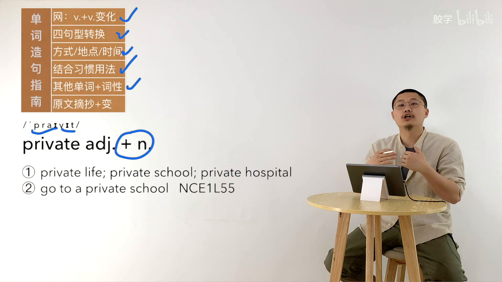

# 本机 CPU 真实样本测试

本目录仅包含第二册 L001「单词讲解造句」源视频 02:00–03:00 的测试输出，不代表整节或整批已完成。音频片段不上传，原视频仍在 Drive。

Qwen3-ASR 1.7B + ForcedAligner：145.68 秒；Faster-Whisper Large-v3：188.69 秒。模型首次下载和加载不计入这两个时间。

两模型第二段存在明显分歧：Whisper 省略了部分英文造句，主模型原文保留，并列入复核。原始双模型结果见各子目录，源视频偏移量为 120 秒。

PP-OCRv5 server 经 ONNX Runtime 在本机运行，单张课件耗时 29.13 秒；转换模型来自 RapidAI，模型版本没有降为 v4/mobile。音标和 go to 的空格存在识别风险，必须对照截图；置信度高也不能当作无误。

图片为 1920×1080 无损 WebP，已逐像素核对与提取 PNG 一致。

CPU：Xeon E5-2690 v2，20 个逻辑线程，ASR 使用 8 线程。60 秒小样本线性外推两遍语音约 710.6 小时，仅供粗略判断，未包含复查、OCR、视觉描述、初始化和 I/O；部分阶段可能有本机负载竞争。

Colab CPU 实测单价为 0.08 计算单元/小时；T4/L4 尚未进行获授权的实测，不能据此判断哪种云资源总费用最低。

视觉模型 Qwen2.5-VL-3B 在 CPU 上单张耗时 291.22 秒，原始输出见 [visual_frame_150.json](visual_frame_150.json)。结果漏掉蓝色圈画、下划线等教学标注，并偏向描述外观，因此未通过教学信息完整性检查。[复核记录](quality_review.json)保留所有问题，不能把跑出模型结果当作通过质量验收。

针对标注的第二次 CPU 复查遇到非法 CPU 指令退出，未产生可靠输出。此旧 Xeon 上的视觉推理尚不能视为稳定可用，原始结果和失败状态均保留；需要兼容 CPU 或 GPU 再验证。
