# 001 单词

快速机器解析：语音以 Qwen 转写为主，已保留 Whisper 机器对照与差异标记，未经人工复核；画面每秒采样并按变化选帧，短时文字和标记可能遗漏。截图时间约有 1 秒误差。图片有损压缩；遇到疑点请按时间查看 Google Drive 原视频。

## 00:00:00–00:00:30

Hello everyone, welcome to Capsule Academy. This is Leo. Today we're going to learn new concept English, Book One, Lesson One, Words. 那老习惯，我们在进入正式的课程之前呢，先提出三个问题。第一，如何引起他人的注意？第二，如何让对方再讲一遍？第三，当我谈单词的时候，我谈些什么？那带着这三个疑问，我们继续听接下来的课程。 Hope you gonna enjoy it. 那首先呢，我们

### 画面 00:00:00

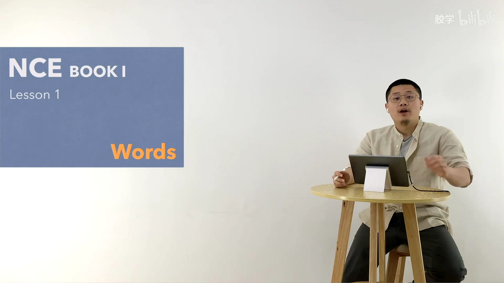

文字识别：胶学LH / NCE / BOOKI / Lesson 1 / Words

### 画面 00:00:08

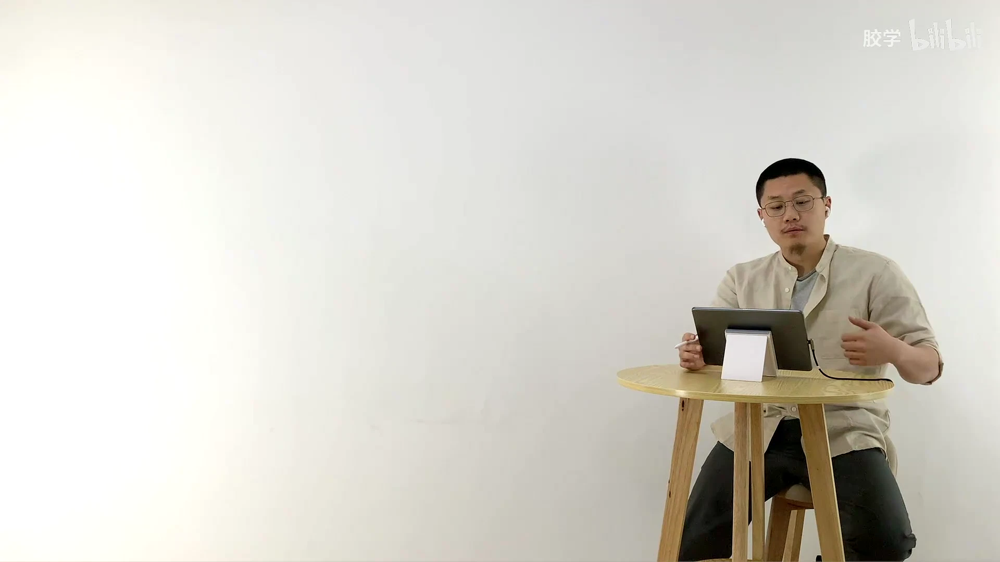

文字识别：胶学LH

### 画面 00:00:10

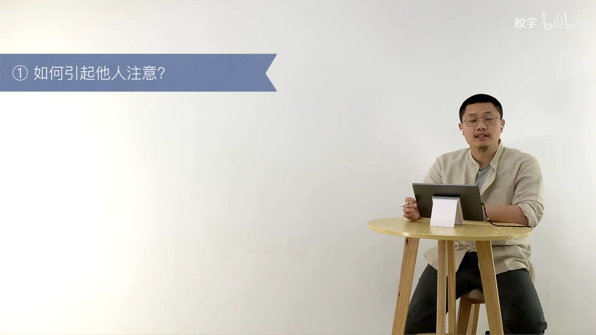

文字识别：胶学班 / ①如何引起他人注意?

### 画面 00:00:14

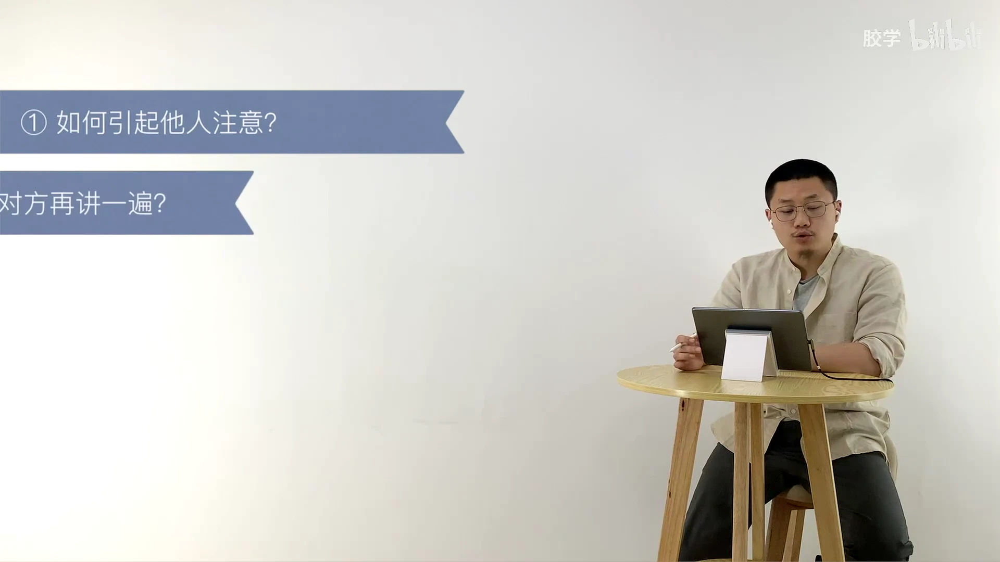

文字识别：胶学上W / ①如何引起他人注意? / 对方再讲一遍？

### 画面 00:00:16

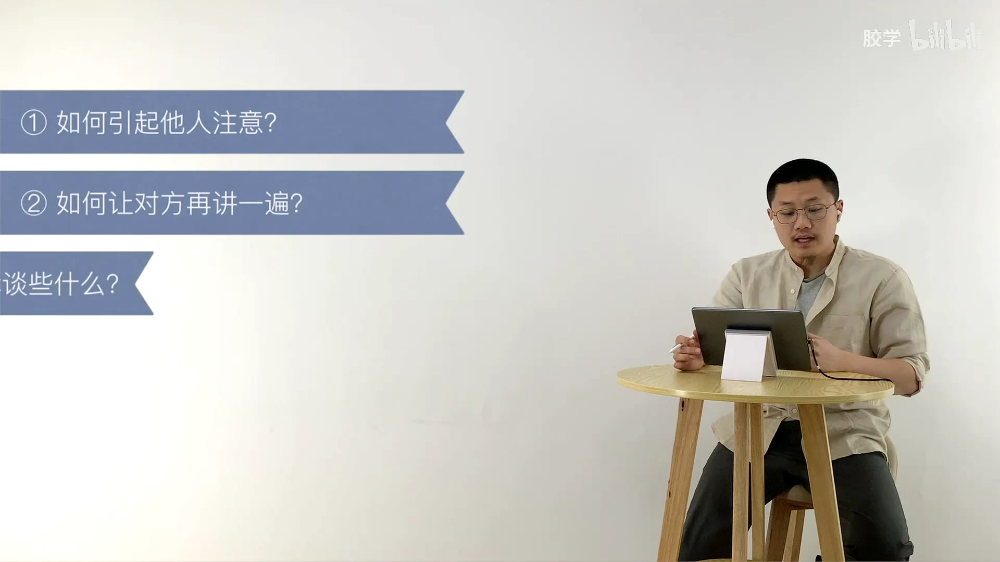

文字识别：胶学LHL / ①如何引起他人注意？ / 如何让对方再讲一遍? / 谈些什么?

### 画面 00:00:18

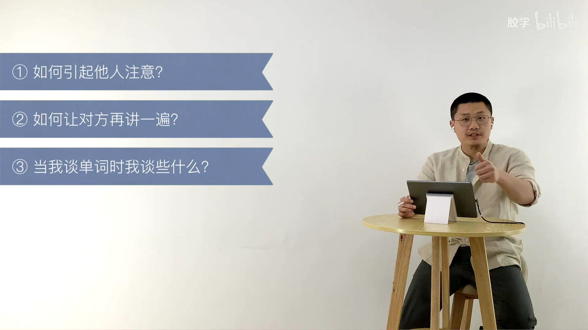

文字识别：胶学上W / ①如何引起他人注意？ / 如何让对方再讲一遍? / 当我谈单词时我谈些什么？

### 画面 00:00:24

文字识别：胶学

### 画面 00:00:28

## 00:00:30–00:01:00

先来看第一个小的词组，一起读一下，跟我叫做 excuse me， excuse me， excuse me。好，那在这个地方我们先复习一下两个音标，之前我们在一个单独的音标课程当中给大家录制的已经有讲过了，今天我们简单的复习一下。首先前面这个音，跟我一起读，很短，e e，降调，e e e， OK。后面这个音呢，我们之前提过，它叫长音，对吧？来，先平调，

### 画面 00:00:30

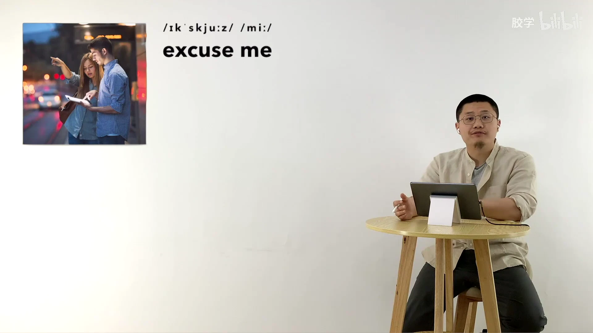

文字识别：胶学LH / /ik'skju:z/ /mi:/ / excuse me

### 画面 00:00:43

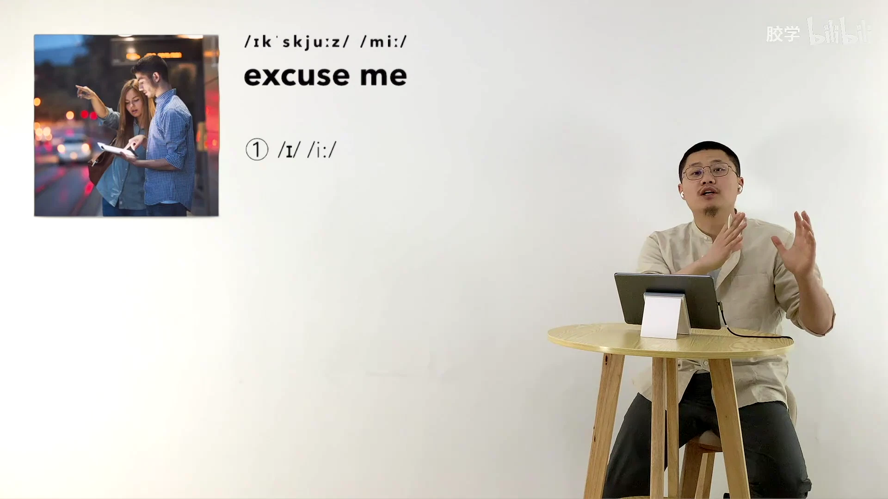

文字识别：胶学州 / /ik'skju:z/ /mi:/ / excuse me / ① /I/ /i:1

### 画面 00:00:47

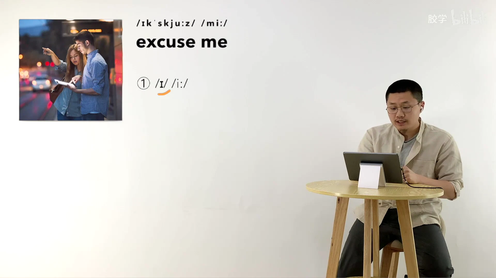

文字识别：胶学LW / /ik'skju:z/ /mi:/ / excuse me / ① /1//i:/

### 画面 00:00:52

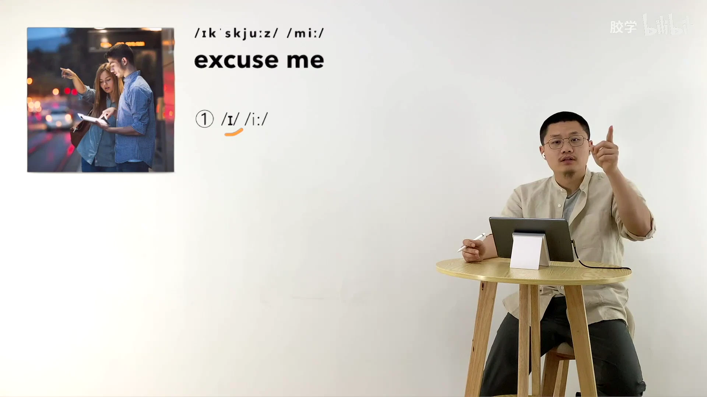

文字识别：胶学上H / /ik'skju:z/ /mi:/ / excuse me / ① /1/ /i:/

### 画面 00:00:57

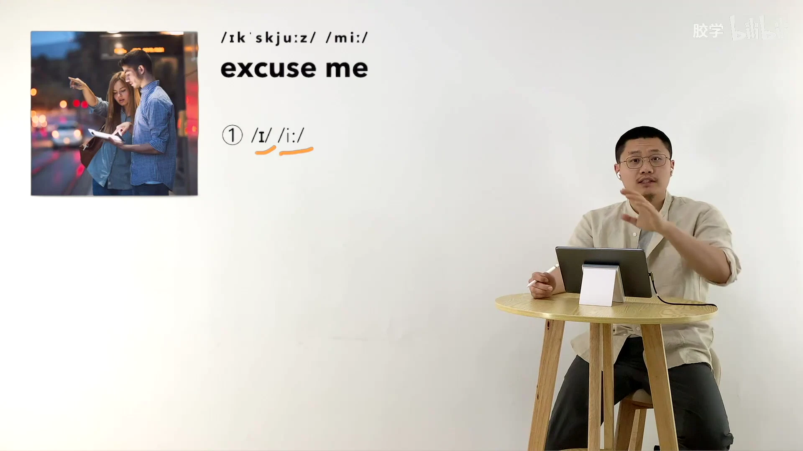

文字识别：胶学L明 / /ik^skju:z/ /mi:/ / excuse me / ① /1//i:/

## 00:01:00–00:01:30

一，降调一。OK，玩一个，我们做一个简单的复习。接下来呢，第二个小的点，各位要记住，在这个地方，M，这是我们讲自然拼读法则的时候提过的，在另一个视频当中也有展现。自然拼读法则，M这个字母放在单词的单词当中去的时候，我们经常读的音叫做闭上嘴，跟我一起来，嗯，鼻音，嗯。OK，玩一个。那它什么意思呢？简单来说就是打扰一下，要引起别人的注意啊。比如

### 画面 00:01:05

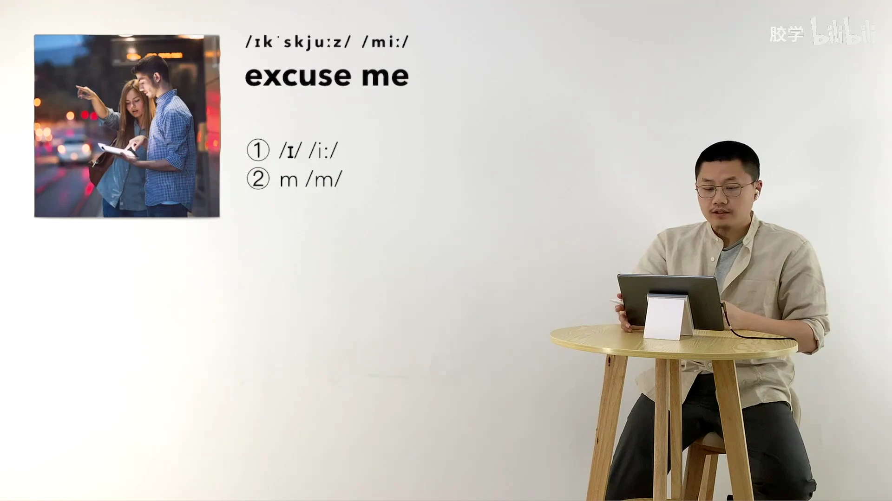

文字识别：胶学LH / /ik'skju:z/ /mi:/ / excuse me / ① /I/ /i:1 / ② m /m/

### 画面 00:01:22

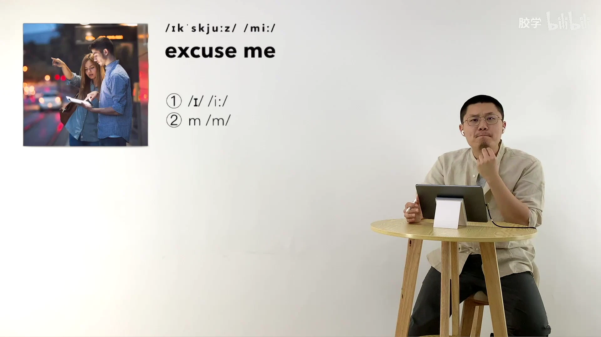

文字识别：胶学LH / /ik'skju:z/ /mi:/ / excuse me / ① /I/ /i:1 / ② m /m/

## 00:01:30–00:02:00

说你去纽约了，you traveling to New York, right? 然后呢，这个时候你突然间迷路了，这时候你需要做的事情是 before you reach out to a stranger. 哎，你想接触一个陌生人之前，你要做的事情非常简单。 Excuse me, 哎，打扰一下。 Excuse me, OK, one more. 那接下来呢，我们一起看一下在《盗梦空间》这个电影当中，哎，它是如何用 excuse me, 哎，我们刚刚讲过的这个习惯

### 画面 00:01:43

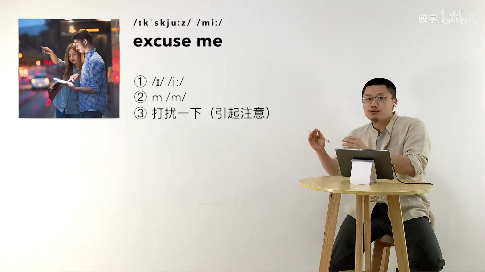

文字识别：胶学 / /ik'skju:z/ /mi:/ / excuse me / ① /I/ /i:1 / ② m /m/ / )打扰一下 (引起注意)

### 画面 00:01:45

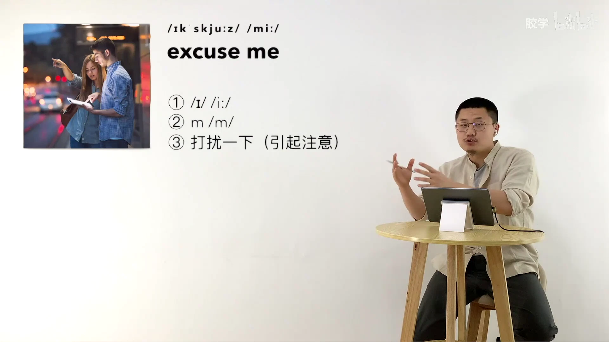

文字识别：胶学附 / /ik'skju:z/ /mi:/ / excuse me / ① /I/ /i:/ / ② m /m/ / 打扰一下 (引起注意)

### 画面 00:01:47

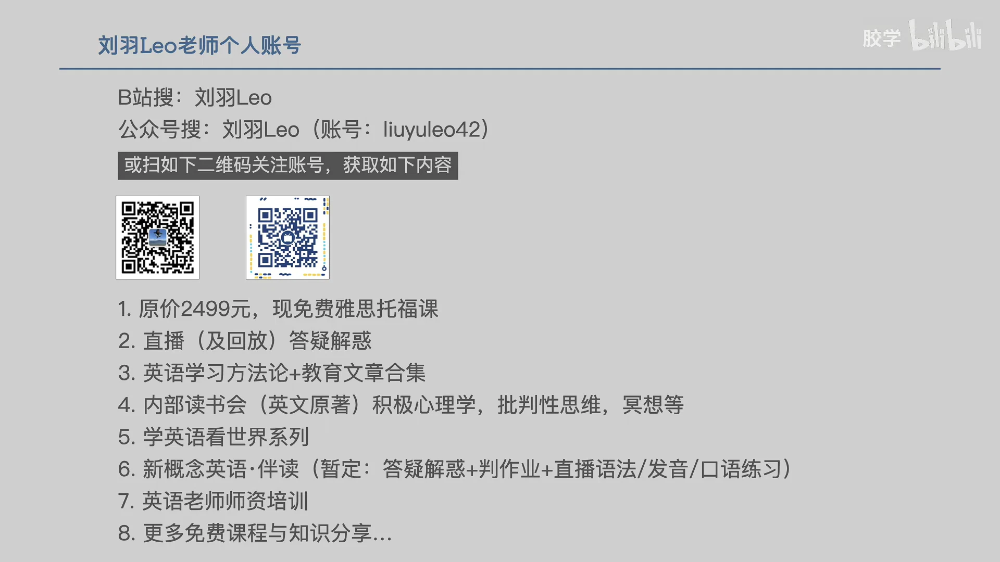

文字识别：胶学bb出 / 刘羽Leo老师个人账号 / B站搜：刘羽Leo / 公众号搜：刘羽Leo（账号：liuyuleo42) / 或扫如下二维码关注账号，获取如下内容 / 1.原价2499元，现免费雅思托福课 / 2.直播（及回放）答疑解惑 / 3. 英语学习方法论+教育文章合集 / 4.内部读书会（英文原著）积极心理学，批判性思维，冥想等 / 5. 学英语看世界系列 / 6.新概念英语·伴读 (暂定：答疑解惑+判作业+直播语法/发音/口语练习) / 7.英语老师师资培训 / 8.更多免费课程与知识分享...

### 画面 00:01:52

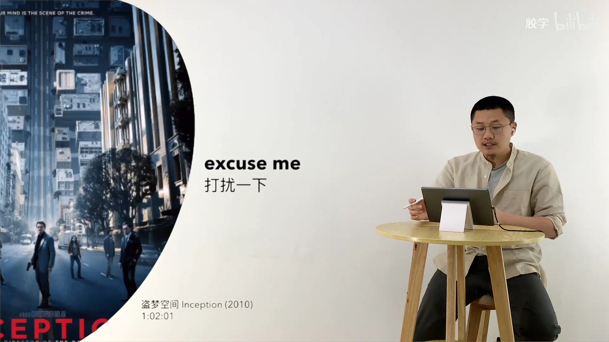

文字识别：JRMINDIS THE SCENEOF THE CRIME / 胶学州 / excuse me / 打扰一下 / 盗梦空间 Inception (2010) / EPTI / 1:02:01

### 画面 00:01:55

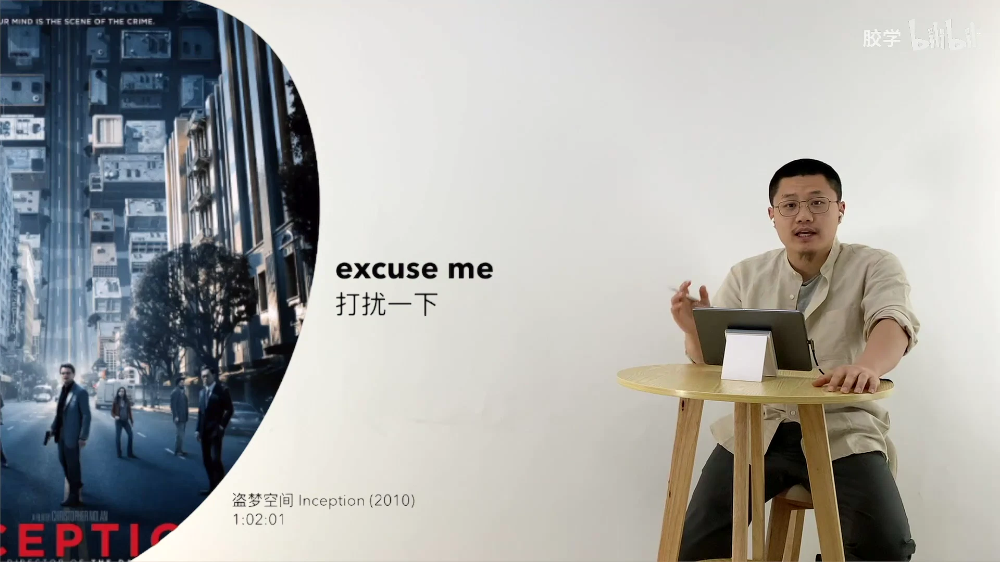

文字识别：JR MIND IS THE SCENE OF THE CRIME / 胶学LH / excuse me / 打扰一下 / 盗梦空间Inception (2010) / 1:02:01 / EPTI

## 00:02:00–00:02:30

用法，去表达打扰一下。Excuse me, I think this is yours. I just dropped it. Would you gentlemen care for a drink? Ah, water, please. One, same. Um, thank you. Okay, very good.好，那各位注意啊，这个地方你看，我们说小李子Leonardo啊，他现在想引起他前方这位男士的注意，所以他做了一件事情，

### 画面 00:02:02

文字识别：JR MIND IS THE SCENE OF THE CRIME. / 胶学LH / excuse me / 打扰一下 / 盜梦空间 Inception (2010) / 1:02:01 / EPTI

### 画面 00:02:04

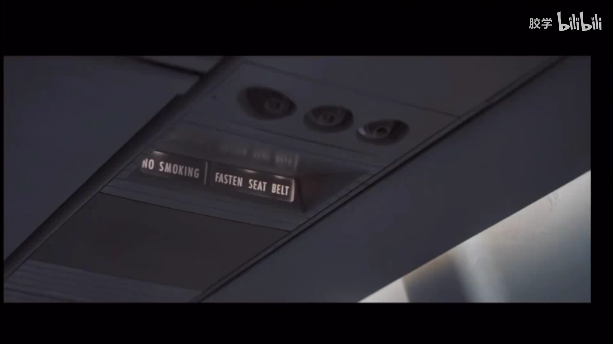

文字识别：bilibili / 胶学 / NO SMOKING / FASTEN SEAT BELT

### 画面 00:02:06

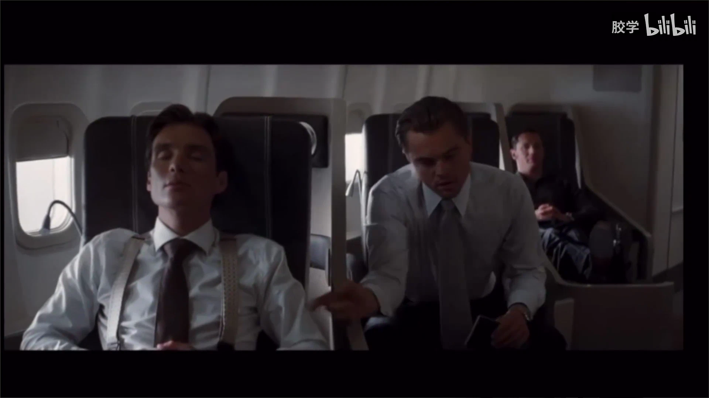

文字识别：blibili / 胶学

### 画面 00:02:08

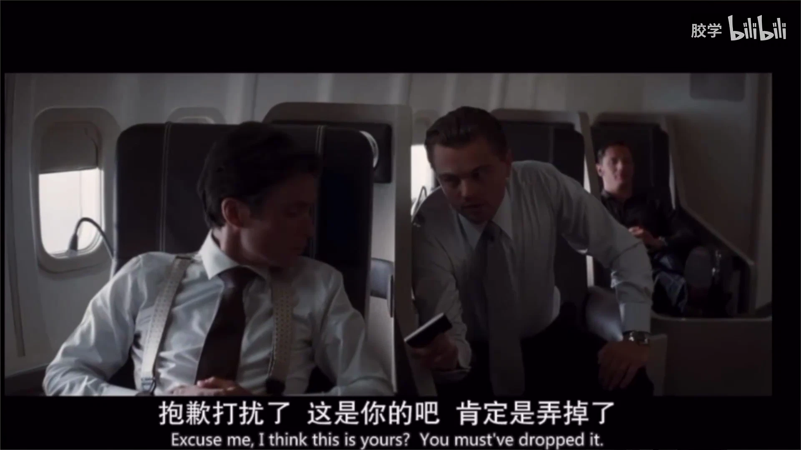

文字识别：bilibli / 胶学 / 抱歉打扰了这是你的吧肯定是弄掉了 / Excuse me, I think this is yours? You must've dropped it.

### 画面 00:02:10

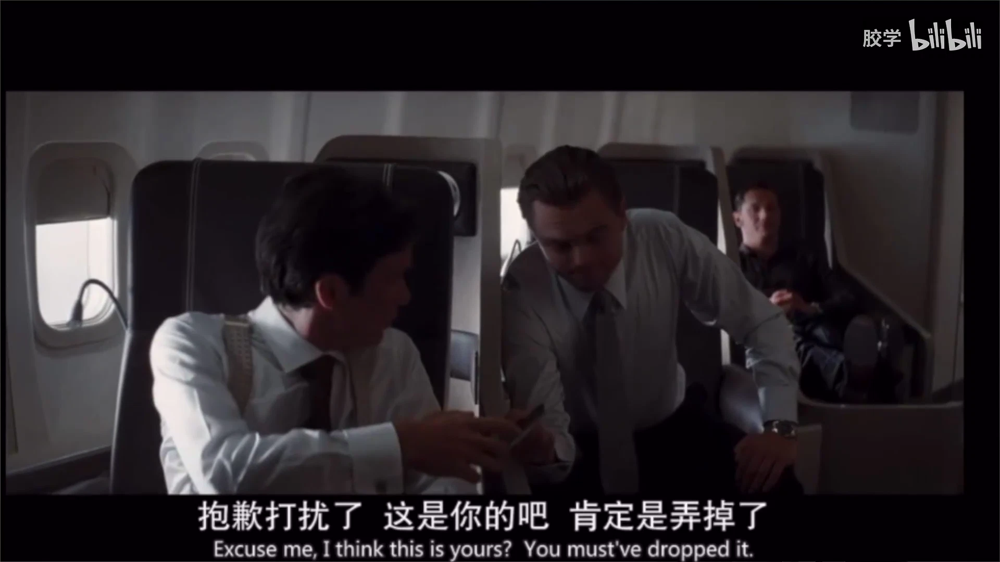

文字识别：biibili / 胶学 / 抱歉打扰了这是你的吧肯定是弄掉了 / Excuse me, I think this is yours? You must've dropped it.

### 画面 00:02:12

文字识别：bilibili / 胶学 / -先生们想要喝点什么吗-来杯水谢谢 / - Would you gentlemen care for a drink?-Oh, water, please.

### 画面 00:02:14

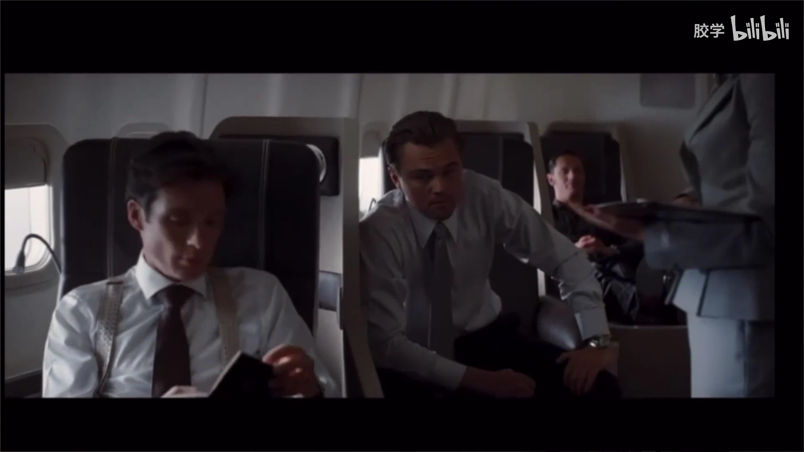

文字识别：bilibili / 胶学

### 画面 00:02:16

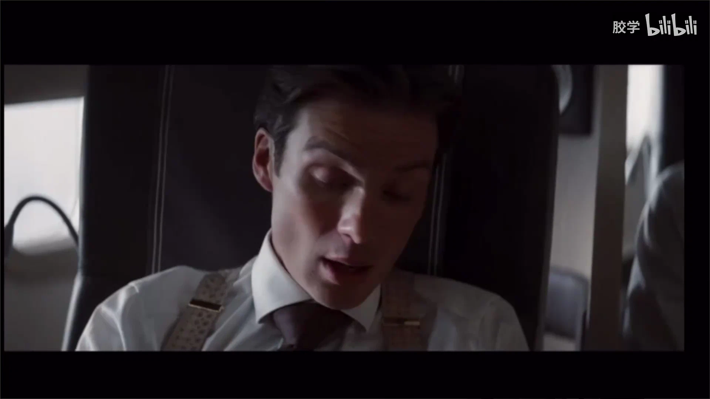

文字识别：bilbili / 胶学

### 画面 00:02:18

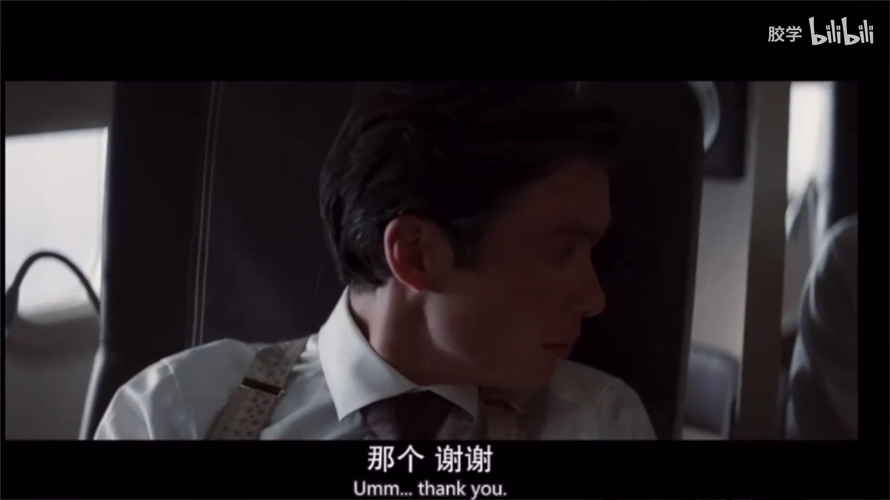

文字识别：bilibili / 胶学 / 那个谢谢 / Umm... thank you.

### 画面 00:02:20

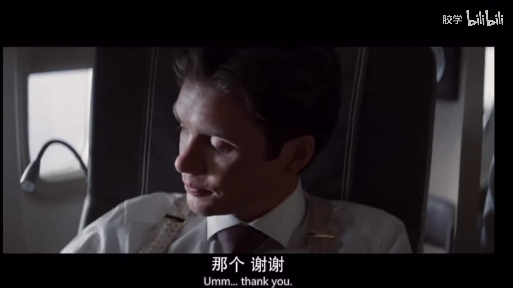

文字识别：bilibili / 胶学 / 那个谢谢 / Umm...thankyou.

### 画面 00:02:22

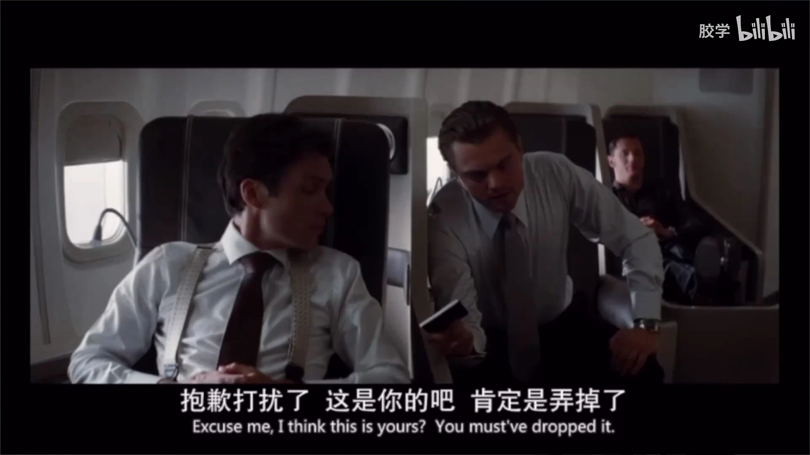

文字识别：胶学blbl / 抱歉打扰了这是你的吧肯定是弄掉了 / Excuse me, I think this is yours? You must've dropped it.

### 画面 00:02:24

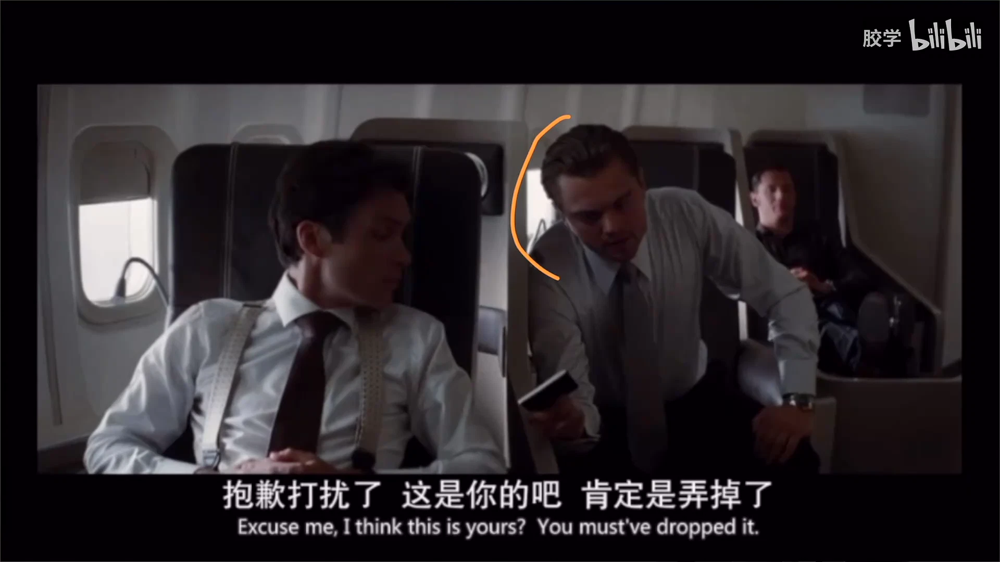

文字识别：bilbli / 胶学 / 抱歉打扰了这是你的吧肯定是弄掉了 / Excuse me, I think this is yours? You must've dropped it.

### 画面 00:02:26

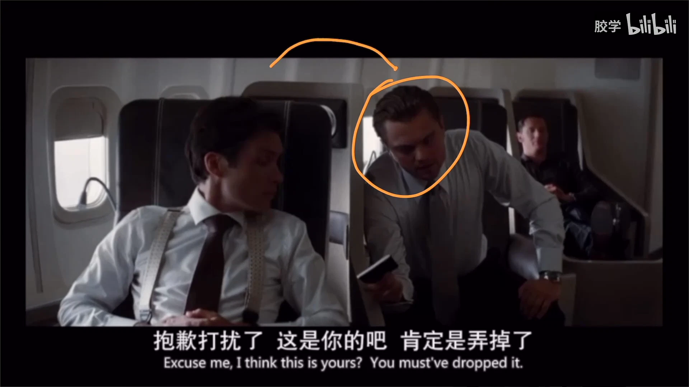

文字识别：bilibili / 胶学 / 抱歉打扰了这是你的吧肯定是弄掉了 / Excuse me, I think this is yours? You must've dropped it.

## 00:02:30–00:03:00

他说在打扰之前，他说 Excuse me，打扰一下。紧接着他说一句 I think this is yours。好，这个是我们在立刻下一个视频当中，哎，我们就会学到的一个语法，叫做一般疑问句，去疑问啊，去表示一下疑问。当然，这个地方不是一个标准的一般疑问句了。我们在下一节课会有具体的讲解。好，那么接下来继续再看一个，在老友记第三季第十季当中，Rachel想引起大家的注意力的时候，哎，在打扰别人之前，你要说的一句话

### 画面 00:02:31

文字识别：bilbli / 胶学 / 抱歉打扰了这是你的吧肯定是弄掉了 / Excuse me, I think this is yours? You must've dropped it.

### 画面 00:02:33

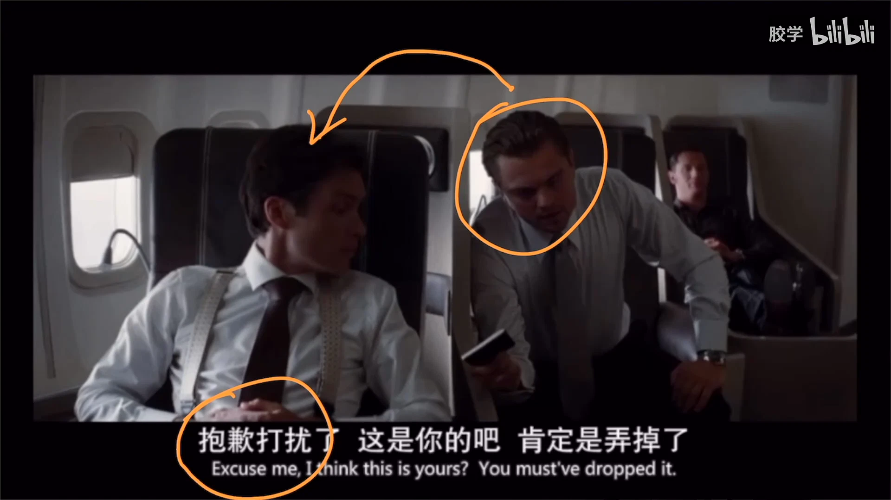

文字识别：bilibili / 胶学 / 抱歉打扰了 / 这是你的吧肯定是弄掉了 / Excuse me, hink this is yours? You must've dropped it.

### 画面 00:02:36

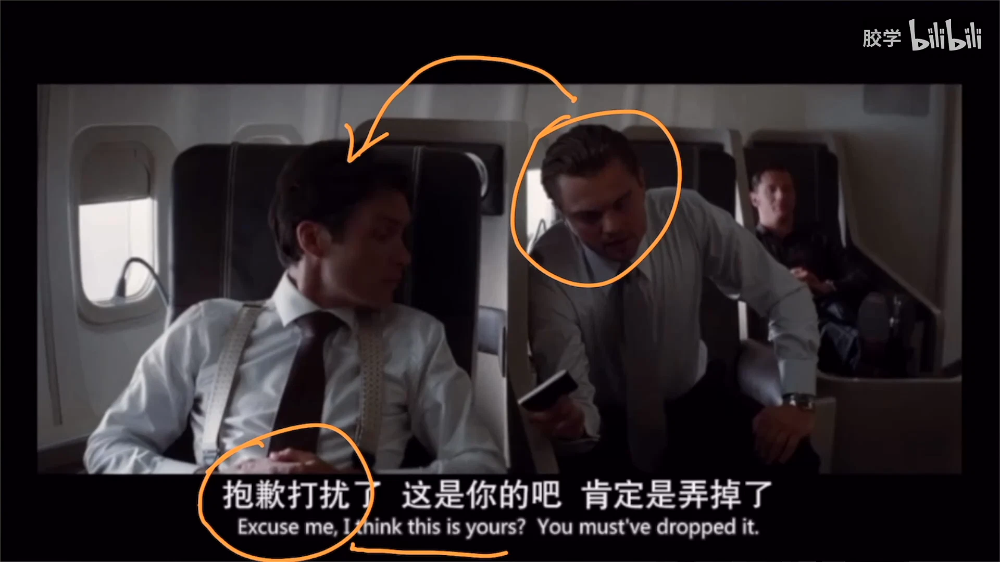

文字识别：bilibili / 胶学 / 抱歉打扰了 / 这是你的吧肯定是弄掉了 / Excuse me, hink this is yours? You must've dropped it.

### 画面 00:02:51

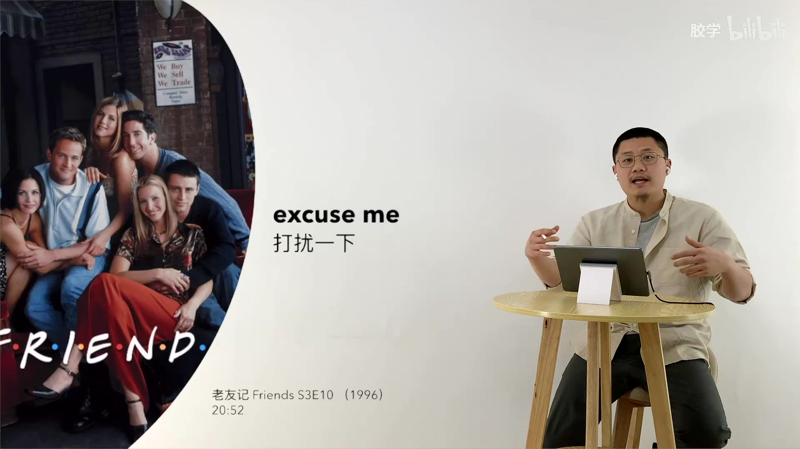

文字识别：胶学LiH / We Bauy / We Selil / We Trade / excuse me / 打扰一下 / R:IE·N·D / 老友记 Friends S3E10 (1996) / 20:52

### 画面 00:02:55

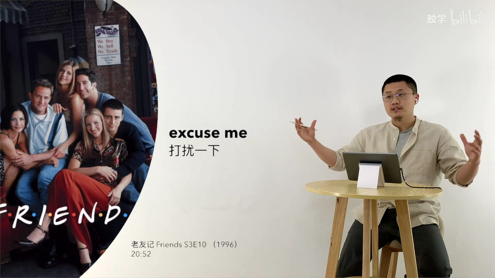

文字识别：胶学L / We Buy / We Sell / We Trade / excuse me / 打扰一下 / R:IE·N.D / 老友记Friends S3E10 (1996) / 20:52

## 00:03:00–00:03:30

叫做 Excuse me。我们一起来看一下。 Excuse me, everyone. Uh, this is my last night working here. Okay, 那我们刚才看到了在老友记当中 Rachel 啊这里面最漂亮的一个姑娘，她想引起大家的注意，在咖啡厅当中她说的是 Excuse me, everyone. Okay，然后大家注意力就指向了她，这就是我们说打扰别人之前要先说的一句话 Excuse me. Okay, Rachel。那接下来我们看她的第二个用法。第二个用法

### 画面 00:03:00

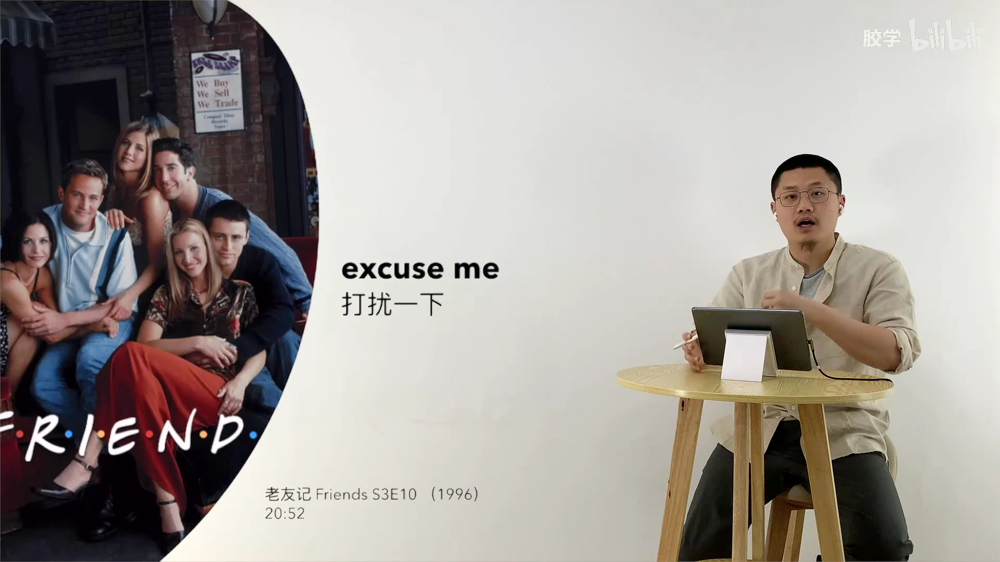

文字识别：胶学LH / He Buy / We Sell / We Trade / excuse me / 打扰一下 / R:lE·N·D / 老友记 Friends S3E10 (1996) / 20:52

### 画面 00:03:03

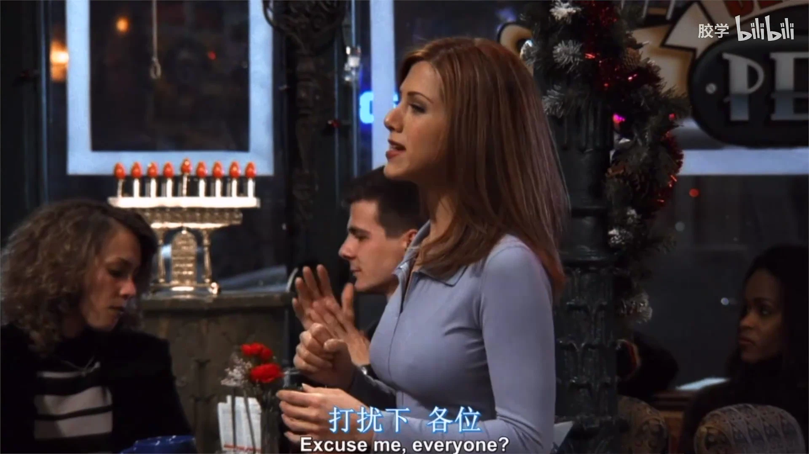

文字识别：Bilbili / 胶学 / 打扰下各位 / Excuse me, everyone?

### 画面 00:03:05

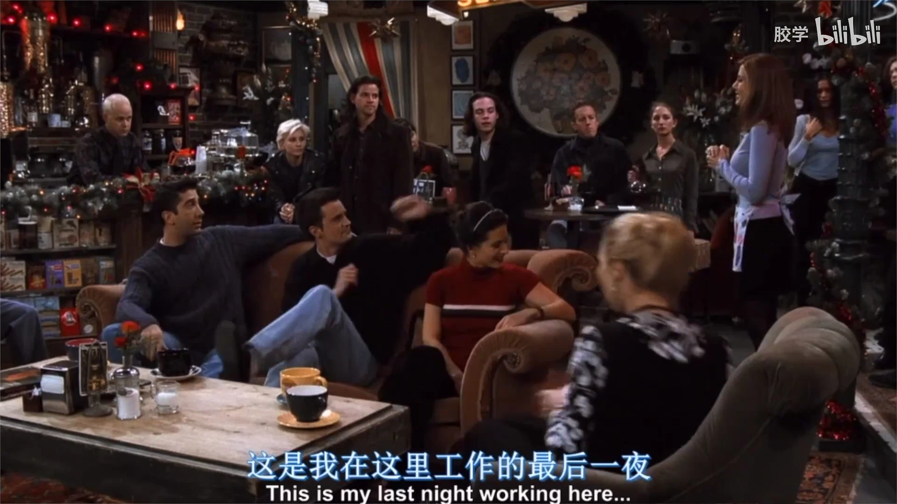

文字识别：Dilibili / 胶学 / 这是我在这里工作的最后一夜 / This is my last night working here...

### 画面 00:03:07

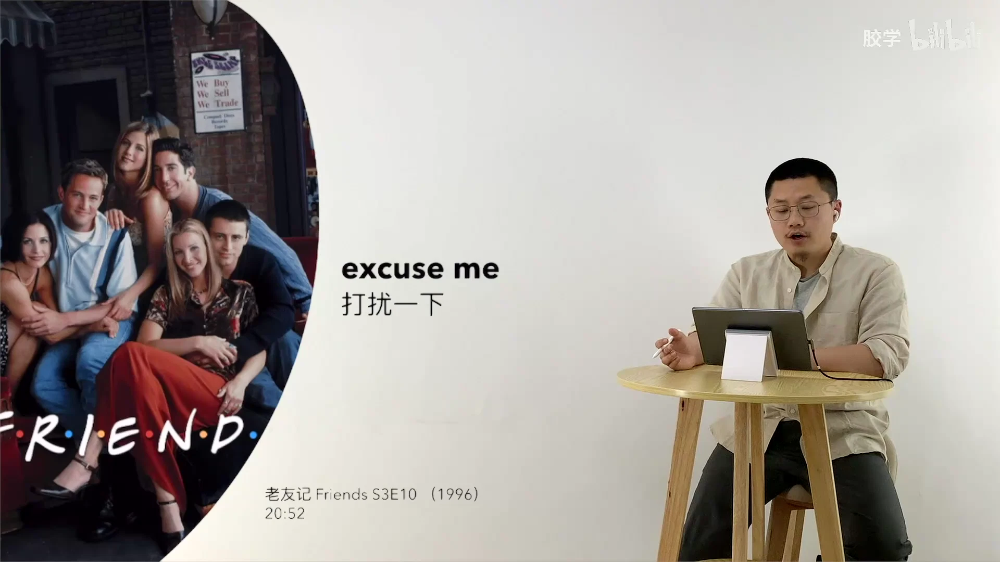

文字识别：胶学LH / We Buy / We Sell / We Trade / excuse me / 打扰一下 / R:IE·N·D / 老友记 Friends S3E10 (1996) / 20:52

### 画面 00:03:11

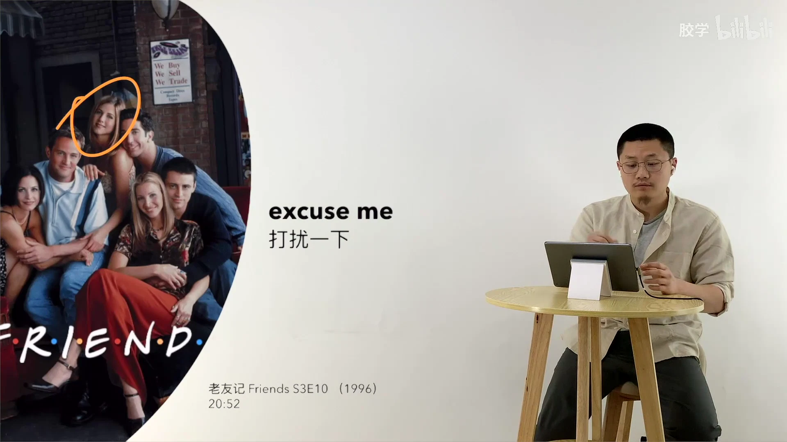

文字识别：胶学LHI / We Buy / We Sell / We Trade / excuse me / 打扰一下 / R:lE·N·D / 老友记 Friends S3E10 (1996) / 20:52

### 画面 00:03:15

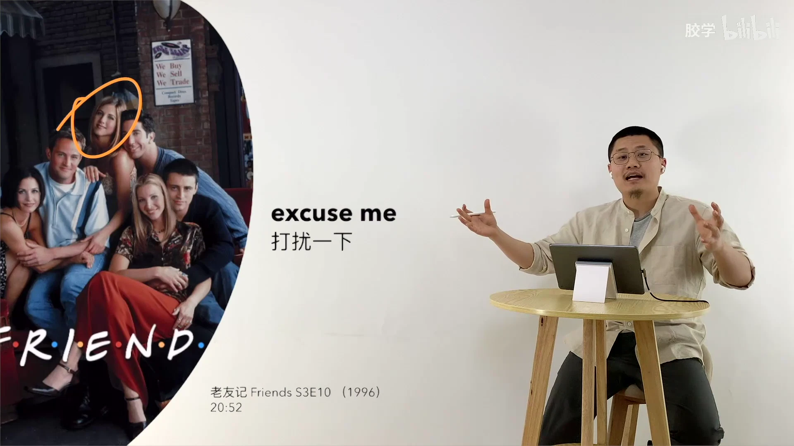

文字识别：胶学LH / We Buy / We Sell / We Trade / excuse me / 打扰一下 / R:IE·N.D / 老友记 Friends S3E10 (1996) / 20:52

### 画面 00:03:26

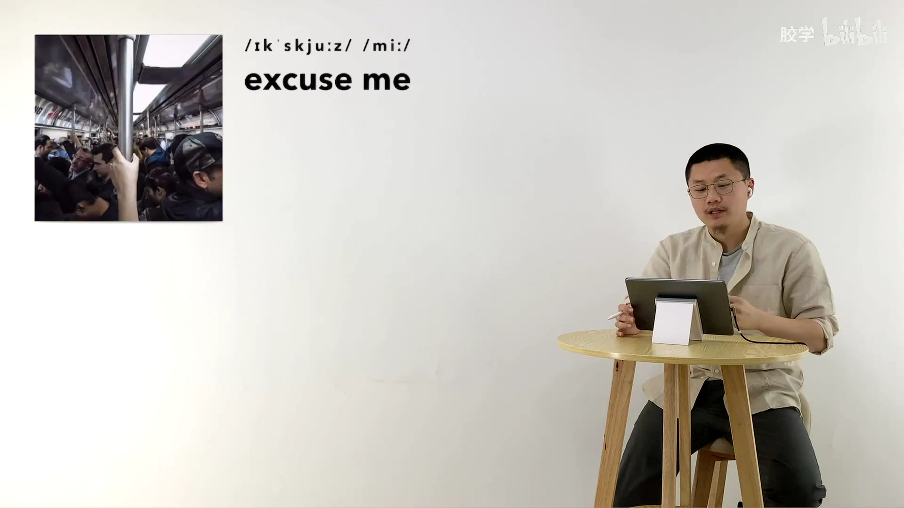

文字识别：胶学H / /ik'skju:z/ /mi:/ / excuse me

## 00:03:30–00:04:00

呢，其实很简单，就是借过让一下，其实也是在打扰别人之前去说的。 For example, if it's like if you're on subway, 你在地铁当中的时候，对吧？ There are a lot of people in front of you. 有很多人在你面前，这时候你要下地铁，你要跟前面人说借光让我过一下，怎么说呢？很简单，叫做 Excuse me, Excuse me. 接下来我们一起看一下在蝙蝠侠黑暗骑士当中，哎，里面的一个护士，他是如何用 Excuse me 来表达借光让一下的。

### 画面 00:03:50

文字识别：胶学LHLI / WELCOME TO A WORLD WITHOUT RULES. / excuse me / 借过;让一下 / CAINE LEDGER OLDMAN ECKHART GYLLENHAAL / THE / DARKKNI / 蝙蝠侠：黑暗骑士The Dark Knight(2008) / 1:40:56 / SYNCOPY / JULY

### 画面 00:03:53

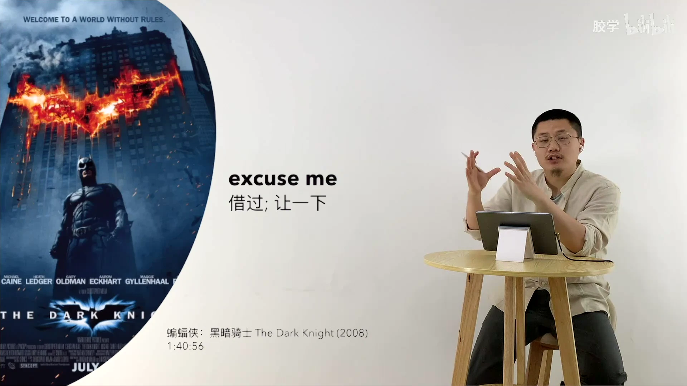

文字识别：WELCOME TO A WORLD WITHOUT RULES. / 胶学 / excuse me / 借过;让一下 / CAINE LEDGER OLDMAN ECKHART GYLLENHAAL / THE / DARKKNI / 蝙蝠侠：黑暗骑士The Dark Knight(2008) / 1:40:56 / SYNCOPY / JULY

### 画面 00:03:55

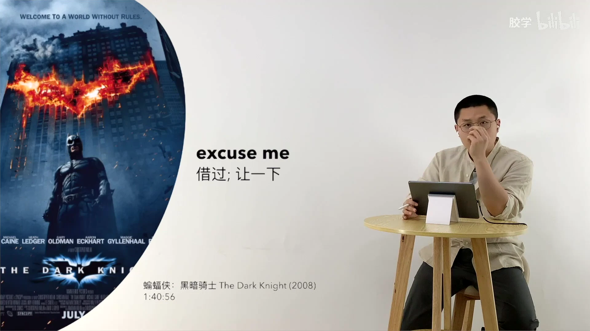

文字识别：WELCOME TO A WORLD WITHOUT RULES. / 胶学L计 / excuse me / 借过;让一下 / CAINE LEDGER OLDMAN ECKHART GYLLENHAAL / THE / DARK KNI / 蝙蝠侠：黑暗骑士The Dark Knight(2008) / 1:40:56 / SYNCOPY / JULY

### 画面 00:03:58

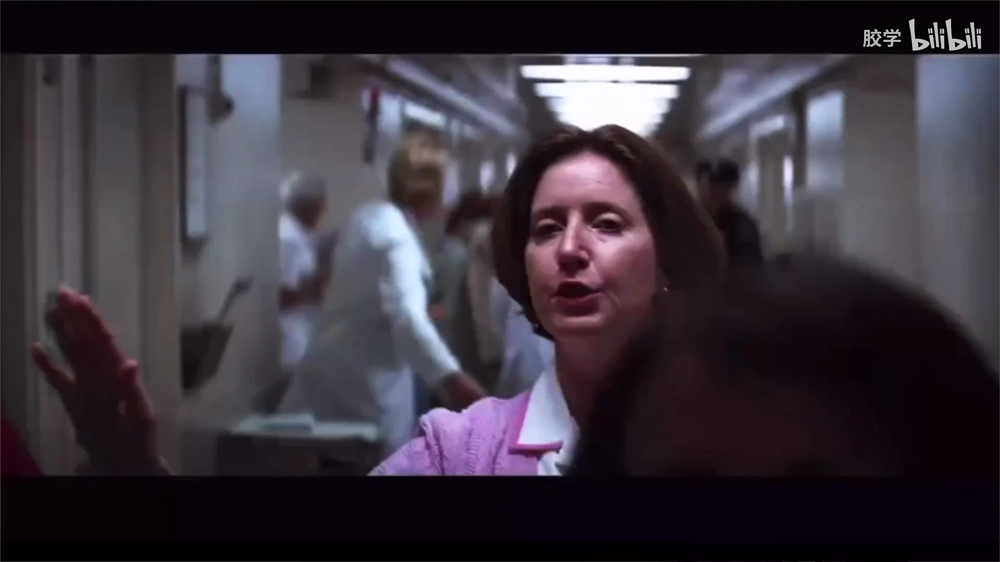

文字识别：胶学biibii

## 00:04:00–00:04:30

me, sir. Could you help, please? Okay, 那我希望各位刚才有注意到这个护士在走廊当中，走廊很拥挤，对吧？他需要往前走，他说 Excuse me, excuse me, let me through. Okay, very good, 叫借光，让一下。其实本质上还是在打扰别人之前要说的一句话，Excuse me. Very good. 那接下来我们看下一个单词，下一个单

### 画面 00:04:00

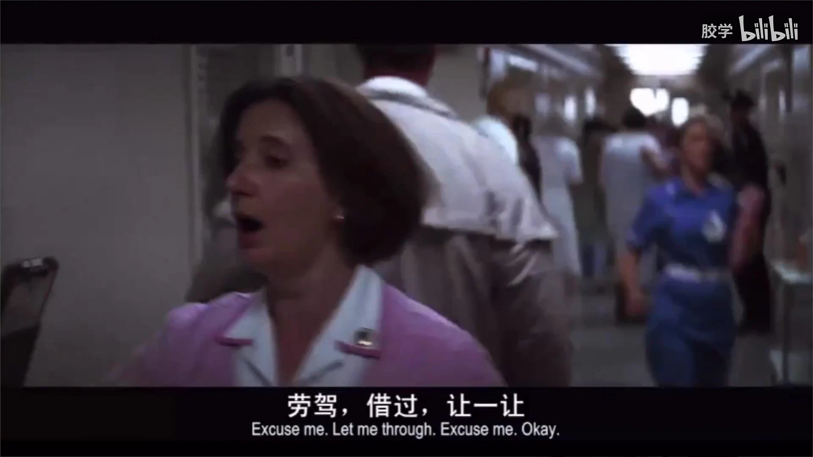

文字识别： bilibili / 胶学 / 劳驾，借过，让一让 / Excuse me. Let me through. Excuse me. Okay.

### 画面 00:04:02

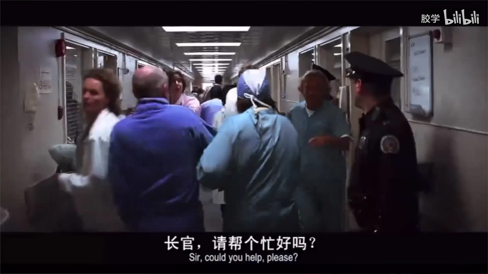

文字识别： bilibili / 胶学 / 长官，请帮个忙好吗？ / Sir, could you help, please?

### 画面 00:04:04

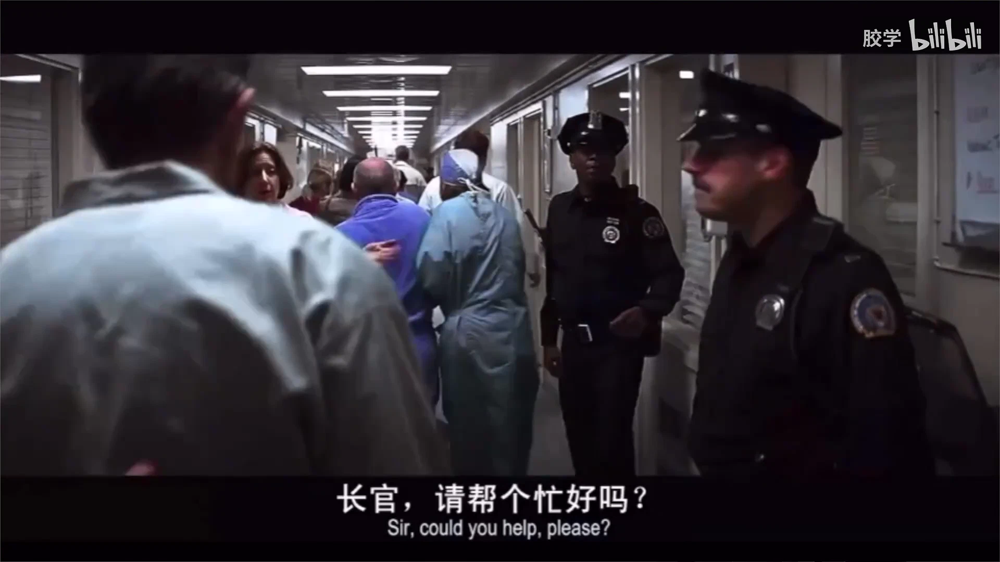

文字识别：Bilbii / 胶学 / 长官，请帮个忙好吗？ / Sir, could you help, please?

### 画面 00:04:06

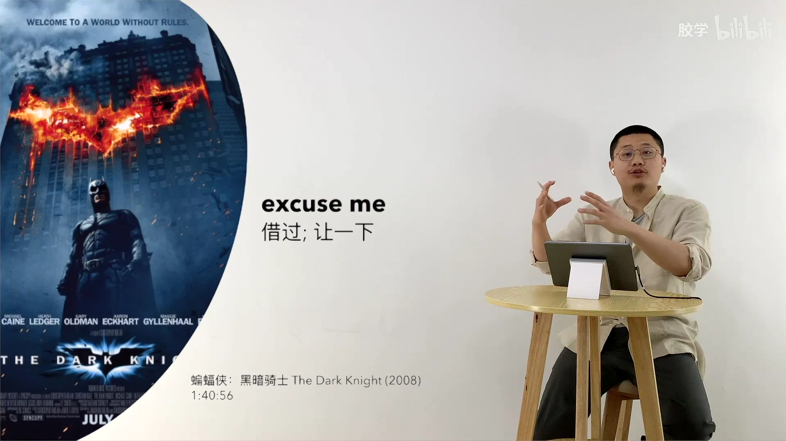

文字识别：胶学L / WELCOME TO A WORLD WITHOUT RULES. / excuse me / 借过；让一下 / CAINE LEDGER OLDMAN ECKHART GYLLENHAAL / THE / DARK KNI / 蝙蝠侠：黑暗骑士The Dark Knight(2008) / 1:40:56 / SYNCOPY / JULY

### 画面 00:04:10

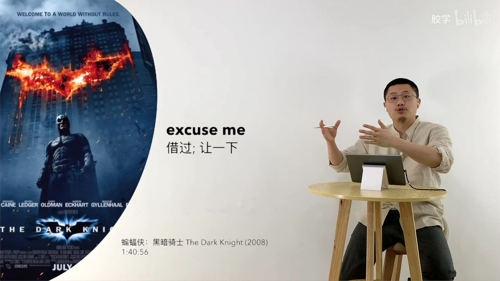

文字识别：WELCOME TO A WORLD WITHOUT RULES. / 胶学上W / excuse me / 借过;让一下 / CAINE LEDGER OLDMAN ECKHART GYLLENHAAL / THE / DARK KNI / 蝙蝠侠：黑暗骑士The Dark Knight(2008) / 1:40:56 / SYNCOPY / JULY

### 画面 00:04:12

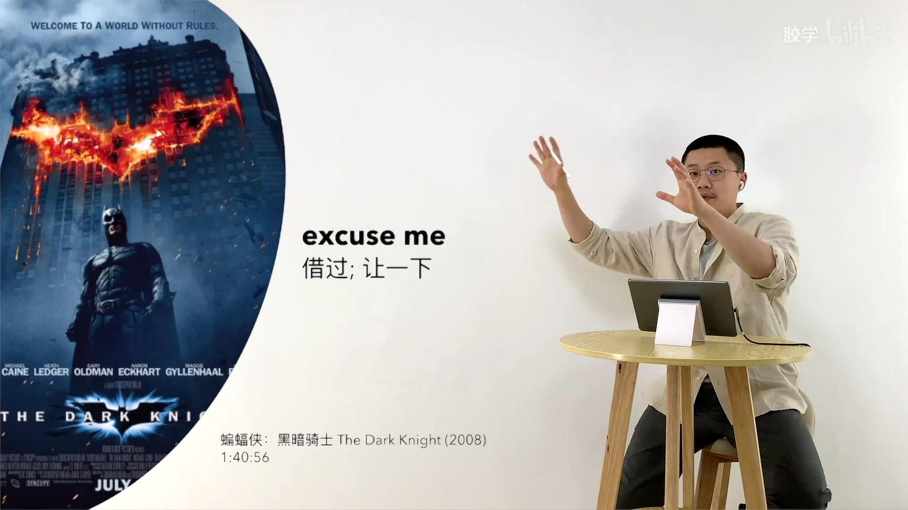

文字识别：胶学训 / WELCOME TO A WORLD WITHOUT RULES. / excuse me / 借过；让一下 / CAINE LEDGER OLDMAN ECKHART GYLLENHAAL / THE / DARK KNI / 蝙蝠侠：黑暗骑士The Dark Knight(2008) / 1:40:56 / SYNCOPY / JULY

### 画面 00:04:15

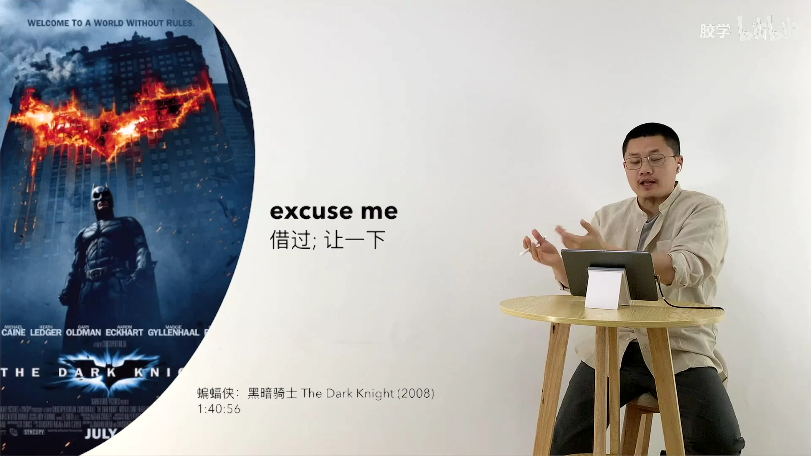

文字识别：胶学LH / WELCOME TO A WORLD WITHOUT RULES. / excuse me / 借过;让一下 / CAINE LEDGER OLDMAN ECKHART GYLENHAAL / THE / DARK KNI / 蝙蝠侠：黑暗骑士The Dark Knight(2008) / 1:40:56 / SYNCOPY / JULY

### 画面 00:04:20

文字识别：WELCOME TO A WORLD WITHOUT RULES. / 胶学L / excuse me / 借过;让一下 / CAINE LEDGER OLDMAN ECKHART GYLLENHAAL / THE / DARKKNI / 蝙蝠侠：黑暗骑士The Dark Knight(2008) / 1:40:56 / STNCOPY / JULY

### 画面 00:04:22

文字识别：胶学 / 外研社 / 新概念英训 / 新概念英语 / CAMBRIDGE / aa”(Engisinue)am / 剑桥初级 / 新概念英语1 / NEW CONCEPT ENGLISH / NCE Grammar Practice / 山文(LG.ALEXANDER)(间]H / 舞慧版 / 语法练习 / 英语语法 / First / 法练习NCEGN / Things First / 英语初阶 / FirstThings First / 英语初阶 / hila u / ESSENTIALGRAMMAR IN USE / (Fourth Edition) / [满]Raymond Murphy / 教材及学习用书 / 中文版 / 第四版 / 英语在用 / 外语教学与研究出版社 / 115个还法学兑，讲练结合，学以款用 / 适合自学及试实快用 / 24节 / NEW CONCEPT ENGLISHI / 新概念英语1 / 新概念英语第一册 / FIRST THINGS FIRST / 新概念英语 / 课堂笔记&课后练习 / New / 第一册 / Concept / 课堂笔记&课后练习（.pdf) / English / 5合1测试 / 五合一测试 / (线上)

### 画面 00:04:27

文字识别：胶学 / /'hænd bæg/ / handbag n.

## 00:04:30–00:05:00

词很简单，先跟我们一起读一下 hand bag 连起来。哎，你在听我读的时候，你应该发现了它是两个单词，对吧？手，This is my hand。跟我一起读 hand。那 bag 呢？很简单，它的意思就是一个包的意思。那放在一起就是手提包。首先，我们先一起回顾一下之前讲过的音标。首先第一个音标，哎，跟我一起去读两个手指。我们一起迅速回顾一下两个手指的大小，舌尖贴下龈，对

### 画面 00:04:55

文字识别：胶学LiH / /'hænd bæg/ / handbag n. / ① hand+bag / ② /æ//e/ yes /jes/

## 00:05:00–00:05:30

吧？来，诶，降调，诶，OK，那后面这个像 e 字母了，注意它放在斜杠里面叫音标了，对吧？我们之前有专门给大家讲过，怎么去读呢？很简单，一个手，诶，大小，舌尖还是贴下音，跟一起读，诶，降调，诶，诶，那我们之前提到过一个思路，就是说如果您忘记了诶，诶这个音怎么办呢？只要你会读这个单词就好了，去反推，那这个单

### 画面 00:05:23

文字识别：胶学LH / /'hænd bæg/ / handbag n. / ① hand+bag / ② /æ/ le/yes /jes/

## 00:05:30–00:06:00

单词怎么读呢？Yes，我相信你肯定会读。我们去反推的时候就很简单了，耶哎耶哎哎哎哎，就可以把它回想起来了。这是我们学音标一个非常重要的小技巧。那我们接着再往下走，我们一起看一下关于自然拼读法则的知识。那 H 这个字母放在单词当中去经常读的音，回顾一下。 OK， D 这个字母放在单词当中去经常读的音的，继续。 N 这

### 画面 00:05:36

文字识别：胶学LiH / /'hænd bæg/ / handbag n. / ① hand+bag / ② /e/ lel yes /jes/

### 画面 00:05:41

文字识别：胶学LHL / /'hæn d bæg/ / handbag n. / ① hand+bag / ② /æ//e/ yes /jes/

### 画面 00:05:54

文字识别：胶学上H / / ' h æ n d b æ g / / handbag n. / ① hand+bag / ② /æ/ /e/ yes /jes/ / ③ h/h/, d/d/, n/n/, b/b/, g/g/

## 00:06:00–00:06:30

个字母 n 这个字母我们放在单词当中去读的是嗯，OK b 这个字母读的是 b g 这个字母读的是 g 啊，那我们之前专门给大家录了一个视频去讲自然拼读法则对于拼写一个单词的帮助性，对吧？那你看一下在这地方我简单说一下，如果我们会读这个单词 handbag，你基本上肯定能拼出来的字母是 h a n d b g，

### 画面 00:06:08

文字识别：胶学biHL / /hæn d bæg/ / handbag n. / ① hand+bag / ② /æ//e/ yes /jes/ / ③ h/h/, d/d/, n/n/, b/b/, g/g/

## 00:06:30–00:07:00

只有两个 a 这个字母你是不没办法完全确定的。OK，那这个点各位需要注意一下自然拼读法则的重要性。接下来呢，那我们讲单词的时候啊，我们经常需要谈什么，对吧？我们经常谈的实际上是五个点。那我们现在一一去说，首先它的拼写很简单，这是大家都会注意的。你经常会问的问题是单词怎么拼呢？比如像这个单词对吧，h a n d b a g，对吧？这样几个单词去

### 画面 00:06:31

文字识别：胶学上H / / 'hænd bæ g/ / hondbag n. / ① hand+bag / /æ/ le/ yes /jes/ / 2 / h/h/, / , d/d/, n/n/, b/b/, g/g/

### 画面 00:06:42

文字识别：胶学biH / / h æe n d bæg / / handbag n. / ① hand+bag / ② /æ/ /e/ yes /jes/ / ③ h/h/, d/d/, n/n/, b/b/, g/g/

## 00:07:00–00:07:30

组成了它的拼写。接下来是它的发音，我们学习的自然拼读法则和音标解决的就是这个问题。再继再继续呢，是它的词性。n这个字母加一个点儿，表示它是一个名词。那为什么要学习它的词性呢？我们汉语其实并不是很关注词性。在这个点呢，我今天先不赘述。我们接下来你会越来越发现，英文很多的时候是要强调词性的。那最后一个顾名思义，就是大家非常熟悉的叫做含义，对吧？就像左边图这样显示的，它

### 画面 00:07:11

文字识别：胶学L / / hæn d bæg/ / handbag / n. / ① hand+bag / ② /æ/ /e/ yes /jes/ / h /h/, d/d/, n/n/, b/b/, g/g/ / 拼写+发音+词性+含义

### 画面 00:07:25

文字识别：胶学LH / / hæn d bæg/ / handbag n. / ① hand+bag / ② /æ/ /e/ yes /jes/ /  h/h/, d/d/, n/n/, b/b/, g/g/ / 3 / 拼写+发音+词性+含义

### 画面 00:07:28

文字识别：胶学bW / / h æe n d bæ g / / handbag n. / ① hand+bag / ② /æ/ /e/ yes /jes/ / ③ h /h/, d/d/, n/n/, b/b/, g/g/ / 拼写+发音+词性+含义

## 00:07:30–00:08:00

是一个手提包的意思。你刚才不说五个点吗？太着急了，批评一下你啊。对，它确实是五个点。这个地方呢，我们说出来第五个点叫要造句或者说短语，这个是大家非常容易遗忘的一件事情。就很多人背单词的时候啊，我像我小的时候就是 handbag，然后一遍一遍写，一遍一遍写。但实际上你想单词，它在实际应用当中很少只是自己单独出现，它往往是放在句子当中去出现，对吧？那我们小时候学汉语，你也是要拿

### 画面 00:07:46

文字识别：胶学bH / / 'hænd bæg/ / handbag n. / ① hand+bag / ② /æ/ /e/ yes /jes/ / ③ h /h/, d/d/, n/n/, b/b/, g/g/ / 拼写+发音+词性+含义 / 造句/短语

### 画面 00:07:48

文字识别：胶学LH / /'hænd bæg/ / handbag n. / ① hand+bag / ② /æ/ le/ yes /jes/ / ③ h /h/, d/d/, n/n/, b/b/, g/g/ / 3 / 拼写+发音+词性+含义 / 造句/短语

### 画面 00:07:50

文字识别：胶学bH / /'hænd bæg/ / handbag n. / ① hand+bag / ② /æ/ /e/ yes /jes/ / ③ h /h/, d/d/, n/n/, b/b/, g/g/ / 3 / 拼写+发音+词性+含义 / 造句/短语

## 00:08:00–00:08:30

词去造句的，对不对？所以英文是一样的，我们要不停的造句、造句、再造句，这个点非常的重要。以后在接下来的课程当中，我们会反复的展现这一点。我会拿几乎所有的单词带各位去造句，教各位如何去造句。所以再说一遍，当我们谈单词的时候，我们谈的是五个点，最重要的一个点叫做造句或者是短语。希望你们记住了。接下来 let's continue。接下来我们一起看一下《马达加斯加二：逃往非洲》这个电影当中是如何出现了

### 画面 00:08:03

文字识别：胶学W / /'hænd bæeg/ / handbag n. / ① hand+bag / ② /æ/ /e/ yes /jes/ / ③ h /h/, d/d/, n/n/, b/b/, g/g1 / 3 / 拼写+发音+词性+含义 / 造句/短语

### 画面 00:08:05

文字识别：胶学W / /'hæn d bæg/ / handbag n. / ① hand+bag / ② /æ/ /e/ yes /jes/ / ③ h /h/, d/d/, n/n/, b/b/, g/g1 / 拼写+发音+词性+含义 / 造句/短语

### 画面 00:08:24

文字识别：MADAGASCAR / 胶学L / ESCAPE / AFRICA" / handbag / 马达加斯加2：逃往非洲 Madagascar:Escape2Africa(2008) / 1:16:45

### 画面 00:08:26

文字识别：MADAGASEAR / 胶学LW / ESCAPE / AFRICA" / handbag / 马达加斯加2：逃往非洲 Madagascar: Escape 2 Africa(2008) / 1:16:45

## 00:08:30–00:09:00

handbag 这个单词的？当然这个单词其实不是语境了，只是我个人非常喜欢这个片段，特别有意思，给大家一起分享一下。我们一起看一下。 We figured you'd say that. My handbag. You bet, Kitty. No, no, no, no, no, no. Okay, very good.他的发音啊，老

### 画面 00:08:30

文字识别：MADAGASCAR / 胶学LH / ESCAPE / AFRICA" / handbag / 马达加斯加2：逃往非洲 Madagascar: Escape2Africa(2008) / 1:16:45

### 画面 00:08:35

文字识别：MADAGASCAR / 胶学L / ESCAPE / AFRICA" / handbag / 马达加斯加2：逃往非洲 Madagascar: Escape 2 Africa(2008) / 1:16:45

### 画面 00:08:38

文字识别：胶学biib / 就知道你会这么说 / We figured you'd say that.

### 画面 00:08:40

文字识别：胶学biibili / 就知道你会这么说 / We figured you'd say that.

### 画面 00:08:42

文字识别：bilibili / 胶学 / JAMBOm

### 画面 00:08:44

文字识别：胶学bilb / 我的包包 / My handbag!

### 画面 00:08:46

文字识别：bilibili / 胶学 / 你这坏貓 / You bad kitty!

### 画面 00:08:48

文字识别：Bilibili / 胶学 / 0

### 画面 00:08:50

文字识别：bilibili / 胶学 / JAMBO

### 画面 00:08:52

文字识别：胶学bibii / 不不不不不 / No,no, no, no, no, no,no!

### 画面 00:08:54

文字识别：bilibili / 胶学

### 画面 00:08:56

文字识别：Bilibili / 胶学

### 画面 00:08:58

文字识别：MADAGASCAR / 胶学 / ESCAPE / AFRICA" / handbag / 马达加斯加2：逃往非洲Madagascar: Escape 2Africa(2008) / 1:16:45

## 00:09:00–00:09:30

老奶奶的发音非常的好啊。你可以回去反复听两下，比我读的好多了。我们一起读一下，叫做 my handbag. Okay, very good. Let's continue.接下来下一个单词，跟我一起读一下来，叫做 pardon, pardon.那在这个地方我提一个小点，它其实还有另外一个非常像的发音，跟我一起读一下，带个儿化音叫 pardon, pardon.哎，这是我们英式发音和美式发音当中一个比较巨大的一个区别，其实就是带不带儿化音，这是区别之一啊，

### 画面 00:09:00

文字识别：MADAGASCAR / 胶学LH / ESCAPE / AFRICA" / handbag / 马达加斯加2：逃往非洲 Madagascar:Escape 2 Africa(2008) / 1:16:45

### 画面 00:09:05

文字识别：MADAGASCAR / 胶学LHL / ESCAPE / AFRICA" / handbag / 马达加斯加2：逃往非洲Madagascar: Escape2Africa(2008) / 1:16:45

### 画面 00:09:09

文字识别：胶学L / /'pa:dn/ / pardon

## 00:09:30–00:10:00

带不带儿化音，有点像我们北方人在说话的时候带儿化音，叫一起出去玩儿，而南方人很多人在说话的时候他是不带儿化音的，比如说一起出去玩，OK，那哪个字母决定了加不加儿化音呢？记住是字母 r 决定了带不带儿化音。英腔大多数读的是，当然我英腔读的并不是很好啊，不带儿化音一起读来叫 pardon，OK，而美腔呢读出来的叫做 pardon，OK，希望这个小点你们记住了。接下来我们一起回

### 画面 00:09:39

文字识别：胶学LH / /'pa:dn/ / pardon

### 画面 00:09:59

文字识别：胶学 / / 'pa:dn/ / pardon / ① p/p/ d/d/n/n/

## 00:10:00–00:10:30

顾一下关于自然拼读法则的知识。p这个字母放在单词当中去读的是p，d这个字母放在单词当中去经常读的是的，而n这个字母读的是嗯。OK，这是一个第一个小点，希望您记住了。接下来呢，我给大家分享一些。那parten它的意思呢，其实就是没听清楚，让您再说一遍。那接下来我给大家分享一些呀，我在新西兰留学的过程当中也用到的一些很小很小很简单的短语，也表示了相同的意思。您没

### 画面 00:10:04

文字识别：胶学LH / / pa:dn / / pardon / ① / ) p /p/ d/d/ n/n/

### 画面 00:10:10

文字识别：胶学LH / /'pa:dn/ / pardon / 1 /  p/p/ d/d/n/n/

## 00:10:30–00:11:00

听清楚的时候，也可以用如下的这些东西，比如说第一，sorry。那 sorry 大家都知道表示抱歉的意思，对吧？降调 sorry。 OK，那你声调其实表示的就是 pardon 的意思。别人说了一句话，你说 sorry， sorry。 OK，玩一个，很简单吧？第二个，接下来叫 come again， come 再来， again 再来一次，对吧？很简单，再来一次，来 come again。 OK，玩一个。那第四个呢？也呃第三个呢也很简单，就是一个单词，大家都知道 what 这个单词，我相

### 画面 00:10:40

文字识别：胶学LW / / 'pa:dn/ / pardon / 1 / p/p/ d/d/ n/n/ / sorry?

## 00:11:00–00:11:30

信您很可能会知道啊。那把它声调做了一个上扬的处理，叫做 what what OK，它表达的意思跟 pardon 几乎是一模一样的。在这个地方，就是当别人说一句话你没有听清楚的时候，你可以说 sorry come again what OK very good。那我们接下来一起看三个单词。首先，英文当中啊，女她用的这个单词叫做 she，而男他呢这个单词用的是 he。

### 画面 00:11:10

文字识别：胶学bH / / pa:dn/ / pardon / 1 / p/p/ d/d/ n/n/ / sorry? / come again? / what?

### 画面 00:11:18

文字识别：胶学L讯 / / 'pa:dn/ / pardon / 1 / p /p/ d/d/ n/n/ / sorry? / come again? / what?

### 画面 00:11:20

文字识别：bilibili / 胶学

### 画面 00:11:22

文字识别：bilibili / 胶学 / she / AS

### 画面 00:11:24

文字识别：bilibili / 胶学 / she

### 画面 00:11:26

文字识别：bilibili / 胶学 / she / A

### 画面 00:11:29

文字识别：Bilibili / he / 胶学 / she

## 00:11:30–00:12:00

那接下来你会看到这个图当中，比如像蜡烛啊、男士的衬衫啊、杯子呀、镯子呀，对吧？包括椅子呀、凳子呀，哎，手表啊这些，我们都管它可以叫宝盖儿的 it，是宝盖儿的 it，也就是物品的它啊。OK，好，那因为英语当中啊，男他和女他在读的时候是有区别的，而我们汉语是没有区别的。你想一下，做一下对比，我们汉语说他是一个很好的人啊，他是一个很

### 画面 00:11:31

文字识别：Bilibili / he / 胶学 / she / it

### 画面 00:11:35

文字识别：bilibili / he / 胶学 / she / it / it / it / it / it

### 画面 00:11:40

文字识别：bilibili / he / 胶学 / she / it / it / it / it / it / it / it / it / it

### 画面 00:11:45

文字识别：Bilibili / he / 胶学 / she / it / it / it / it / it / it / it / it / it

### 画面 00:11:49

文字识别：胶学LH / We Buy / We Sell / We Trade / he? or she? / RIE·N·D / 老友记Friends S1E08(1994) / 0:30

### 画面 00:11:52

文字识别：胶学H / We Buy / We Sell / We Trade / he? or she? / RIE·N.D / 老友记Friends S1E08(1994) / 0:30

### 画面 00:11:55

文字识别：胶学 / We Buy / We Sell / We Trade / he? or she? / R.IE·N.D / 老友记Friends S1E08(1994) / 0:30

## 00:12:00–00:12:30

好的人。你知道我说的是宝盖儿他啊？那你当然知道是宝盖儿他了啊，人对吧？你肯定知道不是宝盖儿他。那你知道我说的是男他还是女他吗？你很难确定，对不对？好，那而英文呢，在读的时候是可以确定，因为它的发音就不一样。He or she, she 女他, he 男他。OK。那接下来我们一起看一个呃，《老友记》第一季第八集当中，哎，他在这个地方专门设置了一个很好玩的笑点，我们一起来注意一下他是如何用 he 这个单词

### 画面 00:12:01

文字识别：胶学LH / We Buy / We Sell / We Trade / he? or she? / R.IEN.D / 老友记Friends S1E08(1994) / 0:30

### 画面 00:12:07

文字识别：胶学Lm / We Buy / We Sell / We Trade / he? or she? / R.lE·N·D / 老友记Friends S1E08(1994) / 0:30

### 画面 00:12:12

文字识别：胶学州 / We Buy / We Sell / We Teade / he? or she? / RIE·N.D / 老友记Friends S1E08(1994) / 0:30

### 画面 00:12:16

文字识别：胶学 / We Buy / We Sell / We Trade / he? or she? / R·IEN.D / 老友记Friends S1E08(1994) / 0:30

### 画面 00:12:19

文字识别：胶学 / We Buy / We Sell / We Trade / 26 / he? or she? / R:IE·N.D / 老友记Friends S1E08(1994) / 0:30

### 画面 00:12:21

文字识别：胶学讯 / We Buy / We Sell / We Trade / he? or she? / R.IE·N.D / 老友记Friends S1E08(1994) / 0:30

### 画面 00:12:25

文字识别：胶学LH / We Buy / We Sell / We Trade / he? or she? / R.IE·N.D / 老友记Friends S1E08(1994) / 0:30

## 00:12:30–00:13:00

date Saturday? Yes, please. Okay. He is cute. He's funny. He's a he. Well, yeah. Oh God. 啊，我不知道各位有没有注意到啊，这里面的这名男士，我们管他叫 Chandler，是一个很有意思的男士，非常的幽默， sarcasm，也非常容易讽刺别人。那他的女同事呢，想给他分给他介绍一个 date 的对象，所谓约会的对象嘛。这时候，然后他的女同事就开始说， He

### 画面 00:12:31

文字识别：胶学b临中

### 画面 00:12:33

文字识别：Bilbili / 胶学 / 当然拜托了 / Yes please.

### 画面 00:12:35

文字识别：胶学bilbil / Reueement / Partyfer / Chuel Fouler / Nou. 22nd / uKE oME ll / 'k has m frends / CAP / ABLITY / 他人很帅 / 又风趣他还 / Okay. He's cute, he's funny, he's..

### 画面 00:12:37

文字识别：bilibili / 胶学 / 他人很帅 / 中又风趣他还 / Okay. He's cute, he's funny, he's..

### 画面 00:12:39

文字识别：胶学biibii / Rebiene / Partyty / Chucl Fauker / Nou 22nd / RESE COME1 / e es o trrn / 是啊天啊 / Well yeah! ...Oh God.

### 画面 00:12:41

文字识别：胶学bibil / artutg / Chucle fouler / Nov. 22nd / hEKE oMe ll /  as me frves / OP / 是啊天啊 / Well yeah! ..Oh God.

### 画面 00:12:43

文字识别：胶学LH / We Buy / We Sell / We Trade / he? or she? / R.IE·N.D / 老友记Friends S1E08(1994) / 0:30

### 画面 00:12:45

文字识别：胶学 / We Buy / We Sell / We Trade / he? or she? / R:IE·N.D / 老友记Friends S1E08(1994) / 0:30

### 画面 00:12:47

文字识别：胶学LH / We Buy / We Sell / We Trade / he? or she? / RlE·N·D / 老友记Friends S1E08(1994) / 0:30

### 画面 00:12:50

文字识别：胶学Li / We Buy / We Sell / We Trade / he? or she? / R:lE·N.D / 老友记Friends S1E08(1994) / 0:30

### 画面 00:12:55

文字识别：胶学LH / We Buy / We Sell / We Trade / he? or she? / R.IE·N·D / 老友记Friends S1E08(1994) / 0:30

## 00:13:00–00:13:30

is funny. He is cute. He is. 我没有记住啊，应该是 interesting. Okay. 然后很有意思的是，你注意他用的是 he he he. 他的女同事说这个人怎么样？这个他怎么样？他怎么样？然后 Chandler 问了一句话叫做 He is a he. 那意思就是你给我介绍的是一个男的吗？而你设想一下，如果在汉语当中，他给 Chandler 讲说他很有趣，他很风趣，对吧？然后他很有很可爱。这时候你可能就去了，去了之后发现对方是一个男士，这就很尴尬了。这是

### 画面 00:13:00

文字识别：胶学LH / We Buy / We Sell / We Trade / he? or she? / R:lE·N·D / 老友记Friends S1E08(1994) / 0:30

### 画面 00:13:06

文字识别：胶学LLI / We Buy / We Sell / We Trade / he? or she? / R.lE·N.D / 老友记Friends S1E08(1994) / 0:30

### 画面 00:13:08

文字识别：胶学LH / We Buy / We Sell / We Trade / he? / or she? / R.lE·N.D / 老友记Friends S1E08(1994) / 0:30

### 画面 00:13:10

文字识别：胶学LH / We Buy / We Sell / We Trade / he? / or she? / R:lEN·D / 老友记Friends S1E08(1994) / 0:30

### 画面 00:13:15

文字识别：胶学LH / We Buy / We Sell / We Trade / he? / or she? / RlEN·D / 老友记Friends S1E08(1994) / 0:30

### 画面 00:13:20

文字识别：胶学LH / We Buy / We Sell / We Trade / he? or she? / RIE·N·D / 老友记Friends S1E08(1994) / 0:30

### 画面 00:13:25

文字识别：胶学LHL / We Buy / We Sell / We Trade / he? / or she? / R:IE·N.D / 老友记Friends S1E08(1994) / 0:30

## 00:13:30–00:14:00

我们英汉在这个地方一个比较大的区别，很有意思。接下来，我们接着往下看，这个我相信很多同学可能都知道，叫做 thank you very much。那当然还有另外一个说法，我把它加了一个小的括弧，你也可以说 thank you so much，对吧？那在这地方呢，我们一起首先复习几个小的点。第一个小点，th 字母组合经常会发这两个音标。第一个音标呢，我们迅速跟我一起回顾一下，就是咬舌尖，声带不震动，来。

### 画面 00:13:30

文字识别：胶学LHL / We Buy / We Sell / We Trade / he? / or she? / R:lE·N·D / 老友记Friends S1E08(1994) / 0:30

### 画面 00:13:33

文字识别：胶学明 / Thank you very(so) much

### 画面 00:13:50

文字识别：胶学LH / Thank you very(so) much /  th /0/1∂/

## 00:14:00–00:14:30

第二个音呢？哎，就是现在这个音呢，我现在标出来这个音呢，同理，咬舌尖，声带振动，来读，嗯，嗯，OK，very good。那如果在这个地方我讲的是比较快，因为我们是复习嘛。如果您需要更详细的去学习，那欢迎大家去点我们音标的那个课程，好吧？那接下来呢，我们看，大多数情况下呀，你可以不用非要说 thank you very much，这是一个非常正式的说法。大多数情况下，

### 画面 00:14:03

文字识别：胶学bH / Thank you very(so) much / th /e/1ǒ/

### 画面 00:14:22

文字识别：胶学LH / Thank you very(so) much / th /0/ /∂/ / thank you?

### 画面 00:14:26

文字识别：胶学LH / Thank you very(so) much / ) th /0//∂/ /  thank you?

## 00:14:30–00:15:00

对于各位来说，生活当中你说 thank you 足以。根据我的在新西兰这样留学和生活的经验，对吧？你说 thank you 几乎是足以的了。那在这地方我打了一个问号，为什么呢？来，那我们接下来一起去看几个点啊。你会发现很多的老师在讲一些东西的时候，他会说不要说 thank you 啊， thank you 这种东西太土了。你说一些更有意思的东西，比如说他教了你八种不同的方式去说 thank you。那还有同学，还有的老师告诉你是二十种，那甚至还有的老师告诉你二十五

### 画面 00:14:41

文字识别：胶学

### 画面 00:14:51

文字识别：胶学b / https://www.idioms.onlipalish-idioms-8-ways-to-res. / English Idioms 8 Wa s to Respond to Thank You | Idioms …. / Don't Mention It· Not / All·MPleasure·No Problem·No Sweat·Forget It·Sure·That's all / right. / Jan 13,2019 ·Uploaded by English Idioms Online

### 画面 00:14:55

文字识别：胶学州 / https://www.idioms.onlipalish-idioms-8-ways-to-res. / English Idioms 8 Was to Respond to Thank You | Idioms .. / Don't Mention It-Not / Al·MPleasure·No Problem·No Sweat· Forget It·Sure·That's all / right … / Jan 13, 2019 · Uploaded by English Idioms Online / www.espressoenglish.net 20-different-ways-to-. / 20 different ways to say "thank you" in English – Espresso / nks for./Thankyou for."."Thanks a lot.Thank you so/very much.","Thanksa million!" / "Thanks in advance."."I really appreciate it. 'm really grateful."

### 画面 00:14:59

文字识别：胶学州 / https://www.idioms.onlipalish-idioms-8-ways-to-res / English Idioms 8 Was to Respond to Thank You | Idioms . / Don't Mention It·Not / All·MPleasure·No Problem·No Sweat· Forget It·Sure·That's all / right …. / Jan 13, 2019 ·Uploaded by English Idioms Online / ttps. / www.espressoenglish.net >20-different-ways-to-. / 20 different ways to say "thank you" in English – Espresso / unks for../Thank you for."."Thanks a lot. Thank you so/very much."."Thanks a million!" / "Thanks in advance."."I really appreciate it. 'm really grateful." / https://www.fuentu.coblogways-to-say-thank-yo… / Thanks a Milliol! 25 Ways to Say "Thank You" in English / I want you to count how many ways you can say thank you in different languages. Go on, take / out .. Often, there are different ways of saying thank you in one language. This is . 6 Resources / for an Inside Look at English Idioms· Get Moody!

## 00:15:00–00:15:30

种，当你去真正去查的时候，你更夸张的会发现有的告诉你是二百种。那在这个地方，我的个人经验和我的个人建议，在教学当中，我建议各位，首先我不会这么去教，因为每次如果这么去教的话，总让我想起来孔乙己笔下，呃，这个鲁迅笔下孔乙己这个人物说回字，呃，这个回回乡回斗是吧？这个东西有四种写法一样，我总觉得是有一点点荒唐和可笑的，所以我大部分情况下不会进行大

### 画面 00:15:02

文字识别：胶学b / https://www.idioms.onlialish-idioms-8-ways-to-res.. / *** / English Idioms 8 Wa s to Respond to Thank You | Idioms  / Don't Mention It·NotAll·MPleasure·No Problem·No Sweat· Forget It ·Sure·That's all / right ... / Jan 13,2019·Uploaded by English Idioms Online / www.espressoenglish.net 20-different-ways-to-. / nttps. / 20 different ways to say "thank you" in English – Espresso. / emks for../Thank you for."."Thanks a lot. Thank you so/very much."."Thanks a million!". / "Thanks in advance."."I really appreciate it. 'm really grateful.". / https://www.fuentu.coblogways-to-say-thank-yo. / Thanks a Milliol! 25 Ways to Say "Thank You" in English / I want you to count how many ways you can say thank you in different languages. Go on, take / out .. Often, there are different ways of saying thank you in one language. This is . 6 Resources / for an Inside Look at English Idioms·Get Moody! / ps./ / ww.myenglishteacher.eu > blog>how-to-say-t.. / 200PH / rases for saying THANK YOU in any situation! / nank You Sayings for wedding,to teacher, to boss, & more..Thank you Memes. / Thank you Letter for Scholarship, Donation, Thank you for Birthday Wishes. .. Dress for / Success Idiom Meaning and Translation.

### 画面 00:15:04

文字识别：胶学bHL / https://www.idioms.onlipalish-idioms-8-ways-to-res. / English Idioms 8 Was to Respond to Thank You | Idioms . / Don't Mention It·NotAll·MPleasure·No Problem·No Sweat·Forget It·Sure·That's all / right . / Jan 13, 2019·Uploaded by English Idioms Online / www.espressoenglish.net 20-different-ways-to-.. / ittps. / 20 different ways to say "thank you" in English – Espresso. / umks for../Thank you for."."Thanks a lot. Thank you so/very much."."Thanks a million!". / "Thanks in advance."."I really appreciate it. 'm really grateful.". / https://www.fuentu.coblogways-to-sy-thankyo. / Thanks a Milliol! 25 Ways to Say "Thank You" in English / I want you to count how many ways you can say thank you in different languages. Go on, take / out .. Often, there are different ways of saying thank you in one language. This is .. 6 Resources / for an Inside Look at English Idioms·Get Moody! / ps:// / ww.myenglishteacher.eu > blog >how-to-say-t.. / 200 PHrases for saying THANK YOU in any situation! / 2013–Thank You Sayings for wedding,to teacher, to boss, & more.Thank you Memes, / Thank you Letter for Scholarship, Donation, Thank you for Birthday Wishes. .. Dress for / Success Idiom Meaning and Translation.

### 画面 00:15:15

文字识别：胶学b州 / https://www.idioms.onlipalish-idioms-8-ways-to-res. / *** / English Idioms 8 Was to Respond to Thank You | Idioms. / 回 / Don't Mention It·NotAl·MPleasure·No Problem·No Sweat·Forget It·Sure·Th / right .. / Jan 13, 2019 ·Uploaded by English Idioms Online / www.espressoenglish.net 20-different-ways-to-.. / ttps. / 20 different ways to say "thank you" in English – Espressc / anks for./ Thank you for."."Thanks a lot. Thank you so/very much."."Thank / "Thanks in advance."."I really appreciate it. 'm really grateful." / https://www.fuentu.coblogways-to-say-thank-yo. / Thanks a Milliol! 25 Ways to Say "Thank You" in English / 面 / I want you to count how many ways you can say thank you in different languages. Gc / out . Often, there are different ways of saying thank you in one language. This is  / for an Inside Look at English Idioms·Get Moody! / ps:// / ww.myenglishteacher.eu ,blog >how-to-say-t.. / 200 PH rases for saying THANK YOU in any situation! / 圓 / 2013-Thank You Sayings for wedding, to teacher, to boss, & more. Thanl / Thank you Letter for Scholarship, Donation, Thank you for Birthday Wishes. ….. Dre / Success Idiom Meaning and Translation.

## 00:15:30–00:16:00

面积拓展。其次呢，我不会进行大面积拓展的一个原因呢，就是我们注意力应该更多的放在那些更重要的语法上，而不是这些细枝末节的东西上。这些东西，各位在平常我们以后再去看美剧啊、看电影啊、美国的电影或者英国的电影或者以英语为背景的电影呢，你会慢慢的学会。所以在这个地方，各位注意一个小点，我们不会进行大量的拓展。OK，接下来我们看第三个小的问题，关于Thank you。你别看这个很简单，但是知识点

### 画面 00:15:45

文字识别：胶学bHL / https://www.idioms.onlipalish-idioms-8-ways-to-res. / *** / English Idioms 8 Was to Respond to Thank You | Idioms . / 回 / Don't Mention It ·NotAll·M Pleasure·No Problem·No Sweat·Forget It·Sure·Th / right .. / Jan 13, 2019 · Uploaded by English Idioms Online / www.espressoenglish.net >20-different-ways-to-. / ittps. / 20 different ways to say "thank you" in English – Espressc / 回 / mksfor./ Thank you for.…"."Thanks a lot. Thank you so/very much."."Thank / "Thanks in advance."."I really appreciate it. 'm really grateful." / https://www.fuentu.coblogways-t-say-thank-yo. / Thanks a Milliol! 25 Ways to Say "Thank You" in English / 面 / I want you to count how many ways you can say thank you in different languages. Gc / out . Often, there are different ways of saying thank you in one language. This is   / for an Inside Look at English Idioms·Get Moody! / (lps:// / ww.myenglishteacher.eu >blog >how-to-say-t. / 200 PHrases for saying THANK YOU in any situation! / 圓 / 2013-Thank You Sayings for wedding, to teacher, to boss, & more. Thanl / Thank you Letter for Scholarship, Donation, Thank you for Birthday Wishes. .. Dre / Success Idiom Meaning and Translation.

### 画面 00:15:55

文字识别：胶学LH / Thank you very(so) much / ) th /0/ /ǒ/ / thank you? / thank you /0ænk/ /ju:/

## 00:16:00–00:16:30

还真的挺多。也就是说，看一下它的音标。如果我们把它分开去读，你读的叫 thank you thank you。其实大多数人在读它的时候呢，是把它会连起来的，也就是最后这个 k 是给了后面，所以它读起来的音听上去叫做 thank you，听见了吗？把 k 跟后边的 you 连到了一起，跟我们一起读 thank you。 OK， very good。但是在这个地方，我们依旧还

### 画面 00:16:01

文字识别：胶学Lilt / Thank you very(so) much / ) th /0/ /∂/ / thank you? / thank you /0aenk/ /ju:/

### 画面 00:16:03

文字识别：胶学bll / Thank you very(so) much / th /0/ /∂/ / thank you? / thank you/0æenk//ju:/

### 画面 00:16:12

文字识别：胶学Li / Thank you very(so) much / ) th /0/ /ǒ/ / thank you? / thank you /0ænk/ /ju:/

### 画面 00:16:21

文字识别：胶学LHL / Thank you very(so) much / ) th /0/ /ǒ/ / thank you? / thank you /0aæenk/ /ju:/

### 画面 00:16:26

文字识别：胶学bW / Thank you very(so) much / ) th /0//∂/ / thank you? / thank you /0æenk/ /ju:/ / 个

## 00:16:30–00:17:00

要打一个小的问号。这个东西首先我们管它叫做连读，那当然英文当中还有一些弱读，什么失去爆破呀等等，包括还有缩读，对吧？弱读、缩读、连读，这个东西呢，我们不会在初期进行过多的讲解。我相信很多学员热衷于学习这个东西，对吧？在一个单词还不会读的时候，他就热衷于学习这个东西。这个东西我在后面写一个东西叫连笔字，为什么会这样写呢？各位先跟我，我们先不管连读、弱读、缩读是不是很重要，你先跟我一起回顾一

### 画面 00:16:30

文字识别：胶学M / Thank you very(so) much / ) th /0/ /∂/ / thank you? / thank you /0ænk/ /ju:/

### 画面 00:16:42

文字识别：胶学上H / Thank you very(so) much / ①th /0/ /ǒ/ /  thank you? / thank you /0ænk/ /ju:/ / 连读？弱读？缩读？ / (连笔字)

## 00:17:00–00:17:30

件事儿。我们小时候学汉字的时候，我们最开始写的时候，是不是更多的是要先一笔一画的把一个字儿写好？随着你越写越多，越写越多，有的人可能是初中，有的可能是高中，有的人甚至可能是大学，逐渐就开始自然而然就变成连笔字了。而很少有人，至少在我身边，很少有人专门花时间去学习如何写连笔字，是你自然而然的一个过程。只不过可能你写的好或写的不好。其实这些连读、弱读、缩读是一相同的

### 画面 00:17:12

文字识别：胶学 / Thank you very(so) much / ) th /0/ /ǒ/ /  thank you? / thank you /0ænk/ /ju:/ / 连读？弱读？缩读？ / （连笔字）

## 00:17:30–00:18:00

的道理。再如果一个单词的发音您还没有读特别准确的前提之下，你现在贸然先去读连读弱读缩读，是不是听上去有一些好像还不会走就想飞的感觉呢？对吧？所以我的个人建议是我们不需要初期花太多的精力放在这个事情上。那怎么去解决呢？跟读。那以后我会大家去解释跟读是什么，如何去做。好，我们接着往下走。那接下来一起看一下，哎，巨石强森

### 画面 00:17:42

文字识别：胶学上 / Thank you very(so) much / ) th /0/ /ǒ/ / thank you? / thank you /0ænk/ /ju:/ / 连读？弱读？缩读？ / (连笔字)

### 画面 00:17:55

文字识别：胶学上H！ / Thank you very much / unspeakable

## 00:18:00–00:18:30

啊，他在一个面见他，不要面见，去见他一个小女粉丝的时候，他用了多少句 thank you very much？你注意，这是一个非常正式的场合，他用了很多的 thank you so much， thank you so much。我们一起数一下。 Ready one two three cheers. You tell him. Just did a book report on you. Still next week. Oh yeah. Wow. Thank you so much. I love all your reviews. Thank you so much. I appreciate that. What's your favorite?

### 画面 00:18:03

文字识别：胶学L / Thank you very much / unspeakable

### 画面 00:18:06

文字识别：胶学Ll / Thank you very much / unspeakable

### 画面 00:18:14

文字识别：胶学LH / Thank you very much / unspeakable

### 画面 00:18:16

文字识别：bilbil / 胶学 / READY, ONE, TWO, THREE... CHEESE!

### 画面 00:18:18

文字识别：胶学邮市 / DID YOU TELL HIM THAT YOU / JUST DID A BOOK REPORT ON HIM

### 画面 00:18:20

文字识别：胶学邮出 / DID YOU TELL HIM THAT YOU / JUST DID A BOOK REPORT ONI / HIM

### 画面 00:18:22

文字识别：胶学出 / AND IT'S DUE NEXT WEEK? / OH YEAH?

### 画面 00:18:24

文字识别：胶学長市册 / WOW,THANK YOU SO MUCH!

### 画面 00:18:26

文字识别：胶学b邮出 / I LOVE ALL YOUR MOVIES.

### 画面 00:18:28

文字识别：胶学 / THANK YOU SO MUCH / I APPRECIATE / THAT.

## 00:18:30–00:19:00

Um, I don't really have a favorite. I've watched Skyscraper, Jumanji, Rampage, and all them. Oh my gosh! Wow, thank you so much. I appreciate that. Okay,那各位可以看到了啊，巨石强森在面对他这个小女粉丝的时候，注意旁边有很多记者的，他连着说了三句啊，基本上短短不到一分钟内他说了三句，Thank you so much. 所以还是我刚才那句话，生活当中大家说Thank you足矣了。 Okay, 那我们在这儿不做赘述了。

### 画面 00:18:30

文字识别：胶学邮出

### 画面 00:18:32

文字识别：胶学出中 / I DON'T REALLY HAVE A FAVORITE...

### 画面 00:18:34

文字识别：IVE / WATCHED SKYSCRAPER, / JUMANJI, / RAMPAGE / AND ALL OF THEM.

### 画面 00:18:36

文字识别：胶学b邮中 / IVE / WATCHED SKYSCRAPER, / JUMANJI, / RAMPAGE AND ALL OF THEM.

### 画面 00:18:38

文字识别：OH MY GOSH.

### 画面 00:18:40

文字识别：胶学b山出 / I APPRECIATE THAT.

### 画面 00:18:42

文字识别：胶学上H / Thank you very much / unspeakable

### 画面 00:18:46

文字识别：胶学bl / Thank you very much / unspeakable

### 画面 00:18:51

文字识别：胶学Lm / Thank you very much / unspeakable

### 画面 00:18:58

文字识别：胶学LH / Thank you very much / unspeakable

## 00:19:00–00:19:30

回顾一下，我们在课程最开始的时候提了三个问题：第一，如何引起他人的注意呢？Excuse me, very good。如何让对方再讲一遍呢？Pardon。还有我刚才说的那些叫 sorry, what, come again。那当我们谈单词的时候，我们谈的是什么呢？五个点，其中最重要、最重要那个点就是单词的造句、造句和短语。Very good. Recap，我们简单复习一下今天学到的最重要的几个点。首先，单词 handbag

### 画面 00:19:00

文字识别：胶学上 / ①如何引起他人注意？ / 如何让对方再讲一遍? / 当我谈单词时我谈些什么?

### 画面 00:19:22

文字识别：胶学LH / Recap / Patterns / Grammar / handbag / Words / he she it / Excuse / me / Expression / Pardon? / Thank you very(so) much

### 画面 00:19:25

文字识别：胶学H / Recap / Patterns / Grammar / handbag / Words / he she it / Excuse me / Expression / Pardon? / Thank you very(so) much

### 画面 00:19:28

文字识别：胶学LHL / Recap / Patterns / Grammar / handbag / Words / he she it / Excuse / me / Expression / Pardon? / Thank you very(so) much

## 00:19:30–00:20:00

连在一起. Handbag, he, he, she,女, it,宝盖. Okay, very good.接下来三个表达, Excuse me,两种用法,打扰别人之前,打扰一下,对吧?问路或者说让一让,借光,借呃这个借道,对吧?接下来Thank you very much,这时候大部分情况下你说的是Thank you就可以了. Very good.那我们看一下今天的家庭作业,首先第一个关闭视频之后啊啊,今天只有一个关闭视频之后

### 画面 00:19:53

文字识别：胶学LL

## 00:20:00–00:20:30

啊，大家回忆一下刚刚我们学到的知识点，看看你能回忆出来多少。那这个为什么要让大家去关闭视频之后去回忆，而不是一遍一遍的去看这个视频呢？这是基于 study test 心理学的一种研究成果。那在我们视频下方啊，给大家一个链接，我们专门给大家录了一下 study test 理论到底是什么。当然，如果大家不太关心这个理论，那你先去直接干就行了，对吧？你相信我这种方式，这种方式呢会让你吸收率是更加的高的。哎，所以大家关闭视

### 画面 00:20:14

文字识别：胶学LH / 关闭视频后请回忆刚刚 / 讲解的知识点，看能回 / 忆出多少？基于etudyrtest / 理论。吸收效率更高。

## 00:20:30–00:21:00

频之后，回忆一下刚刚讲到的知识点。如果忘了呢，打开视频，找到忘记的部分，再看一遍，关掉视频，继续回忆就好了。OK。那如果大家喜欢我们的课程呢，欢迎大家订阅，并一键三连支持我们。当然，如果您身边有需要学心理或者正在学心理的朋友呢，也请分享给他们。OK。那我们最后呢，给大家分享一句名人名言：We must find time to stop and thank the people who make a difference in our lives. Goodbye.

### 画面 00:20:38

文字识别：胶学LH

### 画面 00:20:49

文字识别：胶学bH / We must find time to stop and thank the people / who make a difference in our lives. / -John F. Kennedy

### 画面 00:20:58

文字识别：胶学bW / We must find time to stop and thank the people / who make a difference in our lives. / -John F. Kennedy

## 00:21:00–00:21:12

### 画面 00:21:00

文字识别：CAPSULEACADEMY / 胶囊学院 / 小红书 / □ / Lectur / OE

### 画面 00:21:02

文字识别：CAPSULEACADEMY / 胶囊学院 / 小红书 / □ / 口 / Ph

### 画面 00:21:05

文字识别：CAPSULEACADEMY / 胶囊学院 / 小红书 / Editor / Berlin

### 画面 00:21:08

文字识别：CAPSULEACADEMY / 胶囊学院 / 小红书 / □ / 口 / Leo & Berlin

### 画面 00:21:10

文字识别：Bilbli / 胶学

### 画面 00:21:11

文字识别：Bilbli / 胶学

