# 001 语法 文章

快速机器解析：语音以 Qwen 转写为主，已保留 Whisper 机器对照与差异标记，未经人工复核；画面每秒采样并按变化选帧，短时文字和标记可能遗漏。截图时间约有 1 秒误差。图片有损压缩；遇到疑点请按时间查看 Google Drive 原视频。

## 00:00:00–00:00:30

Hello everyone, welcome to Capsule Academy. This is Leo. Today we're going to learn new concept English Book One Lesson One Grammar and Story. 那老习惯，在我们正式开课之前呢，哎，我们还是先提出三个问题。第一，如何询问某物是某人的？第二，Yes，还能表示干什么吗？第三，那读英语如何才能不像 Siri 一样拥有机器的感，而像人说话一样？那带着这三个问题，Hope you gonna enjoy it.

### 画面 00:00:00

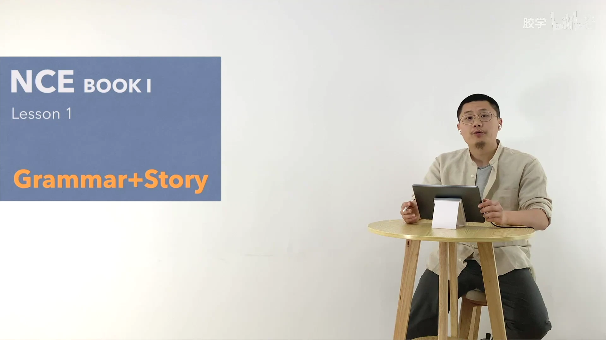

文字识别：胶学-H / NCE / BOOKI / Lesson 1 / Grammar+Story

### 画面 00:00:09

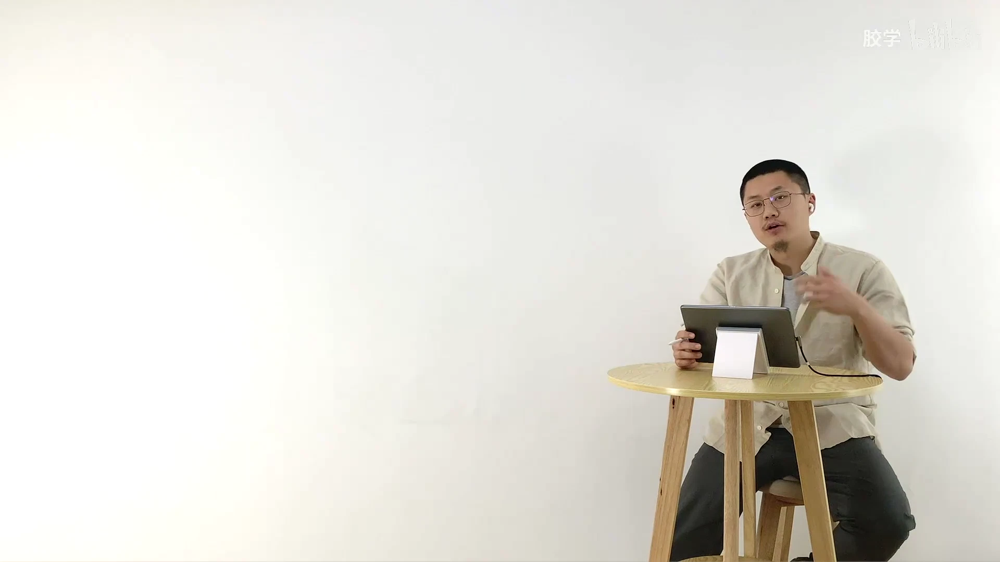

文字识别：胶学

### 画面 00:00:11

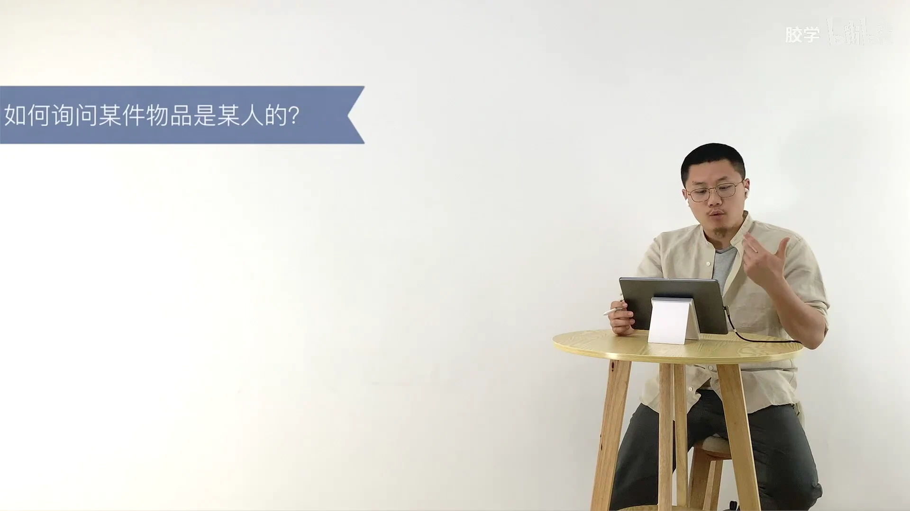

文字识别：胶学翻 / 如何询问某件物品是某人的?

### 画面 00:00:14

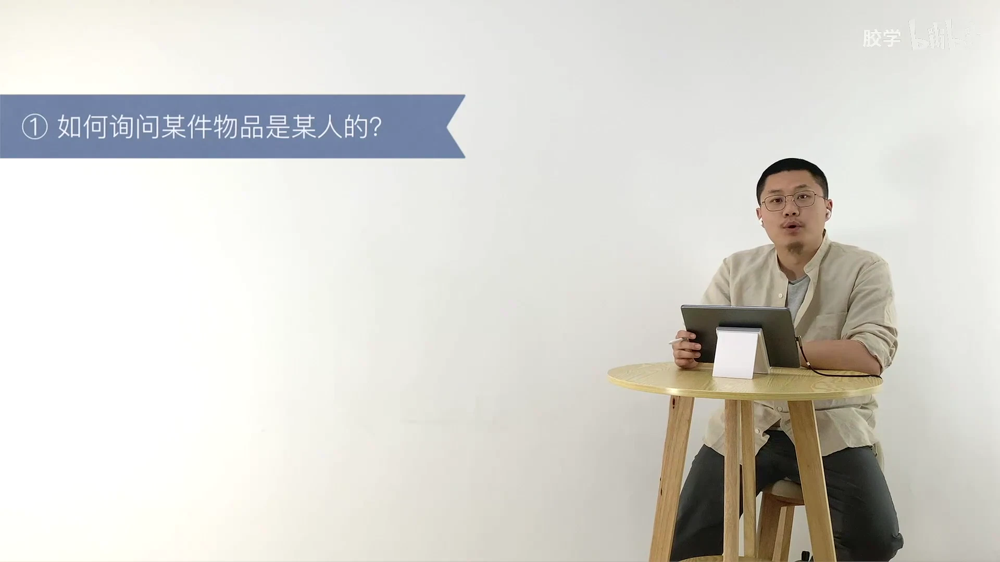

文字识别：胶学 / ① 如何询问某件物品是某人的？

### 画面 00:00:16

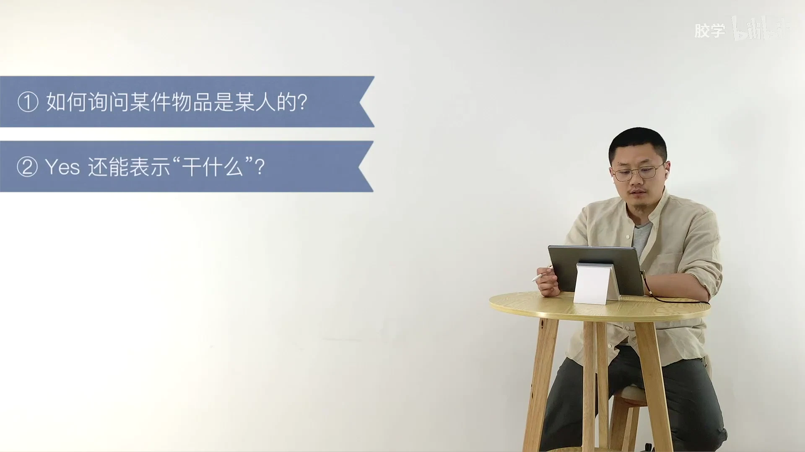

文字识别：胶学上州 / ① 如何询问某件物品是某人的？ / Yes还能表示“干什么”?

### 画面 00:00:19

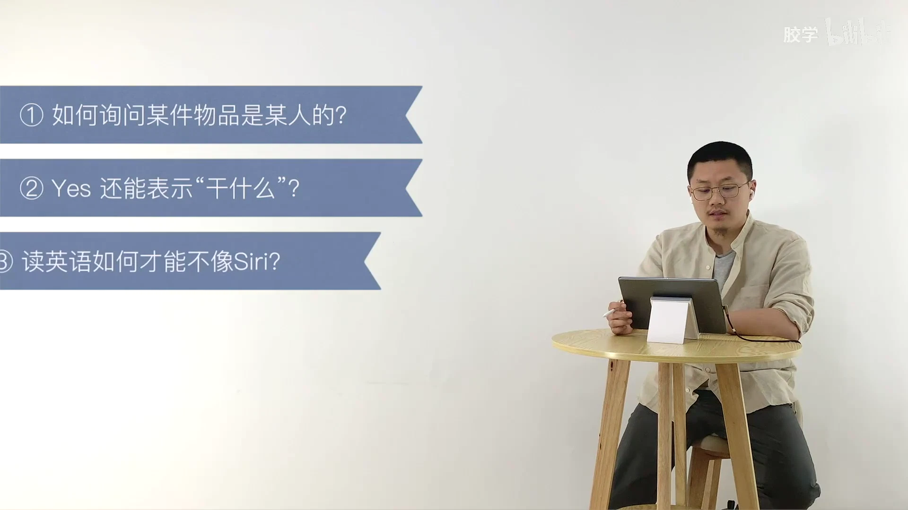

文字识别：胶学 / ① 如何询问某件物品是某人的？ / Yes还能表示“干什么”? / 读英语如何才能不像Siri?

### 画面 00:00:28

文字识别：胶学 b山 / •

## 00:00:30–00:01:00

那我们继续直接看文章。首先，Excuse me。上一节课我们讲过了，它的意思非常的简单。我们在打扰别人之前，一定要说这样一句话，叫做 Excuse me。好，那我们看图，实际上也是这名男士现在想引起另一名女士的注意，对吧？接下来我们看女士说了什么。哎，我们刚刚提的问题，现在就得到了一个解答，叫

### 画面 00:00:33

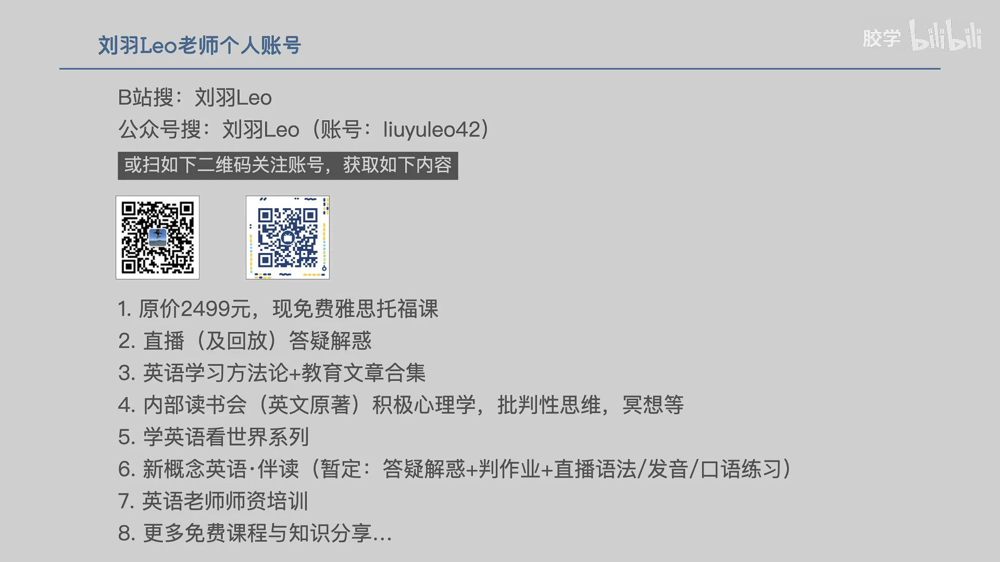

文字识别：胶学 b出 / 刘羽Leo老师个人账号 / B站搜：刘羽Leo / 公众号搜：刘羽Leo（账号：liuyuleo42) / 或扫如下二维码关注账号，获取如下内容 / 1.原价2499元，现免费雅思托福课 / 2.直播（及回放）答疑解惑 / 3.英语学习方法论+教育文章合集 / 4.内部读书会（英文原著）积极心理学，批判性思维，冥想等 / 5. 学英语看世界系列 / 6.新概念英语·伴读 (暂定：答疑解惑+判作业+直播语法/发音/口语练习) / 7.英语老师师资培训 / 8.更多免费课程与知识分享...

### 画面 00:00:38

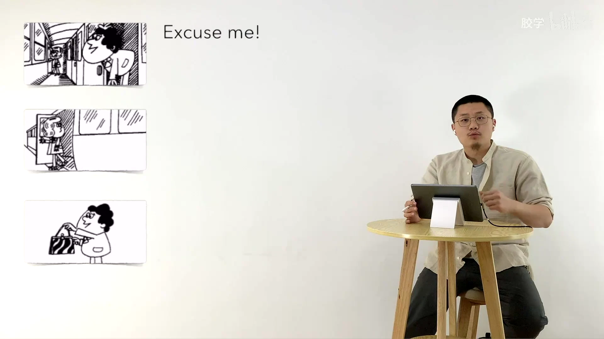

文字识别：胶学 / Excuse me! / 10

### 画面 00:00:51

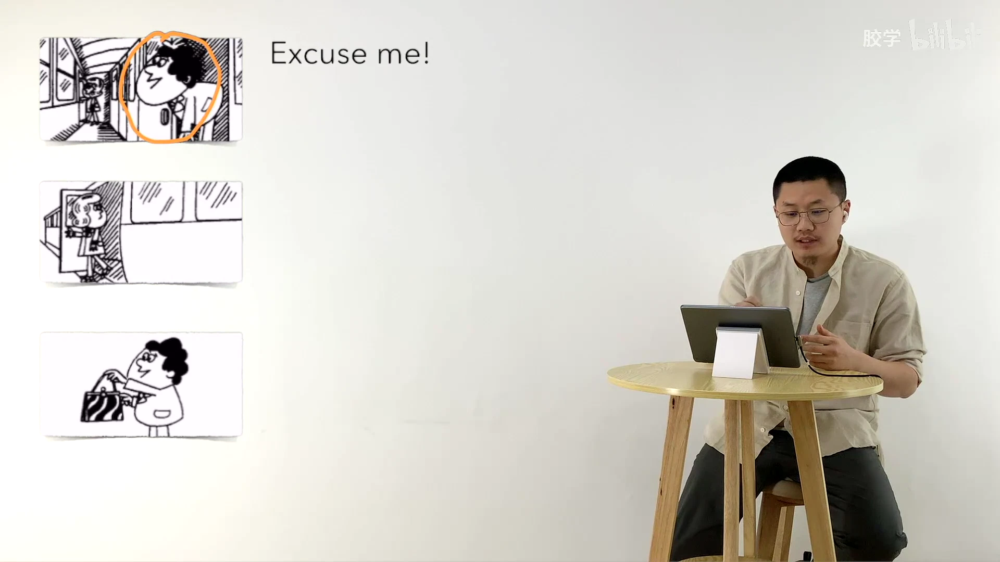

文字识别：胶学L / Excuse me!

### 画面 00:00:54

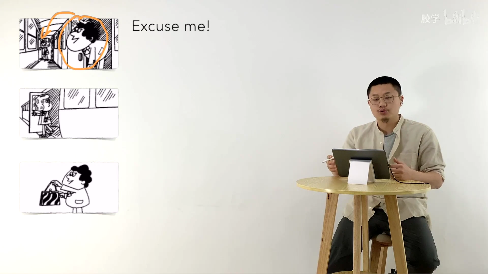

文字识别：胶学H / Excuse me!

## 00:01:00–00:01:30

做 yes。注意它声调不是下降，大家非常熟悉的是 yes 这个单词声调下降表示是，对吧？它现在是声调上扬表示干什么干嘛？Yes， OK， one more. 那我们看接下来这名男士拿着一个明显像女士手提包的东西在问他，问他的话肯定是这是你的包吗？对吧？那我们看他如何去问的，叫做 Is this your handbag？那我们回顾一下这几

### 画面 00:01:15

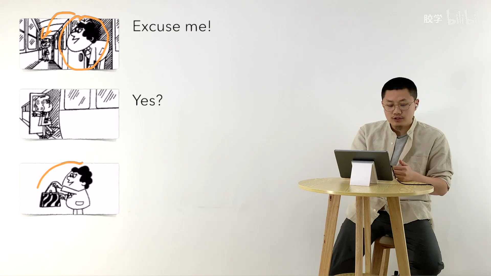

文字识别：胶学H / Excuse me! / Yes?

### 画面 00:01:17

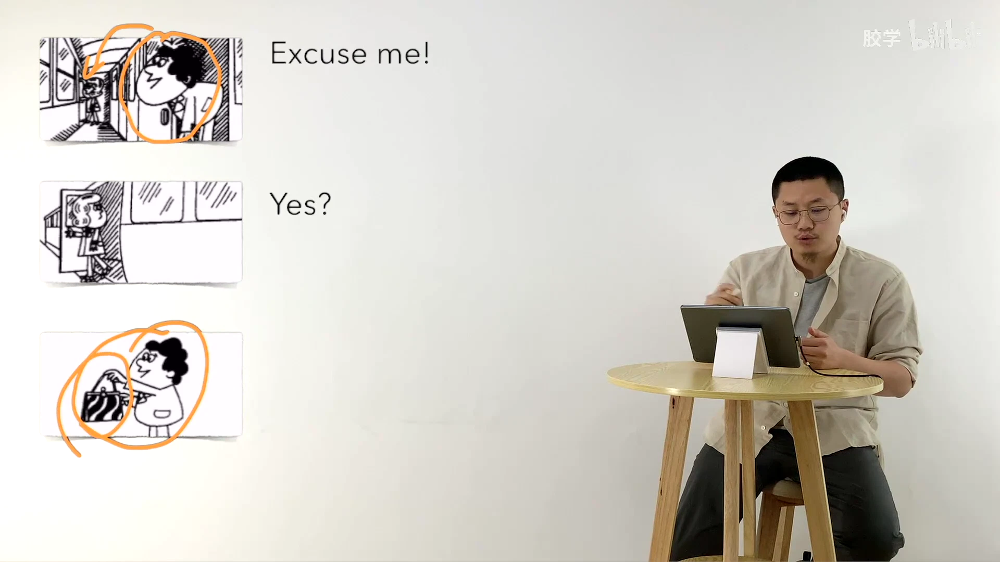

文字识别：胶学LH / Excuse me! / Yes?

## 00:01:30–00:02:00

个小单词啊。首先，this这个单词，我希望你还记得，我们在上一个视频刚刚讲过，叫做这。your呢，你的handbag，hand手bag包，对吧？手提包。那叫这是你的手提包吗？那这就出现了我们今天要学的一个非常重要的语法点，叫做一般疑问句。好，那首先呢，我们先来看一下肯定句。你会发现，其实英文的肯定句跟汉语的肯定句几乎是一一对应的。比如说，this

### 画面 00:01:37

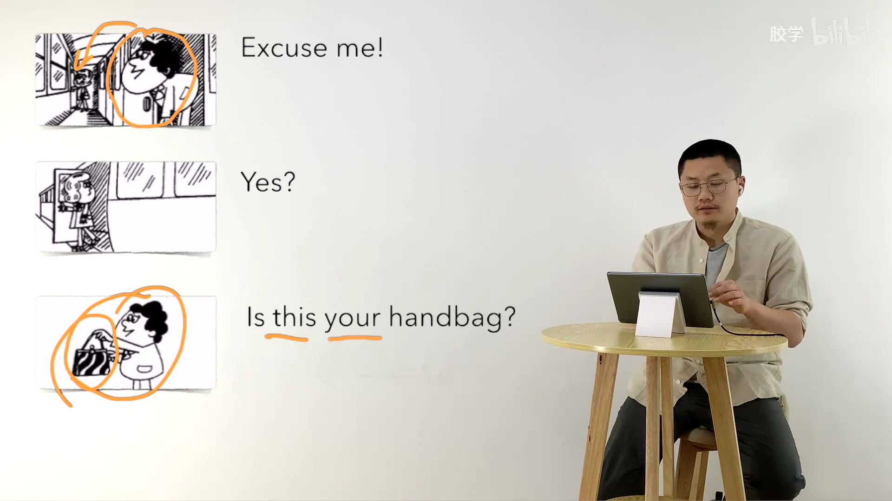

文字识别：胶学LH / Excuse me! / Yes? / Is this your handbag?

### 画面 00:01:40

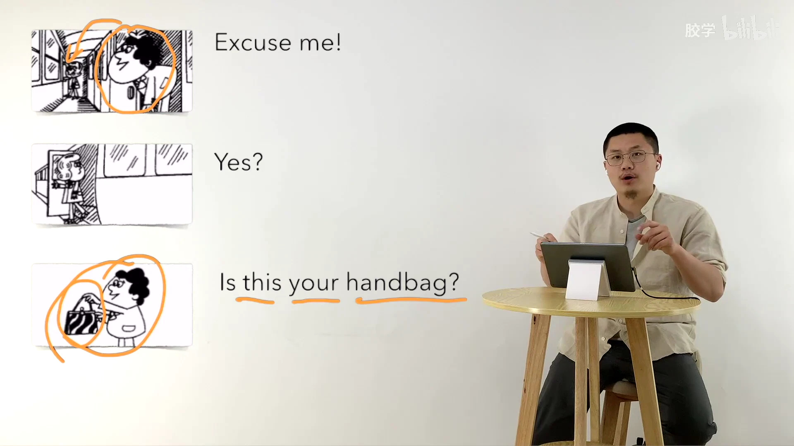

文字识别：胶学LH / Excuse me! / Yes? / Is this your handbag?

### 画面 00:01:44

文字识别：胶学 / 一般疑问句

## 00:02:00–00:02:30

这个单词，我们管它叫做这 is 这个单词不太严谨的，你可以先暂时把它翻译成叫做是 my 叫做我的 handbag 叫做手提包。那英文如何把它变成一般疑问句呢？这个汉语就不太一样了。你先想一下汉语啊，我们学英语是要借助于母语的啊。这个以后我们会给大家具体解释为什么。那我们现在先回想一下汉语，叫做这是我的手提包。如果我

### 画面 00:02:00

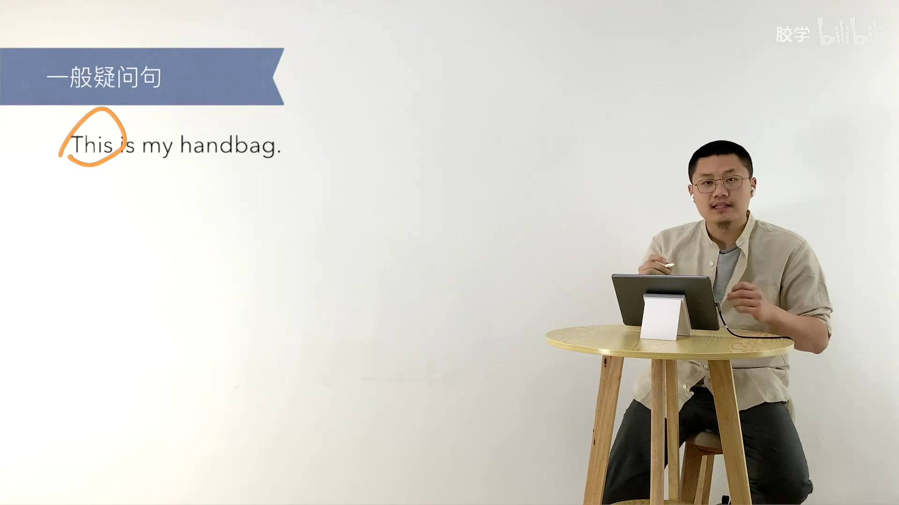

文字识别：胶学L / 一般疑问句 / This Is my handbag.

### 画面 00:02:05

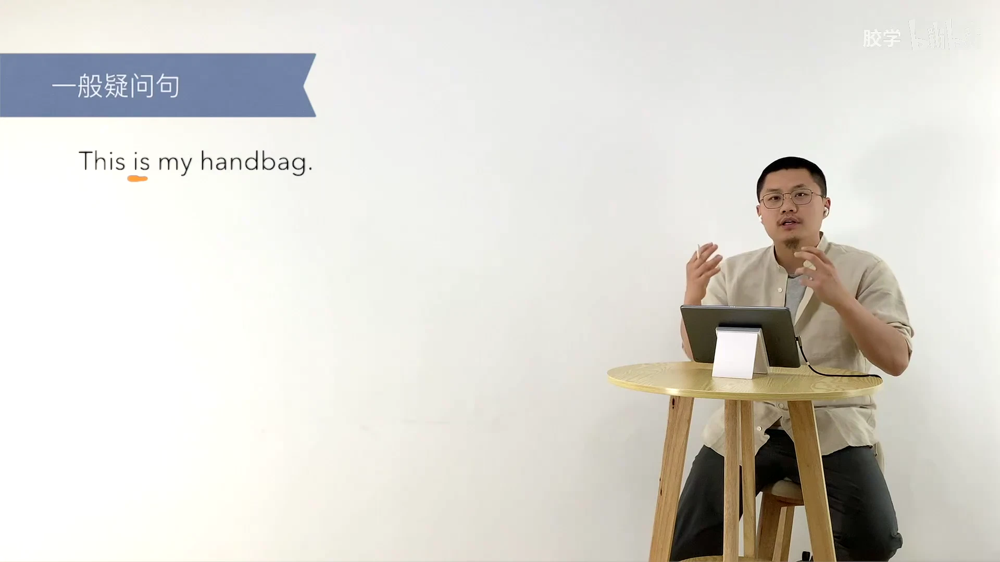

文字识别：胶学州 / 一般疑问句 / This is my handbag.

### 画面 00:02:11

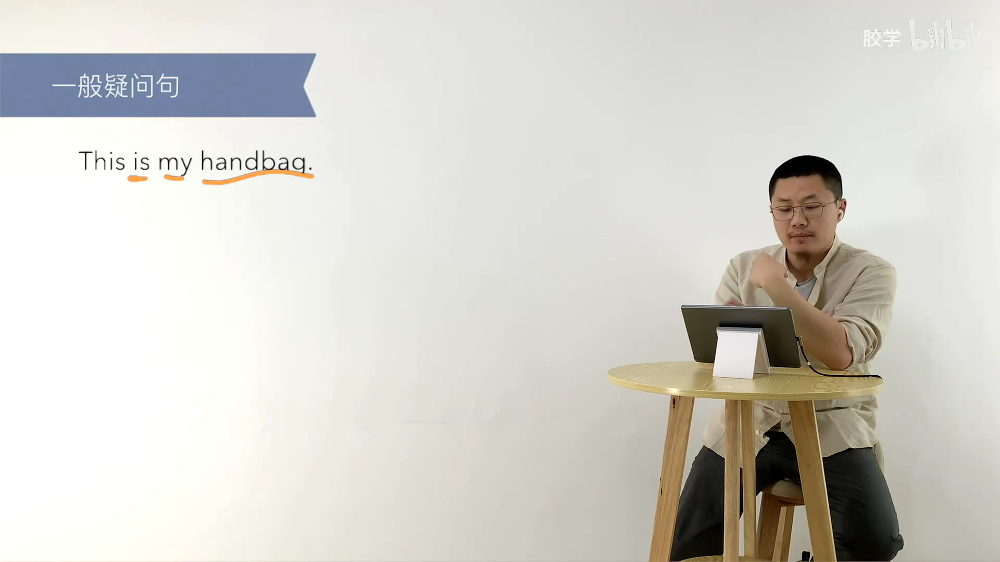

文字识别：胶学LH / 一般疑问句 / This is my handbag.

### 画面 00:02:14

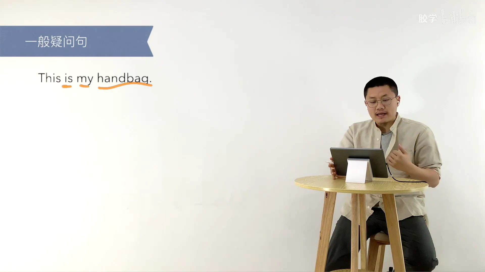

文字识别：胶学 / 一般疑问句 / This is my handbag.

### 画面 00:02:16

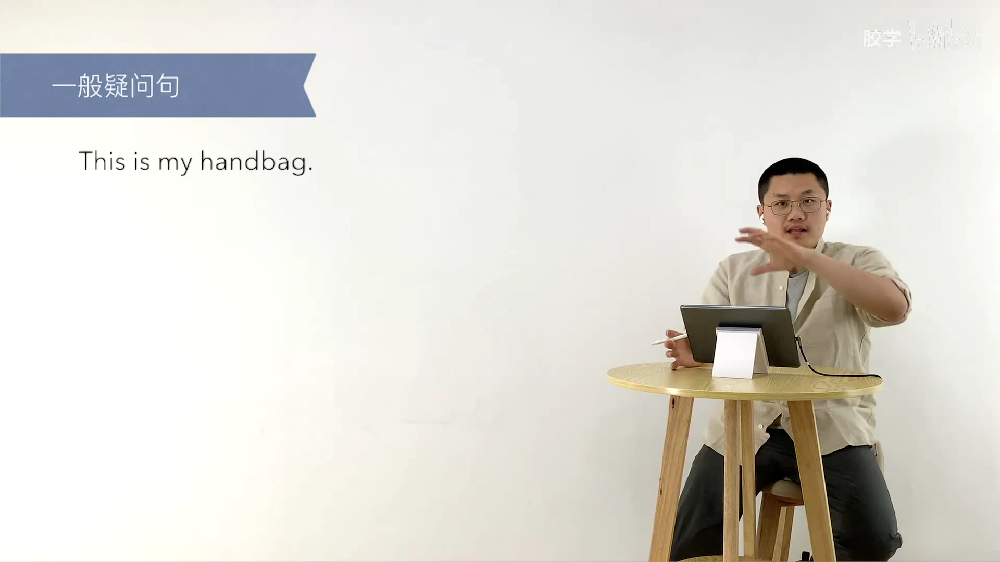

文字识别：胶学 / 一般疑问句 / This is my handbag.

### 画面 00:02:20

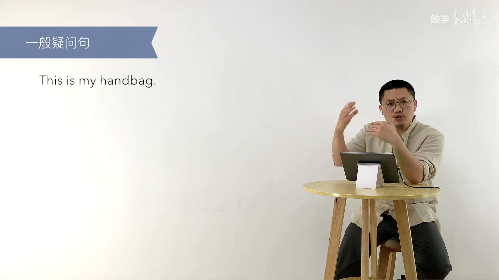

文字识别：胶学LM / 一般疑问句 / This is my handbag.

## 00:02:30–00:03:00

想把它变成一个一般疑问句或者疑问，那很简单，其实我们在后边加一个吗，声调上扬就可以了，叫做这是我的手提包吗？语序是不变的，发现了吗？而英文有一个非常重要的点，各位看好动画啊，我们一定要把一个单词提到句首。注意不要记住的是把 is 这个单词提到 is this 这个单词前面去，要记住的是把一个单词在这儿体

### 画面 00:02:30

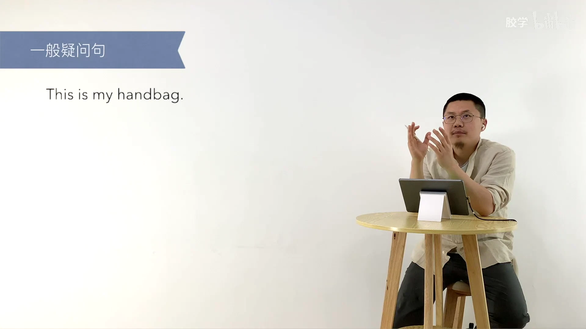

文字识别：胶学 / 一般疑问句 / This is my handbag.

### 画面 00:02:42

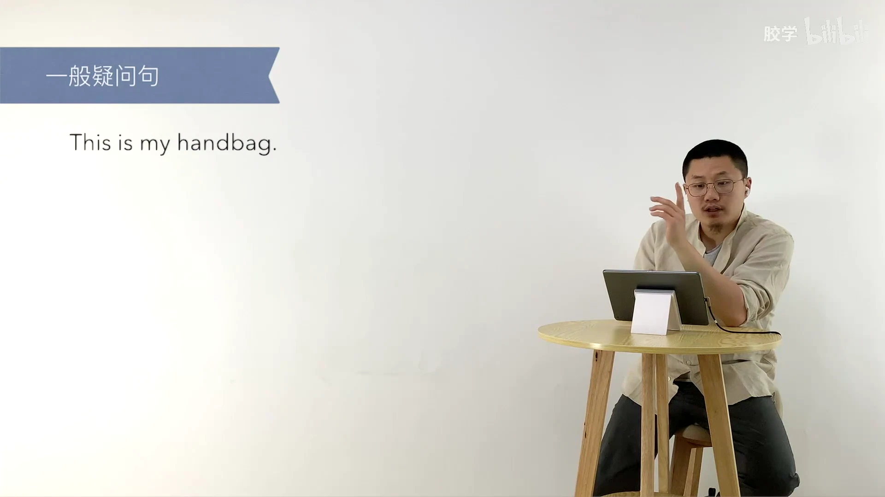

文字识别：胶学LH / 一般疑问句 / This is my handbag.

### 画面 00:02:48

文字识别：胶学LM / 一般疑问句 / This is my handbag.

### 画面 00:02:51

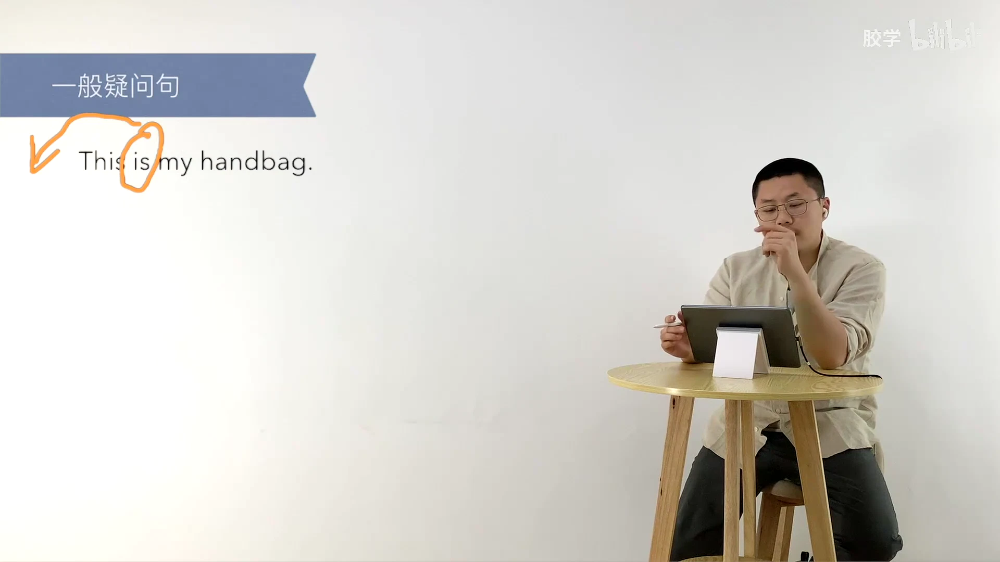

文字识别：胶学LH / 一般疑问句 / This is my handbag.

### 画面 00:02:54

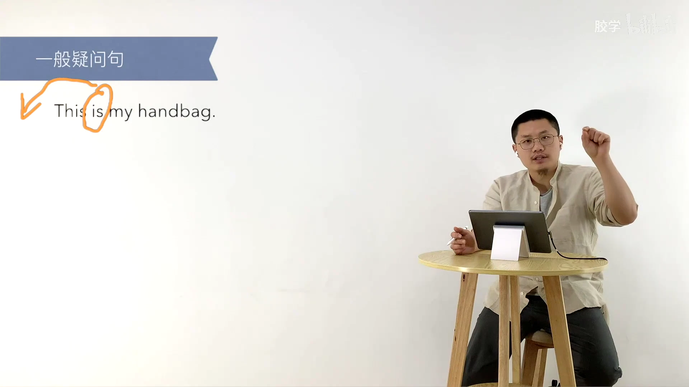

文字识别：胶学明 / 一般疑问句 / This is my handbag.

## 00:03:00–00:03:30

现的是 is 提到了句首，这很重要。为什么呢？以后你会发现，我们接着往下学的时候，有很英文当中有非常多的结构变一般疑问句的时候，都是把某一个单词提到了句首，好吧？那我们看叫做 Is this my handbag？那这句话的意思叫这是我的手提包吗？OK，首先这句话是没有问题的，但大多数的时候人是知道这东西是不是自己的，对吧？也不是说他没有使用的

### 画面 00:03:18

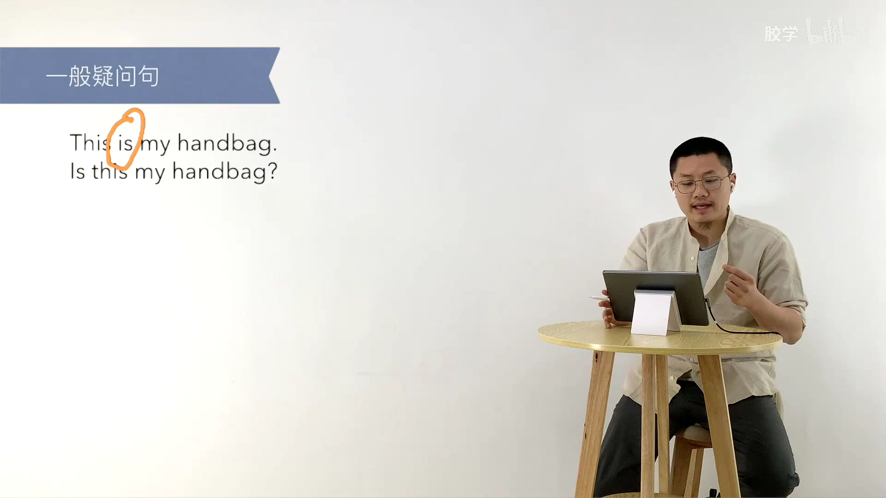

文字识别：胶学州 / 一般疑问句 / This is my handbag. / Is this my handbag?

### 画面 00:03:20

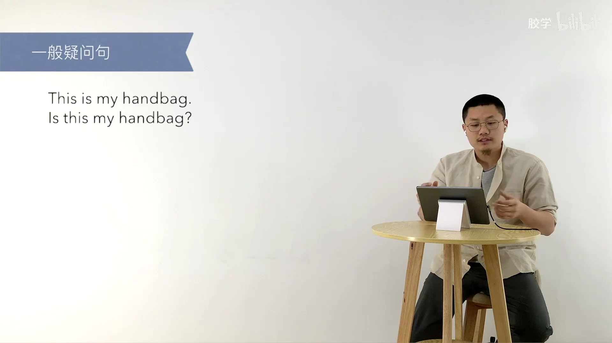

文字识别：胶学LH / 一般疑问句 / This is my handbag. / Is this my handbag?

## 00:03:30–00:04:00

情况，但频率会比较低。那我们可以尝试，比如说把 my 换成你的，叫做这是你的手提包吗？也就是刚才文中男士提到这句话，叫做 Is this your handbag？记住声调上扬表疑问。Is this your handbag？ Okay, very good。那我们看这个图，想跟大家说什么呢？非常简单的一个道理，如何判断它是不是一般疑问句呢？很简单，就是一个简

### 画面 00:03:45

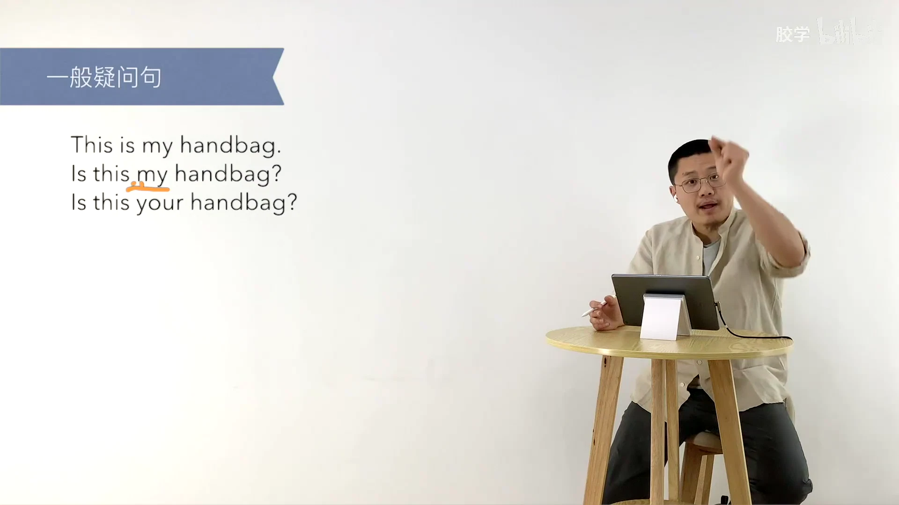

文字识别：胶学 / 一般疑问句 / This is my handbag. / Is this my handbag? / Is this your handbag?

### 画面 00:03:51

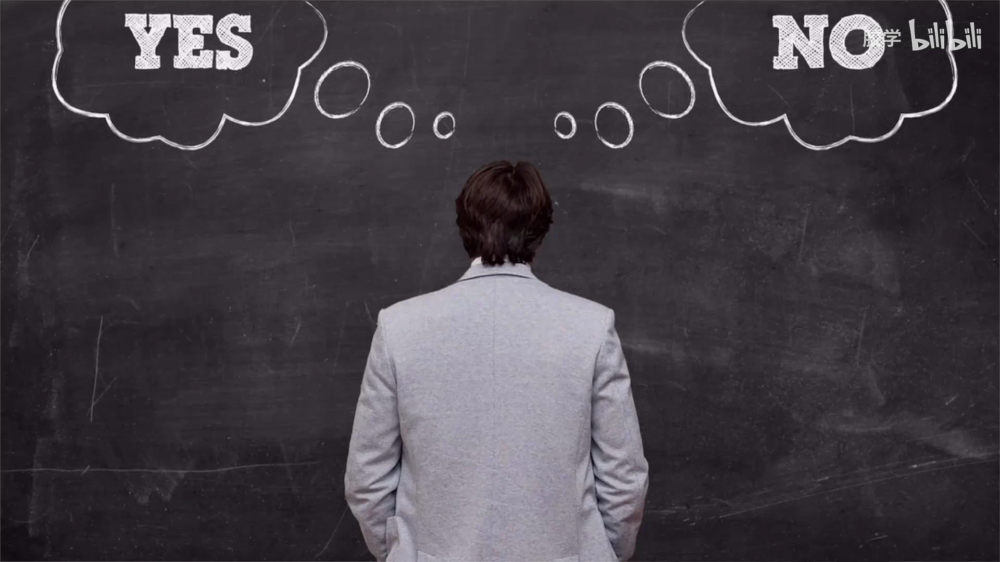

文字识别：YES / NOF blibli / O / 00

## 00:04:00–00:04:30

单的 yes or no。如果他的回答是 yes or no，可以去搞定的，那它往往就是一般疑问句。那它对应的是以后我们学到的叫特殊疑问句。那接下来我们一起看一下《老友记》第五季第十六集当中啊，有这样一句话叫 Excuse me, is this your car？我们一起来加深一遍这个语法的印象。 Excuse me, is this your car？

### 画面 00:04:11

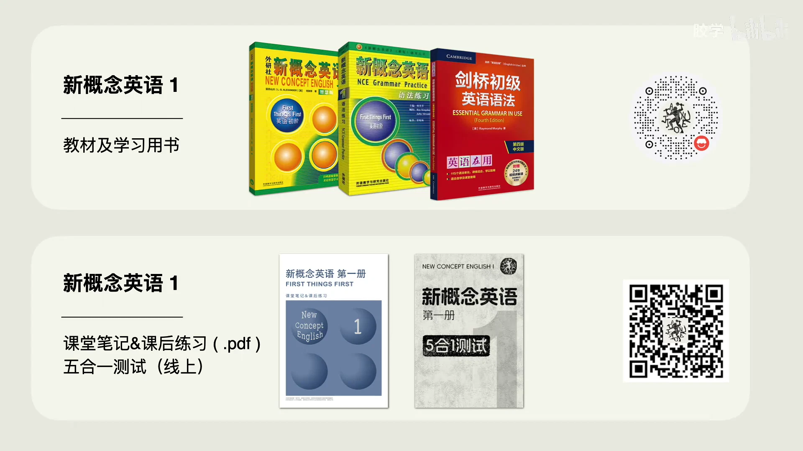

文字识别：胶学 / 外研社 / 新概念英证 / 新概念英语 / CAMBRIDGE / 剑桥初级 / 新概念英语1 / NEW CONCEPT ENGLISH / NCE Grammar Practice / S山文(LG.ALEXANDER)[网] / 智慧版 / 1 / 语法练习 / 英语语法 / First / 福法练习 / Things First / First Things First / ESSENTIAL GRAMMAR IN USE / 英语初阶 / (Fourth Edition) / 英语初阶 / [满]Raymond Murphy / 教材及学习用书 / 中文版 / 第四版 / 英语在用 / 外语教学与研究出版社 / 115个通法学元，请练结合，学以款用 / 24节 / 附赠 / NEW CONCEPT ENGLISHI / 新概念英语1 / 新概念英语 第一册 / FIRST THINGS FIRST / 新概念英语 / 课堂笔记&课后练习 / New / 第一册 / Concept / 课堂笔记&课后练习（.pdf) / English / 5合1测试 / 五合一测试 / (线上)

### 画面 00:04:16

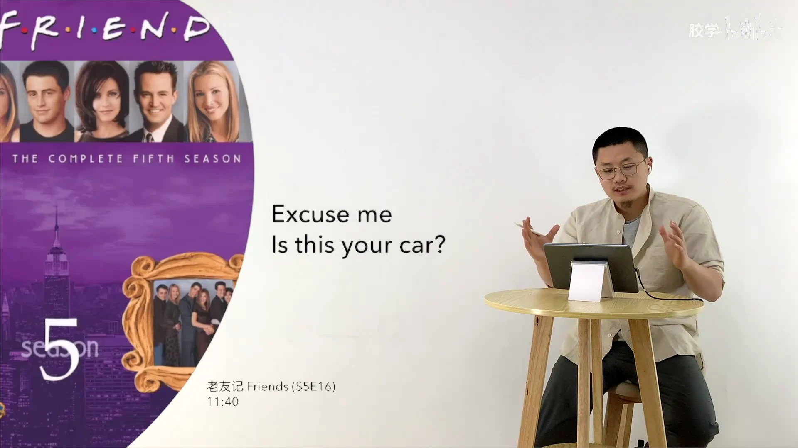

文字识别：F.R.I.E.N.D / 胶学 / THE COMPLETE FIFTH SEASON / Excuse me / Is this your car? / sepn / 老友记Friends(S5E16) / 11:40

### 画面 00:04:19

文字识别：F.R.I.E.N.D / 胶学 / THE COMPLETE FIFTH SEASON / Excuse me / Is this your car? / sebspn / 老友记Friends(S5E16) / 11:40

### 画面 00:04:21

文字识别：F.R.I.E.N.D / 胶学LiH / THE COMPLETE FIFTH SEASON / Excuse me / Is this your car? / sespn / 老友记Friends(S5E16) / 11:40

### 画面 00:04:25

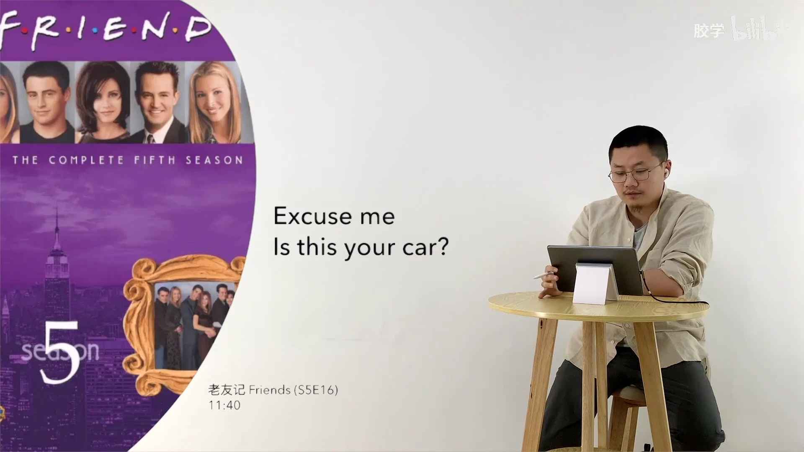

文字识别：F.R·I.E.N.D / 胶学LH / THE COMPLETE FIFTH SEASON / Excuse me / Is this your car? / 老友记Friends (S5E16) / 11:40

### 画面 00:04:27

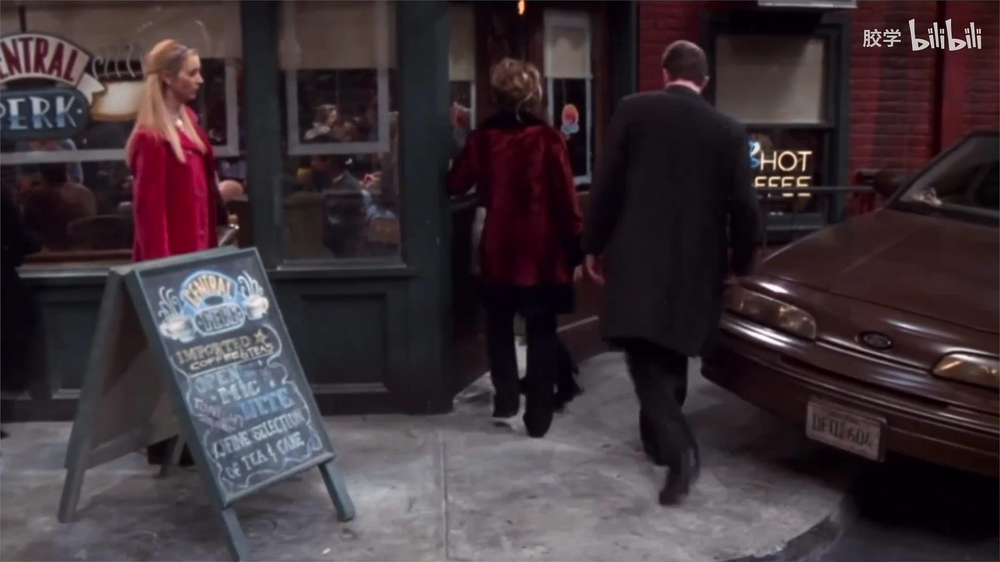

文字识别：bilibili / NTRALACA / 胶学 / IRK· / SHOT / CCCC / 八 / ANBANah / DFOI60A / ATNEGZLEC / CETEACAE

### 画面 00:04:29

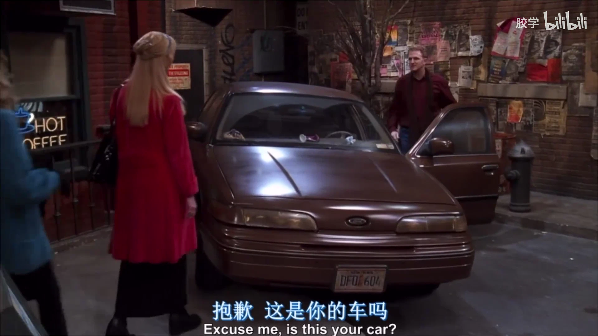

文字识别：胶学blibil / BHOT / OFFFF / DFOL604 / 抱歉这是你的车吗 / Excuse me, is this your car?

## 00:04:30–00:05:00

Yeah. Well, I don't think it's very nice of you to park here. You know, you're blocking the entrance. Okay, very good. Now we've watched the video. Now, you notice, ah, this lady in the picture, in France, we call her Vivie. Ah, very interesting girl. She says, says, excuse me, excuse me, is this your car? I don't think it's very nice of you to to park here. You're blocking the entrance, right? You park here, it's not good. Is this your car? Okay, very good. Okay, now we continue. Ah, a little bit.

### 画面 00:04:31

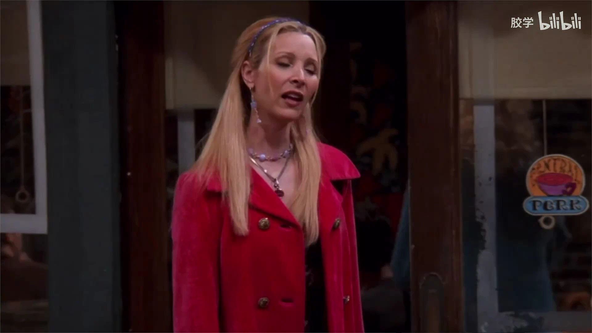

文字识别：Bilibili / 胶学 / PCRR

### 画面 00:04:33

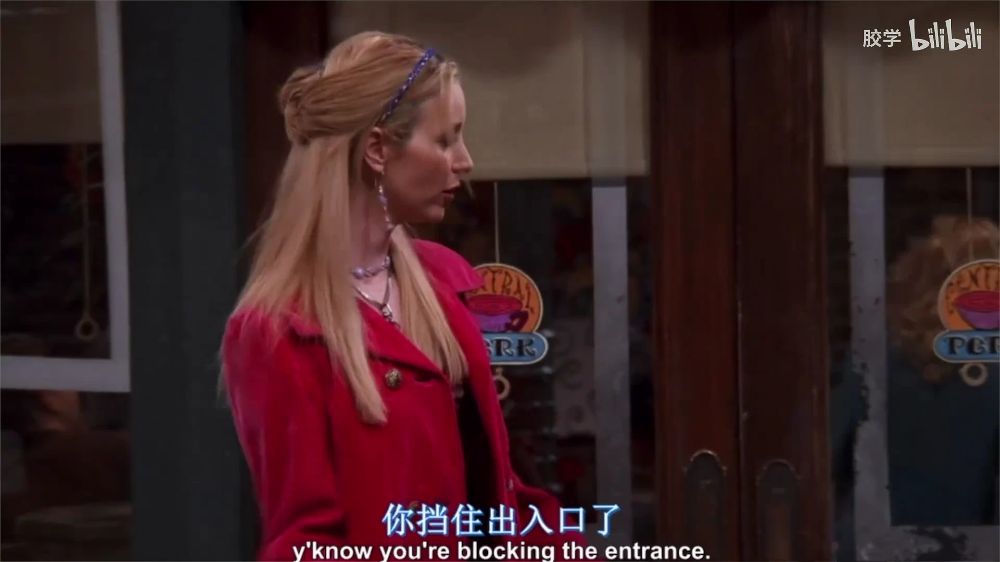

文字识别：bilbili / 胶学 / RR / PGI / 你挡住出入口了 / y'know you're blocking the entrance.

### 画面 00:04:35

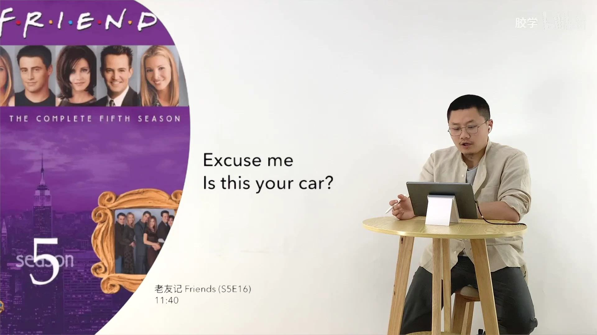

文字识别：F.R.I.E.N.D / 胶学 / THE COMPLETE FIFTH SEASON / Excuse me / Is this your car? / selspn / 老友记Friends(S5E16) / 11:40

### 画面 00:04:40

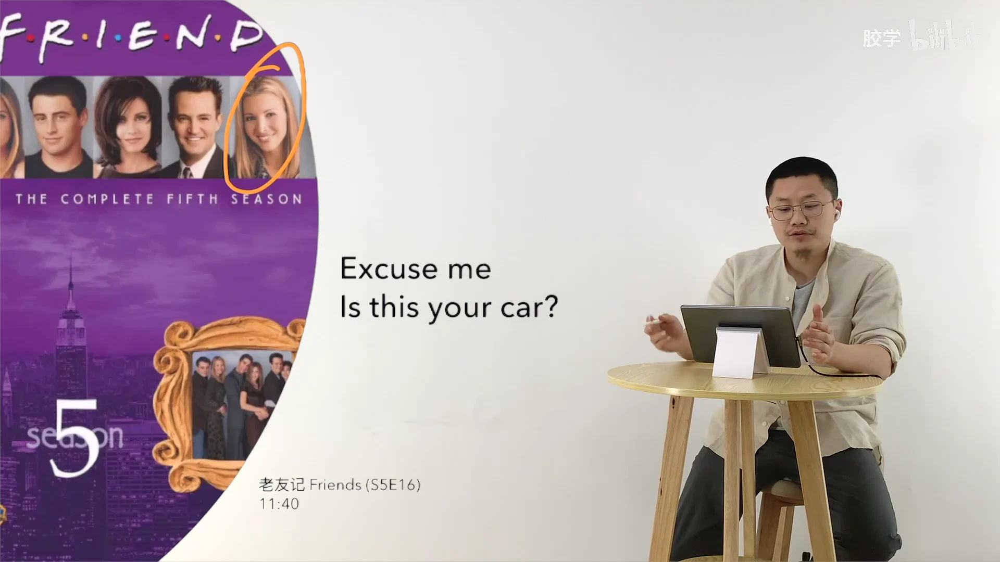

文字识别：F.R.I.E.N.D / 胶学0H / THE COMPLETE FIFTH SEASON / Excuse me / Is this your car? / selspn / 老友记Friends(S5E16) / 11:40

### 画面 00:04:45

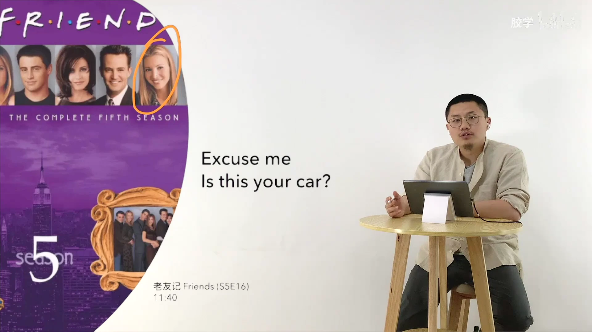

文字识别：F.R.I.E.N.D / 胶学 / THE COMPLETE FIFTH SEASON / Excuse me / Is this your car? / selspn / 老友记Friends(S5E16) / 11:40

### 画面 00:04:55

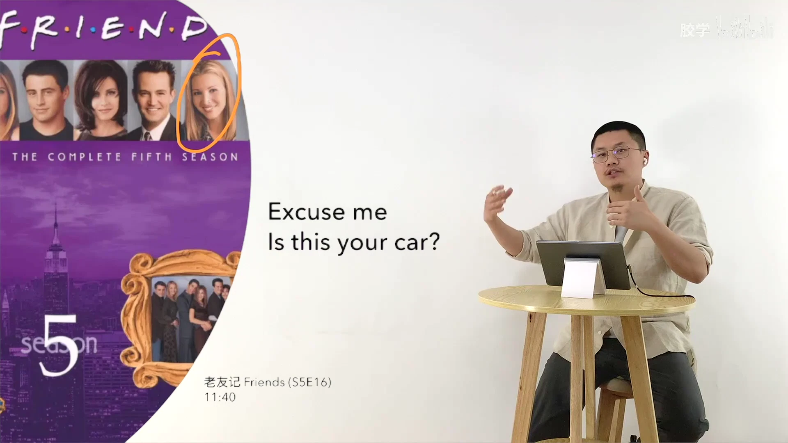

文字识别：F.R.I.E.N.D / 胶学 / THE COMPLETE FIFTH SEASON / Excuse me / Is this your car? / selspn / 老友记Friends(S5E16) / 11:40

### 画面 00:04:59

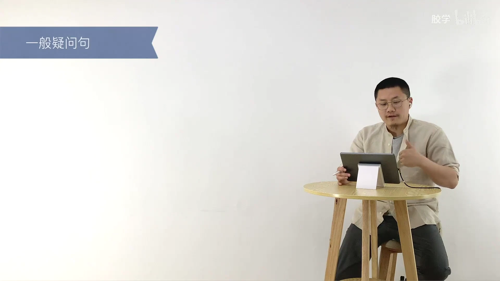

文字识别：胶学上州 / 一般疑问句

## 00:05:00–00:05:30

good.好，那我们继续啊，做一点点小很简单的练习。首先肯定句你要知道叫 this is my 点点点，你可以放一个名词，对吧？你比如说 this is my pen，啊 this is my pen 等等等等。好，比如说 this is my car，这叫这是我的车。那我们想变一般疑问句，很简单的一个动作叫做把 is 这个单词提到句首去，叫做 is this my car？那你想大多数情况下语境当中我们不会问这是我的

### 画面 00:05:23

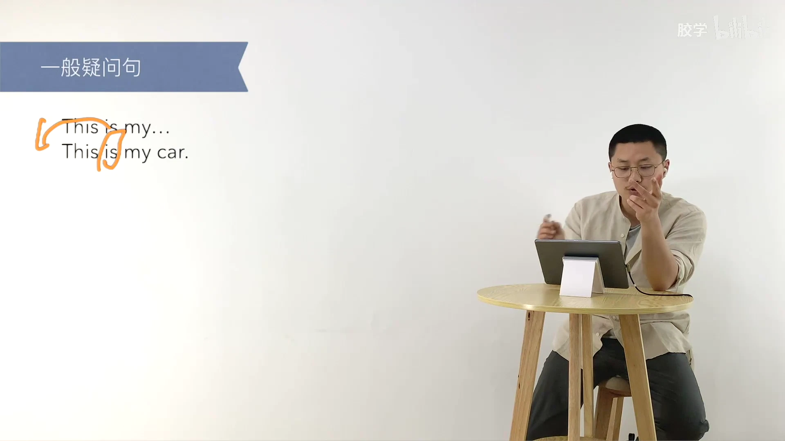

文字识别：胶学 / 一般疑问句 / V / This / smy... / This / my car.

## 00:05:30–00:06:00

车吗？你会问 Is this your car? Okay, 那我把这地方故意加重了一下。其实我们不需要 Is this your car? Okay, very good. 那同理 This is my house. 我们要做一个简单的变化，就是记住把 is 提到句首句首。 Okay, 所以叫 Is is this your house? 这是你的房子吗？那 This is my passport. Passport, 护照啊，这个以后我们很快就可以学到。如果您现在不会呢，也不用着急。

### 画面 00:05:36

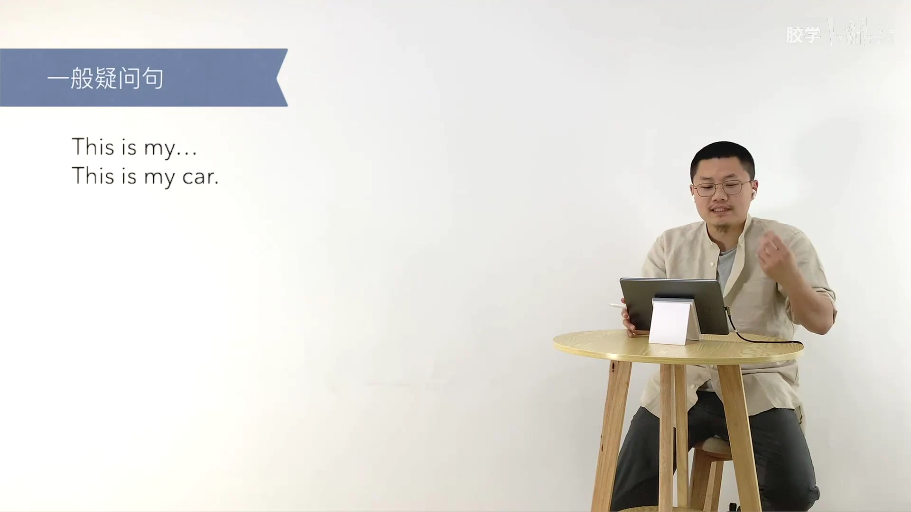

文字识别：胶学 / 一般疑问句 / This is my... / This is my car.

### 画面 00:05:46

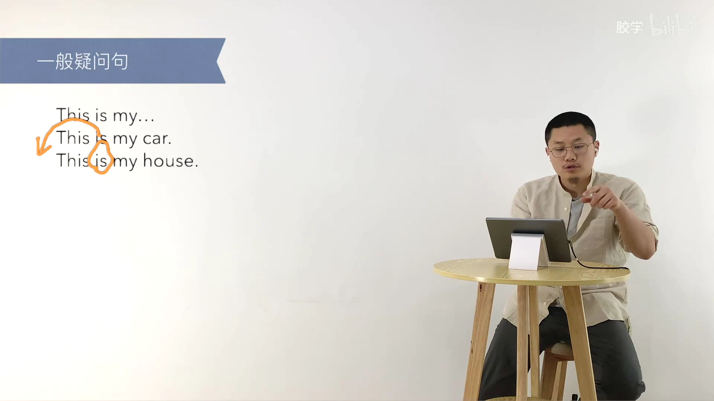

文字识别：胶学 / 一般疑问句 / This is my... / This / my car. / This / iS / my house.

## 00:06:00–00:06:30

那这是我的护照。你要做的事情很简单，把 is 提到句首，叫做 Is this your passport? Is this your passport? Is this your passport? 啊，这是你的护照吗？ Okay, very good. 那各位记住，肯定句我们目前为止学到的变一般疑问句，把 is 这个单词提到句首就可以了，非常简单。接下来我们看一个它的变体，在《阿甘正传》当中有这样一句话，他用的不是刚才我们学

### 画面 00:06:01

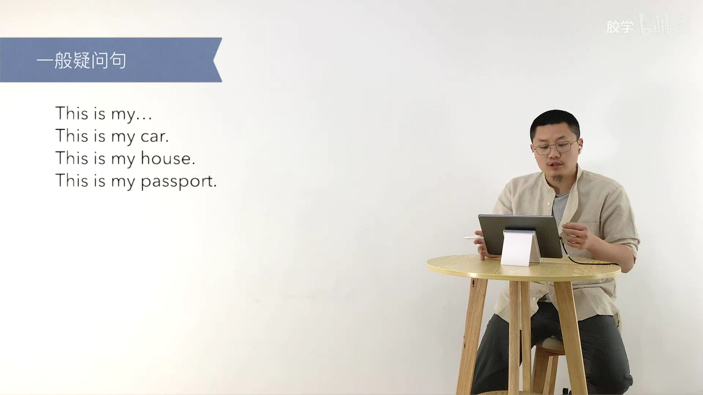

文字识别：胶学 / 一般疑问句 / This is my.. / This is my car. / This is my house. / This is my passport.

### 画面 00:06:05

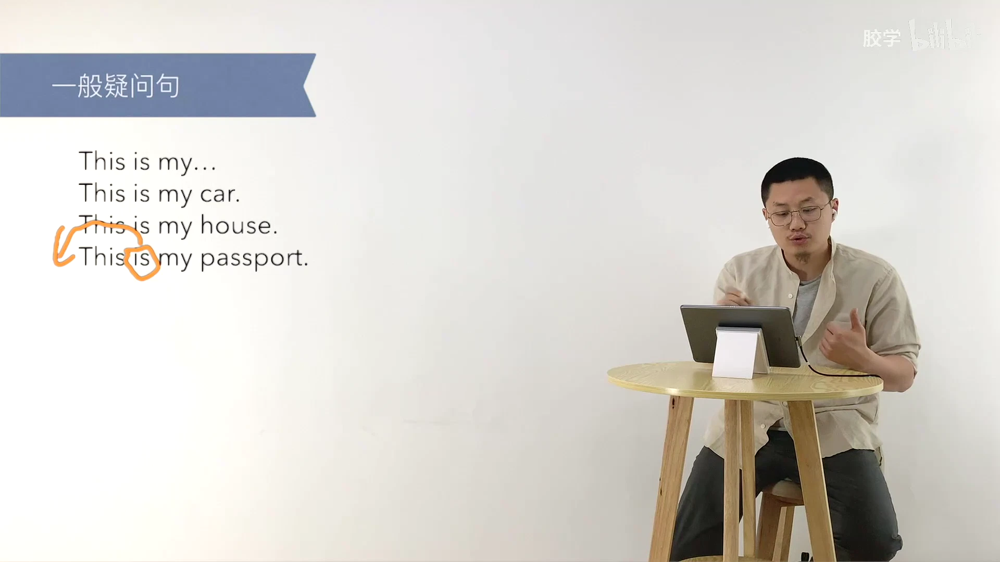

文字识别：胶学州 / 一般疑问句 / This is my.….. / This is my car. / This is my I / house. / ThisIs / my passport.

### 画面 00:06:16

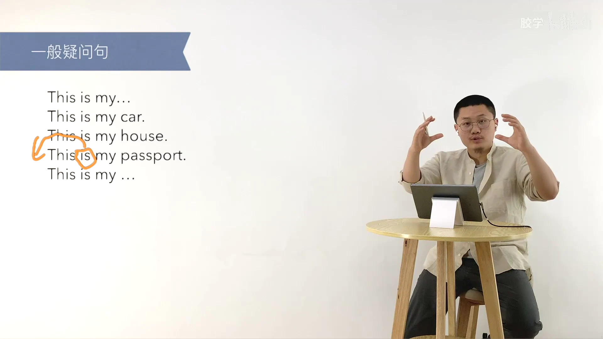

文字识别：胶学 / 一般疑问句 / This is my... / This is my car. / This is my / house. / ThisIs / my passport. / This is my

### 画面 00:06:22

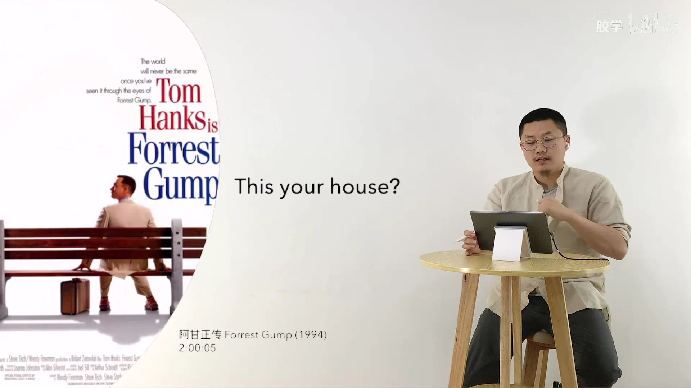

文字识别：胶学 / The wold / will never be the same / once youve / Tom / seen in through the eyes of / Forrest Gump / HankSis / Forrest / Gump / This / your / house? / 阿甘正传Forrest Gump(1994) / 2:00:05 / Wy F  /  Shd  S /  endy inen S Tiso See So

### 画面 00:06:25

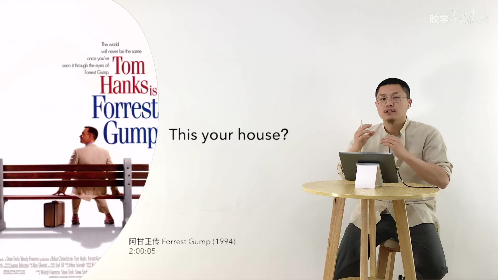

文字识别：胶学 / The wold / will never be the same / once youive / Tom / seen in through the eyes of / Forrest Gump. / HankSis / Forrest / Gump / This / your / house? / 阿甘正传Forrest Gump(1994) / 2:00:05 / S /  She  Sii /  Wendy Fnen Ste isch SmeS

## 00:06:30–00:07:00

到的标准语法，他用的是 This your house 来表示这是你的房子吗？这样的一个意思。我们一起来看这个视频。 This your house? Yeah, it's messy right now. I just got off work. It's nice. Okay, 那看过这个电影的同学可能比较熟悉啊。刚才这个男主就 Forrest Gump，汤姆汉克斯演的啊，非常有意思的一个角色，智商七十四，我没有记错的话，对吧？那他问 Jenny 说

### 画面 00:06:30

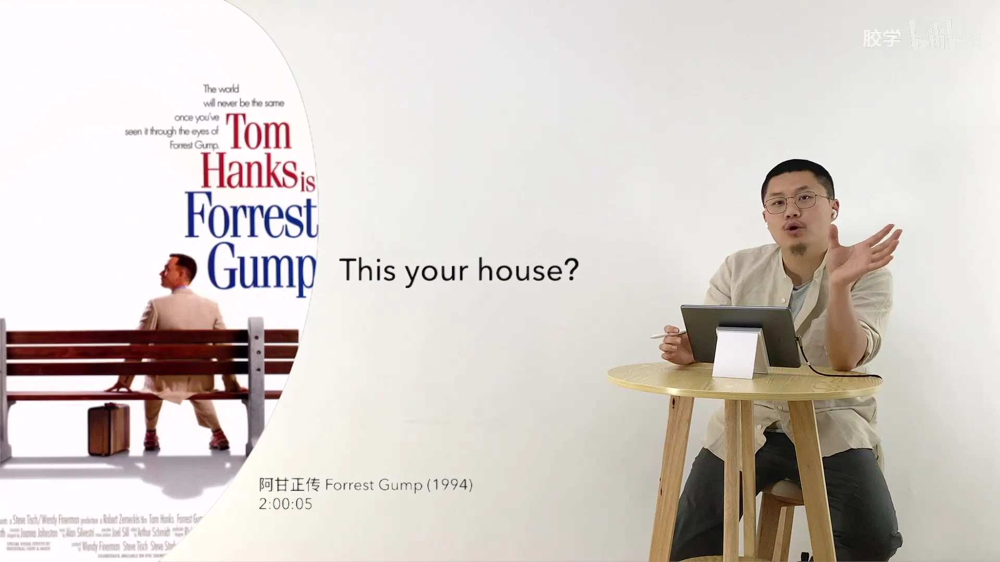

文字识别：胶学新 / The wold / will never be the some / once youve / Tom / seen i through the eyes of / Forrest Gump / HankSis / Forrest / Gump / This / s your / house? / 阿甘正传Forrest Gump(1994) / 2:00:05 / SteeFete Hs /  osn Se  Si / nty Fen Se iech Se S

### 画面 00:06:39

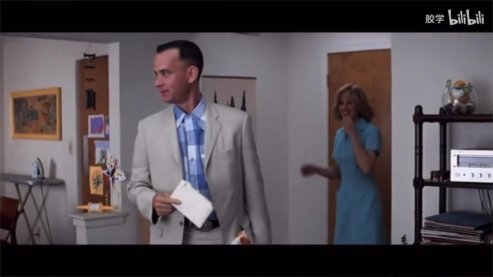

文字识别：胶学bibl

### 画面 00:06:41

文字识别：Bilibili / 胶学 / 对 / 现在很乱 / Yeah. It's messy right now.

### 画面 00:06:43

文字识别：Bilibili / 胶学 / 我刚下班回来 / Ijust got off work.

### 画面 00:06:45

文字识别：bilibili / 胶学 / 很好 / It's nice.

### 画面 00:06:47

文字识别：胶学 / The wold / will never be the some / once youve / Tom / seen in through the eyes of / Forrest Gump / HankSis / Forrest / Gump / This / your / house? / 阿甘正传Forrest Gump(1994) / 2:00:05 / Stee/ s  / edy Fre Sae Tocd SeS

### 画面 00:06:50

文字识别：胶学 / The wold / will never be the sme / once youive / Tom / seen it through the eyes of / Forrest Gump / HankSis / Forrest / Gump / This / your / house? / 阿甘正传Forrest Gump(1994) / 2:00:05 / sS  Si /  endy Fen Se isth SeS

### 画面 00:06:52

文字识别：胶学 / The wold / will never be the same / once youve / Tom / seen it through the eyes of / Forrest Gump / HankSis / Forrest / Gump / This your h / house? / 阿甘正传Forrest Gump(1994) / 2:00:05 / osS Si /  Wendy Fren Se Tich Se S

### 画面 00:06:57

文字识别：胶学 / The word / will never be the some / once youve / Tom / seen i through the eyesof / Forrest Gump / HankSis / Forrest / Gump / This / s your / house? / 阿甘正传Forrest Gump(1994) / 2:00:05 / Ste Fe s /  losA Sese S Smid / ndy Fen Se Ticd Se Sy

## 00:07:00–00:07:30

This your house? 就表达的其实和 Is this your house? 是一码事儿。那这个地方就出现了一个很有意思的现象，叫什么呢？我们标准的语法叫把 is 提前，叫 Is this your house? 啊，那在这地方我给的例句叫 Is this your handbag? Okay, 那我们顺着这个逻辑往下走，它等于什么呢？等于你可以拿着手提包说 Your handbag. 你想一下，我们是有 body language 的。什么叫 body language? Body language 就是你的面部表情啊，你的手势啊，对吧？你这

### 画面 00:07:05

文字识别：胶学期 / 一般疑问句

### 画面 00:07:23

文字识别：胶学州 / 一般疑问句 / Is this your handbag? / =Your handbag?

## 00:07:30–00:08:00

个比如说困惑的表情啊，你说话的语音语调啊，这些东西可以几乎统称为 body language，叫肢体语言。那你拿着一个包向别人问说 your handbag，那别人肯定能明白吧？你想问他的这是你手提包吗？对吧？那它还等于什么呢？等于刚才文章当中出现的这种说法叫 this this your handbag。 OK，有一个。那它甚至还可以怎么样呢？很夸张的是，刚才我们说了这叫肯定句，对不对？叫 this is your handbag。它甚至还可以说叫

### 画面 00:07:53

文字识别：胶学 / 一般疑问句 / Is this your handbag? / =Your handbag? / =This your handbag? / =This is your handbag?

## 00:08:00–00:08:30

做 This is your handbag. 非常简单，就是把 handbag 这个单词声调上扬就可以了。那为什么还要花时间学语法呢？哎，这是一个很好的问题啊，Berlin。那我们如何去解释它呢？其实很简单，对吧？你看，对于大部分同学来说，你会理解为，那既然这样可以，我为什么要学标准语法？哎，很简单解释它，原因是随着语法变得越来越难，你想表达的东西越来越复杂，标准语法会有一个好

### 画面 00:08:16

文字识别：胶学州 / 一般疑问句 / le this your handbag? / =Your / handbag? / =This / your handbag? / =This /  is your handbag

### 画面 00:08:21

文字识别：胶学 / 一般疑问句 / le this vour handbag? / =Your / handbag? / =This / your handbag? / =This /  is your handbag

## 00:08:30–00:09:00

处，叫做减少歧义。要记住各位这一个点就行了。所以这是目前我给大家提供的其为什么要学语法的原因之一。那以后我会专门给大家录一个视频啊，看没有情况或者说打三到课程当中去，给大家一一解释为什么我们要系统性的去学习语法。Okay, very good.那接下来我们继续看文章，说Pardon.好，这个女士没听清，对吧？她说了一下Pardon.那回顾一下上节课，我说我在新西兰的时候还用到的叫做Sorry, what?

### 画面 00:08:49

文字识别：胶学州 / Pardon?

## 00:09:00–00:09:30

Come again? 表示的意思是一样的，对不对？我们接下来看男士，那肯定还是问一遍嘛。叫做你跟我们一起回想怎么说来着？把一个单词提到句首去，叫做 Is this your handbag? 对吧？他又问了一遍。那他说是，叫我们 Yes, it is. Yes，很好理解。It，我们上节课学了，宝贝儿哈，用 it，对吧？那你手提包当然是宝贝儿了。It is，叫哎，是的，

### 画面 00:09:19

文字识别：胶学 / Pardon? / Is this your handbag? / Yes, it is.

### 画面 00:09:29

文字识别：胶学H / Pardon? / Is this your handbag? / Yes, it is.

## 00:09:30–00:10:00

它是。其实这句话还省略了，叫It is my handbag。但大多数时候我们简略回答就行了。Yes, it is。甚至你不需要说Yes, it is，你直接说Yes，紧连着一句叫做Thank you就可以了。那这个地方他用了一个比较正式的说法，叫Thank you very much，对吧？就表达很强烈的一种感谢，并且你这是陌生人嘛，对吧？所以你说Thank you very much。但大部分情况下，上节课我们讲过了，说Thank you足以。那这个地方呢，各位要注意一件

### 画面 00:09:59

文字识别：胶学 / Pardon? / Is this your handbag? / Yes, it is. / Thank you very much. / 跟读

## 00:10:00–00:10:30

事情，要进行跟读训练，一定要进行跟读训练。跟读训练是什么？怎么做啊？为什么要这样去做？我们在开篇的时候专门给大家去录了这样一个视频，对吧？呃，如何使用新概念？简单来说，跟读的方法就是文章当中的音频读一句，您模仿读一句。我刚才第三个问题是如何读才能不像 Siri 记得吗？Siri 读的时候，读英语英语的时候呢，它会有一种机器的感

### 画面 00:10:29

文字识别：胶学册 / Pardon? / Is this your handbag? / Yes, it is. / Thank you very much. / 跟读

## 00:10:30–00:11:00

觉。你为什么会觉得它有机器的感觉呢？很简单，它没有很明显的抑扬顿挫、声调或降调。你去进行跟读模仿的时候，不要自己去读，不要自己 paden。 Yes, it is. I'm glad. Yes, it is. Thank you very much. 那你这就像什么了呢？就像 Siri 了，对吧？那 Siri 可能读的都比你好听。你一定要记住去模仿，除了它的发音，就是它这个音是读 paden，你别读成 baden，对吧？其次，你还要模仿的就是它的抑扬顿挫和声调降调。所以，

### 画面 00:10:59

文字识别：胶学 / Pardon? / Is this your handbag? / Yes, it is. / Thank you very much. / 跟读

## 00:11:00–00:11:30

这是跟读的重要性，千万不要忘了，以后所有文章都要这样去做。那我们回到这三个问题，第一，如何询问某件物品是某人的吗？一般疑问句，今天最重点的语法。第二， yes 还能表示干什么？一定要记住声调上扬， yes， OK。第三，读英语如何才能不像 Siri 呢？跟读，对不对？ OK，二一个，那我们 recap， let's recap，复习一下今天学到的东西。一般疑问句及肯定回答， is this your？这个地方练习，马上

### 画面 00:11:02

文字识别：胶学州 / ① 如何询问某件物品是某人的? / ②Yes还能表示“干什么”? / 读英语如何才能不像Siri?

### 画面 00:11:20

文字识别：胶学 / Recap / Patterns / 一般疑问句及肯定回答 / Is this your..? / Grammar / Yes, it is. / Words / Yes? / Excuse me / Expression / Pardon? / Thank you very(so) much

## 00:11:30–00:12:00

们下一个视频当中就会带着大家去进行练习啊，以及为什么要练习，我们在别的视频当中给大家具体的解释过。那很简单，把 is 这个单词提到句首去，这是今天的关键点。那肯定会答叫 Yes, it is. 或者是 Yes, 就 OK 了。继续呢，单词在这个地方，一个很简单的单词 Yes，什么叫上扬，表示疑问，对吧？干嘛？接下来 expression 都是我们上节课学过的，Excuse me, pardon, Thank you very much，或者 Thank you

### 画面 00:11:50

文字识别：胶学附 / Recap / Patterns / 一般疑问句及肯定回答 / Is this your...? / Grammar / Yes, it is. / Words / Yes? / Excuse me / Expression / Pardon? / Thank you very(so) much

## 00:12:00–00:12:30

so much. Okay, very good.那今天我们的家庭作业来一起看一下。首先呢，第一绿皮书第一节课的所有写作训练大家就要完成了。那绿皮书如果现在没有看过开篇词的同学呢，现在就可以去看一下，知道什么是绿皮书，以及为什么要写绿皮书，以及如何去写绿皮书。关于What外号的问题，在那个视频当中都有体现。第一个作业你一定要写。第二个作业叫文章要进行跟读，或者说我们所谓的叫泡耳朵，对吧？就是反复的听，至熟

### 画面 00:12:02

文字识别：胶学

## 00:12:30–00:13:00

读成诵。如何去进行跟读？为什么要进行跟读？以及如何啊呃跟读到底是什么？对吧？我们在开篇词当中也提到了，和绿皮书是在一个视频当中，你去看就可以了。这两个作业几乎是我们以后天天每一课啊每一个有文章的课程都要反复进行训练的作业。那第三个呢，叫给自己讲解一遍。关上视频了之后啊，我们给自己讲解一遍今天的核心语法、核心知识点，对吧？甚至讲，甚至尝试去回忆一遍文章。

### 画面 00:12:32

文字识别：胶学 / 绿皮书第一课的写作练习 / 文章跟读/泡耳朵至熟读成 / 诵

## 00:13:00–00:13:30

这个是基于什么呢？这是基于心理学当中一个东西叫做 learning pyramid，你也可以理解为是心理学与教育学的交叉学科。这我在新西兰学的就是这种东西，对吧？所以我比较了解。来给大家介绍一个东西叫 learning pyramid，叫学习金字塔。我们在呃下方的视频当中给大家做一个链接，各位可以去看这个视频，它为什么要去哎你要去给自己讲解一遍，对吧？这个叫做呃学习金字塔的重要性，也就是说你要给自己再讲解一遍啊。OK，

### 画面 00:13:02

文字识别：胶学 / 绿皮书第一课的写作练习 / 2.文章跟读/泡耳朵至熟读成 / 诵 / 3.请给自己讲解一遍今天的 / 核心语法+知识点。参考 / learning puramid（学习金字 / 塔）

## 00:13:30–00:14:00

那如果您喜欢我们的课程呢，欢迎大家呃订阅啊，并一键三连支持我们。当然，如果您身边有需要学心理或者正在学心理的朋友呢，也请分享给他们。那最后呢，我们再来看一句名人名言。If somebody offers you an amazing opportunity, but you're not sure you can do it, say yes. Then learn how to do it later. OK. Goodbye.

### 画面 00:13:30

文字识别：胶学

### 画面 00:13:41

文字识别：胶学期 / "If somebody offers you an amazing / opportunity but you are not sure you can do / it, say yes - then learn how to do it later!" / Richard Branson

### 画面 00:13:56

文字识别："f somebody offers you an amazing / opportunity but you are not sure you can do / it, say yes - then learn how to do it later!" / Richard Branson

### 画面 00:13:58

文字识别：CAPSULEACADEMY / 胶囊学院 / 小红书 / Lecturer / Leo / OE

## 00:14:00–00:14:09

### 画面 00:14:01

文字识别：CAPSULEACADEMY / 胶囊学院 / 小红书 / Photographer / Berlin / OE

### 画面 00:14:03

文字识别：CAPSULEACADEMY / 胶囊学院 / 小红书 / Editor / Berlin / OE

### 画面 00:14:06

文字识别：CAPSULEACADEMY / 胶囊学院 / 小红书 / OE

### 画面 00:14:08

文字识别：Bilibli / 胶学

