# 003 语法 文章

快速机器解析：语音为单模型转写，未进行独立交叉校对或人工复核；画面每秒采样并按变化选帧，短时文字和标记可能遗漏。截图时间约有 1 秒误差。图片有损压缩；遇到疑点请按时间查看 Google Drive 原视频。

## 00:00:00–00:00:30

Hello everyone, welcome to Capsule Academy. This is Liu. Today we're going to learn New Concept English Book One Lesson Three Grammar and Story. 那老习惯，进入正式课程之前呢，我们先提出三个问题，带着三个问题各位进入正式的课程。第一，如何表达这不是我的？第二，如何表达送给你我的外套啊，给你我的外套？第三，英文的缩写长成什么样子？那带着这三个问题， hope you really enjoy it.

### 画面 00:00:00

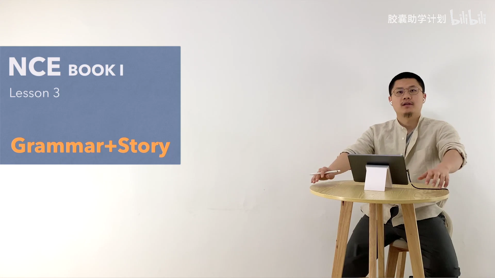

文字识别：Bitbii / 胶囊助学计划 / NCE / BOOKI / Lesson 3 / Grammar+Story

### 画面 00:00:09

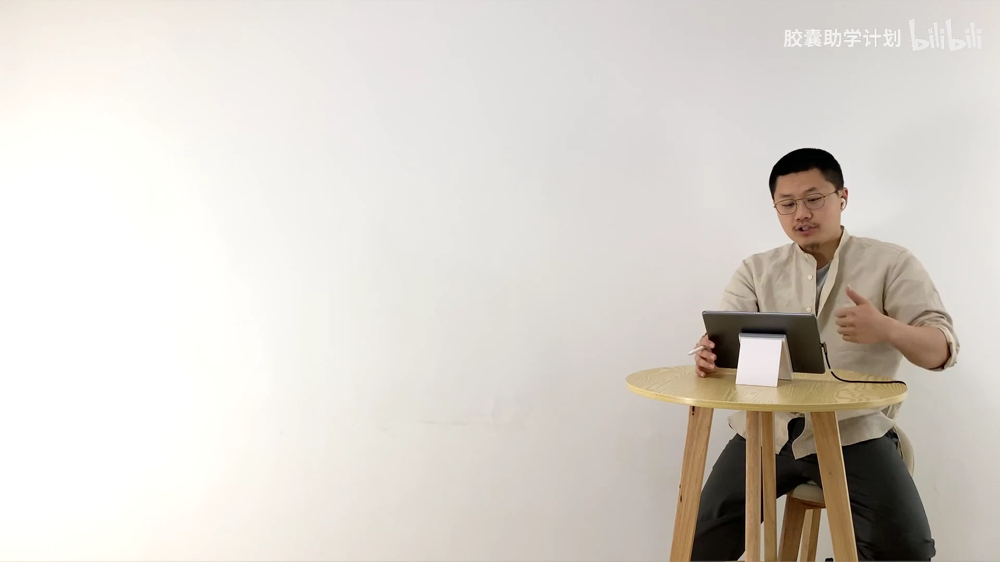

文字识别：胶囊助学计划l出

### 画面 00:00:11

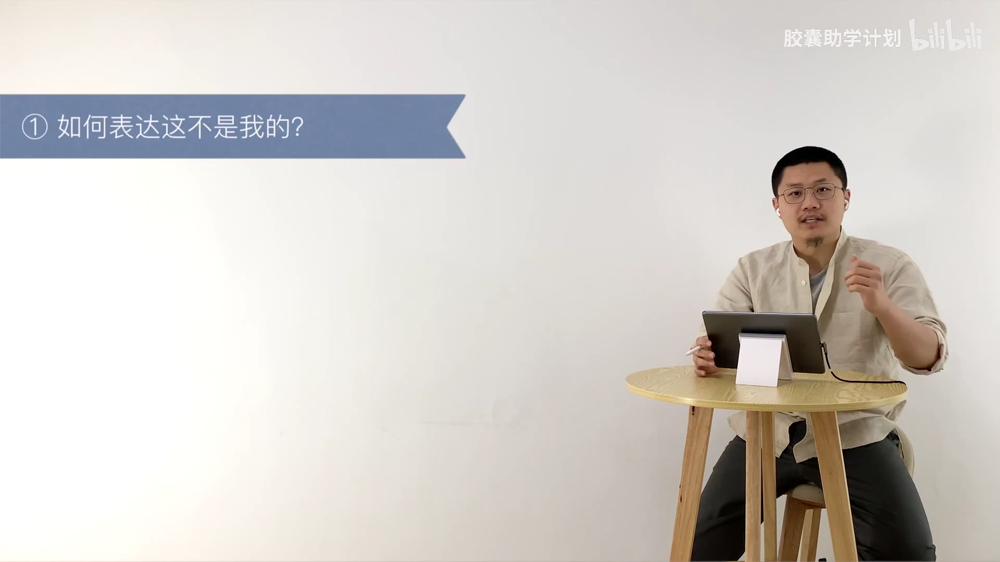

文字识别：胶囊助学计划bl出 / ① 如何表达这不是我的？

### 画面 00:00:18

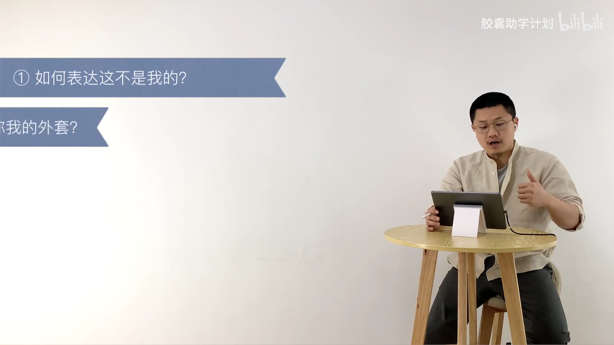

文字识别： bil il / 胶囊助学计划 / ①如何表达这不是我的？ / 我的外套？

### 画面 00:00:20

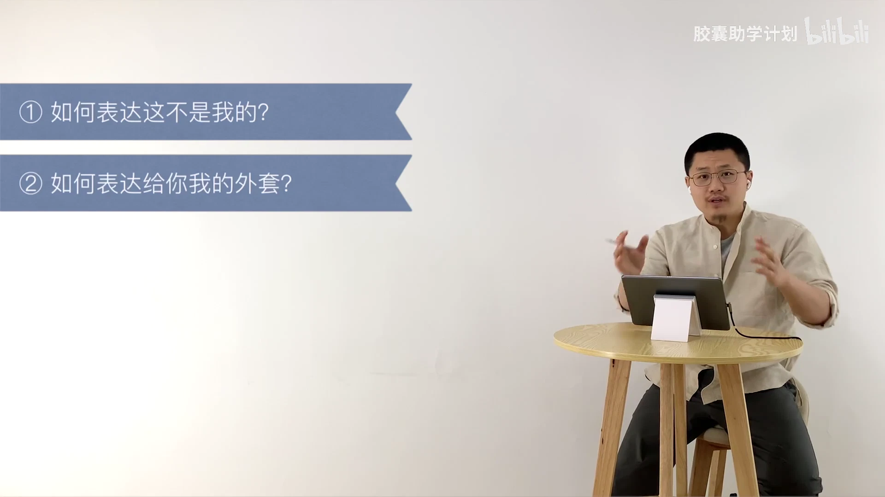

文字识别： bitbii / 胶囊助学计划 / ①如何表达这不是我的？ / 如何表达给你我的外套?

### 画面 00:00:24

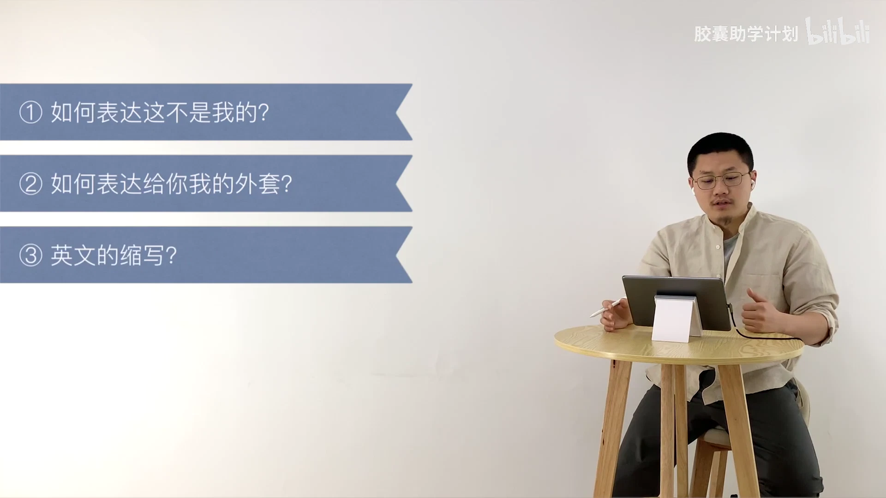

文字识别： biibii / 胶囊助学计划 / ①如何表达这不是我的？ / 如何表达给你我的外套? / 英文的缩写?

## 00:00:30–00:01:00

look at the article. My coat and my umbrella, please.哎，这位男士，各位看一下上面这个英文叫做 cloakroom。我们上节课刚刚学过 cloakroom，在很多的店当中，它表示的是衣帽存放间、存放处的意思，对吧？所以寄存处，我们具体一点。所以他说 my coat and my umbrella，说

### 画面 00:00:30

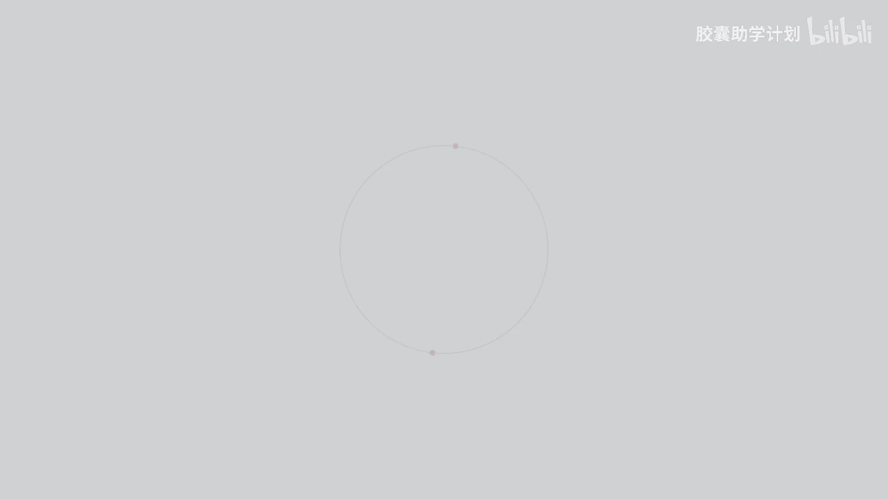

文字识别：胶囊助学计划 bii

### 画面 00:00:33

文字识别：胶囊助学计划H / 胶囊助学计划

### 画面 00:00:35

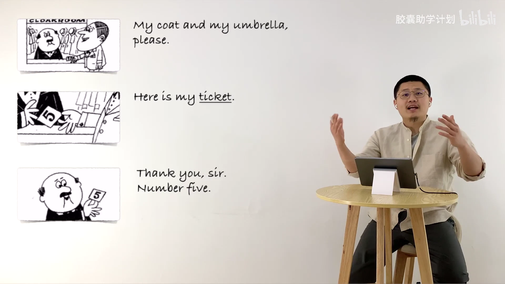

文字识别：胶囊助学计划bi / My coat and my umbrella, / please. / Here is my ticket. / Thank you, sír. / Number five.

### 画面 00:00:39

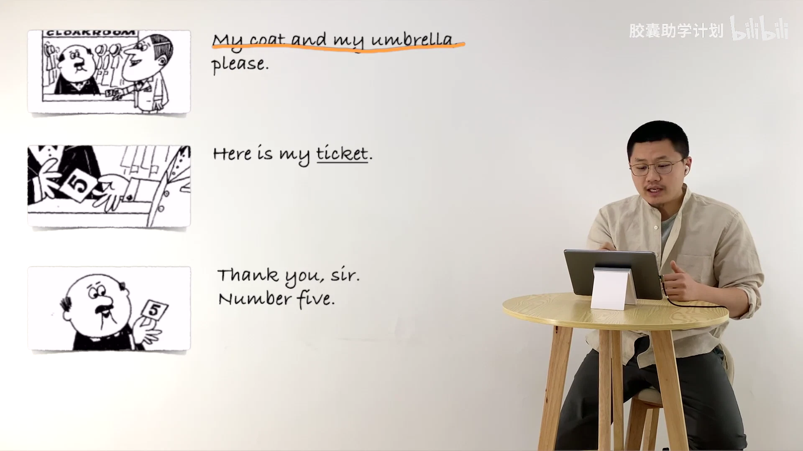

文字识别：胶囊助学计划li / Mu coat and my umbrella / please. / Here is my ticket. / Thank you, sír. / Number five.

### 画面 00:00:42

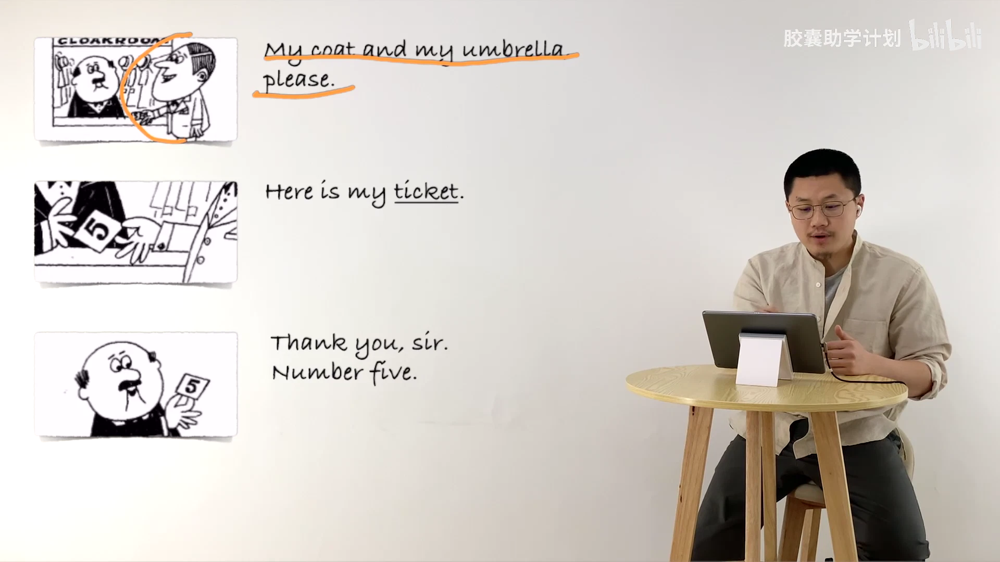

文字识别：胶囊助学计划bl / My coat and my umbrella / please. / Here is my ticket. / Thank you, sír. / Number five.

### 画面 00:00:45

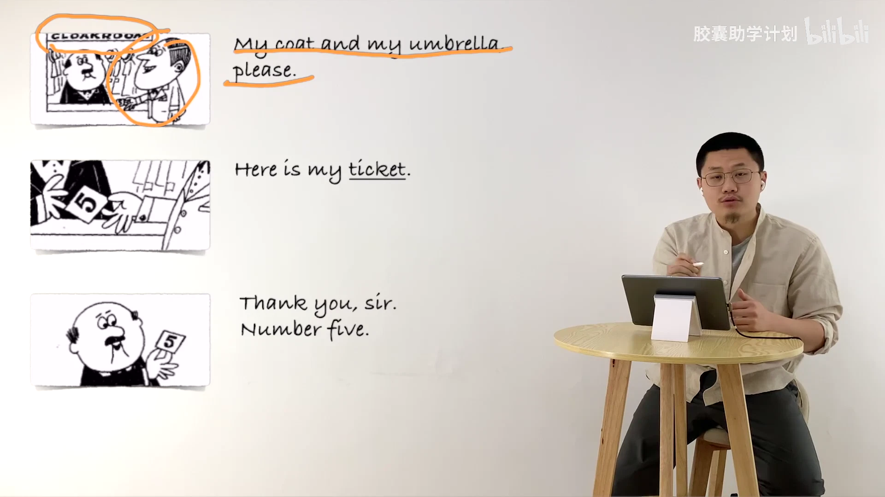

文字识别：胶囊助学计划bii / CLOA / My coat and my umbrella. / please. / Here is my ticket. / Thank you, sír. / Number five.

## 00:01:00–00:01:30

我的外套和我的雨伞，请给我我的外套和我的雨伞。紧接着说了一句话叫 Here is my ticket. 各位看他手里面攥着一张票，他说这是我的取衣服凭票啊，叫 Here is my ticket. 这句话是比较常见的一个小的句型，我们把 ticket 底下加了一个下划线。一会儿我们会把这个地方做一些替换性的训练。那我们先看文章，说 Thank you, sir. 谢谢您了。注意这是比较正式的一个

### 画面 00:01:06

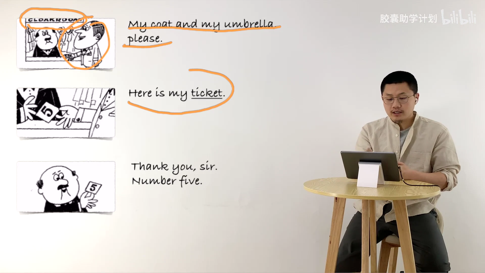

文字识别：胶囊助学计划bl / CLOAK / My coat and my umbrella / please. / Here is my ticket. / Thank you, sír. / Number five.

### 画面 00:01:08

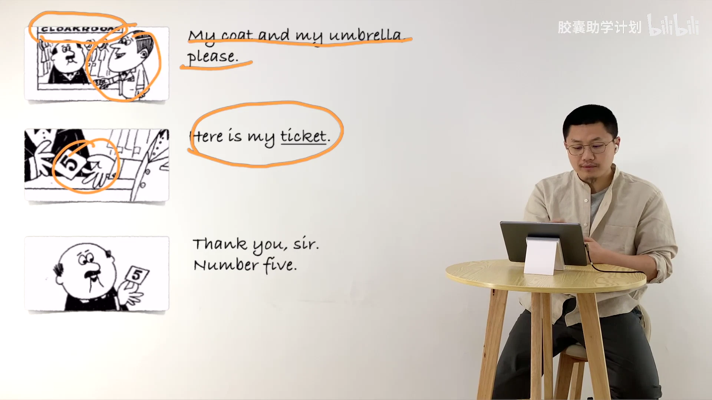

文字识别：胶囊助学计划bi / My coat and my umbrella / please. / tere is my ticket. / Thank you, sír. / Number five.

### 画面 00:01:21

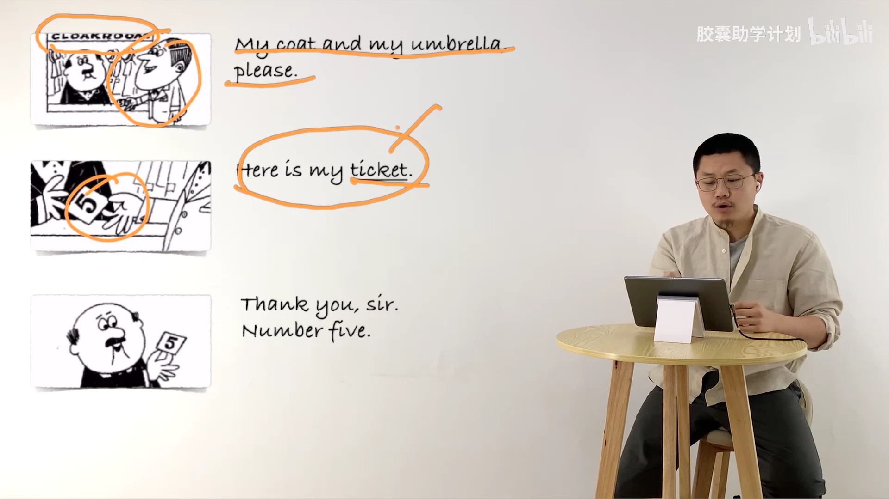

文字识别：胶囊助学计划bi / CLOAK / My coat and my umbrella / please. / tere is my ticket. / Thank you, sír. / Number five.

### 画面 00:01:27

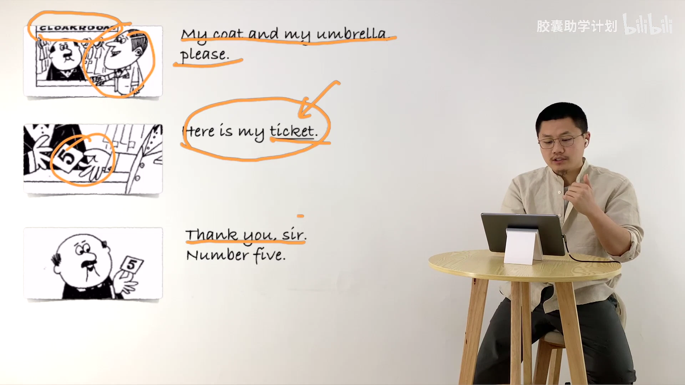

文字识别：胶囊助学计划bi / CLOAK / My coat and my umbrella. / please. / tere is my ticket. / Thank uou, sír. / Number five.

## 00:01:30–00:02:00

场合，我刚才有解释对吧？大部分是一些商业场所才会有这样的衣帽存放处，所以它比较正式，要说 thank you, sir。你一般不会说 thank you, man。 OK，不会这样啊。再然后，number five，五号。接下来我们再看一下这个。Here is my ticket。 ticket 我们加了个下划线，就意味着我可以说给你钱啊，把我的钱给你的时候，我可以说 here is my money。

### 画面 00:01:43

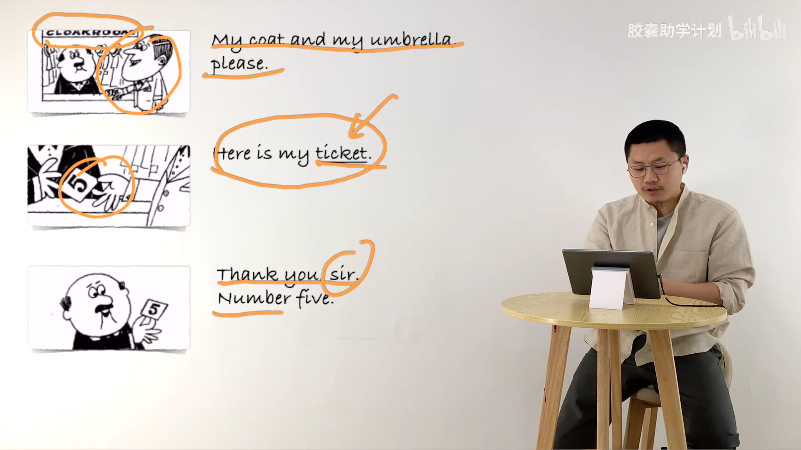

文字识别：胶囊助学计划bil / CLOAK / Mu coat and my umbrella / please. / tere is my ticket. / Thank uou / sir. / Number five.

### 画面 00:01:48

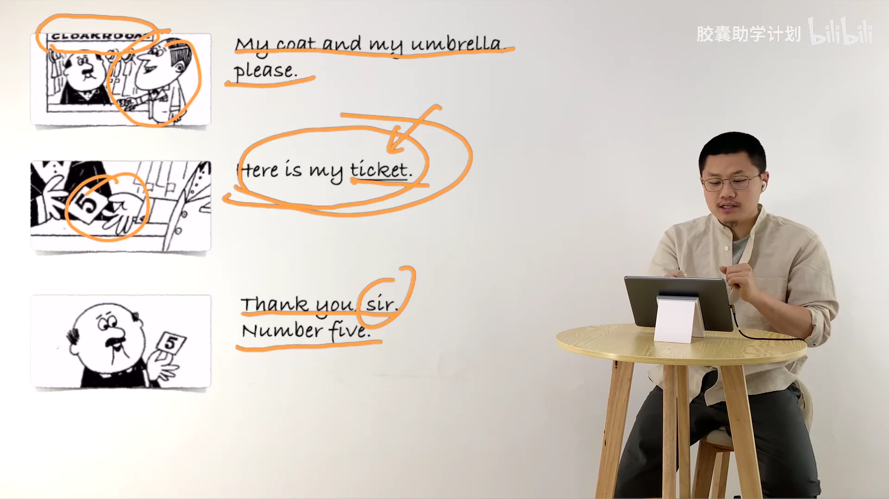

文字识别：胶囊助学计划b / Mu coat and my umbrella / please. / tere is my ticket. / Tnank uou Isir. / Number five.

### 画面 00:01:51

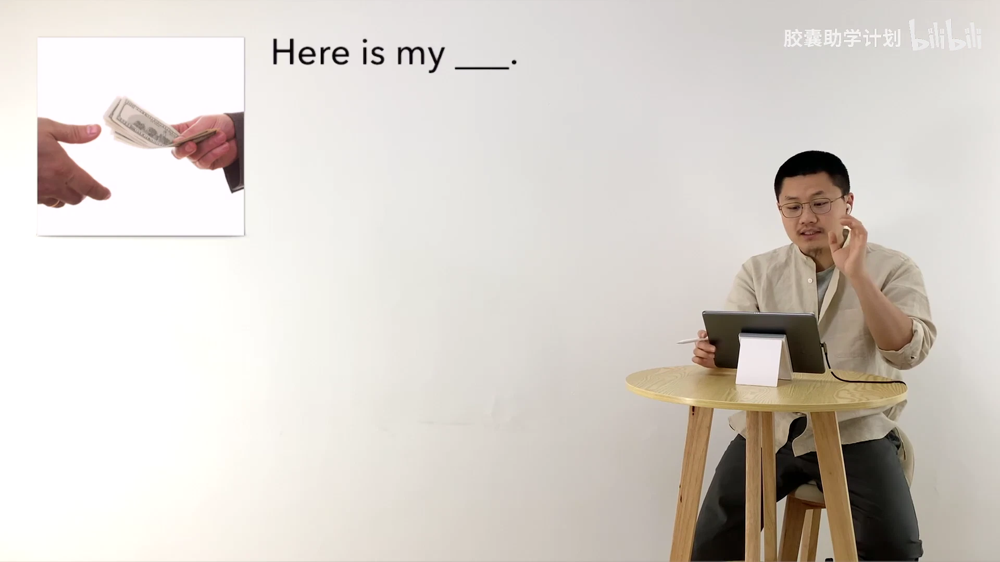

文字识别：胶囊助学计划bi / Here is my.

## 00:02:00–00:02:30

Okay, very good. 我也可以说给你我的手机，叫 Here is my cell phone. 记住啊，说这句话的时候伴都伴随着一个肢体语言，叫递过去啊，叫递过去。再然后呢，你可以说 Here is my coat. 啊，给你我的外套，叫 Here is my coat. 啊，比如说对方比较冷，你就说 Here is my coat. Let's continue. 那还有一种表达方式叫做 Take my coat 和 Here is my coat

### 画面 00:02:01

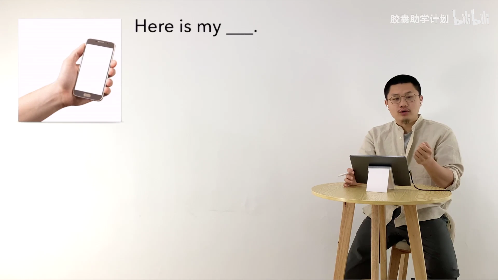

文字识别：胶囊助学计划bi / Here is my _

### 画面 00:02:12

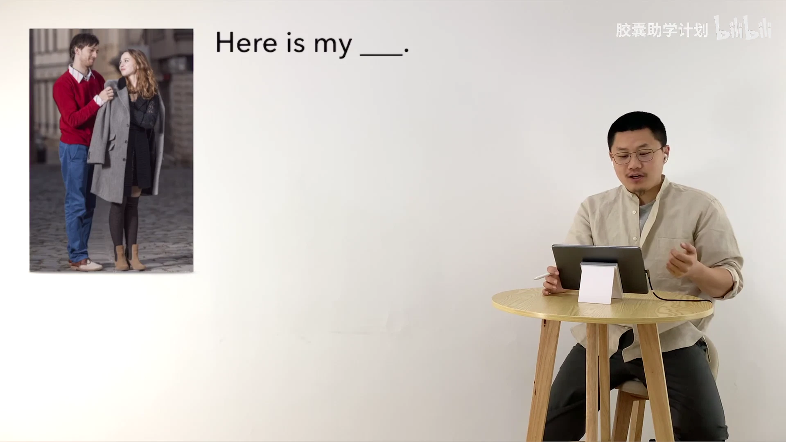

文字识别：胶囊助学计划bii / Here is my _ / 2

### 画面 00:02:24

文字识别：bitbii / 胶囊助学计划 / take my coat / ROCKY / GO FOR IT / 洛奇5 Rocky V(1990) / DARTISTSEOBERTHARTOFNNLERCSYVESTERSTA / 42:48 / TALLONE OMMYNORRSONBURGESSMEREDTHBLLCON / MLUAMICASSIDYSTEVENPOSTERTONYMUNAFO

### 画面 00:02:27

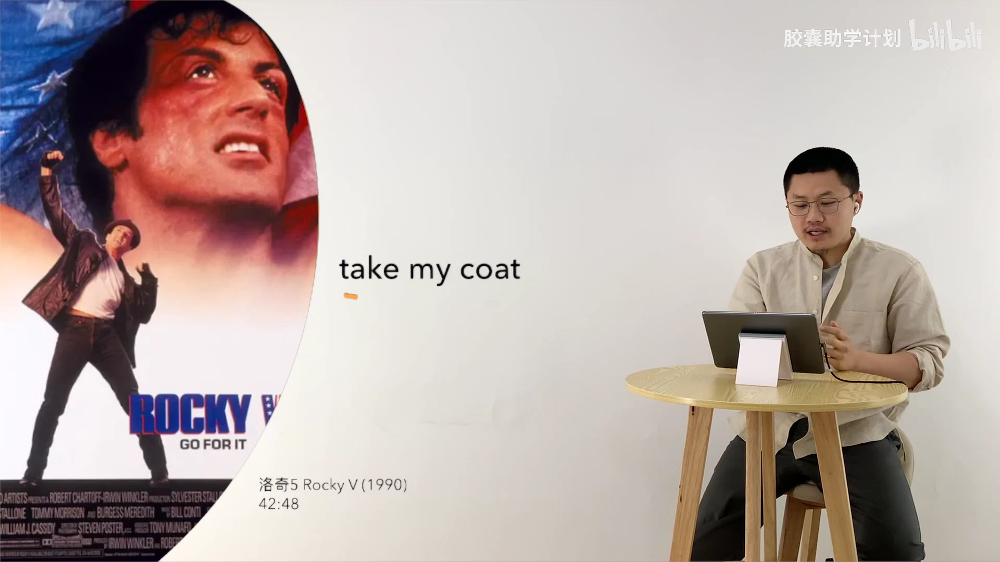

文字识别：bitbli / 胶囊助学计划 / take my coat / ROCKY / GO FOR IT / 洛奇5 Rocky V(1990) / DARTSTSOBERTHARTOFNWNKLERSYVESTERSTA / 42:48 / TALLONE TOMMYNORISONBURGESSMEREDTHBILCON / MLIAMICASSIDYSTEVENPOSTER,TONYMUNAFO

### 画面 00:02:29

文字识别：Bilbii / 胶囊助学计划 / take my coat / ROCKY / GO FOR IT / 洛奇5 Rocky V(1990) / DARTSTSAOBERTHARTOF-NKLERSYVESTERSTAY / 42:48 / TALONE TOMMYMORISONBURGESSMEREDTHBILCON / MLUAMICASSIDYSTEVENPOSTERTONYMUNAFO

## 00:02:30–00:03:00

其实是一个意思，就是给你我的外套，拿着我的外套啊，你冷，拿着我的外套。那接下来我们看一下 Rocky Five 啊，这个电影当中是如何用 take my coat。 How you doing? Cold? Look cold. I guess it has something to do with the weather. Here, take my coat. No thanks. Where's your boyfriend?

### 画面 00:02:31

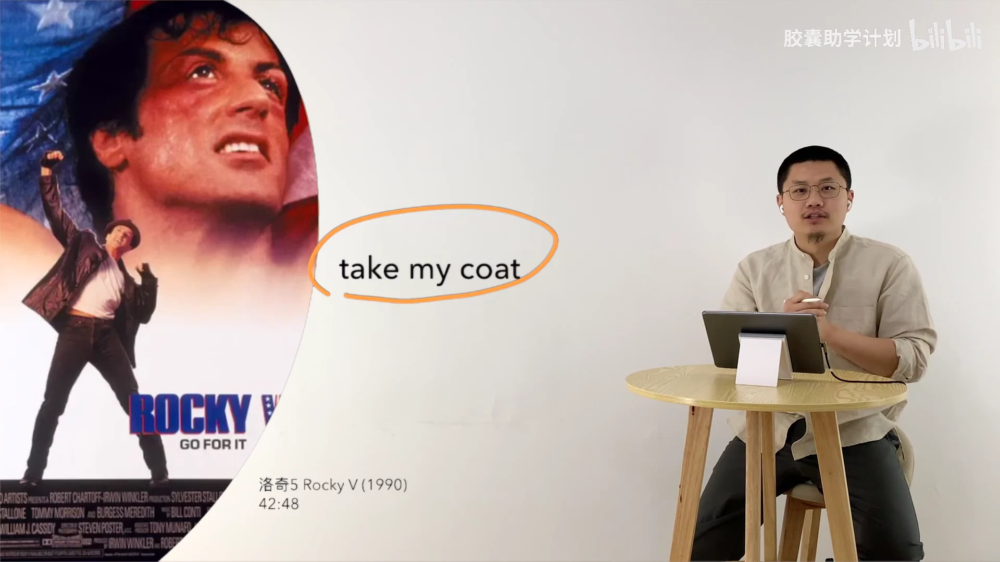

文字识别：bitbii / 胶囊助学计划 / take my coat / ROCKY / GO FOR IT / 洛奇5 Rocky V(1990) / DARTISTSEROERTHARTOF-NNKLERSYVESTERSTA / 42:48 / TALONE TOMMYMORSONBURGESSMEREDITHBILCON / MLUAMICASSIDYSTEVENPOSTERTONYMUNAO

### 画面 00:02:35

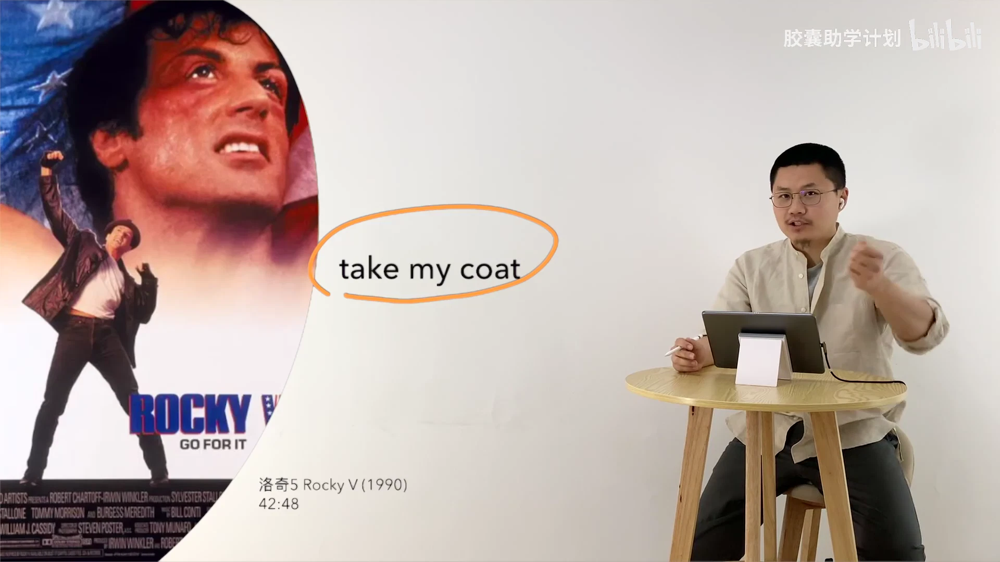

文字识别：bitbli / 胶囊助学计划 / take my coat / ROCKY / GO FOR IT / 洛奇5 RockyV(1990) / DARTSTSOBETHATOFNWNKESYVESTERSTA / 42:48 / TALLONE TOMMYMORISONEURGESSMERETHBILCON / MLUAMCASSIDYSTEVENPOSTERTONYMUNAFO

### 画面 00:02:41

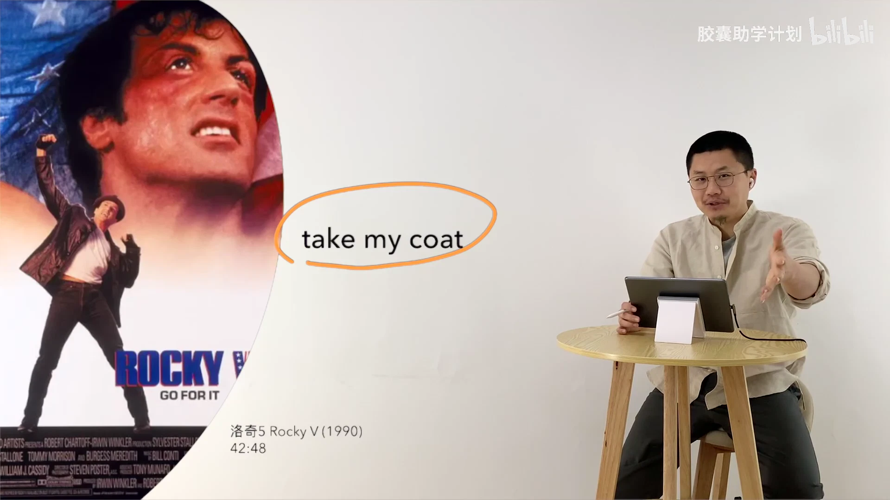

文字识别：胶囊助学计划 / take my coat / ROCKY / GO FOR IT / 洛奇5 Rocky V(1990) / DARTISTSAOBERTCHARTOF-NWNLERSYVESTERSTA / 42:48 / TALLONE TOMMYNORISON BURGESSMEREDTHBILCON / MLUAMICASSIDYSTEVENPOSTERTONYMUNAF

### 画面 00:02:43

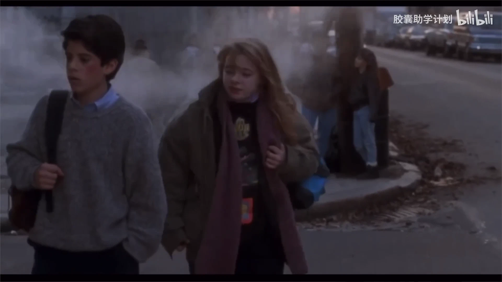

文字识别：Biibili / 胶囊助学计划

### 画面 00:02:45

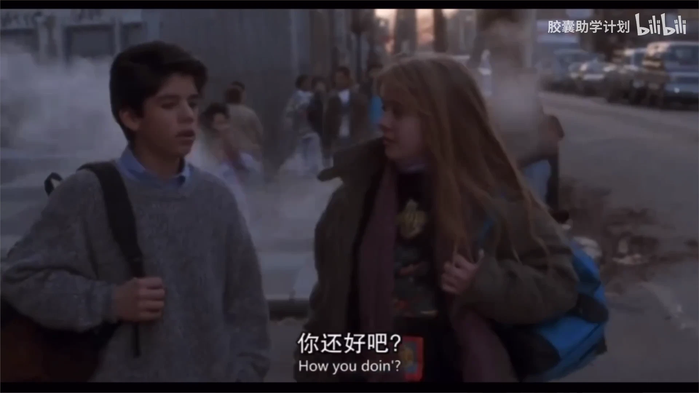

文字识别：bilibili / 胶囊助学计划 / 你还好吧？ / How you doin'?

### 画面 00:02:47

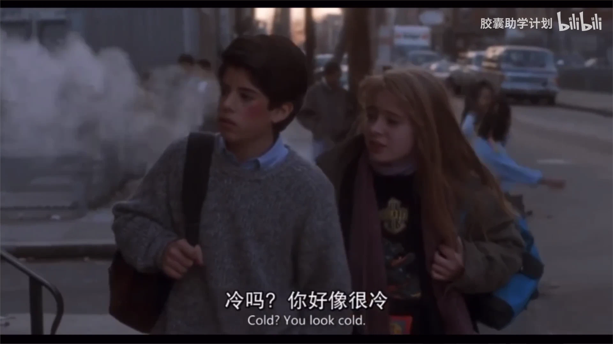

文字识别：bilibili / 胶囊助学计划 / 冷吗？你好像很冷 / Cold? You look cold.

### 画面 00:02:49

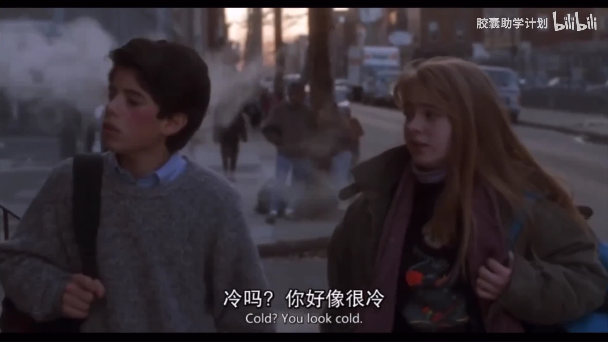

文字识别：bilibili / 胶囊助学计划 / 冷吗？你好像很冷 / Cold? You look cold.

### 画面 00:02:51

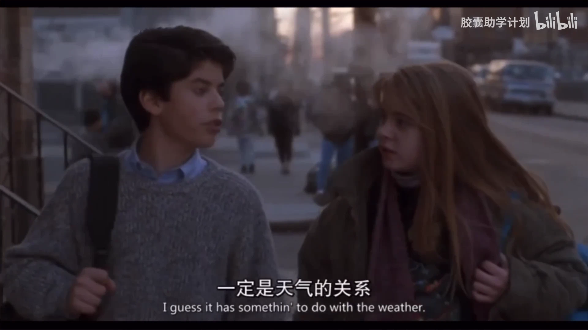

文字识别：bilibili / 胶囊助学计划 / 一定是天气的关系 / I guess it has somethin' to do with the weather.

### 画面 00:02:53

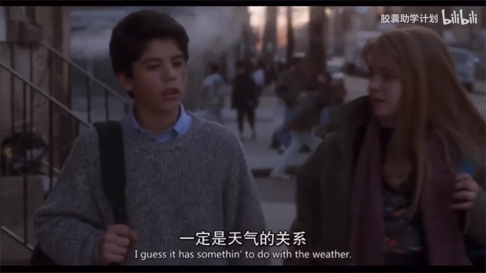

文字识别：bilibili / 胶囊助学计划 / 一定是天气的关系 / I guess it has somethin'to do with the weather.

### 画面 00:02:55

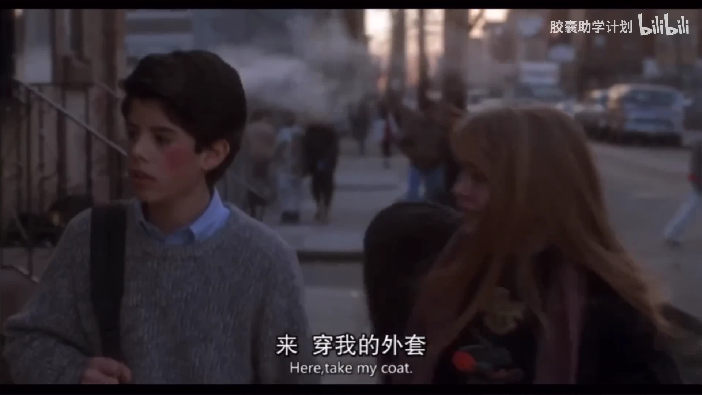

文字识别：bilibili / 胶囊助学计划 / 来穿我的外套 / Here,take my coat.

### 画面 00:02:57

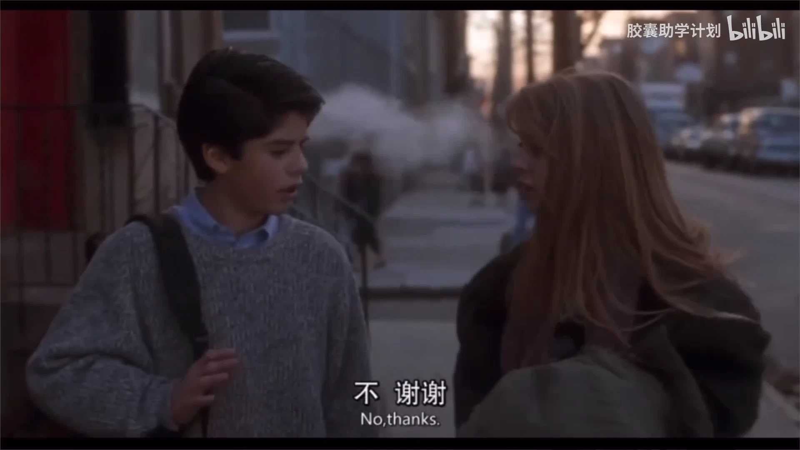

文字识别：Bilibili / 胶囊助学计划 / 不谢谢 / No,thanks.

### 画面 00:02:59

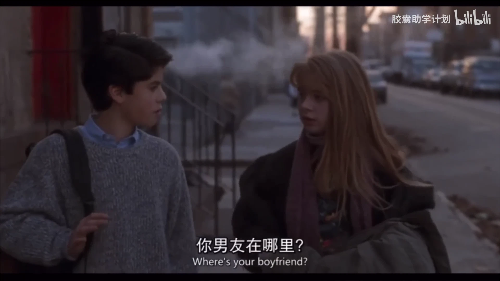

文字识别：bilibli / 胶囊助学计划 / 你男友在哪里？ / Where's your boyfriend?

## 00:03:00–00:03:30

Sam? Forget it, he ain't got no manners.啊，各位看到了啊，这个姑娘跟他说，Cold, you look cold. He take my coat.啊，给你我的外套，你穿上我的外套。OK，叫 take my coat。各位记住这个小短语。Let's continue.那说给你我的电话号码。刚才我们学了一个东西叫做号码数字的意思，叫做 number。这是英文当中又一个非常

### 画面 00:03:01

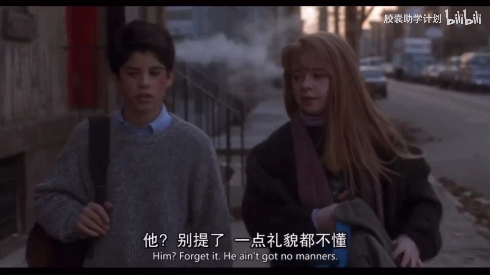

文字识别：bilibili / 胶囊助学计划 / 他？别提了一点礼貌都不懂 / Him? Forget it. He ain't got no manners.

### 画面 00:03:03

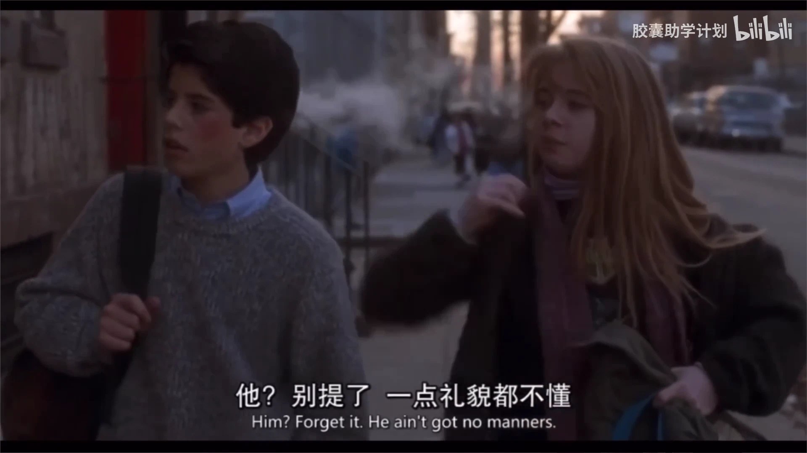

文字识别：bilibli / 胶囊助学计划 / 他？別提了一点礼貌都不懂 / Him? Forget it. He ain't got no manners.

### 画面 00:03:05

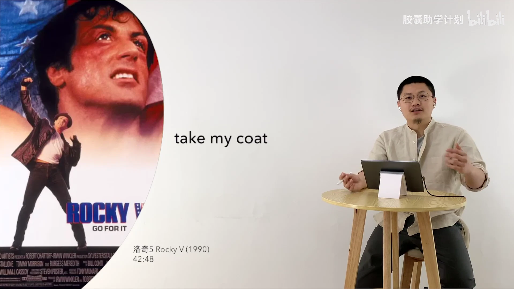

文字识别：Bibi / 胶囊助学计划 / take my coat / ROCKY / GO FOR IT / 洛奇5 RockyV(1990) / DARTISTSAOBERTHARTOF-NWNLERSYVESTERSTA / 42:48 / TALLONE TOMMYNORISONBURGESSMEREDTHBILCON / MLUAMICASSIDYSTEVENPOSTERTONYMUNAFO

### 画面 00:03:08

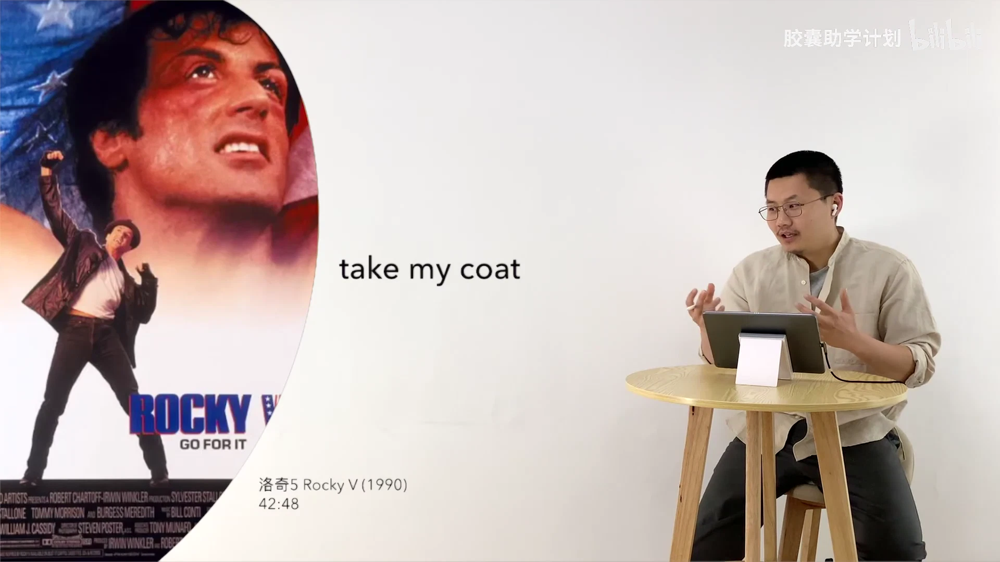

文字识别：胶囊助学计划 / take my coat / ROCKY / GO FOR IT / 洛奇5 Rocky V(1990) / DARTISTSROERTHARTOF-WINKLERSYVESTERSTA / 42:48 / TALLONE TOMMYMORISONBURGESSMEREDTHBILCON / MLUAMICASSIDYSTEVENOSTERTONYMUNAFO

### 画面 00:03:11

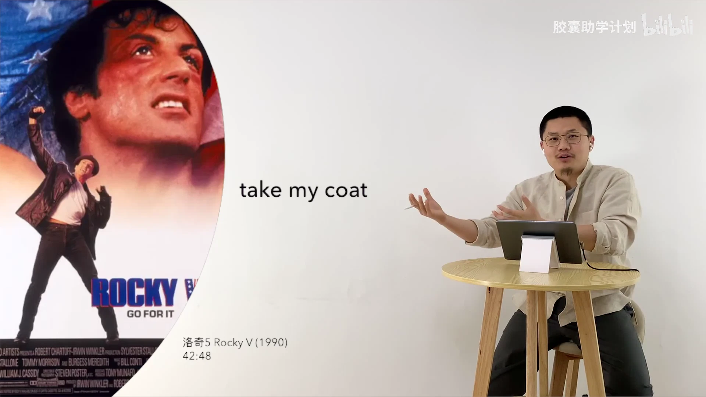

文字识别：BitLii / 胶囊助学计划 / take my coat / ROCKY / GO FOR IT / 洛奇5 RockyV(1990) / DARTISTSOBERTHARTOF-WNERSYVESTERSTAY / 42:48 / TALONE TOMMYMORSONBURGESSMEREDITHBILCON / MLUAMICASSIDYSTEVENPOSTERTONYMUNAFO

### 画面 00:03:14

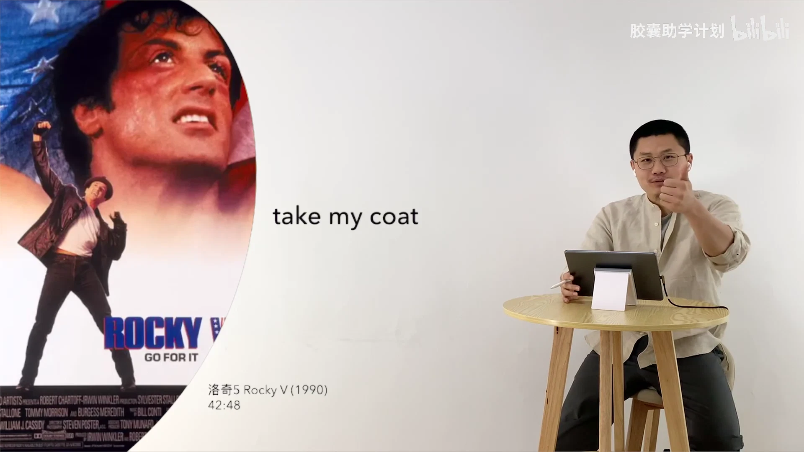

文字识别：Bitbi / 胶囊助学计划 / take my coat / ROCKY / GO FOR IT / 洛奇5 Rocky V(1990) / DARTISTSOERTHARTOFNWNKLERVESTERSTA / 42:48 / TALONE TOMYMORISONBURGESSMEREDTHBILCON / MLUAMICASSIDYSTEVENPOSTERTONYMUNAFO

### 画面 00:03:16

文字识别：胶囊助学计划 / 课堂笔记 / X / 公众号：胶囊助学计划 / 正版教材 / X / 雅思托福课 / ·学员来信 / ·试听课 / ·课程详情

### 画面 00:03:19

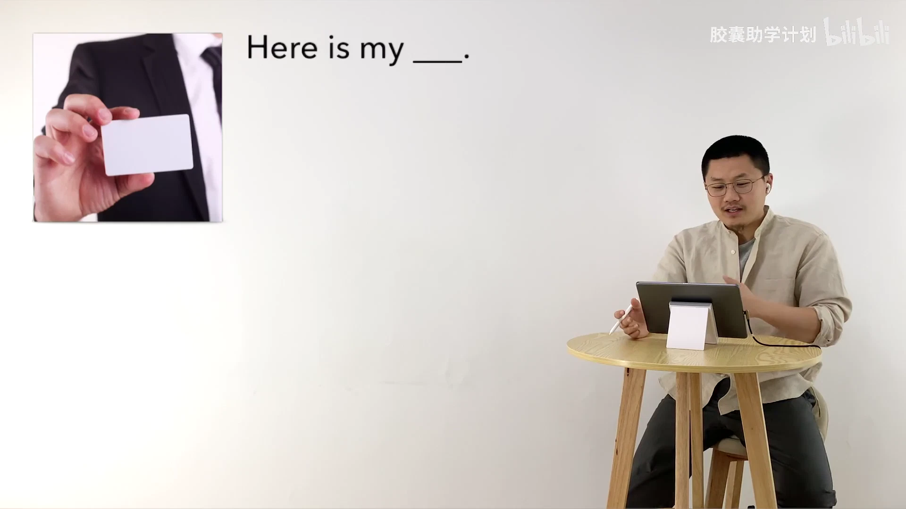

文字识别：胶囊助学计划 / Here is my _

## 00:03:30–00:04:00

常见的语言表达，叫做 Here is my number，给你我的电话号码。那我们一起看一下，当幸福来敲门这个电影当中，他如何用 Here is my number 给别人自己的明信片和卡片的。 Here's my number. Call me, okay? Yes, sir. Absolutely. Thank you very much. 好，各位听到了吧？这名男士跟威尔史密斯说，说 Here's my number. Call me, okay? 然后他说 Yes, sir. Thank you very

### 画面 00:03:35

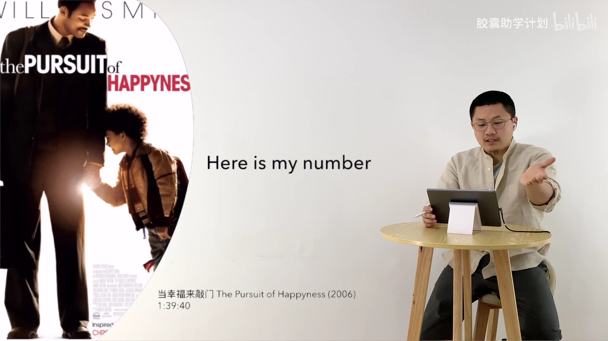

文字识别： bibli / 胶囊助学计划 / thePURSUITof / HAPPYNES / Here is my number / 当幸福来敲门 The Pursuit of Happyness (2006) / 1:39:40 / Inspired / CHP

### 画面 00:03:45

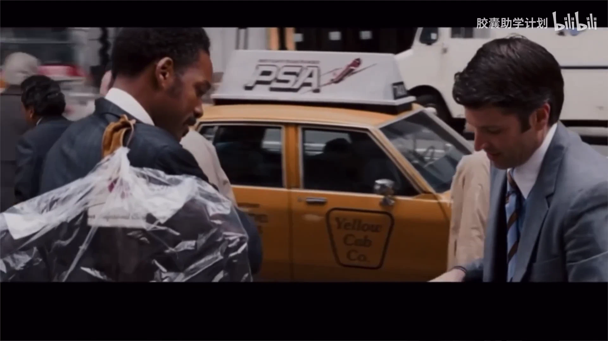

文字识别：胶囊助学计划b出 / PSA

### 画面 00:03:47

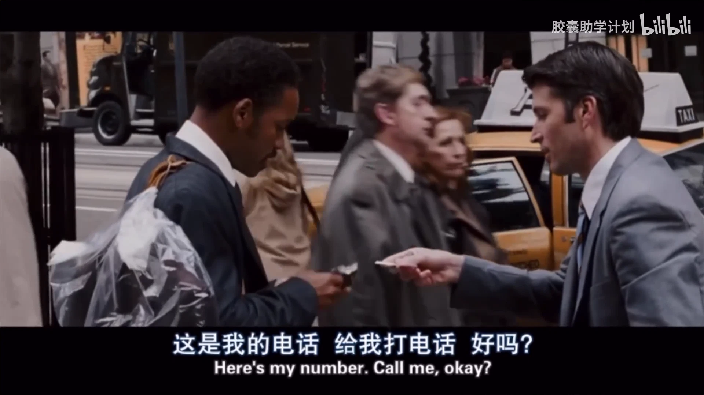

文字识别： Bilibili / 胶囊助学计划 / 这是我的电话给我打电话好吗？ / Here's my number. Call me, okay?

### 画面 00:03:49

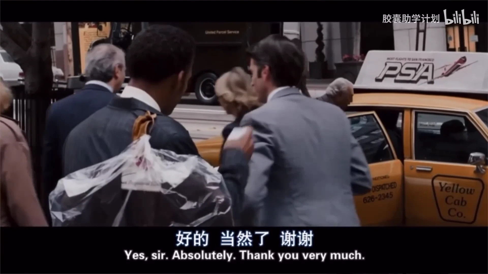

文字识别：胶囊助学计划bibi / PSA / Yellow / Cab / CO / 好的当然了谢谢 / Yes, sir. Absolutely. Thank you very much.

### 画面 00:03:51

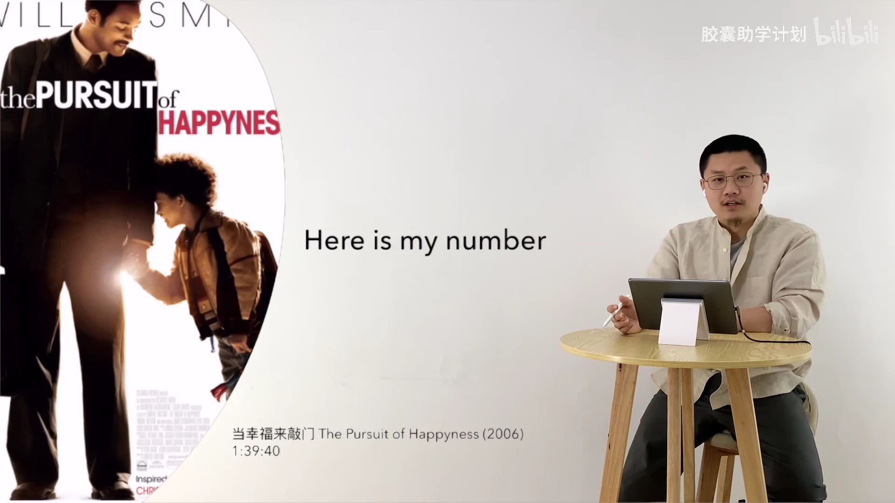

文字识别：Bitibii / 胶囊助学计划 / thePURSUITof / HAPPYNES / Here is my number / 当幸福来敲门 The Pursuit of Happyness (2006) / 1:39:40 / Inspirec' / CHPI

## 00:04:00–00:04:30

much. 是非常重视的一种表达。我们之前说过，对吧？不是很正式的表达就是 Thank you, 就 OK 了。所以你想给别人的电话号码叫 Here is my number. Very good. Let's continue. 我们接下来看文章，说 Here's your umbrella and your coat. 其实它就是用了一个 and 连了两个东西，对吧？刚才我们说 Here's your money. Here's your uh cell phone. Here's your coat. Here's my coat. Here's my

### 画面 00:04:10

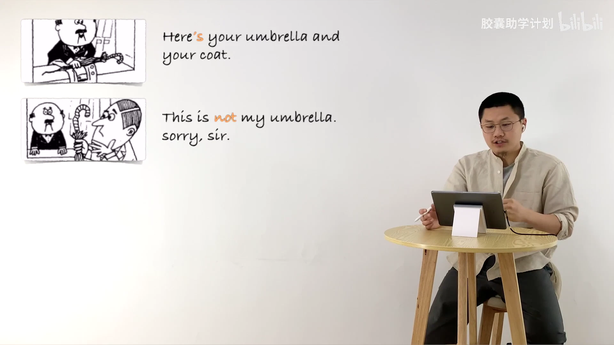

文字识别：胶囊助学计划出 / Here's your umbrella and / your coat. / This is not my umbrella. / sorry, sír.

### 画面 00:04:18

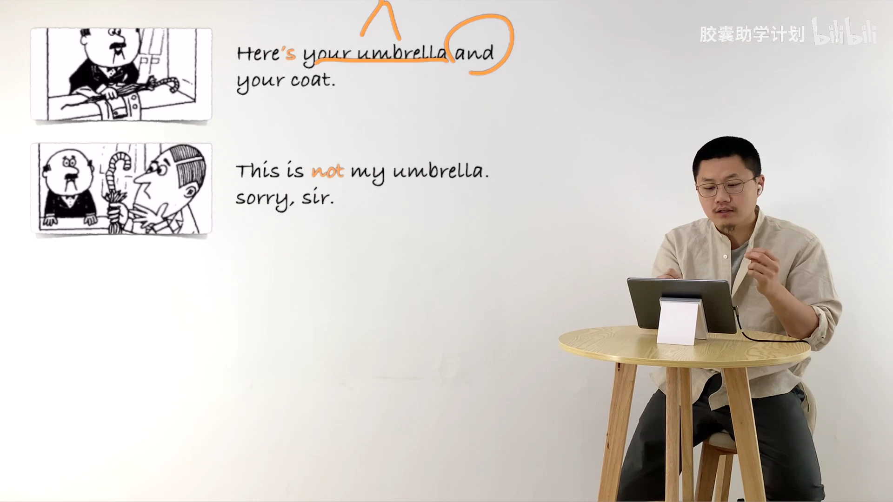

文字识别：胶囊助学计划bl出 / Here's your umbrellaand / your coat. / This is not my umbrella. / sorry, sír.

### 画面 00:04:20

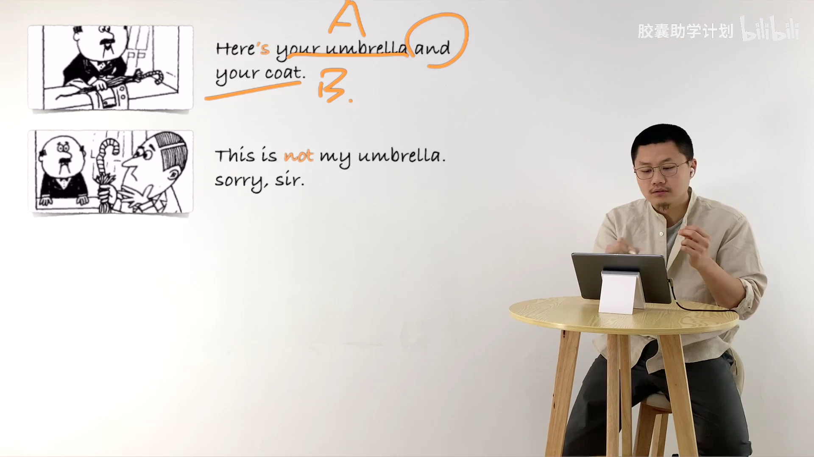

文字识别： biltbii / 胶囊助学计划 / Here's your umbrellaand / your coat. / 3. / This is not my umbrella. / sorry, sír.

## 00:04:30–00:05:00

umbrella. 那他这个地方把 my 换成了 your，就是给你嘛，给你你的东西，对吧？叫 Here is your umbrella and your coat. Okay. 那注意这个地方有一个小的缩写叫 Here's。各位看到 Here's，其实就是 Here 加上 is，它是 is 的缩写，叫做 s。 Okay，这是其中第一个小的缩写啊。继续他说 This is not my

### 画面 00:04:42

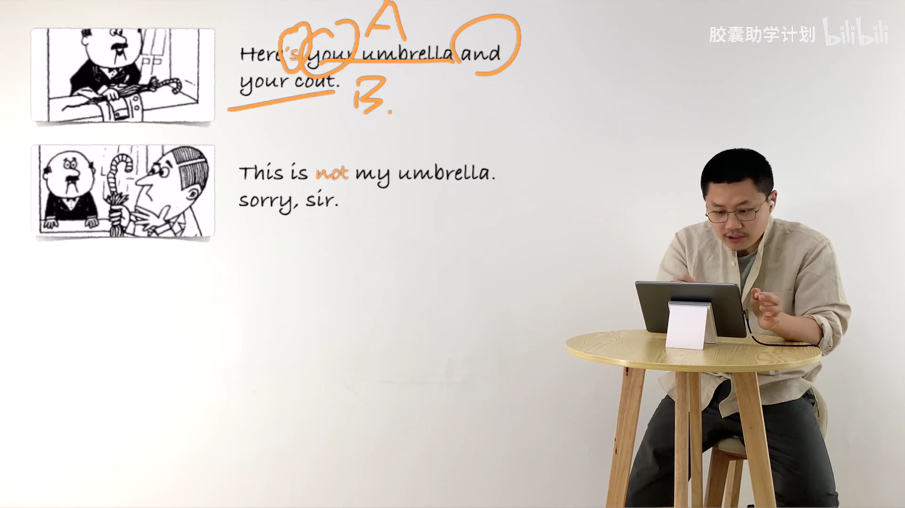

文字识别：胶囊助学计划 / Here / Lumbrellaand / your cout. / 3. / This is not my umbrella. / sorry, sír.

### 画面 00:04:45

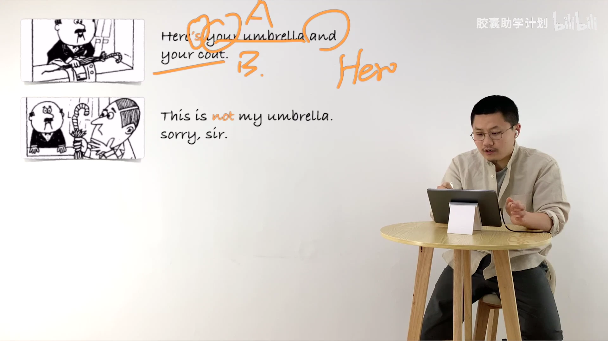

文字识别：Bitbit / 胶囊助学计划 / Heri / your cout. / 3. / Her / This is not my umbrella. / sorry, sír.

### 画面 00:04:47

文字识别：A / 刘 BitLii / 胶囊助学计划 / Her / Here / your cout. / 3 / Thís is not my umbrella. / sorry, sír.

### 画面 00:04:59

文字识别：A / bilt ili / 胶囊助学计划 / Here / umbrellaand / your cout. / 3. / Here's / This is not my umbrella. / sorry, / sir.

## 00:05:00–00:05:30

umbrella. Sorry, sir. 这不是 not 这个单词是今天核心语法，叫做不是我的雨伞啊。对，抱歉先生。那我们就一起来看一下英文当中初期这个否定句如何去进行变化。首先，我们先想一下汉语，说这是我的雨伞怎么办呢？这 This 是 is 我的 my 雨伞刚学过 umbrella，所以变成 This is my umbrella，

### 画面 00:05:01

文字识别：A / Biibii / 胶囊助学计划 / Here / yumbrellaand / your cout. / 3. / Here's / Thís is / not /  my umbrella. / sorry, / sir.

### 画面 00:05:08

文字识别：A / bitbili / 胶囊助学计划 / Here / umbrellaand / your cout. / 3. / Here's / This is / wot / My umbrella. / sorry,  / sir.

### 画面 00:05:11

文字识别：胶囊助学计划l出 / 否定句

## 00:05:30–00:06:00

还是挺简单的，对吧？然后呢，我想说汉语把它变成否定句，叫这不是我的雨伞。其实是是前面加了个不就行了。如果我们英英语和汉语的语法是一一对应的，那你需要做的事情无非就是一个单词一个单词翻译呗。这叫 this，不，是 not，是是 is，我的是 my，雨伞叫 umbrella， this not is my umbrella。但注意，英文不是这么说的，英文是这样去说

### 画面 00:05:32

文字识别：胶囊助学计划 / 否定句 / 这是我的雨伞。 / This is my umbrella. / 这不是我的雨伞。

### 画面 00:05:58

文字识别：bitb / 胶囊助学计划 / 否定句 / 这是我的雨伞。 / This is my umbrella. / 这不是我的雨伞。 / Tbis

## 00:06:00–00:06:30

的，叫 This is not my umbrella. 所以在这儿各位要记住一个关键的点，我们想变否定。目前您需要记住的叫做在 is 这个单词的后面。再强调一遍重要的东西，叫后面加 not，这个位置非常的重要，不能由你汉语的语感去决定 not 加在什么地方啊。所以我们接着往下看一个小的练习，比如说 Leo 在这里，那很简单，叫 Leo is here. Leo is

### 画面 00:06:06

文字识别：Biltbii / 胶囊助学计划 / 否定句 / 这是我的雨伞。 / This is my umbrella. / 这不是我的雨伞。 / Tbis / This is not my umbrella. / is+not

### 画面 00:06:22

文字识别：胶囊助学计划bl / 否定句

## 00:06:30–00:07:00

here. 那我想说 Lil 不在这里的时候，是不是就否定句了？我们立刻回想一下，否定句要做的事情，不是拿汉语直接一个单词一个单词翻译过来，而是在某个单词的后面加上 not，而这个单词就是 is。所以这句话叫做 Lil is not here。那我现在想问 Lil 在这里吗？我们第一节课学的语法叫把 is 提到句首，是不是就行了？叫做 Is Lil here？

### 画面 00:06:42

文字识别：胶囊助学计划 / 否定句 / Leo 在这里 / Leo is here. / Leo不在这里。

### 画面 00:06:54

文字识别：胶囊助学计划bi出 / 否定句 / Leo / 太这里 / Leo / here. / Leo不在这里。 / Leo 在这里么?

### 画面 00:06:58

文字识别：胶囊助学计划 / 否定句 / Leo / 本这里 / Leo / here. / Leo不在这里。 / Leo 在这里么?

## 00:07:00–00:07:30

Negative句 is后边加not，一般疑问句把little把it这个单词提前就行了。那我们接下来做一个小的练习，叫This is my coat。我们迅速想一下一般疑问句你要做的事情，一个动作 is this my coat？那你想问别人叫 Is this your coat? Very good。肯定回答，否定回答，肯定回答 Yes, it is. No, it isn't. 那 isn't 是立刻我们就会学到的下一个缩写，叫

### 画面 00:07:04

文字识别：胶囊助学计划b出 / This is my coat.

### 画面 00:07:14

文字识别：胶囊助学计划l / This / ip / my coat. / ①一般疑问句

## 00:07:30–00:08:00

is 加 not 连起来叫做 isn't very good，否定句怎么办？刚刚讲过，不要由汉语的语感去决定，由英文去处理。is 后面加 not，叫做 this is not my coat，非常的简单。我们进入文章回来看，is this your umbrella？一般疑问句把 is 提前，这是您的雨伞吗？No, it isn't. 英文的小的缩写

### 画面 00:07:36

文字识别：胶囊助学计划 / This / ip / my coat. / ）一般疑问句 / 1 / 肯定回答/否定回答 / 否定句

### 画面 00:07:43

文字识别：fot / 胶囊助学计划 / This / igmy coat. / 一般疑问句 / 1 / 肯定回答/否定回答 / 否定句

### 画面 00:07:47

文字识别：胶囊助学计划 / Is this your umbrella? / No, it isn't / 8K / Is this ít? / Yes, it is. / Thank you very much.

### 画面 00:07:51

文字识别：胶囊助学计划il / mlhvella? / Is this u / No, it isn't / 8K / Is this ít? / Yes, it is. / Thank you very much.

### 画面 00:07:53

文字识别：胶囊助学计划i / Is this your umbrella? / No, it isn' / 8 / Is thís ít? / Yes, it is. / Thank you very much.

## 00:08:00–00:08:30

isn't 是 is 加 not，我们看它是如何缩写的啊， isn't 其实 is 没变，看到了吧， is 还是这个样子，它把 not 换成了 n p e r t 的缩写，于是就变成了 isn't， isn't 等于 is not，但大部分情况下我们不会读成 no it is not，这种情况好像有一点强调的感觉，我们大部分情况下读的就是 no it isn't

### 画面 00:08:02

文字识别：胶囊助学计划 / B / Is this your umbrella? / No, itisn' / istnl / 8 / Is this ít? / Yes, it is. / Thank you very much.

### 画面 00:08:13

文字识别：胶囊助学计划H / Is this your umbrella? / No, itisn' / is+nt / 8 / Is thís ít? / Yes, it is. / Thank you very much.

### 画面 00:08:19

文字识别：胶囊助学计划州 / Is thís your umbrella? / No, itisn't / is+nt / ist / 8K / Is this ít? / Yes, it is. / Thank you very much.

## 00:08:30–00:09:00

就可以了。Kenny也说 Is this it? 那说这是它吗？其实 it 指代的就是 your umbrella, 雨伞，它对吧？那这是它吗？这是您的雨伞吗？Yes, it is. 是 Thank you very much. 啊，我们是比较正式的说法，尤其是当你们陌生人的时候，对吧？大部分情况下 Thank you 足以。Okay, very good. 那我们看一下在搏击俱乐部当中，它有这样一

### 画面 00:08:36

文字识别：胶囊助学计划 / Is thís your umbrella? / No,it / isn't / is +nt / ist / Is thís ít? / Yes, it is. / Thank you very much.

### 画面 00:08:45

文字识别：胶囊助学计划 / B / Is thís your umbrella? / No, ít / isn't / is+nt / ist / Is thís ít? / Yes, it is. / Thank you very much.

### 画面 00:08:49

文字识别：胶囊助学计划H / Is thís your umbrella? / No,ítí / isn't /  is +nt / ist / Is thís ít? / Yes, it is. / Thank you very much.

### 画面 00:08:55

文字识别：胶囊助学计划 / MISCHIEF.MAYHEM. SOAP. / Tyler isn't here. / RAD PIFT EDWARD NOI / HELENA 30NHA / 搏击俱乐部 Fight Club(1999) / 01:44:46 / FROM THE DIRECTOR OF'SE

## 00:09:00–00:09:30

个否定句，哎，Tyler isn't here。我们刚刚讲过， isn't 就是 is 加 not。我们通过电影来一起回顾一下，复习一下刚刚学到的这个知识点。 Can I come in? He's not here. What? Tyler isn't here. Tyler went away. Okay. Tyler

### 画面 00:09:02

文字识别：BiHl / 胶囊助学计划 / MISCHIEF.MAYHEM. SOAP. / Tyler isn't here. / RAD PITT EDWARD NOT / HELENA 30NHA / 搏击俱乐部 Fight Club(1999) / 01:44:46 / FROM THE DIRECTOR OF'SE

### 画面 00:09:06

文字识别：CUD / 胶囊助学计划 / istv / MISCHIEF.MAYHEM. SOAP. / Tylerisn't Here. / RAD PITT EDWARD NOI / HELENA 30NHA / 搏击俱乐部 Fight Club(1999) / 01:44:46 / FROM THE DIRECTOR OF'SE

### 画面 00:09:09

文字识别：CUD / 胶囊助学计划 / istnot / MISCHIEF.MAYHEM. SOAP. / Tylerisn't Here. / RAD PITT EDWARD NOT / HELENA 30NHA / 搏击俱乐部 Fight Club(1999) / dhFa / 01:44:46 / FROM THE DIRECTOR OF'SE

### 画面 00:09:13

文字识别：Bilibili / 胶囊助学计划

### 画面 00:09:15

文字识别：Bilbili / 胶囊助学计划

### 画面 00:09:20

文字识别：bilbili / 胶囊助学计划

### 画面 00:09:22

文字识别：bilibili / 胶囊助学计划

### 画面 00:09:24

文字识别：bilibili / 胶囊助学计划 / 泰勒他不在 / Tyler isn't here.

### 画面 00:09:27

文字识别：bilbili / 胶囊助学计划 / 泰勒走了 / Tyler went away.

### 画面 00:09:29

文字识别：HUD / 胶囊助学计划 / MISCHIEF.MAYHEM. SOAP. / Tyler isn't here. / RAD PITT EDWARD NOT / HELENA 30NHA / 搏击俱乐部 Fight Club(1999) / 01:44:46 / FROM THE DIRECTOR OF'SE

## 00:09:30–00:10:00

isn't here. Tyler 不在这里。那 Tyler 在这里怎么说？迅速考一下大家。把 not 去掉是不是就行了？叫 Tyler is here。那我现在问 Tyler 在这里吗？一般疑问句对吧？叫做 Is Tyler here? Okay, very good. 那我们今天的课程到这儿，我们一起简单复习一下。第一，如何表达这不是我的？Is 后边加 not, very good。如何表达送给你

### 画面 00:09:38

文字识别：胶囊助学计划 / MISCHIEF.MAYHEM. SOAP. / Tyler isXt here. / RAD PITT EDWARD NOI / HELENA 30NHA / 搏击俱乐部 Fight Club(1999) / 01:44:46 / FROM THE DIRECTOR OF'SE

### 画面 00:09:47

文字识别：胶囊助学计划Lli / ①如何表达这不是我的？ / 如何表达给你我的外套? / 英文的缩写?

## 00:10:00–00:10:30

my coat. Here is my coat.或者是Rocky那个电影当中教会我们的叫做Take my coat.而英文的缩写，刚才我们讲到了，比如说is，它可以缩写成ps，对吧？那我们刚才又讲到了说这个isn't，它其实是把not缩写成了n't，这是英文当中的缩写。Recap，简单复习一下。今天我们学到的一个关键的语法点叫做否定句以及它的否定回答。This is

### 画面 00:10:16

文字识别：胶囊助学计划 / ①如何表达这不是我的? / 如何表达给你我的外套? / 英文的缩写? / icnl

### 画面 00:10:19

文字识别：胶囊助学计划 / ①如何表达这不是我的？ / 如何表达给你我的外套? / 英文的缩写? / cnt / not

### 画面 00:10:21

文字识别：BiHL / 胶囊助学计划 / Recap / Patterns / 否定句及否定回答 / & / This is not my.. / Grammar / No, it isn't (is+not). / Words / Here is my / Expression / take my coat

## 00:10:30–00:11:00

not my umbrella. But no, it isn't. Isn't等于is加not. 还有我们常用的一个expression表达叫Here is my coat，或者说Take my coat，Where are you? 那我们简单看一下今天各位回去要写的家庭作业。首先呢，绿皮书第三课的写作练习您可以完成了。其次呢，文章跟读制熟读成诵。这两者为什么要做？如何去做啊？以及他们到底是绿皮书是什么啊？跟读

### 画面 00:10:43

文字识别：胶囊助学计划H

## 00:11:00–00:11:30

是怎么去做的？在我们的开篇当中都有讲解，都有讲解，各位自己去找。接下来呢，请给自己讲解一遍今天的核心知识点。这是基于 Learning Pyramid 加 Study Test。 OK，那我们本期课程呢，到这就结束了。如果您喜欢我们的视频，欢迎大家订阅，一键三连支持我们。当然，如果您身边有需要学习英语或者正在学习英语的朋友呢，也请分享给他们。最后的最后，我们再来看一句。A house is not a home.

### 画面 00:11:06

文字识别：胶囊助学计划L / 绿皮书第3课的写作练习 / 2.文章跟读至熟读成诵 / 3.请给自己讲解一遍今天的 / 核心知识点(leaning / puramid+study test)

### 画面 00:11:14

文字识别：胶囊助学计划

### 画面 00:11:24

文字识别：胶囊助学计划H / 2 / A house is not a home / anonymous

## 00:11:30–00:11:45

Peace out.

### 画面 00:11:32

### 画面 00:11:34

文字识别：臺動字計划 / CAPSULEACADEMY / 胶囊助学计划 / 『 / 小红书 / Lecturer / □ / Leo

### 画面 00:11:37

文字识别：CAPSULEACADEMY / 胶囊助学计划 / 小红书 / 品

### 画面 00:11:40

文字识别：聖動字計划 / CAPSULEACADEMY / 胶囊助学计划 / 小红书 / Creator / Leo & Berlin

### 画面 00:11:42

文字识别：bilbili / 胶囊助学计划 / CAPSULEACADEMY / 胶囊助学计划 / 小红书 / OE

### 画面 00:11:44

文字识别：bilibili / 胶囊助学计划

