# 005 单词

快速机器解析：语音为单模型转写，未进行独立交叉校对或人工复核；画面每秒采样并按变化选帧，短时文字和标记可能遗漏。截图时间约有 1 秒误差。图片有损压缩；遇到疑点请按时间查看 Google Drive 原视频。

## 00:00:00–00:00:30

Hello everyone, welcome to Caps Academy. This is Leo. Today we're going to learn the concept English, one lesson five words. Okay, that old habit. We enter the formal course before, first look at the problem. First, how to distinguish English first name, it is different from Chinese. Next, we look at how we travel, work, study, want to enter the country, we have to fill in a arrival card, entry registration card, how to fill in. Secondly, how to express. I am also that answer these three questions. Hope you understand.

### 画面 00:00:00

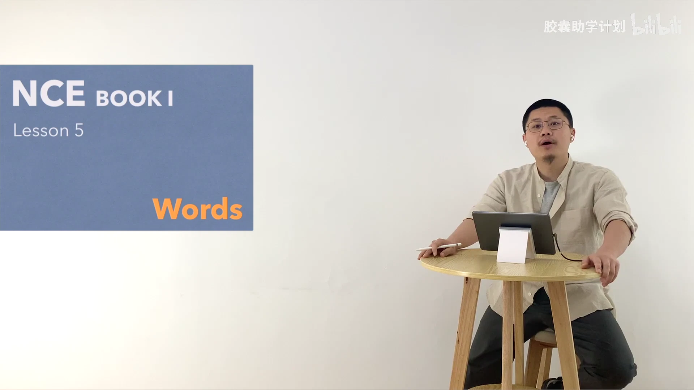

文字识别：bilb / 胶囊助学计划 / NCE / BOOKI / Lesson 5 / Words

### 画面 00:00:04

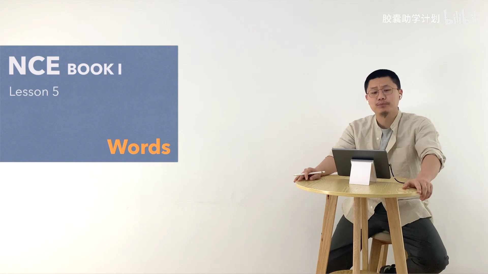

文字识别：胶囊助学计划 / NCE / BOOKI / Lesson 5 / Words

### 画面 00:00:07

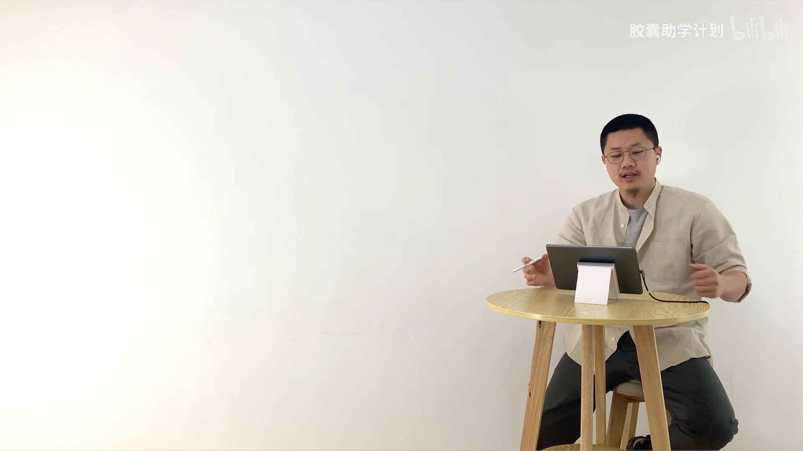

文字识别：胶囊助学计划

### 画面 00:00:09

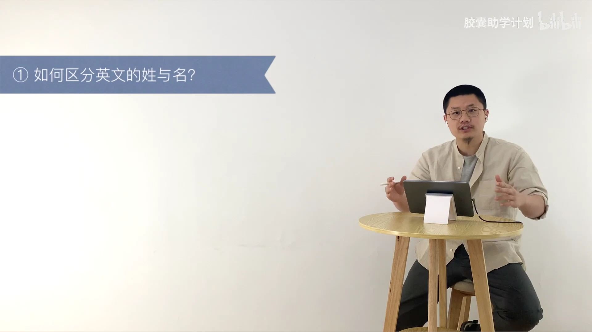

文字识别：0 biAb / 胶囊助学计划 / ① 如何区分英文的姓与名？

### 画面 00:00:16

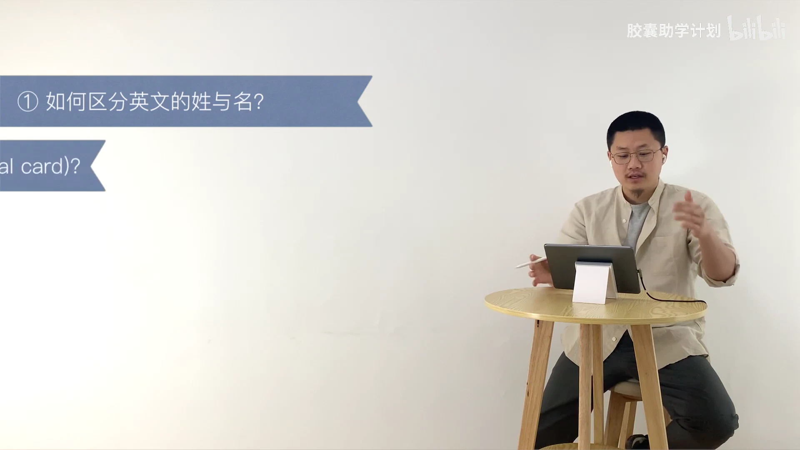

文字识别：Ibiltl / 胶囊助学计划 / ① 如何区分英文的姓与名? / al card)?

### 画面 00:00:18

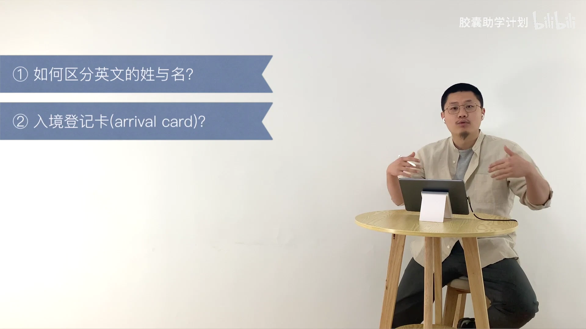

文字识别：bilH / 胶囊助学计划 / ① 如何区分英文的姓与名？ / ②入境登记卡(arrival card)?

### 画面 00:00:27

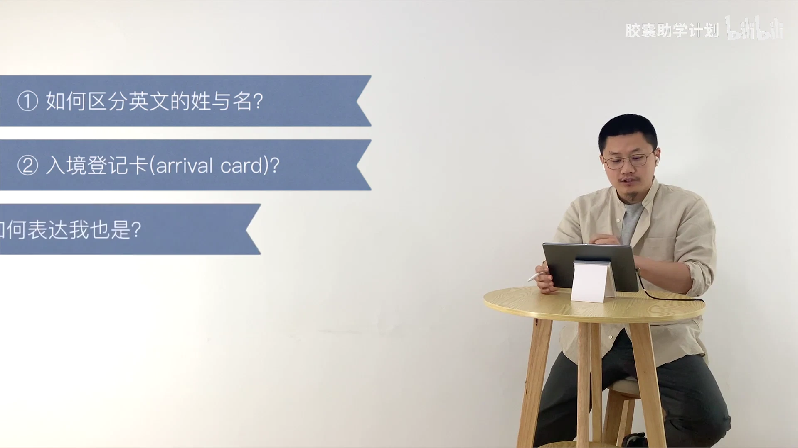

文字识别：biHb / 胶囊助学计划 / ①如何区分英文的姓与名？ / ②入境登记卡(arrival card)? / 何表达我也是？

### 画面 00:00:29

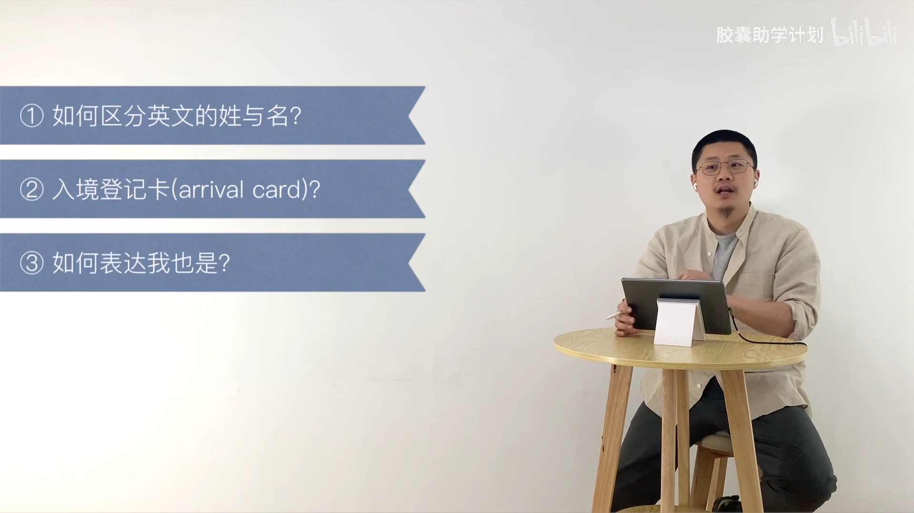

文字识别：bitb / 胶囊助学计划 / ①如何区分英文的姓与名？ / ②入境登记卡(arrival card)? / 如何表达我也是？

## 00:00:30–00:01:00

带着这三个问题，Hope you gonna enjoy it. 好，那上来我们先看，我相信很多同学可能认识这个人，大帅哥是吧？叫 David Johnson Beckham，大家都知道的，叫贝克汉姆，对吧？那我们看一下这三个分别是什么。首先呢，我们要知道一件事情，我们汉语当中是姓在前，名在后，对吧？那英文呢

### 画面 00:00:33

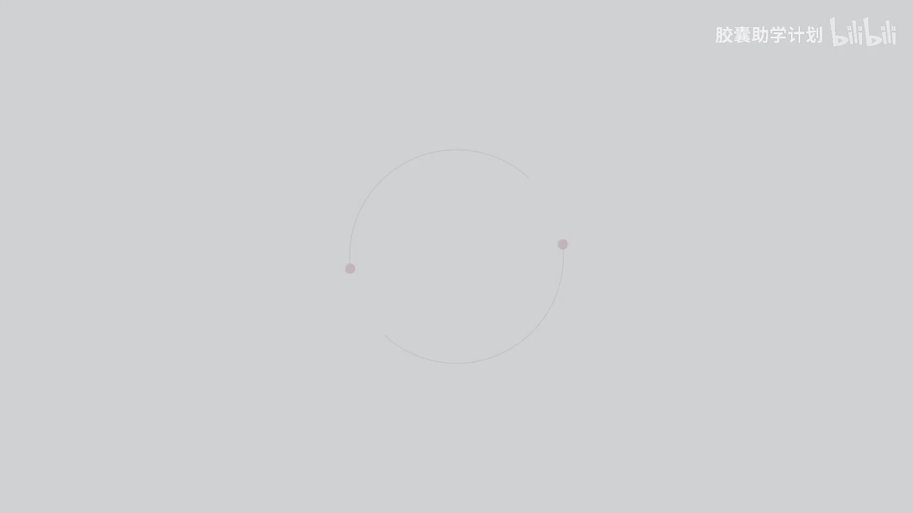

文字识别：胶囊助学计划bili / •

### 画面 00:00:37

### 画面 00:00:39

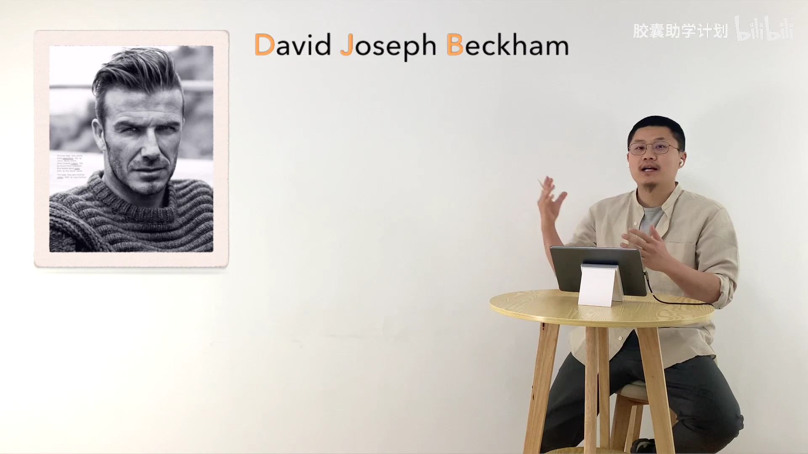

文字识别：胶囊助学计划in / David Joseph Beckham

### 画面 00:00:50

文字识别：胶囊助学计划Lil / David Joseph Beckham

### 画面 00:00:53

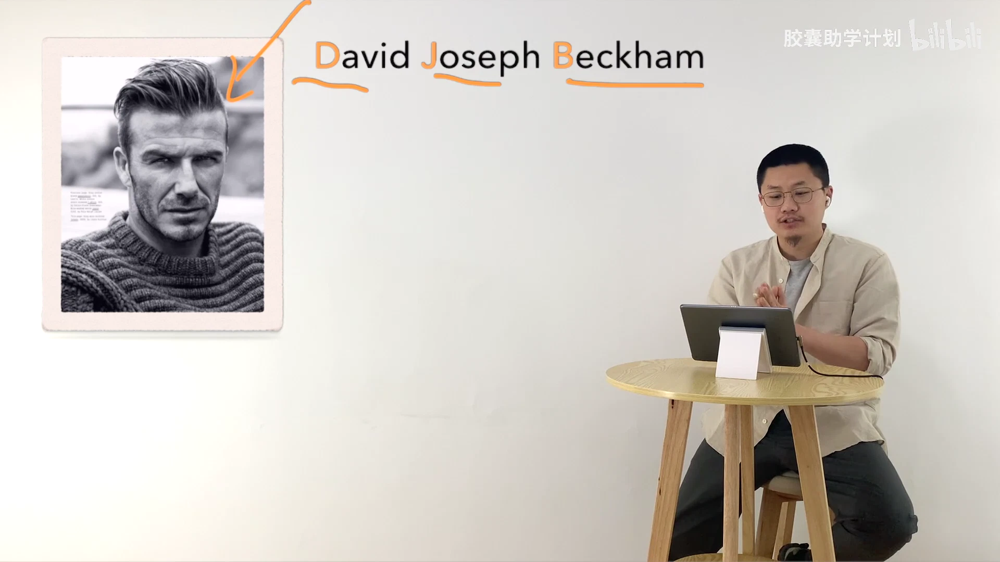

文字识别：胶囊助学计划 / 利 bitbi / David Joseph Beckham

## 00:01:00–00:01:30

是恰好反过来的，恰好是对调的。他们是名在前，姓在后。所以那你说 David Joseph Beckham，他姓什么呢？他姓的是 Beckham，他名为 David，而 Joseph 是什么？马上我们就讲到。那接下来用英文如何去说这些呢？我们一一去看。首先 David 是他的 first name，也叫 given name。 first name 很容易理解，first 叫做首先、

### 画面 00:01:03

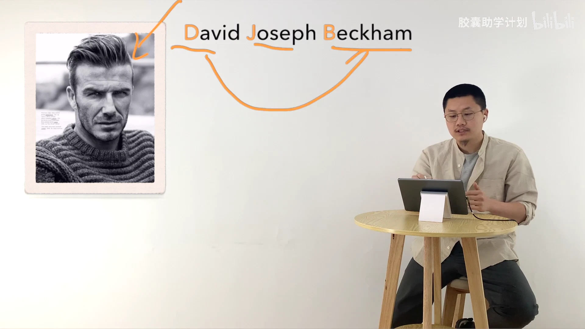

文字识别：胶囊助学计划l / David Joseph Beckham

### 画面 00:01:13

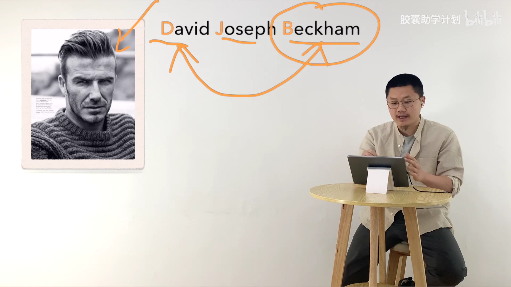

文字识别：胶囊助学计划 / David Josepl Beckham / 20

### 画面 00:01:15

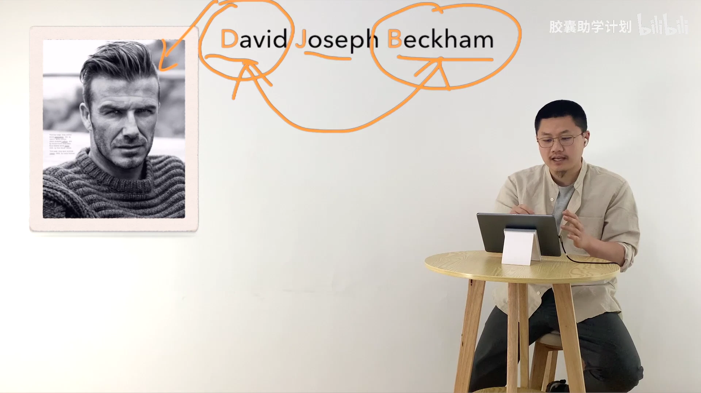

文字识别：bitBi / 胶囊助学计划 / David Josepl Beckham

### 画面 00:01:24

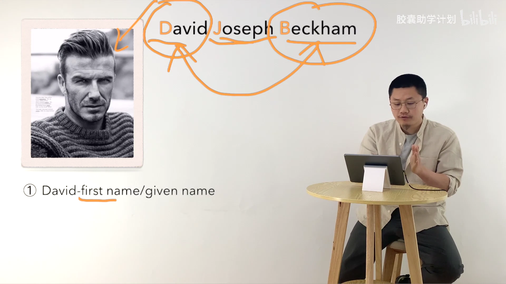

文字识别：biHb / 胶囊助学计划 / David Josepl Beckham / David-first name/given name / 1

### 画面 00:01:26

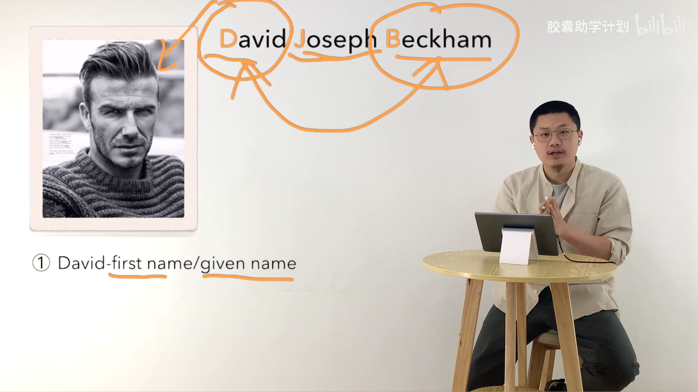

文字识别：bilib / 胶囊助学计划 / David Josepl Beckham / David-first name/given name / 1

## 00:01:30–00:02:00

一，那 name 叫名字，第一个出现的名字，哎，很很平铺直叙，就是基本的意思。第一个出现的名字，我们不确定它是什么，而后面这个就被别人给的名字，别人给了你一个名字，那你说别人给你的是你的姓还是名呢？我们的姓是遗传，就是从家族一代一代留下来的，对吧？这个不算别人给的，就你生在这个家族，那你自然而然就姓留了，姓王了，对吧？所以这不是别人给的，而别人给你

### 画面 00:01:40

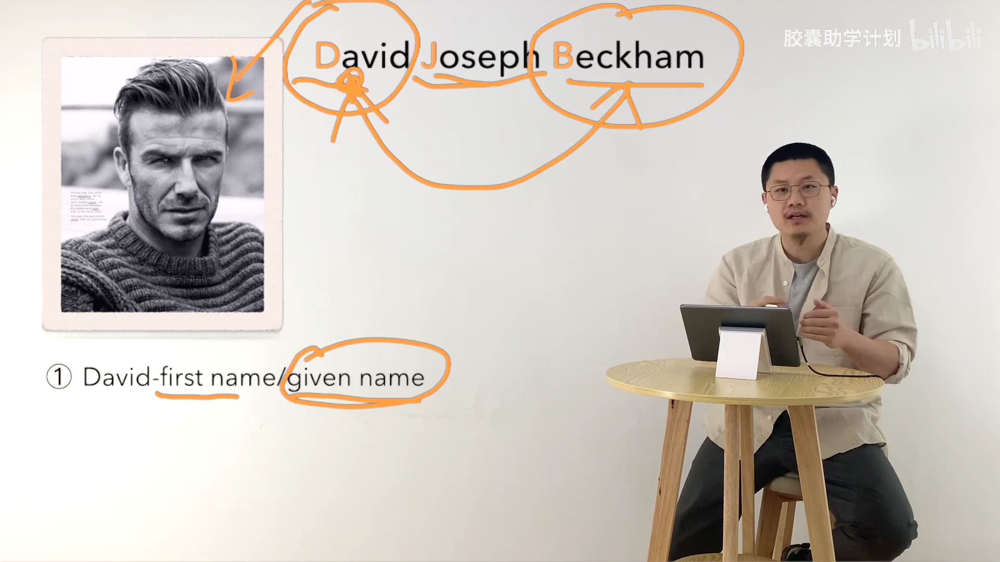

文字识别：Bilb / 胶囊助学计划 / avid Josepl Beckham / D / David-first name/ / 1 / given name

## 00:02:00–00:02:30

起，没有起姓，叫起名字，所以我们管它叫做名啊，姓名的名。所以你看到它是在前面的，对不对？那接下来呢，Joseph是什么呢？Joseph管它叫做middle name，哎，所谓的叫做中间名。这个不是我们今天讲课的重点。大多数情况下呢，各位也不需要知道对方的中间名是什么。只有当你们关系非常非常好的时候啊，可能不是两三面之缘，也不是说你们聊得很开心，你就

### 画面 00:02:04

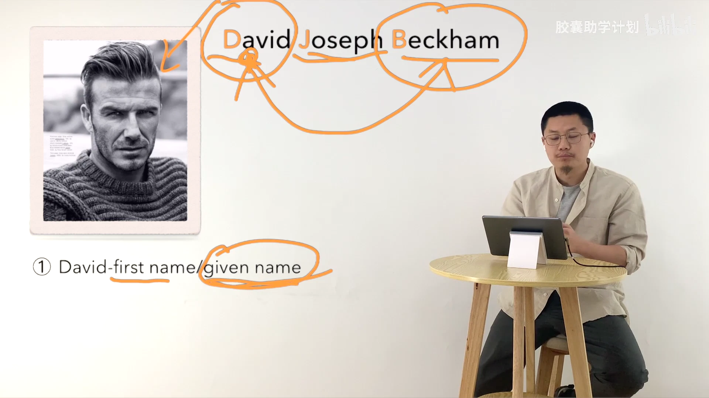

文字识别：胶囊助学计划 / avid Josepl Beckham / D / 2 / David-first name / given name

### 画面 00:02:08

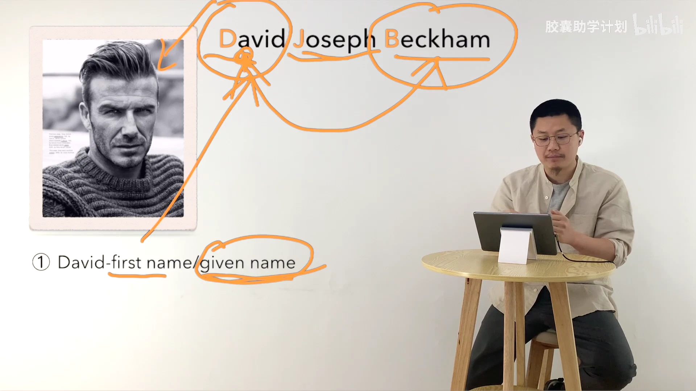

文字识别：Biibi / 胶囊助学计划 / avid Josepl Beckham / D / David-first name/ / given name

### 画面 00:02:13

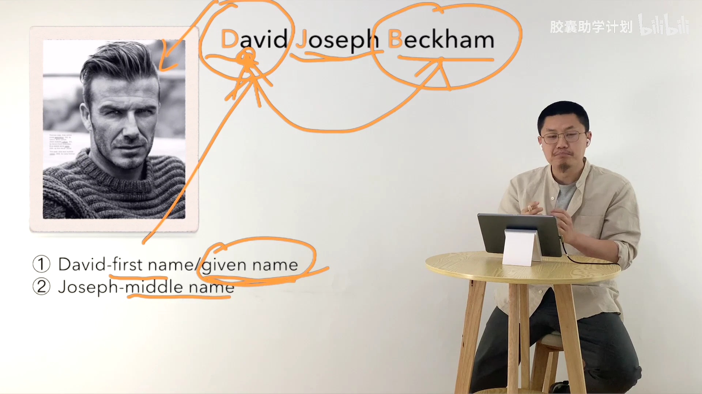

文字识别：LiLi / 胶囊助学计划 / avidJosepl Beckham / D / David-first name/ / given name / Joseph-middle name

## 00:02:30–00:03:00

会知道对方的中间名字了。一般都是要帮别人处理非常重要的事情，你可能才会知道别人的 middle name。所以它也不是我们今天的重点。其次呢， Beckham 是我们刚刚讲过的，我们说姓名是反过来的，那他们的姓是在后面，和我们汉语的姓在前面是不一样的。所以 Beckham 我们可以管他叫贝克汉姆先生啊，就像比如说我姓刘，那您管我叫刘先生是一样的，叫做 Beckham。那 Beckham

### 画面 00:02:30

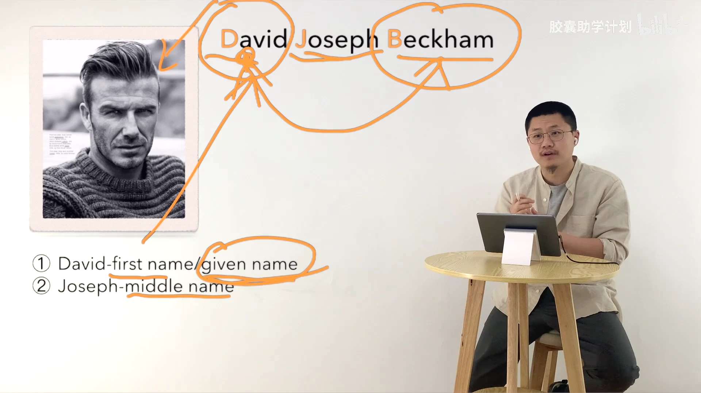

文字识别：胶囊助学计划 / avid Josepl Beckham / D / David-first name/ / given name / Joseph-middle name

### 画面 00:02:38

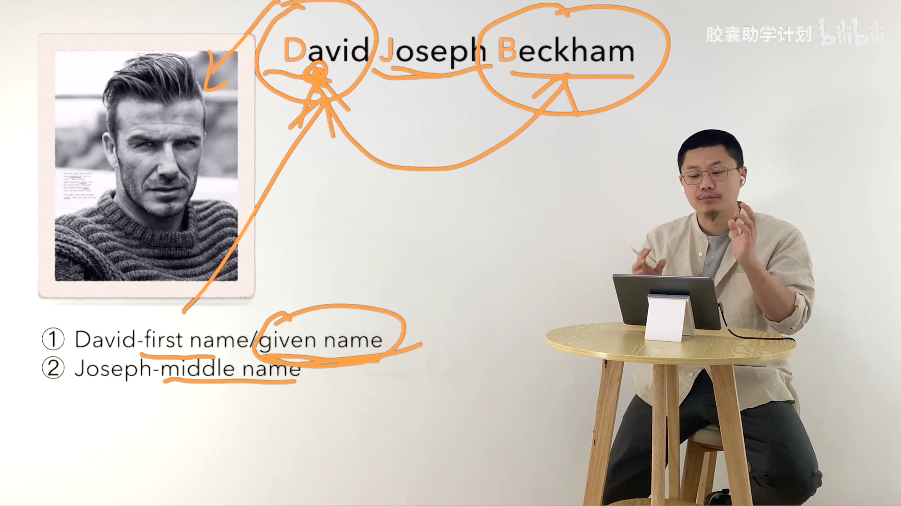

文字识别：biHb / 胶囊助学计划 / avidJosepl Beckham / D / 1 / David-first name/ / given name / Joseph-middle name

### 画面 00:02:53

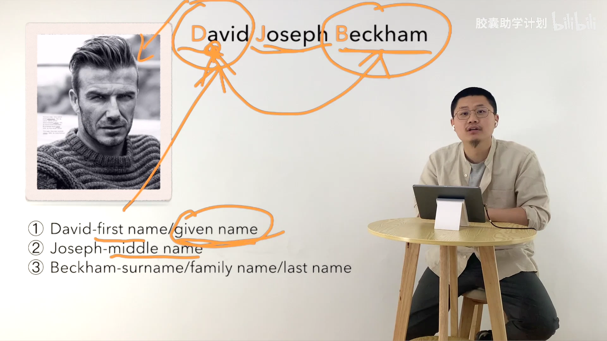

文字识别：bibi / 胶囊助学计划 / avidJosepl Beckham / D / David-first name/ / given name / Joseph-middle name / Beckham-surname/family name/last name

## 00:03:00–00:03:30

我们看一下他这个姓在英文当中怎么说。首先，last name对应的是这个first name，first name是第一个出现的，我们管它叫做名，而最后一个出现的last叫最后一个last name，管它叫做姓，对吧？那family name就是家族的名字啊，比如说我父亲这一支，对吧？我们全姓刘，那将来我的孩子也姓刘，对吧？所以管它叫做family name，也叫做姓。其次呢，还有一个用法叫做surname，也是表

### 画面 00:03:00

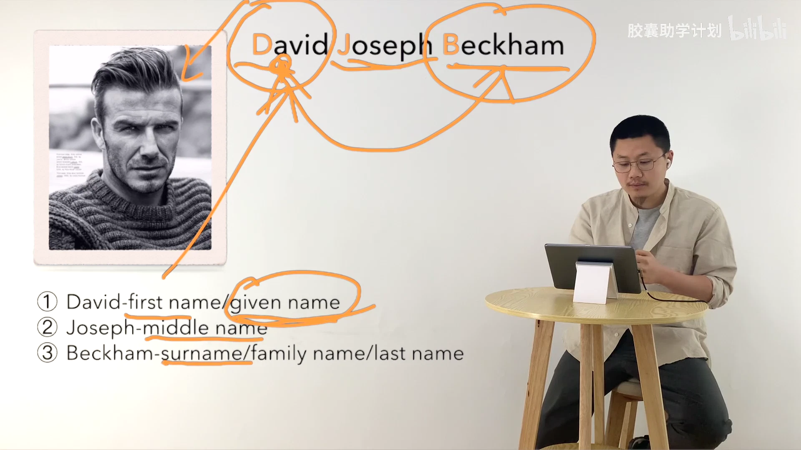

文字识别：biltib / 胶囊助学计划 / David Josepl Beckham / David-first name/ / given name / Joseph-middle name / Beckham-surname/family name/last name

### 画面 00:03:02

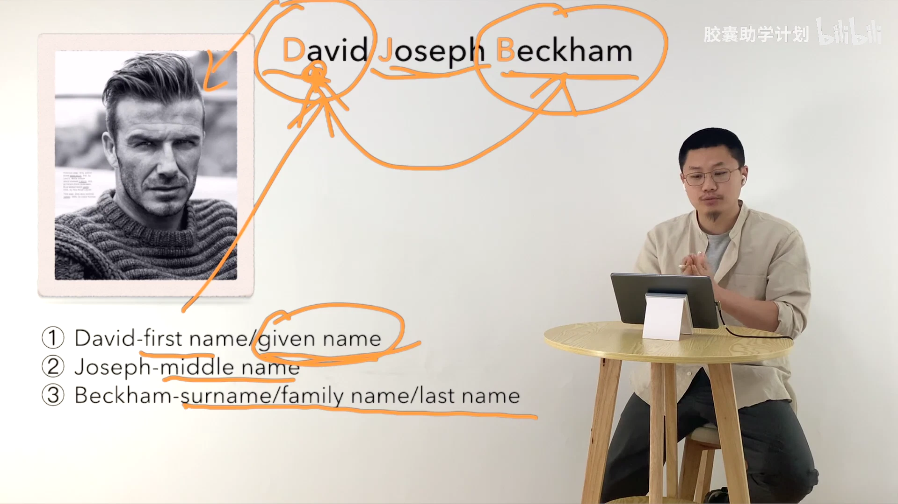

文字识别：bilbi / 胶囊助学计划 / David Josepl Beckham / David-first name/ / given name / Joseph-middle name / Beckham-surname/family name/last name

### 画面 00:03:04

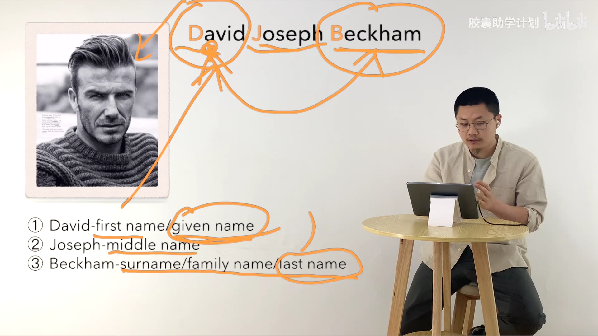

文字识别：biltbi / 胶囊助学计划 / David Josepl Beckham / David-first name / given name / Joseph-middle name / Beckham-surname/family name/last name

### 画面 00:03:06

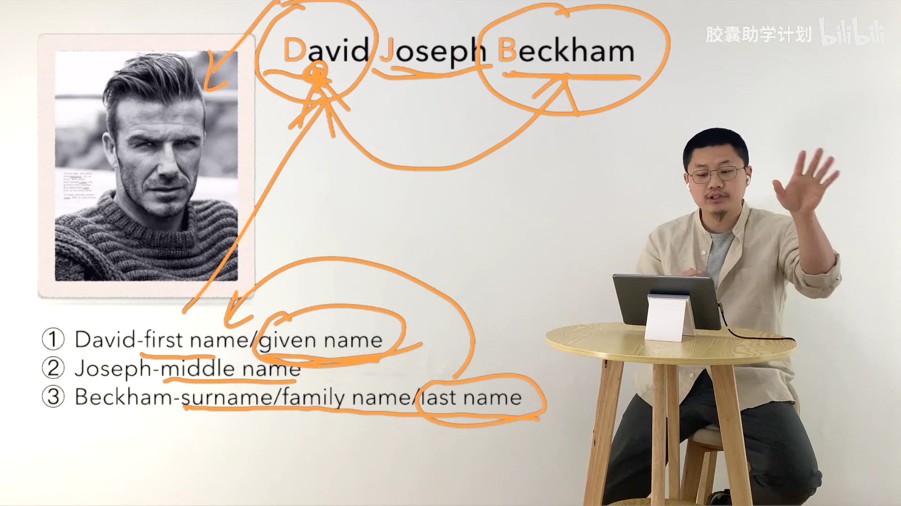

文字识别：胶囊助学计划 / avidJosepl Beckham / D / David-first name/ / given name / Joseph-middle name / Beckham-surname/family name/ / ast name

### 画面 00:03:10

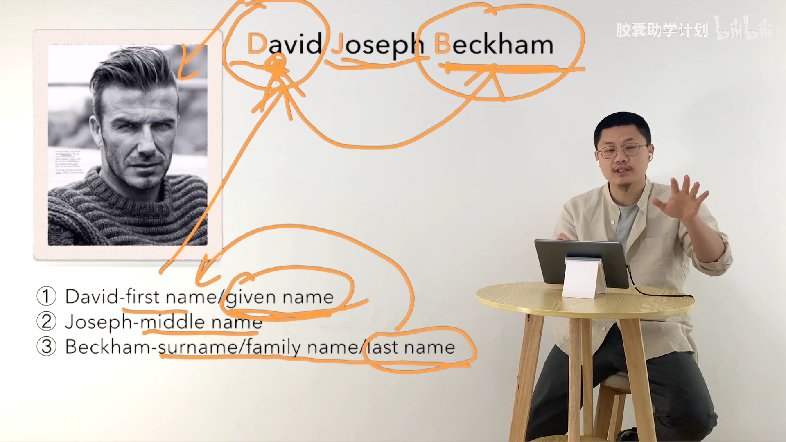

文字识别：bilD / 胶囊助学计划 / avid Josepl Beckham / D / David-first name / given name / Joseph-middle name / Beckham-surname/family name/ / Tast name

### 画面 00:03:15

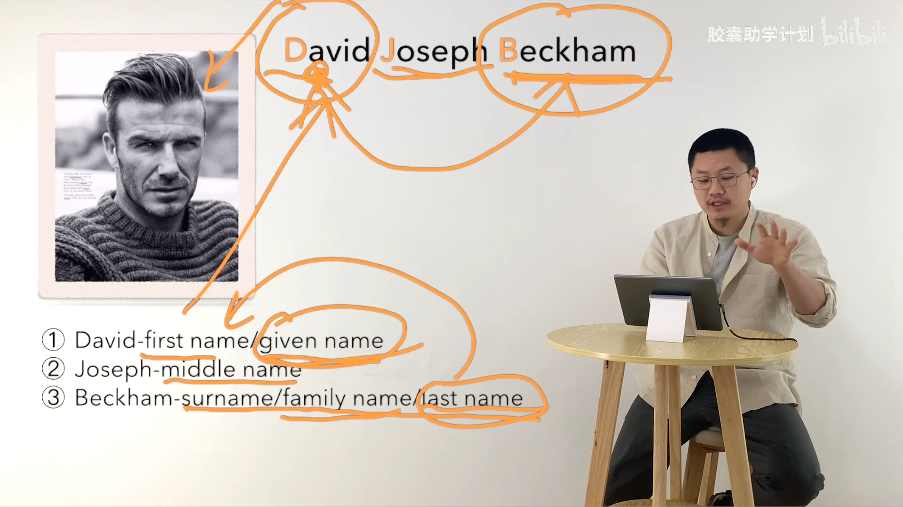

文字识别：Litbi / 胶囊助学计划 / avidJosepl Beckham / D / David-first name/ / given name / Joseph-middle / e name / Beckham-surname/family name/last name

## 00:03:30–00:04:00

示姓的意思。那接下来呢，我们一起看一下入境登记卡 arrival card 当中，它是哎如何去写 family name first name 如何去写的？我们看一下，别的我们先不管，我们现在只看黄色部分 family name。各位想一下，是你的姓还是你的名来着？家族共同拥有的一个名字，family 叫家庭对吧？家族啊，它的扩大范围叫家族共

### 画面 00:03:32

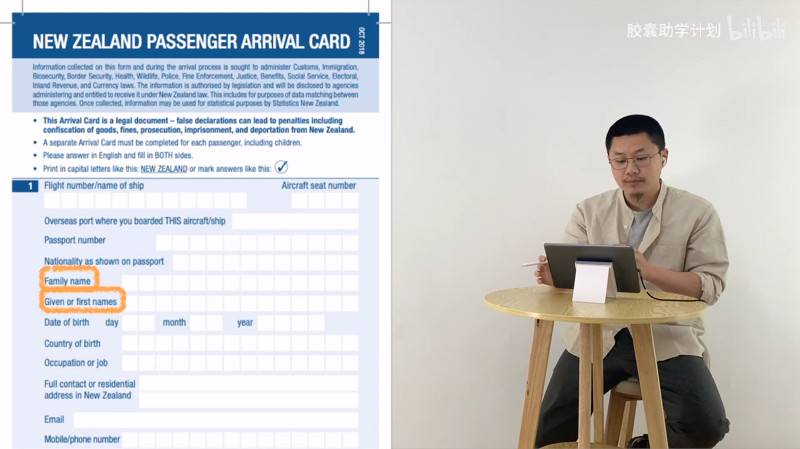

文字识别：胶囊助学计划 / NEW ZEALAND PASSENGER ARRIVAL CARD / OCT2018 / Information collected on this form and during the arrival process is sought to administer Customs, Immigration, / Biosecurity, Border Security, Heaitn, Wildife, Police, Fine Enforcement, Justice, Benefits, Social Service, Electoral, / Inland Revenue, and Currency laws.The information is authorised by legislation and will be disdlosed to agencies / administering and entitled to receive it under New Zealand law. This includes for purposes of data matching between / those agencies. Once collected, information may be used for statistical purposes by Statistics New Zealand. / This Arrival Card is a legal document-false declarations can lead to penalties including / confiscation of goods, fines, prosecution, imprisonment, and deportation from New Zealand. / A separateArrival Card must be compieted for each passenger, including chidren. /  Please answer in English and fill in BoTH sides. / Print in capital ltterslike this: NEW ZEALANDor mark answers like this: / Flight number/name of ship / Aircraft seat number / Overseas port where you boarded THIS aircraft/ship / Passport number / Nationality as shown on passport / Family name / Given or first names / Date of birth / day / month / year / Country of birth / Occupation or job / Full contact or residential / address in New Zealand / Email / Mobile/phone number

### 画面 00:03:51

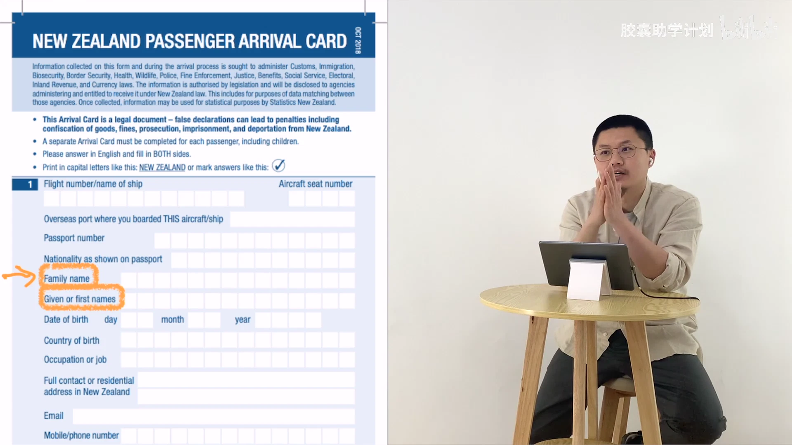

文字识别：胶囊助学计划 / NEW ZEALAND PASSENGER ARRIVAL CARD / OCT2018 / Information collected on this form and during the arrival process is sought to administer Customs, Immigration, / Biosecurity, Border Security, Health, Wildife, Police, Fine Enforcement, Justice, Benefits, Social Service, Electoral, / Inland Revenue, and Currency laws. The information is authorised by legislation and will be disciosed to agencies / administering and entitied to receive it under New Zealand law. This includes for purposes of data matching between / those agencies. Once collected, information may be used for statistical purposes by Statistics New Zealand. / This Arrival Card is a legal document-false declarations can lead to penalties including / confiscation of goods, fines, prosecution, imprisonment, and deportation from New Zealand. / A separate Arrival Card must be completed for each passenger, including children. / Please answer in English and fil in BoTH sides. / Print in capital letters like this: NEW ZEALAND or mark answers like this: / Flight number/name of ship / Aircraft seat number / Overseas port where you boarded THIS aircraft/ship / Passport number / Nationality as shown on passport / Family name / Given or first names / Date of birth / day / month / year / Country of birth / Occupation or job / Full contact or residential / address in New Zealand / Email / Mobile/phone number

## 00:04:00–00:04:30

同拥有的是我们的姓，对吧？比如说，那对于我来说就是 Liu， Liu，对吧？那 Given or first name 首先出现的名字，或者说被别人给的，别人给你起的，这个叫做名，而不是姓，对吧？别人不能起姓，只能起名，所以这个就是我们的名。哎，那对于我来说就是 Yu。 OK，那在这儿就填好了，就非常的简单，叫做 Arrival Card。接下来我们慢慢的再去看剩下的这些都是什么。 OK，那各位学到了第一个

### 画面 00:04:03

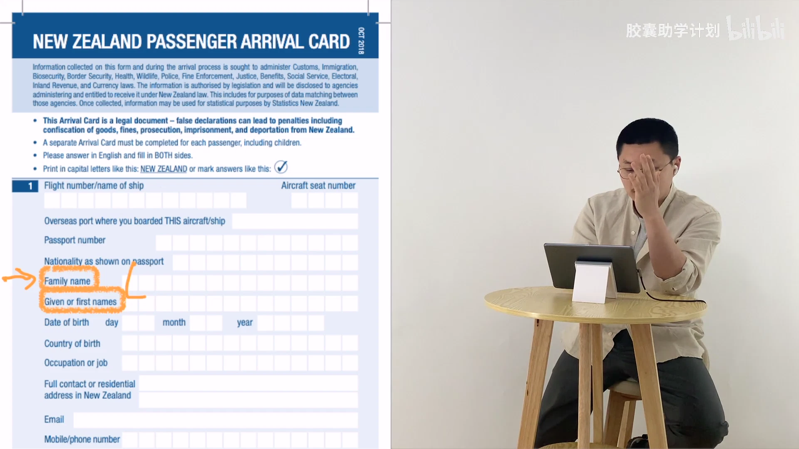

文字识别：Lib / 胶囊助学计划 / NEW ZEALAND PASSENGER ARRIVAL CARD / OCT 2018 / Information collected on this form and during the arrival process is sought to administer Customs, Immigration, / Biosecurity, Border Security, Health, Wildlife, Police, Fine Enforcement, Justice, Benefits, Social Service, Electoral, / Inland Revenue, and Currency laws. The information is authorised by legislation and wil be disciosed to agencies / administering and entitled to receive it under New Zealand law. This includes for purposes of data matching between / those agencies. Once collected, information may be used for statistical purposes by Statistics New Zealand. / This Arrival Card is a legal document – false declarations can lead to penalties including / confiscation of goods, fines, prosecution, imprisonment, and deportation from New Zealand. / A separate Arrival Card must be compieted for each passenger, including children. / • Please answer in English and fillin BoTH sides. / Print in capital leters like this: NEW ZEALAND or mark answers like this: / Flight number/name of ship / Aircraft seat number / Overseas port where you boarded THIS aircraft/ship / Passport number / Nationality as shown on passport / Family name / Given or first names / Date of birth / day / month / year / Country of birth / Occupation or job / Full contact or residential / address in New Zealand / Email / Mobile/phone number

### 画面 00:04:10

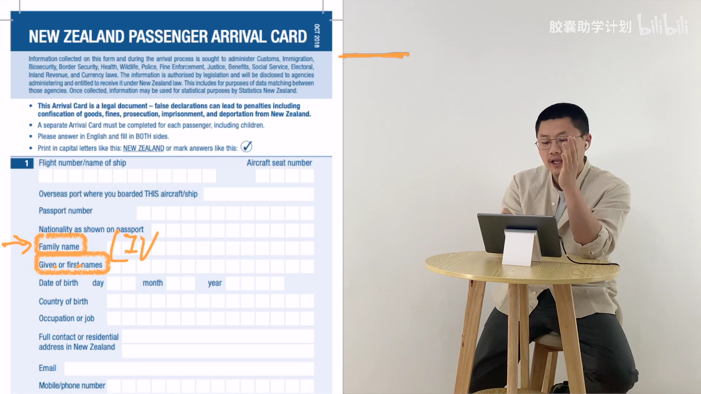

文字识别：BiBii / 胶囊助学计划 / NEW ZEALAND PASSENGER ARRIVAL CARD / OCT 2018 / Information collected on tnis form and during the arrival process is sought to administer Customs, Immigration, / Biosecurity, Border Security, Health, Wildife, Police, Fine Enforcement, Justice, Benefits, Social Service, Electoral, / Inland Revenue, and Currency laws. The information is authorised by legislation and wil be disciosed to agencies / administering and entitled to receive it under New Zealand law. This includes for purposes of data matching between / those agencies. Once collected, information may be used for statistical purposes by Statistics New Zealand. / This Arrival Card is a legal document -false declarations can lead to penalties including / confiscation of goods, fines, prosecution, imprisonment, and deportation from New Zealand. / •A separate Arrival Card must be completed for each passenger, including children. / •Please answer in English and fillin BoTH sides. / Print in capital leters like this:NEWZEALANDor markanswers like this: / Flight number/name of ship / Aircraft seat number / Overseas port where you boarded THIS aircraft/ship / Passport number / Nationality as shown on passport / LIV / Family name / Giver or first names / Date of birth / day / month / year / Country of birth / Occupation or job / Full contact or residential / address in New Zealand / Email / Mobile/phone number

### 画面 00:04:13

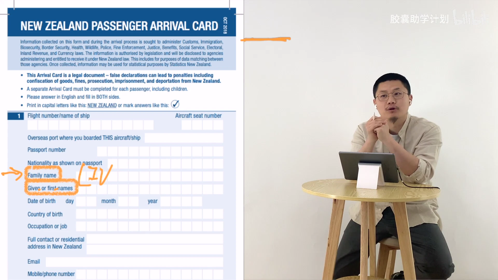

文字识别：胶囊助学计划 / NEW ZEALAND PASSENGER ARRIVAL CARD / OCT 2018 / Information collected on this form and during the arrival process is sought to administer Customs, Immigration, / Biosecurity, Border Security, Health, Wildife, Police, Fine Enforcement, Justice, Benefits, Social Service, Electoral, / Inland Revenue, and Currency laws. The information is authorised by legislation and will be disclosed to agencies / administering and entitled to receive it under New Zealand law. This includes for purposes of data matching between / those agencies. Once collected, information may be used for statistical purposes by Statistics New Zealand. / This Arrival Card is a legal document -false declarations can lead to penalties including / confiscation of goods, fines, prosecution, imprisonment, and deportation from New Zealand. / A separate Arrival Card must be completed for each passenger, including children. / • Please answer in English and fillin BoTH sides. / Print in capital leterslike this: NEW ZEALAND or mark answers like this: / Flight number/name of ship / Aircraft seat number / Overseas port where you boarded THIS aircraft/ship / Passport number / Nationality as shown on passport / IV / Family name / Giver or first names / Date of birth / day / month / year / Country of birth / Occupation or job / Full contact or residential / address in New Zealand / Email / Mobile/phone number

### 画面 00:04:19

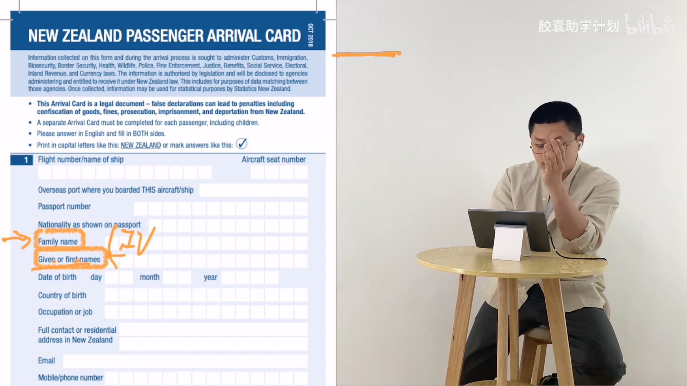

文字识别：LiHL / 胶囊助学计划 / NEW ZEALAND PASSENGER ARRIVAL CARD / OCT2018 / Information collected on this form and during the arrival process is sought to administer Customs, Immigration, / Biosecurity, Border Security, Heaith, Wildife, Police, Fine Enforcement, Justice, Benefits, SocialService, Electoral， / Inland Revenue, and Currency laws. The information is authorised by legislation and will be disclosed to agencies / administering and entitled to receive it under New Zealand law. This includes for purposes of data matching between / those agencies. Once collected, information may be used for statistical purposes by Statistics New Zealand. / This Arrival Card is a legal document - false declarations can lead to penalties including / confiscation of goods, fines, prosecution, imprisonment, and deportation from New Zealand. / A separate Arrival Card must be completed for each passenger, including children. / Please answer in English and fill in BoTH sides. / Print in capital letters likethis:NEWZEALANDor markanswers like this: / Flight number/name of ship / Aircraft seat number / Overseas port where you boarded THIS aircraft/ship / Passport number / Nationality as shown on passport / 2V / Family name / Giver or first names / Date of birth / day / month / year / Country of birth / Occupation or job / Full contact or residential / address in New Zealand / Email / Mobile/phone number

### 画面 00:04:27

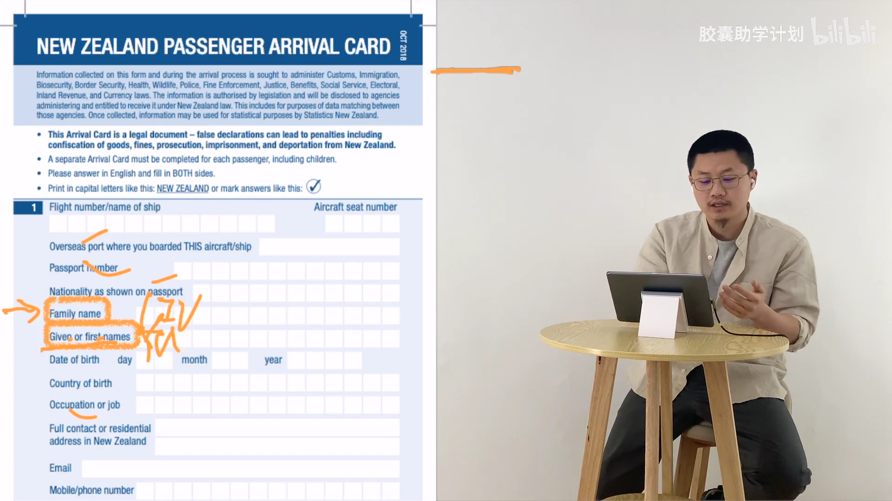

文字识别：Lib / 胶囊助学计划 / NEW ZEALAND PASSENGER ARRIVAL CARD / OCT 2018 / Information collected on this form and during the arrival process is sought to administer Customs, Immigration, / Biosecurity, Border Security, Healtn, Wildife, Police, Fine Enforcement, Justice, Benefits, Social Service, Electoral, / Inland Revenue, and Currency laws. The information is authorised by legislation and wil be disdiosed to agencies / administering and entitled to receive it under New Zealand law. This includes for purposes of data matching between / those agencies. Once collected, information may be used for statistical purposes by Statistics New Zealand. / This Arrival Card is a legal document - false declarations can lead to penalties including / confiscation of goods, fines, prosecution, imprisonment, and deportation from New Zealand. / A separate Arrival Card must be completed for each passenger, including children. / Please answer in English and fil in BOTH sides. / Print in capital leters like this: NEW ZEALAND or mark answers like this: / Flight number/name of ship / Aircraft seat number / Overseas port where you boarded THIS aircraft/ship / Passport mber / Nationality as shown on nassport / Family name / Giver or firs+names / Date of birth / day / month / year / Country of birth / Occupation or job / Full contact or residential / address in New Zealand / Email / Mobile/phone number

### 画面 00:04:29

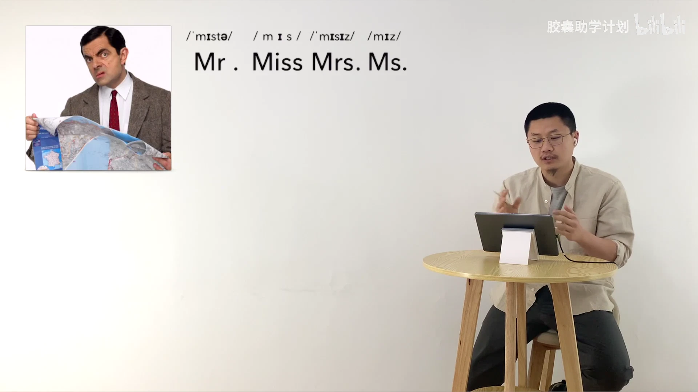

文字识别：胶囊助学计划b / /'mista/ / /mIs/ /'mIsIz/ /mIz/ / Mr . Miss Mrs. Ms. / V

## 00:04:30–00:05:00

点，第二个点我们去看一下几个单词，我先带着各位读一下。首先第一个来，Mr，Mr，Next one，Miss，Next one，Mrs，Next one，Miss。好，首先各位需要知道的是第一个单词，它指的是先生的意思。比如说各位很清楚的这个英国呃搞笑的这样的一个憨豆先生，我们管他叫做 Mr. Bin。

### 画面 00:04:41

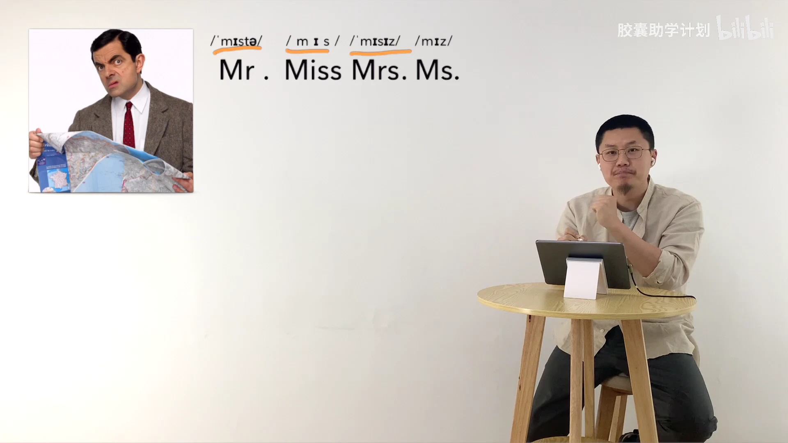

文字识别：胶囊助学计划bl / /'mista/ / /mIs/ /'mIsIz//mIz/ / Mr. Miss Mrs. Ms.

### 画面 00:04:53

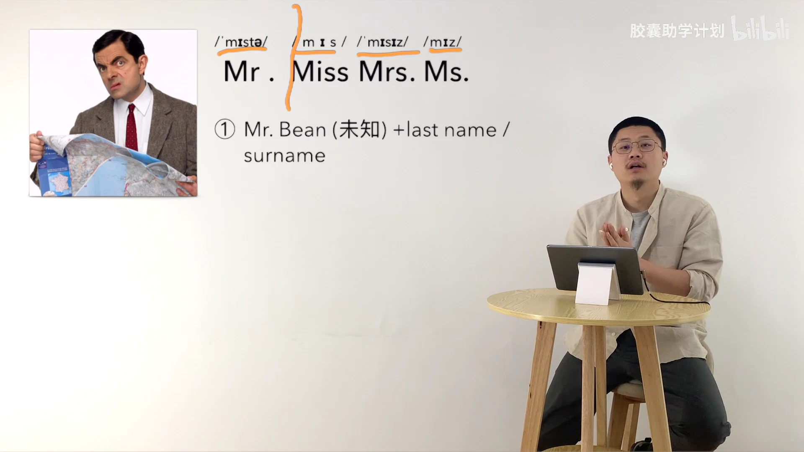

文字识别：胶囊助学计划 / /'mista/ / mIs/ /'mIsIz//mIz/ / Mr. / Miss Mrs. Ms. / Mr. Bean (未知)+last name/ / surname

## 00:05:00–00:05:30

好，你想一下啊，Mr叫先生的意思，我汉语叫刘，我姓刘，所以人家管我叫刘先生。我们是用Mr加上对方的last name最后一个英文是反过来的，记住啊，或者叫Surname或者叫Family name。那我写的未知是什么意思？就是我们并不知道对方是否已婚了。Mr只表示先生，而表示女士的这三个单词呢，就略有不太一样了。首先看第一个

### 画面 00:05:01

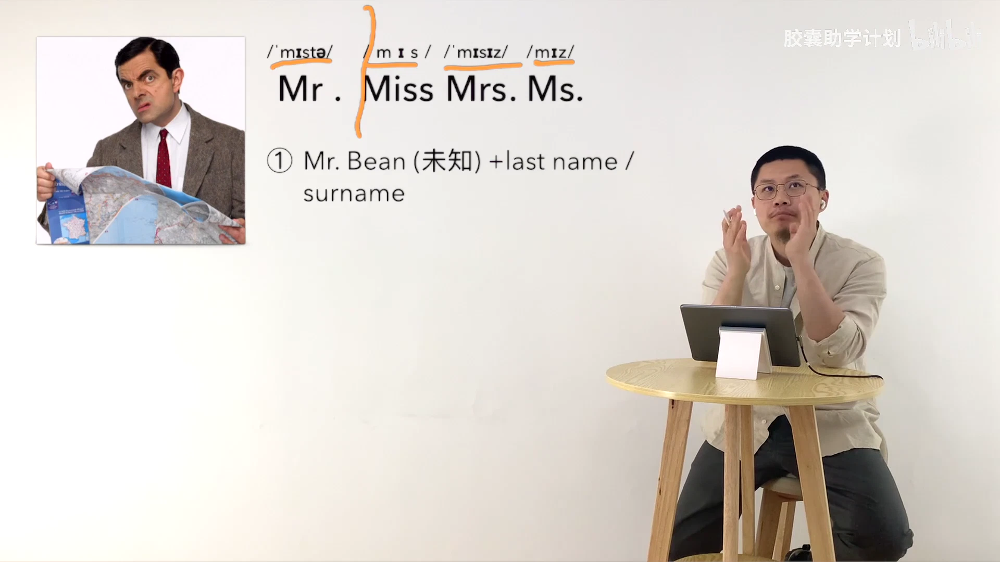

文字识别：胶囊助学计划 / /'mista/ / mIs/ /'mIsIz/_/mIz/ / Mr. / Miss Mrs. Ms. / Mr. Bean(未知)+last name/ / surname

### 画面 00:05:13

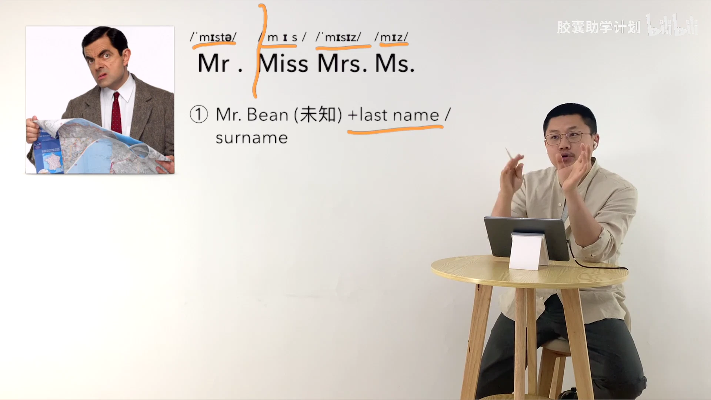

文字识别：胶囊助学计划il / /'mista/ / mIs/ /'mIsIz//mIz/ / Mr. / Miss Mrs. Ms. / Mr. Bean(未知)+last name/ / surname

### 画面 00:05:26

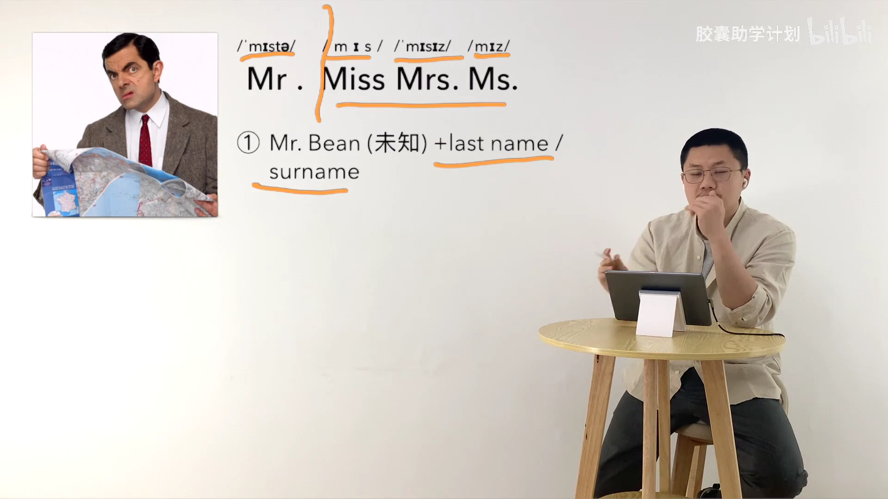

文字识别：胶囊助学计划 /  bitl / /'mista/ / mIs/ /'mIsIz//mIz/ / Mr. / Miss Mrs. Ms. / Mr. Bean(未知)+last name/ / surname

## 00:05:30–00:06:00

叫做 Mrs. Mrs. 加上对方的姓，那这个时候表示的是对方是已婚的。那有的时候您分不清对方是否已婚怎么办呢？用下面这个词叫做 Miss。比如说环球小姐叫做 Miss Universe。你看环球小姐，不管对方结婚没结婚，我不关心，我只关心的管她叫做女士，所以叫做 Miss。比如说

### 画面 00:05:42

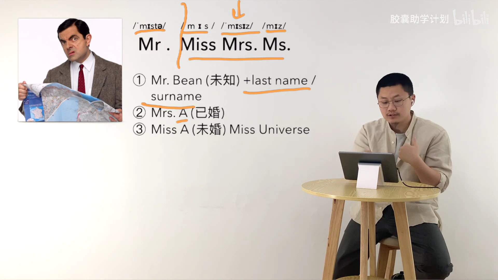

文字识别：Bitbi / 胶囊助学计划 / /'mista/ / mIs/ /'mIsIz/_/mIz/ / Mr. / Miss Mrs. Ms. / Mr. Bean(未知)+last name/ / surname / Mrs.A(已婚) / Miss A(未婚)Miss Universe

### 画面 00:05:47

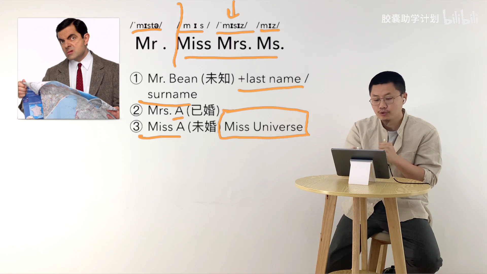

文字识别：BiiBi / 胶囊助学计划 / /'mista/ / mIs/ /'mIsIz//mIz/ / Mr. / Miss / Mrs. Ms. / Mr. Bean(未知)+last name/ / surname / Mrs.A(已婚) / MissA(未婚 / Miss Universe

## 00:06:00–00:06:30

Colombia，对吧？哥伦比亚，那哥伦比亚小姐叫做 Miss Colombia。 Okay， very good. Next one，那 Miss 就是我们去不忽略，我们去不强调她是已婚还是未婚的时候，我们就直接用 Miss 就可以了。那根据我的个人经验呢，其实我们大部分情况下呀，用 Mister 和 Miss 就可以了。你不用，除非对方强调说你要叫我 Misses 或者 Miss，

### 画面 00:06:10

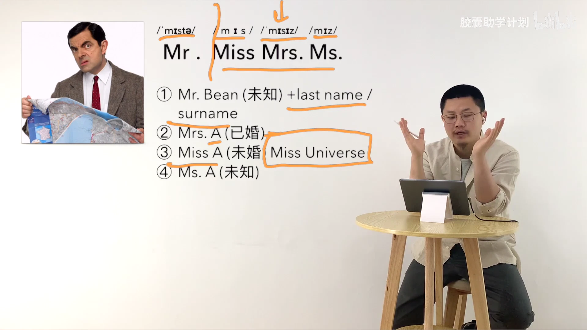

文字识别：胶囊助学计划 / /'mista/ / mIs/ /'mIsIz//mIz/ / Mr. / Miss /  Mrs.Ms. / Mr. Bean (未知)+last name/ / surname / Mrs.A(已婚) / MissA(未婚 / Miss Universe / 4Ms.A(未知)

### 画面 00:06:21

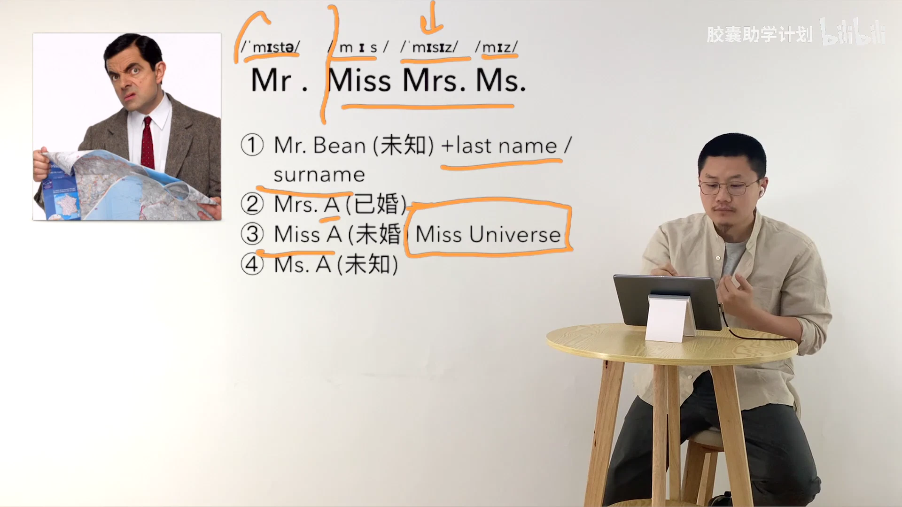

文字识别：bitb / 胶囊助学计划 / 'mista/ / mIs/ /'mIsIz/_/mIz/ / Mr. / Miss / Mrs. Ms. / Mr. Bean (未知)+last name/ / surname / Mrs.A(已婚) / MissA(未婚 / Miss Universe / 4Ms.A(未知)

### 画面 00:06:23

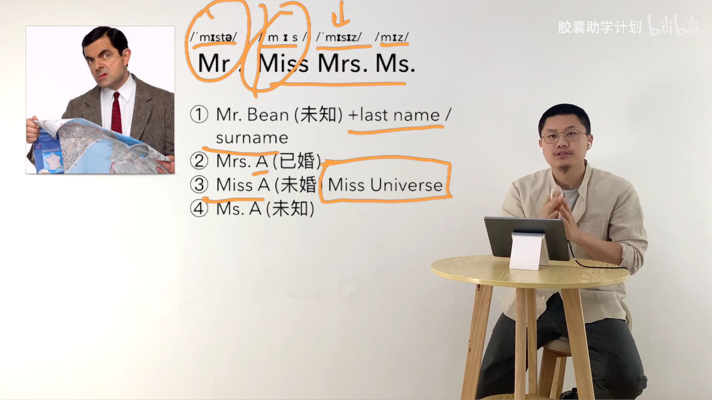

文字识别：BiliLi / 胶囊助学计划 / 'mista/ / mⅠs/ / /'mIsIz/ / /mIz/ / Mr / Miss Mrs. Ms. / Mr. Bean (未知) / +last name / / surname / Mrs.A(已婚） / MissA(未婚 / Miss / Universe / Ms.A(未知)

### 画面 00:06:26

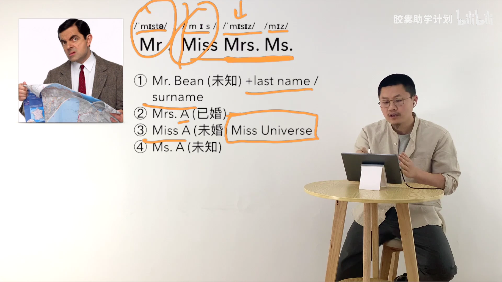

文字识别：BitBi / 胶囊助学计划 / 'mista/ / mⅠs/ / /'mIsIz/ / /mIz/ / Mr / Miss Mrs. Ms. / Mr. Bean (未知) / +last name / / surname / Mrs.A(已婚) / MissA(未婚 / Miss / Universe / Ms.A(未知)

### 画面 00:06:28

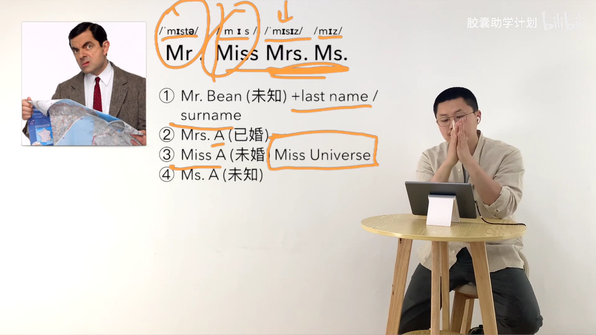

文字识别：胶囊助学计划 / 'mista/ / mⅠs/ / /'mISIz/ / /mIz/ / Mr / Miss Mrs. Ms. / Mr. Bean(未知) / +last name / / surname / Mrs.A(已婚） / MissA(未婚 / Miss / Universe / Ms.A(未知)

## 00:06:30–00:07:00

大部分情况下 Mr. 和 Miss 足以解决这个问题。 OK，那我们接下来回过头来再看一下，那我们应该管 David Joseph Beckham，管他叫 Mr. David 还是 Beckham 呢？哎，刚才我们讲了，跟汉语是反着的，汉语是姓在前，名在后，而英文是名在前，姓在后，所以叫 Mr. Beckham。 Very good。那这个地方有一个很好玩的语言

### 画面 00:06:33

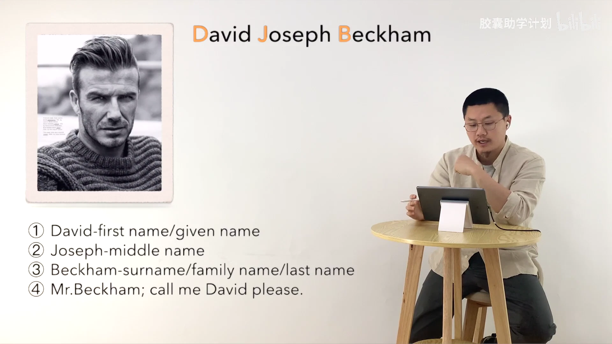

文字识别：胶囊助学计划 / David Joseph Beckham / ① David-first name/given name / Joseph-middle name / Beckham-surname/family name/last name / Mr.Beckham; call me David please.

### 画面 00:06:37

文字识别：胶囊助学计划 / David Joseph Beckham / ① David-first name/given name / Joseph-middle name / Beckham-surname/family name/last name / Mr.Beckham; call me David please.

### 画面 00:06:39

文字识别：胶囊助学计划l / David Joseph Beckham / ① David-first name/given name / Joseph-middle name / Beckham-surname/family name/last name / Mr.Beckham; call me David please.

### 画面 00:06:42

文字识别：胶囊助学计划bl / David Joseph Beckham / ① David-first name/given name / Joseph-middle name / Beckham-surname/family name/last name / Mr.Beckham; call me David please.

### 画面 00:06:48

文字识别：胶囊助学计划H / David Joseph Beckham / ① David-first name/given name / Joseph-middle name / Beckham-surname/family name/last name / Mr.Beckham; call me David please.

### 画面 00:06:50

文字识别：胶囊助学计划biH / David JosephBeckham / ① David-first name/given name / Joseph-middle name / Beckham-surname/family name/last name / Mr.Beckham; call me David please.

### 画面 00:06:56

文字识别：biibi / 胶囊助学计划 / David JosephBeckham / ① David-first name/given name / Joseph-middle name / Beckham-surname/family name/last name / Mr.Beckham; call me David please.

## 00:07:00–00:07:30

现象，就是当你管外族人，比如说我们假设举个例子，比如说我因为某种机缘巧合，哎，能去采访 Beckham，那我就会管他叫。最开始刚见面一定要非常的有礼貌，非常的表达敬意，所以你最开始的时候说叫 Mister Beckham。他如果想跟你也拉近距离，他就会说这样一句话，叫 Call me David, please。也就类似于说你管他叫刘先生，他说哎，您别管我叫刘先生，管我叫小雨就行了，对吧？雨是我的

### 画面 00:07:03

文字识别：胶囊助学计划 / David JosephBeckham /  David-first name/given name / 1 / Joseph-middle name / Beckham-surname/family name/last name / Mr.Beckham; call me David please.

### 画面 00:07:20

文字识别：u biib / 胶囊助学计划 / David JosephBeckham / ① David-first name/given name / Joseph-middle name / Beckham-surname/family name/last name / Mr.Beckham call me David please.

### 画面 00:07:22

文字识别： bililbi / 胶囊助学计划 / David JosephBeckham / David-first name/given name / Joseph-middle name / Beckham-surname/family name/last name / Mr.Beckhamcall me David please.

## 00:07:30–00:08:00

名，哎，所以在这个地方叫 call me David please，非常好的一个点。其次呢，我们看一个非常简单的表达早安的一个说法，叫做 good morning， good morning， very good。那在这个地方，我们复习一下自然拼读法则，g这个单词这个字母放在单词当中去发 g，d 这个单字母放在单词当中去发的是 d，m 放在单词当中去发的是 m，而 n 放在单词当中去发

### 画面 00:07:34

文字识别：胶囊助学计划l / /gud//'mo:nin/ / good morning / ① g /d/ etc.

### 画面 00:07:39

文字识别：胶囊助学计划 / /gud// mｏ:niη/ / good morning / ① g /d/ etc.

### 画面 00:07:45

文字识别：胶囊助学计划bli / /gud//'mo:nin/ / good morning / ① g /d/ etc.

### 画面 00:07:52

文字识别：胶囊助学计划u / gud//mo:nin/ / good morning / ① g /d/ etc.

### 画面 00:07:57

文字识别：胶囊助学计划i / good morning / ① g /d/ etc.

## 00:08:00–00:08:30

发的是嗯， OK 都是鼻音啊，非常的简单。其次呢，大部分情况下，我们在去跟别人打招呼的时候呢，你可以说 Good morning，你也可以用更加随意的一个方式，叫做 Morning，就完全够用了。 OK，这其实和我们之前说的 Thank you very much， Thank you so much，那你大多数情大多数的情况下说 Thank you 就一样了，就 OK 了啊，不需要发把它一定要说全啊。 Good morning， Morning， OK。那接下来我们一起

### 画面 00:08:04

文字识别：胶囊助学计划 / moiniη/ / morning / good / ① / g /d/ etc.

### 画面 00:08:06

文字识别：biltli / 胶囊助学计划 / gud//mo:nin/ / morning / good / ① g /d/ etc. / MormmS

### 画面 00:08:08

文字识别：胶囊助学计划 / /gud//m3:nin/ / good morning / ① / g /d/ etc. / Morning / 2

### 画面 00:08:22

文字识别：胶囊助学计划 / /ｇud//'mｏiniη/ / good morning / 1 / g /d/ etc. / ② Morning

### 画面 00:08:28

文字识别：CARR / 胶囊助学计划 / good morning / gooda / afternoon / good e / evening / good night / the / TRUMAN / 楚门的世界 The Truman Show (1998) / 02:46 / THE / STORY / 。 / A

## 00:08:30–00:09:00

看一下《楚门的世界》当中，他如何一口气儿非常好的一个小的视频素材，一口气儿把 Good morning, 早安; Good afternoon, 下午好; Good evening, 晚上好和 Good night, 晚安一口气儿说出来了。我们一起做一下小的听力练习。 Good morning, morning, good morning. Oh, and in case I don't see you, good afternoon, good evening, and good night. Okay, good morning, and in case I don't see you, good afternoon,

### 画面 00:08:30

文字识别：CARR / 胶囊助学计划 / morning / good r / good / afternoon / good / evening / good night / the / TRUMAN / 楚门的世界 The Truman Show (1998) / 02:46 / THE / STORY

### 画面 00:08:32

文字识别：LiL / ARR / 胶囊助学计划 / good r / morning / good / afternoon / good / evening / good night / the / TRUMAN / 楚门的世界 The Truman Show (1998) / 02:46 / THE / STORY / 。 / L

### 画面 00:08:34

文字识别：ARR / 胶囊助学计划 / morning / good / good / afternoon / good / evening / good night / the / TRUMAN / 楚门的世界 The Truman Show (1998) / 02:46 / THE / STORY / 。 / A / L

### 画面 00:08:36

文字识别：CARR / 胶囊助学计划 / morning / good  / good / afternoon / good / evening / good night / the / TRUMAN / 楚门的世界 The Truman Show (1998) / 02:46 / THE / STORY / 。 / L

### 画面 00:08:39

文字识别：胶囊助学计划 / CARR / morning / good / good / afternoon / good / evening / good night / the / TRUMAN / 楚门的世界 The Truman Show (1998) / 02:46 / THE / STORY / 。 / A / L

### 画面 00:08:41

文字识别：ARR / 胶囊助学计划 / morning / good  / good / afternoon / good / evening / good night / the / TRUMAN / 楚门的世界 The Truman Show (1998) / 02:46 / THE / STORY / L

### 画面 00:08:44

文字识别：ARR / 胶囊助学计划 / good morning / good a / afternoon / goode / evening / good night / the / TRUMAN / 楚门的世界 The Truman Show(1998) / 02:46 / THE / STORY / L

### 画面 00:08:46

文字识别：胶囊助学计划 / ARR / morning / good r / good / afternoon / good / evening / good night / the / TRUMAN / 楚门的世界 The Truman Show (1998) / 02:46 / THE / STORY / 。 / A / LI

### 画面 00:08:48

文字识别：36 / Bilibili / 胶囊助学计划 / 早安 / Good morning.

### 画面 00:08:50

文字识别：bilibli / 胶囊助学计划 / 32 / 早安 / Morning.l / Morning.

### 画面 00:08:52

文字识别：bilibili / 胶囊助学计划 / 假如再碰不见你们 / Oh, and in case I don't see you,

### 画面 00:08:54

文字识别：bilibili / 胶囊助学计划 / 祝你早午晚都安 / Good afternoon, / Good evening, And good night.

### 画面 00:08:56

文字识别：胶囊助学计划 / ARR / good morning / good  / afternoon / good / evening / good night / the / TRUMAN / 楚门的世界 The Truman Show(1998) / 02:46 / THE / STORY / 。 / L1

### 画面 00:08:58

文字识别：胶囊助学计划州 / ARR / good morning / good / afternoon / goode / evening / good night / the / TRUMAN / 楚门的世界 The Truman Show (1998) / 02:46 / THE / STORY / 。 / A / LI

## 00:09:00–00:09:30

good evening, and good night. 从早到晚一口气儿正好说完了。我们再迅速看一遍，早上好，Good morning。下午好，Good afternoon。晚上好，Good evening。晚安，Good night。接下来我们看两个小的单词。第一个单词，先跟我一起读一下，New, New, N。这个字母放在单词当中去发的音是嗯，自然拼读法则。Student, S放在单词当中去发的是S。T放在单词当中去发的是T。D放在单词当中去发的是

### 画面 00:09:00

文字识别：胶囊助学计划 / CARR / good morning / gooda / afternoon / goode / evening / good night / the / TRUMAN / 楚门的世界 The Truman Show (1998) / 02:46 / THE / STORY / 。 / LI

### 画面 00:09:02

文字识别：bitb / 胶囊助学计划 / CARR / good morning / gooda / afternoon / goode / evening / good night / the / TRUMAN / 楚门的世界 The Truman Show (1998) / 02:46 / THE / STORY OF / L

### 画面 00:09:04

文字识别：BiH / 胶囊助学计划 / ARR / good morning / good / afternoon / good / evening / good night / the / TRUMAN / 楚门的世界 The Truman Show (1998) / 02:46 / THE / STORY / 。 / L

### 画面 00:09:06

文字识别：LiL / ARR / 胶囊助学计划 / good morning / good / afternoon / good / evening / good night / the / TRUMAN / 楚门的世界 The Truman Show(1998) / 02:46 / THE / STORY / 。 / A / L

### 画面 00:09:09

文字识别：bitbi / 胶囊助学计划 / ARR / good morning / good a / afternoon / goode / evening / good night / the / TRUMAN / 楚门的世界 The Truman Show (1998) / 02:46 / THE / STORYO / LI

### 画面 00:09:11

文字识别：胶囊助学计划bi / /nju:/ / /'stju:dant/ / new adj. + student n.

### 画面 00:09:22

文字识别：胶囊助学计划 / /nju:/ / /'stjuidant/ / new adj. + student n.

## 00:09:30–00:10:00

的。那这个地方有一个小的，我们所谓的音标的变音现象，就是前面是s，后面如果是清辅音的话，你要把它变成对应的浊辅音，也就是t变成了的。于是这个单词不读student，我们应该读的是student student。OK very good。那我在这个地方标了一个adj点儿和n点儿，这个adj

### 画面 00:09:35

文字识别：胶囊助学计划l / /nju:/ / L'stju:dant/ / new adj. + studert h

### 画面 00:09:38

文字识别：/S: / 胶囊助学计划 / /nju:/ / L'stju:dant/ / new adj. + student r.

### 画面 00:09:40

文字识别：/nju:/ / /'stju:dant/ / adj. + student h / new

### 画面 00:09:45

文字识别：/nju:/ / /'stju:dant/ / adj. + studert h / new

### 画面 00:09:51

文字识别：/nju:/ / /'stju:dant/ / 2 / adj. + student h / new

### 画面 00:09:56

文字识别：S通 / Litl / /nju:/ / L'stju:dant/ / 2 / adj. / studenty / new / +

### 画面 00:09:59

文字识别：/nju:/ / /'stju:dant/ / adj. + student h. / new

## 00:10:00–00:10:30

d j点儿和n点儿是什么呢？我们管它叫做词性，而不是单词。它表示的是new这个单词是个形容词，而n点儿表示它是一个名词。那形容词最简单是用来做什么的呢？它是用来修饰形容词的。比如说new的意思叫做新的，而student表示学生，而new student表示的是新学生。那我们回想一下单词，我们有五个点非常重要：拼写、词性、

### 画面 00:10:02

文字识别：/S: / biLi / 胶囊助学计划 / /nju:/ / L'stju:dant/ / new adj. + studert h.

### 画面 00:10:04

文字识别：Bitbi / 胶囊助学计划 / /nju:/ / L'stju:dant/ / new adj. + student n.

### 画面 00:10:09

文字识别：bitl / 胶囊助学计划 / /nju:/ / L'stju:dant/ / new adj. + student n.

### 画面 00:10:12

文字识别：胶囊助学计划 / /nju:/ / L'stju:dant/ / new adj. + student n.

### 画面 00:10:16

文字识别：胶囊助学计划 / /nju:/ / L'stju:dant/ / 2 / new adj. + student n. / □误：应当是形容词修饰名词

### 画面 00:10:19

文字识别：胶囊助学计划し讲！ / /nju:/ / L'stju:dant/ / new adj. + student n.

## 00:10:30–00:11:00

含义、发音，还有一个非常非常重要也是大家容易忽略的点，叫做造句。那接下来我们很多的单词尽量带着大家一起去造一个句子，叫做 She is a new student。非常简单的一句话，对不对？我们迅速复习一下一个之前学过的语法，她不是一个新学生了，应该在 is 的后面加 not，所以叫 She is not a student。 Sorry, She is not a new student. OK，那想说她是一个新学生吗？你要做到的事

### 画面 00:10:49

文字识别：胶囊助学计划 / /nju:/ / L'stju:dant/ / new adj. + student n. / adj. + n. / She is a new student.

## 00:11:00–00:11:30

情非常简单，把某个单词提到句首去，叫做 Is she a new student? OK，完成。接下来，我们一起看下一个单词，跟我一起读 French, French。那各位能看到我在后面标的形容词和名词，形容词法国的，哎，名词法国人，还有这样两个含义，至少有这样两个含义。那接下来呢，我们先看一下法国的，给大家介绍一下美食，各位能看到对吧？叫

### 画面 00:11:02

文字识别：Bilib / 胶囊助学计划 / /nju:/ / L'stju:dant/ / new adj. + student n. / adj. / She / a new student.

### 画面 00:11:08

文字识别：胶囊助学计划L / /frent∫/ / French adj. n.

### 画面 00:11:11

文字识别：胶囊助学计划il / /frent∫! / French adj. n.

### 画面 00:11:23

文字识别：胶囊助学计划 / / frent S! / French adj. n.

### 画面 00:11:29

文字识别：胶囊助学计划Lii / /frentl! / French adj. n. / ① French fries = chips / 信

## 00:11:30–00:12:00

做 French fries，也管它叫做 chips，叫做其实所有的薯条均叫 French fries 或者叫 chips，并不是说只是说法国的薯条叫 French fries 啊，你在新西兰吃，你在澳洲吃，都叫做 French fries。 Okay, very good. 那接下来我们造一个句子，很简单。 He is French. 他是法国人。那我现在想问他，他是法国人吗？叫做 Is he French？否定句。 He

### 画面 00:11:57

文字识别：胶囊助学计划il / /frentl! / French adj. n. / ) French fries = chips / He is French.

## 00:12:00–00:12:30

is not French. 回想一下 He 表示男他 OK。 这儿一个啊一般疑问句否定句，刚才我们刚刚讲过。接下来 Next one，跟我一起读 German， German， German。德国人或德国的啊，我们一起造一个小的句子 German。 She is German. She is German。一般疑问句 Is she German？

### 画面 00:12:00

文字识别：胶囊助学计划 / /frent S! / French adj. n. /  French fries = chips / He is French.

### 画面 00:12:02

文字识别：胶囊助学计划 / /frentl/ / French adj. n. / French fries = chips / Heis French.

### 画面 00:12:04

文字识别：胶囊助学计划 / /frentl! / French adj. n. / French fries = chips / Heis French. / 一般疑问句+否定句

### 画面 00:12:08

文字识别：胶囊助学计划l / /'d33:man/ / German adj. n. / 25

## 00:12:30–00:13:00

她是德国人吗？否定句 She's not German. Okay.其次呢，各位看一下这个单词。不知道各位有没有发现啊？当我们刚才学 new 的时候，n 这个字母并没有在大写，而 German 它的首字母实际上是大写的。那我们各位回去，我们再看一下 French，f 这个字母首字母也是在大写的，对吧？所以各位记住啊，这些表示某国人的单词，它的首字母均是要大写

### 画面 00:12:37

文字识别：胶囊助学计划 / /'d33:man/ / German adj. n. / ① German / ② She is German.

### 画面 00:12:41

文字识别：胶囊助学计划 / /'d33:man/ / German adj. n. / n. / ①German / She is German.

### 画面 00:12:44

文字识别：胶囊助学计划 / /'d33:man/ / German adj. n. / New / ①German / She is German.

### 画面 00:12:49

文字识别：胶囊助学计划 / /frent S! / French adj. n.

### 画面 00:12:52

文字识别：胶囊助学计划l / /frent S! / French adj.n.

### 画面 00:12:55

文字识别：胶囊助学计划bl / /frentl! / French adj.n. / cench fries = chips / re / He / is French.

### 画面 00:12:57

文字识别：胶囊助学计划 / /'d33:man/ / German adj. n. / New

## 00:13:00–00:13:30

的。那接下来我们一起看一下是不是这个样子。我们再来一个啊，好，那先来，我们先一起看一下这个打招呼的方式来跟一起读来，Nice to meet you. Nice to meet you. 好，那我之前就注意到这样一个现象，有一些讲口语的老师会说 Nice to meet you 这个东西啊过时了，这也是很多人去批评新概念这个教材说它过时了的一个最主要的原因。说哎，现在谁还用 Nice to meet you 了？

### 画面 00:13:03

文字识别：胶囊助学计划li / /nais/ / /mi:t/ / Nice to meet you

## 00:13:30–00:14:00

现在还用，至少在去年的时候还用。当你遇到 first time 啊，在任何地方遇到第一次遇到一个陌生人的时候，别人给你去做一个介绍也好，还是怎么样也好，你都可以跟他说 nice to meet you。它是不是很土呢？不土，它只是非常的正式。见到您很开心，还是非常正式的一种表达。那我们更加随意的一种表达呢？比如说，就打个招呼，你

### 画面 00:13:33

文字识别：胶囊助学计划 / /nais/ / /mi:t/ / Nice to meet you

## 00:14:00–00:14:30

好，就是 how are you，或者是 hi。当然还有一些比较酷的表达，比如说 what's up man，或者说 sup man。 OK，这种确实是比较酷，但并不是所有人都适用的。比如说我先讲一个我个人的使用小场景，我在新西兰期间呢，留学期间，我是定期去健身房锻炼的撸铁啊，所谓叫撸铁。那你在那个地方遇到的很多人，慢慢时间长，大家就熟悉了，有各国的人啊，我印象当中有印度人，有阿富汗人，对吧？还

### 画面 00:14:03

文字识别：胶囊助学计划Lin / /naIs/ / /mi:t/ / Nice to meet you / first time. / How are you? = Hi

### 画面 00:14:05

文字识别：RACK / BiBil / 胶囊助学计划 / What's up, man. / Sup, man. / MR.JONES / MR.SMITH / MIB / 黑衣人2 Men in Black II(2002) / 1:06:27

### 画面 00:14:07

文字识别：RACK / BiltLl / 胶囊助学计划 / Wnat's / up, man. / Sup, man. / MR.JONES / MR.SMITH / MIB / 黑衣人2 Men in Black II(2002) / APCURSPEUSN / 1:06:27

### 画面 00:14:09

文字识别：RACK / Bilibil / 胶囊助学计划 / Vhat's up, man. / ap, mary. / MR.JONES / MR.SMITH / MIB / 黑衣人2 Men in Black II(2002) / 1:06:27

### 画面 00:14:11

文字识别：RACK / 胶囊助学计划 / What's up, man. / Sup, man. / MR.JONES / MR.SMITH / MB / 黑衣人2 Men in Black II(2002) / 1:06:27

## 00:14:30–00:15:00

有我印象当中好像还有一个约旦和迪拜人啊，当然也有本地的 local guy，也有本地的人，还有韩国人啊。你见他们慢慢熟悉了之后，在健身房那样一个场景对吧？我们可能会说，Hey, Salman，就打一个招呼，其实没有别的了。你不会跟人家说 Nice to meet you，这样的时候去说 Nice to meet you 是不太合适的。但是你换一个场景，有一点点正式，大家穿的也很正式对吧？在一个比较，比如说我们换一个场合啊，

### 画面 00:14:41

文字识别：RACK / 胶囊助学计划。 / What's up, man. / Sup, man. / MR.JONES / MR.SMITH / MIB / 黑衣人2 Men in Black II1(2002) / APCURESFESSN / 1:06:27

### 画面 00:14:58

文字识别：RACKK / LiB / 胶囊助学计划 / What's up, man. / Sup, man. / MR.JONESI / MR.SMITH / MIB / 黑衣人2 Men in Black II1(2002) / 1:06:27

## 00:15:00–00:15:30

呃，比如说一个咖啡馆里面，大家要聊事情，你上来跟人家来一个 What's up, man？就不是很好了，对吧？这个时候你要用 Nice to meet you。那我们接下来一起看一下《黑衣人二》当中威尔史密斯是如何用 What's up, man 的。 OK。 OJ， long time。 Jara， What's up, man？ Wow， you look great。 Jara， What's up, man？ You look great。 OK。所以还是那句话，大家轻易其实还是先不要着急用这种 What's up, man？啊，你会让别人觉

### 画面 00:15:04

文字识别：RACK / 胶囊助学计划 / What's up, man. / Sup, man. / MR.JONES / MR.SMITH / MIB / 黑衣人2 Men in Black II(2002) / 1:06:27

### 画面 00:15:15

文字识别：胶臺助学计划 / - / !!!!! / u / JP / P

### 画面 00:15:17

文字识别：bilibili / 胶囊助学计划 / 夏拉你的气色真好 / jarra! What's up, man? You look great.

### 画面 00:15:19

文字识别：bilibili / 胶囊助学计划 / 夏拉你的气色真好 / jarra! What's up, man? You look great.

### 画面 00:15:21

文字识别：RACK / 胶囊助学计划 / What's up, man. / Sup, man. / MR.JONES / MR.SMITH / MIB / 黑衣人2 Men in Black II(2002) / 1:06:27

## 00:15:30–00:16:00

得有一点突兀，除非你跟他有一点点熟络了之后再去用是比较好的。OK，不多说了。Next one，跟我们一起读来 Japanese，Japanese，看一下重音符号，最后一个音节才是重读的 Japanese。其次，一个小的自然拼读法则，J 这个字母放在单词当中去读的是 J。比如说，还有一个单词叫做 job 工作。那我们介绍一下日本的一个

### 画面 00:15:34

文字识别：胶囊助学计划 / /d3æp'ni:z/ / Japanese adj. n.

### 画面 00:15:41

文字识别：胶囊助学计划 / /d3æpini:z/ / Japanese adj. n.

### 画面 00:15:50

文字识别：胶囊助学计划 / /d 3æpini:z/ / Japanese adj. n.

### 画面 00:15:54

文字识别：Jo / 胶囊助学计划 / /d 3æpini:z/ / Japanese adj. n.

## 00:16:00–00:16:30

小的美食，叫做寿司。寿司，OK，各位可以看到，我们管它叫寿司，对吧？哎，这是一个很好玩的。我之前在之前的视频当中问过大家一个问题啊，就如何才能跟外国人进行chit chat闲聊，包括搭讪。一个很有意思的现象是，很多西方的大城市是移民城市，于是在这个城市当中，你能遇到过来，你能遇到来自于世界各个国家的人，那其中就包括了日本人。比如说，当你现

### 画面 00:16:00

文字识别：Job / 胶囊助学计划 / /d 3æpini:z/ / Japanese adj. n. / /'su:fi/ / sushi / Q

### 画面 00:16:04

文字识别：Job / 胶囊助学计划 / /d 3æpini:z/ / Japanese adj. n. / /'su:fi/ / sushi

### 画面 00:16:14

文字识别：Job / 胶囊助学计划 / /d 3æpiniiz/ / Japanese adj. n. / /'su:fi/ / sushi

## 00:16:30–00:17:00

在去一个日本餐厅，或者说你见到一个对方是日本人的时候，和对方能闲聊的一个最简单的方式是，I love sushi. 啊，我说我很喜欢 sushi. 那对方一听，哎，也许就能跟你聊起来了。夸赞对方的美食也是一个很好的能闲聊的方式。如果你想认识更多的外国朋友的话，当然你们还是用英语去进行沟通的。我们造一个小的句子，They are Japanese. 变一般疑问句，我们之

### 画面 00:16:37

文字识别：Jo / 胶囊助学计划 / /d 3æpini:z/ / Japanese adj. n. / /'su:Ji/ / sushi

## 00:17:00–00:17:30

前确实只教过把 is 提前。那我告诉各位， are 跟 is 其实是对等的，虽然含义不一样，长相啊，虽然含义是类似的啊，虽然长相不一样，但是你把它提前就行了。所以他们是日本人吗？叫做 Are they Japanese? Okay, very good.那 Let's continue. 下一个单词来， Korean. Korean. 好，k 放在单词当中去发，n 放在单词当中去发。嗯，OK, Korean. 那同理，见着韩国人，你

### 画面 00:17:01

文字识别：Job / 胶囊助学计划 / /d 3æpini:z/ / Japanese adj. n. / /'su:fil / sushi / They are Japanese.

### 画面 00:17:03

文字识别：Job / 胶囊助学计划 / /d 3æpini:z/ / Japanese adj. n / /'su:fi/ / sushi / They are Japanese.

### 画面 00:17:05

文字识别：丁ob / 胶囊助学计划 / /d 3æpini:z/ / Japanese adj. n / /'su:fi/ / sushi / They are Japanese.

### 画面 00:17:16

文字识别：Job / 胶囊助学计划H / /d 3æpini:z/ / Japanese adj. n / /'su:Ji/ / sushi / They are  / Japanese. / Are they. / Japanese?

### 画面 00:17:18

文字识别：胶囊助学计划l / /ka'rian/ / Korean adj. n. / 0

### 画面 00:17:24

文字识别：胶囊助学计划l / /ka'rian/ / Korean adj. n.

## 00:17:30–00:18:00

可以如果实在没有什么话，但你又想跟他沟通怎么办呢？Kim kimchi kimchi very good，韩国有名的泡菜叫 kimchi，你可以说 I love kimchi I love kimchi 我喜欢泡菜。那我们先造一个句子叫 She is Korean，否定句一般疑问句 She is not Korean， is she Korean？ Okay very good。接下来 Chinese，那中国人在这儿我就配了一个孔子的图，对

### 画面 00:17:39

文字识别：胶囊助学计划 / /ka'rian / Korean adj. n. / /kImt∫i:/ / kimchi

### 画面 00:17:54

文字识别：胶囊助学计划l / /t∫aI'ni:z/ / Chinese adj. n. / for

### 画面 00:17:58

文字识别：胶囊助学计划L / /t∫aI'ni:z/ / Chinese adj. n. / for

## 00:18:00–00:18:30

吧？国外很多人都了解我们的孔子学院，我们管它叫 Chinese。那 Chinese 这个单词很有意思，我在这儿先写一下，叫做国籍和血统。什么意思呢？很多我们初级学习英语者呀，包括如果你没有出过国，没有遇到很多外国朋友，你会发现你脑海当中对于 Chinese 的理解是对国籍的理解。呃，比如说 I am Chinese, right? I am Chinese. 很有意思的是，我以前有一个马来西亚的朋友，那我和他去聊天，他会说，我虽然是马来西

### 画面 00:18:21

文字识别：胶囊助学计划 / /t∫aI'ni:z/ / Chinese adj. n. / 国籍血统 / for

### 画面 00:18:27

文字识别：胶囊助学计划 / /t∫aI'ni:z/ / Chinese adj. n. / 国籍血统 / for

## 00:18:30–00:19:00

亚人，but I am Chinese，但是我是中国人。那你怎么就懵了？你是双国籍吗？并不是，他其实想指的是叫by blood，叫做从血统上来说，我的祖上是从中国移民过来的，所以从血统上来说我是中国人。By blood I'm Chinese，but by nationality，但是从国籍上来说我是马来西亚人。所以这是我们所谓的叫做血统论啊。所以Chinese的含义要比我们理解的也许要大一点点。所以当你听到

### 画面 00:18:56

文字识别：胶囊助学计划 / /t∫aI'ni:z/ / Chinese adj. n. / 国籍血统 / for / fusion tood!!!

## 00:19:00–00:19:30

别人说 I am Chinese 的时候，但是他又是一个新加坡人或马来西亚人，你不要感到非常的诧异。其次叫做 fusion food 这个地方，先给大家打了三个感叹号，避雷。如果您出国旅游、工作、生活、学习，一定要注意避开 fusion food。 fusion 什么意思？我先给大家定义一下 fusion food。 fusion food 其实就是融合类的食物。什么叫融合类的食物呢？简单来说，我举个例子，比如说它可能用的是我们常用的食

### 画面 00:19:08

文字识别：胶囊助学计划l / /t∫aI'ni:z/ / Chinese adj. n. / 国籍血统 / for / fusion tood!!!

## 00:19:30–00:20:00

材，但是所有的调料都是呃更多偏向于西餐里的食材啊西餐里的调料，然后他做了一些小的改变，比如说我们中国人吃的偏咸偏辣，而他做成fusion做的了之后呢，可能就偏甜，口味清淡一点。换句话来说，它并不是给中国人去做的，它是给什么人去做的呢？给外国人去做的。你喜欢吃Chinese food，但是你又吃不了这么辣的，吃不了最正宗的，怎么办呢？给你稍微改良一下，

### 画面 00:19:37

文字识别：胶囊助学计划 / /t∫aI'ni:z/ / Chinese adj. n. / 国籍血统 / for / fusion tood!!!

### 画面 00:19:47

文字识别：胶囊助学计划 / /t∫aI'ni:z/ / Chinese adj. n. / 国籍血统 / for / fusion tood!！

### 画面 00:19:53

文字识别：胶囊助学计划 / /t∫aI'ni:z/ / Chinese adj. n. / 国籍血统 / for / fusion tood!!

## 00:20:00–00:20:30

变成你能吃的那个口味，比如说偏甜，啊，我印象非常的深。各位出国的时候很可能会遇到这种情况。比如说我印象非常深，有一次我去 New Plymouth 爬雪山，非常小的一个小镇，在那个地方我去爬雪山的时候，下来我连着吃了好几天的汉堡和牛排，我就非常想吃中餐。我拿 Google Map 查了一下之后，我发现一个事情，哎，太开心了！小镇的镇中心有一个 Chinese Store，我进去了之后发现一装修非常好，二

### 画面 00:20:15

文字识别：胶囊助学计划Li / /t∫aI'ni:z/ / Chinese adj. n. / 国籍血统 / for / fusion tood!!

### 画面 00:20:29

文字识别：胶囊助学计划 / /t∫aI'ni:z/ / Chinese adj. n. / 国籍血统 / for / fusion tood!!

## 00:20:30–00:21:00

上来这个菜呢小盘儿非常精致。其次呢三我抬头一看旁边基本上没有亚裔，全是本地的白人、黑人，还有这个叫做Moorial，叫做本地本地的毛利人。你就会发现一个事情，你进错餐厅了，它叫做fusion food，不是给你做的，你吃起来味道会非常的不一样。OK，一定要注意壁垒啊。OK，那最后呢，这个地方我再提一个小的点，给大家拓展一下小的知识，就是说很多

### 画面 00:20:41

文字识别：胶囊助学计划 / /t∫ar'ni:z/ / Chinese adj. n. / 国籍血统 / for / fusion tood!!

### 画面 00:20:47

文字识别：胶囊助学计划 / /t∫aI'ni:z/ / Chinese adj. n. / 国籍血统 / for / 2 / fusion tood!!

### 画面 00:20:54

文字识别：胶囊助学计划 / /t∫ar'ni:z/ / Chinese adj. n. / 国籍血统 / lor / fusion tood!！ / 3 Ma ndarin; Cantonese

### 画面 00:20:56

文字识别：胶囊助学计划H / /t∫aI'ni:z/ / Chinese adj. n. / 国籍血统 / for / fusion food! !! / Mandarin; Cantonese

## 00:21:00–00:21:30

人理解说 Chinese 就是表示我们中文，这确实没有问题。但是大多数人会问你叫做 Mandarin or Cantonese。Mandarin 其实就是我们所谓的叫做普通话，现在我说的这些话，我们现在大陆推广这些话。而 Cantonese 其实就是粤语。那为什么没有把比如说什么闽南语、土家话、客家话单独拉出来呢？最主要的原因可能是因为我们早期啊，中国很多的移民是来自于粤语地区

### 画面 00:21:06

文字识别：胶囊助学计划 / /t∫ar'ni:z/ / Chinese adj. n. / 国籍血统 / for / fusion food! !! / Mandarin; Cantonese

### 画面 00:21:10

文字识别：胶囊助学计划H / /t∫aI'ni:z/ / Chinese adj. n. / 国籍血统 / for / fusion food! !! / Mandarin; Cantonese / 不

### 画面 00:21:19

文字识别：胶囊助学计划 / /t∫ai'ni:z/ / Chinese adj. n. / 国籍血统 / fusion food! !! / Mandarin; Cantonese

## 00:21:30–00:22:00

的，比如说香港，比如说广东，他们最初的移民移民海外是最多的，所以在海外很多地方，别人会知道会去问你叫做 Do you speak Mandarin or Cantonese？那他提供的汉语服务也包括了普通话的 Mandarin 服务和粤语的 Cantonese 服务，各位要注意这样一项一个小点。OK， Let's continue，这个单词中音系如下，two t 这个字母放在单词当中去发的是 t，好，那我们给大家

### 画面 00:21:46

文字识别：胶囊助学计划b / /t∫aI'ni:z/ / Chinese adj. n. / 国籍 血统 / fusion food! !! / Mandarin; Cantonese

### 画面 00:21:51

文字识别：胶囊助学计划 / /tu:/ / too

### 画面 00:21:59

文字识别：胶囊助学计划bli / /tu:/ / too / ① Ilike this coat. me too

## 00:22:00–00:22:30

补一个非常小的短语。I like this coat. 我喜欢这个外套。你说我也是，叫做 me too。非常简单就结束了。那接下来我们一起回顾一下刚刚讲过的这样三解。我希望我的视频啊，给大家解决了三个问题。第一个，如何区分英文的姓与名，反着走，对不对？OK，那入境登记卡怎么办？我们目前只解决了跟姓名相关的。接下来我们还会解决一些和别的相关的。OK，其次

### 画面 00:22:01

文字识别：u bilb / 胶囊助学计划 / /tu:/ / too / ① I like this coat.me too

### 画面 00:22:08

文字识别：bilib / 胶囊助学计划 / ①如何区分英文的姓与名？ / ②入境登记卡(arrival card)? / 如何表达我也是？

## 00:22:30–00:23:00

呢，如何表达我也是非常简单，叫做 me too。 Okay， let's continue 复习一下今天需要单词，Mr 先生，Miss 小姐，French 法国人，German 德国人，Japanese 日本人，表示我也是 me too 和后边这两个 first name 最先出现的和被给予的被别人给的名字，别人给你起的名字，这个叫做名，而家族有的和最后出现的，我们管这个叫做姓，对不对？

### 画面 00:22:34

文字识别：LiHL / 胶囊助学计划 / Recap / Patterns / Grammar / Words / Mr. Miss. French German Japanese / me / too / first / name/g / /given name / Expression / surname/family / name/last name

### 画面 00:22:43

文字识别：胶囊助学计划 / Recap / Patterns / Grammar / Words / Mr. Miss. / French / German Japanese / me / too / first / name/g / /given name / Expression / surname/family / name/last name

### 画面 00:22:48

文字识别：LH / 胶囊助学计划 / Recap / Patterns / Grammar / Words / Mr. Miss. / French / German Japanese / me / too / first / name/ / 'given / name / Expression / surname/family name/last name

### 画面 00:22:50

文字识别：胶囊助学计划 / Recap / Patterns / Grammar / Words / Mr.Miss.I / French / German Japanese / me / too / first name/qiven name / Expression / surname/family name/last name

## 00:23:00–00:23:30

Very good。那接下来我们看一下今天的家庭作业，非常的简单，给自己讲解一遍本期课程的核心知识点。这个基于的是我们之前说的 learning pyramid and study test，能让各位更高效的吸收本课本课程的知识点。那本期课程呢就是这样了。如果大家喜欢我们的课程呢，欢迎大家订阅啊，一键三连支持我们。当然，如果您身边有需要学英语或者正在学习英语的朋友呢，也请分享给他们。最后我们来看一句名言：

### 画面 00:23:00

文字识别：胶囊助学计划

### 画面 00:23:09

文字识别：胶囊助学计划H / 请给自己讲解一遍本期课 / 程的核心知识点

### 画面 00:23:19

文字识别：胶囊助学计划

### 画面 00:23:28

文字识别：胶囊助学计划 / DO / e / "If you're / changing / the / world, you're / working / on / important / t things. You're / excited to get up / in the morning. / - Larry Page

## 00:23:30–00:23:52

If you are changing the world, you are working on an important thing. You are excited to get up in the morning. Peace out.

### 画面 00:23:39

文字识别："If you're changing the world, you're working / on important things. You're excited to get up / in the / Larry Page

### 画面 00:23:41

文字识别：臺動字計划 / CAPSULEACADEMY / 胶囊学院 / 小红书 / Lecturer / □ / 口 / Leo

### 画面 00:23:43

文字识别：CAPSULEACADEMY / 胶囊学院 / 小红书 / Photographer / Berlin

### 画面 00:23:46

文字识别：臺珈字計切 / CAPSULEACADEMY / 胶囊学院 / 小红书 / Editor / □ / Berlin

### 画面 00:23:48

文字识别：CAPSULEACADEMY / 胶囊学院 / 小红书 / Creator / Leo & Berlin

### 画面 00:23:50

文字识别：bilibili / 胶囊助学计划

### 画面 00:23:51

文字识别：bilibili / 胶囊助学计划

