# 005 语法 文章

快速机器解析：语音为单模型转写，未进行独立交叉校对或人工复核；画面每秒采样并按变化选帧，短时文字和标记可能遗漏。截图时间约有 1 秒误差。图片有损压缩；遇到疑点请按时间查看 Google Drive 原视频。

## 00:00:00–00:00:30

Hello everyone, welcome to Caps Academy. This is Leo. Today we're going to learn new concept English, one lesson five grammar and story. 那老习惯，我们进入正式课程之前，先提出问题。首先，如何使用 a 和 an？那这是今天唯一的一个关键性的问题。那 hope you guys gonna enjoy it. 我们一起来看一下文章。 Good morning. 我们之前说

### 画面 00:00:00

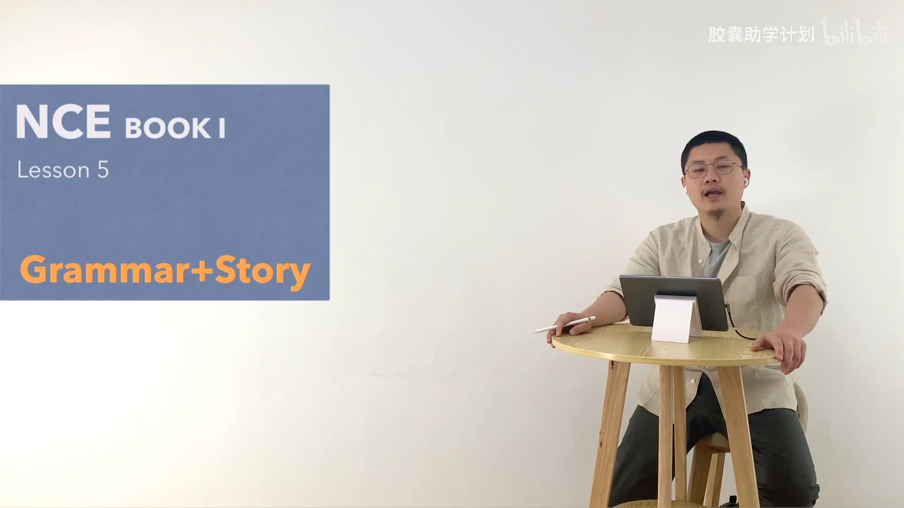

文字识别：LiHL / 胶囊助学计划 / NCE / BOOKI / Lesson 5 / Grammar+Story

### 画面 00:00:09

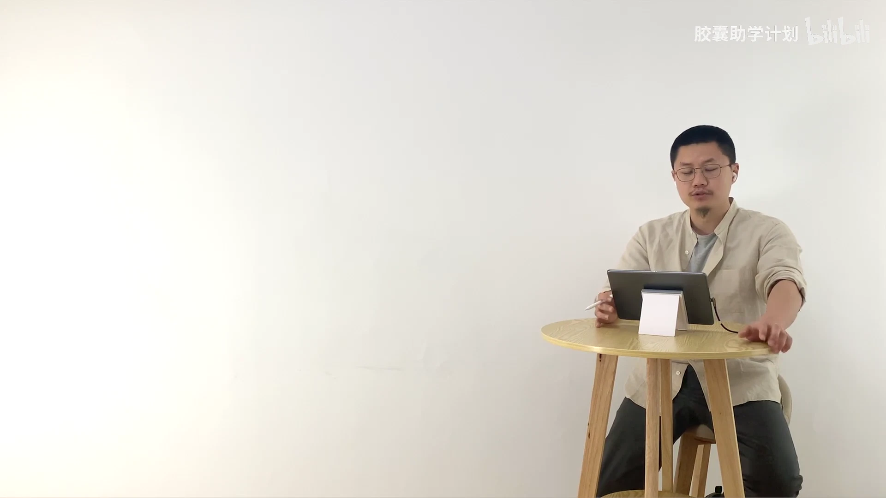

文字识别：胶囊助学计划

### 画面 00:00:11

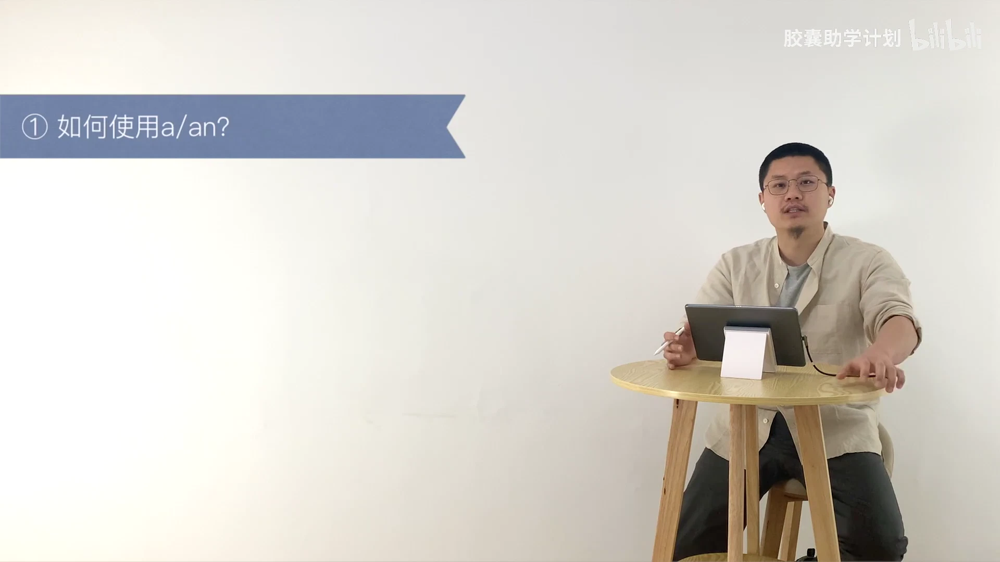

文字识别：胶囊助学计划b / ①如何使用a/an?

### 画面 00:00:20

文字识别： bibii / 胶囊助学计划

### 画面 00:00:24

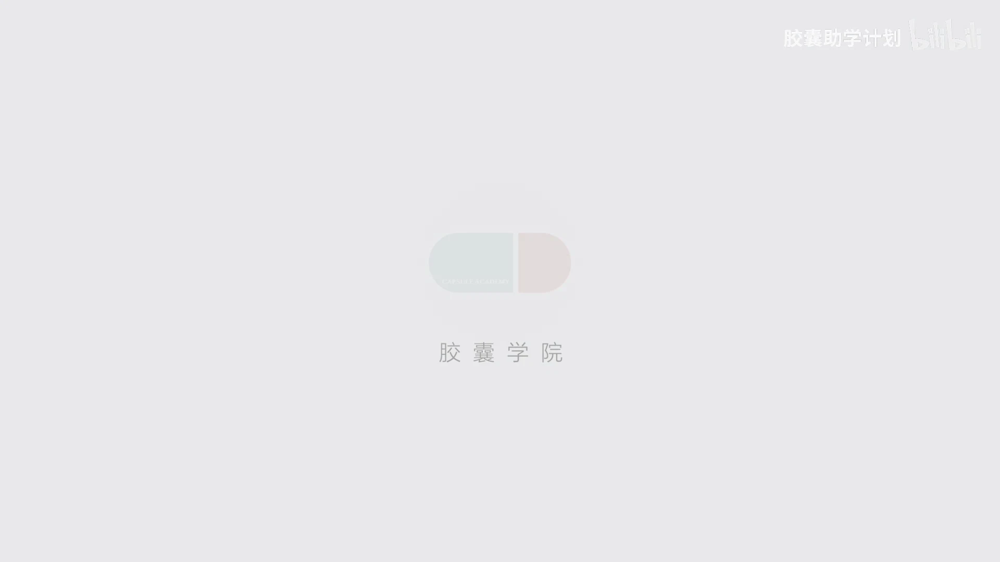

文字识别：胶囊助学计划H / 胶囊学院

### 画面 00:00:26

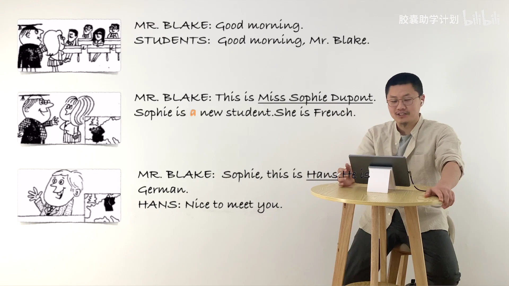

文字识别：胶囊助学计划l / MR. BLAKE: Good morníng. / STuDENTS: Good morníng, Mr. Blake. / MR. BLAKE: This is Miss Sophie Dupont. / Sophie is a new student.she is French. / MR. BLAKE: Sophie, this is Hans tte is / German. / HANS: Nice to meet you.

## 00:00:30–00:01:00

before, say hello, right? We look at this. This is a teacher with a new student. A new student. He is introducing a new student to his whole class. So he now says hello. He says good morning. Then all the students say good morning, Mr. Blake. Okay, we now quickly review a little point. Test a knowledge point. Blake is his last name or his first name? Is it in front or behind? According to Chinese, Mr. Liu, Mr. Liu, so Blake must be his last name. That is

### 画面 00:00:33

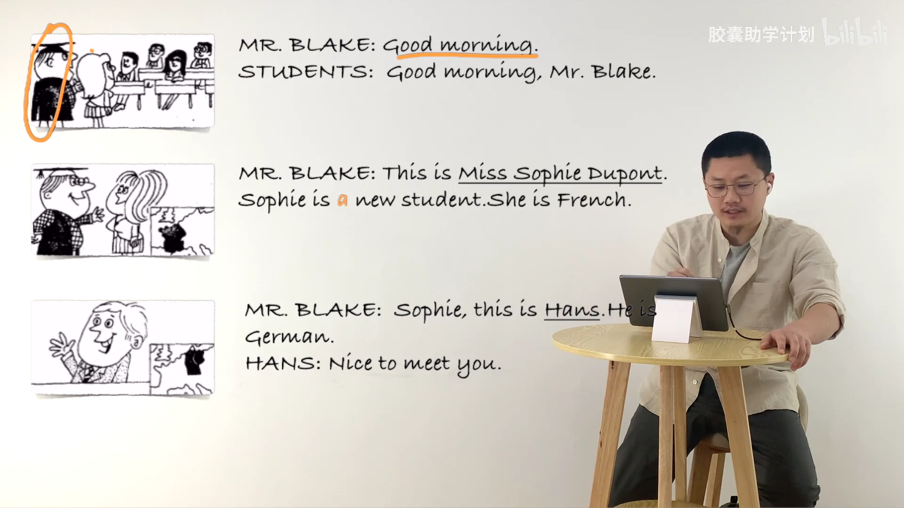

文字识别：胶囊助学计划bilL / MR. BLAKE: Good mornina. / STuDENTS: Good morníng, Mr. Blake. / MR. BLAKE: Thís is Miss Sophie Dupont. / Sophie is a new student.she is French. / MR. BLAKE: Sophie, thís is Hans.He is / German. / HANs: Nice to meet you.

### 画面 00:00:37

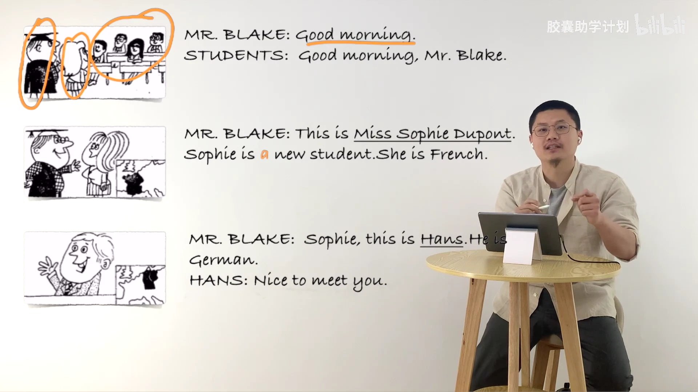

文字识别：胶囊助学计划M / MR. BLAKE: Good mornínG. / STuDENTS: Good morníng, Mr. Blake. / MR. BLAKE: This is Miss Sophie Dupont. / Sophie is a new student.she is French. / MR. BLAKE: Sophíe, thís is Hans.He is / German. / HANS: Nice to meet you.

### 画面 00:00:44

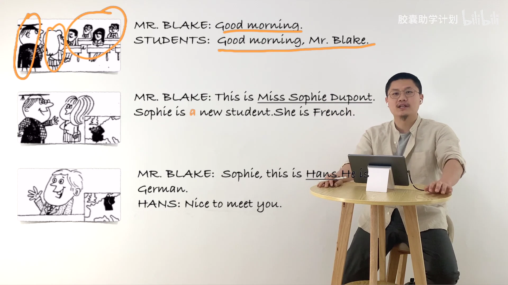

文字识别：胶囊助学计划 / MR. BLAKE: Good mornína. / STuDENTS: Good morning, Mr. Blake. / MR. BLAKE: This is Miss Sophie Dupont. / Sophie is a new student.she is French. / MR. BLAKE: Sophíe, thís is Hans.Hte is / German. / HANS: Nice to meet you.

### 画面 00:00:50

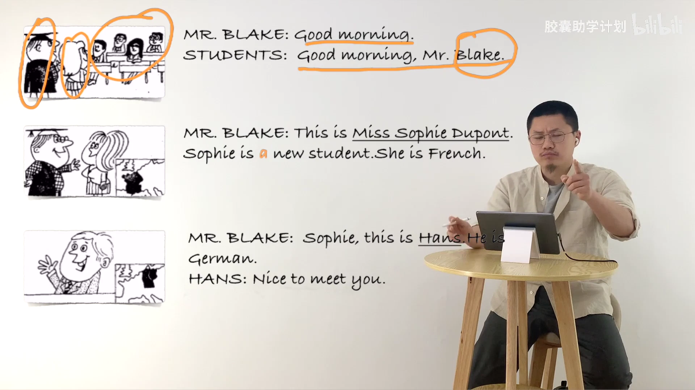

文字识别：胶囊助学计划 / MR. BLAKE: Good mornína. / STuDENTS: Good morning, Mr.Blake. / MR. BLAKE: This is Miss Sophie Dupont. / Sophie is a new student.she is French. / MR. BLAKE: Sophíe, thís is Hans.Hte is / German. / HANs: Nice to meet you.

## 00:01:00–00:01:30

姓，那跟我们汉语是反着的，所以 Blake一定是他后面出现的那个，对吧？ Good morning, Mr. Blake. 好，继续 continue. 他介绍说，This is Miss Sophie Dupont. 这是这是 Sophie Dupont 小姐啊，女士。 This is 是介绍别人非常好的一个句型。比如说别人想介绍我呢，可以说 This is Leo. This is Leo. OK, one more. 那我想问，这是 Leo 吗？这是什么句型？用 Yes or

### 画面 00:01:12

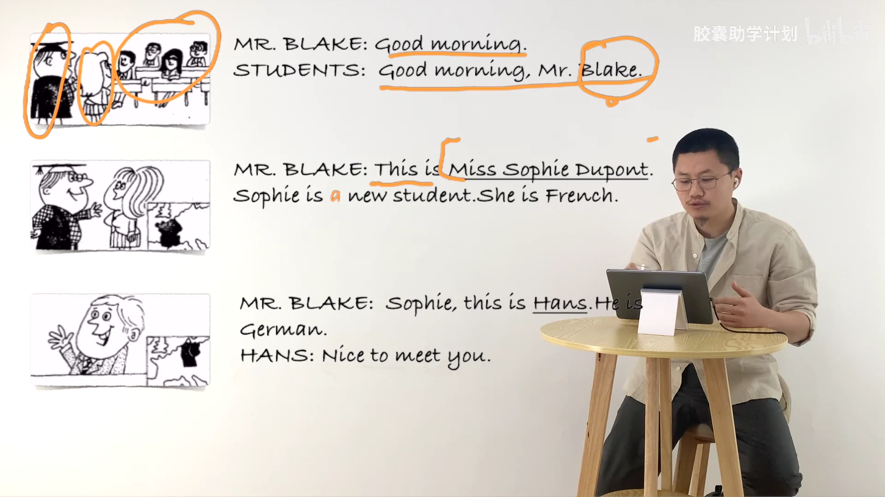

文字识别：胶囊助学计划H / MR. BLAKE: Good mornina. / 28 / STuDENTS: Good morning, Mr.Blake. / MR. BLAKE: This is Miss Sophie Dupont. / Sophíe is a new student.she is French. / MR. BLAKE: Sophíe, thís is Hans.He is / German. / HANs: Nice to meet you.

## 00:01:30–00:02:00

no 去回答，一般疑问句对吧？叫做 Is this Leo? Okay, very good. Continue. 说 Sophie is a new student. 说 Sophie 是一个新同学。注意，我们待会儿的重点也是本期视频的重点，就是讲 a 或者是 an 这两个小的单词。 Continue. 说 She is French. 说她呀是法国人。 She is French. Okay, let's continue.

### 画面 00:01:39

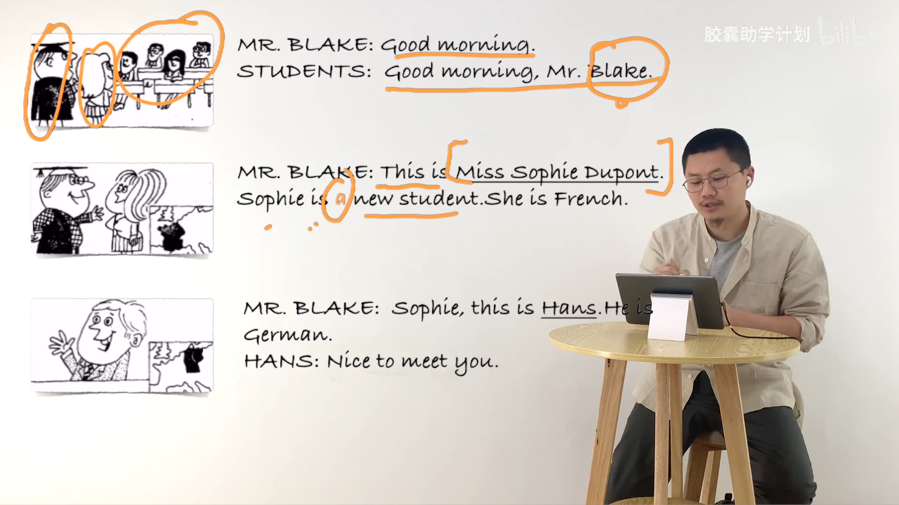

文字识别：胶囊助学计划 / MR. BLAKE: Good mornína. / STuDENTS: Good morning, Mr.Blake. / MR. BLAKE: This is Miss Sophie Dupont. / Sophie is / new student.She is French. / a / MR. BLAKE: Sophie, this is Hans.He is / German. / HANs: Nice to meet you.

## 00:02:00–00:02:30

Sophie, this is Hans.说这是Hans. He is German.说他是德国人. Nice to meet you.我们说了第一次见面可以说Nice to meet you. Okay, very good. Let's continue.那我们现在回想一下，刚刚看到了说Sophie is a new student.那其实还有一个跟它含义很类似的单词叫做an.我

### 画面 00:02:01

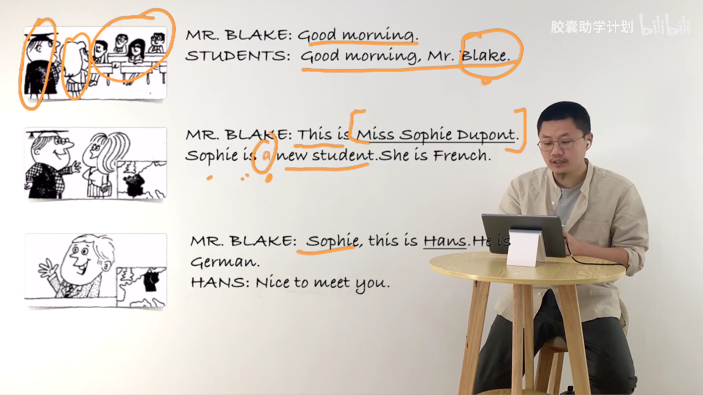

文字识别：胶囊助学计划blil / MR. BLAKE: Good morníng. / STuDENTS: Good morning, Mr.Blake. / MR. BLAK E: This is Miss Sophie Dupont. / Sophie i.a / new student.She is French. / MR. BLAKE: Sophie, thís is Hans.He is / German. / HANs: Nice to meet you.

### 画面 00:02:03

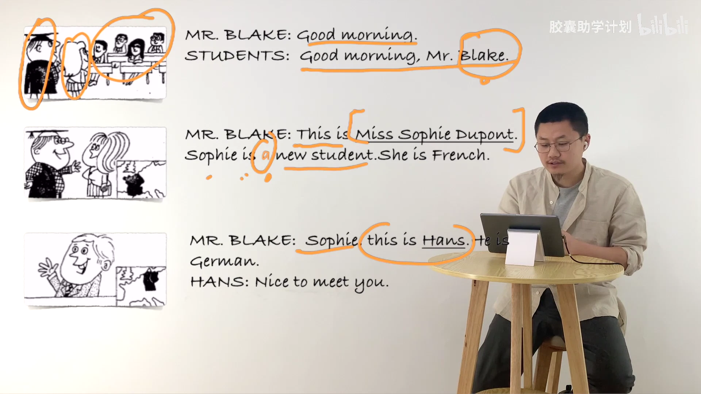

文字识别：胶囊助学计划 / MR. BLAKE: Good morníng. / STuDENTS: Good morning, Mr.Blake. / MR. BLAKE: This is Miss Sophie Dupont. / Sophie i.a / new student.She is French. / MR. BLAKE: Sophiethis is Hans. / German. / HANs: Nice to meet you.

### 画面 00:02:07

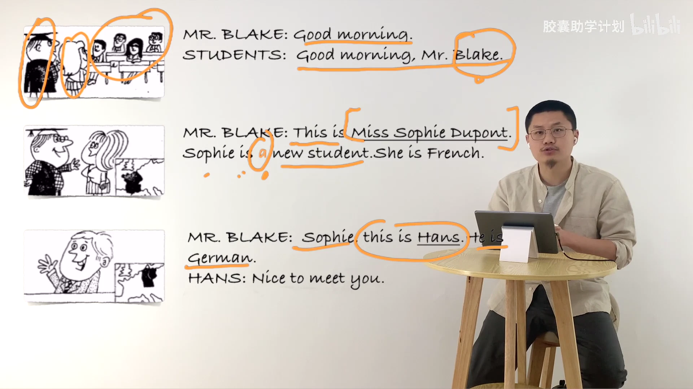

文字识别：胶囊助学计划l / MR. BLAKE: Good mornína. / STuDENTS: Good morning, Mr.Blake. / MR. BLAKE: This is Miss Sophie Dupont. / Sophie i.a / new student.She is French. / MR. BLAKE: Sophiethis is Hans. / German. / HANs: Nice to meet you.

### 画面 00:02:10

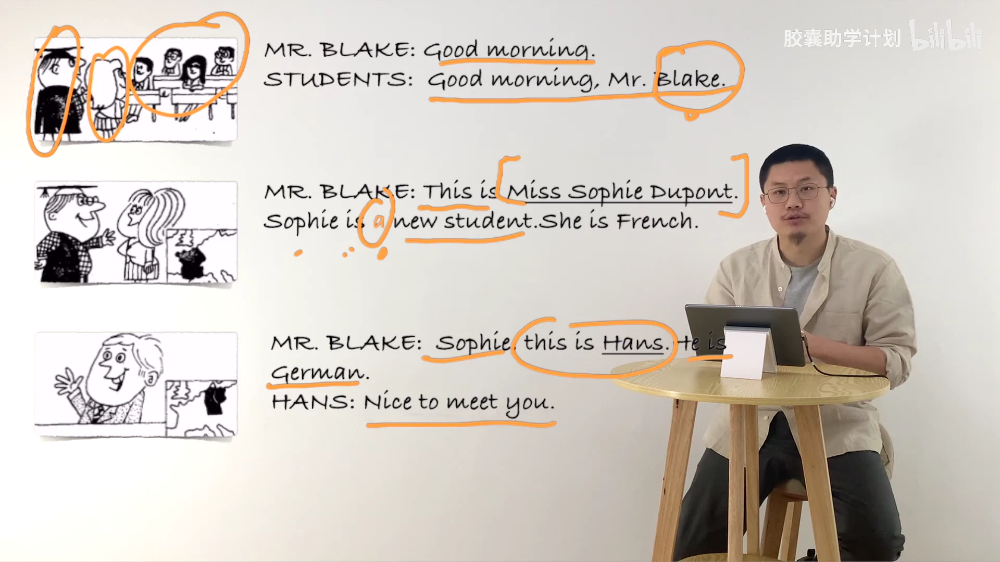

文字识别：胶囊助学计划b / MR. BLAKE: Good mornína. / STuDENTS: Good morning, Mr.Blake. / MR. BLAKE: This is Miss Sophie Dupont. / Sophie i.a / new student.She is French. / MR. BLAKE: Sophíethis is Hans. / German. / HANs: Nice to meet you.

### 画面 00:02:17

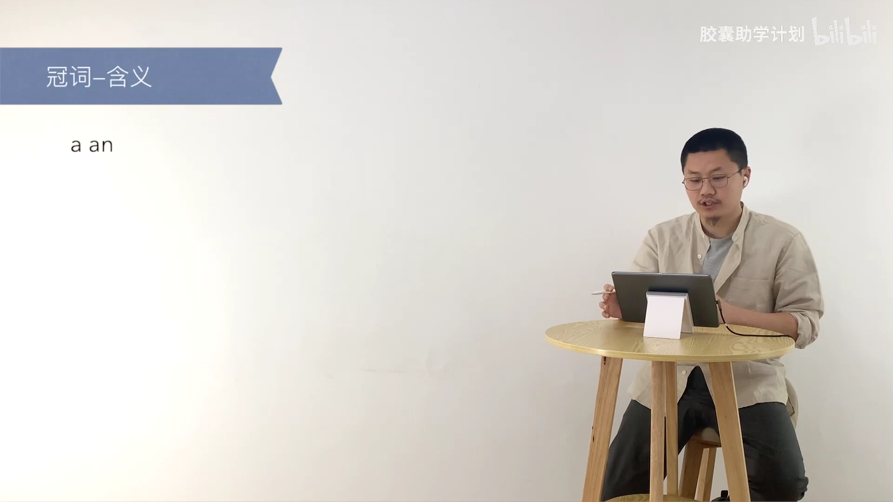

文字识别：胶囊助学计划出 / 冠词-含义 / a an

## 00:02:30–00:03:00

们初期啊不是非常准确的，完全可以把它理解成叫做一个。说 Sophie 是一个新同学，OK。那其次呢， a 和 an 要放在什么位置呢？各位记住，它往往是放在 n 点。我们讲过， n 在英文当中表示名词词性，放在名词的前面。比如说， Leo is a teacher， a teacher， teacher 老师， a teacher 放在名词的前面。其次呢，那 a 和 an 既然含义

### 画面 00:02:47

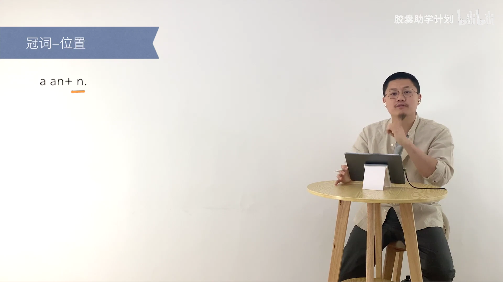

文字识别：胶囊助学计划Lii / 冠词-位置 / a an+ n.

## 00:03:00–00:03:30

相同，位置相同，均放在名词前面，那它们有没有区别？没区别，为什么要写两个，对不对？那它们的区别呢也很简单，看各位看一下啊，a后面的名词，记住它的首音标就是第一个音标，一定是辅音音标，而an后面加的名词，它的第一个音标一定是元音音标。如果您现在还不知道什么是辅音音标，什么是元音音标，一定要去看一下我们的音标视频，好好学

### 画面 00:03:09

文字识别：胶囊助学计划 / 冠词-区别 / a an+ n. / a + n.(首音标是辅音音标)

### 画面 00:03:15

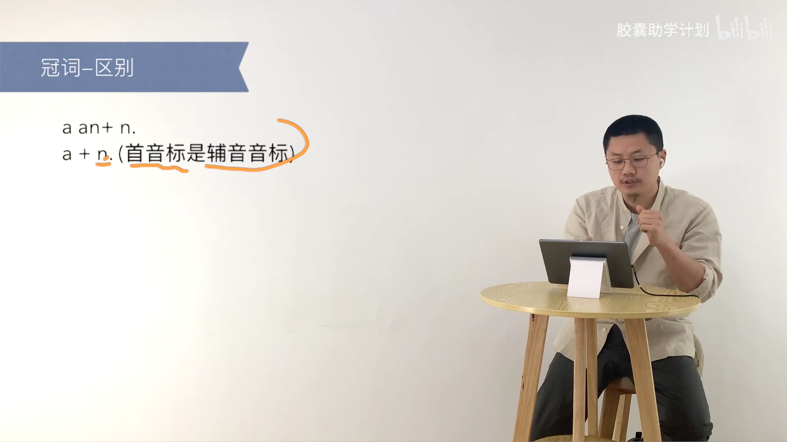

文字识别：bitbi / 胶囊助学计划 / 冠词-区别 / a an+ n. / a+n.(首音标是辅音音标)

### 画面 00:03:21

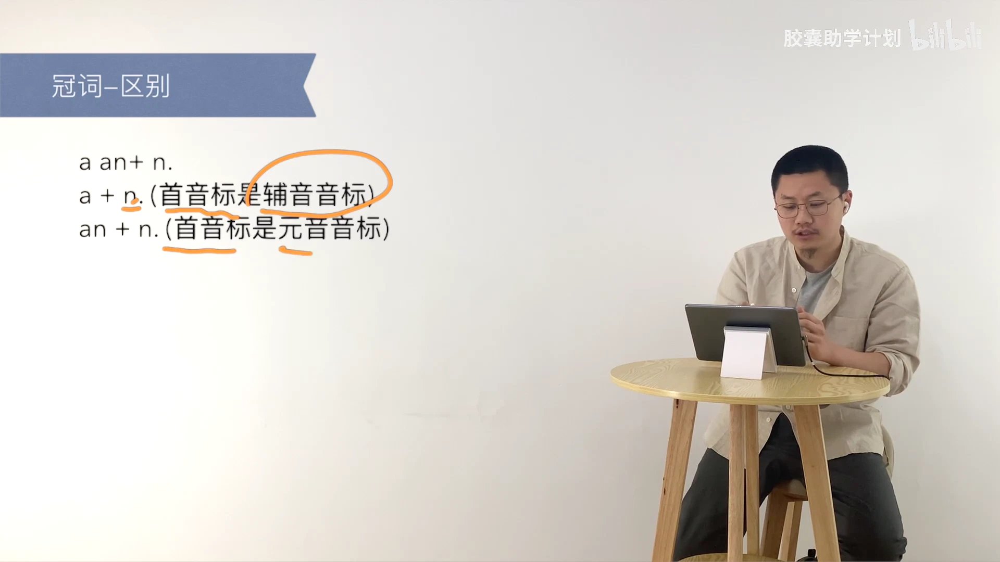

文字识别：bilb / 胶囊助学计划 / 冠词-区别 / a an+ n. / a+n.(首音标是辅音音标) / an + n.(首音标是元音音标)

### 画面 00:03:23

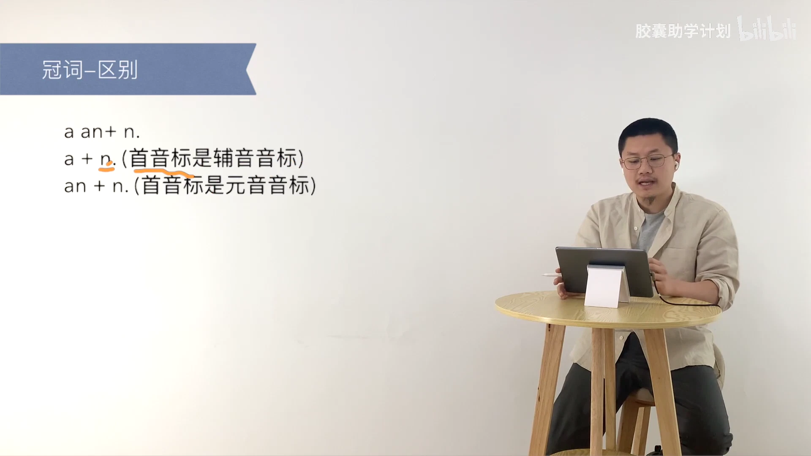

文字识别：bitbi / 胶囊助学计划 / 冠词-区别 / a an+ n. / a+n.(首音标是辅音音标) / O / an + n.(首音标是元音音标)

## 00:03:30–00:04:00

一下啊，而注意它并非字母，对吧？我以前听过很多的课程，他会去讲说是放在元音字母或者首辅音字母的前面，并不是这样子的。首先我们先回顾一下元音字母 a e i o u 这五个元音字母，对吧？为什么不是放在它前面呢？我们接下来给大家一个例子，各位就能理解了。首先我们看 a pen，辅音音标，所以用的 a an apple a apple 元

### 画面 00:03:53

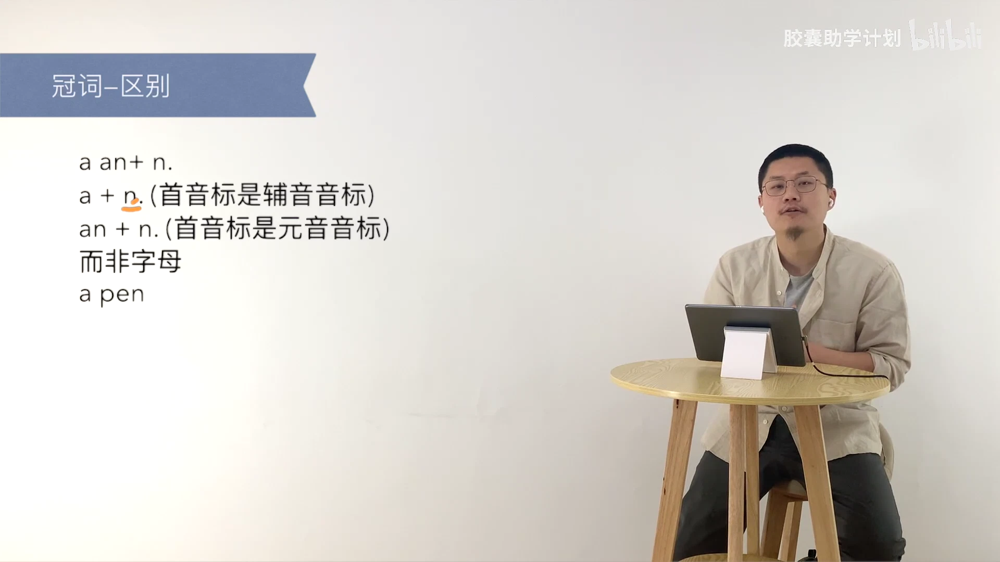

文字识别：bitbi / 胶囊助学计划 / 冠词-区别 / a an+ n. / a+Ω.(首音标是辅音音标) / an +n.(首音标是元音音标) / 而非字母 / a pen

## 00:04:00–00:04:30

音音标，所以前面用的是an umbrella umbrella umbrella，ok a a a，ok前面加的是an continue a a，所以前面加的是an continue。注意接下来例外出现了，our our，如果你按照字母去理解，这前面是不是应该加a呀？h是辅音字母对吧？但是这儿的辅音字母其实并不发音，我们直接看音标就好

### 画面 00:04:23

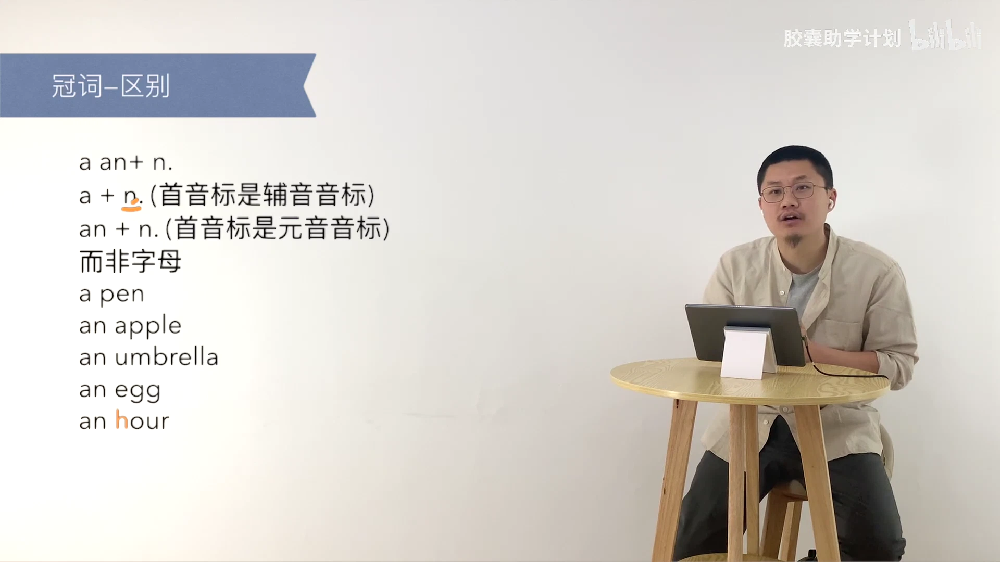

文字识别：胶囊助学计划 / LilLi / 冠词-区别 / a an+ n. / a+Ω.(首音标是辅音音标) / an + n.(首音标是元音音标) / 而非字母 / a pen / an apple / an umbrella / an egg / an hour

## 00:04:30–00:05:00

了。你一去读，ou是它的首音音标，所以前面加的是l。其次又有一个特例，那a e i o u u是元音字母，对不对？如果按照字母去理解，那前面你是不是应该加l？但是实际上，university这个单词，各位现在也许不知道，我是故意给大家举了一个反例啊。它前面是e，它是辅音音标，所以前面加的是a，所以叫a university啊。接下来我

### 画面 00:04:53

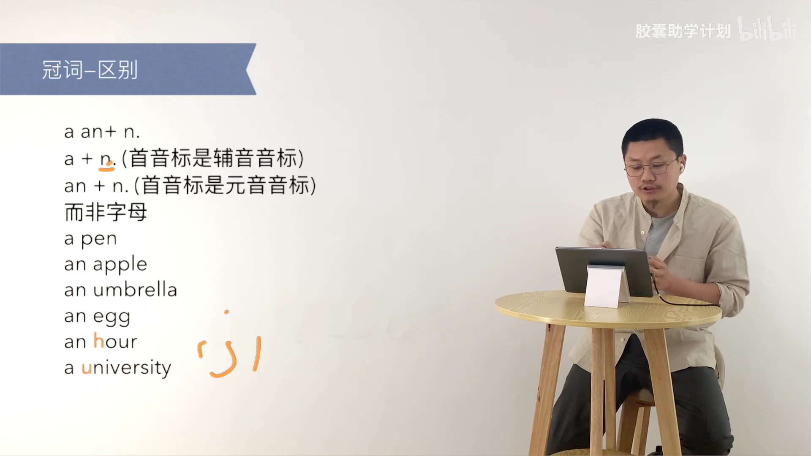

文字识别：胶囊助学计划 / 冠词-区别 / a an+ n. / a+n.(首音标是辅音音标) / an + n.(首音标是元音音标) / 而非字母 / a pen / an apple / an umbrella / an egg / an hour / a university

### 画面 00:04:55

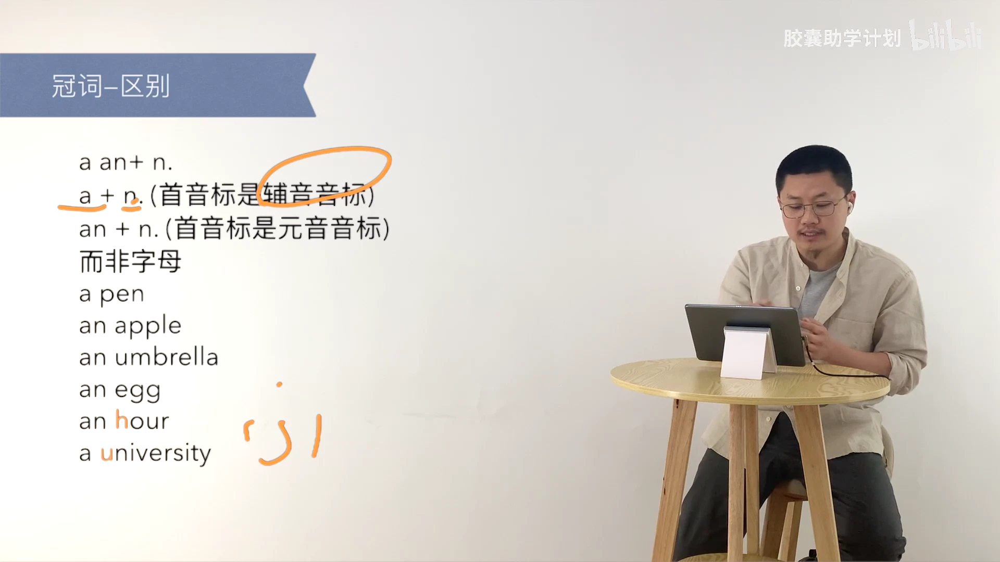

文字识别：胶囊助学计划 / 冠词-区别 / a an+ n. / a + n.(首音标是辅音音标) / an + n.(首音标是元音音标) / 而非字母 / a pen / an apple / an umbrella / an egg / an hour / a university

## 00:05:00–00:05:30

们一起做一些小的练习。迅速回顾一下，a加名词，an也加名词，含义一个区别是首音音标是元音音标还是辅音音标。所以 this is book，我们应该用 a 还是 an？回想一下，book 辅音音标。This is a book. 听听 me 说，she is teacher。我们其实刚刚看到这句话了。Okay，辅音音标，所以 she

### 画面 00:05:00

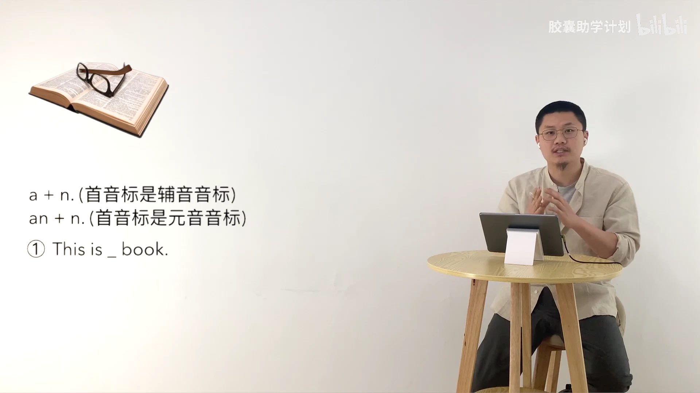

文字识别：胶囊助学计划Ll业 / a + n.(首音标是辅音音标) / an + n.(首音标是元音音标) /  This is _ book.

### 画面 00:05:20

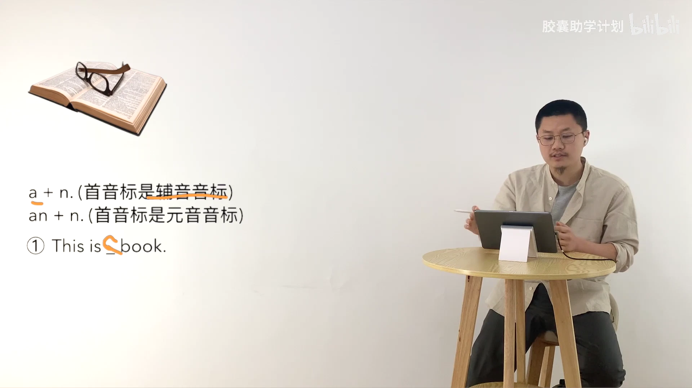

文字识别：u Biibi / 胶囊助学计划 / a+n.(首音标是辅音音标) / an + n.(首音标是元音音标) /  This isSbook.

### 画面 00:05:22

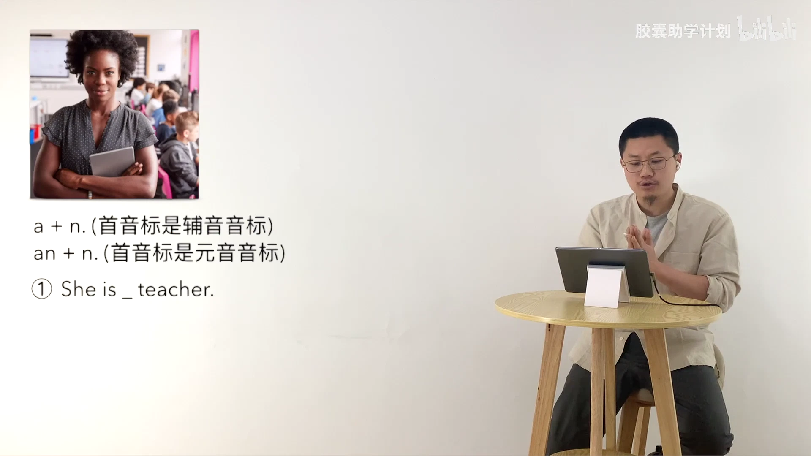

文字识别：胶囊助学计划Ll / a+n.(首音标是辅音音标) / an + n.(首音标是元音音标) / ① She is_teacher.

## 00:05:30–00:06:00

is a teacher. There you go. Let's continue. Is this watch?说这个玩意儿是一个表吗？What? What?辅音音标，所以用的是 a.叫 Is this a watch? There you go. Let's continue.说这不是一把伞。我不知道各位看没看过这个电影啊，叫 Kingsman，对吧？他的这把伞可以防弹，可以开枪，所以我说这不是一把雨伞。This is not umbrella.回想一下，刚

### 画面 00:05:30

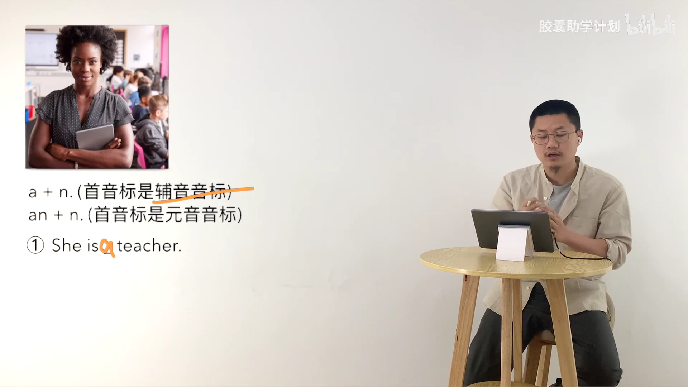

文字识别：JbiHb / 胶囊助学计划 / a+n.(首音标是辅音音标) / an + n.(首音标是元音音标) / ① She isateacher.

### 画面 00:05:32

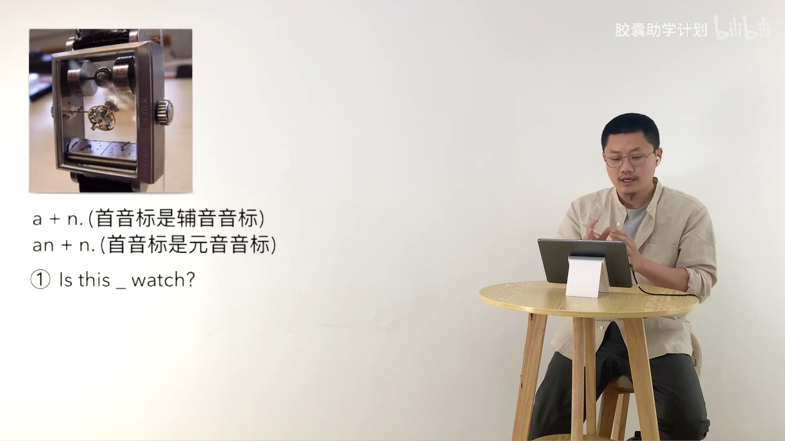

文字识别：bitib / 胶囊助学计划 / a +n.(首音标是辅音音标) / an + n.(首音标是元音音标) / ①Is this _watch?

### 画面 00:05:37

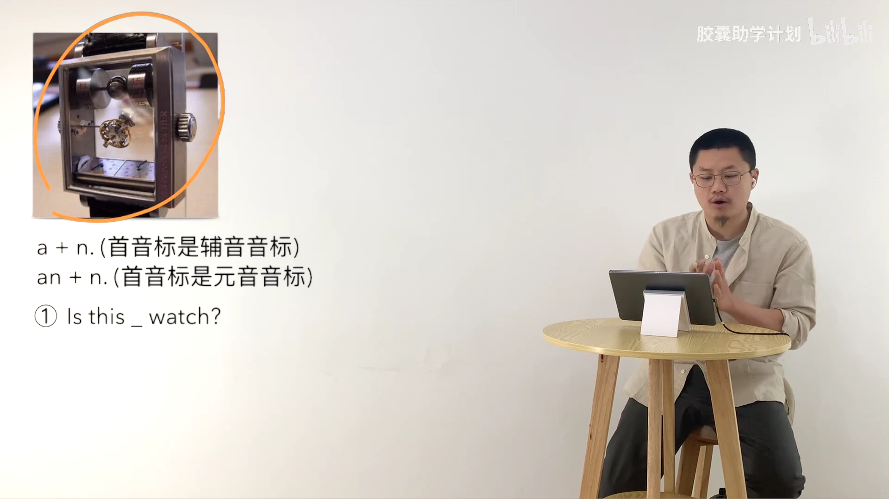

文字识别：bitb / 胶囊助学计划 / a + n.(首音标是辅音音标) / an + n.(首音标是元音音标) / ①Is this _watch?

### 画面 00:05:41

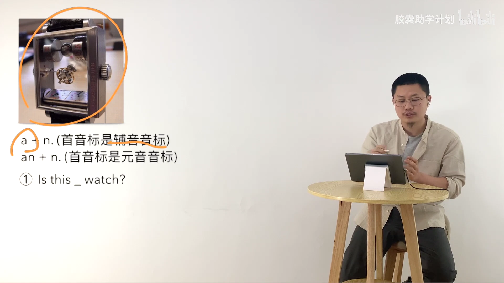

文字识别：bitb / 胶囊助学计划 / n.(首音标是辅音音标) / an +n.(首音标是元音音标) / ①Is this_watch?

### 画面 00:05:46

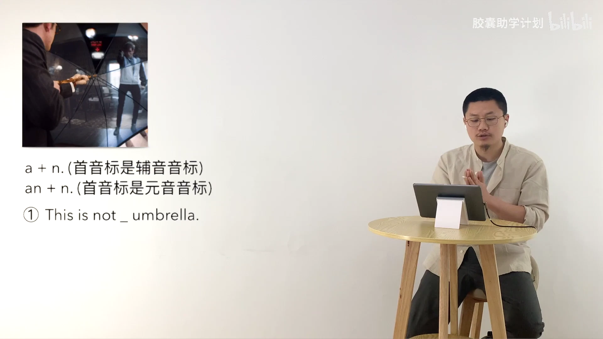

文字识别：u biib / 胶囊助学计划 / a + n.(首音标是辅音音标) / A / an + n.(首音标是元音音标) / This is not _ umbrella.

### 画面 00:05:48

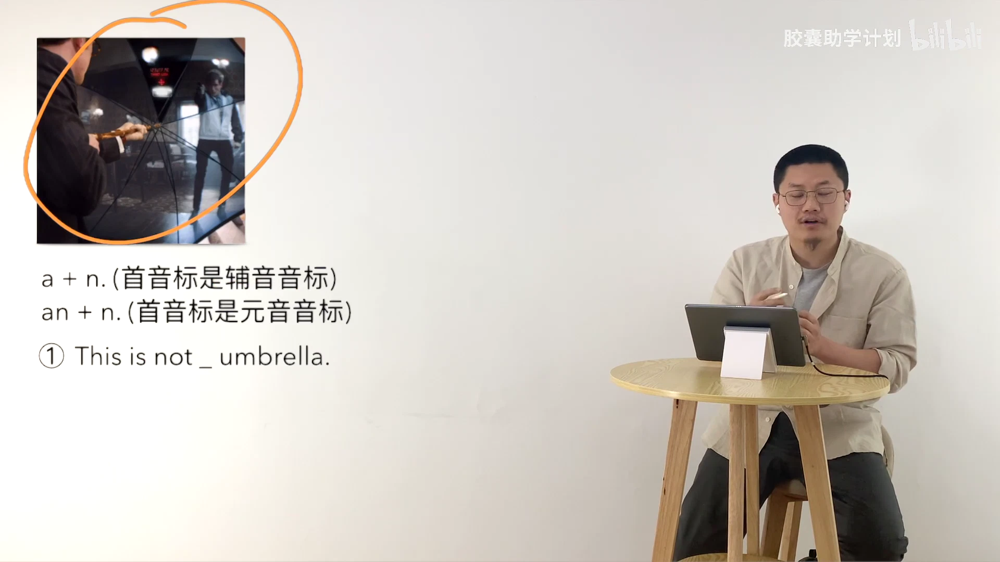

文字识别：bitbi / 胶囊助学计划 / a +n.(首音标是辅音音标) / an + n.(首音标是元音音标) / This is not _ umbrella.

## 00:06:00–00:06:30

学过这个单词 umbrella,首音音标是啊，它是辅音音标，所以我们应该在这个地方用的是 an，叫做 this is not an umbrella. Okay, very good.那我们回到文章继续说, and this is Naoko,哎，继续介绍她的名字, she's Japanese. Okay, P.S.是is o，其实就是 she is Japanese. Nice to meet you,还是第一次见面，

### 画面 00:06:00

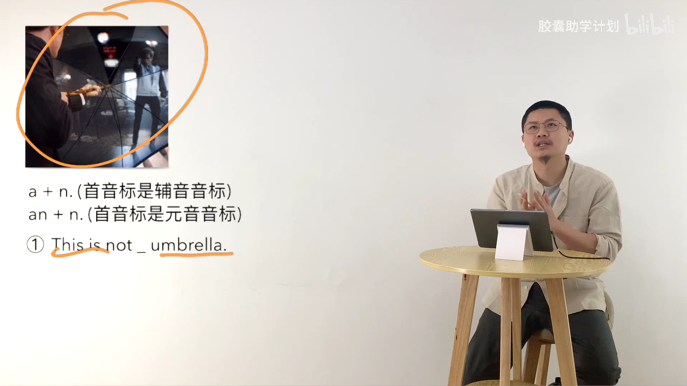

文字识别：胶囊助学计划 / a + n.(首音标是辅音音标) / an + n.(首音标是元音音标) / This is not _ umbrella.

### 画面 00:06:06

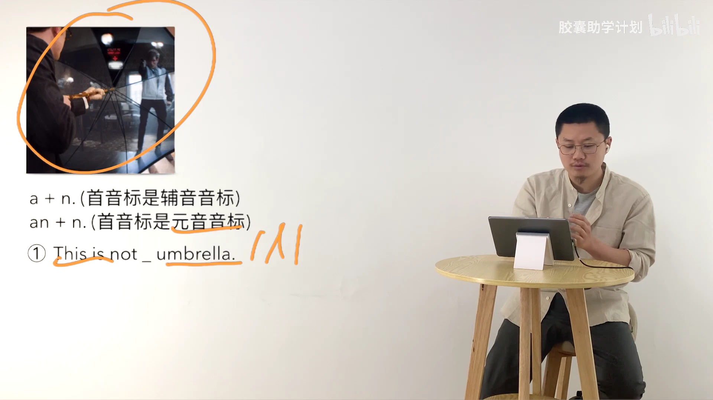

文字识别：bilb / 胶囊助学计划 / a+n.(首音标是辅音音标) / an +n.(首音标是元音音标） / 人 / This is not _ umbrella.

### 画面 00:06:11

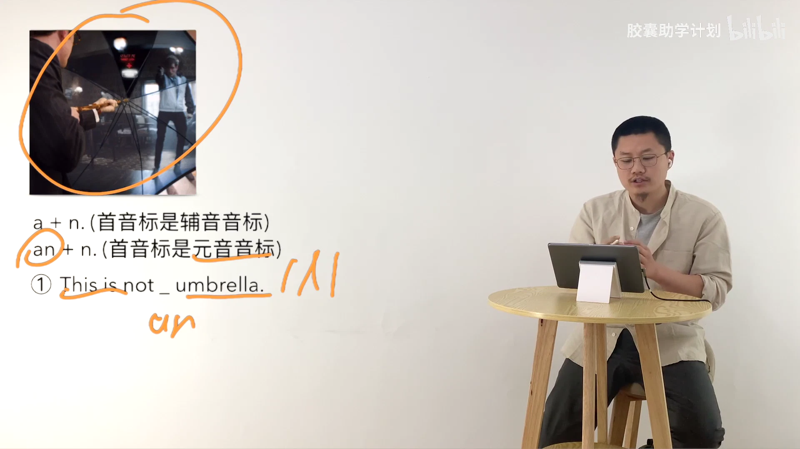

文字识别：Bilibi / 胶囊助学计划 / a+n.(首音标是辅音音标) / an+n.(首音标是元音音标) / 人 / This is not _ umbrella. / un

### 画面 00:06:15

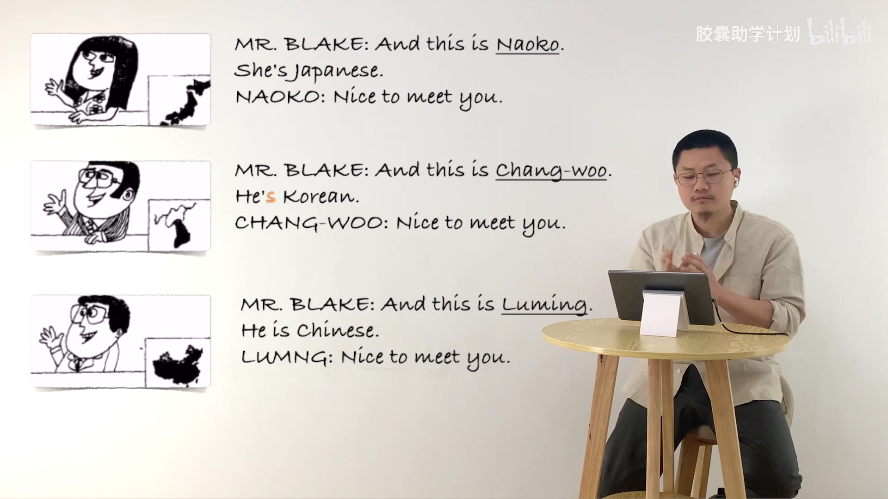

文字识别：胶囊助学计划ll / MR. BLAKE: And this is Naoko. / She's Japanese. / NAoko: Nice to meet you. / MR. BLAKE: And thís is Chang-woo. / He's Korean. / CHANG-WoO: Nice to meet you. / MR. BLAKE: And this is Lumíng. / He is Chínese. / LuMNG: Nice to meet you.

### 画面 00:06:21

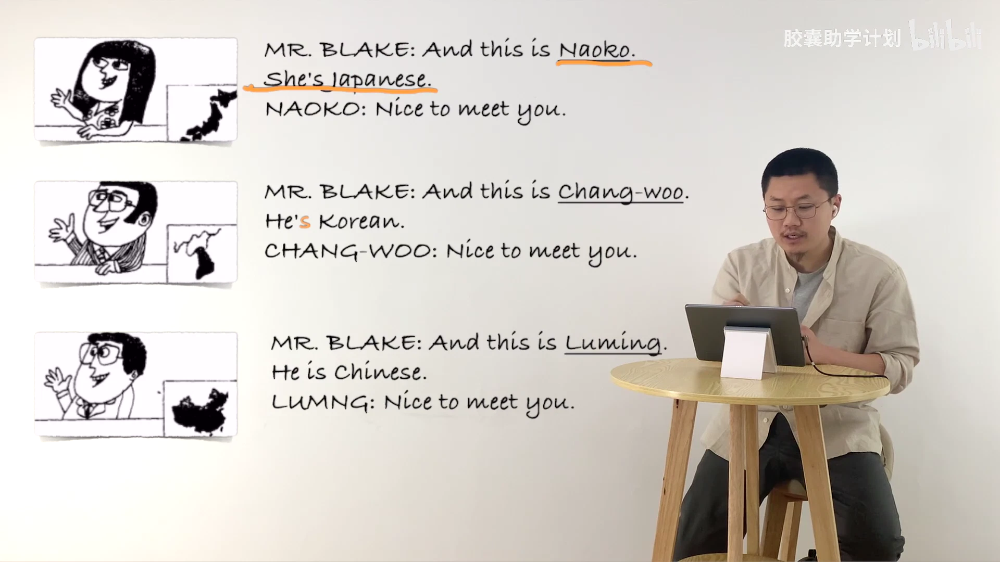

文字识别：胶囊助学计划 / MR. BLAKE: And thís is Naoko. / She's Iapanese. / NAoko: Nice to meet you. / MR. BLAKE: And thís is Chang-woo. / He's Korean. / CHANG-WOO: Nice to meet you. / MR. BLAKE: And this is Lumíng. / He is Chínese. / LuMNG: Nice to meet you.

### 画面 00:06:28

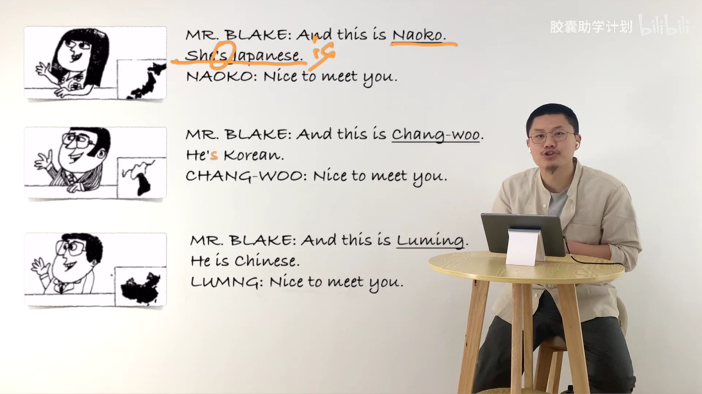

文字识别：胶囊助学计划 / MR. BLAKE: And thís is Naoko. / Shsapanese. / NAOko: Nice to meet you. / MR. BLAKE: And thís is Chang-woo. / He's Korean. / CHANG-WOO: Nice to meet you. / MR. BLAKE: And thís is Luming. / He is Chínese. / LuMNG: Nice to meet you.

## 00:06:30–00:07:00

剩下都是高度重复的了。我们迅速过一下。And this is Chang Wu. He's Korean.又是缩写，他是韩国人。Nice to meet you. And this is Lu Ming. He is Chinese. Nice to meet you.意思一模一样，只是做了一些小的单词的变化。接下来，This is Xiao Gui. She's Chinese too.还也是中国人。哎，too出现了，也是我们上一个视频刚刚学

### 画面 00:06:34

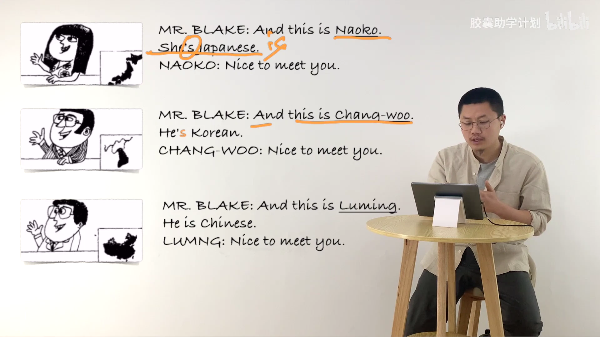

文字识别：胶囊助学计划 / MR. BLAKE: And thís is Naoko. / Shsapanese. / NAOko: Nice to meet you. / MR. BLAKE: And thís is Chana-woo. / He's Korean. / CHANG-WOO: Nice to meet you. / MR. BLAKE: And this is Luming. / He is Chínese. / LuMNG: Nice to meet you.

### 画面 00:06:38

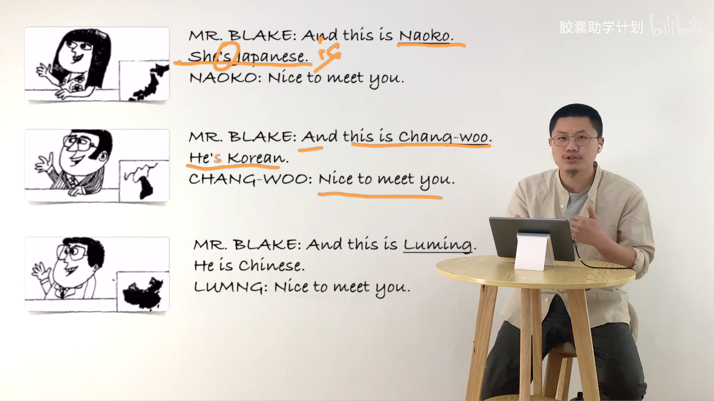

文字识别：胶囊助学计划l / MR. BLAKE: And thís is Naoko. / shsapanese. / NAOko: Nice to meet you. / MR. BLAKE: And thís is Chana-woo. / He's Korean. / CHANG-WoO: Nice to meet you. / MR. BLAKE: And this is Lumíng. / He is Chínese. / LuMNG: Nice to meet you.

### 画面 00:06:40

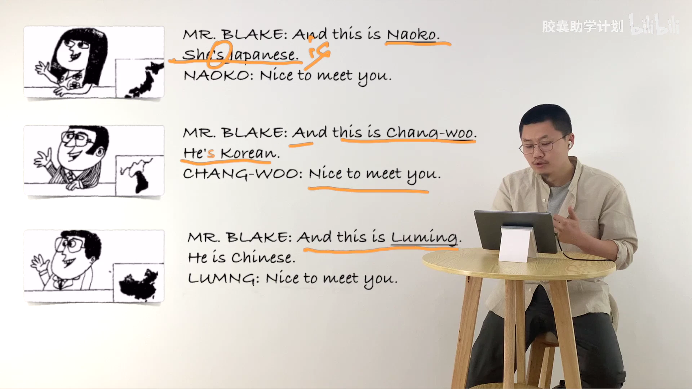

文字识别：胶囊助学计划L / MR. BLAKE: And thís is Naoko. / sh/sapanese. / NAOko: Nice to meet you. / MR. BLAKE: And thís is Chang-woo. / He's Korean. / CHANG-WoO: Nice to meet you. / MR. BLAKE: And thís is Luming. / He is Chínese. / LuMNG: Nice to meet you.

### 画面 00:06:43

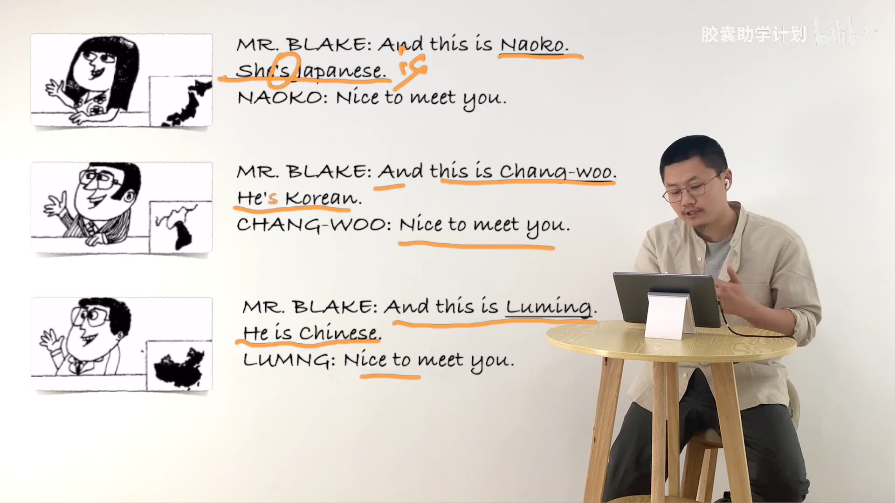

文字识别：胶囊助学计划 / MR. BLAKE: And thís is Naoko. / Shsapanese. / NAOko: Nice to meet you. / MR. BLAKE: And thís is Chang-woo. / He's Korean. / CHANG-WoO: Nice to meet you. / MR. BLAKE: And this is Lumíng. / He is Chinese. / LumNG: Nice to meet you.

### 画面 00:06:48

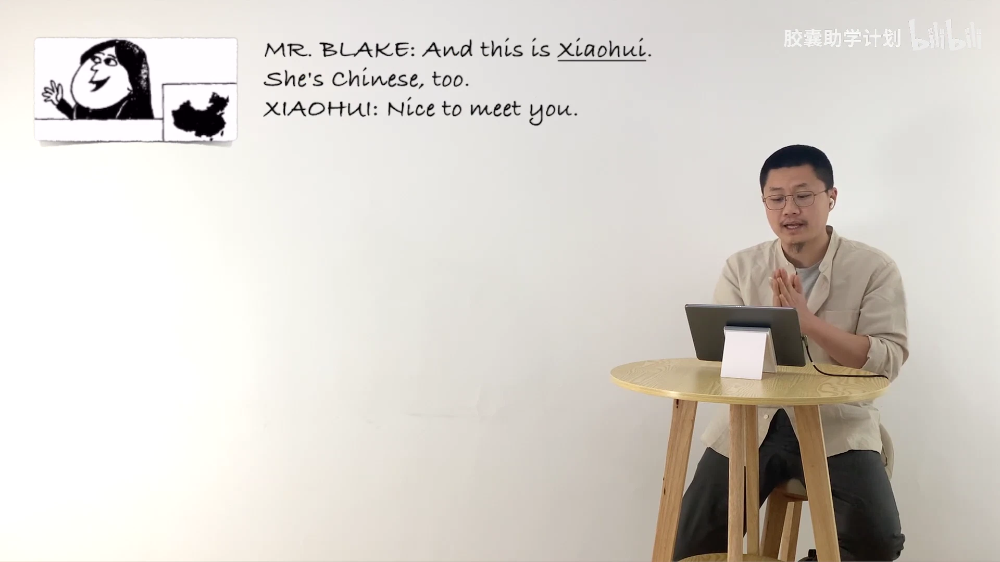

文字识别：胶囊助学计划H / MR. BLAKE: And thís is Xíaohuí. / She's Chíinese, too. / XIAOHul: Nice to meet you.

### 画面 00:06:52

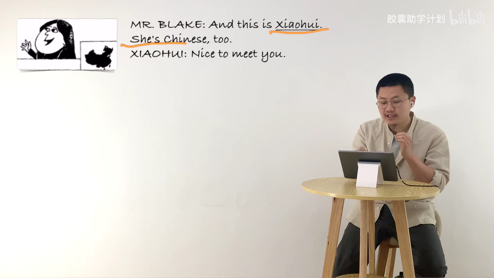

文字识别：胶囊助学计划H / MR. BLAKE: And thís is Xiaohuí. / She's Chinese, too. / xIAoHul: Nice to meet you.

### 画面 00:06:56

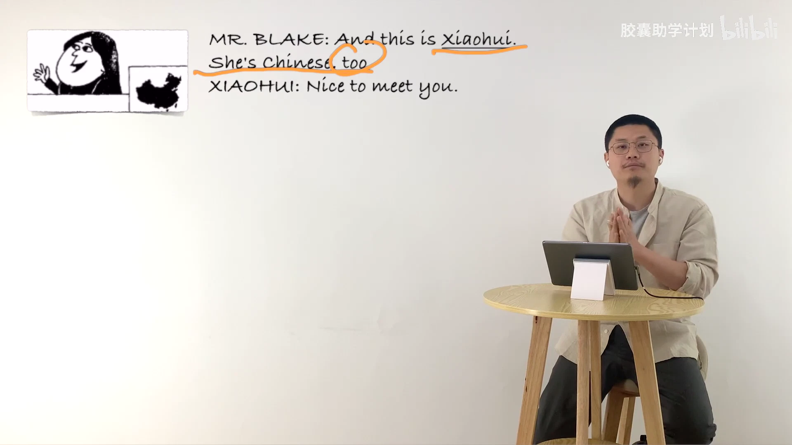

文字识别：胶囊助学计划bi / MR. BLAKE: Andthís is Xiaohuí. / She's Chinesl.too / xIAoHul: Nice to meet you.

## 00:07:00–00:07:30

过，上一期视频刚刚学过，说我也是怎么说，me too. Okay, very good.那很高兴见到您，nice to meet you. 第一次见面，对吧？可见中国人真的是多，不管任何班上，中国人都是两个，对吧？像我研究生期间，一半一个班，一半中国人。Okay, very good, very有意思. Let's continue.那像刚才那个这种文章的方式，你挨个去介绍，会不会有点累啊？This is, this is, this is.这还好，对

### 画面 00:07:06

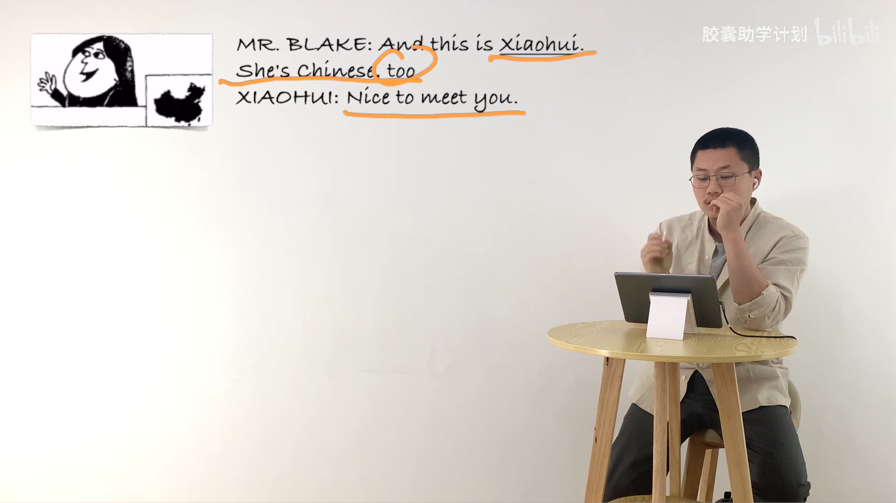

文字识别：胶囊助学计划 / MR. BLAKE: And thís is Xiaohuí. / She's Chinese.too / XIAOHul: Nice to meet you.

### 画面 00:07:21

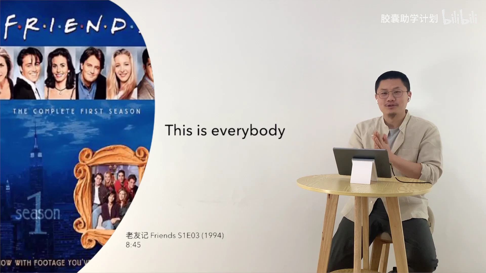

文字识别：F.R.I.E.N.D. / 胶囊助学计划 / Lilb / THE COMPLETE FIRST SEASON / This is everybody / season / 老友记Friends S1E03(1994) / 8:45 / OW WITH FOOTAGE YOU'Y

### 画面 00:07:23

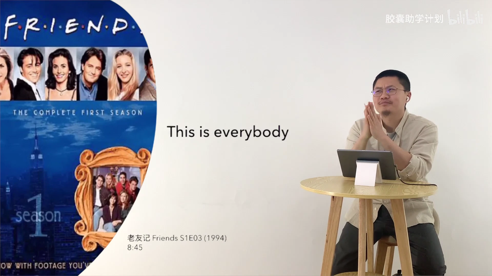

文字识别：F.R.I.E.N.D. / 胶囊助学计划 / THE COMPLETE FIRST SEASON / This is everybody / season / 老友记Friends S1E03(1994) / 8:45 / OW WITH FOOTAGE YOU'

### 画面 00:07:25

文字识别：F.R.I.E.N.D. / 胶囊助学计划H / THE COMPLETE FIRST SEASON / This is everybody / season / 老友记Friends S1E03(1994) / 8:45 / OW WITH FOOTAGE YOU'

## 00:07:30–00:08:00

吧？班上才七八个人，班上二十个人你怎么介绍？所以有一个非常简单的方式叫做 This is everybody. Everybody这个小单词你可以记一下，叫做所有人，这就是大家了啊。所以刚才我们提到了 This is去介绍人，那 This is everybody叫做这就是大家了。接下来我们看一下老友记第一季第三集当中如何用 This is everybody去介绍朋友们的。 Who is it? Chandler.

### 画面 00:07:31

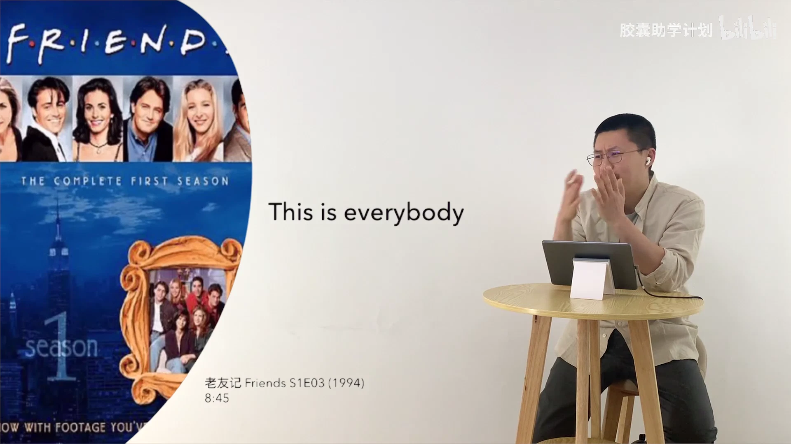

文字识别：F.R.I.E.N.D. / 胶囊助学计划 / THE COMPLETE FIRST SEASON / This is everybody / season / 老友记Friends S1E03(1994) / 8:45 / OW WITH FOOTAGE YOU'

### 画面 00:07:35

文字识别：F.R.I.E.N.D. / 胶囊助学计划 / THE COMPLETE FIRST SEASON / This is everybody / season / 老友记Friends S1E03(1994) / 8:45 / OW WITH FOOTAGE YOU'

### 画面 00:07:37

文字识别：F.R.I.E.N.D. / 胶囊助学计划 / bii! / THE COMPLETE FIRST SEASON / This is / severybody / season / 老友记Friends S1E03(1994) / 8:45 / OW WITH FOOTAGE YOU'

### 画面 00:07:40

文字识别：F.R.I.E.N.D. / 胶囊助学计划 / THE COMPLETE FIRST SEASON / This is / severybody / season / 老友记Friends S1E03(1994) / 8:45 / OW WITH FOOTAGE YOU'

### 画面 00:07:45

文字识别：F.R.I.E.N.D. / 胶囊助学计划 / THE COMPLETE FIRST SEASON / This is / 5everybody / season / 老友记Friends S1E03(1994) / 8:45 / OWWITH FOOTAGE YOU'y

### 画面 00:07:51

文字识别：F.R.I.E.N.D. / 胶囊助学计划 / THE COMPLETE FIRST SEASON / This is / 5everybody / season / 老友记Friends S1E03(1994) / 8:45 / OW WITH FOOTAGE YOU'

### 画面 00:07:54

文字识别：Bilbili / 胶囊助学计划 / 注意他来了 / Hey. It's him.

### 画面 00:07:56

文字识别：Bilbii / 胶囊助学计划

### 画面 00:07:58

文字识别：bilibili / 胶囊助学计划 / 哪位-我是艾伦 / - Who is it? - It's Alan.

## 00:08:00–00:08:30

he's here. Okay, please be good. Please, and we just remember how much you all like me. Hi, Alan. This is everybody. Everybody, this is Alan. Hi. Hi, Alan. I've heard so much about auditions. Okay,各位看见了啊， Monica想把她男朋友介绍给她剩下的几个

### 画面 00:08:00

文字识别：Bilibili / 胶囊助学计划 / 钱德勒他来了 / Chandler! He's here!

### 画面 00:08:02

文字识别：bilibili / 胶囊助学计划

### 画面 00:08:04

文字识别：bilibili / 胶囊助学计划 / 拜托要乖千万要乖 / Okay, please be good, please.

### 画面 00:08:06

文字识别：bilibili / 胶囊助学计划 / 记得你们有多么爱我 / Just remember how much you all like me.

### 画面 00:08:08

文字识别：bilibili / 胶囊助学计划 / 记得你们有多么爱我 / Justremember how much you all like me.

### 画面 00:08:10

文字识别：Bilibili / 胶囊助学计划

### 画面 00:08:12

文字识别：bilibili / 胶囊助学计划 / 嗨艾伦 / 这是大家 / Hi. Alan, this is everybody.

### 画面 00:08:14

文字识别：bilibili / 胶囊助学计划 / 各位这是艾伦 / Everybody, this is Alan.

### 画面 00:08:16

文字识别：bilibii / 胶囊助学计划 / 嗨艾伦 / Hi, Alan.

### 画面 00:08:18

文字识别：Bilibili / 胶囊助学计划

### 画面 00:08:20

文字识别：bilibili / 胶囊助学计划 / 我对各位已经如雷贯耳了 / I've heard schho much about all you guyschh!

### 画面 00:08:22

文字识别：bilbili / 胶囊助学计划

### 画面 00:08:24

文字识别：Bilbili / 胶囊助学计划

### 画面 00:08:26

文字识别：F.R.I.E.N.D. / 胶囊助学计划 / LiHL / THE COMPLETE FIRST SEASON / This is everybody / season / 老友记Friends S1E03(1994) / 8:45 / OWWITH FOOTAGE YOU'V

### 画面 00:08:28

文字识别：F.R.IgE.N.D. / 胶囊助学计划 / THE COMPLETE FIRST SEASON / This is everybody / season / 老友记Friends S1E03(1994) / 8:45 / OWWITH FOOTAGE YOU'y

## 00:08:30–00:09:00

friends, okay. 所以呢是 Alan, this is everybody, and everybody, this is Alan, okay. 这个句型各位记住，介绍每一个人, this is everybody, good. 那我们接下来要做一个小的口语练习，这个是很多人在学新概念的时候不会去做的。我们在开篇也解释过它的重要性，这是口语和听力练习。各位接下来怎么去做这个小的环节呢？我们原来在线下课堂的时候呢，是对吧？我们挨个点名去做的。那我们线上很

### 画面 00:08:30

文字识别：F.R.IgE.N.D. / 胶囊助学计划 / bitbi / THE COMPLETE FIRST SEASON / This is everybody / season / 老友记Friends S1E03(1994) / 8:45 / OW WITH FOOTAGE YOU'

### 画面 00:08:33

文字识别：F.R.IyE.N.D. / 胶囊助学计划 / bitb / THE COMPLETE FIRST SEASON / This is everybody / season / 老友记Friends S1E03(1994) / 8:45 / OW WITH FOOTAGE YOU'

### 画面 00:08:35

文字识别：F.R.IE.N.D. / 胶囊助学计划 / THE COMPLETE FIRST SEASON / This is everybody / season / 老友记Friends S1E03(1994) / 8:45 / OW WITH FOOTAGE YOU'

### 画面 00:08:38

文字识别：F.R.IgE.N.D. / 胶囊助学计划 /  bitLit / THE COMPLETE FIRST SEASON / This is everybody / season / 老友记Friends S1E03(1994) / 8:45 / OW WITHFOOTAGE YOU'

### 画面 00:08:40

文字识别：F.R.IgE.N.D. / 胶囊助学计划 / THE COMPLETE FIRST SEASON / This is everybody / season / 老友记Friends S1E03(1994) / 8:45 / OW WITH FOOTAGE YOU'Y

### 画面 00:08:42

文字识别：胶囊助学计划L / Comprehension

## 00:09:00–00:09:30

难做到这个点。我们现在做一个小的变化，很简单，各位现在可以把眼睛从视频当中挪开，完全靠听，或者说把眼睛挪开，您去看着您的教材，让大家提前满足，对吧？看着教材去听我问这个问题，然后你可以暂停视频去找到答案，然后再听我给大家给出的答案是什么。这是一个很小的口语听力练习。换一句话来说，我去提问，您不要看视频，

### 画面 00:09:12

文字识别：胶囊助学计划l / Comprehension

## 00:09:30–00:10:00

单纯靠听力去尝试口语回答我这个问题，讲清楚了吧？那接下来我们一起试一下啊。我们先带着大家走一个，比如说现在您的眼神就要离开视频了，然后我问，Is Sophie a new student？这个时候你的眼睛可以看着教材，可以什么都不看，可以闭上眼睛。那我问了一句话叫做 Is Sophie a new student？如果您听懂了这句话，那接下来你可以尝试去做一个回答，

### 画面 00:09:42

文字识别：胶囊助学计划bl / Comprehension / 1 T : Is Sophie a new student? / O

## 00:10:00–00:10:30

然后我再给出答案，叫做 Yes, she is. 我希望您了解了啊。我们接下来稍微快一点点。我还要问 Is she German? 这时候您的眼睛不应该在视频上啊，不要盯着这个文字啊。我们这是听力练习，OK? 那你回答 No, she isn't. Let's continue. What nationality is Sophie? 还是不要看着视频。

### 画面 00:10:10

文字识别：胶囊助学计划 / Comprehension / 2 T: Is she German?

### 画面 00:10:22

文字识别：胶囊助学计划 / Comprehension / 3 T: What nationality is Sophie?

## 00:10:30–00:11:00

Sophie is French. Okay, now what nationality is Sophie? I admit, I have a little bit of a stretch. But we will learn it soon. I will simply say now that Sophie's nationality is French. Sophie is French. She is French. Let's continue. Eyes, hands, eyes, hands. Eyes, hands, eyes, hands. Eyes, hands, eyes, hands. Eyes, hands, eyes, hands. Eyes, hands, eyes, hands. Eyes, hands, eyes, hands. Eyes, hands, eyes, hands. Eyes, hands, eyes, hands. Eyes, hands, eyes, hands. Eyes, hands, eyes, hands. Eyes, hands, eyes, hands. Eyes, hands, eyes, hands. Eyes, hands, eyes, hands. Eyes, hands, eyes, hands. Eyes, hands,

### 画面 00:10:33

文字识别：胶囊助学计划 / Comprehension / 3T: What nationality is Sophie? / S: Sophie is French.

### 画面 00:10:35

文字识别：胶囊助学计划 / biltb / Comprehension / 3T / What nationality is Sophie? / S: Sophie is French.

### 画面 00:10:42

文字识别：胶囊助学计划i / Comprehension

## 00:11:00–00:11:30

German. Next one, what nationality is Naoko? She is Japanese. Next one, is Chang Wu a Japanese student or a Korean student?听力练习注意不要看视频哦，闭上眼睛或者看教材，回答我，给出答案. He's a Korean student.

### 画面 00:11:06

文字识别：胶囊助学计划M / Comprehension / 6 T:What nationality is Naoko? / S: She's Japanese.

### 画面 00:11:12

文字识别：u biltib / 胶囊助学计划 / Comprehension / 7 T: Is Chang-woo a Japanese student or a / Korean student?

## 00:11:30–00:12:00

Continue. Next one is Luming. A Korean student or a Chinese student, or或者. He is a Chinese student. Very good. We continue. She's Chinese. This女她是个中国人。她的名字叫什么？你可以去文章当中，你翻开教材找答案。回答我。Her name is Xiaohui. Very good. Let's continue. She's

### 画面 00:11:31

文字识别：Jbitl / 胶囊助学计划 / Comprehension / 8 T: Is Luming a Korean student or a / Chinese student?

### 画面 00:11:44

文字识别：胶囊助学计划i。 / Comprehension / 9 T : She's Chinese. What is her name?

### 画面 00:11:58

文字识别：胶囊助学计划bl / Comprehension / 10 T: She's Japanese. What is her name?

## 00:12:00–00:12:30

Japanese. What is her name? 找答案啊，不要看视频。 Continue. Her name is Nako. 好，我们通过这十个练习，我希望大家了解了 comprehension questions 这个地方的口语听力练习是做什么？就是我问各位一个问题，您尝试用脑海当中已经有的单词、语法和信息，用口语回答我。这是一个非常简单的听力口语练习。接下来 asking questions 依

### 画面 00:12:13

文字识别：JbiHb / 胶囊助学计划 / Comprehension / 10 T: She's Japanese. What is her name? / S: Her name is Naoko.

### 画面 00:12:28

文字识别： Liltb / 胶囊助学计划 / Asking questions

## 00:12:30–00:13:00

旧是听力口语练习，但它同时带着语法。我现在大家一起看一下它的变化过程。首先，我去问大家说，Ask me if Sophie is a new student。这个地方我要大家提出的问题很简单，Ask me就是让各位去问我。那 if Sophie is a new student，就是 Sophie是不是一个新同学？我说各位问我，我们来一个汉语练习。比如说各位问我 Sophie是不是一个新同学，那你要问的方式是什么呢？就

### 画面 00:12:50

文字识别：JbiHb / 胶囊助学计划 / Asking questions / 1 T: Ask me if Sophie is a new student. / 2

## 00:13:00–00:13:30

是 Sophie 是一个新同学吗？换一句话来说，其实这地方做的一个练习就是把一个肯定句变成了一般疑问句。那回顾一下，一般疑问句是把 is 提到句首去，所以它的答案叫做 Is Sophie a new student？好，再简单说一下，每次我要问这个问题，您要口语回答这个问题，尽量还是不看视频，用口语去回答。 OK，用

### 画面 00:13:04

文字识别：u biibi / 胶囊助学计划 / Asking questions / 1 T: Ask me if Sophie is a new student.

### 画面 00:13:11

文字识别：LiHL / 胶囊助学计划 / Asking questions / 1T: Ask me if Sophie / is/ / /a new student.

### 画面 00:13:15

文字识别：bitil / 胶囊助学计划 / Asking questions / 1 T: Ask me if Sophie is a new student. / S: Is Sophie anew student?

### 画面 00:13:20

文字识别：IbiHb / 胶囊助学计划 / Asking questions / 1 T: Ask me if Sophie is a new student. / S: Is Sophie a new student?

### 画面 00:13:22

文字识别：biltb / 胶囊助学计划 / Asking questions / 1 T: Ask me if Sophie is a new student. / S: Is Sophie a new student?

### 画面 00:13:24

文字识别：胶囊助学计划bil / Asking questions / 1 T: Ask me if Sophie is a new student. / S: Is Sophie a new student?

## 00:13:30–00:14:00

听力和口语去回答。当然初期如果实在不行，视频作为一个辅助也是可以的啊。千万不要只我自己在屏幕的这一方去给您讲，而您那边是不张开嘴的，那这个练习就白做了。Next one, ask me if Hans is German。你要听后面 if 后面的那句话叫 Hans is German。这时候你要用脑海中去想，我想问他是德国人吗？那叫做 Is Hans German？OK，

### 画面 00:13:43

文字识别：胶囊助学计划 / Asking questions

## 00:14:00–00:14:30

Okay, very good. Next one, ask me if. 好, Naoko is a Japanese student. 我给了你一个肯定句，你把它变一般疑问句。 Or a German student. 我再来一遍，Naoko is a Japanese student or a German student. 好，我说的是，Is Naoko a Japanese student or a German student? There you go. Let's continue. Ask me if

### 画面 00:14:02

文字识别：胶囊助学计划州 / Asking questions / 3 T: Ask me if Naoko is a Japanese student / or a German student.

## 00:14:30–00:15:00

she is a Chinese student. 口语练习, is she a Chinese student? Very good. Let's continue. Ask me if Chang Wu is Japanese. 你要做的事情，一般疑问句, is Chang Wu Japanese? Okay, 好。那我们录屏课有一个好处，就是各位可以往前去倒。如果这您一遍没听清楚，记住多来几遍，好吧？ Okay, very good.

### 画面 00:14:30

文字识别：胶囊助学计划L册 / Asking questions / 4 T: Ask me if she is a Chinese student.

### 画面 00:14:49

文字识别：胶囊助学计划册 / Asking questions / 5 T: Ask me if Chang-woo is Japanese. / S: Is Chang-woo Japanese?

## 00:15:00–00:15:30

那接下来回答了这个问题，如何使用 a 和 an？迅速回顾一下，一个含义，位置名词前，区别这个名词的首音标是元音音标还是辅音音标？OK， very good。那我们简单的复习一下，哎，刚才解释清楚了，关键点叫做并非字母。OK，那还有一个小的句子，我们介绍某人，This is。那刚才我们提到了，你要一群人的话怎么办呢？

### 画面 00:15:00

文字识别：胶囊助学计划il / ①如何使用a/an？

### 画面 00:15:16

文字识别：Bilbil / 胶囊助学计划 / Recap / a an+ n. / Patterns / a+n.(首音标是辅音音标) / an+n.（首音标是元音音标） / Grammar / 而非字母 / Words / Expression / This is Leo.

### 画面 00:15:19

文字识别：Bilbii / 胶囊助学计划 / Recap / a / an+ n. / Patterns / a+n.(首音标是辅音音标) / an+n.（首音标是元音音标 / Grammar / 而非字母 / Words / Expression / This is Leo.

### 画面 00:15:21

文字识别：BitLi / 胶囊助学计划 / Recap / a / an+ n. / Patterns / a+n. / （首音标是辅音音标） / an+n.（首音标是元音音标 / Grammar / 而非字母 / Words / Expression / This is Leo.

## 00:15:30–00:16:00

This is everybody. This is everybody. Okay, there you go. 那我们留下今天家庭作业。首先，第一，绿皮书各位第五课的写作练习要及时跟上。绿皮书是什么？为什么要写？如何去写？在我们的开篇当中有所涉略。其次，文章跟读制，熟读成诵。您不用背文章，就一遍一遍的跟读啊。我们所谓的叫做不问结果，但问耕耘啊，只问读了多少遍，不管到最后效果怎么样啊，读的遍

### 画面 00:15:35

文字识别：胶囊助学计划

### 画面 00:15:54

文字识别：胶囊助学计划l / 绿皮书第5课的写作练习 / 2.文章跟读至熟读成诵

## 00:16:00–00:16:30

数多了，往往结果不会很差。算根读这书都成送，如何根读？为什么根读？开篇有所介绍。其次，给大家自己要给自己讲解回顾一遍今天的核心语法或者知识点。那基于的是 learning pyramid 和 study test 这两个理论。本期的课程呢，到这就结束了。如果各位喜欢我们的课程，欢迎大家订阅，一键三连支持我们。当然，您身边如果有需要学习或者正在学习英语的朋友呢，也请分享给他们。最后的最后，我给大家来一句名言：

### 画面 00:16:07

文字识别：u biltb / 胶囊助学计划 / 绿皮书第5课的写作练习 / 2.文章跟读至熟读成诵 / 3.请给自己讲解一遍今天的 / 核心语法+知识点learning / pyramid)

### 画面 00:16:18

文字识别：胶囊助学计划

### 画面 00:16:28

文字识别：胶囊助学计划Lil / A person who never made a mistake / never tried anything / ynew. / -Albert Einstein

## 00:16:30–00:16:52

Albert Einstein，A person who never made a mistake never tried anything new. Goodbye.

### 画面 00:16:39

文字识别：胶囊助学计划- / A person who never made a mistake / never tried anything / gnew. / -Albert Einstein

### 画面 00:16:41

文字识别：CAPSULEACADEMY / 胶囊学院 / 小红书 / Lecturer

### 画面 00:16:43

文字识别：CAPSULEACADEMY / 胶囊学院 / 小红书 / □ / Photographer

### 画面 00:16:46

文字识别：CAPSULEACADEMY / 胶囊学院 / 小红书 / Editor / Berlin

### 画面 00:16:49

文字识别：CAPSULEACADEMY / 胶囊学院 / 小红书

### 画面 00:16:51

文字识别：bilibili / 胶囊助学计划

### 画面 00:16:52

文字识别：bilibili / 胶囊助学计划

