# 006 单词 练习

快速机器解析：语音为单模型转写，未进行独立交叉校对或人工复核；画面每秒采样并按变化选帧，短时文字和标记可能遗漏。截图时间约有 1 秒误差。图片有损压缩；遇到疑点请按时间查看 Google Drive 原视频。

## 00:00:00–00:00:30

Hello everyone, welcome to Capsule Academy. This is Leo. Today we're going to learn new concept English, Fun Lesson Six Practices and Words. 那老习惯，我们进入课程之前先问大家问题。那如何询问某件物品的品牌呢？带着这个疑问，Hope you can enjoy it. 那上来我们先看这课的一个关键的小单词叫做 make。好，那我

### 画面 00:00:00

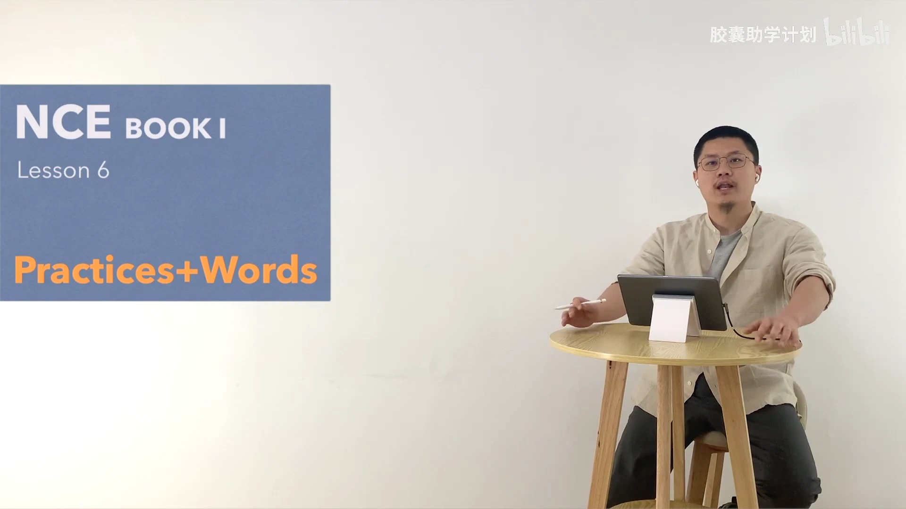

文字识别：biltb / 胶囊助学计划 / NCE / BOOKI / Lesson 6 / Practices+Words

### 画面 00:00:09

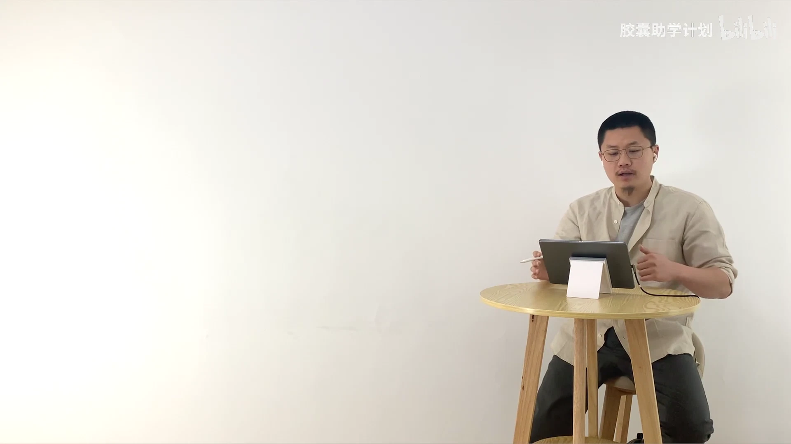

文字识别：胶囊助学计划H

### 画面 00:00:11

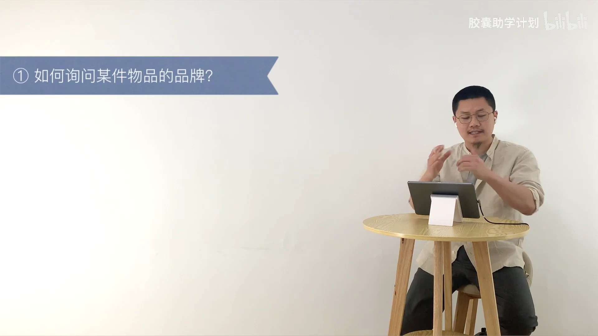

文字识别：u biltil / 胶囊助学计划 / ① 如何询问某件物品的品牌?

### 画面 00:00:20

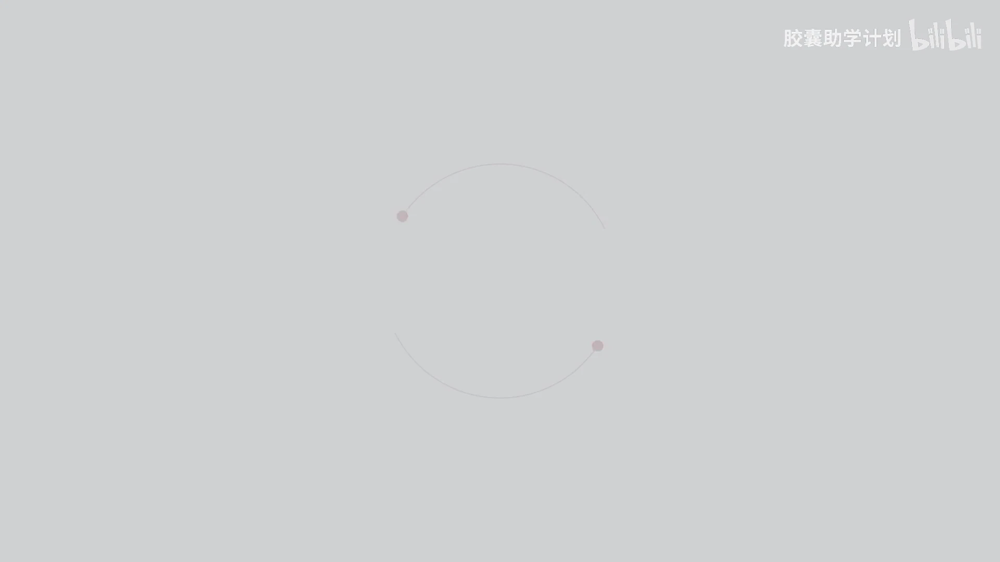

文字识别：胶囊助学计划 bil

### 画面 00:00:24

文字识别：動学計型、新

### 画面 00:00:26

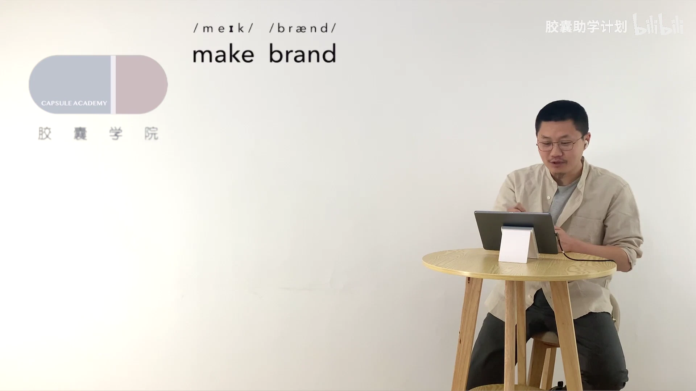

文字识别：胶囊助学计划Lli / /meik/ /brænd/ / make brand / CAPSULEACADEMY / 胶 / 囊学院

## 00:00:30–00:01:00

的个人感受，其实大部分情况下我们不会用 make 去表达品牌，比如说像我们江唐学院不会说 make，我们更多的可能会用这个单词来跟我读一下 brand brand. OK，那我们简单回顾一下 m 这个单词，m 这个字母放在单词当中去发的是嗯，对吧？k 放在单词当中去发 k。那接下来呢，我们一起看一下在双影这个电影当中，他就给大家解释了如何去问某件物品的品牌，非常的

### 画面 00:00:34

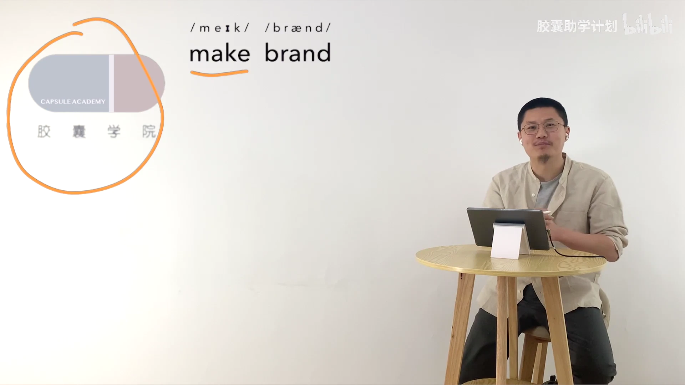

文字识别： Bit il / 胶囊助学计划 / /meik/ /brænd/ / make brand / CAPSULEACADEMY / 胶 / 囊学院

### 画面 00:00:38

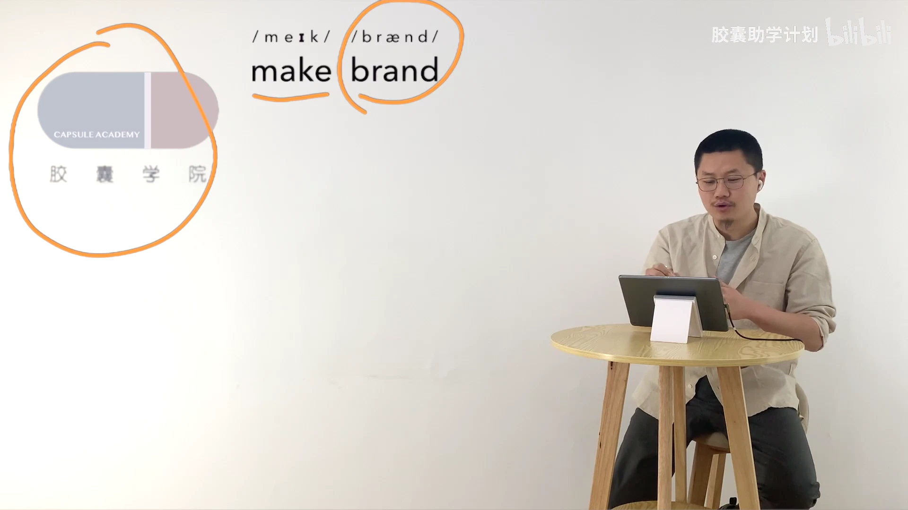

文字识别：BiL / /melk/ / /brænd/ / 胶囊助学计划 / make / brand / CAPSULEACADEMY / 胶 / 囊学 / 院

### 画面 00:00:52

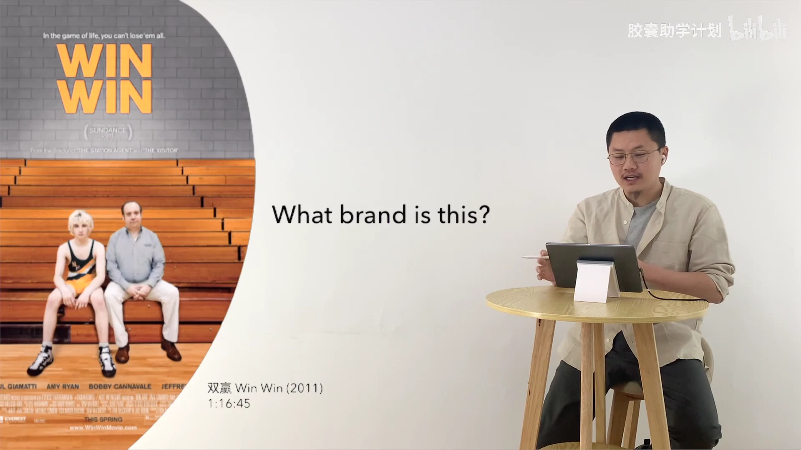

文字识别：胶囊助学计划 / In the game of life,you cant lose'em all / WIN / WIN / SUNDAN / FTHE VSITOR / What brand is this? / AMY RYAN / BOBBY CANNAVALE / JEFFRE / 双赢Win Win (2011) / 1:16:45 / THIS SPRING / werw.WinWinIhovie.com

### 画面 00:00:55

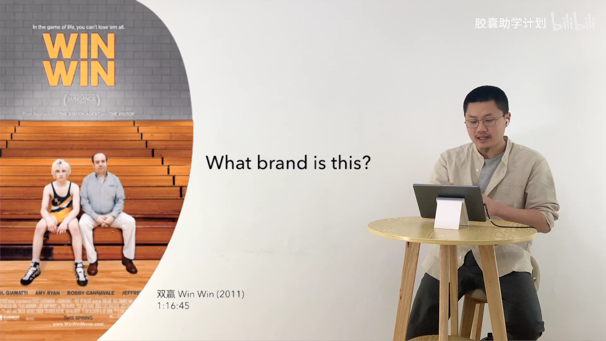

文字识别：bitb / 胶囊助学计划 / In the game of ife,you cant lose'em all / WIN / WIN / SUNDANC / OENTANJ-THE VSITOR / What brand is this? / LGIAMATTI / AMY RYAN / BOBBY CANNAVALE / JEFFRE / 双赢 Win Win (2011) / 1:16:45 / THIS SPRING / wwce.WiniWinovie.com

### 画面 00:00:57

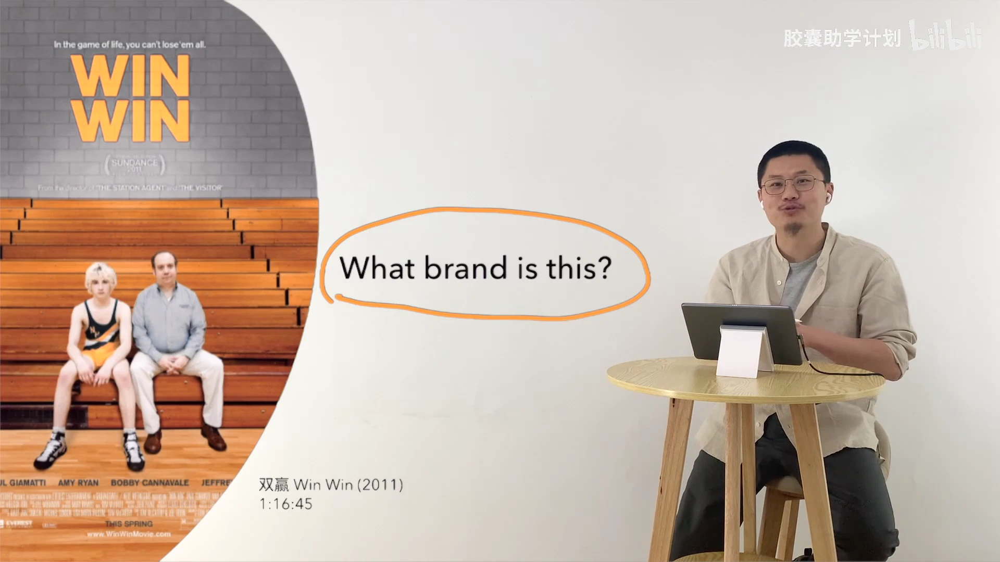

文字识别：胶囊助学计划 / bitL / In the game of ife,you cant lose'em all / WIN / WIN / SUNOANC / HONAGENTAJTHE VISTOR / What brand is this? / GIAMATTI / AMY RYAN / BOBBY CANNAVALE / JEFFRE / 双赢 Win Win (2011) / 1:16:45 / THIS SPRING / wwrw.WinWinMovie.com

## 00:01:00–00:01:30

简单，叫做 What brand is this? What brand is this? 接下来我们一起看， What brand is this? They're all the same. Daddy, look at your team. Hmm. Oh, hey, that's my team. That's great, honey. Okay, 很简单. What brand is this? 各位看到男主角在拿出来了一瓶，也许是果酱，也许是 butter 的时候啊，他去说说 What brand is this? Peanut butter. Okay, 他说 What brand is this? 这是什么品牌呢？非常好，各位记住这句

### 画面 00:01:06

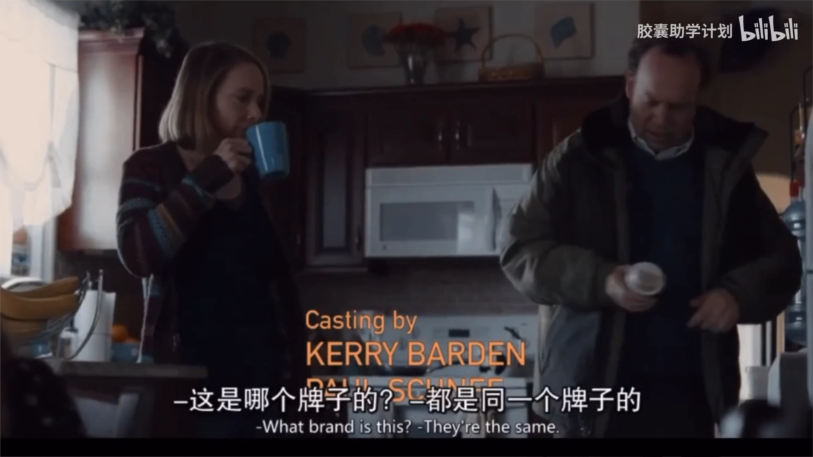

文字识别：bilibili / 胶囊助学计划 / Casting by / KERRY BARDEN / -这是哪个牌字的？C都是同一个牌子的 / -What brand is this? -They're the same.

### 画面 00:01:08

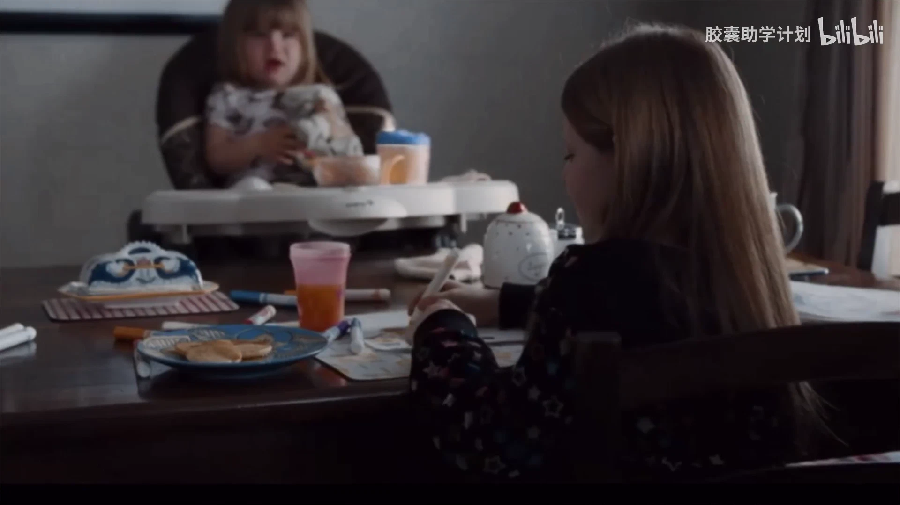

文字识别：bilibili / 胶囊助学计划

### 画面 00:01:10

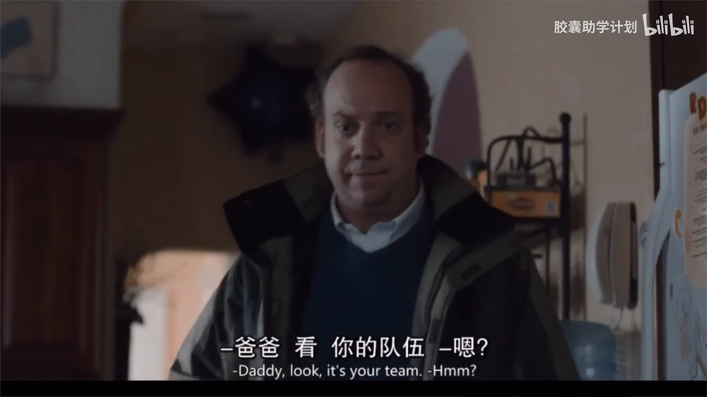

文字识别：刘bilibili / 胶囊助学计划 / -爸爸看你的队伍-嗯? / -Daddy, look, it's your team. -Hmm?

### 画面 00:01:12

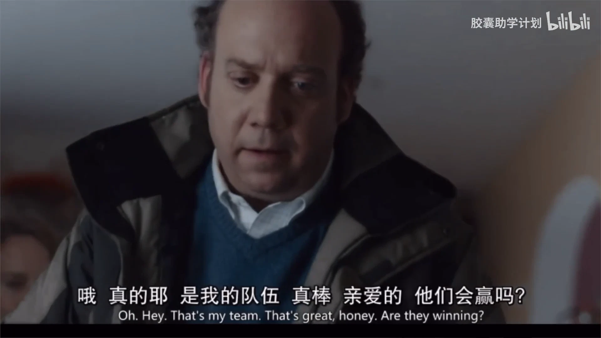

文字识别：bilibili / 胶囊助学计划 / 哦真的耶是我的队伍真棒亲爱的他们会贏吗？ / Oh. Hey. That's my team. That's great, honey. Are they winning?

### 画面 00:01:14

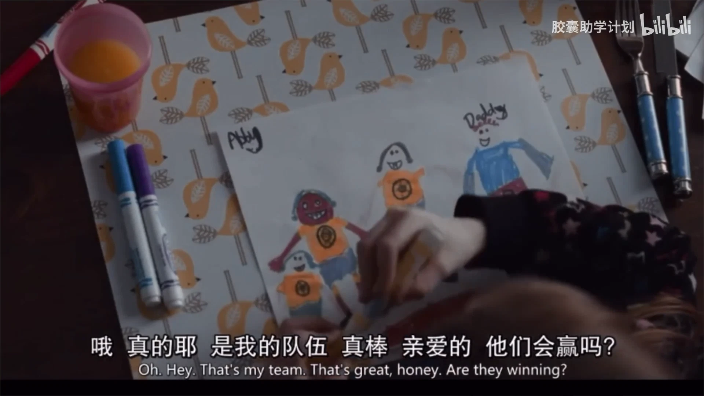

文字识别：胶囊助学计划blil / 哦真的耶是我的队伍真棒亲爱的他们会赢吗？ / Oh. Hey. That's my team. That's great, honey. Are they winning?

### 画面 00:01:16

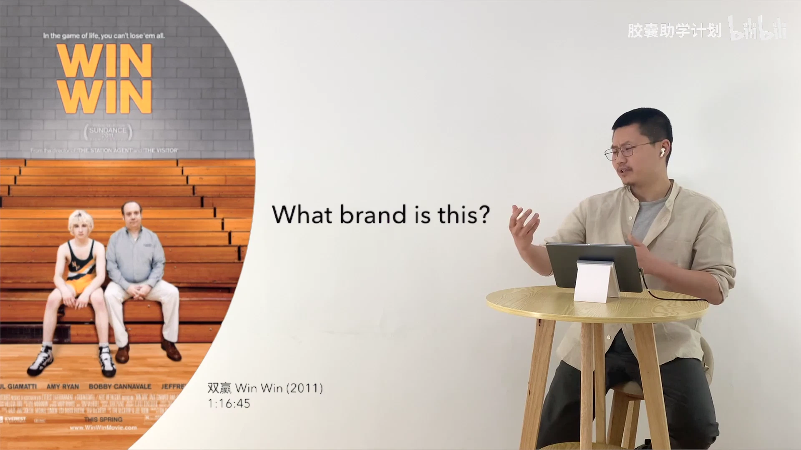

文字识别：胶囊助学计划 / In the game of life,you cant lose'em all / WIN / WIN / SUNDANO / AGENTNLTHE VSTOR / What brand is this? / GIAMATTI / AMY RYAN / BOBBY CANNAVALE / JEFFRE / 双赢 Win Win (2011) / 1:16:45 / THIS SPRING / wwe.WinWintovie-com

## 00:01:30–00:02:00

话。Let's continue，接下来我们看几个小的国家的名字，一个我们一起读 Swedish，两个元音中间一个辅音给后面划分音节。如果您忘了的话，查看一下我们的音标视频。来读 Swedish，Swedish，那它指的是瑞典的啊，或者瑞典人。那我们说一下瑞典怎么读呢？很简单，读 Sweden，Sweden。比如

### 画面 00:01:30

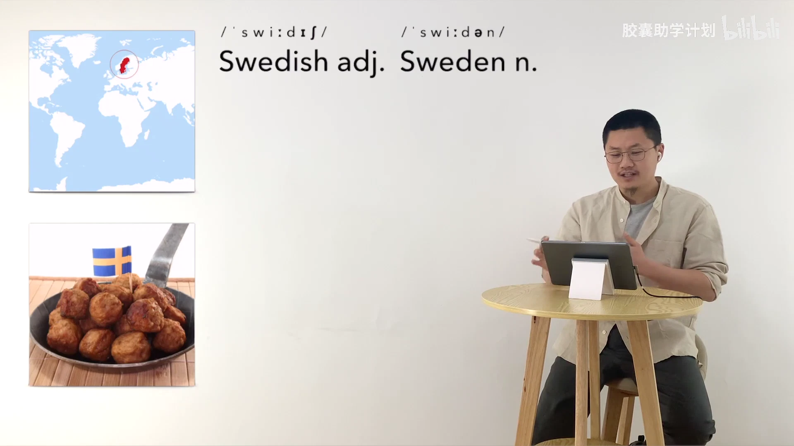

文字识别：胶囊助学计划bl / / 's wi :d I ∫/ / / 'swi:dan/ / Swedish adj. Sweden n.

### 画面 00:01:36

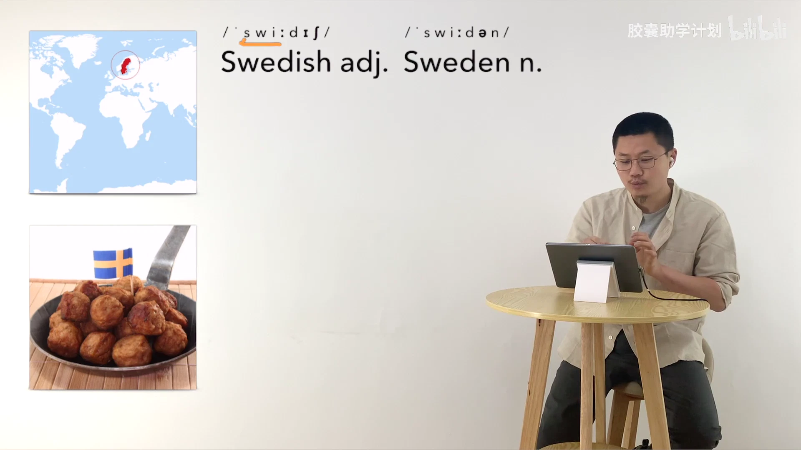

文字识别：胶囊助学计划l / 's w i :d I ∫/ / / 'swi:dan/ / Swedish adj. Sweden n.

## 00:02:00–00:02:30

说我们造一个小的句子，各位记吧。单词最主要最主要，各位记住的就是造句。读 He is Swedish. 他不是瑞典人。 He is not Swedish. 怎么变？问他是瑞典人吗？ Is 提前。 Is he Swedish? Okay, very good. 那我们给大家介绍一下瑞典的一个关键性的美食，叫做 meatball. Okay, so this is Swedish meatball. 各位注意 Swedish 的 s, Sweden 的

### 画面 00:02:01

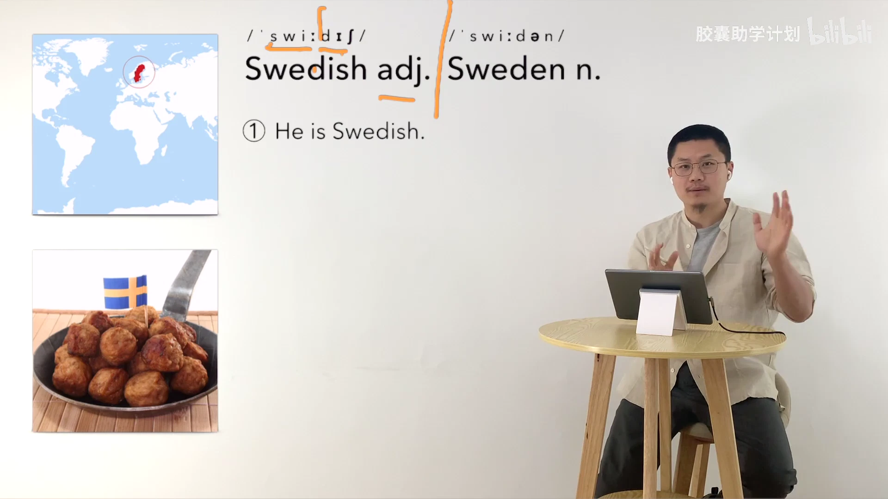

文字识别：胶囊助学计划Li / ''s wi:dan/ / Swedish adj.Sweden n. / ① He is Swedish.

### 画面 00:02:20

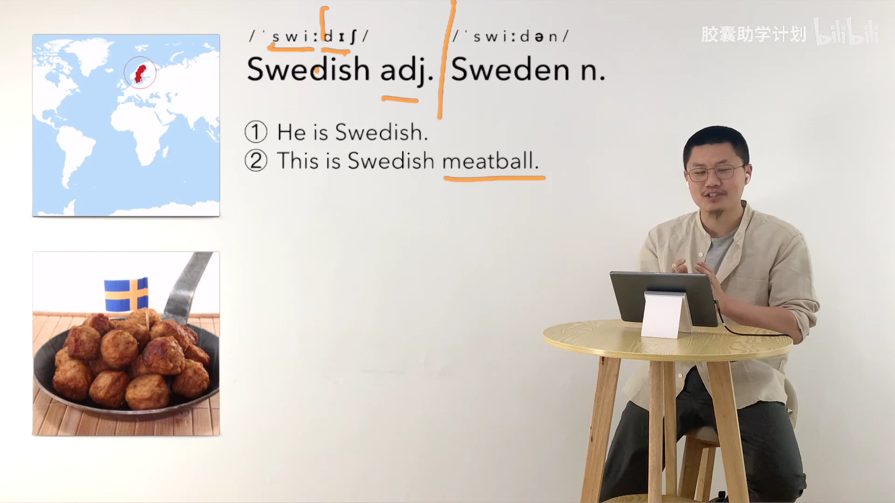

文字识别：胶囊助学计划l / 'swi:dan/ / Swedish adj.Sweden n. /  He is Swedish. / This is Swedish meatball.

### 画面 00:02:25

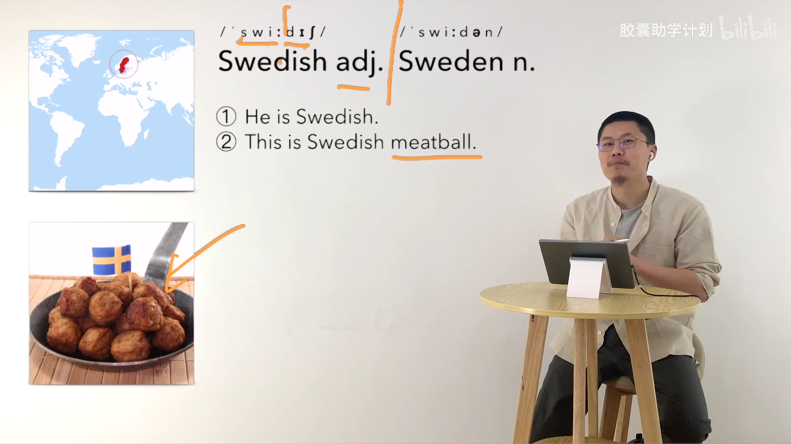

文字识别：胶囊助学计划bill / /'swi:dan/ / Swedish adj.Sweden n. / ① He is Swedish. / ) This is Swedish meatball.

## 00:02:30–00:03:00

S，都在大写，对不对？而 meatball 其实还挺直译的，就是肉丸儿，meat，肉，ball，球，肉球，是吧？那我们不会说肉球啊，我们会说肉丸。So this is Swedish meatball. 你见到 Swedish，你可以说 I love Swedish meatball. It's so tasty, so delicious. 太好吃了，对吧？Okay, one more. Next one, 来跟我一起读 English English. Next one, England.

### 画面 00:02:37

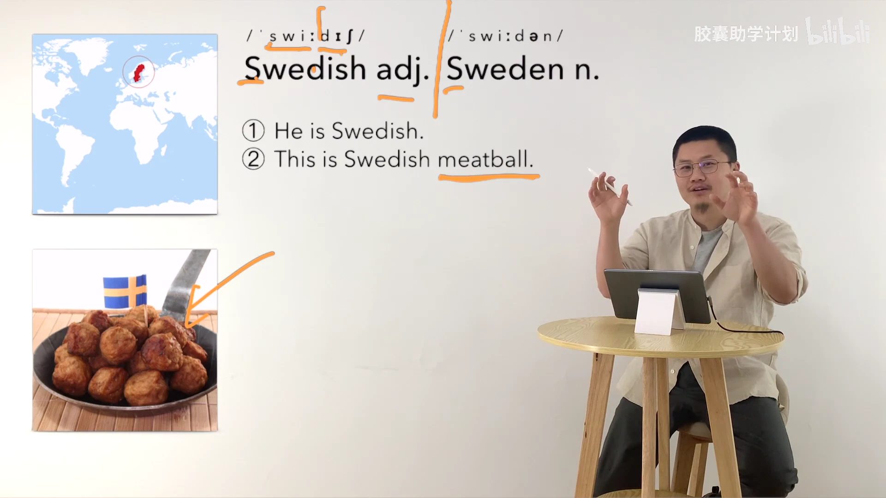

文字识别：胶囊助学计划b / /'s wi:dan/ / Swedish adj.S / Sweden n. /  He is Swedish. / This is Swedish meatball.

### 画面 00:02:40

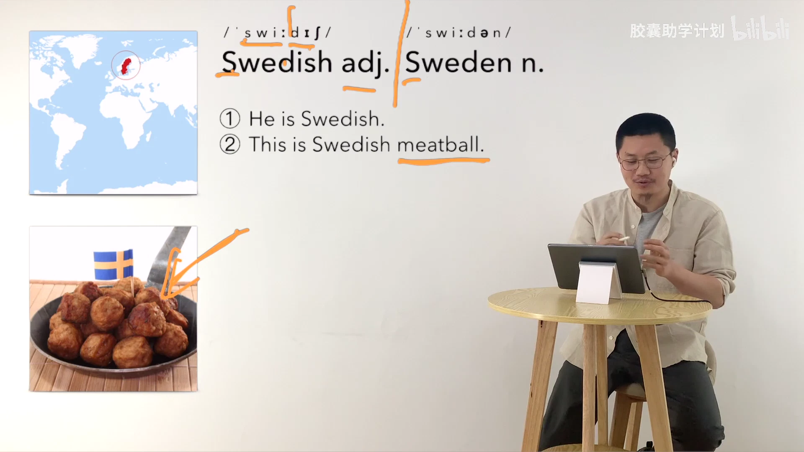

文字识别：胶囊助学计划 / 1swi:dan/ / Swedish adj.S / Sweden n. / ) He is Swedish. / This is Swedish meatball.

### 画面 00:02:54

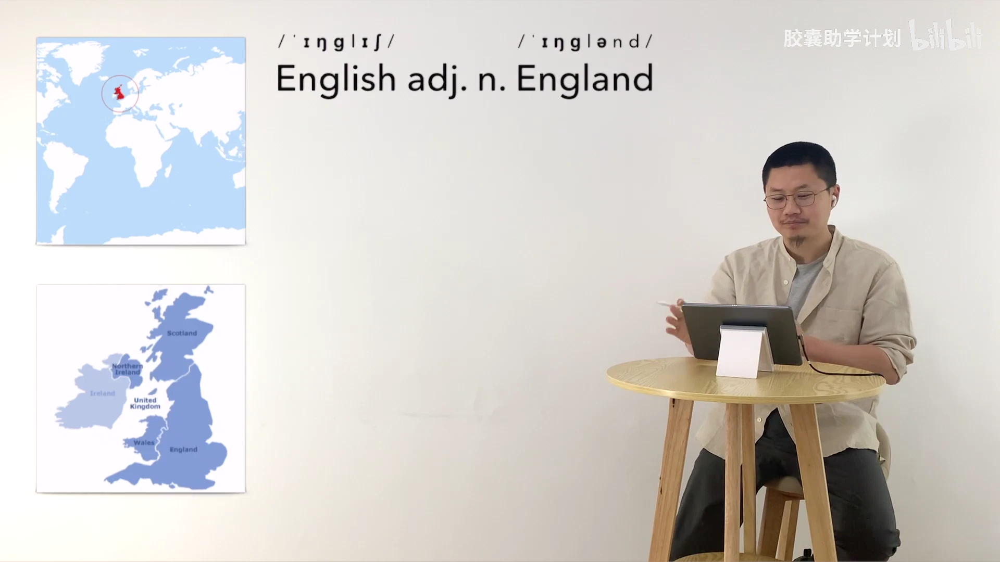

文字识别：胶囊助学计划 Li / /'iηgli∫/ / /ingland/ / English adj. n. England / Lreland / United / Kingdom

## 00:03:00–00:03:30

那各位看地图啊，这片是非洲，对吧？这是南美，这是我们中国的位置，这个是中东啊。英国就在这个地方，我们管它叫做 English or England。那是不是这样呢？其实并不是。English倒是可以表示英国人的意思，而 England 更多表示的是英格兰。我们大多数时候表示英国用的是缩写的 UK or Britain。而英国呢，很神奇，它实际上的全名

### 画面 00:03:04

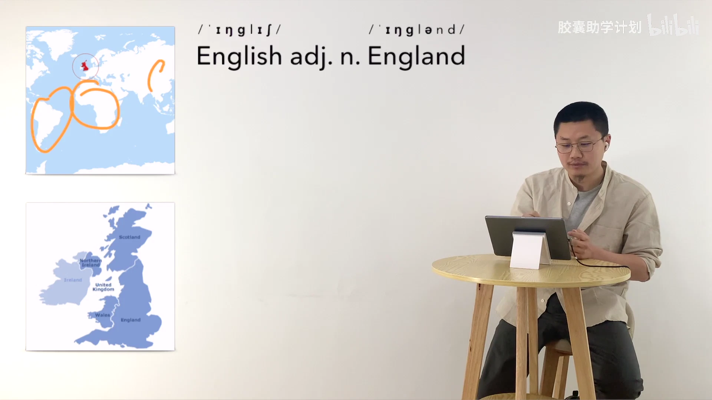

文字识别：胶囊助学计划L / /inglI∫/ / /ingland/ / English adj. n. England / scotland / Lrelanc / United / Kingdom / am

### 画面 00:03:08

文字识别：胶囊助学计划il / /'inglI∫/ / /ingland/ / English adj. n. England / scotland / lrelane / United / Kingdom

### 画面 00:03:27

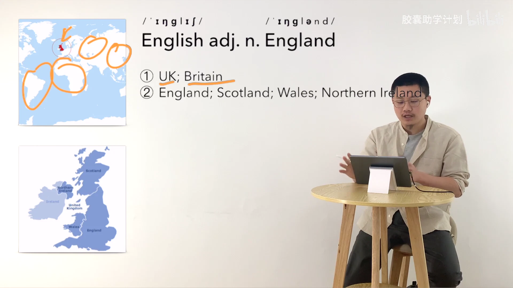

文字识别：胶囊助学计划明 / /'iηgli∫/ / /ingland/ / English adj. n. England / UK; Britain / England; Scotland; Wales; Northern Ireland / cotland / elan / United / Kingdom

## 00:03:30–00:04:00

叫做大不列颠及北爱尔兰联合王国，所以它是四个部分。大不列颠，England，各位看到了吧？也就是大家最熟悉的叫英格兰，比如说伦敦就在英格兰这个区域。其次呢，Scotland叫苏格兰，那苏格兰著称的就是他们的发音，所谓的Torys accent，他们的发音非常有意思，基本是你看着字幕，哎，你英语非常好，看着字幕你也听不懂他在说什么，很多的情况下。

### 画面 00:03:40

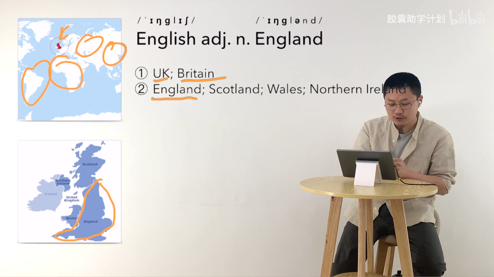

文字识别：胶囊助学计划H / /'iηgli∫/ / /ingland/ / English adj. n. England / UK; Britain / England; Scotland; Wales; Northern Ireland / cotlanc / United / Kingdom / England

### 画面 00:03:47

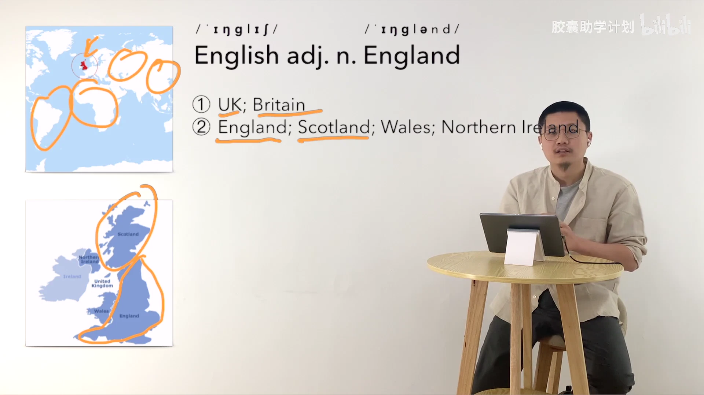

文字识别：胶囊助学计划bi / /'iηgli∫/ / /ingland/ / English adj. n. England / UK; Britain / England; Scotland; Wales; Northern Ireland / cotland / Norther / Ireland / United / Kingdom / Wale / England

## 00:04:00–00:04:30

下一个部分呢叫做 Wales，也就是它的威尔士部分。OK， next one呢叫做 Northern Ireland，叫做北爱尔兰啊。各位看到北爱尔兰，其实整个这一大块地方，我们把它叫做 Ireland，叫做爱尔兰，这是一个独立的国家。而英国是由四个部分组成的。跟我一起读：England， Scotland， Wales and Northern Ireland。如果各位更感兴趣呢，不妨自己去

### 画面 00:04:06

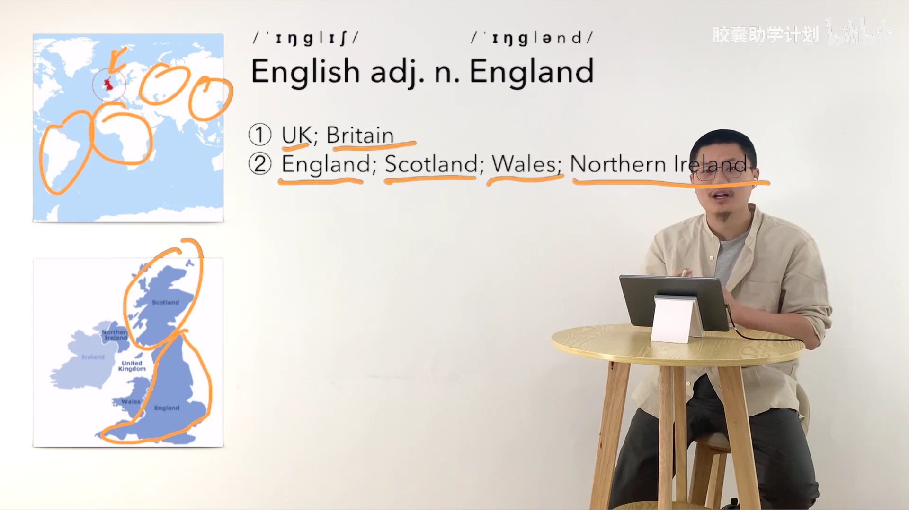

文字识别：胶囊助学计划 / /iηglI∫/ / /ingland/ / English adj. n. England / UK; Britain / England; Scotland; Wales; Northern Ireland / cotland / Norther / lreland / United / Kingdom / Wale / England

### 画面 00:04:14

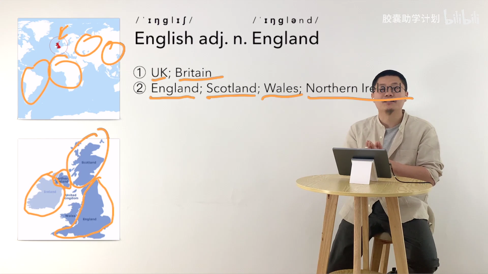

文字识别：LiH / /'iηgli∫/ / /ingland/ / 胶囊助学计划 / English adj. n. England / UK;Britain / England; Scotland; Wales; Northern Ireland / cotiane / United / cingdom / Wale / England

### 画面 00:04:24

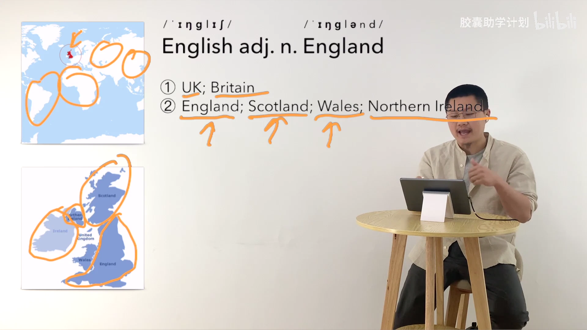

文字识别：BiBi / /'iηgli∫/ / /ingland/ / 胶囊助学计划 / English adj. n. England / UK; Britain / England; Scotland; Wales; Northern Ireland / 个 / cotiand / United / Cingdom / Wale / England

## 00:04:30–00:05:00

引擎搜索引擎一下。OK，我们就不提用什么了。Next one，来 American， American，美国人啊，美国的。那其次，美国其实就少了一个字母 n 嘛，我们把字母 n 对吧，嗯的发音去掉。America， America。OK，那它美国其实还有几个不同的说法，叫做 U S United States，或者是 United States of America。OK， very good。

### 画面 00:04:32

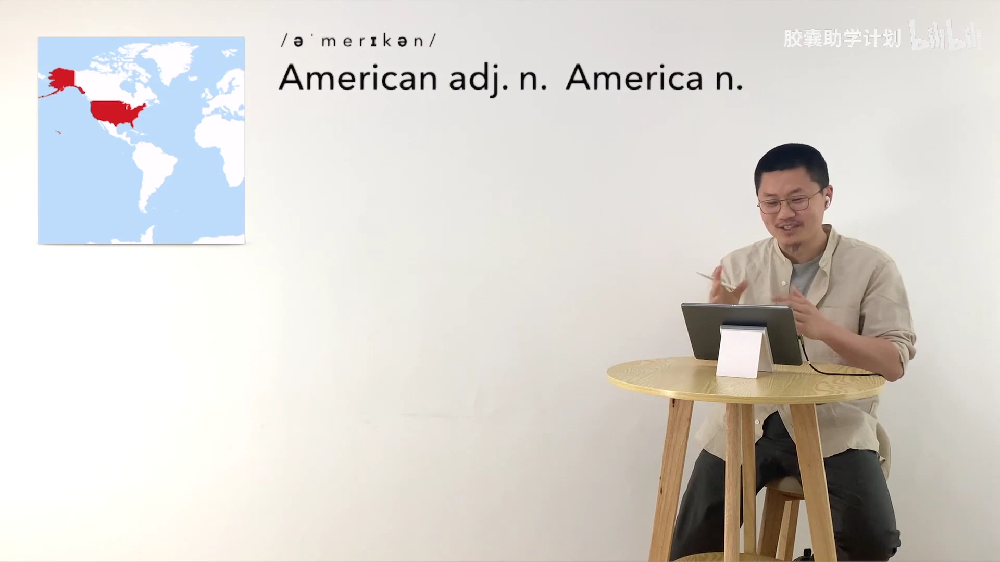

文字识别：胶囊助学计划H / /a'merikan/ / American adj. n. America n.

### 画面 00:04:43

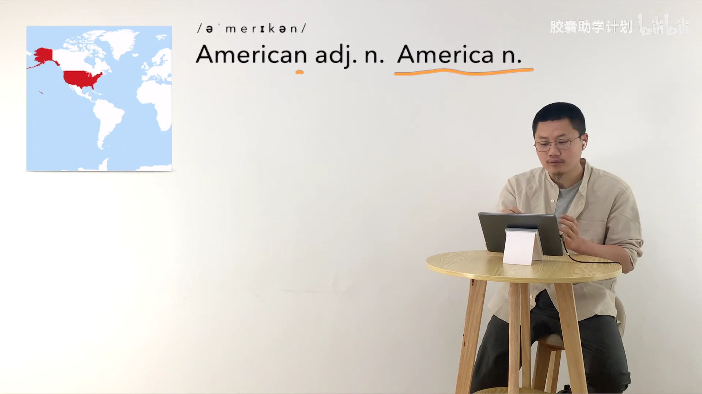

文字识别：胶囊助学计划l / /a'merikan/ / American adj. n. America n.

### 画面 00:04:59

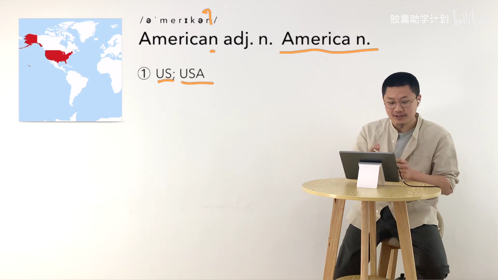

文字识别：胶囊助学计划州 / /a'merikan / American adj. n. America n. / ① US; USA

## 00:05:00–00:05:30

那我们看一下它的这个地理位置啊，这是非洲，对不对？这是我们刚刚讲过的英伦三岛。哎，南美，整个这一块是北美，这是加拿大，对吧？美国本土，阿拉斯加，太平洋诸多岛屿，大家最熟悉的，Hawaii，夏威夷。Okay, very good.接下来 next one，跟我一起读来，Italian, Italian. Next one, Italy, Italian,意大利人，Italy,

### 画面 00:05:07

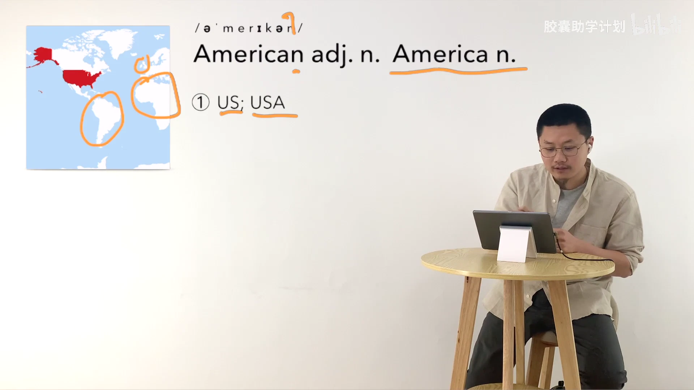

文字识别：胶囊助学计划州 / /a'merikan / American adj. n. America n. / ① US; USA

### 画面 00:05:13

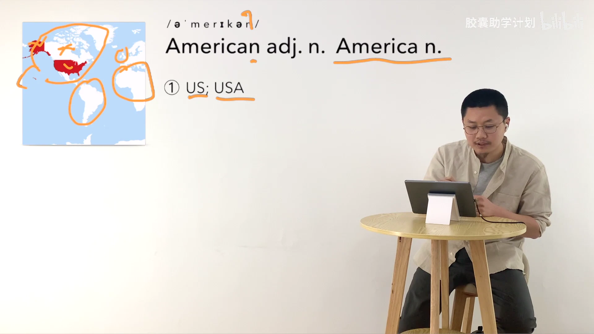

文字识别：胶囊助学计划册 / /a'merikan/ / American adj. n. America n. / ① US; USA

### 画面 00:05:17

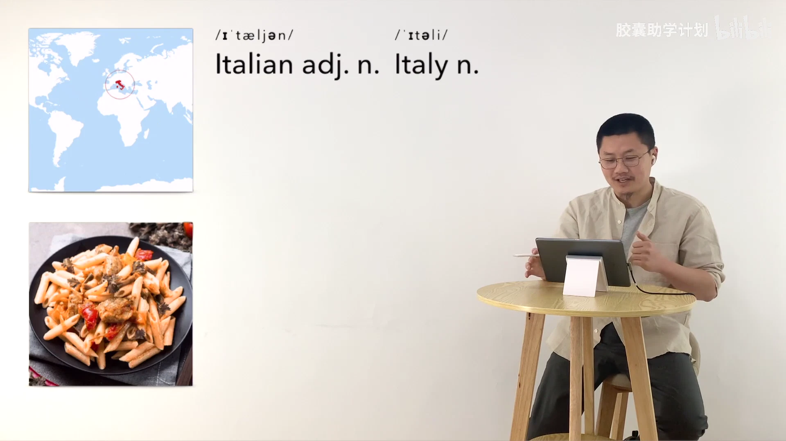

文字识别：胶囊助学计划 / /I'tæljan/ / /'itali/ / Italian adj. n. Italy n.

### 画面 00:05:21

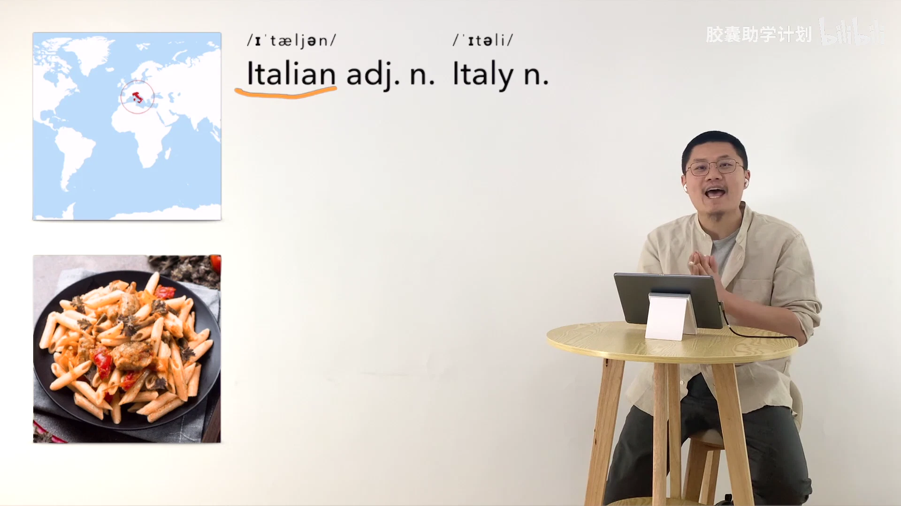

文字识别：胶囊助学计划 / /I'tæljan/ / /'itali/ / ltalian adj. n. Iltaly n.

## 00:05:30–00:06:00

Italy. Now we look at its location. Ah, guys,顺便学一下世界地理。非洲，地中海。OK,然后这个地方就是意大利，像一个球靴一样，踢着西西里岛。OK,玩一个。那我们一起造一个句子，叫She is Italian.她不是意大利人。She is not Italian.她是意大利人吗？Is提前。Is she Italian? OK,玩一个。那我们介绍一下意大利美食，叫This is

### 画面 00:05:35

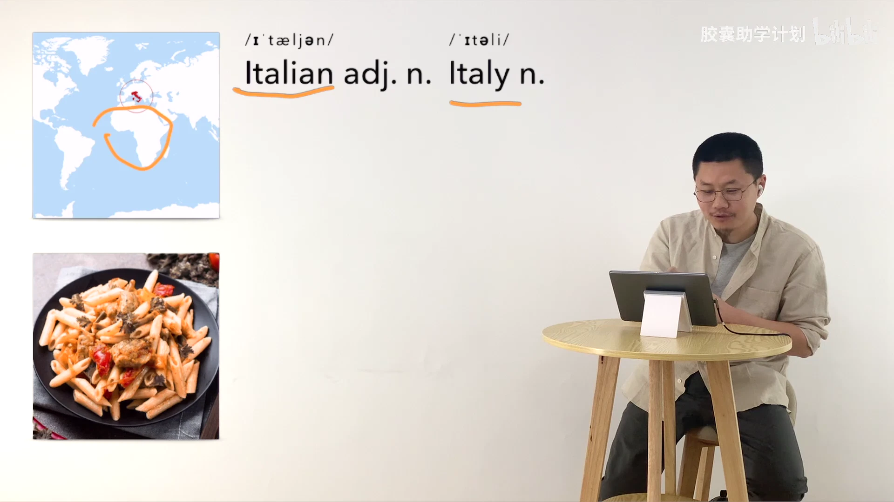

文字识别：胶囊助学计划州 / /I'tæljan/ / /'itali/ / Italian adj. n. Italy n.

### 画面 00:05:57

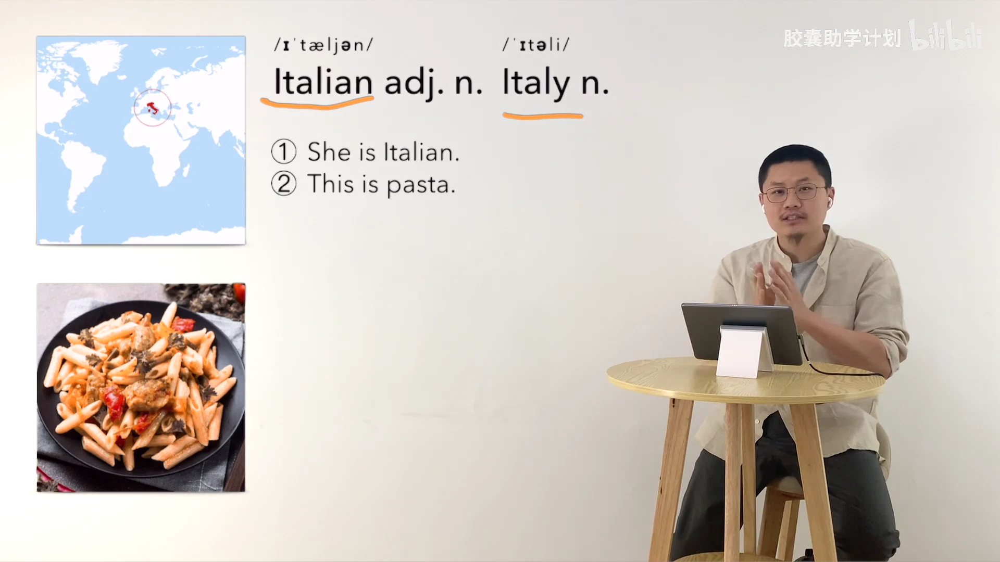

文字识别：胶囊助学计划H / /I'tæljan/ / /'itali/ / Italian adj. n. Italy n. / ) She is Italian. / This is pasta.

## 00:06:00–00:06:30

pasta, pasta, pasta. 其实是各种意面的一个统称，叫 pasta. 那因为它的做法不一样，还会有很多很多的单词，比如说 lasagna, 啊，我印象当中还有 macaroni, 还有 spaghetti 等等等等啊。我也不是这方面的美食专家，给大家介绍一个通用的单词叫 pasta 就行了。那你想问这是意面吗？是什么句型？疑问对不对？很简单，is 之

### 画面 00:06:03

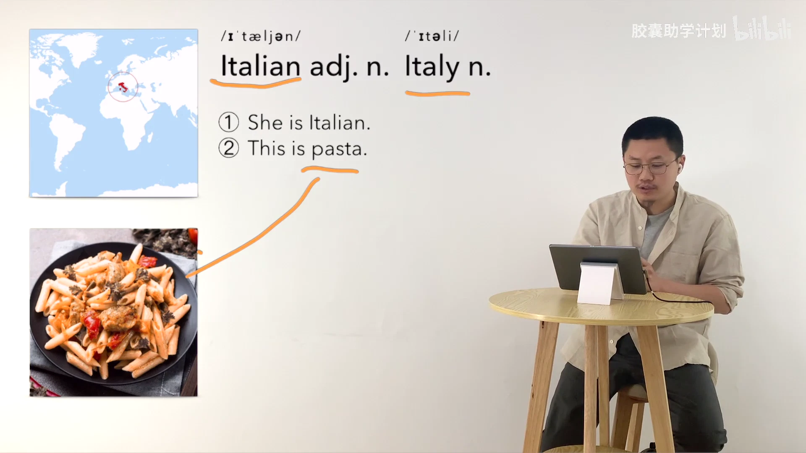

文字识别：胶囊助学计划 / /I'tæljan/ / /'itali/ / Italian adj. n. Italy n. / She is ltalian. / This is pasta.

### 画面 00:06:12

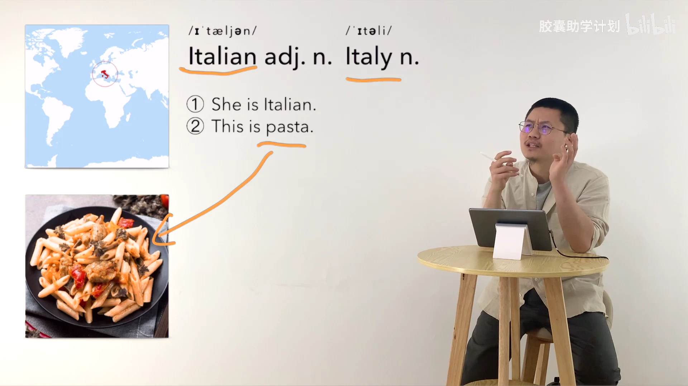

文字识别：胶囊助学计划i / /I'tæljan/ / /'itali/ / ltalian adj. n. Italy n. / ) She is ltalian. / This is pasta.

### 画面 00:06:20

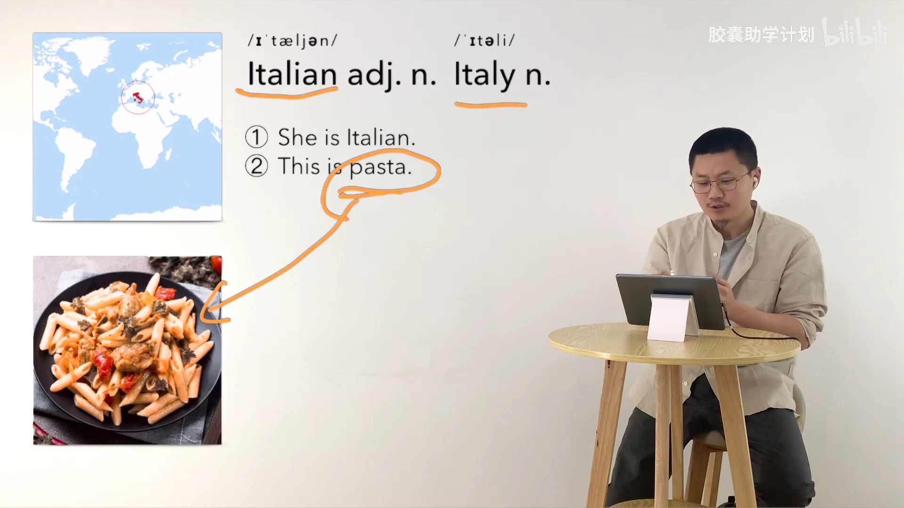

文字识别：胶囊助学计划Lili / /I'tæljan/ / /'itali/ / Italian adj. n. Italy n. / She is ltalian. / This iy pasta.

## 00:06:30–00:07:00

叫Is this pasta? Okay,你又新学会了一个小的句型。Next one,那接下来我们要做的事情，偶数课最重要的事情，我跟大家以前提过，叫做我们只办三件事，叫做练习，练习还是练习。Okay,所以那接下来我们就进入练习，先看两个单词，German, American, German德国人，American美国人。那跟我一起去读，来朗读跟读啊，跟读。This

### 画面 00:06:30

文字识别：胶囊助学计划Lii / /I'tæljan/ / /'itali/ / Italian adj. n. Italy n. / is ltalian. / This / pasta.

### 画面 00:06:35

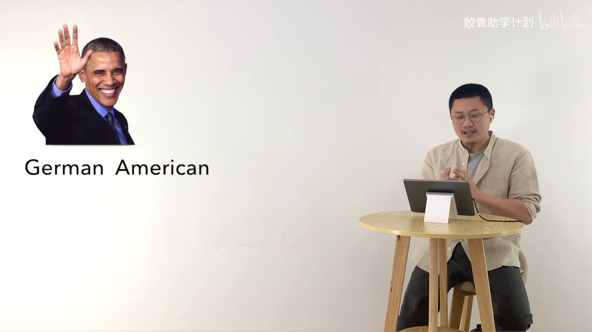

文字识别：胶囊助学计划il / German American

### 画面 00:06:52

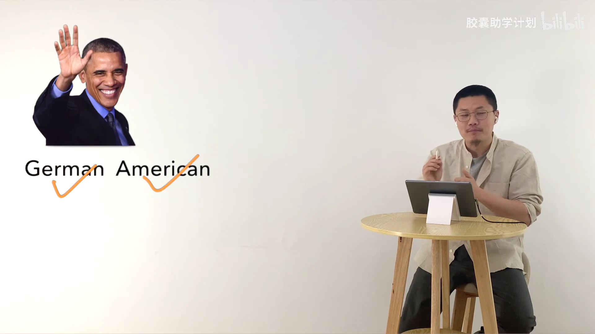

文字识别：胶囊助学计划Ll / German Amerizan

## 00:07:00–00:07:30

is Barack Obama. 注意首字母大写，大写句子的开头大写。 Is he German? 那你想一下。 No, he isn't German. He is American. Very good. Next one. W O seven. 我相信你们很可能看过这个电影。 French, 法国人。 English, OK, very good. Next one. This is James Bond.

### 画面 00:07:08

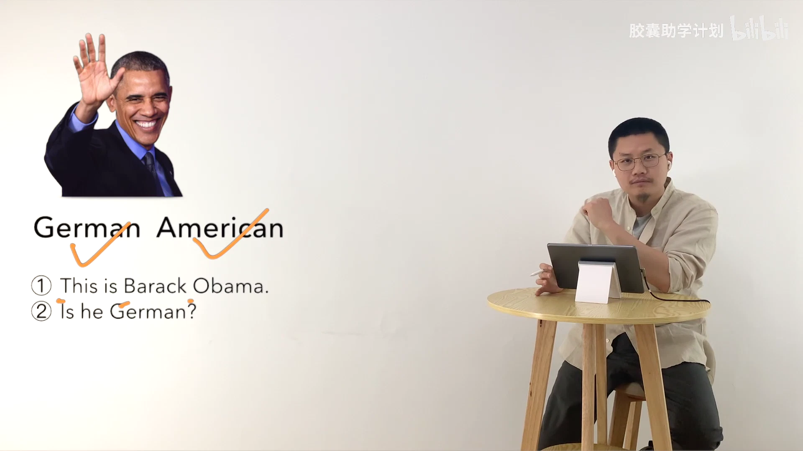

文字识别：胶囊助学计划l / German Amerizan /  This is Barack Obama. / ② Ts he German?

### 画面 00:07:17

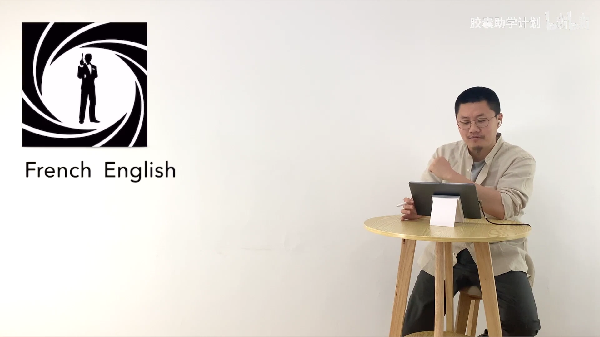

文字识别：胶囊助学计划 / French English

### 画面 00:07:20

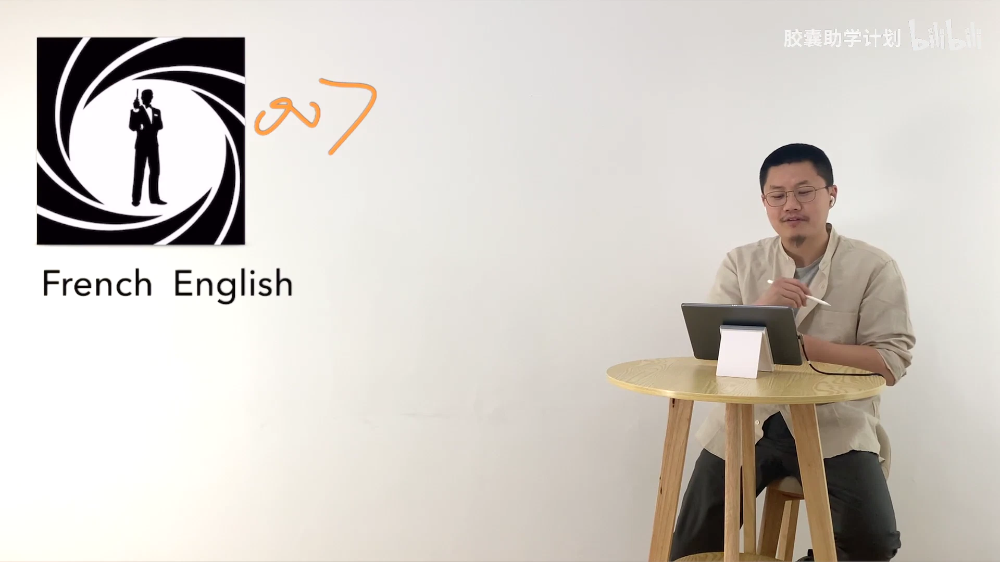

文字识别：胶囊助学计划Li / French English

### 画面 00:07:25

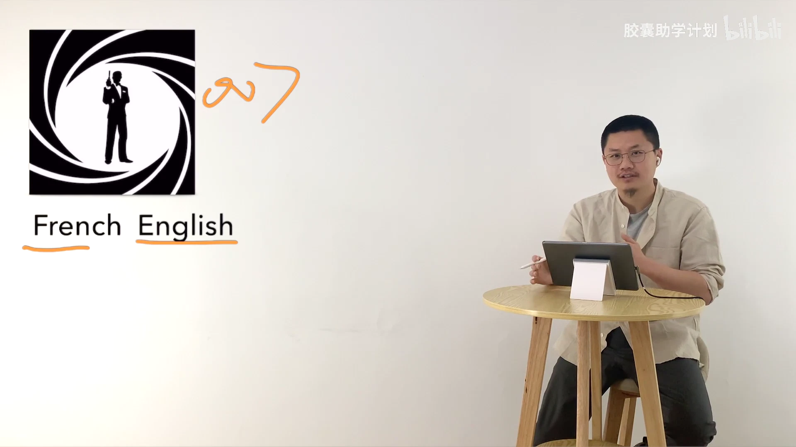

文字识别：胶囊助学计划l / N / French / English

## 00:07:30–00:08:00

James Bond W seven, is he French? No, he isn't French. He is English. Very good. Next one, Japanese and Chinese. I think you know this person, right? Jackie Chan. Repeat after me. This is Jackie Chan. Next one, is he Japanese? No, he isn't Japanese, and he is Chinese. Very good. Let's continue. Korean

### 画面 00:07:35

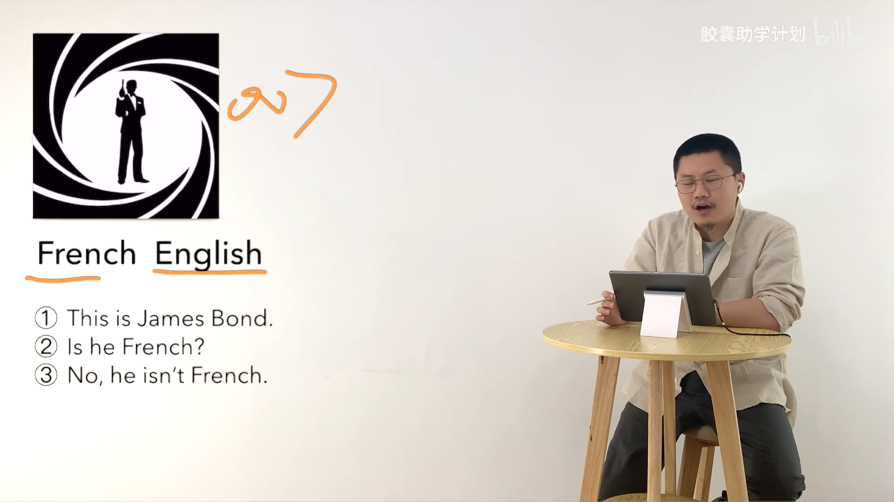

文字识别：胶囊助学计划H / French English / This is James Bond. / ② Is he French? / ③ No, he isn't French. / 3

### 画面 00:07:40

文字识别：胶囊助学计划 / Japanese / Chinese

### 画面 00:07:43

文字识别：胶囊助学计划Ll / Japanese / Chinese

### 画面 00:07:50

文字识别：胶囊助学计划bl / Japanese / Chinese / This is Jacky Chan. / Is he Japanese? / 2）

### 画面 00:07:58

文字识别：胶囊助学计划l / Korean C / Chinese

## 00:08:00–00:08:30

and Chinese. Korean, is he Korean? Is he Korean? Is he Chinese? So who is this actually? I think you know maybe. So repeat after me. This is Bruce Lee, Bruce Lee, 邓小平. Okay, very good. Is he Korean? No, he isn't Korean. He is Chinese. Okay, very good. Now,注意肯定句、一般疑问句、否定句、肯定句.

### 画面 00:08:04

文字识别：胶囊助学计划L / Korean / Chinese

### 画面 00:08:13

文字识别：胶囊助学计划 /  bibi / Korean / Chinese / This is Bruce Lee.

### 画面 00:08:24

文字识别：胶囊助学计划 / Korean / Chinese / This is Bruce Lee. / Is he Korean? / 2 /  No, he isn't Korean. / He is Chinese.

### 画面 00:08:26

文字识别：胶囊助学计划 / Korean / Chinese / This is Bruce Lee / Is he Korean? / No, he isn't Korean. / He is Chinese.

### 画面 00:08:28

文字识别：bitb / 胶囊助学计划 / Korean / Chinese / This is Bruce Lee / Is he Korean? / No, he isn't Korean. / He is Chinese.

## 00:08:30–00:09:00

is加某人的名字介绍，对吧？Next one, do you know her? Okay, 你知道她吗？啊，西西里的美丽传说，意大利国宝级的演员，Swedish and Italian. Okay, repeat out to me. This is Monica Bellucci. So Monica Bellucci有点像意大利语的发音，Okay, Monica Bellucci. This is Monica Bellucci. So is she Swedish? No,

### 画面 00:08:33

文字识别：胶囊助学计划i / Swedish Italian

### 画面 00:08:43

文字识别：胶囊助学计划Lii / Swedish Italian

### 画面 00:08:56

文字识别：胶囊助学计划Ll / Swedish ltalian / This is Monica Bellucci. / Is she Swedish? / 2

## 00:09:00–00:09:30

she isn't Swedish. She is Italian. Okay,那这个有点像 Italian. Okay,像意大利。我们好好读啊，来 Italian. She is Italian. Okay, very good.那我们现在回答了这个问题，这是我们最开始其实解决了一个问题，叫如何询问某件物品的品牌。我们尽量不用那个 make，那个 make 有更重要的作用。我们在以后马上就会见到了。那我们用 brand 这个单词，叫 What brand is this?

### 画面 00:09:12

文字识别： biltili / 胶囊助学计划 / ①如何询问某件物品的品牌?

### 画面 00:09:21

文字识别：bitb / 胶囊助学计划 / brancl / ①如何询问某件物品的品牌？

## 00:09:30–00:10:00

Okay, one.简单复习一下，练习了肯定句、一般疑问句及否定句，这样又是这三个句型，对不对？来回来去的这三个句型，很快我们就会有新的东西了。然后单词呢？哎，这是我们刚才学到的每个国家的人。其次最重要的一个表达叫 What brand is this? 进入今天的讲作业环节，第一绿皮书第六课您要去写了。讲完第几课写第几课。绿皮书不知道是什么的，去看开篇。其次

### 画面 00:09:31

文字识别：胶囊助学计划 / Recap / Patterns / This is / Is / this...? / Grammar / This is not.. / brand Swedish English / Words / American Italian / Expression / What brand is this?

### 画面 00:09:34

文字识别：LiHL / 胶囊助学计划 / Recap / Patterns / This is / IS / this...? / Grammar / This is not / brandS / Swedish / English / Words / American Italian / Expression / What brand is this?

### 画面 00:09:44

文字识别：bitb / 胶囊助学计划 / Recap / Patterns / This / sis / IS / this...? / Grammar / This is not / brand Swedish English / Words / American Italian / Expression / What brand is this?

### 画面 00:09:48

文字识别：Biltb / 胶囊助学计划 / Recap / Patterns / This / sis / IS / this...? / Grammar / This is not / brand Swedish English / Words / American Italian / Expression / What / brandi / isthis?

### 画面 00:09:51

文字识别：Bib / 胶囊助学计划

## 00:10:00–00:10:30

给大家自己要给自己讲解一遍今天学到的核心知识点。 Learning pyramid, study test. 不知道为什么的，一定要去看，会让你的学习效率变得高非常的多。那本期视频呢，到这就结束了。如果大家喜欢我们的视频，欢迎大家订阅，一键三连支持。那当然，如果您是没有需要学英语或者正在学英语的朋友，也请分享给他们。最后，我们来看一句名人名言。 The hardest portion of English, I must say it, idioms. Okay, peace out.

### 画面 00:10:04

文字识别：胶囊助学计划 / 绿皮书第6课的写作练习 / 请给自己讲解一遍今天的 / 核心知识点(learning / puramid+study-test)

### 画面 00:10:12

文字识别：胶囊助学计划Li

### 画面 00:10:21

文字识别：胶囊助学计划bl出 / The hardest portion of English, I must / say it: Idioms. / -Flula Borg

### 画面 00:10:29

文字识别：囊助学计划 / The hardest portion of English, I must / say it: ldioms. / Flula Borg

## 00:10:30–00:10:42

### 画面 00:10:31

文字识别：CAPSULEACADEMY / 胶囊学院 / 『 / 小红书 / Lecturer

### 画面 00:10:33

文字识别：CAPSULEACADEMY / 胶囊学院 / 小红书 / Photographer

### 画面 00:10:36

文字识别：CAPSULEACADEMY / 胶囊学院 / 小红书 / Editor / □ / Berlin

### 画面 00:10:39

文字识别：CAPSULEACADEMY / 胶囊学院 / 小红书 / 品

### 画面 00:10:41

文字识别：bilbili / 胶囊助学计划

### 画面 00:10:42

文字识别：bilbili / 胶囊助学计划

