# 007 语法 文章

快速机器解析：语音为单模型转写，未进行独立交叉校对或人工复核；画面每秒采样并按变化选帧，短时文字和标记可能遗漏。截图时间约有 1 秒误差。图片有损压缩；遇到疑点请按时间查看 Google Drive 原视频。

## 00:00:00–00:00:30

Hello everyone, welcome to Capsule Academy. This is Leo. Today we are going to learn new concept, which is Book One, Lesson Seven, Grammar and Story. 那老习惯，我们还是带着一个疑问去听接下来的课程。这课我们要学习特殊疑问句。之前早在第一课我们学到了一般疑问句，那我们今天来看一下它们有何异同。那带着这个问题， hope you can enjoy it. 那上来我们直接来硬货，什么叫

### 画面 00:00:00

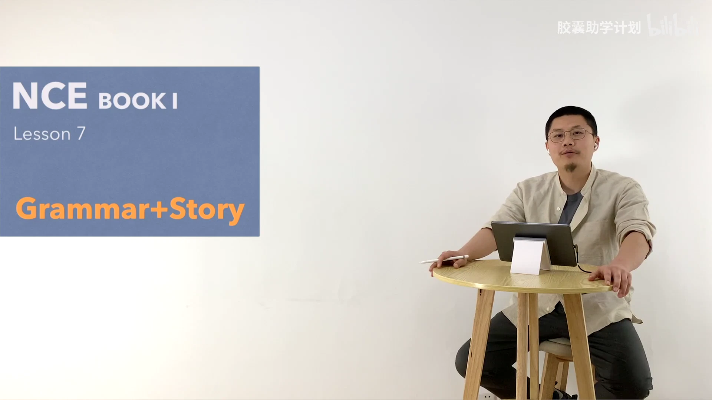

文字识别：胶囊助学计划 / NCE / BOOKI / Lesson 7 / Grammar+Story

### 画面 00:00:03

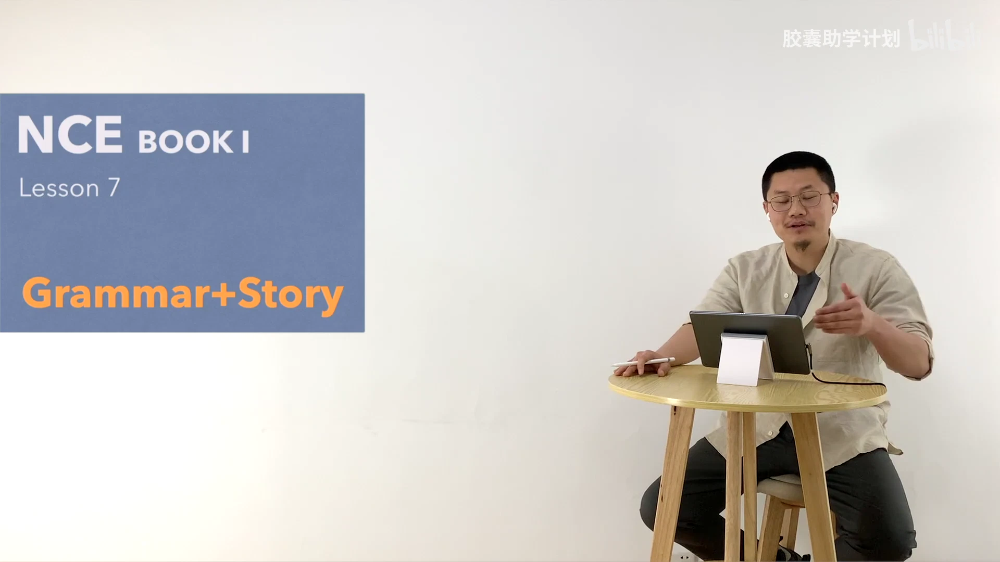

文字识别：胶囊助学计划 / NCE / BOOKI / Lesson 7 / Grammar+Story

### 画面 00:00:08

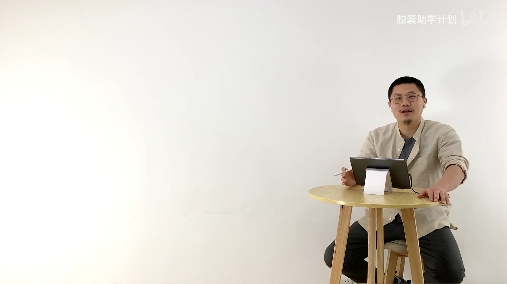

文字识别：胶囊助学计划

### 画面 00:00:10

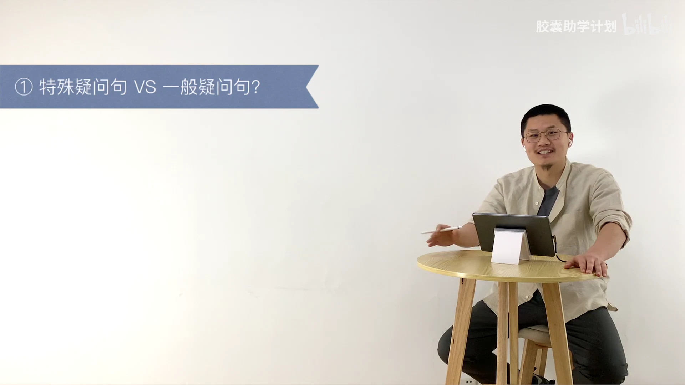

文字识别：胶囊助学计划 / 特殊疑问句VS一般疑问句?

### 画面 00:00:20

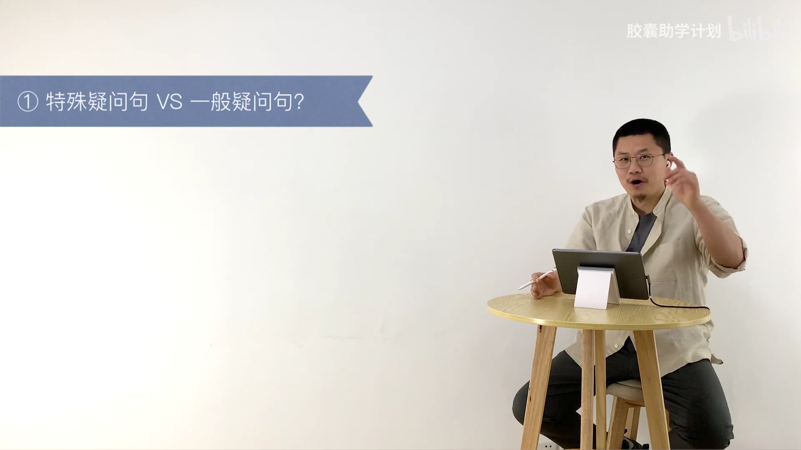

文字识别：胶囊助学计划 / 特殊疑问句VS一般疑问句?

### 画面 00:00:22

文字识别：胶囊助学计划bll

### 画面 00:00:26

文字识别：胶囊学院

### 画面 00:00:28

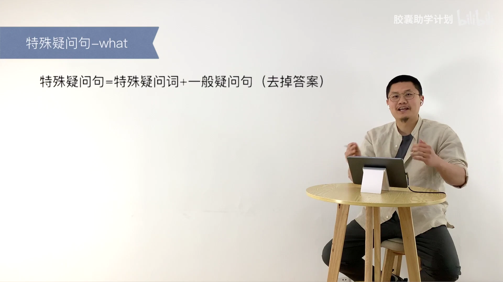

文字识别：胶囊助学计划 / 特殊疑问句-what / 特殊疑问句=特殊疑问词+一般疑问句(去掉答案)

## 00:00:30–00:01:00

特殊疑问句？好，首先我们先看一下，给大家放在这地方放了一个等号啊，放了一个等式，叫特殊疑问句等于特殊疑问词加一般疑问句，同时括号当中有一个核心的东西叫去掉答案。我们接下来一起通过练习看一下它到底是什么意思。那我们先解释一下什么叫特殊疑问词。各位在这个地方看到的小单词叫 what，它就是一个特殊疑问词。好，那我们先看一句话，叫做 My name is Leo。好，非常简

### 画面 00:00:38

文字识别：胶囊助学计划 / 特殊疑问句-what / 特殊疑问句=特殊疑问词+一般疑问句（去掉答案）

### 画面 00:00:41

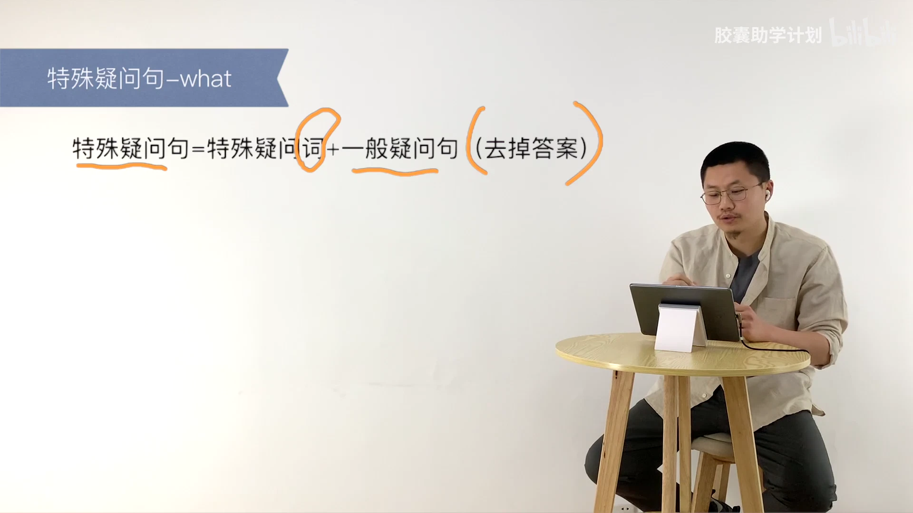

文字识别：胶囊助学计划 / 特殊疑问句-what / 特殊疑问句=特殊疑问词+一般疑问句 / （去掉答案）

### 画面 00:00:50

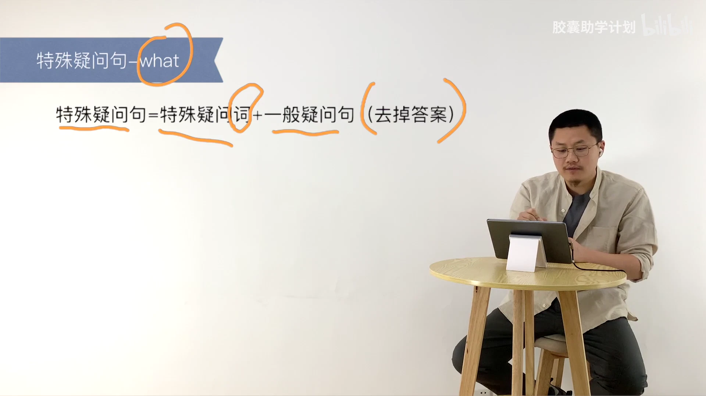

文字识别：胶囊助学计划 / 特殊疑问句 / what / 特殊疑问句=特殊疑问 / 词 / +一般疑问句 / （去掉答案）

### 画面 00:00:57

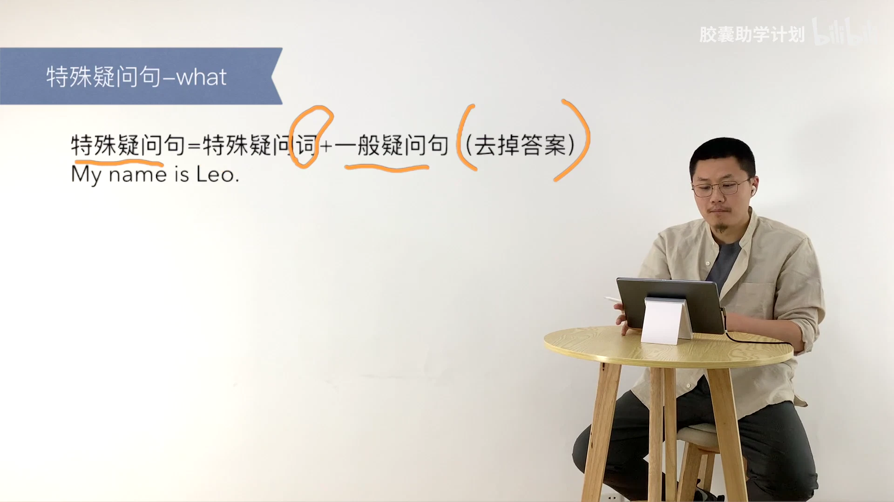

文字识别：胶囊助学计划 / 特殊疑问句-what / 特殊疑问句=特殊疑问 / 词 / +一般疑问句 / （去掉答案） / My name is Leo.

### 画面 00:00:59

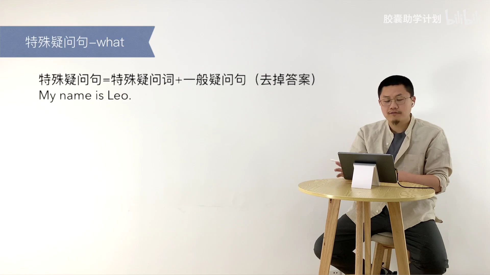

文字识别：胶囊助学计划 / 特殊疑问句-what / 特殊疑问句=特殊疑问词+一般疑问句 (去掉答案) / My name is Leo.

## 00:01:00–00:01:30

单的一句话，每个单词我相信大家都认得，叫做我的名字叫是Leo. Okay, 那我现在想把它变成一个一般疑问句，您先跟我一起回顾一下，早在第一课我们就学过了，叫要把一个关键的单词提到句首去，而不是某个单词的前面去。所以那这地方的关键单词就是 is 提到句首去，于是出来了这样一个句子叫做 Is your name Leo? Okay,

### 画面 00:01:07

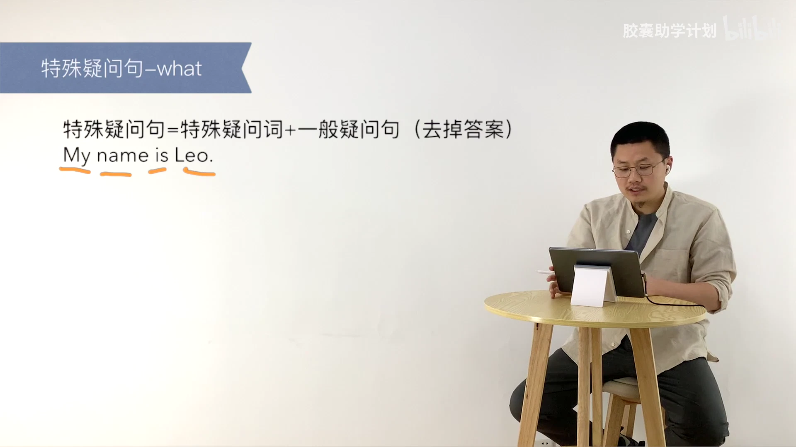

文字识别：胶囊助学计划 / 特殊疑问句-what / 特殊疑问句=特殊疑问词+一般疑问句 (去掉答案) / My name is Leo.

### 画面 00:01:10

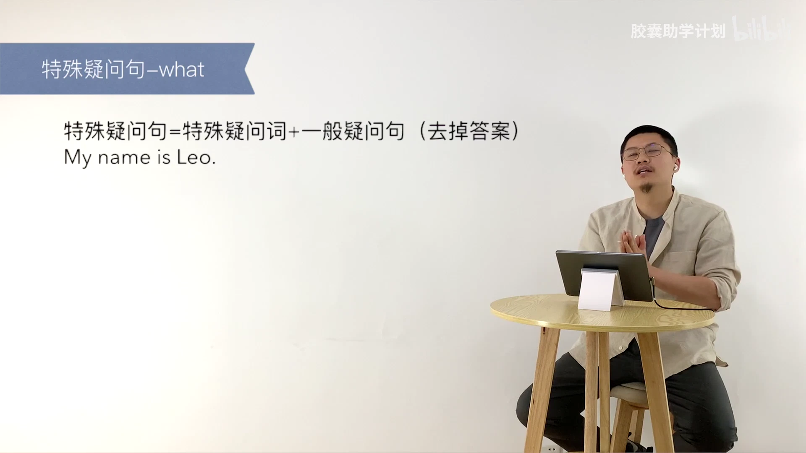

文字识别：胶囊助学计划 / 特殊疑问句-what / 特殊疑问句=特殊疑问词+一般疑问句 (去掉答案) / My name is Leo.

### 画面 00:01:21

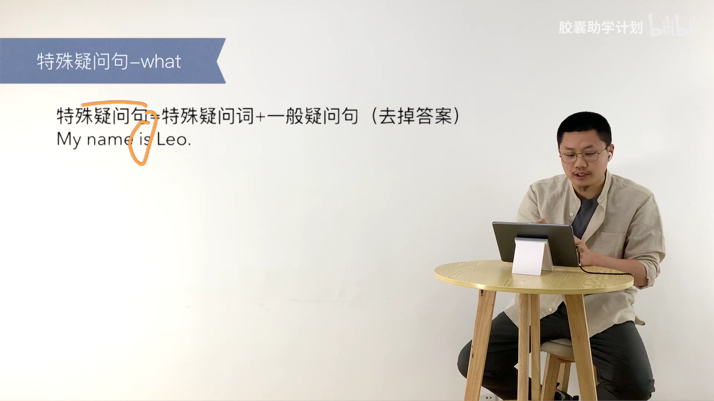

文字识别：胶囊助学计划 / 特殊疑问句-what / 特殊疑问句牛 / 特殊疑问词+一般疑问句 (去掉答案) / My nameisLeo.

### 画面 00:01:25

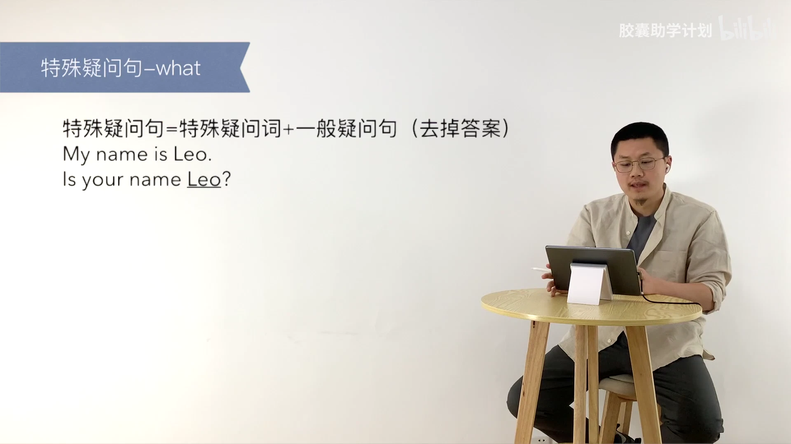

文字识别：胶囊助学计划 / 特殊疑问句-what / 特殊疑问句=特殊疑问词+一般疑问句(去掉答案) / My name is Leo. / Is your name Leo?

## 00:01:30–00:02:00

good. 那我们现在回想一下，这个是不是我们管它就叫一般疑问句，对吧？那我现在把 Leo 加了一个下划线，想提醒各位什么呢？我们接下来要对 Leo 进行提问。那我们想一下啊，Leo 他首先人，对吧？首先是一个人，其次呢，他也是一个名称啊。我们有很多的名字，对吧？这个张三、李四、Leo、David、William, OK，有非常多的英文名字。What 这个单词表示什么？那接下来

### 画面 00:01:33

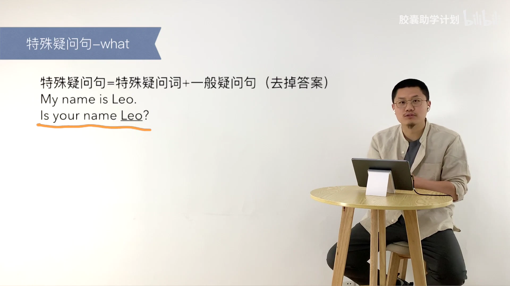

文字识别：胶囊助学计划 / 特殊疑问句-what / 特殊疑问句=特殊疑问词+一般疑问句(去掉答案) / My name is Leo. / Is your name Leo?

### 画面 00:01:55

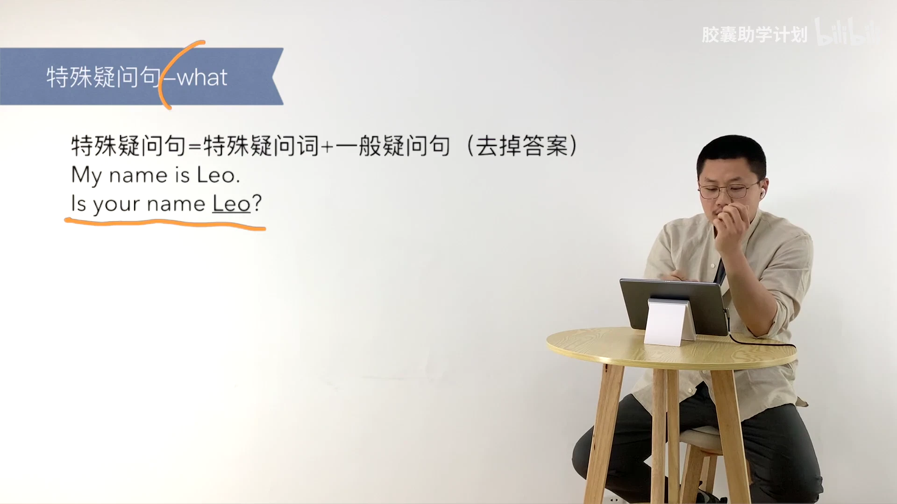

文字识别：胶囊助学计划 / 特殊疑问句-what / 特殊疑问句=特殊疑问词+一般疑问句 (去掉答案) / My name is Leo. / Is your name Leo?

### 画面 00:01:58

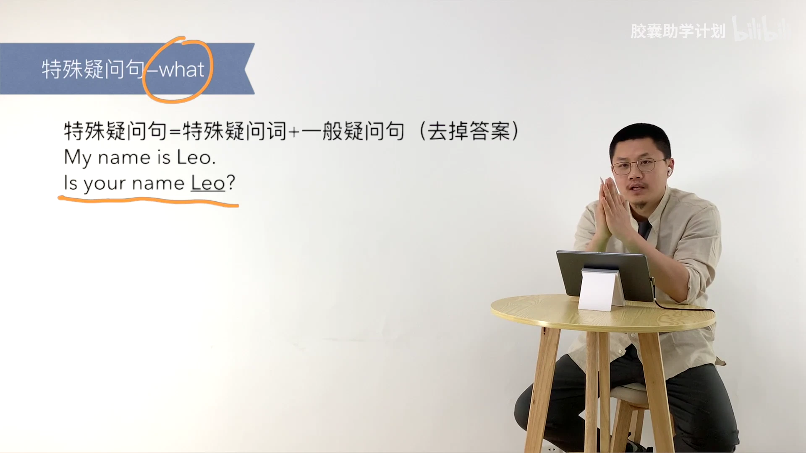

文字识别：胶囊助学计划 / 特殊疑问句-what / 特殊疑问句=特殊疑问词+一般疑问句(去掉答案) / My name is Leo. / Is your name Leo?

## 00:02:00–00:02:30

什么的答案是有很多的，可能是Lil，可能是David，可能是William。来，那所以接下来What就是要对Lil这个单词进行一个提问。那我们看一下上面的这个等号的这个公式啊，说特殊疑问句等于的是特殊疑问词。OK，What加一般疑问句且去掉答案。那Is your name Lil？这个里面我们现在要对Lil进行提问。我想问你的名字叫什么？我们肯

### 画面 00:02:09

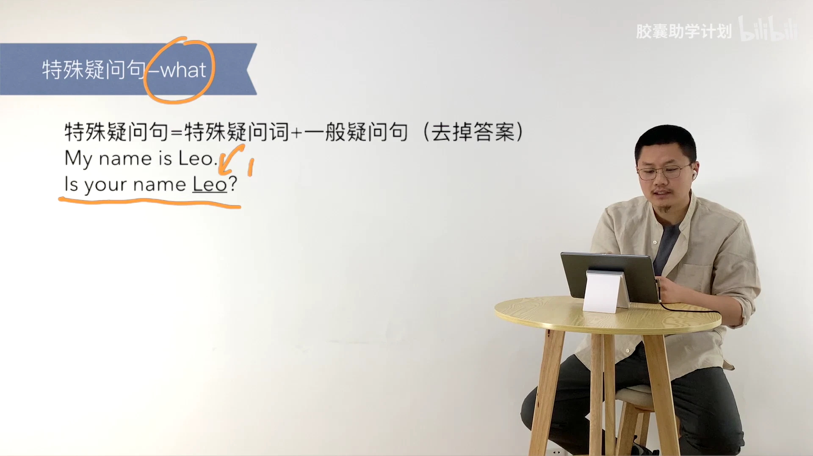

文字识别：胶囊助学计划 / 特殊疑问句-what / 特殊疑问句=特殊疑问词+一般疑问句 (去掉答案) / My name is Leo. / Is your name Leo?

### 画面 00:02:11

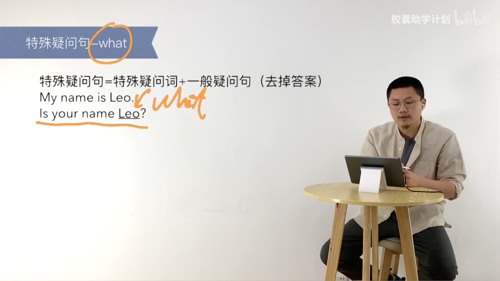

文字识别：胶囊助学计划 / 特殊疑问句what / 特殊疑问句=特殊疑问词+一般疑问句 / (去掉答案) / My name is Leo. / V / Is your name Leo?

### 画面 00:02:18

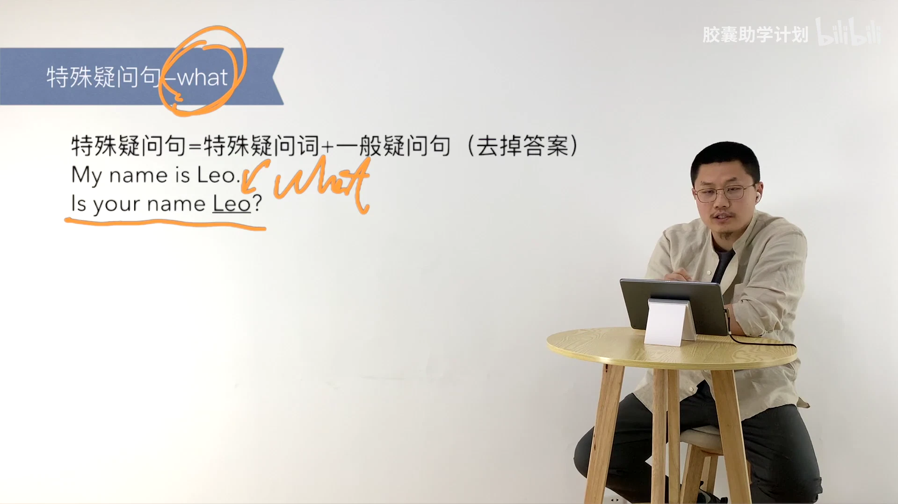

文字识别：胶囊助学计划 / 特殊疑问句 / Kwhat / 特殊疑问句=特殊疑问词+一般疑问句 / (去掉答案) / My name is Leo. / V / Is your name Leo?

### 画面 00:02:26

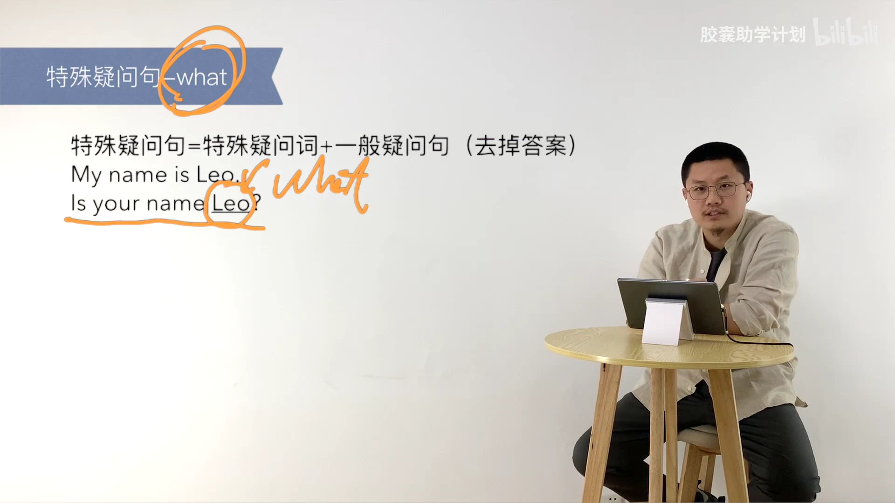

文字识别：胶囊助学计划 / 特殊疑问句 / Kwhat / 特殊疑问句=特殊疑问词+一般疑问句 / (去掉答案) / WMtf / My name is Leo. / Is your name / Leo

## 00:02:30–00:03:00

定要把答案去掉，同时 what 现在替代了 Leo 之后，叫特殊疑问词加一般疑问句。那也就是说，您要把 what 放到句首去，于是这句话就出现了。我们一起看一下啊，叫做 What is your name？我们看一下特殊疑问句啊，特殊疑问词加一般疑问句 is your name Leo，并且把 Leo 这个答案

### 画面 00:02:33

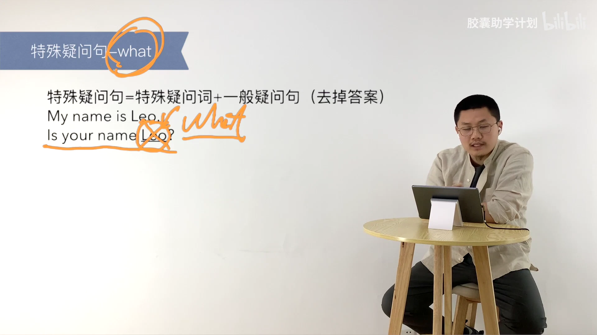

文字识别：胶囊助学计划 / 特殊疑问句 / Kwhat / 特殊疑问句=特殊疑问词+一般疑问句 / (去掉答案) / My name is Leo. / Is your name

### 画面 00:02:37

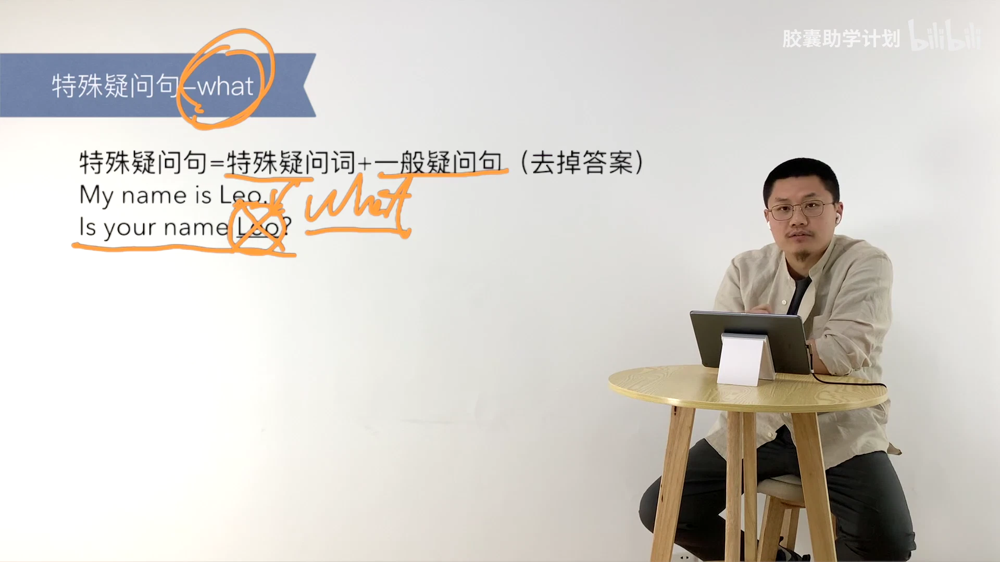

文字识别：胶囊助学计划 / 特殊疑问句 / Kwhat / 特殊疑问句=特殊疑问词+一般疑问句 / (去掉答案) / My name is Leo. / Is your name

### 画面 00:02:39

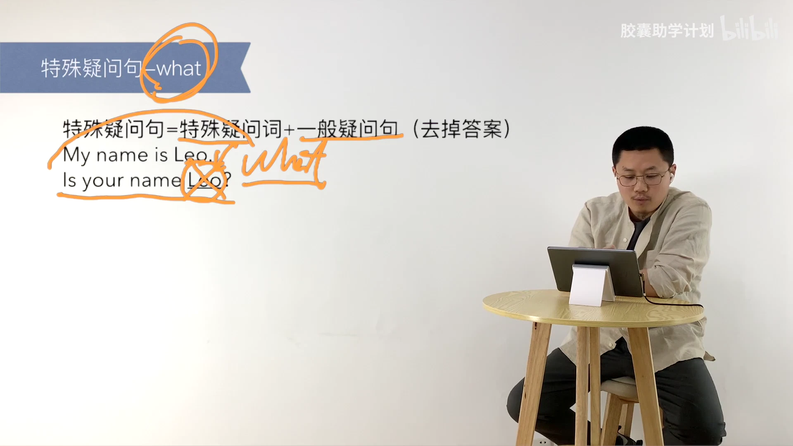

文字识别：胶囊助学计划 / 特殊疑问句what / 特殊疑问句=特殊疑问词+一般疑问句 / (去掉答案) / My name is Leo. / Is your name

### 画面 00:02:43

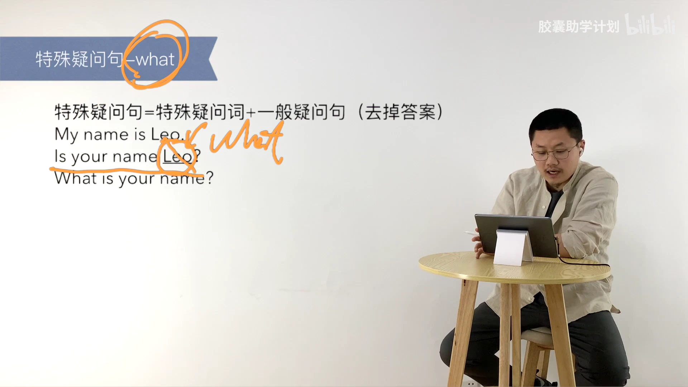

文字识别：胶囊助学计划 / 特殊疑问句 / Kwhat / 特殊疑问句=特殊疑问词+一般疑问句 / (去掉答案) / WhA / My r / name is Leo. / Is your name / What is your namie

### 画面 00:02:45

文字识别：胶囊助学计划 / 特殊疑问句what / 特殊疑问句=特殊疑问词+一般疑问句 / (去掉答案) / My name is Leo.L / ↓ / Is your name / e Leo? / What is your name

### 画面 00:02:47

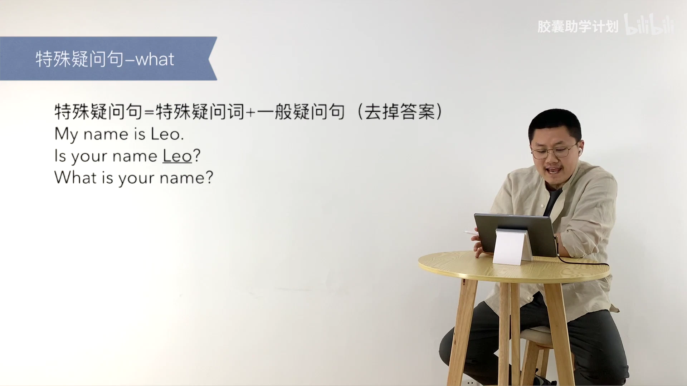

文字识别：胶囊助学计划 / 特殊疑问句-what / 特殊疑问句=特殊疑问词+一般疑问句(去掉答案) / My name is Leo. / Is your name Leo? / What is your name?

### 画面 00:02:50

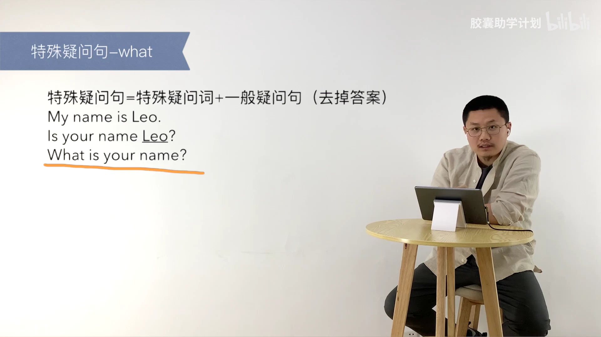

文字识别：胶囊助学计划 / 特殊疑问句-what / 特殊疑问句=特殊疑问词+一般疑问句 (去掉答案) / My name is Leo. / Is your name Leo? / What is your name?

### 画面 00:02:54

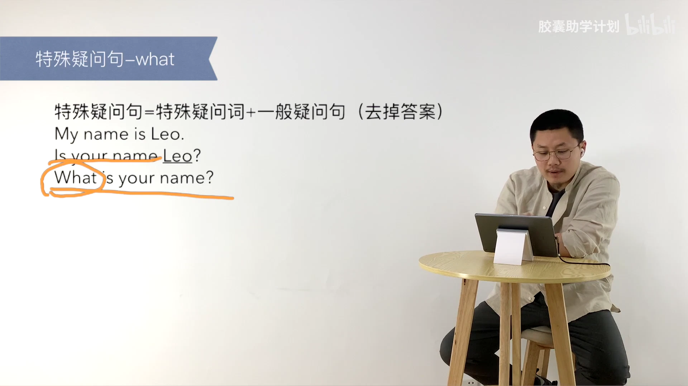

文字识别：胶囊助学计划 / 特殊疑问句-what / 特殊疑问句=特殊疑问词+一般疑问句 / (去掉答案) / My name is Leo. / ls vour nameLeo? / What 's your name?

### 画面 00:02:56

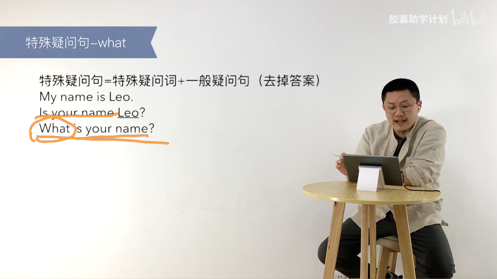

文字识别：胶囊助学计划 / 特殊疑问句-what / 特殊疑问句=特殊疑问词+一般疑问句 / (去掉答案) / My name is Leo. / Is vour name Leo? / What is your name?

## 00:03:00–00:03:30

去掉，其实就是被 what 这个单词所替代，然后 what 特殊疑问词加去掉答案的疑问句叫 is your name，连起来 what is your name 这个公式啊，我相信很多同学可能非常的了解 what is your name 这句话什么意思，那为什么我们还要这么去讲呢？因为接下来有非常多的特殊疑问词，他们的变化不是都像 what is your name 这么的简单，换句话来说，可能是不像 what is your

### 画面 00:03:01

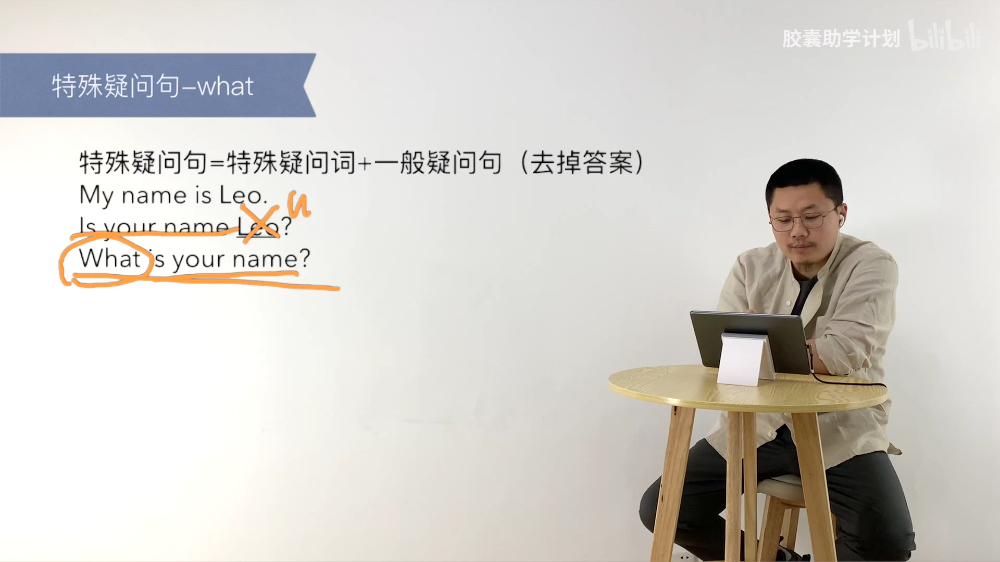

文字识别：胶囊助学计划 / 特殊疑问句-what / 特殊疑问句=特殊疑问词+一般疑问句 / (去掉答案) / My name is Leo. / Is vour nameL / What / s your name?

### 画面 00:03:03

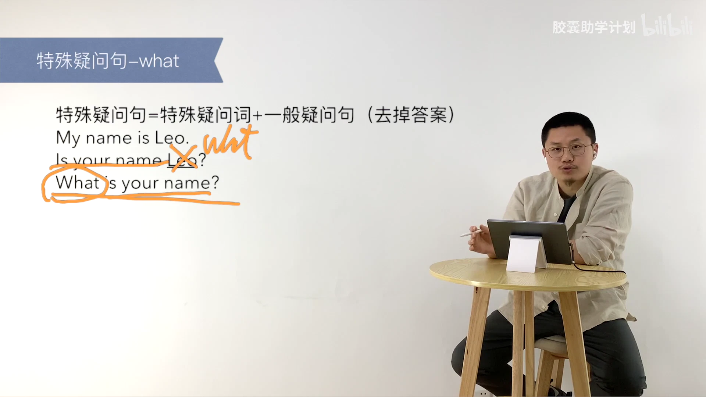

文字识别：胶囊助学计划 / 特殊疑问句-what / 特殊疑问句=特殊疑问词+一般疑问句 / (去掉答案) / What / is your name?

## 00:03:30–00:04:00

your name 这句话对大家这么的熟悉，我们要知其然知其所以然，知道它是怎么变过来的，并且我们有很多的口语和听力题也要做这样的练习。OK， everyone。那在这个地方我还要简单提一句，就是怎么判断这句话是特殊疑问句还是一般疑问句？我相信它是疑问句这个事儿对于大家不是很困难。明儿有永句吗？对吧？这句话对于大家它是一个疑问，不是很困难。那它是一般疑问句还是特殊疑问句呢？非常简单，一般疑问句的答

### 画面 00:03:33

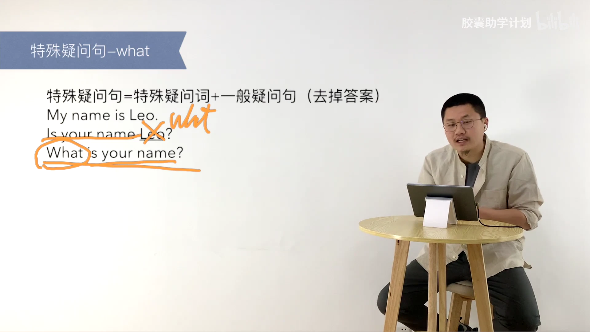

文字识别：胶囊助学计划 / 特殊疑问句-what / 特殊疑问句=特殊疑问词+一般疑问句 / (去掉答案) / ynneste  / What / s your name?

### 画面 00:03:43

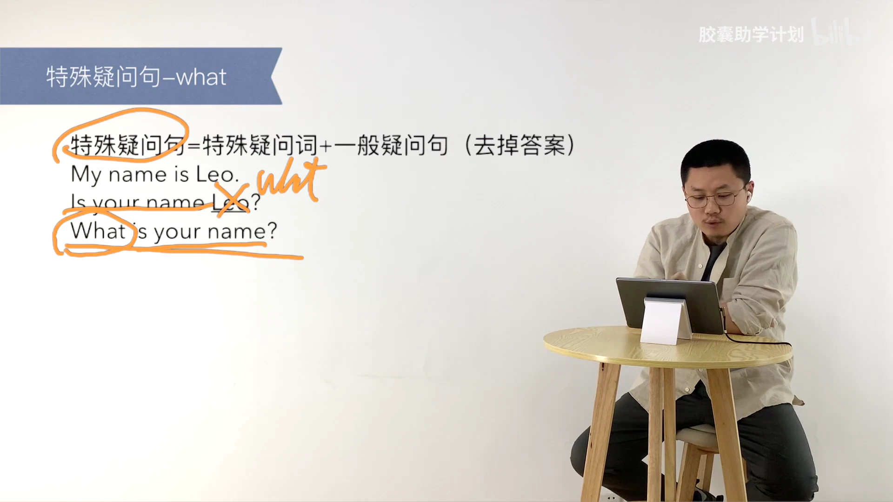

文字识别：胶囊助学计划 / 特殊疑问句-what / 特殊疑问句=特殊疑问词+一般疑问句 / (去掉答案) / My name is Leo. / What / s your name?

### 画面 00:03:46

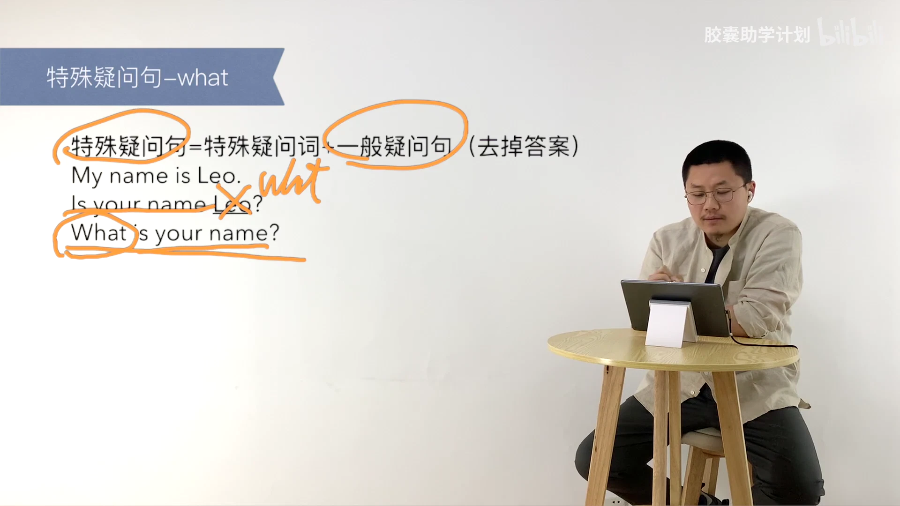

文字识别：胶囊助学计划 / 特殊疑问句-what / 特殊疑问句=特殊疑问词 / 一般疑问句(去掉答案) / My name is Leo. / Is vour name LA / What / s your name?

### 画面 00:03:49

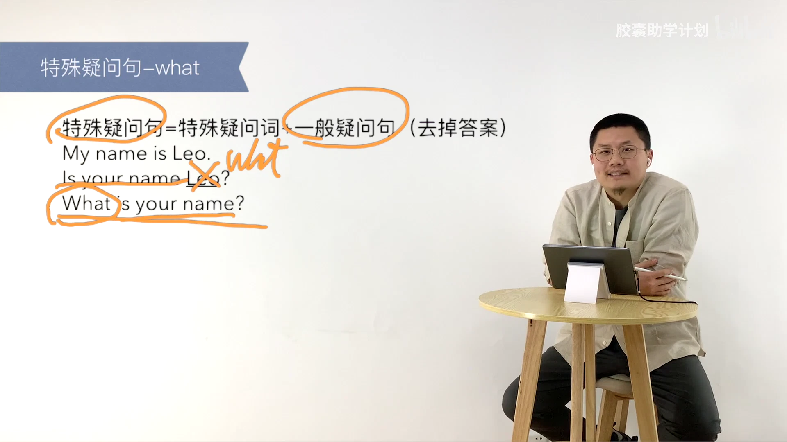

文字识别：胶囊助学计划 / 特殊疑问句-what / 特殊疑问句=特殊疑问词 / 一般疑问句(去掉答案) / My name is Leo. / What / s your name?

### 画面 00:03:59

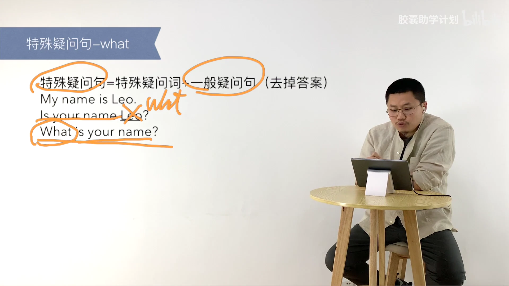

文字识别：胶囊助学计划 / 特殊疑问句-what / 特殊疑问句=特殊疑问词 / 一般疑问句(去掉答案) / Myr / name is Leo. / ht / Is vour name lA / What / syour name?

## 00:04:00–00:04:30

案往往就是用 yes or no 去回答，有或者不有。那明儿游泳去吗？有不有？哎，这个叫做一般疑问句。那明天什么时候去游泳啊？你的答案就不是是或者不是了，对吧？你要用是或不是去回答刚才的问题，就会显得很怪。这个时候你要回答的是无数的可能性当中的其中一个可能性，比如说明天下午三点。OK，所以它叫做特殊疑问句。那我们再举一个小例子，帮助大家去区分

### 画面 00:04:01

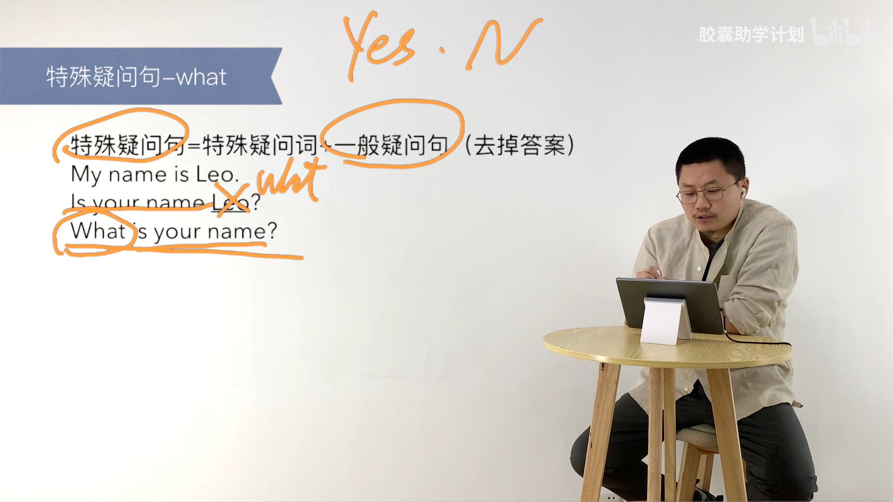

文字识别：Yes / ·N / 胶囊助学计划 / 特殊疑问句-what / 特殊疑问句=特殊疑问词 / 一般疑问句(去掉答案) / name is Leo. / Myr / What / s your name?

### 画面 00:04:05

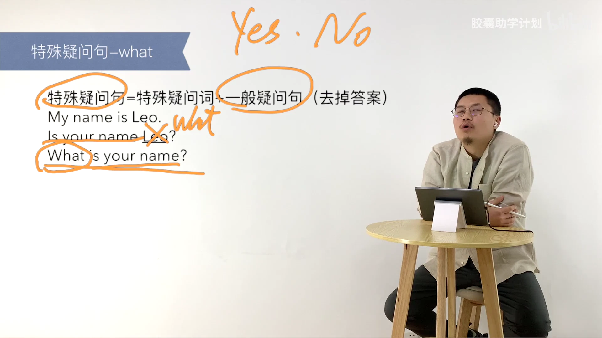

文字识别：Yes / ·N / 胶囊助学计划 / 特殊疑问句-what / 特殊疑问句=特殊疑问词 / 一般疑问句(去掉答案) / My name is Leo. / What / s your name?

## 00:04:30–00:05:00

下啊，那叫比如说我们举个例子，昨天你干什么去了？你能不能用 yes 或 no 去回答？如果不能，特殊疑问句；如果能，一般疑问句。那昨天你干什么去了？很多的事情，无限的答案当中，可能有一个答案是正确的。比如说昨天我游泳去了，OK，所以它叫做特殊疑问句。那如果我问昨天下午三点你去游泳了吗？你的回答就是去或者没去，只有这两种情况，对吧？不存在一个叫做我

### 画面 00:04:33

文字识别：Yes / .No / 胶囊助学计划 / 特殊疑问句-what / 特殊疑问句=特殊疑问词 / 一般疑问句(去掉答案) / Myr / What / s your name?

### 画面 00:04:40

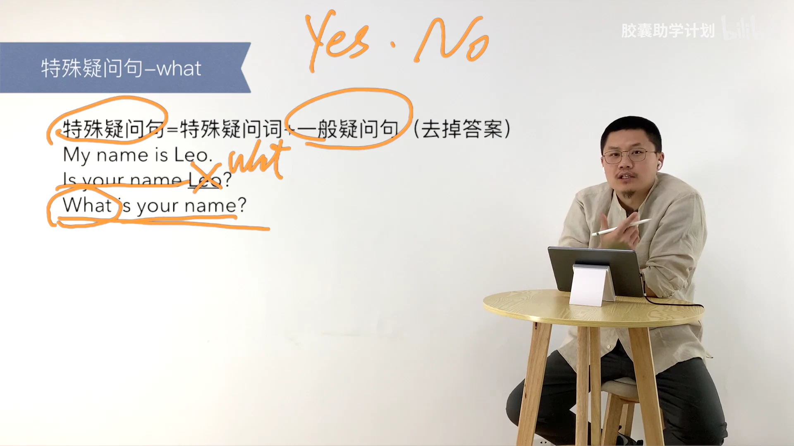

文字识别：Yes / N / 胶囊助学计划 / 特殊疑问句-what / 特殊疑问句=特殊疑问词 / 一般疑问句(去掉答案) / Myr / name is Leo. / What / s your name?

### 画面 00:04:47

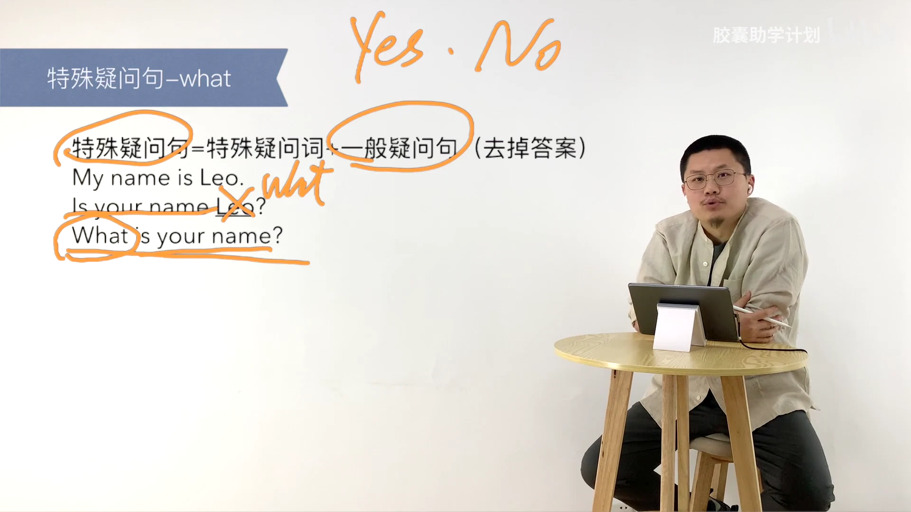

文字识别：Yes / ·N / 胶囊助学计划 / 特殊疑问句-what / 特殊疑问句=特殊疑问词 / 一般疑问句(去掉答案) / Myr / name is Leo. / What / is your name?

### 画面 00:04:57

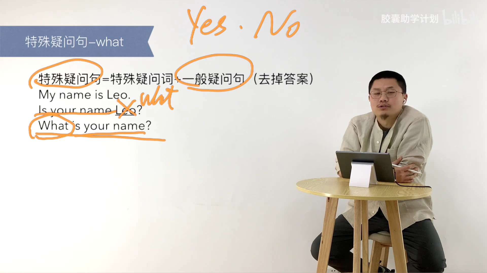

文字识别：Yes / ·No / 胶囊助学计划 / 特殊疑问句-what / 特殊疑问句=特殊疑问词 / 一般疑问句(去掉答案) / My / name is Leo. / What / s your name?

## 00:05:00–00:05:30

去了也没去哈。OK，所以呢，我们现在会区分了。接下来呢，我们再看一个小的练习，叫 Her name is Monica. Her name is Monica. 她的名字叫 Monica. 我们接下来把它变一般疑问句，还是同样一件事情，我们快速过一下，把 is 这个单词提到句首去，叫 Is her name Monica? 而对 Monica 提问，我们要用的关键单词叫 What，把 What 去替代 Monica，然后提到句首去，就变成了 What is her name? OK，各位一定要

### 画面 00:05:08

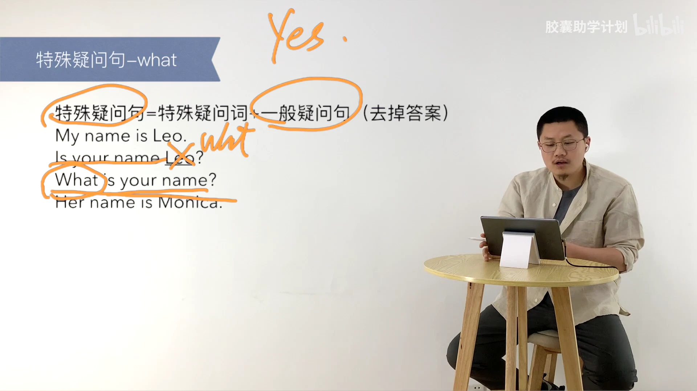

文字识别：Yes / 胶囊助学计划 / 特殊疑问句-what / 特殊疑问句=特殊疑问词 / 一般疑问句（去掉答案) / My / name is Leo. / What / s your name? / Her name / IS / Monica.

### 画面 00:05:10

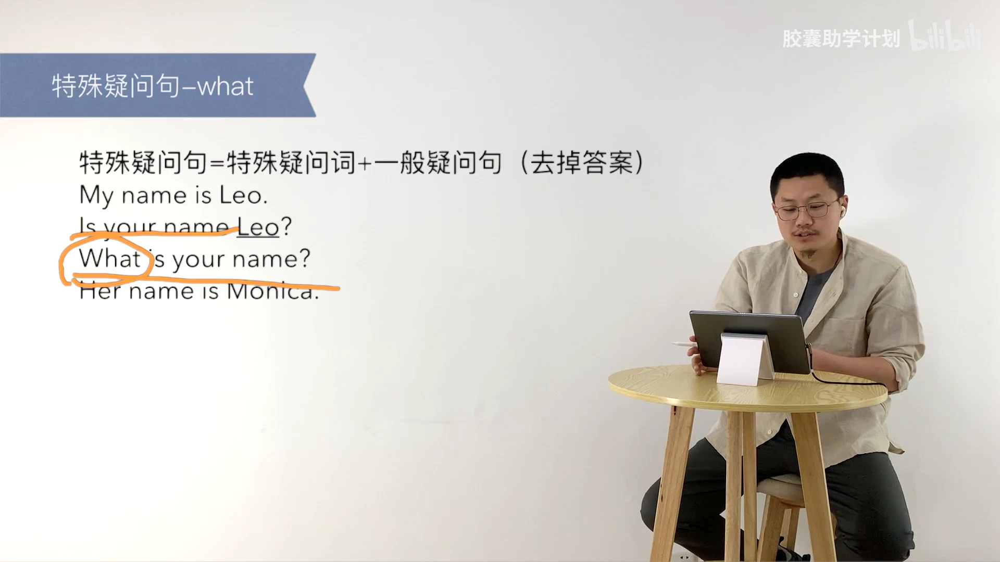

文字识别：胶囊助学计划 / 特殊疑问句-what / 特殊疑问句=特殊疑问词+一般疑问句 / (去掉答案) / My name is Leo. / Is vour name Leo? / What is your name? / Her name is Monica.

### 画面 00:05:12

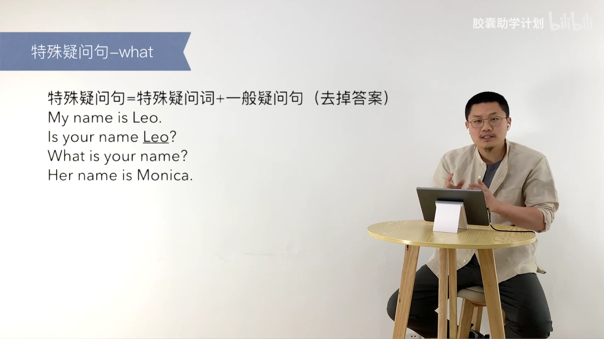

文字识别：胶囊助学计划 / 特殊疑问句-what / 特殊疑问句=特殊疑问词+一般疑问句(去掉答案) / My name is Leo. / Is your name Leo? / What is your name? / Her name is Monica.

### 画面 00:05:25

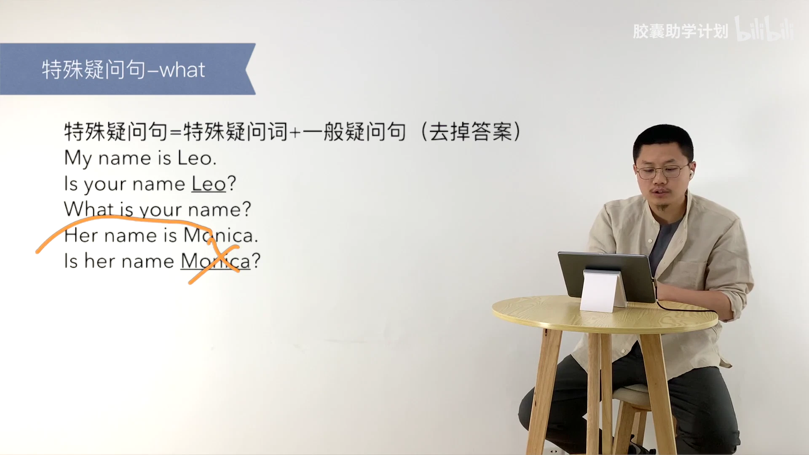

文字识别：胶囊助学计划 / 特殊疑问句-what / 特殊疑问句=特殊疑问词+一般疑问句(去掉答案) / My name is Leo. / Is your name Leo? / What is your name? / Her name is Monica. / Is her name MoAca?

## 00:05:30–00:06:00

记住这个公式，特殊疑问句等于特殊疑问词加去掉答案之后的，一般疑问句。接下来我们好多课都会用到这个公式。接下来我们继续往下走。我们再举一个特殊疑问词，比如说 where, where 的意思叫做哪里。那我们举一个小例子，叫 She is from Italy. 我们刚刚学过这个单词 Italy 叫意大利，对不对？那她来自于意大利。OK, 那我现在想把它变一般疑问句，叫问她来自于意大利吗？第一课学的非常简单，迅速把 is 这个单词提到句首。Is she

### 画面 00:05:39

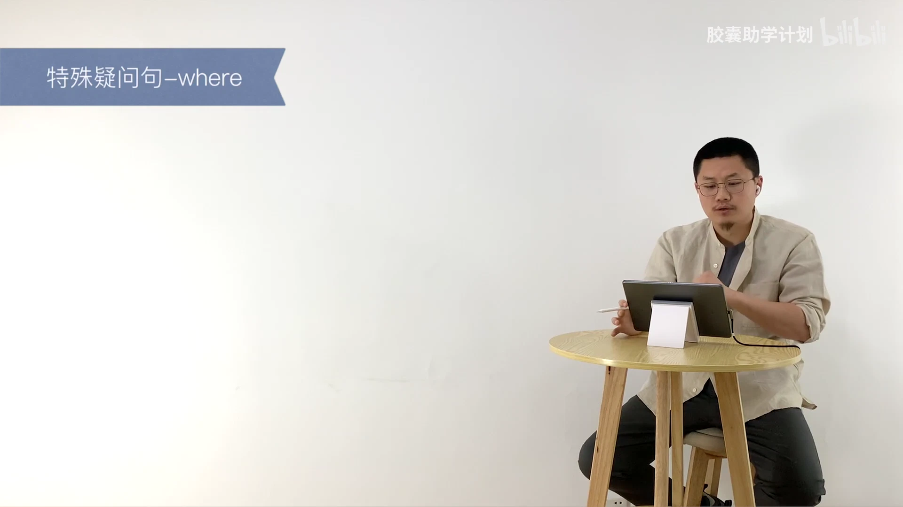

文字识别：胶囊助学计划 / 特殊疑问句-where

### 画面 00:05:41

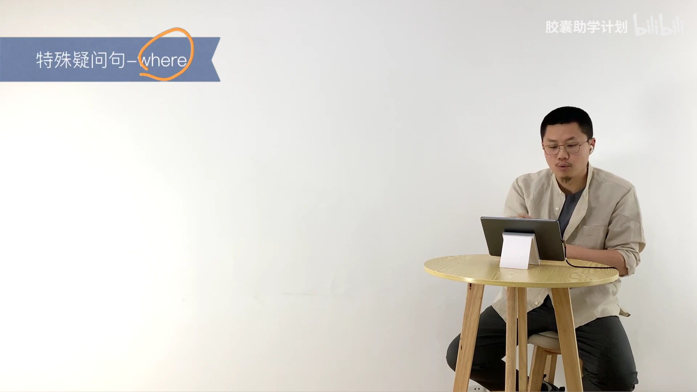

文字识别：胶囊助学计划 / 特殊疑问句- / where

## 00:06:00–00:06:30

from Italy? Okay, very good.那Italy是一个地点，叫什么地方，对吧？那Where就问的是哪里。特殊疑问句等于特殊疑问词Where，把它替代掉，然后提到句首，变成了Where is she from？她来自于什么地方呢？Okay，我们再做一个小的练习，比如说He is from China。迅速变一般疑问句，Is提前，Is he from China？China提问，用Where

### 画面 00:06:00

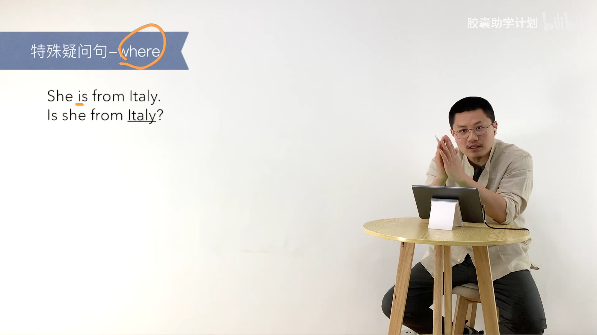

文字识别：胶囊助学计划 / 特殊疑问句- / where / She is from Italy. / Is she from ltaly?

### 画面 00:06:11

文字识别：胶囊助学计划 / 特殊疑问句- / where / She is from Italy. / Is she from hely?

### 画面 00:06:13

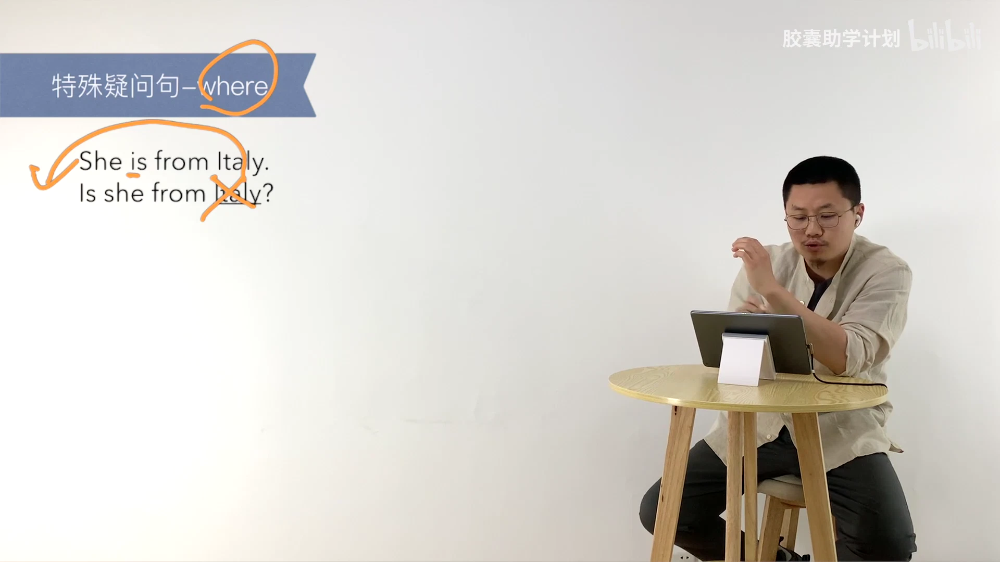

文字识别：胶囊助学计划 / 特殊疑问句- / where / She is from Italy. / Is she from

### 画面 00:06:19

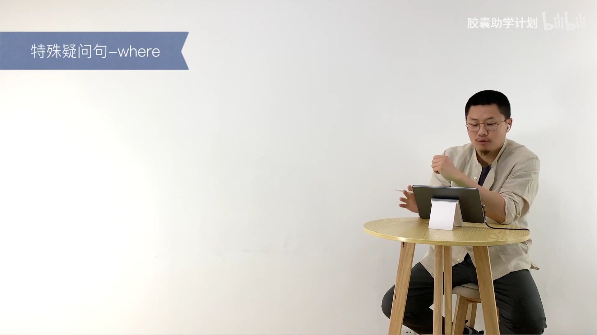

文字识别：胶囊助学计划 / 特殊疑问句-where

## 00:06:30–00:07:00

去掉答案，提到句首叫 Where is he from? Okay, 我相信大家已经有感觉了。我们再来一个叫 I'm from China. 那我现在想问你来自于中国吗? I 后边要加的是 am, 但是我现在想问你来自于中国吗? 你后边应该用 are 对吧? You 跟 are 连在一起的，那你还要把 are 提到句首去，就变成了 Are you from China? Very good. 那对 China 进行提问，还是把它去掉变成 where, 然

### 画面 00:06:30

文字识别：胶囊助学计划 / 特殊疑问句-where / He is from China. / Is he from CNina?

### 画面 00:06:32

文字识别：胶囊助学计划 / 特殊疑问句-where / He is from China. / Is he from Cna?

### 画面 00:06:36

文字识别：胶囊助学计划 / 特殊疑问句-where

### 画面 00:06:47

文字识别：胶囊助学计划 / 特殊疑问句-where / I am from China.

### 画面 00:06:57

文字识别：胶囊助学计划 / 特殊疑问句-where / I am from China. / Are you from CXna?

### 画面 00:06:59

文字识别：胶囊助学计划 / 特殊疑问句-where / here / I am from China. / Are you from CXna?

## 00:07:00–00:07:30

后提到句首，变成了叫做 where are you from，这是我们之前学过的一个小的句子，对吧？我跟大家说说这个呢，是我们常用的叫做你从哪里来，你是哪里的人的一句话，它比下面这句话要更常用一点。来，我们一起读 he is French, he is French. OK，那我们现在想把它变成一般疑问句，叫他是法国人吗？Is 提前，Is he French? OK, French，你注意这不是个地点了，说他是法国人，也就是他的国籍是法国，对

### 画面 00:07:01

文字识别：胶囊助学计划 / 特殊疑问句-where / hre / Cam / from / China. / Are you from CXna? / Where are you from?

### 画面 00:07:14

文字识别：胶囊助学计划 / 特殊疑问句

## 00:07:30–00:08:00

吧？接下来我们对 French 提问呢，用的是 What nationality？用 What nationality 相同的思路去替代 French，然后提到句首，哎，合起来这是一个特殊疑问词叫 What nationality？那 Is he 是一去掉答案之后的一般疑问句，于是这句话问的是他的国籍是什么？那各位我在这儿简单提一个小的点啊，其实我们英文当中，我的个人语感啊，我接触了这么多外国人，接触了三

### 画面 00:07:40

文字识别：胶囊助学计划 / 特殊疑问句 / He is Fnench. / Is he FrAch? / What nationality is he?

### 画面 00:07:42

文字识别：胶囊助学计划 / 特殊疑问句 / He is Fnench. / D / Is he Frch? / What nationality is he?

### 画面 00:07:47

文字识别：胶囊助学计划 / 特殊疑问句 / Me is Fnench. / Is he FrzAch? / What nationality is he?

## 00:08:00–00:08:30

四年的时间，我个人的感受呢，大多数时间我们好像不会在非正式的场合直接问 What nationality is he？这个就会有点怪，直接就用我们上一句话说的叫 Where is he from？就 OK 了啊。那我们再做一个练习，He is Ger， she is German，变一般疑问句，提前 Is she German？对 German 提问，举一反三，我相信照葫芦画瓢，各位也会了，叫 What nationality is she？ There you go。那我们

### 画面 00:08:14

文字识别：胶囊助学计划 / 特殊疑问句 / e is Fnench. / Is he FrAch? / What nationality is he? / She is / German.

### 画面 00:08:27

文字识别：胶囊助学计划 / 特殊疑问句 / Me is Fnench. / Is he FrzAch? / What nationality is he? / She is / German. / Is she / German? / What nationality is she?

### 画面 00:08:29

文字识别：BEN AFFLECK ROSAMUND PIKE / 胶囊助学计划 / GONE / GIRL / Where are you from? / 消失的爱人Gone Girl(2014) / D'APRES LE BEST-SELLER  LES APPAREN / 1:17:22 / LE8OCTOBREAU

## 00:08:30–00:09:00

做一个小的听力练习啊，叫 Where are you from? 我们刚刚学过了对吧？那我们在《消失的爱人》这个非常棒的电影当中，各位我们一起听一下它是如何去运用的。 Fancy. It's hot again today. So, where are you from? Okay, 叫 Where are you from? 好，Very good. Let's continue. 我们直接看文章了，

### 画面 00:08:41

文字识别：Bilbii / 胶囊助学计划

### 画面 00:08:43

文字识别：Bilibili / 胶囊助学计划 / 南茜 / Nancy.

### 画面 00:08:45

文字识别：bilibili / 胶囊助学计划

### 画面 00:08:47

文字识别：bilbli / 胶囊助学计划 / 今天也很热 / It's hot again today.

### 画面 00:08:49

文字识别：bilibili / 胶囊助学计划

### 画面 00:08:51

文字识别：bilbli / 胶囊助学计划 / 你从哪里来 / So, uh, where are you from?

### 画面 00:08:53

文字识别：BEN AFFLECK ROSAMUND PIKE / 胶囊助学计划 / GONE / GIRL / Where are you from? / 消失的爱人Gone Girl(2014) / D'APRES LE BEST-SELLER  LES APPAREN / 1:17:22 / LE8OCTOBREAU

### 画面 00:08:58

文字识别：胶囊助学计划 / 心 / ROBERT: I am a new student. / My name's Robert. / SOPHIE: Nice to meet you. / My name's Sophie." / ROBERT: Are you French? / SOPHIE: Yes, I am."

## 00:09:00–00:09:30

进入文章，Robert. This is Robert, and this is Sophie. I think you still remember that Sophie is a new student. 不知道各位还记不记得 Sophie 在上一篇文章当中刚刚出现，叫 Sophie is a new student. OK， one. 那我们看 Robert 被一杯咖啡过来了，问他开始搭讪说，I am a new student. 我是一个新学生。am 我相信您还记得跟 I 连起来 a 和 an 的区别是什么？看首

### 画面 00:09:02

文字识别：胶囊助学计划 / ROBERT: I am a new student. / My name's Robert. / SOPHIE: Nice to meet you. / My name's Sophie." / ROBERT: Are you French? / SOPHIE: Yes, Iam."

### 画面 00:09:04

文字识别：胶囊助学计划 / ROBERT: I am a new student. / My name's Robert. / SOPHIE: Nice to meet you. / My name's Sophie." / ROBERT: Are you French? / SOPHIE: Yes, I am."

### 画面 00:09:10

文字识别：胶囊助学计划 / ROBERT: I am a new student. / My name's Robert. / 2 / SOPHIE: Nice to meet you. / My name's Sophie." / ROBERT: Are you French? / SOPHIE: Yes, I am."

### 画面 00:09:20

文字识别：胶囊助学计划 / ROBERT: I am a new student. / My name's Robert. / SOPHIE: Nice to meet you. / My name's Sophie." / ROBERT: Are you French? / SOPHIE: Yes, Iam."

### 画面 00:09:24

文字识别：胶囊助学计划 / ROBERT:I / a new student. / My name's Robert. / SOPHIE: Nice to meet you. / My name's Sophie." / ROBERT: Are you French? / SOPHIE: Yes, l am."

## 00:09:30–00:10:00

音音标是元音音标还是辅音音标？各位还记不记得？My name's Robert. Okay,撇s，注意它是在这个地方是is的缩写，叫我的名字是Robert. Okay，各位在这地方可以自己做一个很有趣的小练习，叫把它变一般疑问句，叫Is your name Robert? Okay. Next one, nice to meet you. 哎，这是两个人私下在底下第一次见面，所以说nice to meet you。以后呢就不用这么正式了，这是第一次见面我们会用到的。以后两

### 画面 00:09:30

文字识别：胶囊助学计划 / an / ROBERT:I / a new student. / My name's Robert. / SOPHIE: Nice to meet you. / My name's Sophie." / ROBERT: Are you French? / SOPHIE: Yes, lam."

### 画面 00:09:35

文字识别：胶囊助学计划 / am / ROBERT:I / a new student. / My name's Robert. / SOPHIE: Nice to meet you. / My name's Sophie." / ROBERT: Are you French? / SOPHIE: Yes, I am."

### 画面 00:09:44

文字识别：胶囊助学计划 / am / ROBERT: I / a new student. / My name's Robert. / SOPHIE: Nice to meet you. / My name's Sophie." / o / ROBERT: Are you French? / SOPHIE: Yes, lam."

### 画面 00:09:50

文字识别：胶囊助学计划 / an / ROBERT:I / a new student. / My name's Robert. / SOPHIE: / : Nice to meet you. / My name's / Sophie." / ROBERT: Are you French? / SOPHIE: Yes, l am."

## 00:10:00–00:10:30

个人再见面的时候慢慢熟络起来。Hi, hello, how are you? What's up, man? Okay, what's up?就可以了。我们在之前的视频当中给大家讲解过。My name's Sophie. P.S.还是表示is的缩写。Let's continue. Are you French?直接问你是法国人吗？Yes, I am.是的，我是。那在这儿我想提一个小点，各位注意啊，它实际上还是一个教材。我们现实生活当中真的跟外国人去聊天的时候，

### 画面 00:10:15

文字识别：胶囊助学计划 / an / ROBERT: I / a new student. / My name's Robert. / SOPHIE: Nice to meet you. / My name's Sophie." / ROBERT: Are you French? / SOPHIE: Yes, I am."

### 画面 00:10:22

文字识别：胶囊助学计划 / an / ROBERT:I / a new student. / My name's Robert. / SOPHIE: Nice to meet you. / My name's Sophie." / ROBERT: Are you French? / SOPHIE: Yes, I am."

## 00:10:30–00:11:00

可能也许不会这么突兀，还是闲聊几句，然后才会问 Are you French？比如说有一次我去 New Place Moss 爬雪山住 backpackers 是吧？国外的 backpackers 是男女混住的。我有印象特别深，我有一次进入一个房间了之后，发现屋里面住了八个姑娘，全是法国人。那但但在问之前，我就 Are you French？你们是法国人吗？因为我听到他们在说法语了。然后我跟他们来一句 Bonjour 啊，说大家好，大家好，How are you？ Hi， OK，非

### 画面 00:10:52

文字识别：胶囊助学计划 / an / ROBERT:I / a new student. / My name's Robert. / SOPHIE: Nice to meet you. / My name's Sophie." / ROBERT: Are you French? / SOPHIE: Yes, Iam."

## 00:11:00–00:11:30

常有意思的一个经历，所以叫 Are you French? 大多数情况下我们不会直接去问，还是闲聊几句啊。这个直接问有一点愣啊。说 Yes, I am. 是的，我是。Let's continue. 说 Are you French too? 哎，我相信各位还记得一个小单词，叫你也是法国人吗？说我也是，叫 Me too. OK. No, I am not. 我不是。哎，Not，我相信比较否定。各位还记得？那在这地方我提一个小点，注意啊，他们二者一般根本不会进行缩写，不

### 画面 00:11:10

文字识别：胶囊助学计划 / SOPHIE: Are you French too? / ROBERT: No, I am not." / SOPHIE: What nationality are you? / ROBERT: I'm Italian."

### 画面 00:11:13

文字识别：胶囊助学计划 / SOPHIE: Are you Frenchtoo? / ROBERT: No, I am not." / SOPHIE: What nationality are you? / ROBERT: I'm Italian."

### 画面 00:11:26

文字识别：胶囊助学计划 / SOPHIE: Are you Frenchtoo? / ROBERT: No, yam not. / SOPHIE: What nationality are you? / ROBERT: I'm Italian."

## 00:11:30–00:12:00

存在一个叫做这样的缩写。各位注意啊，不存在这样的缩写，不是说能缩随便缩写的，还是有一些习惯的啊。那 What nationality are you？你是什么国籍呢？I'm Italian。我是意大利人。那我想问你是意大利人吗？怎么办？一般疑问句二提前，Are you Italian？ OK，各位一定要学会举一反三。在这儿我也想多提一点，这就是为什么我其实并不鼓励大家去背新概念。原因很简单，你背下来的是肯定

### 画面 00:11:31

文字识别：胶囊助学计划 / ams / SOPHIE: Are you Frenchtoo? / ROBERT: / : No, Yam not. / SOPHIE: What nationality are you? / ROBERT: I'm Italian."

### 画面 00:11:33

文字识别：胶囊助学计划 / nt / SOPHIE: Are you Frenchtoo? / ROBERT: No, Yam not. / SOPHIE: What nationality are you? / ROBERT: I'm Italian."

### 画面 00:11:39

文字识别：胶囊助学计划 / a / nT / SOPHIE: Are you Frenchtoo? / ROBERT: No, am not. / SOPHIE: What nationality are you? / ROBERT: I'm Italian."

### 画面 00:11:45

文字识别：胶囊助学计划 / a / NT / SOPHIE: Are you Frenchtoo? / ROBERT: No, yam not.' / SOPHIE: What nationality are you? / ROBERT: I'm Italian."

### 画面 00:11:59

文字识别：胶囊助学计划 / nt / SOPHIE: / :Are / you Frenchtoo? / ROBERT: / No, yam not. / SOPHIE: What nationality are you? / ROBERT: I'm Italian."

## 00:12:00–00:12:30

句，而如果你会变它，你就会把它变成叫 Are you Italian? 然后对 Italian 提问变成 What nationality are you? 换一句话来说，一句话，如果你背，你只背下来一句话；如果你拿它去做变形，你学会了三句话。这还只是最开始。等我们学到五十多课的时候，带大家去做练习，你会发现一句话能变到七八句话。所以新概念文章熟读成诵即可，尽量不要去背它。而我们要做更多的句

### 画面 00:12:05

文字识别：胶囊助学计划 / a / SOPHIE: Are you Frenchtoo? / ROBERT: / : No, yam not. / SOPHIE: What nationality are you? / ROBERT: I'm Italian."

## 00:12:30–00:13:00

型练习. Let's continue. Are you a teacher? You are a teacher? No, I'm not. 注意 am 和 not 并不缩写，但 I 跟 am 是可以缩写的，缩写的就是这个样子。读音很简单，am. Okay. I'm not. What's your job? Your job? What's your job?

### 画面 00:12:31

文字识别：胶囊助学计划 / ROBERT: Are you a teacher? / SOPHIE: No, I'm not." / ROBERT: What's your job? / SOPHIE: I'm a keyboard operator."

### 画面 00:12:40

文字识别：胶囊助学计划 / ROBERT: Are you a teacher? / SOPHIE: No, I'm not." / ROBERT: What's your job? / SOPHIE: I'm a keyboard operator."

### 画面 00:12:48

文字识别：胶囊助学计划 / ROBERT: Are you a teacher? / SOPHIE: No, I'm not." / @m / ROBERT: What's your job? / SOPHIE: I'm a keyboard / operator."

### 画面 00:12:52

文字识别：胶囊助学计划 / ROBERT: Are you a teacher? / SOPHIE: No, I'm not." / am / ROBERT: What's your job? / SOPHIE: I'm a keyboard / operator.'

### 画面 00:12:55

文字识别：胶囊助学计划 / ROBERT: Are you a teacher? / SOPHIE: No, I'm not." / @m / ROBERT: What's your job? / SOPHIE: I'ma / keyboard / operator."

## 00:13:00–00:13:30

并没有是元音音标，所以并不用 an。OK，我是一个，我是一个电脑操作员。说 What's your job？你的工作是什么呢？am 缩写 an engineer。我们上一个视频刚刚讲过 engineer 的第一个音标是 a，所以它是元音音标，于是前面用的是 an engineer。那在这儿我也提一个小点，我们儒家文化下啊，我们现在中国是受儒家文化，整个东南亚其实都是儒家文化。我们的影响之下呢，可

### 画面 00:13:02

文字识别：胶囊助学计划 / M / ROBERT: Are you a teacher? / SOPHIE: No, I'm not." / @m / H / ROBERT: What's your job? / SOPHIE: I'ma) / keyboard / operator."

### 画面 00:13:04

文字识别：胶囊助学计划 / SOPHIE: What's your job? / ROBERT: I'm an engineer."

### 画面 00:13:14

文字识别：胶囊助学计划 / SOPHIE: What's your job? / ROBERT: I'm an engineer."

### 画面 00:13:21

文字识别：胶囊助学计划 / SOPHIE: What's your job? / ROBERT: I'm an engineer." / )e/

### 画面 00:13:23

文字识别：胶囊助学计划 / SOPHIE: What's your job? / ROBERT: I'm an engineer." / )e/

## 00:13:30–00:14:00

能会愿意，尤其是越小的地方，越乡土类的社会越这样，去打探一些隐私，工作多少钱呢？结没结婚，生没生孩子呀，对吧？这个月薪多少啊，等等这样的问题。但是各位一定要注意，在西方文化之下，现在的工商业社会当中，他们尽量其实大多数情况这些问题作为整体是回避的。所以各位不要上来直接就问 What's your job？等慢慢熟络起来，通过话里话外再去聊，对吧？这个问题并不适合作为一个搭讪的方式。我相

### 画面 00:13:43

文字识别：胶囊助学计划 / SOPHIE: What's your job? / ROBERT: I'm an engineer." / /e

### 画面 00:13:49

文字识别：胶囊助学计划 / SOPHIE: What's your job? / ROBERT: I'm an engineer." / )e/

## 00:14:00–00:14:30

信各位还记得搭讪的方式叫 nice coat, I love your coat。这种类似的方式，不要上来直接问 what's your job，会很尴尬的。OK，那文章就结束了。接下来我们做一些听力口语练习。我相信各位还记得，我再简单重申一下，在这个地方，您的眼睛合上，要么就看着教材，而不要去看着视频，好听就可以了。接下来我们做一些听力训练，我问您答。先听 Is Robert a new student？这时候你的眼睛应该是闭着

### 画面 00:14:01

文字识别：胶囊助学计划 / SOPHIE: What's your job? / ROBERT: I'm an engineer." / e

### 画面 00:14:08

文字识别：胶囊助学计划 / SOPHIE: What's your job? / ROBERT: I'm an engineer."

### 画面 00:14:10

文字识别：胶囊助学计划 / Comprehension

## 00:14:30–00:15:00

着的或者看着教材的，靠听。接下来您去回答我。Is Robert a new student?做口语训练。Yes, he is.我接下来会把答案给你。接下来全是这个逻辑啊，我们开始。Is Robert French? No, he is not. What nationality is Robert? He is Italian.

### 画面 00:14:40

文字识别：胶囊助学计划 / Comprehension / 1 T: Is Robert a new student? / S: Yes, he is.

### 画面 00:14:56

文字识别：胶囊助学计划 / Comprehension / 3 T: What nationality is Robert? / S: He is Italian.

## 00:15:00–00:15:30

如果这个速度对各位有点快，各位可以暂停视频就可以了。这是我们录播课的好处。Is Sophie Italian too? No, she is not. What nationality is Sophie? She is French. Is Sophie a teacher? No, she is not. What's

### 画面 00:15:22

文字识别：胶囊助学计划 / Comprehension / 6 T: Is Sophie a teacher?

## 00:15:30–00:16:00

her job? She is a keyboard operator. Is Robert a keyboard operator too? No, he is not. What's his job? He is an engineer. What's your job? I am a student. You are a student. Okay, very good. Next one, asking

### 画面 00:15:52

文字识别：胶囊助学计划 / Comprehension / 10T: What's your job?

## 00:16:00–00:16:30

questions,还是我们的听力口语练习。这个时候各位还是尽量不去借助我们的眼睛，而是更多的借助我们的耳朵去进行听，然后张开嘴跟我去说啊。我还是简单带带大家复习一下这地方怎么做。我会问各位， ask me if各位要听 if 后面那句话叫 Robert is a new student。听到这句话了之后，你在脑海当中反应出来叫 Robert is a new student。接下来您需要在视频的后面做的练习，对面做的练

### 画面 00:16:02

文字识别：胶囊助学计划 / Asking questions

## 00:16:30–00:17:00

习是什么呢？把这句话变成一般疑问句，叫做 Is Robert a new student? 我们看一下答案。Yes, you're right. Continue. Yes, he is. Ask me if Robert is French. 这时候你要闭上眼睛了，靠听力，靠听力哦。Robert is French. Is提前。Is Robert French? 那我回答你。No, he is not. Continue. Ask

### 画面 00:16:32

文字识别：胶囊助学计划 / Asking questions / 1 T: Ask me if Robert is a new student.

## 00:17:00–00:17:30

me if Sophie is a teacher. Sophie is a teacher. Is teacher? Is Sophie a teacher? No, she is not. Continue. Ask me if Robert is an engineer. Is Robert an engineer? Yes, he is. Continue. Ask me if Sophie is an engineer too.变一般疑问句. Is Sophie an engineer too?

### 画面 00:17:02

文字识别：胶囊助学计划 / Asking questions / 3 T: Ask me if Sophie is a teacher.

### 画面 00:17:09

文字识别：胶囊助学计划 / Asking questions / 3 T: Ask me if Sophie is a teacher. / S: Is Sophie a teacher? / T: No, she is not.

## 00:17:30–00:18:00

No, she's not. She is a keyboard operator. Okay,在这儿我想再多说一句，就是很多的同学，如果您不清楚为什么要练这个练习，第一，那我请求您盲目的相信我。如果你不相信我，那我们现在去看，你各位可以去点开开篇的这个视频，里面有非常仔细的解释，新概念的开篇视频非常仔细的解释为什么，如何做，以及它到底是什么，尤其是为什么，对吧？这对于大家的口

### 画面 00:17:30

文字识别：胶囊助学计划 / Asking questions / 5 T: Ask me if Sophie is an engineer, too. / S: Is Sophie an engineer, too? / T: No, she is not. She is a keyboard operator.

## 00:18:00–00:18:30

语听力练习，张开嘴能去说这个任务是非常有帮助的，并且对于各位的应试能力也是有所提升的。OK，那我们回顾一下特殊疑问句、一般疑问句。首先区别是什么来着？Yes or no回答一般疑问句，无数的答案中间挑一个特殊疑问句。其次，特殊疑问句有一个关键的公式叫什么呢？我们 recap 一下，叫特殊疑问词加一般疑问句。那今天呢，我们就看了三

### 画面 00:18:00

文字识别：胶囊助学计划 / Asking questions / 5 T: Ask me if Sophie is an engineer, too. / S: Is Sophie an engineer, too? / T: No, she is not. She is a keyboard operator.

### 画面 00:18:08

文字识别：胶囊助学计划 / 特殊疑问句VS一般疑问句？ / 0

### 画面 00:18:24

文字识别：胶囊助学计划 / Recap / Patterns / 特殊疑问句=特殊疑问词 / (what; / where...)+一般疑问句 / （去掉 / Grammar / 答案） / Words / Expression

### 画面 00:18:27

文字识别：胶囊助学计划 / Recap / Patterns / 特殊疑问句=特殊疑问词 / (what; / where...) / 一般疑问句 / (去掉 / Grammar / 答案） / Words / Expression

## 00:18:30–00:19:00

个特殊疑问词，what， what nationality 和 where。那我们接下来还会学到，比如说 whose， what color， how， who 等等等等， how many， how much， how how soon， how long 等等一系列特殊疑问词。 OK，那本期的视频呢，到这个地方，我们还要再看一下家庭作业啊。首先呢，忘了我们要处理的事情是绿皮书第七课的写作练习，各位要去处理。接下来呢，文章各位要跟读至

### 画面 00:18:47

文字识别：胶囊助学计划

## 00:19:00–00:19:30

熟读成诵，这两者如何去做？各位开篇内容有所讲到，开篇的视频。第三，回忆课程，并给自己讲解一遍今天的核心知识点。Learning Pyramid 和 Study Test 这样的两个理论支持了我们一定要做这样的一个工作，会让各位学习的效率更高。就是您花了同样的时间，所谓的叫做事半功倍。OK，如果大家喜欢我们的课程，欢迎大家订阅啊，并一键三连支持。呃，

### 画面 00:19:05

文字识别：胶囊助学计划 / 绿皮书第7课的写作练习 / 2.文章跟读至熟读成诵 / 3.回忆课程并请给自己讲解 / 一遍今天的核心知识点 / (learning pyranid + study-test)

### 画面 00:19:24

文字识别：胶囊助学计划 / 。

## 00:19:30–00:19:54

也可以分享给您身边需要学英语或者正在学英语的朋友。啊，最后来一起看一个，呃，名人名言。 Our true nationality is mankind.

### 画面 00:19:34

文字识别：胶囊助学计划 / Our true nationality is mankind. / - H. G. Wells

### 画面 00:19:41

### 画面 00:19:43

文字识别：CAPSULEACADEMY / 胶囊学院 / 小红书 / Lecturer / Leo

### 画面 00:19:46

文字识别：CAPSULEACADEMY / 胶囊学院 / 小红书 / Berlin

### 画面 00:19:49

文字识别：CAPSULEACADEMY / 胶囊学院 / 『 / 小红书 / Creator / Leo & Berlin

### 画面 00:19:51

文字识别：胶囊助学计划 / CAPSULEACADEMY / 胶囊学院 / 小红书

### 画面 00:19:53

文字识别：bilibili / 胶囊助学计划

