# 008 单词 练习

快速机器解析：语音为单模型转写，未进行独立交叉校对或人工复核；画面每秒采样并按变化选帧，短时文字和标记可能遗漏。截图时间约有 1 秒误差。图片有损压缩；遇到疑点请按时间查看 Google Drive 原视频。

## 00:00:00–00:00:30

Hello everyone, welcome to Capsule Academy. This is Liu. Today we are going to learn new concept English, one lesson eight practices and words.老习惯，我们进入正式课程之前，先给大家提出一个问题。他、他、他的、他的这四个英文单词是很容易混的。接下来我们看一下大家能不能进行一些区分。OK，那带着这个问题，Hope you can enjoy it.好，我们先简单

### 画面 00:00:00

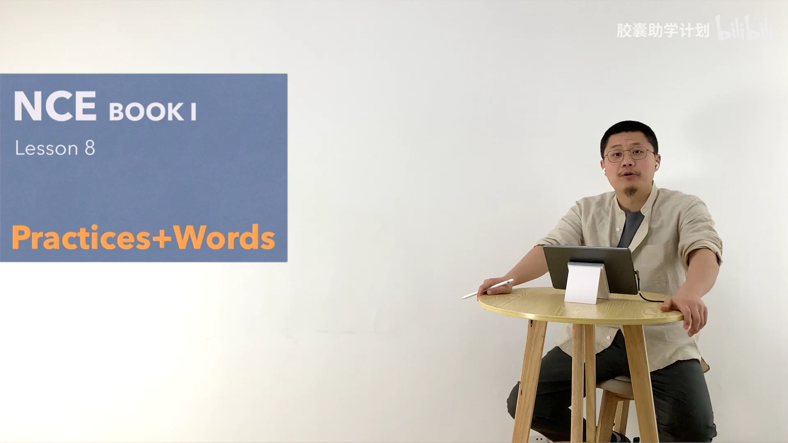

文字识别：胶囊助学计划 / NCE / BOOKI / Lesson 8 / Practices+Words

### 画面 00:00:07

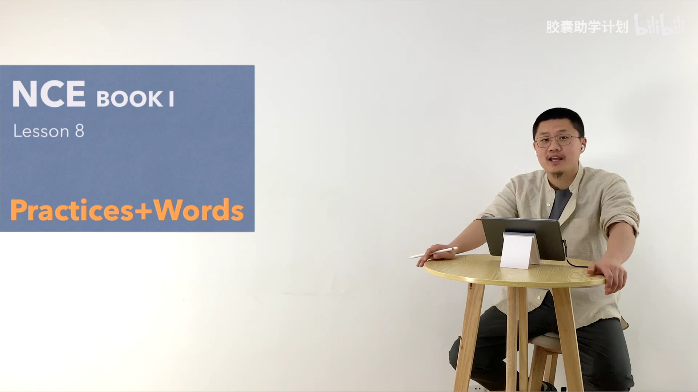

文字识别：胶囊助学计划 / NCE / BOOKI / Lesson 8 / Practices+Words

### 画面 00:00:09

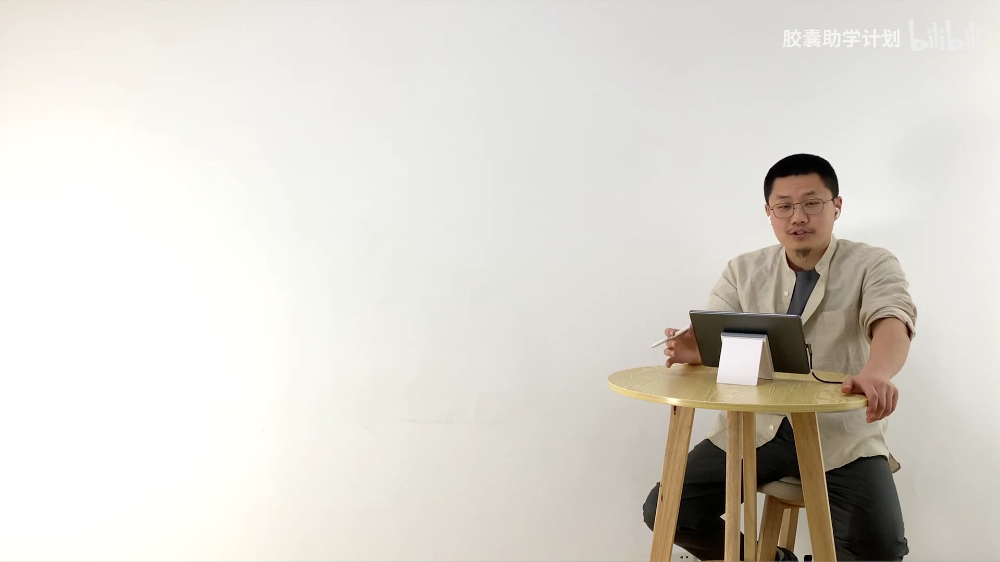

文字识别：胶囊助学计划

### 画面 00:00:11

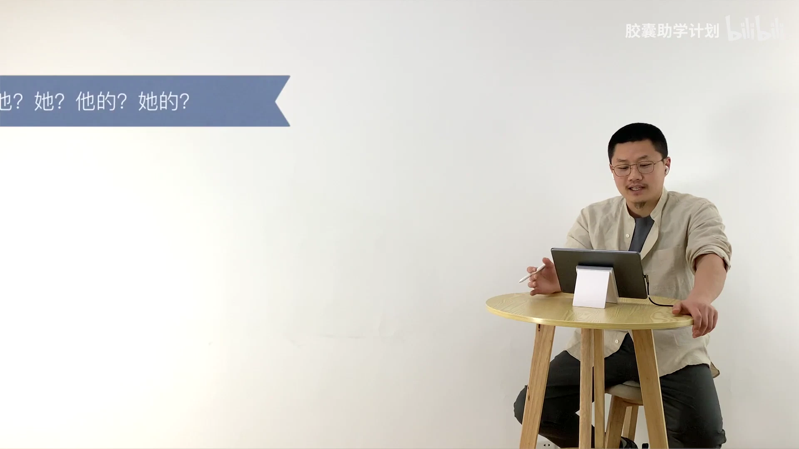

文字识别：胶囊助学计划 / 也？她？他的？她的？

### 画面 00:00:13

文字识别：胶囊助学计划 / ①他？她？他的？她的？

### 画面 00:00:16

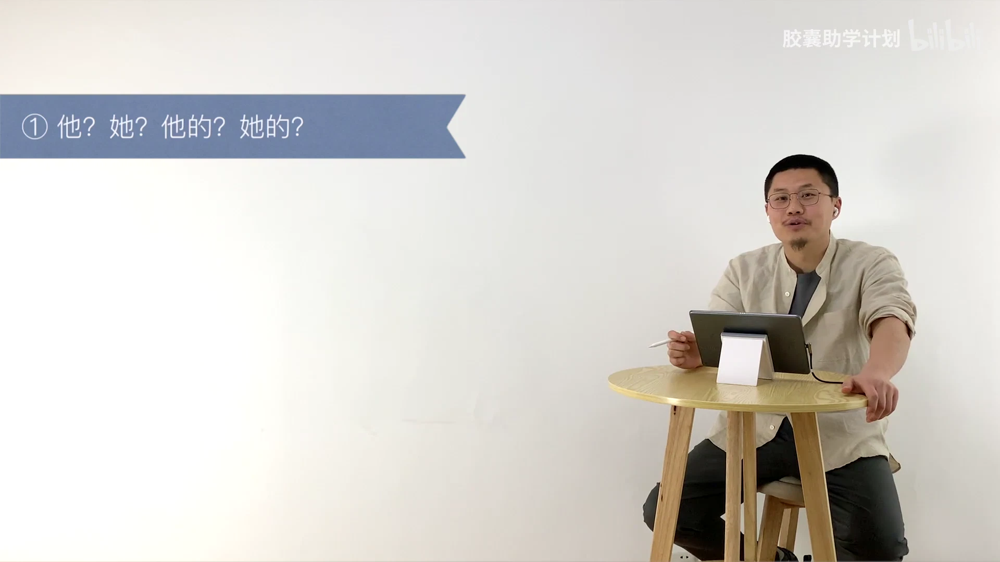

文字识别：胶囊助学计划 / ①他？她？他的？她的？

### 画面 00:00:20

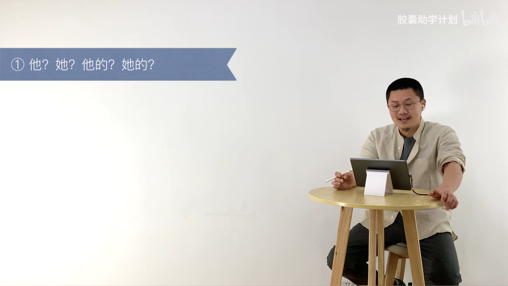

文字识别：胶囊助学计划 / ①他？她？他的？她的？ / 2

### 画面 00:00:24

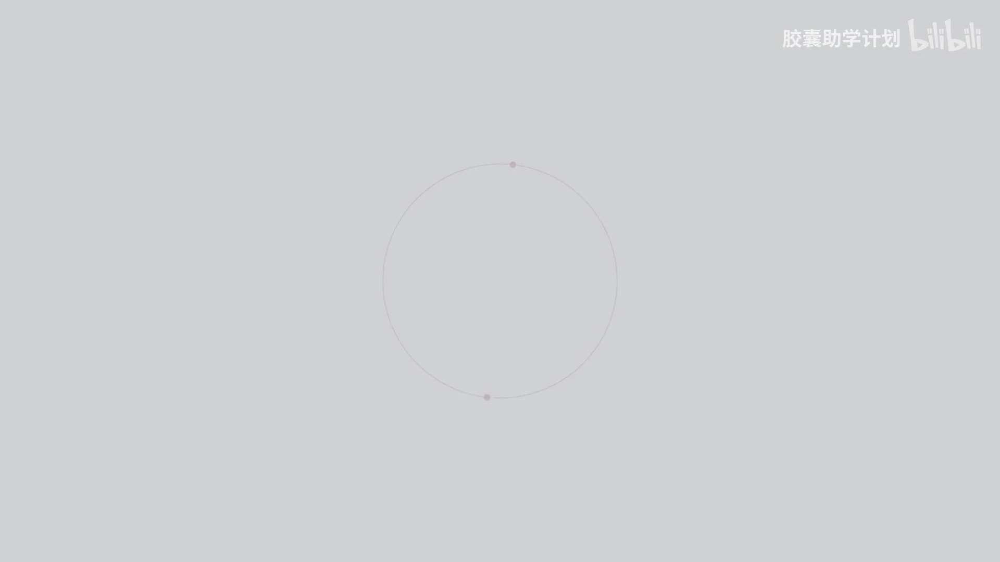

文字识别：胶囊助学计划b出l

### 画面 00:00:27

文字识别：胶囊助学计划 / 胶囊学院

### 画面 00:00:29

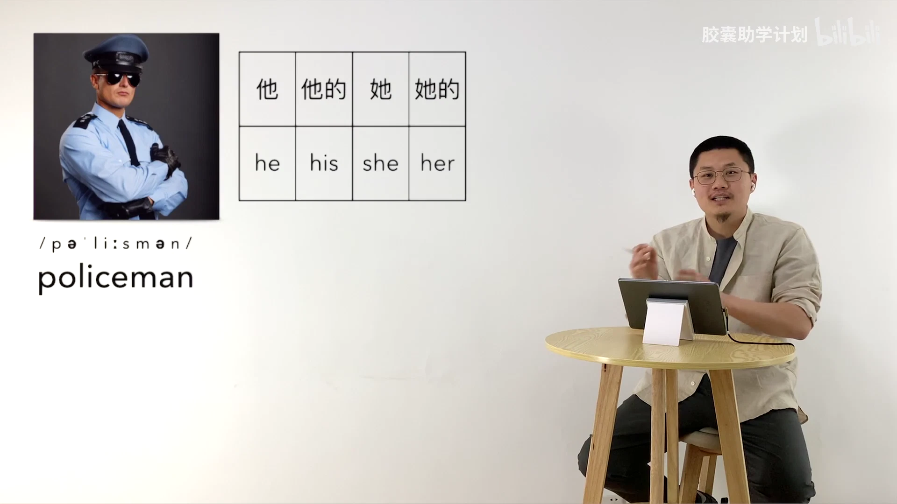

文字识别：胶囊助学计划 / 他 / 他的她她的 / he / his / she / her / /pa'li:sman/ / policeman

## 00:00:30–00:01:00

看一下这四个单词，男他 he，女她 she。我们之前换了非常多的变数了。那接下来还有两个单词跟它长得非常像，男他的 his，女她的 her。各位可以看到，各位在学这些单词的时候，为什么有一些困难？我故意把汉语给大家打出来了，因为对于各位来说呀，你一旦会了他他的，对于各位来说就不是一个生词，你能想象到吧？无非就是加了个白勺的嘛，对吧？

### 画面 00:00:41

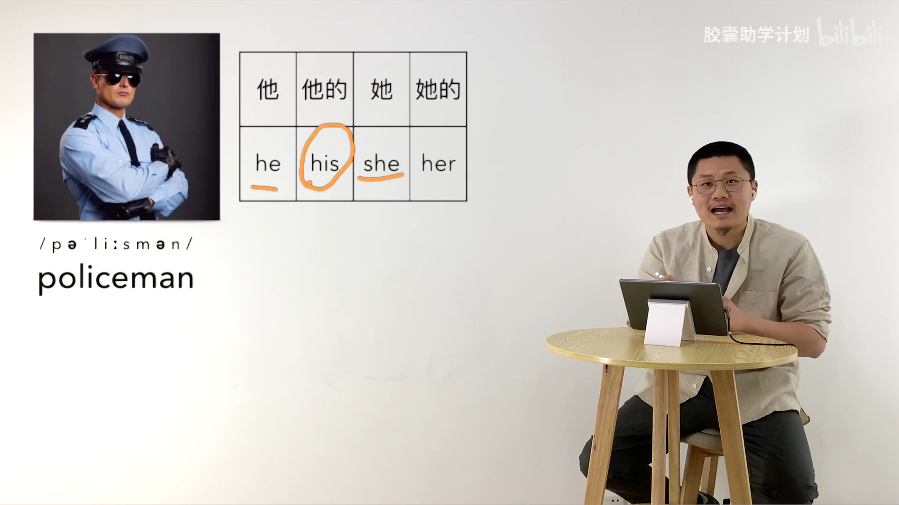

文字识别：胶囊助学计划 / 他 / 他的她她的 / he / his / she / her / /pa'li:sman/ / policeman

### 画面 00:00:50

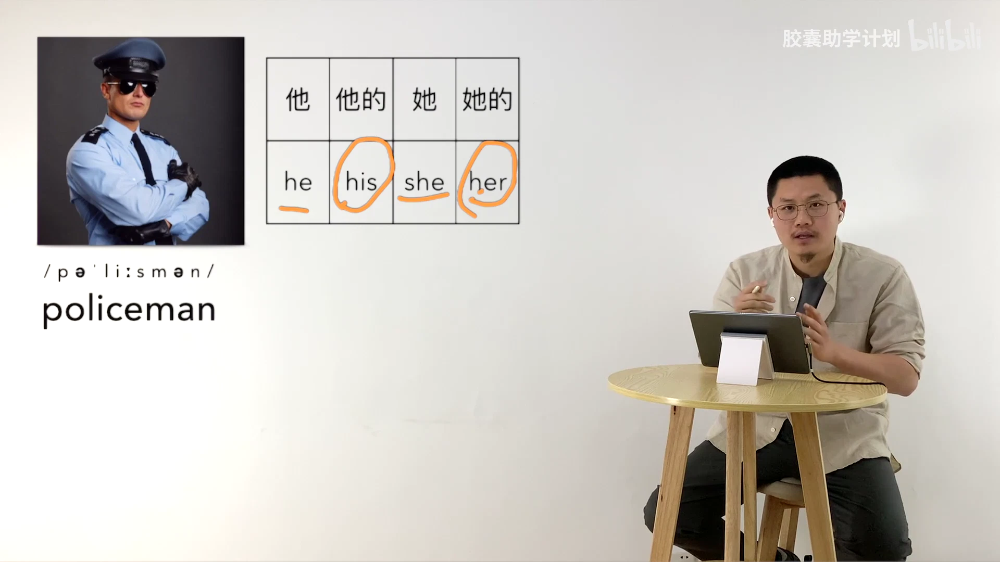

文字识别：胶囊助学计划 / 他 / 他的她她的 / he / his / she / her / /pa'li:sman/ / policeman

### 画面 00:00:54

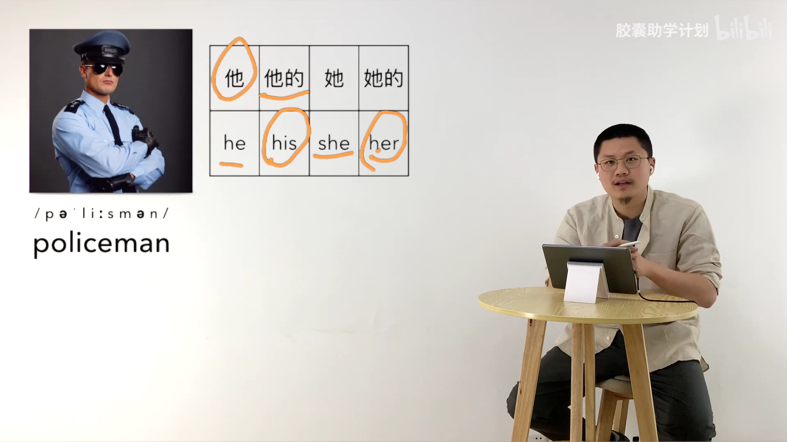

文字识别：胶囊助学计划 / 他 / 他的 / 她她的 / he / his / she / her / /pa'li:sman/ / policeman

## 00:01:00–00:01:30

那女她一旦会了，那她的对于各位来说也不是用专门花力气去学习的，而英文呢是要专门花力气去把它分开的。我先带着各位一起读一遍，接下来我们拿单词去进行练习。He, his, she, her. Okay, very good. 那接下来我们先看单词，跟我一起读。来，a, e, is, a.

### 画面 00:01:01

文字识别：胶囊助学计划 / 他 / 他的 / 她 / 她的 / he / his / she / her / /pa'li:sman/ / policeman

### 画面 00:01:13

文字识别：胶囊助学计划 / 他 / 他的 / 她 / 她的 / he / his / she / her / /pa'li:sman/ / policeman

## 00:01:30–00:02:00

Okay,划分音节，来一起读 policeman, policeman, policeman. Good.那What's他的工作是什么？这四个单词当中选谁？各位自己去选啊。我直接读了What's his job？那他是一个policeman还是一个taxi driver呢？这个他各位四个单词选谁？Right.所以

### 画面 00:01:36

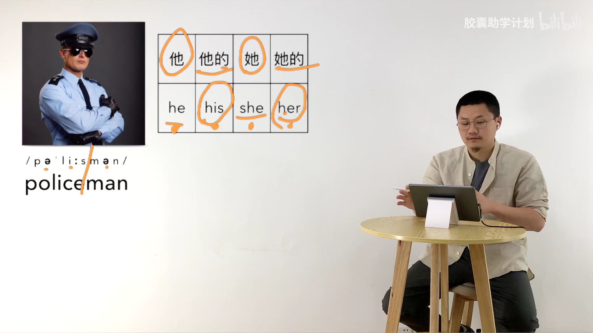

文字识别：胶囊助学计划 / 他 / 他的 / 她 / 她的 / he / his / she / her / pali:sman/ / policeman

### 画面 00:01:43

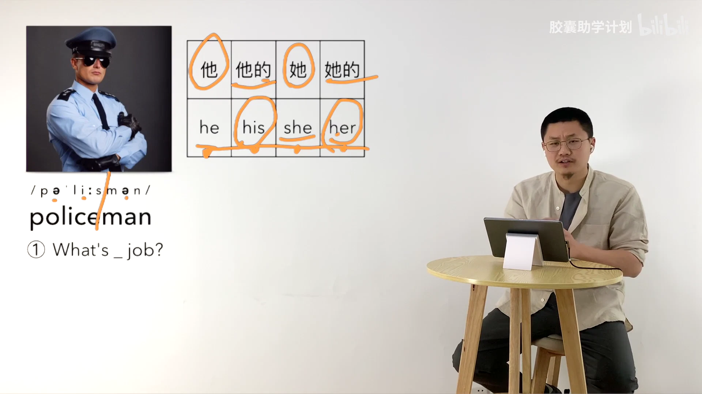

文字识别：胶囊助学计划 / 他 / 他的 / 她 / 她的 / he / his / she / her / pali:sman/ / policeman / What's _job?

### 画面 00:01:52

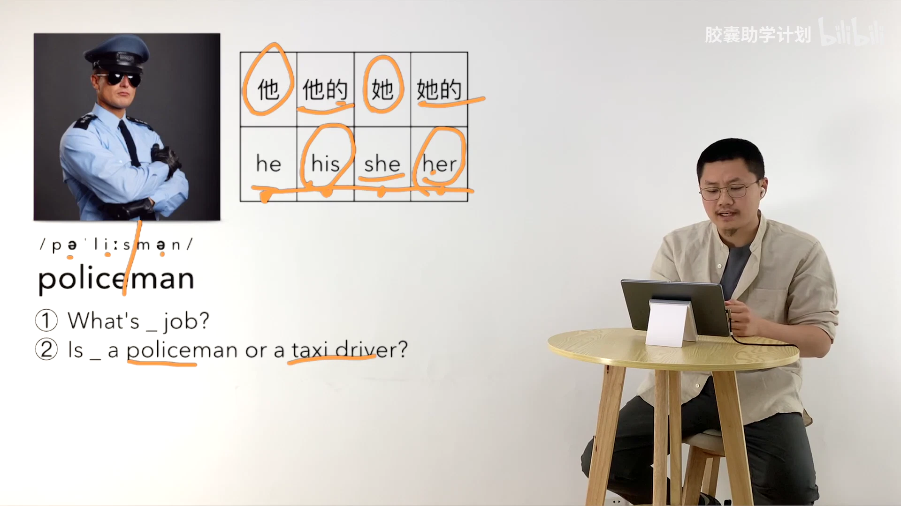

文字识别：胶囊助学计划 / 他 / 他的 / 她 / 她的 / he / his / she / her / /pali :sman/ / policeman / What's _job? / 2 / Is_a policeman or a taxi driver?

### 画面 00:01:56

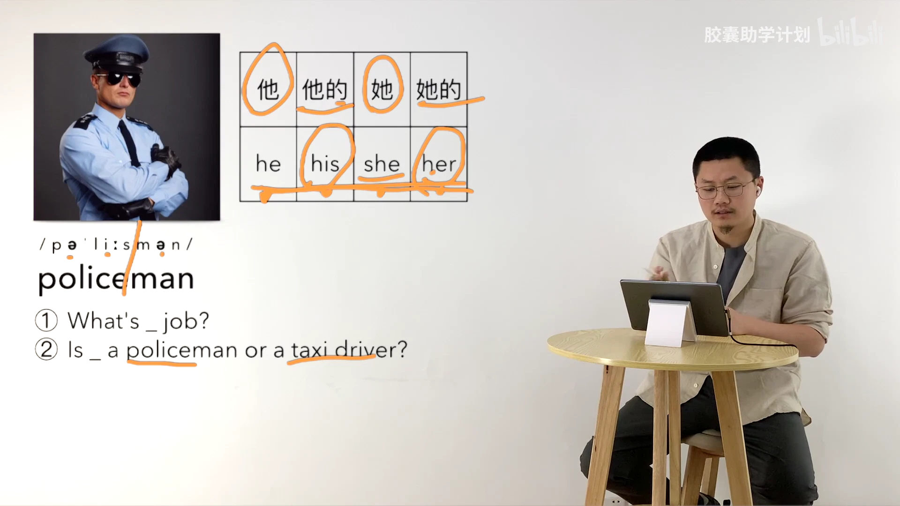

文字识别：胶囊助学计划 / 他 / 他的 / 她 / 她的 / he / his / she / her / /pali:sman/ / policeman / What's _job? / Is_ a policeman or a taxi driver? / 2

## 00:02:00–00:02:30

he a policeman or a taxi driver? Very good. Next, he isn't a taxi driver. He's a policeman. This place, two abbreviations, deliberately written like this. We need to slowly get familiar with isn't is not and he is. He is the abbreviation. Okay, in this place, I want to remind you a little point. You need to remember that in all our odd-numbered lessons, we only do three things: practice, practice, or.

### 画面 00:02:15

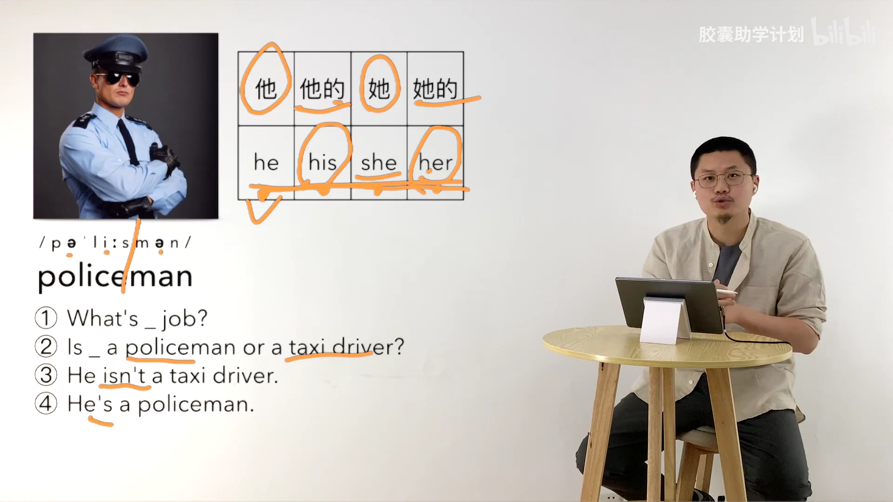

文字识别：胶囊助学计划 / 他 / 他的 / 她 / 她的 / he / his / she / her / /pali:s man/ / policeman / What's_job? / Is _a policeman or a taxi driver? / He isn't a taxi driver. / He's a policeman.

## 00:02:30–00:03:00

习，练习还是练习，对吧？那各位一定要张开嘴啊，跟我一起去读。来，Let's continue，下一个单词，taxi，taxi driver，taxi driver，taxi，公交车 driver，司机 taxi driver，公交车司啊，出租车司机。OK，完了一个，那跟我一起读，What's，难他 his

### 画面 00:02:36

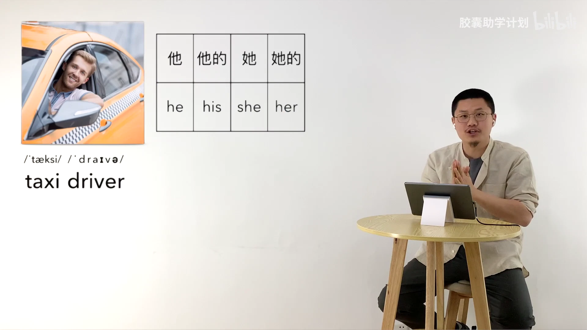

文字识别：胶囊助学计划 / 他 / 他的她她的 / he / his / she / her / /'tæksi//'draiva/ / taxi driver

### 画面 00:02:42

文字识别：胶囊助学计划 / 他 / 他的她她的 / he / his / she / her / /'teksil/'draiva/ / taxi driver

### 画面 00:02:46

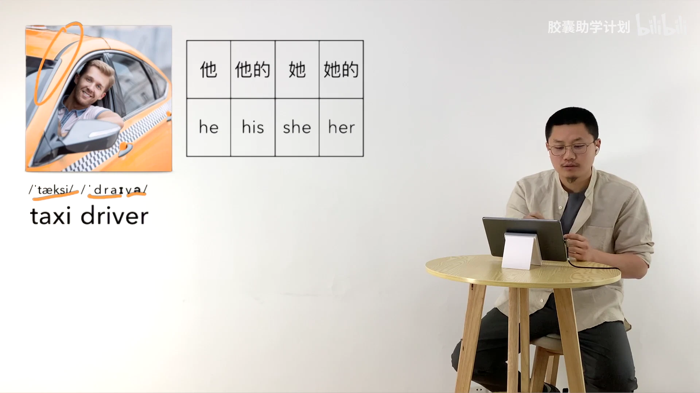

文字识别：胶囊助学计划 / 他 / 他的她她的 / he / his / she / her / /'taeksi//'draiya/ / taxi driver

## 00:03:00–00:03:30

Next one is he a taxi driver or a policeman? Continue. He isn't a policeman. He's a taxi driver. Very good. Let's continue. Next one, police woman.各位可以看到这单词其实就是 police 加了个 woman，对吧？之前是 police 加了个 man. Very good. 我想问他的工作是什么？跟我一起张嘴读. What's her job?

### 画面 00:03:03

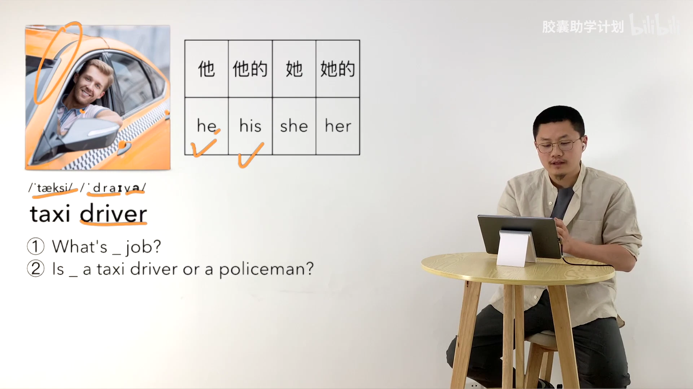

文字识别：胶囊助学计划 / 他 / 他的她她的 / he / his / she / her / /'teksil/'draiya/ / taxi driver / What's_job? / ) Is_a taxi driver or a policeman?

### 画面 00:03:16

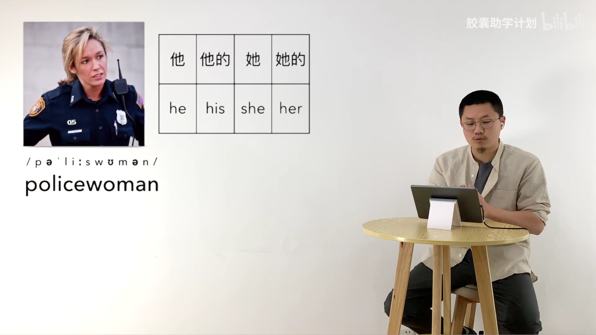

文字识别：胶囊助学计划 / 他他的她她的 / he / his / she / her / 05 / /pali:swuman/ / policewoman

### 画面 00:03:20

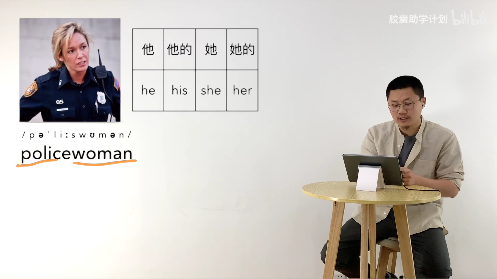

文字识别：胶囊助学计划 / 他他的她她的 / he / his / she / her / 05 / /pali:swuman/ / policewoman

## 00:03:30–00:04:00

Very good.那女她了，对不对？她的工作是什么？她是一个女警还是一个空乘呢？来，Is she a police woman or an air hostess?空姐，OK. Continue. She isn't an air hostess. She's a police woman. Next one, air hostess. Air hostess.她其实另

### 画面 00:03:33

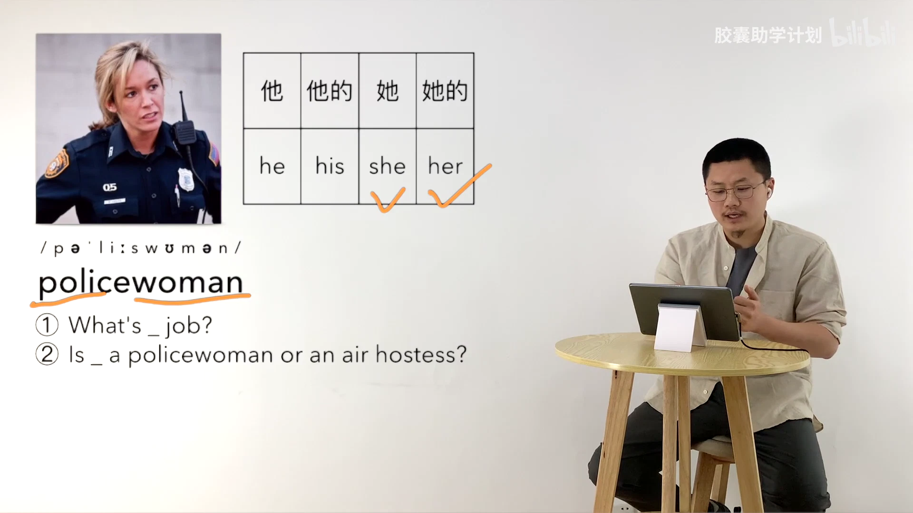

文字识别：胶囊助学计划 / 他他的她她的 / he / his / she / her / 05 / /pali:swuman/ / policewoman / What's_job? / ② Is _a policewoman or an air hostess?

### 画面 00:03:55

文字识别：胶囊助学计划 / 他他的她她的 / he / his / she / her / /ea/ /'haustas/ / /flait/ /a'tendant/ / air hostess / flight attendant

## 00:04:00–00:04:30

外一个比较常用的说法，跟她表示的意思是一样的，都是表示空姐或者空乘嘛。我们管它叫 flight attendant, flight attendant. Continue,跟我一起张嘴读. What's迅速找her job? Is she an air hostess or a policewoman?在这儿我讲一下air hostess前面加了an,哎元音音标，所以前面加an.

### 画面 00:04:01

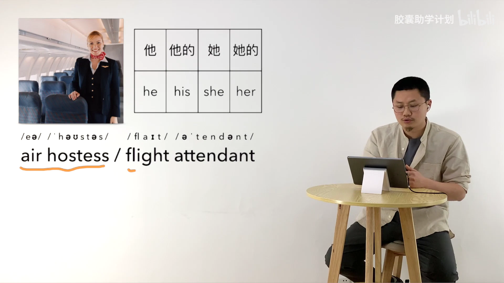

文字识别：胶囊助学计划 / 他他的她她的 / he / his / she / her / /ea//'haustas/ / /flait/ /a'tendant/ / air hostess / flight attendant

### 画面 00:04:03

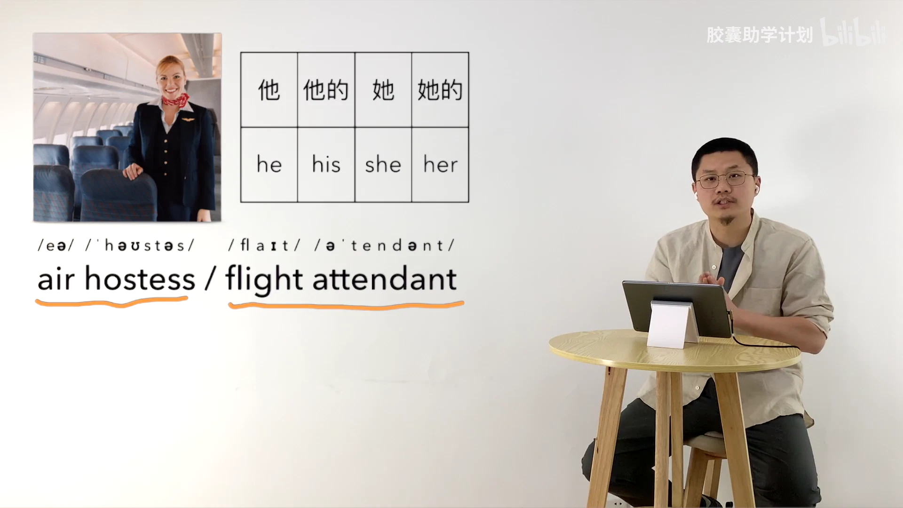

文字识别：胶囊助学计划 / 他他的她她的 / he / his / she / her / /ea//'haustas/ / /flait/ /a'tendant/ / air hostess / flight attendant

### 画面 00:04:24

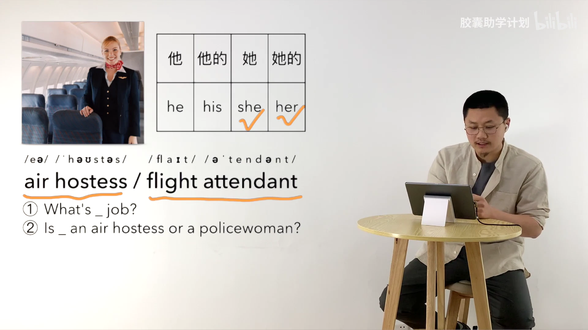

文字识别：胶囊助学计划 / 他他的她她的 / he / his / she / her / /ea/ /haustas/ / /flait/ /a'tendant/ / air hostess / flight attendant / What's_job? / ② Is _ an air hostess or a policewoman?

### 画面 00:04:28

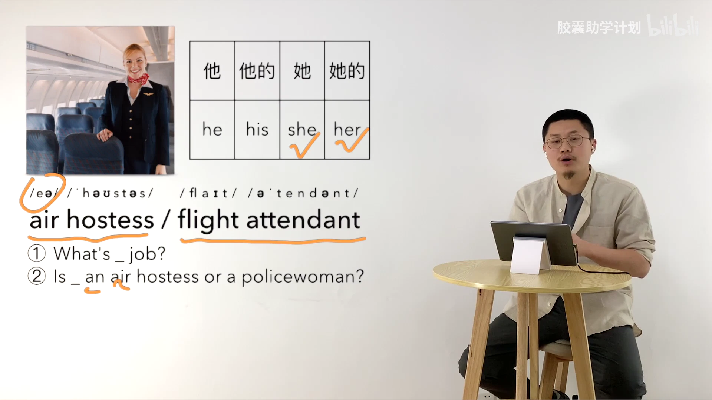

文字识别：胶囊助学计划 / 他他的她她的 / he / his / she / her / /ea/haustas/ / /fl ait/ /a'tendant/ / air hostess / flight attendant / What's_job? / ② Is _an air hostess or a policewoman? / 2

## 00:04:30–00:05:00

Continue. She isn't a policewoman. She's an air hostess. Very good. Let's continue.跟我一起读postman.邮递员. What's his job? Is he a postman or a milkman? He isn't a milkman. He's a postman. Let's

### 画面 00:04:37

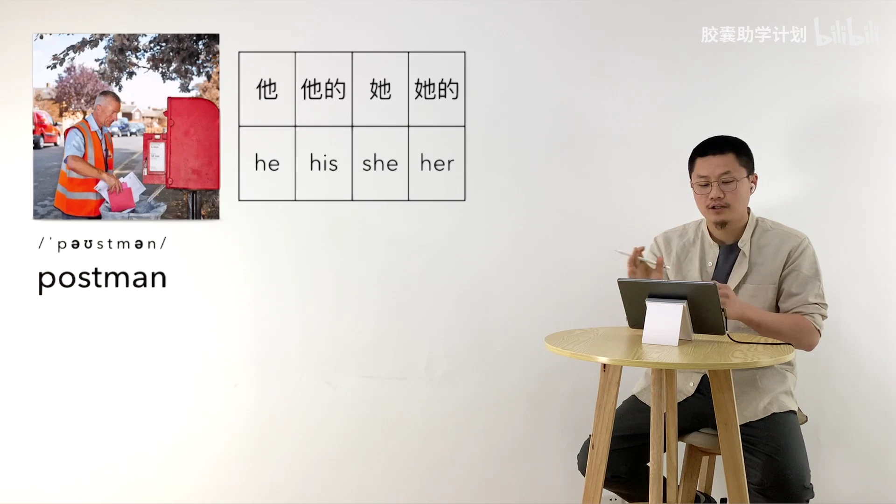

文字识别：胶囊助学计划 / 他他的她她的 / he / his / she / her / /'paustman/ / postman

### 画面 00:04:48

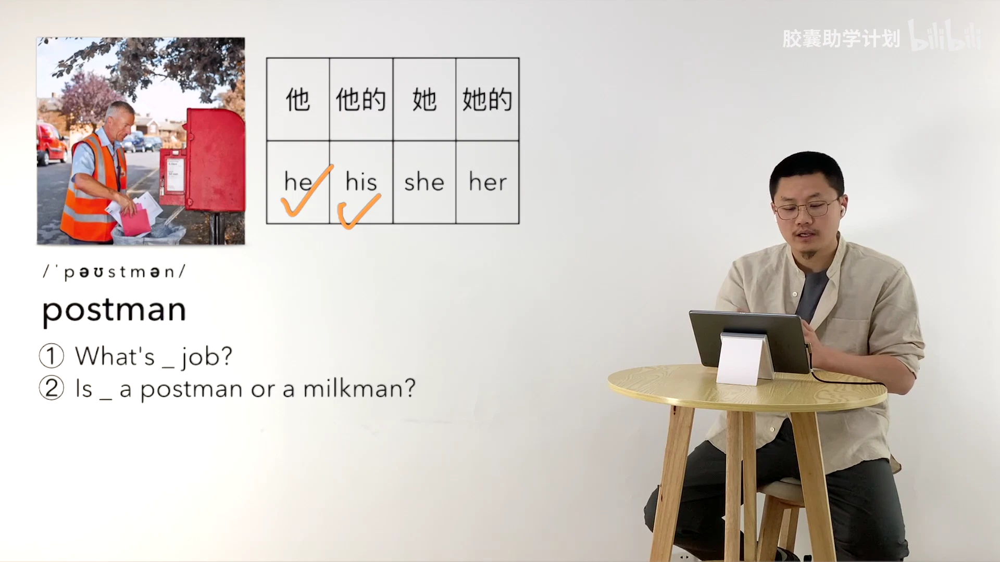

文字识别：胶囊助学计划 / 他他的她她的 / he / his / she / her / /'paustman/ / postman / D What's_job? / 1 / ② Is _a postman or a milkman?

## 00:05:00–00:05:30

Continue, milkman. Milkman这个单词啊，各位记两个单词，milk加man. Milk牛奶man男人啊，那你也可以说milk woman. Okay, continue. What's his job? Is he a milkman or a postman? He isn't a postman. He's a milkman. Very good. Continue,

### 画面 00:05:00

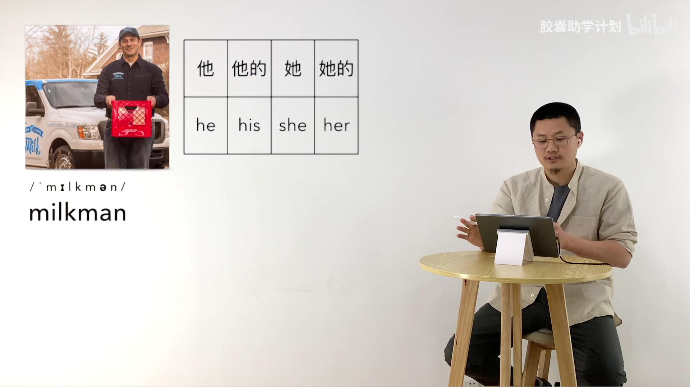

文字识别：胶囊助学计划 / 他 / 他的她她的 / he / his / she / her / /'milkman/ / milkman

### 画面 00:05:06

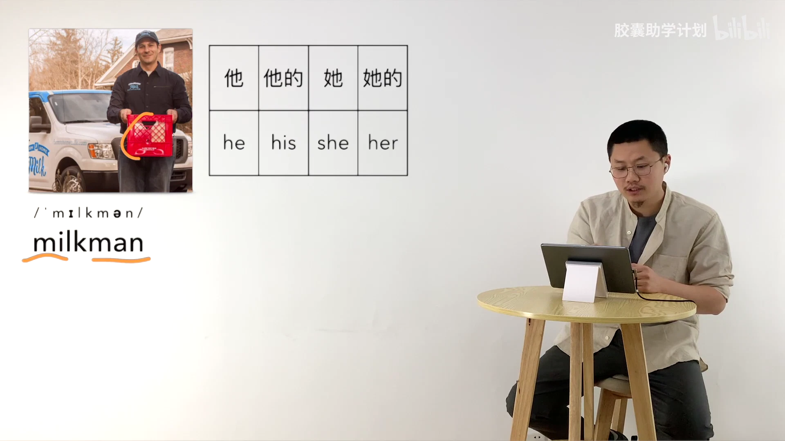

文字识别：胶囊助学计划 / 他 / 他的她她的 / he / his / she / her / /'milkman/ / milkman

### 画面 00:05:15

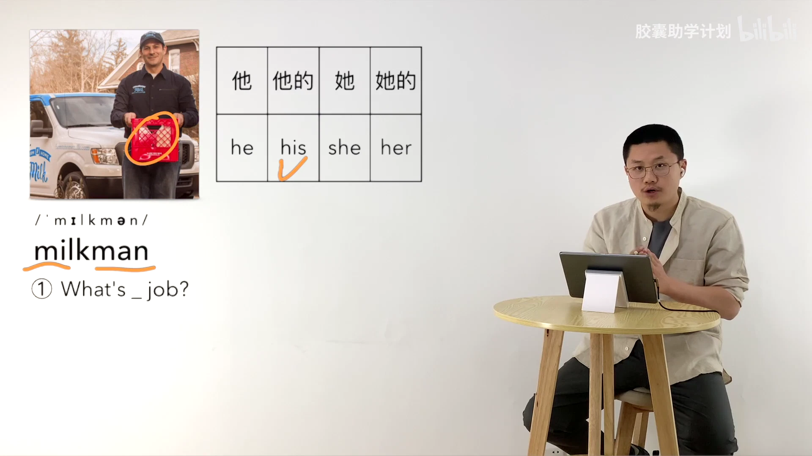

文字识别：胶囊助学计划 / 他 / 他的她她的 / he / his / she / her / /'milkman/ / milkman / What's _job?

### 画面 00:05:25

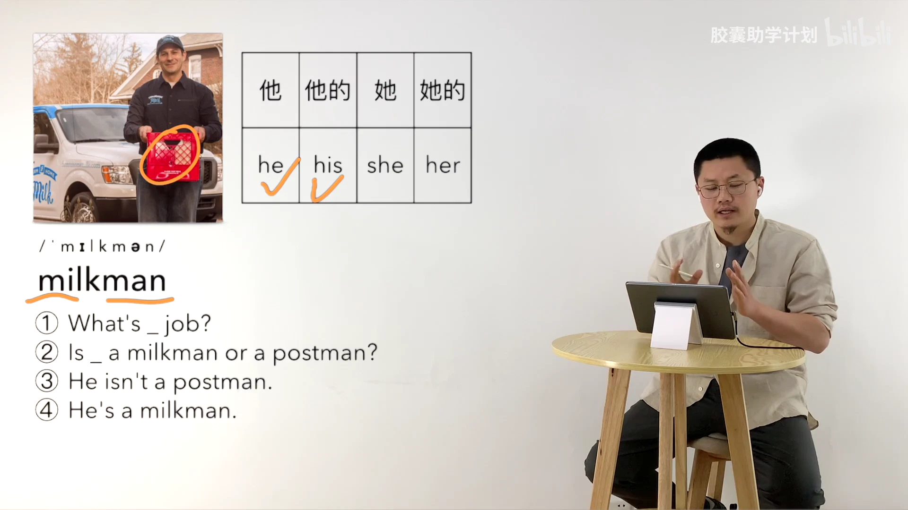

文字识别：胶囊助学计划 / 他他的她她的 / he / his / she / her / /'milkman/ / milkman / What's _job? / 2 /  Is_a milkman ora postman? / He isn't a postman. / He's a milkman.

### 画面 00:05:29

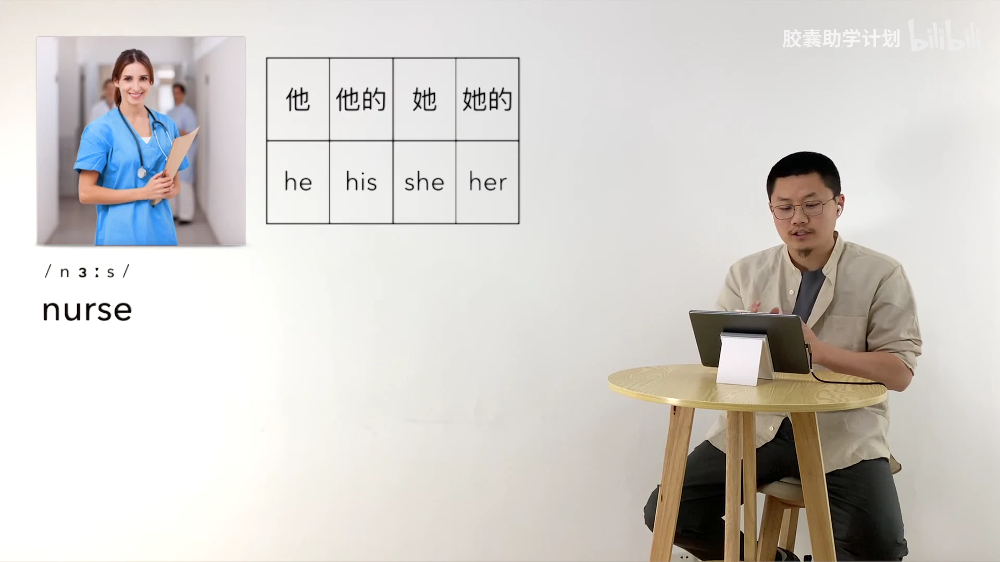

文字识别：胶囊助学计划 / 他他的她她的 / he / his / she / her / /n3:s/ / nurse

## 00:05:30–00:06:00

nurse nurse. What's her job? Is she a nurse or a housewife? She isn't a housewife. She's a nurse. Continue housewife housewife house. We've learned it, right? Do you have any impression? This is my house. Is this your house?

### 画面 00:05:40

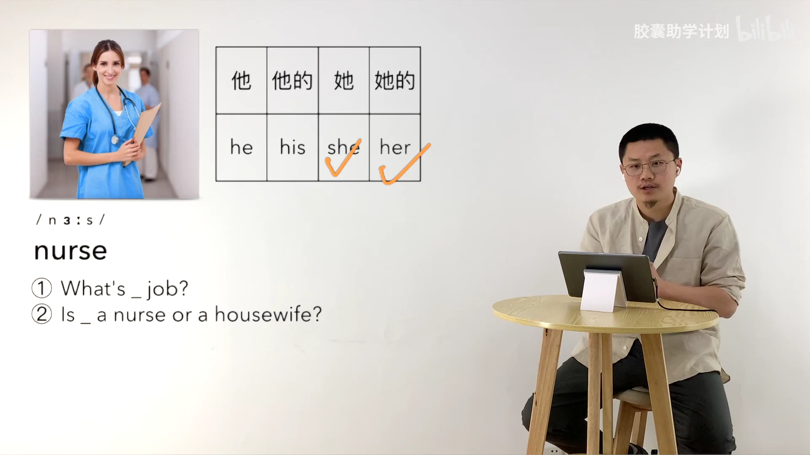

文字识别：胶囊助学计划 / 他他的她她的 / he / his / shy / her / /n3:s/ / nurse / What's_job? / ② Is_a nurse or a housewife? / 2

### 画面 00:05:50

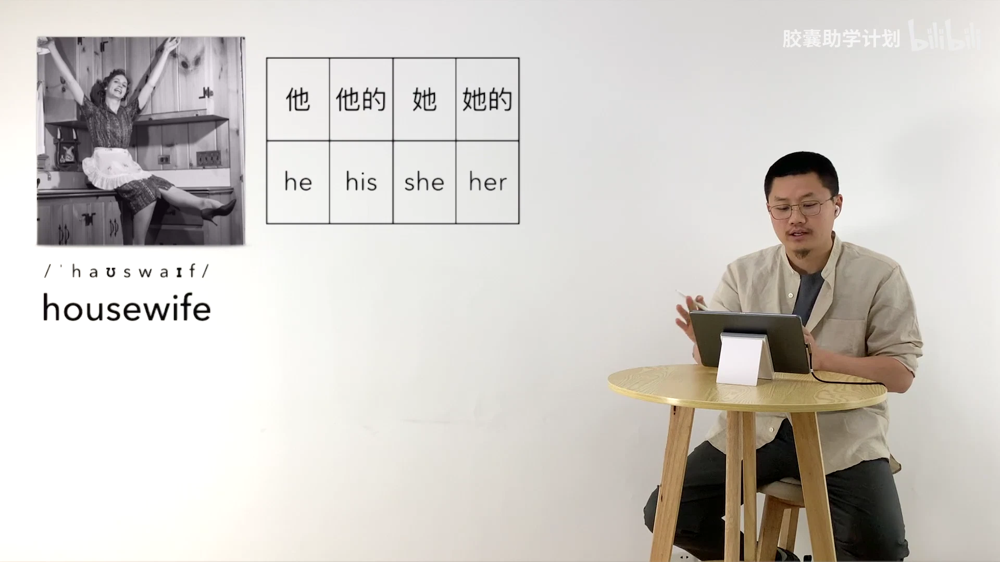

文字识别：胶囊助学计划 / 他他的她她的 / he / his / she / her / /hauswai f/ / housewife

### 画面 00:05:55

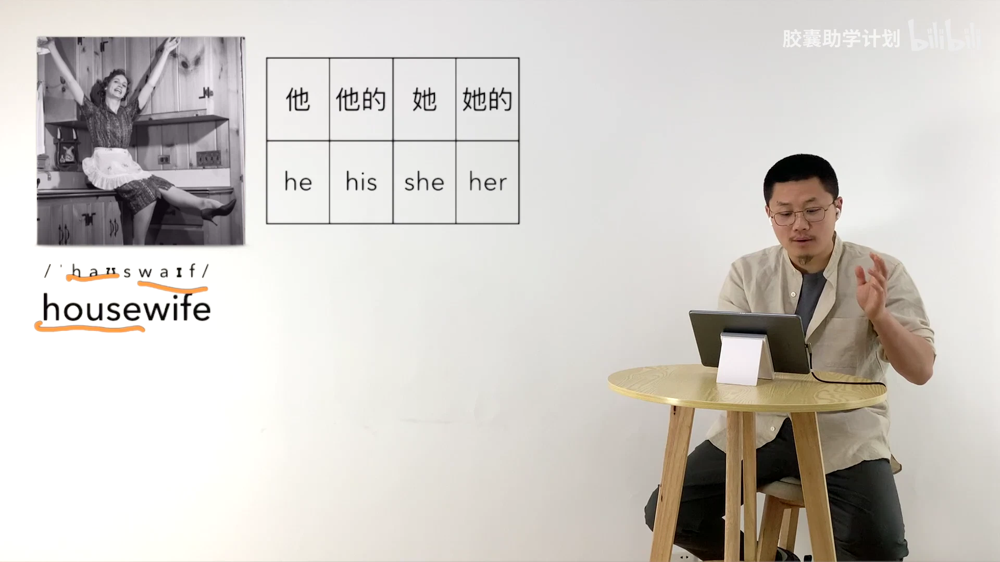

文字识别：胶囊助学计划 / 他他的她她的 / he / his / she / her / /hauswai f / / housewife

### 画面 00:05:58

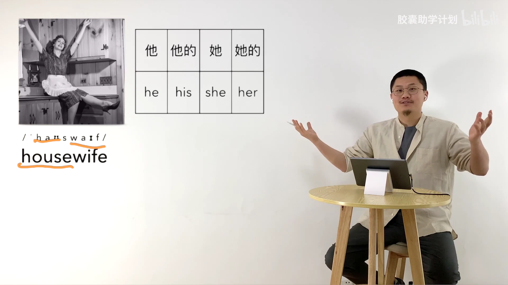

文字识别：胶囊助学计划 / 他 / 他的她她的 / he / his / she / her / /hauswaif/ / housewife

## 00:06:00–00:06:30

Okay, wife,妻子, housewife,家庭主妇. Continue. What's her job? Is she a housewife or a nurse? Continue. She isn't a nurse. She's a housewife. Very good. Continue.下一个单词，我们看一下音标啊，正好回顾一下。一二三，三个音节，重音，即为

### 画面 00:06:03

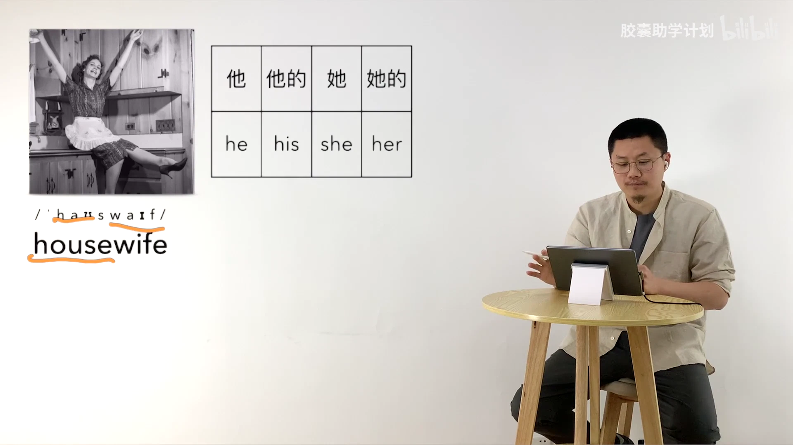

文字识别：胶囊助学计划 / 他他的她她的 / he / his / she / her / /hauswai f/ / housewife

### 画面 00:06:13

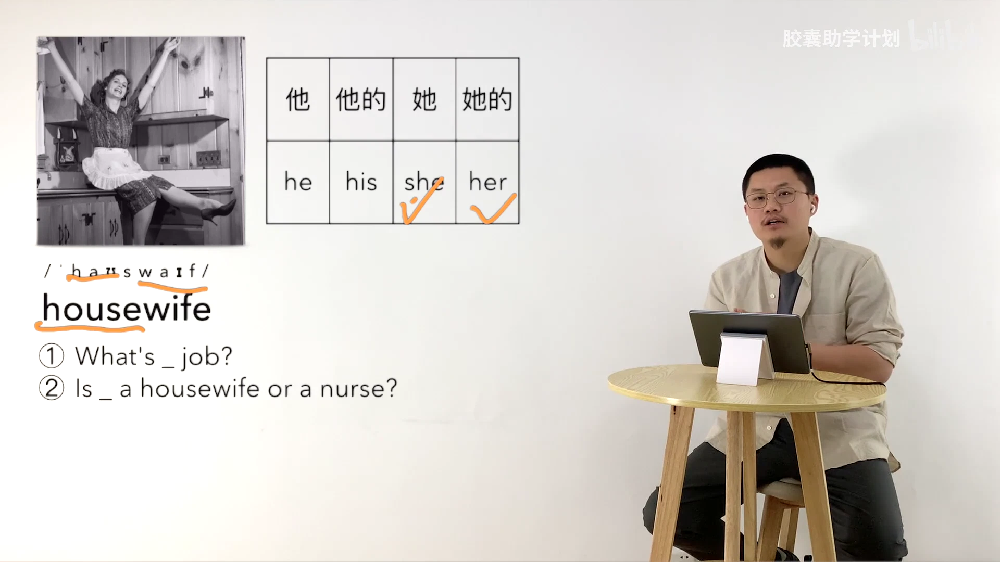

文字识别：胶囊助学计划 / 他他的她她的 / he / his / shy / her / /haus waif/ / housewife / What's_job? / ② Is _a housewife or a nurse?

### 画面 00:06:21

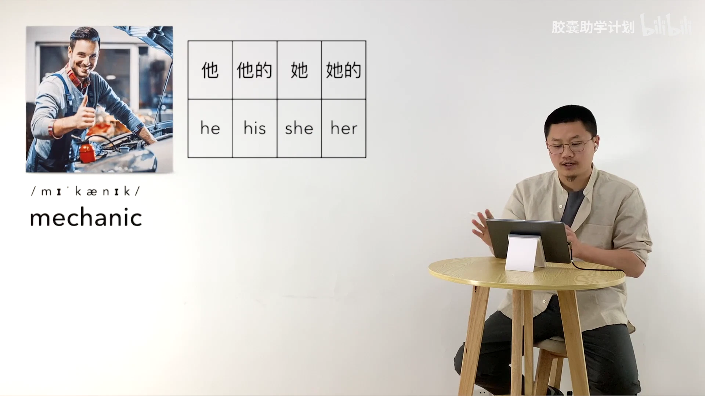

文字识别：胶囊助学计划 / 他 / 他的她她的 / he / his / she / her / /mI'kæni k/ / mechanic

## 00:06:30–00:07:00

划分音节的一个方式。两个元音中间一个辅音，即为划分，直接把音节划分出来。跟我一起读，mechanic，me，重音要声调上升，mechanic连起来，mechanic，mechanic，机械师啊，机械修理员，mechanic。What's his job? Is he a mechanic or a hairdresser?

### 画面 00:06:51

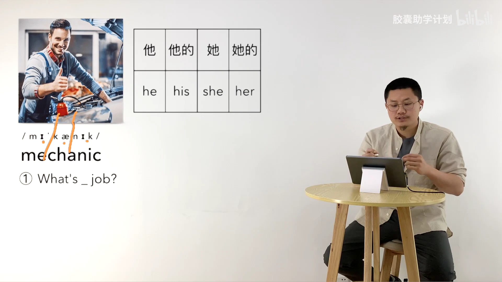

文字识别：胶囊助学计划 / 他 / 他的她她的 / he / his / she / her / mIkænk/ / mechanic / DWhat's_job? / 1

### 画面 00:06:55

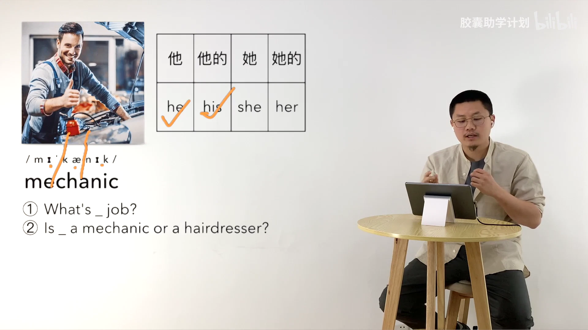

文字识别：胶囊助学计划 / 他他的她她的 / he / she / her / h / mIk∞n k/ / mechanic / What's_job? / ② Is _a mechanic or a hairdresser?

## 00:07:00–00:07:30

Next one, he isn't a hairdresser. He's a mechanic. Very good. Continue. Hairdresser. This place, hairdresser,理发师.那我们把hair记住，头发. What's his job? Is he a hairdresser or a mechanic? He isn't a mechanic.

### 画面 00:07:08

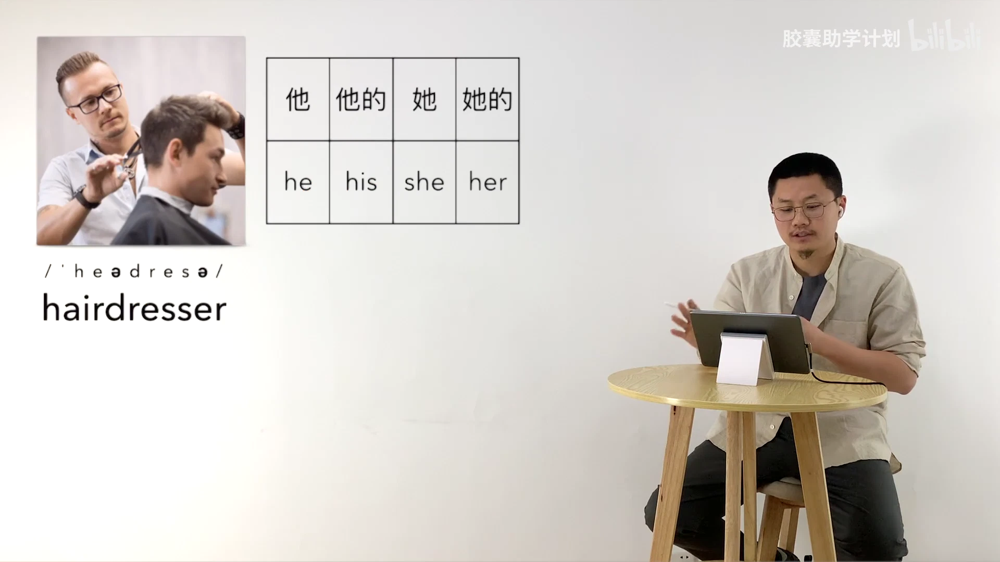

文字识别：胶囊助学计划 / 他他的她她的 / he / his / she / her / /headresa/ / hairdresser

### 画面 00:07:23

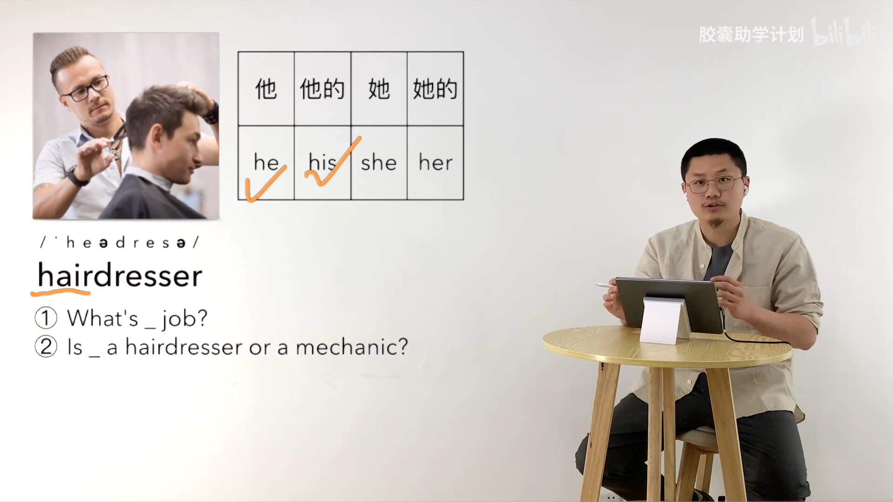

文字识别：胶囊助学计划 / 他他的她她的 / he / his / she / her / /headresa/ / hairdresser / What's_job? / ② Is _a hairdresser or a mechanic?

## 00:07:30–00:08:00

He's a hairdresser. Very good. 那我们复习一下，在课程最开始给大家提出来了。男他是我们做了这么多练习，相信你应该记住了。He 女他是 she 男他的是 his 女她的是 her. Okay, very good. 啊，通过练习我们慢慢带着大家，以后我们还会去练这些东西。所以

### 画面 00:07:33

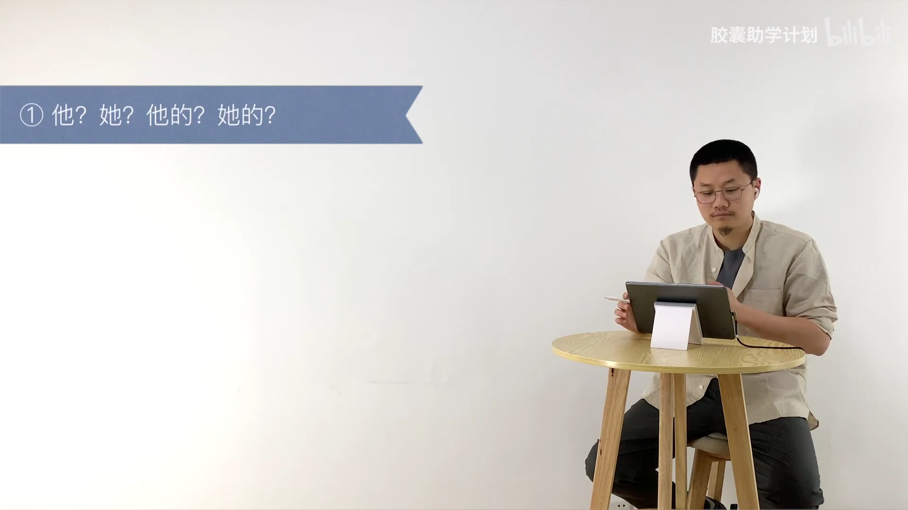

文字识别：胶囊助学计划 / ①他？她？他的？她的？

### 画面 00:07:45

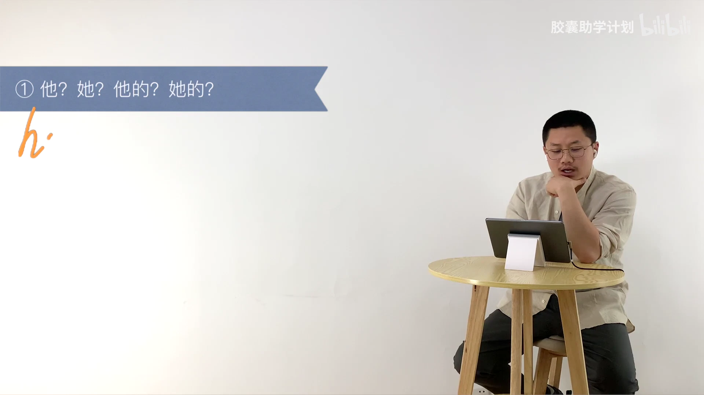

文字识别：胶囊助学计划 / 他？她？他的？她的？

### 画面 00:07:48

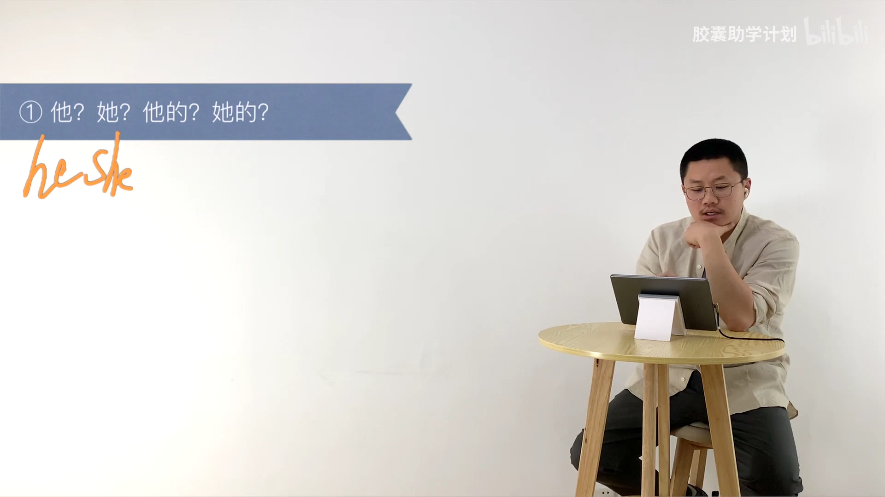

文字识别：胶囊助学计划 / ①他？她？他的？她的？ / hesk

### 画面 00:07:52

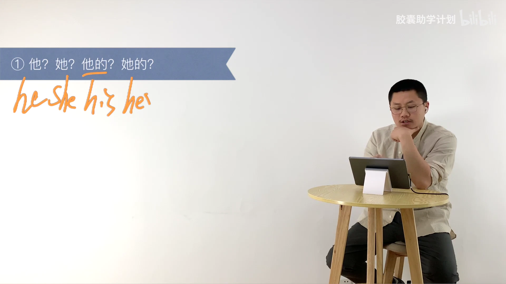

文字识别：胶囊助学计划 / ①他？她？他的？ / 她的？ / hesk his / her

### 画面 00:07:54

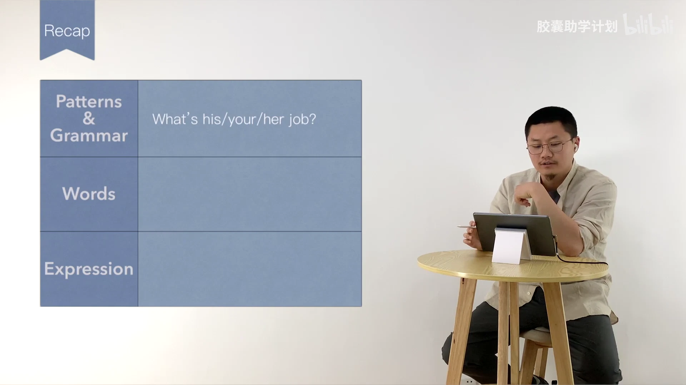

文字识别：胶囊助学计划 / Recap / Patterns / What's his/your/her job? / Grammar / Words / Expression

## 00:08:00–00:08:30

What's his job? What's your job? What's her job? 就是我们这课比较关键的一个句型，同时带着两个单词 his or her. OK，一个一个。那接下来我们看一下今天的家庭作业，各位绿皮书第八课的写作练习要去完成。其次呢，各位跟着视频一起去做这些跟读的练习，不要小瞧这些偶数课的练习，他们其实才最终决定了我们可以脱口而出，而不是您很清

### 画面 00:08:02

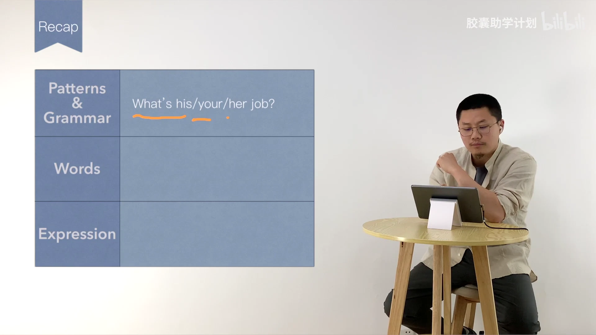

文字识别：Recap / 胶囊助学计划 / Patterns / What's his/your/her job? / Grammar / Words / Expression

### 画面 00:08:11

文字识别：胶囊助学计划

### 画面 00:08:19

文字识别：胶囊助学计划 / 绿皮书第8课的写作练习 / 跟着视频一起做跟读练习

### 画面 00:08:22

文字识别：胶囊助学计划 / 绿皮书第8课的写作练习 / 跟着视频一起做跟读练习

## 00:08:30–00:09:00

楚这些语法的变化规则。一般疑问句 is 提前的，特殊疑问句等于特殊疑问词加去掉大 N 的一般疑问句啊。这些东西到最后我们把它统统忘掉，而是张嘴就要去说。那为什么要学那些呢？知其然，知其所以然，对吧？那同时到最后能张开嘴说，脱口而出，是拒绝去思考语法的。只有通过练习，练习，还是练习，才能做到这一点。 OK，下一个。那本期视频呢，到这个地方就结束了。如果大家喜欢我们的课程，欢迎大家

### 画面 00:08:37

文字识别：胶囊助学计划 / 绿皮书第8课的写作练习 / 跟着视频一起做跟读练习

### 画面 00:08:50

文字识别：胶囊助学计划 / 绿皮书第8课的写作练习 / 跟着视频一起做跟读练习

### 画面 00:08:55

文字识别：胶囊助学计划

## 00:09:00–00:09:29

订阅并一键三连支持。当然，如果您身边有需要学英语或者正在学英语的朋友，也请分享给他们。最后，我们来看一句名人名言：I have become a housewife, and there is no better job. Peace out.

### 画面 00:09:06

文字识别：胶囊助学计划 / O / I have become a housewife and / there is no better job. / Celine Dion

### 画面 00:09:16

文字识别：I have become a housewife and / there is no better job. / Celine Dion

### 画面 00:09:18

文字识别：CAPSULEACADEMY / 胶囊学院 / 小红书 / Lecturer / □ / Leo

### 画面 00:09:21

文字识别：CAPSULEACADEMY / 胶囊学院 / 小红书 / Photographer / Berlin / 🙌

### 画面 00:09:23

文字识别：CAPSULEACADEMY / 胶囊学院 / 小红书 / Editor / □ / Berlin

### 画面 00:09:26

文字识别：CAPSULEACADEMY / 胶囊学院 / 小红书

### 画面 00:09:28

文字识别：bilibili / 胶囊助学计划

### 画面 00:09:29

文字识别：bilibili / 胶囊助学计划

