# 009 单词 语法 文章

快速机器解析：语音为单模型转写，未进行独立交叉校对或人工复核；画面每秒采样并按变化选帧，短时文字和标记可能遗漏。截图时间约有 1 秒误差。图片有损压缩；遇到疑点请按时间查看 Google Drive 原视频。

## 00:00:00–00:00:30

Hello everyone, welcome to Capsule Academy. This is Leo. Today we're going to learn New Concept English Book One Lesson Nine Words Grammar and Story. 那老习惯进入正式课程之前，我们先看三个问题。第一，how引导的特殊疑问句长成的是什么样子？第二，如何表达你还好吗？第三，那 nice to see you 跟 nice to meet you 之间有什么区别吗？带着这三个问题， hope you gonna enjoy it. Okay,

### 画面 00:00:00

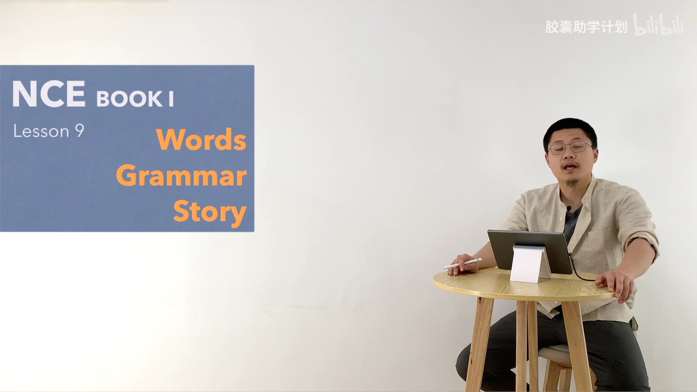

文字识别：胶囊助学计划 / NCE / BOOKI / Lesson 9 / Words / Grammar / Story

### 画面 00:00:09

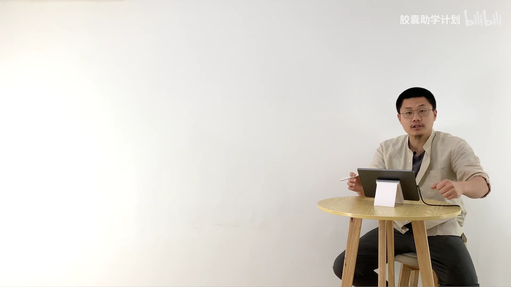

文字识别：胶囊助学计划

### 画面 00:00:11

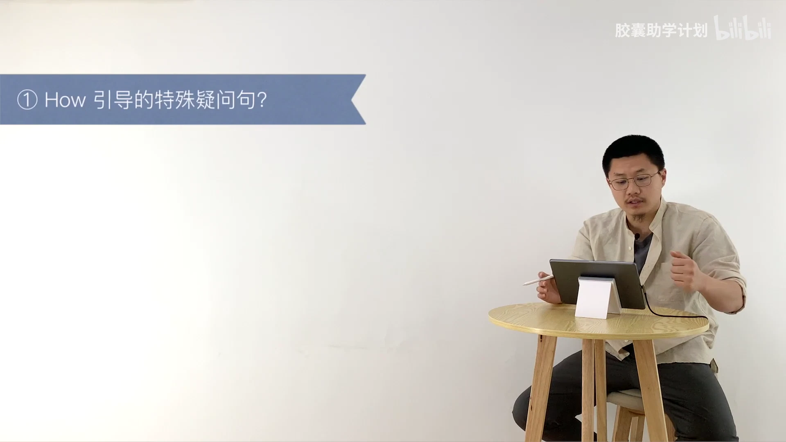

文字识别：胶囊助学计划 / ① How 引导的特殊疑问句?

### 画面 00:00:15

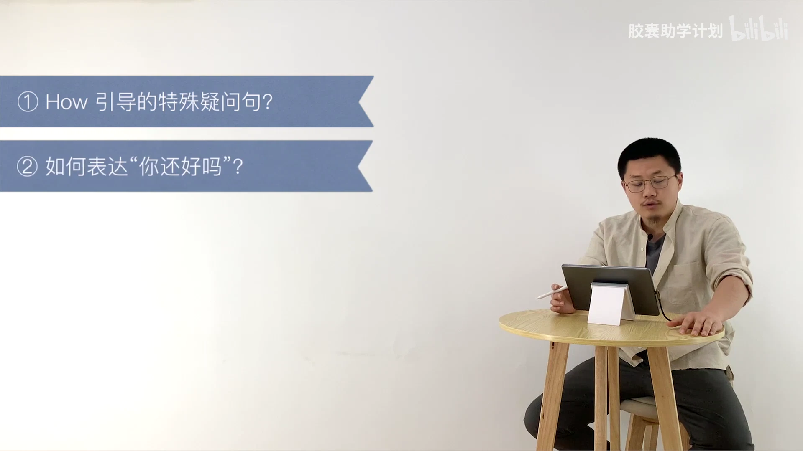

文字识别：胶囊助学计划 / ① How 引导的特殊疑问句? / 如何表达“你还好吗

### 画面 00:00:18

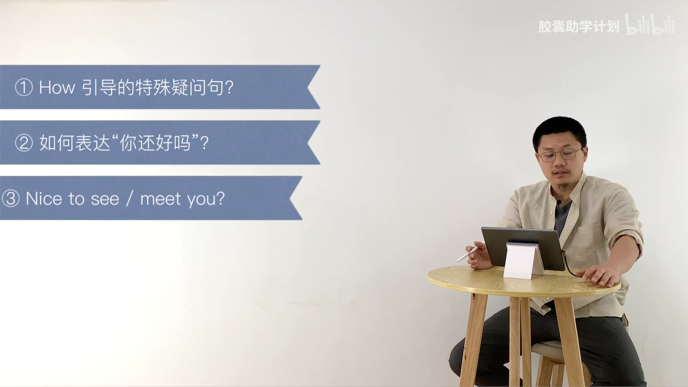

文字识别：胶囊助学计划 / ①How 引导的特殊疑问句？ / 如何表达“你还好吗’ / Nice to see / meet you?

### 画面 00:00:26

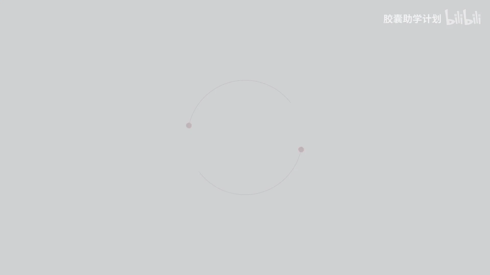

文字识别：胶囊助学计划 bilb出

## 00:00:30–00:01:00

OK，好，那上来我们先看两个非常简单的单词，这两个单词我相信很多同学都会啊。那我们先看一下他们关于关于这两个单词自然拼读法则和音标的知识。首先，我们先来看这个双元音，来跟我一起读，i i。OK，其次 h 这两个字母放在单词当中去，现在发的都是这个音，所以后面这个单词叫 hi，前面这个单词

### 画面 00:00:30

### 画面 00:00:32

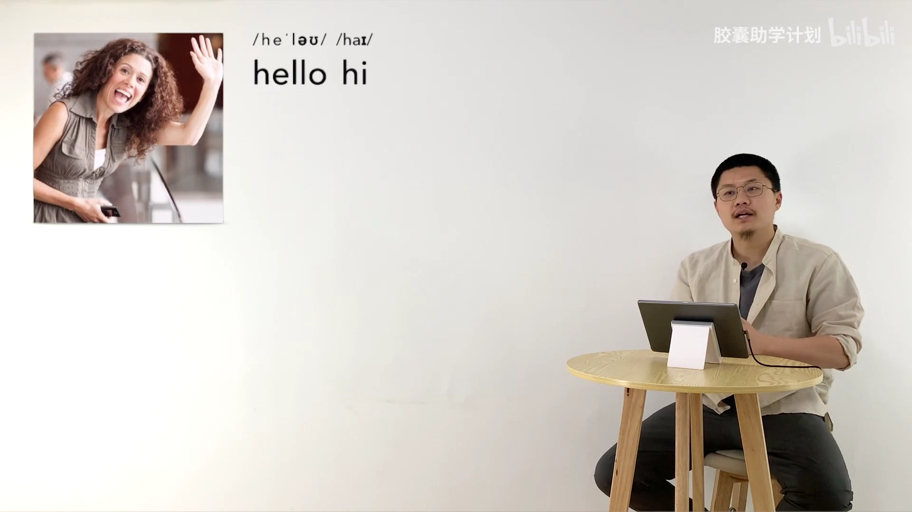

文字识别：胶囊助学计划 / /he'lau/ /hal/ / hello hi / `

### 画面 00:00:47

文字识别：胶囊助学计划 / /he'lau/ /hai/ / hello hi

### 画面 00:00:49

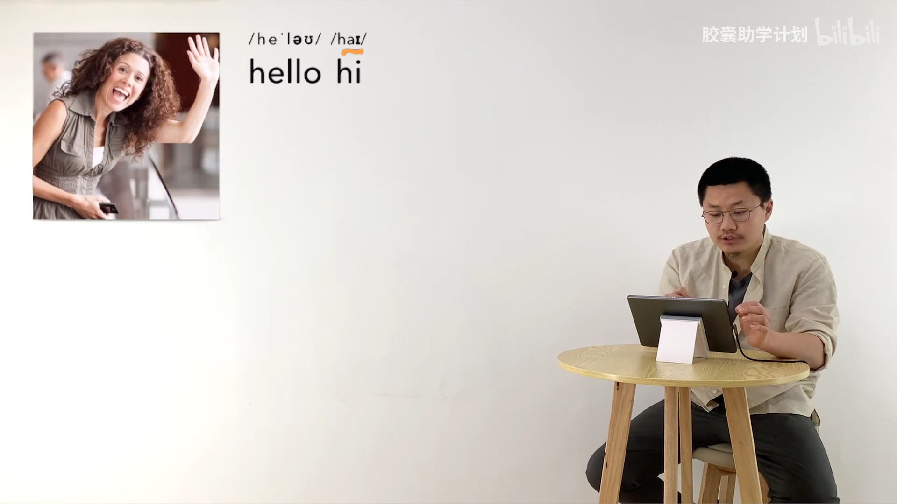

文字识别：胶囊助学计划 / /he'lau/ /hai/ / hello hi

### 画面 00:00:54

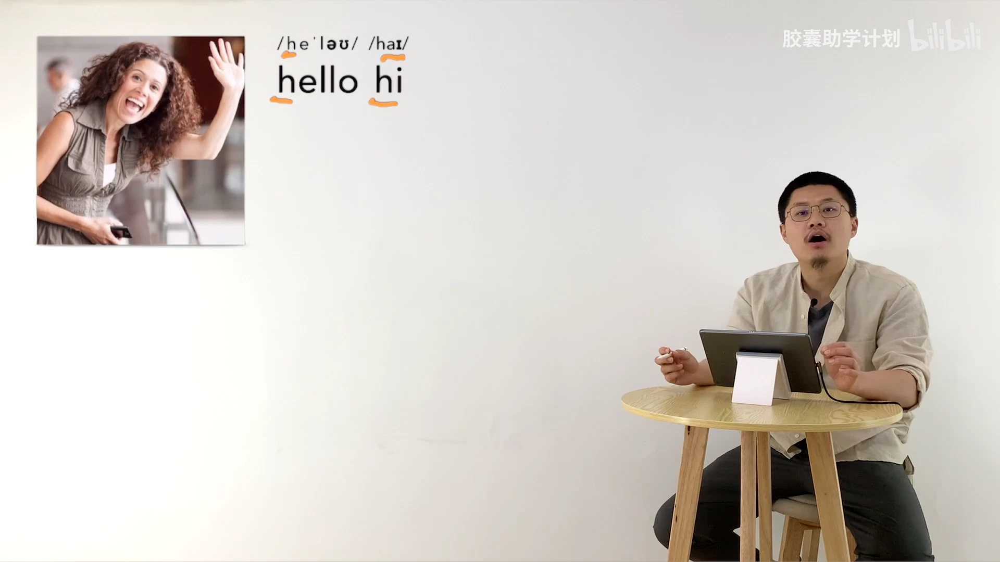

文字识别：胶囊助学计划 / /he'lau/ /hai/ / hello hi

## 00:01:00–00:01:30

OK，双元音继续看，o，o，好，这个音标我们在之前的音标视频，元音啊辅音音标视频当中专门给大家讲过，舌尖贴上牙龈，然后下来发o，来跟我读，lo，lo。其次呢，这个音标讲，a，a，hello，hello，后面教，hi，这儿我们不做过多的拓展，只提一小句，各位不要因为它简单就觉得好

### 画面 00:01:14

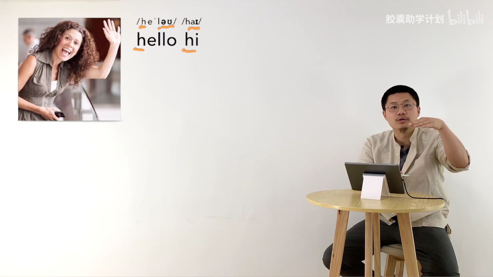

文字识别：胶囊助学计划 / 出 / /he'lau/ /hai/ / hello hi

### 画面 00:01:27

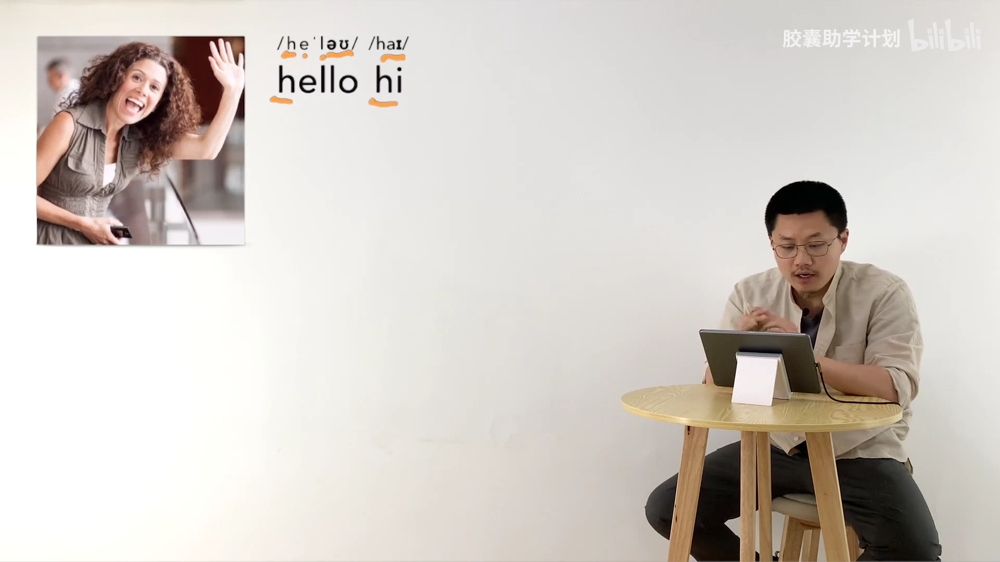

文字识别：胶囊助学计划 / /he'lau/ /hai/ / hello hi

## 00:01:30–00:02:00

像我要一定用一个更复杂的东西跟外国人去进行沟通，对吧？打招呼我不能用 hello hi，我必须得用一点邪乎的东西啊，或者说啊更潮的东西，没必要 hello hi 完全够用，是吧？我自己在国外的生活经验告诉我完全够用，各位放心用就 OK 了。其次，很简单的一个单词，也是本课的一个小的重点，叫 how。 OK，那我们看 h 放在单词当中去，刚刚讲过。其次，双

### 画面 00:01:49

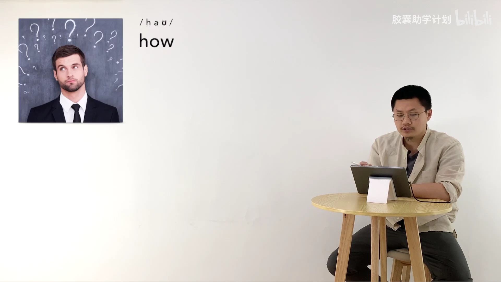

文字识别：胶囊助学计划 / /hau/ / how

## 00:02:00–00:02:30

元音跟一起读，ow，嘴要张大一点，ow，how，OK，那我们今天就一起来看一下how引导的特殊疑问句，我相信很多同学都会是吧？How are you？你好吗？OK，那我们看一下它是如何变过来的，跟我们之前学的是保持一致的。特殊疑问句，我是我们今天要学的重点，那它等于的是特殊疑问词how去加上一个去掉答案的一般疑问句。接下来我们先一起看一下，叫做She's OK，叫她

### 画面 00:02:06

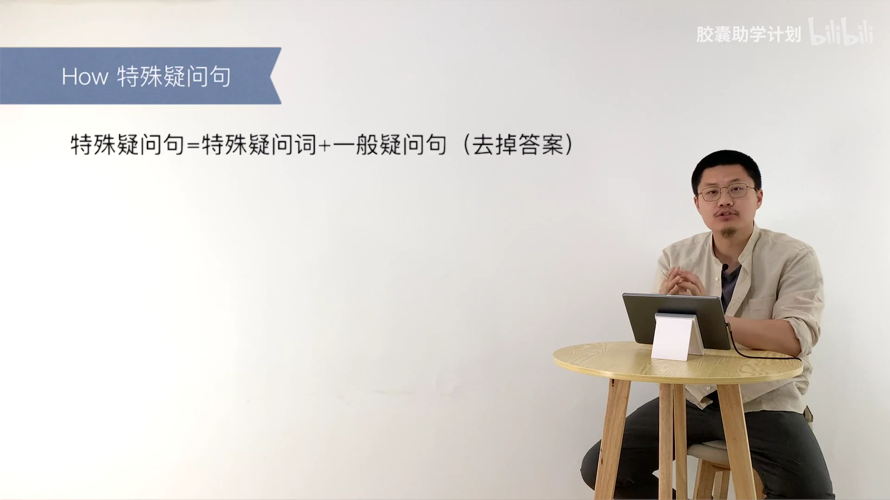

文字识别：胶囊助学计划 / How 特殊疑问句 / 特殊疑问句=特殊疑问词+一般疑问句(去掉答案)

### 画面 00:02:18

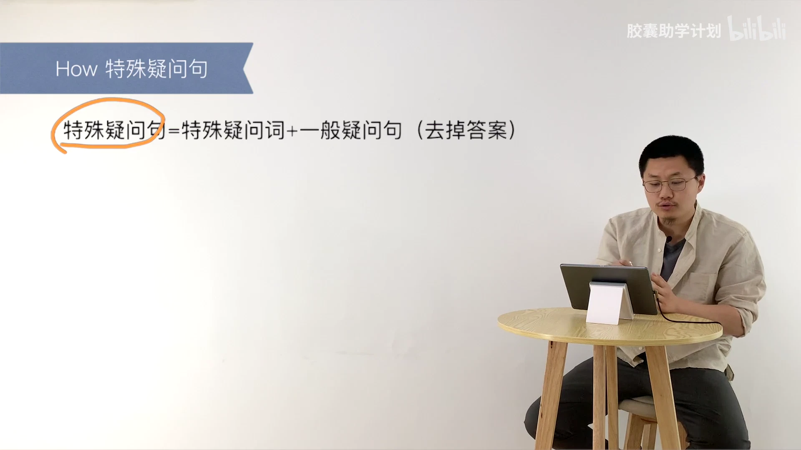

文字识别：胶囊助学计划 / How 特殊疑问句 / 特殊疑问匀=特殊疑问词+一般疑问句 (去掉答案)

### 画面 00:02:24

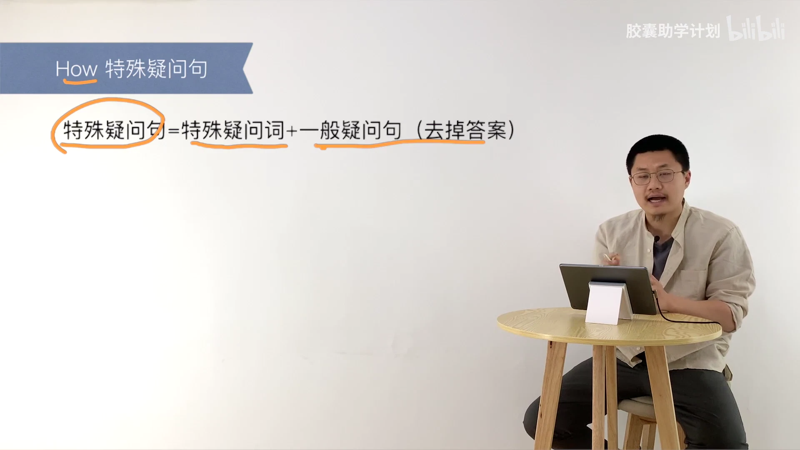

文字识别：胶囊助学计划 / How / 特殊疑问句 / 特殊疑问分=特殊疑问词+一般疑问句（去掉答案)

### 画面 00:02:28

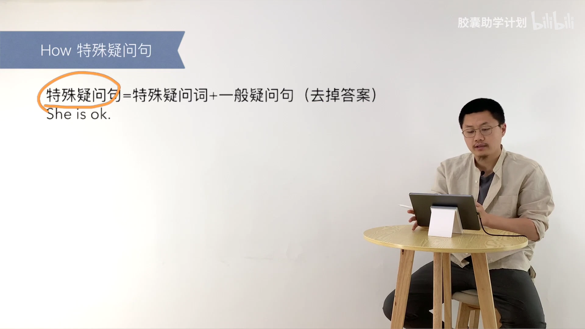

文字识别：胶囊助学计划 / How 特殊疑问句 / 特殊疑问匀=特殊疑问词+一般疑问句(去掉答案) / She is ok.

## 00:02:30–00:03:00

OK的，没有问题的，他是好的OK的。那我们看到肯定句，你就要养成习惯变一般疑问句，把is提前叫Is she OK? Is she OK?好，我现在想对OK去提问，那How就问的其实是程度，就是好吗还是不好，好中差。注意是对程度进行提问，所以OK那就算还是好的一个状态。对他提问，把它去掉，替换成How，然后

### 画面 00:02:30

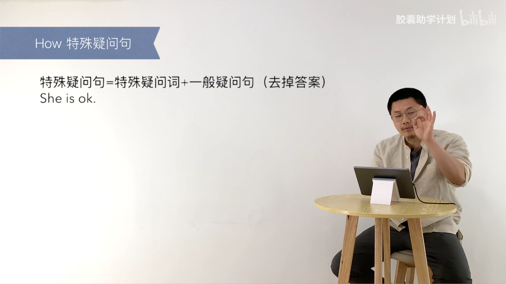

文字识别：胶囊助学计划 / bilbil / How 特殊疑问句 / 特殊疑问句=特殊疑问词+一般疑问句 (去掉答案) / She is ok.

### 画面 00:02:56

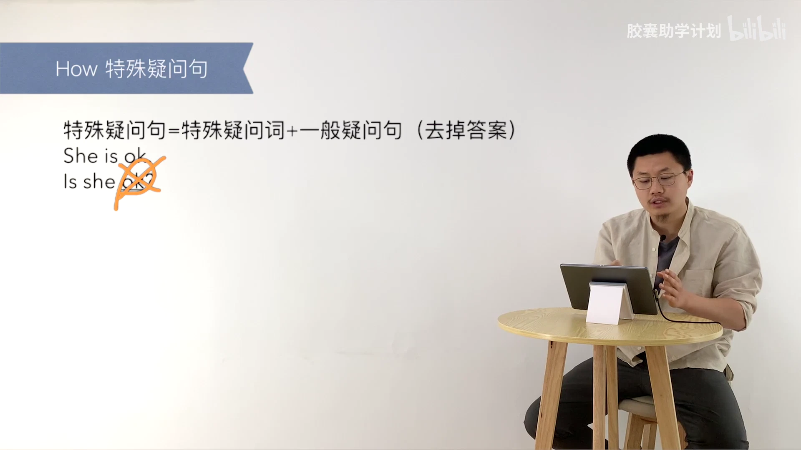

文字识别：胶囊助学计划 / How 特殊疑问句 / 特殊疑问句=特殊疑问词+一般疑问句(去掉答案) / She is / Is she

### 画面 00:02:59

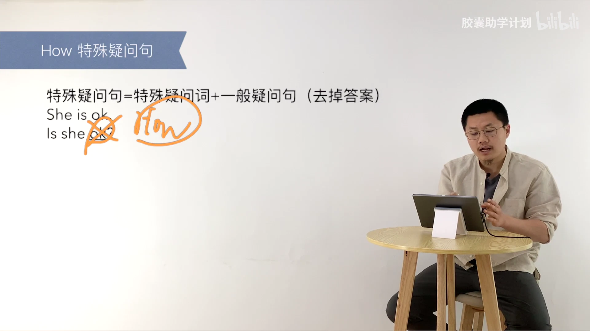

文字识别：胶囊助学计划 / How 特殊疑问句 / 特殊疑问句=特殊疑问词+一般疑问句 (去掉答案) / ifon / She is / Is she

## 00:03:00–00:03:30

要提到句首去，所以这句话就变成了叫 how is she， how is she，那答案就是 she's okay， ok，好，那这个还是蛮简单的。接下来我们继续看下一个单词，跟我一起读 fine， fine， ok，注意几个小的音标知识点。第一，跟我一起读双元音 i，复习一下。其次 f 这个字母放在单词当中去发的是，注意

### 画面 00:03:01

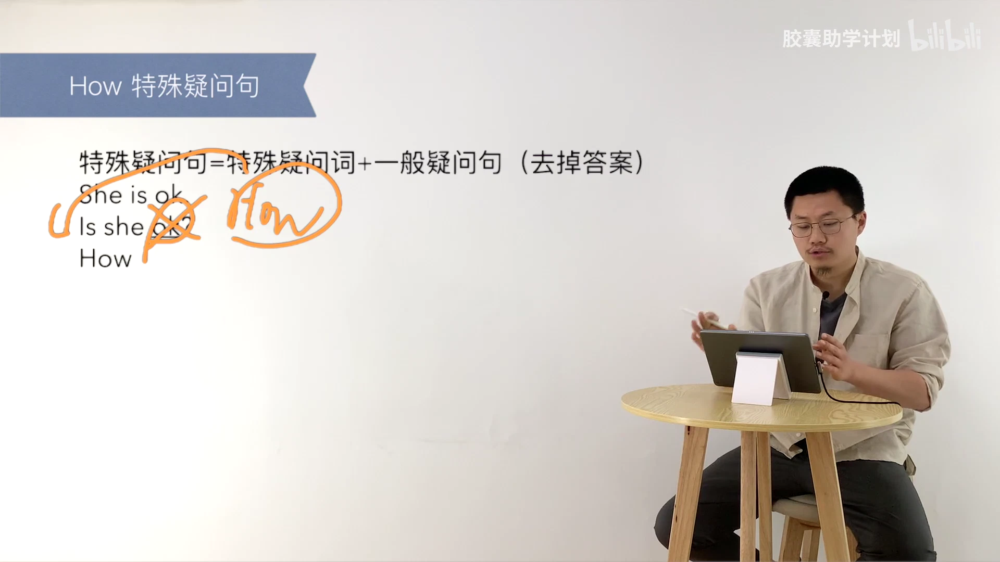

文字识别：胶囊助学计划 / BiDi / How 特殊疑问句 / 特殊疑问句=特殊疑问词+一般疑问句 / （去掉答案) / on / 8he is / Is she / How

### 画面 00:03:10

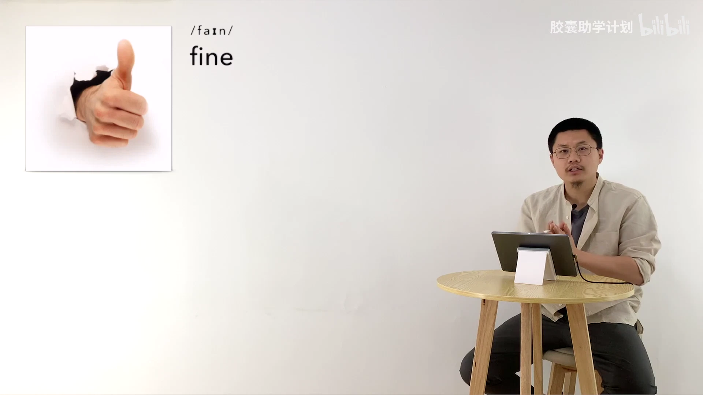

文字识别：胶囊助学计划 / /fain/ / fine

## 00:03:30–00:04:00

一定要咬住下唇。OK， fine。这个单词也很简单啊。本课的单词其实还都挺简单的。比如说，别人问你 How are you？你可以除了可以说刚才我教过大家各位的这个叫做 I'm OK，你也可以说 I'm fine， right？ OK， very good。那也可以回答，比如说 Great， 很好。哎，我刚才说了 How 问的是程度，那程度就可以

### 画面 00:03:40

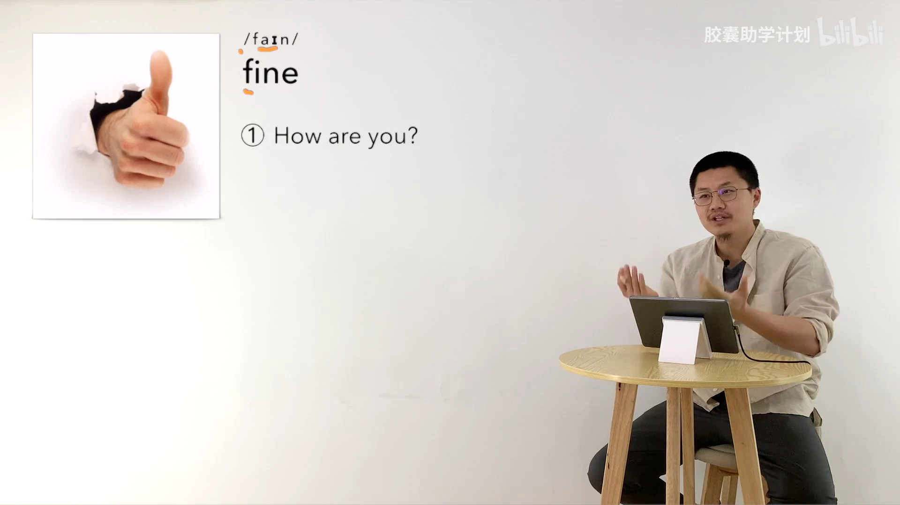

文字识别：胶囊助学计划 / /fain/ / fine / ① How are you?

## 00:04:00–00:04:30

最少有好、中、差，对吧？Great就非常好，Not bad就不差，但也不好，对吧？比如别人问你这菜好吃吗？你要好吃你会说很好吃，那不好吃你会说嗯不好吃。那其次你如果这样去说说嗯不难吃，对吧？那就是类似于Not bad，各位理解了哈。其次那非常差就是Terrible，OK，Very一个Terrible，How are you Terrible these days？OK，Let's continue。那我们在

### 画面 00:04:01

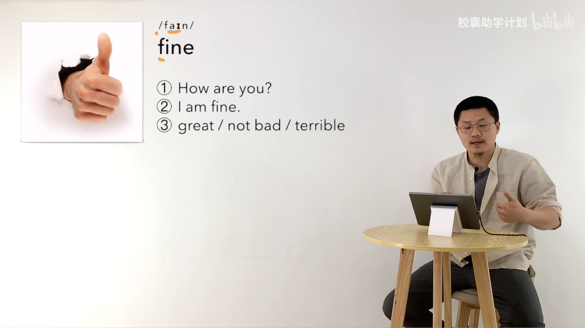

文字识别：胶囊助学计划 / /fain/ / fine / ① How are you? / ② | am fine. / great/ not bad / terrible / 3

### 画面 00:04:27

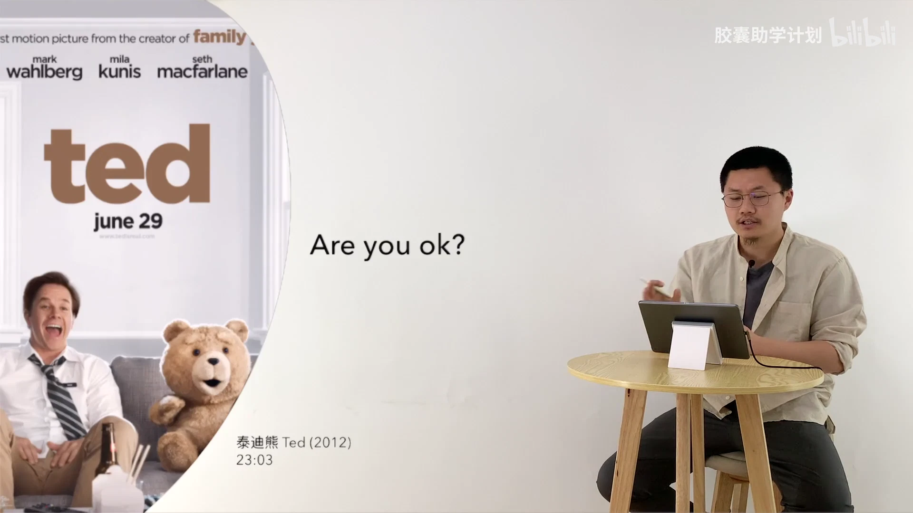

文字识别：st motion picture from the creator of family / 胶囊助学计划 / mark / mila / seth / wahlberg / kunis / macfarlane / ted / june 29 / Are you ok? / 泰迪熊Ted(2012) / 23:03

## 00:04:30–00:05:00

呃泰迪熊这个电影当中，我们一起看一下 Are you okay? 这样的一个表达，说你还好吗？然后他的回答 I'm fine, I'm fine. Okay, 一起来看一下. Oh my God, are you okay? Oh God, I'm so sorry. No, I'm fine, I'm fine. Jesus, I am so sorry. I didn't see it was an accident. Okay, 刚才这个语速它比

### 画面 00:04:42

文字识别：Bilibili / 胶囊助学计划

### 画面 00:04:44

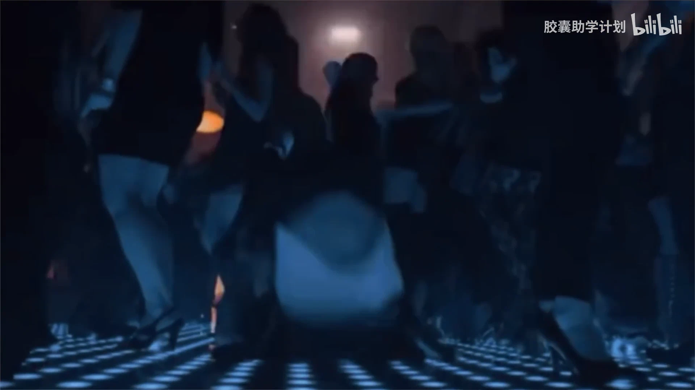

文字识别：Bilbili / 胶囊助学计划

### 画面 00:04:46

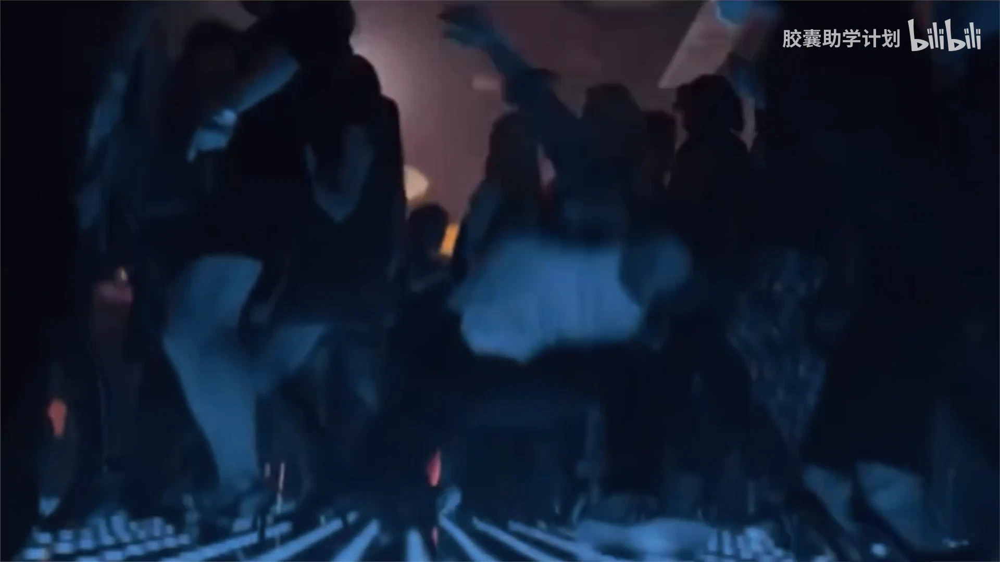

文字识别：bilibili / 胶囊助学计划

### 画面 00:04:48

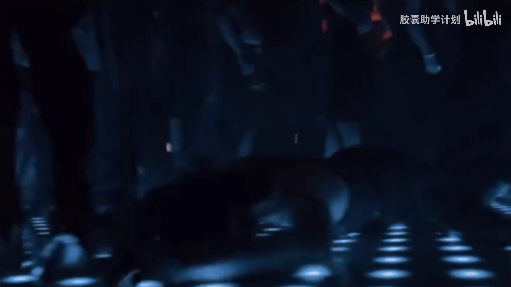

文字识别：Bilibili / 胶囊助学计划

### 画面 00:04:50

文字识别：Bilibili / 胶囊助学计划

### 画面 00:04:52

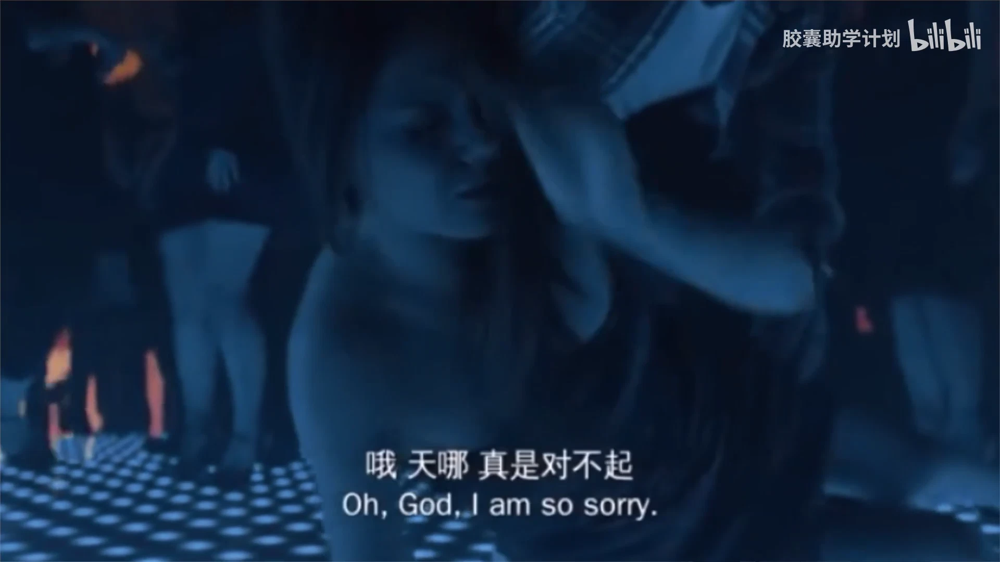

文字识别：Bilibili / 胶囊助学计划 / 哦天哪真是对不起 / Oh, God, I am so sorry.

### 画面 00:04:54

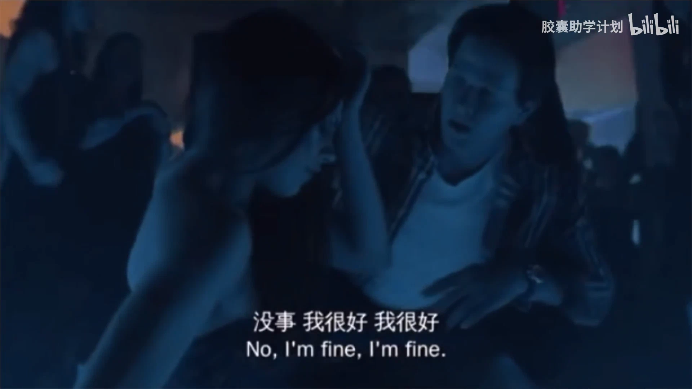

文字识别：Bilibili / 胶囊助学计划 / 没事 我很好 我很好 / No, I'm fine, I'm fine.

### 画面 00:04:56

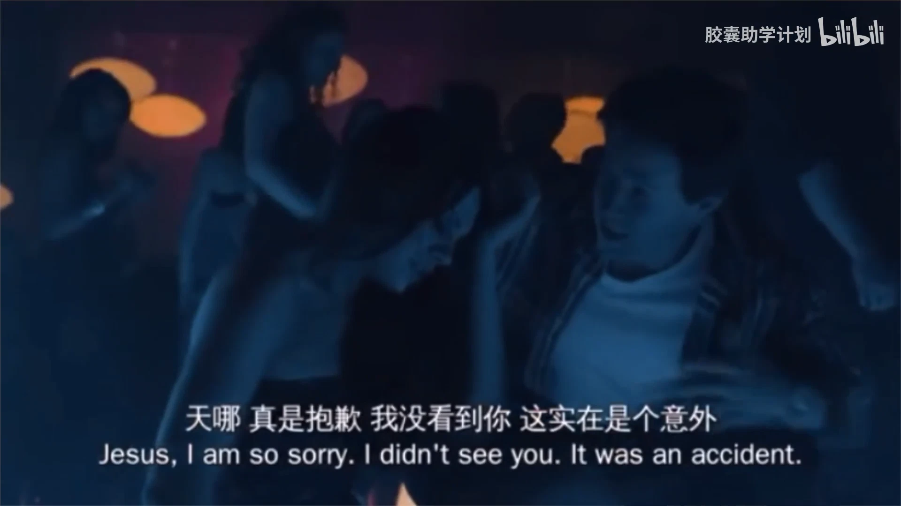

文字识别：bilibli / 胶囊助学计划 / 天哪真是抱歉我没看到你这实在是个意外 / Jesus, I am so sorry. I didn't see you. It was an accident.

### 画面 00:04:58

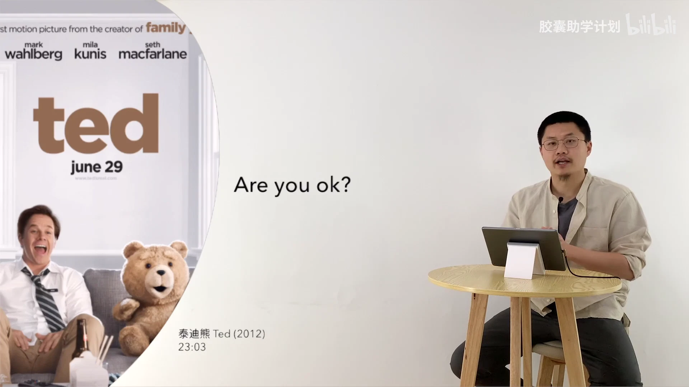

文字识别：st motion picture from the creator of family / 胶囊助学计划 / mark / mila / seth / wahlberg / kunis / macfarlane / ted / june 29 / Are you ok? / 泰迪熊Ted(2012) / 23:03

## 00:05:00–00:05:30

较的快。他说 Are you okay? Ah, it was an accident. No, I'm fine. I'm fine. I'm so sorry. 像这些我们之前都讲过了，对吧？各位可以做一个听力的小的训练。好，Are you okay? 你还好吗？ Okay, one. 接下来我们看下一个单词也比较的简单。我们先看音标，复习一下 a, a. 其次复习一下自然拼读法则。我们基本上只复习辅音字母的 t 放在单词当中去发的是

### 画面 00:05:14

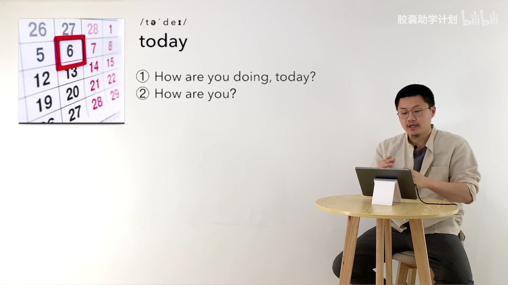

文字识别：胶囊助学计划 / /ta'dei/ / 26 / 27 / 281 / today / 5 / 15 / 14 / 13 / ① How are you doing, today? / 12 / 22 / 21 / 20 / How are you? / 19 / 28 / 27

## 00:05:30–00:06:00

t，d，放在单词当中去发的是 d，跟我一起读一下 today。好，这个单词还是很简单的。那我们在这儿放了两句话，这是跟 today 比较常用的两句话。第一个叫 How are you today？你今天怎么样？第二个叫 How are you doing today？好，你今天怎么样？这两句话听起来是很一样的，有一大部分情况下，各位几乎可以去混着用，问题不大哈。但是他们有一点点小的区别，这个各位知道就是知其然知其所以然，满

### 画面 00:05:38

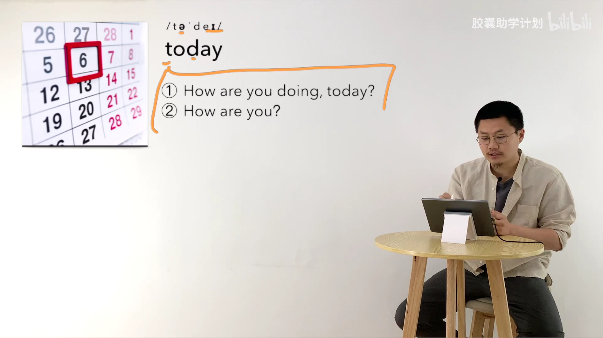

文字识别：胶囊助学计划 / /ta'dell / 26 / 27 / 281 / today / 8 / 5 / 7 / 152229 / 14 / 12 / 13 / ① / How are you doing, today? / 21 / 20 / How are you? / 2 / 19 / 28 / 27

### 画面 00:05:40

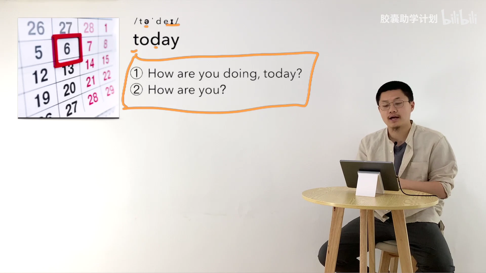

文字识别：胶囊助学计划 / /ta'dell / 26 / 27 / 28 / 1 / today / 5 / 15229 / 14 / 13 / 12 / 1 / How / 'are you doing, today? / 21 / 20 / How are you? / 19 / 28 / 27

## 00:06:00–00:06:30

足一下好奇心罢了。How are you？更多偏向于问的是你最近身体怎么样啊，身体有没有头痛脑头疼脑热呀？而How are you doing？更偏向于的是generally，就是普遍上来说，你整体上的生活最近怎么样？所以你可以理解为How are you doing？可能询问的范围更广一点点，而How are you相对来说会窄一点点。不过呢，因为生活啊不是一个非常理性的一个过程，那大多数情况下，

### 画面 00:06:10

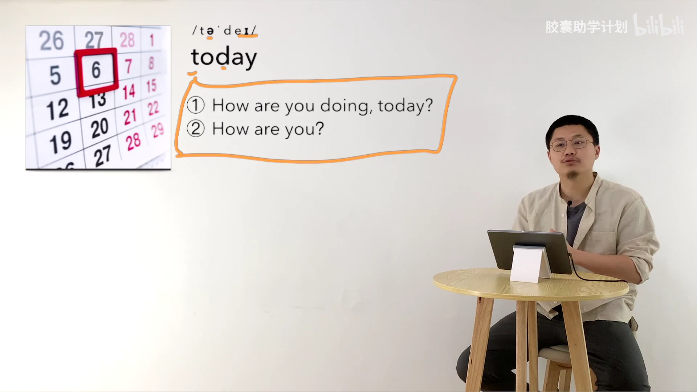

文字识别：/ta'dell / 胶囊助学计划 / 26 / 27 / 28 / 1 / today / B / 5 / 152222 / 14 / 12 / 13 / ① / How are you doing, today? / 21 / 20 / How are you? / 2 / 19 / 28 / 27

## 00:06:30–00:07:00

语言我们习惯上怎么说就怎么说就 OK 了。所以 How are you？很多的时候跟 How are you doing？混着用一点问题没有。所以跟我一起读一下 How are you doing today？ How are you today？ Very good. Continue. 下一个单词 Well。注意，先看一下音标 a。其次，W 放在单词当中去发 w。L 放在单词当中去，舌尖舔上牙龈。这个音发不发不重要，舌尖舔上牙龈这个动作

### 画面 00:06:40

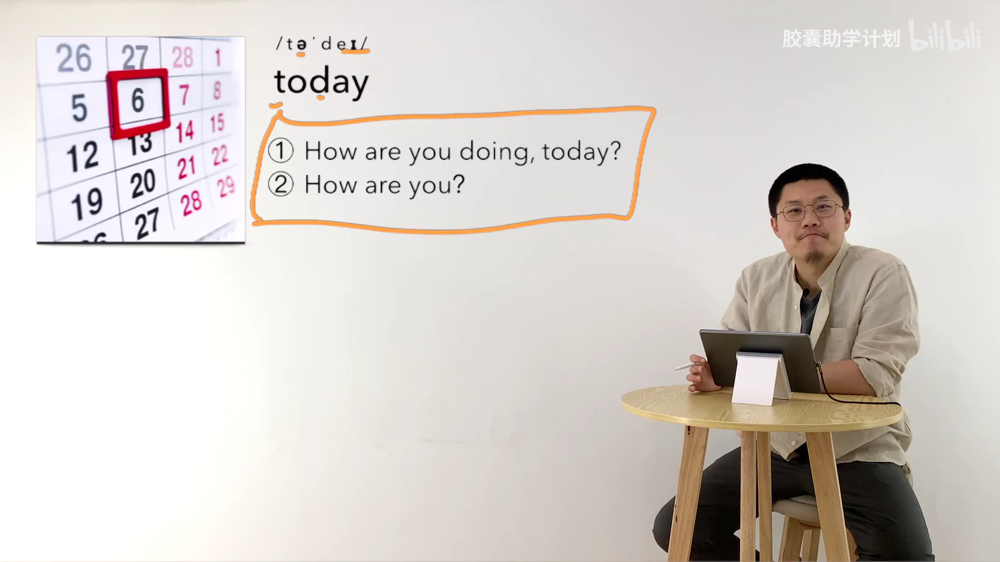

文字识别：/ta'dell / 胶囊助学计划 / 26 / 27 / 281 / today / 5 / 15222 / 14 / 12 / 13 / How are you doing, today? / 21 / 20 / 2 / How are you? / 19 / 28 / 27

### 画面 00:06:43

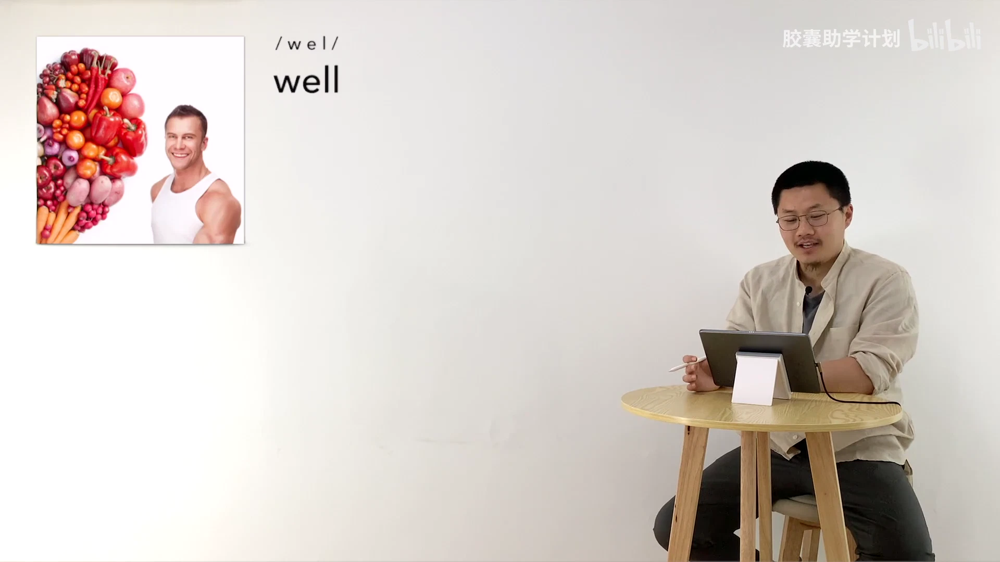

文字识别：胶囊助学计划 / /wel/ / well

### 画面 00:06:55

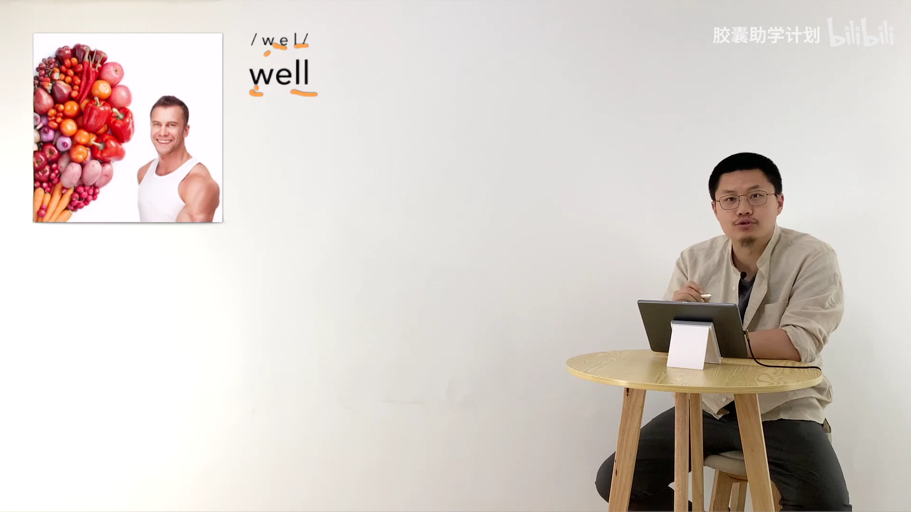

文字识别：Bilbii / 胶囊助学计划 / /weL / well

## 00:07:00–00:07:30

很重要。跟我一起读一下，well，哎，各位可以拉近了看一下我的这个嘴型啊，尤其是舌尖，well，OK，very good。那它指的是身体很好，比如说别人问你How are you？刚才我们提了How are you？更多指的是身体不错，身体怎么样？那你可以回答，very well，OK，very good。很简单，下一个单词跟我一起读，thanks。本课的单词还真的都很简单啊，所以我们过的

### 画面 00:07:10

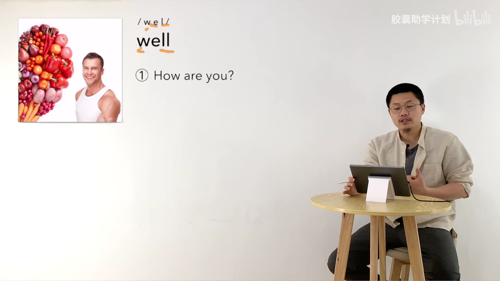

文字识别：胶囊助学计划 / /weL / well / ① How are you?

### 画面 00:07:23

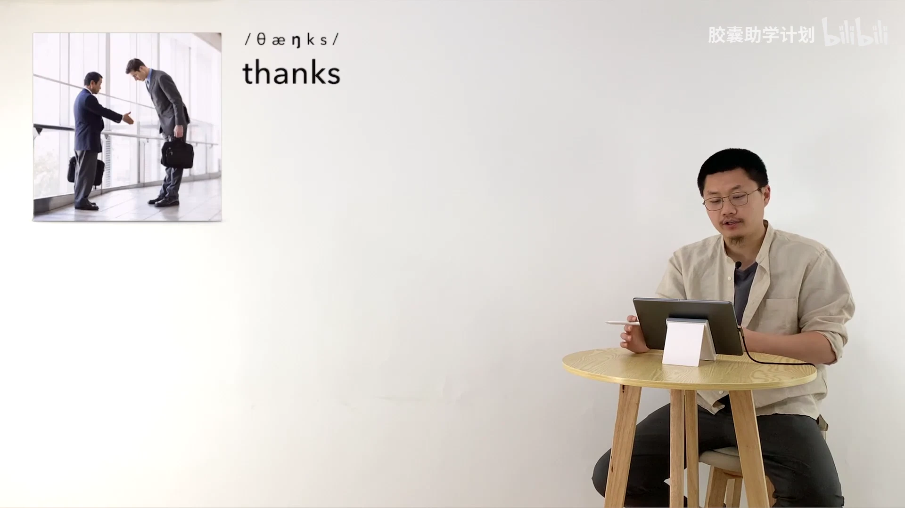

文字识别：胶囊助学计划 / /θænks/ / thanks

## 00:07:30–00:08:00

稍微会快一点点。th字母组合放在单词当中去发的这个音，咬舌，跟我一起读。好，其次k这个字母放在单词当中去，k s这个字母放在单词当中去，s跟我一起读，thanks，咬舌啊，thanks，OK，它基本等同于的就是thank you，很简单的一种表达。接下来看下一个单词，

### 画面 00:07:53

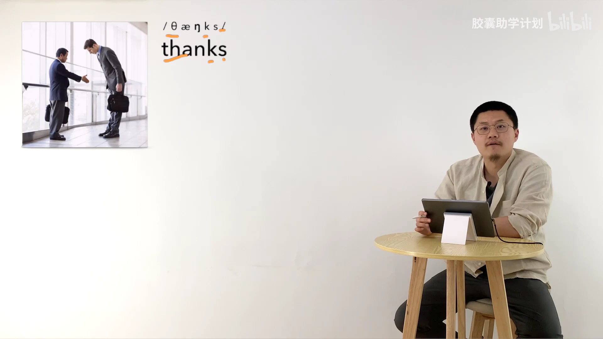

文字识别：胶囊助学计划 / /θænksl / thanks

### 画面 00:07:55

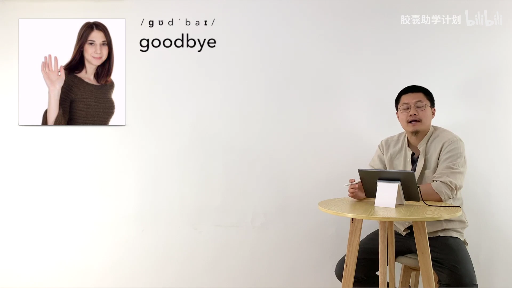

文字识别：胶囊助学计划 / /gud'bai/ / goodbye

## 00:08:00–00:08:30

先看音标，u，i，b放在单词当中去发b，d放在单词当中去发d，g放在单词当中去发g，和我当年讲的是一样的，基本是一一对应，连起来good，你我知道你，我相信你知道什么意思，bye，连起来goodbye，所以你说goodbye没问题，bye没问题啊，也可以说see you later或者see you啊，都是ok的，表达的就

### 画面 00:08:25

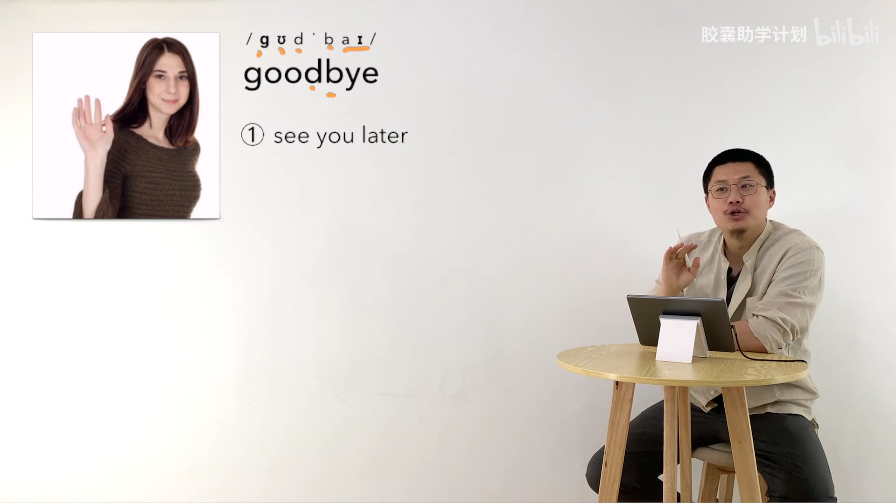

文字识别：胶囊助学计划 / /gud'bai/ / goodbye / ① see you later

## 00:08:30–00:09:00

是回见、拜拜的意思啊。See you, see you later.那see you later是稍后见，所以这个人你如果只是跟他拜拜，你就说bye就OK了啊，还是很常用的。好，接下来我们直接进入文章。本课的单词很简单，文章也不难，我们来一起迅速的过一遍。男士、女士、女士、男士啊，在马路上见面了，然后他们开始打招呼说Hello, Helen. Helen是一个女士的名字，而Steven是个男士的名字。哎，你好啊，Helen

### 画面 00:08:40

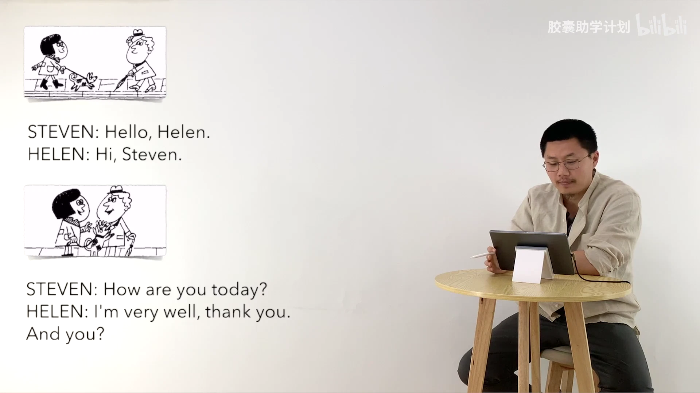

文字识别：胶囊助学计划 / STEVEN: Hello, Helen. / HELEN: Hi, Steven. / STEVEN: How are you today? / HELEN: I'm very well, thank you. / And you?

### 画面 00:08:49

文字识别：胶囊助学计划 / STEVEN: Hello, Helen. / HELEN: Hi, Steven. / STEVEN: How are you today? / HELEN: I'm very well, thank you. / And you?

### 画面 00:08:55

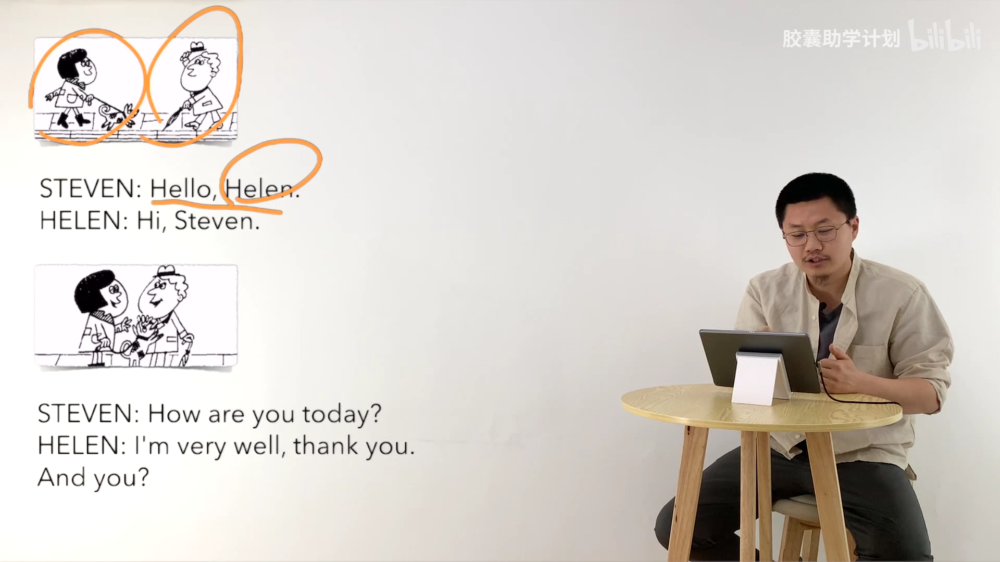

文字识别：胶囊助学计划 / STEVEN: Hello,Helen / HELEN: Hi, Steven. / STEVEN: How are you today? / HELEN: I'm very well, thank you. / And you?

### 画面 00:08:58

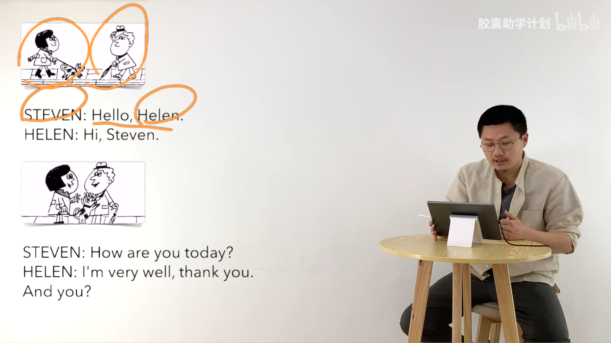

文字识别：胶囊助学计划 / STEVEN: Hello,Helen / HELEN: Hi, Steven. / STEVEN: How are you today? / HELEN: I'm very well, thank you. / And you?

## 00:09:00–00:09:30

啊，Hi Steven，你好啊，How are you today? How are you? How are you doing? How are you today? OK，你怎么样呢？I'm very well. 我身体还不错。Thank you，谢谢你问。那注意，I'm very well，它是 I am 的缩写啊。And you，你呢？还注意，And you 其实在这儿就等同于

### 画面 00:09:00

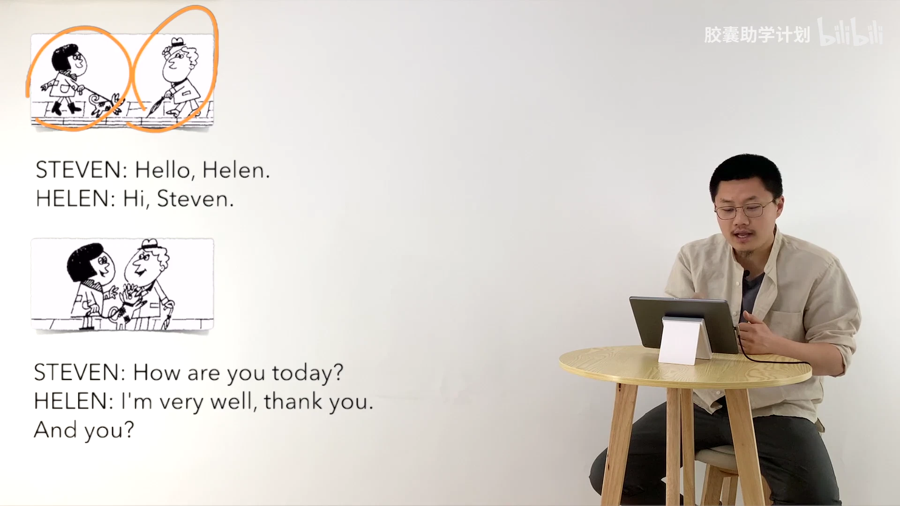

文字识别：胶囊助学计划 / STEVEN: Hello, Helen. / HELEN: Hi, Steven. / STEVEN: How are you today? / HELEN: I'm very well, thank you. / And you?

### 画面 00:09:04

文字识别：胶囊助学计划 / STEVEN: Hello, Helen. / HELEN: Hi, Steven. / STEVEN: How are you today? / HELEN: I'm very well, thank you. / And you?

### 画面 00:09:12

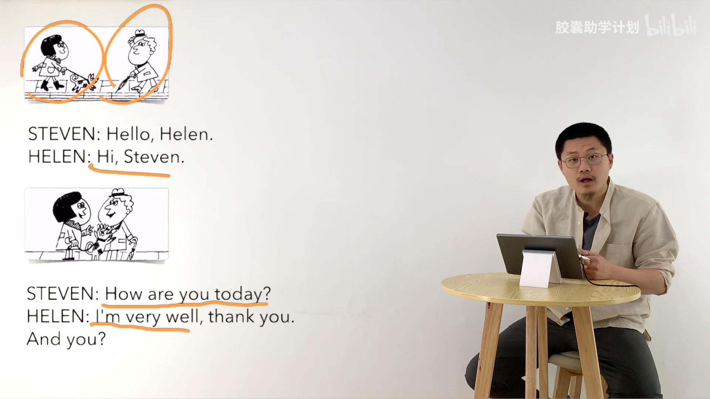

文字识别：胶囊助学计划 / STEVEN: Hello, Helen. / HELEN: Hi, Steven. / STEVEN: How are you today? / HELEN: 'm very well, thank you. / And you?

### 画面 00:09:19

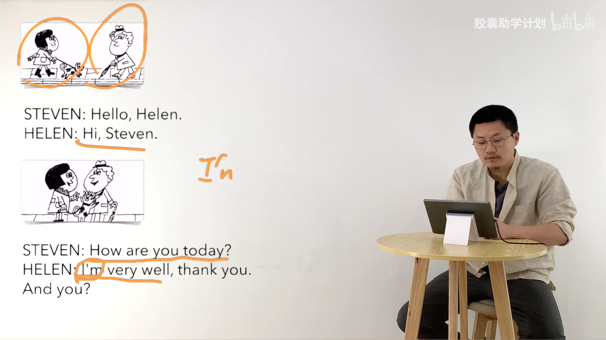

文字识别：胶囊助学计划 / STEVEN: Hello, Helen. / HELEN: Hi, Steven. / T'n / STEVEN: How are you today? / HELENIm very well, thank you. / And you?

### 画面 00:09:21

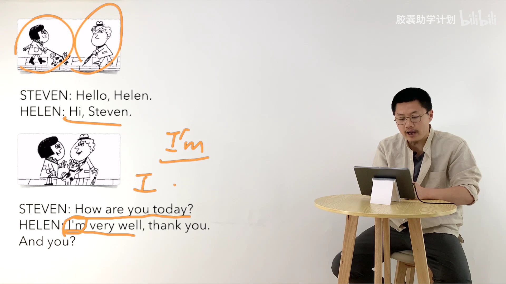

文字识别：胶囊助学计划 / STEVEN: Hello, Helen. / HELEN: Hi, Steven. / T'm / 工 / STEVEN: How are you today? / HELENIm very well, thank you. / And you?

### 画面 00:09:24

文字识别：胶囊助学计划 / STEVEN: Hello, Helen. / HELEN: Hi, Steven. / T'm$ / 工 / am / STEVEN: How are you today? / HELENCm / very well, thank you. / And you?

### 画面 00:09:27

文字识别：胶囊助学计划 / STEVEN: Hello, Helen. / HELEN: Hi, Steven. / I'm$ / 工 / am / STEVEN: How are you today? / HELEN / mvery well, thank you. / And you.

### 画面 00:09:29

文字识别：胶囊助学计划 / STEVEN: Hello, Helen. / HELEN: Hi, Steven. / I'm / 工 / am / STEVEN: How are you today? / HELEN1 / mvery well, thank you. / And you.

## 00:09:30–00:10:00

How are you today? 我问你 How are you today? 你说 I'm very well, thank you. 你回问我，你可以说 How are you today? 那你今天怎么样？你也可以说 And you? 那你呢？ Okay. 所以把这个小点记下来. Let's continue. I'm fine, thanks. 我还还好了，谢谢啊. I'm okay, 也可以啊. I'm fine. I'm I'm well. I'm very well. Okay. 那 How is Tony? 那 Tony 怎么样呢？ He's fine.

### 画面 00:09:45

文字识别：胶囊助学计划 / STEVEN: I'm fine, thanks. / STEVEN: How is Tony? / HELEN: He's fine, thanks. How's Emma? / STEVEN: She's very well, too, Helen.

### 画面 00:09:52

文字识别：胶囊助学计划 / STEVEN: I'm fine, thanks. / STEVEN: How is Tony? / HELEN: He's fine, thanks. How's Emma? / STEVEN: She's very well, too, Helen.

## 00:10:00–00:10:30

他还好了。那注意看到了一个his, PS是is的缩写。我们把它变一般疑问句，is提前，叫is he fine？对吧？对fine提问用how，把how提到前面去，How is he? He就是Tony，所以How is Tony？就是这样变过来的。肯定句变一般疑问句，变特殊疑问句。从今天开始一直到接下来新二结束，你会不停的遇到这个逻辑。好，

### 画面 00:10:08

文字识别：胶囊助学计划 / STEVEN: I'm fine, thanks. / 工a / STEVEN: How is Tony? / HELEN: He's fine, thanks. How's Emma? / STEVEN: She's very well, too, Helen.

### 画面 00:10:11

文字识别：胶囊助学计划 / STEVEN: I'm fine, thanks. / hke / ime / Ia / STEVEN: How is Tony? / HELEN: He's fine, thanks. How's Emma? / STEVEN: She's very well, too, Helen.

### 画面 00:10:14

文字识别：胶囊助学计划 / Ha / STEVEN: I'm fine, thanks. / he / Is / me / STEVEN: How is Tony? / HELEN: He's fine, thanks. How's Emma? / STEVEN: She's very well, too, Helen.

### 画面 00:10:16

文字识别：胶囊助学计划 / STEVEN: I'm fine, Chanks. / he / Is / me / STEVEN: How is Tony? / HELEN: He's fine, thanks. How's Emma? / STEVEN: / She's very well, too, Helen.

### 画面 00:10:18

文字识别：胶囊助学计划 / STEVEN:I'm  / fine,thanks. / he / Is / we / STEVEN: How is Tony? / HELEN: He's fine, thanks. How's Emma? / STEVEN: / She's very well, too, Helen.

### 画面 00:10:25

文字识别：胶囊助学计划 / STEVEN:I'm f / fine,Chanks. / he / Is / ime / STEVEN: How is Tony? / HELEN: He's fine, thanks. How's Emma? / STEVEN: / She's very well, too, Helen.

## 00:10:30–00:11:00

接着往下走。Thanks,谢谢。How's Emma?一个思路，对吧？She's very well too, Helen.她也非常的好。Me too,我也是。那She's very well变一般疑问句。Is she very well?当然这句话在英文当中出现的频率还是很低。但是你现在脑补一下，Is she very well?对，very well提问，How去替代它，提到句首。How is she?

### 画面 00:10:33

文字识别：胶囊助学计划 / STEVEN: I'm / fine,Chanks. / he / Is / we / STEVEN: / How / is / Tony? / HELEN: / He's / fine, / thanks. / How's / Emma? / STEVEN: / She' / 's very / 'well, / too, Helen.

### 画面 00:10:37

文字识别：胶囊助学计划 / Bilibil / STEVEN: I'm / fine,Chanks. / he / Is / ime / STEVEN: / How / is / Tony? / HELEN: / He's / s fine,t / thanks. / .How's / Emma? / STEVEN: / She's very well, / too, Helen.

### 画面 00:10:40

文字识别：胶囊助学计划 / STEVEN: I'm / fine,Chanks. / he / Is / ime / STEVEN: / : How / is / Tony? / HELEN: / He's / fine, / thanks.How's / Emma? / STEVEN: / She's very weltod, / , Helen.

### 画面 00:10:45

文字识别：胶囊助学计划 / 出 / STEVEN:I'm / fine,chanks. / he / Is / we / STEVEN: / How / is / Tony? / HELEN: / He's / fine,t / thanks. How's Emma? / STEVEN: / She's very well tog, / , Helen.

## 00:11:00–00:11:30

there you go. Let's continue. Goodbye, Helen. You can say bye, you can say see you, you can say see you later. Okay, nice to see you.好了，注意，nice to meet you.各位之前学过了，初次见面，请多关照。第一次见面的时候说，那 nice to see you. 它的字面意思叫做看见你，我很开心，看见你很高兴。注意，这两个人是认识的哈，他不是初次见面，

### 画面 00:11:01

文字识别：胶囊助学计划 / STEVEN: Goodbye, Helen. / Nice to see you. / HELEN: Nice to see you, too, / Steven. Goodbye.

### 画面 00:11:09

文字识别：胶囊助学计划 / STEVEN: Goodbye, Helen. / Nice to see yow / HELEN: Nice to see you, too, / Steven. Goodbye.

### 画面 00:11:11

文字识别：胶囊助学计划 / STEVEN: Goodbye, Helen. / Nice to see you / HELEN: Nice to see you, too, / Steven. Goodbye.

### 画面 00:11:28

文字识别：胶囊助学计划 / 出 / STEVEN: Goodbye, Helen. / Nice to see you / HELEN: Nice to see you, too, / Steven. Goodbye.

## 00:11:30–00:12:00

所以 nice to see you 其实就是看见你很开心的意思啊，它并不用在初次见面两个人用于寒暄的时候，不是这个时候唱的啊，所以 nice to see you too，哎，很高兴也见到你，Steve Steven， goodbye，拜拜了。接下来我们一起看一下 The Godfather，非常棒的一部电影，当中他是如何用 nice to see you。注意还叫来一个 again，所以它就不是 nice to meet you 的意思了，叫看见你我很高兴的意

### 画面 00:11:43

文字识别：胶囊助学计划 / STEVEN: Goodbye, Helen. / Nice to see you / HELEN: Nice to see you, too, / Steven. Goodbye.

### 画面 00:11:45

文字识别：胶囊助学计划 / STEVEN: Goodbye, Helen. / Nice to see you / HELEN: Nice to see you, too, / Steven. Goodbye.

### 画面 00:11:47

文字识别：Bilbil / 胶囊助学计划 / Nice to see you again! / The / Godlather / AALBEIS / ALPAONOJAMESCAAN·RGIABOCASTE / 教父 The Godfather(1972) / JONMARLEYBCA / 2:21:53 / TGOAIMSANO

### 画面 00:11:55

文字识别：胶囊助学计划 / Bilibi / Nice to see youagain! / The / Godfather / AWALBEBIS. BUIOOY / AL FACNOJAIES CAAN-RCHARO OASTFILAN / 教父 The Godfather(1972) / Direcd Iy FRAS FOROCOPPOLASEeply bWN / 2:21:53 / AROP TGFAIREMC SNN

## 00:12:00–00:12:30

思。好，我们进入。 Johnny, how are you? Hello, Mike. Nice to see you again. We're all proud of you. Thanks, Mike. Okay, nice to see you again, Mike. Okay, 看见你非常的开心. Nice to see you. There you go. 那接下来我们做一些口语和听力练习。第一个 comprehension 是什么？怎么做啊？我们在开篇和之前的视频当中讲过无数次了。那今天我们就不多说了，直接来进行这个练习。闭上眼睛，或者说打

### 画面 00:12:01

文字识别：胶囊助学计划 / BiDl / Nice to see you again! / The / Godlather / AL FACNOJAIESCAANRCHABD OASTELLAND / 教父 The Godfather(1972) / BAOENJNIMARLEY·AICHARO / 2:21:53 / TGFAIEMCS

### 画面 00:12:03

文字识别：胶囊助学计划出 / 强尼你好吗？ / -Johnny, how are you?

### 画面 00:12:05

文字识别：bilibili / 胶囊助学计划 / 麦克 再看到你真高兴 / Hello. Nice to see you again.

### 画面 00:12:07

文字识别：bilibili / 胶囊助学计划 / 我们全都以你为傲 / We're all proud of you.

### 画面 00:12:09

文字识别：胶囊助学计划 / Nice to see you again! / The / Godlather / ANALBEIISR / ALPACNOJANIESCAANRICRABD OASTFLLA / 教父 The Godfather(1972) / STERUIGWADENJOBIARLET·RCHAR / Dieced Io FRADS FORD CPOLASreepiay WN / 2:21:53 / APTGFEMSdyNNR

### 画面 00:12:15

文字识别：bilbil / 胶囊助学计划 / Comprehension

## 00:12:30–00:13:00

开书本，不要看屏幕了。跟我一起做这个口语练习。What's her name? 这里只出现了两个主人公，一男一女。那我问的是 What's her name? 那答案就是 Helen. Continue. What's his name? 答案就是 Steven. His 男的，对吧？男他他的。How is Helen today? 回答我，She's very

### 画面 00:12:45

文字识别：胶囊助学计划 / Comprehension / 2 T: What's his name?

## 00:13:00–00:13:30

well. Okay, continue. How is Steven today? He's fine. Is Tony well too? Yes, he is. 如果跟不上，您可以暂停视频啊。How is Emma? She's fine too. 好，下一个练习，Ask me if. 这个练习我再说一遍，

### 画面 00:13:15

文字识别：胶囊助学计划 / Comprehension / 5 T: Is Tony well, too? / S: Yes, he is.

### 画面 00:13:27

文字识别：胶囊助学计划 / Asking questions / 1 T: Ask me if Helen is well today.

## 00:13:30–00:14:00

you need to do is you don't care. I ask me if you need to do is to understand the sentence behind and turn it into a general sentence. This is a listening exercise. I come. Ask me if Helen is well today. Helen is well today. Answer is Helen well today? How? Hey, come out a small part. How is to ask about what? Is to ask about well? Right?

### 画面 00:13:34

文字识别：胶囊助学计划 / Asking questions / 1 T: Ask me ifHelen is well today. / S

### 画面 00:13:36

文字识别：胶囊助学计划 / Asking / questions / 1 T: Ask me if Helen is well today.

### 画面 00:13:51

文字识别：胶囊助学计划 / Asking / questions / 1 T: Ask me ifHelen is well today. / S: Is Helen well today?

## 00:14:00–00:14:30

提问？是对well提问，对吧？所以对他提问，把它去掉，how提到句首去，就变成了How is Helen today？今天Helen怎么样啊？Okay, let's continue. Ask me if Stephen is well today.我希望你的眼睛这时候不在我的屏幕上啊，要么闭上眼睛，要么看别的地方。靠听力和口语去做这个练习。Stephen is well today.

### 画面 00:14:04

文字识别：胶囊助学计划 / Asking / questions / 1 T: Ask me if Helen is well today. / S: IsHelen / wll today? / T: How..?

### 画面 00:14:07

文字识别：胶囊助学计划 / Asking / questions / Ask me ifHelen is well today. / Is Helen / will today? / T： / How...? / How is Helen today? / S:

### 画面 00:14:10

文字识别：胶囊助学计划 / Asking / questions / Ask me ifHelen is well today. / Is Helen / Vll today? / T: / How...? / S: / How is / Helen today?

### 画面 00:14:13

文字识别：胶囊助学计划 / Asking questions

## 00:14:30–00:15:00

把它变一般疑问句来. Is Steven well today? How? How is Steven today? Very good. Next one. Ask me if Emma is well today. 答案 is Emma well today? How? 提问. How is Emma today? Okay. 好。那我们看一下我们在课程最开始提的

### 画面 00:14:37

文字识别：胶囊助学计划 / Asking questions / 2 T: Ask me if Steven is well today. / S: Is Steven well today? / T: How...? / S: How is Steven today?

### 画面 00:14:42

文字识别：胶囊助学计划 / bilLi / Asking questions / 3 T: Ask me if Emma is well today.

### 画面 00:14:55

文字识别：胶囊助学计划 / ① How 引导的特殊疑问句? / 如何表达“你还好吗” / Nice to see/ meet you?

## 00:15:00–00:15:30

三个问题。第一，how引导的特殊疑问句跟我们之前学过的what，where，what nationality没有巨大的差别，均是叫特殊疑问句等于特殊疑问词加一般疑问句，去掉答案了。第二，如何表达你还好吗？Are you okay?啊，比如说你撞了别人一下，你过去询问一下，Are you okay? I'm so sorry. Are you okay?其次，Nice to see you. Nice to meet you. Nice to meet you.第一次见到别人用Nice to see you，老朋友随便用

### 画面 00:15:25

文字识别：胶囊助学计划 / ①How 引导的特殊疑问句？ / 如何表达“你还好吗’ / Nice to see / meet you?

## 00:15:30–00:16:00

OK。那Very good。那我们去看一下Recap，复习一下今天学到的东西。首先How引导的特殊疑问句，How are you？Very good。其次关键的几个单词如何去回答How are you？Fine，Great，Not bad，And terrible。Continue expression。How are you doing？How are you doing？Generally，更普遍的上去讲，哎，您最近生活怎么样？其次Nice to see you，看见你很开心。

### 画面 00:15:31

文字识别：胶囊助学计划 / Recap / Patterns / How / 引导的特殊疑问句 / How / are you? / Grammar / Words / fine / great/ not bad / terrible / How / are you doing? / Expression / Nicet / to see you!

## 00:16:00–00:16:30

那我们看一下今天的家庭作业：一、绿皮书第九课写作练习。绿皮书不知道是什么的，去看开篇啊。其次，文章跟读制，熟读成诵。不知道如何跟读的，开篇。其次，请给自己讲一下今天的核心知识点。参考的是 Study Test 和 Learning Pyramid 这两个非常核心的理论基础。OK，那本期的视频呢就结束了。如果大家喜欢我们的课程，欢迎大家关注我们，并一键三连支持。当然，如果您身边有

### 画面 00:16:00

文字识别：胶囊助学计划 / $

### 画面 00:16:13

文字识别：胶囊助学计划 / 绿皮书第9课的写作练习 / 2.文章跟读至熟读成诵 / 3.请给自己讲解一遍今天的 / 核心知识点（参考atudy-teet和 / learning pyramid)

### 画面 00:16:24

文字识别：胶囊助学计划

## 00:16:30–00:16:59

需要学英语或正在学英语的朋友呢，也请分享给他们。那最后的最后，我们一起来看一下Kung Fu Panda说过的一句话：Yesterday is history, tomorrow is a mystery, but today is a gift. See you.

### 画面 00:16:34

文字识别：胶囊助学计划 / Yesterday is history, / tomorrow is a mystery, / but today is a gift. / Kung Fu Panda

### 画面 00:16:46

文字识别：Yesterday is history, / tomorrow is a mystery, / but today is a gift. / Kung Fu Panda

### 画面 00:16:48

文字识别：CAPSULEACADEMY / 胶囊学院 / 小红书 / Lecturer / □ / 口 / Leo

### 画面 00:16:51

文字识别：CAPSULEACADEMY / 胶囊学院 / 小红书 / Photographer / Berlin

### 画面 00:16:53

文字识别：CAPSULEACADEMY / 胶囊学院 / 小红书 / Editor / Berlin / 🙌

### 画面 00:16:56

文字识别：CAPSULEACADEMY / 胶囊学院 / 小红书

### 画面 00:16:58

文字识别：bilibili / 胶囊助学计划

