# 012 单词 练习

快速机器解析：语音为单模型转写，未进行独立交叉校对或人工复核；画面每秒采样并按变化选帧，短时文字和标记可能遗漏。截图时间约有 1 秒误差。图片有损压缩；遇到疑点请按时间查看 Google Drive 原视频。

## 00:00:00–00:00:30

Hello everyone, welcome to Capsule Academy. This is Leo. Today we're going to learn New Concept English Book One, Lesson Twelve, Practices and Words. 那老习惯，我们进入正式课程之前，先提出一个问题：如何自己用单词去造句？那这句话什么意思呢？对应的就是很多老师是给了大家一个例句，让大家把这个例句背下来，这也是很多学员习惯的方式。那我们今天就要打破这种学习思路，我们换一个学习思路。那如何这么去做呢？带着这个问题， Hope you're gonna

### 画面 00:00:00

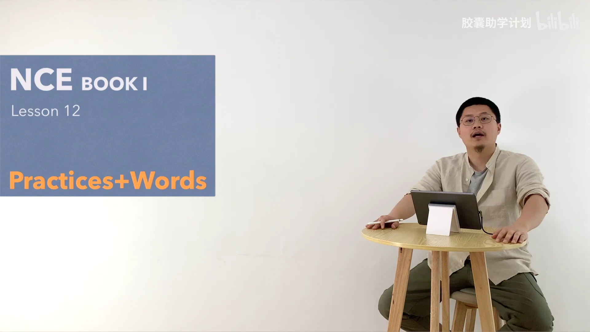

文字识别：胶囊助学计划 / NCE / BOOKI / Lesson 12 / Practices+Words

### 画面 00:00:08

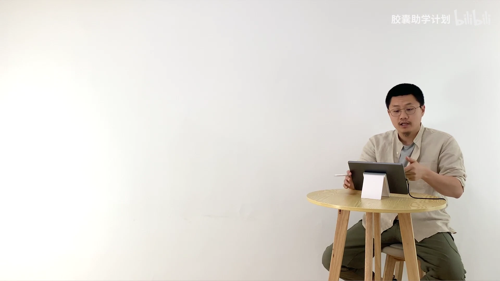

文字识别：胶囊助学计划

### 画面 00:00:11

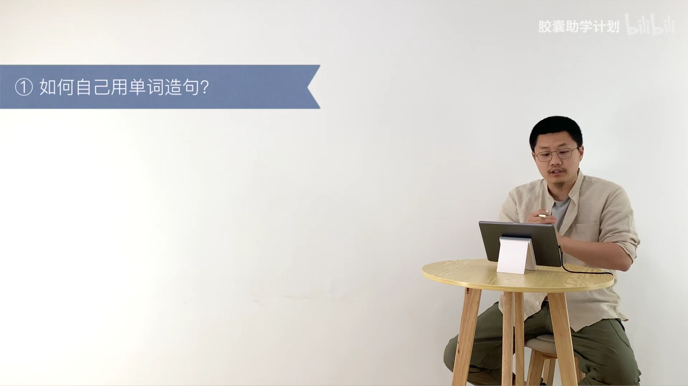

文字识别：胶囊助学计划 / ①如何自己用单词造句？

## 00:00:30–00:01:00

enjoy it。那上来我们先看两个小的单词，很多同学可能认识这两个单词。第一个单词跟我读一下来，father。第二个单词 mother。好，单词您认的，但是我们复习两个知识点，自然拼读法则外加音标。f放在单词当中去发，th放在单词当中去发的是在这儿是浊辅音。来，摸着你的嗓子啊，跟我一起读，声带要一起震

### 画面 00:00:31

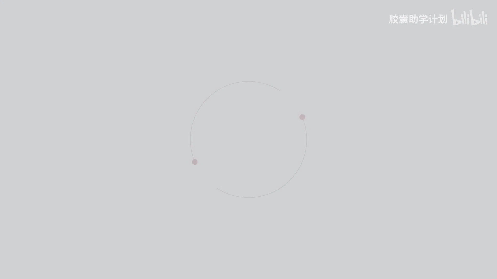

文字识别：胶囊助学计划bill / •

### 画面 00:00:35

### 画面 00:00:37

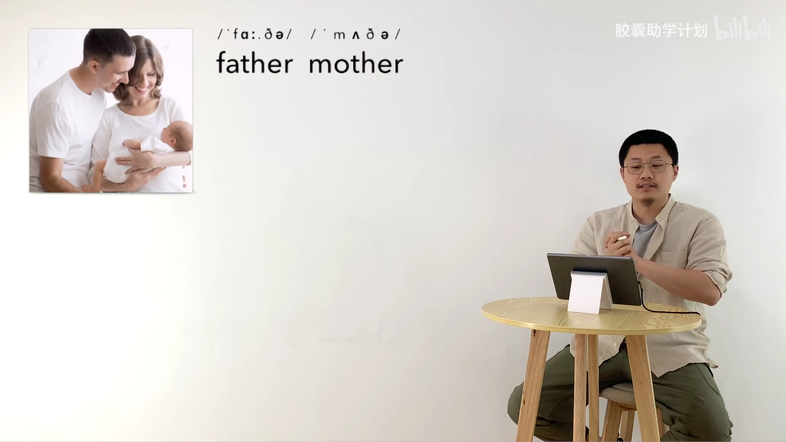

文字识别：胶囊助学计划 / /'fa:.∂a/ /'mn∂a/ / father mother

### 画面 00:00:42

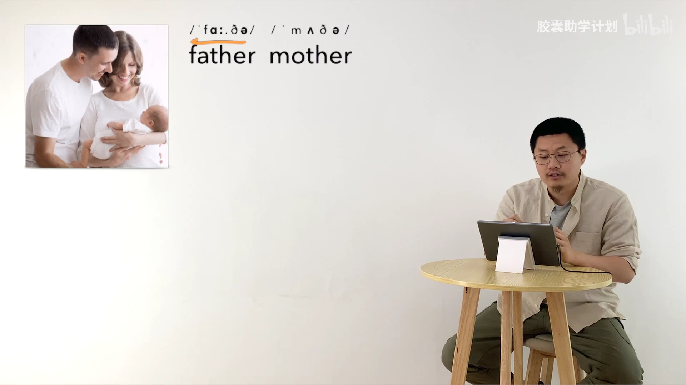

文字识别：胶囊助学计划 / /'fa:.ǒa/ /'mnǒa/ / father mother

### 画面 00:00:46

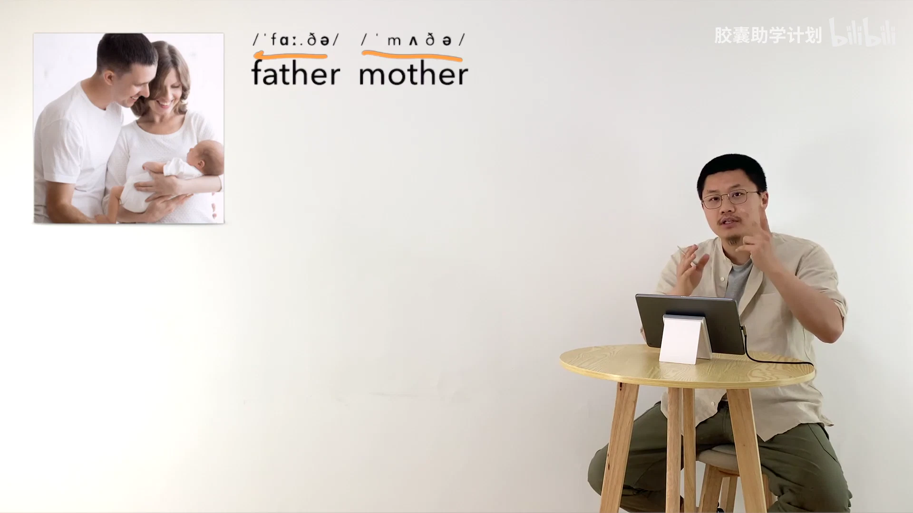

文字识别：胶囊助学计划 / /'fa:.ǒa/ /'mn∂a/ / father mother

### 画面 00:00:55

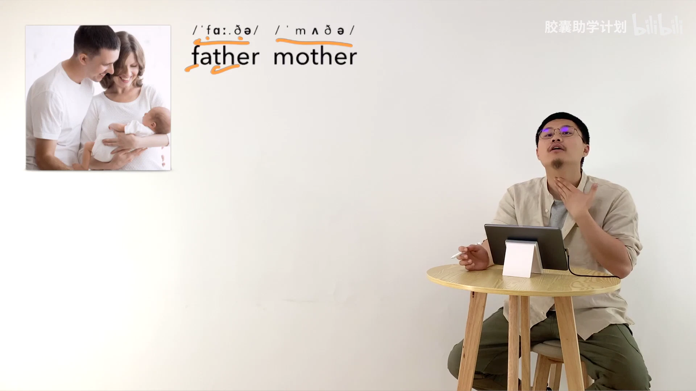

文字识别：胶囊助学计划 / /'fa:.ǎa/ /'mn∂a/ / father mother

## 00:01:00–00:01:30

动，嗯嗯，好，后面是一样的，m，嗯，th，嗯，OK，我们造一个小的句子，单词记住对吧？五个点非常重要，对于各位来说最重要的一个点就是造句，跟我一起读，This is his mother. This is her mother. OK，那你看见肯定句，一般疑问句，is提前，Is this his mother?

### 画面 00:01:02

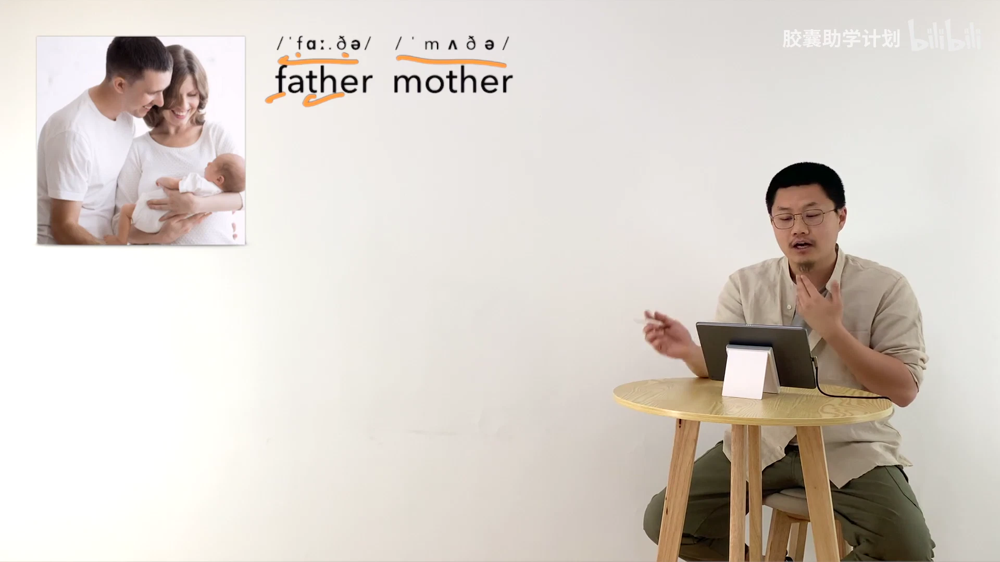

文字识别：胶囊助学计划 / /'fa:.∂a/ /'mn∂a/ / father mother

### 画面 00:01:15

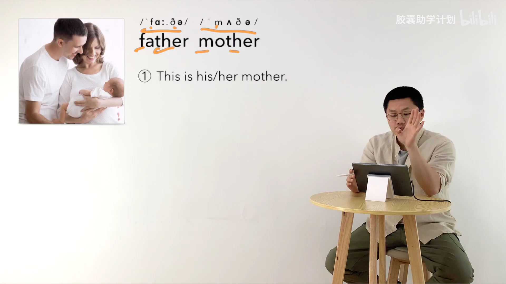

文字识别：胶囊助学计划 / /'fa:.∂a/ /mnǒa/ / father mother / ① This is his/her mother.

## 00:01:30–00:02:00

Okay, very good,很简单。接下来两个单词，也许您还是认的啊。来，跟我一起读 sister, brother. Very good.我们复习一下音标。第一个 e, 第二 a, r, a. Okay, very good. T H 字母组合放在这个地方还是读的呃，我们刚才刚刚教过的这个音，对吧？跟我一起，声带要震动啊。Okay, very good. S 放在单词

### 画面 00:01:31

文字识别：胶囊助学计划 / /'sista/ /'brΛǒa/ / sister brother

### 画面 00:01:35

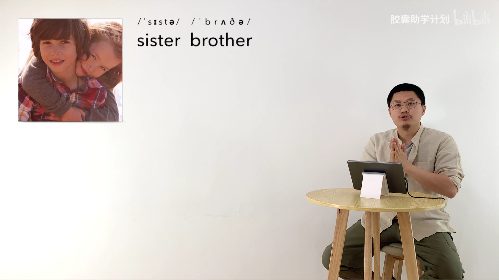

文字识别：胶囊助学计划 / /'sista/ /'brnǒa/ / sister brother

### 画面 00:01:45

文字识别：胶囊助学计划 / /'sista/ /brnǒa/ / sister brother

### 画面 00:01:50

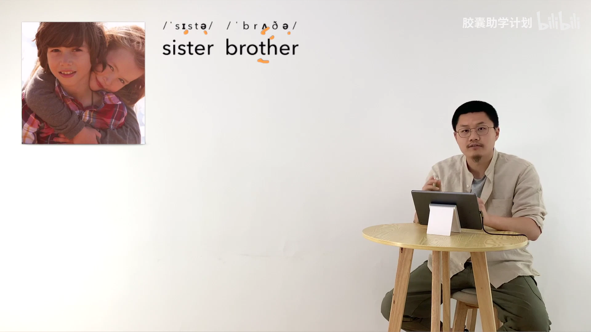

文字识别：胶囊助学计划 / /'sista/ /brnǒa/ / sister brother

### 画面 00:01:52

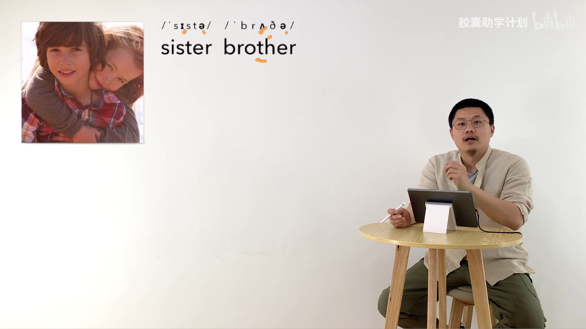

文字识别：胶囊助学计划 / /'sista/ /brnǒa/ / sister brother

### 画面 00:01:56

文字识别：胶囊助学计划 / /'sista/ /'brnǒa/ / sister brother

### 画面 00:01:58

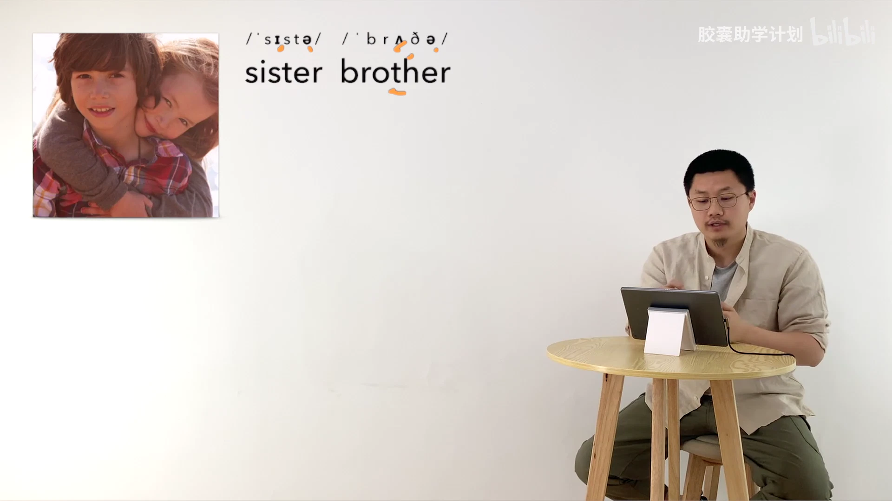

文字识别：胶囊助学计划 / /'sista/ /'brnǒa/ / sister brother

## 00:02:00–00:02:30

单词当中去，现在读的是t放在单词当中去，现在读的是t。然后字母r最后要加一个儿化音，所以我们读的不是sister，加个儿化音sister sister. Okay, very good.单词继续造句，跟我一起读. This is her brother.一般疑问句Is this her brother? Okay, very good.好，那我们下一个单词，我们看一下b，我们猜一下，现在也

### 画面 00:02:01

文字识别：胶囊助学计划 / /'sista/ /'brnǒa/ / sister brother

### 画面 00:02:04

文字识别：胶囊助学计划 / /'sista/ /'brnǒa/ / sister brother

### 画面 00:02:09

文字识别：胶囊助学计划 / /'sista/ / l /brnōal / sister / r brother

### 画面 00:02:11

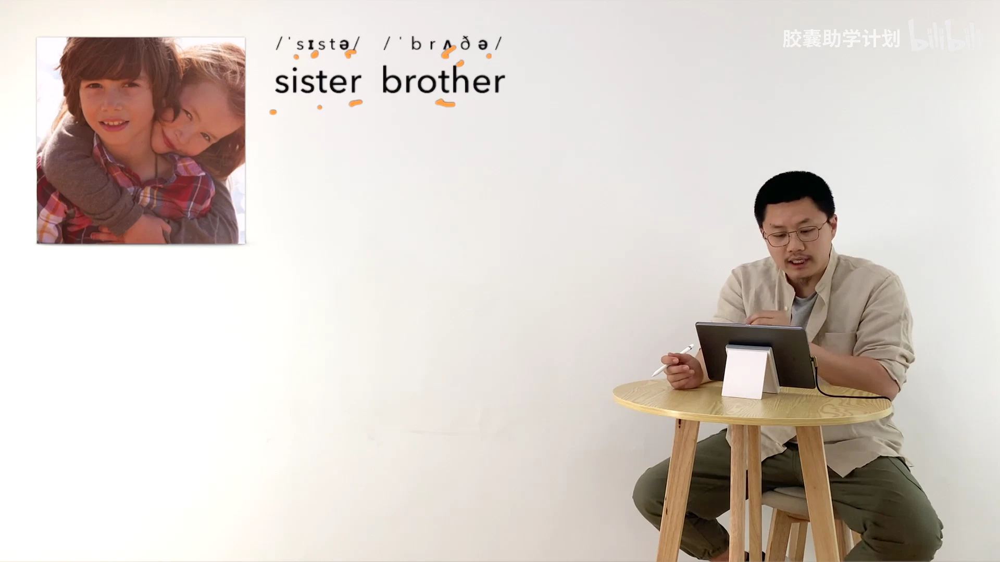

文字识别：胶囊助学计划 / /'sista/ / / /brn∂al / sister brother

### 画面 00:02:13

文字识别：胶囊助学计划 / /'sista/ / l / brnǒal / sister / r brother

### 画面 00:02:15

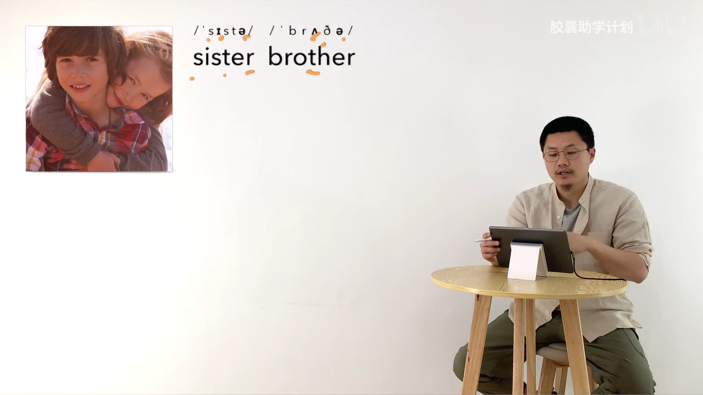

文字识别：胶囊助学计划 / /'sista/ / / /'brnǒa/ / sister brother

### 画面 00:02:17

文字识别：胶囊助学计划 / /'sista/ /brpǒa/ / sister brother / ① This is her brother.

### 画面 00:02:20

文字识别：/'sista/ / brpǒa/ / 胶囊助学计划 / sister brother / ① This is her brother.

### 画面 00:02:23

文字识别：/'sista/ /brpǒa/ / 胶囊助学计划 / sister brother / ① This is her brother. / ② Is this her brother?

### 画面 00:02:25

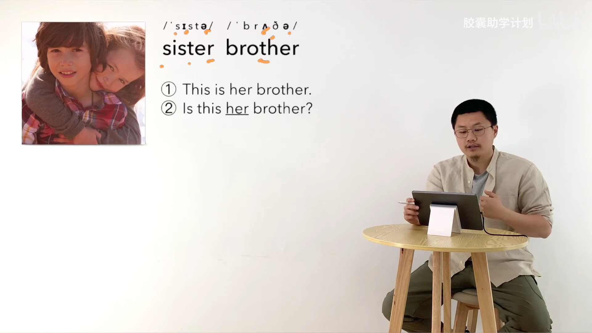

文字识别：/'sista/ /'brnǒa/ / 胶囊助学计划 / sister brother / ① This is her brother. / ② Is this her brother?

### 画面 00:02:27

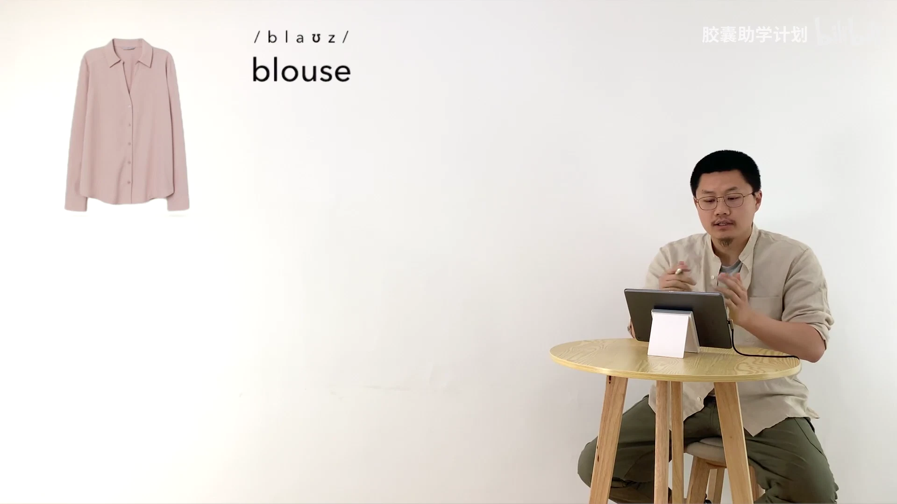

文字识别：/b lauz / / 胶囊助学计划 / blouse

## 00:02:30–00:03:00

能猜到了，对吧？放在单词当中去发 B L，舌尖上牙龈，哎 S E，其实 E 可以理解为不发音，S 在这儿读了一个 Z，那所以我们现在简单总结一下，S 这个字母放在单词当中去最常见的两个发音，一个是 S，一另一个就是 Z，对吧？那跟我一起读来，blouse blouse，OK，那我们拿这个单词多造几个句子啊，它就是女士衬衫的意思。OK， very good，那跟我一起

### 画面 00:02:40

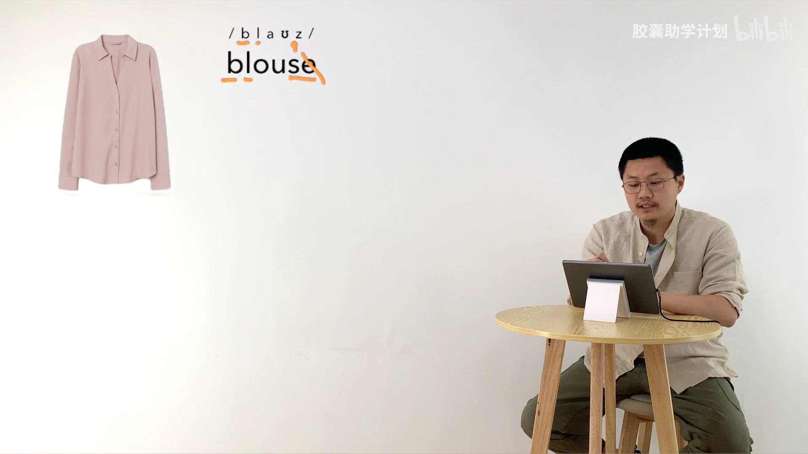

文字识别：胶囊助学计划 / /blauz / / blouse

### 画面 00:02:44

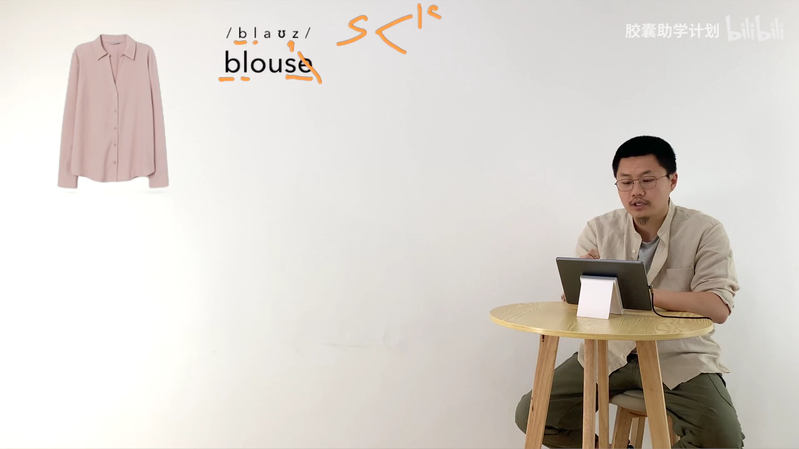

文字识别：S< / /blauz/ / 胶囊助学计划 / blouse

### 画面 00:02:48

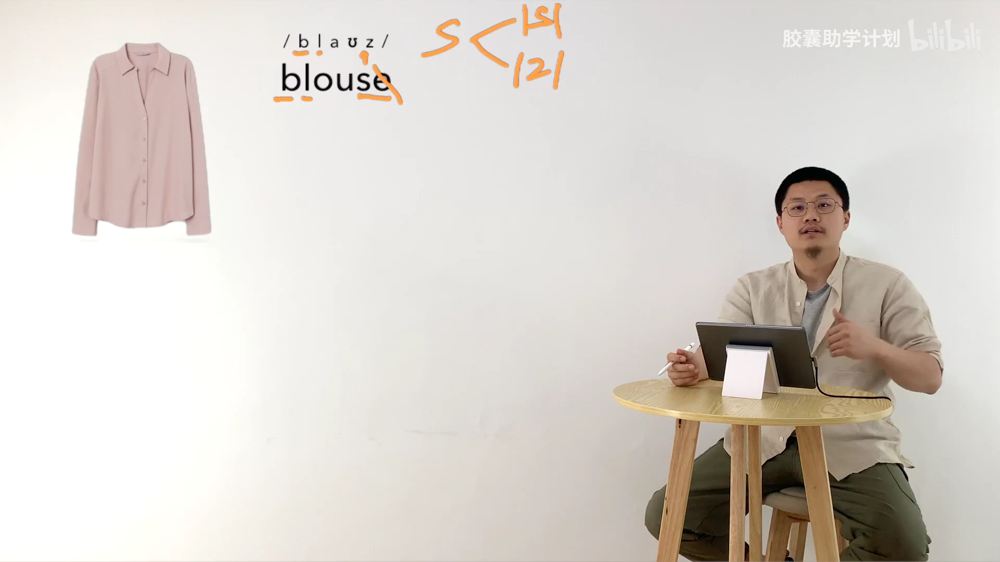

文字识别：S / 胶囊助学计划 / / blauz / / blouse

### 画面 00:02:50

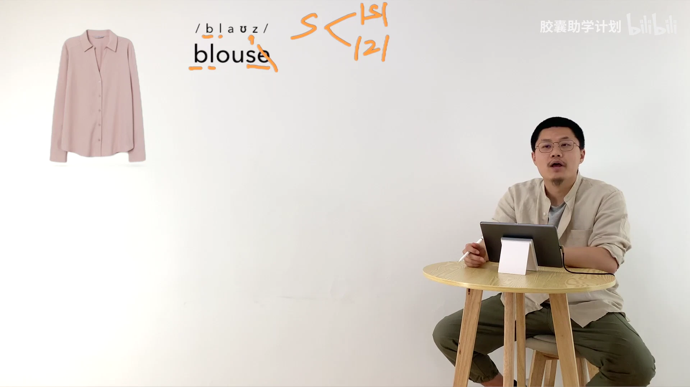

文字识别：S / 胶囊助学计划 / /blauz / / <(21 / blouse

### 画面 00:02:54

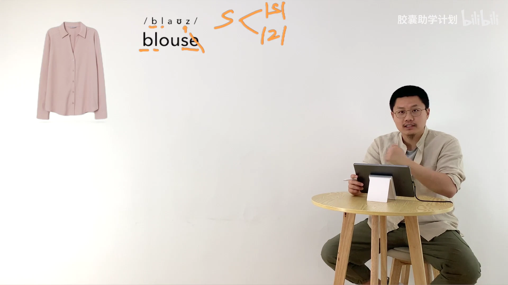

文字识别：S / <2l / 胶囊助学计划 / /blauz / / blouse

### 画面 00:02:56

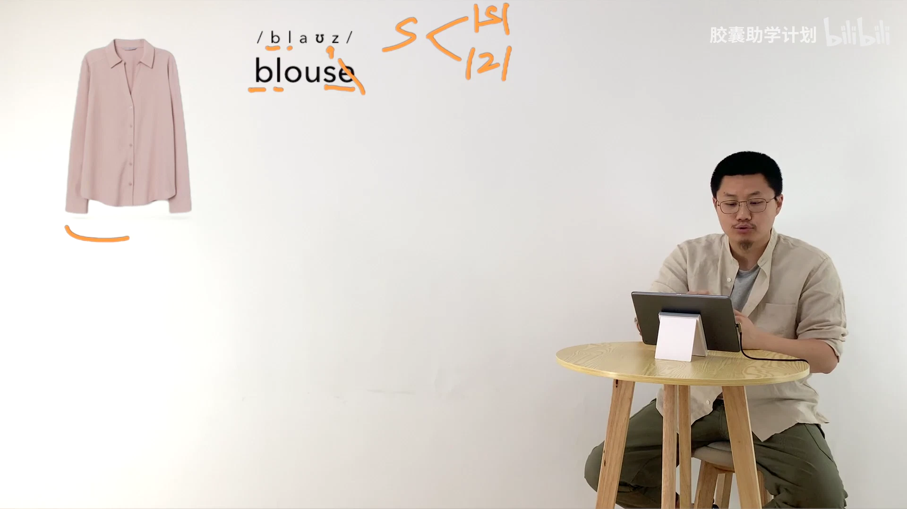

文字识别：S / <(2| / 胶囊助学计划 / /blauz / / blouse

### 画面 00:02:58

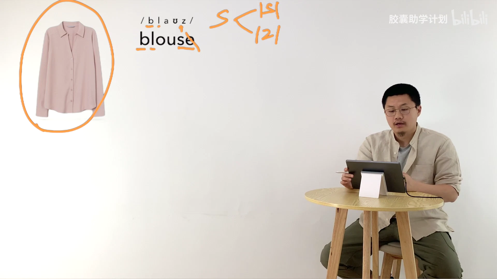

文字识别：S< / 胶囊助学计划 / /blauz/ / blouse

## 00:03:00–00:03:30

读来. This is my blouse. 立刻否定句. This is not my blouse. Is后面加not，第三课学的。一般疑问句，Is提前. Is this your blouse? Okay, very good. 然后我们刚刚学过，想对谁的去提问，用什么？回顾一下。Whose? 那它有两种变化模式。替代your了之后，可以把它单独提前，或

### 画面 00:03:05

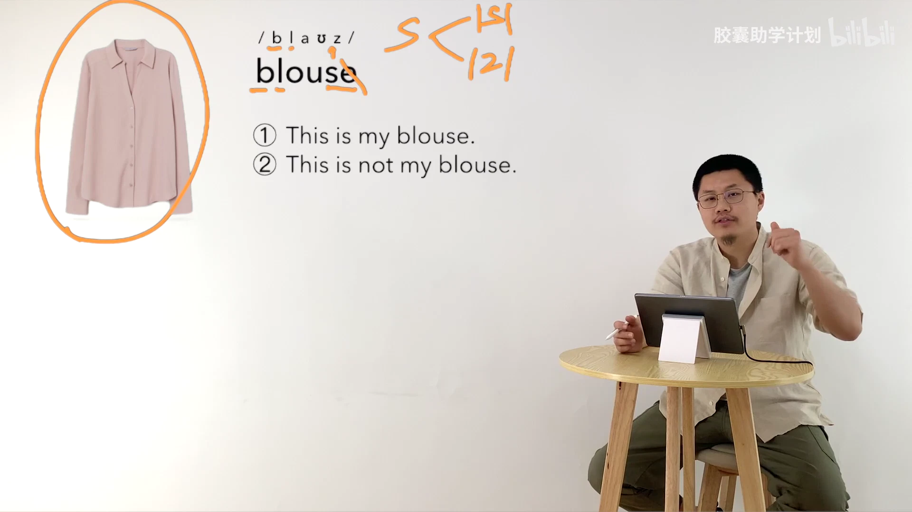

文字识别：/blauz/ / 胶囊助学计划 / -121 / blouse / This is my blouse. / 1 / This is not my blouse. / 2

### 画面 00:03:11

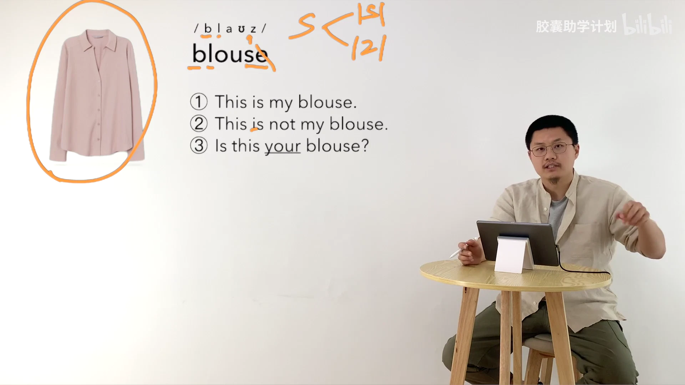

文字识别：/blauz/ / 胶囊助学计划 / -121 / blouse / This is my blouse. / 1 / This is not my k / blouse. / 2 / 3 /  Is this your / blouse?

### 画面 00:03:16

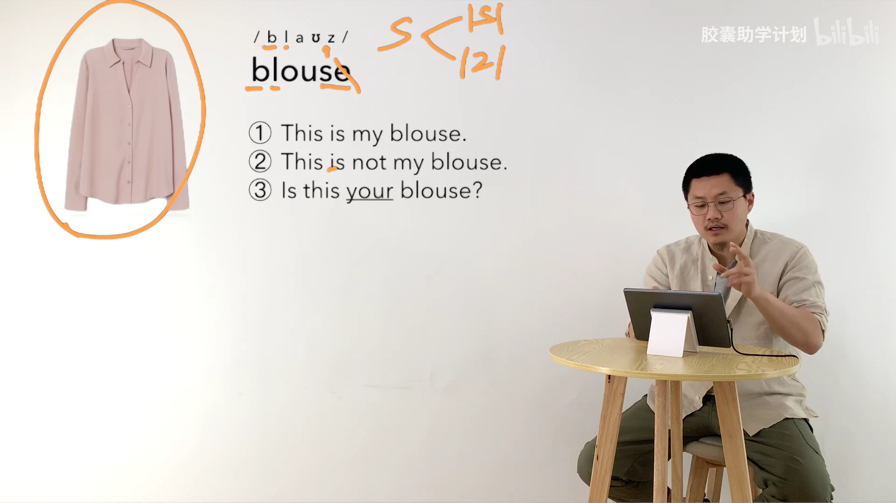

文字识别：/ blauz / / 胶囊助学计划 / blouse / This is my blouse. / 1 / 2 / This is not my k / blouse. / 3 / ) Is this your / blouse?

### 画面 00:03:22

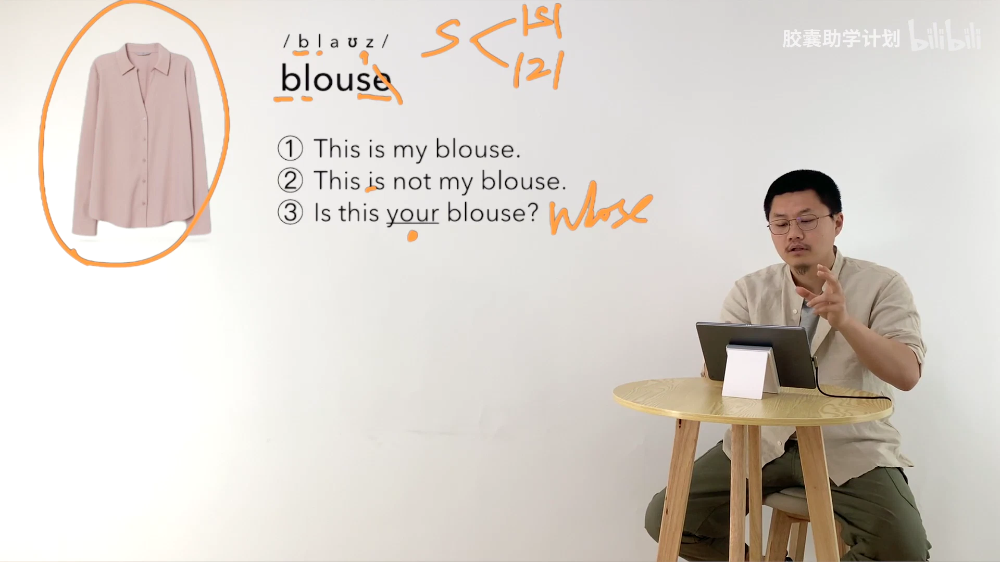

文字识别：S< / /blauz / / 胶囊助学计划 / -121 / blouse / 1 / This is my / blouse. / 2 / This / sis not / my / blouse. / Wx / 3 / Is this / your / blouse?

### 画面 00:03:29

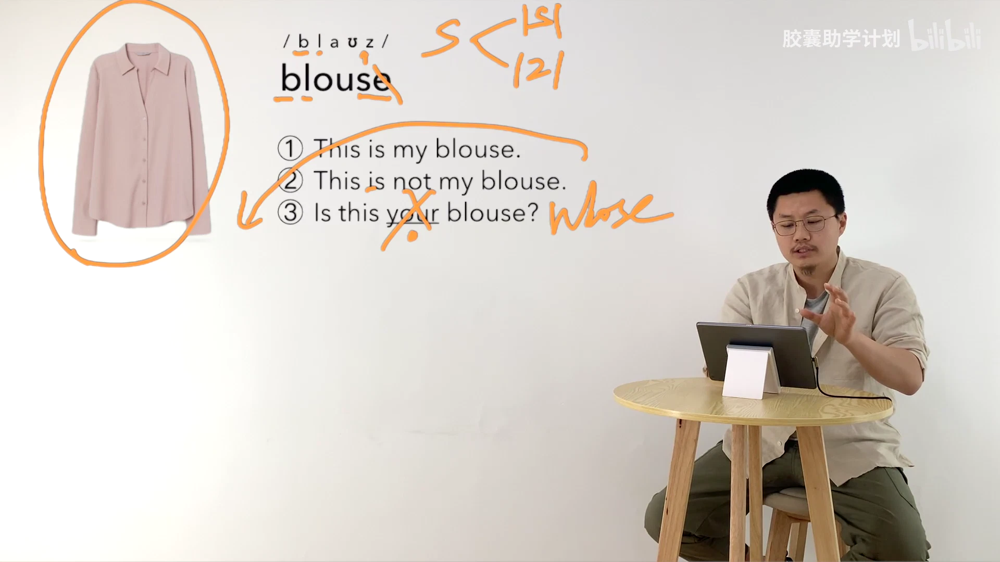

文字识别：/blauz/ / 胶囊助学计划 / blouse / ThIs is / my / blouse. / This / s is not my / blouse. / Wose / Is this / y / blouse?

## 00:03:30–00:04:00

者加上 blouse 后面的名词一起提前，对吧？那跟我一起读，叫做 Whose blouse is this？那你想问，比如说角落当中有很多的，有很多的人，角落当中有一个衬衫，对吧？女士衬衫，你就想问 Whose blouse is this？ Okay， very good。那接下来我们看一下《无枪侠》这部电影当中啊，各位做一个小的听力练习，它出现了一句话叫 Is that a blouse？好，注意一下啊，男主人这个主角是一个男主人公，

### 画面 00:03:32

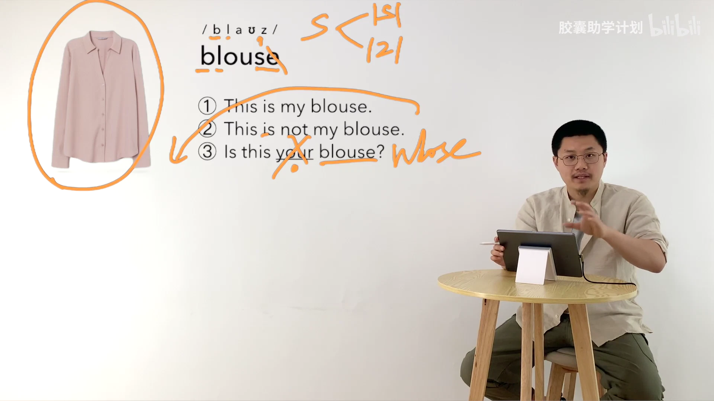

文字识别：S / /blauz/ / 胶囊助学计划 / blouse / ThIs is / my / blouse. / This / s is not my l / blouse. / Wse / yr / Is / this / blouse?

### 画面 00:03:35

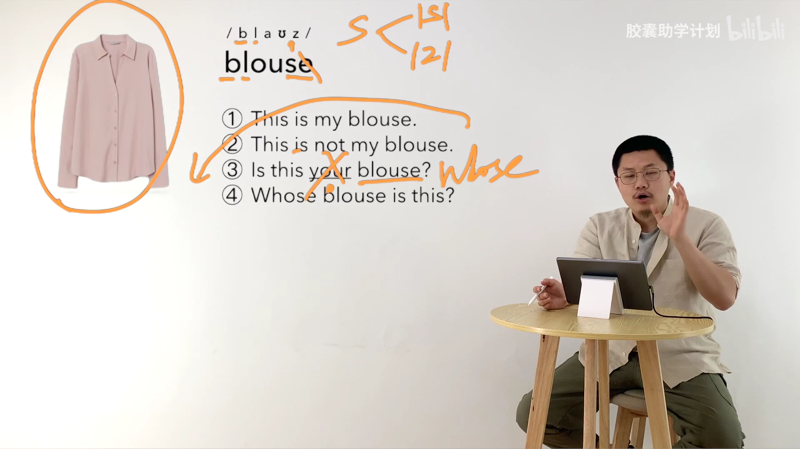

文字识别：胶囊助学计划 / /blauz/ / blouse / ThIs / is / my / blouse. / This / is I / notr / my / blouse. / yr / Is thisy / blouse? / 3 / Whose blouse is / this?

### 画面 00:03:45

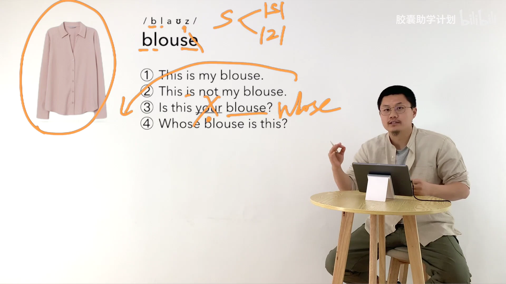

文字识别：/blauz/ / 胶囊助学计划 / blouse / ThIs / is / my / blouse. / This / s is not my / blouse. / Wose / yr / Is this ) / blouse? / 3 / Whose blouse is / this?

### 画面 00:03:47

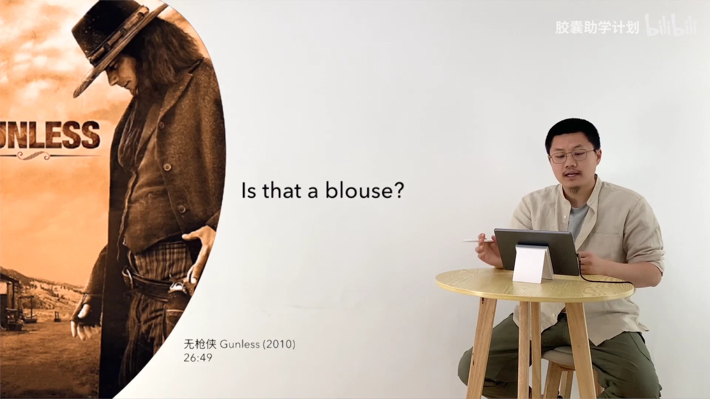

文字识别：胶囊助学计划 / INLESS / Is that a blouse? / 无枪侠Gunless (2010) / 26:49

### 画面 00:03:49

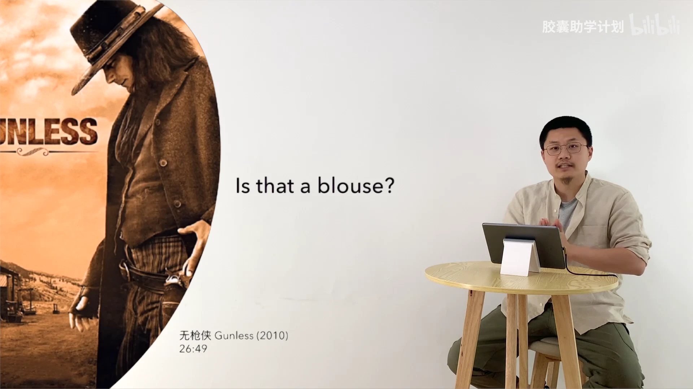

文字识别：胶囊助学计划 / NLESS / Is that a blouse? / 无枪侠Gunless (2010) / 26:49

### 画面 00:03:51

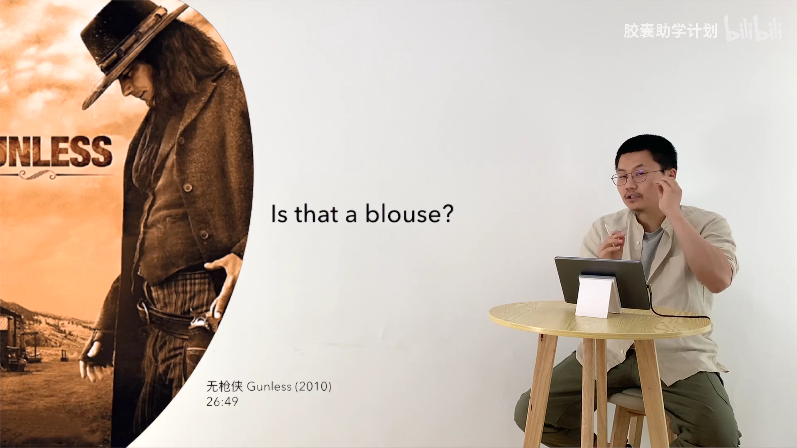

文字识别：胶囊助学计划 / INLESS / Is that a blouse? / 无枪侠Gunless (2010) / 26:49

### 画面 00:03:55

文字识别：胶囊助学计划 / INLESS / Is that a blouse? / 无枪侠Gunless (2010) / 26:49

### 画面 00:03:58

文字识别：胶囊助学计划 / INLESS / Is that a blouse? / 无枪侠 Gunless (2010) / 26:49

## 00:04:00–00:04:30

而 blouse，刚才我讲了是女士衬衫，对吧？所以男主人公穿着一个女士衬衫出来，然后我们看一下他在对话当中出现了这样一句话，叫 Is that a blouse? Don't start. Why are you even here? Standing invitation every Wednesday. Doc tells me we're dining partners. Just great. Nice blouse, by the way. Okay, shut up. Let's get this over. My mother wore something like that one. Very funny. Well, she did. Well, come on

### 画面 00:04:00

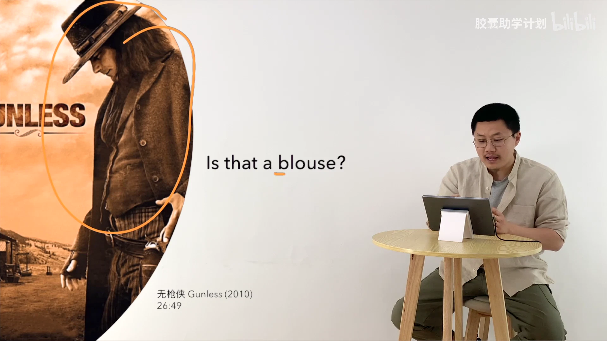

文字识别：胶囊助学计划 / INLESS / Is that a blouse? / 无枪侠Gunless (2010) / 26:49

### 画面 00:04:02

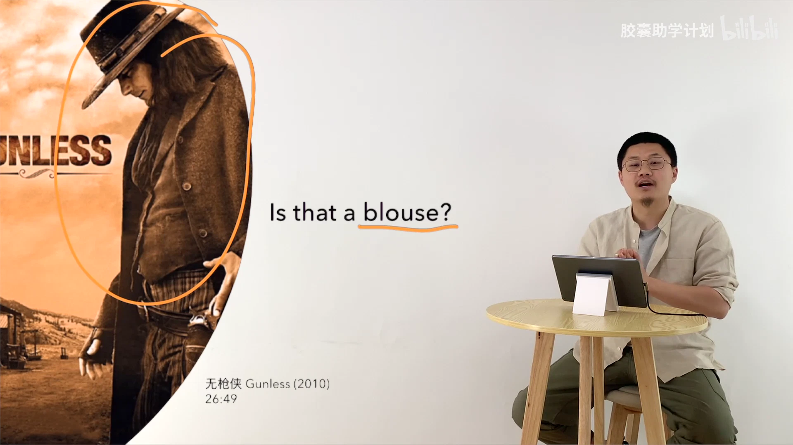

文字识别：胶囊助学计划 / INLESS / Is that a blouse? / 无枪侠 Gunless (2010) / 26:49

### 画面 00:04:05

文字识别：胶囊助学计划 / INLESS / Is that a blouse? / 无枪侠 Gunless (2010) / 26:49

### 画面 00:04:10

文字识别：胶囊助学计划 / NLESS / Is that a blouse? / 无枪侠 Gunless (2010) / 26:49

### 画面 00:04:12

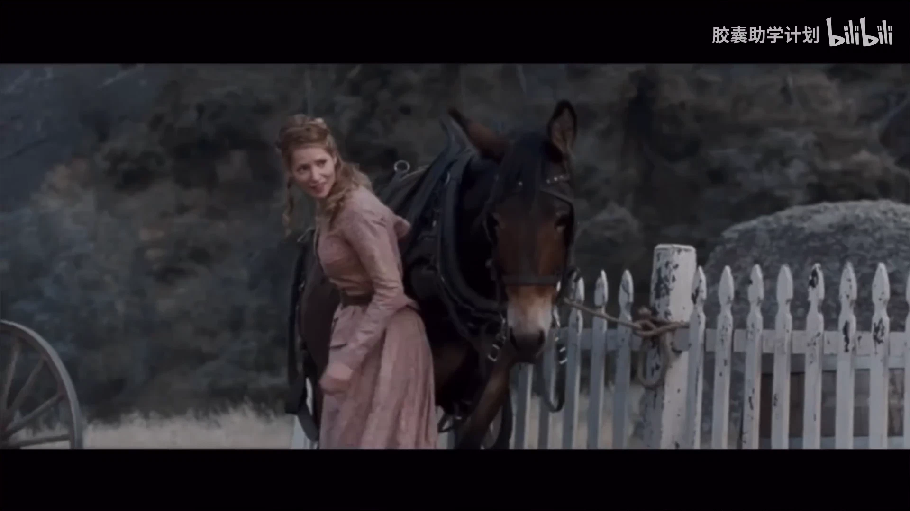

文字识别：Bilbii / 胶囊助学计划

### 画面 00:04:14

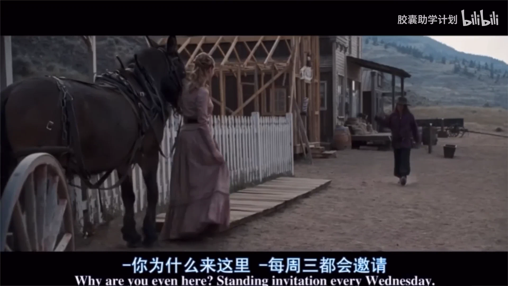

文字识别：bilibli / 胶囊助学计划 / -你为什么来这里-每周三都会邀请 / Why are you even here? Standing invitation every Wednesday.

### 画面 00:04:16

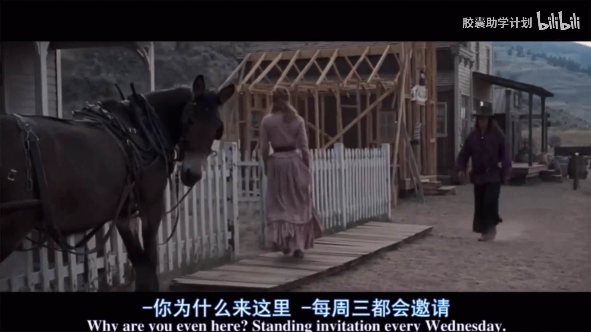

文字识别：bilibili / 胶囊助学计划 / -你为什么来这里-每周三都会邀请 / Why are you even here? Standing invitation every Wednesday.

### 画面 00:04:18

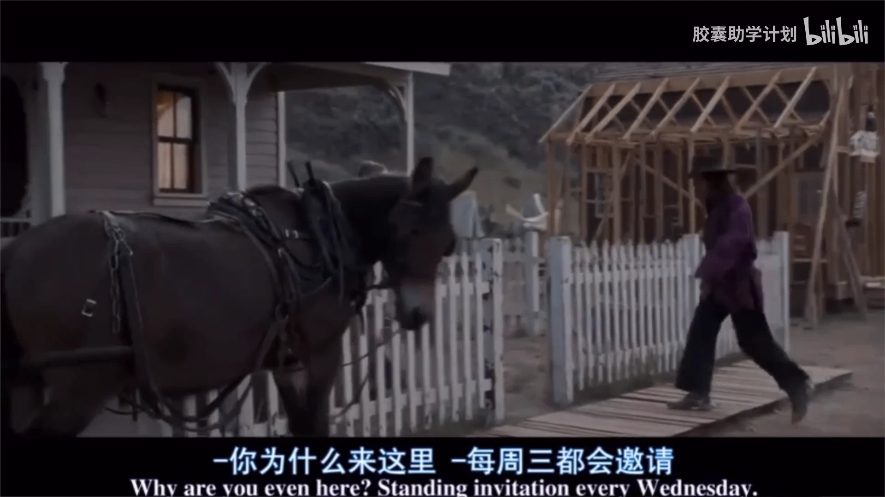

文字识别：bilibli / 胶囊助学计划 / -你为什么来这里-每周三都会邀请 / Why are you even here? Standing invitation every Wednesday.

### 画面 00:04:20

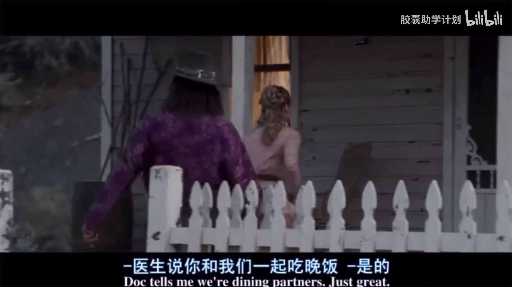

文字识别：bilbili / 胶囊助学计划 / -医生说你和我们一起吃晚饭-是的 / Doc tells me we're dining partners. Just great.

### 画面 00:04:22

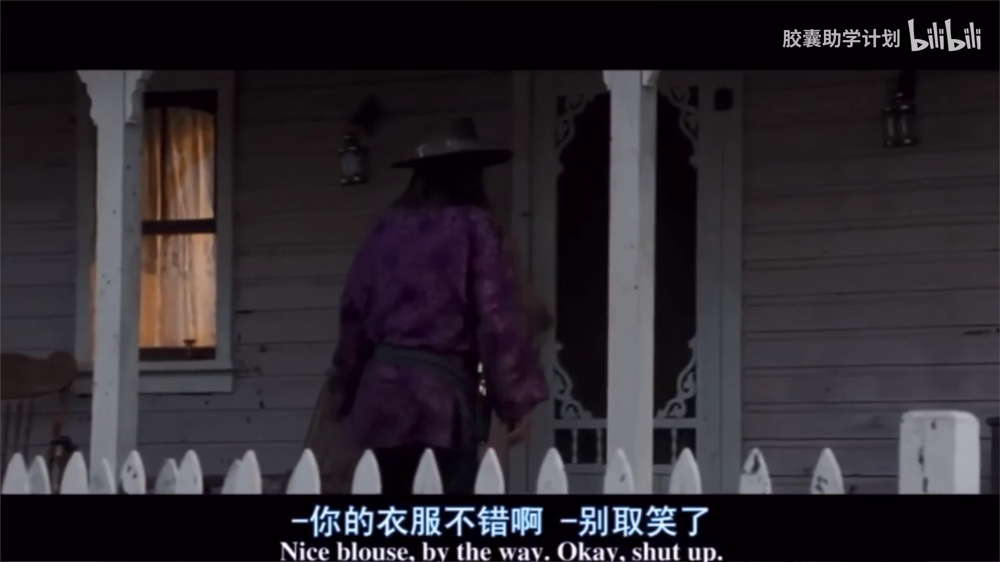

文字识别：bilibili / 胶囊助学计划 / -你的衣服不错啊 / 可-别取笑了 / Nice blouse, by the way. Okay. shut up.

### 画面 00:04:24

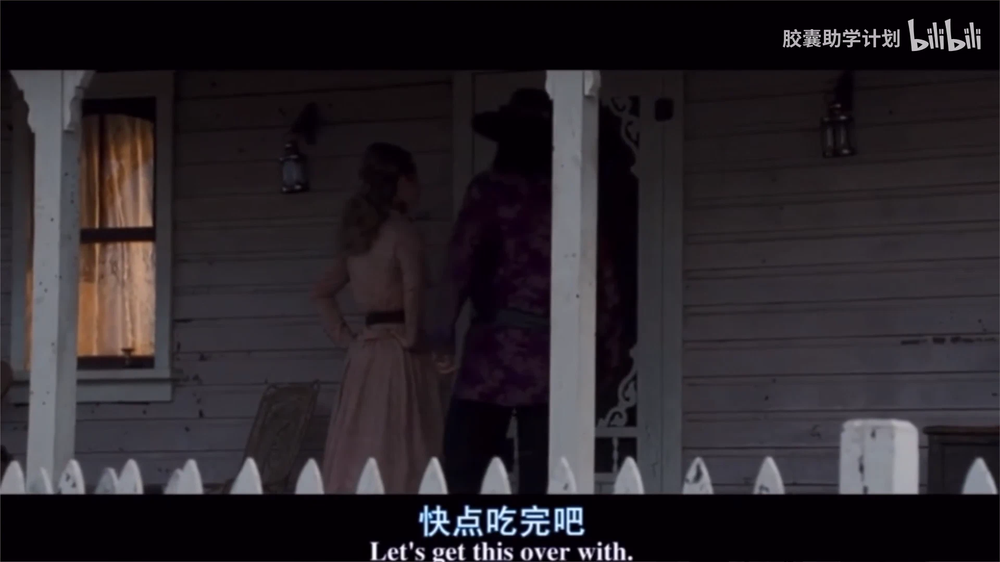

文字识别：bilbli / 胶囊助学计划 / NAM / 快点吃完吧 / Let's get this over with.

### 画面 00:04:26

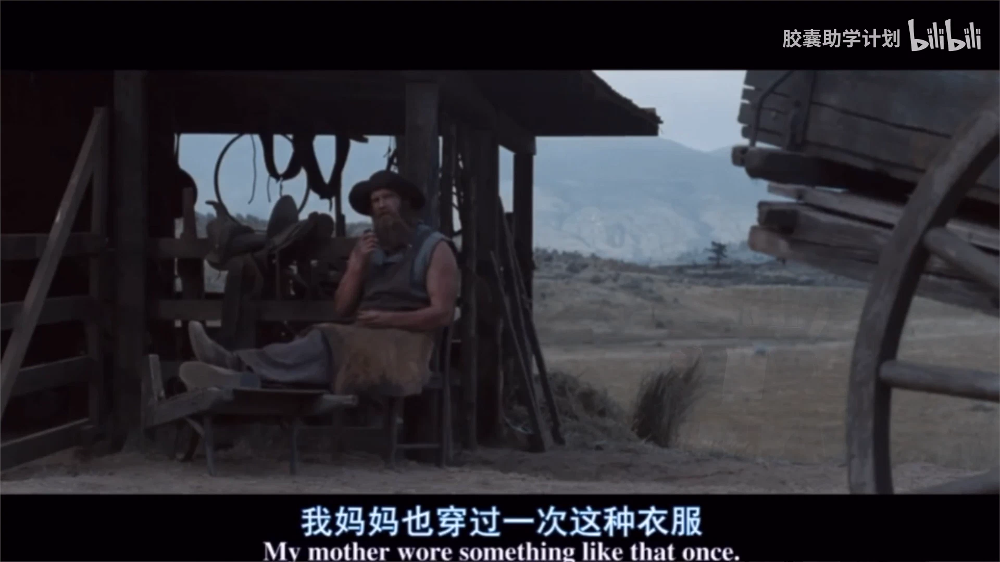

文字识别：bilibli / 胶囊助学计划 / 我妈妈也穿过一次这种衣服 / My mother wore something like that once.

### 画面 00:04:28

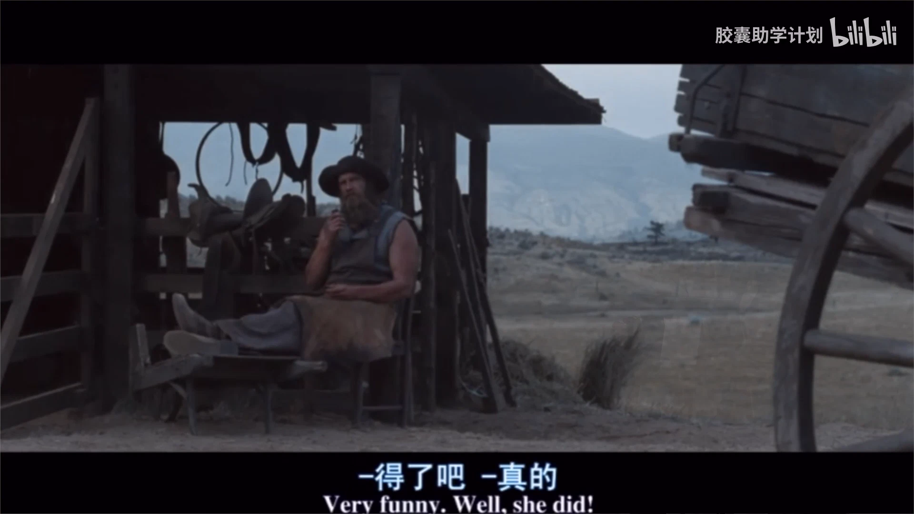

文字识别：bilbli / 胶囊助学计划 / -得了吧-真的 / Very funny. Well. she did!

## 00:04:30–00:05:00

in. Is that a blouse? Okay,各位看到了啊，最后进门的时候，那这个人没有出现在屋里。这个人问了一句话，说 Is that a blouse? 那意思就是你一大老爷们儿怎么穿着一个女士的衬衫啊？我看着就像女士的衬衫。OK，所以各位记住，女士衬衫叫 blouse。OK，very good。那下一个单词，跟我一起读 tie tie。其实挺像汉语拼音的哈 tie tie。OK，我们说是叫领领

### 画面 00:04:30

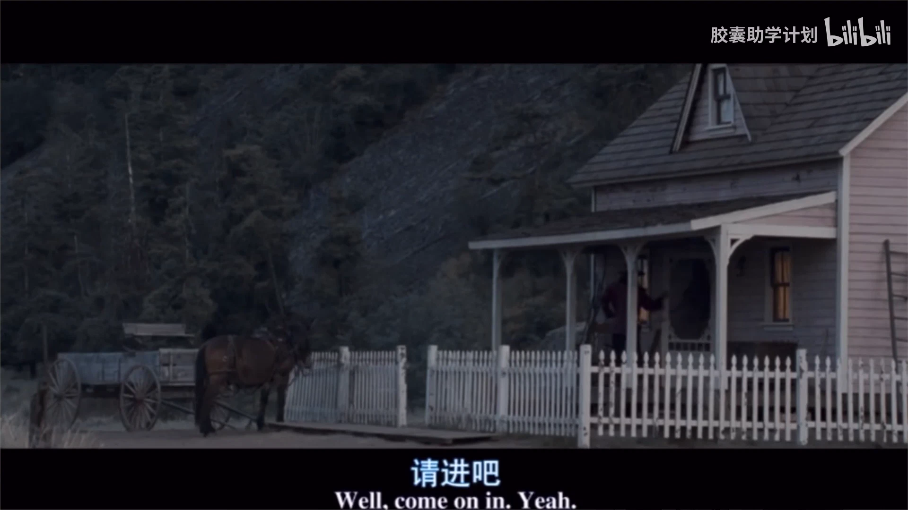

文字识别：bilbli / 胶囊助学计划 / 请进吧 / Well. come on in. Yeah.

### 画面 00:04:32

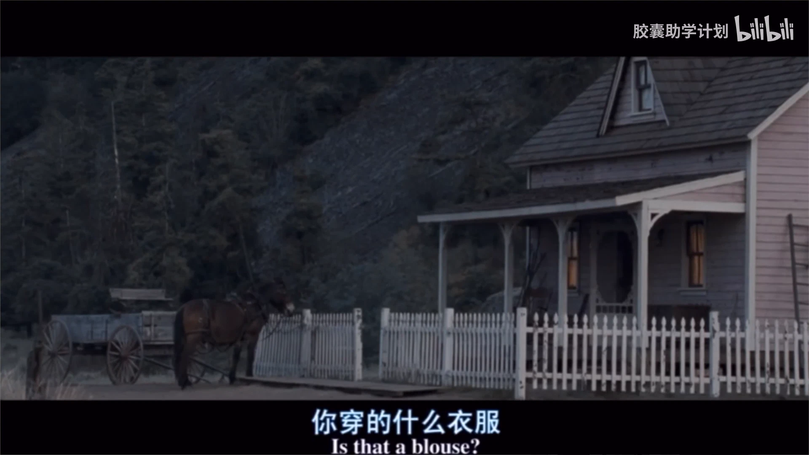

文字识别：biibili / 胶囊助学计划 / 你穿的什么衣服 / Is that a blouse?

### 画面 00:04:34

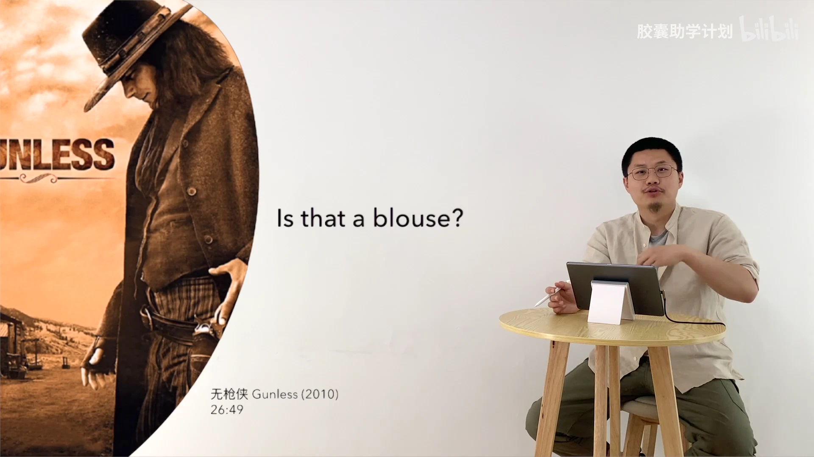

文字识别：胶囊助学计划 / NLESS / Is that a blouse? / 无枪侠 Gunless (2010) / 26:49

### 画面 00:04:36

文字识别：胶囊助学计划 / INLESS / Is that a blouse? / 无枪侠 Gunless (2010) / 26:49

### 画面 00:04:39

文字识别：胶囊助学计划 / INLESS / Is that a blouse? / 无枪侠 Gunless (2010) / 26:49

### 画面 00:04:41

文字识别：胶囊助学计划 / INLESS / Is that a blouse? / 无枪侠 Gunless (2010) / 26:49

### 画面 00:04:45

文字识别：胶囊助学计划 / INLESS / Is that a blouse? / 无枪侠Gunless (2010) / 26:49

### 画面 00:04:47

文字识别：胶囊助学计划 / INLESS / Is that a blouse? / V / 无枪侠 Gunless (2010) / 26:49

### 画面 00:04:49

文字识别：胶囊助学计划 / /tar/ / tie

## 00:05:00–00:05:30

带，OK，那这个地方我打了三个问号，我想在这儿就跟大家提一句，我们两种不同的教学模式啊，呃，有一部分老师他的习惯是把很多的单词会进行大面积的拓展。我举个例子，比如说他的习惯是我们说讲到领带了，然后他就从脚上穿的一直到头上戴的啊，一路给你讲过来，比如说扩展了十多个单词。很多同学是习惯这种教学思路的，然后等下课了之后，你会发现你的笔记

### 画面 00:05:02

文字识别：/tai/ / 胶囊助学计划 / tie / ①???

### 画面 00:05:06

文字识别：胶囊助学计划 / /tai/ / tie / ①???

### 画面 00:05:13

文字识别：胶囊助学计划 / /tai/ / tie / ①???

### 画面 00:05:16

文字识别：胶囊助学计划 / /tai/ / tie / ①???

### 画面 00:05:19

文字识别：胶囊助学计划 / /tai/ / tie / ①???

### 画面 00:05:23

文字识别：胶囊助学计划 / /tar/ / tie / ①???

### 画面 00:05:25

文字识别：胶囊助学计划 / /tai/ / tie / ①???

### 画面 00:05:28

文字识别：胶囊助学计划 / /tai/ / tie / ①???

## 00:05:30–00:06:00

本是满满的。我是拒绝这样的教学思路的。我们换一个教学思路，就是一个单词，您不需要进行大面积拓展。尤其当年为什么这样去教呢？两千年左右的时候，很多老师是这样去教的。原因当时你要去查单词，还是要自己去翻字典的。互联网时代没有那么发达，当年还有一个东西叫文曲星，对吧？你还要专门去查。而现在在网络非常发达的时代，你想查什么单词，自己很容易就查到，不需要老师再帮你去查了。那现在就变成了一件

### 画面 00:05:32

文字识别：胶囊助学计划 / /tar/ / tie / ①???

### 画面 00:05:39

文字识别：胶囊助学计划 / /tai/ / tie / ①???

### 画面 00:05:46

文字识别：胶囊助学计划 / /tai/ / tie / ①???

## 00:06:00–00:06:30

事情，就是在不记这么多笔记的前提之下，我们只学一个单词又不拓展，那最重要的事情就是您把这个单词能放在句子当中去学会它。于是这个时候的重点，第一不进行大面积拓展单词了，第二那造句就变得很重要了。于是又出现了这样一批人，对吧？那他们会把这个单词给你他造一堆句子，哎，比如说五个句子或者三个句子，然后各位要做的事情，学员

### 画面 00:06:02

文字识别：胶囊助学计划 / /tai/ / tie / ①???

### 画面 00:06:05

文字识别：胶囊助学计划 / /tai/ / tie / ①???

### 画面 00:06:09

文字识别：胶囊助学计划 / /tar/ / tie / ①???

### 画面 00:06:12

文字识别：胶囊助学计划 / /tal/ / tie / ①???

### 画面 00:06:15

文字识别：胶囊助学计划 / /tai/ / tie / ①???

### 画面 00:06:23

文字识别：胶囊助学计划 / /tai/ / tie / ①???

### 画面 00:06:25

文字识别：胶囊助学计划 / /tai/ / tie / ①???

### 画面 00:06:29

文字识别：胶囊助学计划 / /tai/ / tie / ①???

## 00:06:30–00:07:00

要做的事情是把它记到笔记本当中，然后呢回去背这几个句子。这也不是一个特别好的方式，原因呢特别简单，各位自己去想一下啊。我们现在说的汉语有多少是你小的时候背下来的汉语？除了一点古诗词以外，大多数我们现在日常生活当中交流都不是你小时候背过这句话，而是你用这个字、这句话、这个语法，你能随机应变的把它搭配到一起去造句。这是我

### 画面 00:06:31

文字识别：胶囊助学计划 / /tai/ / tie / ①???

### 画面 00:06:35

文字识别：胶囊助学计划 / /tai/ / tie / ①???

### 画面 00:06:37

文字识别：胶囊助学计划 / /tai/ / tie / ①???

### 画面 00:06:39

文字识别：胶囊助学计划 / /tai/ / tie / ①???

### 画面 00:06:41

文字识别：/tar/ / 胶囊助学计划 / tie / ①???

## 00:07:00–00:07:30

我们人类说话的本质，而不是去背句子。那学英语其实是一个道理，也就是说你要学会自己去拿这个单词，能造出来很多的句子，比如说五个句子，要比老师给你三个句子，你把三个句子背下来效果要好。这句话就是咱们经常说的一句话，叫授人以鱼不如授人以渔，对吧？我给你三个句子，就是给你三条鱼，但是如果我教会你如何自己拿单词，自己啊拿一个单词去造句子，那

### 画面 00:07:08

文字识别：胶囊助学计划 / /tai/ / tie / ①???

### 画面 00:07:11

文字识别：Bilbl / 胶囊助学计划 / /tai/ / tie / ①???

### 画面 00:07:14

文字识别：胶囊助学计划 / /tai/ / tie / ①???

## 00:07:30–00:08:00

你以后就会钓鱼了。你给我一个单词，我学会这个思路，我就能自己去造句子了。那我们今天先看一个最简单的思路，我们先判断一下它的词性叫名词，叫tie对吧？那我想造句，我们现在就想一下，我跟名词造句的时候，哪些词性跟它是有联系的？比如说我们前不久刚刚学过的叫做形容词，比如说blue这个单词，我们叫做形容词。那我说blue tie，现在放在一起呢，这就是一个短语。

### 画面 00:07:39

文字识别：胶囊助学计划 / /tai/ / tie / ①???

### 画面 00:07:49

文字识别：胶囊助学计划 / /tai/ / tie / M. / ①??? / ae

### 画面 00:07:51

文字识别：胶囊助学计划 / /tal/ / tie / M. / ①??? / an

### 画面 00:07:54

文字识别：胶囊助学计划 / BiB / /tal/ / tie / ①??? / an / 2

### 画面 00:07:56

文字识别：5í / 胶囊助学计划 / /tar/ / tie / ①??? / an / Jme

### 画面 00:07:58

文字识别：胶囊助学计划 / /tal/ / tie / M- / ①??? / aM / me

## 00:08:00–00:08:30

那 a blue tie，对吧？叫做一条蓝色的领带。那我举一个最简单的例子，我们造句子叫做 This is a blue tie。这是一个蓝色的领带，非常的简单。其次，这是第一个啊，思路叫做找词性，但这时候是造句子的前提。第二步呢，其实我们要做的事情是想一下，我们前十节几几节课呀，学到了哪些关键性的句型？比如

### 画面 00:08:02

文字识别：Biltbil / 胶囊助学计划 / /tal/ / tie / M- / ①??? / aM / -tie / sme

### 画面 00:08:05

文字识别：胶囊助学计划 / /tar/ / tie / Λ- / ①??? / aM / -tie / 3me

### 画面 00:08:22

文字识别：胶囊助学计划 / /tai/ / tie / ①??? / an / -tie / sme

### 画面 00:08:24

文字识别：胶囊助学计划 / /tai/ / tie / M- / ①??? / aM / -tie / sme

## 00:08:30–00:09:00

说第一节课我们学到了叫做 This is my handbag 和 Is this your handbag 我们又做了大量的练习。那您想，其实把 handbag 换成 tie 是不就是造句了？叫 This is my tie 和 Is this your tie？而第三节课我们又学到了否定句，叫 This is not my ticket. This is not my umbrella. 那我们现在要做的事情是把 umbrella 换成

### 画面 00:08:41

文字识别：胶囊助学计划 / /tai/ / tie / M- / ①??? / aM / -tie / sme

### 画面 00:08:45

文字识别：胶囊助学计划 / /tal/ / tie / ①??? / aM / tie / sme

## 00:09:00–00:09:30

tie 就变成了叫 this is not my tie，对不对？我不知道各位能不能反应过来哈。那你同理，比如说我刚才造了一句话叫做 this is a blue tie。那你想一下，我现在要做的事情是肯定具有了。注意关键思路来了，我们就要把它变成一般疑问句，就要想办法把它变成特殊疑问句。那一般疑问句变特殊疑问句，又要用到不同的特殊疑问词。

### 画面 00:09:05

文字识别：5 / 胶囊助学计划 / /tai/ / tie / ①??? / aM / tie / sme

### 画面 00:09:10

文字识别：胶囊助学计划 / /tar/ / tie / ①??? / aM / -tie / me

### 画面 00:09:15

文字识别：胶囊助学计划 / /tai/ / tie / M· / ①??? / aM / -tie / me

## 00:09:30–00:10:00

比如说我们学到了 whose 这个特殊疑问词，那我再把刚才的肯定句稍微变一下，叫做 This is his tie，叫做这是他的领带。然后我们想把它变一般疑问句，is 去提前，对 his 去提问，用 whose 这句话就变成了叫 whose tie is this。在前三十节课这样的变化其实并不是很多，但随着各位往后学，尤

### 画面 00:09:36

文字识别：胶囊助学计划 / /tal/ / tie / ①??? / aM / tie / me / Tl

### 画面 00:09:39

文字识别：胶囊助学计划 / /tar/ / tie / ①??? / an / tie / me / hic / Tl's

### 画面 00:09:43

文字识别：胶囊助学计划 / /tar/ / tie / M- / ①??? / aM / tie / me / hic / Tl's

### 画面 00:09:46

文字识别：胶囊助学计划 / /tal/ / tie / M / ①??? / an / tie / me / hic

### 画面 00:09:48

文字识别：胶囊助学计划 / /tal/ / tie / M- / ①??? / an / /

### 画面 00:09:50

文字识别：胶囊助学计划 / /tai/ / tie / M. / ①??? / aM / / / hc

## 00:10:00–00:10:30

其是从三十一课一直到九十一课开始，你会发现你造句子能力是呈指数性上涨的。我们大概在第五十五课和五十七课为大家进行这样一次造句练习，你会发现，如果你学习如何自己去造句，而不是被老师给你的句子，你能造句的能力是非常非常强的。比如说，曾经我就让我的同学做过这样一件事情，对吧？说我们拿一个单词去造二百个句子或者一百个句子

### 画面 00:10:06

文字识别：胶囊助学计划 / /tar/ / tie / ①??? / an / /

### 画面 00:10:09

文字识别：胶囊助学计划 / /tai/ / tie / ①??? / an / / / hc

### 画面 00:10:23

文字识别：5í$ / 胶囊助学计划 / /tai/ / tie / M- / ①??? / an

### 画面 00:10:25

文字识别：5í$ / /tal/ / 胶囊助学计划 / tie / M / ①???

### 画面 00:10:29

文字识别：胶囊助学计划 / /tal/ / tie / ①??? / aM / /

## 00:10:30–00:11:00

这样的事情，我带他们做过。只要思路会了，你自己就可以造出来了。这远远好于老师给你三个句子，你把它背下来，这个是死的。但是你学会造句的思路，这个东西是活的，好吧？那我们不多说，今天家庭作业之一就是让各位拿它去造句。好，我们进入练习了。偶数课三个事儿，练习练习还是练习。那跟我一起读 handbag。 OK，张嘴。 Whose is that handbag? Repeat after me。

### 画面 00:10:44

文字识别：胶囊助学计划 / /tar/ / tie / M / ①??? / an / /

### 画面 00:10:47

文字识别：胶囊助学计划 / handbag

## 00:11:00–00:11:30

演读啊。Is it Sophie? It isn't Sophie. It's Stella's. 表示的对吧？这个语法我们学了。Whose handbag? 这个语法我们学了。你也可以说 Whose handbag is it? Is that right? Continue. Car. Whose is

### 画面 00:11:05

文字识别：胶囊助学计划 / handbag / ① Whose is that handbag? / ② Is it Sophie's? /  It isn't Sophie's. It's Stella's. / 3)

### 画面 00:11:17

文字识别：胶囊助学计划 / handbag / Whose is that handbag? / 1 / ② Is it Sophie's? / It isn't Sophie's. It's Stella's.

### 画面 00:11:24

文字识别：胶囊助学计划 / car

## 00:11:30–00:12:00

that car? 那辆车是谁的? Is it Stevens? It isn't Stevens. It's Paul's. 好习惯，第一个关键语法，第二个关键语法。你要知道你练的是什么 coat. Whose is that coat? Whose coat is that? Is it

### 画面 00:11:36

文字识别：胶囊助学计划 / car / ①Whose is that car? / ② Is it Steven's? / ③ It isn't Steven's. It's Paul's.

### 画面 00:11:44

文字识别：胶囊助学计划 / car / ①Whose is that car? / ② Is it Steven's? / ③ It isn't Steven's. It's Paul's.

### 画面 00:11:46

文字识别：胶囊助学计划 / coat

## 00:12:00–00:12:30

Stella's? It isn't Stella's. Is Sophie's? Umbrella. Whose is that umbrella? Is it Paul's? It isn't Paul's. Is Stevens' pen? Whose is that pen? Is

### 画面 00:12:01

文字识别：胶囊助学计划 / coat / ①Whose is that coat? / ② Is it Stella's? /  It isn't Stella's. lt's Sophie's. / 3

### 画面 00:12:07

文字识别：胶囊助学计划 / umbrella

### 画面 00:12:22

文字识别：胶囊助学计划 / pen

## 00:12:30–00:13:00

it your father's? It isn't my father's. It's my son's. Dress. Whose is that dress? Can do. Whose dress is that? Is it your mother's? It isn't my mother's. It's my daughter's.

### 画面 00:12:36

文字识别：胶囊助学计划 / pen / ①Whose is that pen? / ② Is it your father's? / ③ It isn't my father's. / ④ It's my son's.

### 画面 00:12:39

文字识别：胶囊助学计划 / dress

### 画面 00:12:55

文字识别：胶囊助学计划 / dress / Whose is that dress? / 1 / Is it your mother's? / 2) / It isn't my mother's. / ④ It's my daughter's.

### 画面 00:12:59

文字识别：胶囊助学计划 / suit

## 00:13:00–00:13:30

Suit. Whose is that suit? Is it your son's? It isn't my son's. It's my father's. Skirt. Whose is that skirt? Another way of saying it: Whose skirt is that? Is it your daughter's? It

### 画面 00:13:14

文字识别：胶囊助学计划 / skirt

### 画面 00:13:29

文字识别：胶囊助学计划 / skirt / ①Whose is that skirt? / ② Is it your daughter's? / ③ It isn't my daughter's.

## 00:13:30–00:14:00

isn't my daughter's. It's my mother's blouse. 女士衬衫，今天新的单词。 Whose is that blouse? Is it your mother's? It isn't my mother's. It's my sister's tie. Whose is that tie?

### 画面 00:13:35

文字识别：胶囊助学计划 / blouse

### 画面 00:13:51

文字识别：胶囊助学计划 / blouse / Whose is that blouse? / Is it your mother's? / It isn't my mother's. /  It's my sister's.

### 画面 00:13:54

文字识别：胶囊助学计划 / /tar/ / tie

## 00:14:00–00:14:30

Another way to say it is, whose tie is that? Is it your father's? It isn't my father's. Is my brother's? Okay, very good. That's it for this lesson. We've covered how to make sentences with new words. We've covered how to make sentences with new words. We've covered how to make sentences with new words. We've covered how to make sentences with new words.

### 画面 00:14:12

文字识别：胶囊助学计划 / /tar/ / tie / Whose is that tie? / Is it your father's? / It isn't my father's. /  It's my brother's.

### 画面 00:14:16

文字识别：胶囊助学计划 / ①如何自己用单词造句？

### 画面 00:14:23

文字识别：胶囊助学计划 / ①如何自己用单词造句？

### 画面 00:14:29

文字识别：胶囊助学计划 / ①如何自己用单词造句？

## 00:14:30–00:15:00

自己去造句，而不是要让老师给你例句，对吧？呃，两个点回顾一下：第一，词性去做一些小的短语，比如说名词，你就去找形容词。当然了，以后我们还会去找动词。第二呢，回顾一下前几节课我们学到的关键语法和关键句型。每一节课我都会大家总结，然后往里面去套，试着去造句。OK，那recap复习一下，今天我们其实练习的就是whose加名词is this，比如说whose pen is this？OK，

### 画面 00:14:52

文字识别：胶囊助学计划 / Recap / Patterns / Whose _is this? / This is Leo's / Grammar / blouse / Words / tie / Expression

## 00:15:00–00:15:30

one again. That this is Lyle's. P.S. 表示的，对吧？这是我们上节课学的。其次，两个比较常用的小单词，女士衬衫 blouse 和领带 tie. Okay, 那我们看一下今天的家庭作业。第一，绿皮书十二课写作练习，各位可以做了。绿皮书不知道是什么的开篇。其次，利用 tie 编写一段对话。哎，A 说一句话，B 回答一句话。那你可以这个对话不是说每一句都必须要有 tie 啊。比如说两个人见

### 画面 00:15:11

文字识别：胶囊助学计划 / Recap / Patterns / Whose _is this? / This is Leo's / Grammar / blouse / Words / tie / Expression

### 画面 00:15:13

文字识别：胶囊助学计划

### 画面 00:15:15

文字识别：胶囊助学计划 / 绿皮书第12课的写作练习

### 画面 00:15:22

文字识别：胶囊助学计划 / 绿皮书第12课的写作练习 / 利用tie写一段对话(10句)

## 00:15:30–00:16:00

面了啊，先打一个招呼啊，等等等等的，你要做一个最好十句话的对话，各位自己去试一下，用什么呢？不用用复杂的句子，就用前十几节课的句子就可以了。OK，玩一个。那第三个，给自己讲解一遍今天的核心知识点，这个是我们每一个视频都要完成的作业。好，那本期课程呢到这就结束了。如果大家喜欢我们的课程，关注、订阅、一键三连，分享给需要的朋友们。OK，那最后的最

### 画面 00:15:50

文字识别：胶囊助学计划 / 绿皮书第12课的写作练习 / 利用tie写一段对话(10句） / 3.请给自己讲解一遍今天的 / 核心知识点

### 画面 00:15:52

文字识别：胶囊助学计划

### 画面 00:15:59

文字识别：胶囊助学计划 / Time is the father of truth, its mother is / our mind. / Giordano Bruno

## 00:16:00–00:16:22

后，我们看一句名人名言：Time is the father of truth, is mother, is our mind. See you next time.

### 画面 00:16:02

文字识别：胶囊助学计划 / Time is the father of truth, its mother is / our mind. / Giordano Bruno

### 画面 00:16:09

文字识别：Time is the father of truth, its mother is / our mind. / Giordano Bruno

### 画面 00:16:11

文字识别：CAPSULEACADEMY / 胶囊学院 / 小红书 / Lecturer / Leo

### 画面 00:16:14

文字识别：CAPSULEACADEMY / 胶囊学院 / 小红书 / Photographer / Berlin

### 画面 00:16:16

文字识别：CAPSULEACADEMY / 胶囊学院 / 小红书 / Editor / 口 / Berlin / 🙌

### 画面 00:16:19

文字识别：CAPSULEACADEMY / 胶囊学院 / 小红书

### 画面 00:16:21

文字识别：bilibili / 胶囊助学计划

