# 013 文章

快速机器解析：语音为单模型转写，未进行独立交叉校对或人工复核；画面每秒采样并按变化选帧，短时文字和标记可能遗漏。截图时间约有 1 秒误差。图片有损压缩；遇到疑点请按时间查看 Google Drive 原视频。

## 00:00:00–00:00:30

Hello everyone, welcome to Capsule Academy. This is Liu. Today we're going to learn new concept English, Book One, Lesson Thirteen, Story. 那老习惯，进入正式课程之前，我先提出一个问题，如何强调我是一个老师？好，那带着这个问题， hope you gonna enjoy it. 我们直接进入文章啊。 What colors your new dress? 我们看到是两个闺蜜是吧，在一起聊天，她直接

### 画面 00:00:00

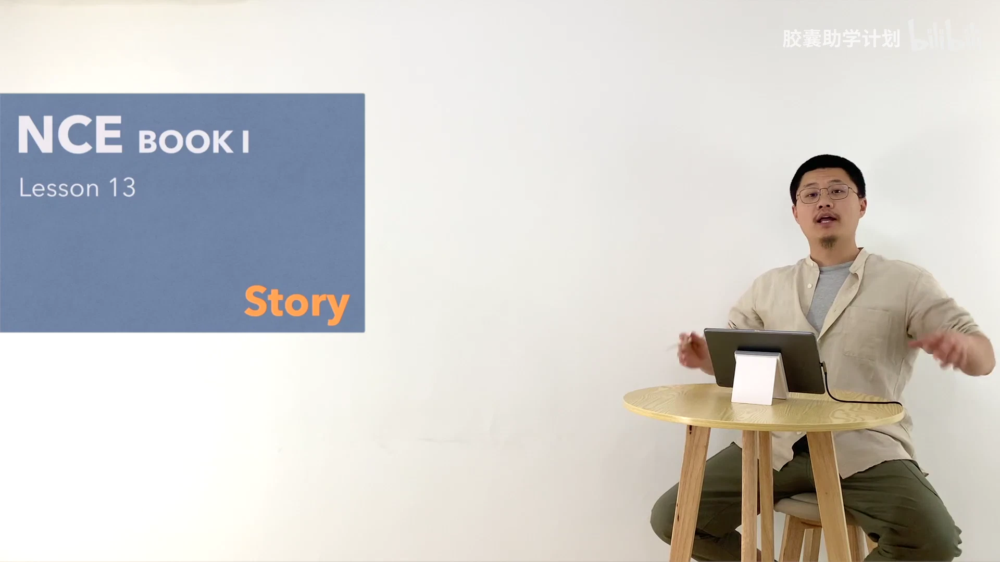

文字识别：胶囊助学计划 / NCE / BOOKI / Lesson 13 / Story

### 画面 00:00:04

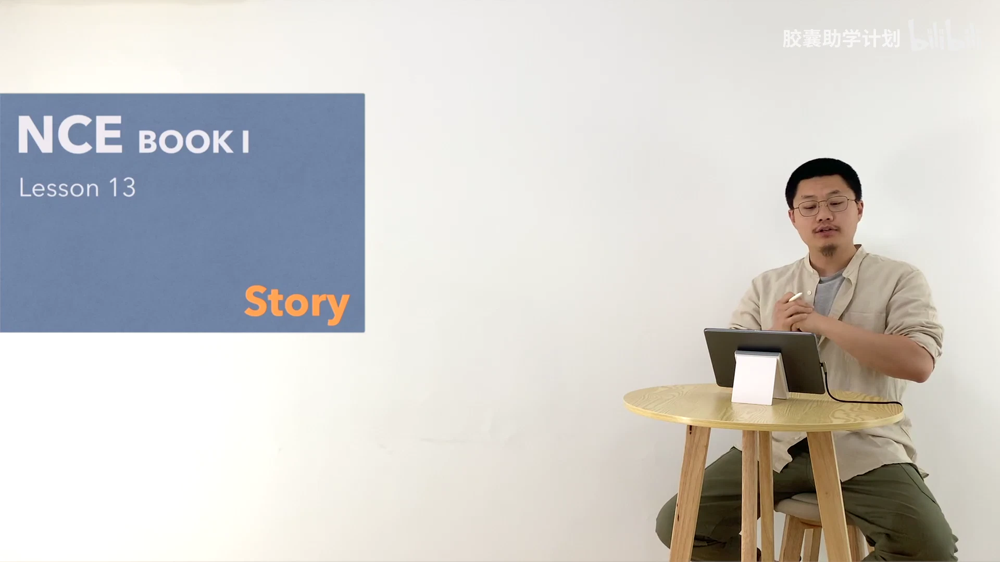

文字识别：胶囊助学计划 / NCE / BOOKI / Lesson 13 / Story

### 画面 00:00:08

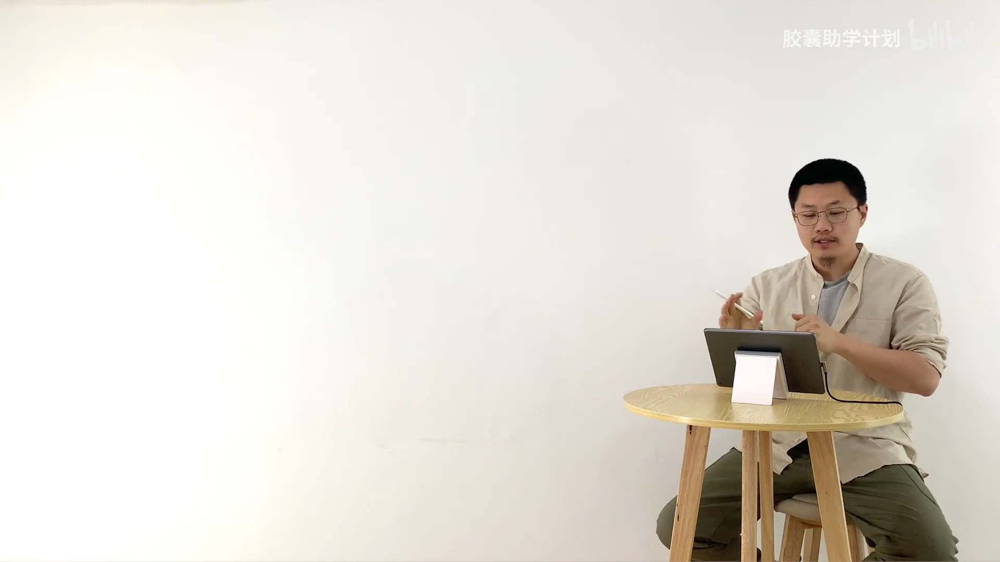

文字识别：胶囊助学计划

### 画面 00:00:10

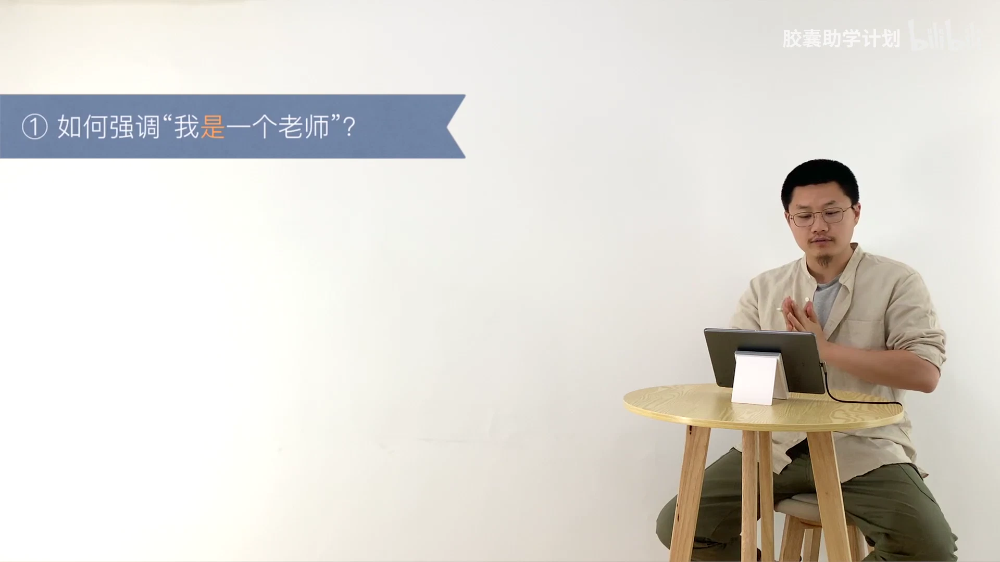

文字识别：胶囊助学计划 / ① 如何强调“我是一个老师”？

### 画面 00:00:18

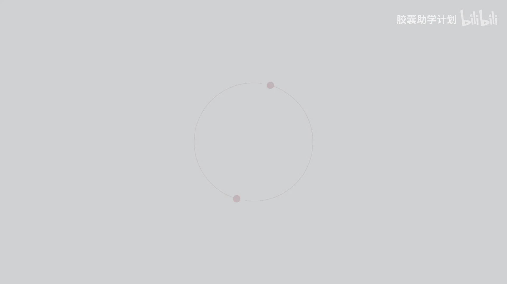

文字识别：胶囊助学计划bill

### 画面 00:00:21

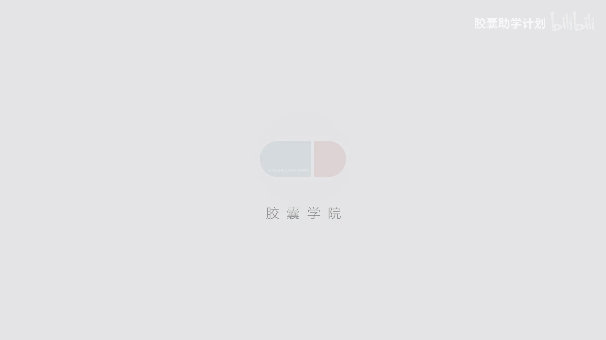

文字识别：胶囊助学计划 / 胶囊学院

### 画面 00:00:23

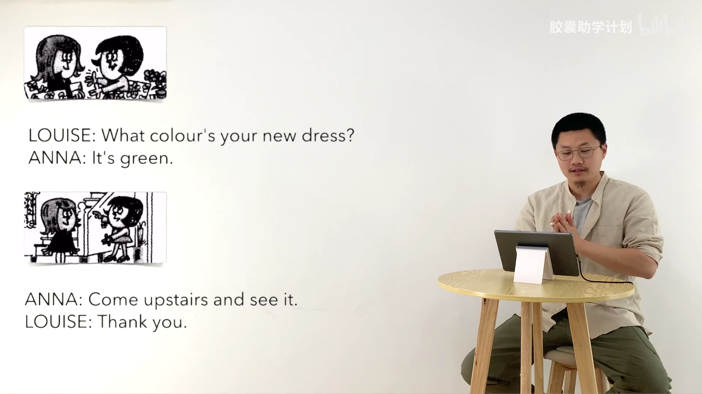

文字识别：胶囊助学计划 / LOUISE: What colour's your new dress? / ANNA: It's green. / ANNA: Come upstairs and see it. / LOUISE: Thank you.

### 画面 00:00:26

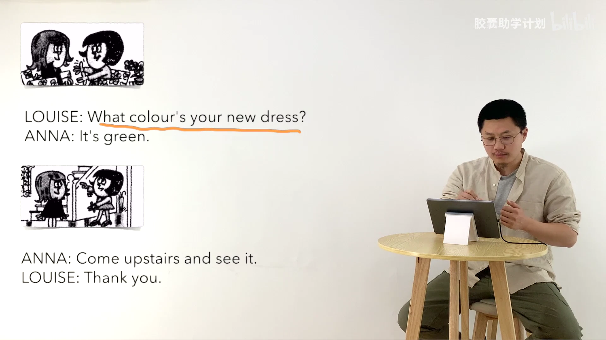

文字识别：胶囊助学计划 / LOUISE: What colour's your new dress? / ANNA: It's green. / ANNA: Come upstairs and see it. / LOUISE: Thank you.

### 画面 00:00:28

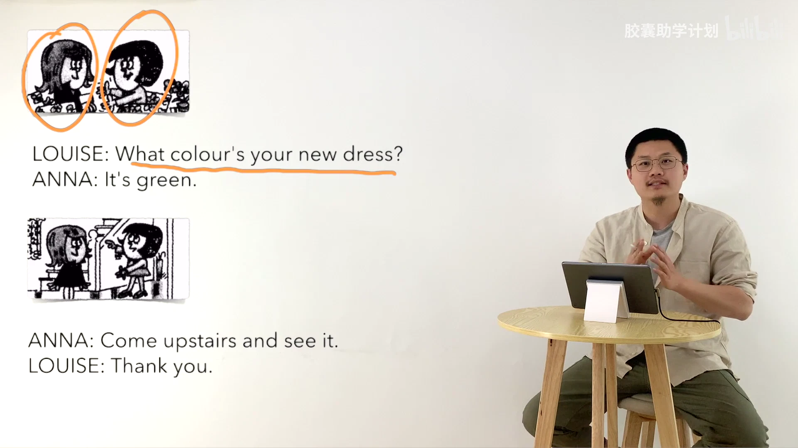

文字识别：胶囊助学计划 / LOUISE: What colour's your new dress? / ANNA: It's green. / ANNA: Come upstairs and see it. / LOUISE: Thank you.

## 00:00:30–00:01:00

问了，说你新买的裙子是什么颜色的呀？Is green，绿色的。Come upstairs，上楼吧。我们上节课说了，come upstairs， go upstairs，都表示上楼，对吧？那come downstairs或者是go downstairs都表示下楼。And然后呢，see it。And其实这个单词它的意思还真的特别特别的多。大家最常知道的一个意思就是A和

### 画面 00:00:37

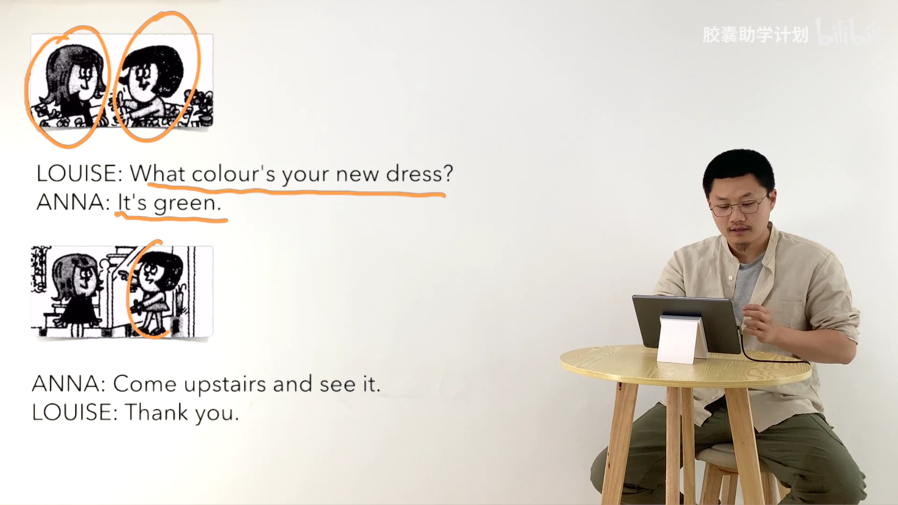

文字识别：胶囊助学计划 / LOUISE: What colour's your new dress? / ANNA: It's green. / ANNA: Come upstairs and see it. / LOUISE: Thank you.

### 画面 00:00:39

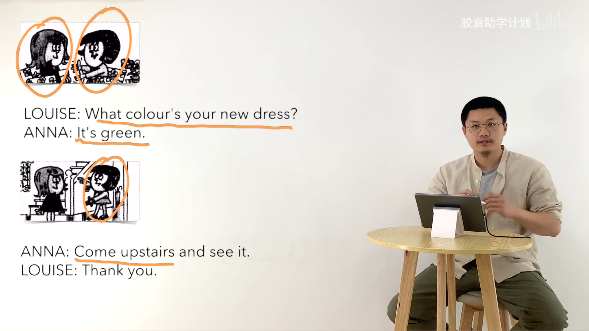

文字识别：胶囊助学计划 / LOUISE: What colour's your new dress? / ANNA: It's green. / ANNA: Come upstairs and see it. / LOUISE: Thank you.

### 画面 00:00:44

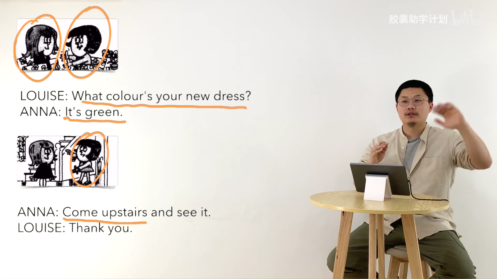

文字识别：胶囊助学计划 / LOUISE: What colour's your new dress? / ANNA: It's green. / ANNA: Come upstairs and see it. / LOUISE: Thank you.

### 画面 00:00:50

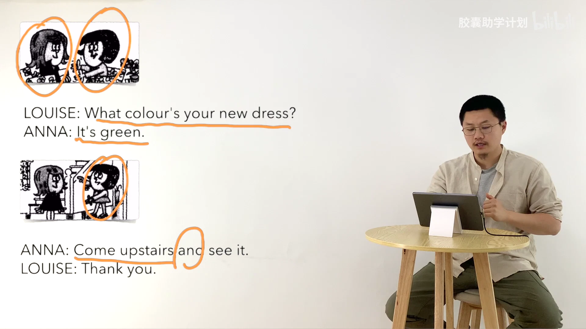

文字识别：胶囊助学计划 / LOUISE: What colour's your new dress? / ANNA: It's green. / ANNA:Come upstairsand / see it. / LOUISE: Thank you.

### 画面 00:00:54

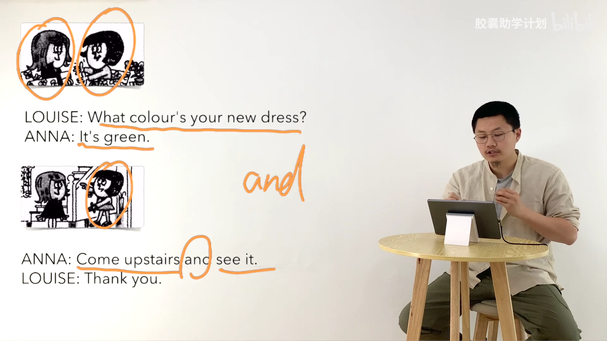

文字识别：胶囊助学计划 / LOUISE: What colour's your new dress? / ANNA: It's green. / ane / ANNA:Come upstairsand / see it. / LOUISE: Thank you.

## 00:01:00–00:01:30

b a and b a 和 b 这个和的意思对吧？它也有然后呢，或者说是接着啊并列的关系，比如说 come upstairs, come upstairs 和 see it 这两个动作是并列的，对吧？你可以也可以理解为不是并列的，是紧接着它发生的。然后哎，可以这样去理解，叫 come upstairs and see it。接下来他说的是 thank you，谢谢，没有太多可讲的。Look,瞧，

### 画面 00:01:05

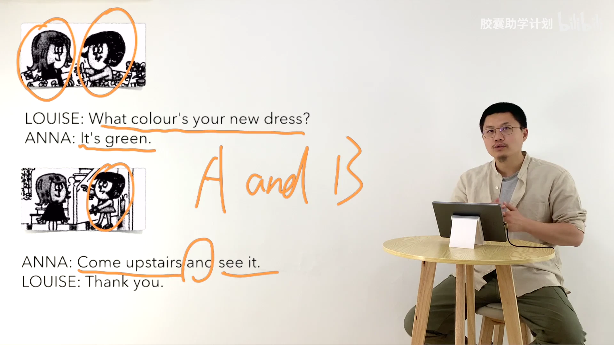

文字识别：胶囊助学计划 / LOUISE: What colour's your new dress? / ANNA: It's green. / ane / ANNA:Come upstairsand / see it. / LOUISE: Thank you.

### 画面 00:01:27

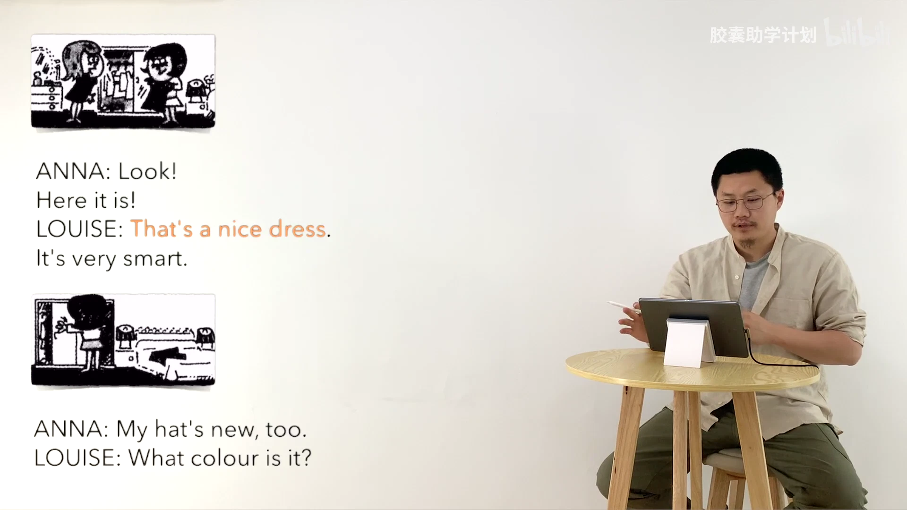

文字识别：胶囊助学计划 / ANNA: Look! / Here it is! / LOUISE: That's a nice dress. / It's very smart. / ANNA: My hat's new, too. / LOUISE: What colour is it?

## 00:01:30–00:02:00

Here it is.好。Here it is.就是在这儿呢。其实它就是It is here的一种倒装的说法。各位呢，基本上不用管它的语法。在这个地方，我们以后会提到一句话叫做高级语法习惯用法化啊。对于各位来说，在这儿去理解它的语法，反而是比较麻烦的一件事儿。你不妨直接就把它当做一句话去反复读，把它记下来，叫Here it is啊。比如说别人问你啊，说

### 画面 00:01:32

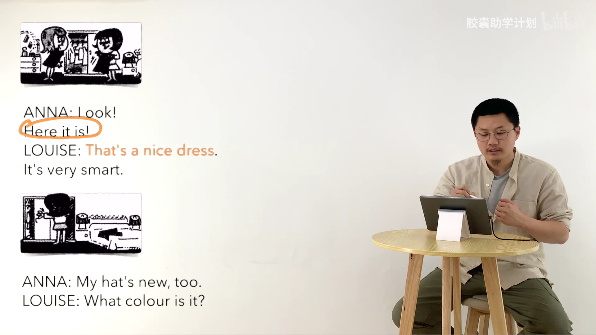

文字识别：胶囊助学计划 / ANNA:Look! / Here it isl / LOUISE: That's a nice dress. / It's very smart. / ANNA: My hat's new, too. / LOUISE: What colour is it?

### 画面 00:01:40

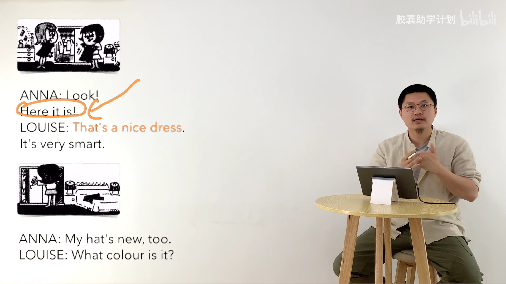

文字识别：胶囊助学计划 / ANNA:Look! / Gere it isl / LOUISE: That's a nice dress. / It's very smart. / ANNA: My hat's new, too. / LOUISE: What colour is it?

### 画面 00:01:43

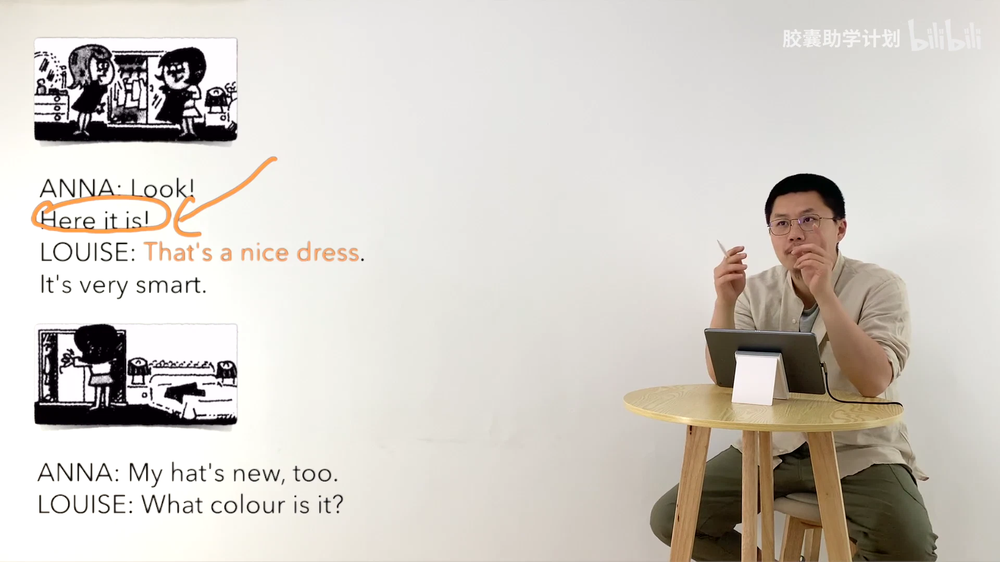

文字识别：胶囊助学计划 / ANNA:Look! / Here it isl / LOUISE: That's a nice dress. / It's very smart. / ANNA: My hat's new, too. / LOUISE: What colour is it?

## 00:02:00–00:02:30

我的这个笔在哪儿呢？你说 here it is，在这儿呢。OK，非常好，就把它长期通过熟读成诵的方式把它记下来即可。接下来说 that's a nice dress，这是一个非常棒的裙子呀。That 叫那，对吧？那想把它变成一般疑问句，说那个裙子不错吗？你要把意思提前，叫 is that a nice dress？哪一个说 is very smart？Smart 我们上节课说了，在本文当中出现的意思叫做时

### 画面 00:02:10

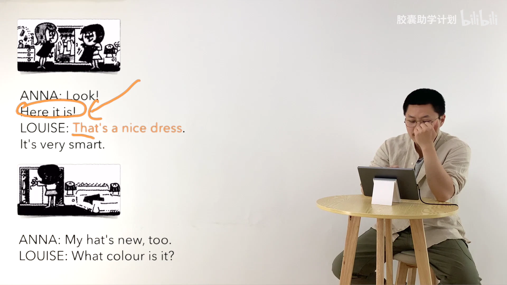

文字识别：Bilbi / 胶囊助学计划 / ANNA:Look! / Here it isl / LOUISE: That's a nice dress. / It's very smart. / ANNA: My hat's new, too. / LOUISE: What colour is it?

### 画面 00:02:13

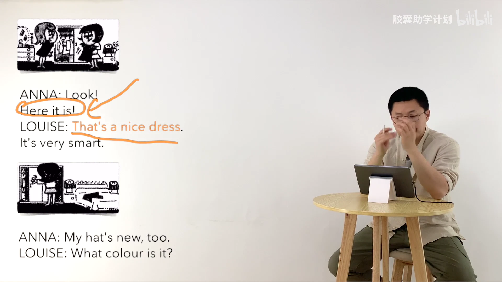

文字识别：Bibl / 胶囊助学计划 / ANNA:Look! / Here it isl / LOUISE: That's a nice dress. / It's very smart. / ANNA: My hat's new, too. / LOUISE: What colour is it?

### 画面 00:02:26

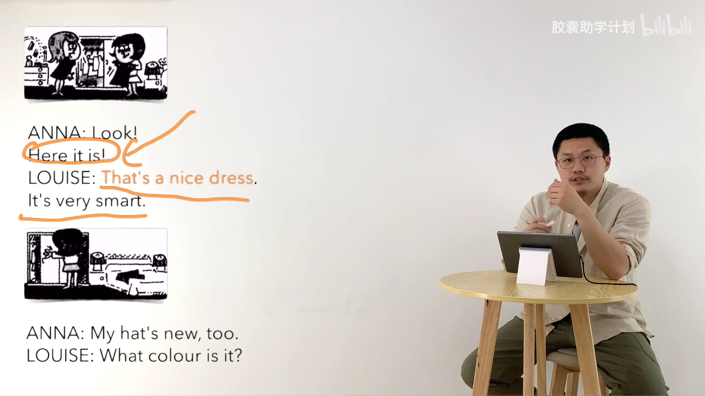

文字识别：Bilbil / 胶囊助学计划 / ANNA·Look! / Gere it isl / LOUISE: That's a nice dress. / It's very smart. / ANNA: My hat's new, too. / LOUISE: What colour is it?

## 00:02:30–00:03:00

髦的，但实际上可能更常见的一个意思叫做聪明的，对吧？He's very smart.说你这裙子非常的smart。那注意这个小点要注意，这有一个撇哦。如果没有，如果有这个撇，就是it is。如果没有这个撇，那就是另一个单词了。以后我们会学到。接着往下走，说My hat's new too.啊，My hat is new too.我的帽子也是新的。

### 画面 00:02:38

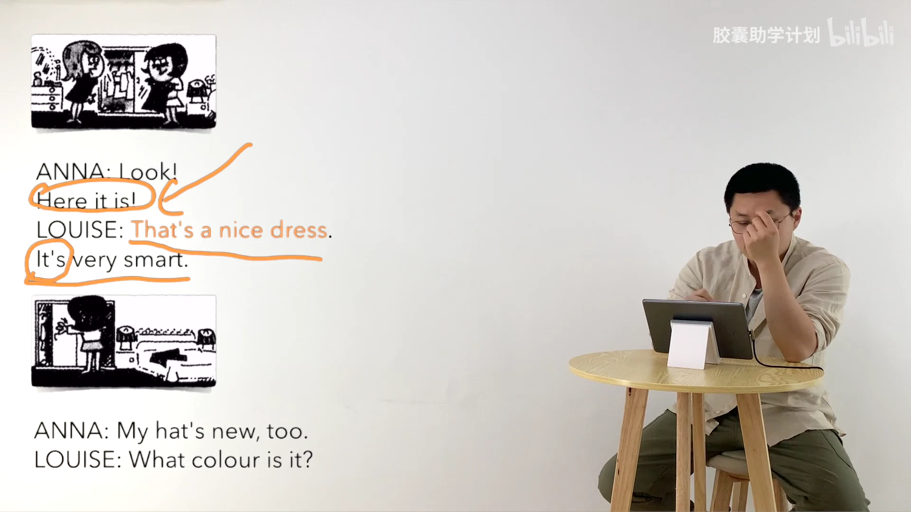

文字识别：Bilbili / 胶囊助学计划 / ANNA:Look! / Here it isl / LOUISE: That's a nice dress. / It's very smart. / ANNA: My hat's new, too. / LOUISE: What colour is it?

### 画面 00:02:41

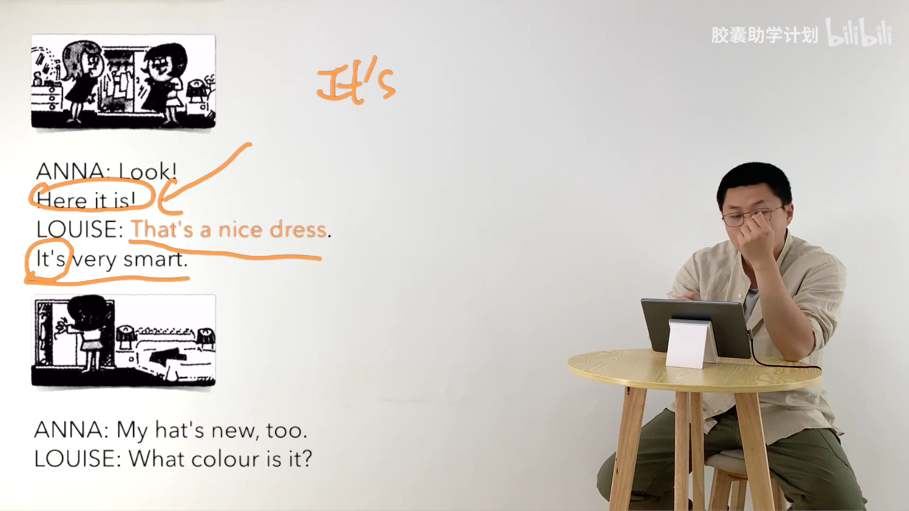

文字识别：biibili / 胶囊助学计划 / t's / ANNA·Look! / Glere it isl / LOUISE: That's a nice dress. / It's very smart. / ANNA: My hat's new, too. / LOUISE: What colour is it?

### 画面 00:02:46

文字识别：bilibili / 胶囊助学计划 / t's /  = +  / ANNA·Look! / Gere it isl / LOUISE: That's a nice dress. / It'svery smart. / ANNA: My hat's new, too. / LOUISE: What colour is it?

### 画面 00:02:51

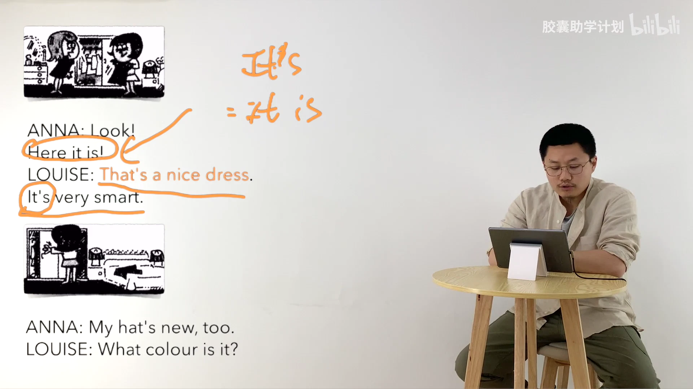

文字识别：biibili / 胶囊助学计划 / E's / = t  / ANNA·Look! / Gere it isl / LOUISE: That's a nice dress. / It'svery smart. / ANNA: My hat's new, too. / LOUISE: What colour is it?

## 00:03:00–00:03:30

What color is it？它是什么颜色的呢？我们先往下看，说 is the same color 是相同的颜色的。那各位同学可能在这地方就会有一点紧张，说这个 the 我记不下来呀，有的地方加，有的地方不加，对吧？而且我们实际上还没有大面积去讲的，我们进入二十五课才具体教各位这个 the 最常见的意思是什么。对于各位呢，在这个地方就放松心态，通过反复读文章，期冀于通过

### 画面 00:03:01

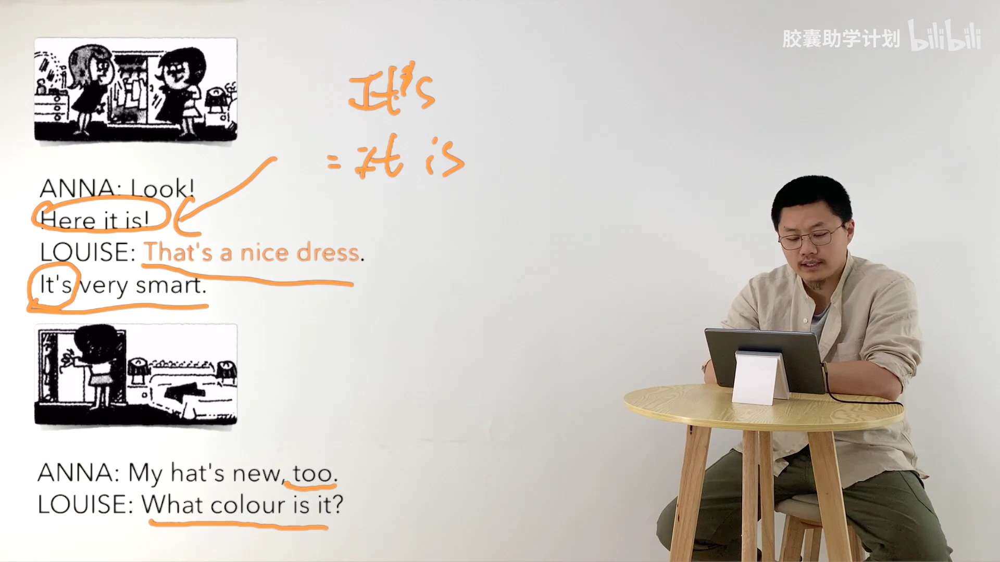

文字识别：Bibi / 胶囊助学计划 / E's / ANNA·Look! / Gere it isl / LOUISE: That's a nice dress. / It'svery smart. / ANNA: My hat's new, too. / LOUISE: What colour is it?

### 画面 00:03:04

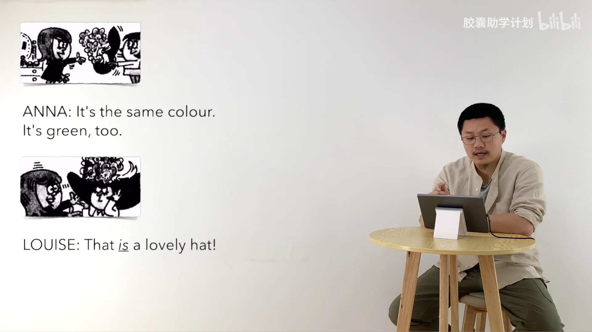

文字识别：胶囊助学计划 b出b出 / ANNA: It's the same colour. / It's green, too. / LOUISE: That is a lovely hat!

### 画面 00:03:07

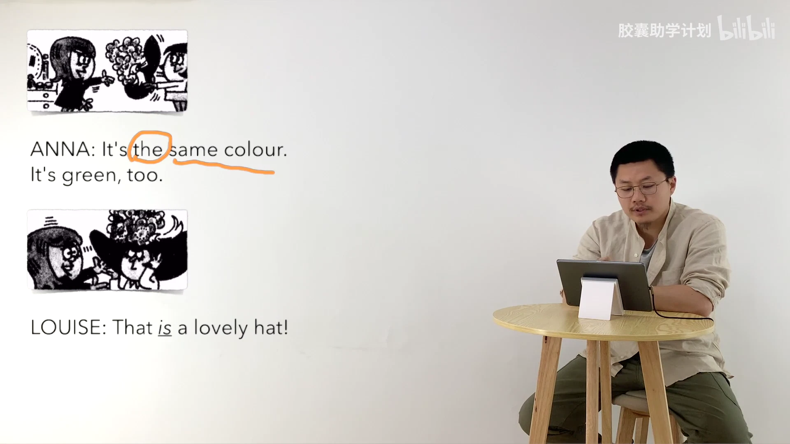

文字识别：胶囊助学计划bilb出 / ANNA: It'sthe same colour. / It's green, too. / LOUISE: That is a lovely hat!

## 00:03:30–00:04:00

复读把它记下来就好了啊，不用过分的焦虑。说，哎呀，每一个单词我都必须做到完美的准确，不可能的，也没有必要啊。Is green too？是绿色的。That is a lovely hat。说，那呀是一个很可爱的帽子。那这个地方，各位可以看一下你们的书本，不止我在这个地方现在加了一个斜体和下划线。你看一下各位自己的书本当中，is这个单词

### 画面 00:03:37

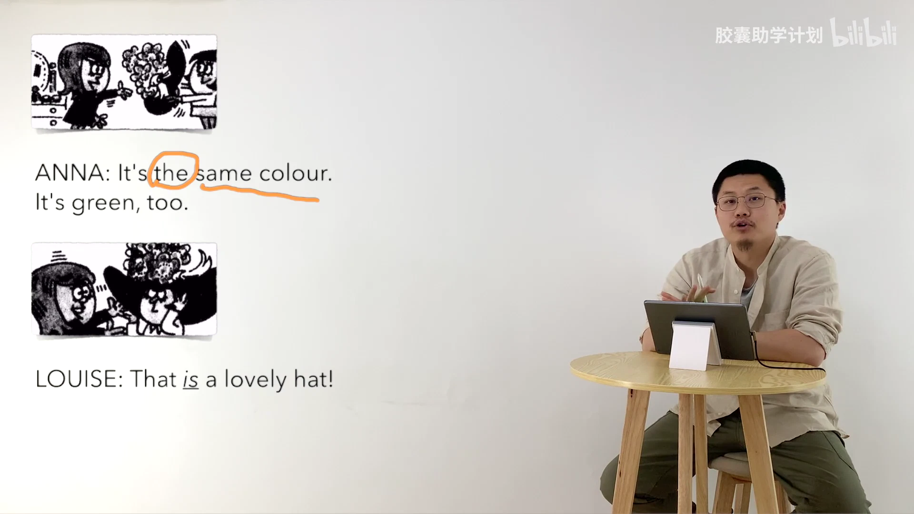

文字识别：胶囊助学计划bilb出 / ANNA: It'sthe same colour. / It's green, too. / LOUISE: That is a lovely hat!

### 画面 00:03:40

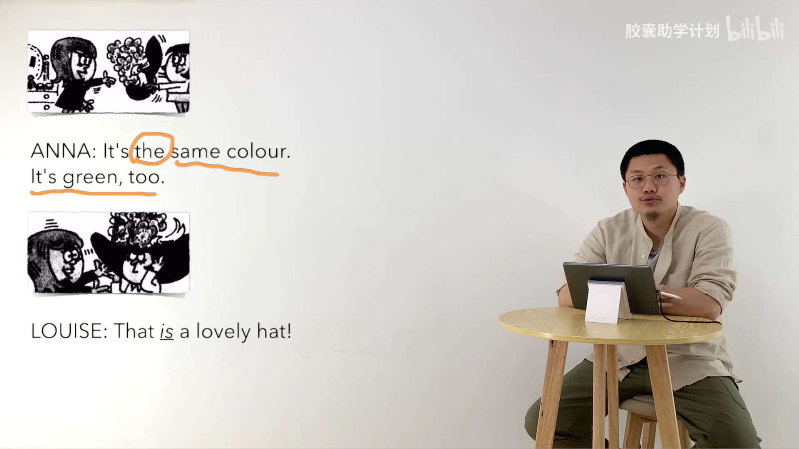

文字识别：胶囊助学计划b鼎b出 / ANNA: It'sthe same colour. / It's green, too. / LOUISE: That is a lovely hat!

### 画面 00:03:56

文字识别：胶囊助学计划b出b出 / ANNA: It'sthe same colour. / It's green, too. / LOUISE: That is a lovely hat!

### 画面 00:03:59

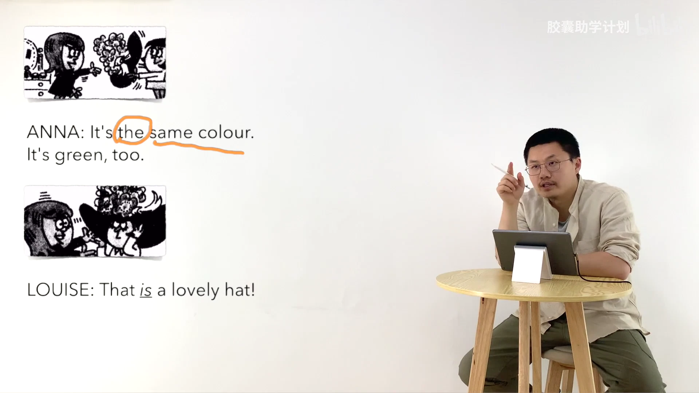

文字识别：胶囊助学计划 / ANNA: It'sthe same colour. / It's green, too. / LOUISE: That is a lovely hat!

## 00:04:00–00:04:30

也加了一个下划线，并且当你去听音频的时候，他读的不是 that is a lovely dress，他不是这么去读的，他是怎么去读的呢？ That is a lovely hat。这个地方我想教各位的一个点叫做可以靠 an is or 的重读在口语当中表达强调。比如说我再读一遍啊，不重读叫 that is a lovely hat，重读叫 that

### 画面 00:04:02

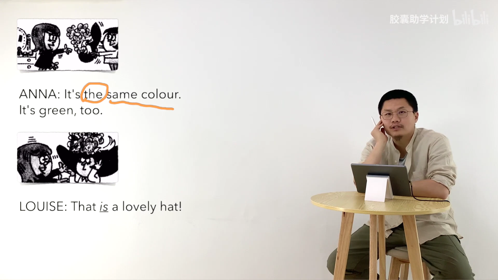

文字识别：胶囊助学计划 / ANNA: It'sthe same colour. / It's green, too. / LOUISE: That is a lovely hat!

### 画面 00:04:16

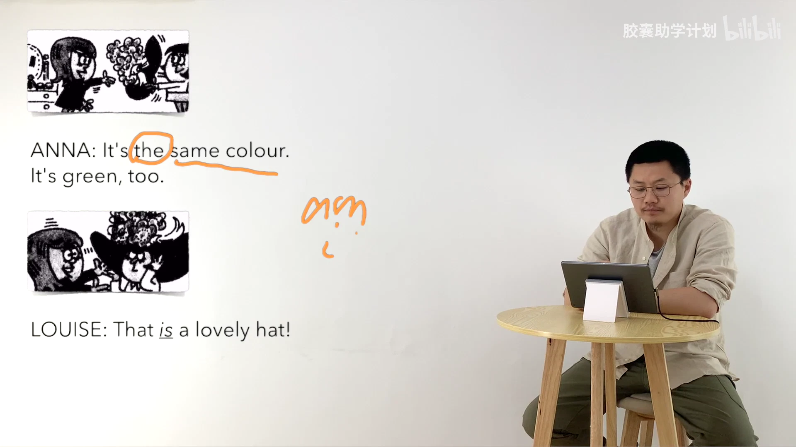

文字识别：胶囊助学计划 / ANNA: It'sthe same colour. / It's green, too. / am / LOUISE: That is a lovely hat!

### 画面 00:04:18

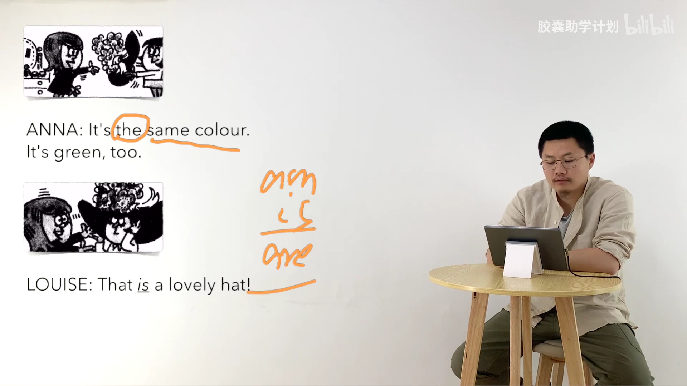

文字识别：胶囊助学计划 / A / ANNA: It'sthe same colour. / It's green, too. / am / ome / LOUISE: That is a lovely hat!

### 画面 00:04:21

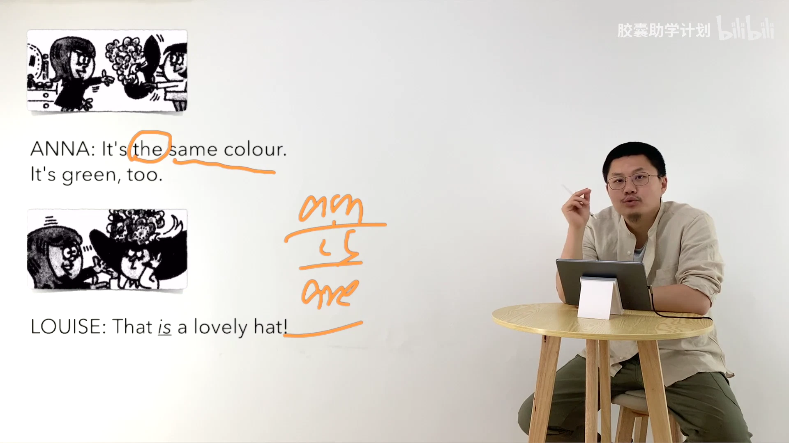

文字识别：胶囊助学计划 / ANNA: It'sthe same colour. / It's green, too. / nm / 「 / ome / LOUISE: That is a lovely hat!

## 00:04:30–00:05:00

is a lovely hat.怎么用呢？我给各位举个例子。我给别人介绍 I'm Leo, right? So this is Leo. I'm Leo.那我跟别人介绍我的职业叫做 I am a teacher.那很有意思的是什么呢？我们中国大部分的老师还都是打扮上比较中规中矩的。那我曾经呢，一度有很多年五六年七八年的时间，头发是满头长发的。我去任何地方旅游啊，我这个人又比较喜欢和别人搭讪，对

### 画面 00:04:34

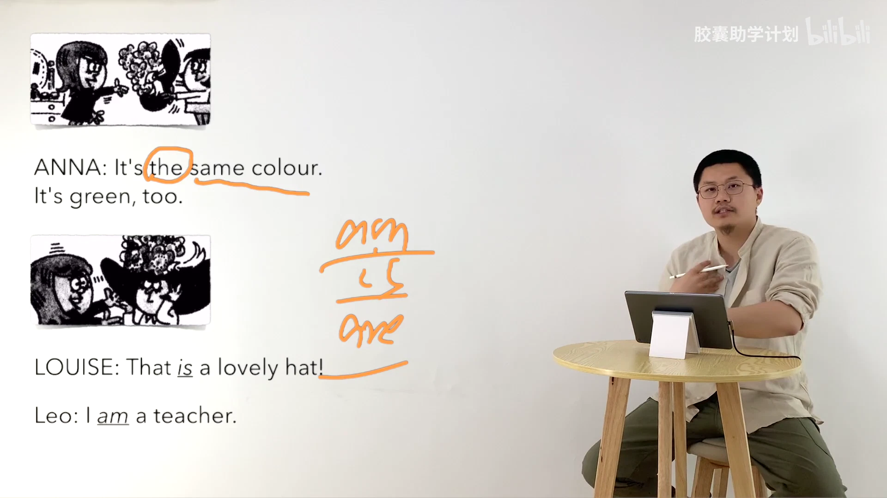

文字识别：胶囊助学计划 / ANNA: It'sthe same colour. / It's green, too. / nm / ome / LOUISE: That is a lovely hat! / Leo: I am a teacher.

### 画面 00:04:39

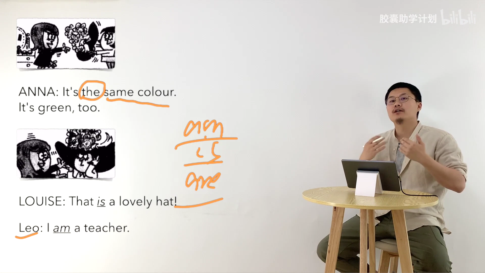

文字识别：胶囊助学计划 / ANNA: It'sthe same colour. / It's green, too. / nm / 「 / ove / LOUISE: That is a lovely hat! / Leo: I am a teacher.

## 00:05:00–00:05:30

吧？就是胡侃，然后呢，别人就会问我说：“哎，你是什么职业的？”我说：“我是一个老师。”别人不太信。我说：“我真是一个老师啊！”这个“真是一个老师啊”就是咱们汉语的强调，我没骗你，我真是一个老师。因为英文怎么说呢？叫 I am a teacher. I am a teacher. I'm not lying. I am a teacher. OK，就我是一个老师啊。记住，am is are 进行重读可以表

### 画面 00:05:04

文字识别：胶囊助学计划山山 / ANNA: It'sthe same colour. / It's green, too. / nm / ome / LOUISE: That is a lovely hat! / Leo: I am a teacher.

### 画面 00:05:20

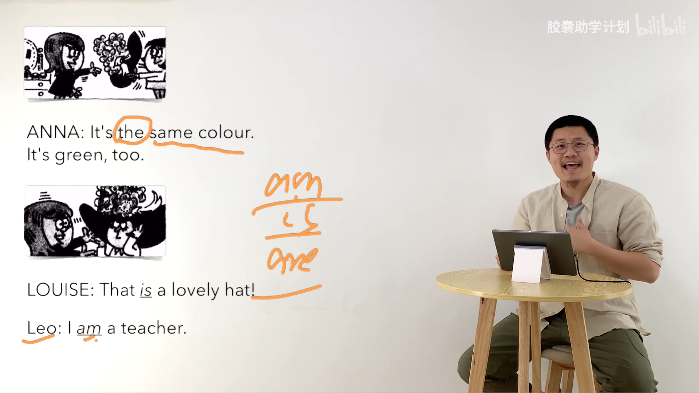

文字识别：胶囊助学计划山 / ANNA: It'sthe same colour. / It's green, too. / nm / ome / LOUISE: That is a lovely hat! / Leo: I am a teacher.

### 画面 00:05:28

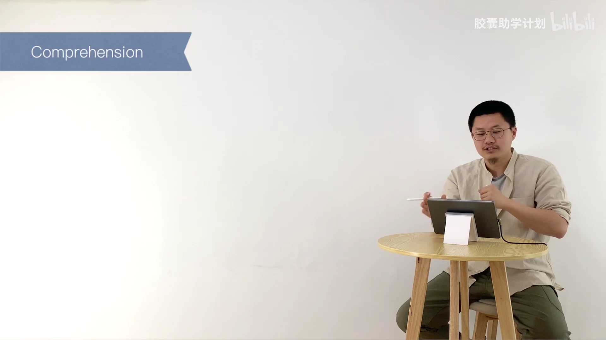

文字识别：胶囊助学计划 / Comprehension

## 00:05:30–00:06:00

强调，OK。那接下来 comprehension 又到了口语听力练习的时间了，闭上眼睛或者看着书本，我们开始了。Is Anna's dress new？答案 Yes, it is. What color is Anna's hat？ Green. Is Anna's hat new？

### 画面 00:05:52

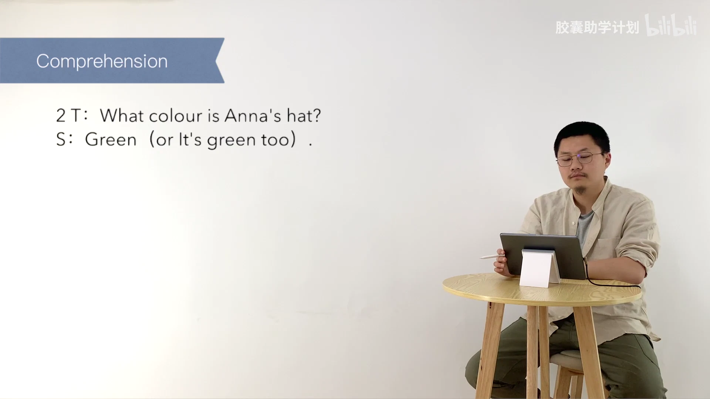

文字识别：胶囊助学计划 / Comprehension / 2 T: What colour is Anna's hat? / S: Green (or It's green too) .

### 画面 00:05:58

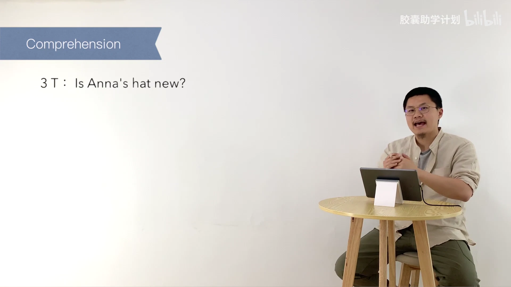

文字识别：胶囊助学计划 / Comprehension / 3 T: Is Anna's hat new?

## 00:06:00–00:06:30

Yes, it is. Is Anna's hat lovely? 各位听到这句话，在书本里找答案，或者在脑海当中找答案啊！不要看啊！我们现在是听力口语练习。Yes, it is. Is Anna's dress smart? Yes, it is. Asking questions啊，

### 画面 00:06:27

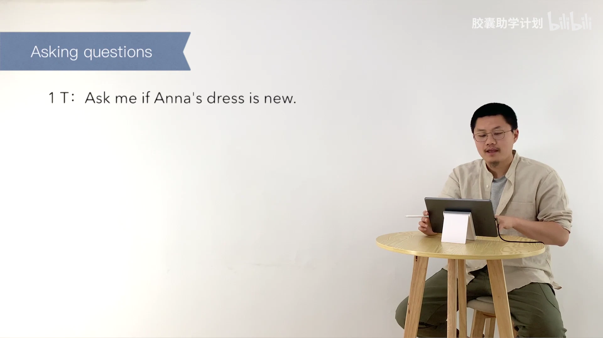

文字识别：胶囊助学计划 / Asking questions / 1 T: Ask me if Anna's dress is new.

## 00:06:30–00:07:00

we first answer it. Asking questions,口语听力练习。我问您一句话，您把一般疑问句通过听力口语告诉我答案，然后我再来一个特殊疑问词，各位再用口语给我答案。我们已经练了很多课了啊，各位还是眼睛离开屏幕，听。Ask me if Anna's dress is new. Anna's dress is new. Is提前。

### 画面 00:06:33

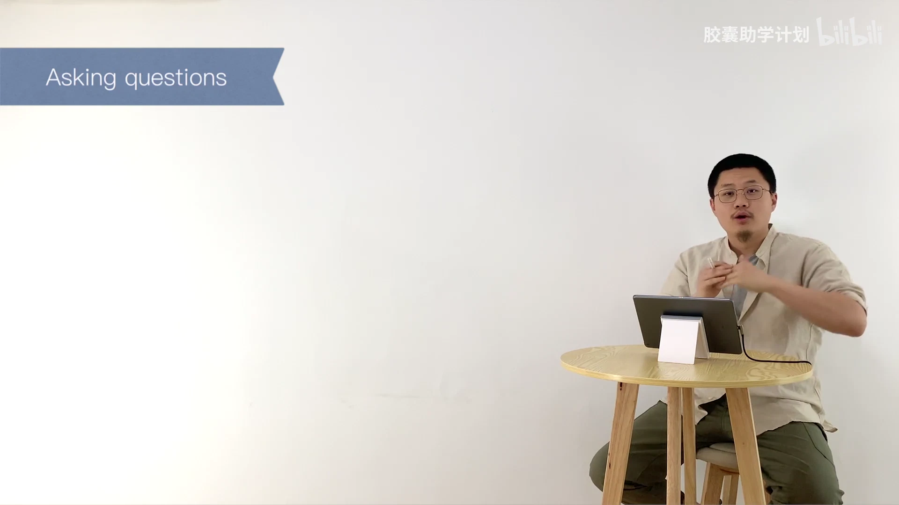

文字识别：胶囊助学计划 / Asking questions

### 画面 00:06:47

文字识别：胶囊助学计划 / Asking questions / 1 T: Ask me if Anna's dress is new.

### 画面 00:06:49

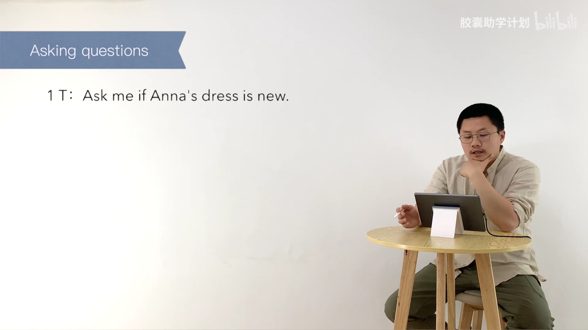

文字识别：胶囊助学计划 / Asking questions / 1 T: Ask me if Anna's dress is new.

### 画面 00:06:55

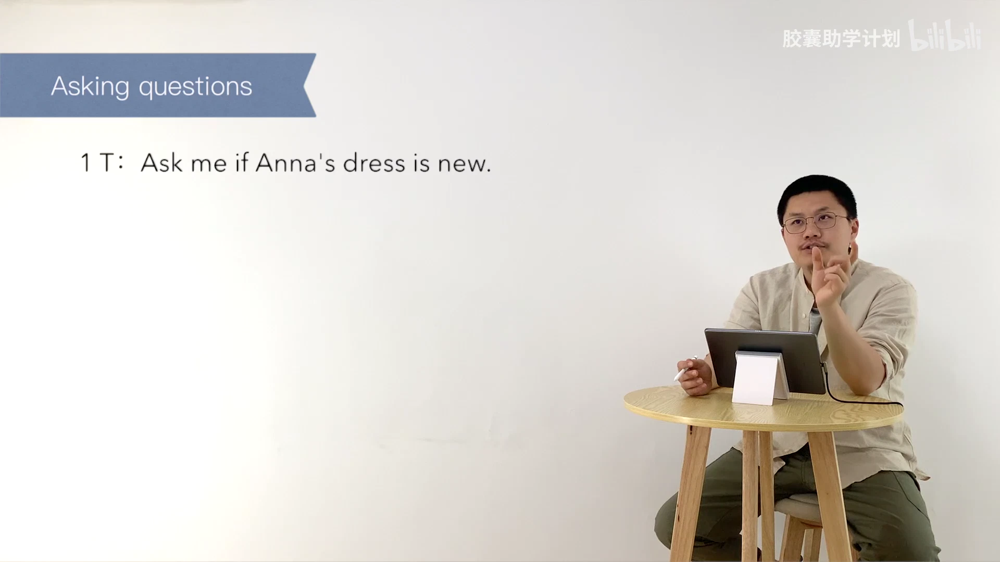

文字识别：胶囊助学计划 / Asking questions / 1 T: Ask me if Anna's dress is new.

### 画面 00:06:59

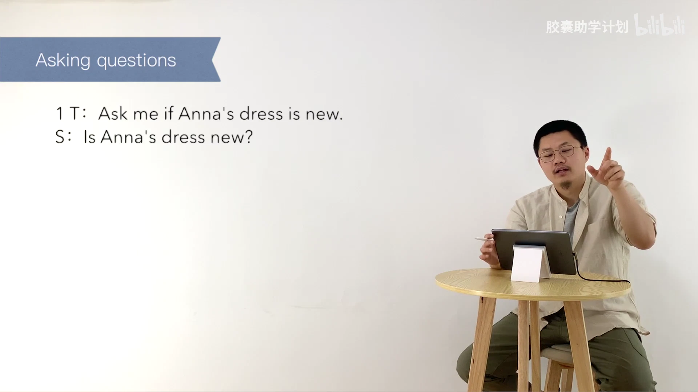

文字识别：胶囊助学计划 / Asking questions / 1 T: Ask me if Anna's dress is new. / S: Is Anna's dress new?

## 00:07:00–00:07:30

Is Anna's dress new?这就是答案。然后我给了一个单回答。Yes, it is.那我现在想问啊，比如说Anna's，用谁提问啊？Whose吧？那我就可以问出来一句话叫做Whose dress is new?谁的裙子？谁的连衣裙是新的呀？第二个题。闭上眼睛。Ask me if

### 画面 00:07:10

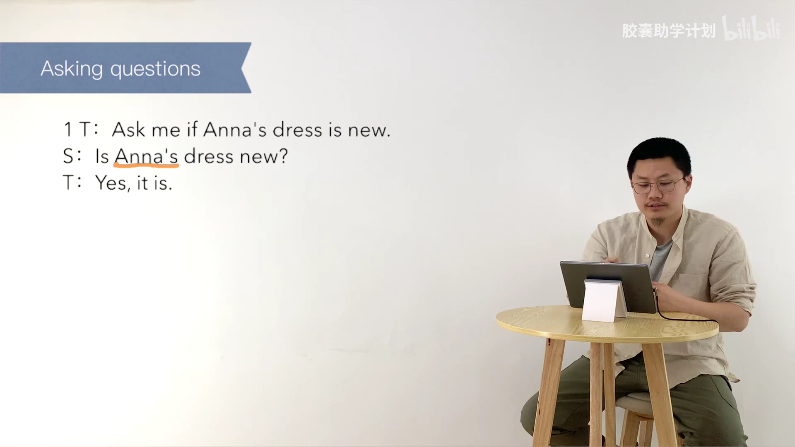

文字识别：胶囊助学计划 / Asking questions / 1 T: Ask me if Anna's dress is new. / S: Is Anna's dress new? / T: Yes, it is.

### 画面 00:07:15

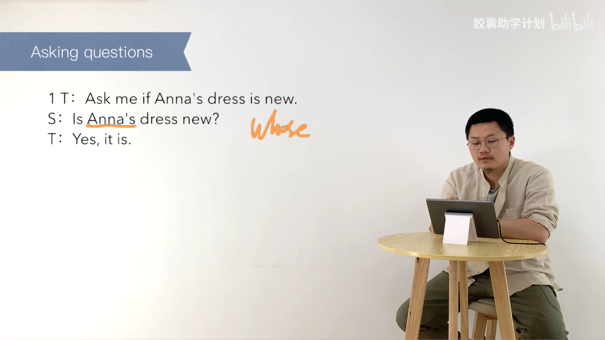

文字识别：胶囊助学计划 / Asking questions / 1 T: Ask me if Anna's dress is new. / S: Is Anna's dress new? / Whose / T: Yes, it is.

### 画面 00:07:19

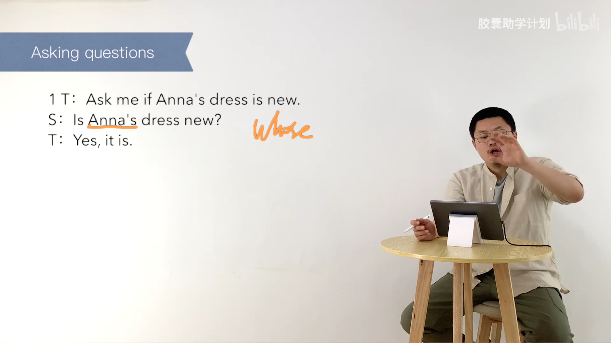

文字识别：胶囊助学计划 / Asking questions / 1 T: Ask me if Anna's dress is new. / S: Is Anna's dress new? / Woxe / T: Yes, it is.

### 画面 00:07:24

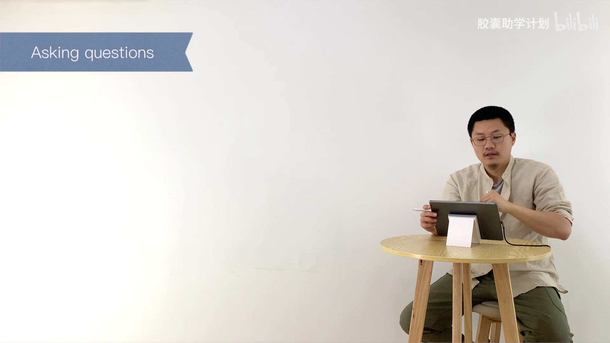

文字识别：胶囊助学计划 / Asking questions

### 画面 00:07:29

文字识别：胶囊助学计划 / Asking questions / 2 T: Ask me if Anna's dress is nice.

## 00:07:30–00:08:00

if Anna's dress is nice. 答案 Is Anna's dress nice? Yes, it is. 第三个题. Ask me if Anna's dress is blue. 一般疑问句 Is Anna's dress blue? 好，在这儿各位看一下，好像就可以对两个不同

### 画面 00:07:38

文字识别：胶囊助学计划 / Asking questions / 2 T: Ask me if Anna's dress is nice. / S: Is Anna's dress nice?

### 画面 00:07:47

文字识别：胶囊助学计划 / Asking questions / 3 T: Ask me if Anna's dress is blue.

### 画面 00:07:51

文字识别：胶囊助学计划 / Asking questions / 3 T: Ask me if Anna's dress is blue.

### 画面 00:07:57

文字识别：胶囊助学计划 / Asking questions / 3 T: Ask me if Anna's dress is blue. / S: Is Anna's dress blue?

## 00:08:00–00:08:30

的东西提问了。我对 Anna's 提问用谁 whose 对吧？对 blue 提问用 what color。那我现在给了一个特殊疑问词叫做 what color。你用 blue 提问，对 blue 提问对吧？所以答案就是口语自己去说出来啊。What color is Anna's dress? Very good. 继续听. Ask me if Anna's has green too.

### 画面 00:08:11

文字识别：胶囊助学计划 / Asking questions / 3 T: Ask me if Anna's dress is blue. / S: Is Anna's dress blue? / T: What colour...?

### 画面 00:08:22

文字识别：胶囊助学计划 / Asking questions / 4T : Ask me if Anna's hat's green too.

## 00:08:30–00:09:00

Anna's hat's green too. 好，答案 is Anna's hat green too? What color? What color is Anna's hat? Continue. Ask me if Anna's hat's lovely. Is提前 is Anna's hat lovely? Yes, it is. 那我现在想对 Anna's 提问，用谁?

### 画面 00:08:42

文字识别：胶囊助学计划 / Asking questions / 4T: Ask me if Anna's hat's green too. / S: Is Anna's hat green, too? / T: What colour...? / S: What colour is Anna's hat?

### 画面 00:08:44

文字识别：胶囊助学计划 / Asking questions

## 00:09:00–00:09:30

Whose变特殊疑问句？Whose head is lovely? Okay, very good.那如何强调？我真是一个老师，没骗你，是吧？你别看头发长，对吧？但是我还真是一个老师，叫做I am a teacher. Am is are，重点强调一下就可以了。本课并不是特别的难，关键点还是That is a lovely head. 本课的作业，第一，绿皮书第十三课，您可以写了。其次，文章

### 画面 00:09:06

文字识别：胶囊助学计划 / ① 如何强调“我是一个老师”?

### 画面 00:09:09

文字识别：胶囊助学计划 / ① 如何强调“我是一个老师”？

### 画面 00:09:12

文字识别：胶囊助学计划 / ① 如何强调“我是一个老师”?

### 画面 00:09:21

文字识别：Bilbili / 胶囊助学计划 / Recap / Patterns / Grammar / Words / Expression That / is / a lovely hat!

### 画面 00:09:25

文字识别：胶囊助学计划bi出

## 00:09:30–00:10:00

一定要跟读至熟读成诵，多少遍？我上一节课刚刚讲到，不限，你只要读到过磕巴过得去就可以了啊，很流利，不磕巴就OK了。第三，给自己讲解一遍核心知识点，每次都是如此。那本期的课程呢，到这就结束了。如果大家喜欢我们的课程，欢迎大家关注、订阅、一键三连，并转发给需要的朋友支持我们。那最后的最后，我们再看一句名人名言，Albert Einstein说过的：We

### 画面 00:09:45

文字识别：胶囊助学计划bl出

### 画面 00:09:55

文字识别：胶囊助学计划 / We cannot solve our problems with the same / thinking we used when we created them. / -Albert Einstein

## 00:10:00–00:10:22

cannot solve our problems with the same thinking we used when we created them. Peace out, man. Bye bye.

### 画面 00:10:08

文字识别：胶囊助学计划 / We cannot solve our problems with the same / thinking we used when we created them. / -Albert Einstein

### 画面 00:10:10

文字识别：CAPSULEACADEMY / 胶囊学院 / 小红书 / □ / Lecturer

### 画面 00:10:12

文字识别：CAPSULEACADEMY / 胶囊学院 / 小红书 / Photoar

### 画面 00:10:15

文字识别：CAPSULEACADEMY / 胶囊学院 / 小红书 / Editor / □ / Berlin

### 画面 00:10:18

文字识别：CAPSULEACADEMY / 胶囊学院 / 小红书 / 品 / Leo & Berlin

### 画面 00:10:20

文字识别：bilibili / 胶囊助学计划

### 画面 00:10:21

文字识别：bilibili / 胶囊助学计划

