# 015 文章

快速机器解析：语音为单模型转写，未进行独立交叉校对或人工复核；画面每秒采样并按变化选帧，短时文字和标记可能遗漏。截图时间约有 1 秒误差。图片有损压缩；遇到疑点请按时间查看 Google Drive 原视频。

## 00:00:00–00:00:30

Hello everyone, welcome to Capsule Academy. This is Leo. Today we're going to learn in Concept English Book One Lesson Fifteen Story. Hope you get it. Enjoy it. 上来，我们直接看文章。我们先看一下对话，叫 Customs Officer。这是谁说的呢？叫海关官员说的。Are you Swedish? 你们是瑞典人吗？Okay, girls说No, we are not.

### 画面 00:00:00

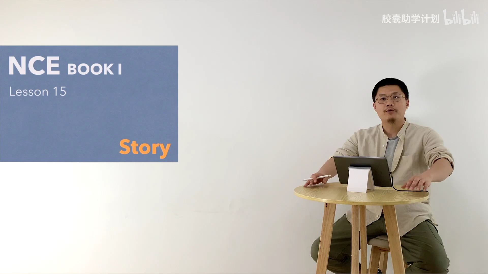

文字识别：biibili / 胶囊助学计划 / NCE / BOOKI / Lesson 15 / Story

### 画面 00:00:02

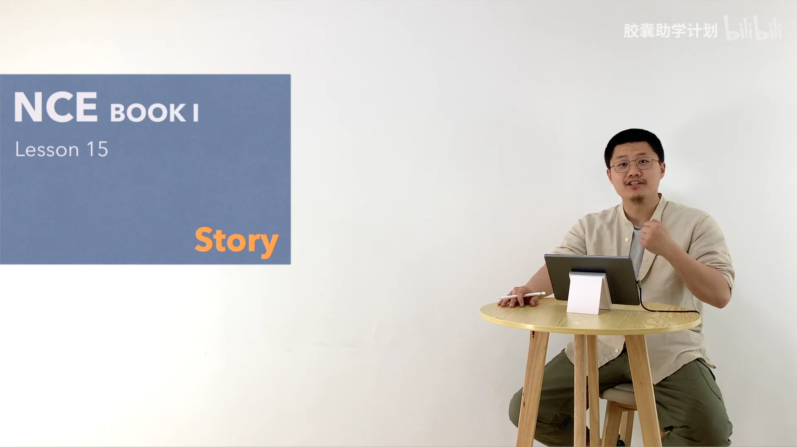

文字识别：胶囊助学计划 / NCE / BOOKI / Lesson 15 / Story

### 画面 00:00:09

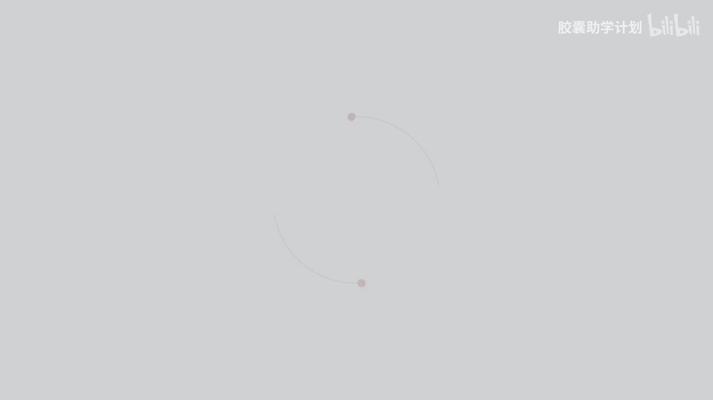

文字识别：胶囊助学计划bill / •

### 画面 00:00:13

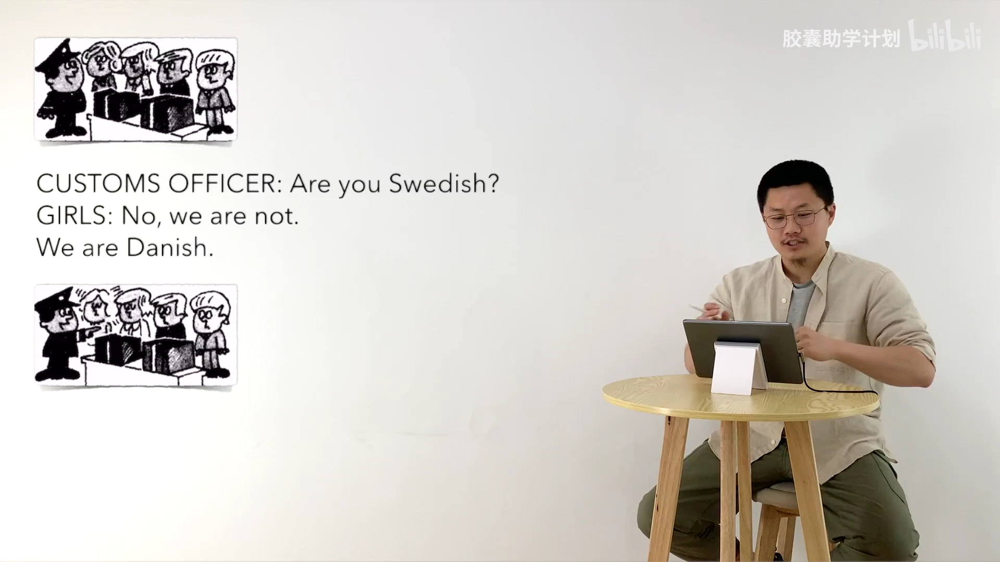

文字识别：胶囊助学计划 / CUSTOMS OFFICER: Are you Swedish? / GIRLS: No, we are not. / We are Danish.

### 画面 00:00:17

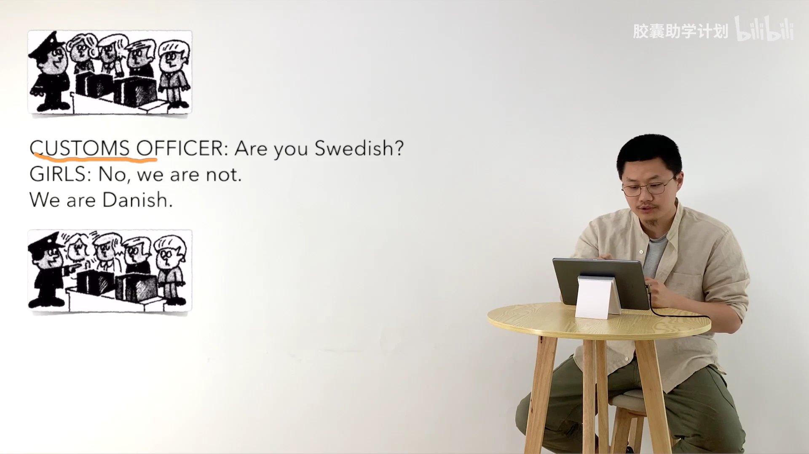

文字识别：胶囊助学计划 / CUSTOMS OFFICER: Are you Swedish? / GIRLS: No, we are not. / We are Danish.

### 画面 00:00:19

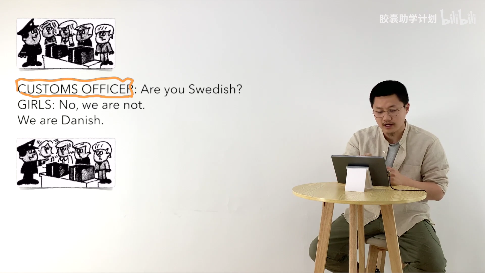

文字识别：胶囊助学计划bilb出 / CUSTOMS OFFICER: / : Are you Swedish? / GIRLS: No, we are not. / We are Danish.

### 画面 00:00:23

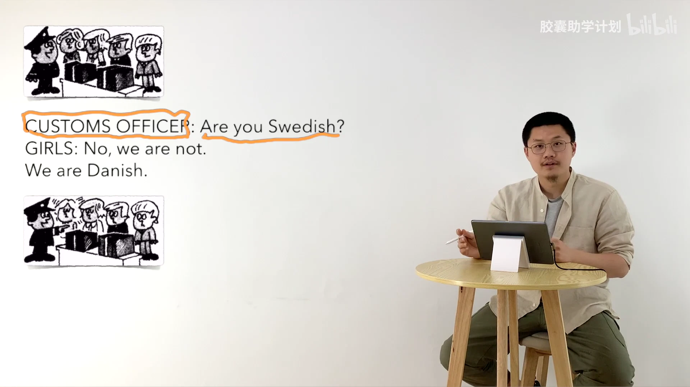

文字识别：胶囊助学计划 / CuSTOMs OFFICEr: Are you Swedish? / GIRLS: No, we are not. / We are Danish.

### 画面 00:00:28

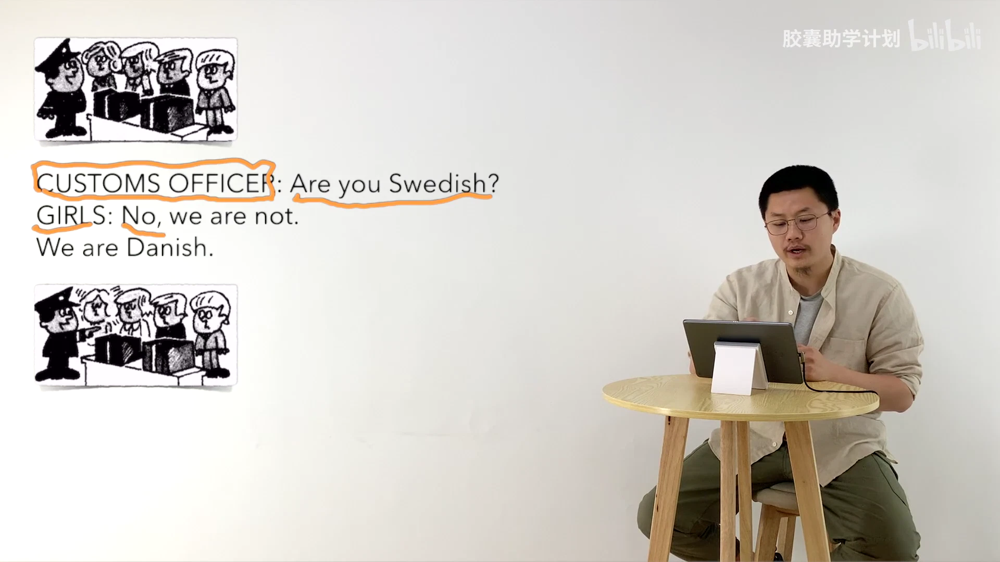

文字识别：胶囊助学计划b出b出 / CuSTOMs OFFICEr: Are you Swedish? / GIRLS: No, we are not. / We are Danish.

## 00:00:30–00:01:00

不，我们不是。We are Danish.我们是丹麦人，非常简单。接下来呢，customs officer又说什么了呢？说Are your friends Danish too?那这个地方其实我们再回过去要说Are you Swedish?不是问你是瑞典人吗？而是问你们是瑞典人吗？你想，所以他回答说我们不是。那于是这儿其实就可以想明白一件事儿，就是英文当中啊，

### 画面 00:00:32

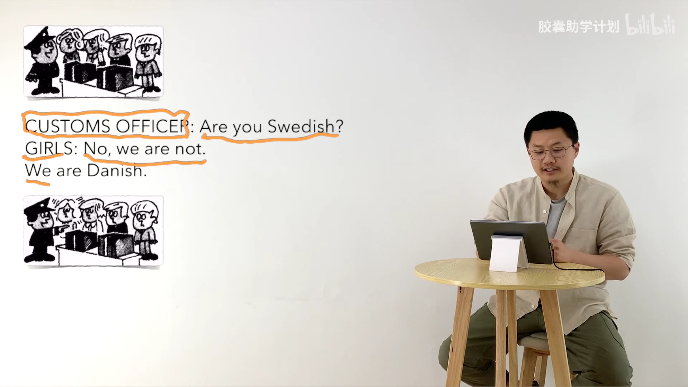

文字识别：胶囊助学计划 / CusTOMs OFFICEr: Are you Swedish? / GIRLS: No, we are not. / We are Danish.

### 画面 00:00:34

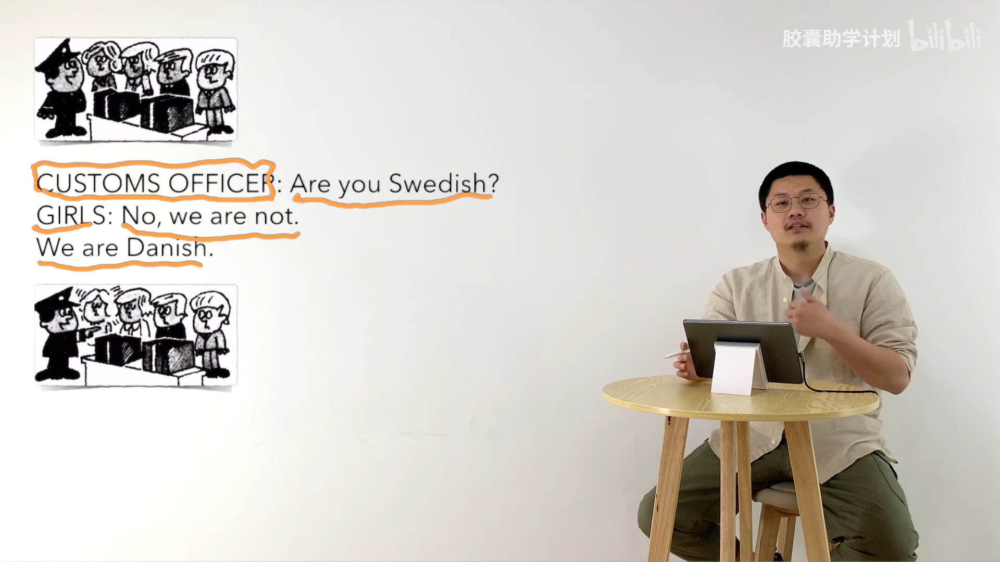

文字识别：胶囊助学计划 / CuSTOMs OFFiCER: Are you Swedish? / GIRLS: No, we are not. / We are Danish.

### 画面 00:00:36

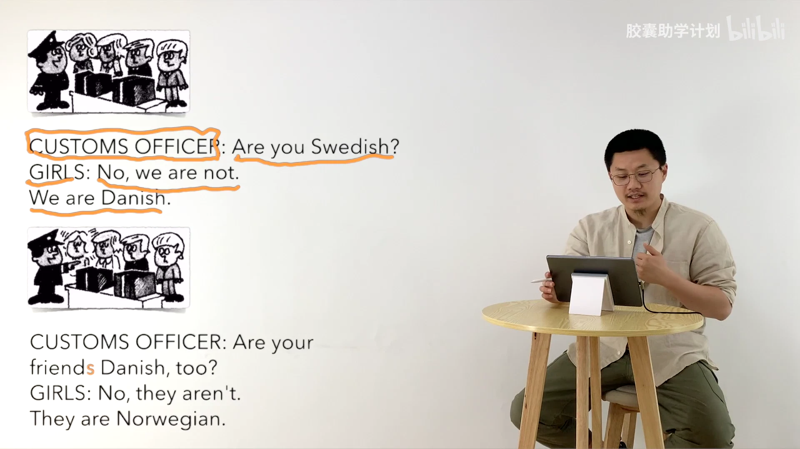

文字识别：胶囊助学计划 / CUSTOMS OFFICER: / Are you Swedish? / GIRLS: No, we are not. / We are Danish. / CUSTOMS OFFICER: Are your / friends Danish, too? / GIRLS: No, they aren't. / They are Norwegian.

### 画面 00:00:40

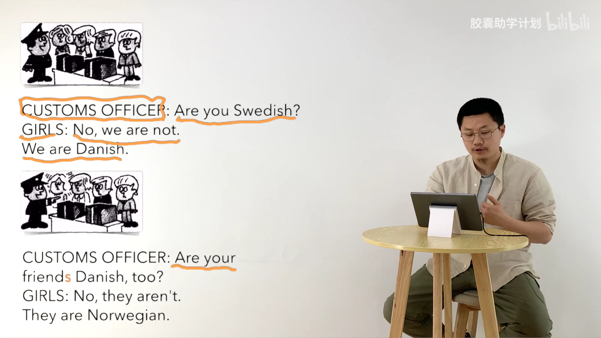

文字识别：胶囊助学计划 / CUSTOMS OFFICER: / : Are you Swedish? / GIRLS: No, we are not. / We are Danish. / CUSTOMS OFFICER: Are your / friends Danish, too? / GIRLS: No, they aren't. / They are Norwegian.

### 画面 00:00:42

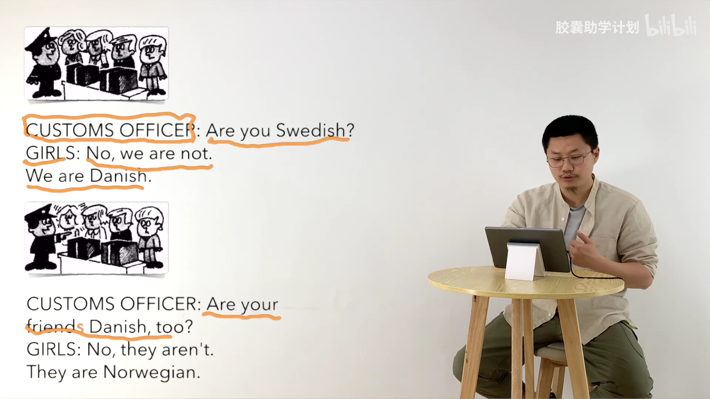

文字识别：胶囊助学计划 / BidLil / CUSTOMS OFFICER / Are you Swedish? / GIRLS: No, we / are not. / We are / Danish. / CUSTOMS OFFICER: Are your / friends Danish, too? / GIRLS: No, they aren't. / They are Norwegian.

### 画面 00:00:47

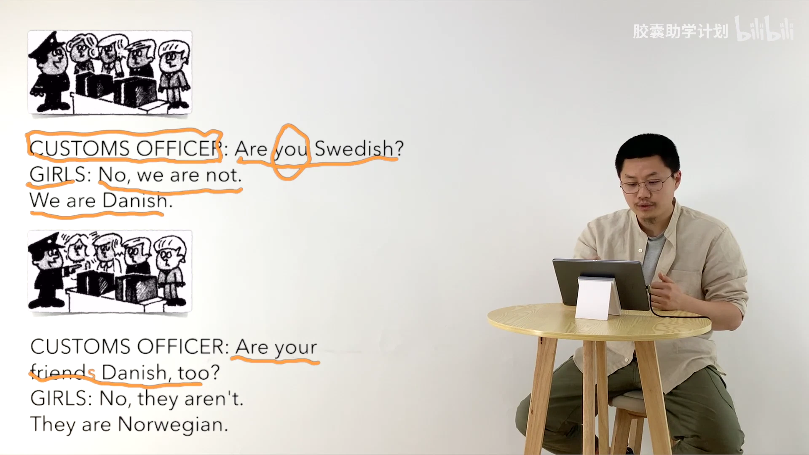

文字识别：胶囊助学计划 / CUSTOMS OFFICER / Are / you / Swedish? / GIRLS: No, we / are not. / We are / Danish. / CUSTOMS OFFICER: Are your / friends Danish, too? / GIRLS: No, they  / aren't. / They are I / Norwegian.

### 画面 00:00:49

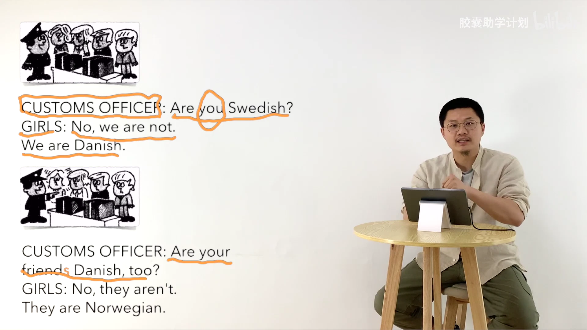

文字识别：胶囊助学计划 / CUSTOMS / OFFICER / Are / Swedish? / you / GIRLS: No, we / are not. / We are / Danish. / CUSTOMS OFFICER: Are your / friends Danish, too? / GIRLS: No, they / aren't. / They are / Norwegian.

### 画面 00:00:54

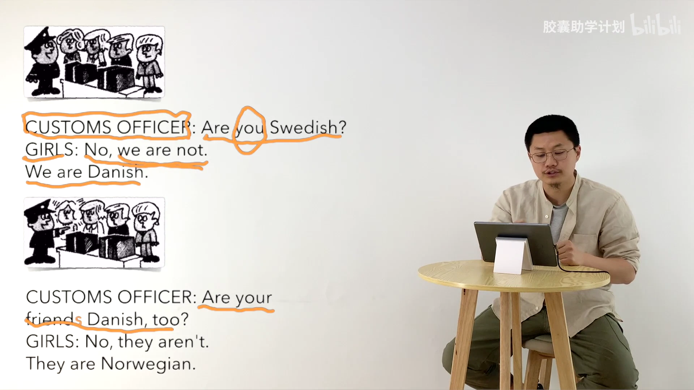

文字识别：胶囊助学计划 / CUSTOMS OFFICER / Are / Swedish? / you / GIRLS: No, we / are not. / We are / Danish. / CUSTOMS OFFICER: Are your / friends Danish, too? / GIRLS: No, they  / aren't. / They are Norwegian.

### 画面 00:00:57

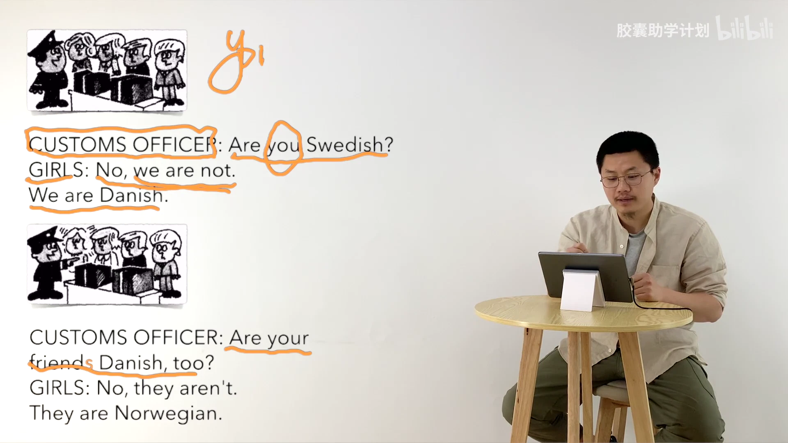

文字识别：胶囊助学计划 / Biltbil / CUSTOMS OFFICER / Are / Swedish? / you / GIRLS: No, we / are not. / We are / Danish. / CUSTOMS OFFICER: Are your / friends Danish, too? / GIRLS: No, they a / aren't. / They are Norwegian.

### 画面 00:00:59

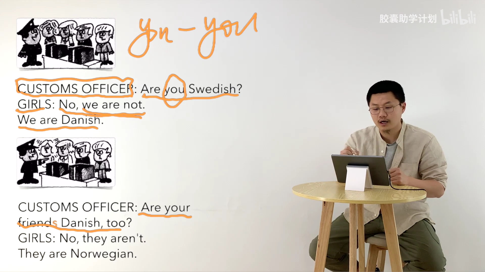

文字识别：Bilbil / 胶囊助学计划 / Yn / Yov / CUSTOMS / OFFICER / Are / Swedish? / you / GIRLS: No, we / are not. / We are / Danish. / CUSTOMS OFFICER: Are your / friends / Danish, too? / GIRLS: No, they / aren't. / They are / Norwegian.

## 00:01:00–00:01:30

你和你们都是用 you 这个单词，而不需要分开了，对吧？那你看底下说 Are your friends Danish too？那说的是你们的朋友加了 s，看到了吧？这个地方是一个复数。说你们的朋友也是丹麦人吗？No， they aren't。不，他们不是 aren't。 are 加 not 的缩写。 They are Norwegian。他们是挪威人。

### 画面 00:01:02

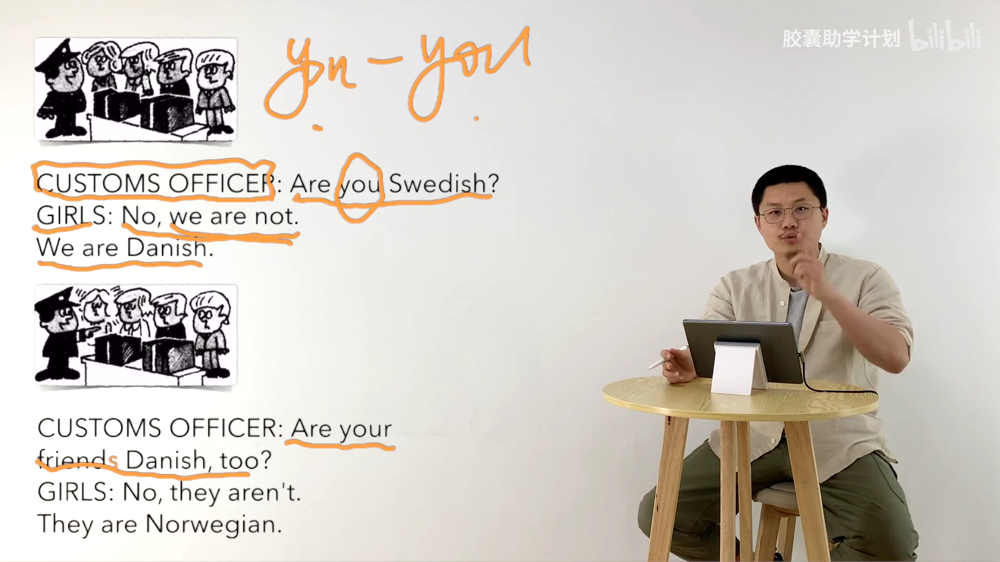

文字识别：BilBil / 胶囊助学计划 / 4n / YoV / CUSTOMS / OFFICER / Are / Swedish? / you / GIRLS: No, we / are not. / We are / Danish. / CUSTOMS OFFICER: Are your / friends Danish, too? / GIRLS: No, they / aren't. / They are / Norwegian.

### 画面 00:01:07

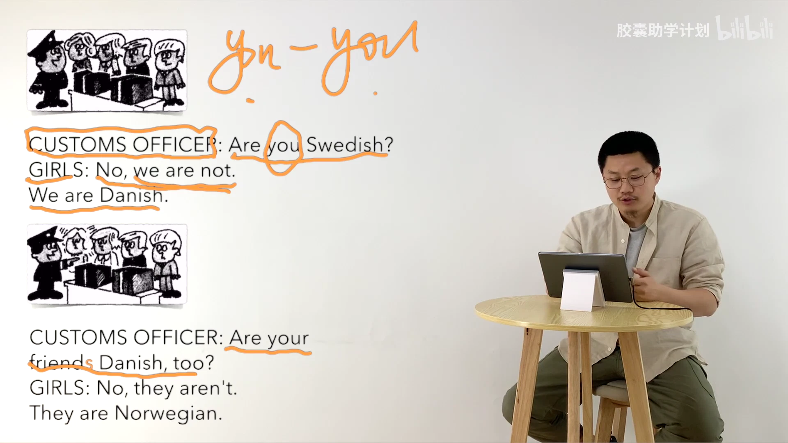

文字识别：胶囊助学计划 / YoV / CUSTOMS / OFFICER / Are / Swedish? / you / GIRLS: No, we / are not. / We are / Danish. / CUSTOMS OFFICER: Are your / friends / Danish, too? / GIRLS: No, they / aren't. / They are / Norwegian.

### 画面 00:01:12

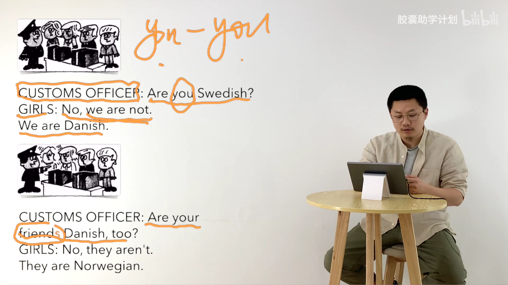

文字识别：Biltbili / 胶囊助学计划 / YoV / 4n / CUSTOMS / OFFICER / Are / Swedish? / you / GIRLS: No, we / are not. / We are / Danish. / CUSTOMS OFFICER: Are your / friends Danish, too? / GIRLS: No, they  / aren't. / They are / Norwegian.

### 画面 00:01:14

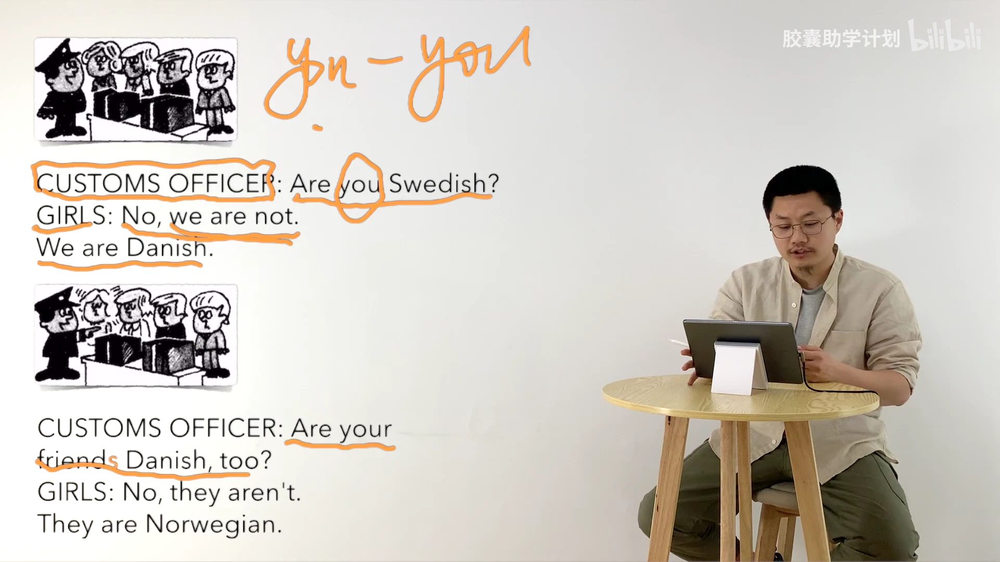

文字识别：Biltil / 胶囊助学计划 / YovV / 4n / CUSTOMS / OFFICER / Are / Swedish? / you / GIRLS: No, we / are not. / We are / Danish. / CUSTOMS OFFICER: Are your / friends / Danish, too? / GIRLS: No, they / aren't. / They are / Norwegian.

### 画面 00:01:16

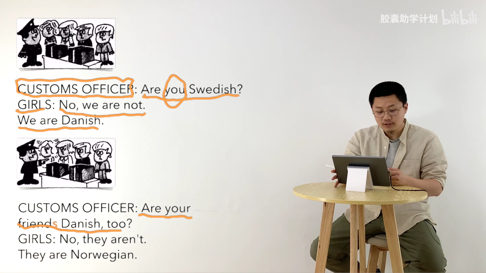

文字识别：胶囊助学计划 / CUSTOMS OFFICEr / Are / Swedish? / you / GIRLS: No, we / are not. / We are / Danish. / CUSTOMS OFFICER: Are your / friends Danish, too? / GIRLS: No, they  / aren't. / They are I / Norwegian.

### 画面 00:01:18

文字识别：胶囊助学计划 / CUSTOMS OFFICER: / Are you Swedish? / GIRLS: No, we are not. / We are Danish. / CUSTOMS OFFICER: Are your / friends Danish, too? / GIRLS: No, they aren't. / They are Norwegian.

### 画面 00:01:22

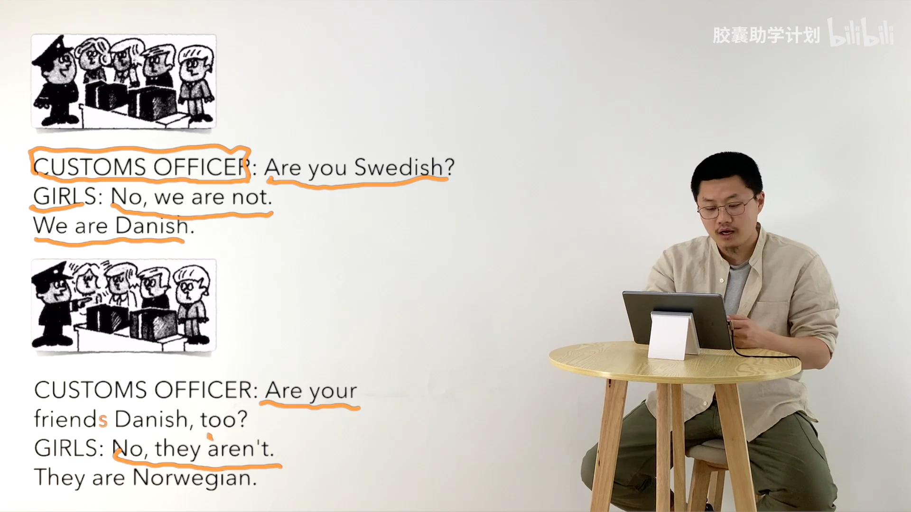

文字识别：Bilabil / 胶囊助学计划 / CUSTOMS OFFICER / Are you Swedish? / GIRLS: No, we are not. / We are / Danish. / CUSTOMS OFFICER: Are your / friends Danish, too? / 0 / GIRLS: No, they aren't. / They are Norwegian.

### 画面 00:01:26

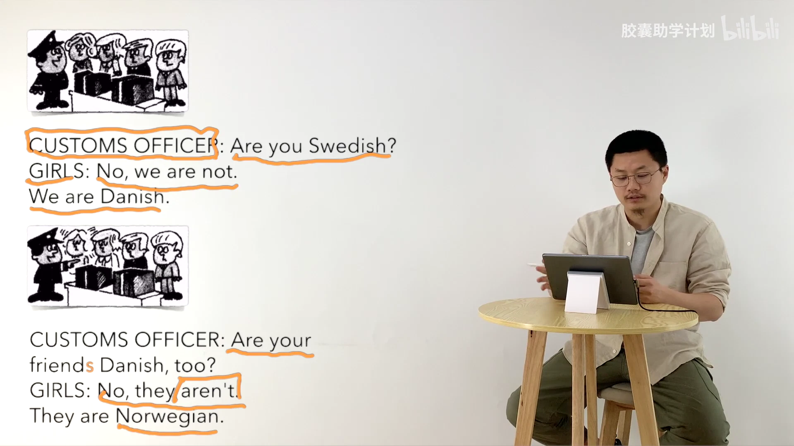

文字识别：BilBil / 胶囊助学计划 / CUSTOMS OFFICER / Are you Swedish? / GIRLS: No, we are not. / We are / Danish. / CUSTOMS OFFICER: Are your / friends Danish, too? / GIRLS: No, theyaren't! / They are Norwegian.

### 画面 00:01:28

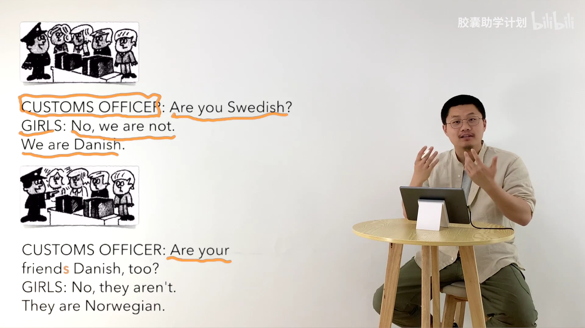

文字识别：胶囊助学计划 / CUSTOMS OFFICER: / Are you Swedish? / GIRLS: No, we are not. / We are Danish. / CUSTOMS OFFICER: Are your / friends Danish, too? / GIRLS: No, they aren't. / They are Norwegian.

## 00:01:30–00:02:00

Very good. Ah,接着往下走，说Your passports, please.说你们的，注意，哎，又好玩的来了，叫做Your，它实际上既可以表达你的，也可以表达你们的，对吧？所以说你们的护照，护照才需要加s。你想一下是不是这个逻辑，对吧？你的护照只有一个，就不用加复数了嘛。Your passports, please. Here, there,给你，哎，这是他们。那我们之前学过一个

### 画面 00:01:30

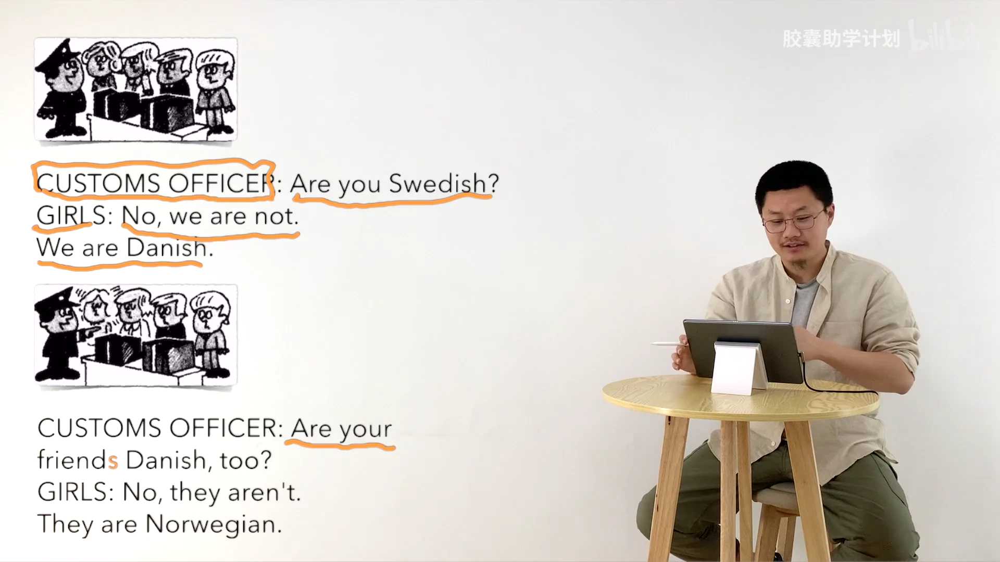

文字识别：胶囊助学计划 / CUSTOMS OFFICER: / Are you Swedish? / GIRLS: No, we are not. / We are Danish. / CUSTOMS OFFICER: Are your / friends Danish, too? / GIRLS: No, they aren't. / They are Norwegian.

### 画面 00:01:32

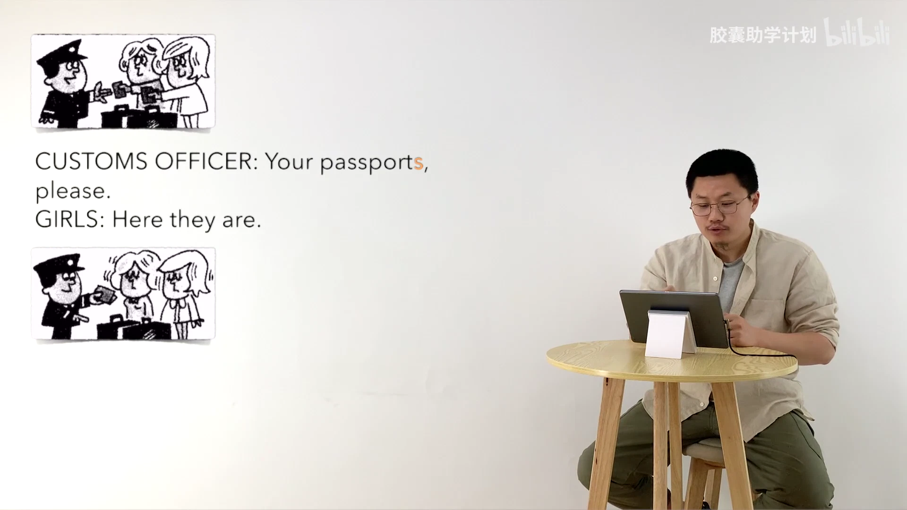

文字识别：胶囊助学计划 / CUSTOMS OFFICER: Your passports, / please. / GIRLS: Here they are. / 0

### 画面 00:01:35

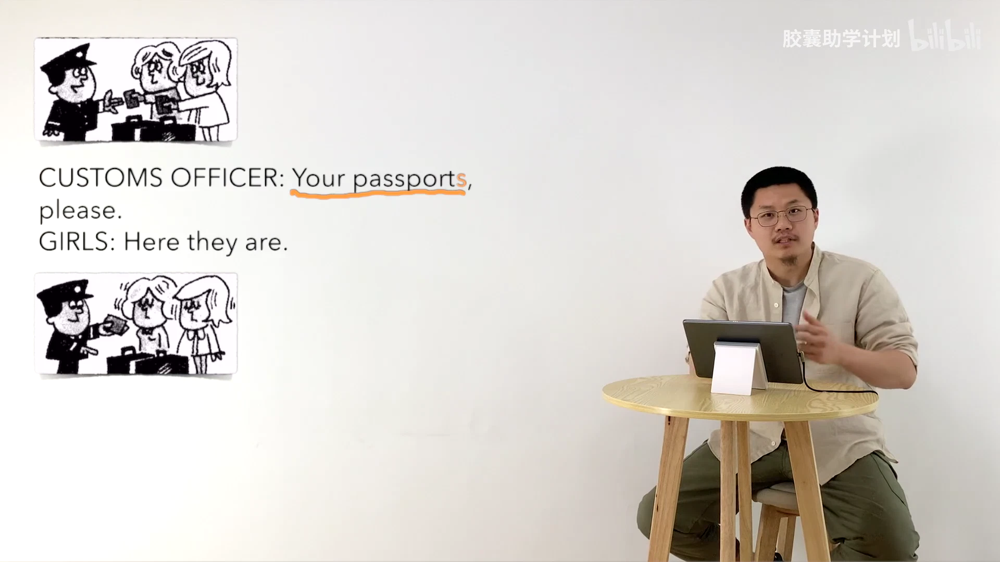

文字识别：胶囊助学计划 / CUSTOMS OFFICER: Your passports, / please. / GIRLS: Here they are.

### 画面 00:01:37

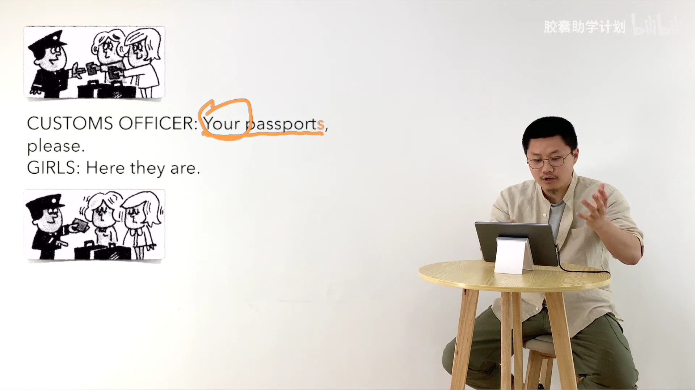

文字识别：胶囊助学计划 / CUSTOMS OFFICER:Your passports, / please. / GIRLS: Here they are.

### 画面 00:01:39

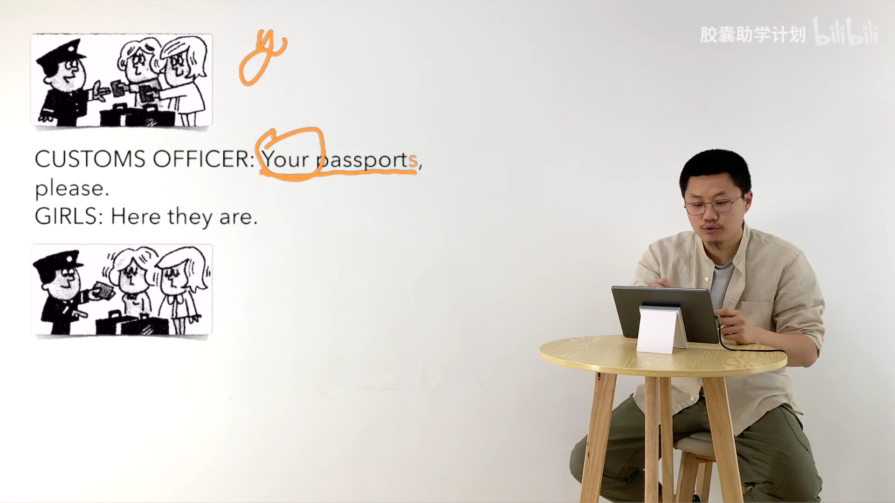

文字识别：胶囊助学计划 / CUSTOMS OFFICER:Your passports, / please. / GIRLS: Here they are.

### 画面 00:01:41

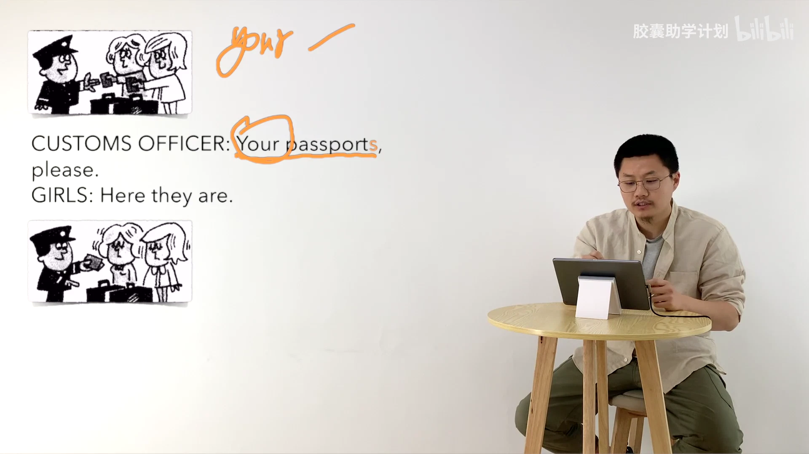

文字识别：ypur / 胶囊助学计划 / CUSTOMS OFFICER:Your assports, / please. / GIRLS: Here they are.

### 画面 00:01:46

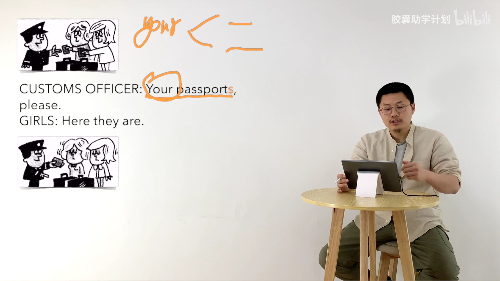

文字识别：ypur / 胶囊助学计划 / CUSTOMS OFFICER:Your passports, / please. / GIRLS: Here they are.

### 画面 00:01:50

文字识别：ypur / 胶囊助学计划 / CUSTOMS OFFICER:Your passpo / please. / GIRLS: Here they are.

### 画面 00:01:53

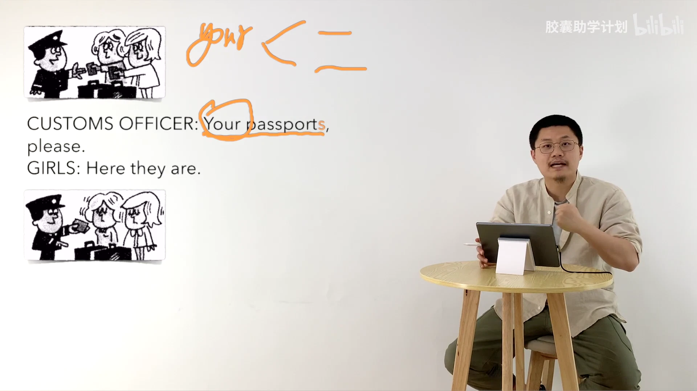

文字识别：ypur / 胶囊助学计划 / CUSTOMS OFFICER:Your assports, / please. / GIRLS: Here they are.

## 00:02:00–00:02:30

叫 Here it is，跟这个是一样的，对吧？Here you are. Here they are. 这是他们，对吧？给你。Are these your cases? 那你想一下啊，我们上节课说的叫做 These，把 are 放回来，叫 These are my cases。我们刚刚讲过这个，那把 are 提前，不就变一般疑问句了？说这些是你们的行李箱吗？箱子吗？No, they aren't. 不，他们不是。说

### 画面 00:02:07

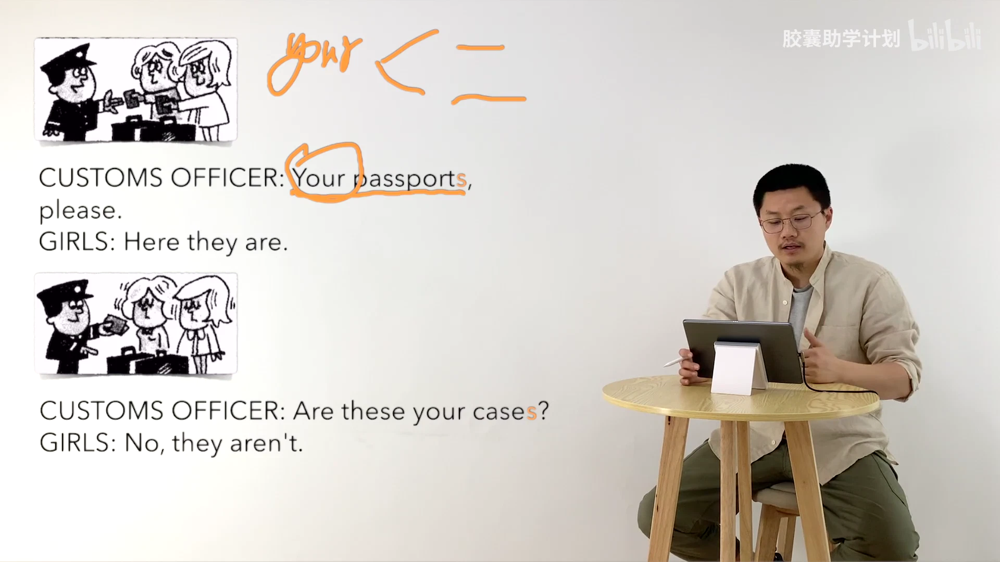

文字识别：ypur / 胶囊助学计划 / CUSTOMS OFFICER:Your passports, / please. / GIRLS: Here they are. / CUSTOMS OFFICER: Are these your cases? / GIRLS: No, they aren't.

### 画面 00:02:10

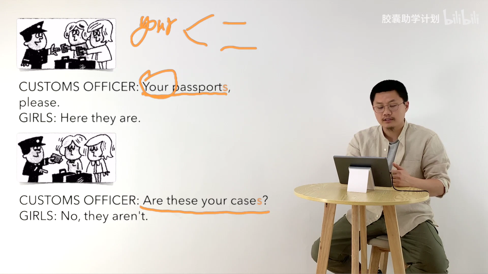

文字识别：ypur / 胶囊助学计划 / CUSTOMS OFFICER:Your passports, / please. / GIRLS: Here they are. / CUSTOMS OFFICER: Are these your cases? / GIRLS: No, they aren't.

### 画面 00:02:14

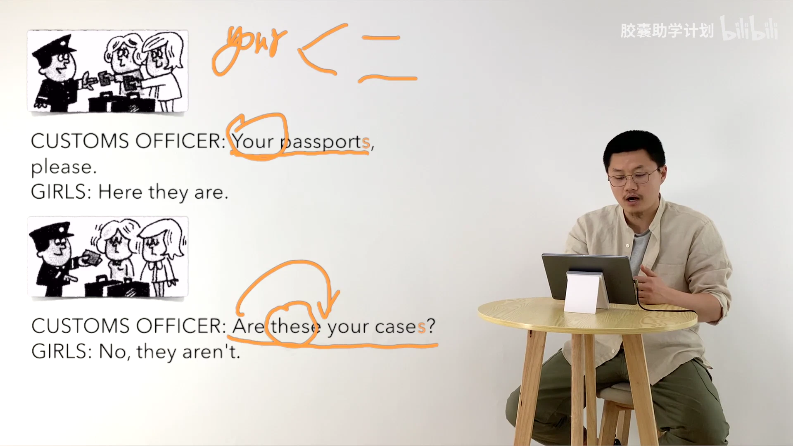

文字识别：ypur / 胶囊助学计划 / CUSTOMS OFFICER:Your passports, / please. / GIRLS: Here they are. / CUSTOMS OFFICER: Aret / these your cases? / GIRLS: No, they aren't.

### 画面 00:02:24

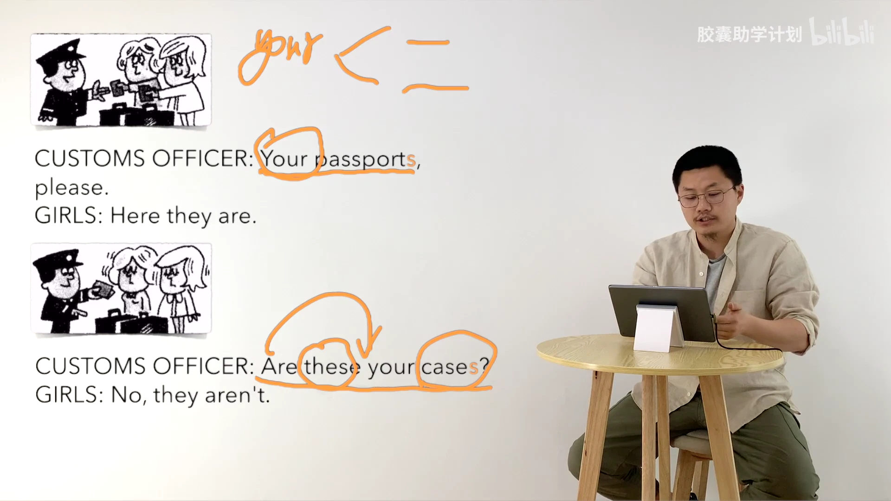

文字识别：ypur / 胶囊助学计划 / CUSTOMS OFFICER:Your passports, / please. / GIRLS: Here they are. / CUSTOMS OFFICER: Aret / theseyour / cases / GIRLS: No, they aren't.

### 画面 00:02:28

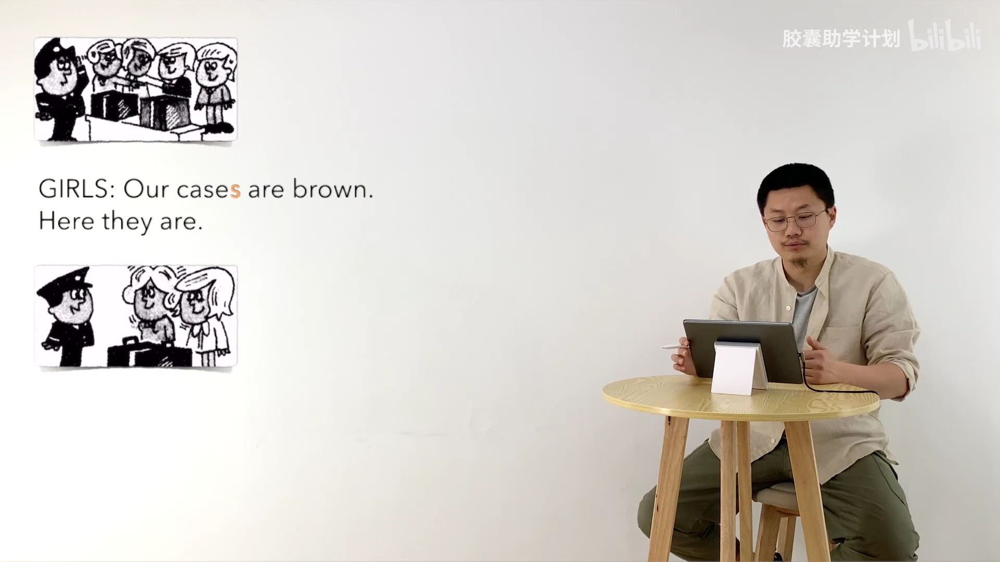

文字识别：胶囊助学计划b鼎l / GIRLS: Our cases are brown. / Here they are.

## 00:02:30–00:03:00

our cases are brown. 注意，首先 case 加了 s，复数，我们的箱子。 Our 哎，关键的一个小单词，偶数课我们再一起去练习，叫做我们的。 Okay, 那 we 就是我们，our 就是我们的。我们的箱子是棕色的。 Here they are. 他们在这儿呢。 Continue. 说 Are you tourists? 那你们是

### 画面 00:02:32

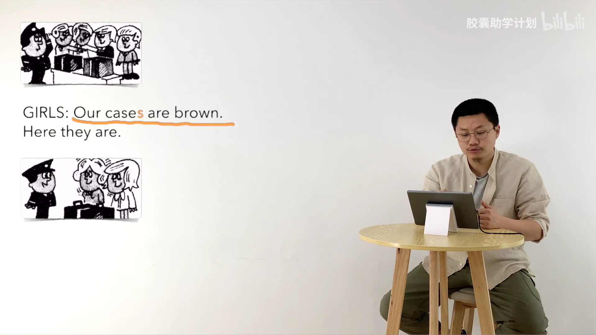

文字识别：Biibi / 胶囊助学计划 / GIRLS: Our cases are brown. / Here they are. / 0

### 画面 00:02:39

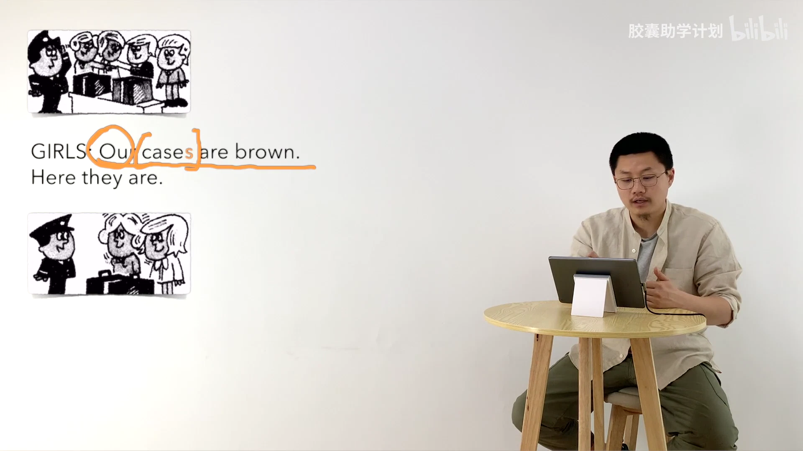

文字识别：胶囊助学计划bibl / cases are brown. / GIRLSOu / Here they are. / 0

### 画面 00:02:41

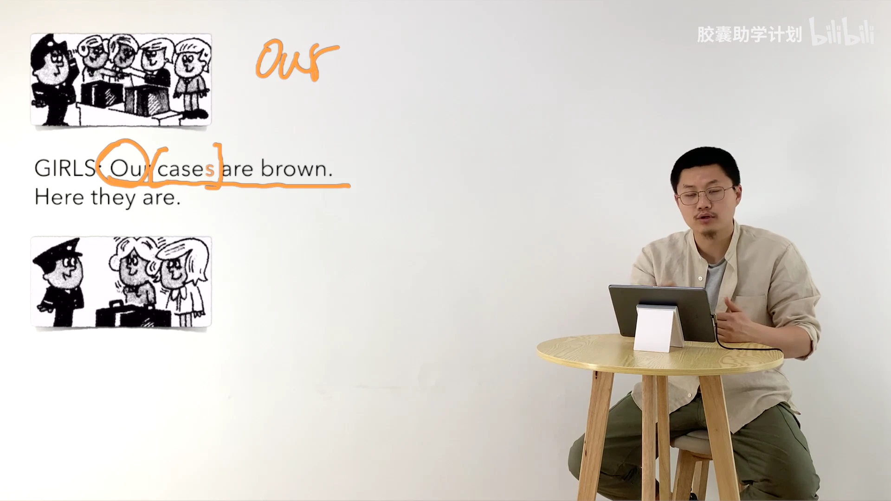

文字识别：Bilbil / 胶囊助学计划 / Our / cases are brown. / GIRLSOu / Here they are.

### 画面 00:02:46

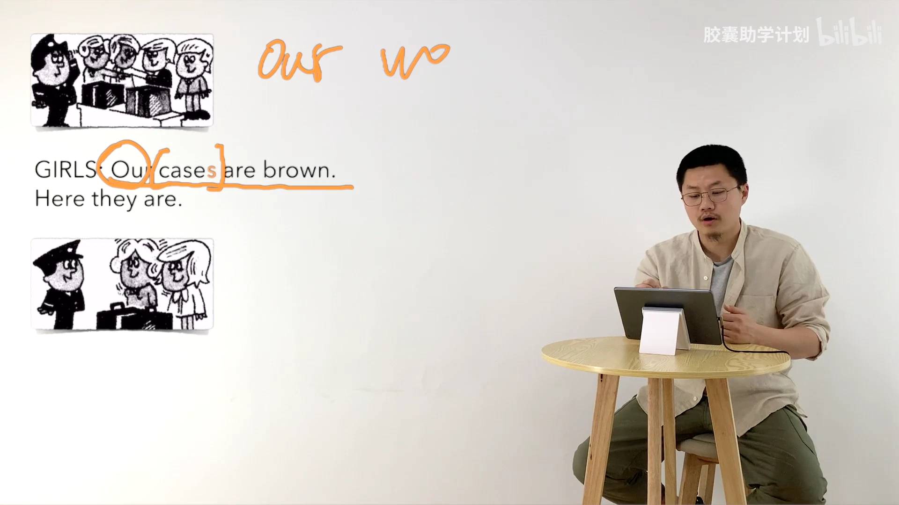

文字识别：胶囊助学计划 / our / W / cases are brown. / GIRLSOu / Here they are.

### 画面 00:02:52

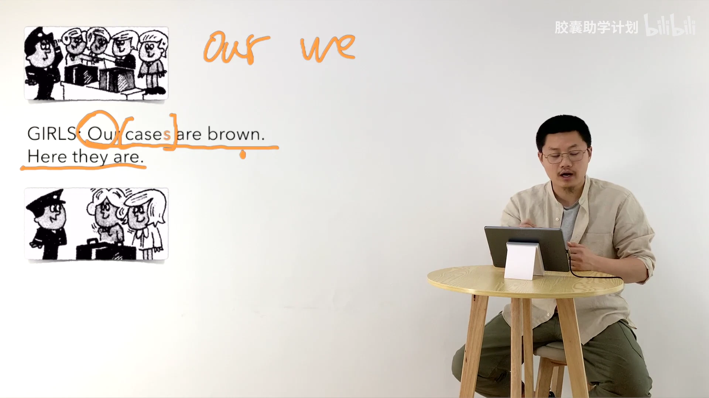

文字识别：胶囊助学计划 / Our / we / cases are brown. / GIRLSOu / Here they are.

### 画面 00:02:54

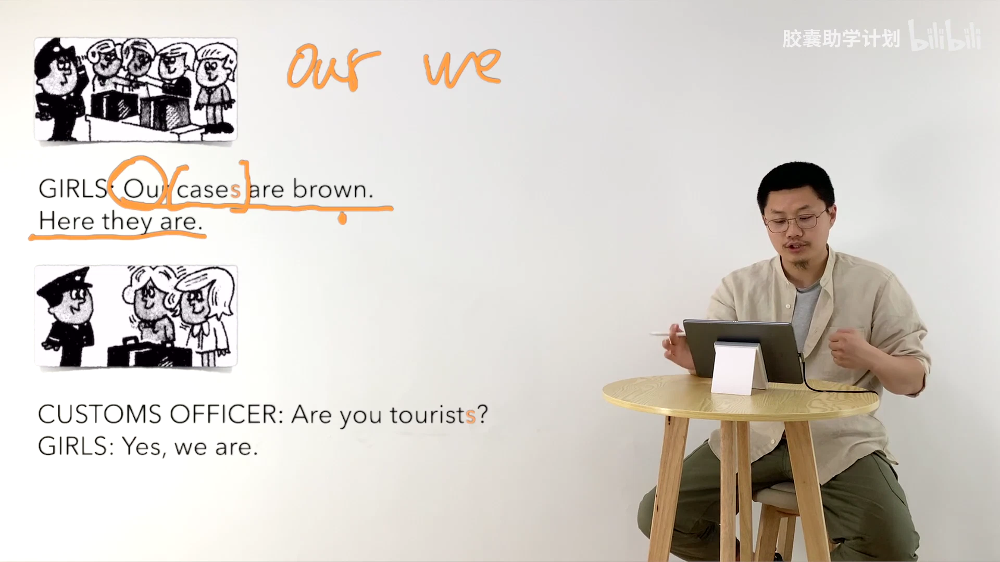

文字识别：胶囊助学计划 / our / we / cases are brown. / GIRLSOu / Here they are. / CUSTOMS OFFICER: Are you tourists? / GIRLS: Yes, we are.

### 画面 00:02:57

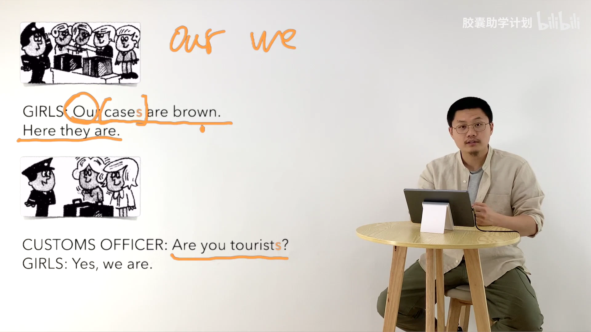

文字识别：胶囊助学计划 / Ous / we / cases are brown. / GIRLSOu / Here they are. / CUSTOMS OFFICER: Are you tourists? / GIRLS: Yes, we are.

## 00:03:00–00:03:30

tourists，加了 s 变成了复数，对吧？你们是来旅游的吗？你们是旅行者吗？Yes, we are. 是的，我们是。你们是旅客吗？Are your friends? 那你们的朋友们 tourists too? 也是旅客吗？也是来这玩的吗？Yes, they are. 是，他们是的。哎，they 叫他们。That's fine. 没没问题了，没问题。That's fine.

### 画面 00:03:02

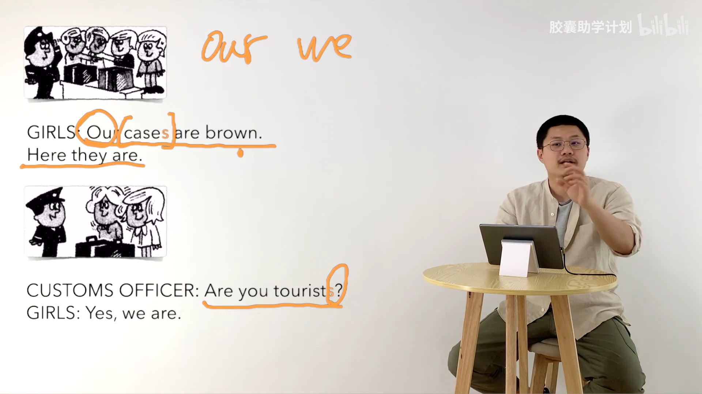

文字识别：胶囊助学计划 / ous / we / Cases are brown. / GIRLSOu / Here they are. / CUSTOMS OFFICER: Are you tourist / GIRLS: Yes, we are.

### 画面 00:03:10

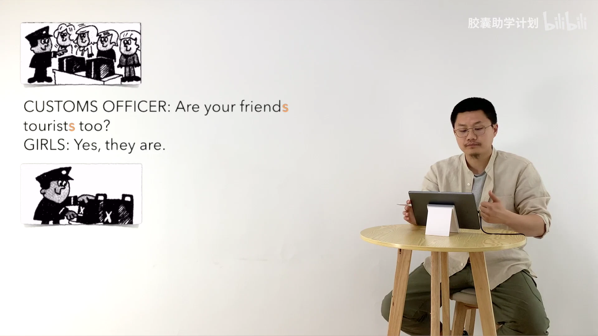

文字识别：胶囊助学计划 / CUSTOMS OFFICER: Are your friends / tourists too? / GIRLS: Yes, they are.

### 画面 00:03:13

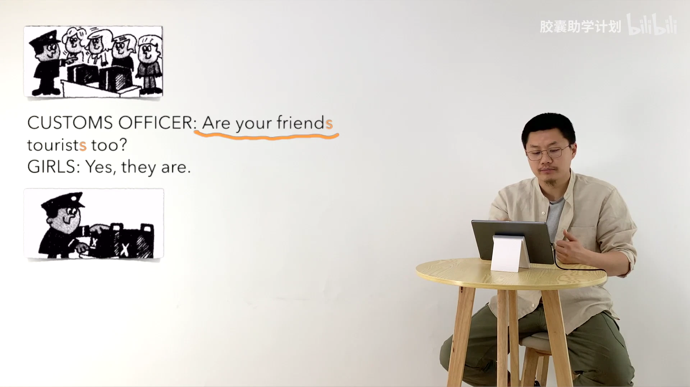

文字识别：胶囊助学计划 / CUSTOMS OFFICER: Are your friends / tourists too? / GIRLS: Yes, they are.

### 画面 00:03:16

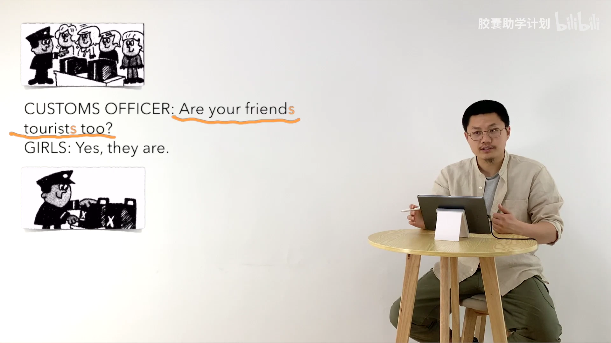

文字识别：胶囊助学计划 / CUSTOMS OFFICER: Are your friends / tourists too? / GIRLS: Yes, they are.

### 画面 00:03:21

文字识别：胶囊助学计划 / CUSTOMS OFFICER: Are your friends / tourists too? / GIRLS: Yes, they are.

### 画面 00:03:26

文字识别：胶囊助学计划 / CUSTOMS OFFICER: Are your friends / tourists too? / GIRLS: Yes, / they / are. / CUSTOMS OFFICER: That's fine. / GIRLS: Thank you very much.

### 画面 00:03:28

文字识别：胶囊助学计划 / CUSTOMS OFFICER: Are your friends / tourists too? / GIRLS: Yes, / they / are. / CUSTOMS OFFICER: That's fine. / GIRLS: Thank you very much.

## 00:03:30–00:04:00

That's okay. That's good. 是一样的，就没问题了。OK了啊。Thank you very much. 非常的感谢。比较正式的场合，Thank you very much. 跟海关关嗯海关官员对吧？不敢造次，正式一点。Thank you very much. Continue. 我们又到了听力口语练习的环节了。这个时候您需要做的是闭上眼睛听，回忆刚才讲到的文章，或者是您直接看文章。但是不要看我的问题啊。来了。

### 画面 00:03:34

文字识别：胶囊助学计划 / CUSTOMS OFFICER: Are your friends / tourists too? / GIRLS: Yes, / they / are. / CUSTOMS OFFICER: That's fine. / GIRLS: Thank you very much.

### 画面 00:03:38

文字识别：胶囊助学计划 / CUSTOMS OFFICER: Are your friends / tourists too? / GIRLS: Yes, / they / are. / CUSTOMS OFFICER: That's fine. / GIRLS: Ihank you very much.

### 画面 00:03:40

文字识别：Bilbil / 胶囊助学计划 / CUSTOMS OFFICER: Are your friends / tourists too? / GIRLS: Yes, / they / are. / CUSTOMS OFFICER: That's fine. / GIRLS: Ihank you very r / 'much.

### 画面 00:03:46

文字识别：胶囊助学计划 / Comprehension

### 画面 00:03:49

文字识别：胶囊助学计划 / Comprehension

## 00:04:00–00:04:30

Are the girls Swedish? 自己找一下答案。答案 No, they are not. 下一个 Are they Danish? Yes, they are. Are their friends Danish too? No, they are not.

### 画面 00:04:04

文字识别：bilbili / 胶囊助学计划 / Comprehension / 1 T: Are the girls Swedish? / 0

### 画面 00:04:07

文字识别：胶囊助学计划 / Comprehension / 1 T: Are the girls Swedish?

### 画面 00:04:11

文字识别：胶囊助学计划 / Comprehension

## 00:04:30–00:05:00

Next one, are they Swedish or Norwegian? They are Norwegian. Next one, are the girls' cases green? Girls' cases, girls. No, they are not. Continue. What color are their cases?

### 画面 00:04:41

文字识别：胶囊助学计划 / Comprehension / 5 T: Are the girls' cases green?

### 画面 00:04:47

文字识别：胶囊助学计划 / Comprehension / 5 T: Are the girls' cases green?

## 00:05:00–00:05:30

Next one. Are the girls tourists? Close your eyes, ah, or read the article. Don't look at the screen. Practice listening. Answer me. Give you the answer. Yes, they are. Are there friends tourists too? Yes, they are. What nationality are the girls? They are

### 画面 00:05:00

文字识别：胶囊助学计划 / Comprehension / 6 T: What colour are their cases? / S:Brown

## 00:05:30–00:06:00

Danish. Next one, what nationality are their friends? They are Norwegian.好，comprehension结束，asking questions.想一下，这地方的练习叫做，我给您一个肯定句，你口语靠先靠听力把它听懂，其次靠口语变成一般疑问句，然后也许还会变特殊疑问句。来了，又是听力口语练习。Ask me if

### 画面 00:05:30

文字识别：胶囊助学计划 / Comprehension / 9 T: What nationality are the girls? / S: They are Danish.

### 画面 00:05:38

文字识别：胶囊助学计划 / Comprehension / 10 T: What nationality are their friends? / S: They are Norwegian.

### 画面 00:05:42

文字识别：Bilibil / 胶囊助学计划 / Asking questions

### 画面 00:05:58

文字识别：bilbil / 胶囊助学计划 / Asking questions / 1 T: Ask me if the girls are Swedish.

## 00:06:00–00:06:30

if the girls are Swedish. R提前, are the girls Swedish?所以各位看到了啊，我们原来一直在说的是is提前，今天您明白了is跟are基本是一类的，只不过is加单数，而are加复数，对吧？所以也要提前。What nationality?第五课学的，对Swedish提问就变成了What

### 画面 00:06:15

文字识别：Bilbil / 胶囊助学计划 / IS / Asking questions / 1 T: Ask me if the girlsare Swedish. / S: Are the girls Swedish?

### 画面 00:06:26

文字识别：Bib出 / 胶囊助学计划 / Asking questions / 1 T: Ask me if the girls are Swedish. / S: Are the girls Swedish? / T:What nationality ..?

## 00:06:30–00:07:00

nationality are the girls? There you go. Ask me if their friends are Danish. Are their friends Danish? What nationality? 对 Danish 提问，去掉 Danish 体前，张嘴读 What nationality are their friends? 您一定要自己练

### 画面 00:06:34

文字识别：u bilbl / 胶囊助学计划 / Asking questions / 2 T: Ask me if their friends are Danish.

### 画面 00:06:50

文字识别：胶囊助学计划 / 出山 / Asking questions / 2 T: Ask me if their friends are Danish. / S: Are their friends Danish? / T: What nationality ..?

### 画面 00:06:53

文字识别：胶囊助学计划 / Asking questions / 2 T: Ask me if their friends are Danish. / S: Are their friends Danish? / T:What nationality ….? / S: What nationality are their friends?

## 00:07:00–00:07:30

啊，不要看着热闹。Ask me if their cases are brown. 啊，提前，Are their cases brown? What color? 对，brown提问。What color are their cases? Next one. Ask me if their cases are brown. Are their cases brown? Whose? 对，their提问，叫他们的，对吧？

### 画面 00:07:00

文字识别：胶囊助学计划b出出 / Asking questions

### 画面 00:07:16

文字识别：胶囊助学计划 / Asking questions / 3 T: Ask me if their cases are brown. / S: Are their cases brown? / T: What colour ...? / S: What colour are their cases?

### 画面 00:07:20

文字识别：胶囊助学计划 / Asking questions / 4 T: Ask me if their cases are brown.

## 00:07:30–00:08:00

变成了 whose cases are brown. 好， recap 这课很简单，就是看一下名词的复数以及文章，再加上一些口语听力练习。 OK，那本课的作业呢？第一，十五课我们讲完了绿皮书，您要去写。第二，文章老习惯一定要跟读制，熟读成诵。第三，给自己讲解一遍

### 画面 00:07:36

文字识别：胶囊助学计划 / Recap / Patterns / n.s / Grammar / Words / Expression

### 画面 00:07:42

文字识别：bilbli / 胶囊助学计划 / Recap / Patterns / & / n.s / Grammar / Words / Expression

### 画面 00:07:48

文字识别：胶囊助学计划

### 画面 00:07:58

文字识别：Bibl / 胶囊助学计划 / 绿皮书第15课的写作练习 / 文章跟读至熟读成诵 / 3.请给自己讲解一遍今天的 / 核心知识点

## 00:08:00–00:08:30

今天的核心知识点。那本期的课程呢，到这就结束了。如果大家喜欢我们的课程，欢迎大家订阅、关注、一键三连支持，并分享给那些需要学习英语的朋友们。最后的最后，我们再看一句名人名言：If you make friends with yourself, you will never be alone. Bye bye.

### 画面 00:08:02

文字识别：胶囊助学计划b出山 / 👍

### 画面 00:08:12

文字识别：胶囊助学计划 / If you make friends with yourself you will / never be alone. / Maxwell Maltz

### 画面 00:08:22

### 画面 00:08:24

文字识别：CAPSULEACADEMY / 胶囊学院 / 小红书 / Lecturer / □ / Leo

### 画面 00:08:27

文字识别：CAPSULEACADEMY / 胶囊学院 / 小红书

## 00:08:30–00:08:35

### 画面 00:08:30

文字识别：CAPSULEACADEMY / 胶囊学院 / 小红书 / Creator / 回 / Leo & Berlin

### 画面 00:08:32

文字识别：biltbili / 胶囊助学计划 / CAPSULEACADEMY / 胶囊学院 / 小红书 / 品

### 画面 00:08:34

文字识别：bilibili / 胶囊助学计划

