# 017 语法 文章

快速机器解析：语音为单模型转写，未进行独立交叉校对或人工复核；画面每秒采样并按变化选帧，短时文字和标记可能遗漏。截图时间约有 1 秒误差。图片有损压缩；遇到疑点请按时间查看 Google Drive 原视频。

## 00:00:00–00:00:30

Hello everyone, welcome to Capsule Academy. This is Leo. Today we're going to learn New Concept English Book One Lesson Seventeen Grammar and Story. 那老习惯进入正式课程之前，我们先一起看两个问题。第一，who引导的特殊疑问句应该怎么去弄出来呢？第二，如何表达过来见见某人？那带着这两个问题，我们begin to enjoy it. 我们直接进入文章啊，我们能

### 画面 00:00:00

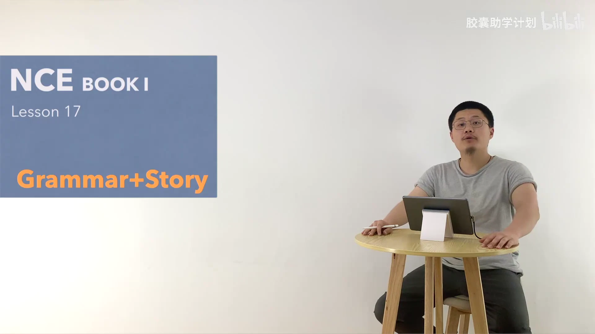

文字识别：胶囊助学计划 / NCE / BOOKI / Lesson 17 / Grammar+Story

### 画面 00:00:09

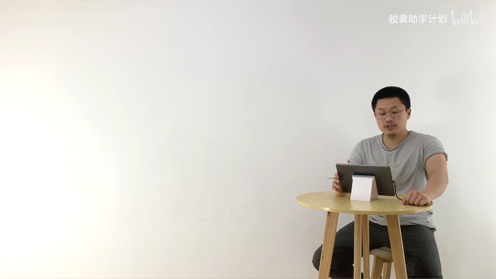

文字识别：u biH / 胶囊助学计划

### 画面 00:00:13

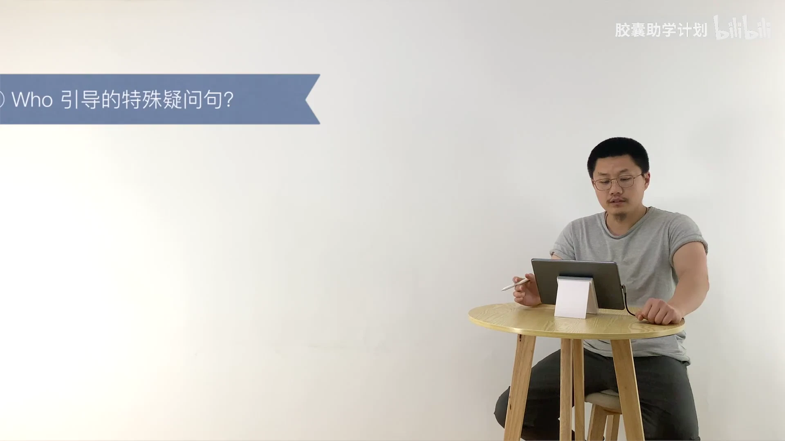

文字识别：biltl / 胶囊助学计划 / Who 引导的特殊疑问句?

### 画面 00:00:17

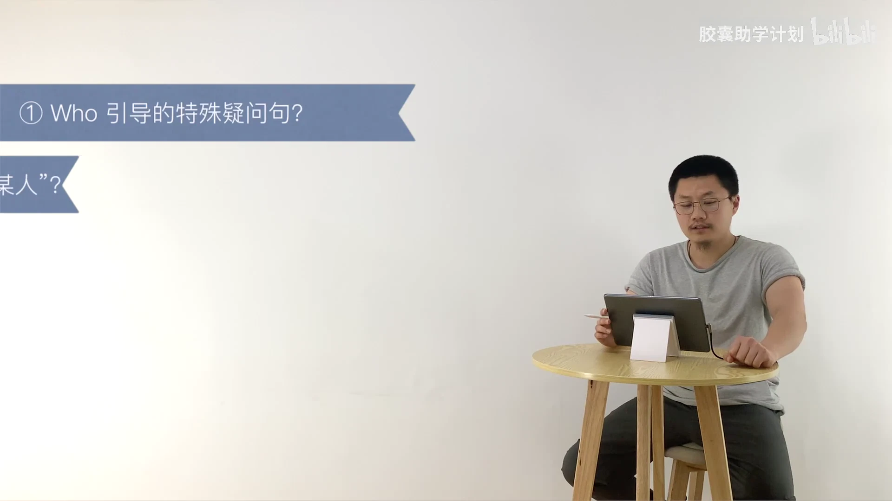

文字识别：bilil / 胶囊助学计划 / ①Who 引导的特殊疑问句？ / 某人”?

### 画面 00:00:19

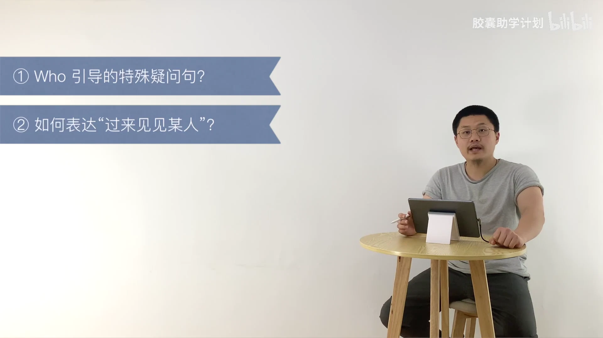

文字识别：bill / 胶囊助学计划 / ①Who 引导的特殊疑问句？ / 如何表达“过来见见某人”?

### 画面 00:00:24

文字识别：胶囊助学计划l出

### 画面 00:00:27

文字识别：胶囊助学计划 / 胶囊助学计划

### 画面 00:00:29

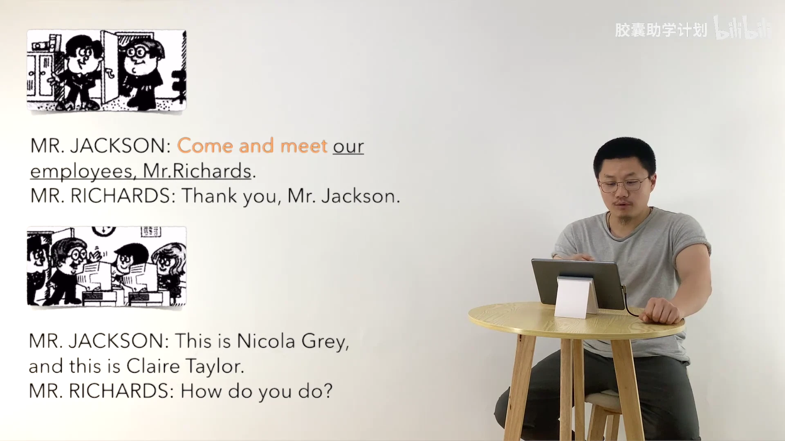

文字识别：胶囊助学计划 / MR. JACKSON: Come and meet our / employees, Mr.Richards. / MR. RICHARDS: Thank you, Mr. Jackson. / MR. JACKSON: This is Nicola Grey, / and this is Claire Taylor. / MR. RICHARDS: How do you do?

## 00:00:30–00:01:00

看到图中是两名男士，Mr. Jackson and Mr. Richards. Mr. Jackson说，Come and meet, come来是come, meet见一见，过来见见our employees，我们的雇员Mr. Richards啊，Richards先生，您过来看看我们的雇员吧。Thank you, Mr. Jackson，是非常正式的场合，各位看到他们都是在说Mr.

### 画面 00:00:31

文字识别：胶囊助学计划 / MR. JACKSON: Come and meet our / employees, Mr.Richards. / MR. RICHARDS: Thank you, Mr. Jackson. / MR. JACKSON: This is Nicola Grey, / and this is Claire Taylor. / MR. RICHARDS: How do you do?

### 画面 00:00:35

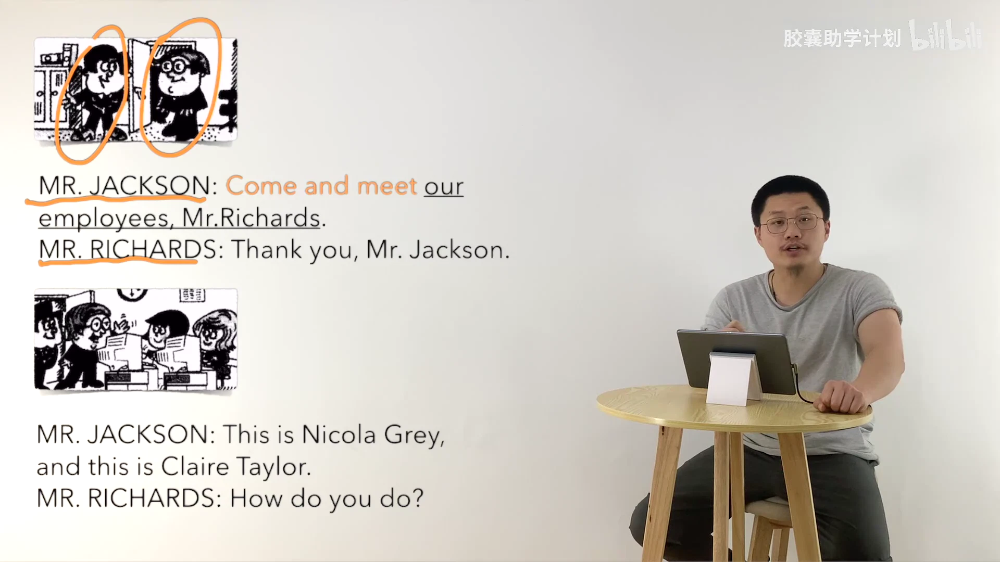

文字识别：bilH / 胶囊助学计划 / MR. JACKSON: Come and meet our / employees, Mr.Richards. / MR. RICHARDS: Thank you, Mr. Jackson. / MR. JACKSON: This is Nicola Grey, / and this is Claire Taylor. / MR. RICHARDS: How do you do?

### 画面 00:00:47

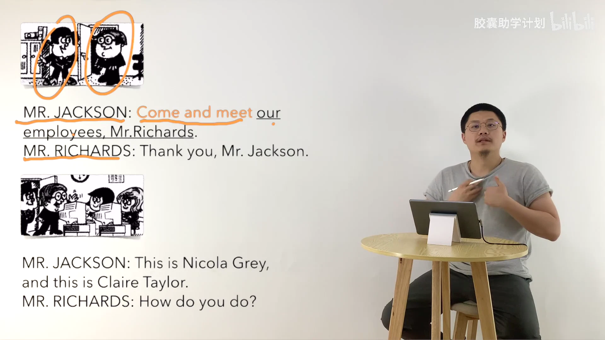

文字识别：Lil / 胶囊助学计划 / MR. JACKSON: Come and meet our / employees, Mr.Richards. / MR. RICHARDS: Thank you, Mr. Jackson. / MR. JACKSON: This is Nicola Grey, / and this is Claire Taylor. / MR. RICHARDS: How do you do?

### 画面 00:00:55

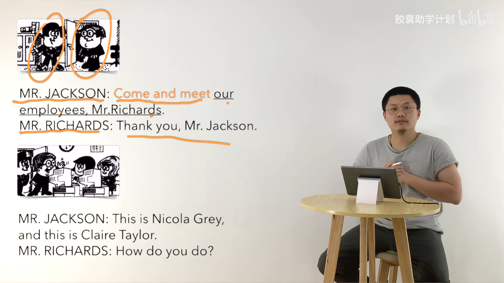

文字识别：u bill / 胶囊助学计划 / MR. JACKSON: Come and meet our / employees, Mr.Richards. / MR. RICHARDS: Thank you, Mr. Jackson. / MR. JACKSON: This is Nicola Grey, / and this is Claire Taylor. / MR. RICHARDS: How do you do?

### 画面 00:00:58

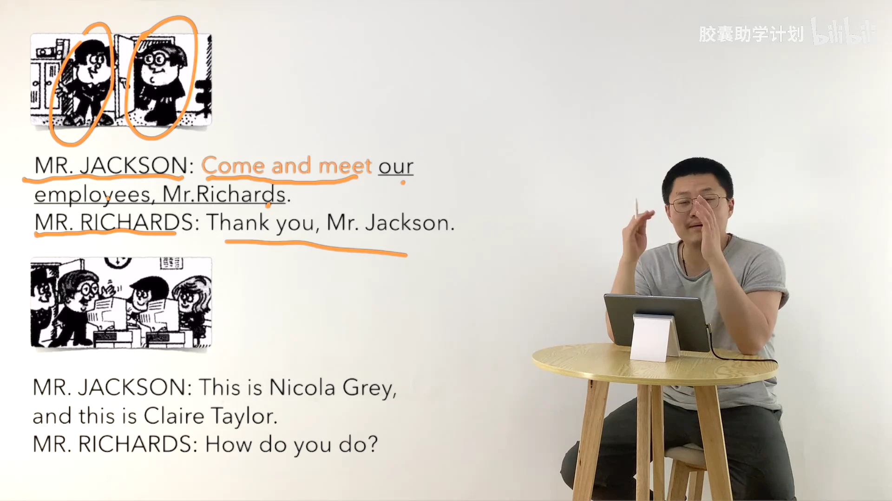

文字识别：胶囊助学计划册 / MR. JACKSON: Come and meet our / employees, Mr.Richards. / MR. RICHARDS: Thank you, Mr. Jackson. / MR. JACKSON: This is Nicola Grey, / and this is Claire Taylor. / MR. RICHARDS: How do you do?

## 00:01:00–00:01:30

Mister，在说对方的姓而不是名。不知道各位还记不记得 David Joseph Beckham？我讲那课的时候提过，对吧？你去管别人叫说 Mister Beckham，他会跟你说啊，Come just call me David，对吧？这个是比较亲近的一种方式。而你去叫别人说，比如说刘先生，对吧？Richard先生啊，这是比较相对来说正式的一种场合的叫法。他说 This is Nicola Gray，介绍别人说这是谁谁

### 画面 00:01:27

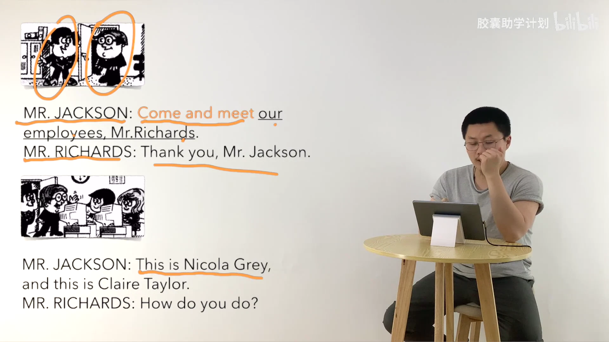

文字识别：bilb / 胶囊助学计划 / MR. JACKSON: Come and meet our / employees, Mr.Richards. / MR. RICHARDS: Thank you, Mr. Jackson. / MR. JACKSON: This is Nicola Grey, / and this is Claire Taylor. / MR. RICHARDS: How do you do?

## 00:01:30–00:02:00

谁，This is加某人的名字，这个我们之前练过很多遍了。And this is Claire Taylor。注意一个小点是，姓名的首字母都是大写的，对吧？Mr. Richards说了一句叫How do you do？How do you do？这句话说实话还真的稍微有点年代感了，是比较正式的说你好的一种方式。大部分情况下如果没那么正式，就Hi，Hello，How are

### 画面 00:01:35

文字识别：biltl / 胶囊助学计划 / MR. JACKSON: Come and meet our / employees, Mr.Richards. / MR. RICHARDS: Thank you, Mr. Jackson. / MR. JACKSON: This is Nicola Grey, / and this is Claire Taylor. / MR. RICHARDS: How do you do?

### 画面 00:01:45

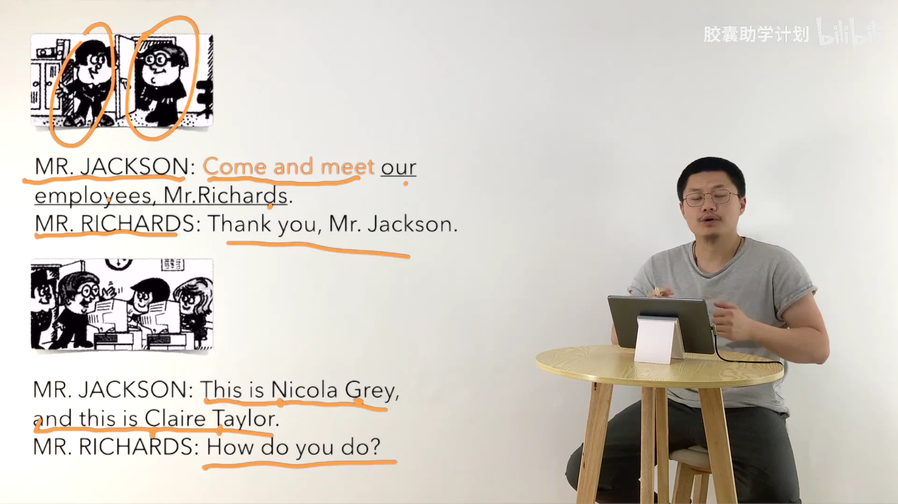

文字识别：胶囊助学计划 / MR. JACKSON: Come and meet our / employees, Mr.Richards. / MR. RICHARDS: Thank you, Mr. Jackson. / MR. JACKSON: This is Nicola Grey, / and this is Claire Taylor. / MR. RICHARDS: How do you do?

### 画面 00:01:48

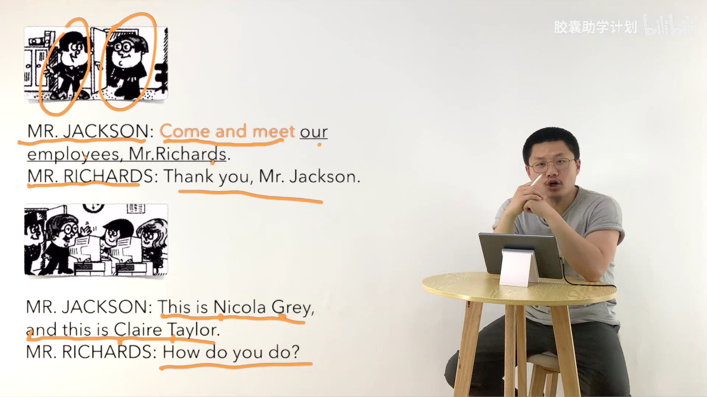

文字识别：胶囊助学计划册 / MR. JACKSON: Come and meet our / employees, Mr.Richards. / MR. RICHARDS: Thank you, Mr. Jackson. / MR. JACKSON: This is Nicola Grey, / and this is Claire Taylor. / MR. RICHARDS: How do you do?

## 00:02:00–00:02:30

How are you guys? Okay,就可以了，是吧？接着往下，那我们一起看一下在《冒牌家庭》这个电影当中是如何用come meet加某人的名字，哎，某人的名字来表达过来见见某人的。我们一起看，这里面还有很多我们学到的之前的知识点，比如说this is加某人的名字。OK，那注意了。Oh, great! Welcome to the neighborhood. Hey, guys,

### 画面 00:02:03

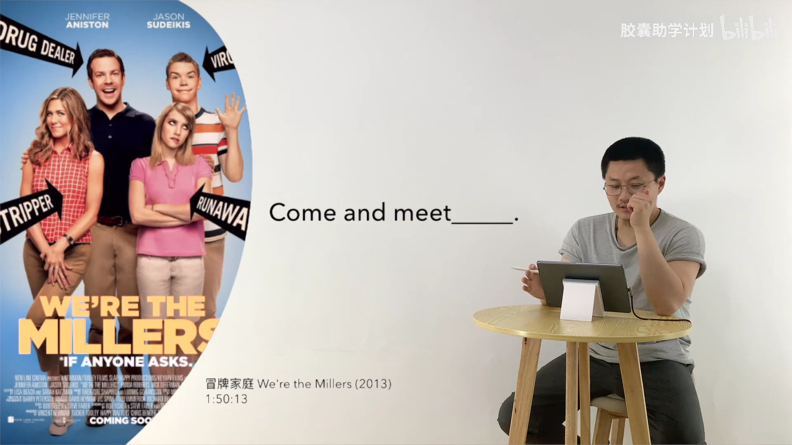

文字识别：ORUG DEALER / JENNIFER / ANISTON / SUDEIKIS / JASON / 胶囊助学计划 / RUNAWA / Come and meet_ / TRIPPER / WE'RETHE / MLLER / IFANYONE ASKS. / 冒牌家庭 We're the Millers (2013) / 1:50:13 / COMING SOO

### 画面 00:02:05

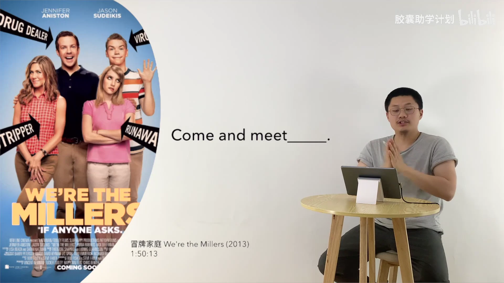

文字识别：JENNIFER / JASON / bilil / ORUG DEALER / ANISTON / SUDEIKIS / 胶囊助学计划 / RUNAWA / Come and meet_ / TRIPPER / WE'RETHE / MLLER / IFANYONE ASKS. / 冒牌家庭We're the Millers (2013) / 1:50:13 / COMING SOO

### 画面 00:02:08

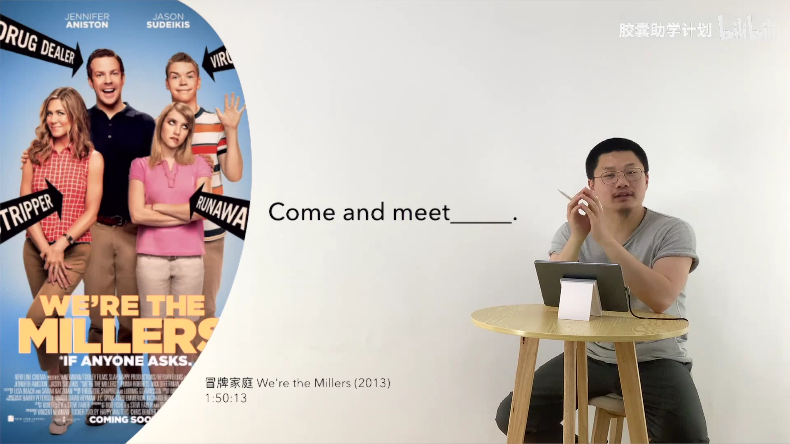

文字识别：ORUG DEALER / JENNIFER / ANISTON / SUDEIKIS / JASON / 胶囊助学计划 / RUNAWA / Come and meet_ / TRIPPER / WE'RETHE / MLLER / IFANYONEASKS. / 冒牌家庭 We're the Millers (2013) / 1:50:13 / COMING SOO

### 画面 00:02:10

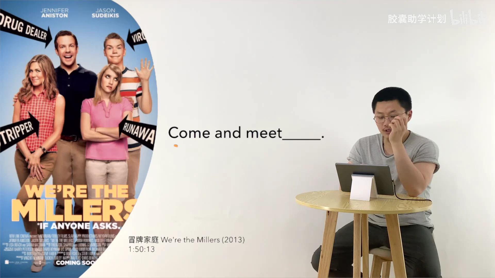

文字识别：ORUG DEALER / JENNIFER / ANISTON / SUDEIKIS / JASON / 胶囊助学计划 / Lih / RUNAWA / Come and meet_ / TRIPPER / WE'RETHE / MLLER / IFANYONE ASKS. / 冒牌家庭We're the Millers (2013) / 1:50:13 / COMING SOO

### 画面 00:02:12

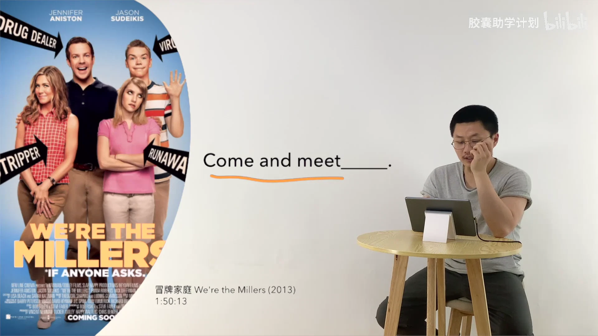

文字识别：JENNIFER / JASON / ORUG DEALER / ANISTON / SUDEIKIS / 胶囊助学计划 / RUNAWA / Come and meet / TRIPPER / WE'RETHE / MLLER / IFANYONEASKS. / 冒牌家庭 We're the Millers (2013) / 1:50:13 / COMING SOO

### 画面 00:02:15

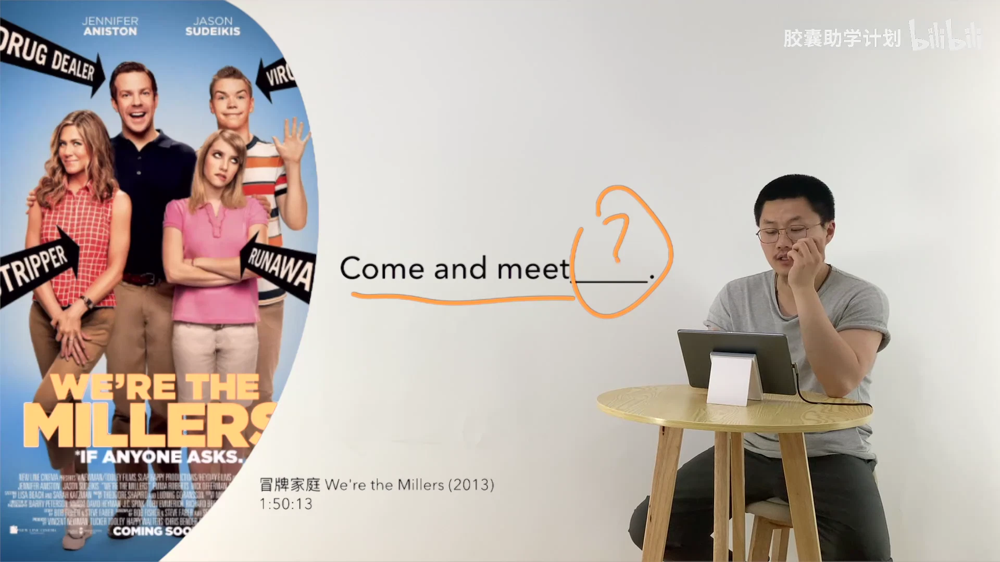

文字识别：JENNIFER / JASON / bilb / ORUG DEALER / ANISTON / SUDEIKIS / 胶囊助学计划 / VIRO / RUNAWA / Come and / meet / TRIPPER / WE'RETHE / MLLER / IFANYONEASKS. / 冒牌家庭 We're the Millers (2013) / 1:50:13 / COMING SOO

### 画面 00:02:20

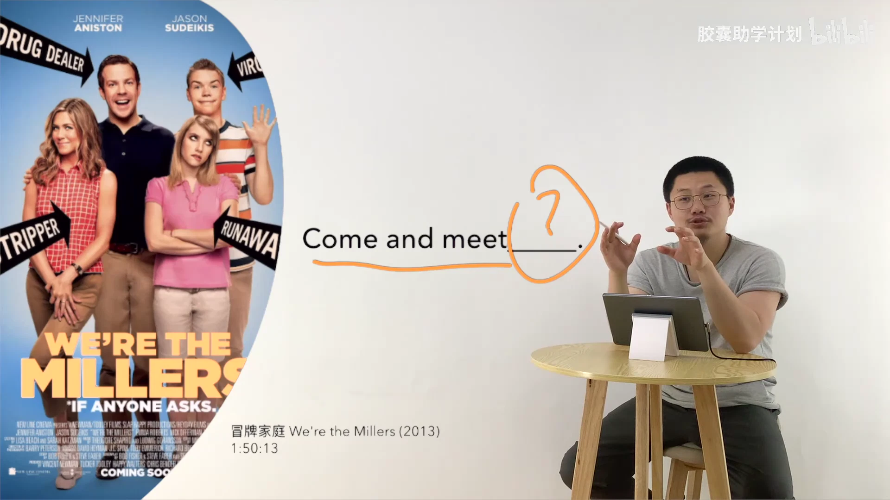

文字识别：ORUG DEALER / JENNIFER / ANISTON / SUDEIKIS / JASON / 胶囊助学计划 / VIRL / RUNAWA / Come and / meet / TRIPPER / WE'RETHE / MLLER / IFANYONEASKS. / 冒牌家庭 We're the Millers (2013) / 1:50:13 / COMING SOO

### 画面 00:02:25

文字识别：ORUG DEALER / JENNIFER / ANISTON / SUDEIKIS / JASON / 胶囊助学计划 / RUNAWA / Come and / meet / TRIPPER / WE'RETHE / MLLER / IFANYONEASKS. / 冒牌家庭 We're the Millers (2013) / 1:50:13 / COMING SOO

### 画面 00:02:27

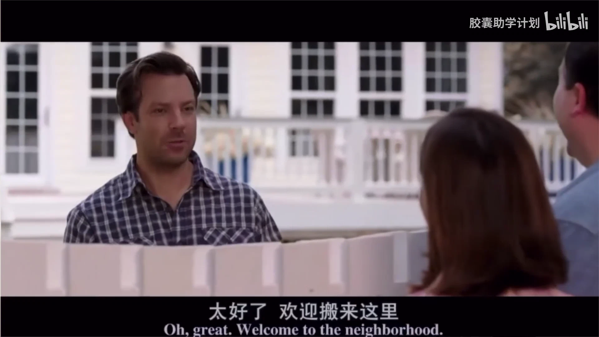

文字识别：bilibli / 胶囊助学计划 / 太好了 / 欢迎搬来这里 / Oh, great. Welcome to the neighborhood.

### 画面 00:02:29

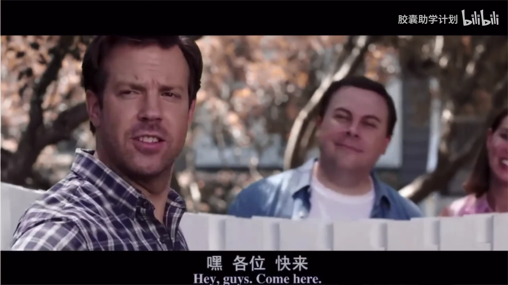

文字识别：bilibili / 胶囊助学计划 / 嘿各位快来 / Hey, guys. Come here.

## 00:02:30–00:03:00

here. Meet our neighbors. I'm David, and this is my family right here. This is my son Kenny, my daughter Casey, and this is my wife Sarah. Nice to meet you. We're the Millers. Come here. Thanks for saying hi. All right, take care now. Okay. 首先 come 他没有用 and 对吧？他说 come meet my family 对吧？或者说 come meet 某人的名字。其次两个家庭第一次见面，所以说

### 画面 00:02:31

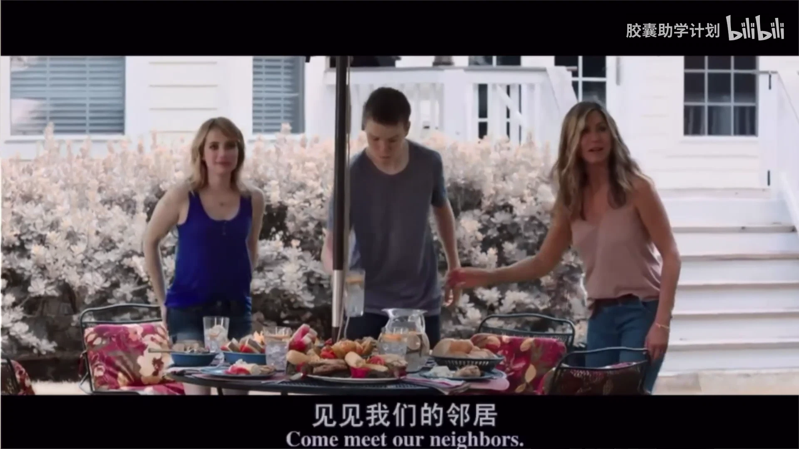

文字识别：bilibili / 胶囊助学计划 / 见见我们的邻居 / Come meet our neighbors.

### 画面 00:02:33

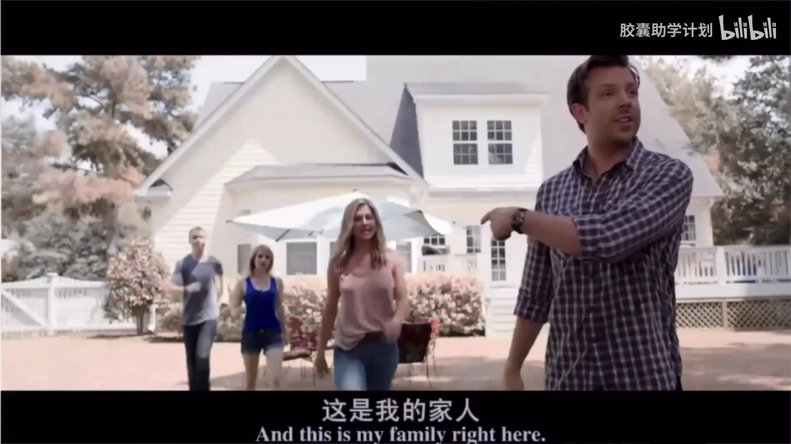

文字识别：bilibili / 胶囊助学计划 / 这是我的家人 / And this is my family right here.

### 画面 00:02:35

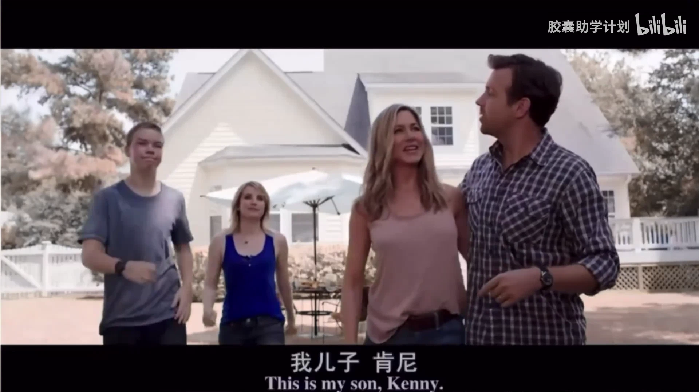

文字识别：bilbili / 胶囊助学计划 / 我儿子 / 肯尼 / This is my son, Kenny.

### 画面 00:02:37

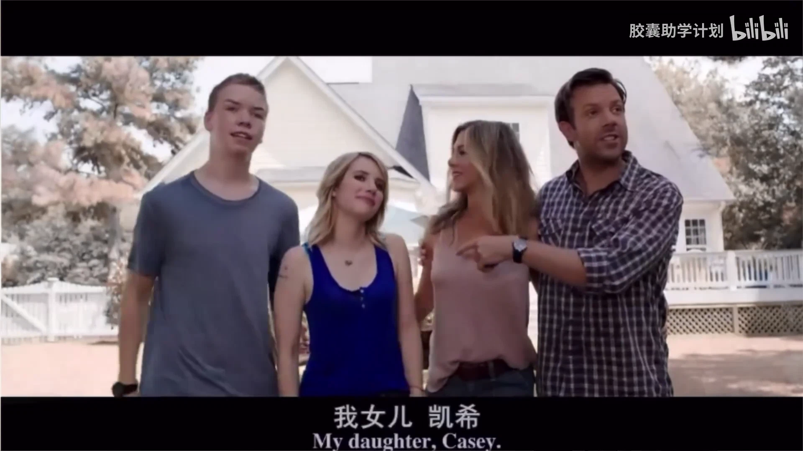

文字识别：bilbili / 胶囊助学计划 / 我女儿凯希 / My daughter, Casey.

### 画面 00:02:39

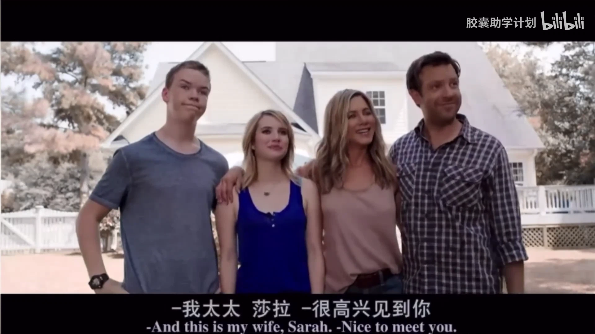

文字识别：bilbili / 胶囊助学计划 / -我太太 / 莎拉-很兴见到你 / -And this is my wife, Sarah. -Nice to meet you.

### 画面 00:02:41

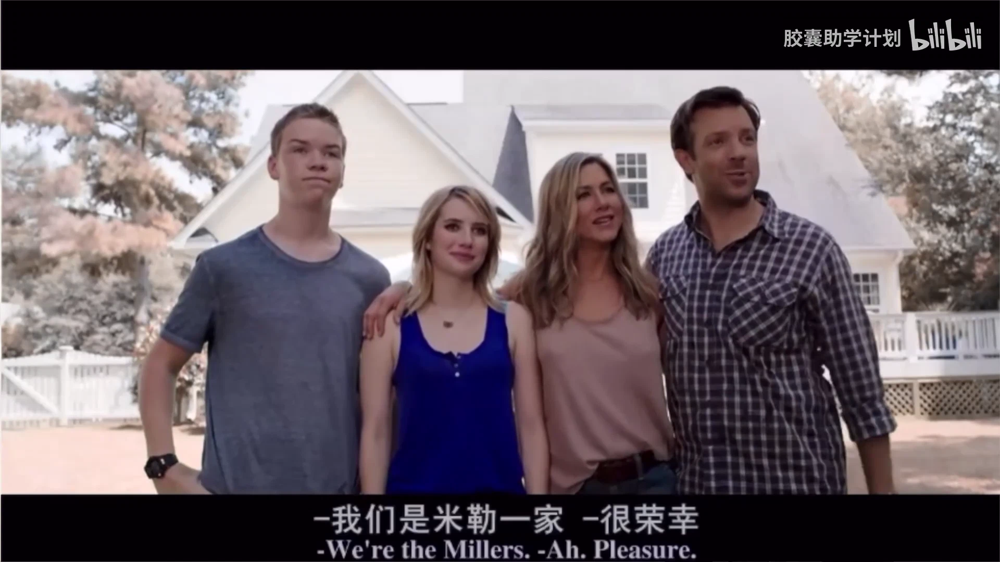

文字识别：bilibili / 胶囊助学计划 / -我们是米勒一家-很荣幸 / -We're the Millers. -Ah. Pleasure.

### 画面 00:02:43

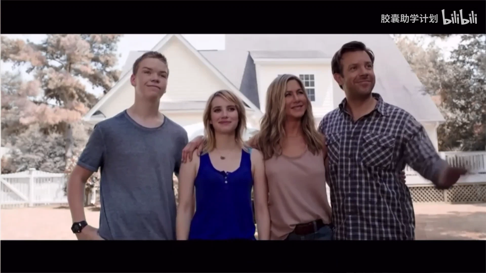

文字识别：Bilibili / 胶囊助学计划

### 画面 00:02:45

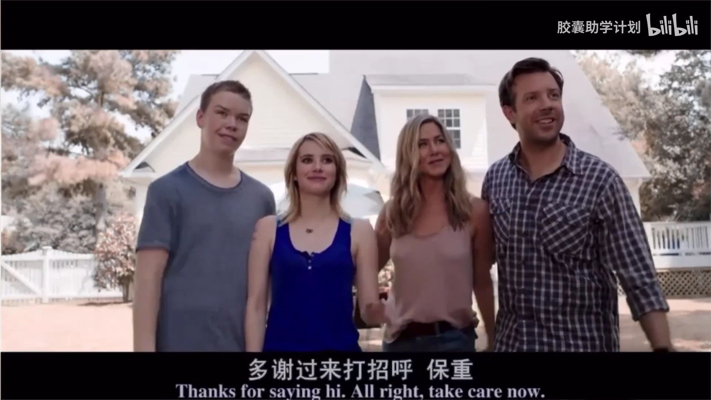

文字识别：bilbili / 胶囊助学计划 / 多谢过来打招呼 / 保重 / Thanks for saying hi. All right, take care now.

### 画面 00:02:47

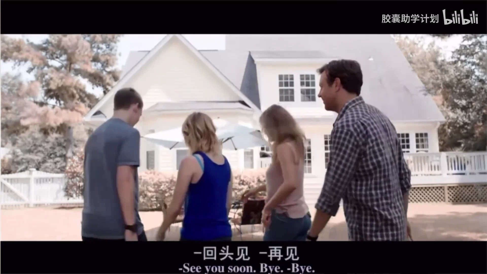

文字识别：bilibili / 胶囊助学计划 / -回头见-再见 / -See you soon. Bye. -Bye.

### 画面 00:02:49

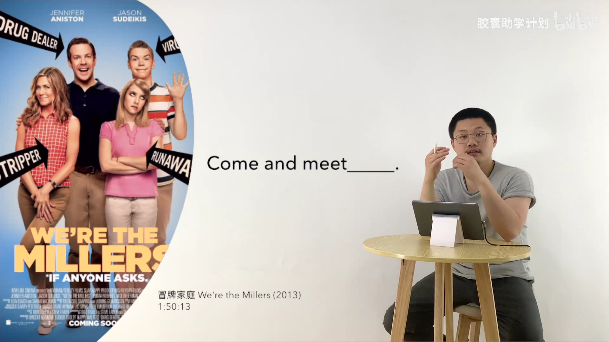

文字识别：JENNIFER / JASON / ORUG DEALER / ANISTON / SUDEIKIS / 胶囊助学计划 / RUNAWA / Come and meet_ / TRIPPER / WE'RETHE / MLLER / IFANYONE ASKS. / 冒牌家庭We're the Millers (2013) / 1:50:13 / COMING SOO

### 画面 00:02:51

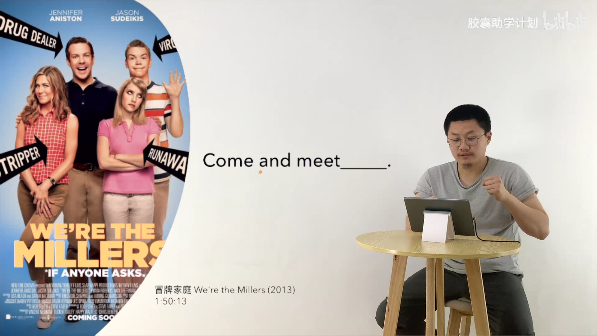

文字识别：JENNIFER / JASON / ORUG DEALER / ANISTON / SUDEIKIS / 胶囊助学计划 / RUNAWA / Come and meet_ / TRIPPER / WE'RETHE / MLLER / *IFANYONE ASKS. / 冒牌家庭 We're the Millers (2013) / 1:50:13 / COMING SOO

### 画面 00:02:55

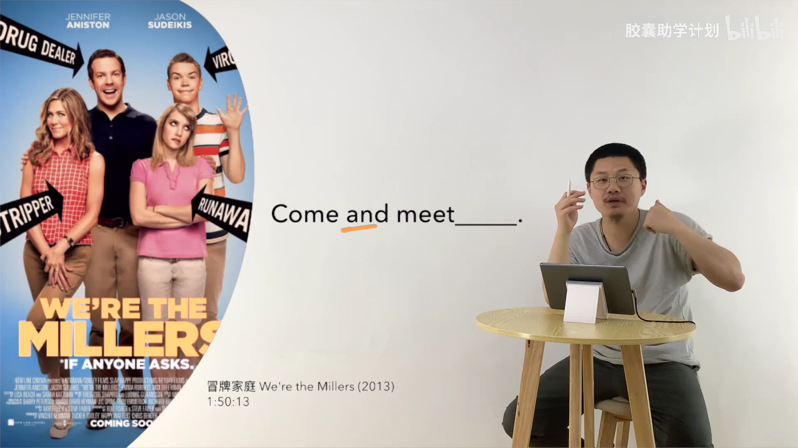

文字识别：JENNIFER / JASON / Biltl / ORUG DEALER / ANISTON / SUDEIKIS / 胶囊助学计划 / RUNAWA / Come and meet_ / TRIPPER / WE'RETHE / MLLER / IFANYONE ASKS. / 冒牌家庭 We're the Millers (2013) / 1:50:13 / COMING SOO

## 00:03:00–00:03:30

nice to meet you 和我们学的也是一样的，说 this is 谁谁谁 this is my wife 谁谁谁对吧 this is my son 哎和我们之前学的也是一样的，各位不妨可以倒过去再听一遍这段视呃音视频，我们可你可以做一个听力练习，OK？那 let's continue 我们继续进入文章，说 those women 说那些女人们，哎，注意呀，我为什么加了个 when？汉语不这么说对吧？想提醒各位，这是复数。其

### 画面 00:03:00

文字识别：JENNIFER / JASON / bitb / ORUG DEALER / ANISTON / SUDEIKIS / 胶囊助学计划 / RUNAWA / Come and meet_ / TRIPPER / WE'RETHE / MLLER / IFANYONEASKS. / 冒牌家庭 We're the Millers (2013) / 1:50:13 / COMING SOO

### 画面 00:03:03

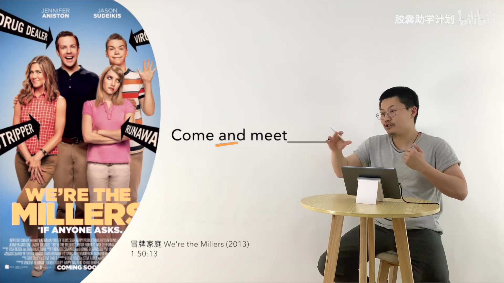

文字识别：JENNIFER / JASON / ORUG DEALER / ANISTON / SUDEIKIS / 胶囊助学计划 / RUNAWA / Come and meet_ / TRIPPER / WE'RETHE / MLLER / IFANYONEASKS. / 冒牌家庭 We're the Millers (2013) / 1:50:13 / COMING SOO

### 画面 00:03:05

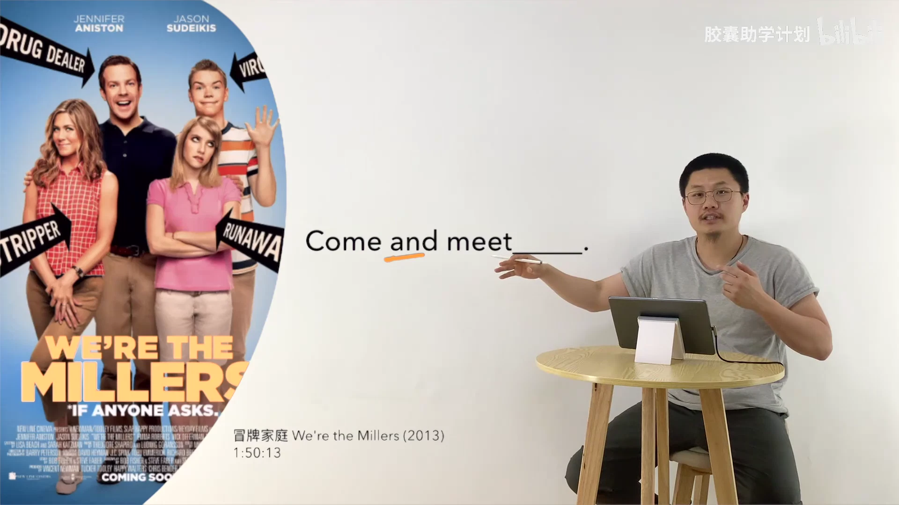

文字识别：ORUG DEALER / JENNIFER / ANISTON / SUDEIKIS / JASON / 胶囊助学计划 / RUNAWA / Come and / meet / TRIPPER / WE'RETHE / MLLER / *IFANYONE ASKS. / 冒牌家庭 We're the Millers (2013) / 1:50:13 / COMING SOO

### 画面 00:03:10

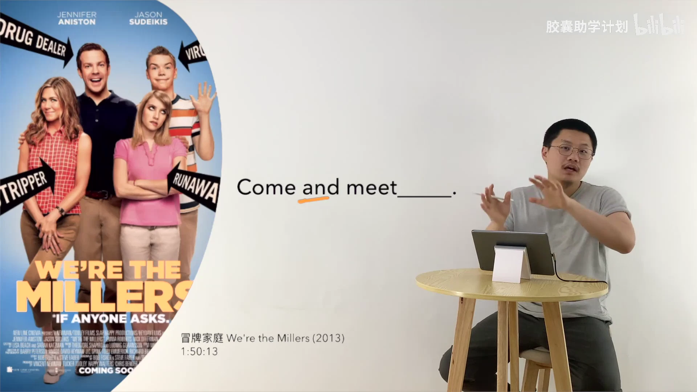

文字识别：JENNIFER / JASON / ORUG DEALER / ANISTON / SUDEIKIS / 胶囊助学计划 / RUNAWA / Come and meet_ / TRIPPER / WE'RETHE / MLLER / IFANYONEASKS. / 冒牌家庭We're the Millers (2013) / 1:50:13 / COMING SOO

### 画面 00:03:15

文字识别：ORUG DEALER / JENNIFER / ANISTON / SUDEIKIS / JASON / 胶囊助学计划 / RUNAWA / Come and meet_ / TRIPPER / WE'RETHE / MLLER / IFANYONEASKS. / 冒牌家庭 We're the Millers (2013) / 1:50:13 / COMING SOO

### 画面 00:03:18

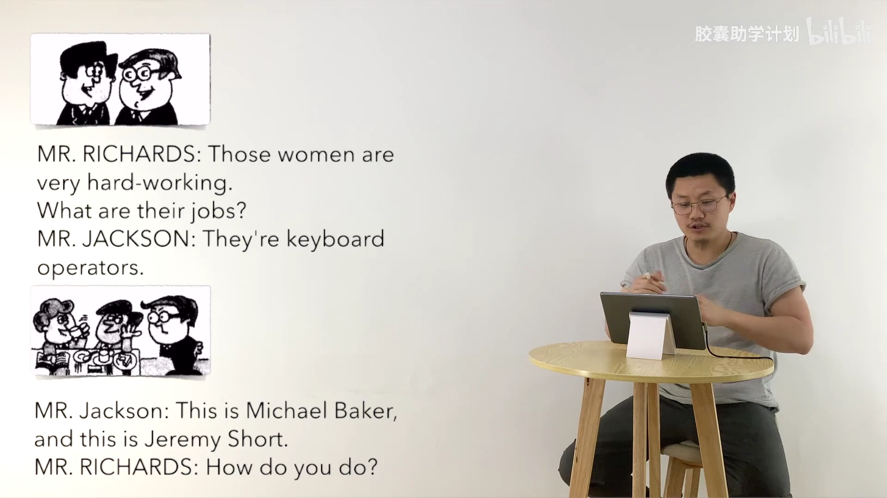

文字识别：biHL / 胶囊助学计划 / MR. RICHARDS: Those women are / very hard-working. / What are their jobs? / MR. JACKSON: They're keyboard / operators. / MR. Jackson: This is Michael Baker, / and this is Jeremy Short. / MR. RICHARDS: How do you do?

### 画面 00:03:21

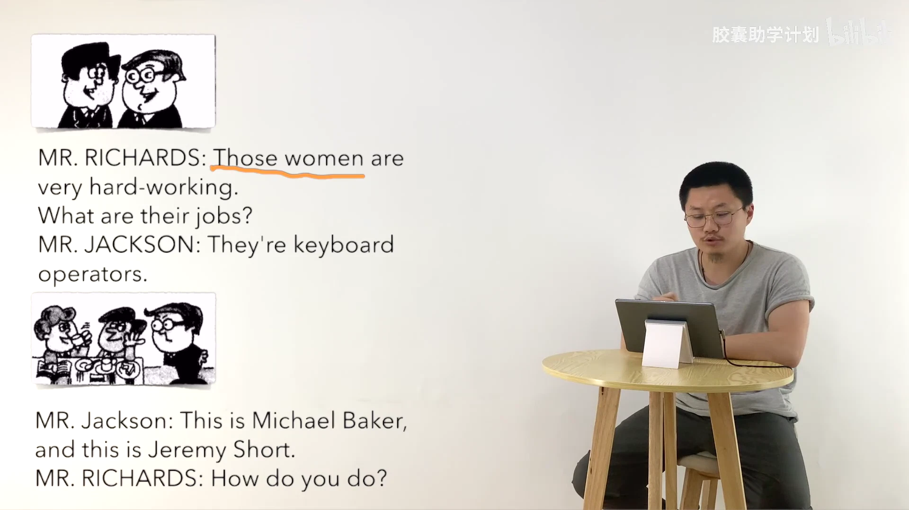

文字识别：胶囊助学计划 / MR. RICHARDS: Ihose women are / very hard-working. / What are their jobs? / MR. JACKSON: They're keyboard / operators. / MR. Jackson: This is Michael Baker, / and this is Jeremy Short. / MR. RICHARDS: How do you do?

## 00:03:30–00:04:00

次，are是怎么样呢？Very hard working，他们工作非常的努力。想变一般疑问句，说那些女人工作很努力吗？Are提前。Are those women very hard working？Very good. What are their jobs？他们的工作是什么呢？很有意思。Jobs是要加s表复数的哦。说They are keyboard operators。他们是键盘打字员。哎，键盘的操控员就是打字员。

### 画面 00:03:32

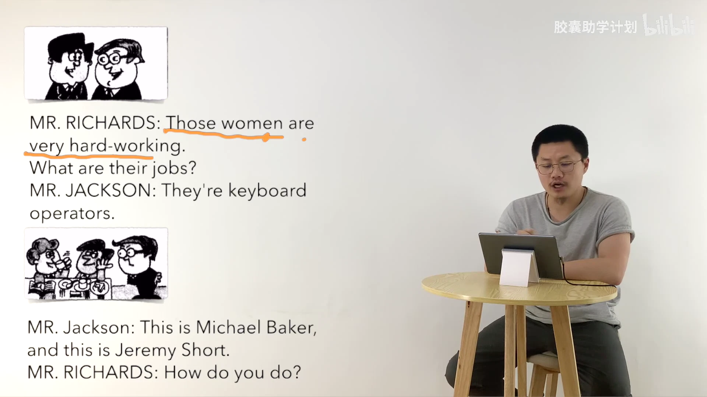

文字识别：Li! / 胶囊助学计划 / MR. RICHARDS: Ihose women are / very hard-working. / What are their jobs? / MR. JACKSON: They're keyboard / operators. / MR. Jackson: This is Michael Baker, / and this is Jeremy Short. / MR. RICHARDS: How do you do?

### 画面 00:03:40

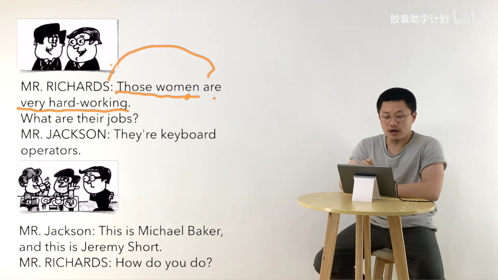

文字识别：胶囊助学计划 / MR. RICHARDS: Ihose women are / very hard-working. / What are their jobs? / MR. JACKSON: They're keyboard / operators. / MR. Jackson: This is Michael Baker, / and this is Jeremy Short. / MR. RICHARDS: How do you do?

### 画面 00:03:45

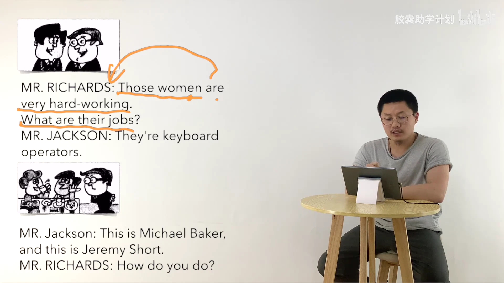

文字识别：Lil / 胶囊助学计划 / MR. RICHARDS: Ihose women are / very hard-working. / What are their jobs? / MR. JACKSON: They're keyboard / operators. / MR. Jackson: This is Michael Baker, / and this is Jeremy Short. / MR. RICHARDS: How do you do?

### 画面 00:03:52

文字识别：LiHL / 胶囊助学计划 / MR. RICHARDS: Ihose women are / very hard-working. / • / What are their jobs? / MR. JACKSON: They're keyboard / operators. / MR. Jackson: This is Michael Baker, / and this is Jeremy Short. / MR. RICHARDS: How do you do?

### 画面 00:03:56

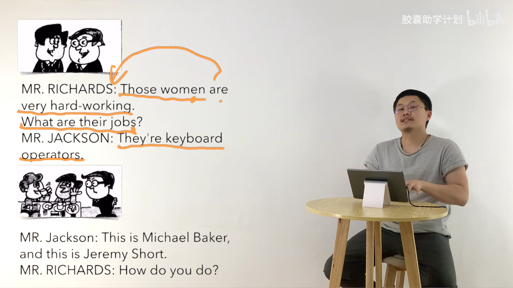

文字识别：胶囊助学计划 / MR. RICHARDS: Ihose women are / very hard-working. / What are their jobs? / MR. JACKSON: They're keyboard / Operators, / MR. Jackson: This is Michael Baker, / and this is Jeremy Short. / MR. RICHARDS: How do you do?

## 00:04:00–00:04:30

这儿有一个 s 表复数。继续介绍说，This is Michael Baker and this is Jeremy Short。说还是介绍两个人，说这是谁和这是谁。How do you do？比较正式的一种方法，不正式的，Hi，Hello，How are you？就 OK 了。Continue，They aren't very busy。他们不是特别的忙呀。老板看了就不高兴了，对吧？一脸的不高兴，说

### 画面 00:04:04

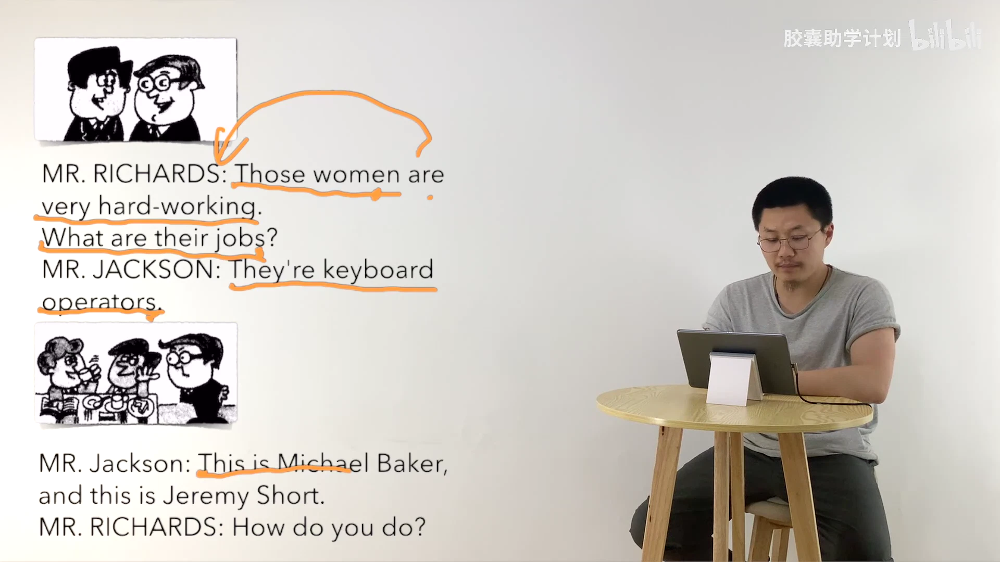

文字识别：bilb / 胶囊助学计划 / MR. RICHARDS: Ihose women are / very hard-working. / • / What are their jobs? / MR. JACKSON: They're keyboard / operators. / MR. Jackson: Jhis is Michael Baker, / and this is Jeremy Short. / MR. RICHARDS: How do you do?

### 画面 00:04:09

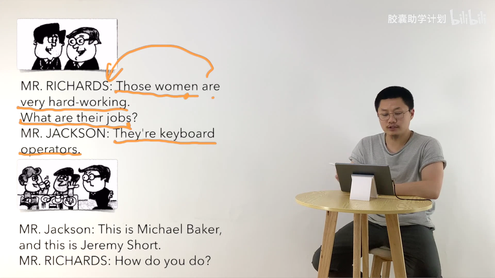

文字识别：bilib / 胶囊助学计划 / MR. RICHARDS: Ihose women are / very hard-working. / • / What are their jobs? / MR. JACKSON: They're keyboard / Operators, / MR. Jackson: This is Michael Baker, / and this is Jeremy Short. / MR. RICHARDS: How do you do?

### 画面 00:04:15

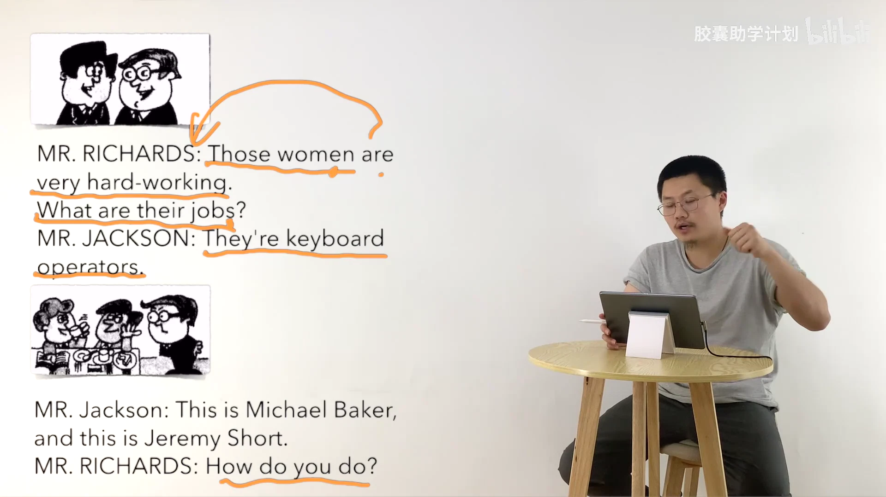

文字识别：Li / 胶囊助学计划 / MR. RICHARDS: Ihose women are / very hard-working. / • / What are their jobs? / MR. JACKSON: They're keyboard / operators. / MR. Jackson: This is Michael Baker, / and this is Jeremy Short. / MR. RICHARDS: How do you do?

### 画面 00:04:17

文字识别：胶囊助学计划 / 课堂笔记 / X / 公众号：胶囊助学计划 / 正版教材 / X / 雅思托福课 / ·学员来信 / ·试听课 / ·课程详情

### 画面 00:04:20

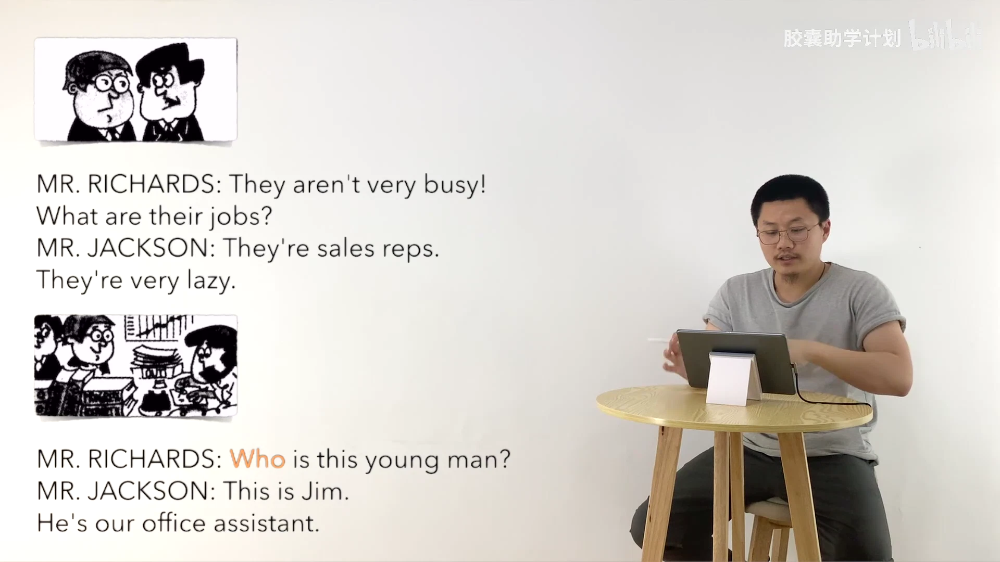

文字识别：胶囊助学计划州 / MR. RICHARDS: They aren't very busy! / What are their jobs? / MR. JACKSON: They're sales reps. / They're very lazy. / MR. RICHARDS: Who is this young man? / MR. JACKSON: This is Jim. / He's our office assistant.

### 画面 00:04:28

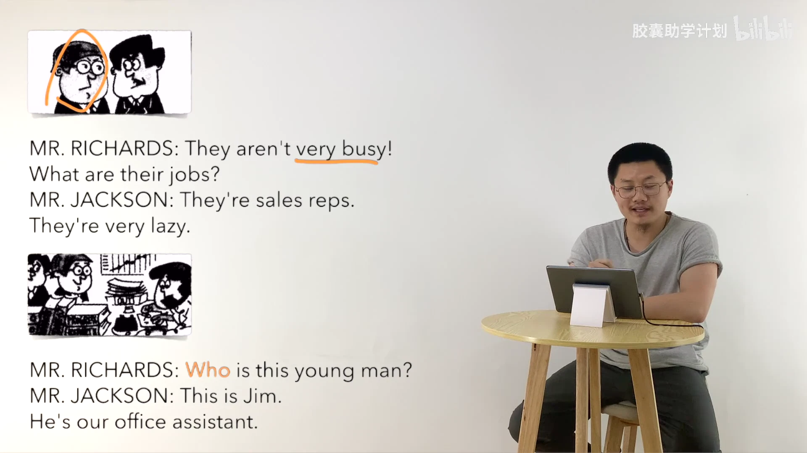

文字识别：Jbiil / 胶囊助学计划 / MR. RICHARDS: They aren't very busy! / What are their jobs? / MR. JACKSON: They're sales reps. / They're very lazy. / MR. RICHARDS: Who is this young man? / MR. JACKSON: This is Jim. / He's our office assistant.

## 00:04:30–00:05:00

What are their jobs? 他们是干什么工作的呀？ They are sales reps. 注意加了个 s 表什么复数。那我们上节课说到了，说 sales rep 其实可能不是那么常用，比它也许更常用的一个叫 salesman。 Okay, say salesman. They are very lazy. 他们特别的懒，对吧？这其实和我们的常识好像是相违背的，是吧？一般销售好像都还格外的勤快。

### 画面 00:04:31

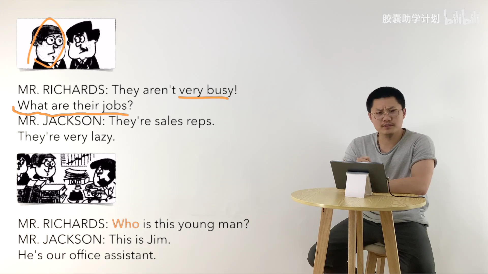

文字识别：bilL / 胶囊助学计划 / MR. RICHARDS: They aren't very busy! / What are their jobs? / MR. JACKSON: They're sales reps. / They're very lazy. / MR. RICHARDS: Who is this young man? / MR. JACKSON: This is Jim. / He's our office assistant.

### 画面 00:04:35

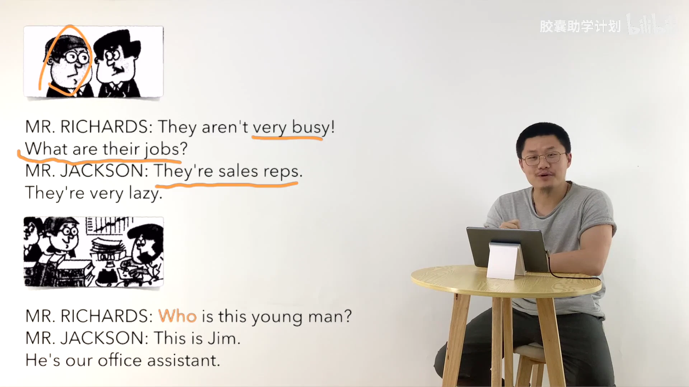

文字识别：胶囊助学计划 / MR. RICHARDS: They aren't very busy! / What are their jobs? / MR. JACKSON: They're sales reps. / They're very lazy. / MR. RICHARDS: Who is this young man? / MR. JACKSON: This is Jim. / He's our office assistant.

### 画面 00:04:54

文字识别：胶囊助学计划H / MR. RICHARDS: They aren't very busy! / What are their jobs? / MR. JACKSON: They're sales reps. / They're very lazy. / MR. RICHARDS: Who is this young man? / MR. JACKSON: This is Jim. / He's our office assistant.

### 画面 00:04:56

文字识别：LiH / 胶囊助学计划 / MR. RICHARDS: They aren't very busy! / What are their jobs? / MR. JACKSON: They're sales reps. / They're very lazy. / MR. RICHARDS: Who is this young man? / MR. JACKSON: This is Jim. / He's our office assistant.

## 00:05:00–00:05:30

快。So who is this young man?好，who关键点来了，叫做谁？Is this这是young man年轻人？我们目前字面意思应该能猜出来，叫做这个年轻人是谁呀？你看都忙疯了是吧？然后后面有一个小图很有意思，业绩直线上升。说This is Jim。说这是Jim。Okay，那这是Jim吗？Is this Jim？张嘴就要来啊。He's our

### 画面 00:05:02

文字识别：LH / 胶囊助学计划 / MR. RICHARDS: They aren't very busy! / What are their jobs? / MR. JACKSON: They're sales reps. / They're very lazy. / MR. RICHARDS: Who is this young man? / MR. JACKSON: This is Jim. / He's our office assistant.

### 画面 00:05:06

文字识别：biH / 胶囊助学计划 / MR. RICHARDS: They aren't very busy! / What are their jobs? / MR. JACKSON: They're sales reps. / They're very lazy. / 29 / MR. RICHARDs: Whois this young man? / MR. JACKSON: This is Jim. / He's our office assistant.

### 画面 00:05:18

文字识别：胶囊助学计划 / MR. RICHARDS: They aren't very busy! / What are their jobs? / MR. JACKSON: They're sales reps. / They're very lazy. / MR. RICHARDs: Whois this young man? / MR. JACKSON: This is Jim. / He's our office assistant.

### 画面 00:05:20

文字识别：bihb / 胶囊助学计划 / MR. RICHARDS: They aren't very busy! / What are their jobs? / MR. JACKSON: They're sales reps. / They're very lazy. / MR. RICHARDS: Whois this young man? / MR. JACKSON: This is Jim. / He's our office assistant.

### 画面 00:05:28

文字识别：胶囊助学计划 / MR. RICHARDS: They aren't very busy! / What are their jobs? / MR. JACKSON: They're sales reps. / They're very lazy. / MR. RICHARDS: Whois this young man? / MR. JACKSON: Ihis is Jim. / He's our office assistant.

## 00:05:30–00:06:00

office assistant.他是我们的办公室助理。那他是办公室助理吗？Is he our office assistant?各位要练到这样的一个地步，这个语法您才算会了，张嘴能说出来才算会了。OK，好，那我们看一下本课非常重要的一个语法，叫做who引导的特殊疑问句。首先想一下，特殊疑问句等于什么来着？特殊疑问词加去掉答案

### 画面 00:05:30

文字识别：LH / 胶囊助学计划 / MR. RICHARDS: They aren't very busy! / What are their jobs? / MR. JACKSON: They're sales reps. / They're very lazy. / MR. RICHARDS: Whois this young man? / MR. JACKSON: Ihis is Jim. / He's our office assistant.

### 画面 00:05:45

文字识别：bill / 胶囊助学计划 / MR. RICHARDS: They aren't very busy! / What are their jobs? / MR. JACKSON: They're sales reps. / They're very lazy. / MR. RICHARDS: Who is this young man? / MR. JACKSON: This is Jim. / He's our office assistant.

### 画面 00:05:47

文字识别：胶囊助学计划 / Who 特殊疑问句

## 00:06:00–00:06:30

的一般疑问句，那我们先给一句肯定句，叫 That is Leo。一般疑问句怎么办？Is 提现，Is that Leo？ Leo 人啊人，Who 提问对吧？Who 提问，往前一提，Who is that？那谁呀？啊，那个是谁呀？OK，那注意这个地方，它是可以有一个缩写的，叫 Who's that？看到了吧？Is 变

### 画面 00:06:09

文字识别：胶囊助学计划 / Who 特殊疑问句 / That is Leo. / Is that Leo?

### 画面 00:06:26

文字识别：biil / 胶囊助学计划 / Who 特殊疑问句 / That is Leo. / ?wh / Is that Leo? / Who is that? / Who's that?

## 00:06:30–00:07:00

成了ps。好，那我们接下来一起看一下呢。说this young man is Leo. Okay,说这个年轻人啊是Leo。想变一般疑问句吧，is提前就可以了，叫做Is this young man Leo? Very good.那我接下来想对Leo提问，就是把who替代他，直接提前，叫Who is this young man?各位能看到他是怎么来的了吧？肯定句变一般疑问句，变特殊疑问句。到这一步，您只是

### 画面 00:06:31

文字识别：胶囊助学计划 / Who 特殊疑问句 / This young man is Leo.

### 画面 00:06:36

文字识别：LiH / 胶囊助学计划 / Who 特殊疑问句 / This young man is Leo.

### 画面 00:06:48

文字识别：胶囊助学计划 / Who 特殊疑问句 / his / s young / man is Leo. / this young / manLeo? / Whois this / young / man?

### 画面 00:06:50

文字识别：胶囊助学计划 / Who牛 / 特殊疑问句 / his / syoung / man is Leo. / this young / manLeo? / WWhos this / young man?

## 00:07:00–00:07:30

懂了，还没有办法张嘴，可能立刻就说出来。说，比如说那些姑娘是谁啊？Who are those girls？您可能还做不到这一步。想做到这一步，还需要干什么呢？练习，练习，再练习。好好写家庭作业，好好张开嘴，好好做偶数课的听力口语练习。OK。而一个，那接下来这两个小的单词的发音真的是非常的像，whose whose，听不太出来太大的区别。区别要看它的字面意思和后面

### 画面 00:07:19

文字识别：胶囊助学计划 / Who 特殊疑问句

### 画面 00:07:23

文字识别：胶囊助学计划 / Who 特殊疑问句 / Who's / Whose

## 00:07:30–00:08:00

的那些单词。Whose 表谁的。Whose 是 who is 的缩写，它叫做谁是。OK, very good. 这是两个不同的特殊疑问词哦。接下来我们做一些小的练习。Iron Man, 大家可能知道钢铁侠，对吧？那我介绍说，This is Iron Man. OK, 那这是 Iron Man. Is this Iron Man? 对 Iron Man 提问用 Who? Very good. Who is

### 画面 00:07:31

文字识别：胶囊助学计划 / Who 特殊疑问句 / Who's / Whose

### 画面 00:07:41

文字识别：胶囊助学计划 / 2 / Iron Man

### 画面 00:07:47

文字识别：胶囊助学计划 / Iron Man

### 画面 00:07:58

文字识别：胶囊助学计划 / Iron Man / This is Iron Man. / Is this Iron Man? / 2 / Who is this?

## 00:08:00–00:08:30

this? Continue, Captain America. Okay, America. Very good.美国队长说This is Captain America. Is this Captain America?他是个人，对人提问。用户叫做Who is this?啊，如果您不知道是谁，你就问说Who is this?那别人告诉你这是漫威系列的超人啊。Who is this?这叫做Captain America. Very good. Next one, Hawk.啊，无敌Hawk. Continue.说

### 画面 00:08:01

文字识别：BiH / 胶囊助学计划 / Captain America

### 画面 00:08:10

文字识别：胶囊助学计划 / Captain America / This is Captain America. / ② Is this Captain America?

### 画面 00:08:26

文字识别：胶囊助学计划l / Hulk

## 00:08:30–00:09:00

he is Hawk. Is he Hawk? 对 Hawk 提问用 Who. Very good. 他是人对吧？他的名字叫 Who. 叫做 Who is he? Very good. Let's continue. 叫 Black Widow. 啊，黑寡妇。说 She is Black Widow. 一般疑问句叫做 Is she Black Widow? Is 提前对 Black Widow 提问用 Who. Who is she? 她是谁呀？ Very good. 那刚才我们做完这些练习了之后，接下来

### 画面 00:08:38

文字识别：胶囊助学计划 / Hulk / ① He is Hulk. / ② Is he Hulk? / ③ Who is he?

### 画面 00:08:40

文字识别：胶囊助学计划l / Black Widow

### 画面 00:08:49

文字识别：胶囊助学计划 / Black Widow / ① She is Black Widow. / ② Is she Black Widow?

### 画面 00:08:57

文字识别：bi / 胶囊助学计划 / Comprehension

## 00:09:00–00:09:30

即立刻，哎，立刻接着去做口语听力练习 comprehension 这个环节，各位闭上眼睛或者去看着文章，但不要看屏幕了，听，然后您去口语回答啊。当然，您可以暂停屏幕或者再听一遍。来了，Are Nicola Gray and Claire Taylor nurses？这您不用跟读啊，给我用口语回答就可以了，给我答案，

### 画面 00:09:18

文字识别：胶囊助学计划 / bill / Comprehension / 1 T: Are Nicola Grey and Claire Taylor nurses?

## 00:09:30–00:10:00

答案 No, they aren't. Next one. What are their jobs? They are keyboard operators. 如果快，您可以暂停啊。 Are the women hardworking? Yes, they are. Are Michael Baker and Jeremy Shore keyboard operators too? No, they aren't.

### 画面 00:09:34

文字识别：胶囊助学计划 / Comprehension / 2 T: What are their jobs?

### 画面 00:09:51

文字识别：胶囊助学计划 / Comprehension / 4 T: Are Michael Baker and Jeremy Short / keyboard operators, too?

## 00:10:00–00:10:30

Are they sales reps or office assistant? They are sales reps. Are they very busy? No, they aren't. Who is the young man? Jim. Is Jim a sales rep or an

### 画面 00:10:01

文字识别：胶囊助学计划州 / Comprehension / 5 T: Are they sales reps or office assistants?

## 00:10:30–00:11:00

office assistant. He's an office assistant. Is Jim very busy? Yes, he is. Is he hardworking? Yes, he is. Okay,那做完了刚才的听力口语练习，接下来立刻还有一个听力口语练习，ask me asking questions。这个地方我们再重申一遍，如何去练

### 画面 00:10:31

文字识别：胶囊助学计划 / bil / Comprehension / 8 T: Is Jim a sales rep or an office assistant?

### 画面 00:10:51

文字识别：胶囊助学计划H / Asking questions

## 00:11:00–00:11:30

呢？我说一句话叫 Ask me if Nicola Gray is a keyboard operator. 对于各位来说，最重要的是后面这句话，前三面前三个单词并不是那么重要。您需要做的事情是通过听力看到这句话，听到这句话，然后把它变成一般疑问句，口语说出来，叫做 Is Nicola Gray a keyboard operator? 回答 Yes, she is. Ask me if

### 画面 00:11:06

文字识别：胶囊助学计划州 / Asking questions / 1 T: Ask me if Nicola Grey is a keyboard operator.

### 画面 00:11:08

文字识别：胶囊助学计划州 / Asking questions / 1 T: Ask me if Nicola Grey is a keyboard operator.

### 画面 00:11:21

文字识别：胶囊助学计划 / Asking questions / 1 T: Ask me if Nicola Grey is a keyboard operator. / S: Is Nicola Grey a keyboard operator?

### 画面 00:11:27

文字识别：bitl / 胶囊助学计划 / Asking questions

## 00:11:30–00:12:00

Claire Taylor is very busy. Is Claire Taylor very busy? Yes, she is. Very good. Continue next one. Ask me if Michael Baker and Jeremy Short are keyboard operators too. 如果读音有点快，暂停或者多听几遍啊。 Are Michael Baker and Jeremy Short keyboard operators too? No, they aren't.

### 画面 00:11:38

文字识别：胶囊助学计划 / Asking questions / 3T: Ask me if Michael Baker and Jeremy / Short are keyboard operators too.

### 画面 00:11:50

文字识别：胶囊助学计划 / Asking questions / 3 T: Ask me if Michael Baker and Jeremy / Short are keyboard operators too. / S:Are Michael Baker and Jeremy Short / keyboard operators, too?

### 画面 00:11:59

文字识别：胶囊助学计划明 / Asking questions / 4 T: Ask me if the two men are lazy. / 2

## 00:12:00–00:12:30

Ask me if the two men are lazy. Are the two men very lazy? Yes, they are. Ask me if the young man is an office assistant. Is the young man an office assistant? Yes, he is. Okay,这两个练习非常的重要，能帮助大家听懂别人的问题，并且自己慢

### 画面 00:12:16

文字识别：胶囊助学计划 / Asking questions / 5 T: Ask me if the young man is an office assistant. / S: Is the young man an office assistant?

## 00:12:30–00:13:00

慢的也能问出来这个问题。这两个练习从新一一直贯穿到新四。那当然了，我们初期更多的是从新一贯穿到新二。各位能练好，就已经能去进行听懂别人的问题以及提出自己想问的问题了啊！所以这两个练习一定要重视啊！那我们回顾一下，who引导的特殊疑问句跟之前的特殊疑问句没有任何区别，特殊疑问词加一般疑问句。其次呢，who的意思叫谁的？如何

### 画面 00:12:46

文字识别：biH / 胶囊助学计划 / Asking questions / 5 T: Ask me if the young man is an office assistant. / S: Is the young man an office assistant? / T: Yes, he is.

### 画面 00:12:49

文字识别：Lilil / 胶囊助学计划 / ①Who 引导的特殊疑问句? / 如何表达“过来见见某人”?

### 画面 00:12:54

文字识别：billb / 胶囊助学计划 / ①Who引导的特殊疑问句？ / 如何表达“过来见见某人”?

### 画面 00:12:58

文字识别：biil / 胶囊助学计划 / ①Who 引导的特殊疑问句？ / 如何表达“过来见见某人”?

## 00:13:00–00:13:30

表达？过来见见某人呢？Come and meet。比如说过来看看，见见我妈，对吧？Come and meet my mom. Very good. 那 recap， who 引导的特殊疑问句，我们刚刚提到了谁？Come and meet。刚刚也提到了，重点就是这两个。接下来我们看一下今天的家庭作业。第一，绿皮书十七课，您可以写了，写完不要忘了对答案。其次，文章一定要跟读至熟读成诵，甚至能背下来，但

### 画面 00:13:08

文字识别：bitb / 胶囊助学计划 / Recap / Patterns / Who引导的特殊疑问句 / Grammar / Words / Expression / come and meet

### 画面 00:13:11

文字识别：胶囊助学计划 / Recap / Patterns / & / Who引导的特殊疑问句 / Grammar / Words / Expression / come and meet

### 画面 00:13:14

文字识别：bitb / 胶囊助学计划 / Recap / Patterns / & / Who引导的特殊疑问句 / Grammar / Words / Expression / come and meet

### 画面 00:13:17

文字识别：胶囊助学计划 /  biltl

## 00:13:30–00:14:00

不用专门去背啊。最后要给自己讲解一遍今天的核心知识点。那本期的视频呢，到这就结束了。如果大家喜欢的，欢迎大家关注、订阅、一键三连，并分享给那些需要的朋友们。最后的最后，我们看一句名人名言：Never go to a doctor whose office plans have died. See you next time.

### 画面 00:13:33

文字识别：bilb / 胶囊助学计划 / 绿皮书第17课的写作练习 / 文章跟读至熟读成诵 / 3.请给自己讲解一遍今天的 / 核心知识点

### 画面 00:13:35

文字识别：LiH / 胶囊助学计划

### 画面 00:13:45

文字识别：u bililb / 胶囊助学计划 / Never go to a doctor whose office / plants have died. / Erma Bombeck

### 画面 00:13:54

### 画面 00:13:56

文字识别：CAPSULEACADEMY / 胶囊助学计划 / 小红书 / Lecturer / □ / Leo / OE

### 画面 00:13:59

文字识别：CAPSULEACADEMY / 胶囊助学计划 / 小红书 / Editor / OE

## 00:14:00–00:14:06

### 画面 00:14:02

文字识别：英酬学計園 / CAPSULEACADEMY / 胶囊助学计划 / 小红书 / Creator / Leo & Berlin

### 画面 00:14:04

文字识别：bilbili / 胶囊助学计划 / 胶囊助学计划 / 小红书

### 画面 00:14:06

文字识别：bilbili / 胶囊助学计划

