# 019 单词 语法 文章

快速机器解析：语音为单模型转写，未进行独立交叉校对或人工复核；画面每秒采样并按变化选帧，短时文字和标记可能遗漏。截图时间约有 1 秒误差。图片有损压缩；遇到疑点请按时间查看 Google Drive 原视频。

## 00:00:00–00:00:30

Hello everyone, welcome to Capsule Academy. This is Leo. Today we're going to learn New Concept English Book One Lesson Nineteen Words, Grammar, and Story. 那老习惯进入正式课程之前呢，我们先看两个问题。首先，如何表达怎么了？其次呢，失去爆破这个语音现象到底是什么？带着这两个问题，Hope you're gonna enjoy it. 上来，我们先看第一个单词，跟我们一起读一下。来，matter，

### 画面 00:00:00

文字识别：胶囊助学计划 / NCE / BOOKI / Lesson 19 / Words / Grammar / Story

### 画面 00:00:02

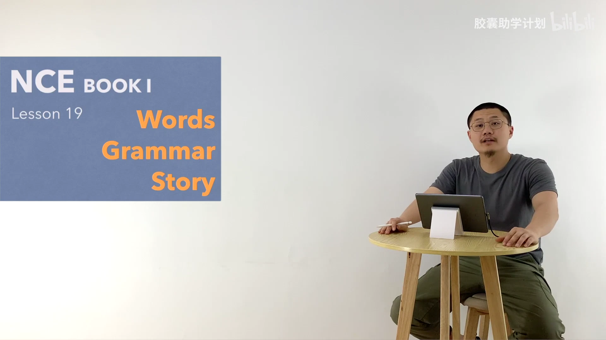

文字识别：胶囊助学计划 / NCE / BOOKI / Lesson 19 / Words / Grammar / Story

### 画面 00:00:09

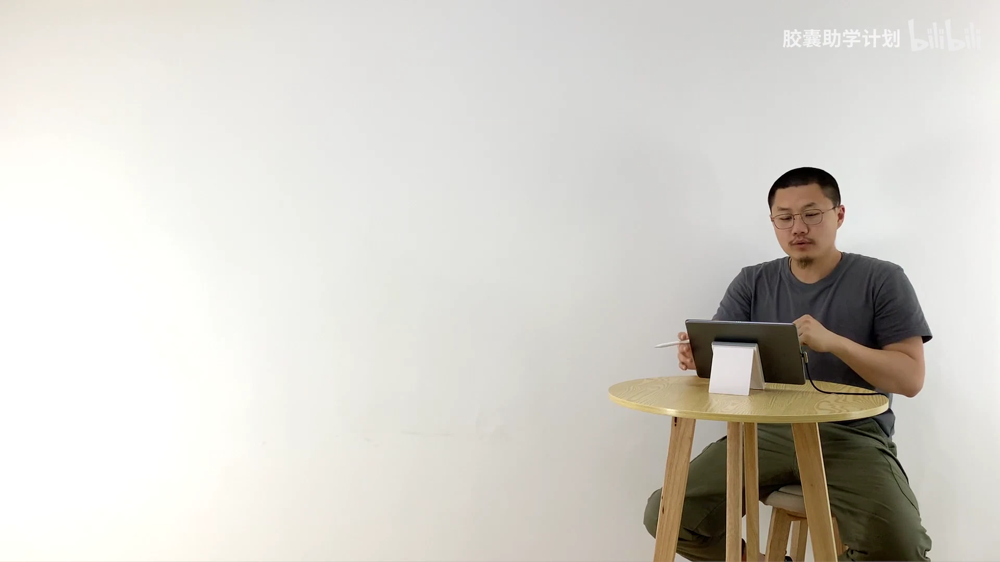

文字识别：胶囊助学计划

### 画面 00:00:12

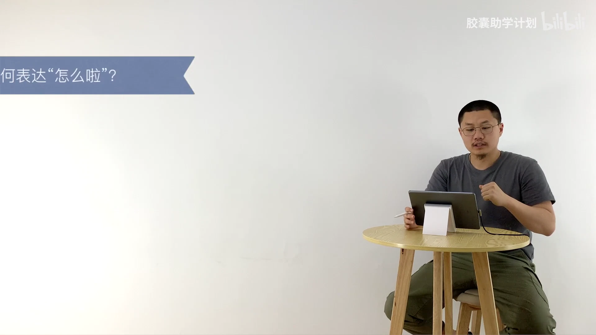

文字识别：胶囊助学计划 / 何表达“怎么啦”?

### 画面 00:00:14

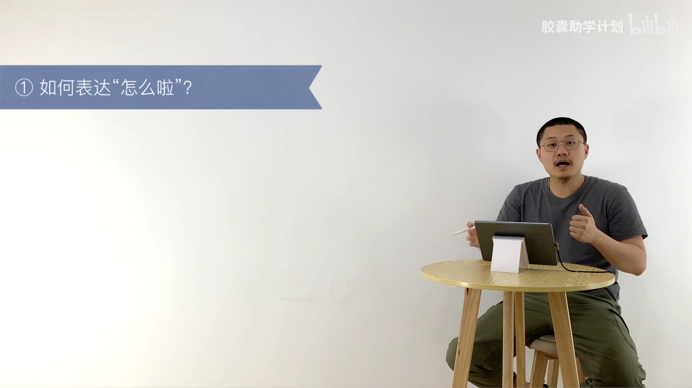

文字识别：胶囊助学计划 / ①如何表达“怎么啦”？

### 画面 00:00:16

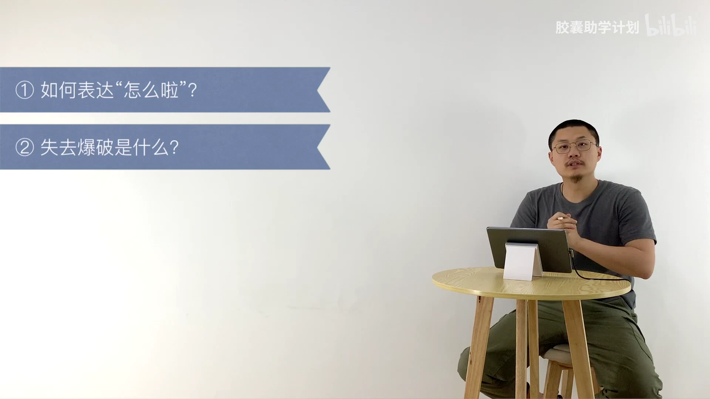

文字识别：胶囊助学计划 / ①如何表达“怎么啦”？ / 失去爆破是什么?

### 画面 00:00:21

文字识别：胶囊助学计划bill / •

### 画面 00:00:25

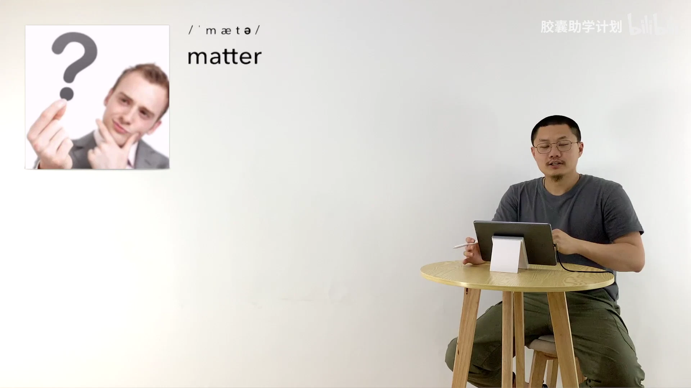

文字识别：胶囊助学计划 / /'mæta/ / 2 / matter

## 00:00:30–00:01:00

注意有个字母 r 儿化音，对吧？那跟我一起读 matter matter very good。那我们回顾一下小的语音知识点，第一个音标叫做 a，第二个音标叫做 o very good。其次呢，字母 m 放在单词当中去，我们对它的发音是嗯，字母 t 放在单词当中去，我们的发音是 t。好，跟我读一

### 画面 00:00:42

文字识别：胶囊助学计划 / /'mæeta/ / 2 / matter / ``

### 画面 00:00:46

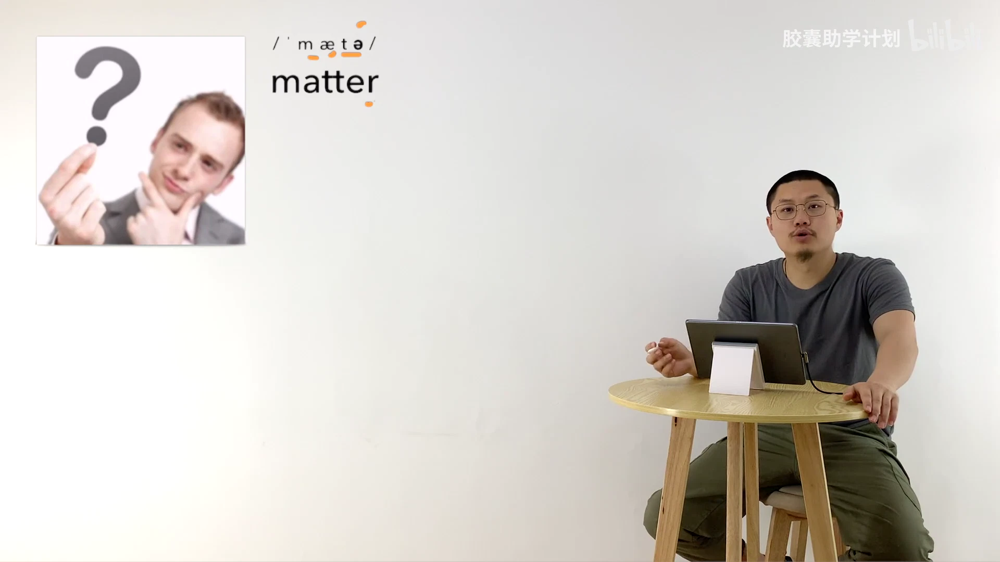

文字识别：胶囊助学计划 / /'mæta/ / 2 / matter / Q

## 00:01:00–00:01:30

下，matter， very good。那直接给大家一个句子，这句话在文章当中也出现了，跟我一起读一下，叫做What's the matter？就是很简单，叫做怎么了，什么问题吗？叫做What's the matter？ very good。好，那其次呢，和它有一个非常像，基本上含义是类似的，叫做What's wrong？ What's wrong？ OK，跟我一起再读一遍，What's wrong？意思是一样的，叫做怎么了？好，接下来我

### 画面 00:01:04

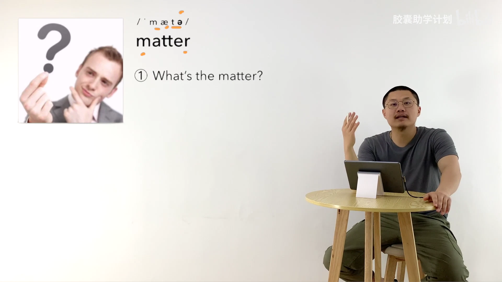

文字识别：胶囊助学计划 / /'mæeta/ / 2 / matter / ① What's the matter?

### 画面 00:01:13

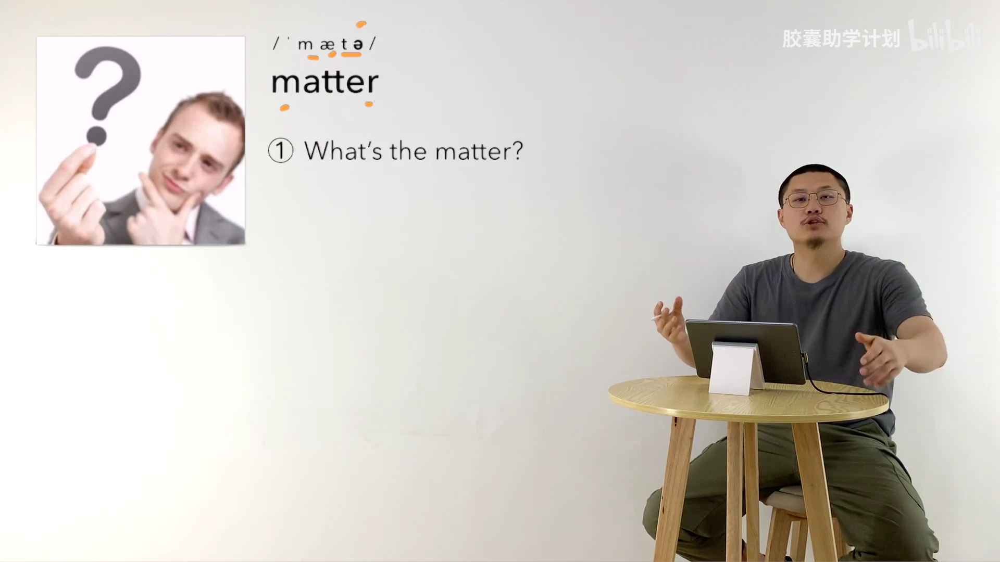

文字识别：胶囊助学计划 / /'mæta/ / 2 / matter / ① What's the matter?

### 画面 00:01:29

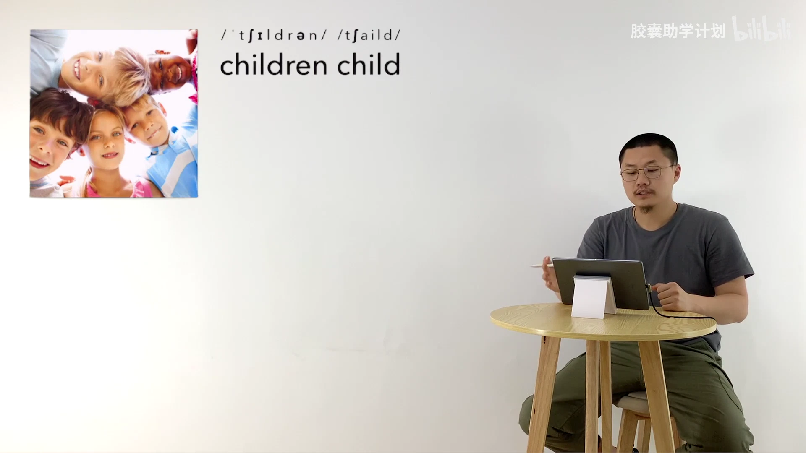

文字识别：胶囊助学计划 / /'t∫rldran/ /t∫aild/ / children child

## 00:01:30–00:02:00

们看下一个单词。首先，我们书中给大家的单词叫做，跟我一起读，children，children。好，注意一个小点，c h字母组合放在单词当中去，习惯性的发音叫ch ch。其次，字母n放在单词当中去，舌尖上牙龈，嗯，是一个辅音，对吧？好，跟我读一下，叫做children。后面这个单词呢，是它的单数形式。各位，我们之前讲过了，

### 画面 00:01:33

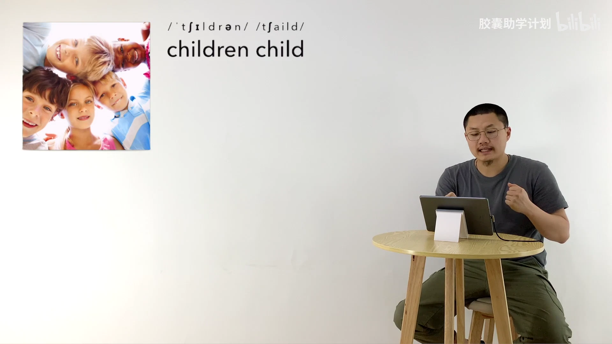

文字识别：胶囊助学计划 / /'t∫rldran/ /t∫aild/ / children child

### 画面 00:01:39

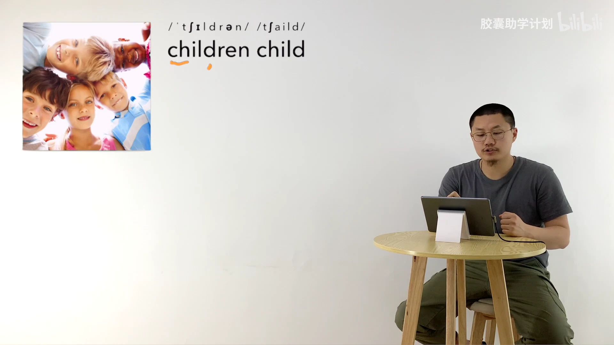

文字识别：胶囊助学计划 / /'t∫rldran/ /t∫aild/ / children child

### 画面 00:01:41

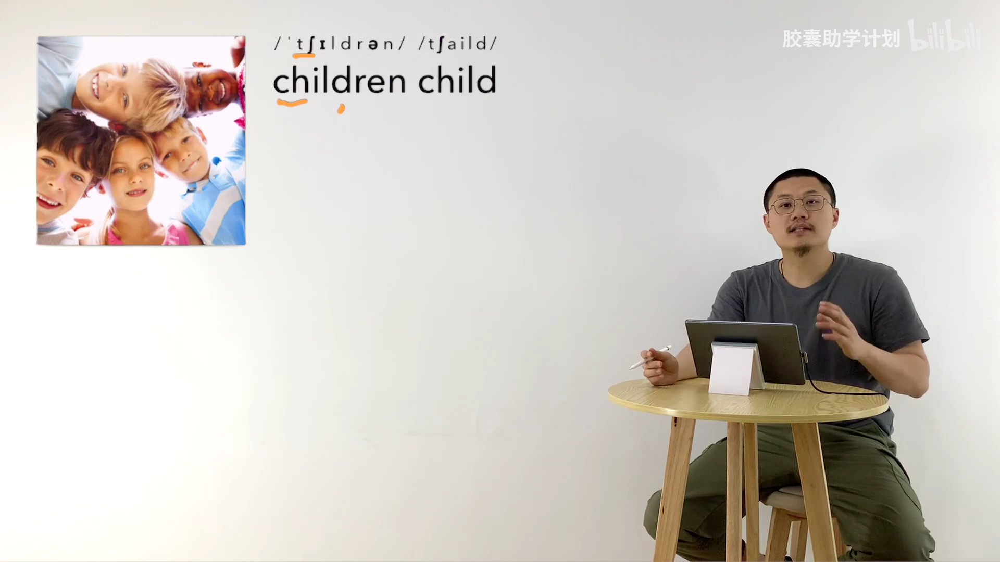

文字识别：胶囊助学计划 / /'t∫rldran/ /t∫aild/ / children child

### 画面 00:01:44

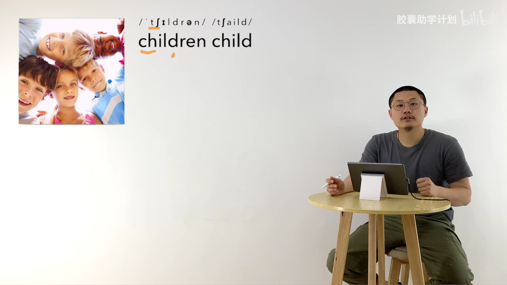

文字识别：胶囊助学计划 / /'t∫rldran/ /t∫aild/ / children child / `

### 画面 00:01:46

文字识别：胶囊助学计划 / /'t∫rldran/ /t∫aild/ / children child

### 画面 00:01:49

文字识别：胶囊助学计划 / /^t∫rldran/ /t∫aild/ / children child

### 画面 00:01:54

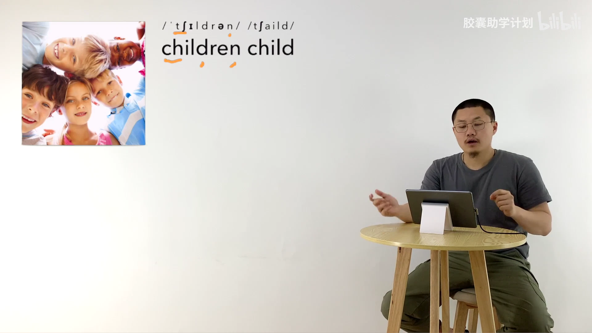

文字识别：胶囊助学计划 / /'t∫rldran/ /t∫aild/ / children child

### 画面 00:01:57

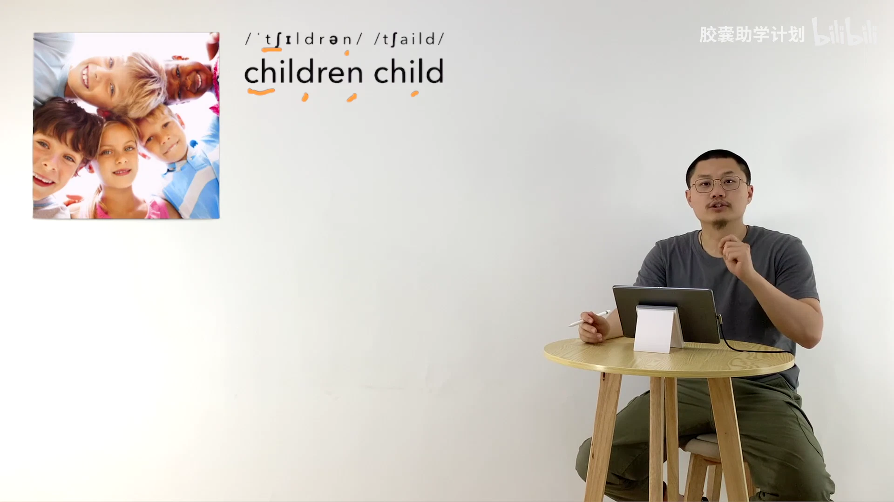

文字识别：胶囊助学计划 / /'t∫rldran/ /t∫aild/ / children child

## 00:02:00–00:02:30

名词变复数有很多变化规则，对吧？有规则的，哎，好几个规则，还有不规则的，那就没有规则了，对不对？那这个就是没有规则的，对不对？从 child 变成了 children，好，从单数变成了复数。OK，那首先我们造一个句子，单词嘛，对吧？五个点最重要，最重要的其中一个点啊，重中之重就是单词造句，跟我一起读教。These are my children。那我想问，这些是您的孩子吗？

### 画面 00:02:01

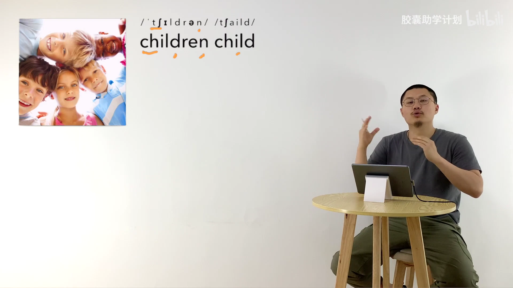

文字识别：胶囊助学计划 / /'t∫rldran/ /t∫aild/ / children child

### 画面 00:02:10

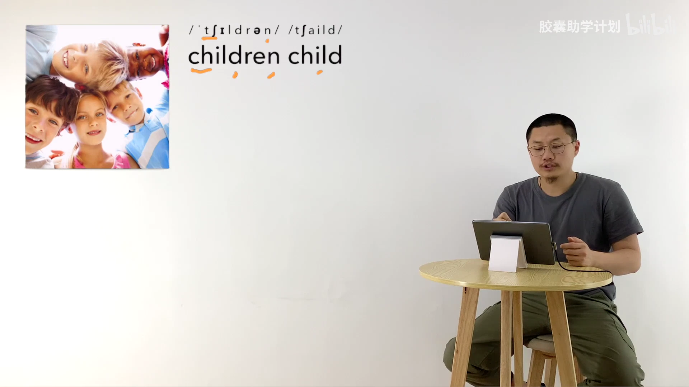

文字识别：胶囊助学计划 / /'t∫rldran/ /t∫aild/ / children child / `

### 画面 00:02:16

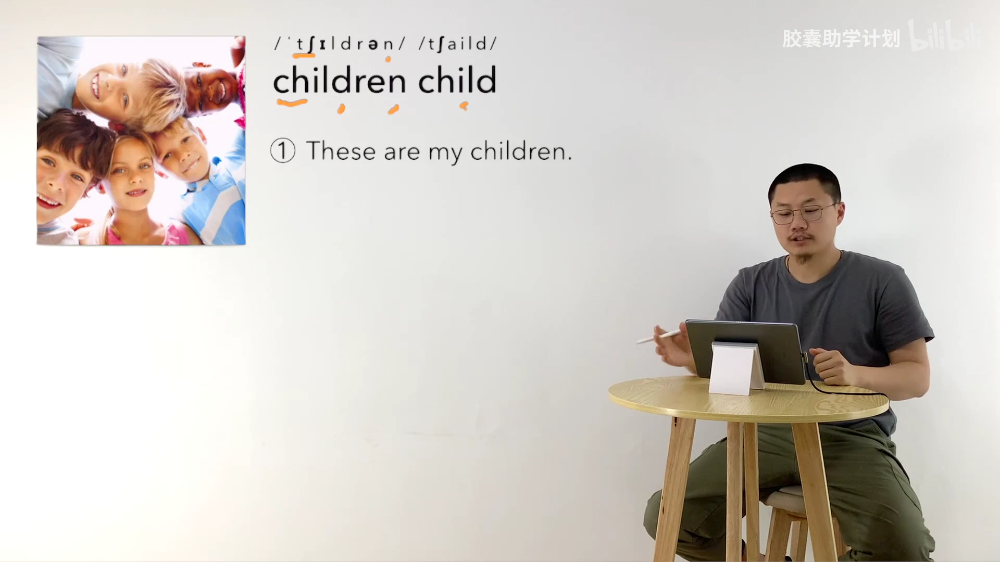

文字识别：胶囊助学计划 / /'t∫rldran/ /t∫aild/ / children child / These are my children.

### 画面 00:02:18

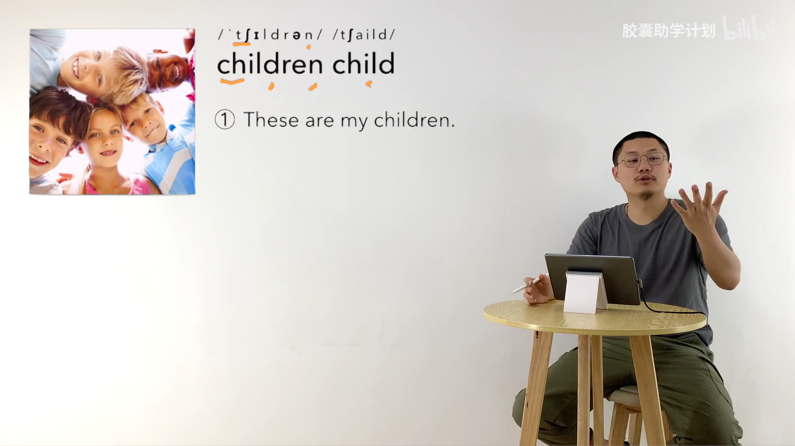

文字识别：胶囊助学计划 / /'trldran/ /t∫aild/ / children child / These are my children.

### 画面 00:02:22

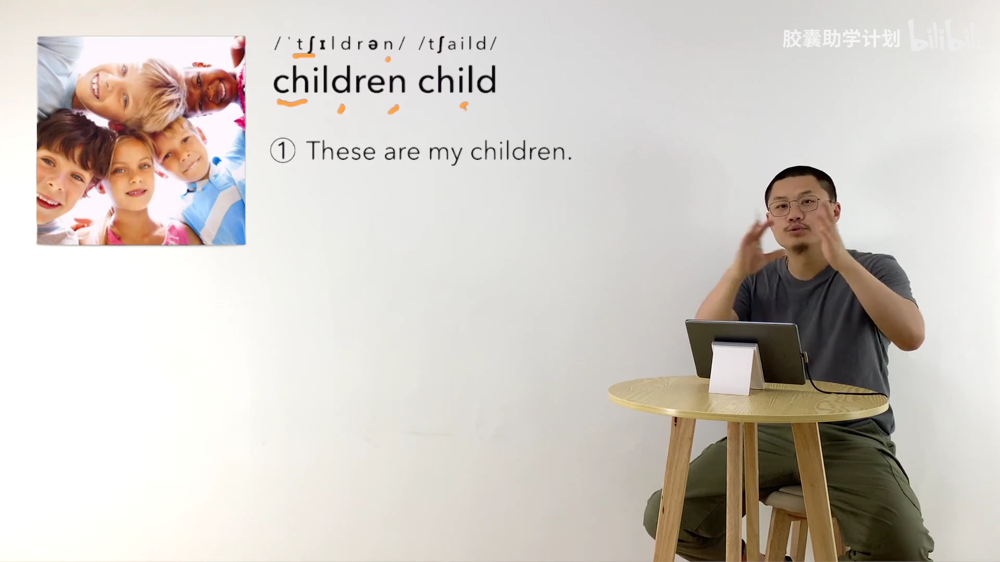

文字识别：胶囊助学计划 / /'t∫rldran/ /t∫aild/ / children child / These are my children.

### 画面 00:02:26

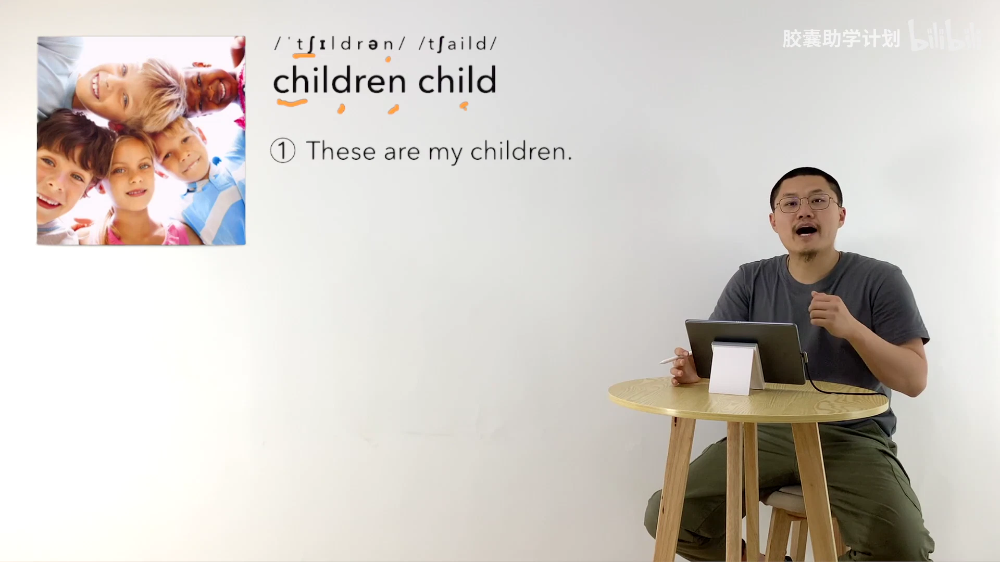

文字识别：胶囊助学计划 / /'t∫rldran/ /t∫aild/ / children child / These are my children.

## 00:02:30–00:03:00

叫做 Are these your children? 那我想对 your 提问，回顾一下应该用谁？我们已经学了很多特殊疑问词了，应该用 whose，对不对？就变成了叫做 Whose children are these? 这些孩子是谁的啊？这些孩子是谁的啊？谁是妈，谁是爸，对吧？ Okay, next one, 共一起读下一个单词 tired, tired. Okay, 注意一个小点啊，我们字母 t

### 画面 00:02:30

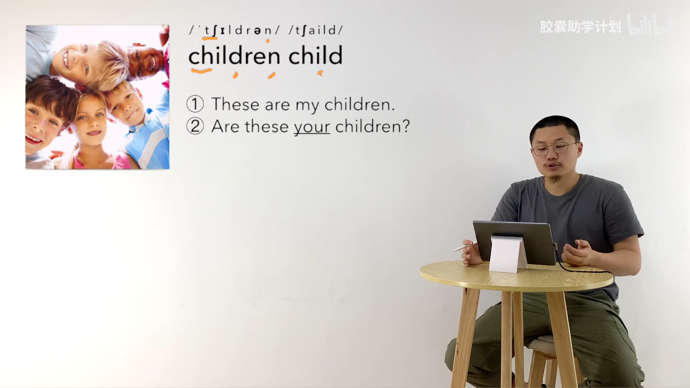

文字识别：胶囊助学计划 / /'t∫rldran/ /t∫aild/ / children child / These are my children. / Are these your children?

### 画面 00:02:34

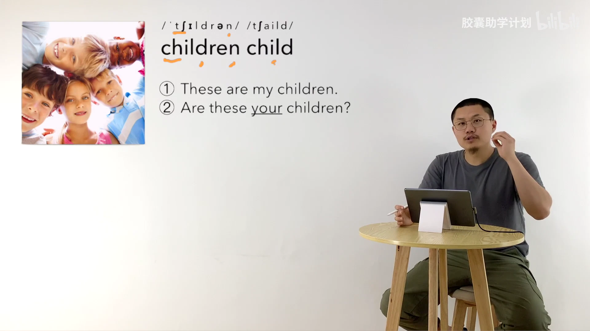

文字识别：胶囊助学计划 / /'t∫rldran/ /t∫aild/ / children child / These are my children. / Are these your children?

### 画面 00:02:45

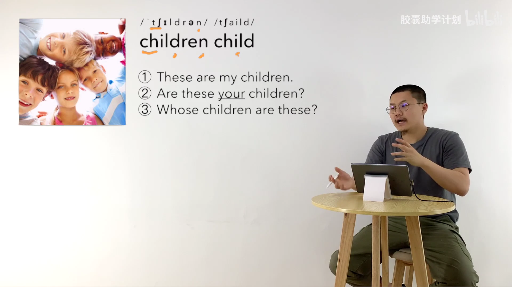

文字识别：胶囊助学计划 / /'t∫ildran/ /t∫aild/ / children child / These are my children. / Are these your children? / Whose children are these?

### 画面 00:02:51

文字识别：胶囊助学计划 / /taiad/ / tired adj.

## 00:03:00–00:03:30

放在单词当中去发的是 t，字母 d 放在单词当中去发的是 d。造一个非常简单的句子叫 I am tired。OK，那我现在想说他很累，是不是叫做 He？注意 am is are 应该用谁？Is 对不对？He is tired。那我想问他累吗？Is 提前，Is he tired？那 Yes，Yes he is。Very good。好，Next one，

### 画面 00:03:07

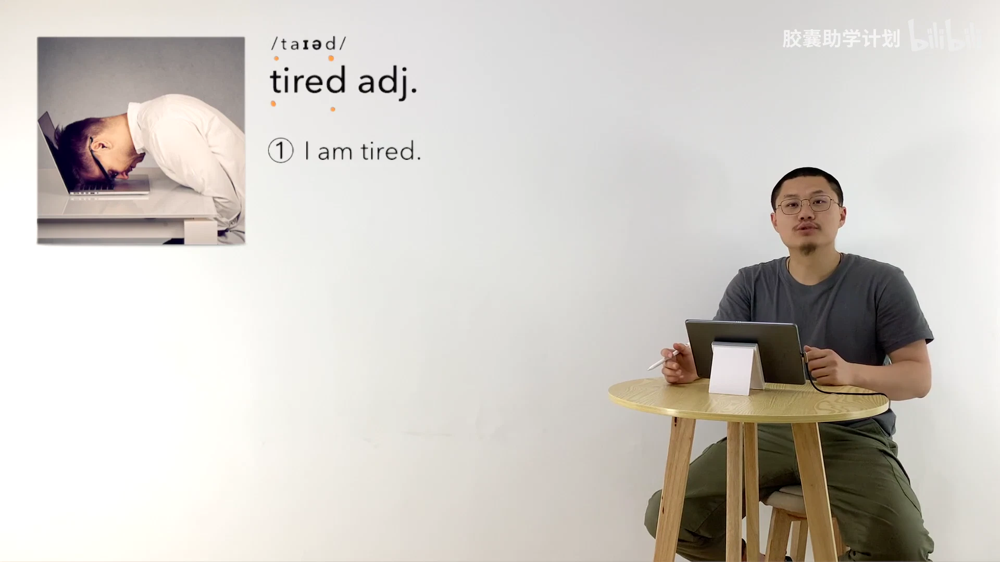

文字识别：胶囊助学计划 / /tarad/ / tired adj. / ① I am tired.

### 画面 00:03:10

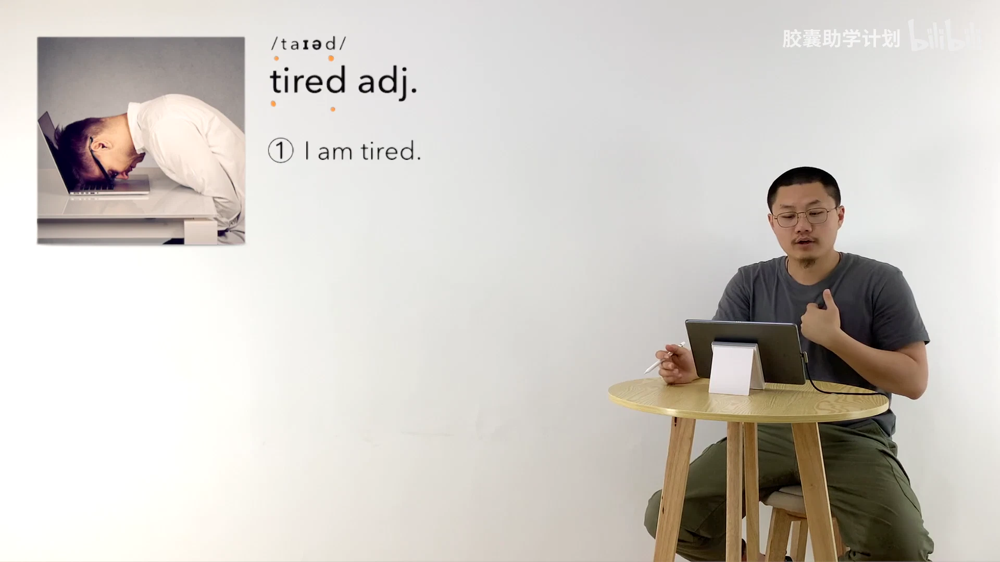

文字识别：胶囊助学计划 / /taiad/ / tired adj. / ① I am tired.

### 画面 00:03:12

文字识别：胶囊助学计划 / /taiad/ / tired adj. / ① Iam tired.

### 画面 00:03:15

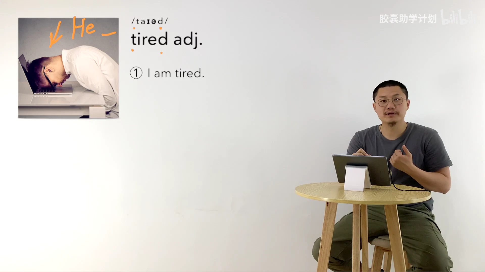

文字识别：胶囊助学计划 / uHe- / /taiad/ / tired adj. / ① I am tired.

### 画面 00:03:18

文字识别：胶囊助学计划 / LHei / /taiad/ / tired adj. / ① Iam tired.

### 画面 00:03:22

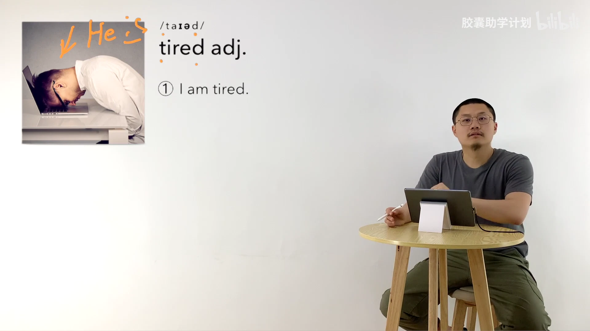

文字识别：胶囊助学计划 / LHe / /taiad/ / tired adj. / ① I am tired.

### 画面 00:03:28

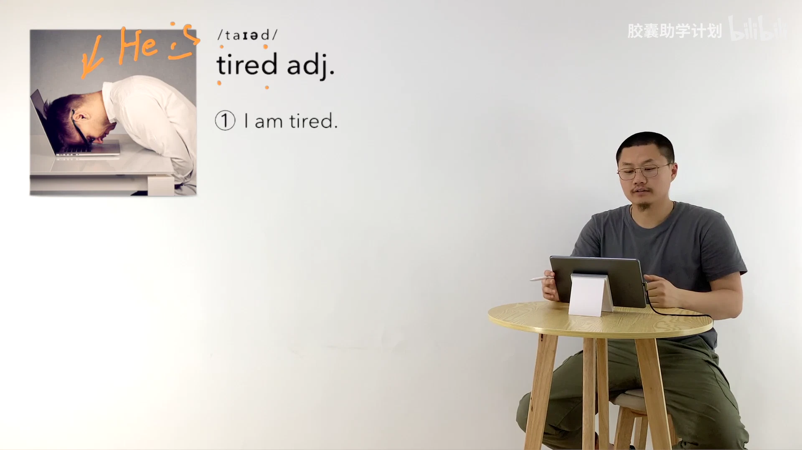

文字识别：胶囊助学计划 / LHe / /tarad/ / tired adj. / ① I am tired.

## 00:03:30–00:04:00

下一个单词跟我一起读啊。我们先先分一下音节吧，两个点中间划开，对不对？好，所以这个地方各位注意一下，就是st并不拼在一起，意味着什么呢？意味着各位不要把它去浊化。还记不记得这个叫清辅音变浊辅音这个现象，对吧？不去进行浊化。所以呢，第一个音节叫做thirst，第二个音节叫做thirsty，连起来thirsty，thirsty。其次注意th

### 画面 00:03:30

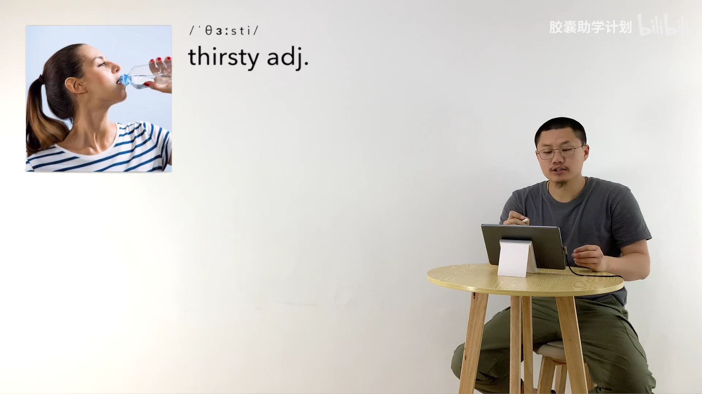

文字识别：胶囊助学计划 / / 'θ3:sti/ / thirsty adj.

### 画面 00:03:52

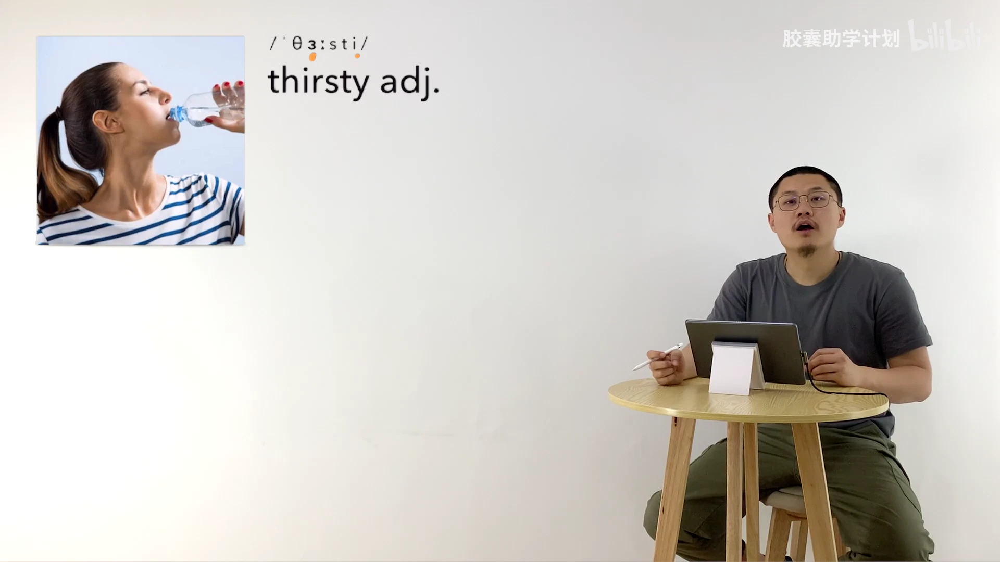

文字识别：胶囊助学计划 / 1'θ3:sti/ / thirsty adj.

### 画面 00:03:58

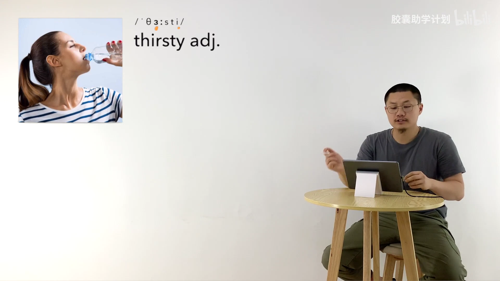

文字识别：胶囊助学计划 / /'θ3:sti/ / 🌈 / thirsty adj.

## 00:04:00–00:04:30

字母组合放在单词当中去发的音是thirsty. Very good.好，但它是形容词，其实一样的，叫做She is very thirsty.那我现在想问，她渴吗？叫做Is she thirsty?那举一反三，我现在想问，你渴吗？我们张嘴就来，叫做Are you thirsty? Very good.好，下一个单词，我们只需要跟我一起读一下就行了。很多同学应该认识这个单词，跟我一起读，

### 画面 00:04:01

文字识别：胶囊助学计划 / /'θ3:sti/ / thirsty adj.

### 画面 00:04:04

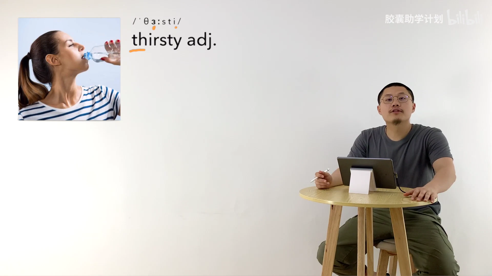

文字识别：胶囊助学计划 / /'θ3:sti/ / thirsty adj.

### 画面 00:04:06

文字识别：胶囊助学计划 / /'θ3:sti/ / thirsty adj.

### 画面 00:04:11

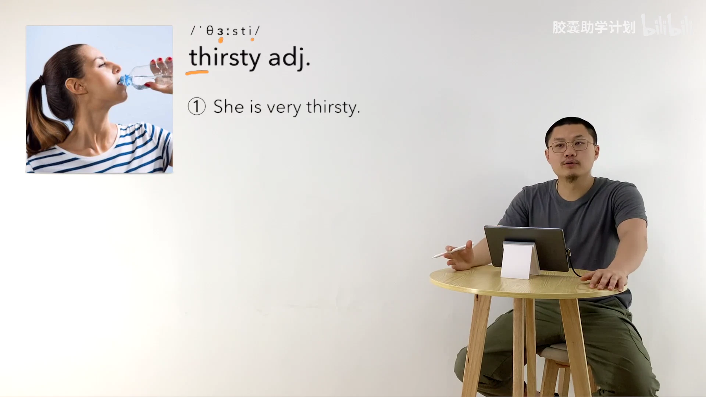

文字识别：胶囊助学计划 / /'θ3:sti/ / thirsty adj. / 0 / ① She is very thirsty.

### 画面 00:04:16

文字识别：胶囊助学计划 / /'θ3:sti/ / thirsty adj. / ① She is very thirsty.

### 画面 00:04:18

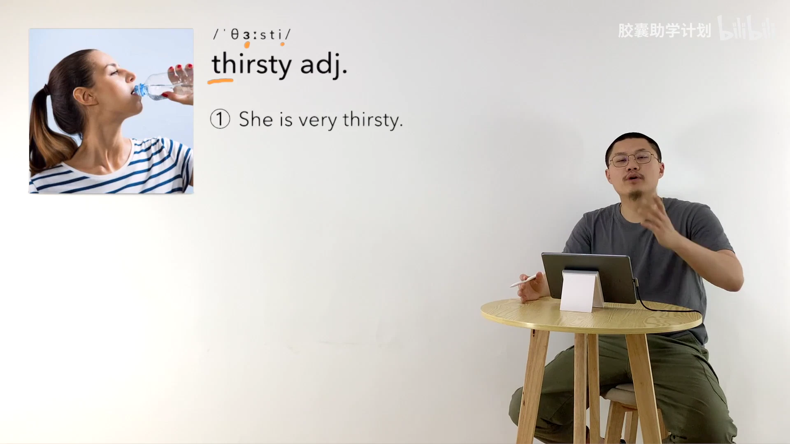

文字识别：胶囊助学计划 / 1'θ3:sti/ / thirsty adj. / ① She is very thirsty.

### 画面 00:04:20

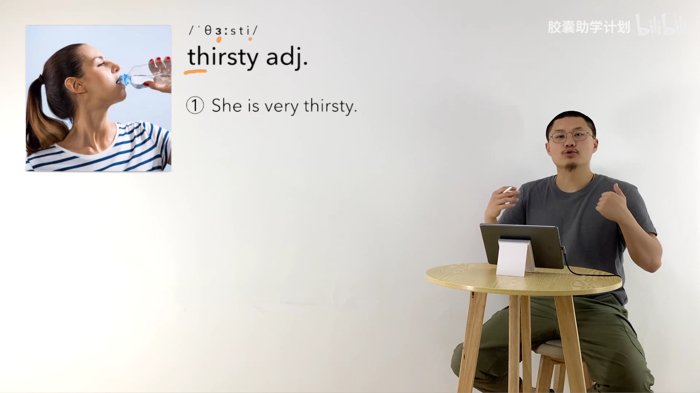

文字识别：胶囊助学计划 / /'θ3:sti/ / thirsty adj. / ① She is very thirsty.

### 画面 00:04:24

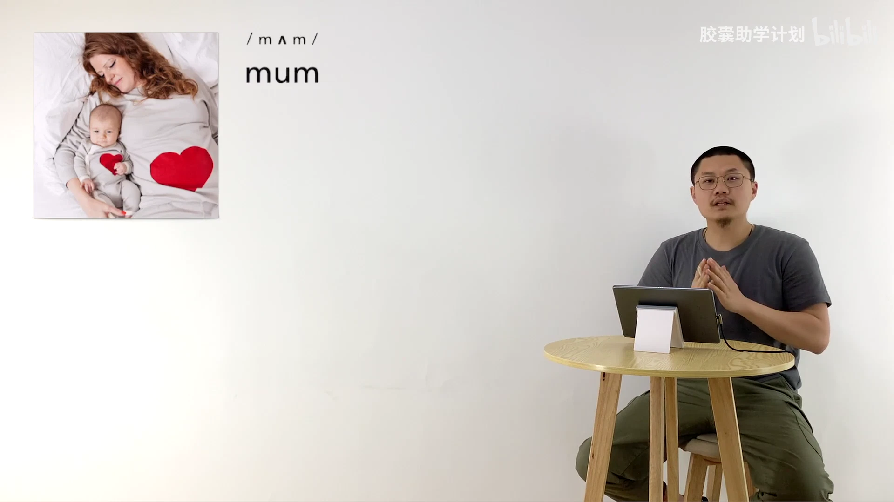

文字识别：胶囊助学计划 / 1mΛm1 / mum

## 00:04:30–00:05:00

mom mom。我们回顾两个小点，我们拿它就不去造句了啊。第一个字母 m 放在单词当中去发的音是嗯。其次，这个音标我们管它叫做啊啊，哎，嘴放松就可以了啊。Very good。好，接下来下一个单词其实是两个单词组成的词组了。跟我一起读一下，先读一个一个读啊。Sit sit。OK，坐下 down

### 画面 00:04:43

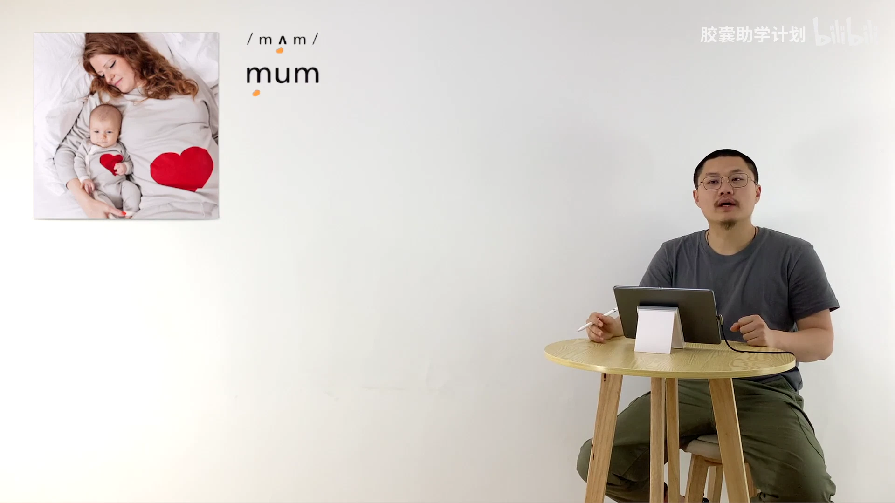

文字识别：胶囊助学计划 / 1mΛm/ / mum

### 画面 00:04:46

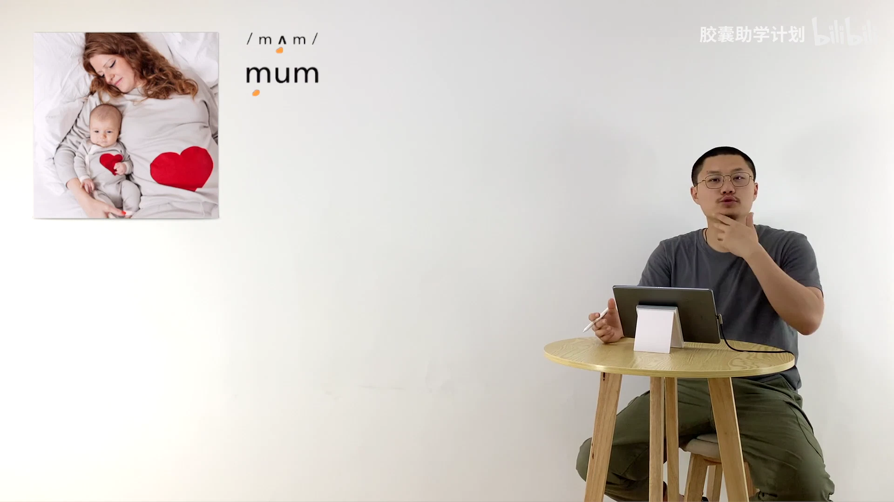

文字识别：胶囊助学计划 / /mΛm/ / mum

### 画面 00:04:49

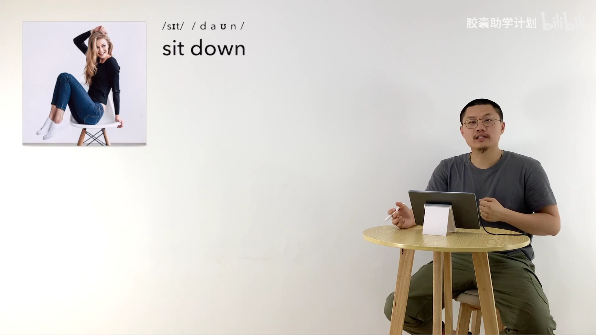

文字识别：胶囊助学计划 / /sit/ /d aun / / sit down

### 画面 00:04:55

文字识别：胶囊助学计划 / /sit/ /daun/ / sit down

### 画面 00:04:59

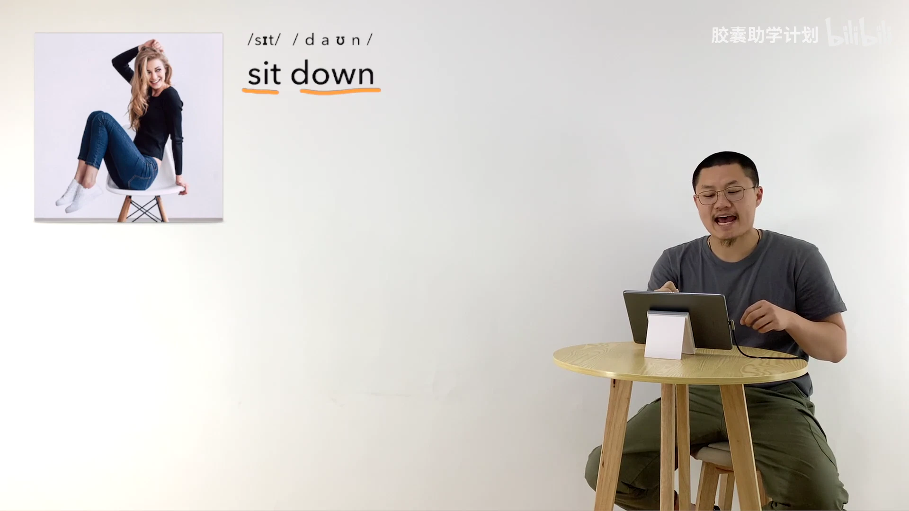

文字识别：胶囊助学计划 / /sit/ /d aun / / sit down

## 00:05:00–00:05:30

下对吧？Down其实是下，sit是坐，放在一起坐下对吧？Sit down.好，注意一个小点，你看我在读的时候啊，各位听啊，这个音我是没有读出来的，这个音我不是读的sit down，我读的是sit down，听见了吧？这个音我没有去读它，这个我们管它叫什么呢？叫做失去爆破。这个在英文当中很多的发音，尤其是，

### 画面 00:05:10

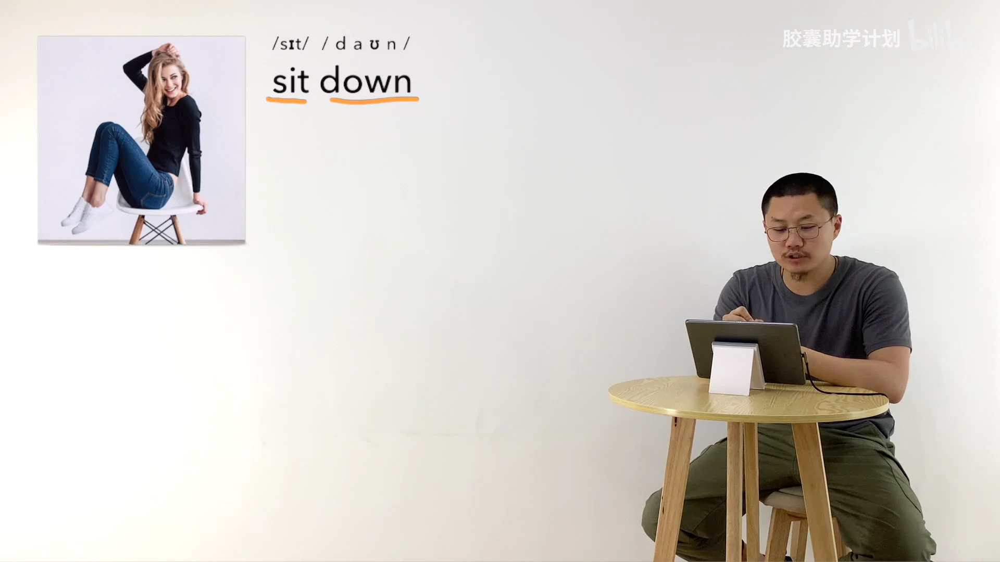

文字识别：胶囊助学计划 / /sıt/ /daun/ / sit down

### 画面 00:05:25

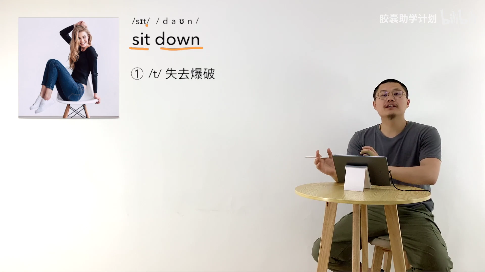

文字识别：胶囊助学计划 / /sit/ /d aun / / sit down / ①/t/失去爆破

## 00:05:30–00:06:00

哎，这样的音我们会把它进行一个失去爆破。那今天我们只讲一个点，我们先不把它扩展化，我们就讲会进行这样的失去爆破。那它如何失去爆破呢？那我们就要先回顾一下这个音想去发音要分为几步了。那三步，第一步，各位回顾一下，如果您学过了的话啊，那可能就会印象特别的深。我说第一步，舌尖要放在上牙龈上，对不对？好，第二步，闭嘴，然

### 画面 00:05:43

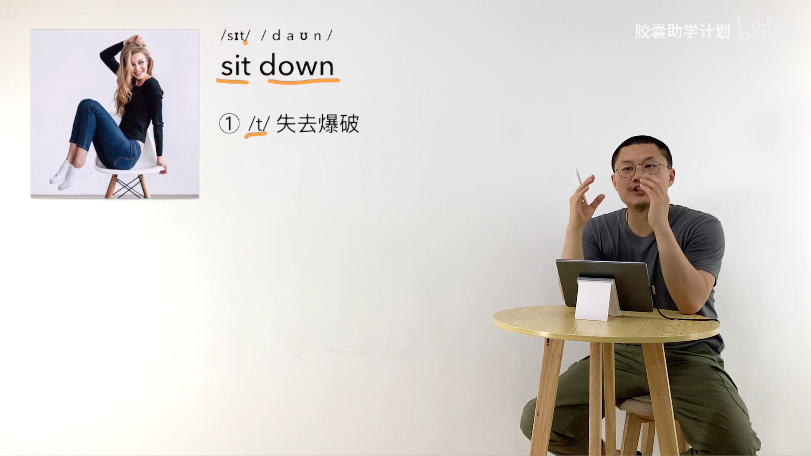

文字识别：胶囊助学计划 / /sıt/ /d aun / / sit down / ①t/失去爆破

## 00:06:00–00:06:30

然后憋气。哎，你让这个压力充满你的这个口腔，然后送气。这是第三步。第一步舌尖放沙音，第二步憋气，第三步送气。送气的时候，这个音就发出来了。再读一遍。好，记住这三步啊。那失去爆破怎么读呢？很简单，第三步不做，只做前两步。你看啊，也就是不发这个音了，发不出

### 画面 00:06:06

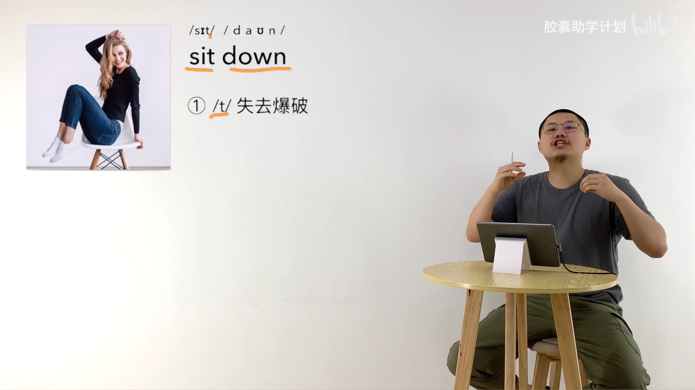

文字识别：胶囊助学计划 / /sıt/ /d aun / / sit down / ①/失去爆破

## 00:06:30–00:07:00

音来了。但是它占一下发这个音的时间，比如说零点五秒钟。所以你读的不是 sit down，读的是 sit down，听见了吗？sit，憋气和舌尖放上牙龈，前两步是要做的，第三步不做。再来啊，sit，你看没有 t，没出来，对不对？sit down，OK。那我们再换一个单词，比如说 what 这个单词，如果我们不失去爆破，读起来的感觉就是

### 画面 00:06:36

文字识别：胶囊助学计划 / /sıt/ / d aun / / sit down / ①t失去爆破

### 画面 00:06:58

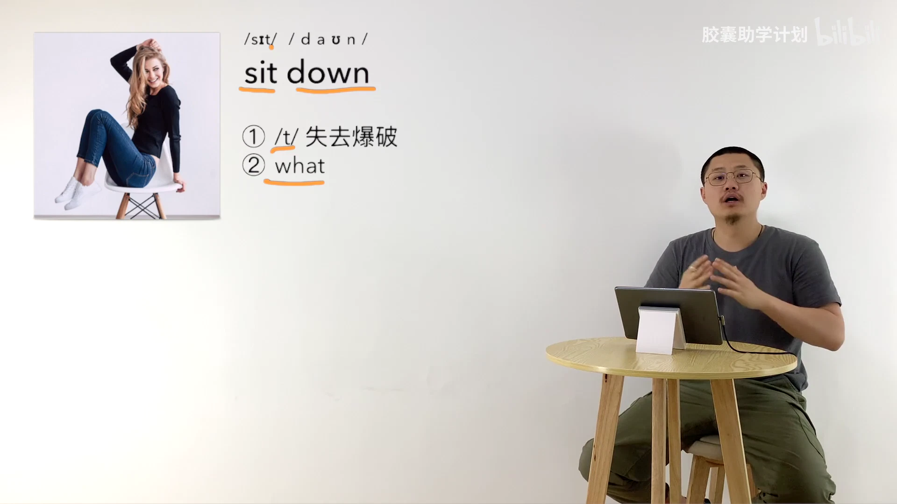

文字识别：胶囊助学计划 / /sıt/ /d aun / / sit down / ①t失去爆破 / 2 / what

## 00:07:00–00:07:30

what，对不对？失去爆破呢，不是 what，是 what，哎，要有憋气的那个感觉 what，what，OK，what，what，哎，最后是基本不出来的，当你出一点点也行，比如说 what，what，声音非常的小，这就叫做失去爆破的现象。那读起来会更舒服一点，比如说 sit down，而不是 sit down，OK， there you go。接

### 画面 00:07:25

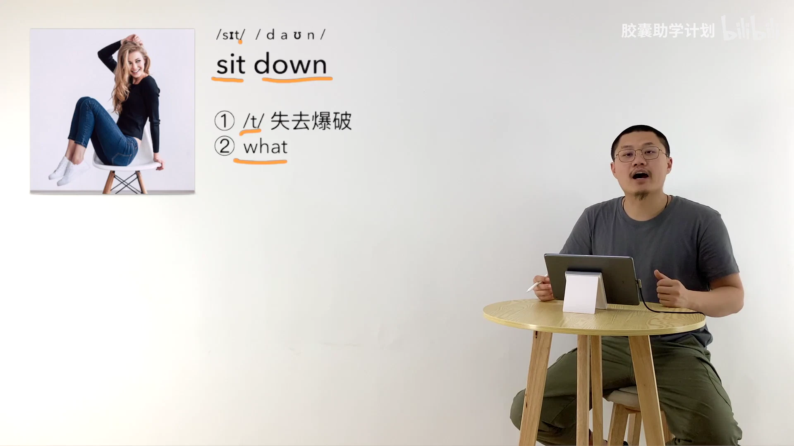

文字识别：胶囊助学计划 / /sıt/ / d aun / / sit down / ①t失去爆破 / ② / what

### 画面 00:07:29

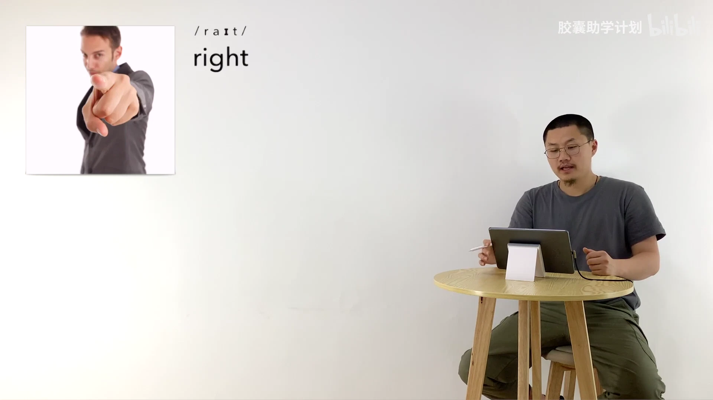

文字识别：胶囊助学计划 / /rait/ / right

## 00:07:30–00:08:00

下来下一个单词，跟我一起读一下，叫做right, right.好，right在本文当中，其实它就是I'm all right，我还好了，我还好了这样的一个用法，对吧？Right, I'm all right.那其次呢，大家可能了解就是right就是对的啊，就是对的right, wrong, right.那本课我们就说I am all right.连起来I'm all right. Okay.其次，那我想问你还好吗？怎么问呢？叫做Are you all right? Are you all right?

### 画面 00:07:49

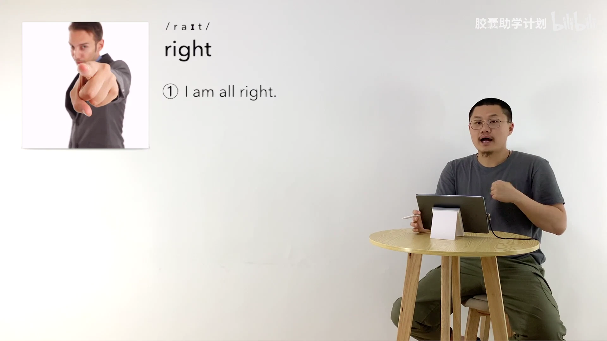

文字识别：胶囊助学计划 / /rait/ / right / ① I am all right.

### 画面 00:07:57

文字识别：胶囊助学计划 / /rait/ / right / ① I am all right. / ② Are you all right?

## 00:08:00–00:08:30

比如说你的回答就哎呀，I'm I'm all right. I'm all right. I'm fine. I'm okay. Okay, very good.接下来下一个单词是由两个单词组成的。首先第一个单词来叫做ice, ice. Next one, cream, cream. C放在单词当中去发c, m放在单词当中去发的是嗯。我们一起读ice cream,冰淇淋对吧？Ice cream.好，那我们造一个句子叫做These ice creams.

### 画面 00:08:05

文字识别：胶囊助学计划 / /ais/ /kri:m/ / ice cream

### 画面 00:08:09

文字识别：胶囊助学计划 / /ais/ / kri:m / / ice cream

### 画面 00:08:11

文字识别：胶囊助学计划 / /ais/ / kri:m/ / ice cream

### 画面 00:08:14

文字识别：胶囊助学计划 / /ais/ / kri:m/ / ice cream

### 画面 00:08:18

文字识别：胶囊助学计划 / /ais/ / kri:m/ / ice cream

### 画面 00:08:20

文字识别：胶囊助学计划 / /ais/ / kri:m / / ice cream

### 画面 00:08:25

文字识别：胶囊助学计划 / /ais/ / kri:m / / ice cream

## 00:08:30–00:09:00

注意nice非常的好。那现在我在前面这是主语的状态之下，am is are，我应该选谁呢？我之前首先给大家说过两个思路。第一，如果您拿不准，您就想哪个人称代词，对吧？你我他他他你们我们他们谁能去替代这个单词？那应该是they，对不对？对不对？他们，对吧？那你they后面用的是are吧？另一个方式呢，就是单数用is，复数用

### 画面 00:08:35

文字识别：胶囊助学计划 / /ais/ / kri:m/ / ice cream / These ice creams _ nice.am/is/are

### 画面 00:08:39

文字识别：胶囊助学计划 / /ais/ / kri:m / / ice cream / These ice creams _nice.am/is/are

### 画面 00:08:42

文字识别：胶囊助学计划 / /ais/ / kri:m/ / ice cream / These ice creams _nice.am/is/are

### 画面 00:08:45

文字识别：胶囊助学计划 / /ais/ / kri:m / / ice cream / These ice creams _ nice.am/is/are / 1

### 画面 00:08:49

文字识别：胶囊助学计划 / /ais/ / kri:m / / ice cream / 1 / These ice creams _nice.am/is/are

### 画面 00:08:52

文字识别：胶囊助学计划 / /ais/ / kri:m / / ice cream / These ice creams _ nice.am/is/are / 1 / Thy

### 画面 00:08:55

文字识别：胶囊助学计划 / /ais/ / kri:m / / ice cream / are / These ice creams _ nice.am/is/are / Thy

## 00:09:00–00:09:30

are，于是把are放进去，叫做These ice creams are nice. There you go.好，那我们直接进入文章。本文并不是非常的困难，从单词到文章都不是很难。我们一起来看一下啊。妈妈问两个孩子说What's the matter, children?孩子们怎么了？What's wrong, children? OK.小女孩说We are tired.小男孩说And thirsty, mom.好，mom

### 画面 00:09:01

文字识别：胶囊助学计划 / /ais/ / kri :m/ / ice cream / are / These ice creams / _nice.am/is/are / Thy / •

### 画面 00:09:03

文字识别：胶囊助学计划 / /ais/ / kri:m/ / ice cream / are / These ice creams / _nice.am/is/are / Thy

### 画面 00:09:06

文字识别：胶囊助学计划 / … / MOTHER: What's the matter, children? / GIRL: We're tired ... / BOY: .. and thirsty, Mum. / " / MOTHER: Sit down here.

### 画面 00:09:15

文字识别：胶囊助学计划 / … / MOTHER: What's the matter, children? / GIRL: We're tired ... / BOY: .. and thirsty, Mum. / " / MOTHER: Sit down here.

### 画面 00:09:18

文字识别：胶囊助学计划 / …… / MOTHER: What's the matter, children? / GIRL: We're tired / BOY: .. and thirsty, Mum. / " / MOTHER: Sit down here.

## 00:09:30–00:10:00

相对来说比较孩子化的一个口语表达方式。当然了，您跟您的母亲永远可以用Mom，很少会直接说Mother这个单词的。OK，给别人介绍可能是会说This is my mother，但大部分情况下跟自己的母亲就Mom就行了啊，就类似于咱汉语的妈啊，很少有人可能会说妈妈，对吧？OK，Next one，妈妈说Sit down here啊，坐在这里，对吧？I am here，

### 画面 00:09:48

文字识别：胶囊助学计划 / … / MOTHER: What's the matter, children? / GIRL: We're tired / BOY: ... and thirsty, Mum. / " / MOTHER: Sit down here.

### 画面 00:09:53

文字识别：胶囊助学计划 / …. / MOTHER: What's the matter, children? / GIRL: We're tired / BOY: ... and thirsty, Mum. / " / MOTHER: Sit down here.

## 00:10:00–00:10:30

还记得here这个单词吧？叫我在这里对吧？说Are you all right now？你们现在好了吗？Are you all right now？现在好了吗？No，we aren't。不，我们没有好。好，Look，瞧。There's an ice cream man。好了，我们先提几个小点。第一，ice cream前面用的是an，为什么用的是an呢？好，eyes，eyes双元音，所以前面用an

### 画面 00:10:03

文字识别：胶囊助学计划 / MOTHER: Are you all right now? / BOY: No, we aren't. / ICE CREAM / MOTHER: Look! / There's an ice cream man.

### 画面 00:10:06

文字识别：胶囊助学计划 / MOTHER: Are you all right now? / BOY: No, we aren't. / ICE CREAM/ / MOTHER: Look! / There's an ice cream man.

### 画面 00:10:10

文字识别：胶囊助学计划 / MOTHER: Are you all right now? / BOY: No, we aren't. / ICE CREAM / MOTHER: Look! / There's an ice cream man.

### 画面 00:10:23

文字识别：胶囊助学计划 / MOTHER: Are you all right now? / BOY: No, we aren't. / ICE CREAM / MOTHER: Look! / There's an ice cream man.

### 画面 00:10:26

文字识别：胶囊助学计划 / MOTHER: Are you all right now? / BOY: No, we aren't. / ICE CREAM / MOTHER: Look! / There's an ice cream man.

## 00:10:30–00:11:00

而不用 a，对吧？其次，there's 是 there is 的缩写。各位现在会呢就会，不会呢？二十五课马上咱们就学到，不用担心，对吧？说，哎，瞧，那里有一个卖冰淇淋的哥们儿，对吧？有一个卖冰淇淋的人。其次，two ice cream please，来两个冰淇淋。说，here you are, children，给你们，孩子们，thanks吗？谢谢妈妈。哎，这个事儿就结束了。接下来呢？

### 画面 00:10:32

文字识别：胶囊助学计划 / MOTHER: Are you all right now? / BOY: No, we aren't. / ICE CREAM / MOTHER: Look! / There's an ice cream man.

### 画面 00:10:40

文字识别：胶囊助学计划 / MOTHER: Are you all right now? / BOY: No, we aren't. / ICE CREAM / MOTHER: Look! / There's an ice cream man.

### 画面 00:10:46

文字识别：胶囊助学计划 / CREAMI / WNFERS / MOTHER: Two ice cream please. / 川 / N / 三 / W11 / MOTHER: Here you are, children. / CHILDREN: Thanks, Mum.

### 画面 00:10:55

文字识别：胶囊助学计划 / CREAM / NNFERS / MOTHER: Two ice cream please. / 1111 / MOTHER: Here you are, children. / CHILDREN: Thanks, Mum.

### 画面 00:10:59

文字识别：胶囊助学计划 / GIRL: These ice creams are nice. / MOTHER: Are you all right now? / CHILDREN: Yes, we are, thank you!

## 00:11:00–00:11:30

他说 These ice creams are nice. 说这些冰淇淋呢特别的好。这是我们刚才说的，叫 These ice creams are nice. 对不对？他说 Are you all right now? 那你们现在好了吗？Yes, we are. Thank you. 是的，我们现在好了。谢谢。其实说白了，这个又渴又累，一个冰淇淋就搞定了，对吧？Very good. 接下来我们老习惯进入接下来的两个练习，一个叫做 comprehension，一个叫做 ask me. 这个时候您的眼

### 画面 00:11:02

文字识别：胶囊助学计划 / GIRL: These ice creams are nice. / MOTHER: Are you all right now? / CHILDREN: Yes, we are, thank you!

### 画面 00:11:15

文字识别：胶囊助学计划 / GIRL: These ice creams are nice. / MOTHER: Are you allright now? / CHILDREN: Yes, we are, thank you!

### 画面 00:11:23

文字识别：胶囊助学计划 / Comprehension

## 00:11:30–00:12:00

睛就从屏幕当中脱离开，开始看文章了。我们进入口语听力的训练。来，Are the children tired?给我找答案啊！口语去回答。Yes, they are. Are the children thirsty? Yes, they are. Are the ice creams nice? Yes, they are.

### 画面 00:11:38

文字识别：胶囊助学计划 / Comprehension / 1 T: Are the children tired?

### 画面 00:11:40

文字识别：胶囊助学计划 / Comprehension / 1 T: Are the children tired?

## 00:12:00–00:12:30

Very good. Are the children all right now? Yes, they are.好，接下来 ask me if ask me if 要做的事情，再回顾一下，不用管前三个单词，就看后面，把后面的单词记住，通过听力啊，最好是通过听力，然后口语变成一般疑问句。我问您 ask me if the children are tired. 你听到了 the children are tired，然后叫做 are the children

### 画面 00:12:08

文字识别：胶囊助学计划 / Asking questions / 1 T: Ask me if the children are tired.

### 画面 00:12:13

文字识别：胶囊助学计划 / Asking questions / 1 T: Ask me if the children are tired.

## 00:12:30–00:13:00

tired? 把 are 提前，对不对？那我给你个答案，叫做 Yes, they are. There you go. 继续 Ask me if 注意听后面的 The boy is thirsty. 那您要做的事情是变一般疑问句。 Is the boy thirsty? Who 注意 Who 对 the boy 提问，对吧？ Who is thirsty? 谁渴了呀？ There you go. Next one. Ask me if

### 画面 00:12:31

文字识别：胶囊助学计划 / Asking questions / 1 T: Ask me if the children are tired. / S: Are the children tired?

### 画面 00:12:33

文字识别：胶囊助学计划 / Asking questions

### 画面 00:12:44

文字识别：胶囊助学计划 / Asking questions / 2T: Ask me if the boy is thirsty.

### 画面 00:12:58

文字识别：胶囊助学计划 / Asking questions / 3 T: Ask me if the ice creams are nice.

## 00:13:00–00:13:30

the ice creams are nice. Are the ice creams nice? Very good. Next one, ask me if the children are all right now. Are the children all right now? How to express how? What's wrong? What's the matter?失去爆破是什么？想发这

### 画面 00:13:20

文字识别：胶囊助学计划 / ①如何表达“怎么啦”? / 失去爆破是什么?

### 画面 00:13:28

文字识别：胶囊助学计划 / ①如何表达“怎么啦”? / 失去爆破是什么? / H

## 00:13:30–00:14:00

个音有要三步，第一步时间上牙龈，第二步憋气，第三步送气的同时发音。失去爆破的意思就是把第三步省略掉，但前两步还是要做的。于是sit这个单词我们就读成了sit down sit空一排down ok ready go好recap children是child的复数，

### 画面 00:13:45

文字识别：胶囊助学计划 / ①如何表达“怎么啦”？ / 失去爆破是什么?

### 画面 00:13:47

文字识别：胶囊助学计划 / ①如何表达“怎么啦”？ / 失去爆破是什么? / sit

### 画面 00:13:50

文字识别：胶囊助学计划 / ①如何表达“怎么啦”？ / 失去爆破是什么? / sit

### 画面 00:13:54

文字识别：胶囊助学计划 / Recap / Patterns / Grammar / children / Words / ice / cream / tired / thirsty / Expression / What's the matter?

## 00:14:00–00:14:30

ice cream冰淇淋，tired thirsty这两个单词是我们比较常用的小的形容词，又渴又累。好，那What's the matter是这课各位应该记住的一个，算是短语，也算是习惯用法，也算是句子，叫做怎么了？哪一个？好，那我们看一下本期的作业。首先，绿皮书我讲完这一课第十九课，各位可以写了。其次，要给自己讲解一遍今天的核心知识点。观赏视频之后，尝试靠回

### 画面 00:14:14

文字识别：胶囊助学计划 / Recap / Patterns / Grammar / children / Words / ice / cream / tired / thirsty / Expression / What's the matter?

### 画面 00:14:17

文字识别：胶囊助学计划

## 00:14:30–00:15:00

忆去给自己讲述一遍。那如果大家喜欢我们的视频啊，欢迎大家订阅、关注、点赞、一键三连支持。OK，转发给那些需要的朋友们。那最后的最后呢，我们再一起看一句名人名言：Tired minds don't plan well. Sleep first, plan later. See you next time.

### 画面 00:14:32

文字识别：胶囊助学计划

### 画面 00:14:41

文字识别：胶囊助学计划 / Tired minds don't plan well. Sleep / first, plan later. / Walter Reisch

### 画面 00:14:53

### 画面 00:14:55

文字识别：CAPSULEACADEMY / 胶囊学院 / 小红书 / Lecturer / 口 / Leo

### 画面 00:14:58

文字识别：CAPSULEACADEMY / 胶囊学院 / 小红书 / 品 / Berlin

## 00:15:00–00:15:06

### 画面 00:15:01

文字识别：CAPSULEACADEMY / 胶囊学院 / 小红书 / Creator / Leo & Berlin

### 画面 00:15:04

文字识别：bilibili / 胶囊助学计划

### 画面 00:15:05

文字识别：bilibili / 胶囊助学计划

