# 021 单词 语法 文章

快速机器解析：语音为单模型转写，未进行独立交叉校对或人工复核；画面每秒采样并按变化选帧，短时文字和标记可能遗漏。截图时间约有 1 秒误差。图片有损压缩；遇到疑点请按时间查看 Google Drive 原视频。

## 00:00:00–00:00:30

Hello everyone, welcome to Capsule Academy. This is Leo. Today we're going to learn new concept English Book One Lesson Twenty One Words, Grammar, and Story. 那老习惯进入正式课程之前，我们先看两个问题。第一，如何表达给我一本书？第二，那 I 和 me 都是我，区别在什么地方呢？带着这两个问题，Hope you got it. Enjoy it. 好，那上来我们先看第一个小单词，也是

### 画面 00:00:00

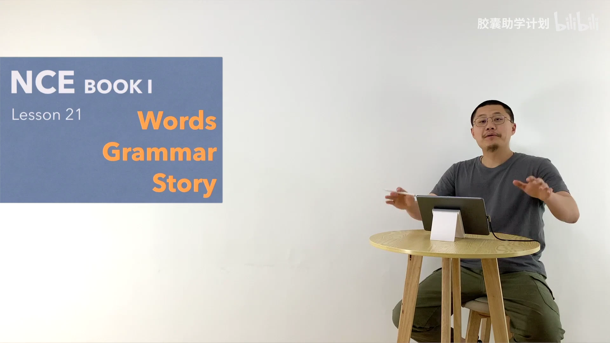

文字识别：胶囊助学计划 / NCE / BOOKI / Lesson 21 / Words / Grammar / Story

### 画面 00:00:02

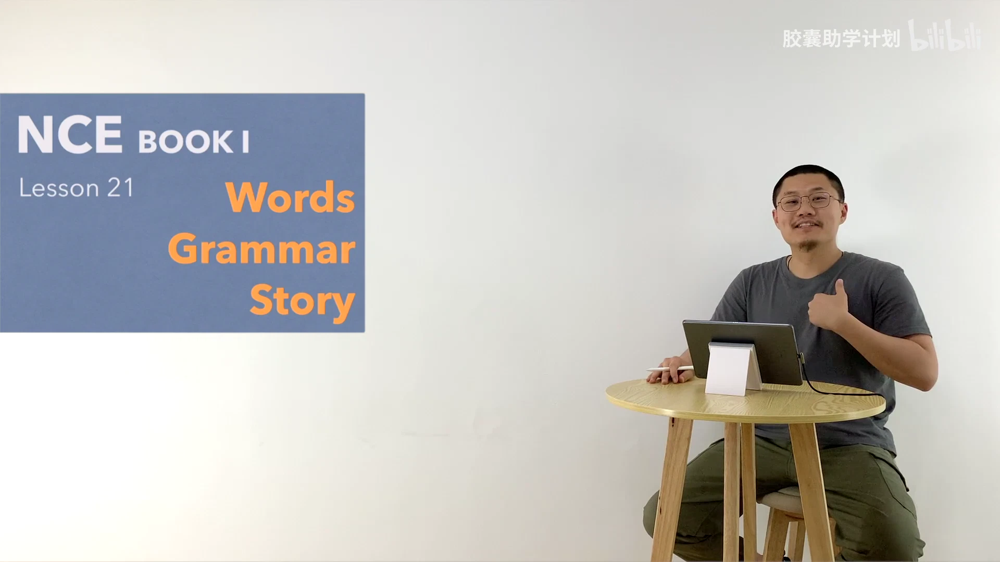

文字识别：胶囊助学计划 / NCE / BOOKI / Lesson 21 / Words / Grammar / Story

### 画面 00:00:09

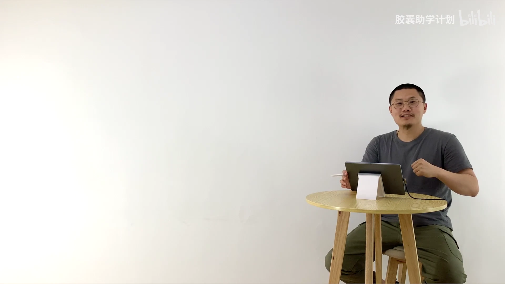

文字识别：胶囊助学计划

### 画面 00:00:12

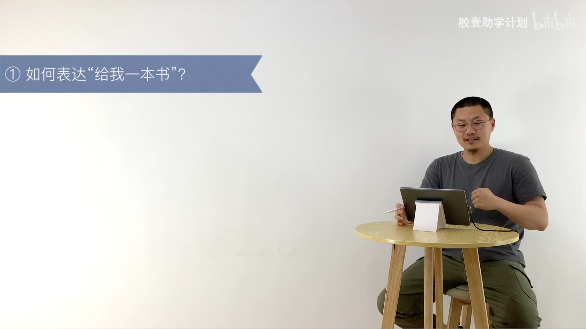

文字识别：胶囊助学计划 / ①如何表达“给我一本书”？

### 画面 00:00:15

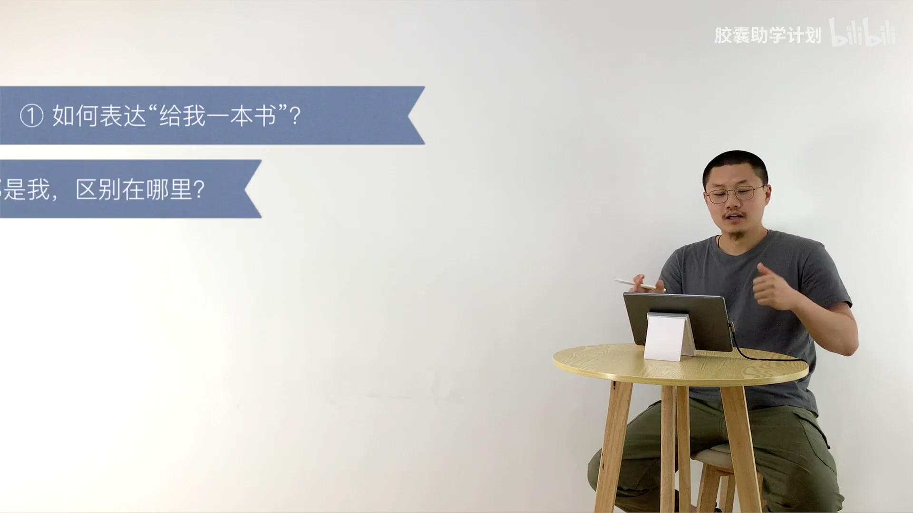

文字识别：胶囊助学计划 / ①如何表达“给我一本书”？ / 是我， / 区別在哪里?

### 画面 00:00:17

文字识别：胶囊助学计划 / ①如何表达“给我一本书”？ / Ime都是我，区别在哪里？

### 画面 00:00:22

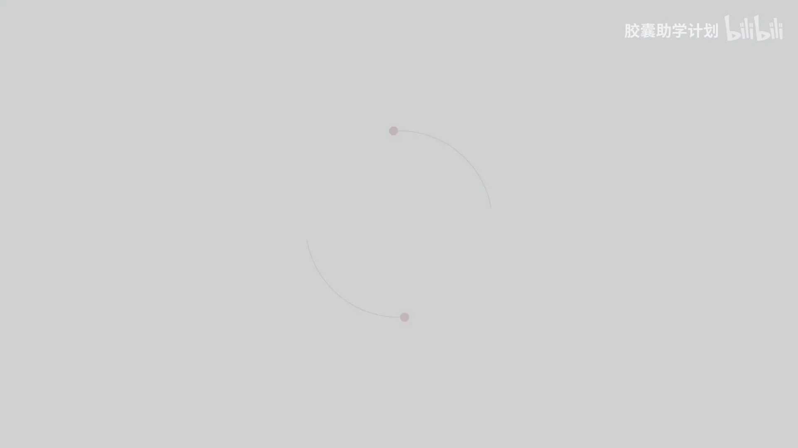

文字识别：胶囊助学计划bll / •

### 画面 00:00:26

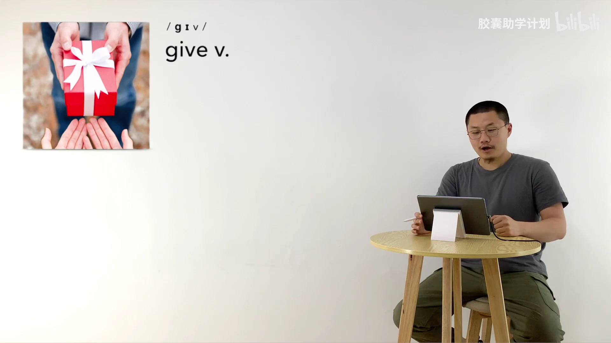

文字识别：胶囊助学计划 / /giv/ / give v.

## 00:00:30–00:01:00

V 点，我们管它叫做动词。在 catch 那个单词的时候，我们提过 V 点表动词，N 点表名词，A D J 点表形容词。英文跟汉语有一点点小的差别啊。我们学英文的时候，还是要重点强调一下词性的。越往后学，大家的感受会越深。好，那我们先把 give 说一下它的意思，叫做给。那我们拓展一个其实非常常用的小的习惯短语，

### 画面 00:00:40

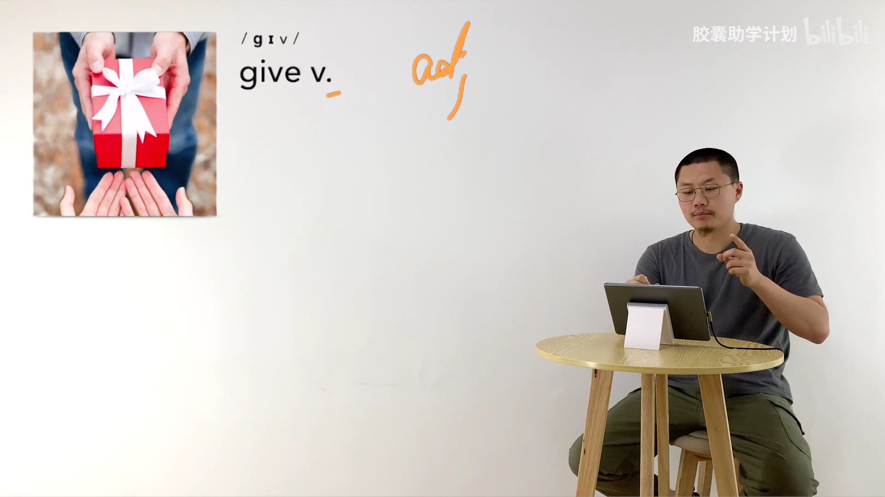

文字识别：胶囊助学计划 / /giv/ / ad / give v.

## 00:01:00–00:01:30

叫 give me five，给我五是什么意思呢？其实就是两个人庆祝一下，对吧？你开心跟别人庆祝一下，来 give me five，这就是 give me five 的意思。OK，你像我在新西兰健身房的时候，有的时候跟别人聊的胡侃，对吧？聊的特别的开心，最后临走的时候来 give me five， man， give me five，啪就打一下，就叫 give me five。那当然了，也可以说一个小的句型，也是今天咱们学的关键的句型，叫 give me a hug，

### 画面 00:01:06

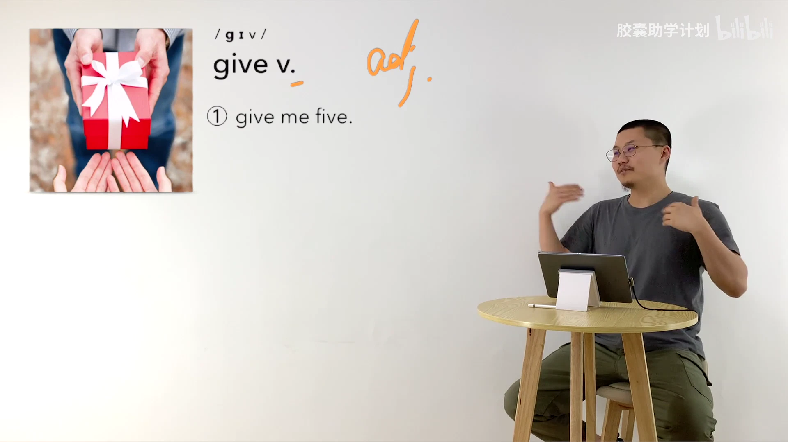

文字识别：胶囊助学计划 / /giv/ / aa / give v. / ① give me five.

### 画面 00:01:23

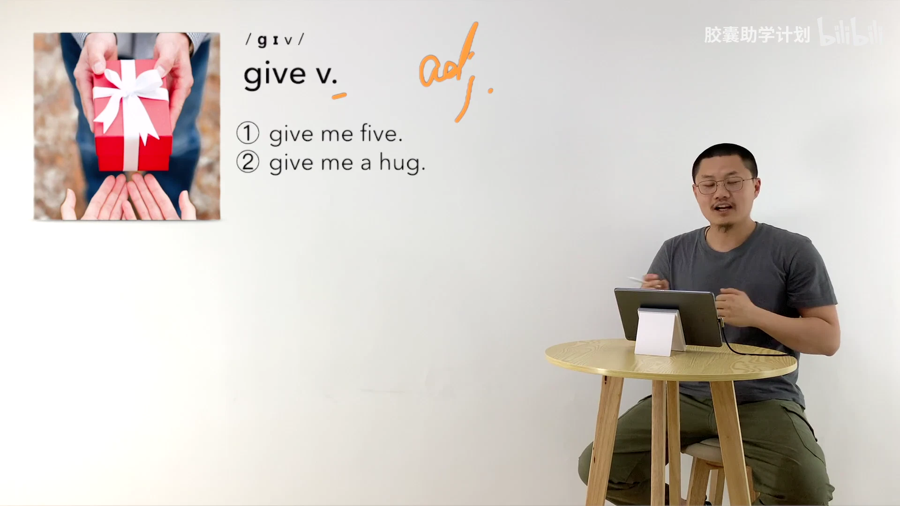

文字识别：胶囊助学计划 / /giv/ / give v. / aa / give me five. / give me a hug.

## 00:01:30–00:02:00

man. Come on, give me a hug. 叫做给我一个拥抱。好，那接下来呢，我们一起看一下在《玩具总动员》当中一个很短的视频片段，连续出现了 Give me five 和 Give me a hug。接下来各位看的时候注意力要集中了啊。 Look, it's Buzz. Hey, Buzz, let's show the guys our new secret best friends handshake. Give me five, man. Something screwy here. So you see, we're friends now, guys, aren't we, Buzz? You, Buzz.

### 画面 00:01:31

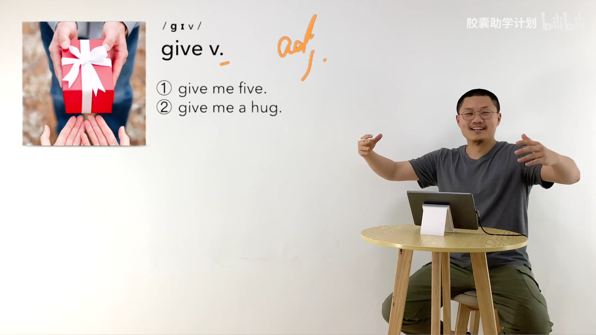

文字识别：胶囊助学计划 / /giv/ / give v. / aa / give me five. / give me a hug.

### 画面 00:01:33

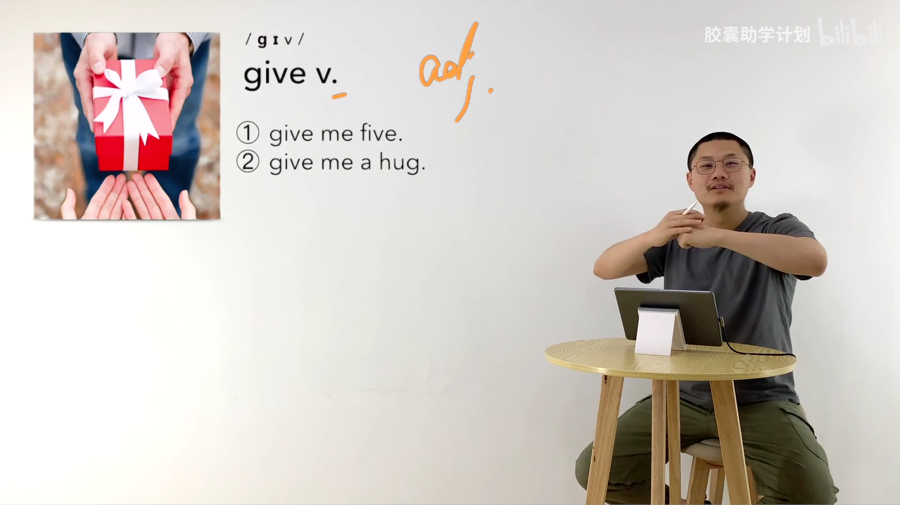

文字识别：胶囊助学计划 / /giv/ / give v. / aa / give me five. / give me a hug.

### 画面 00:01:35

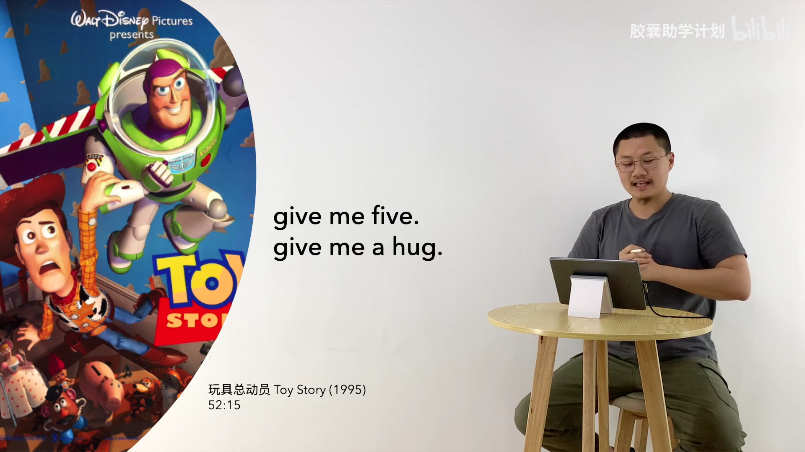

文字识别：eArDisNEp / o Pictures / 胶囊助学计划 / presents / give me / five. / give me a hug. / To / STO / 玩具总动员 Toy Story (1995) / 52:15

### 画面 00:01:38

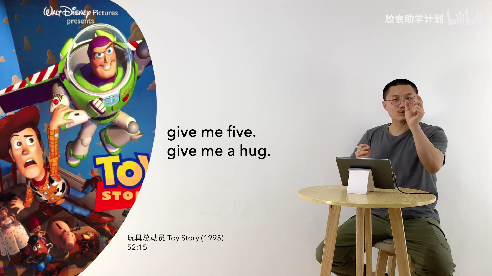

文字识别：(AcrDisNEpPictures / 胶囊助学计划 / presents / give me / five. / give me a hug. / To / STO / 玩具总动员 Toy Story (1995) / 52:15

### 画面 00:01:40

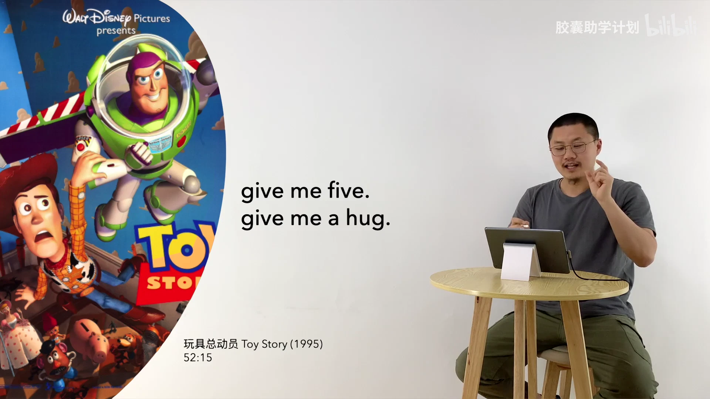

文字识别：ArDisNEpPictures / 胶囊助学计划 / presents / give me / five. /  hug. / give r / meah / To / STO / 玩具总动员 Toy Story (1995) / 52:15

### 画面 00:01:46

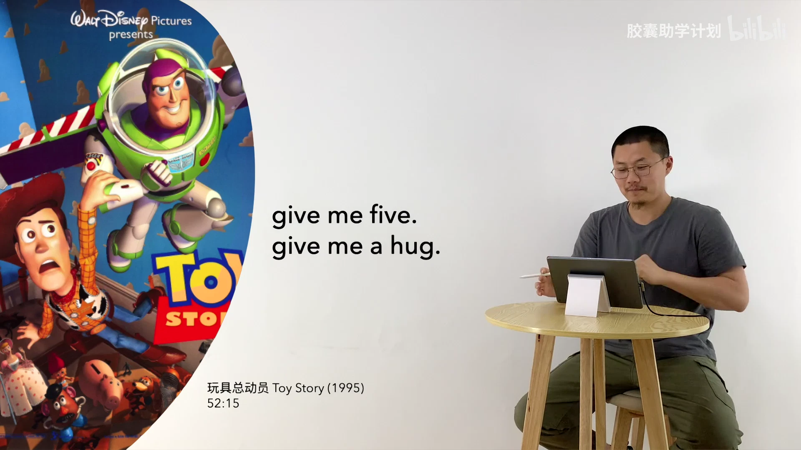

文字识别：ArDisNEpPictures / 胶囊助学计划 / presents / give me / five. / give me a hug. / TO / STO / 玩具总动员 Toy Story (1995) / 52:15

### 画面 00:01:48

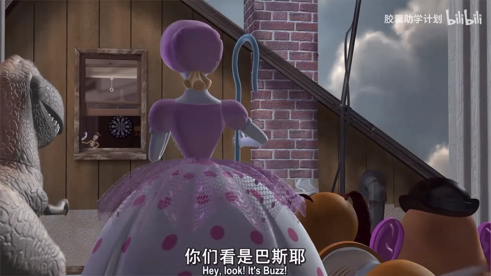

文字识别：bilibili / 胶囊助学计划 / 你们看是巴斯耶 / Hey, look! It's Buzz!

### 画面 00:01:50

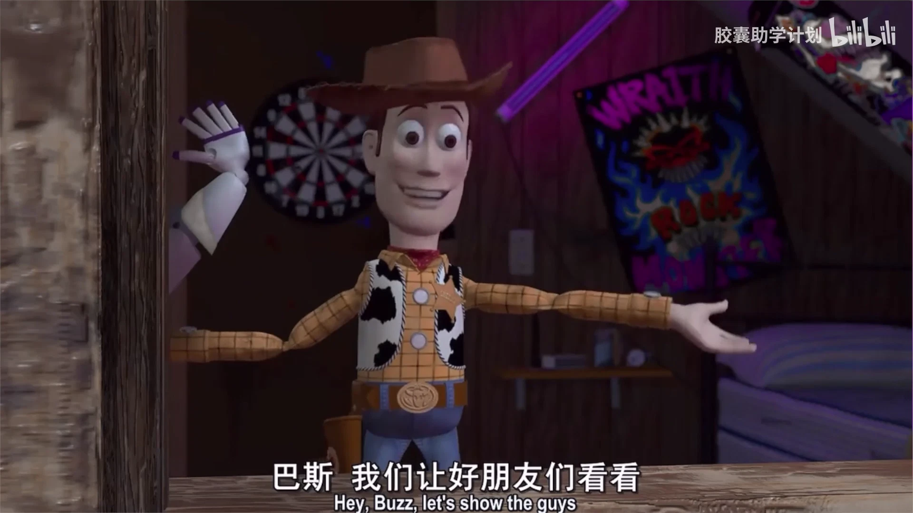

文字识别：bilibli / 胶囊助学计划 / 巴斯我们让好朋友们看看 / Hey,Buzz, let's show the guys

### 画面 00:01:52

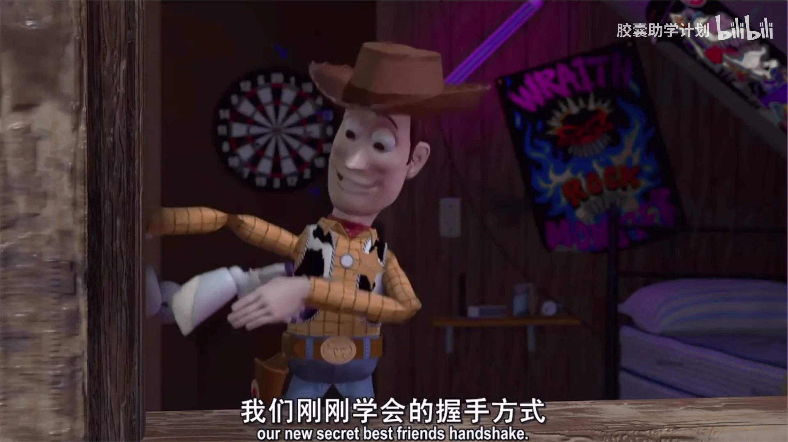

文字识别：bilbili / 胶囊助学计划 / 我们刚刚学会的握手方式 / our new secret best friends handshake.

### 画面 00:01:54

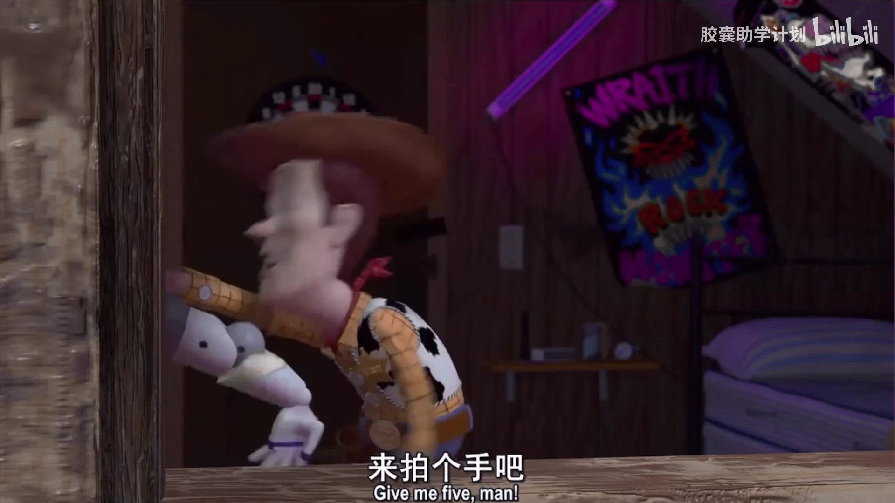

文字识别：Dilibili / 胶囊助学计划 / 来拍个手吧 / Give me five, man!

### 画面 00:01:56

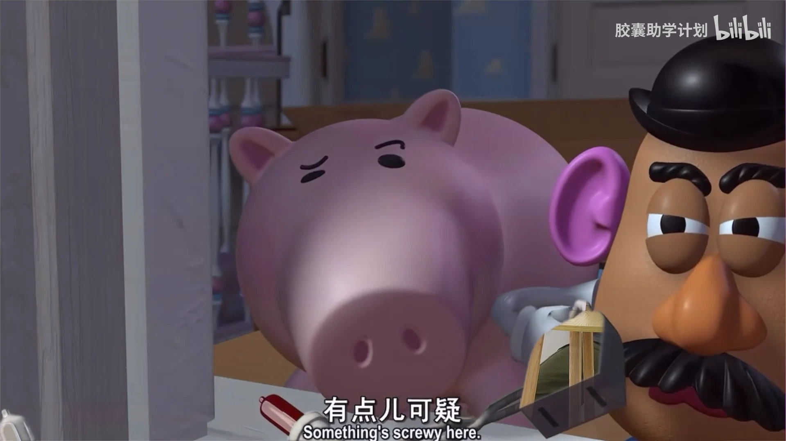

文字识别：bilibili / 胶囊助学计划 / 有点儿可疑 / Somethings screwy here.

### 画面 00:01:58

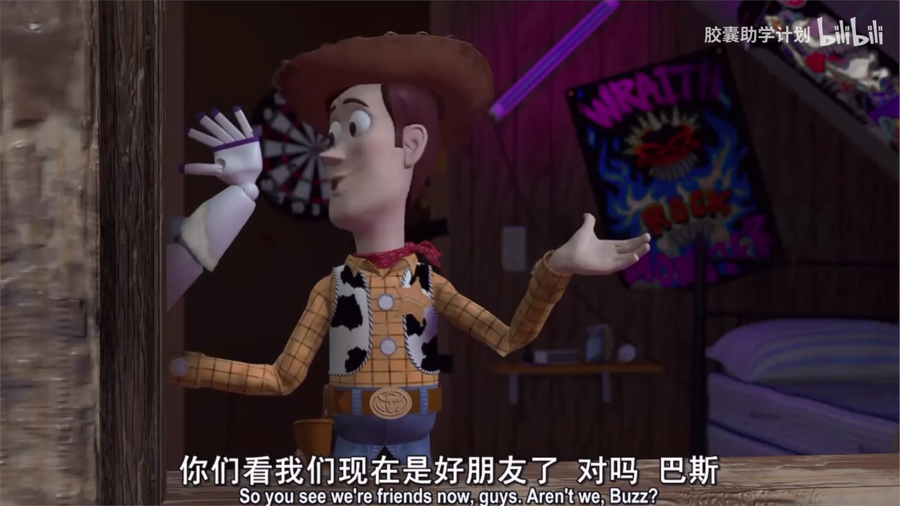

文字识别：bilibili / 胶囊助学计划 / 你们看我们现在是好朋友了对吗巴斯 / So you see we're friends now, guys.Aren't we, Buzz?

## 00:02:00–00:02:30

give me a hug. Ha ha. I love you too. Okay, give me a hug. Oh boy, I love you too, man. Okay, so give me a hug. Give me a拥抱。那就引出了本课最关键的一个句型，也是我们要学习的非常重要的一个唯一的关键语法，叫做give somebody something。那S B点表示的是某人，那S T H点表示的是某个物品，叫做给某人某物。比

### 画面 00:02:00

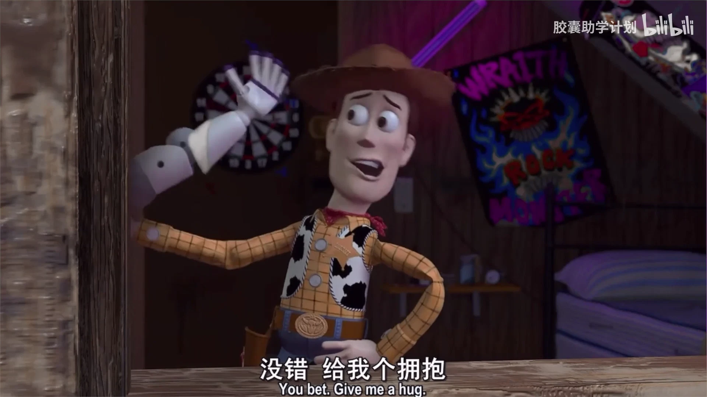

文字识别：bilibili / 胶囊助学计划 / 没错给我个拥抱 / You bet. Give me a hug.

### 画面 00:02:02

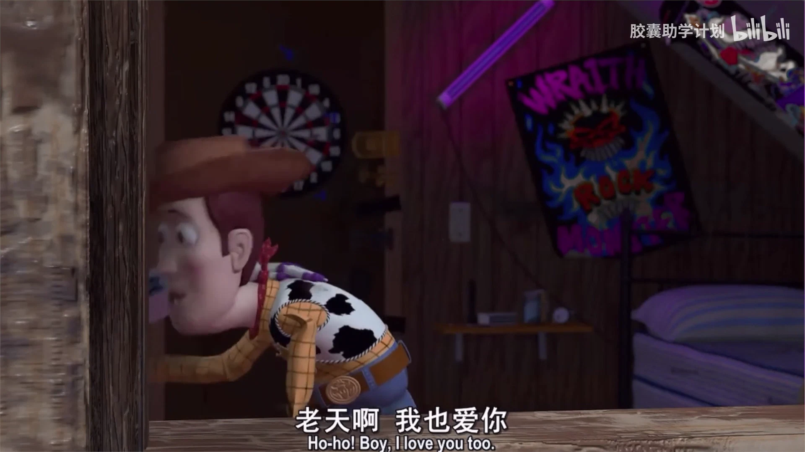

文字识别：bilbili / 胶囊助学计划 / WRAITH / 老天啊我也爱你 / Ho-ho! Boy,Ilove you too.

### 画面 00:02:04

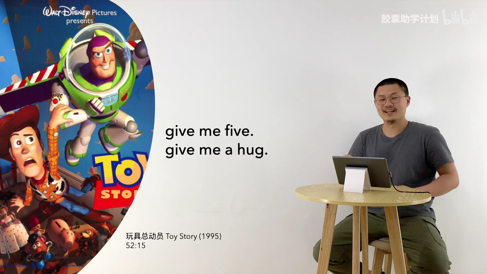

文字识别：ArDisNEp Pictures / 胶囊助学计划 / presents / give me / five. / give me a hug. / TO / STO / 玩具总动员 Toy Story (1995) / 52:15

### 画面 00:02:06

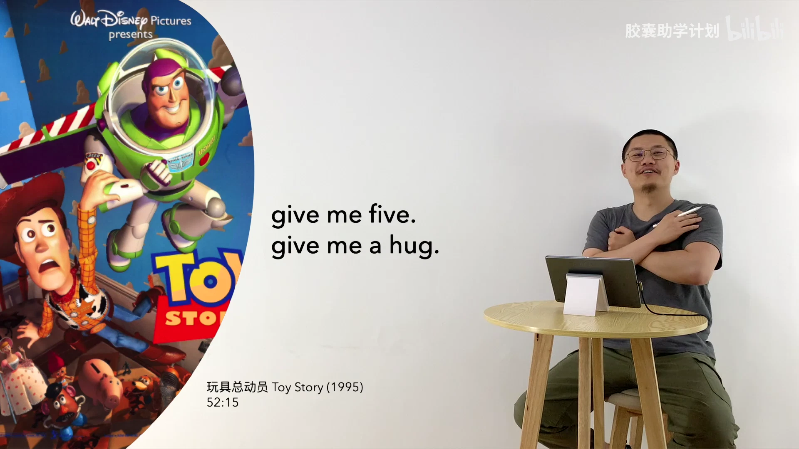

文字识别：eArIsNEp / o Pictures / 胶囊助学计划 / presents / give me / five. / give me a hug. / To / STO / 玩具总动员 Toy Story (1995) / 52:15

### 画面 00:02:09

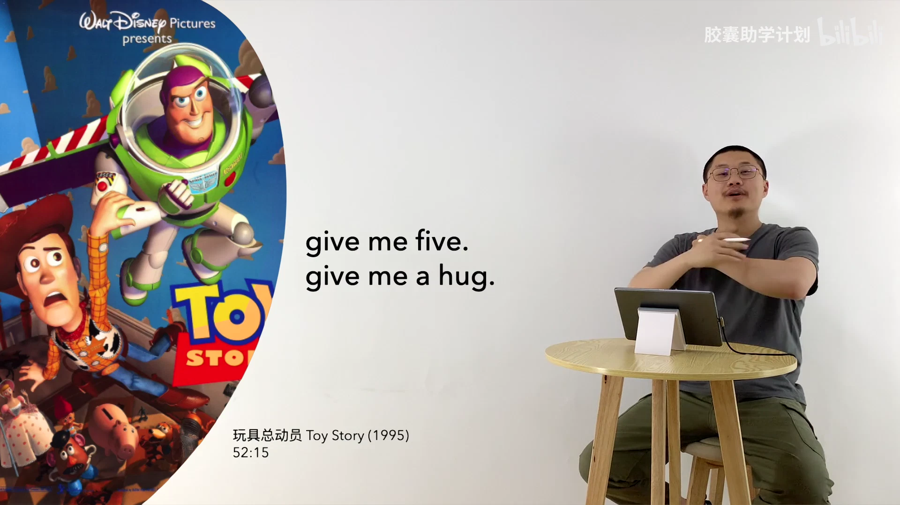

文字识别：(AcrDisNEpPictures / 胶囊助学计划 / presents / give me / five. / give me a hug. / To / STO / 玩具总动员 Toy Story (1995) / 52:15

### 画面 00:02:11

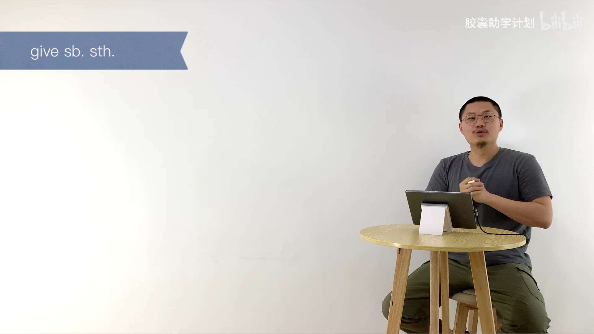

文字识别：胶囊助学计划 / give sb. sth.

## 00:02:30–00:03:00

如说，我说给我一根笔，叫做 give me a pen。好，注意这个地方就出现了我们在最开始问大家的一个问题，叫做 I呀和 me 啊都表示我，那他们有什么区别吗？你看汉语当中，你无论什么时候说我，不管放在这个汉字，不管放在句子当中任何地方，永远是我的意思，也永远是这样去书写，它不会说换一个方式，对吧？那英文不是这样，我们目前最简单粗暴的

### 画面 00:02:39

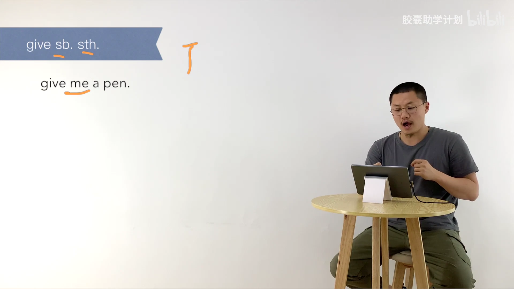

文字识别：胶囊助学计划 / give sb. sth. / 7 / give me a pen.

### 画面 00:02:41

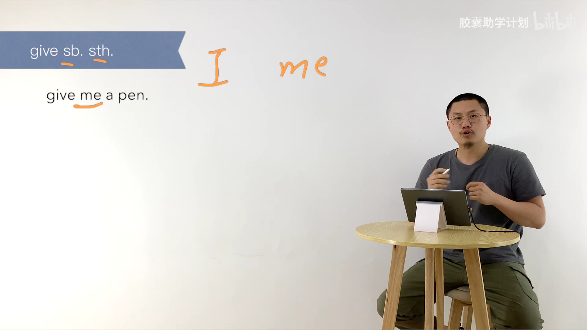

文字识别：胶囊助学计划 / give sb. sth. / I / me / give me a pen.

## 00:03:00–00:03:30

一个方式，对于大家来说最好理解的一个方式，就是V点儿，V点儿前往往用的是I，也就是做主语这个位置；V点儿后往往用的是me，也就是做宾语的这个位置。所以从学术术语上来说，我们管它叫主格，管它叫宾格，人称代词的主格和宾格，这听起来非常吓人，对吧？那初期各位呢，先把它放在关键句型当中去做就可以了。那我给大

### 画面 00:03:11

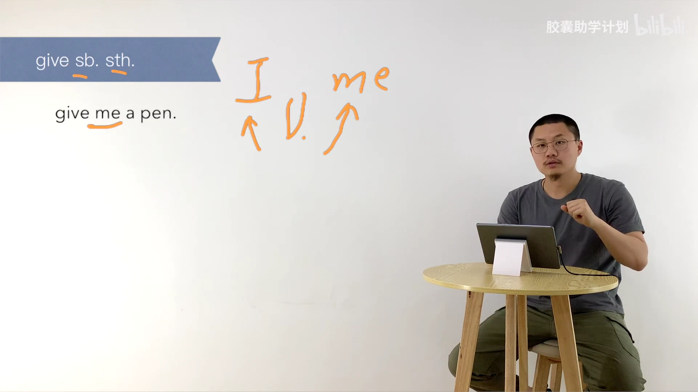

文字识别：胶囊助学计划 / give sb. sth. / I / me / V / give me a pen.

### 画面 00:03:29

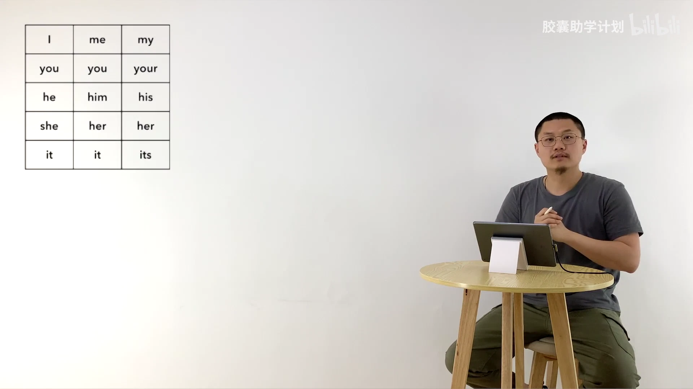

文字识别：胶囊助学计划 / me / my / you / you / your / he / him / his / she / her / her / it / it / its

## 00:03:30–00:04:00

家专门做了这样一个表格，我们一起看一下啊。首先前两排都表示的是谁，比如说我，我，我，它们的区别是中间是动词，前是 I，后是 me。那你呢？哎，长相巧了是一样的，前面是 you，后面还是 you，对吧？比如说给你叫 give you，他男他前面是 he，

### 画面 00:03:59

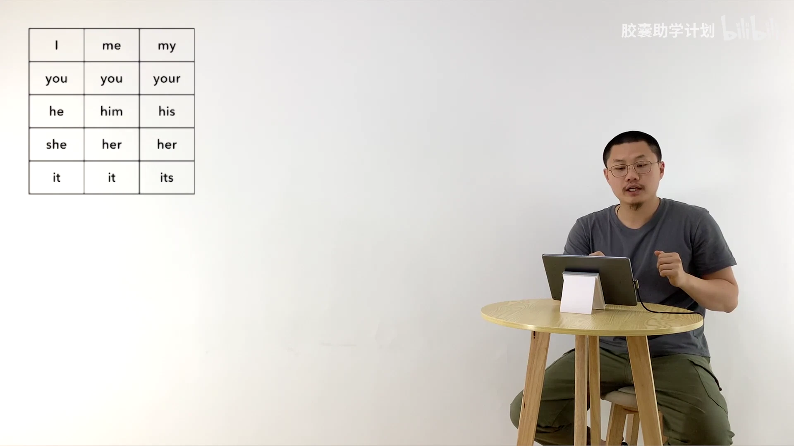

文字识别：胶囊助学计划 / me / my / you / you / your / he / him / his / she / her / her / it / it / its

## 00:04:00–00:04:30

但是后面就变成了这个单词，跟我一起读 him him，最后要闭嘴。那你说给这个男他叫做 give him， OK？那女他前面是 she，后面就是 her，那给他就变成了 give her， OK？ Very good。那动物的它 it give it，它是一样的，前后均为 it。好，接下来第三排呢是大家可能比较熟的，我们前面练了很多遍

### 画面 00:04:29

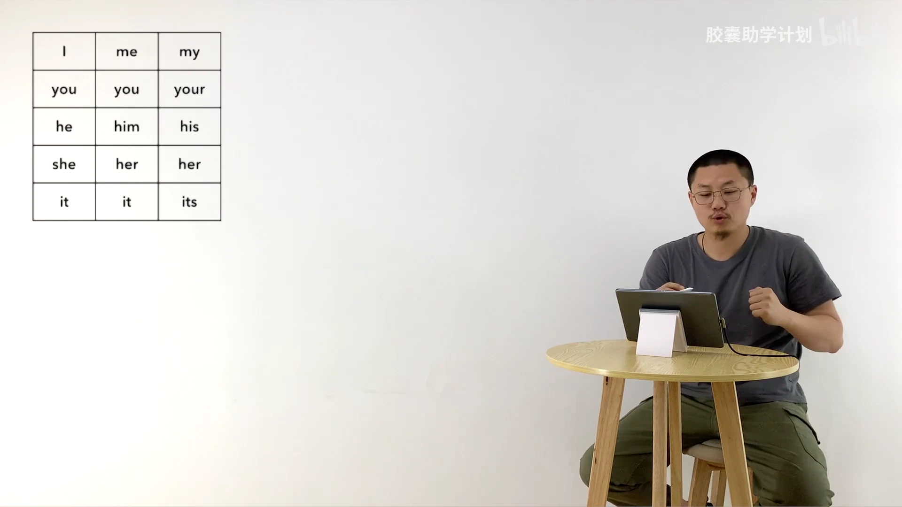

文字识别：胶囊助学计划 / me / my / you / you / your / he / him / his / she / her / her / it / it / its

## 00:04:30–00:05:00

了。谁的？比如说我的笔叫 my pen，你的雨伞叫做 your umbrella。比 you 呢多了一个儿化音。那他的，比如说表叫做 his watch。那女他的，比如说书叫 her book。 OK，那还有最后一个，目前为止我们初期见的会非常的少，就是宝盖儿，它的叫做 its。比如说狗的骨

### 画面 00:04:59

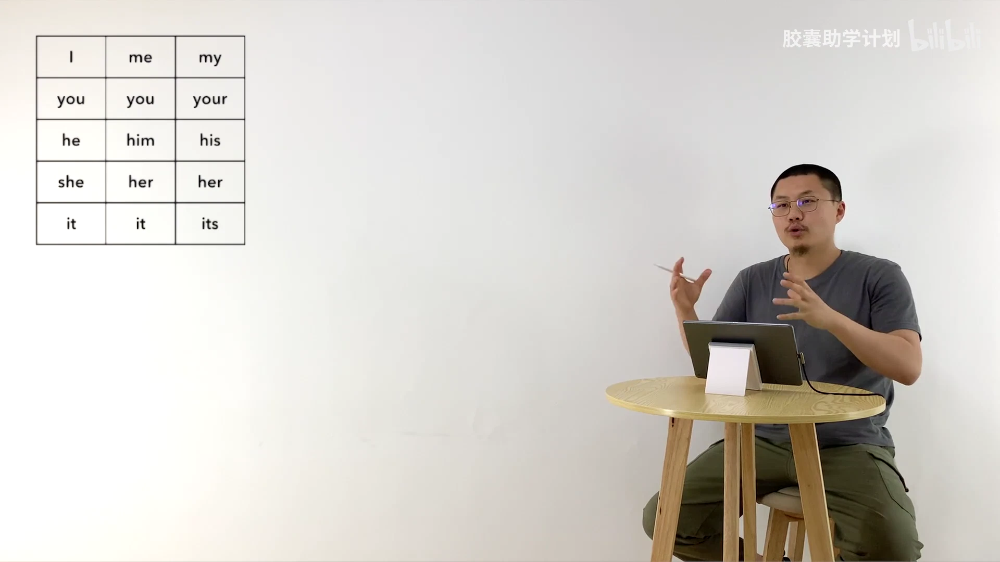

文字识别：胶囊助学计划 / me / my / you / you / your / he / him / his / she / her / her / it / it / its

## 00:05:00–00:05:30

头叫做 its bone,或者说这个狗的小房子,那我们可以理解为叫 its house,对吧?给专门给狗做的那个小狗窝可以叫 its house.接下来我们带着这个表格去做一些练习,这地方是两个知识点的融合,我们一起看一下啊。第一叫 give 某人某物 your money,就是 something,对吧?那我们在这儿随便填一些,比如说把你的钱给我,我们不我们要选择的是中间这一

### 画面 00:05:11

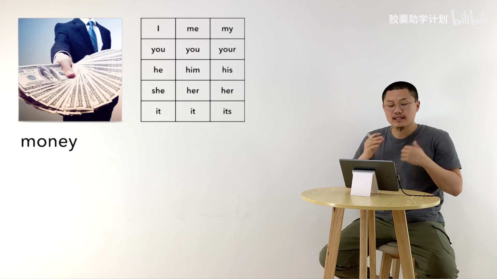

文字识别：胶囊助学计划 / me / my / you / you / your / he / him / his / she / her / her / it / it / its / money

### 画面 00:05:20

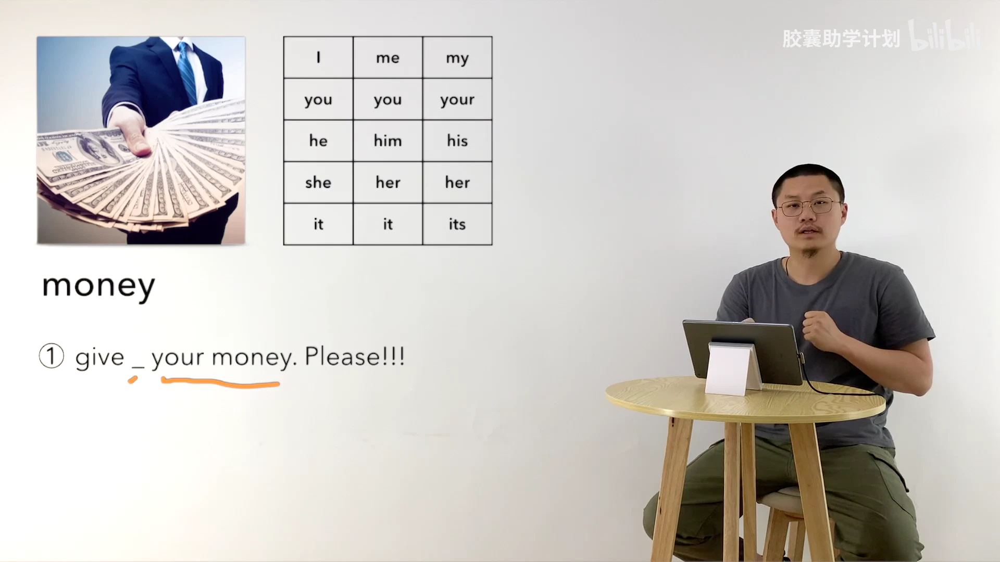

文字识别：胶囊助学计划 / me / my / you / you / your / he / him / his / she / her / her / it / it / its / money / ①give –your money. Please!!

### 画面 00:05:29

文字识别：胶囊助学计划 / me / my / you / you / your / he / him / his / she / her / her / it / it / its / money / ①give -your money. Please!!

## 00:05:30–00:06:00

数列的，对不对？而不是第一数列的。第一数列是动词前的，对吧？后面这个数列是动词后的，叫做 give me your money，或者是 give him 给男他 your money，把你的钱给他就行了，对吧？比如说我们 A A 制分账的时候，你不用把钱给我了，give him your money，把你的钱给他就可以了，或者说 give her your money，对不对？其次，ticket your ticket，

### 画面 00:05:56

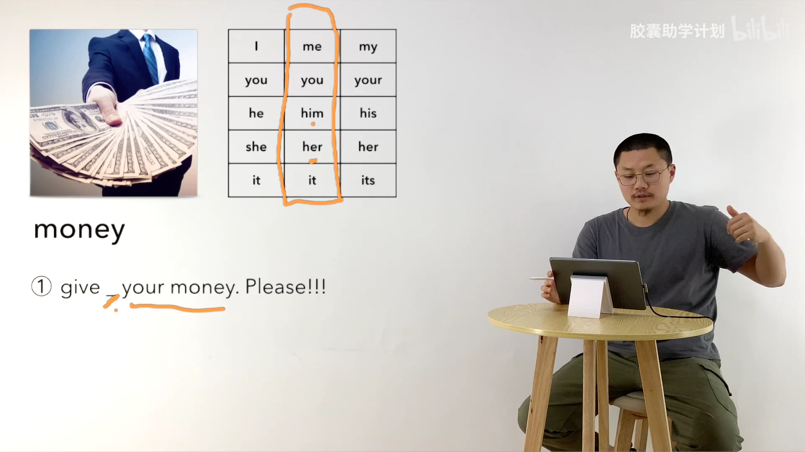

文字识别：胶囊助学计划 / me / my / you / you / your / he / him / his / she / her / her / it / it / its / money / ① / give –your money. Please!!!

### 画面 00:05:58

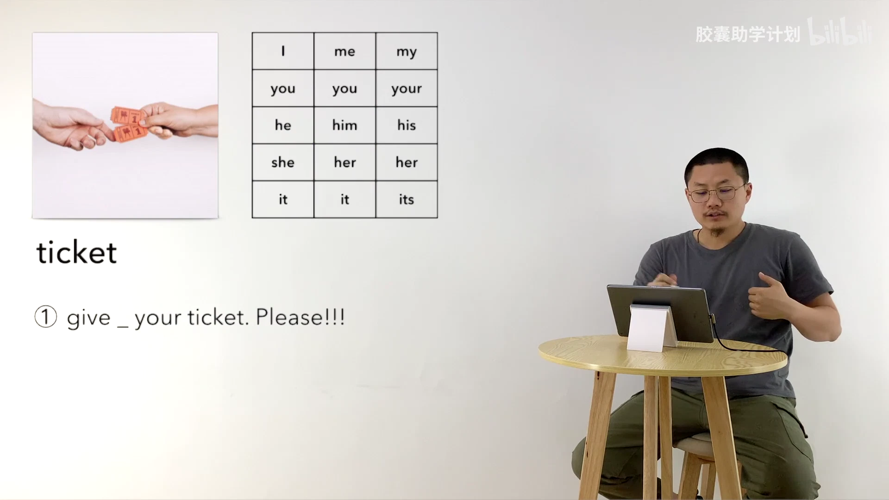

文字识别：胶囊助学计划 / me / my / you / you / your / he / him / his / she / her / her / it / it / its / ticket / ①give _your ticket. Please!!

## 00:06:00–00:06:30

叫你的票啊。那把你的票给他就行了。比如说，拿他叫做give him your ticket。那注意，我在后面其实专门加了一个please这个单词，是为什么呢？原因是我们其实说话的时候直接用give引导的这个小的句子不是特别有礼貌。等到我们学习到四十三课的时候，会学一个小的单词叫can，叫can you can you你能吗？这样说起来会比较有礼貌

### 画面 00:06:01

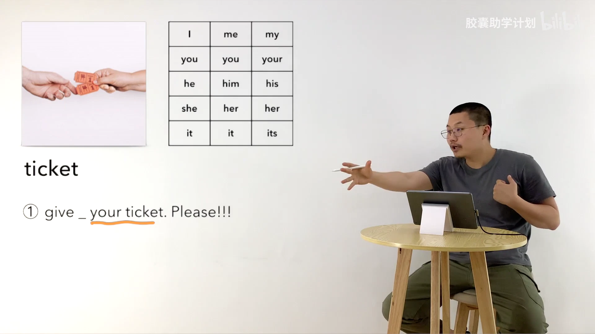

文字识别：胶囊助学计划 / me / my / you / you / your / he / him / his / she / her / her / it / it / its / ticket / ①give _your ticket. Please!!

### 画面 00:06:09

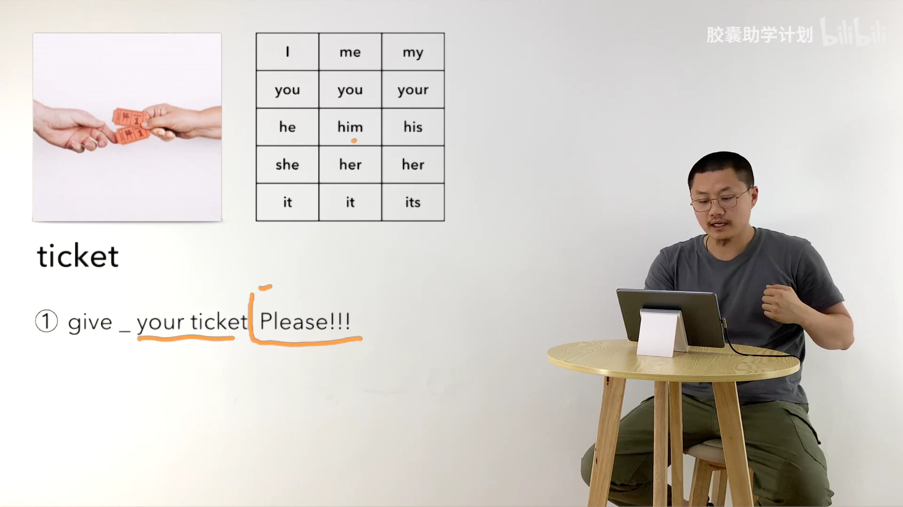

文字识别：胶囊助学计划 / me / my / you / you / your / he / him / his / • / she / her / her / it / it / its / ticket / ①give _ your ticket / Please!!!

### 画面 00:06:11

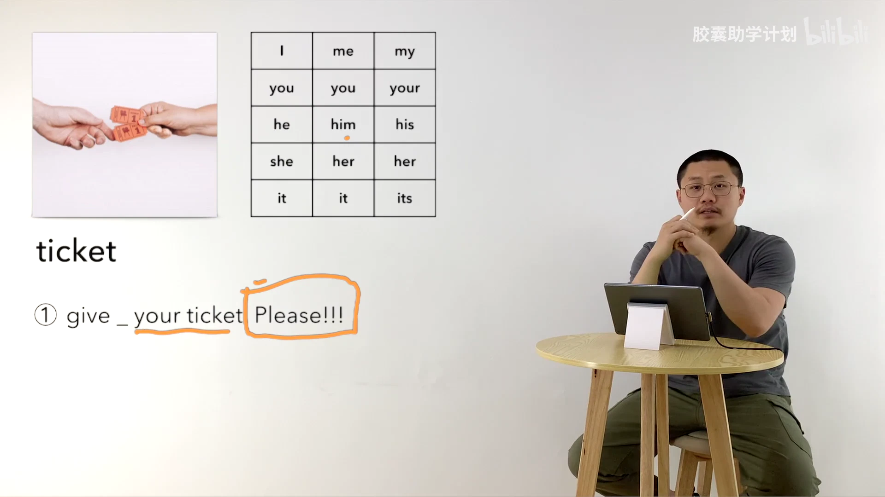

文字识别：胶囊助学计划 / me / my / you / you / your / he / him / his / she / her / her / it / it / its / ticket / ①give _ your ticket / Please!!!

### 画面 00:06:15

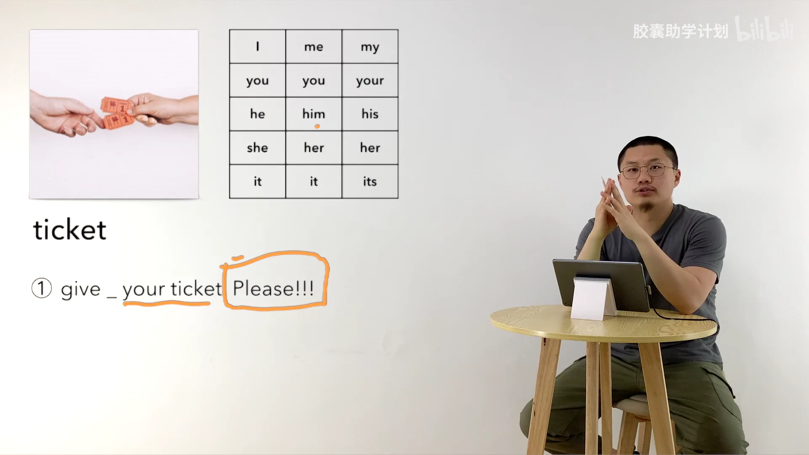

文字识别：胶囊助学计划 / me / my / you / you / your / he / him / his / she / her / her / it / it / its / ticket / ①give _ your ticket / Please!!!

## 00:06:30–00:07:00

一点。但是我们现在如果只会这个句型呢，也不是不能用啊。为了表现的我们是有礼貌的，第一啊，那您伴随着态度对吧？说话的语气，我们可以再多加一个单词叫做 please。那比如说拜托了，拜托了啊，您把您的票啊，把你的票啊给他就行了，叫做 give him your ticket，对吧？或者女她叫 give her your ticket。那把你的票给我，

### 画面 00:06:31

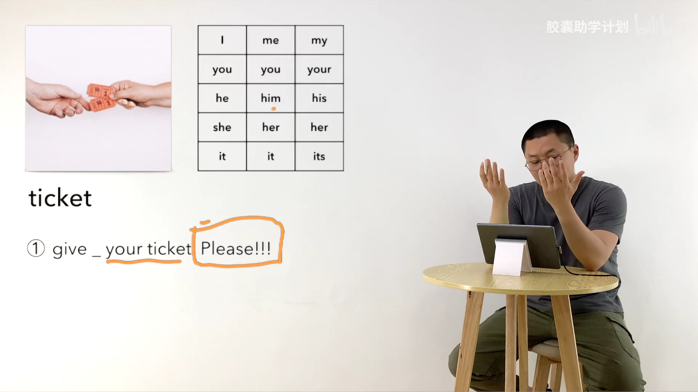

文字识别：胶囊助学计划 / me / my / you / you / your / he / him / his / she / her / her / it / it / its / ticket / ①give _ your ticket / Please!!!

### 画面 00:06:38

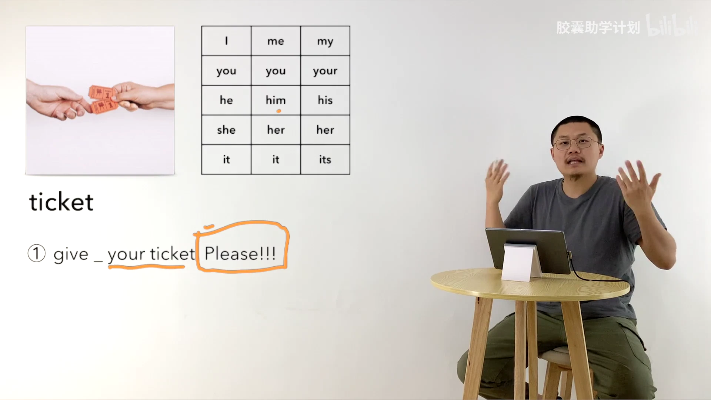

文字识别：胶囊助学计划 / me / my / you / you / your / he / him / his / she / her / her / it / it / its / ticket / ①give _ your ticket / Please!!!

### 画面 00:06:54

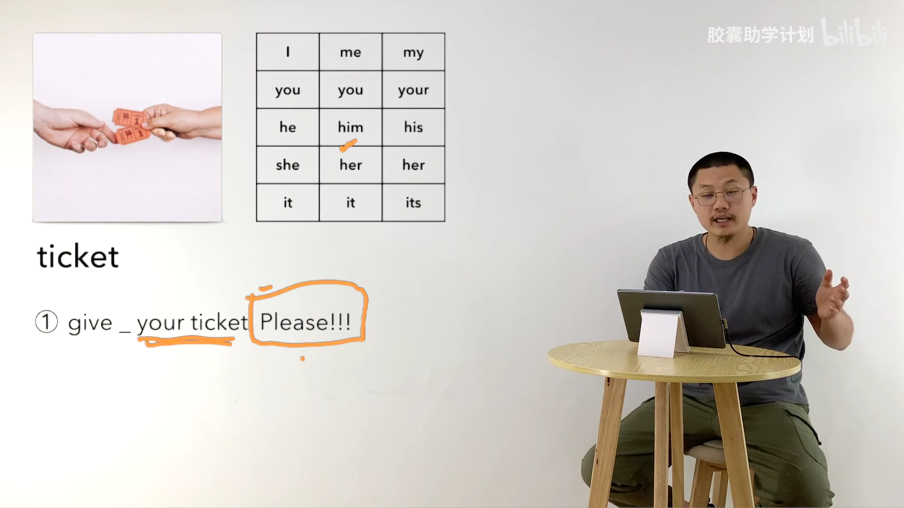

文字识别：胶囊助学计划 / me / my / you / you / your / he / him / his / she / her / her / it / it / its / ticket / ①give – your ticket / Please!!!

## 00:07:00–00:07:30

Give me your ticket. Very good. 好。其次，umbrella还是这个道理，我们可以再往里面去带一下。记住是这一排，张嘴跟我读，Give me your ticket. Give him your ticket. Give her your ticket. 好，注意啊，这个her跟这个her虽然长得一样，但是放在这个地方的时候，注意它可不是翻译成他的啊，是给他你的票啊，不是给

### 画面 00:07:03

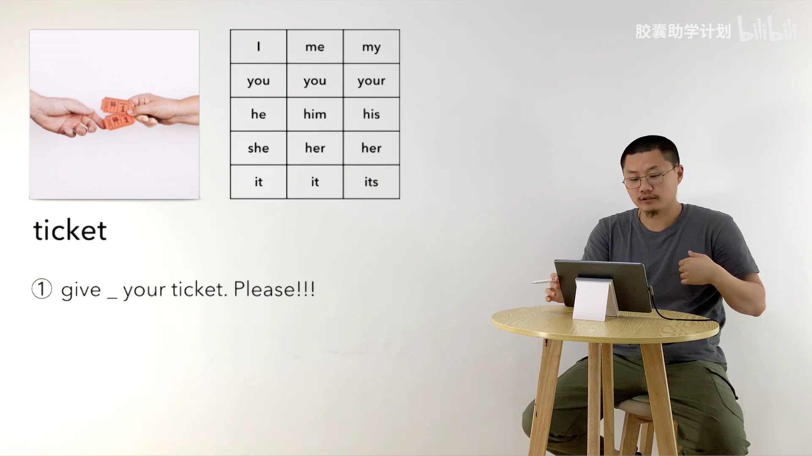

文字识别：胶囊助学计划 / me / my / you / you / your / he / him / his / she / her / her / it / it / its / ticket / ①give _your ticket. Please!!

### 画面 00:07:05

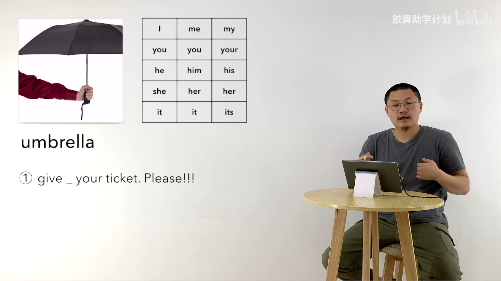

文字识别：胶囊助学计划 / me / my / you / you / your / he / him / his / she / her / her / it / it / its / umbrella / ①give _your ticket. Please!!

### 画面 00:07:13

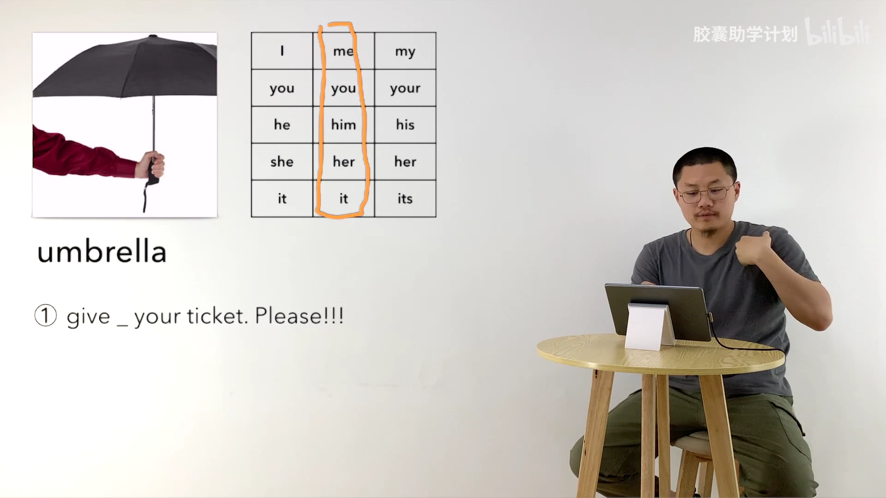

文字识别：胶囊助学计划 / my / me / you / you / your / he / him / his / she / her / her / it / it / its / umbrella / ①give _your ticket. Please!!

### 画面 00:07:25

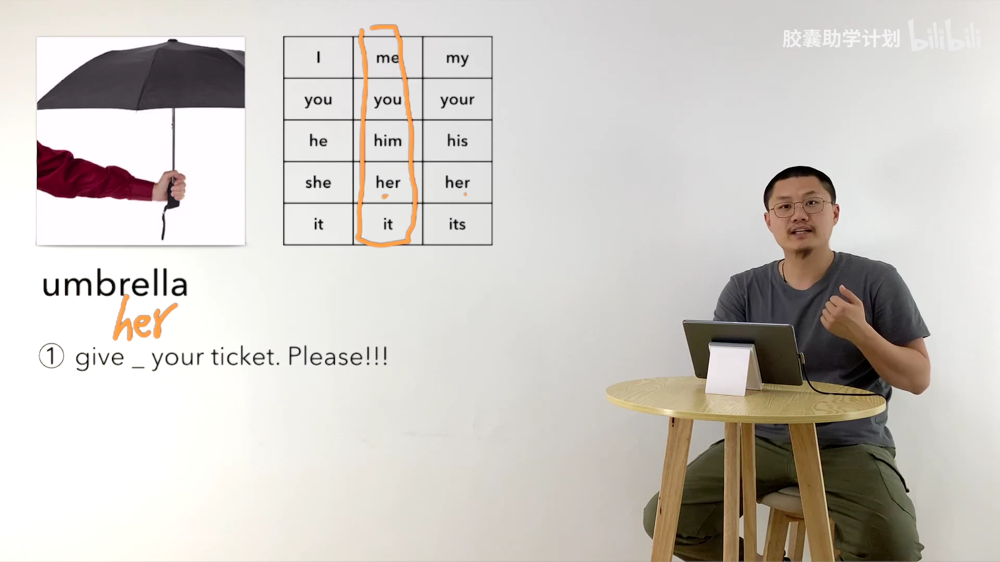

文字识别：胶囊助学计划 / me / my / you / you / your / he / him / his / she / her / her / it / it / its / umbrella / her / ①give _your ticket. Please!!

## 00:07:30–00:08:00

他的你的票，这翻译过来对不对？好，哪一个？那 passport 它记得什么意思吗？护照对吧？那比如说我们在过这个海关通道的时候，你要把你的护照给他，那他可能会说，当然了，他一般不会这样去说，但我们假定他会说叫做 give me your passport，把你的护照给我看一下，please，对吧？好，一般就是伸个手就行了，不会这样去不停的说。那我们往里去带一下啊，叫做 give me

### 画面 00:07:32

文字识别：胶囊助学计划 / me / my / you / you / your / he / him / his / she / her / her / it / it / its / passport

### 画面 00:07:57

文字识别：胶囊助学计划 / me / my / you / you / your / he / him / his / she / her / her / it / it / its / passport / ①give _her passport. Please!!

## 00:08:00–00:08:30

passport. 你把她的护照给我，叫 give me her passport. 或者说给这个男他叫做 give him her passport. 你把他的护照，女他的护照给男他。所以这些词我在说的时候，都会汉语说的都会有些乱，对不对？各位注意啊，这个小的表格在我们初期很重要。再说一遍，这个第一数列和第二个数列的区别是动词的前

### 画面 00:08:00

文字识别：胶囊助学计划 / me / my / you / you / your / he / him / his / she / her / her / it / it / its / passport / m / ①give _her passport. Please!!

### 画面 00:08:11

文字识别：胶囊助学计划 / me / my / you / you / your / he / him / his / she / her / her / it / it / its / passport / me / ①give _her passport. Please!!

### 画面 00:08:21

文字识别：胶囊助学计划 / me / my / you / you / your / he / him / his / she / her / her / it / it / its / passport / me / ①give _her passport. Please!!

## 00:08:30–00:09:00

后主语还是宾语啊？其次呢，第三数列指的是谁的？这个要注意一下。接下来我们再看一个小的习惯用法，叫做 give me a hand，是非常常用的一个习惯用法，也基本符合这个我们刚刚讲过的叫 give somebody something，叫给某人某物。那 hand 叫手，叫做把你的手给我。接下来给你肯定不是对吧？其实它指的就是 help me， help me，帮

### 画面 00:08:35

文字识别：胶囊助学计划 / me / my / you / you / your / he / him / his / she / her / her / it / it / its / passport / me / ①give _her passport. Please!!

### 画面 00:08:37

文字识别：胶囊助学计划 / give me a hand / Cras / life at th / 撞车 Crash (2004) / 40:43

## 00:09:00–00:09:30

我一下就可以了。接下来我们注意看一下这个视频当中是如何用Give me a hand的。Jesus, I'm done now. Give me a hand. Wait a goddamn minute. Okay, okay, okay. Okay,啊，其

### 画面 00:09:02

文字识别：胶囊助学计划 / give me a hand / Cras / rlleath / 撞车Crash (2004) / 40:43

### 画面 00:09:07

文字识别：biibili / 胶囊助学计划

### 画面 00:09:09

文字识别：bilibili / 胶囊助学计划 / 老天 / I'm.. Jesus.

### 画面 00:09:11

文字识别：bilibili / 胶囊助学计划 / 拉完了 / I'm done now.

### 画面 00:09:13

文字识别：bilibili / 胶囊助学计划 / 来拉我一把 / Give me a hand.

### 画面 00:09:15

文字识别：bilibili / 胶囊助学计划

### 画面 00:09:17

文字识别：bilibili / 胶囊助学计划 / 等会儿 / Wait a goddamn minute!

### 画面 00:09:19

文字识别：Biibili / 胶囊助学计划

### 画面 00:09:21

文字识别：bilibili / 胶囊助学计划 / 等会儿 / -Wait a minute.- Whoa, whoa, whoa.

### 画面 00:09:23

文字识别：Biibili / 胶囊助学计划

### 画面 00:09:25

文字识别：bilibili / 胶囊助学计划 / 好的好了 / All right. Okay. Okay.

### 画面 00:09:27

文字识别：bilibili / 胶囊助学计划 / 好的好了 / All right. Okay. Okay.

### 画面 00:09:29

文字识别：胶囊助学计划 / give me a hand / Cras / 撞车 Crash (2004) / 40:43

## 00:09:30–00:10:00

this sitting那位男士啊，是站着这位男士的父亲，对吧？他可能是半夜去卫生间，然后自己站不起来了。他说，Give me a hand, 来拉我一把，对吧？来帮我一下，Give me a hand, 伸出援助之手嘛。我们汉语叫，Okay, to give somebody something. 下一个单词，我们一起读一下，叫做 one。各位，这个单词很熟悉，表示一二三四五六的一，对吧？那它有另一个意思叫做一个。比如说，它配合这个单词叫 which。那比如说，

### 画面 00:09:45

文字识别：胶囊助学计划 / /WΛn/ / one

### 画面 00:09:56

文字识别：胶囊助学计划 / /wI t ∫ / / which

## 00:10:00–00:10:30

我们开车走这儿岔口了。那我说我应该走哪一个呢？我们目前就学这两个单词就可以了，叫做Which one?那当然，Which one should I choose?这是比较高阶的一个语法了。我们现在先不管啊。您会Which one就可以了？叫哪一个呢？Which叫哪一个？那Which就是哪个？那One就是哪一个？OK。那我们先看一下，Double有放在单词当中去发的是W C H，放在单词当中去可以发的是

### 画面 00:10:00

文字识别：胶囊助学计划 / / w I t ∫ 1 / which

### 画面 00:10:02

文字识别：胶囊助学计划 / / w I t ∫ 1 / which

## 00:10:30–00:11:00

sh 连起来 which which 好，接下来我们直接进入文章，文章比较简单，也就是刚才我讲的这些核心语法点。我们迅速来一遍啊。Man 说了一句话叫 Give me a book, please. 给我来一本书。Jim 直接说了他的名字。那女士说 Which book? 其实也是 Which one? OK. 那他说的是 This one. 说是这一本吗？是这一本吗？

### 画面 00:10:32

文字识别：胶囊助学计划 / /wI t ∫/ / which / ① Which one?

### 画面 00:10:34

文字识别：胶囊助学计划 / MAN: Give me a book please, Jane. / WOMAN: Which book? / WOMAN: This one?

### 画面 00:10:43

文字识别：胶囊助学计划 / 2 / MAN: Give me a book please, Jane. / WOMAN: Which book? / WOMAN: This one?

### 画面 00:10:45

文字识别：胶囊助学计划 / MAN: Give me a book please, Jane. / WOMAN: Which book? / WOMAN: This one?

### 画面 00:10:47

文字识别：胶囊助学计划 / MAN: Give me a book please, Jane. / WOMAN: Which book? / WOMAN: This one?

### 画面 00:10:51

文字识别：胶囊助学计划 / MAN: Give me a book please, Jane. / WOMAN: Which book? / WOMAN: This one?

### 画面 00:10:56

文字识别：胶囊助学计划 / MAN: Give me a book please, Jane. / WOMAN: Which book? / WOMAN: This one?

## 00:11:00–00:11:30

This one, one要记得声调上扬啊。This one, OK，继续。No, not that one，不，不是那一个。The red one，好，要红色的那一本。注意，红色的是不是就是形容词？各位有没有印象？我们说学为什么我对吧？学了名词，为什么还要学形容词呢？这个时候就有用了，对不对？三本儿书放在那个地方，你要哪本儿书啊？把红色封皮那本儿书给我吧。学新的东

### 画面 00:11:05

文字识别：胶囊助学计划 / MAN: No, not that one. The red one. / WOMAN: This one? / MAN: Yes, please. / WOMAN: Here you are. / MAN: Thank you.

### 画面 00:11:15

文字识别：胶囊助学计划 / MAN: No, not that one. Thered one. / WOMAN: This one? / MAN: Yes, please. / WOMAN: Here you are. / MAN: Thank you.

### 画面 00:11:17

文字识别：胶囊助学计划 / MAN: No, not that one. Thered one. / WOMAN: This one? / MAN: Yes, please. / WOMAN: Here you are. / MAN: Thank you.

## 00:11:30–00:12:00

西一定是能解决具体生活当中实际的问题，您才去学，尤其是语言。但是唯一现在的区别就是什么呢？您自己可能没办法想明白这么一个学术的东西，对吧？形容词 A D 这点儿对我有什么用？当然这个还是比较简单的。那我们往后去学，比如说定语从句的时候，你一听这个名字就比较的复杂，其实不是这样的，对吧？它也是有很重要的作用的。我们一定要给大家结合现实生活当中如何能解决大家的问

### 画面 00:11:47

文字识别：胶囊助学计划 / MAN: No, not that one. Thered ohe. / WOMAN: This one? / MAN: Yes, please. / WOMAN: Here you are. / MAN: Thank you.

## 00:12:00–00:12:30

最基本的就是这个问题。三本儿书，红、黄、蓝，你要哪一本儿的问题，对吧？他说 this one，哎，他就拿了一本红的。Yes, please.是的，谢谢你了。Here you are，给你。我们之前说过了。Here you are。好，Thank you，感谢。那本文就结束了。如何表达？给我一本书。Give me a book。但是更重要的是要记住的是，give somebody something，对吧？比如说我现在说，给我一把

### 画面 00:12:07

文字识别：胶囊助学计划 / MAN: No, not that one. Thered one. / WOMAN: This one? / MAN: Yes, please. / WOMAN: Here you are. / MAN: Thank you.

### 画面 00:12:13

文字识别：胶囊助学计划 / MAN: No, not that one. Thered ohe. / WOMAN: This one? / MAN: Yes, please. / WOMAN: Here you are. / MAN: Thank you.

### 画面 00:12:17

文字识别：胶囊助学计划 / MAN: No, not that one. The red one. / WOMAN: This one? / MAN: Yes, please. / WOMAN: Here you are. / MAN: Thank you.

### 画面 00:12:19

文字识别：胶囊助学计划 / ①如何表达“给我一本书”？ / ②Ime都是我，区别在哪里？

## 00:12:30–00:13:00

雨伞，叫做 give me an umbrella，随便给我一把雨伞，对吧？Okay, 那 I 和 me 都是我的意思，区别在哪？动词的前或者是后？Okay, 那 recap，今天两个关键点，第一个 give somebody something，各位可以拿之前我们学到的那些名词去往里套着练一下。其次呢， which one？好，哪一个？哎， which 是非常重要的一个特殊疑问词。不过这

### 画面 00:12:42

文字识别：胶囊助学计划 / Recap / Patterns / give sb. sth. / which one? / Grammar / Words / Expression

### 画面 00:12:46

文字识别：胶囊助学计划 / Recap / Patterns / give sb. sth. / which one? / Grammar / Words / Expression

## 00:13:00–00:13:30

一课我们学的它的是它的简化版，叫 which one。看一下家作业，首先绿皮书二十一课写作练习各位可以做了，再然后文章要跟读至熟读成诵，这是咱们老习惯。最后呢要给自己讲解一遍今天的核心知识点。OK，那本期的视频到这儿就结束了。如果大家喜欢，欢迎大家关注、订阅、一键三连支持我们。最后的最后，我们看一句名人名言：

### 画面 00:13:00

文字识别：胶囊助学计划 / Recap / Patterns / give sb. sth. / which one? / Grammar / Words / Expression

### 画面 00:13:04

文字识别：胶囊助学计划 / 绿皮书第21课的写作练习

### 画面 00:13:18

文字识别：胶囊助学计划

### 画面 00:13:26

文字识别：胶囊助学计划 / MAIMONIDES / Give a man a fish and you feed him for / a day; teach a man to fish and you feed / him for a lifetime. / Maimonides

## 00:13:30–00:13:57

Give a man a fish, and you feed him for a day. Teach a man to fish, and you feed him for a lifetime. See you next time.

### 画面 00:13:43

文字识别：胶囊助学计划 / MAIMONIDES / Give a man a fish and you feed him for / a day; teach a man to fish and you feed / him for a lifetime. / - Maimonides

### 画面 00:13:45

文字识别：CAPSULEACADEMY / 胶囊学院 / 『 / 小红书 / □ / Lecturer

### 画面 00:13:47

文字识别：CAPSULEACADEMY / 胶囊学院 / 小红书 / Photoar

### 画面 00:13:50

文字识别：CAPSULEACADEMY / 胶囊学院 / 小红书 / Editor / □ / Berlin

### 画面 00:13:53

文字识别：CAPSULEACADEMY / 胶囊学院 / 小红书 / 品 / Leo & Berlin

### 画面 00:13:55

文字识别：bilibili / 胶囊助学计划

### 画面 00:13:56

文字识别：bilibili / 胶囊助学计划

