# 022 单词 练习

快速机器解析：语音为单模型转写，未进行独立交叉校对或人工复核；画面每秒采样并按变化选帧，短时文字和标记可能遗漏。截图时间约有 1 秒误差。图片有损压缩；遇到疑点请按时间查看 Google Drive 原视频。

## 00:00:00–00:00:30

Hello everyone, welcome to Capsule Academy. This is Leo. Today we're going to learn new concept English book one lesson twenty two practices and words. Hope you gonna enjoy it. 好，那上来呢，我们先看一组对应的形容词。首先第一个单词跟我一起读，叫做 empty, empty, empty, empty, empty. Okay, 叫做空的

### 画面 00:00:00

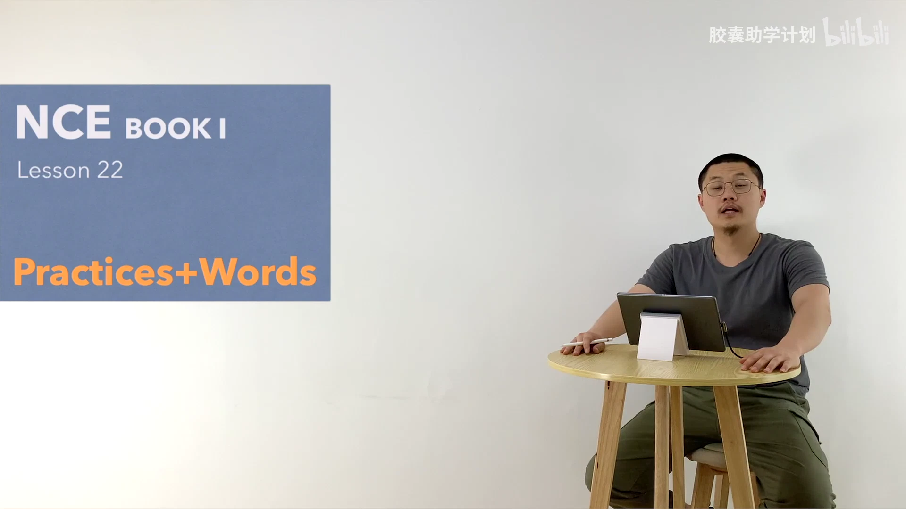

文字识别：Bilbili / 胶囊助学计划 / NCE / BOOKI / Lesson 22 / Practices+Words

### 画面 00:00:02

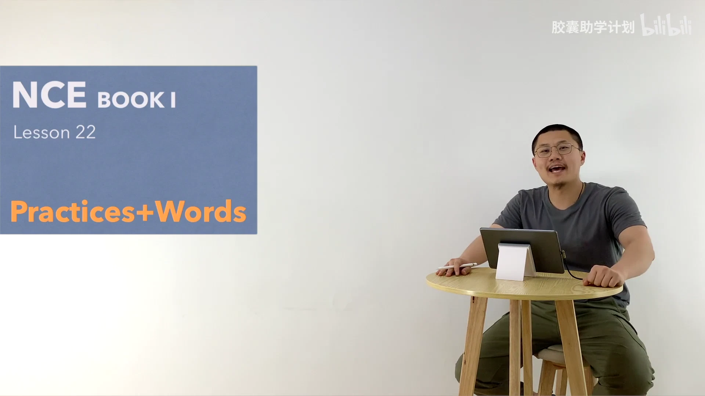

文字识别：bilibii / 胶囊助学计划 / NCE / BOOKI / Lesson 22 / Practices+Words

### 画面 00:00:05

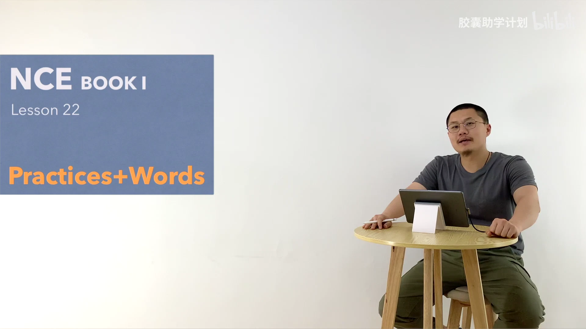

文字识别：胶囊助学计划 / NCE / BOOKI / Lesson 22 / Practices+Words

### 画面 00:00:12

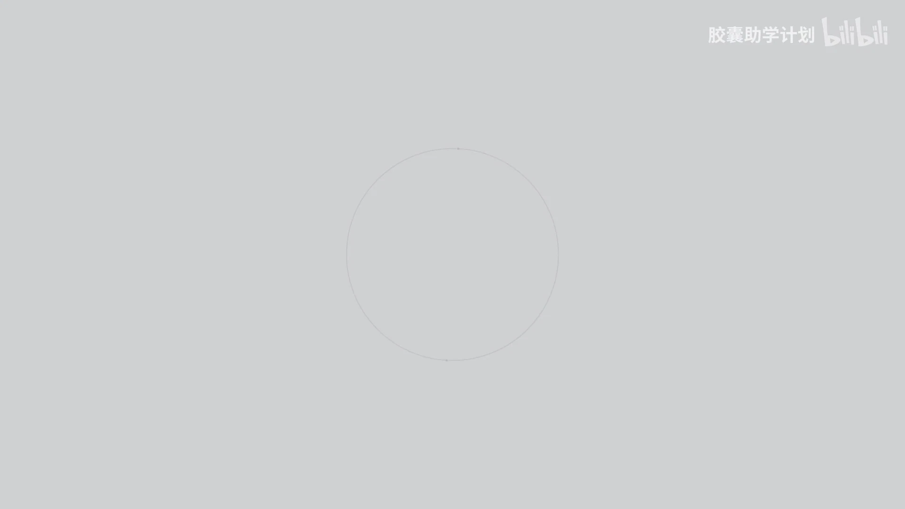

文字识别：胶囊助学计划bil出

### 画面 00:00:15

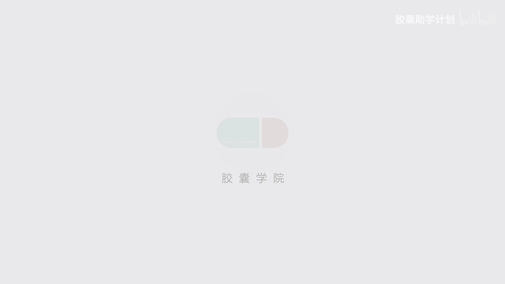

文字识别：胶囊学院

### 画面 00:00:17

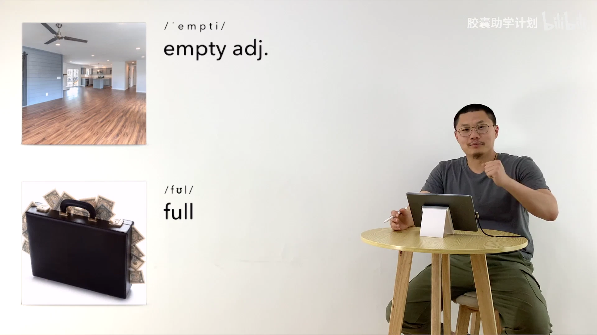

文字识别：胶囊助学计划 / /'empti/ / empty adj. / /ful/ / full

### 画面 00:00:20

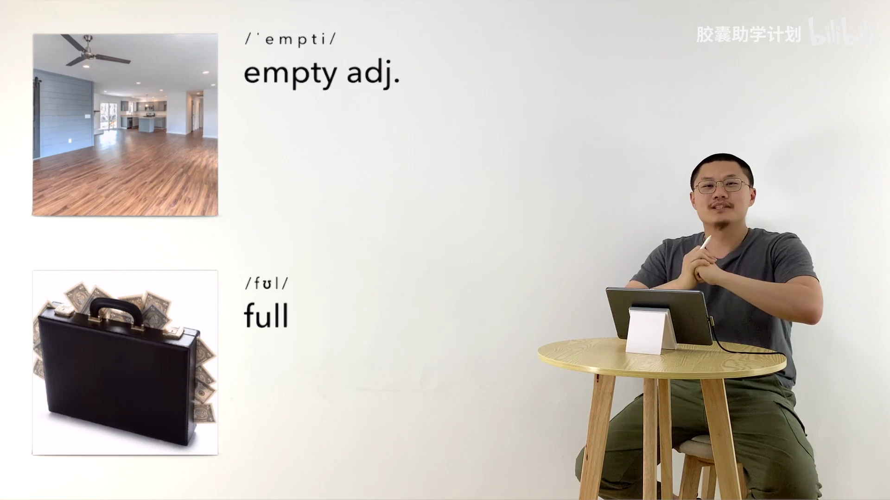

文字识别：胶囊助学计划 / /'empti/ / empty adj. / /ful/ / full

## 00:00:30–00:01:00

啊。Next one跟它对应的这个形容词叫做full。最后注意啊，L L舌尖一定要舔到沙音，不是full，是full full. OK, very good.舌尖舔沙音，并且F放在单词当中去发的是这个音，它叫做满的。那我们造一些小的句子，叫做This is empty house.说这是一个空的房子。那前面加a还

### 画面 00:00:37

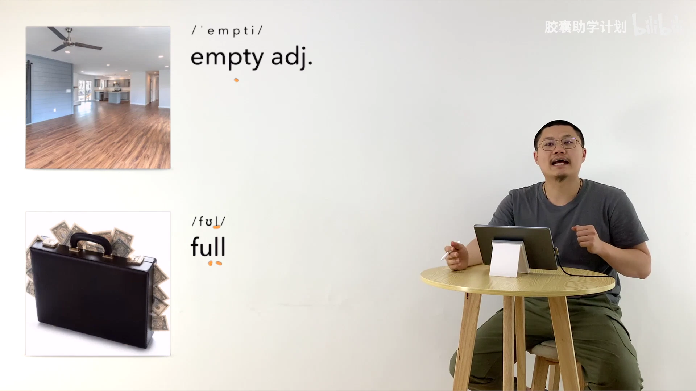

文字识别：胶囊助学计划 / /'empti/ / empty adj. / /ful/ / full

### 画面 00:00:42

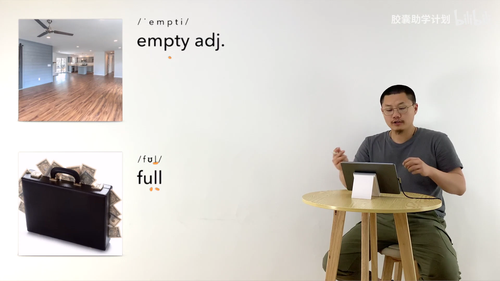

文字识别：胶囊助学计划 / /'empti/ / empty adj. / /ful/ / full

## 00:01:00–00:01:30

an 呢？我们要由 empty 的第一个音去决定，对不对？它是 an 单元音，所以前面加的是 an，叫做 This is an empty house. Very good. 那我想说这是空的吗？Is this an empty house？非常简单啊。那 full，那我可以造一个句子叫做 This case is full. 这个箱子是满的。那我想问这个箱子是满的

### 画面 00:01:02

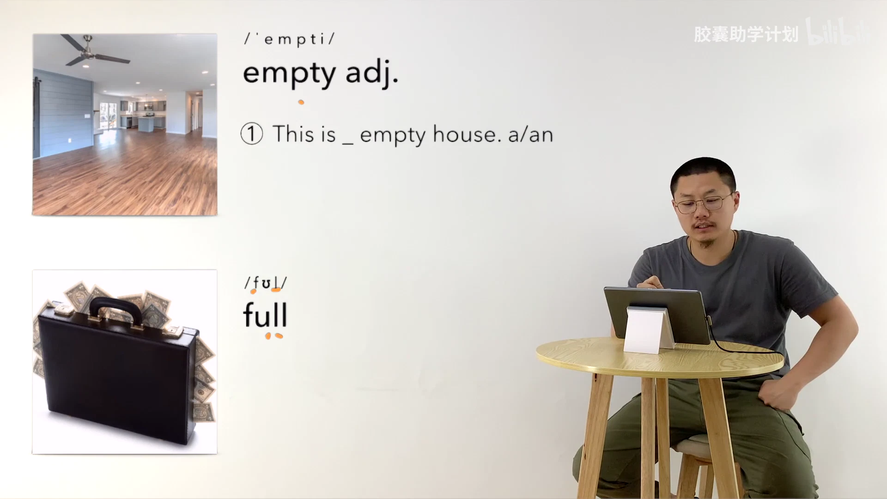

文字识别：胶囊助学计划 / /'empti/ / empty adj. / ① This is _ empty house. a/an / /ful/ / full

### 画面 00:01:05

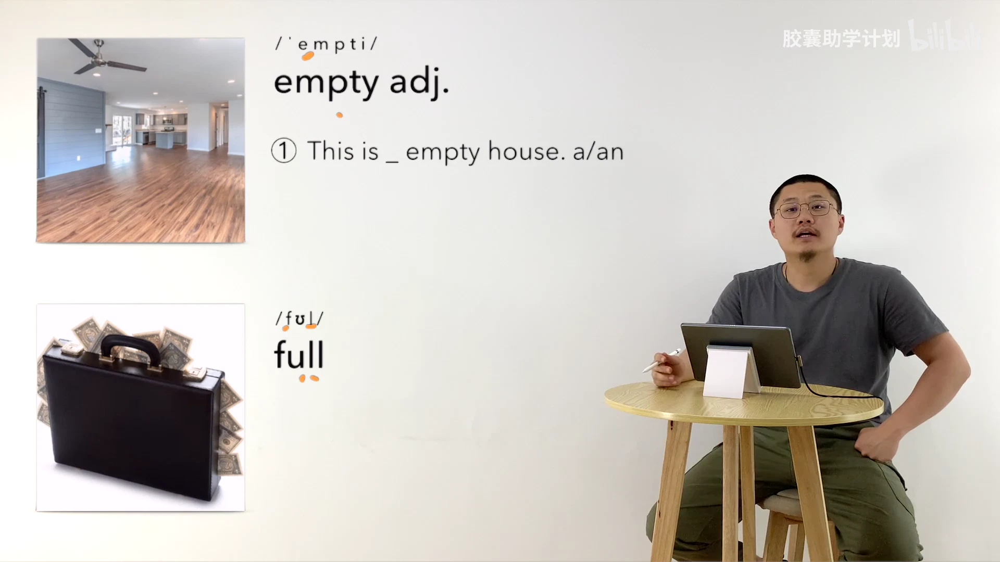

文字识别：胶囊助学计划 / /'empti/ / empty adj. / ) This is _empty house. a/an / /ful/ / full

### 画面 00:01:12

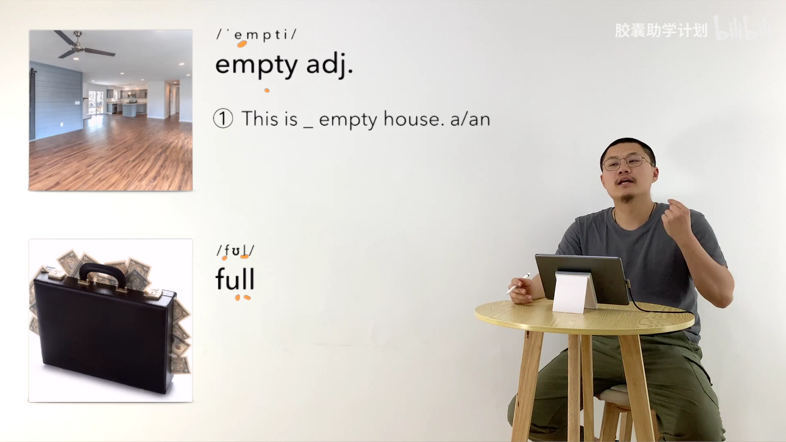

文字识别：胶囊助学计划 / /'empti/ / empty adj. / ) This is _ empty house. a/an / /ful/ / full

### 画面 00:01:20

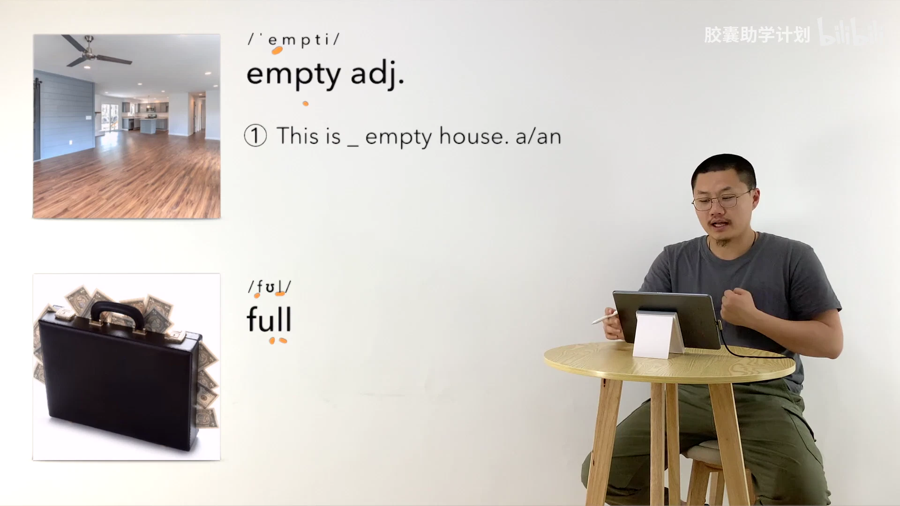

文字识别：胶囊助学计划 / /'empti/ / empty adj. / ) This is _empty house.a/an / /ful/ / full

### 画面 00:01:23

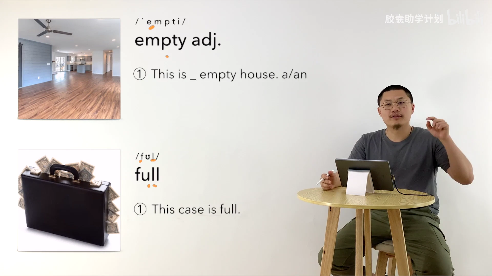

文字识别：胶囊助学计划 / /'empti/ / empty adj. / ) This is _empty house.a/an / /ful/ / full / This case is full.

### 画面 00:01:26

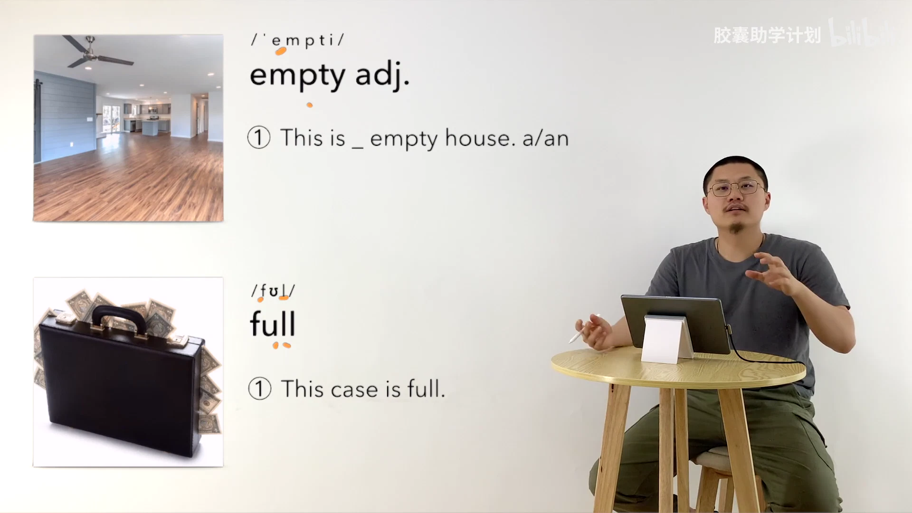

文字识别：胶囊助学计划 / /'empti/ / empty adj. /  This is _ empty house. a/an / /ful/ / full / This case is full.

## 00:01:30–00:02:00

吗？Is this case full?张嘴就要来啊！各位，我们恨不得前二十五课，唯一的重要点就是把 this is my handbag，张嘴就能练出来。叫 is this your handbag？啊，练出来这样的一个级别啊，空的，满的。Continue，下一个单词跟我一起读，叫做 large，叫做大的，对吧？那小的呢，又可以说是 small，我们之前学过，也可

### 画面 00:01:49

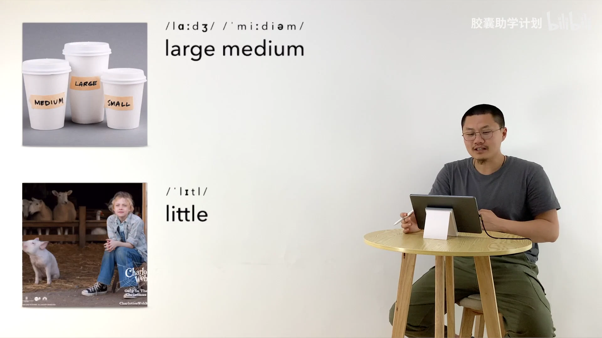

文字识别：胶囊助学计划 / /la:d3/ /'mi:diam/ / large medium / LARGE / MEDIUM / SMALL / /litl/ / little / harlo / web / oaiIn The / Chi Istinas / CharlottesWebN

### 画面 00:01:52

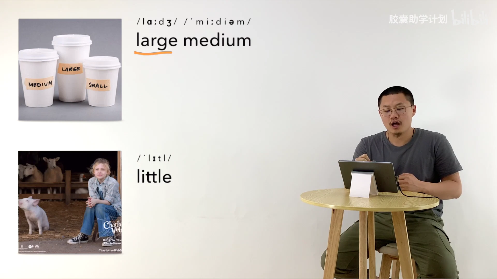

文字识别：胶囊助学计划 / /la:d3/ /'mi:diam/ / large medium / LARGE / MEDIUM / SMALL / /'litl/ / little / Charlo / web / OnIn The / Chr intinas / CharlottesWebN

### 画面 00:01:58

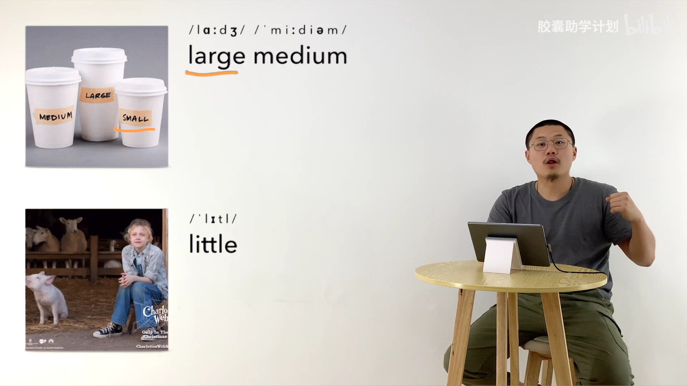

文字识别：胶囊助学计划 / /la:d3/ /'mi:diam/ / large medium / LARGE / MEDIUM / SMALL / /litl/ / little / harlo / web / OaIn The / Chr istinas / CharlotteswebN

## 00:02:00–00:02:30

can be said to be little. Good. Next, the middle one, we call it. Let me read it with me. Medium, medium. Good. You can think about it. We actually buy coffee. Many places, you use large, medium, small. You say you want large, medium, small. You want which one? You say give me a small one. Give me a large one.

### 画面 00:02:07

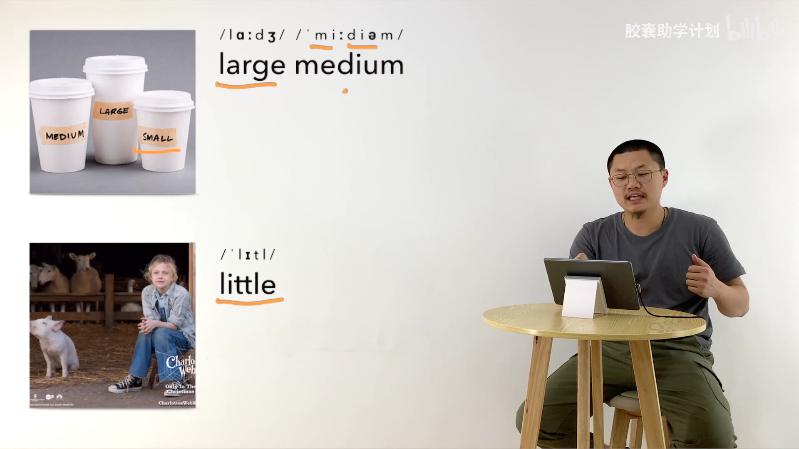

文字识别：胶囊助学计划 / /la:d3/ /'mi:diam/ / large / medium / LARGE / MEDIUM / SMALL / /'litl/ / little / harlo / Vel / OniIn The / Chr istnas / CharlottesWebN

### 画面 00:02:18

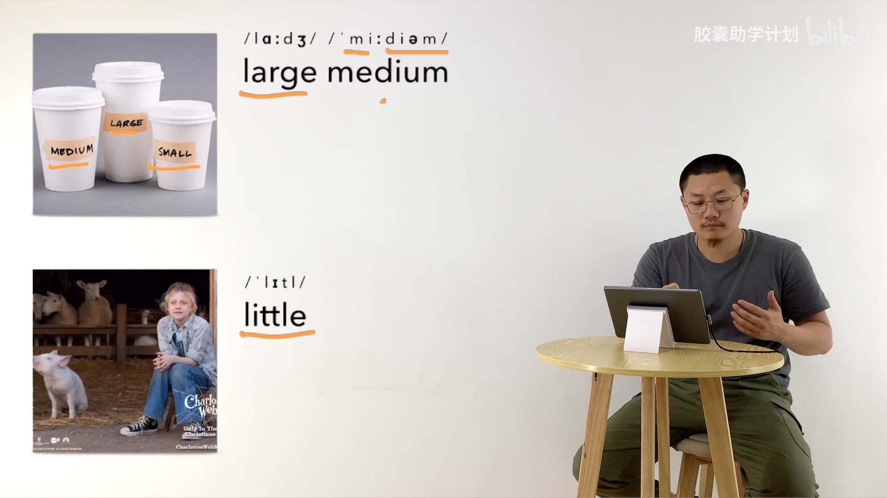

文字识别：胶囊助学计划 / /la:d3/ /'mi:diam/ / large / medium / LARGE / MEDIUM / SMALL / /'litl/ / little / Charlo / web / OnIn The / Chr istimas / CharlottesWebN

### 画面 00:02:21

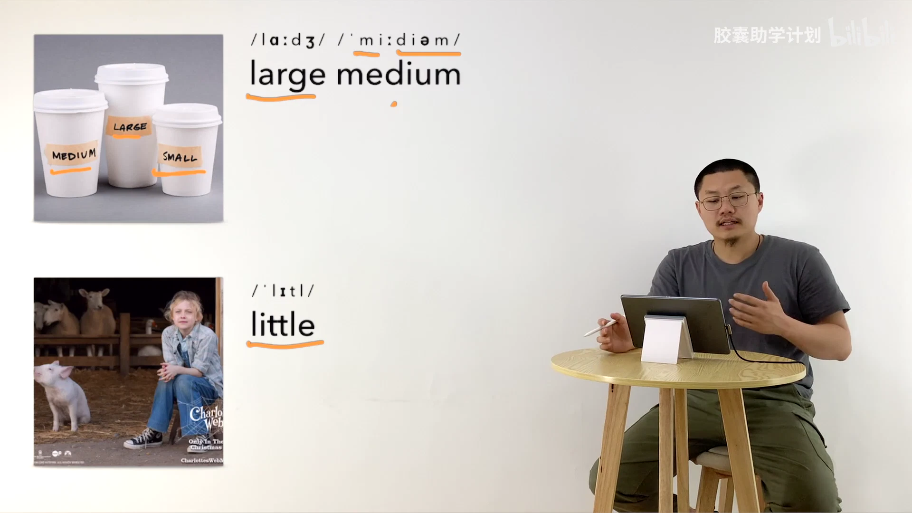

文字识别：胶囊助学计划 / /la:d3/ /'mi:diam/ / large r / medium / LARGE / MEDIUM / SMALL / /'litl/ / little / harlo / web / Oa In The / Chr lstnas / CharlotteswebN

### 画面 00:02:23

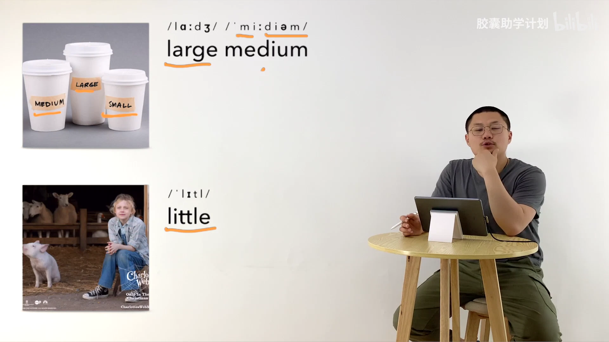

文字识别：胶囊助学计划 / /la:d3/ /'mi:diam/ / large / medium / LARGE / MEDIUM / SMALL / /'litl/ / little / Charlo / web / OnIn The / Chr istinas / CharlotteswebN

### 画面 00:02:27

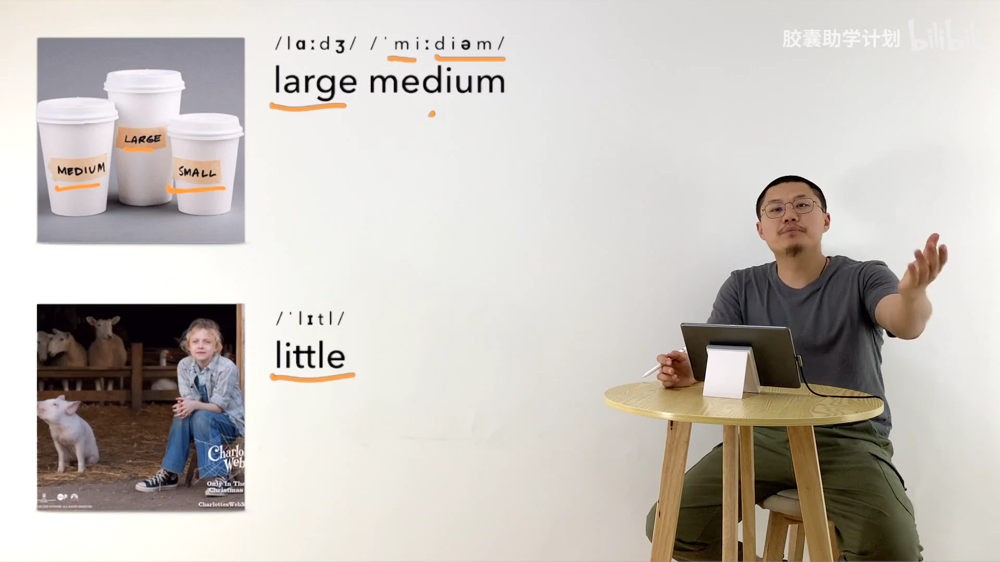

文字识别：胶囊助学计划 / /la:d3/ /'mi:diam/ / large / medium / LARGE / MEDIUM / SMALL / /'litl/ / little / harlo / Nel / OnIn The / Chr istinas / CharlottesWebz

## 00:02:30–00:03:00

a large one, or give me a big one, right? Large, possible, use will be a little bit. That give me a middle one, called give me a medium one. Okay, there you go. Good. That we write to, right? Give me a medium cup or medium one. Okay. That we take little to make a sentence called this is a little girl. This is a little girl. There you go. Good. Let's continue. Sharp, called sharp. That.

### 画面 00:02:41

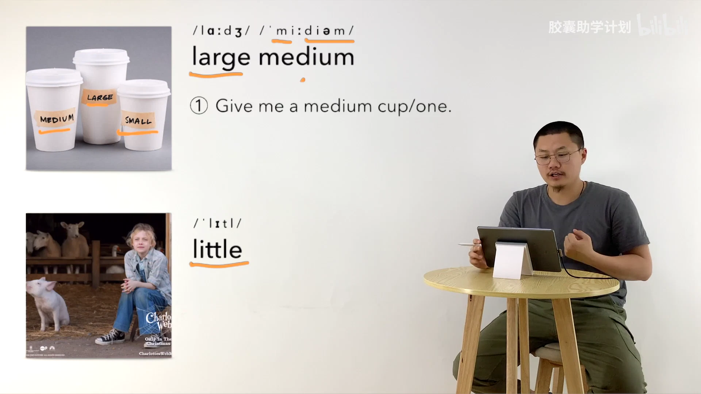

文字识别：胶囊助学计划 / /la:d3/ /'mi:diam/ / large medium / LARGE / Give me a medium cup/one. / MEDIUM / SMALL / /litl/ / little / Charlo / web / OnIn The / Chr lstinas / Charlottesweb?

### 画面 00:02:43

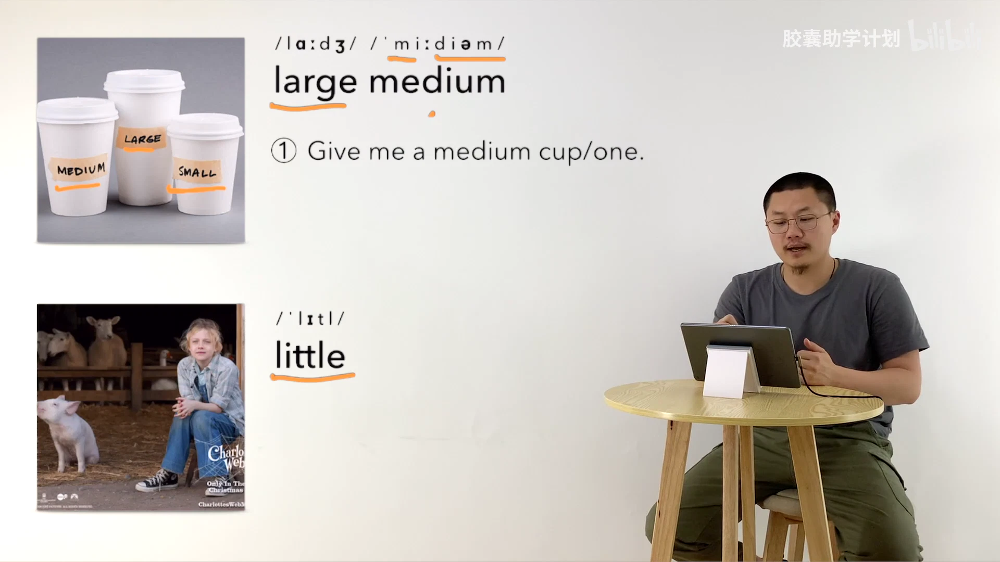

文字识别：胶囊助学计划 / /la:d3/ /'mi:diam/ / large medium / LARGE / Give me a medium cup/one. / MEDIUM / SMALL / /litl/ / little / harlo / web / OnIn The / Chrlstinas / CharlotteswebN

### 画面 00:02:45

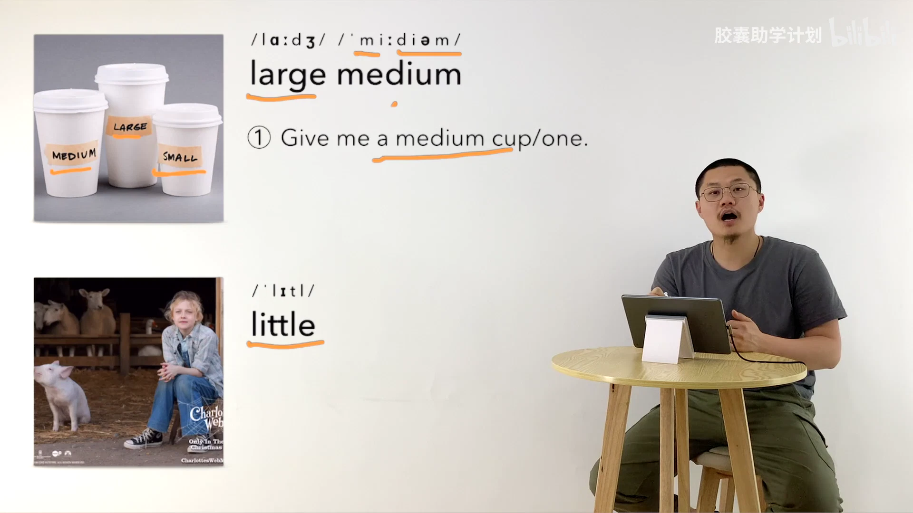

文字识别：胶囊助学计划 / /la:d3/ /'mi:diam/ / large medium / LARGE / Give me a medium cup/one. / MEDIUM / SMALL / /litl/ / little / harlo / Net / OnIn The / Chrlstnas / CharlottesWeb?

### 画面 00:02:56

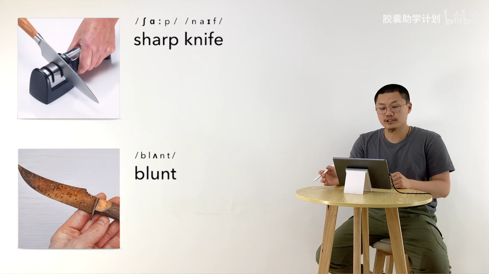

文字识别：胶囊助学计划 / / ∫aip/ /naif/ / sharp knife / /blant/ / blunt

### 画面 00:02:59

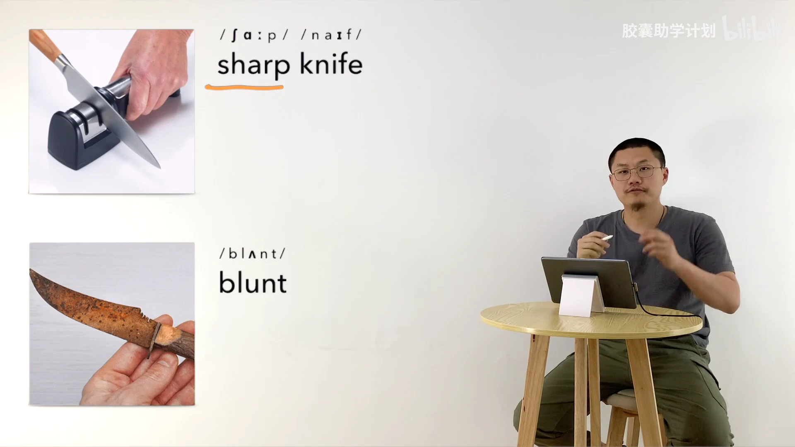

文字识别：/∫a:p/ /naif/ / 胶囊助学计划 / sharp knife / /blant/ / blunt

## 00:03:00–00:03:30

的 sharp，那 blunt 叫做钝的，对吧？那 knife， so this is a knife， this is another knife， OK， these are knives，变复数，不知道各位还有没有印象？f e 应该怎么处理？变成 v e s，对不对？这是我们十五课、十七课的语法重点。好，那我们造一个句子，叫做 This is a sharp knife。

### 画面 00:03:05

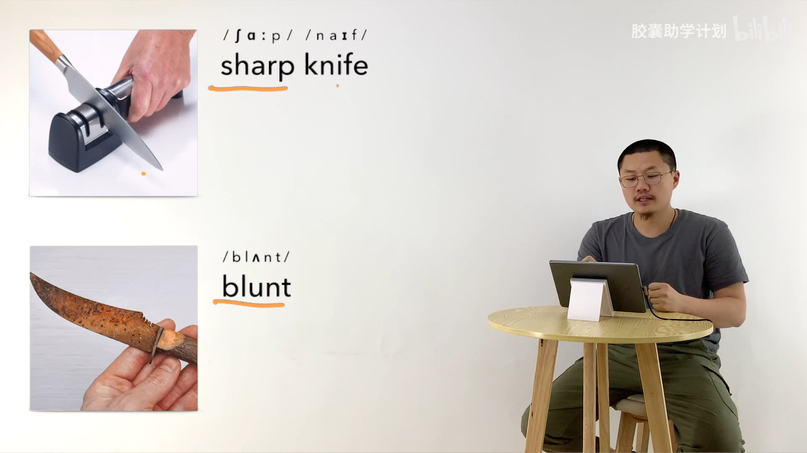

文字识别：胶囊助学计划 / / ∫aip/ /naif/ / sharp knife / /blant/ / blunt

### 画面 00:03:07

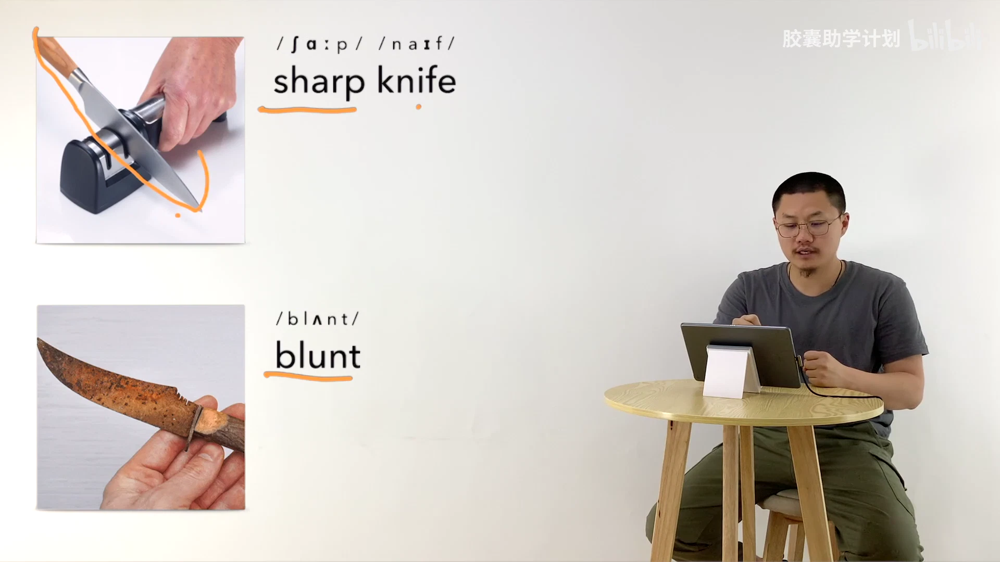

文字识别：胶囊助学计划 / /∫aip/ /naif/ / sharp knife / /blant/ / blunt

### 画面 00:03:09

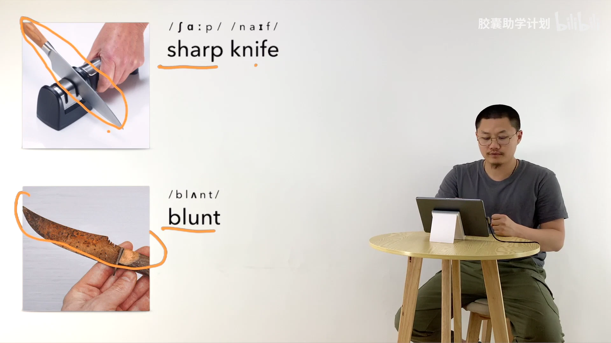

文字识别：胶囊助学计划 / /∫aip/ /naif/ / sharp knife / /blant/ / blunt

### 画面 00:03:11

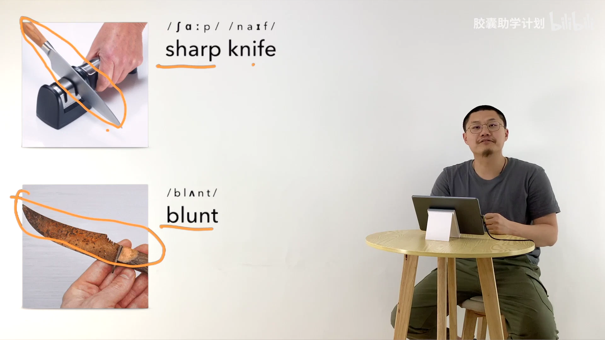

文字识别：胶囊助学计划 / /∫aip/ /naif/ / sharp knife / /blant/ / blunt

### 画面 00:03:17

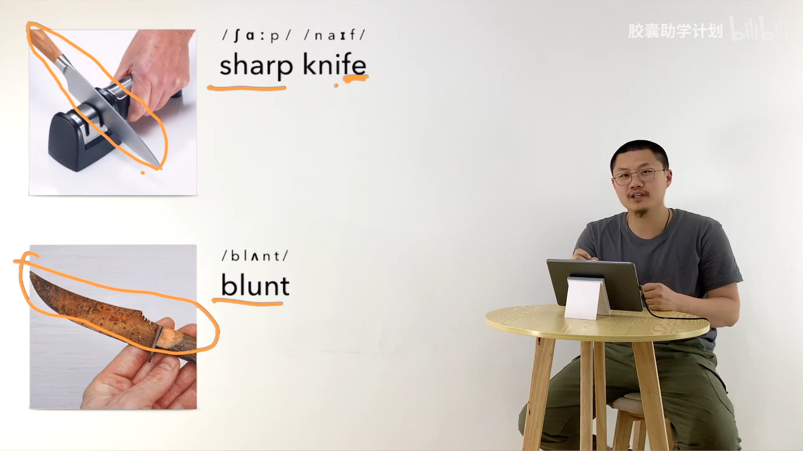

文字识别：胶囊助学计划 / /∫aip/ /naif/ / sharp knife / /blant/ / blunt

### 画面 00:03:20

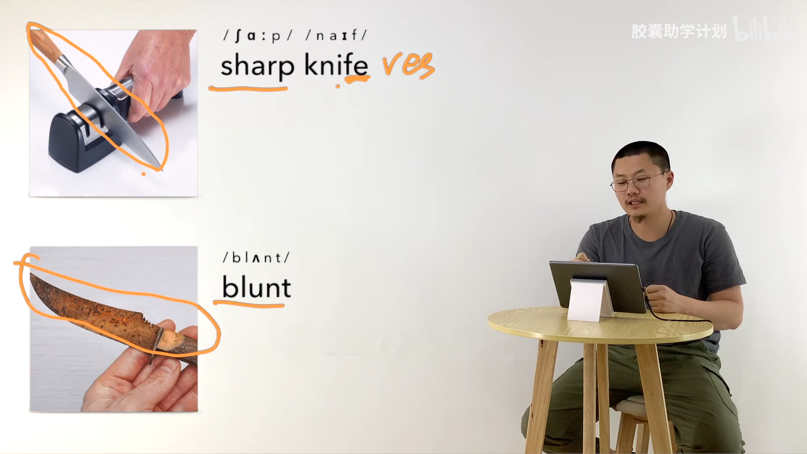

文字识别：胶囊助学计划 / / ∫aip/ /naif/ / sharp knife Ve3 / /blant/ / blunt

### 画面 00:03:25

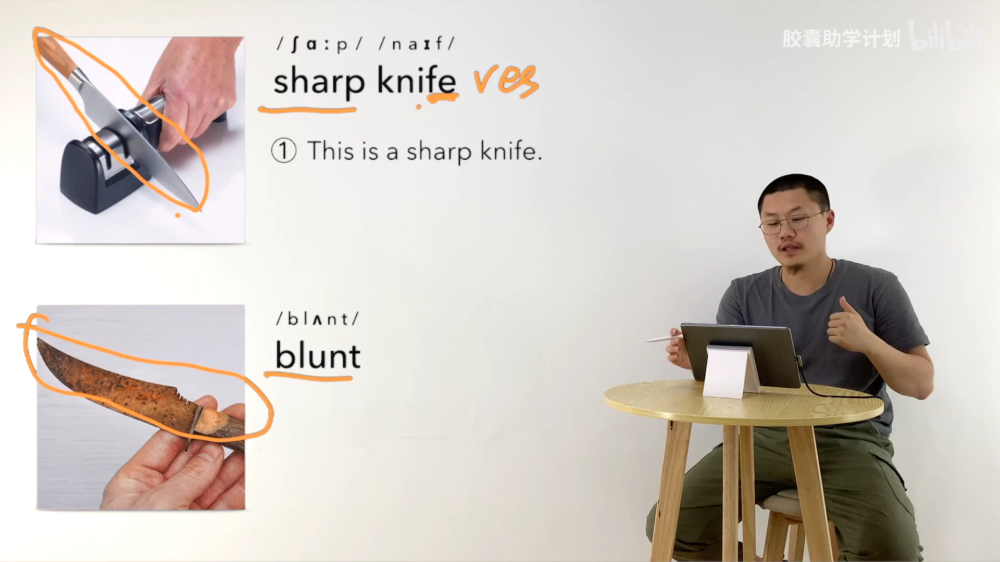

文字识别：胶囊助学计划 / /∫aip/ /naif/ / sharp knife Ves / D This is a sharp knife. / 1 / /blant/ / blunt

## 00:03:30–00:04:00

那我说，我现在说一句汉语啊，叫做这把刀锋利吗？我们现在想把它造出来。如果各位听到我这句汉语，现在直接可以把英文说出来，那您前二十课掌握的非常好。如果说不出来呢，我们一点一点来啊。这把刀锋利吗？这是个一般疑问句。那我先造肯定句，叫这把刀很锋利，叫这把刀 this knife，锋利 sharp，中间别忘了加 is，对吧？This knife is

### 画面 00:03:31

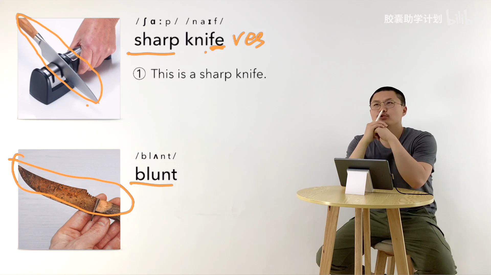

文字识别：胶囊助学计划 / / ∫aip/ /naif/ / sharp knife Ves /  This is a sharp knife. / 1 / /blant/ / blunt

### 画面 00:03:35

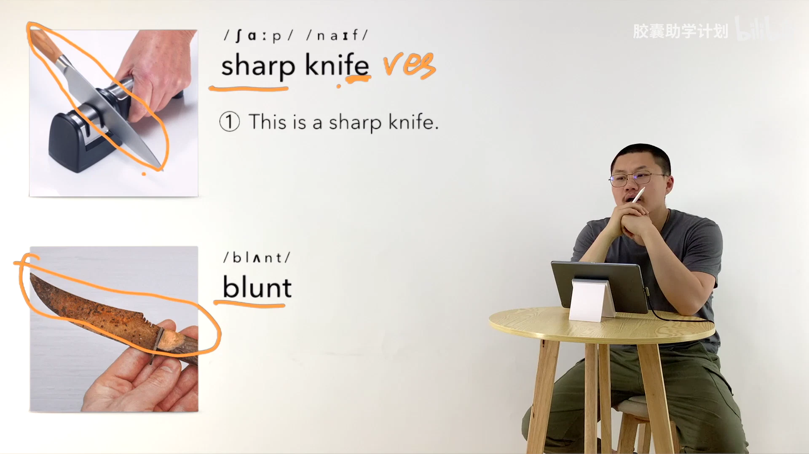

文字识别：胶囊助学计划 / /∫aip/ /naif/ / sharp knife Ve3 / ① This is a sharp knife. / /blant/ / blunt

### 画面 00:03:42

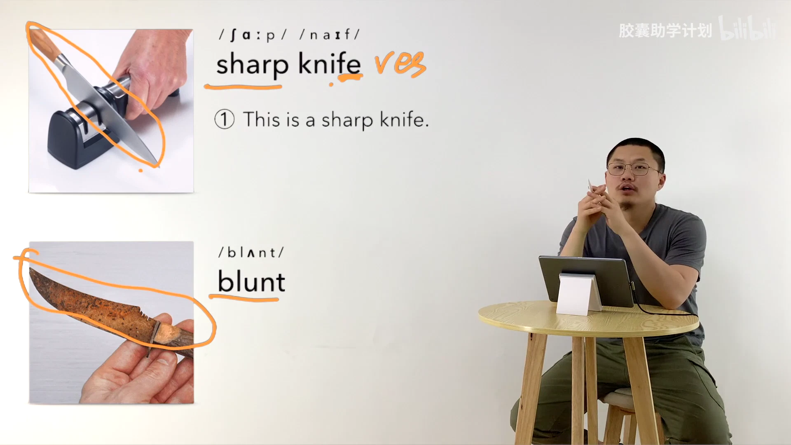

文字识别：胶囊助学计划 / /∫aip/ /naif/ / sharp knife Ves / ) This is a sharp knife. / /blant/ / blunt

### 画面 00:03:48

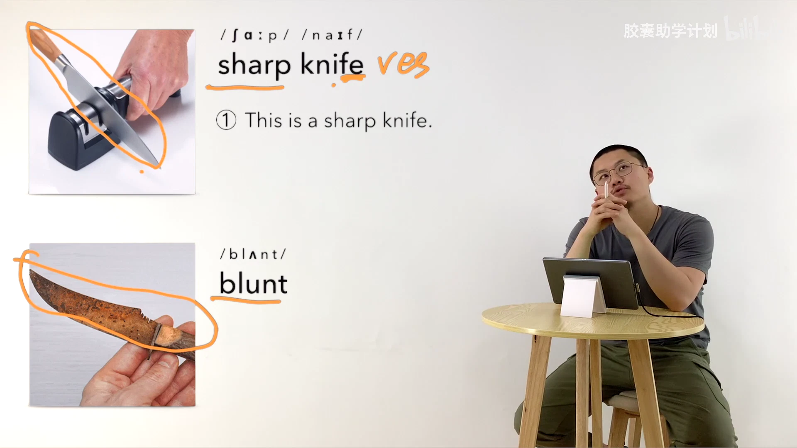

文字识别：胶囊助学计划 / /∫aip/ /naif/ / sharp knife Ve3 / ) This is a sharp knife. / /blant/ / blunt

### 画面 00:03:52

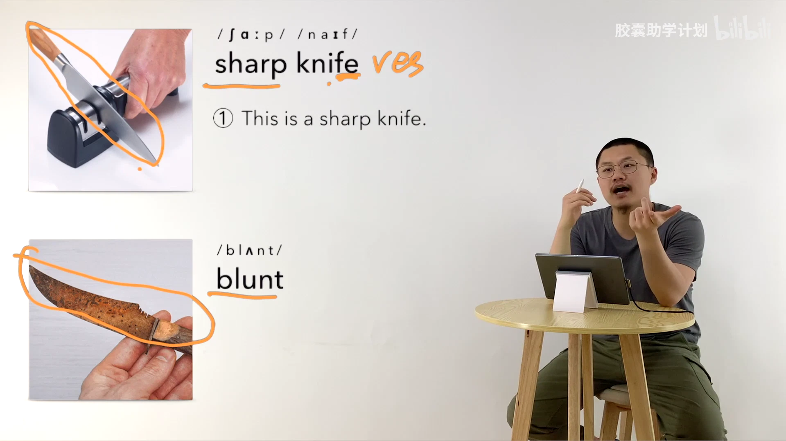

文字识别：胶囊助学计划 / /∫a:p/ /naif/ / sharp knife Ve3 / ) This is a sharp knife. / /blant/ / blunt

### 画面 00:03:56

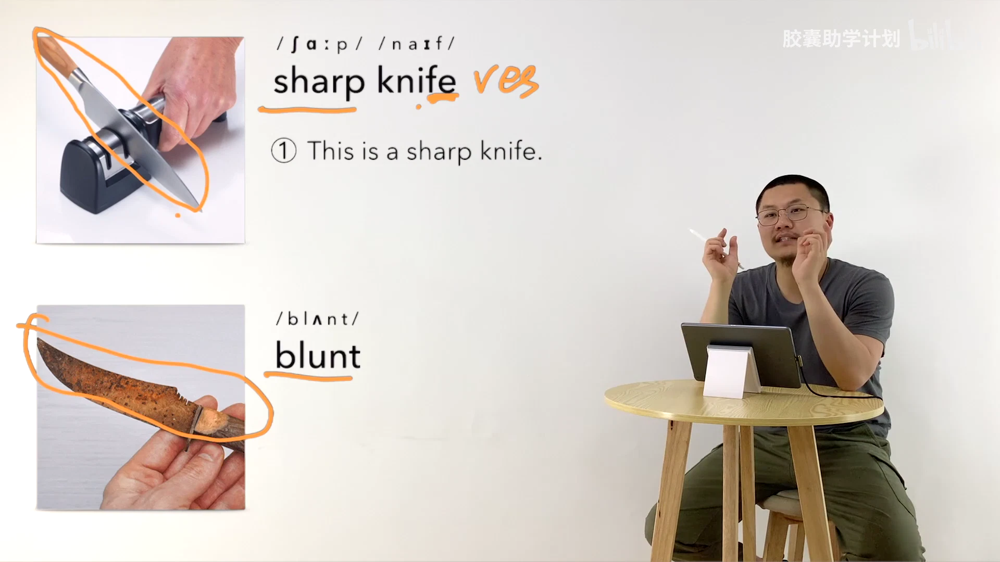

文字识别：胶囊助学计划 / / ∫aip/ /naif/ / sharp knife Ves / ) This is a sharp knife. / /blant/ / blunt

## 00:04:00–00:04:30

sharp. 然后我想把它变成一般疑问句，应该把 is 提前，对不对？ Is this knife sharp? Is this knife sharp? Okay, very good. 句子造出来了，对吧？非常好。那我想说这把刀很钝，叫做 This is a blunt knife. 这是一把很钝的刀。那我现在想问说这把刀钝吗？先说肯定句 This knife is blunt. 肯定句

### 画面 00:04:05

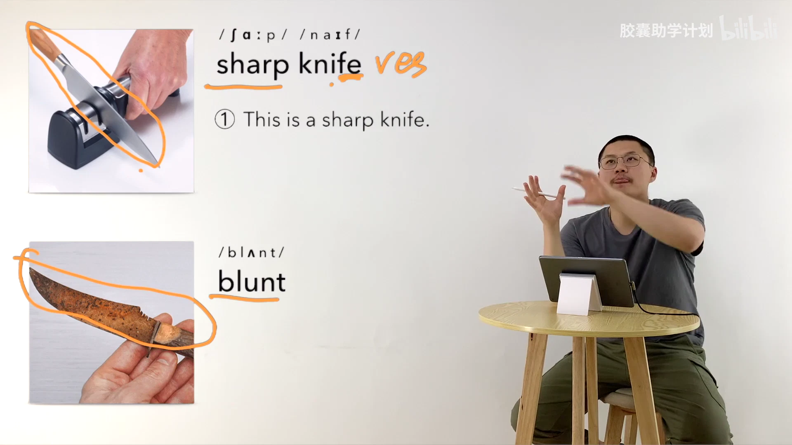

文字识别：胶囊助学计划 / / ∫aip/ /naif/ / sharp knife Ves / This is a sharp knife. / /blant/ / blunt

### 画面 00:04:13

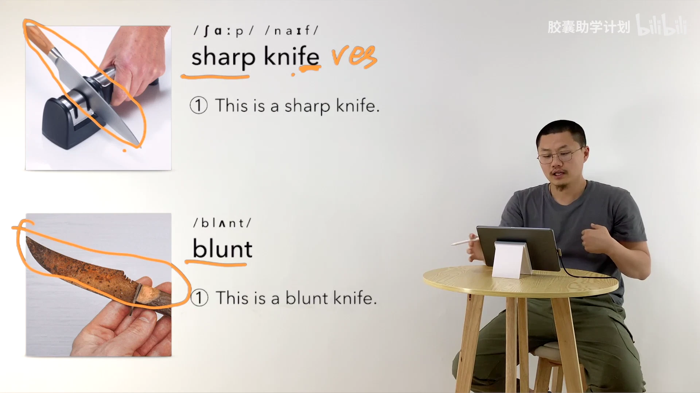

文字识别：胶囊助学计划 / /∫aip/ /naif/ / sharp knife Ve3 / This is a sharp knife. / /blant/ / blunt / This is a blunt knife.

### 画面 00:04:21

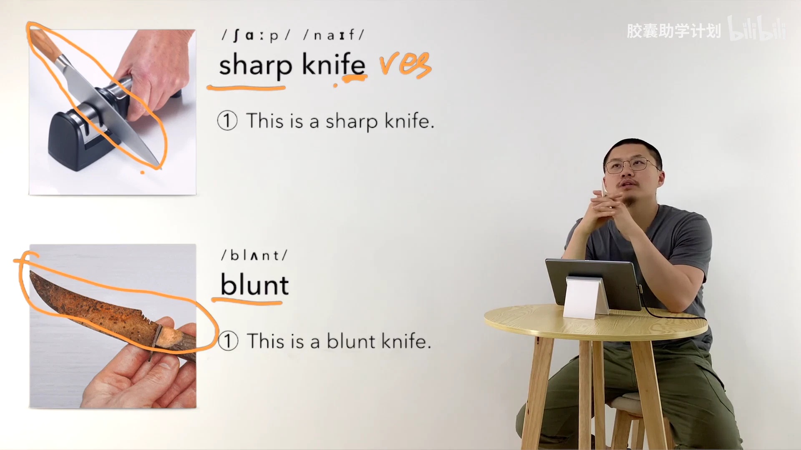

文字识别：胶囊助学计划 / / ∫aip/ /naif/ / sharp knife Ve3 / ) This is a sharp knife. / /blant/ / blunt / This is a blunt knife.

### 画面 00:04:29

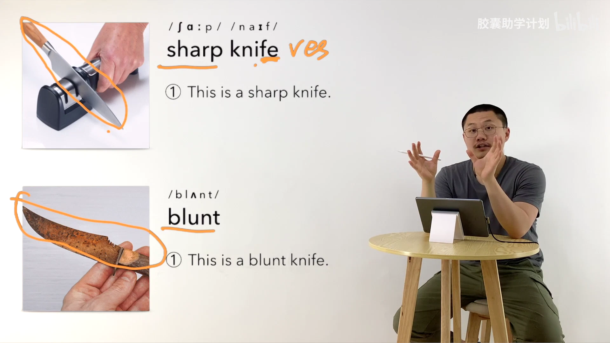

文字识别：胶囊助学计划 / / ∫aip/ /naif/ / sharp knife Ve3 / D This is a sharp knife. / 1 / /blant/ / blunt / ) This is a blunt knife.

## 00:04:30–00:05:00

变一般疑问句is提前is this knife blunt? Very good,就这么简单. Okay, very good. Next one, small, big.我们之前学过了，迅速回顾一下. So this is big and this is small.说is that a dog? Is so small.说哎这是条狗吗？它好小啊. So I am so sorry. Thank you so much.还记得这个

### 画面 00:04:37

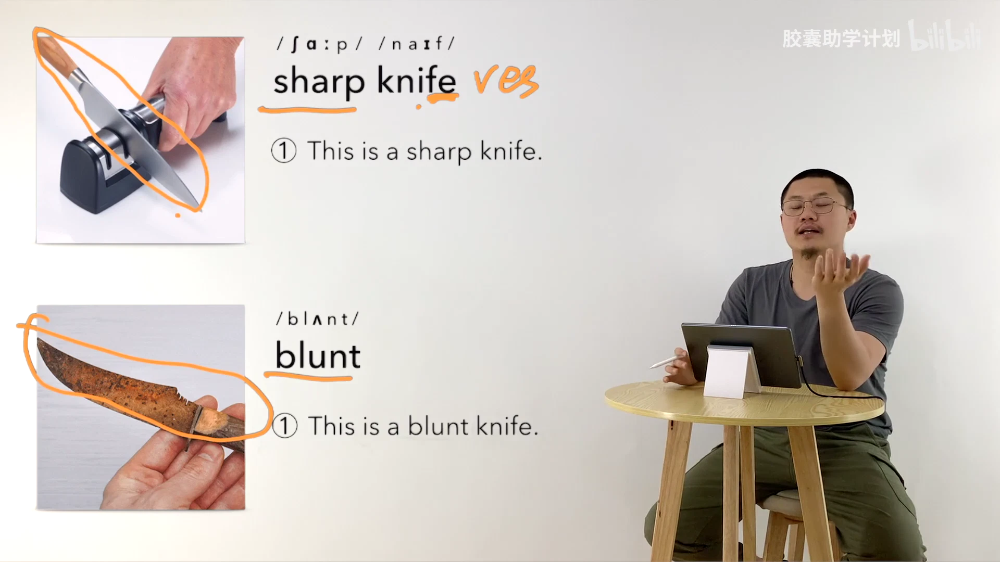

文字识别：胶囊助学计划 / / ∫aip/ /naif/ / sharp knife Ve3 /  This is a sharp knife. / /blant/ / blunt /  This is a blunt knife.

### 画面 00:04:39

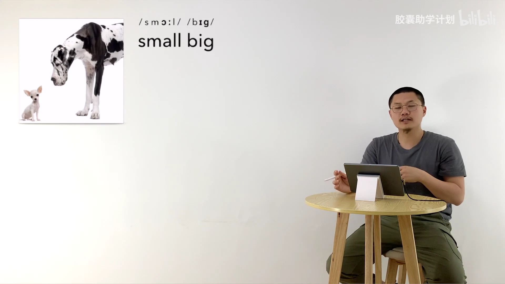

文字识别：/smo:l/ /big/ / 胶囊助学计划 / small big

### 画面 00:04:46

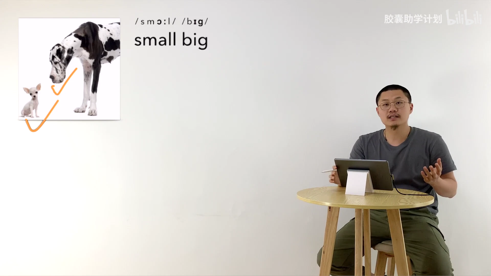

文字识别：/smo:l/ /big/ / 胶囊助学计划 / small big

## 00:05:00–00:05:30

单词so吧？我们之前提过了很多遍了。说Is that a dog? Is so big.说这个狗大到跟一个小马一样大了，对吧？这个猫小到跟一个茶杯啊，这个狗小到跟个茶杯一样了，好小。说那是条狗吗？Is that a dog? Okay,啊，Very good. Next one,跟我一起读box箱子，对吧？Large，不知道各位能不能看清啊？大箱子，小箱子，small中间的那个箱子，刚我们刚刚学

### 画面 00:05:03

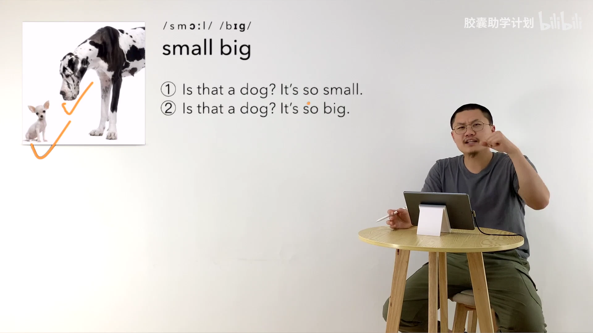

文字识别：胶囊助学计划 / /smo:l/ /big/ / small big / ① Is that a dog? It's so small. / ② Is that a dog? It's so big.

### 画面 00:05:06

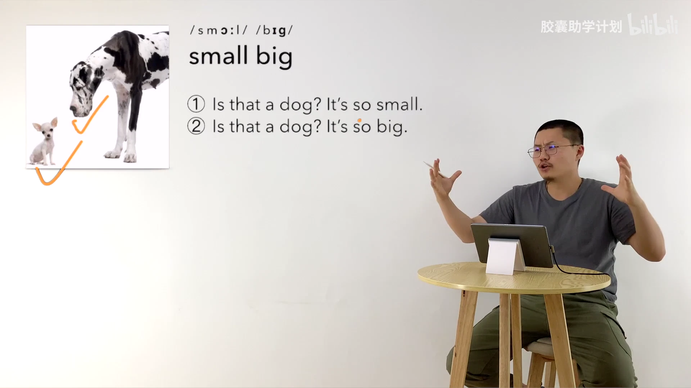

文字识别：/smo:l/ /big/ / 胶囊助学计划 / small big / ① Is that a dog? It's so small. / ② Is that a dog? It's so big.

### 画面 00:05:15

文字识别：/smo:l/ /big/ / 胶囊助学计划 / small big / ① Is that a dog? It's so small. / ② Is that a dog? It's so big.

### 画面 00:05:17

文字识别：胶囊助学计划 / Large / Medium / Small / /boks/ / box

### 画面 00:05:25

文字识别：胶囊助学计划 / Large / pdium / Small / /bpks/ / box

### 画面 00:05:28

文字识别：胶囊助学计划 / Large / diun / Small / /bpks/ / box

## 00:05:30–00:06:00

过的叫做 medium, OK. 好，那 box 是箱子。接下来张嘴跟我去读，repeat after me，跟读啊。 Give me a box, please. Which one? That little one? No, not that little one. This big one. Next one, glass. OK, glass. So this is glass.

### 画面 00:05:30

文字识别：胶囊助学计划 / Large / dium / Small / /boks/ / box

### 画面 00:05:33

文字识别：胶囊助学计划 / Large / Medium / Small / /boks/ / box

### 画面 00:05:46

文字识别：胶囊助学计划 / Large / Medium / Small / /boks/ / box /  Give me a box please. / Which one? That litle one?

### 画面 00:05:54

文字识别：胶囊助学计划 / /gla:s/ / glass

### 画面 00:05:58

文字识别：胶囊助学计划 / /gla:s/ / glass

## 00:06:00–00:06:30

Give me a glass, please.玻璃杯. Which one? That full one.哎，你想要满的那个吗？No, not that full one. This empty one.这个空的. Cup. Give me a cup, please.杯子. Which one? This dirty one.你要这个脏的吗？那一般不会了，对吧？No,

### 画面 00:06:04

文字识别：胶囊助学计划 / /gla:s/ / glass / Give me a glass please. / Which one? That full one?

### 画面 00:06:17

文字识别：胶囊助学计划 / /kΛp/ / cup

### 画面 00:06:26

文字识别：胶囊助学计划 / /kΛp/ / cup / Give me a cup please. / Which one? This dirty one?

## 00:06:30–00:07:00

not this dirty one. That clean one, of course. Next one, bottle,瓶子. Give me a bottle, please. Which one? This large one.要这个大的吗？No, not this large one. That small one. Next one, tin.啊，装这个什么鱼罐头啊，午餐肉啊，那些罐头可以统称为

### 画面 00:06:35

文字识别：胶囊助学计划 / /bpt l/ / bottle

### 画面 00:06:46

文字识别：胶囊助学计划 / /bpt l/ / bottle / Give me a bottle please. / Which one? This large one? / No, not this large one. That small one.

### 画面 00:06:53

文字识别：胶囊助学计划 / /tin/ / tin

### 画面 00:06:56

文字识别：胶囊助学计划 / /tin/ / tin

## 00:07:00–00:07:30

叫 tin 啊。来， give me a tin please. Which one? This new one? No, not this new one. That old one. 我要那个旧的就行了，我不要这个新的。注意 old 它有老的意思，上年龄的意思，也有旧的意思啊。 Next one, knife. 小刀对吧？ Give me a knife please.

### 画面 00:07:00

文字识别：胶囊助学计划 / /tin/ / tin

### 画面 00:07:07

文字识别：胶囊助学计划 / /tin/ / tin / Give me a tin please. / - / Which one? This new one?

### 画面 00:07:10

文字识别：胶囊助学计划 / Q / /tin/ / tin / Give me a tin please. / Which one? This new one? / ) No, not this new one. That old one.

### 画面 00:07:13

文字识别：胶囊助学计划 / Q / /tin/ / tin / Give me a tin please. / Which one? This new one? / ) No, not this new one. That old one.

### 画面 00:07:22

文字识别：胶囊助学计划 / /naif/ / knife

## 00:07:30–00:08:00

Which one? That blunt one? No, not that blunt one. This sharp one. Fork. So, what is this? What is this? This is knife. This is a fork, and this is a spoon. So, fork. Okay.

### 画面 00:07:30

文字识别：胶囊助学计划 / /naif/ / knife / Give me a knife please. / Which one? That blunt one?

### 画面 00:07:41

文字识别：胶囊助学计划 / /fo:k/ / fork

### 画面 00:07:46

文字识别：胶囊助学计划 / /fo:k/ / fork

### 画面 00:07:54

文字识别：胶囊助学计划 / /fo:k/ / fork

### 画面 00:07:58

文字识别：胶囊助学计划 / /fo:k/ / fork

## 00:08:00–00:08:30

Come, give me a fork, please. Which one? That small one? No, not that small one. This large one. Continue. Spoon. Give me a spoon, please. Which one? This new one? No, not this new one. That old one. Very good. Good. Recap.简单复习一下，我们基本

### 画面 00:08:03

文字识别：胶囊助学计划 / /fo:k/ / fork / Give me a fork please. / Which one? That small one?

### 画面 00:08:10

文字识别：胶囊助学计划 / /spu:n/ / spoon

### 画面 00:08:18

文字识别：胶囊助学计划 / /spu:n/ / spoon / Give me a spoon please. / Which one? This new one?

### 画面 00:08:25

文字识别：胶囊助学计划 / Recap / Patterns / give sb. sth. / Grammar / sharp&blunt / knife / Words / fork / spoon / Expression

## 00:08:30–00:09:00

上还是练习了 give somebody something，在二十一课刚刚学过的这个关键的句型或者说关键的语法。其次呢，sharp blunt是对应的一对词组，对吧？叫做锋利的和钝的。那我们这个桌子上常用的一些 knife 小刀啊，就是尤其是在西餐当中常用的 fork 刀子和 spoon 叫做勺子，对吧？那比如说您去吃西餐去国外，说

### 画面 00:08:30

文字识别：胶囊助学计划 / Recap / Patterns / give sb. sth. / Grammar / sharp&blunt / knife / Words / fork / spoon / Expression

### 画面 00:08:59

文字识别：Recap / 胶囊助学计划 / Patterns / give sb. sth. / Grammar / sharp&blunt / knife / Words / fork / spoon / Expression

## 00:09:00–00:09:30

能给我来一个叉子吗？叫做 Can you give me a fork？那 Can you 我们还没学，但 Give me a fork please，您已经会了，对不对？好，那我们看一下今天家作业，绿皮书二十二课写作练习，各位可以进行了，给自己讲解一遍今天的核心知识点。这个是我们老生常谈的作业。那本期的视频呢，到这儿就结束了。如果大家欢喜欢我们的视频呢，欢迎大家订阅、关注啊，一键三连支持我

### 画面 00:09:11

文字识别：胶囊助学计划

### 画面 00:09:16

文字识别：胶囊助学计划 / 绿皮书第22课的写作练习 / 请给自己讲解一遍今天的 / 核心知识点

### 画面 00:09:21

文字识别：胶囊助学计划

## 00:09:30–00:09:58

并转发给那些需要的朋友。那最后的最后呢，我们再来一句名人名言：Education's purpose is to replace an empty mind with an open one. See you next time.

### 画面 00:09:32

文字识别：胶囊助学计划 / Education's purpose is to replace an / empty mind with an open one. /  Malcolm Forbes

### 画面 00:09:45

文字识别：胶囊助学计划 / Education's purpose is to replace an / empty mind with an open one. / - Malcolm Forbes

### 画面 00:09:47

文字识别：CAPSULEACADEMY / 胶囊学院 / 小红书 / Lecturer / □ / 口 / Leo

### 画面 00:09:50

文字识别：CAPSULEACADEMY / 胶囊学院 / 小红书 / Photographer / Berlin

### 画面 00:09:52

文字识别：CAPSULEACADEMY / 胶囊学院 / 小红书 / Editor / □ / Berlin

### 画面 00:09:55

文字识别：CAPSULEACADEMY / 胶囊学院 / 小红书

### 画面 00:09:57

文字识别：bilibili / 胶囊助学计划

### 画面 00:09:58

文字识别：bilibili / 胶囊助学计划

