# 025 文章

快速机器解析：语音为单模型转写，未进行独立交叉校对或人工复核；画面每秒采样并按变化选帧，短时文字和标记可能遗漏。截图时间约有 1 秒误差。图片有损压缩；遇到疑点请按时间查看 Google Drive 原视频。

## 00:00:00–00:00:30

Hello everyone, welcome to Capsule Academy. This is Leo. Today we are going to learn New Concept English Book One Lesson Twenty Five Story. Hope you guys enjoy it.好，那上来呢，我们直接进入文章。我们首先看到啊，给大家现在提供的这幅图呢，是 Mrs. Miss Kitchen 啊，是史密斯夫人的厨房。所以，我们看第一句话，它叫做 Mrs.

### 画面 00:00:00

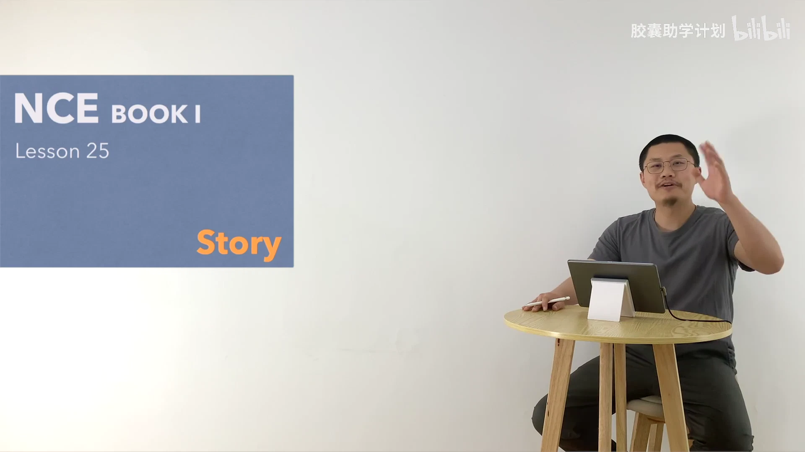

文字识别：bitbii / 胶囊助学计划 / NCE / BOOKI / Lesson 25 / Story

### 画面 00:00:08

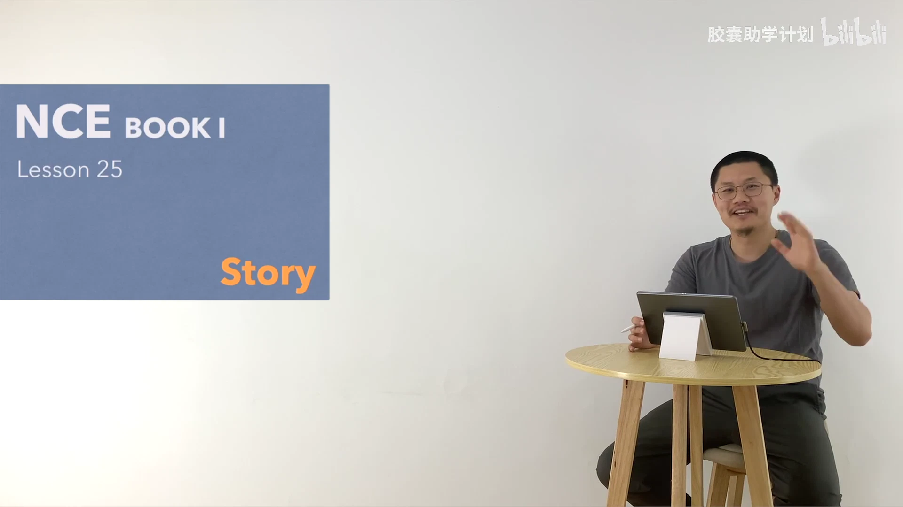

文字识别：bibii / 胶囊助学计划 / NCE / BOOKI / Lesson 25 / Story

### 画面 00:00:10

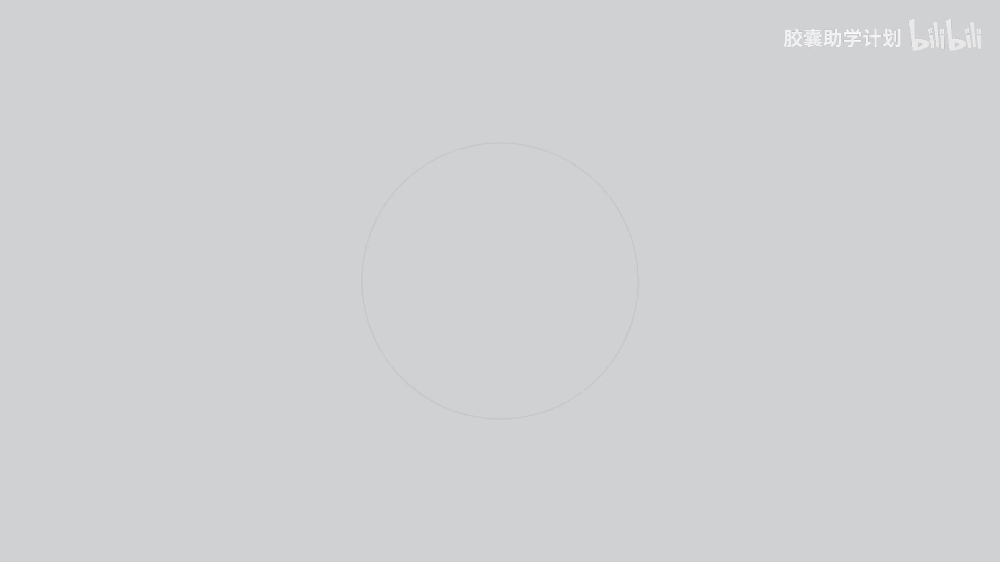

文字识别：胶囊助学计划 bii

### 画面 00:00:13

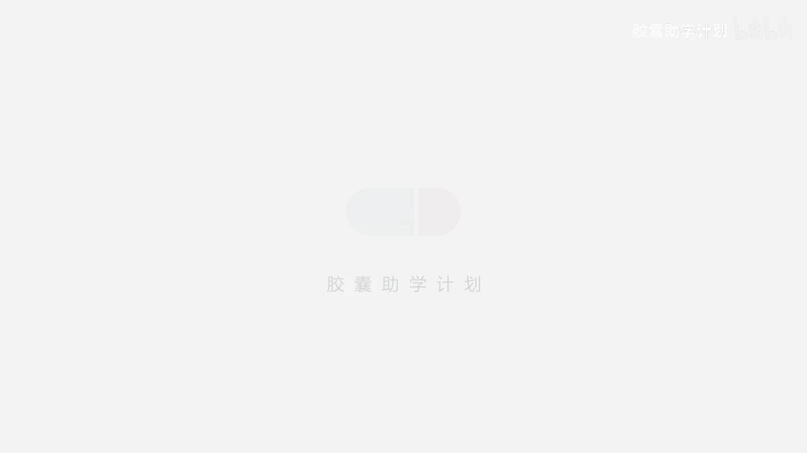

文字识别：喜助学计划州 / 胶囊助学计划

### 画面 00:00:15

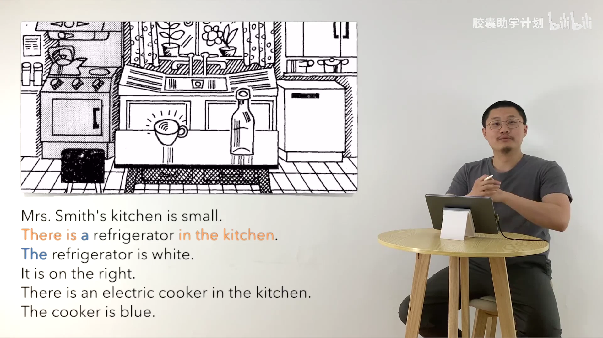

文字识别：胶囊助学计划i出 / 回川 / Mrs. Smith's kitchen is small. / There is a refrigerator in the kitchen. / The refrigerator is white. / It is on the right. / There is an electric cooker in the kitchen. / The cooker is blue.

### 画面 00:00:19

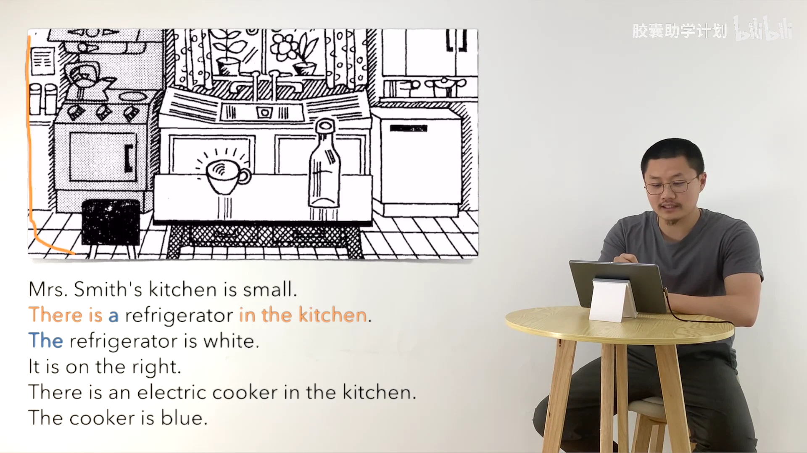

文字识别：胶囊助学计划l业 / 回川 / Mrs. Smith's kitchen is small. / There is a refrigerator in the kitchen. / The refrigerator is white. / It is on the right. / There is an electric cooker in the kitchen. / The cooker is blue.

### 画面 00:00:21

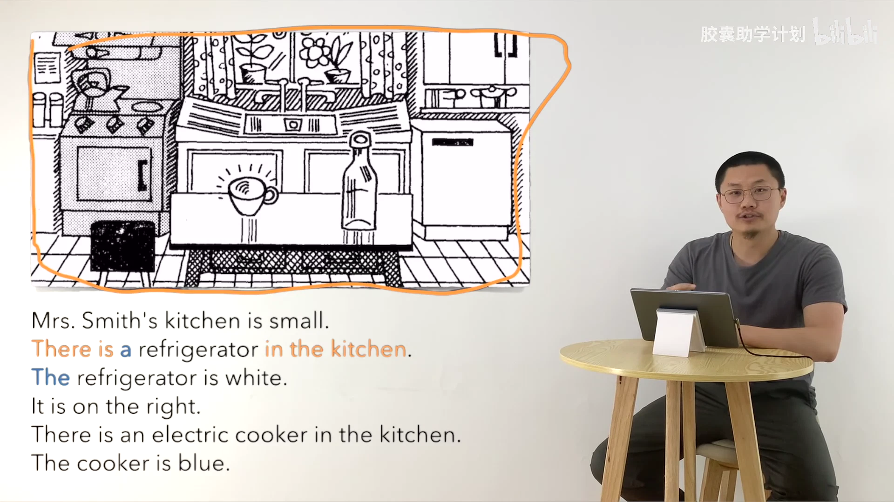

文字识别：胶囊助学计划册 / 回川 / Mrs. Smith's kitchen is small. / There is a refrigerator in the kitchen. / The refrigerator is white. / It is on the right. / There is an electric cooker in the kitchen. / The cooker is blue.

## 00:00:30–00:01:00

Miss' s 表示的对吧？表示的是他的厨房怎么样呢？Is small. 它的厨房非常的小。那我现在想一下肯定句给各位了，这也是我们之前提到的对吧？说您文章熟读成诵即可，千万不要花百分之百的时间背诵文章。为什么呢？这句话我们立刻可以再多变出两句话来，叫做 Mrs. Miss' kitchen is not small 和 Is

### 画面 00:00:32

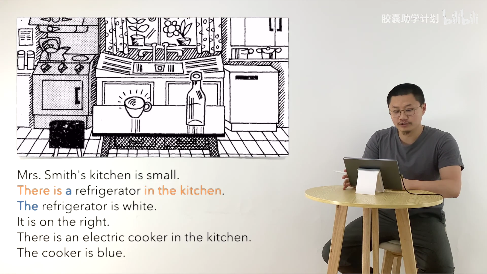

文字识别：胶囊助学计划 ill / 回川 / Mrs. Smith's kitchen is small. / There is a refrigerator in the kitchen. / The refrigerator is white. / It is on the right. / There is an electric cooker in the kitchen. / The cooker is blue.

## 00:01:00–00:01:30

Mrs. Miss Kitchen small?也就是说，您实际上如果把这句话记会了，您应该同时再把剩下两句话也变出来，对吧？我们不只拿一句话，我们要拿三句话。它的厨房很小。接下来，There is哎，非常的好，出现了什么呢？出现了我们上一个视频刚刚学过的叫There be句型，叫做有有一个refrigerator冰箱in the kitchen在厨房当中，这个

### 画面 00:01:02

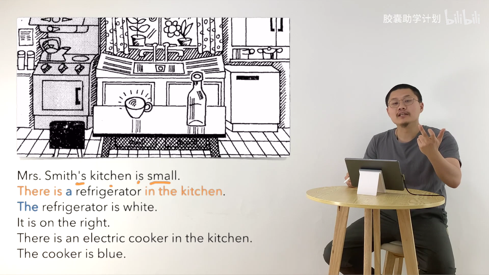

文字识别：胶囊助学计划ii / 回川 / Mrs. Smith's kitchen is small. / There is a refrigerator in the kitchen. / The refrigerator is white. / It is on the right. / There is an electric cooker in the kitchen. / The cooker is blue.

## 00:01:30–00:02:00

小的短语我们之前有学过。那这是一个肯定句，我想把它变成否定句怎么办呢？There is not a refrigerator in the kitchen，或者是一般疑问句叫做 Is there a refrigerator in the kitchen？ Okay，来一个好。那注意我们把 a 标蓝了，和下一句话当中的 the 也标蓝了。这是我们今天要学的一个小的语法。我们先看一下下句话什么意思，叫做 The

### 画面 00:01:32

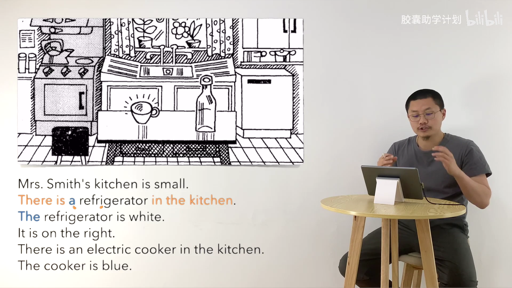

文字识别：胶囊助学计划bi出 / 回川 / Mrs. Smith's kitchen is small. / There is a refrigerator in the kitchen. / The refrigerator is white. / It is on the right. / There is an electric cooker in the kitchen. / The cooker is blue.

## 00:02:00–00:02:30

refrigerator is white. 说这个冰箱啊是白色的。注意，我们把这两句话连在一起，其实这个语法就明白了。很简单的两个小单词，说厨房当中有一个冰箱，而这个冰箱就是我刚刚跟您说有一个冰箱的这一个冰箱，它是白色的。所以 a an 呢，实际上和 the 有一个用法，所谓的叫做泛

### 画面 00:02:02

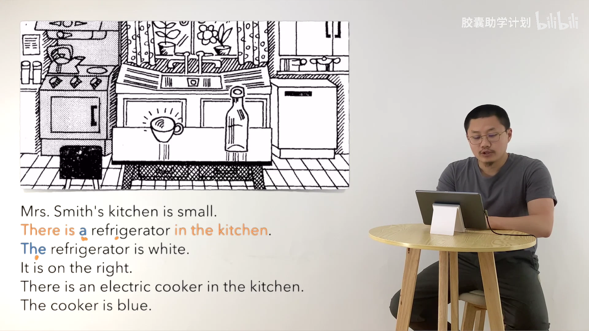

文字识别：胶囊助学计划 bili / 回川 / Mrs. Smith's kitchen is small. / There is a refrigerator in the kitchen. / The refrigerator is white. / It is on the right. / There is an electric cooker in the kitchen. / The cooker is blue.

### 画面 00:02:25

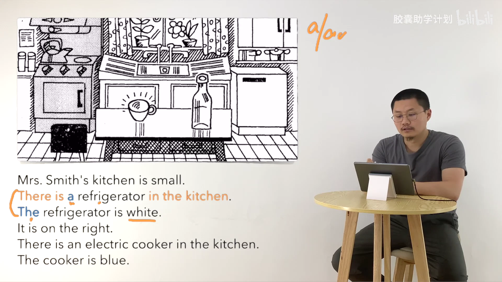

文字识别：aov / 胶囊助学计划Hl / 回川 / Mrs. Smith's kitchen is small. / There is a refrigerator in the kitchen. / CThe refrigerator is white. / It is on the right. / There is an electric cooker in the kitchen. / The cooker is blue.

### 画面 00:02:29

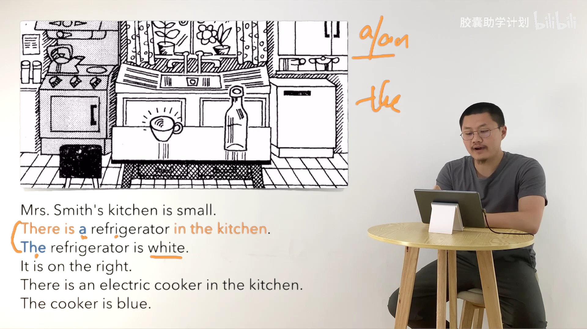

文字识别：aan / 胶囊助学计划l / 回川 / the / Mrs. Smith's kitchen is small. / There is a refrigerator in the kitchen. / CThe refrigerator is white. / It is on the right. / There is an electric cooker in the kitchen. / The cooker is blue.

## 00:02:30–00:03:00

指用 a an 特指用 the 有这么一个东西，您可以选择用 a 和 an 说完这个东西之后，大家都知道这个东西是哪个东西了。然后您接下来再描述它就不用说 a 了，不是说有这么一个了，说的就是这一个就是 the 哎 OK，所以他说这一个冰箱是白色的。接着往下看，说 it is on the right，说呀这个冰箱啊是 on the right，在右侧的，那就是 this one OK

### 画面 00:02:56

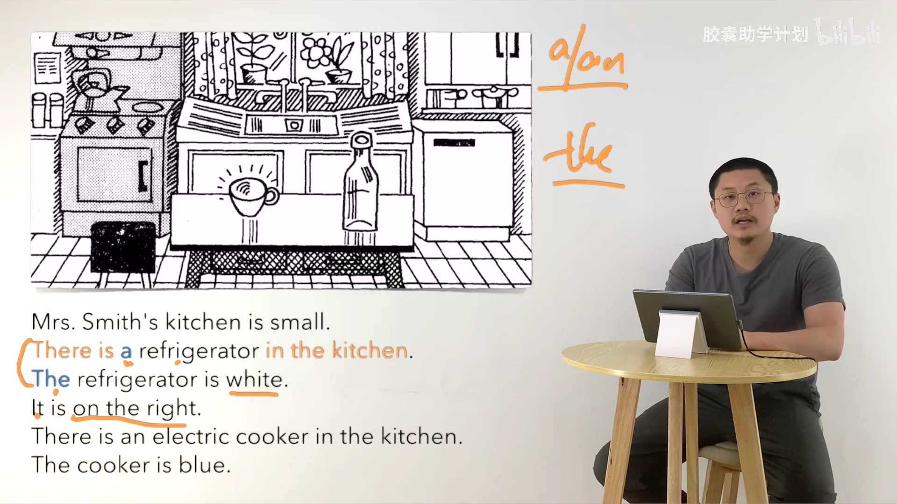

文字识别：aon / 胶囊助学计划l / 回川 / thu / Mrs. Smith's kitchen is small. / There is a refrigerator in the kitchen. / CThe refrigerator is white. / It is on the right. / There is an electric cooker in the kitchen. / The cooker is blue.

### 画面 00:02:59

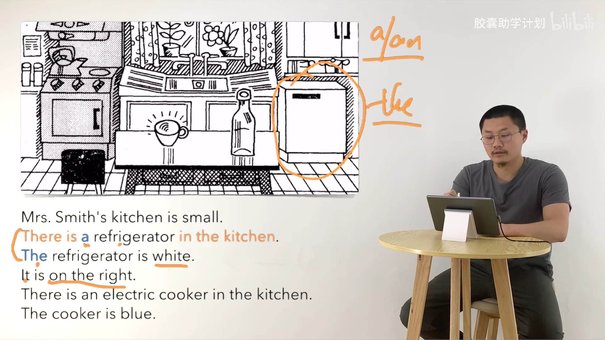

文字识别：aon / 胶囊助学计划 / 回川 / tue / Mrs. Smith's kitchen is small. / There is a refrigerator in the kitchen. / CThe refrigerator is white. / It is on the right. / There is an electric cooker in the kitchen. / The cooker is blue.

## 00:03:00–00:03:30

this one，白色的冰箱。继续往下看，接下来还会出现刚刚说到的这个 a an 与 the 的这个对比。我们接着往下看啊，说 there is 又是 there be 句型，有 an electric cooker，有这么一个叫做带电的炉子，这儿呢， OK， in the kitchen，在厨房当中有某物在某地，there be 句型的一个句式，各位要记下来。注意他说的是有这么一个 an，对吧？泛指，特

### 画面 00:03:07

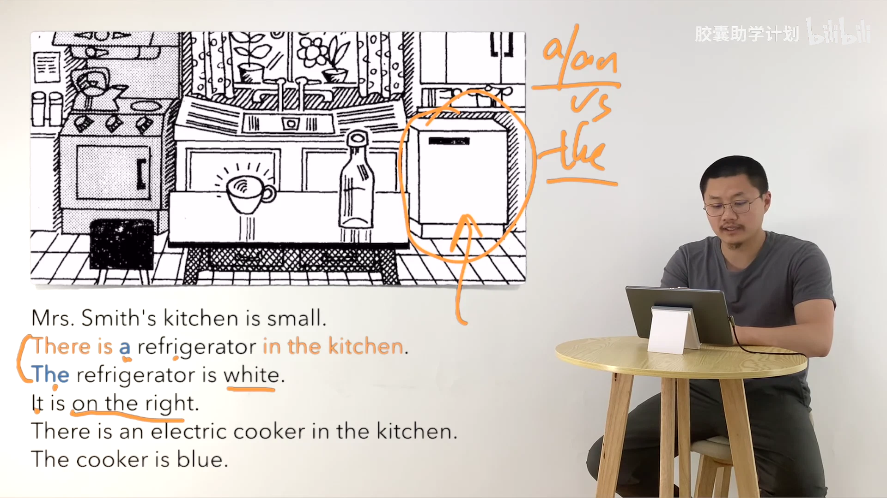

文字识别：胶囊助学计划 / aan / VS / 回川 / tle / Mrs. Smith's kitchen is small. / There is a refrigerator in the kitchen. / CThe refrigerator is white. / It is on the right. / There is an electric cooker in the kitchen. / The cooker is blue.

### 画面 00:03:13

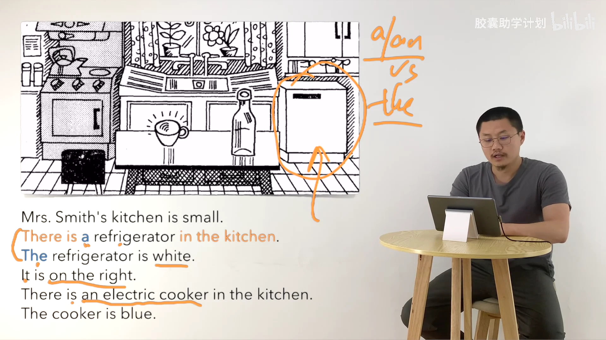

文字识别：an / 胶囊助学计划bi / VS / 回川 / the / Mrs. Smith's kitchen is small. / There is a refrigerator in the kitchen. / CThe refrigerator is white. / It is on the right. / There is an electric cooker in the kitchen. / The cooker is blue.

### 画面 00:03:17

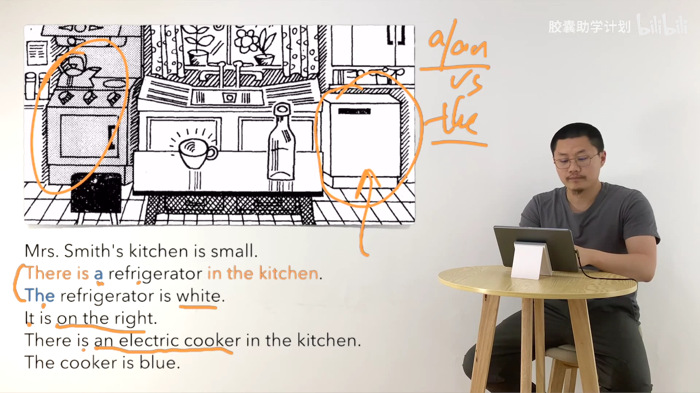

文字识别：胶囊助学计划i / aan / VS / 回川 / tle / Mrs. Smith's kitchen is small. / There is a refrigerator in the kitchen. / CThe refrigerator is white. / It is on the right. / There is an electric cooker in the kitchen. / The cooker is blue.

## 00:03:30–00:04:00

特指说这个 cooker 是蓝色的。注意有这么一个，然后刚才我说的这个是什么样呢？用的就是 the，对不对？好，接着往下走，说 it is on the left，说它呀是在右手边。On the left, on the right 是我们在讲单词的时候给大家举过了，对吧？所以 on the left, this one. There is a

### 画面 00:03:31

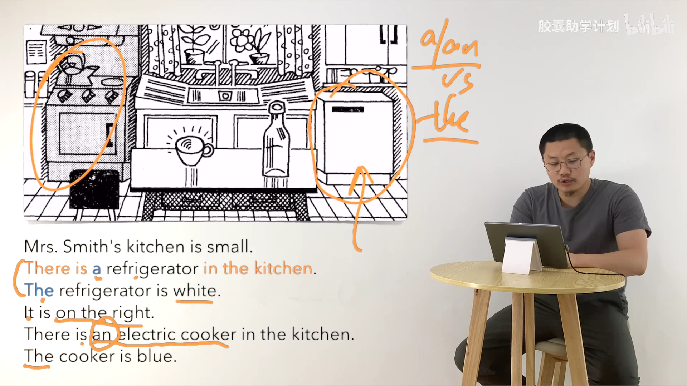

文字识别：胶囊助学计划 / aan / VS / 回川 / Mrs. Smith's kitchen is small. / There is a refrigerator in the kitchen. / CThe refrigerator is white. / It is on the right. / There is an Electric cooker in the kitchen. / The cooker is blue.

### 画面 00:03:41

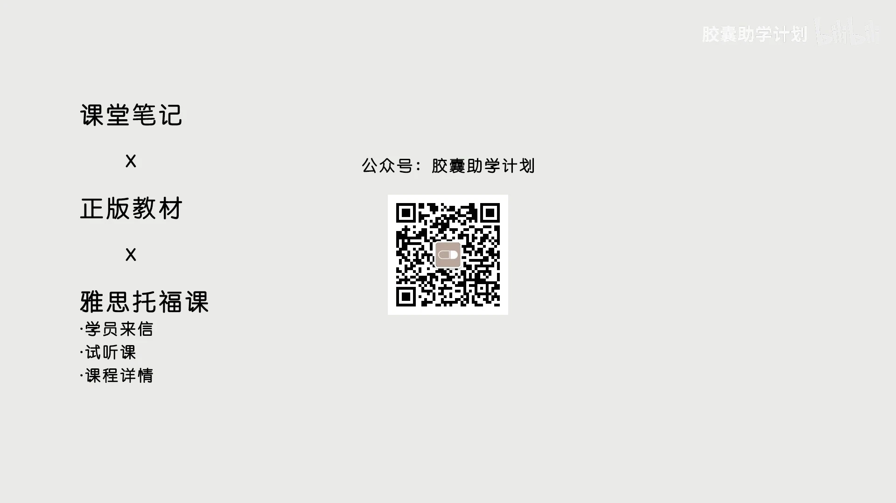

文字识别：胶囊助学计划 / 课堂笔记 / X / 公众号：胶囊助学计划 / 正版教材 / X / 雅思托福课 / ·学员来信 / ·试听课 / ·课程详情

### 画面 00:03:44

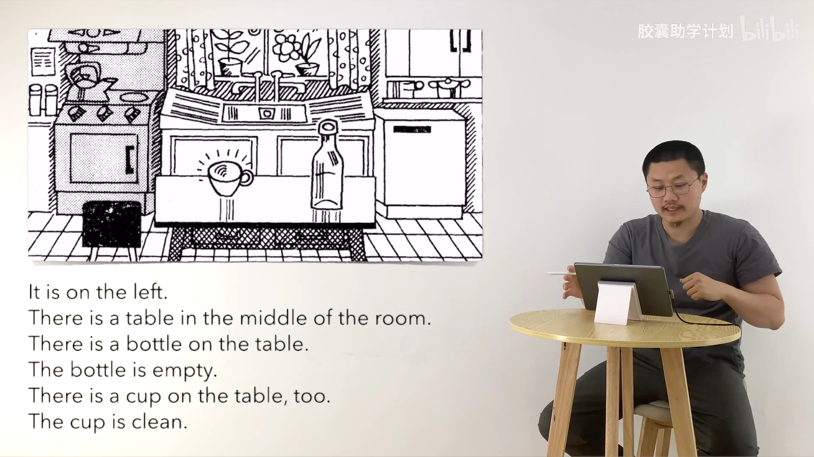

文字识别：胶囊助学计划l / 回川 / It is on the left. / There is a table in the middle of the room. / There is a bottle on the table. / The bottle is empty. / There is a cup on the table, too. / The cup is clean.

### 画面 00:03:56

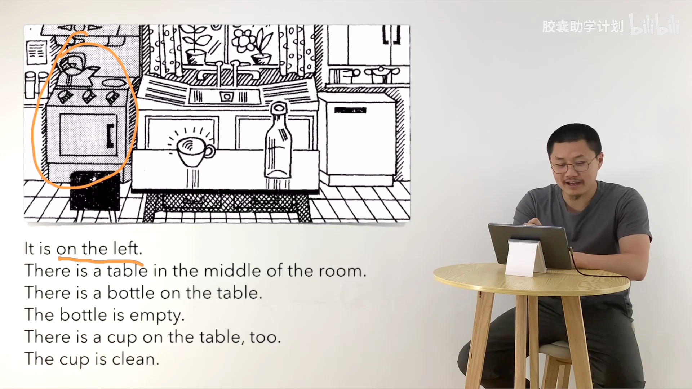

文字识别：胶囊助学计划 / 回川 / It is on the left. / There is a table in the middle of the room. / There is a bottle on the table. / The bottle is empty. / There is a cup on the table, too. / The cup is clean.

## 00:04:00–00:04:30

table. This is a table,是吧？这是一个桌子。In the middle of the room, a of b结构，不知道各位还记不记得？我们由后往前翻译，对不对？说房间的中间这个小的短语，各位要记下来。There is a bottle, a bottle on the table. 在这个桌子上，The bottle is empty. 说这个瓶子

### 画面 00:04:01

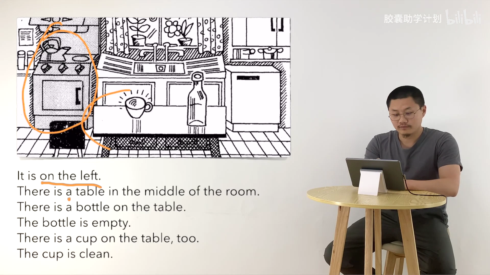

文字识别：胶囊助学计划l / 回川 / It is on the left. / There is a table in the middle of the room. / There is a bottle on the table. / The bottle is empty. / There is a cup on the table, too. / The cup is clean.

### 画面 00:04:03

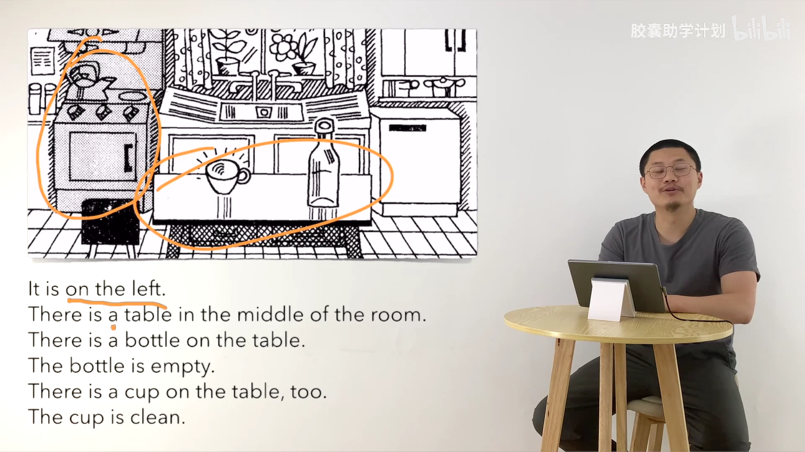

文字识别：胶囊助学计划il / 回川 / It is on the left. / There is a table in the middle of the room. / There is a bottle on the table. / The bottle is empty. / There is a cup on the table, too. / The cup is clean.

### 画面 00:04:07

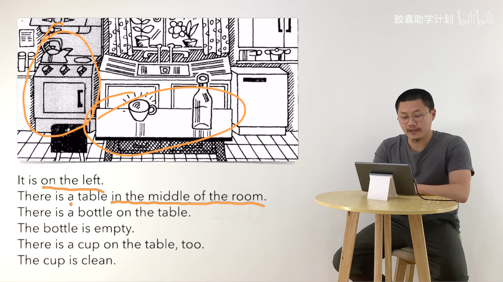

文字识别：胶囊助学计划l / 回川 / It is on the left. / There is a table in the middle of the room. / There is a bottle on the table. / The bottle is empty. / There is a cup on the table, too. / The cup is clean.

### 画面 00:04:10

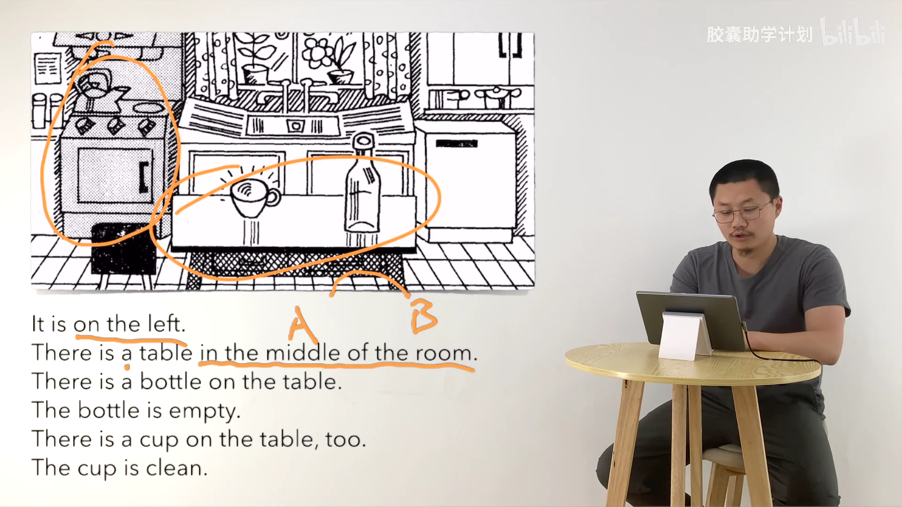

文字识别：胶囊助学计划l / 回川 / It is on the left. / There is a table in the middle of the room. / There is a bottle on the table. / The bottle is empty. / There is a cup on the table, too. / The cup is clean.

### 画面 00:04:17

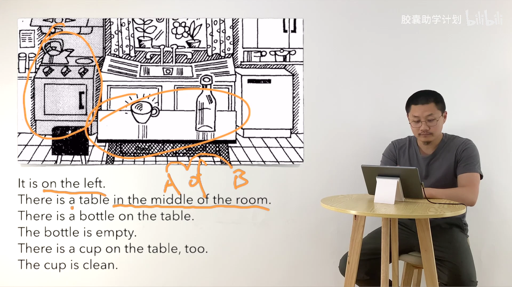

文字识别：胶囊助学计划l / 回川 / It is on the left. / There is a table in the middle of the room. / There is a bottle on the table. / The bottle is empty. / There is a cup on the table, too. / The cup is clean.

### 画面 00:04:21

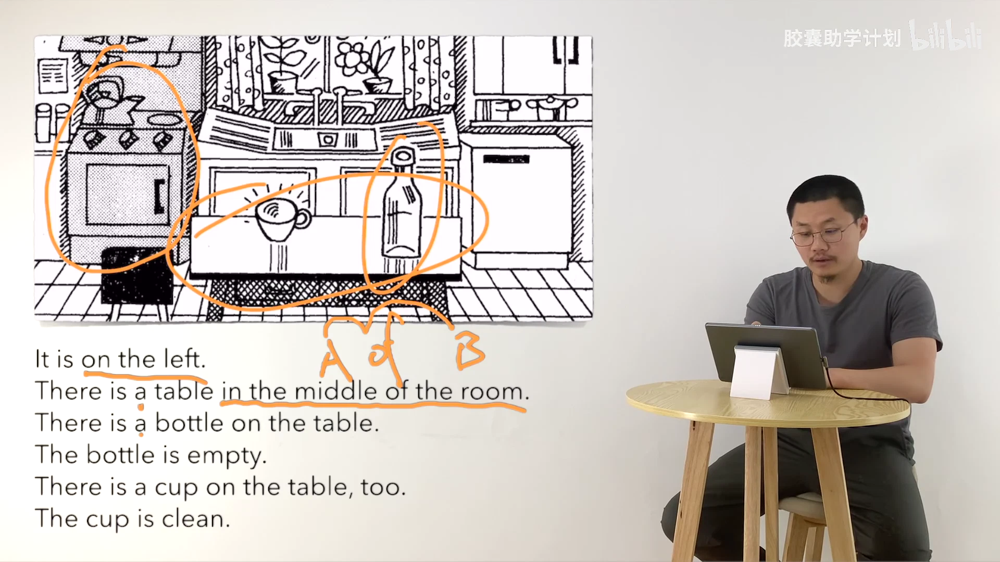

文字识别：胶囊助学计划i / 回川 / B / It is on the left. / Ad / There is a table in the middle of the room. / There is a bottle on the table. / The bottle is empty. / There is a cup on the table, too. / The cup is clean.

## 00:04:30–00:05:00

是空的，对吧？有一个瓶子和这个瓶子，哎，各位自己去想啊，是空的。说 There is a cup on the table too 啊，也 me too，是吧？我们之前学过一个小单词， This is a cup. The cup is clean. 说这个刚才我提到的这个杯子是干净的，is clean. 那我们想一下啊， The cup is clean. 确定句，您至少能变出来

### 画面 00:04:41

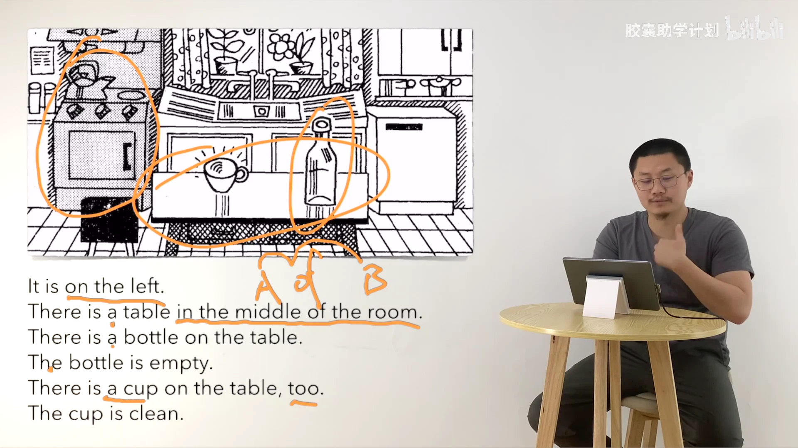

文字识别：胶囊助学计划l / 回川 / B / Ad / It is on the left. / There is a table in the middle of the room. / There is a bottle on the table. / The bottle is empty. / There is a cup on the table, too. / The cup is clean.

### 画面 00:04:43

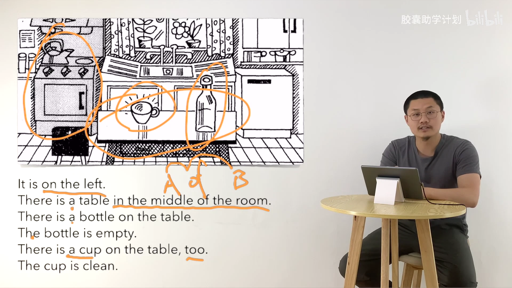

文字识别：胶囊助学计划i / 回川 / B / Ad / It is on the left. / There is a table in the middle of the room. / There is a bottle on the table. / The bottle is empty. / There is a cup on the table, too. / The cup is clean.

## 00:05:00–00:05:30

的叫做否定句、一般疑问句，对吧？然后这句话不是很容易问特殊疑问句，但是我可以问一句话叫做，比如说它是什么颜色的呀？它是谁的呀？Whose，对吧？它在什么地方啊？Where，对吧？好，接着往下看，接下来呢，那我们要做的是一个 comprehension 的练习，各位注意啊，呃，老习惯，各位眼睛看着文章进行口语和

### 画面 00:05:05

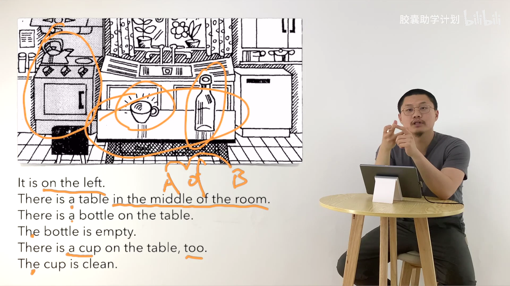

文字识别：胶囊助学计划H / 回川 / B / Ad / It is on the left. / There is a table in the middle of the room. / There is a bottle on the table. / The bottle is empty. / There is a cup on the table, too. / The cup is clean.

### 画面 00:05:17

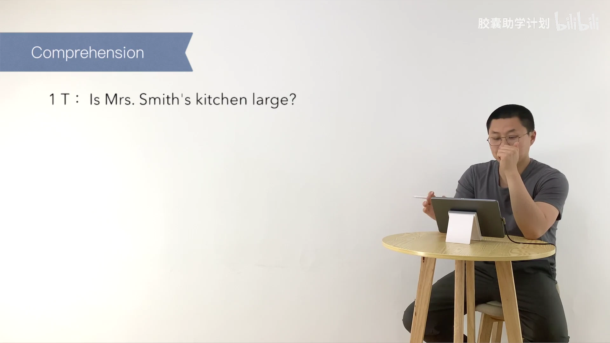

文字识别： bitbil / 胶囊助学计划 / Comprehension / 1 T:Is Mrs. Smith's kitchen large?

## 00:05:30–00:06:00

听力的练习，各位听完了之后张嘴去跟我进行对答。问题来了，第一个，Is Mrs. Smith' kitchen large? Large, small? No, it isn't. Next one, Is Mrs. Smith' kitchen small? 第一句话就说了，对吧？Yes, it is. Next one, Is

### 画面 00:05:47

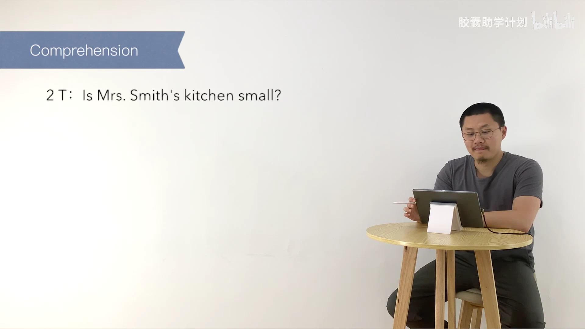

文字识别：胶囊助学计划iHL鼎 / Comprehension / 2 T: Is Mrs. Smith's kitchen small? / 2

## 00:06:00–00:06:30

there a refrigerator in the kitchen? Yes, there is. Continue. What color is the refrigerator? White. Continue. Where is the refrigerator? Think about it. On the right, right? In his kitchen on the right. Continue.

### 画面 00:06:17

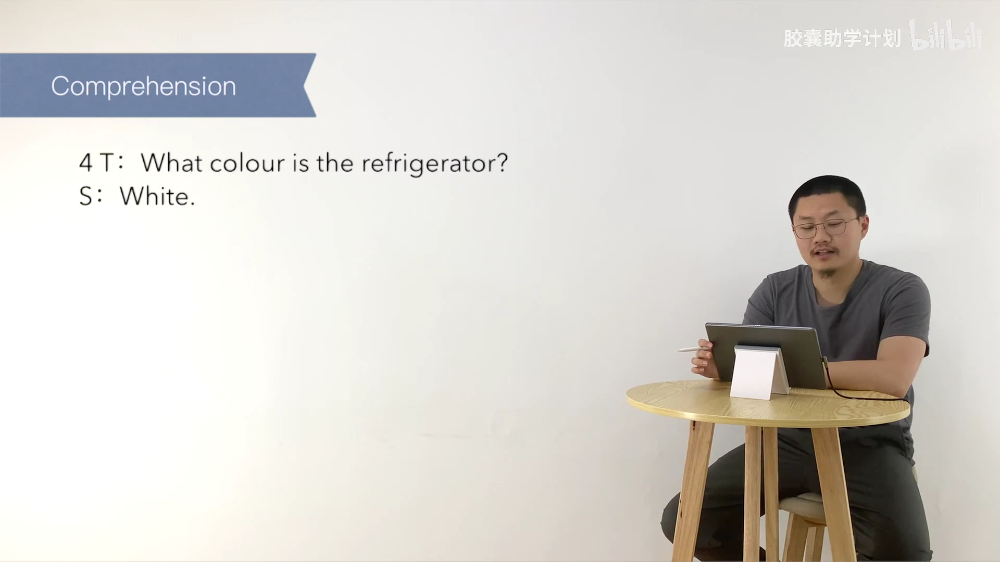

文字识别：u bilibii / 胶囊助学计划 / Comprehension / 4 T: What colour is the refrigerator? / S: White.

## 00:06:30–00:07:00

is there a stereo in the kitchen?还是啊，我要看屏幕啊，我们这是听力练习啊。No, there isn't.啊，哪怕各位可以回来多听几遍，对不对？继续，What color is the electric cooker? Blue. Next one, where is the cooker?

### 画面 00:06:36

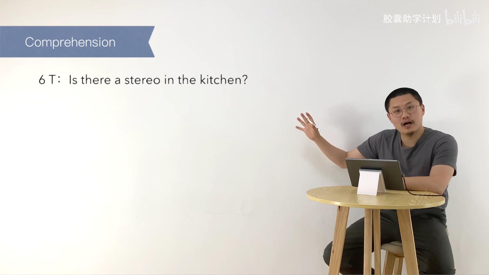

文字识别：胶囊助学计划H出 / Comprehension / 6 T: Is there a stereo in the kitchen?

### 画面 00:06:45

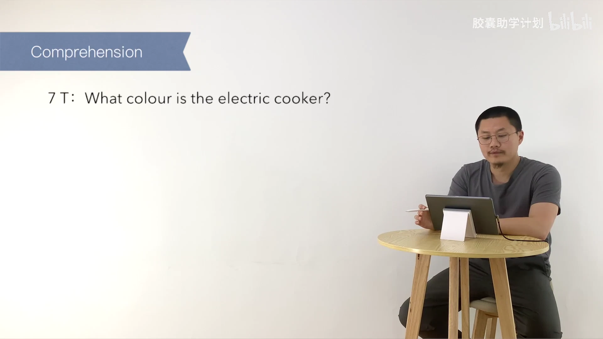

文字识别：u bitbil / 胶囊助学计划 / Comprehension / 7 T: What colour is the electric cooker?

## 00:07:00–00:07:30

On the left. Next one. Is there a table in the kitchen? Think, think. Yes, there is. 是的，那里有。 Next one. Where is the table? Titanic号，想一下。 In the middle of the room. Okay, very good. 好，接下来下一个练习 asking questions. 我们要做的事情是听听到一句肯定句，把它变成一

### 画面 00:07:15

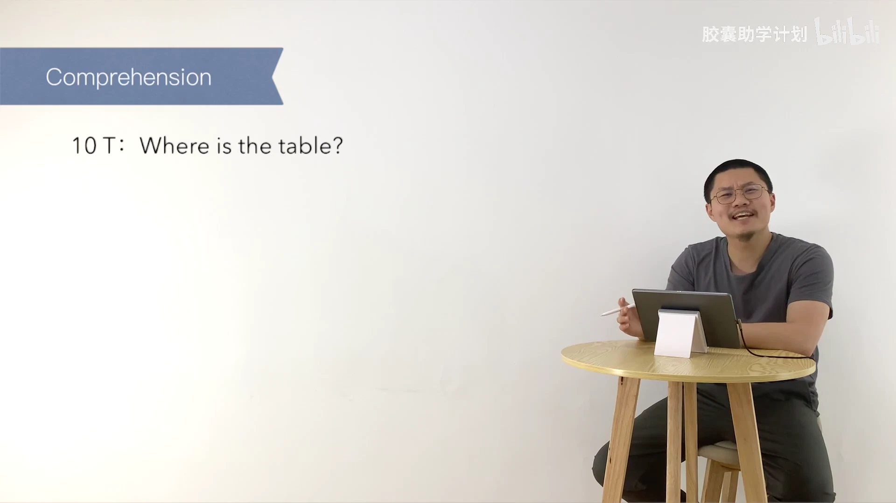

文字识别：胶囊助学计划LlLi / Comprehension / 10 T: Where is the table?

### 画面 00:07:18

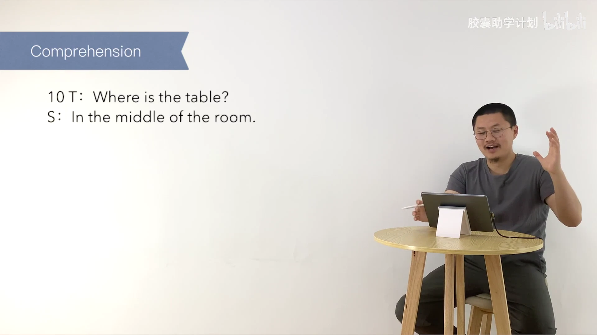

文字识别：胶囊助学计划H / Comprehension / 10T: Where is the table? / S: In the middle of the room.

### 画面 00:07:23

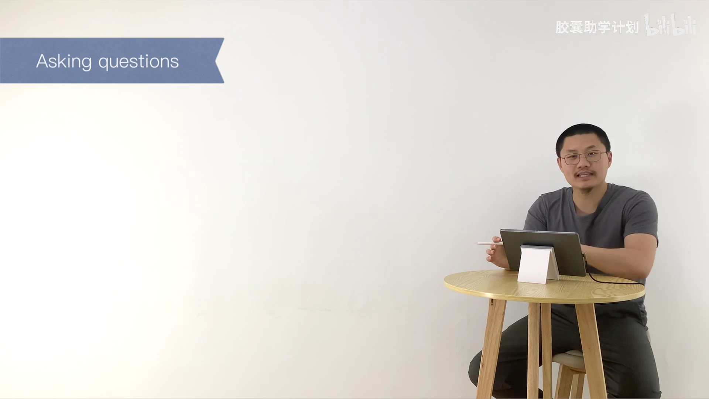

文字识别： Bitb / 胶囊助学计划 / Asking questions

## 00:07:30–00:08:00

般疑问句，给您一个特殊疑问词，您再把它变成特殊疑问句啊。练习的是我们自己能说出来一般疑问句和特殊疑问句的能力。来了，Ask me if后边是重点。The refrigerator is white. 答案 Is the refrigerator white? 特殊疑问词 What color? 对 White提问，对吧？答案 What color is the refrigerator? 回想

### 画面 00:07:47

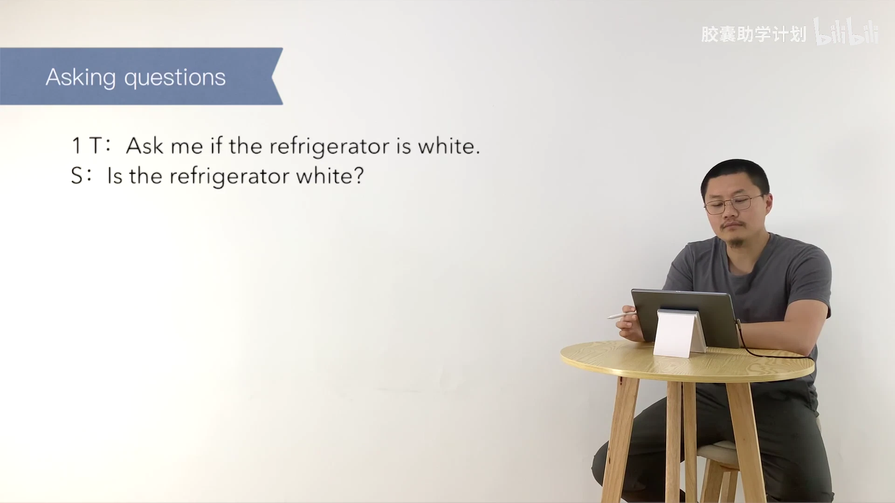

文字识别：biltbilt / 胶囊助学计划 / Asking questions / 1 T: Ask me if the refrigerator is white. / S: Is the refrigerator white?

## 00:08:00–00:08:30

一下，What color do Y的提问，把它去掉，把它放到句首，特殊疑问词加去掉答案之后的一般疑问句，对吧？ Continue. Ask me if the refrigerator is on the right. Is the refrigerator on the right? Where, where对哪儿提问？想一下，On the right，对不对？好一个，所以答

### 画面 00:08:01

文字识别：bitbii / 胶囊助学计划 / Asking questions / 1 T: Ask me if the refrigerator is white. / S: Is the refrigeratorwNite / T: What colour...? / S: What colour is the refrigerator?

### 画面 00:08:04

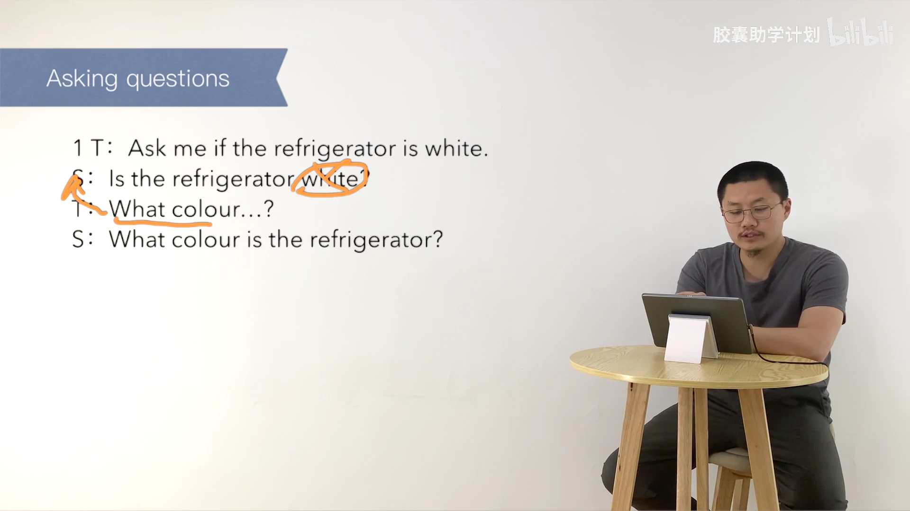

文字识别：胶囊助学计划 / Asking questions / 1 T: Ask me if the refrigerator is white. / : Is the refrigeratorw / What colour...? / S: What colour is the refrigerator?

### 画面 00:08:08

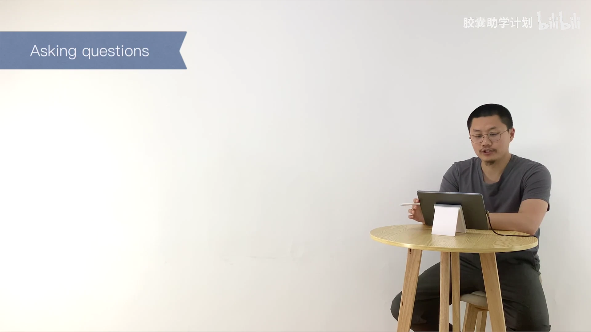

文字识别：胶囊助学计划 / Asking questions

### 画面 00:08:27

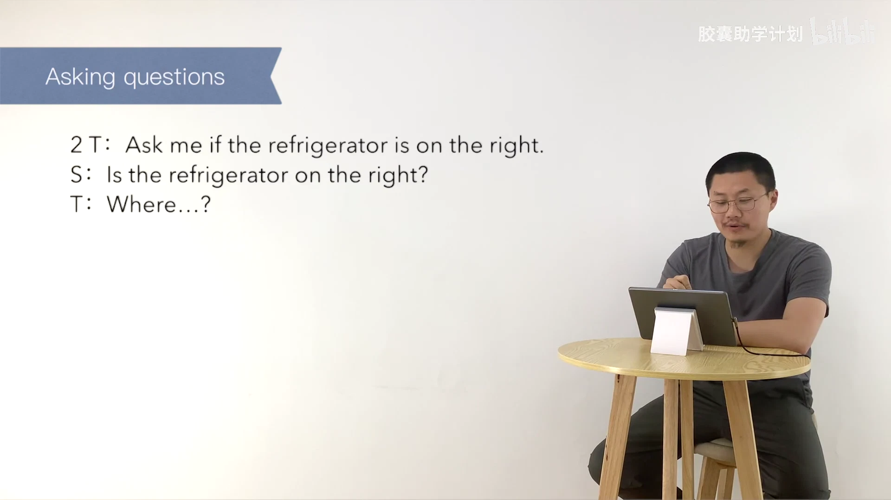

文字识别：胶囊助学计划 / Asking questions / 2 T: Ask me if the refrigerator is on the right. / S: Is the refrigerator on the right? / T: Where...?

## 00:08:30–00:09:00

案是 Where is the refrigerator? Continue. Ask me if. 这三个单词对于各位现在不重要，听后面的。 The cooker is blue. Answer is the cooker blue? What color? What color is the cooker? Next one. Ask me if the cooker is on the left.

### 画面 00:08:34

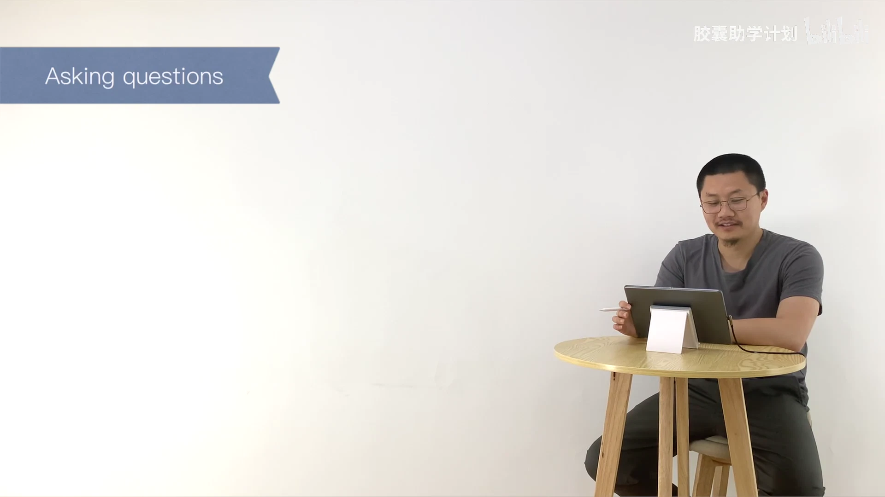

文字识别：胶囊助学计划 / Asking questions

### 画面 00:08:50

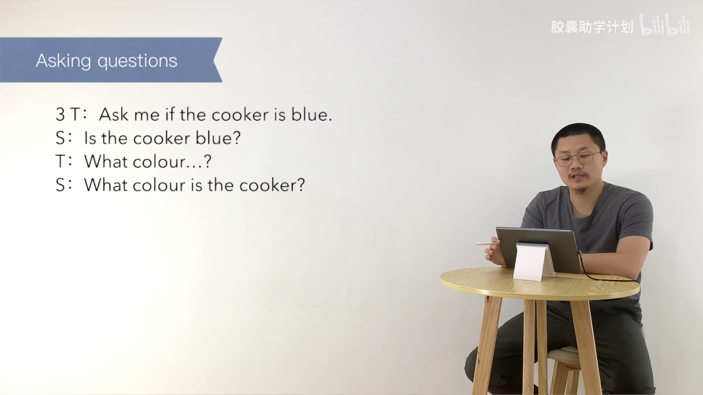

文字识别：胶囊助学计划bil山 / Asking questions / 3 T: Ask me if the cooker is blue. / S: Is the cooker blue? / T: What colour...? / S: What colour is the cooker?

### 画面 00:08:54

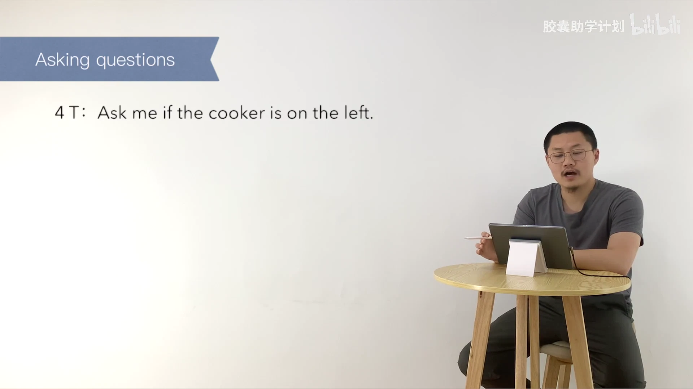

文字识别：u bil出 / 胶囊助学计划 / Asking questions / 4T: Ask me if the cooker is on the left.

## 00:09:00–00:09:30

is the cooker. On the left, where? Where is the cooker? Very good. Ask me if the bottle is on the table. Is the bottle on the table? Where? 对 on the table 提问对吧? Where is the bottle? 它在什么地方的？答案 on the table，对吧？肯定句变

### 画面 00:09:24

文字识别：胶囊助学计划bi出 / Asking questions / 5 T: Ask me if the bottle is on the table. / S: Is the bottle on the table? / T: Where...? / S: Where is the bottle?

### 画面 00:09:28

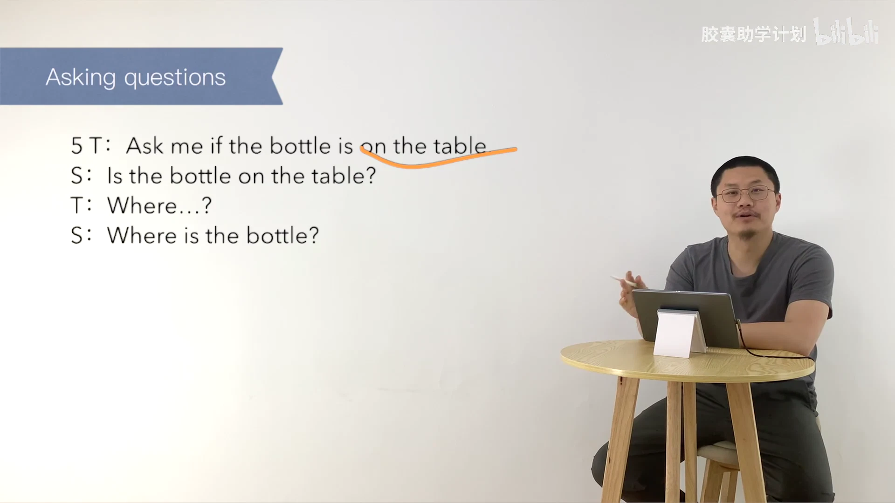

文字识别：胶囊助学计划bl出 / Asking questions / 5 T: Ask me if the bottle is on the table / S: Is the bottle on the table? / T: Where...? / S: Where is the bottle?

## 00:09:30–00:10:00

一般疑问句变特殊疑问句，这是贯穿我们整个新一新二的练习啊。There you go.那 recap，我们看一下今天其实核心的一个小的知识点就是 a an 和 the 的一个对比。第一次提 a，第二次再提它，我们就知道都是谁了，特指它。这时候您就可以用 the 了。OK，不妨把这篇文章刚才我只仔细讲的 a an 和接下来那个 the 回顾一下，就可以理解这个

### 画面 00:09:35

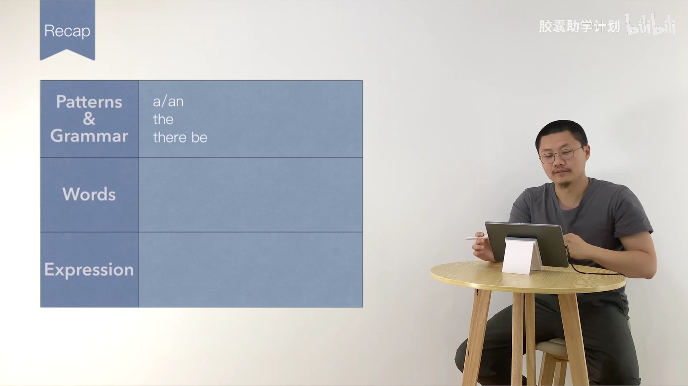

文字识别：biltbi / 胶囊助学计划 / Recap / Patterns / a/an / the / Grammar / there be / Words / Expression

## 00:10:00–00:10:30

知识点了。再然后呢，我们进行了全文，其实都是 D R B 句型了，是我们上一个视频刚刚教过各位的。好，来看一下作业，绿皮书二十五课的写作练习，各位可以去写了。写完了不要忘记对一下最后面的答案啊。好，再然后呢，文章各位要跟读至熟读成诵，变数不限。最后，您上一节课我们说的是您参考自己的厨房，这一节课我们把范围扩大一点

### 画面 00:10:05

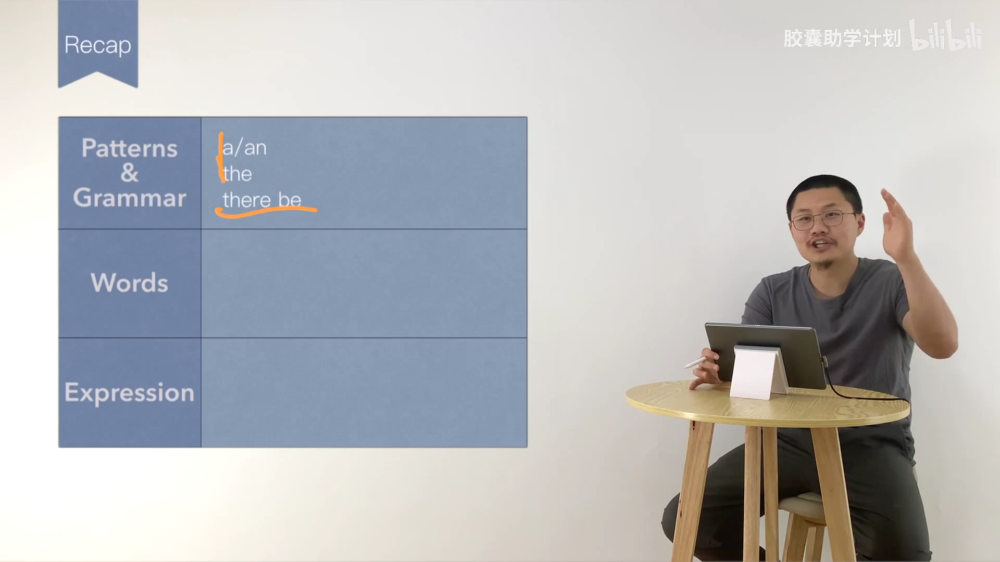

文字识别：Bitbii / 胶囊助学计划 / Recap / Patterns / a/an / & / the / Grammar / there be / Words / Expression

### 画面 00:10:07

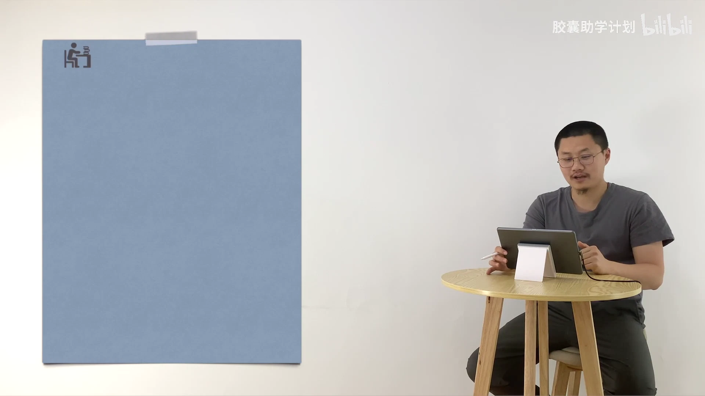

文字识别：胶囊助学计划出

### 画面 00:10:23

文字识别：胶囊助学计划Li出 / 绿皮书第25课的写作练习 / 文章跟读至熟读成诵读 / 3.参考自己的家，尝试用 / there be 造20个句子，不会 / 的单词请查词典

## 00:10:30–00:11:00

点，您参考自己的家，尝试用 D R B 句型造二十个句子。那我鼓励各位啊，多去用一些自己不会的单词啊。您这个查单词还能学会新的单词，对吧？还能练习我们已经学过的句型，何乐而不为呢？对吧？不会的单词自己去查一下词典就可以了。OK，那以上呢就是本期视频的全部内容了。如果大家喜欢我们的课程，欢迎大家关注、订阅、一键三连支持我们，并分享给您身边需要的朋友们。

### 画面 00:10:50

文字识别：胶囊助学计划出

## 00:11:00–00:11:24

最后的最后，我们再来看一句名人名言：A room without books is like a body without a soul. See you next time.

### 画面 00:11:00

文字识别：胶囊助学计划册 / A room without books is like a body without a soul. / - Marcus Tullius Cicero

### 画面 00:11:11

### 画面 00:11:13

文字识别：CAPSULEACADEMY / 胶囊助学计划 / 『 / 小红书 / Lecturer / □ / Leo

### 画面 00:11:16

文字识别：CAPSULEACADEMY / 胶囊助学计划 / 『 / 小红书 / Berlin

### 画面 00:11:19

文字识别：臺聖珈字計划 / CAPSULEACADEMY / 胶囊助学计划 / 小红书 / Creator / Leo & Berlin / OE

### 画面 00:11:22

文字识别：bilbili / 胶囊助学计划

### 画面 00:11:23

文字识别：bilbili / 胶囊助学计划

