# 027 语法 文章

快速机器解析：语音为单模型转写，未进行独立交叉校对或人工复核；画面每秒采样并按变化选帧，短时文字和标记可能遗漏。截图时间约有 1 秒误差。图片有损压缩；遇到疑点请按时间查看 Google Drive 原视频。

## 00:00:00–00:00:30

Hello everyone, welcome to Capsule Academy. This is Leo. Today we're going to learn the Concept English Book One Lesson Twenty Seven Grammar and Story. 那老习惯进入正式课程之前，我先提出一个问题：some 和 any 这两个单词有何异同呢？带着这个问题，Hope you gonna enjoy it. 好，那我们上来先看一下某地有某物或者某人它的肯定句。我们实际上之

### 画面 00:00:00

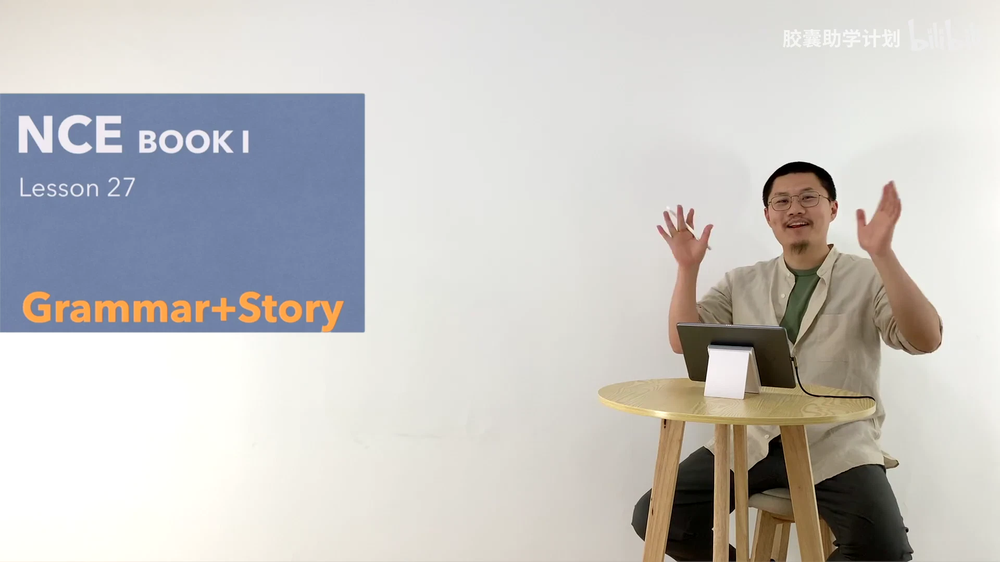

文字识别：胶囊助学计划 / NCE / BOOKI / Lesson 27 / Grammar+Story

### 画面 00:00:02

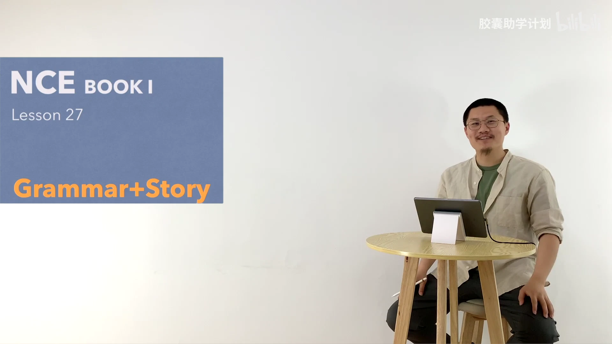

文字识别：胶囊助学计划 / NCE / BOOKI / Lesson 27 / Grammar+Story

### 画面 00:00:07

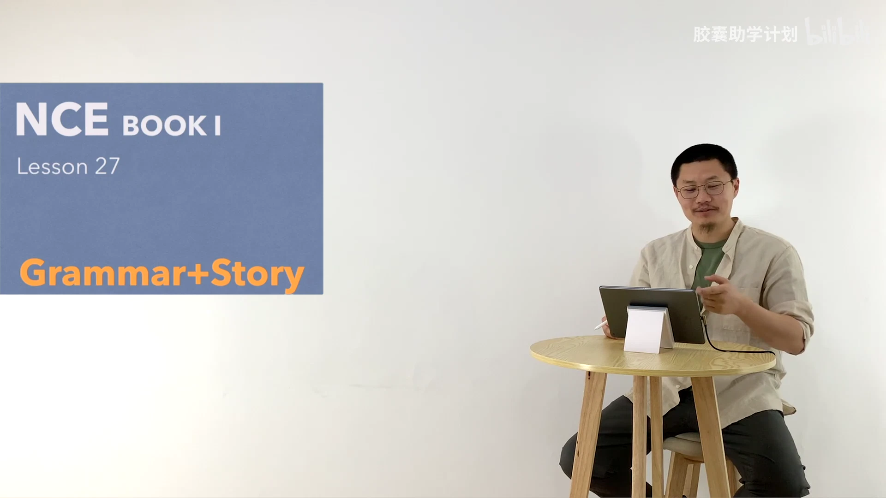

文字识别：胶囊助学计划 / NCE / BOOKI / Lesson 27 / Grammar+Story

### 画面 00:00:10

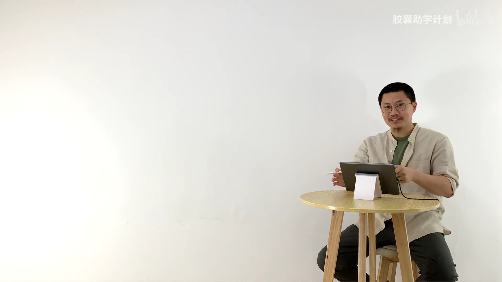

文字识别：胶囊助学计划

### 画面 00:00:12

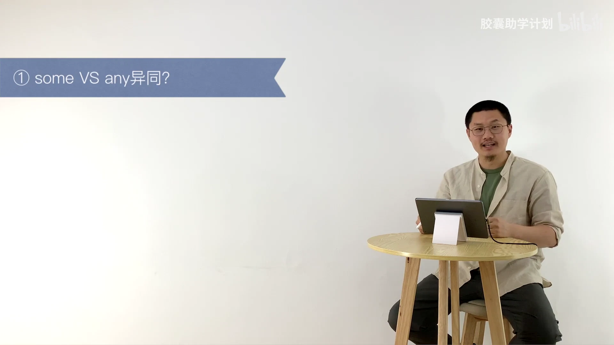

文字识别：胶囊助学计划 / ① some VS any异同？

### 画面 00:00:19

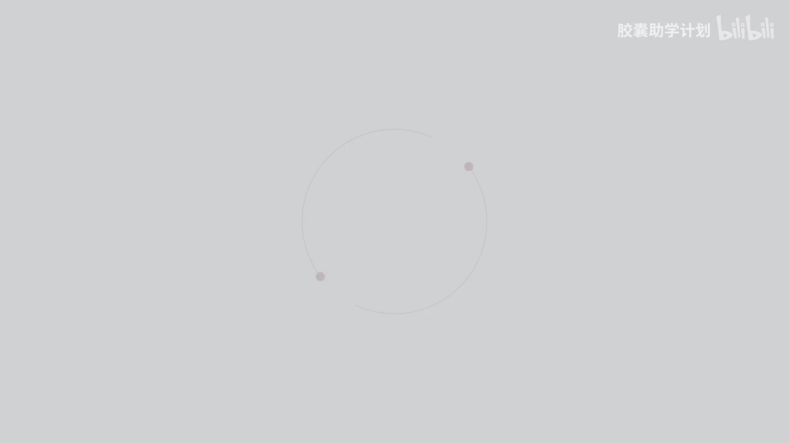

文字识别：胶囊助学计划 bilbl

### 画面 00:00:23

### 画面 00:00:25

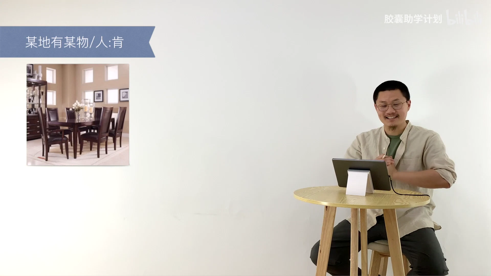

文字识别：胶囊助学计划 / 某地有某物/人:肯

## 00:00:30–00:01:00

前在二十五课已经学过了，只不过呢，那个时候我们学的是单数，接下来我们要看的是复数，比如说复数，其实我们要做的事情无非就是把 is 换成了 are，然后原来是 a 或者说 an 一个，对吧？现在换成了另一个单词叫做 some，叫做一些，然后呢，名词后边别忘了加 s，当然有的不是加 s，有的是规则变化加 e s，对吧？或者

### 画面 00:00:38

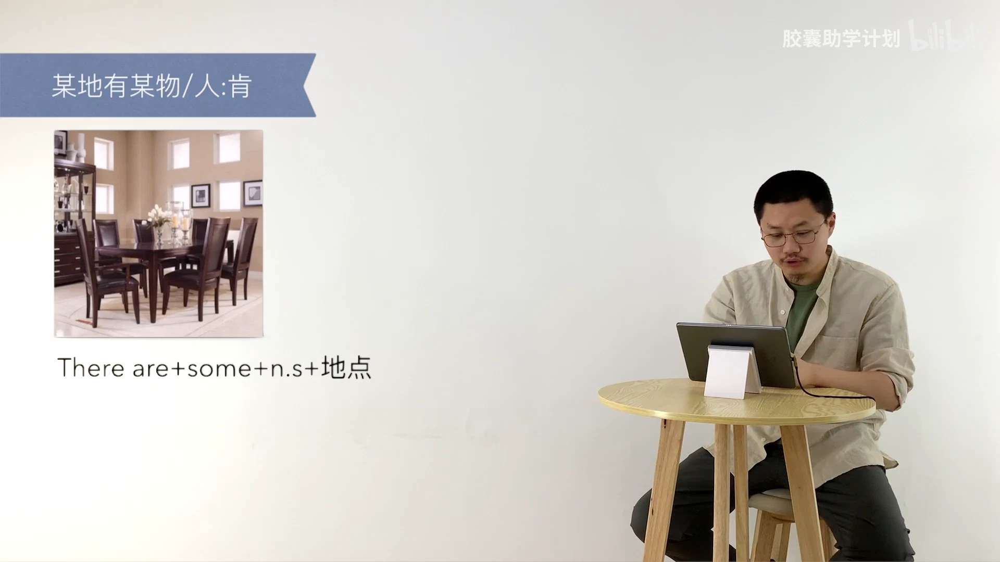

文字识别：胶囊助学计划 / 某地有某物/人:肯 / There are+some+n.s+地点

### 画面 00:00:58

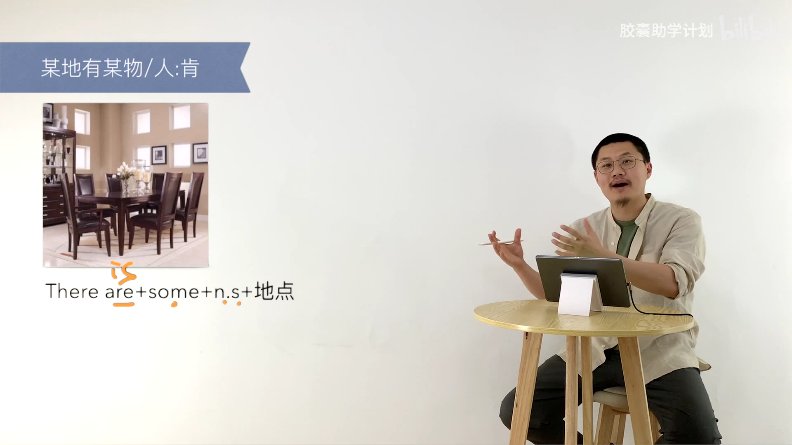

文字识别：胶囊助学计划 / 某地有某物/人:肯 / iS / There are+some+n.s+地点

## 00:01:00–00:01:30

变 f 或 f e 为 v e s 等等，这是我们在十五课、十七课给大家讲过的名词变复数的一些形式。最后呢，我们再加上一个地点，比如说 in、on 和我们刚刚学过的 near 都可以去表示这样一个地点。那我们看图造一句话，叫做 There are。哎，非常好，从 There is 变成了 There are 了，对吧？然后原来是 a 或者说 an 一个，现在变成了 some chairs，把

### 画面 00:01:05

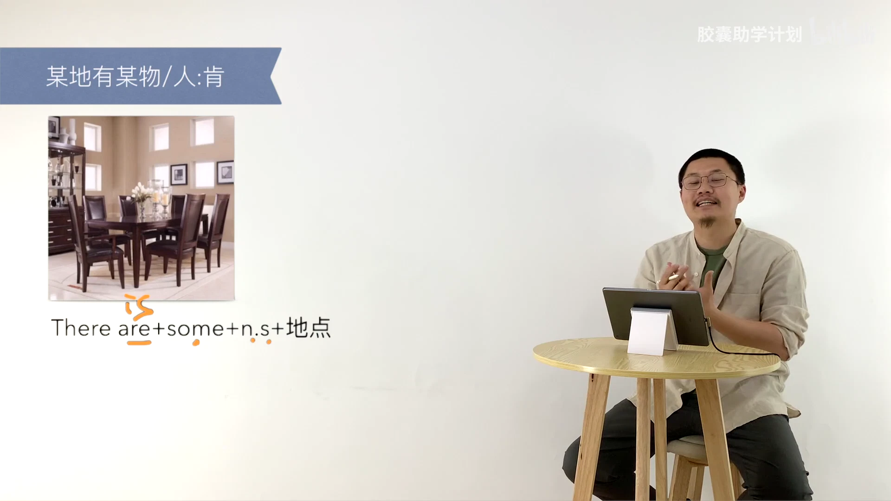

文字识别：胶囊助学计划 / 某地有某物/人:肯 / There are+some+n.s+地点

### 画面 00:01:12

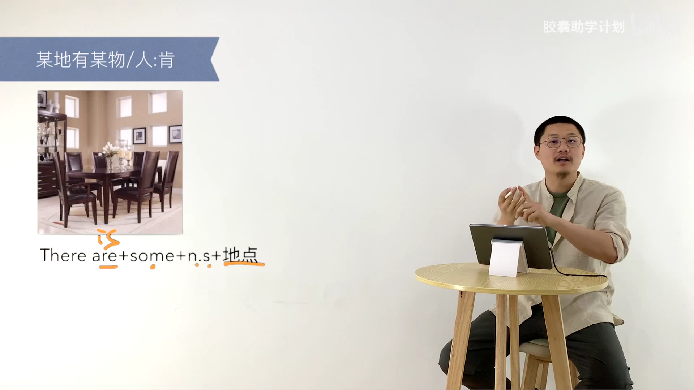

文字识别：胶囊助学计划 / 某地有某物/人:肯 / i / There are+some+n.s+地点

### 画面 00:01:17

文字识别：胶囊助学计划 / 某地有某物/人:肯 / iS / There / are+some+n.s+地点 / There / chairs in the middle of the room. / are / some

### 画面 00:01:22

文字识别：胶囊助学计划 / 某地有某物/人:肯 / i / There / are+some+n.s+地点 / There are / chairs in the middle of the room. / some

### 画面 00:01:29

文字识别：胶囊助学计划 / 某地有某物/人:肯 / i / There / are+some+n.s+地点 / There are / some / chairs / in the / middle of the room.

## 00:01:30–00:02:00

chair变成了chairs，后边加了一个s表复数。地点呢无所谓了，地点没有太多的变化，由您自己想表达的含义决定就行了。我们在这儿给了一个小的短语，叫做in the middle of the room，叫做房间的中间。由后往前翻译，各位还记得吧？A of B结构啊。那接下来我们想把它变成否定句的时候，那您看图，图里面现在没有椅子了，对不对？变成否定，

### 画面 00:01:38

文字识别：胶囊助学计划 / 某地有某物/人:肯 / i / There / are+some+n.s+地点 / There are / some / chairs in the / middle of the roomy

### 画面 00:01:46

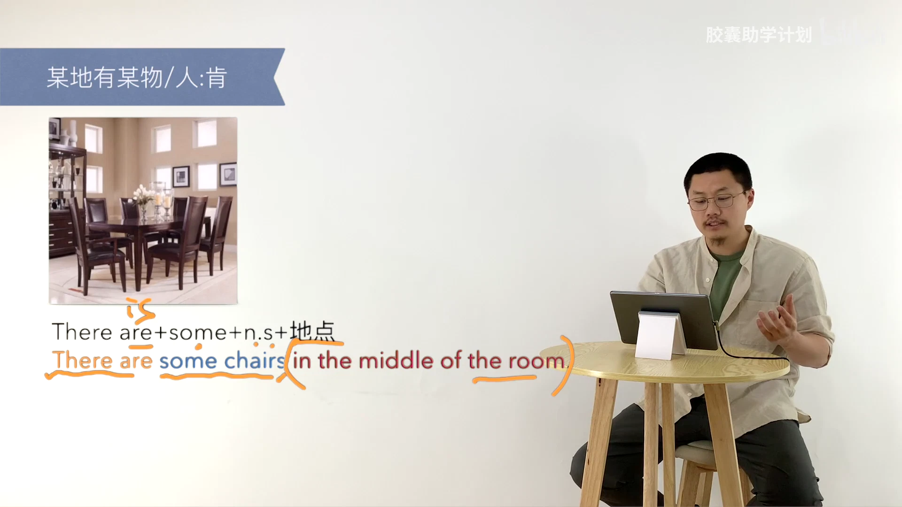

文字识别：胶囊助学计划 / 某地有某物/人:肯 / i / There / are+some+n.s+地点 / There / are / some / chairsin the / middle of the room,

### 画面 00:01:48

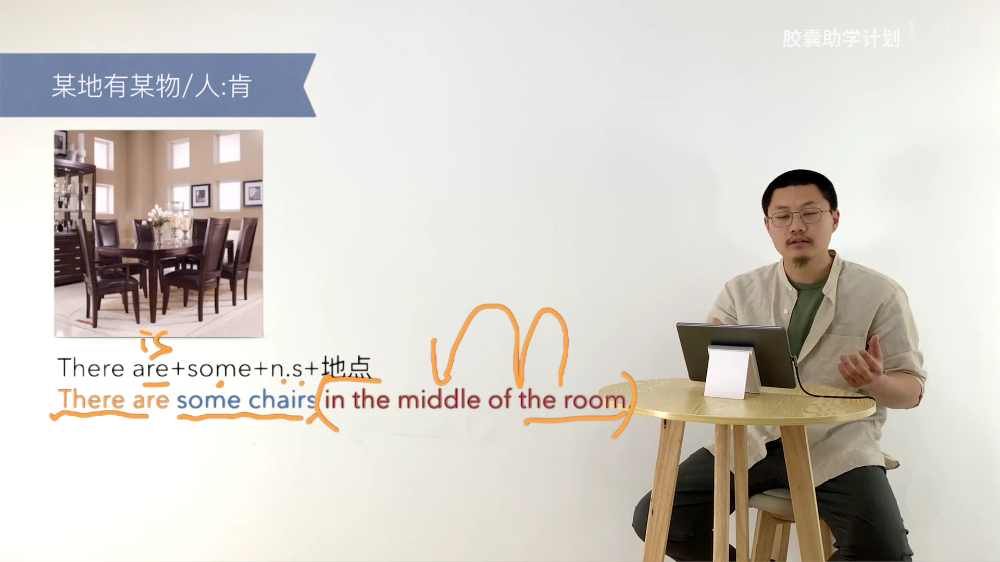

文字识别：胶囊助学计划 / 某地有某物/人:肯 / iš / There / are+some+n.s+地点 / There / are / some / chairsin the / middle of the room

### 画面 00:01:52

文字识别：胶囊助学计划 / 某地有某物/人:否

### 画面 00:01:55

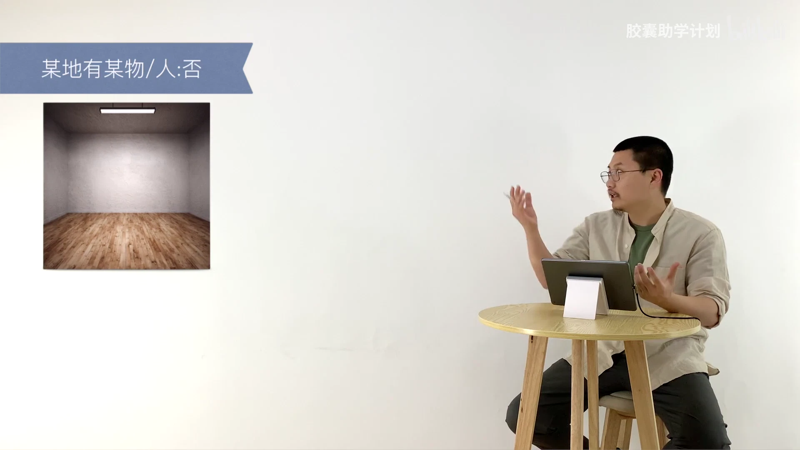

文字识别：胶囊助学计划 / 某地有某物/人:否

### 画面 00:01:58

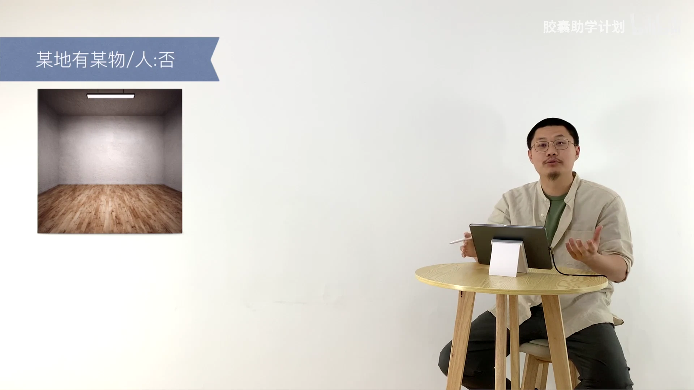

文字识别：胶囊助学计划 / 某地有某物/人:否

## 00:02:00–00:02:30

各位注意，这地方就有一点变化了。复数 there are 是没有变化的，加 not 跟之前学的也是一样，地点不变，名词复数也不变，唯一的一个变化就是 some 这个单词变成了 any，各位记住，一定要变成 any。它们的含义虽然没有改变，但是英文就有这个要求，要大家变成 any。好，比如说我们看一下，叫做 there aren't are not 的缩写， any chairs 没有任

### 画面 00:02:03

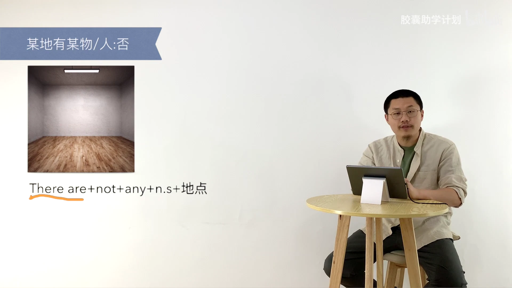

文字识别：胶囊助学计划 / 某地有某物/人:否 / There are+not+any+n.s+地点

### 画面 00:02:11

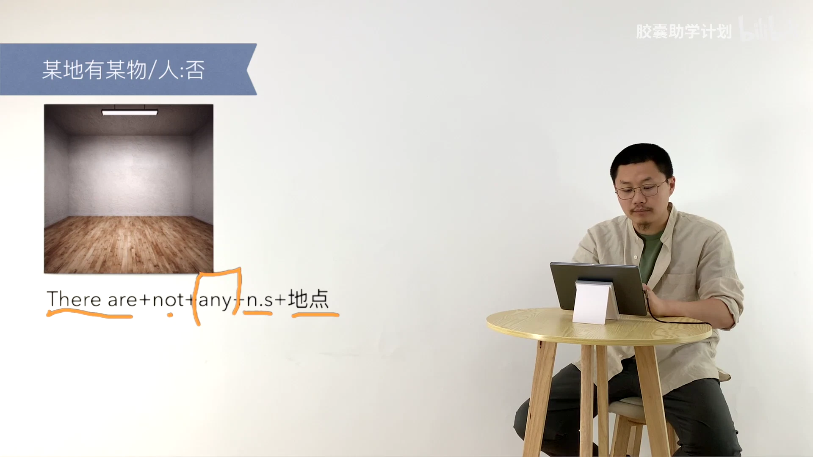

文字识别：胶囊助学计划 / 某地有某物/人:否 / There are+not+any-n.s+地点

### 画面 00:02:16

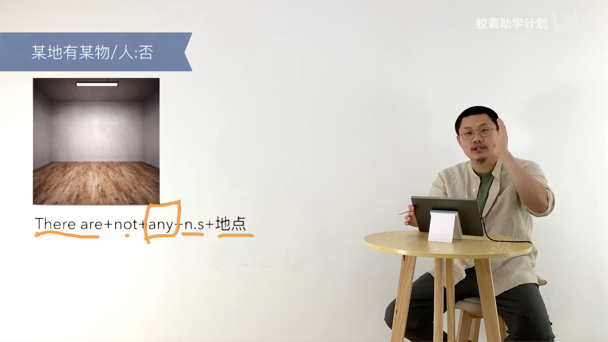

文字识别：胶囊助学计划 / 某地有某物/人:否 / There are+not- / anyfn.s+地点 / •

### 画面 00:02:20

文字识别：胶囊助学计划 / 某地有某物/人:否 / There are+not+any-n.s+地点

### 画面 00:02:22

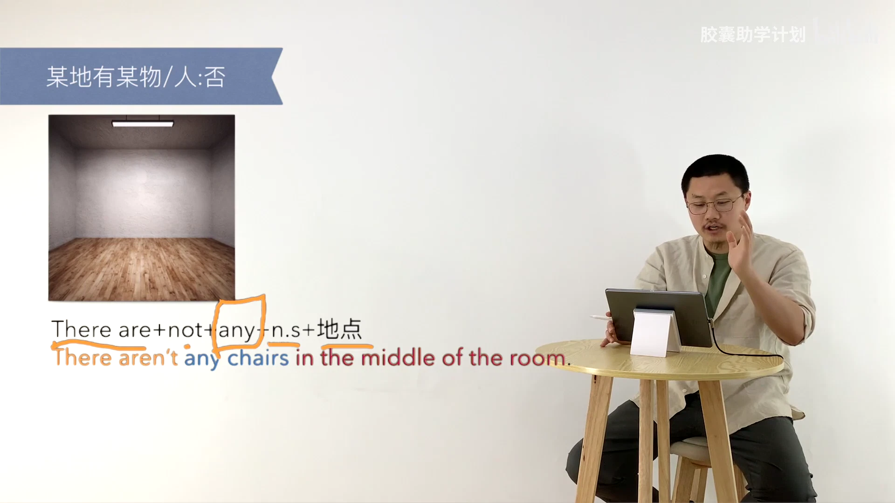

文字识别：胶囊助学计划 / 某地有某物/人:否 / There / are+not+ / anyfn.s+地点 / There / aren't any / chairs in / the middle of the room.

### 画面 00:02:24

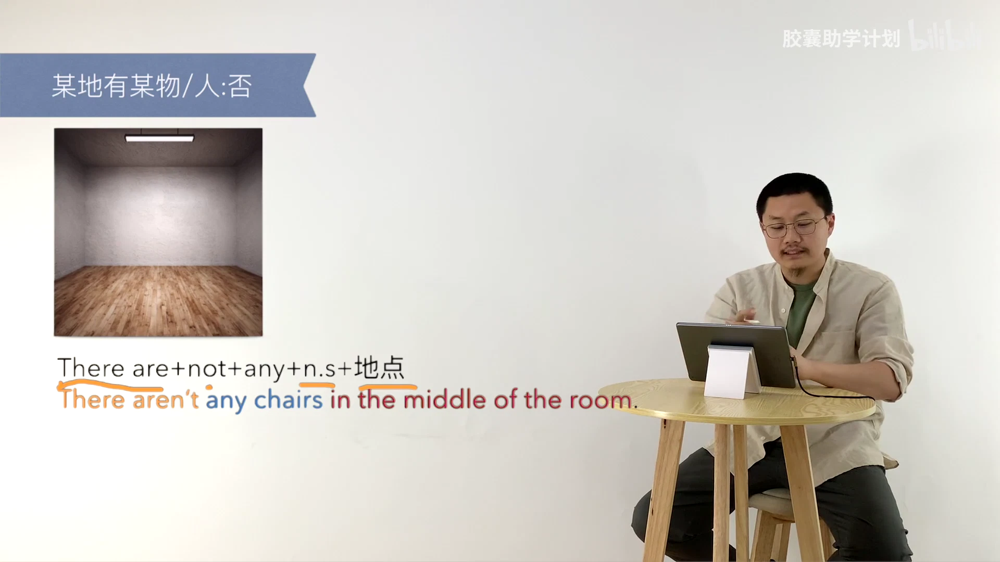

文字识别：胶囊助学计划 / 某地有某物/人:否 / There / any+n.s+地点 / are+not+ / There / aren't any / chairs in / the middle / of the room.

## 00:02:30–00:03:00

何的椅子啊，没有一些椅子或者没有任何的椅子 in the middle of the room 在这个房间的中间。所以在这个地方，各位需要记住的一个重点是 some 在否定句当中，在这个句型当中，至少它变成了 any. OK. 好，接下来变一般疑问句和我们之前的想法也没有太大的区别，无非就是把 are 提到了句首。我们看是不是这样的？哎，是的。地点不变，名词复数不变。同理，

### 画面 00:02:35

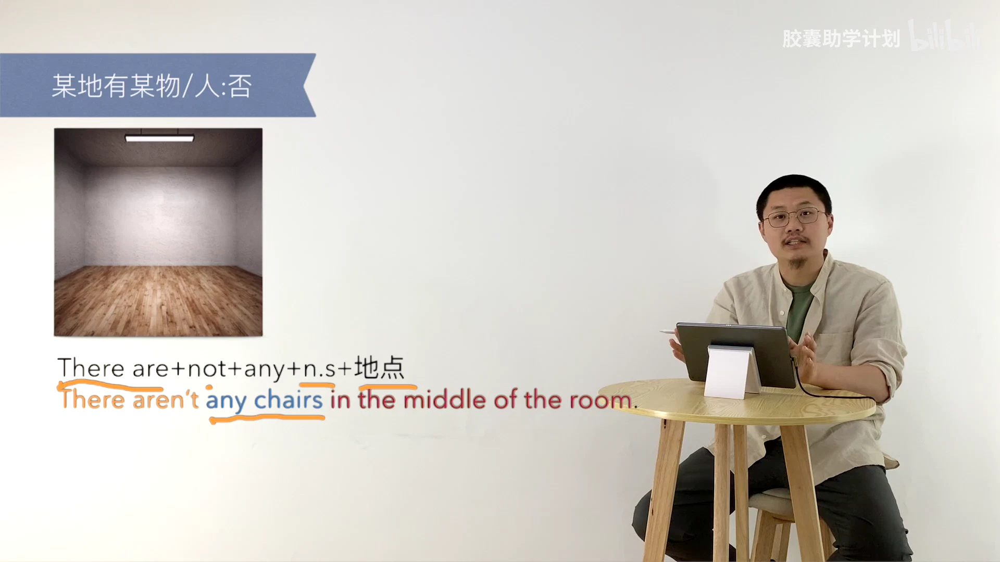

文字识别：胶囊助学计划 / 某地有某物/人:否 / There / are+not+ / -any+n.s+地点 / There / aren't any / chairs in / the middle / of the room.

### 画面 00:02:39

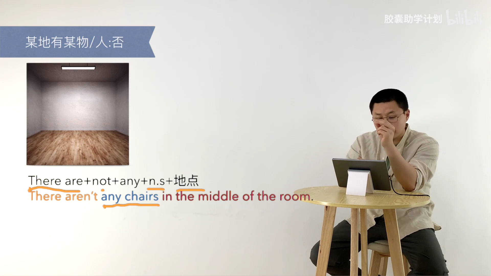

文字识别：胶囊助学计划 / 某地有某物/人:否 / There / are+not+ / any+n.s+地点 / There / aren't : / any / chairs in / the middle / of the room.

### 画面 00:02:42

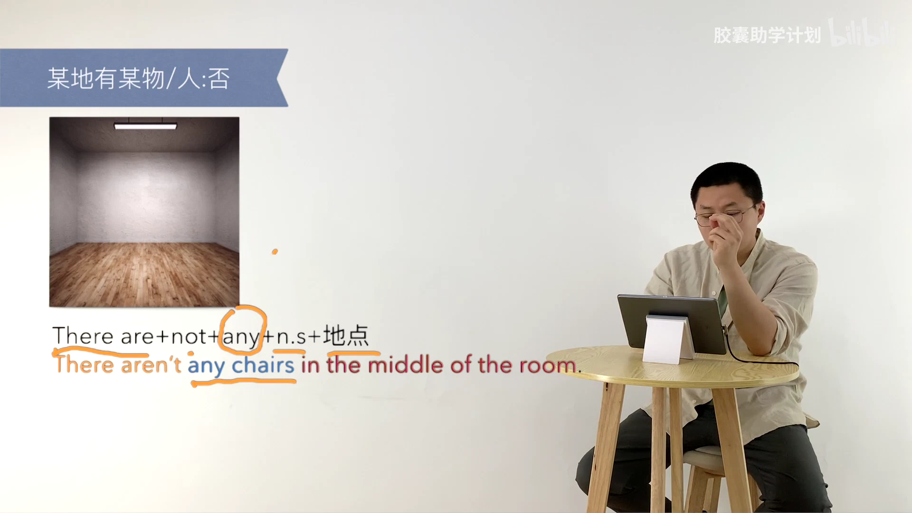

文字识别：胶囊助学计划 / 某地有某物/人:否 / There / are+not+ / any+n.s+地点 / There / aren't any / chairs in / the middle of the room.

### 画面 00:02:48

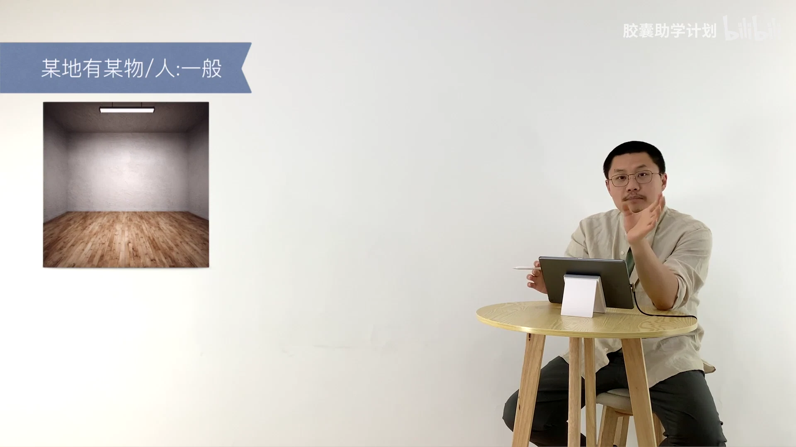

文字识别：胶囊助学计划 / 某地有某物/人:一般

### 画面 00:02:51

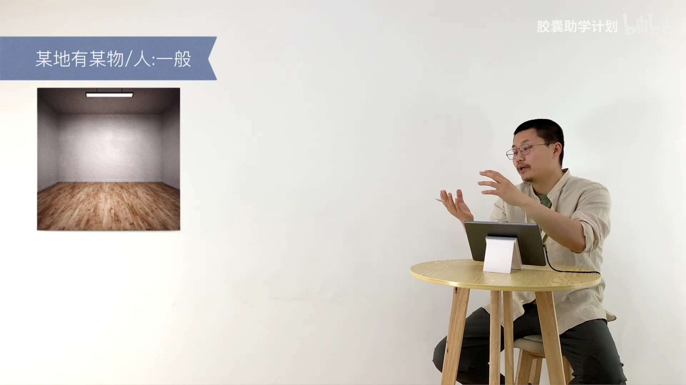

文字识别：胶囊助学计划 / 某地有某物/人:一般

### 画面 00:02:54

文字识别：胶囊助学计划 / 某地有某物/人:一般 / Are there+any+n.s+地点?

### 画面 00:02:58

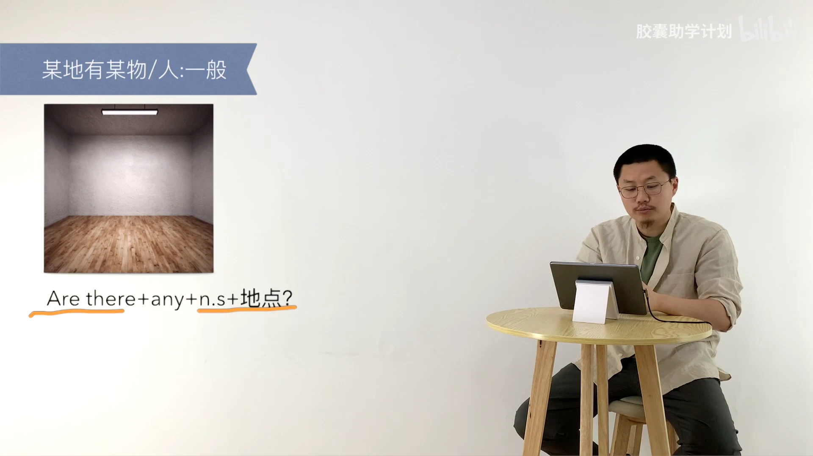

文字识别：胶囊助学计划 / 某地有某物/人:一般 / Are there+any+n.s+地点?

## 00:03:00–00:03:30

您要把 some 换成 any。英文的要求就是这个，对吧？我们要遵循人家的规则。于是我们造出来一句话叫做 Are there any chairs in the middle of the room? 房间的中间有椅子吗？注意 any chairs。所以这个地方就引出来了一个点，叫 some 和 any 的异同。首先在今天我们学的啊，他们绝对不是只有这些异同，但我们今天只教大家这些异同。首先他们相

### 画面 00:03:02

文字识别：胶囊助学计划 / 某地有某物/人:一般 / Are there+ / any / n.s+地点?

### 画面 00:03:05

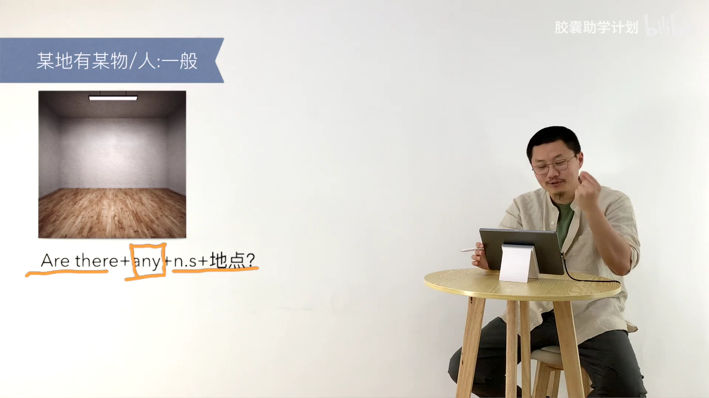

文字识别：胶囊助学计划 / 某地有某物/人:一般 / Are there+ / n.s+地点? / any

### 画面 00:03:07

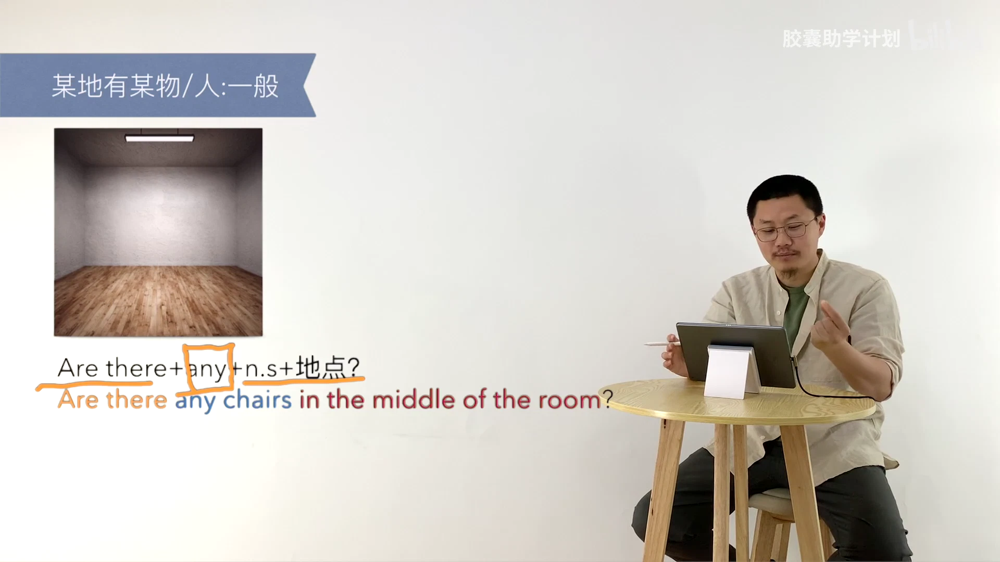

文字识别：胶囊助学计划 / 某地有某物/人:一般 / Are / there+ / any / n.s+地点? / Are / there / any / chairs in t / the / middle of the room?

### 画面 00:03:09

文字识别：胶囊助学计划 / 某地有某物/人:一般 / Are / there+any+n.s+地点? / Are / there any / chairs in the middle of the room?

### 画面 00:03:11

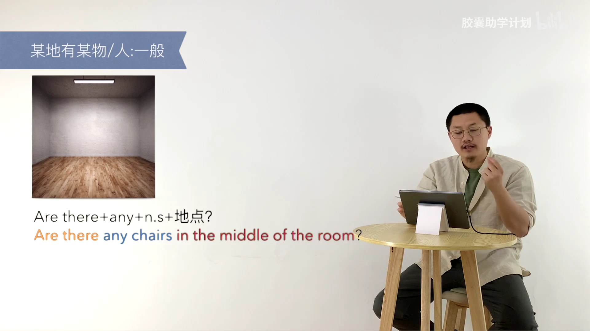

文字识别：胶囊助学计划 / 某地有某物/人:一般 / Are / there+any+n.s+地点? / Are / there any chairs in the middle of the room?

### 画面 00:03:18

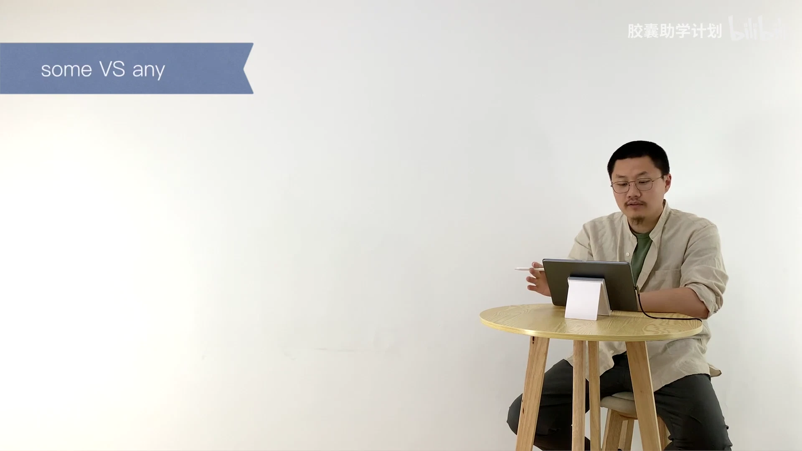

文字识别：胶囊助学计划 / some VS any

### 画面 00:03:23

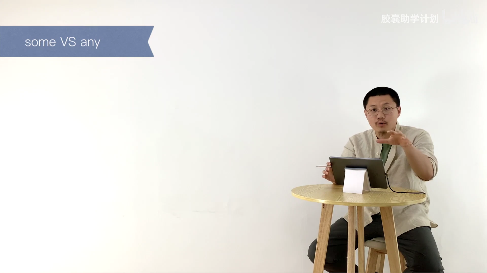

文字识别：胶囊助学计划 / some VS any

## 00:03:30–00:04:00

同的点在这个地方都表示一些，有没有一些呢？哎，其次，它的不同点是什么呢？刚才各位应该已经自己总结出来了，我再拿文字给大家总结一下，叫做 some，它是用在肯定句当中的，而 any 呢是用在否定句和疑问句当中的。注意，这有一个非常大的前提，我们现在指的是 there be 句型，以后我慢慢会教各位，比如说我们会看到 some 也用在疑问句当中了，any 呢

### 画面 00:03:30

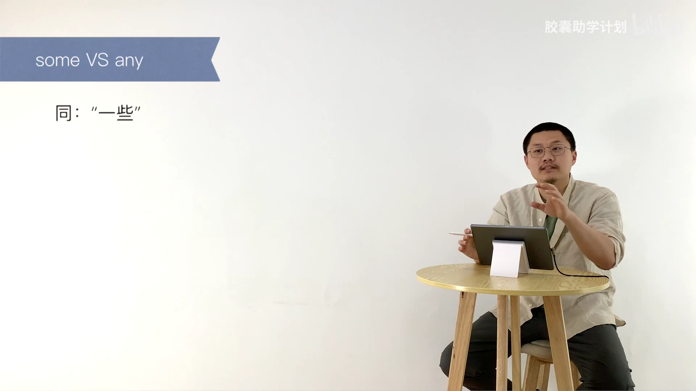

文字识别：胶囊助学计划 / some VS any / 同：“一些”

### 画面 00:03:32

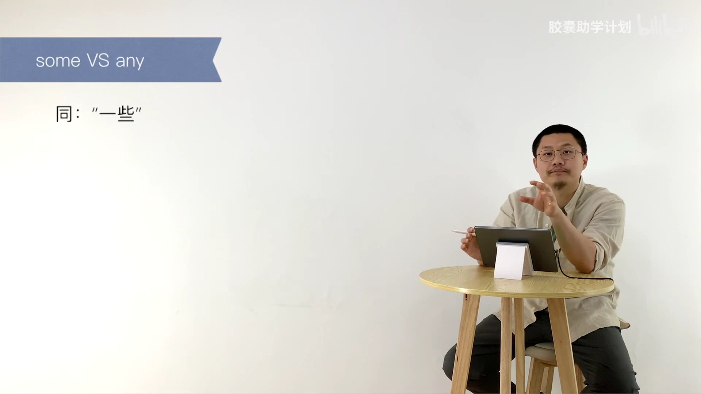

文字识别：胶囊助学计划 / some VS any / 同：“一些”

### 画面 00:03:38

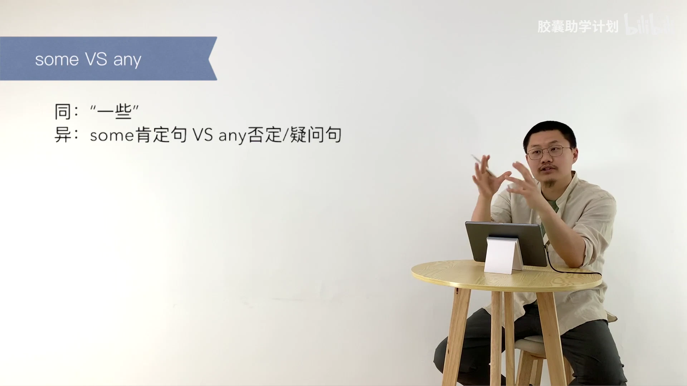

文字识别：胶囊助学计划 / some VS any / 同：“一些” / 异：some肯定句VS any否定/疑问句

### 画面 00:03:43

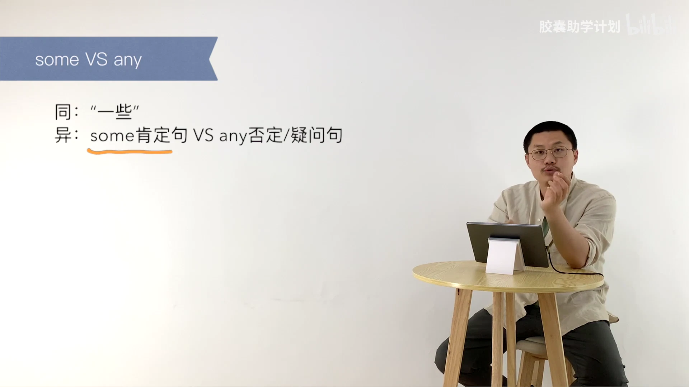

文字识别：胶囊助学计划 / some VS any / 同：“一些” / 异：some肯定句VS any否定/疑问句

### 画面 00:03:46

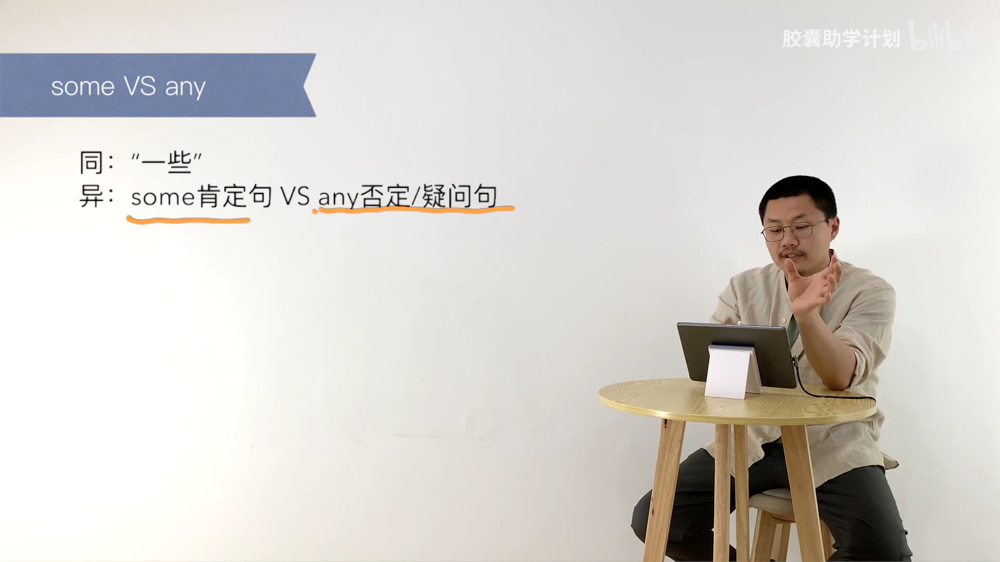

文字识别：胶囊助学计划 / some VS any / 同：“一些” / 异：some肯定句VS any否定/疑问句

### 画面 00:03:56

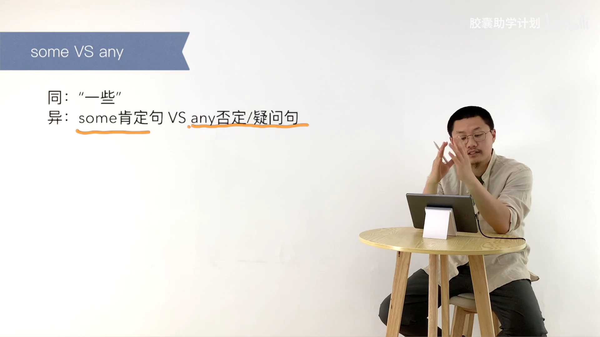

文字识别：胶囊助学计划 / some VS any / 同：“一些” / 异：some肯定句VSany否定/疑问句

## 00:04:00–00:04:30

有的时候好像也用在肯定句当中了，但至少今天在 there be 这个句型当中，各位要记住的是这个逻辑叫做 some 肯定句，any 否定句和疑问句当中。于是我们接下来做一个练习，很快的一个小的填空题。There are pens on the table.有一些笔在桌子上，some 还是 any？ Some, right? Okay. There aren't. There aren't students in the classroom. 教室当

### 画面 00:04:11

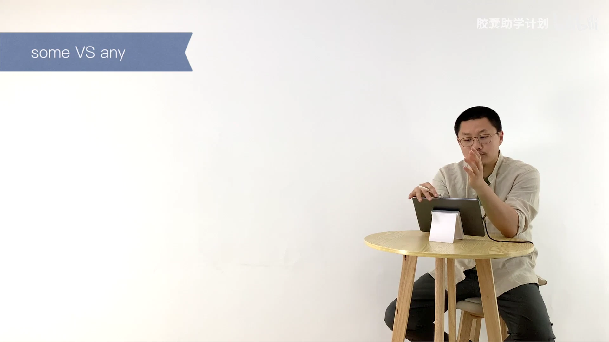

文字识别：some VS any

### 画面 00:04:16

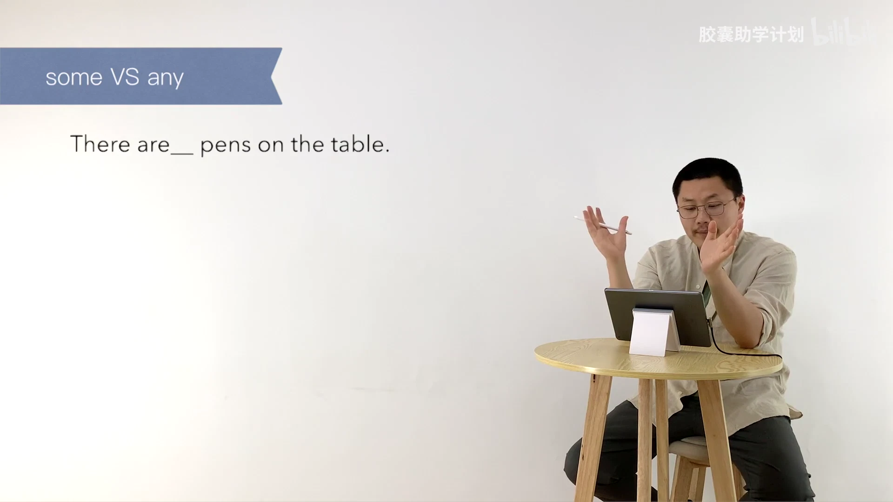

文字识别：胶囊助学计划 / some VS any / There are_ pens on the table.

## 00:04:30–00:05:00

中没有任何的学生，没有任何的学生。注意这个时候我们要用的是 any，因为它是否定句。然后 Are there boxes in the kitchen? 应该用的是 any，因为它是一般疑问句。这个小的知识点，各位希望今天能把它记下来。OK，好，接下来呢，我们看一个电影片段啊，在这个电影片段当中，实际上它出现了三个 there be 句型。各位看一下自己能不能看到啊。我只给大家讲两个，第一个叫 Are there

### 画面 00:04:30

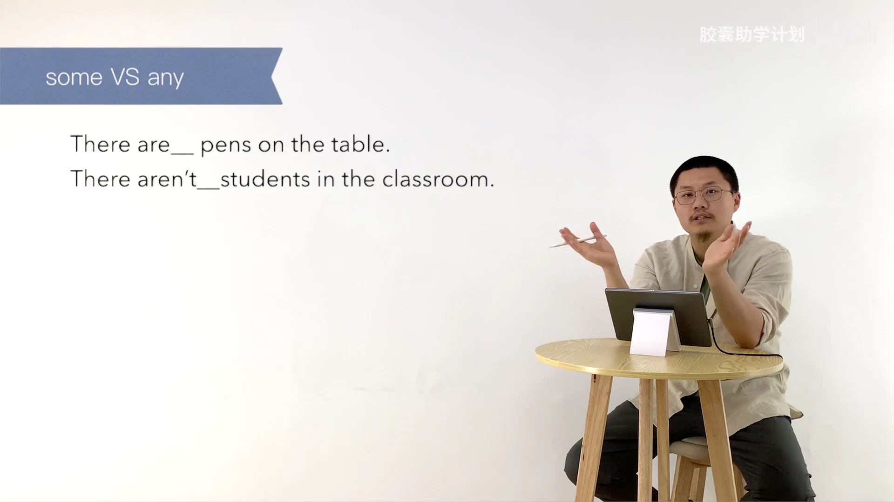

文字识别：胶囊助学计划 / some VS any / There are_ pens on the table. / There aren't_students in the classroom.

### 画面 00:04:47

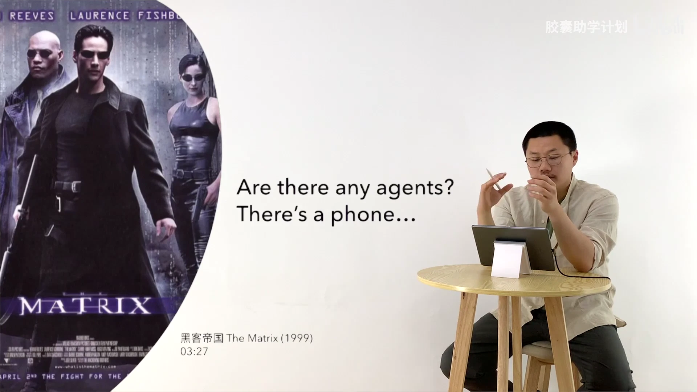

文字识别：REEVES / LAURENCEFISHBU / 胶囊助 / Are there any agents? / There's a phone... / MATRIX / 黑客帝国The Matrix(1999) / 03:27 / APRIL 2N THE FIGHT FOR THE

## 00:05:00–00:05:30

any agents? Okay, agents指的是特工啊，在这个电影当中还有一个特殊的含义，只能您看了电影才能知道。接下来呢，还有一个小的叫做 There's a phone，这是我们二十五课学过的单数，对吧？在某地有某物单数。然后呢，一般疑问句别忘了把 some 变成 any。接下来我们一起看一下这个电影片段。 Morpheus, the line was traced. I don't know how. I know they got the hard line. There's no time. You're going to have to get to another

### 画面 00:05:00

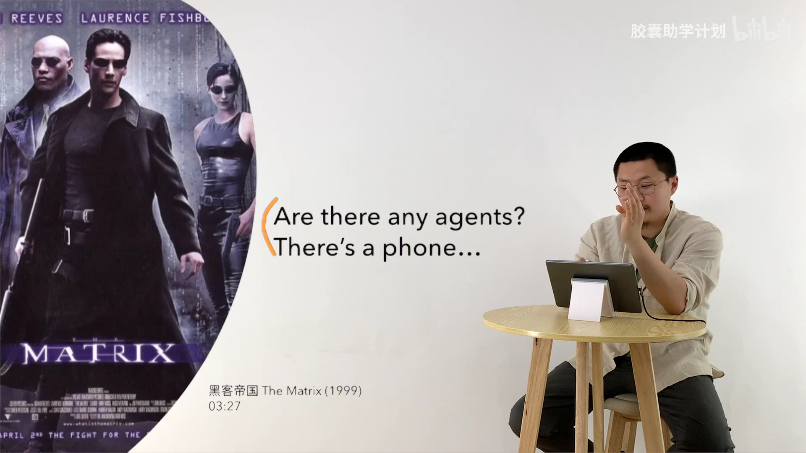

文字识别：REEVES / LAURENCE FISHBL / 胶囊助学计划 / Are there any agents? / There's a phone.. / MATRIX / 黑客帝国The Matrix(1999) / 03:27 / APRIL ZN THE FIGHT FOR THE

### 画面 00:05:03

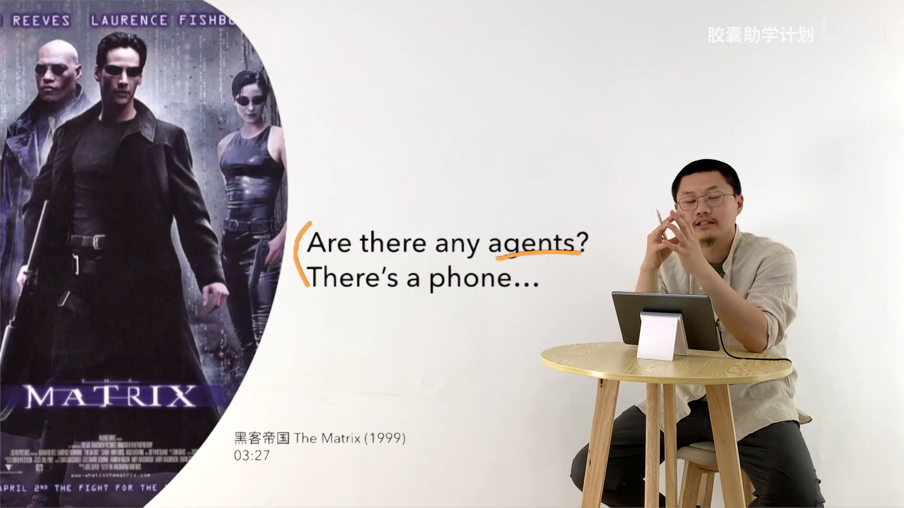

文字识别：REEVES / LAURENCEFISHBU / 胶囊助学计划 / Are there any agents? / There's a phone... / MATRIX / 黑客帝国The Matrix(1999) / 03:27 / APRIL Z THE FIGHT FOR THE

### 画面 00:05:09

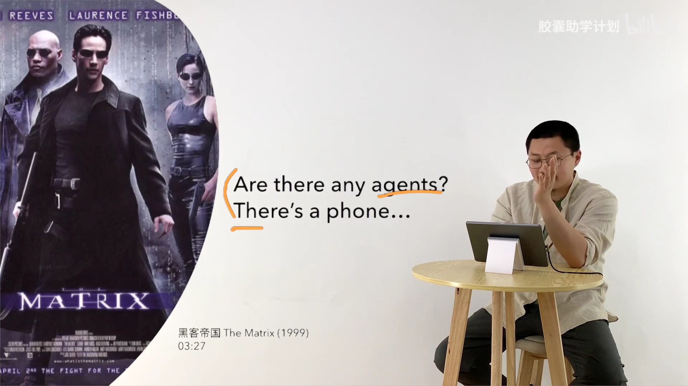

文字识别：REEVES / LAURENCEFISHBL / 胶囊助学计划 / Are there any agents? / There's a phone... / MATRIX / 黑客帝国The Matrix(1999) / 03:27 / APRIL 2 THE FIGHT FOR THE

### 画面 00:05:11

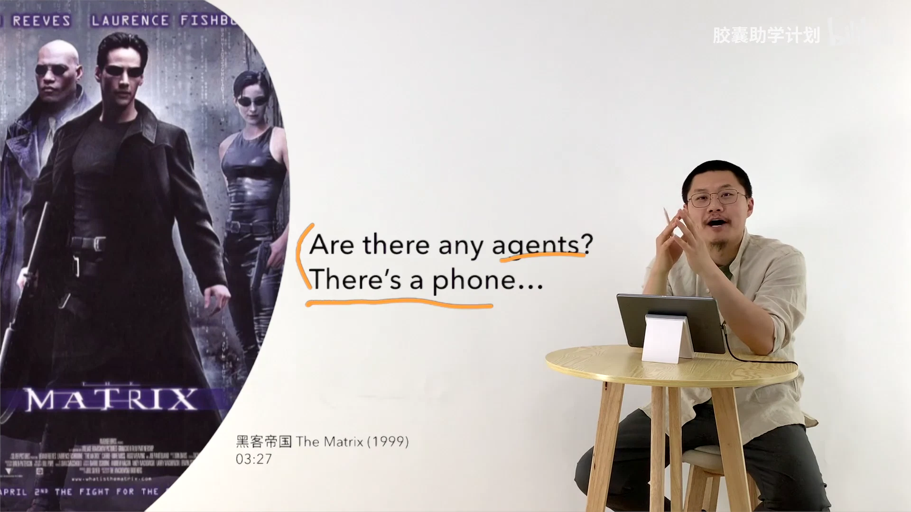

文字识别：REEVES / LAURENCE FISHBU / 胶囊助学计划 / Are there any agents? / There's a phone... / MATRIX / 黑客帝国The Matrix(1999) / 03:27 / APRIL 2I THE FIGHT FOR THE

### 画面 00:05:19

文字识别：REEVES / LAURENCEFISHBU / 胶囊助学计划 / Are there any agents? / There's a phone... / MATRIX / 黑客帝国The Matrix(1999) / 03:27 / APRIL 2 THE FIGHT FOR THE

### 画面 00:05:21

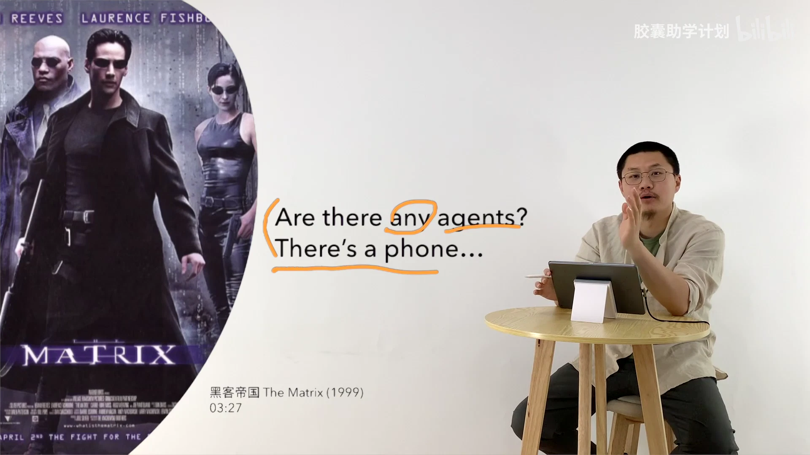

文字识别：REEVES / LAURENCE FISHBU / 胶囊助学计划 / Are there any agents? / There's a phone... / MATRIX / 黑客帝国The Matrix(1999) / 03:27 / APRIL 2 THE FIGHT FOR THE

### 画面 00:05:24

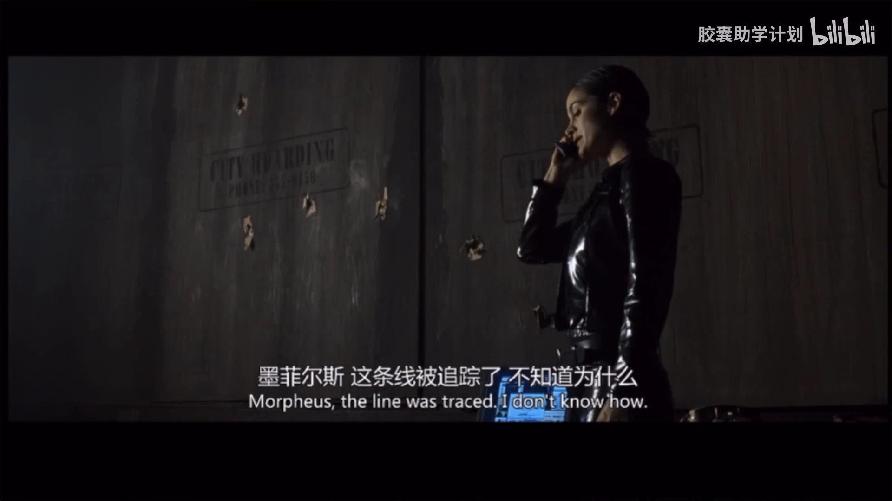

文字识别：bilibli / 胶囊助学计划 / 墨菲尔斯这条线被追踪了不知道为什么 / Morpheus, the line was traced.I don't know'how.

### 画面 00:05:26

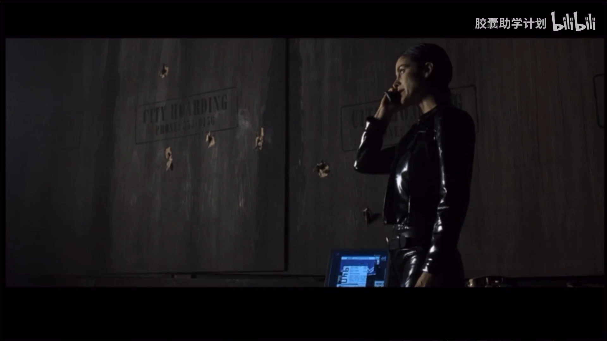

文字识别：biibili / 胶囊助学计划

### 画面 00:05:28

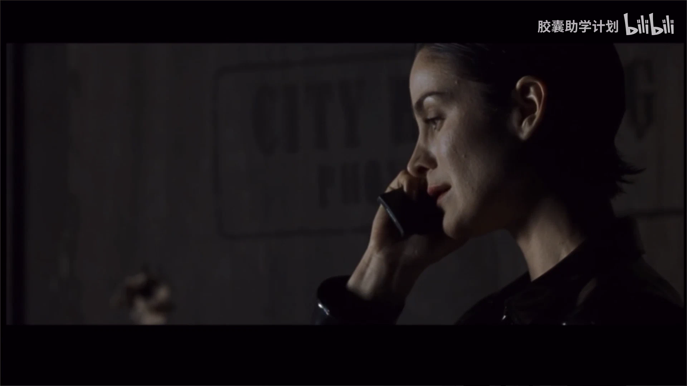

文字识别：bilibili / 胶囊助学计划

## 00:05:30–00:06:00

exit. Are there any agents? Yes. God damn it. You have to focus, Trinity. There's a phone at Wilson Lake. Okay.好Are there any agents?和There is a phone.来一个there be句型。接下来我们直接进入文章来了。Mrs. Miss A撇S，注意这可不是is，因为后边还有一个living room。那如果你说is的话，就变成了史密斯夫人是卧室，翻译不通，对吧？

### 画面 00:05:30

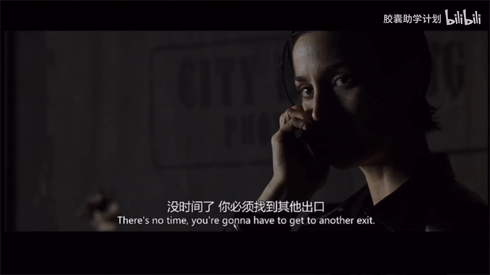

文字识别：bilibli / 胶囊助学计划 / 没时间了你必须找到其他出口 / There's no time, you're gonna have to get to another exit.

### 画面 00:05:32

文字识别：bilibili / 胶囊助学计划 / - 有特工在吗-有 / -Are there any agents? -Yes.

### 画面 00:05:34

文字识别：bilibili / 胶囊助学计划 / 见鬼 / Goddamn it.

### 画面 00:05:36

文字识别：bilibili / 胶囊助学计划 / 你需要专注 崔妮蒂 / You have to focus, Trinity.

### 画面 00:05:38

文字识别：bilibli / 胶囊助学计划 / 在威尔斯街和和雷克街路口有个电话亭 / There's a phone at Wells and Lake,

### 画面 00:05:40

文字识别：REEVES / LAURENCEFISHBU / 胶囊助学计划 / Are there any agents? / There's a phone... / MATRIX / 黑客帝国The Matrix(1999) / 03:27 / APRIL 2I THE FIGHT FOR THE

### 画面 00:05:42

文字识别：REEVES / LAURENCEFISHBU / 胶囊助学计划 / Are there any agents? / There's a phone... / MATRIX / 黑客帝国The Matrix(1999) / 03:27 / APRIL 2N THE FIGHT FOR THE

### 画面 00:05:45

文字识别：胶囊助学计划 / Mrs. Smith's living room is large. / There is a television in the room. / The television is near the window. / There are some magazines on the television.

### 画面 00:05:48

文字识别：胶囊助学计划 / Mrs. Smith's living room is large. / There is a television in the room. / The television is near the window. / There are some magazines on the television.

### 画面 00:05:51

文字识别：胶囊助学计划 / Mrs. Smith's living room is large. / There is a television in the room. / The television is near the window. / There are some magazines on the television.

### 画面 00:05:56

文字识别：胶囊助学计划 / Mrs. Smith's living room is large. / There is a television in the room. / The television is near the window. / There are some magazines on the television.

## 00:06:00–00:06:30

啊，史密斯夫人的卧室。P.S. 表的，我们之前在 whose 那一课有学过，非常的大。那我想问谁的卧室非常的大？我是对谁提问？Mrs. Smith。P.S. 提问对吧？就是 whose 吧。这句话就变成了 whose living room is large？谁的客厅是大的呀？要一定要有这个举一反三的能力对吧？然后我们可以问他的这个卧室啊，他的这个客厅啊，他这个客厅很大吗？Is 提前是不是就可以了？

### 画面 00:06:26

文字识别：胶囊助学计划 / unm1 / Mrs. Smith's living room is large. / There is a television in the room. / The television is near the window. / There are some magazines on the television.

## 00:06:30–00:07:00

OK， very good. 接下来说，There is a television in the room. A television，啊，这是老板的，对吧？在我这个房间当中啊，在这个客厅当中，总想说我是有一个 TV 电视。The television，我们二十五课刚学过特指和泛指，在这个地方是特指了，对吧？就这个电视，我刚刚提过的这个电视 is near the window，在窗户的旁边。There are，

### 画面 00:06:36

文字识别：胶囊助学计划 / Mrs. Smith's living room is large. / There is a television in the room. / The television is near the window. / There are some magazines on the television.

### 画面 00:06:56

文字识别：胶囊助学计划 / Mrs. Smith's living room is large. / There is a television in the room. / The television is near the window. / There are some magazines on the television.

## 00:07:00–00:07:30

说有啊 some magazines注意和我们之前刚刚提过的那个公式是保持一致的。首先有某物在某地，对吧？都是保持一致的。On the television，有一些杂杂杂志在这个电视上。接下来说 there is a table in the room，说有这么一个桌子在房间当中，在这个客厅当中。There are注意 some一些newspapers

### 画面 00:07:02

文字识别：胶囊助学计划 / Mrs. Smith's living room is large. / There is a television in the room. / The television is near the window. / There are some magazines on the television.

### 画面 00:07:10

文字识别：胶囊助学计划 / Mrs. Smith's living room is large. / There is a television in the room. / The television is near the window. / There are some magazines on the television.

### 画面 00:07:12

文字识别：胶囊助学计划 / Mrs. Smith's living room is large. / There is a television in the room. / The television is near the window. / There are some magazines on the television.

### 画面 00:07:14

文字识别：胶囊助学计划 / Mrs. Smith's living room is large. / There is a television in the room. / The television is near the window. / There are some magazines on the television.

### 画面 00:07:18

文字识别：胶囊助学计划 / Z / There is a table in the room. / There are some newspapers on the table. / There are some armchairs in the room. / The armchairs are near the table.

### 画面 00:07:28

文字识别：胶囊助学计划 / There is a table in the room. / There are Somenewspapers on the table. / There are some armchairs in the room. / The armchairs are near the table.

## 00:07:30–00:08:00

on the table. Newspapers, OK.好，这我们管它叫什么报纸，对吧？在这个桌子上，There are some又是一些armchairs, armchairs, armchairs in the room.在这个客厅当中，the armchairs.注意，但这不是a an了，对吧？但是注意，特指我依旧用的是the。说刚才我提到的是有一些，现在呢说的就是那些armchairs。于是他还用的是the，对不对？

### 画面 00:07:32

文字识别：胶囊助学计划 / n / There is a table in the room. / There are Somenewspapers on the table. / There are some armchairs in the room. / The armchairs are near the table.

### 画面 00:07:41

文字识别：胶囊助学计划 / There is a table in the room. / There are Somenewspapers on the table. / There are some armchairs in the room. / The armchairs are near the table.

### 画面 00:07:45

文字识别：胶囊助学计划 / n / There is a table in the room. / There are Somenewspapers on the table. / There are some armchairs in the room. / The armchairs are near the table.

### 画面 00:07:50

文字识别：胶囊助学计划 / There is a table in the room. / There are Somenewspapers on the table. / There are some armchairs in the room. / The armchairs are near the table.

## 00:08:00–00:08:30

The armchairs are near the table. 说在这个桌子的旁边。There you go. 那各位可以能注意到一件事儿，这地方全是什么句型？四句型当中全是什么句型？肯定句吧。这里边的每一句话几乎都能变成一个否定句，一个特殊疑问句和一个一般疑问句。那您把文章全背下来，你是不是直接只做好了四分之一？花百分之百的精力做四分之一的事儿，

### 画面 00:08:10

文字识别：胶囊助学计划 / There is a table in the room. / There are Somenewspapers on the table. / There are some armchairs in the room. / The armchairs arenear the table.

## 00:08:30–00:09:00

和花百分之百的精力做四分之四的事儿，这个之间差别有多大，就不用我提了，对吧？好，所以我个人的建议一直是文章熟读成诵即可。下一步的事情要把文章的肯定句做四句型的转换。今天我们的家庭作业就会留到这个。好，接下来说 There is a stereo in the room，说有这么一个音响啊，在客厅当中。这个音响 the 又来

### 画面 00:08:36

文字识别：There is a table in the room. / There are Some newspapers on the table. / There are some armchairs in the room. / The armchairs arenear the table.

### 画面 00:08:49

文字识别：胶囊助学计划 / There is a stereo in the room. / The stereo is near the door. / There are some books on the stereo. / There are some pictures in the room. / The pictures are on the wall.

### 画面 00:08:55

文字识别：胶囊助学计划 / There is a stereo in the room. / The stereo is near the door. / There are some books on the stereo. / There are some pictures in the room. / The pictures are on the wall.

## 00:09:00–00:09:30

了 is near the door 在这个门的旁边回去各位自己怎么做呢？我给大家带着做一个，其实很简单。我上课天天带大家带着大家做。The stereo stereo is not near the door. 否定句出来了，一般疑问句 is the stereo near the door? 对 near the door 提问 Where is the stereo? 好了，您一句话原文给了一句话，您自己变出来了三句话，举一反

### 画面 00:09:03

文字识别：胶囊助学计划 / There is a stereo in the room. / The stereo is near the door. / There are some books on the stereo. / There are some pictures in the room. / The pictures are on the wall.

### 画面 00:09:06

文字识别：胶囊助学计划 / There is a stereo in the room. / The stereo is near the door. / There are some books on the stereo. / There are some pictures in the room. / The pictures are on the wall.

### 画面 00:09:08

文字识别：There is a stereo in the room. / The stereo is near the door. / There are some books on the stereo. / There are some pictures in the room. / The pictures are on the wall.

### 画面 00:09:12

文字识别：There is a stereo in the room. / The stereo is near the door. / There are some books on the stereo. / There are some pictures in the room. / The pictures are on the wall.

### 画面 00:09:26

文字识别：胶囊 / There is a stereo in the room. / The stereo is near the door. / There are some books on the stereo. / There are some pictures in the room. / The pictures are on the wall.

## 00:09:30–00:10:00

三哈，非常的好。说There are some books，有一些书啊，on the stereo在这里啊，有一些书在这个音响的上方。There are some pictures，有一些图片in the room，在房间当中啊。各位pictures，pictures，the pictures就这个图片，这些图片are on the wall，它们是在墙上的。肯定句有了一般疑问句、特殊疑问

### 画面 00:09:36

文字识别：胶囊助学计划 / There is a stereo in the room. / The stereo is near the door. / There are some books on the stereo. / There are some pictures in the room. / • / The pictures are on the wall.

### 画面 00:09:38

文字识别：胶囊助学计划 / There is a stereo in the room. / The stereo is near the door. / There are some books on the stereo. / There are some pictures in the room. / The pictures are on the wall.

### 画面 00:09:40

文字识别：胶囊助学计划 / There is a stereo in the room. / The stereo is near the door. / There are some books on the stereo. / There are some pictures in the room. / The pictures are on the wall.

### 画面 00:09:47

文字识别：胶囊助学计划 / There is a stereo in the room. / The stereo is near the door. / There are some books on the stereo. / There are some pictures in the room. / The pictures are on the wall.

### 画面 00:09:51

文字识别：胶囊助学计划 / There is a stereo in the room. / The stereo is near the door. / There are some books on the stereo. / There are some pictures in the room. / The pictures are on the wall.

### 画面 00:09:58

文字识别：胶嚢助学计划 / There is a stereo in the room. / The stereo is near the door. / There are some books on the stereo. / There are some pictures in the room. / The pictures are on the wall.

## 00:10:00–00:10:30

句和否定句，各位自己就要下课去进行处理了啊！思路我们上课都教过了，OK。接下来我们做一些 comprehension 听力口语练习，各位眼睛移开屏幕，开始去看书，从书中找答案。如果我的速度在讲这个地方有点快，您听不懂，两个方式往前快进一下，或者说暂停来了。Is Mrs. Smith' living room small? 答

### 画面 00:10:04

文字识别：胶囊助学计划 / There is a stereo in the room. / The stereo is near the door. / There are some books on the stereo. / There are some pictures in the room. / The pictures are on the wall.

### 画面 00:10:06

文字识别：胶囊助学计划 / Comprehension

### 画面 00:10:10

文字识别：胶囊助学计划 / Comprehension

## 00:10:30–00:11:00

No, it isn't. It's large. Next one: Is there a television in the room? Yes, there is. Where is the television? It's near the window. Next one: Are there any magazines in the room? Yes, there are.

### 画面 00:10:30

文字识别：胶囊助学计划 / Comprehension / 1 T: Is Mrs. Smith's living room small? / S: No, it isn't. It's large.

### 画面 00:10:53

文字识别：胶囊助学计划 / Comprehension / 4 T: Are there any magazines in the room?

## 00:11:00–00:11:30

Are the magazines on the floor? No, they aren't. They are on the television. Next one. Are there any newspapers? Yes, there are. Is there a stereo in the room? Yes, there is. Where is the stereo? It's near the door. Are there

### 画面 00:11:05

文字识别：胶囊助学计划 / Comprehension / 5 T: Are the magazines on the floor? / S: No, they aren't. They're on the television.

### 画面 00:11:16

文字识别：胶囊助学计划 / Comprehension / 7 T: Is there a stereo in the room?

## 00:11:30–00:12:00

any books or magazines on the stereo? Or,或者No, there aren't. There are some books.或者您不用管No, there aren't.这可能会让大家有点疑惑，是吧？是这些还是那些？您直接说Some books就可以了。答案继续。Are there any pictures on the wall? Yes, there are.那比如说，我还可以问你Where are the pictures?你的回答On the wall

### 画面 00:11:36

文字识别：胶囊助学计划 / Comprehension / 9 T: Are there any books or magazines on / the stereo? / S: No, there aren't. There are some books.

### 画面 00:11:41

文字识别：胶囊助学计划 / Comprehension / 9 T: Are there any books or magazines on / the stereo? / S: Ne, there aren't. There are some books.

### 画面 00:11:47

文字识别：胶囊助学计划 / Comprehension / 9 T: Are there any books or magazines on / the stereo? / S: Ne there aren't. There are some books.

### 画面 00:11:49

文字识别：胶囊助学计划 / Comprehension / 10 T: Are there any pictures on the wall?

## 00:12:00–00:12:30

就可以了。玩一个，接下来我们做 asking questions，又是听力口语练习。好，我问您答啊，最好是完全不看着这里啊。初期如果不行，可以看着，但一定要有一天完全脱离这个地方。我们只进行听力口语的对答。来了， ask me if这三个单词不重要。 The television is near the window. 答案 is the television near the window?

### 画面 00:12:06

文字识别：胶囊助学计划 / Asking questions / 1 T : Ask me if the television is near the window.

### 画面 00:12:08

文字识别：Asking questions / 1 T: Ask me if the television is near the window. / 2

### 画面 00:12:11

文字识别：胶囊助学计划 / Asking questions / 1 T : Ask me if the television is near the window.

### 画面 00:12:22

文字识别：胶囊助学计划 / Asking questions / 1 T: Ask me if the television is near the window.

## 00:12:30–00:13:00

Where? Where is the television? 肯定句变一般疑问句变特殊疑问句，对吧？再来，Ask me if the magazines are on the television. Are the magazines on the television? Where? Where are the magazines? Where对on the television提问，把它去掉，where提前，Where are the magazines? Okay. 下

### 画面 00:12:34

文字识别：Asking questions / 1 T : Ask me if the television is near the window. / S: Is the television near the window? / T:Where...? / S: Where is the television?

### 画面 00:12:36

文字识别：Asking questions / 1 T: Ask me if the television is near the window. / S: Is the television near the window? / T: Where...? / S: Where is the television?

### 画面 00:12:38

文字识别：Asking questions / 2 T : Ask me if the magazines are on the television.

### 画面 00:12:51

文字识别：胶囊助学计划 / Asking questions / 2 T: Ask me if the magazines are on the television. / S: Are the magazines on the television? / T:Where...? / S: Where are the magazines?

### 画面 00:12:54

文字识别：胶囊助学计划 / Asking questions / 2 T: Ask me if the magazines are on the television. / S: Are the magazines on the television? / T:Where...? / S: Where are the magazines?

### 画面 00:12:56

文字识别：胶囊助学计划 / Asking questions / 2 T: Ask me if the magazines are on the television. / S: Are the magazines on thetelevision? / TWhere..? / S: Where are the magazines?

### 画面 00:12:58

文字识别：胶囊助学计划 / Asking questions / 2 T: Ask me if the magazines are on the television. / Are the magazines on thetelevision? / Where...? / S: Where are the magazines?

## 00:13:00–00:13:30

一个, ask me if.只管后边啊. There is a stereo in the room. Is there a stereo in the room? Where? Where is the stereo? Okay,那地方我提一个小点哈。我们对in the room提问，理论上来说这句话应该叫做Where is there a stereo?而不是Where is the stereo?对吧？好，这地方注意一小下。我们大多数情况下不会

### 画面 00:13:00

文字识别：胶囊助学计划 / Asking questions / 3 T: Ask me if there is a stereo in the room.

### 画面 00:13:04

文字识别：胶囊助学计划 / Asking questions / 3T: Ask me ifthere is a stereo in the room.

### 画面 00:13:07

文字识别：胶囊助学计划 / Asking questions / 3 T : Ask me i/there is a stereo in the room.

### 画面 00:13:16

文字识别：胶囊助学计划 / Asking questions / 3 T: Ask me if there is a stereo in the room. / S: Is there a stereo in the room? / T: Where...? / S: Where is the stereo?

### 画面 00:13:21

文字识别：胶囊助学计划 / Asking questions / 3 T: Ask me i there is a stereo in the room. / S: Is there a stereoin the room / T: Where...? / S: Where is the stereo?

### 画面 00:13:24

文字识别：胶囊助学计划 / Asking questions / 3 T : Ask me i/ there is a stereo in the room. / S: Is there a stereoin the room? / T: Where...? / S: Where is the stereo?

### 画面 00:13:26

文字识别：胶囊助学计划 / Asking questions / 3T: Ask me i/there is a stereo in the room. / S: Is there a stereoin the room? / T: Where...? / S: Where is the stereo?

### 画面 00:13:29

文字识别：胶囊 / Asking questions / 3T: Ask me i there is a stereo in the room. / S: Is there a stereoin the room? / T: Where...? / S: Where is the stereo?

## 00:13:30–00:14:00

去说 where is there. 虽然语法上貌似是没错，但人们不这么说。注意语言为大，语法为辅。 OK，当我们说语法对，但语言不这么说的时候，您别杠，以语言为主，而不以语法为主。所以这个地方我们更多的说的是 where is the stereo. OK，下一个 ask me if the books are on the stereo.

### 画面 00:13:51

文字识别：胶囊助学计划 / Asking questions / 3T: Ask me i/there is a stereo in the room. / S: Is there a stereoin the room? / T: Where...? / S: Where is the stereo?

### 画面 00:13:54

文字识别：胶囊助学计划 / Asking questions

### 画面 00:13:56

文字识别：Asking questions / 4 T : Ask me if the books are on the stereo.

## 00:14:00–00:14:30

Are the books on the stereo? Where, where are the books? Continue. Ask me if the pictures are on the wall. Are the pictures on the wall? Where, where are the pictures? Very good. Some and any的异同，我相信各位今天通过刚才的

### 画面 00:14:05

文字识别：Asking questions / 4T : Ask me if the books are on the stereo. / S: Are the books on the stereo? / T:Where...? / S: Where are the books?

### 画面 00:14:07

文字识别：Asking questions

### 画面 00:14:17

文字识别：胶囊助学计划 / Asking questions / 5 T : Ask me if the pictures are on the wall. / S: Are the pictures on the wall?

### 画面 00:14:24

文字识别：胶囊助学计划 / ① some VS any异同？

### 画面 00:14:26

文字识别：胶囊助学计划 / ① some VS any异同?

### 画面 00:14:29

文字识别：胶囊助学计划 / ①some VS any异同？

## 00:14:30–00:15:00

练习以及讲解，各位应该已经自己明白了。那 recap 我们关键的点还是 some 跟 any。我们回顾一下相同点是什么？在本课来说表示一些，对吧？那不同点呢？ some 用在肯定句当中，而 any 用在一般疑问句和否定句当中。 OK，好，那看一下今天讲作业。第一，绿皮书各位可以开始写了，并且可以写完。其次，文章一定要跟读至

### 画面 00:14:33

文字识别：胶囊助学计划 / Recap / Patterns / Grammar / Words / some / any / Expression

### 画面 00:14:36

文字识别：Recap / 胶囊助学计划 / Patterns / Grammar / Words / some / any / Expression

### 画面 00:14:51

文字识别：胶囊助学计划

## 00:15:00–00:15:30

熟读成诵，OK，好，接下来呢，原文各位要做一件事情，把它变成否定句和一般疑问句。我们原文是肯定句，对吧？当您文章跟读至熟读成诵之后呢，再去做这个练习，把它用口语或者写作的形式变成否定句或一般疑问句即可，OK，好，接下来呢，给

### 画面 00:15:08

文字识别：胶囊助学计划 / 绿皮书第27课的写作练习 / 文章跟读至熟读成诵读 / 3.原文变否定句1一般疑问句

### 画面 00:15:17

文字识别：胶囊助学计划 / 绿皮书第27课的写作练习 / 文章跟读至熟读成诵 / 3.原文变否定句1一般疑问句

### 画面 00:15:20

文字识别：胶囊助学计划 / 绿皮书第27课的写作练习 / 文章跟读至熟读成诵 / 3.原文变否定句1一般疑问句

## 00:15:30–00:16:00

自己讲解一遍今天的核心知识点，关键就是 some 和 any 它的用法，很简单，三十秒您就可以处理完。好，那以上呢就是本期视频的全部内容了。如果大家喜欢呢，欢迎大家关注、订阅、一键三连支持，并分享给那些需要的朋友们。那最后的最后，我们再来看一句名人名言。When one door closes, another window opens. See you next time.

### 画面 00:15:38

文字识别：胶囊助学计划 / 9

### 画面 00:15:41

文字识别：胶囊助学计划

### 画面 00:15:47

文字识别：胶囊助学计划 / When one door closes, another window opens. / Julie Andrews

### 画面 00:15:52

文字识别：胶囊助学计划 / When one door closes, another window opens. / -Julie Andrews

### 画面 00:15:57

### 画面 00:15:59

文字识别：CAPSULEACADEMY / 胶囊助学计划 / 小红书 / Lecturer / □ / 口 / Leo / OE

## 00:16:00–00:16:10

### 画面 00:16:02

文字识别：CAPSULEACADEMY / 胶囊助学计划 / 小红书

### 画面 00:16:05

文字识别：CAPSULEACADEMY / 胶囊助学计划 / 小红书 / Creator / Leo & Berlin / OE

### 画面 00:16:07

文字识别：Bilbili / 胶囊助学计划 / CAPSULEACADEMY / 胶囊助学计划 / 小红书 / OE

### 画面 00:16:09

文字识别：bilibili / 胶囊助学计划

