# 028 单词 练习

快速机器解析：语音为单模型转写，未进行独立交叉校对或人工复核；画面每秒采样并按变化选帧，短时文字和标记可能遗漏。截图时间约有 1 秒误差。图片有损压缩；遇到疑点请按时间查看 Google Drive 原视频。

## 00:00:00–00:00:30

Hello, everyone. Welcome to Capsule Academy. This is Leo. Today, we're going to learn New Concept English Book One, Lesson Twenty Eight, Practices and Words. Hope you gonna enjoy it.好，上来我们先看第一个单词 trousers. OK, 注意它这个单词本身就是复数啊，裤子两个腿儿，对吧？英文理解为它就是复数。再跟我一起读一下

### 画面 00:00:00

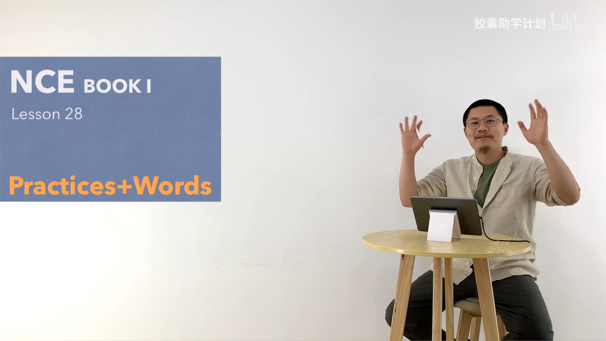

文字识别：胶囊助学计划 / NCE / BOOKI / Lesson 28 / Practices+Words

### 画面 00:00:02

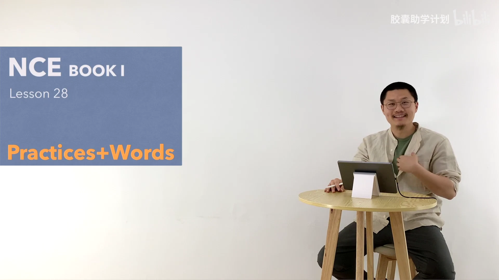

文字识别：胶囊助学计划 / NCE / BOOKI / Lesson 28 / Practices+Words

### 画面 00:00:11

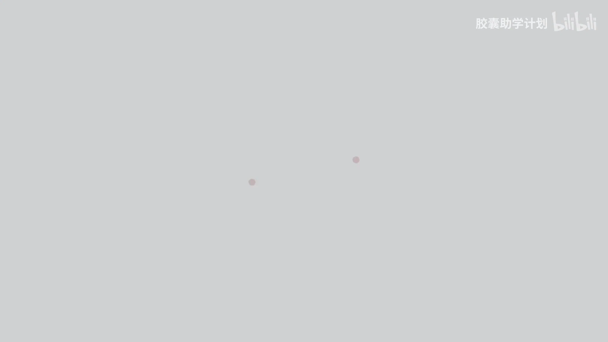

文字识别：胶囊助学计划blbl / •

### 画面 00:00:15

文字识别：胶囊助学计划

### 画面 00:00:17

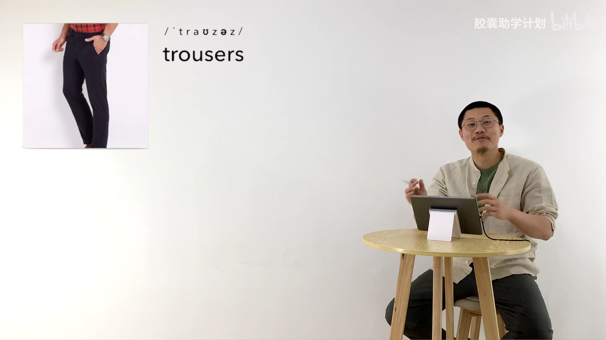

文字识别：胶囊助学计划 / / 'trauzazl / trousers

### 画面 00:00:20

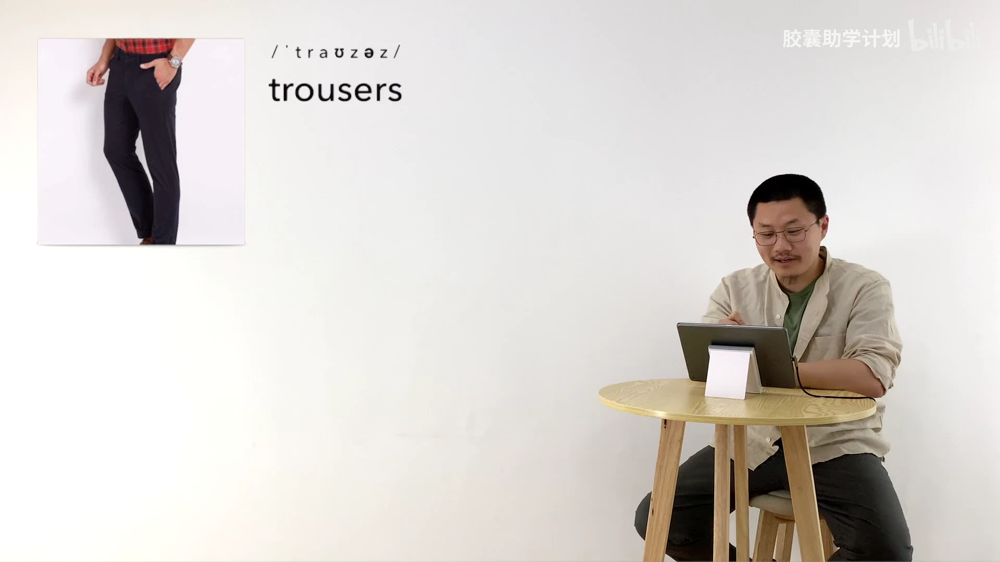

文字识别：胶囊助学计划 / /'trauzazl / trousers

### 画面 00:00:25

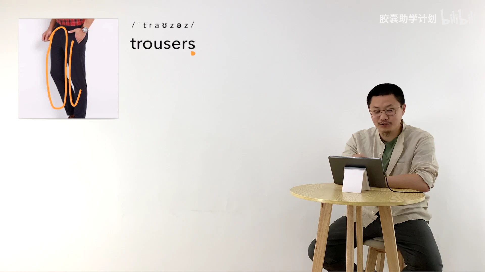

文字识别：胶囊助学计划 / / 'trauzazl / trousers

### 画面 00:00:27

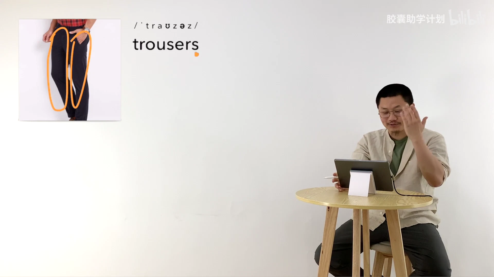

文字识别：胶囊助学计划 / / 'trauzazl / trousers

### 画面 00:00:29

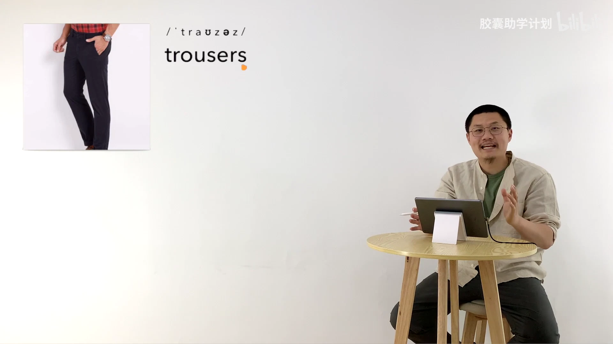

文字识别：胶囊助学计划 / /'trauzazl / trousers

## 00:00:30–00:01:00

trousers. trousers 有一点点小的拗口。比如说，我们造一个句子叫做 My trousers are in the living room. 在客厅里边呢。变一般疑问句，说你的裤子在客厅里吗？Are my trousers in the living room? 啊，当然这说的是我的裤子在客厅里吗？那想说你的裤子呢？Are your trousers? 非常的简单。对，in the living room提问，用 where，对不对？叫做 Where are

### 画面 00:00:44

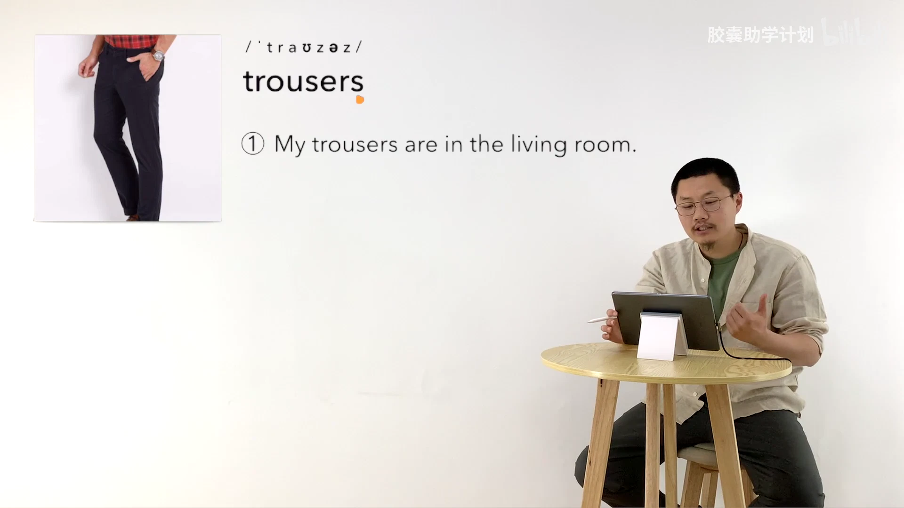

文字识别：胶囊助学计划 / /trauzaz/ / trousers / ① My trousers are in the living room.

### 画面 00:00:50

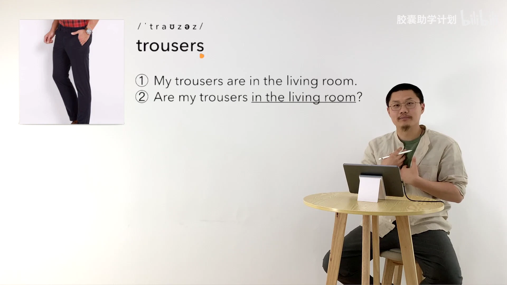

文字识别：胶囊助学计划 / /'trauzazl / trousers / ① My trousers are in the living room. / ② Are my trousers in the living room?

## 00:01:00–00:01:30

are my trousers？这一听就是小孩问妈妈， Mom, where are my trousers？说妈妈，我的这个裤子在哪呢？玩一个，接下来呢，我们一起看一个小的电影片段。在这个电影片段当中，很幸运，我们既能看到 there be 句型，又能看到 trousers。 OK，那 gun 的意思呢，就是枪。 OK，接下来我们一起看一下这个小的电影片段。 What's that？ It's my belt, Turkish. Now tell

### 画面 00:01:10

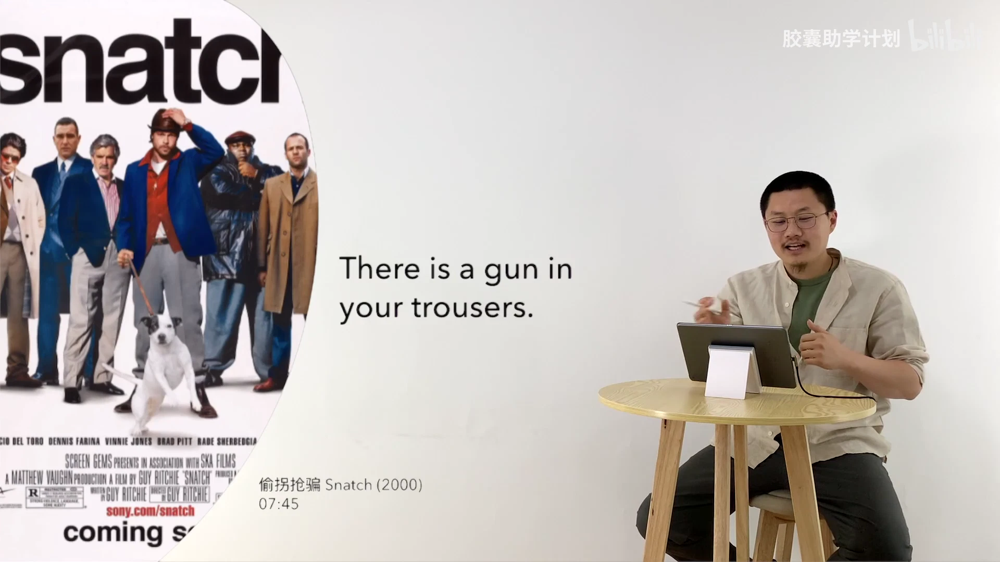

文字识别：snatci / 胶囊助学计划 / There is a gun in / your / trousers. / I0DELT / DENNIS FARINA / VINNIE JONES BBAD PITT BADE SHERBEDGIA / 偷拐抢骗 Snatch (2000) / 07:45 / sony.com/snatch / coming / S

### 画面 00:01:17

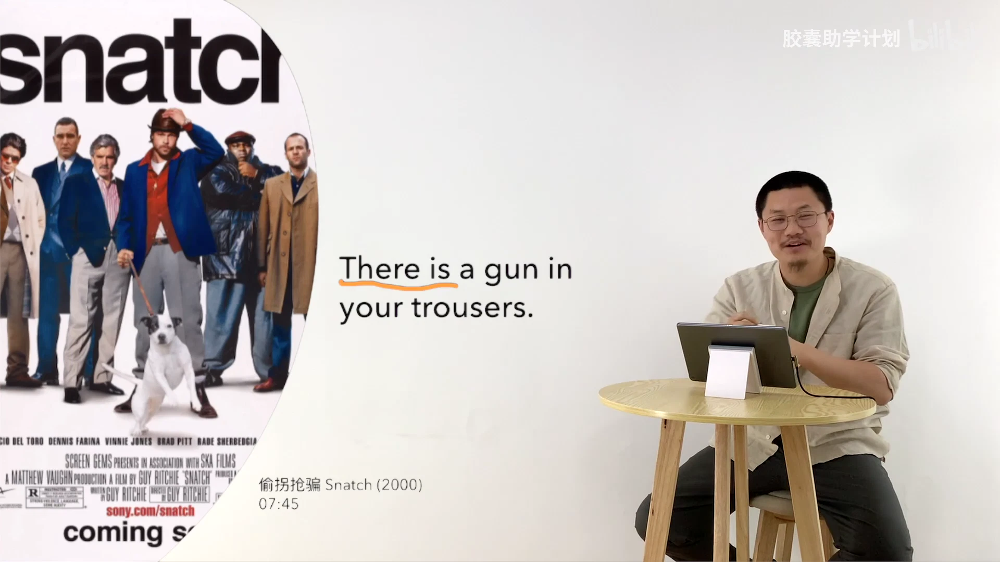

文字识别：snatci / 胶囊助学计划 / There is a gun in / your / trousers. / DENNISFARINA / VINNIE JONES BRAD PITT BADE SHERBEDGI / 偷拐抢骗 Snatch(2000) / 07:45 / sony.com/snatch / coming

### 画面 00:01:20

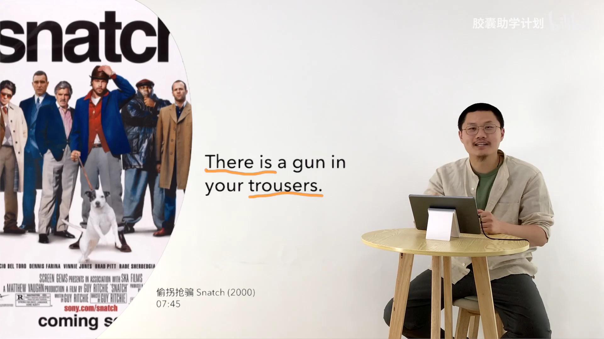

文字识别：snatci / 胶囊助学计划 / There is a gun in / your / trousers. / 10DEL / DENNIS FARINA / VINNIE JONES BRAD PITT RADE SHERBEDGIA / 偷拐抢骗 Snatch(2000) / 07:45 / sony.com/snatch / coming

### 画面 00:01:22

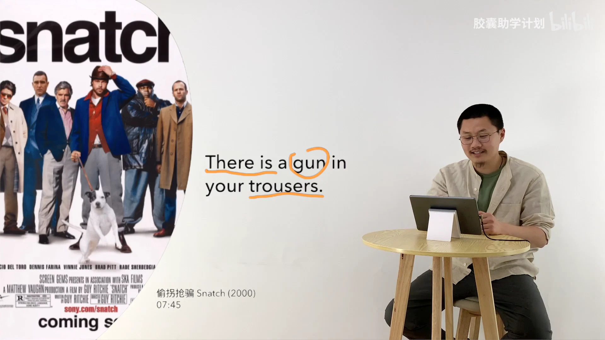

文字识别：snatci / 胶囊助学计划 / There is a / gun / in / your / trousers. / 10 / EL / DENNIS FARINA / VINNIE JONES BRAD PITT / RADE SHERBEDGIA / 偷拐抢骗 Snatch (2000) / 07:45 / sony.com/snatch / coming

### 画面 00:01:26

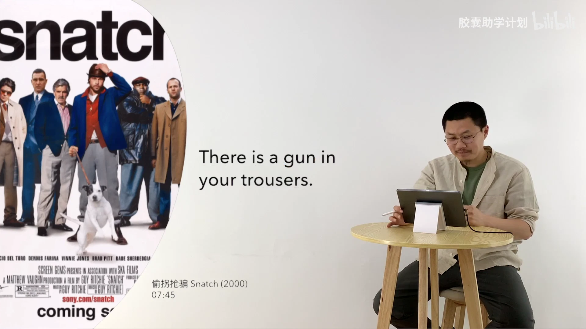

文字识别：snatci / 胶囊助学计划 / There /  isa gun in / your / trousers. / 10DEL1 / DENNIS FARINA / VINNIE JONES BBAD PITT BADE SHERBEDCIA / 偷拐抢骗 Snatch (2000) / 07:45 / sony.com/snatch / coming / S

### 画面 00:01:28

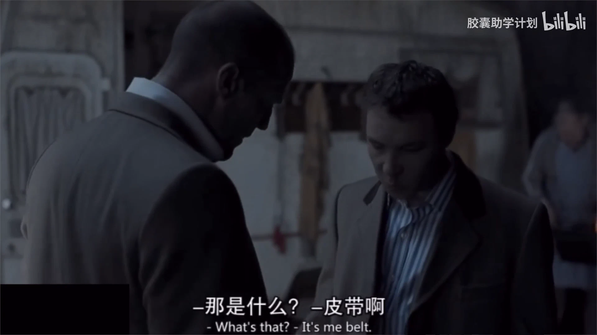

文字识别：bilibili / 胶囊助学计划 / -那是什么？-皮带啊 / -What's that?-It's me belt.

## 00:01:30–00:02:00

me, there's a gun in your trousers. What is a gun doing in your trousers? For protection. Protection from what? The Germans. Okay, so there is a gun in your trousers. Very good.好，接下来呢，我们做一点小的练习，对吧？武术课最重要的事情就是练习，练习还是练习。接下来呢，我们先一起回顾一下 some 和 any。在上一个视频当中，我们刚刚讲过 some 在 there be 句型当中用在肯定句当中，

### 画面 00:01:30

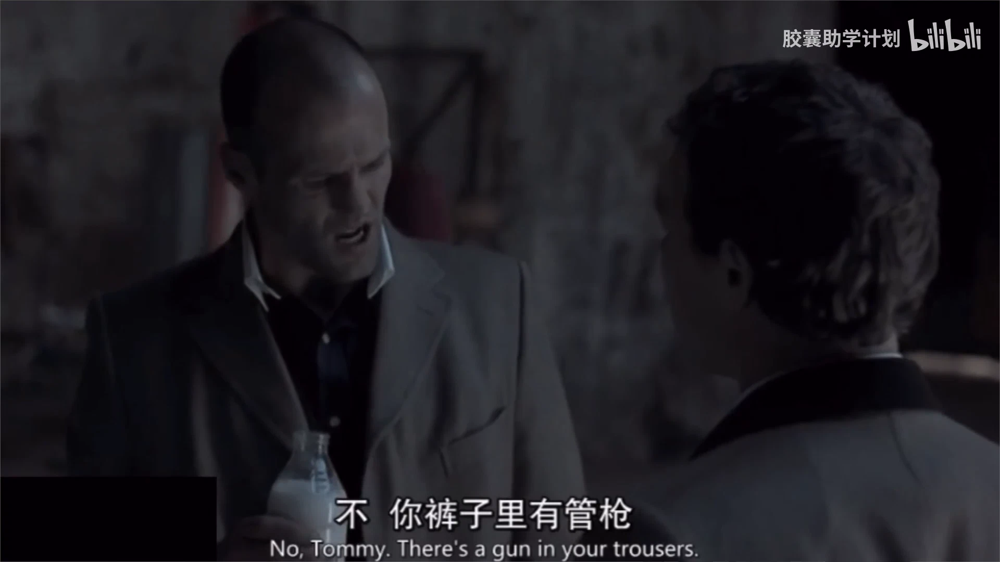

文字识别：bilibli / 胶囊助学计划 / 不你裤子里有管枪 / No, Tommy. There's a gun in your trousers.

### 画面 00:01:32

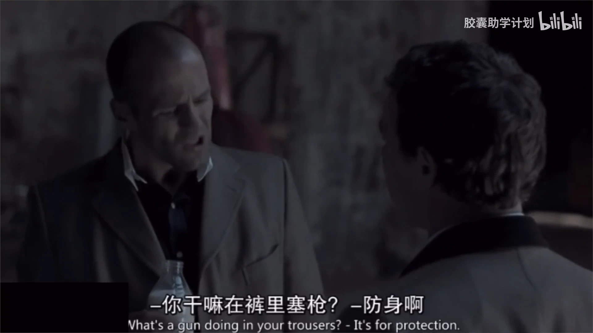

文字识别：bilibli / 胶囊助学计划 / -你干嘛在裤里塞枪？-防身啊 / Vhat's a gun doing in your trousers?-It's for protection.

### 画面 00:01:34

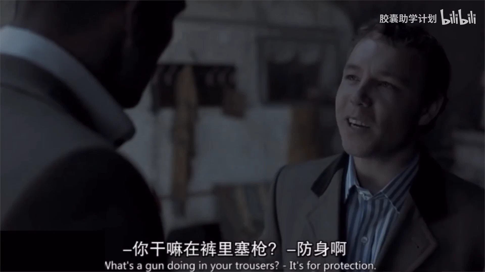

文字识别：bilbili / 胶囊助学计划 / -你干嘛在裤里塞枪？-防身啊 / Vhat's a gun doing in your trousers?-It's for protection.

### 画面 00:01:36

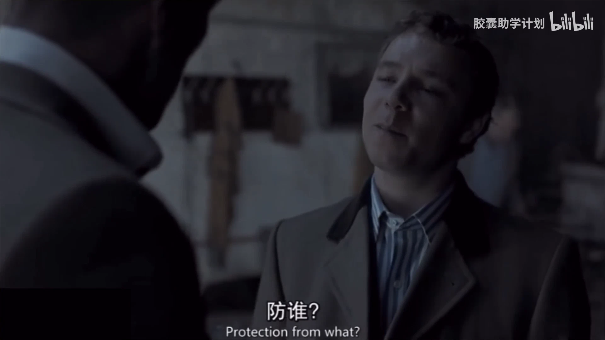

文字识别：bilibili / 胶囊助学计划 / 防谁？ / Protection from what?

### 画面 00:01:38

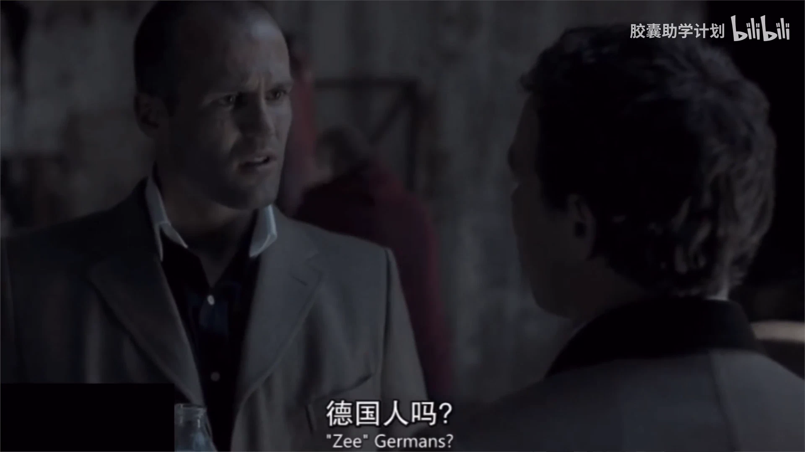

文字识别：bilibili / 胶囊助学计划 / 德国人吗? / "Zee"Germans?

### 画面 00:01:40

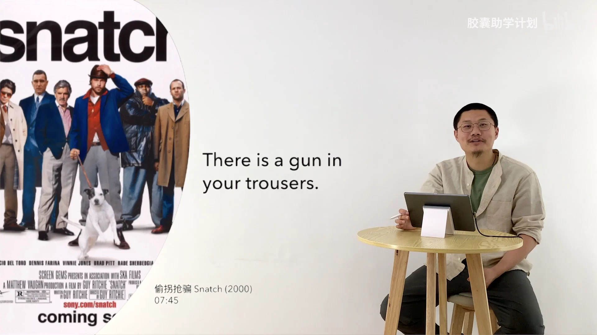

文字识别：snatci / 胶囊助学计划 / There /  is a gun in / your / trousers. / 10DEL1 / DENNIS FARINA / VINNIE JONES BRAD PITT BAOE SHERBEDGIA / 偷拐抢骗 Snatch(2000) / 07:45 / sony.com/snatch / coming / S

### 画面 00:01:43

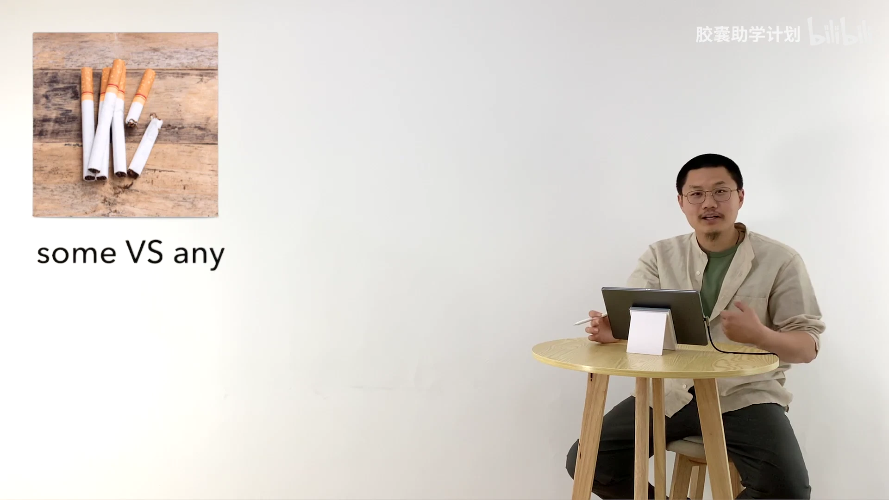

文字识别：胶囊助学计划 / some VS any

### 画面 00:01:54

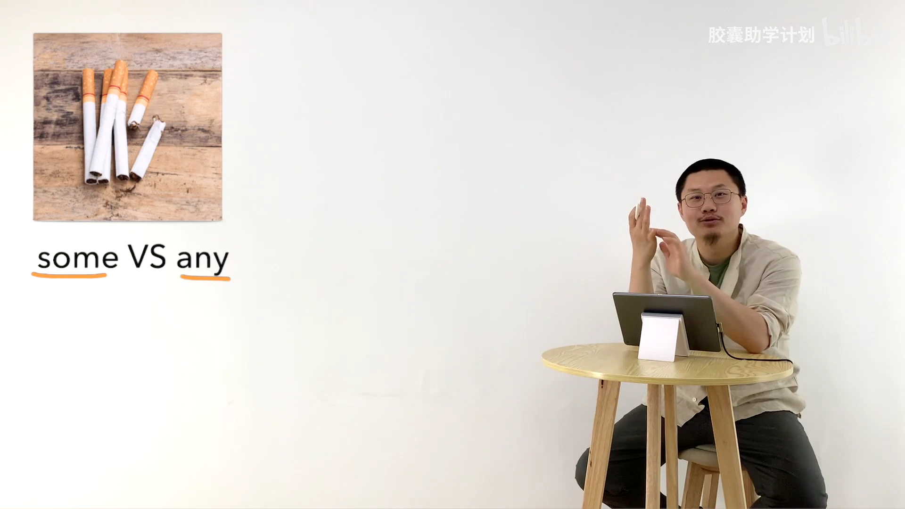

文字识别：胶囊助学计划 / some VS any

## 00:02:00–00:02:30

而 any 用在否定和一般疑问句当中。接下来我们就去做一些小的练习来了。Are there books on the dressing table? 好了，注意接下来应该用 any 了，对不对？好，自己去想啊，跟上来。Repeat after me. Are there any books on the dressing table? No. 否定句。There aren't any books. There are some

### 画面 00:02:04

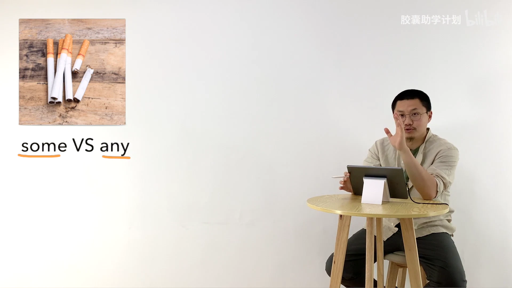

文字识别：胶囊助学计划 / some VS any

### 画面 00:02:06

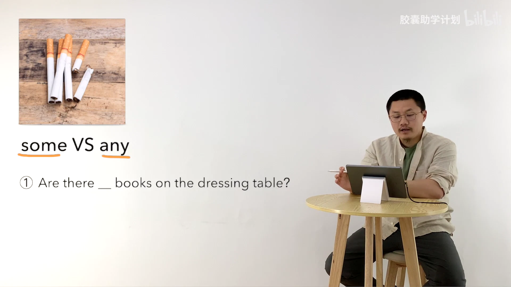

文字识别：胶囊助学计划 / some VS any / ① Are there _ books on the dressing table?

## 00:02:30–00:03:00

### 画面 00:02:32

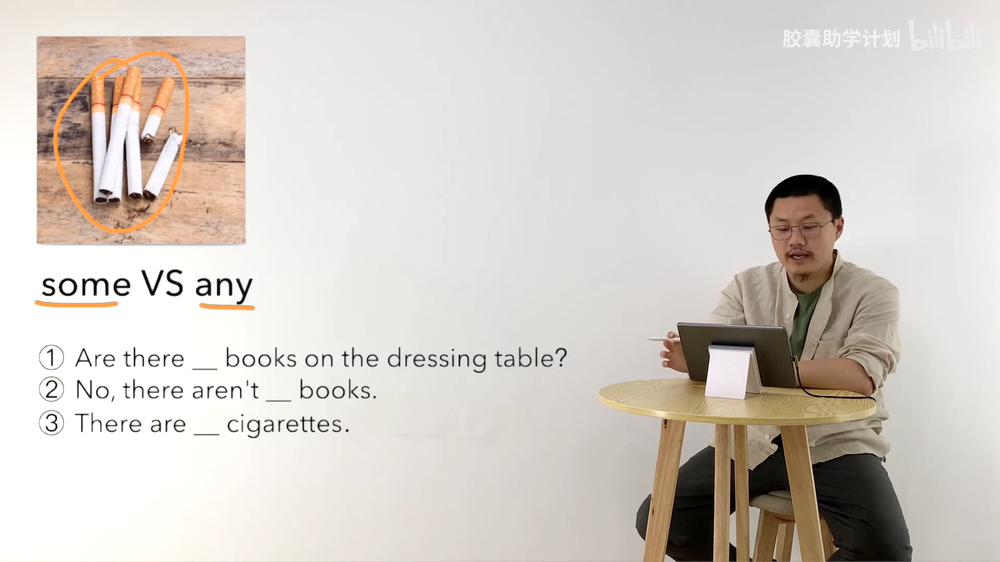

文字识别：胶囊助学计划 / some VS any /  Are there _ books on the dressing table? / 1 / No, there aren't_ books. / There are_cigarettes.

### 画面 00:02:41

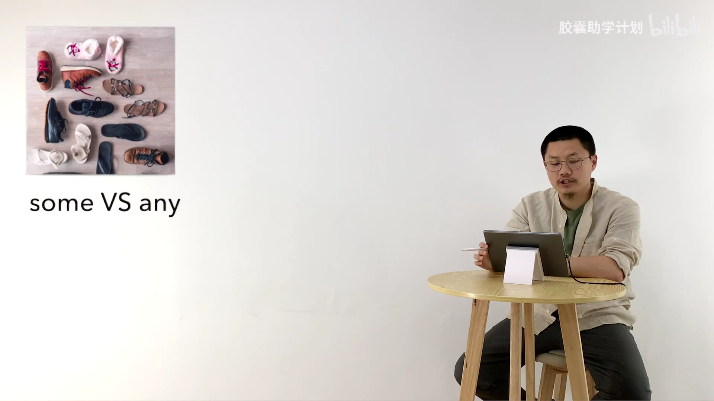

文字识别：胶囊助学计划 / some VS any

### 画面 00:02:59

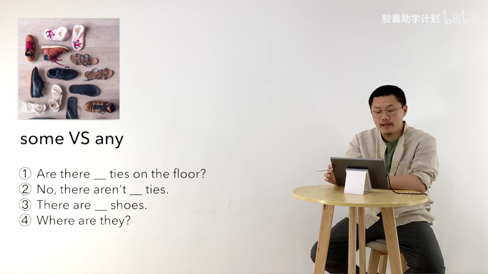

文字识别：胶囊助学计划 / some VS any / ①Are there _ ties on the floor? / 2 / No, there aren't_ties. / There are _shoes. / Where are they?

## 00:03:00–00:03:30

Where are they? They are near the bed. 好，提一个小点，P R E是谁的缩写？R的缩写。 Continue. Are there any glasses on the cupboard? No, there aren't any glasses. There are some bottles. Where are they? They are near those tins. There

### 画面 00:03:09

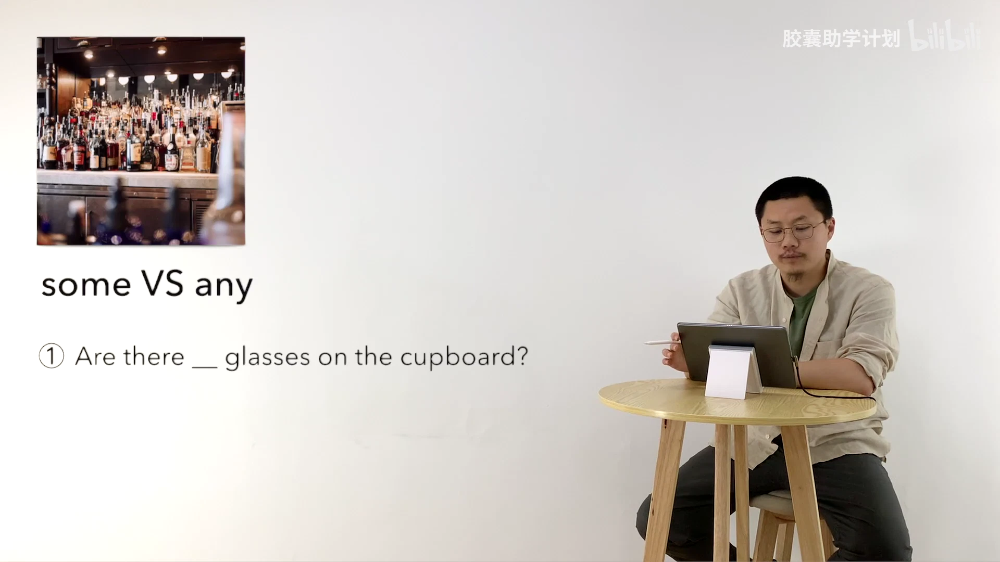

文字识别：胶囊助学计划 / some VS any / ① Are there _glasses on the cupboard?

### 画面 00:03:25

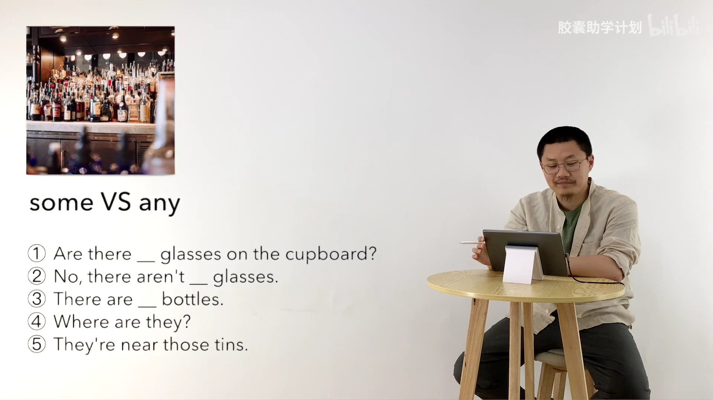

文字识别：胶囊助学计划 / some VS any / ① Are there _glasses on the cupboard? / 2 / No, there aren't_glasses. / There are_ bottles. / Where are they? / They're near those tins.

## 00:03:30–00:04:00

there we go. Let's continue. Are there any newspapers on the shelf? No, there aren't any newspapers. There are some tickets票. Where are they? They are in that handbag. Now where are they? This day指的是 newspapers啊. Continue. Are there any forks on the table?

### 画面 00:03:30

文字识别：胶囊助学计划 / RMPH / OPERA / 月三9日月21 / some VS any

### 画面 00:03:32

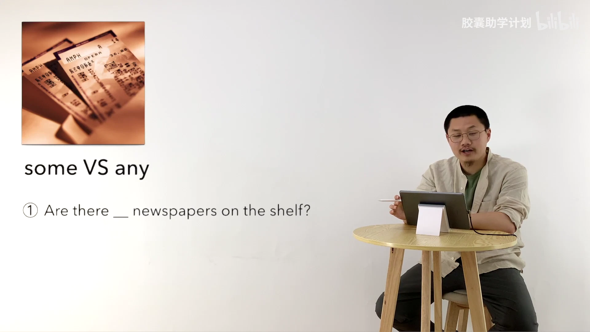

文字识别：胶囊助学计划 / RMPH / OPERR / 月三9日月21 / AMPH / some VS any / ① Are there _ newspapers on the shelf?

### 画面 00:03:36

文字识别：胶囊助学计划 / AMPH / OPERA / 有三9日月1 / AMPH / 122425 / 9 / some VS any / ① Are there _ newspapers on the shelf? / ② No, there aren't_ newspapers.

### 画面 00:03:40

文字识别：胶囊助学计划 / AMPH / OPERA / 月三9日月1 / some VS any / ① Are there _ newspapers on the shelf? / ② No, there aren't_ newspapers.

### 画面 00:03:43

文字识别：胶囊助学计划 / RMPH / OPERR / 月三9日月1 / some VS any / ① Are there _ newspapers on the shelf? / No, there aren't _ newspapers. / 2 / There are_tickets.

### 画面 00:03:45

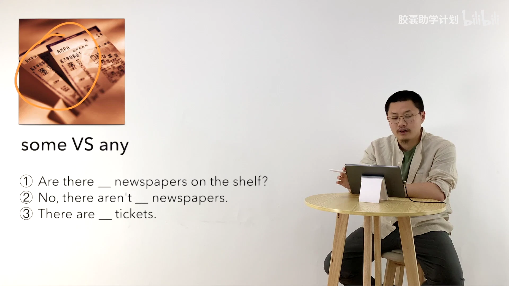

文字识别：胶囊助学计划 / RMPH / OPERR / 月三9日月21 / some VS any / ① Are there _ newspapers on the shelf? / No, there aren't _ newspapers. / 2 / There are_tickets.

### 画面 00:03:50

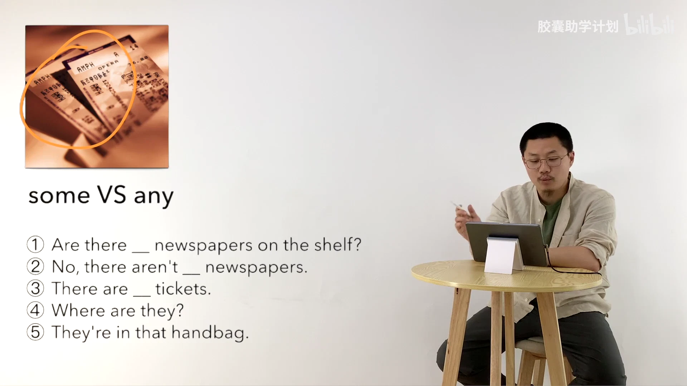

文字识别：胶囊助学计划 / AMPH / OPERR / 月三9日月1 / some VS any / ① Are there _ newspapers on the shelf? / 2 / No, there aren't_ newspapers. / There are / tickets. / Where are they? / They're in that handbag.

### 画面 00:03:52

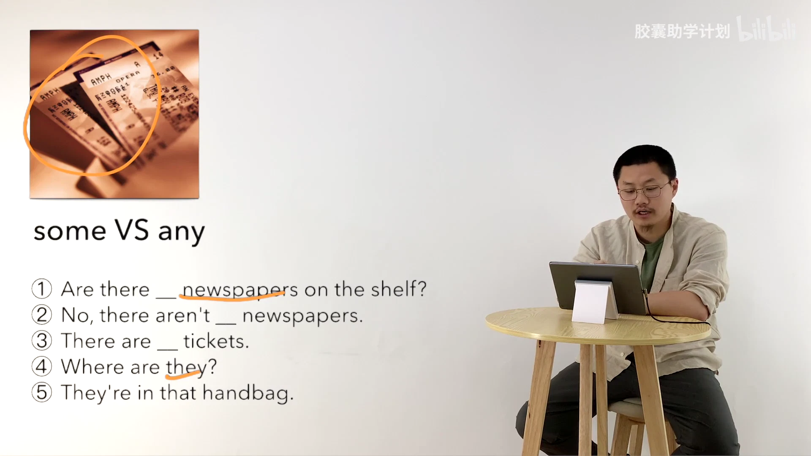

文字识别：胶囊助学计划 / RMPH / OPERR / 月三9日月1 / some VS any / D Are there newspapers on the shelf? / 1 / No, there aren't _ newspapers. / There are / tickets. / Where are they? / They're in that handbag.

### 画面 00:03:54

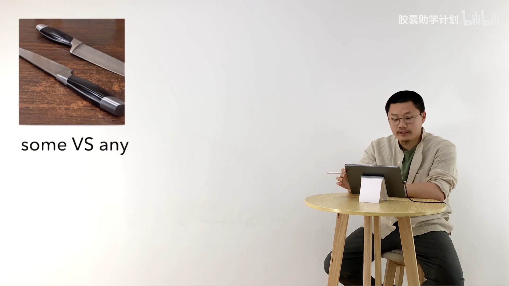

文字识别：胶囊助学计划 / some VS any

## 00:04:00–00:04:30

桌子上有叉子吗？No, there aren't any forks.否定句any啊，一般疑问句any. There are some knives. Where are they? They are in that box. Good. Continue. Are there any cups near the television? No, there aren't any cups. There are some books. Where

### 画面 00:04:06

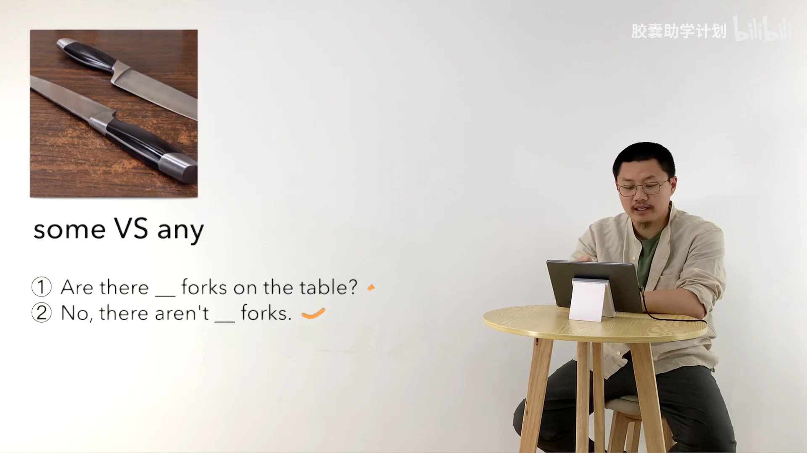

文字识别：胶囊助学计划 / some VS any / ① Are there _forks on the table? / ② No, there aren't_forks. ~

### 画面 00:04:16

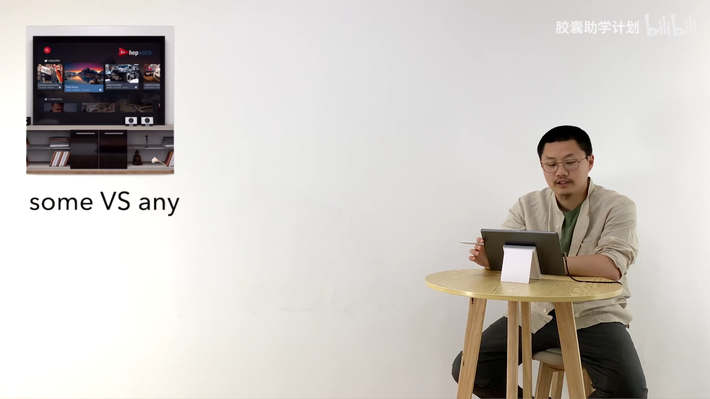

文字识别：胶囊助学计划 / hopwatch / some VS any

### 画面 00:04:29

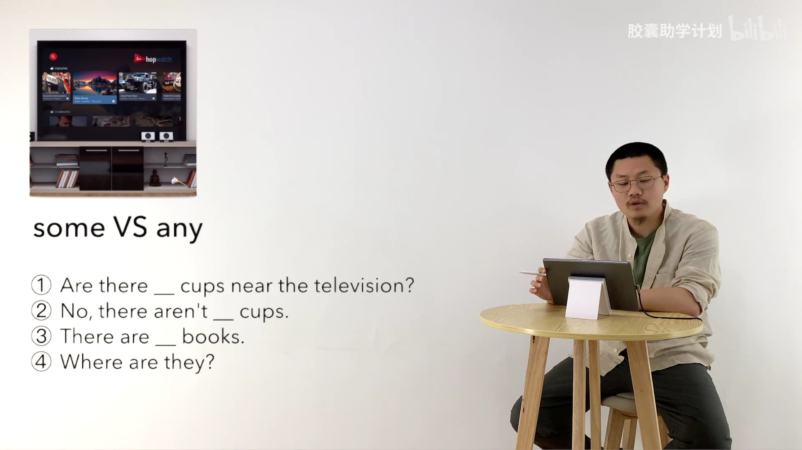

文字识别：胶囊助学计划 / hopwatch / some VS any / ① Are there _ cups near the television? / No, there aren't_ cups. / There are / books. / Where are they?

## 00:04:30–00:05:00

are they? They are near those bottles. 好，第一个小点还记不记得？Those表示的是那些，these表示的是这些。好，Recap，本课我们练习了两个关键的小的语法，一个是there be句型的复数there are，一个是some和any。什么时候用some，什么时候用any，进行了这样的一些练习。我们看一下本课的家庭作业。第一，绿

### 画面 00:04:40

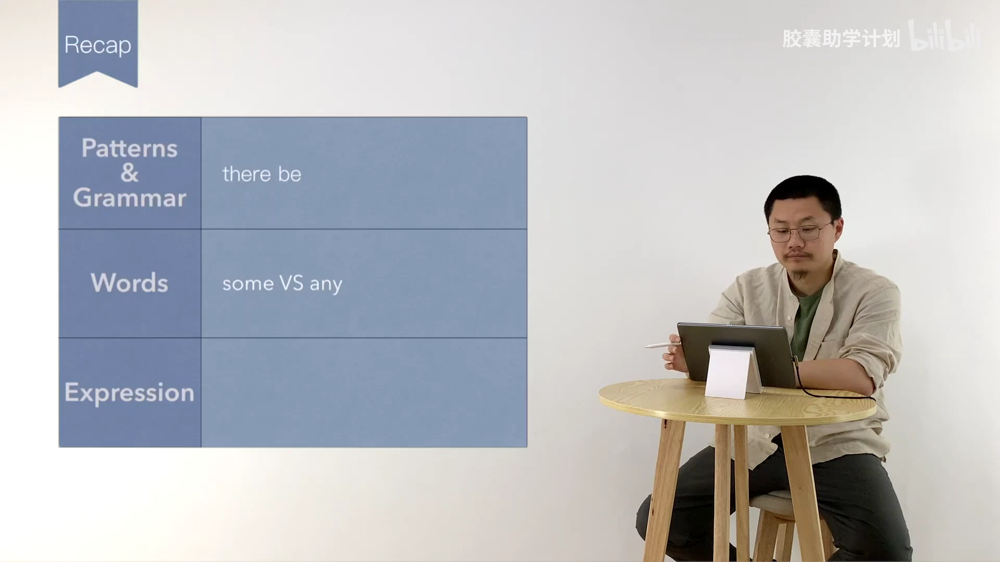

文字识别：Recap / 胶囊助学计划 / Patterns / there be / Grammar / Words / some VS any / Expression

### 画面 00:04:48

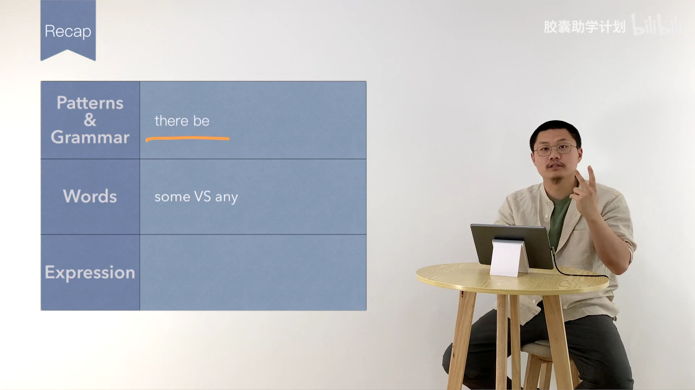

文字识别：胶囊助学计划 / Recap / Patterns / there be / Grammar / Words / some VS any / Expression

### 画面 00:04:56

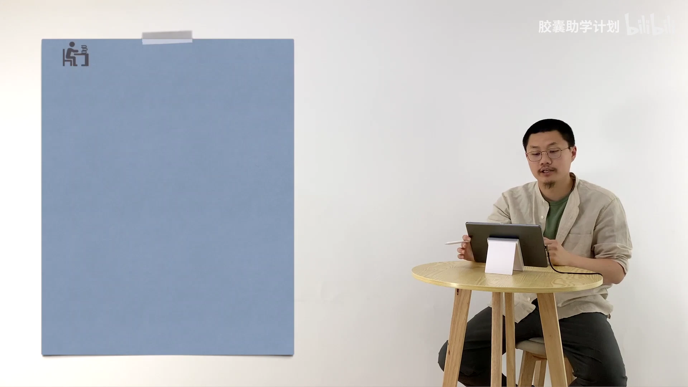

文字识别：胶囊助学计划

## 00:05:00–00:05:30

皮书二十八课各位可以写了。如果您学到这儿还不知道绿皮书是什么，一定要去我们的看我们的开篇内容啊。好，接下来请给自己讲解一遍今天的核心知识点，这是我们每一课都要做的事情。无非各位其实就造两个小的句子，把some和any放进去，再用上一个there be句型的复数形式叫there are，这个就完全可以做到了，好吧？那以上呢就是本期视频的全部内容了。如果大家喜欢我们的课程呢，欢迎大家关注、订阅、一键三

### 画面 00:05:23

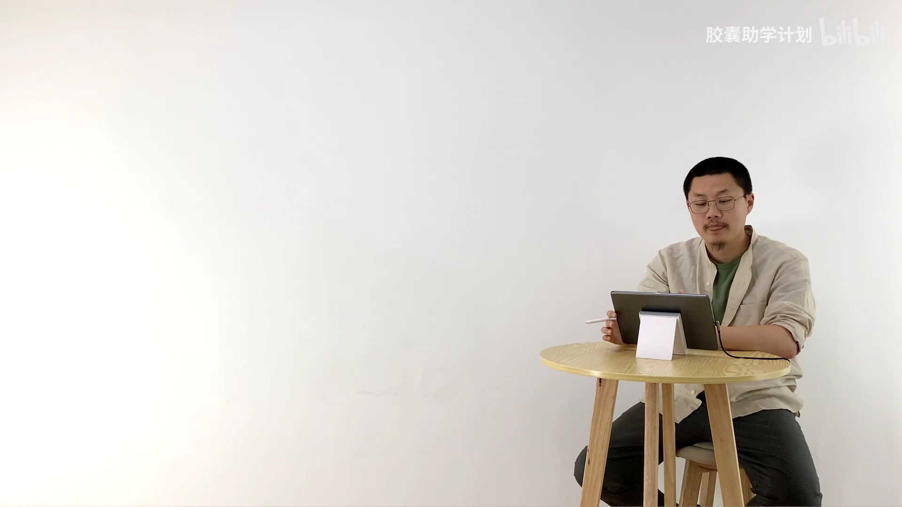

文字识别：胶囊助学计划

## 00:05:30–00:05:58

连支持，并分享给那些需要的朋友们。最后的最后，我们再看一句名人名言：If you don't know where you are going, you might wind up someplace else. See you next time.

### 画面 00:05:34

文字识别：胶囊助学计划 / If you don't know where you are going, you / might wind up someplace else. / -Yogi Berra

### 画面 00:05:45

文字识别：胶囊助学计划 / If you don't know where you are going, you / might wind up someplace else. / -Yogi Berra

### 画面 00:05:47

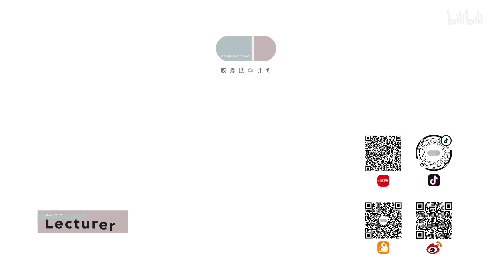

文字识别：CAPSULEACADEMY / 胶囊助学计划 / 『 / 小红书 / Lecturer / OE

### 画面 00:05:49

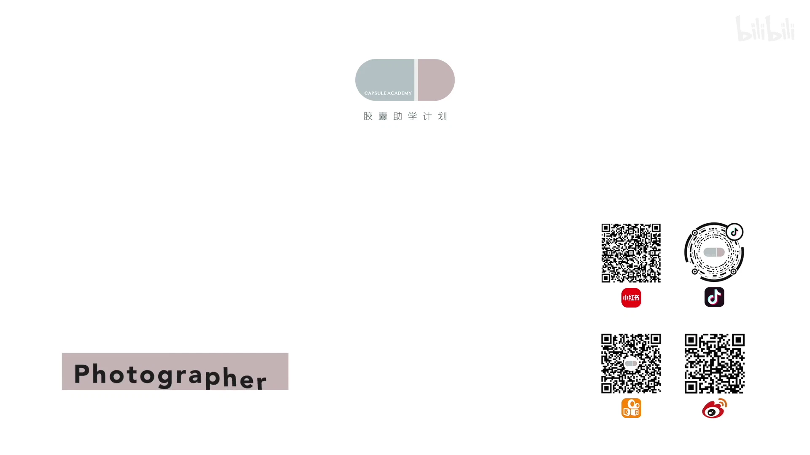

文字识别：CAPSULEACADEMY / 胶囊助学计划 / 『 / 小红书 / Photographer / OE

### 画面 00:05:52

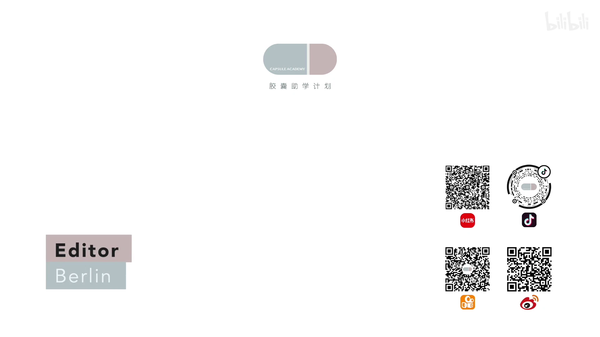

文字识别：CAPSULEACADEMY / 胶囊助学计划 / 『 / 小红书 / Editor / Berlin / OE

### 画面 00:05:55

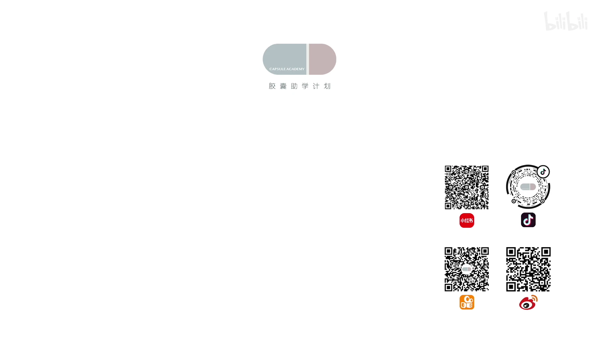

文字识别：CAPSULEACADEMY / 胶囊助学计划 / 小红书

### 画面 00:05:57

文字识别：bilibili / 胶囊助学计划

### 画面 00:05:58

文字识别：bilibili / 胶囊助学计划

