# 031 语法 单词

快速机器解析：语音为单模型转写，未进行独立交叉校对或人工复核；画面每秒采样并按变化选帧，短时文字和标记可能遗漏。截图时间约有 1 秒误差。图片有损压缩；遇到疑点请按时间查看 Google Drive 原视频。

## 00:00:00–00:00:30

Hello everyone, welcome to Capsule Academy. This is Leo. Today we're going to learn New Concept English Book One Lesson Thirty One Grammar and Words. 那老习惯进入正式课程之前呢，我们先看三个问题。第一，何为时态？第二，何为现在进行时？这是时态的一种。第三，何为动词ing？也就是现在分词。那带着这三个问题，Hope you gonna enjoy it.

### 画面 00:00:00

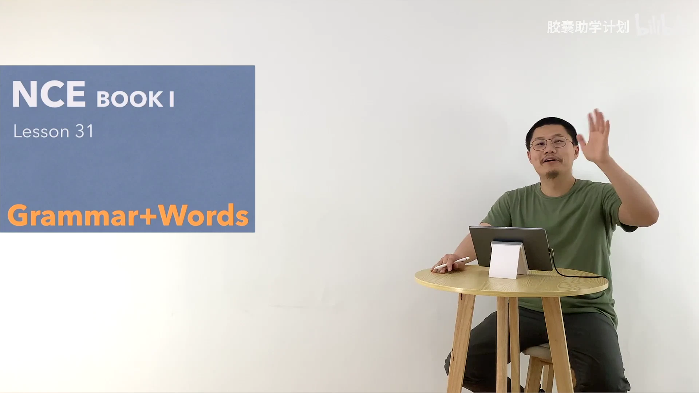

文字识别：胶囊助学计划 / NCE / BOOKI / Lesson 31 / Grammar+Words

### 画面 00:00:10

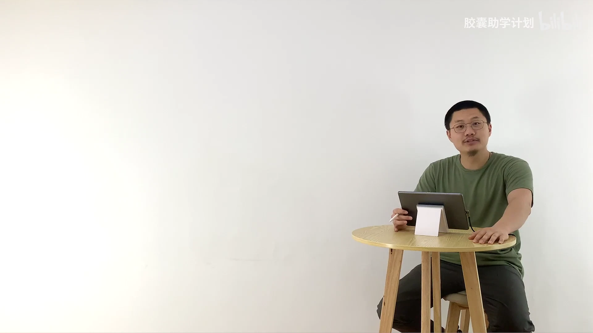

文字识别：胶囊助学计划

### 画面 00:00:12

文字识别：胶囊助学计划 / ①何为时态？

### 画面 00:00:15

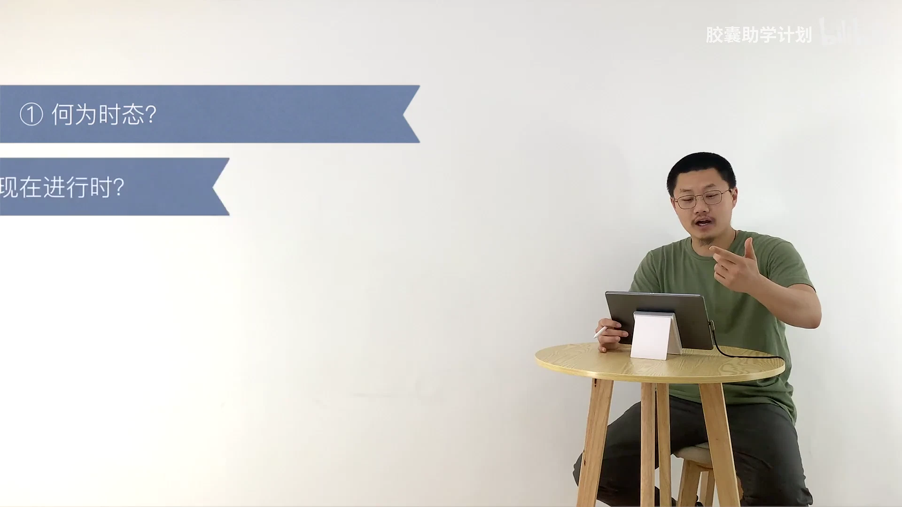

文字识别：胶囊助学计划 / ①何为时态？ / 现在进行时？

### 画面 00:00:17

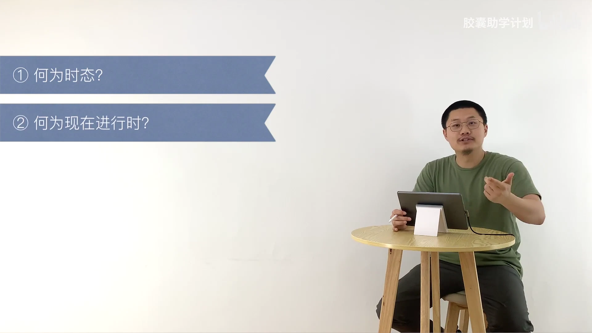

文字识别：胶囊助学计划 / ①何为时态？ / 何为现在进行时?

### 画面 00:00:19

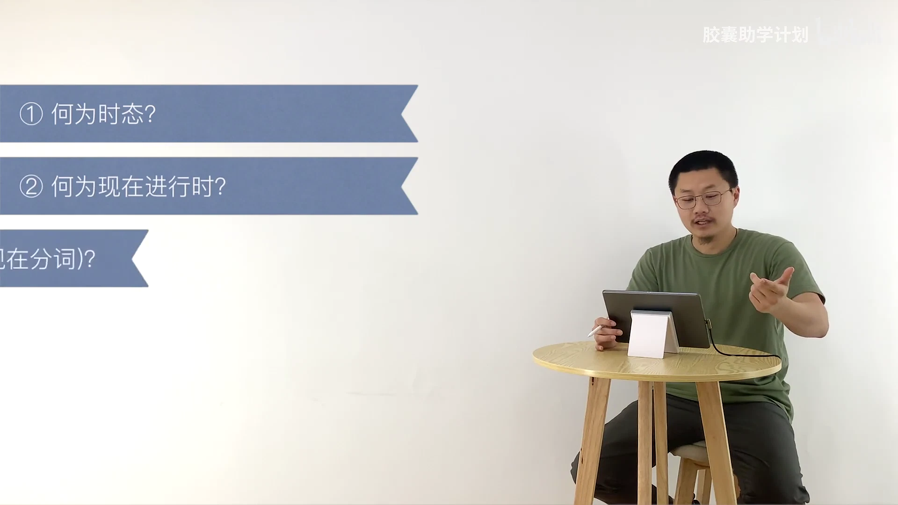

文字识别：胶囊助学计划 / ①何为时态？ / 何为现在进行时? / 在分词）？

### 画面 00:00:21

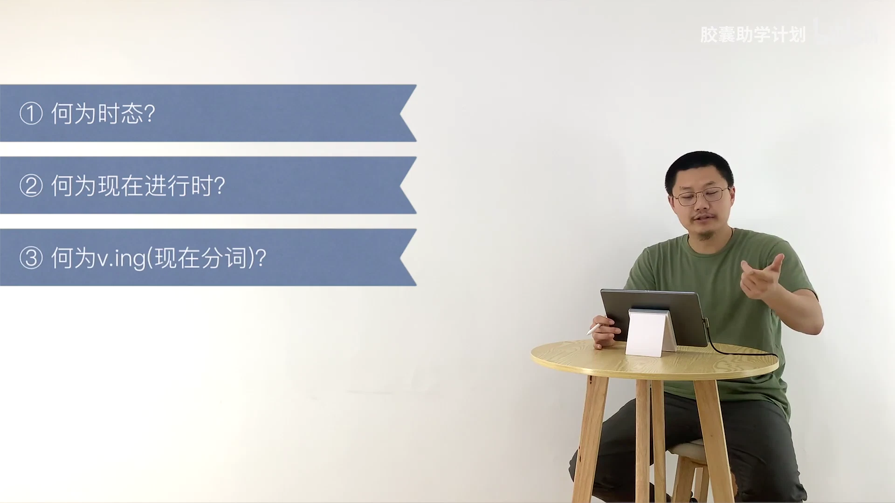

文字识别：胶囊助学计划 / ①何为时态？ / 何为现在进行时? / 何为v.ing(现在分词)?

### 画面 00:00:27

文字识别：胶囊助学计划bill / •

## 00:00:30–00:01:00

好，那上来我们先看时态。时态呢，实际上是两个子概念组合成了一个大的概念。所谓动作发生的时间，简简称为时，它可以是现在，可以是将来，也可以是过去。那还有一个就是动作的状态，我们有诸多的状态，我们今天只见其中一个，比如说叫做现在进行时。那它这个动作的状态就

### 画面 00:00:31

文字识别：胶囊助学计划

### 画面 00:00:33

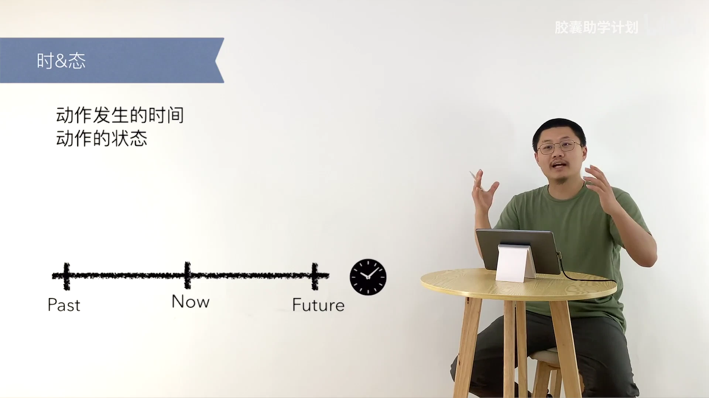

文字识别：胶囊助学计划 / 时&态 / 动作发生的时间 / 动作的状态 / Now / Past / Future

### 画面 00:00:44

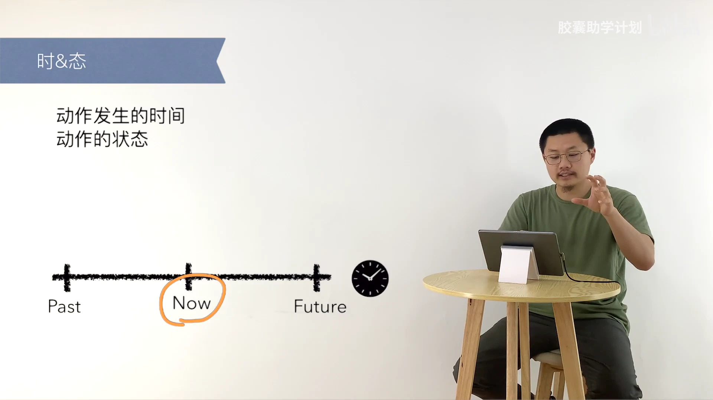

文字识别：胶囊助学计划 / 时&态 / 动作发生的时间 / 动作的状态 / Past / Now / Future

### 画面 00:00:46

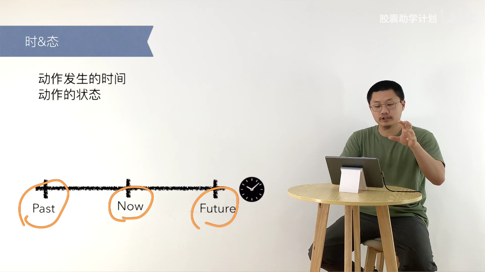

文字识别：胶囊助学计划 / 时&态 / 动作发生的时间 / 动作的状态 / Past / Now / Future

### 画面 00:00:54

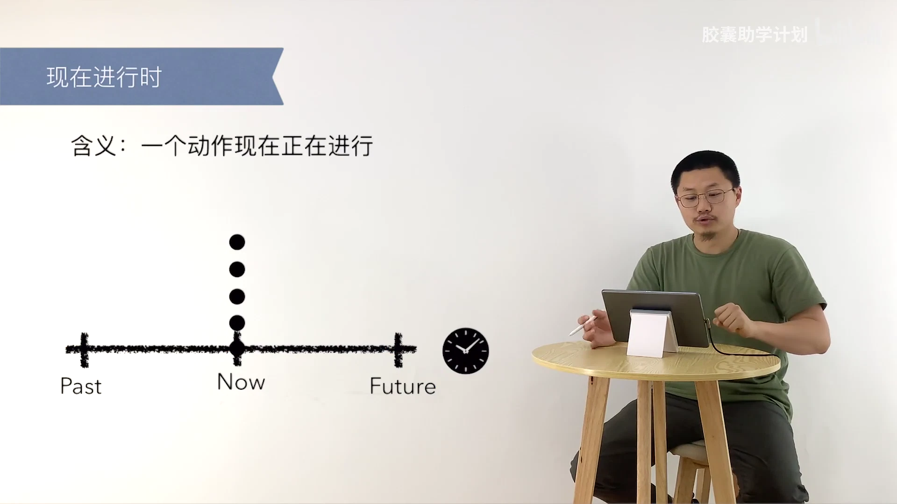

文字识别：胶囊助学计划 / 现在进行时 / 含义：一个动作现在正在进行 / Now / Past / Future

## 00:01:00–00:01:30

是正在发生，正在进行。时间呢？注意是 now，所以这个时态的含义叫做一个动作现在正在进行。比如说，我现在正在给大家上课，这是我们汉语的现在进行时。那英文呢也有现在进行时，我们看一下它的表达是怎么样的。首先，我们先来看一个，哎，这样的一个呃结构，最基本的结构，主语我

### 画面 00:01:04

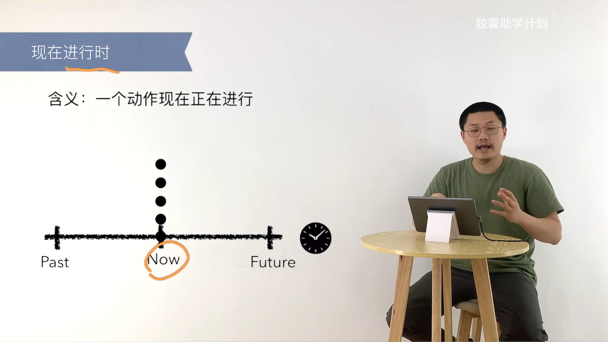

文字识别：胶囊助学计划 / 现在进行时 / 含义：一个动作现在正在进行 / Past / Now / Future

### 画面 00:01:11

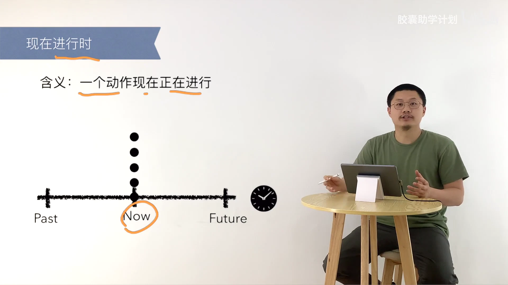

文字识别：胶囊助学计划 / 现在进行时 / 含义：一个动作现在正在进行 / Past / Now / Future

### 画面 00:01:22

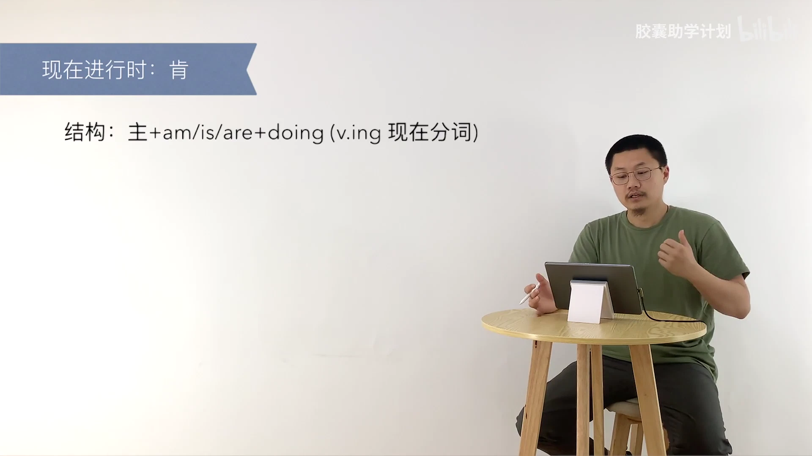

文字识别：胶囊助学计划 / 现在进行时：肯 / 结构：主+am/is/are+doing (v.ing 现在分词)

## 00:01:30–00:02:00

正在注意，一定是 am/is/are 加上 doing。好，那 am/is/are 选谁呢？这跟我们汉语不太一样啊，对吧？我们英文呢要由主语去判断 am/is/are 用谁。如果是我，那后面就用 am，对吧？好，那注意这个 doing 是什么呢？ doing 另外一种表示方式就是动词加上 ing。换一句话来说，它叫做现在分词。现在分词呢有一系列的变化，我们先一起看一下它的动

### 画面 00:01:34

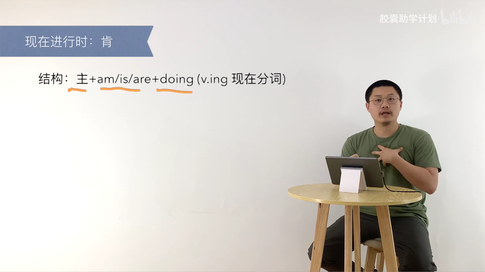

文字识别：胶囊助学计划 / 现在进行时：肯 / 结构：主+am/is/are+doing (v.ing 现在分词)

### 画面 00:01:55

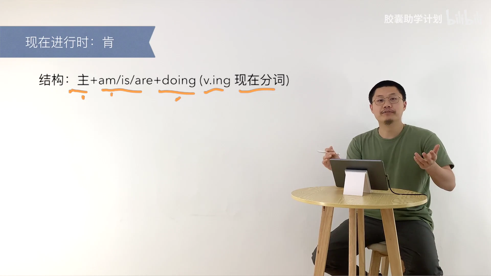

文字识别：胶囊助学计划 / 现在进行时：肯 / 结构：主+am/is/are+doing (v.ing 现在分词)

### 画面 00:01:58

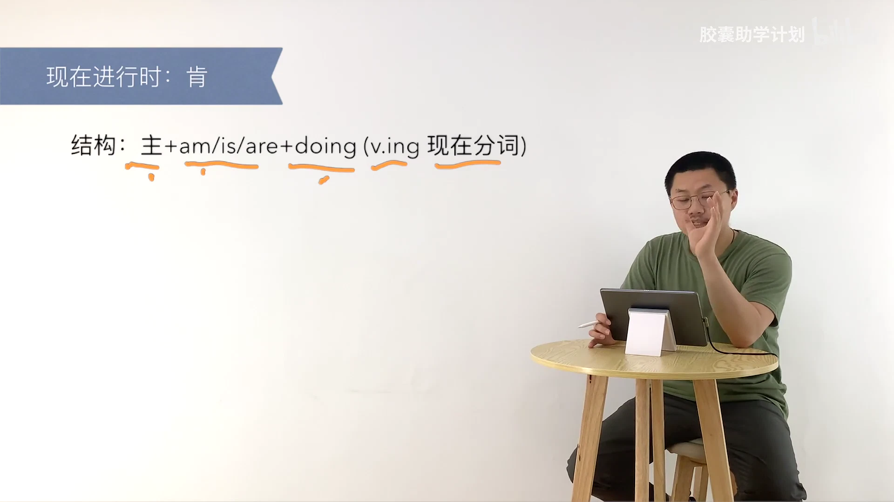

文字识别：胶囊助学计划 / 现在进行时：肯 / 结构：主+am/is/are+doing (v.ing 现在分词)

## 00:02:00–00:02:30

词是如何进行改变的。来了啊，首先把基本结构放在这儿了啊，am is are加doing。好，我们看一下它的变化结构。首先最简单的动词可以直接加上ing。比如说各位很熟悉的单词叫eat，e a t表示吃，对吧？这个动词。那如果我想表达正在吃，您就不能用eat了，您就必须要用一个结构叫做am is are加doing这个结构，并且

### 画面 00:02:01

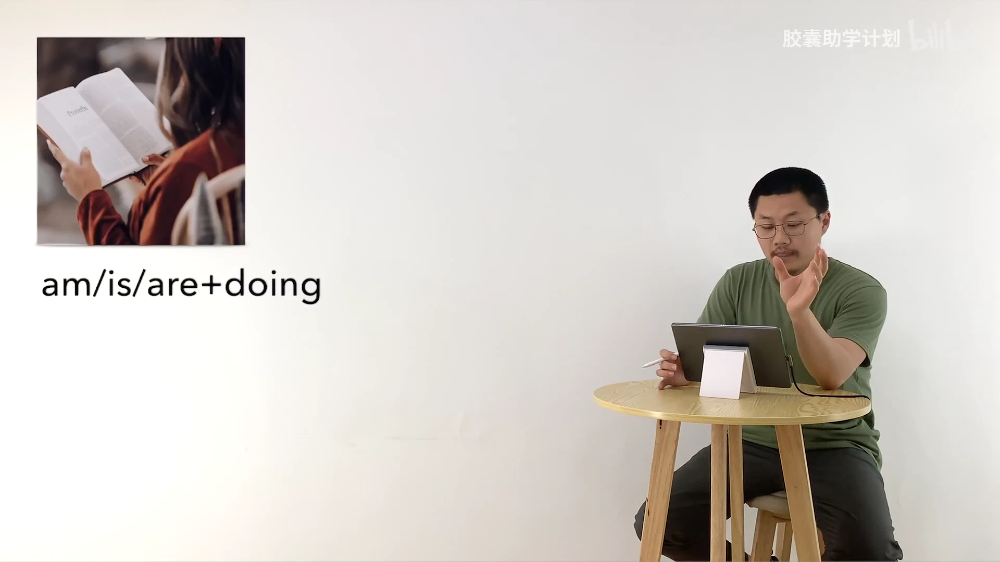

文字识别：胶囊助学计划 / am/is/are+doing

### 画面 00:02:03

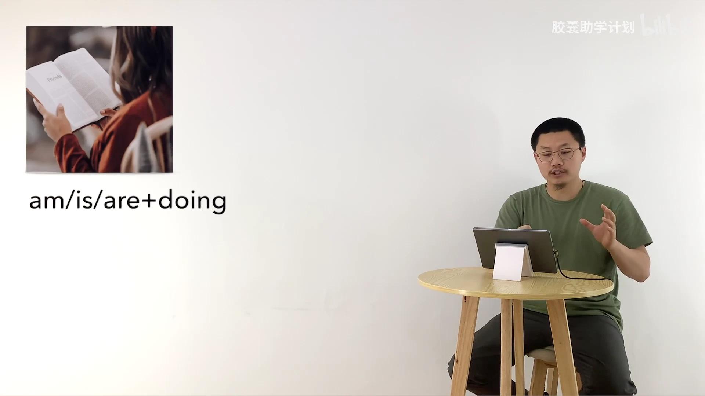

文字识别：胶囊助学计划 / am/is/are+doing

### 画面 00:02:05

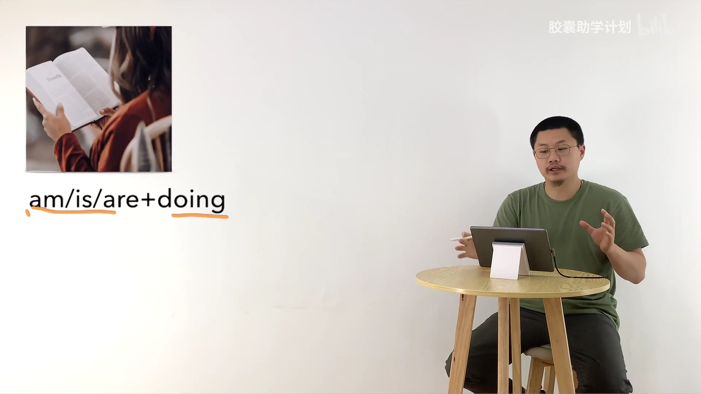

文字识别：胶囊助学计划 / am/is/are+doing

### 画面 00:02:20

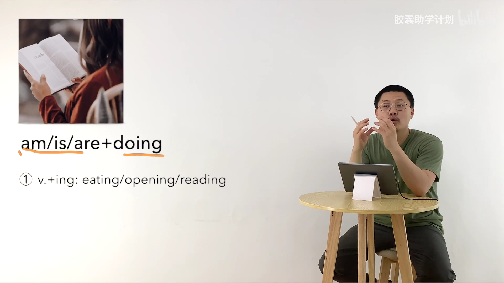

文字识别：胶囊助学计划 / am/is/are+doing / ① v.+ing: eating/opening/reading

### 画面 00:02:27

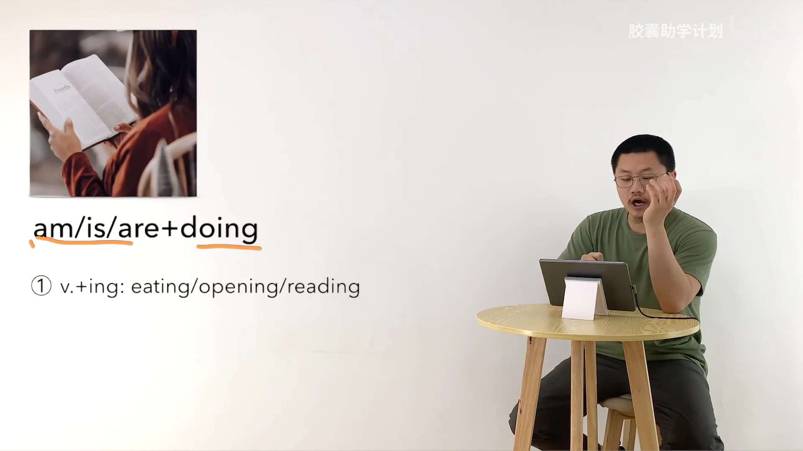

文字识别：胶囊助学计划 / am/is/are+doing / ① v.+ing: eating/opening/reading

## 00:02:30–00:03:00

要动词的ing，所谓的叫现在分词，对吧？那它的变化呢？很简单，直接在后面加了ing，变成了eating，对吧？比如说open，大家很熟悉，叫打开open the window。那我现在想说正在打开窗户，就不能叫open the window了，就必须把open后边加上ing。Read是一样的，后面加ing，三个字母表示正在进行。比如说我们造一句

### 画面 00:02:38

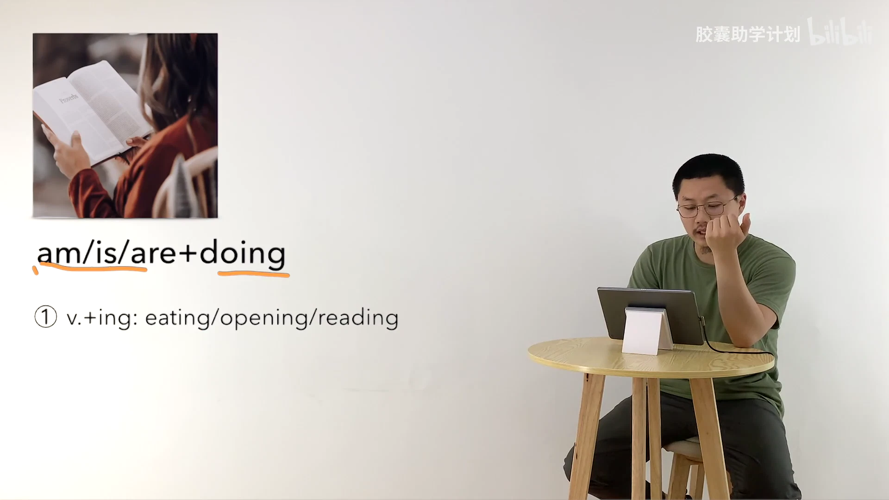

文字识别：胶囊助学计划 / am/is/are+doing / ① v.+ing: eating/opening/reading

### 画面 00:02:41

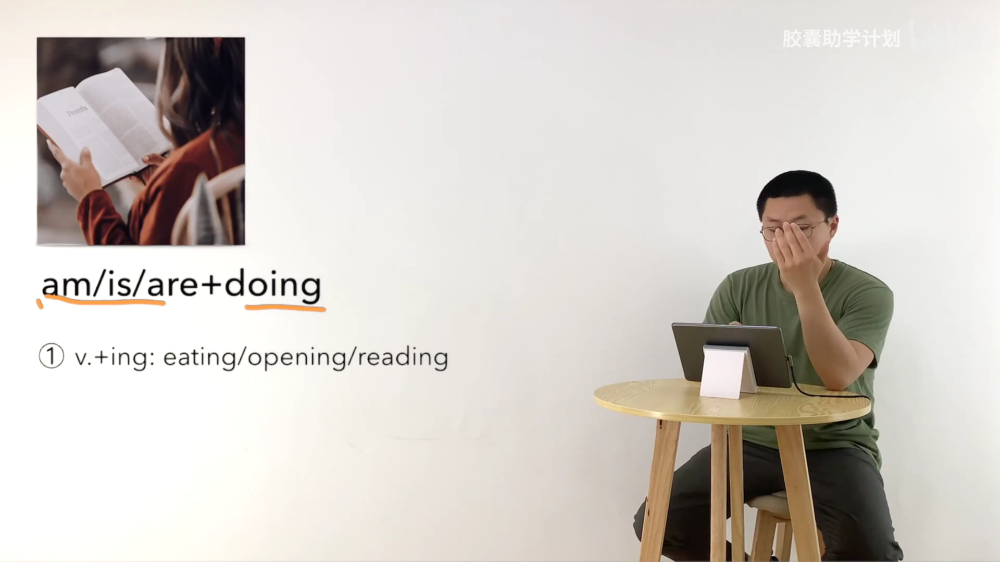

文字识别：胶囊助学计划 / am/is/are+doing / ① v.+ing: eating/opening/reading

## 00:03:00–00:03:30

话叫做 She is reading a book。我们看一下满不满足这个状态。首先主语 She 确定了，接下来这个现在进行时这个时态啊，最核心的东西就是 am is are 加上动词的 ing，也就是 doing。看一下 is 是由 She 去决定的，对吧？接下来呢， read 加了 ing 变成了 reading。 She is reading a book，她正在读一本书，非常好。接下

### 画面 00:03:00

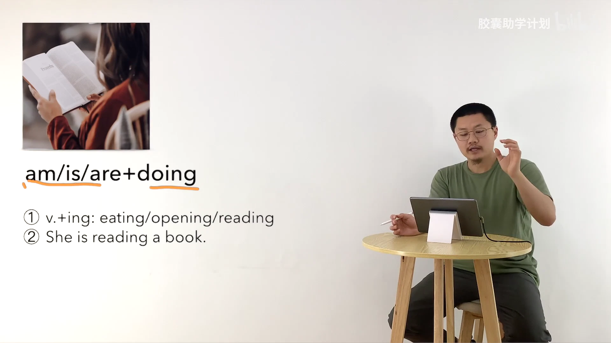

文字识别：胶囊助学计划 / am/is/are+doing / v.+ing: eating/opening/reading / She is reading a book.

### 画面 00:03:05

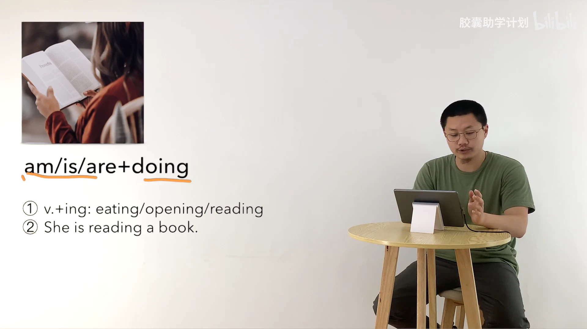

文字识别：胶囊助学计划 / am/is/are+doing / v.+ing: eating/opening/reading / She is reading a book.

### 画面 00:03:10

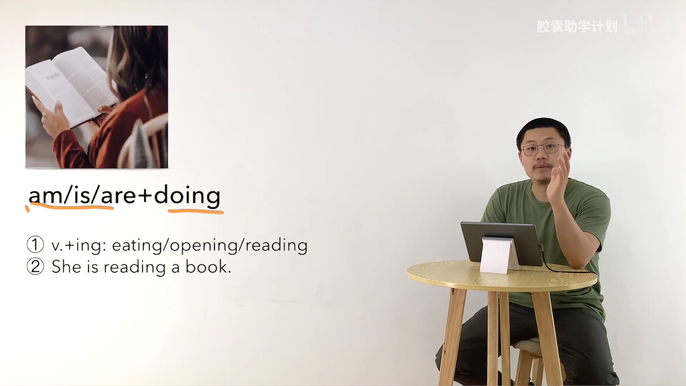

文字识别：胶囊助学计划 / am/is/are+doing / v.+ing: eating/opening/reading / She is reading a book.

### 画面 00:03:29

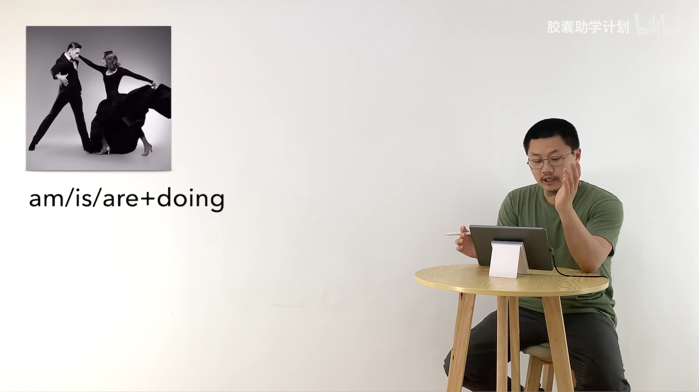

文字识别：胶囊助学计划 / am/is/are+doing

## 00:03:30–00:04:00

来第二个方式是什么呢？去 e 加 i n g。如果结尾这个 e 不发音的话，比如说 come 叫来，最后这个 e 呢是不发音的，我们把它去掉，加了一下 i n g。或者说 make make the bed，各位还记得吧？对吧？整理床铺，我们把 e 去掉加 i n g。dance 把 e 去掉加 i n g。造一句话说 they are dancing，看一下满不满足我们说这个结构，主语他们

### 画面 00:03:36

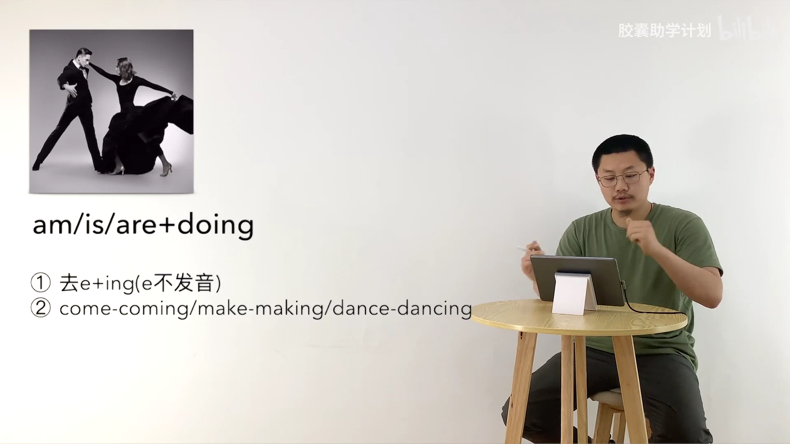

文字识别：胶囊助学计划 / am/is/are+doing / ①去e+ing(e不发音) / come-coming/make-making/dance-dancing

### 画面 00:03:49

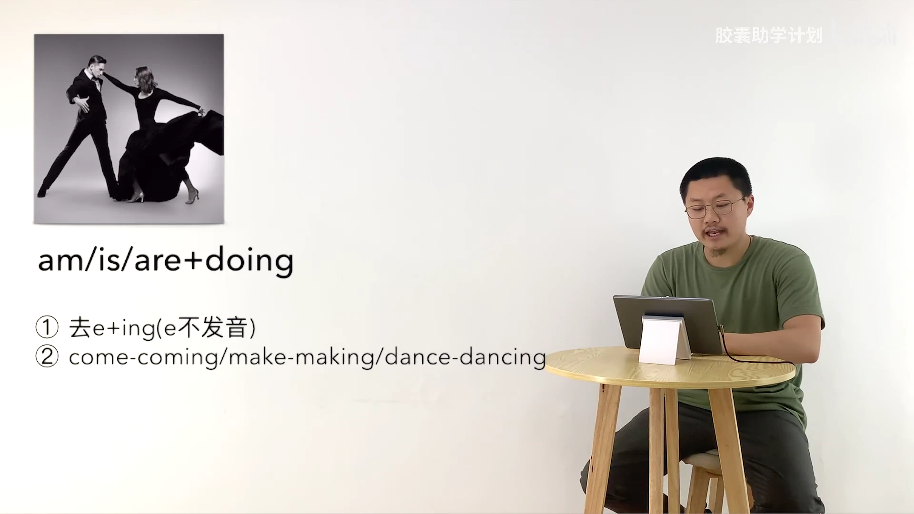

文字识别：胶囊助学计划 / am/is/are+doing / ①去e+ing(e不发音) / come-coming/make-making/dance-dancing

### 画面 00:03:54

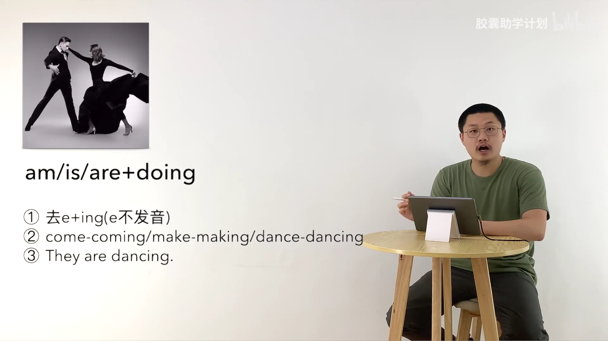

文字识别：胶囊助学计划 / am/is/are+doing / 去e+ing(e不发音) / 1 / ） / come-coming/make-making/dance-dancing / They are dancing.

## 00:04:00–00:04:30

正在跳舞，还是现在正在跳舞？ Is 二由主语确定，判断是用 am 是 is 还是 are。接下来 dancing dance 把 e 去掉，加了 ing，这是现在分词第二个变化规则。那第三个变化规则呢？叫双写加 ing。我们看一下，比如说 run，大家跑步很熟悉。注意它现在是把最后一个字母 n 双写了一下，换一句话来说，又多写了一个 n，对吧？然后再加

### 画面 00:04:15

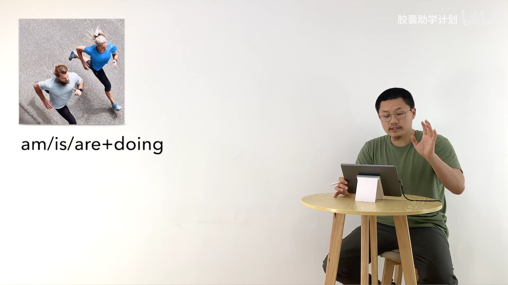

文字识别：胶囊助学计划 / am/is/are+doing

### 画面 00:04:19

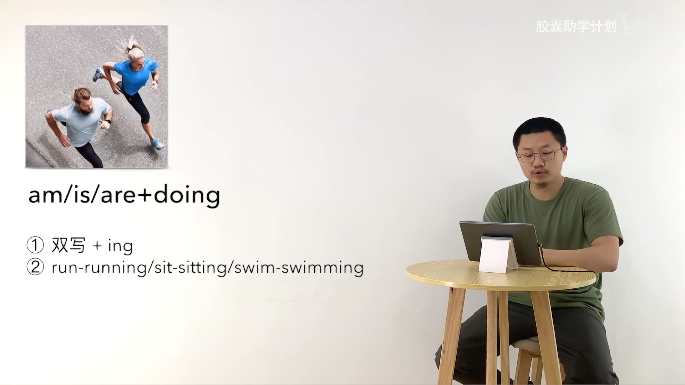

文字识别：胶囊助学计划 / am/is/are+doing / 双写+ing / run-running/sit-sitting/swim-swimming

## 00:04:30–00:05:00

g running，接下来呢sit t又双写了一个t加了i n g叫做sitting，还有一个叫做swim，把m双写了一下加i n g，好，这个地方的规则我想说一下，呃，我实际上发现我们有很多不同的讲解方式，理论上都是对的啊，但是我没有去用，我先说一下原因是什么，比如说有一些老师可能会去讲这个地方是什么辅元辅

### 画面 00:04:45

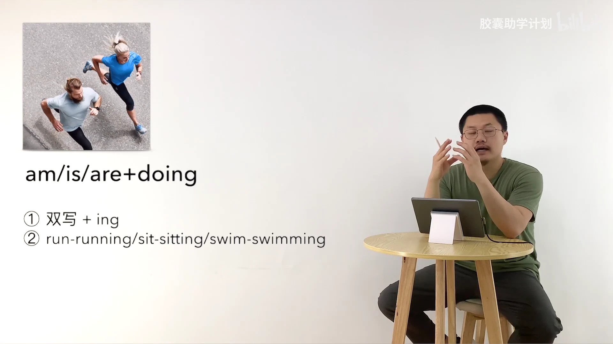

文字识别：胶囊助学计划 / am/is/are+doing / 双写+ing / run-running/sit-sitting/swim-swimming

## 00:05:00–00:05:30

啊，对吧？或者什么开音节、闭音节呀，讲这么一堆，呃，我不想去讲它，而直接给大家写双写加 ng 这样一个简单粗暴的方原因是什么呢？就是因为它的例外太多了。我们提到的任何一条规则，不管您是辅元辅啊，对吧？还是什么开音节、闭音节等等这一系列，你都会发现，你如果认真去查一本语法书，你都会发现它有大量的例外，而且它的例外啊，还不止一

### 画面 00:05:15

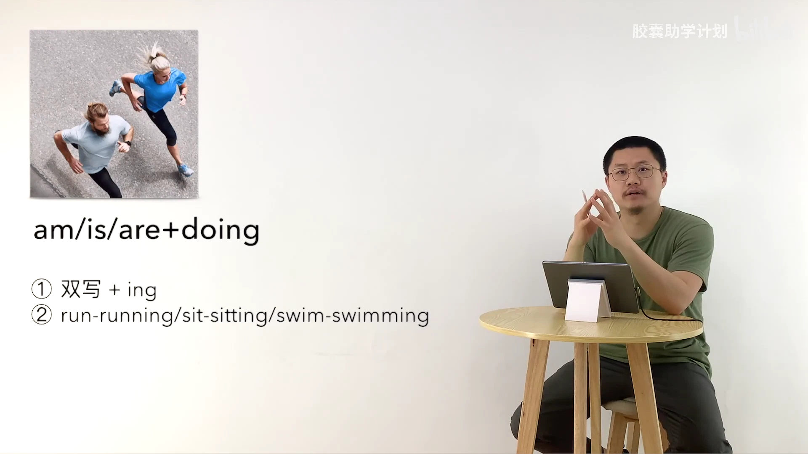

文字识别：胶囊助学计划 / am/is/are+doing / 双写+ing / run-running/sit-sitting/swim-swimming

## 00:05:30–00:06:00

种例外，还有好几种可能性的例外。什么情况下双写，什么情况下不双写？如果是这样双写，如果是那样不双写。所以，我经常有一个判断，就是当这个规则的例外过于多的时候，多到你学这个规则花的时间，对吧？它给你带来的收益完远远低于你不学这个规则带来的收益的时候，我们就不学了，直接记个双写就可以了。对于各位初期来说，记住这三个单词就行了。其次呢，

### 画面 00:05:45

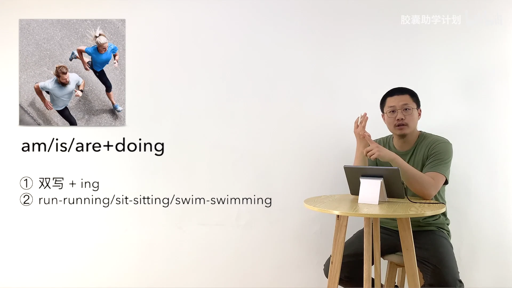

文字识别：胶囊助学计划 / am/is/are+doing / 双写+ing / run-running/sit-sitting/swim-swimming

## 00:06:00–00:06:30

各位所有这些规则，对于没有目前为止，我不记得有任何考试会考让各位去背写这些规则，最多就是让各位写一句话包含了 running 这个单词，对吧？那我们的处理方式是什么呢？处理方式肯定是放在平时，各位手机字典当中，一定你去查 run 这个动词的时候，它一定会给你把现在分词长成什么样子标出来，双没双写。如果您的手机字典当中没有，

### 画面 00:06:15

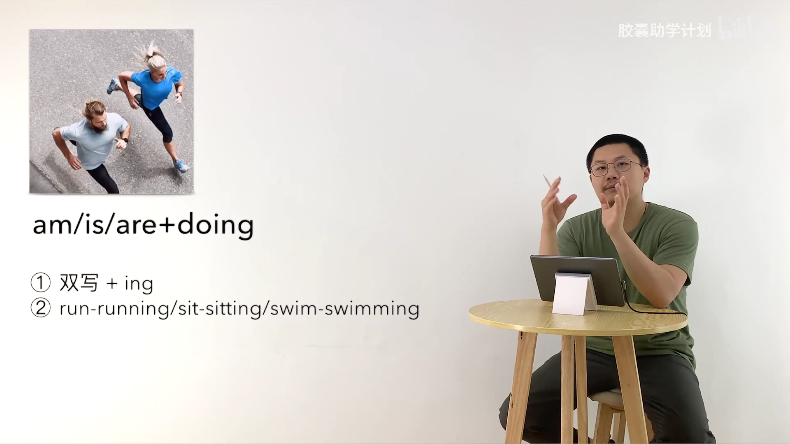

文字识别：胶囊助学计划 / am/is/are+doing / 双写+ing / run-running/sit-sitting/swim-swimming

## 00:06:30–00:07:00

那说明这个手机字典不够用，对吧？OK，那记住这个规则就可以了。接下来我们造一句话，说 They are running on the street。哎，他们正在跑，看满不满足二加 running，二加 running，二由主语决定，running 动词ing，对吧？现在分词，他们正在马路上跑步，They are running on the street。肯定句有了，那接下来立刻就是四句型转化，否定句对于各位来说，

### 画面 00:06:36

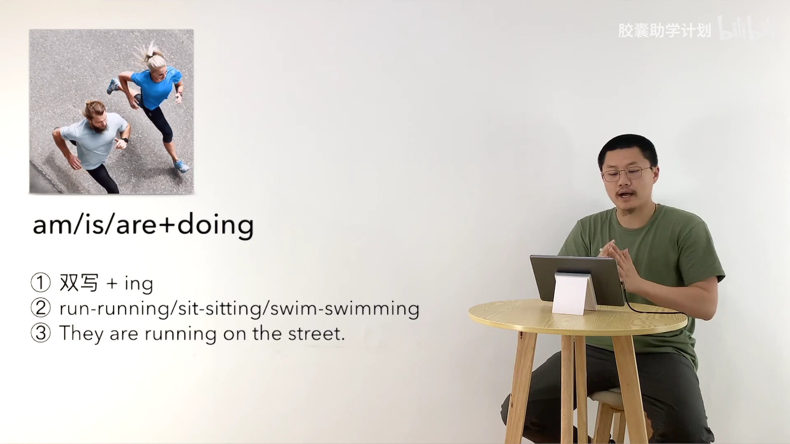

文字识别：胶囊助学计划 / am/is/are+doing / 双写+ing / run-running/sit-sitting/swim-swimming / They are running on the street.

### 画面 00:06:55

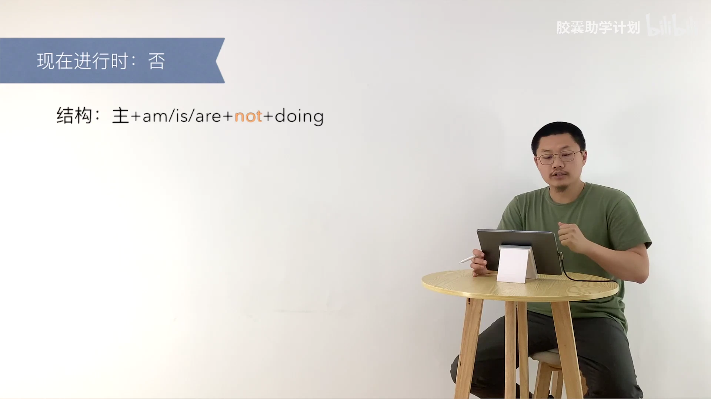

文字识别：胶囊助学计划 / 现在进行时：否 / 结构：主+am/is/are+not+doing

## 00:07:00–00:07:30

现在没有任何别的想法。我们前三十课没干别的事儿，最主要的一个事情就是 am is are 这三个单词后边加 not 变否定，对吧？好，那我们接下来造几个小的句子，跟我一起读啊。She is not reading books，她没有正在读书。Of course， she is sleeping，正睡觉呢，对吧？好， am is are 由主语决定， not is 后边加 not reading 不变。Next one，

### 画面 00:07:10

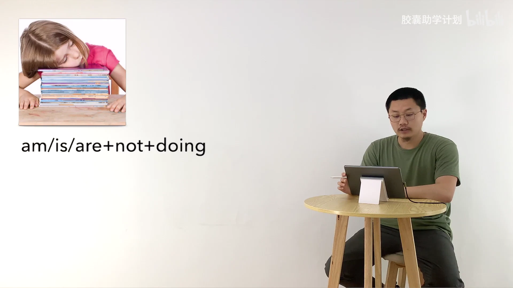

文字识别：胶囊助学计划 / am/is/are+not+doing

### 画面 00:07:28

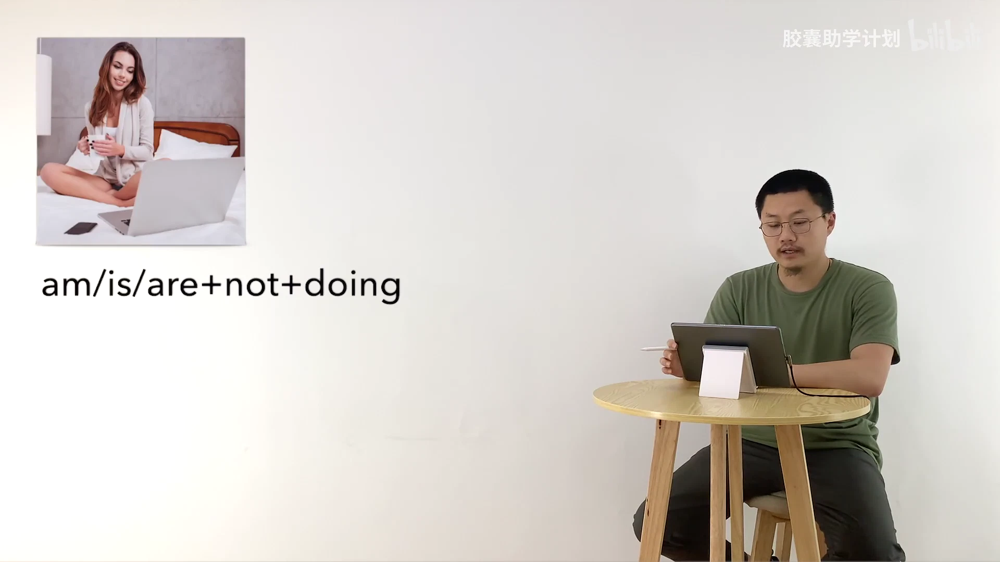

文字识别：胶囊助学计划 / am/is/are+not+doing

## 00:07:30–00:08:00

she is not making the bed.她没有正在整整理床铺。注意主语决定 is 后边加 not make 区域加 ing 叫做 making。她没有正在整理床铺。接下来说 they are not swimming。好，他们没有正在游泳。 are 是由 they 去确定的。 are 后边加 not 变否定，再然后来一个 swimming 表示正在游泳。好，这个结构各

### 画面 00:07:45

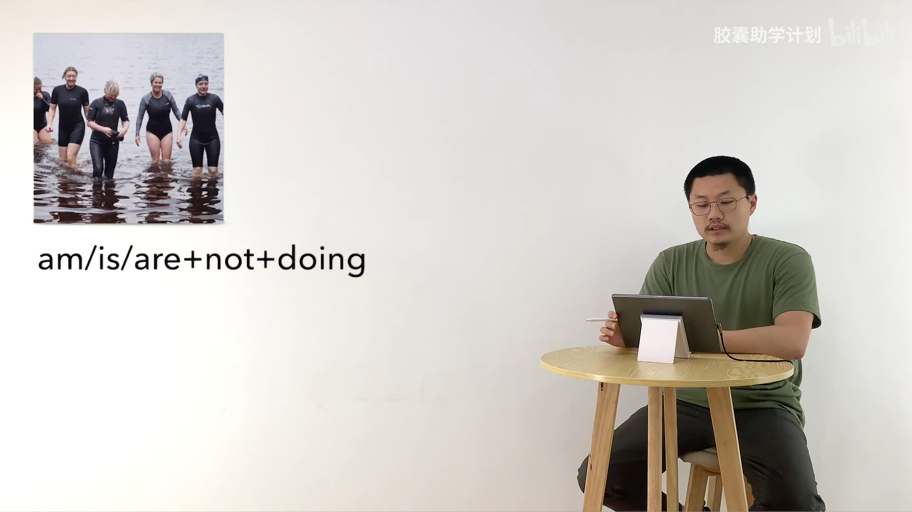

文字识别：胶囊助学计划 / am/is/are+not+doing

## 00:08:00–00:08:30

位记住了。接下来一般疑问句，各位脑海当中应该没有任何的想法，只有一个想法，就是你给我把 is 提到句首去。前三十课没练任何东西，对吧？只练了这一个事儿，剩下照抄。好，那我们看一下啊，比如说 Is she opening the door？她正在开门吗？各位，你看我们现在把它还原成肯定句，就是你把 is 从哪儿提过来的，放回到什么地方去？She

### 画面 00:08:00

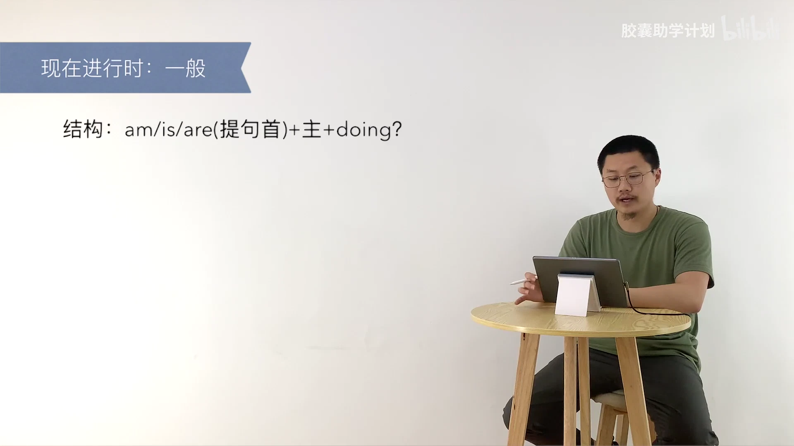

文字识别：胶囊助学计划 / 现在进行时：一般 / 结构：am/is/are(提句首)+主+doing?

### 画面 00:08:14

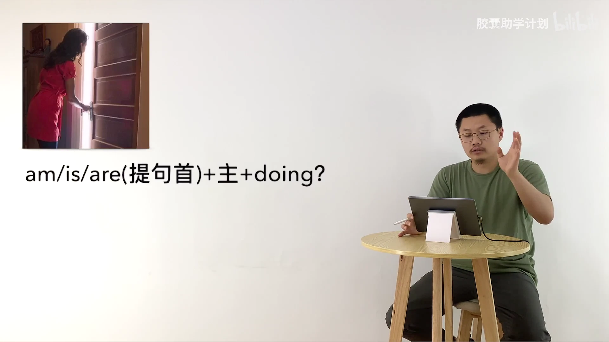

文字识别：胶囊助学计划 / am/is/are(提句首)+主+doing？

### 画面 00:08:17

文字识别：胶囊助学计划 / am/is/are(提句首)+主+doing? / ① Is she opening the door?

### 画面 00:08:22

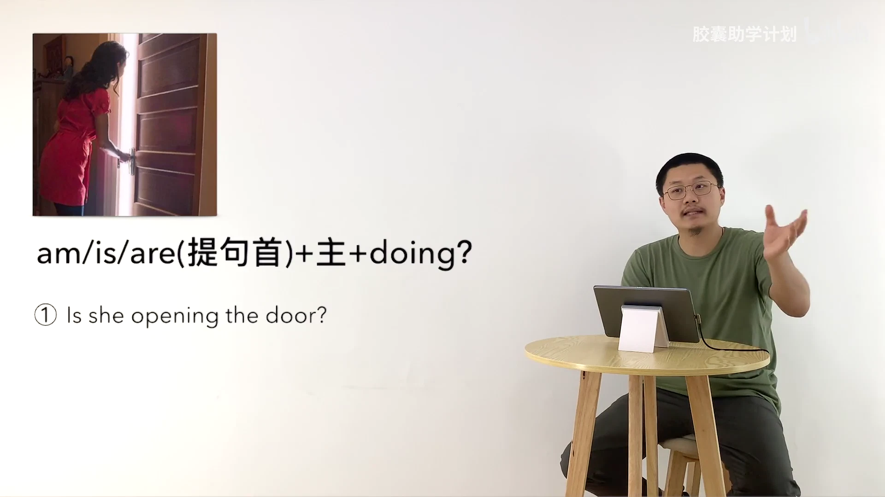

文字识别：胶囊助学计划 / am/is/are(提句首)+主+doing? / ① Is she opening the door?

### 画面 00:08:25

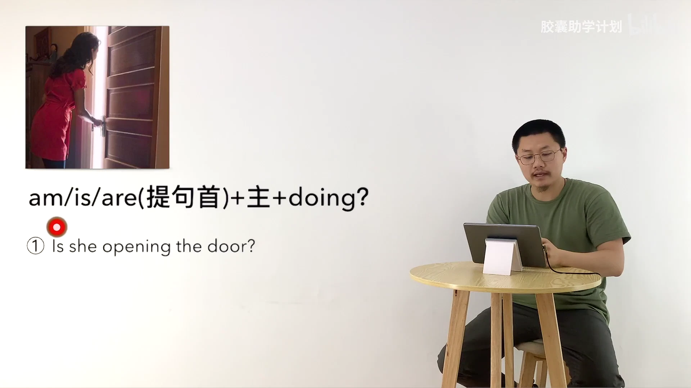

文字识别：胶囊助学计划 / am/is/are(提句首)+主+doing? / ① Is she opening the door?

### 画面 00:08:28

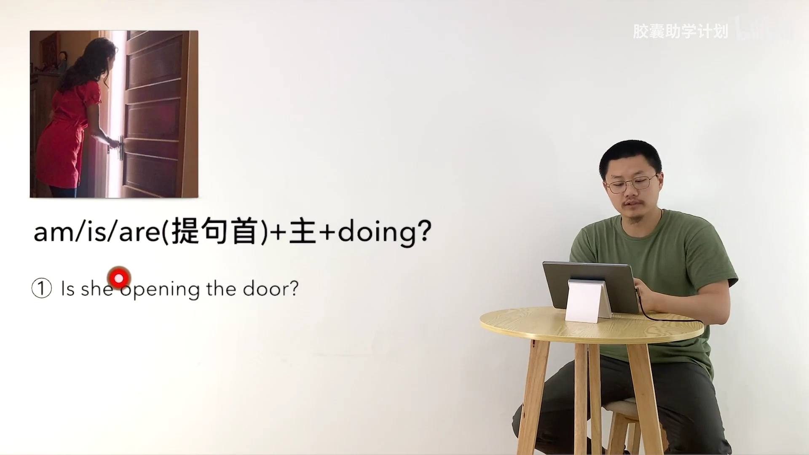

文字识别：胶囊助学计划 / am/is/are(提句首)+主+doing? / ① Is sheopening the door?

## 00:08:30–00:09:00

is opening the door,就可以了，对吧？好，Yes, she is.下一个，Are they sitting on the floor？注意，我们现在把它想还原成肯定句，把are换回到they的后面，They are sitting on the floor，这事儿结束了，对吧？Yes, they are. OK，最后一个说，Is she turning off the phone？好，Turn off the phone叫做关闭手机，这是我们在二十九课、三十课给

### 画面 00:08:31

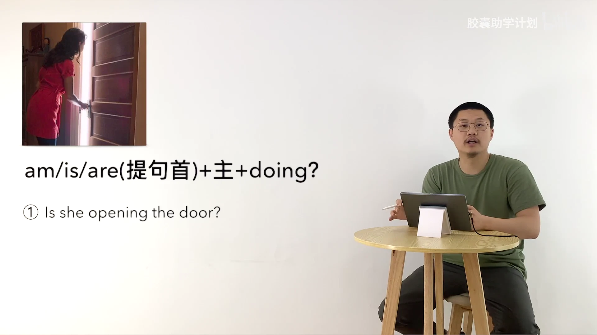

文字识别：胶囊助学计划 / am/is/are(提句首)+主+doing? / ① Is she opening the door?

### 画面 00:08:34

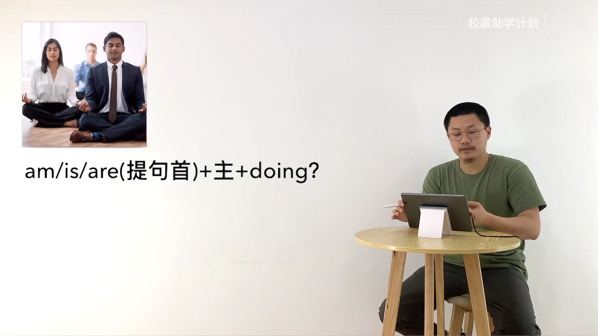

文字识别：胶囊助学计划 / am/is/are(提句首)+主+doing？

### 画面 00:08:42

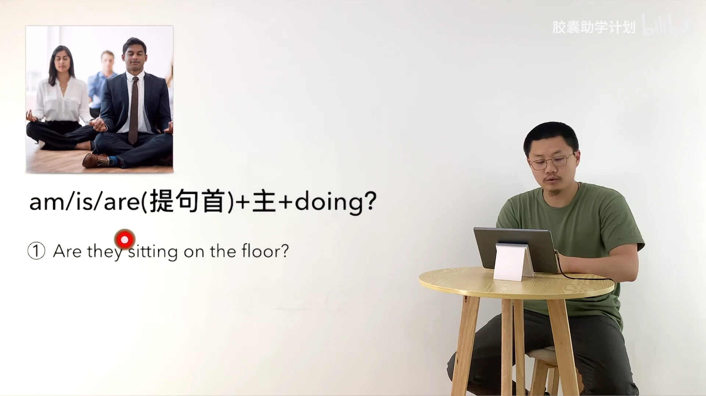

文字识别：胶囊助学计划 / am/is/are(提句首)+主+doing? / ① Are they siting on the floor?

### 画面 00:08:46

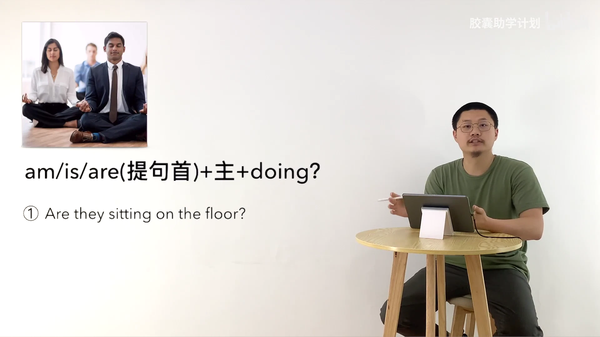

文字识别：胶囊助学计划 / am/is/are(提句首)+主+doing? / ① Are they sitting on the floor?

### 画面 00:08:49

文字识别：胶囊助学计划 / slide io powe off / am/is/are(提句首)+主+doing?

### 画面 00:08:58

文字识别：胶囊助学计划 / slid to powe off / am/is/are(提句首)+主+doing? / ① Is she turning off the phone?

## 00:09:00–00:09:30

大家留的非常重要的一个作业。我们在当时讲到了，对吧？我们为什么突然间出现了这么多动词？因为从三十一课开始，我们要学习大量跟动词相关的东西，也就是时态。OK，好，那说他正在关闭手机吗？如果我现在想把它变成肯定句，is放回来就行了。She is turning off the phone. OK, Yes, she is. 是的。接下来，特殊疑问句，实际上特殊疑问句啊，它有

### 画面 00:09:23

文字识别：胶囊助学计划 / slide io powei / off / am/is/are(提句首)+主+doing? / ① Is she turning off the phone?

### 画面 00:09:25

文字识别：胶囊助学计划 / 现在进行时：特殊 / 结构：What+am/is/are+主+doing? / 金

### 画面 00:09:29

文字识别：胶囊助学计划 / 现在进行时：特殊 / 结构：What+am/is/are+主+doing?

## 00:09:30–00:10:00

很多种啊，比如说他现在正在什么地方啊，等等，有很多特殊疑问词都可以。那我们今天只学一个先啊，特殊疑问词当中比较特殊的那一个叫做 what am is are 加主语，注意 am is are 由谁确定？由主语确定，对吧？然后再加上 doing，注意这个地方的 doing 就是 doing 这个单词，这一点各位一定要记住啊。再说一遍，这个地方的 doing what 这句话当中，这个比

### 画面 00:09:59

文字识别：胶囊助学计划 / 现在进行时：特殊 / 结构：What+am/is/are+主+doing?

## 00:10:00–00:10:30

较特殊的特殊疑问句当中的 doing 就是 doing 这个单词表示正在做。OK，那我们看一下，来，What are they doing？ Doing 就是 doing，不要换，就表示正在做。那 What are they doing？ 表示他们正在做什么？看图造句。They are， are they dancing？ Yes， they are dancing. There you go.

### 画面 00:10:07

文字识别：胶囊助学计划 / What+am/is/are+主+doing?

### 画面 00:10:17

文字识别：胶囊助学计划 / What+am/is/are+主+doing? /  What are they doing?

### 画面 00:10:25

文字识别：胶囊助学计划 / What+am/is/are+主+doing? /  What are they doing? / ② Are they dancing?

### 画面 00:10:29

文字识别：胶囊助学计划 / What+am/is/are+主+doing?

## 00:10:30–00:11:00

Next one,看图说话. What are they doing? Are they reading a book? Yes, they are reading a book. Very good. Continue. What is she doing? What is she doing? Is she running? Yes, she's running.好，接下来我们看一个小

### 画面 00:10:39

文字识别：胶囊助学计划 / What+am/is/are+主+doing? /  What are they doing? / ② Are they reading a book? / ③ Yes, they are reading a book.

### 画面 00:10:43

文字识别：胶囊助学计划 / What+am/is/are+主+doing?

### 画面 00:10:57

文字识别：am/is/are+ doing(v.现在分词) / 胶囊助学计划 / side by side

## 00:11:00–00:11:30

的这个视频片段。我故意没有加字幕，各位尝试着做一下听力练习。各位要听的就是那个结构，is加动词的doing。这个动词您现在不会，您把后面那ing听出来都算是成的，好吧？来了。 What are you doing? I'm reading. What are you doing? We're cooking.

### 画面 00:11:00

文字识别：am/is/are+ doing(v.现在分词) / 胶囊助学计划 / side by side

### 画面 00:11:19

文字识别：am/is/are+ doing(v.现在分词) / 胶囊助学计划 / side by side

### 画面 00:11:22

文字识别：am/is/are+ doing(v.现在分词) / 胶囊助学计划 / side by side

### 画面 00:11:24

文字识别：am/is/are+ doing(v.现在分词) / Bilbii / 胶囊助学计划 / side by side

### 画面 00:11:26

文字识别：am/is/are+ doing(v.现在分词) / blibili / 胶囊助学计划 / side by side

### 画面 00:11:28

文字识别：am/is/are+ doing(v.现在分词) / biibili / 胶囊助学计划 / side by side

## 00:11:30–00:12:00

are Mary and Fred doing? They're studying English. What's Tom doing? He's eating. What's Martha doing? She's watching TV. What's your dog doing? It's sleeping.

### 画面 00:11:30

文字识别：am/is/are+ doing(v.现在分词) / 胶囊助学计划 / side by side

### 画面 00:11:33

文字识别：am/is/are+ doing(v.现在分词) / 胶囊助学计划 / side by side

### 画面 00:11:35

文字识别：am/is/are+ doing(v.现在分词) / 胶囊助学计划 / side by side

### 画面 00:11:37

文字识别：am/is/are+ doing(v.现在分词) / 胶囊助学计划 / side by side

### 画面 00:11:39

文字识别：am/is/are+ doing(v.现在分词) / 胶囊助学计划 / side by side

### 画面 00:11:41

文字识别：am/is/are+ doing(v.现在分词) / 胶囊助学计划 / side by side

### 画面 00:11:43

文字识别：am/is/are+ doing(v.现在分词) / 胶囊助学计划 / side by side

### 画面 00:11:45

文字识别：am/is/are+ doing(v.现在分词) / 胶囊助学计划 / side by side

### 画面 00:11:47

文字识别：am/is/are+ doing(v.现在分词) / 胶囊助学计划 / side by side

### 画面 00:11:49

文字识别：am/is/are+ doing(v.现在分词) / 胶囊助学计划 / side by side

### 画面 00:11:51

文字识别：am/is/are+ doing(v.现在分词) / 胶囊助学计划 / side by side

### 画面 00:11:53

文字识别：am/is/are+ doing(v.现在分词) / 胶囊助学计划 / side by side

### 画面 00:11:55

文字识别：am/is/are+ doing(v.现在分词) / 胶囊助学计划 / side by side

## 00:12:00–00:12:30

Okay,如果刚才这一遍啊，各位听只听一遍听不是特别清楚的话，您不妨倒回去可以再听一遍。好，接下来我们进入本课的单词。好，第一个单词先跟我读一下，叫做 garden. Garden. 好，您的小花园啊，家里面的小院子就叫做 garden. 那当然也可以指的是大大公园，也可以叫 garden. 啊，OK. 好，那我们看图造句，用 there be 句型，跟我一起读. There are some

### 画面 00:12:01

文字识别：am/is/are+ doing(v.现在分词) / 胶囊助学计划 / side by side

### 画面 00:12:08

文字识别：胶囊助学计划 / /'ga:dan/ / garden

### 画面 00:12:25

文字识别：胶囊助学计划 / /'ga:dan/ / garden / ① There are some chairs in the garden.

## 00:12:30–00:13:00

chairs in the garden. Are there any chairs in the garden? 二十七个我们刚学的 some, any, 对吧？肯定句、一般疑问句。各哎，还希望还希望各位记得这个小的知识点。接下来 under 表示在什么什么的下面，它是一个小的介词。好，造句. There is a cat under the table. What is the cat doing?

### 画面 00:12:45

文字识别：胶囊助学计划 / /'Λndal / under prep.

## 00:13:00–00:13:30

好想一下那个公式, what am is are 加主语加 doing. I don't know. I can't see it, 是吧? 我看不见它, 我不知道它正在做什么. OK, next one. Tree, 树. There are some children under the tree. This is a big tree. OK, look, there are some children. So what are they doing? They are reading books. Next one, climb, climb. OK,

### 画面 00:13:00

文字识别：胶囊助学计划 / /'Λnda/ / under prep. / ① There is a cat under the table. / What is the cat doing?

### 画面 00:13:09

文字识别：胶囊助学计划 / /tri:/ / tree / 2

### 画面 00:13:22

文字识别：胶囊助学计划 / /tri:/ / tree / ① There are some children under the tree. / What are they doing? / They are reading books.

### 画面 00:13:26

文字识别：胶囊助学计划 / /klaIm/ / climb v.

## 00:13:30–00:14:00

C, L舌尖上牙龈, M发的是嗯, okay. Climb,爬. The boy is climbing the tree.他正在爬树。想变否定句, is后边加not。一般疑问句, is提前就可以了,对吧？好, is the boy climbing the tree? Very good.那What is the boy climbing?这个小男孩正在爬什么？注意为什么不是What is the boy doing了？

### 画面 00:13:47

文字识别：胶囊助学计划 / / klaIm/ / climb v. / ① The boy is climbing the tree. / ② Is the boy climbing the tree?

## 00:14:00–00:14:30

现在我的 What 是对 the tree 提问了，看见了吧？问的是他正在爬什么？可以爬墙，可以爬树，对吧？好，Next one Who 这单词我们之前见过了，就不多提了啊。但是有一个小的电影 Jackie Chan 哈，I I think you know who Jackie Chan is. Okay, 那 Jackie Chan 有一个电影，原来叫做 Who Am I 叫我是谁啊？我觉得还挺好的，就是完全符合这个小的语法。当然我们可以说 Who is he? He is Jackie Chan. Okay,

### 画面 00:14:08

文字识别：胶囊助学计划 / / hu:/ / JACKIE / who / CHAN'S / WHO / AM / 1? / PG-13

## 00:14:30–00:15:00

we go. Next one, run. 动词，想变 I N G 双写，对吧？好，接下来 The man is running. Is the man running? 把 is 提前，变了一般疑问句。哎，就是这么简单。 Next one, grass. Grass, 草。说 The man is running on the grass. 说这个男的呀，正在草地上跑步。一般疑问句 is 提

### 画面 00:14:30

文字识别：胶囊助学计划 / /ran/ / run v.

### 画面 00:14:45

文字识别：胶囊助学计划 / /grais/ / grass n.

### 画面 00:14:48

文字识别：胶囊助学计划 / /gra:s/ / grass n.

### 画面 00:14:51

文字识别：胶囊助学计划 / /grais/ / grass n. / ① The man is running on the grass.

## 00:15:00–00:15:30

前是不是就可以了？Okay, is the man running on the grass? 我现在想问各位，我对 on the grass 提问用哪个特殊疑问词？我们前三十课学了这么多，你想一下应该用什么？用 where 对吧？叫做 where is the man running？说这个男人正在哪个地方跑步呢？ There you go. 接下来下一个单词介词叫 after，叫在什么什么的后面。那我们看 this is a cat and this is a

### 画面 00:15:06

文字识别：胶囊助学计划 / /gra:s/ / grass n. / ① The man is running on the grass. / ② Is the man running on the grass?

### 画面 00:15:11

文字识别：胶囊助学计划 / /grais/ / grass n. / ① The man is running on the grass. / ② Is the man running on the grass?

### 画面 00:15:14

文字识别：胶囊助学计划 / /grais/ / grass n. / ① The man is running on the grass. / ② Is the man running on the grass? / Where is the man running? / 3

### 画面 00:15:16

文字识别：胶囊助学计划 / /grais/ / grass n. / ① The man is running on the grass. / ② Is the man running on the grass? / Where is the man running?

### 画面 00:15:21

文字识别：胶囊助学计划 / /'a:fta/ / after prep.

### 画面 00:15:26

文字识别：胶囊助学计划 / /'a:fta/ / after prep. / -

## 00:15:30–00:16:00

dog. 那我们就可以造一句话说，The dog is running after the cat. 说这个狗啊正在跑，在谁的后面呢？在这个猫的后面跑，对吧？那想变一般疑问句，is提前，是不是老习惯了？Is the dog running after the cat? There you go. Next one, 小的介词，注意它的汉语意思叫穿过，across叫穿过，但是注意它不是动词啊。

### 画面 00:15:31

文字识别：胶囊助学计划 / /'a:fta/ / after prep. / ① The dog is running after the cat.

### 画面 00:15:34

文字识别：胶囊助学计划 / /'a:fta/ / after prep. / ① The dog is running after the cat.

### 画面 00:15:36

文字识别：胶囊助学计划 / /'a:fta/ / after prep. / ① The dog is running after the cat.

### 画面 00:15:45

文字识别：胶囊助学计划 / /'a:fta/ / after prep. / ① The dog is running after the cat. / ② Is the dog running after the cat?

### 画面 00:15:50

文字识别：胶囊助学计划 / /a'krps/ / across prep.

## 00:16:00–00:16:30

我们只有动词才谈论时态呢，介词是不谈论时态的哦。好，所以我要造句子叫做 What are they doing？你说他们正在穿过马路，你可不能用 across，你得说他们正在走着穿过马路。They are walking，叫做他们正在走 across the street，叫做穿过这个马路，对吧？OK，玩一个。那一般疑问句 Are they walking across the street？玩一个。

### 画面 00:16:00

文字识别：胶囊助学计划 / /a'krps/ / across prep.

### 画面 00:16:14

文字识别：胶囊助学计划 / /a'krps/ / across prep. / What are they doing? / They are walking across the street.

### 画面 00:16:26

文字识别：胶囊助学计划 / /a'krps/ / across prep. / What are they doing? / They are walking across the street. / 2 / ③ Are they walking across the street?

### 画面 00:16:29

文字识别：胶囊助学计划 / ①何为时态？ / 何为现在进行时? / ③何为v.ing(现在分词)?

## 00:16:30–00:17:00

好，那何为时态？时间动作发生的时间一定是动词以及动作发生的状态。何为现在进行时？哎，时间是现在，状态是正在进行，以及它的肯定句、否定句、一般疑问句和特殊疑问句是本课的一个小的重点。那何为动词的ing呢？就是所谓叫现在分词。我们虽然给了一些简单的变化规则，对吧？最简单直接加ing。那

### 画面 00:16:38

文字识别：胶囊助学计划 / ①何为时态？ / 何为现在进行时? / 何为v.ing(现在分词)?

## 00:17:00–00:17:30

我提到的一个点呢，就是各位要勤查字典，对吧？勤查字典，这些规则固然重要，但是它的例外太多了，所以各位勤查字典。字典当中呢有这个动词的现在分词，哎，各位去把它记下来就可以了。OK，好，那我们 recap 看一下本课的重点，就是还是刚才这些 M A Z R 加 doing 动词的 I N G，各位要记住叫现在分词。以后很长一段时间之内，我们

### 画面 00:17:08

文字识别：胶囊助学计划 / ①何为时态？ / 何为现在进行时? / 何为v.ing(现在分词)?

### 画面 00:17:17

文字识别：Recap / 胶囊助学计划 / Patterns / am/is/are+doing / v.ing / Grammar / Words / Expression

### 画面 00:17:24

文字识别：胶囊助学计划 / Recap / Patterns / am/is/are+doing / v.ing / Grammar / Words / Expression

## 00:17:30–00:18:00

都会天天见到它。接下来呢，本课我个人认为更重要的是这些小的动词，各位一定要把前几课，尤其是二十九、三十、三十一以及接下来的三十三、三十四这课这些的动词都把它记住啊！这个对我们接下来的练习和本课这个语法的练习都非常有帮助。接下来呢，我们看一下家庭作业。首先，第一个家庭作业，您这个我们可以下去完成。您拿着手机，观察您社区当中的人，每个人在干什

### 画面 00:17:51

文字识别：胶囊助学计划

### 画面 00:17:55

文字识别：胶囊助学计划 / 观察您社区中，每个人在 / 干什么？造句30（肯/否/一 / 般/特殊）

## 00:18:00–00:18:30

么？您尝试造三十个句子。注意，并没有那么的难啊！一听好像很夸张。您想一下，如果您造出来了一个肯定句，一定还有一个它对应的否定句、一般疑问句和特殊疑问句，这就已经四句话了。您造七个肯定句，四七就二十八句话了，对吧？不是那么困难的事情。然后呢，不会的单词老习惯，各位自己去查词典，给自己讲解一遍今天的核心知识点。OK，那以上

### 画面 00:18:25

文字识别：胶囊助学计划 / 观察您社区中，每个人在 / 干什么？造句30（肯/否/一 / 般/特殊） / 请给自己讲解一遍今天的 / 核心知识点

### 画面 00:18:29

文字识别：胶囊助学计划

## 00:18:30–00:19:00

呢就是本期视频的所有内容了。如果大家喜欢我们的视频呢，欢迎大家关注、订阅、一键三连支持，并分享给那些需要的朋友们。最后的最后，我们再来看一句名人名言：Just remember, you can't climb the ladder of success with your hands in your pockets. See you next time.

### 画面 00:18:31

文字识别：胶囊助学计划

### 画面 00:18:33

文字识别：胶囊助学计划 / 不 / M

### 画面 00:18:39

文字识别：胶囊助学计划 / Just remember, you can't climb the ladder of / success with your hands in your pockets. / -Arnold Schwarzenegger

### 画面 00:18:51

文字识别：Just remember, you can't climb the ladder of / success with your hands in your pockets. / -Arnold Schwarzenegger

### 画面 00:18:53

文字识别：CAPSULEACADEMY / 胶囊助学计划 / 小红书 / Lecturer / Leo / OE / 0

### 画面 00:18:56

文字识别：CAPSULEACADEMY / 胶囊助学计划 / 小红书 / Photographer / Berlin / 0

### 画面 00:18:59

文字识别：CAPSULEACADEMY / 胶囊助学计划 / 小红书 / □ / Creator

## 00:19:00–00:19:04

### 画面 00:19:02

文字识别：bilibili / 胶囊助学计划

### 画面 00:19:04

文字识别：bilibili / 胶囊助学计划

