# 031 语法 文章

快速机器解析：语音为单模型转写，未进行独立交叉校对或人工复核；画面每秒采样并按变化选帧，短时文字和标记可能遗漏。截图时间约有 1 秒误差。图片有损压缩；遇到疑点请按时间查看 Google Drive 原视频。

## 00:00:00–00:00:30

Hello everyone, welcome to Capsule Academy. This is Leo. Today we're going to learn new concepts in English Book One, Lesson Thirty One, Grammar and Story. 那老习惯进入正式课程之前，我们先提出一个问题，叫特殊疑问句，还有特殊情况吗？带着这个问题，Hope you gonna enjoy it. 好，那我们上来直接先看文章啊。我们先注意一下这个图的结构

### 画面 00:00:00

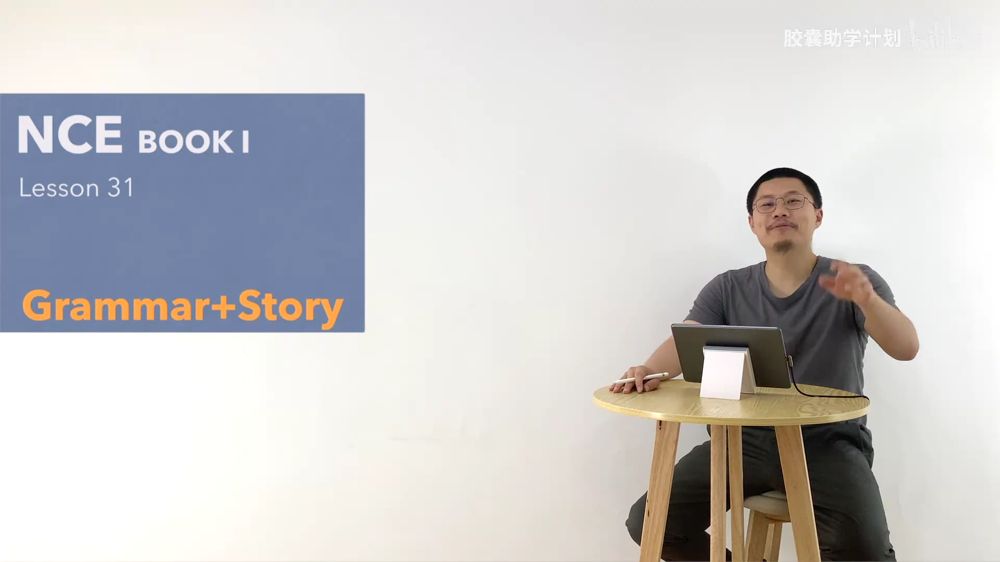

文字识别：胶囊助学计划 / NCE / BOOKI / Lesson 31 / Grammar+Story

### 画面 00:00:10

文字识别：胶囊助学计划 / AM

### 画面 00:00:12

文字识别：胶囊助学计划 / 特殊疑问句的特殊情况？ / 2

### 画面 00:00:19

文字识别：胶囊助学计划bi

### 画面 00:00:23

文字识别：虞助学计划一 / 胶囊助学计划

### 画面 00:00:25

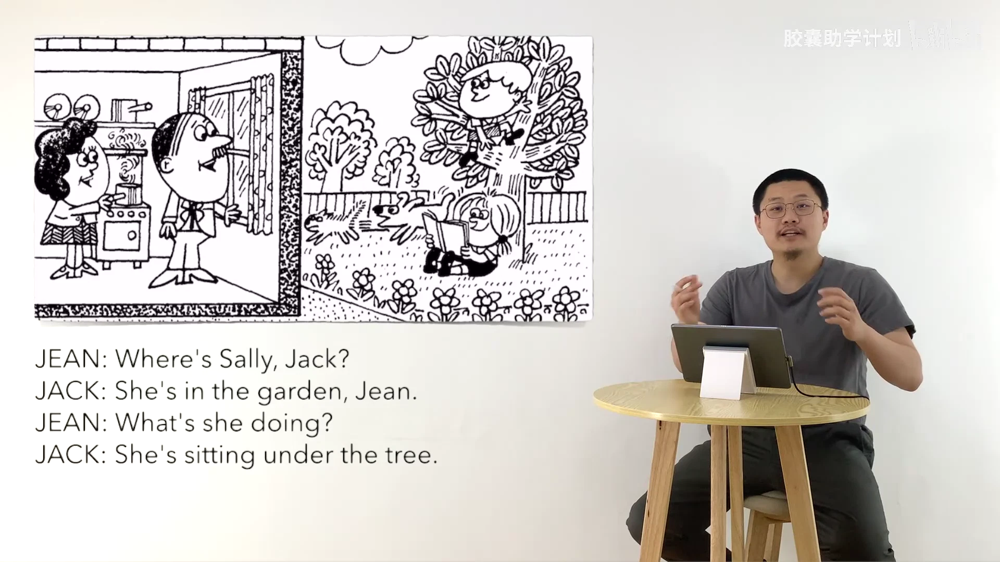

文字识别：胶囊助学计划 / JEAN: Where's Sally, Jack? / JACK: She's in the garden, Jean. / JEAN: What's she doing? / JACK: She's sitting under the tree.

## 00:00:30–00:01:00

啊，里边是爸爸妈妈，They are in the kitchen. Okay, and this is their son, and this is their daughter, and they are in the garden. Okay,好，那我们看Jean先说了一句话，说Where's Sally, Jack?注意，So this is Jack, this is Jack, and this is Jean. Okay, and说Where's Sally, Jack? Sally在什么地方啊，Jack? She's in the

### 画面 00:00:55

文字识别：胶囊助学计划 / JEAN: Where's Sally, Jack? / JACK: She's in the garden, Jean. / JEAN: What's she doing? / JACK: She's sitting under the tree.

## 00:01:00–00:01:30

garden. Jin,注意撇s是is，这个撇s也是is啊。说她现在在花园当中，in the garden一个小的地点。注意撇s，she所以Sally，so this is Sally。我们现在确定了啊。说What's she doing？她现在正在做什么呢？She's sitting.注意be加doing，我们刚刚学过的一个语法叫做现在

### 画面 00:01:25

文字识别：胶囊助学计划 / JEAN: Where's Sally, Jack? / JACK: She's in the garden, Jean. / JEAN: What's she doing? / JACK: She's sitting under the tree.

## 00:01:30–00:02:00

进行时。Under the tree，在树的下方，他现在正坐在树的下方，reading a book，正在读一本书。OK，接下来，Is Tim in the garden too？注意，So who is Tim？现在只有两个人，那这个是 Sally，So this is Tim。Is Tim in the garden too？他也在花园里吗？Yes，he is。是的，他在。He's climbing the tree。P.S.是is，

### 画面 00:01:34

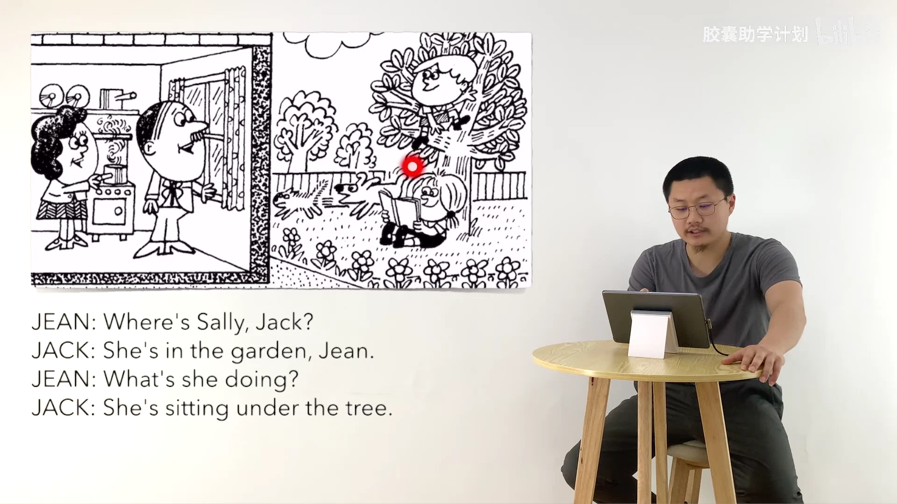

文字识别：胶囊助学计划 / JEAN: Where's Sally, Jack? / JACK: She's in the garden, Jean. / JEAN: What's she doing? / JACK: She's sitting under the tree.

### 画面 00:01:39

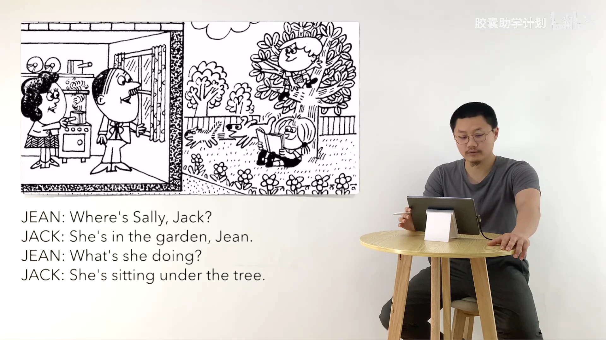

文字识别：胶囊助学计划 / JEAN: Where's Sally, Jack? / JACK: She's in the garden, Jean. / JEAN: What's she doing? / JACK: She's sitting under the tree.

### 画面 00:01:41

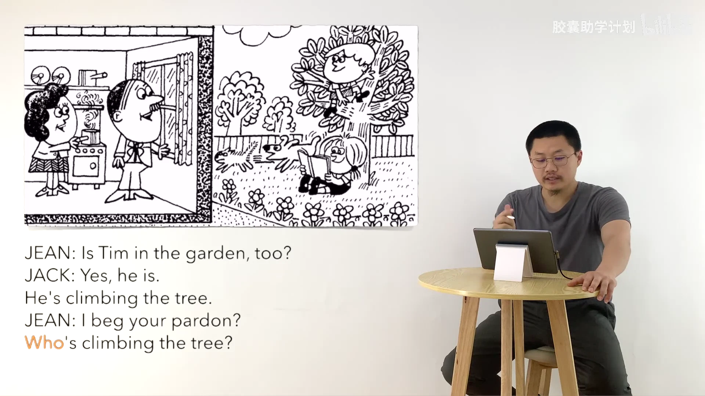

文字识别：胶囊助学计划 / JEAN: Is Tim in the garden, too? / JACK: Yes, he is. / He's climbing the tree. / JEAN: I beg your pardon? / Who's climbing the tree?

## 00:02:00–00:02:30

is又是 be加doing，他正在爬树。Okay,说I beg you pardon。这实际上我们在第一节课就学过了，对吧？叫做pardon的一个完全体，叫做I beg you pardon。我你拜托你再说一遍啊。Beg其实是祈求请求的意思啊。我拜托你再说一遍。他干嘛呢？说Who's climbing the tree？说谁正在爬树呢？好，那who这个地方

### 画面 00:02:11

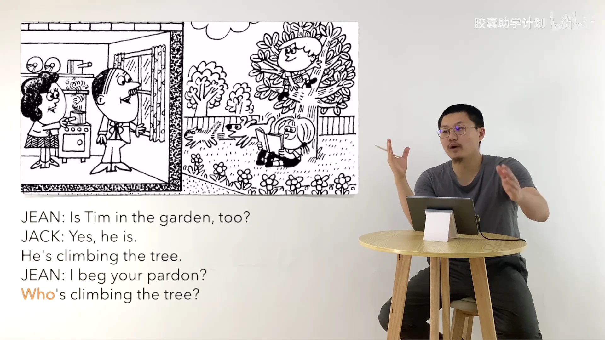

文字识别：胶囊助学计划 / JEAN: Is Tim in the garden, too? / JACK: Yes, he is. / He's climbing the tree. / JEAN: I beg your pardon? / Who's climbing the tree?

### 画面 00:02:23

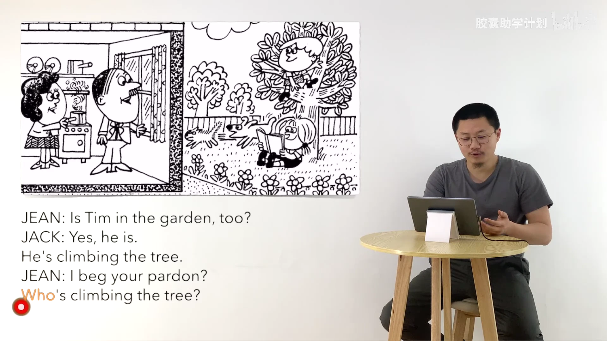

文字识别：胶囊助学计划 / JEAN: Is Tim in the garden, too? / JACK: Yes, he is. / He's climbing the tree. / JEAN: I beg your pardon? / Who's climbing the tree?

## 00:02:30–00:03:00

就引出来了 who 特殊疑问句的一个特殊形式，叫什么呢？我们现在这句肯定句叫做 Tim is climbing the tree。我们的老习惯是把它变成一般疑问句，然后再用 who 替对 Tim 提问，提到前面去，对吧？但是各位注意一下啊，特殊疑问词注意不只是有 who 啊，对主语提问的时候，直接用替特殊疑问词替代主语，您就不

### 画面 00:02:30

文字识别：胶囊助学计划 / who 特殊疑问句

### 画面 00:02:48

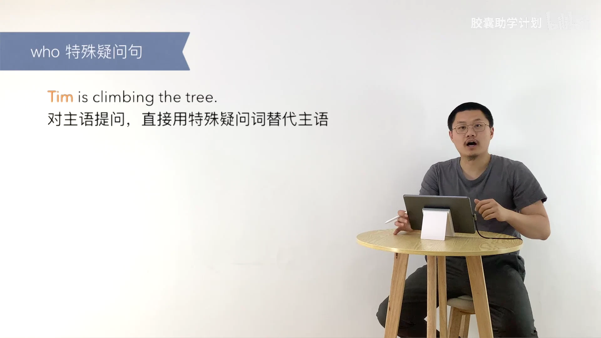

文字识别：胶囊助学计划 / who 特殊疑问句 / Tim is climbing the tree. / 对主语提问，直接用特殊疑问词替代主语

## 00:03:00–00:03:30

用再变一般疑问句了。好，重点我们再说一遍啊，重中之重我们再提一遍，任何特殊疑问词对主语提问的时候，直接用特殊疑问词替代这个主语，不用再变一般疑问句了。所以这句话就变成了 Who is climbing the tree？把 Tim 直接去掉，Who 放到这个地方，完全就可以了。OK，So who is climbing the tree？那比如说，我

### 画面 00:03:18

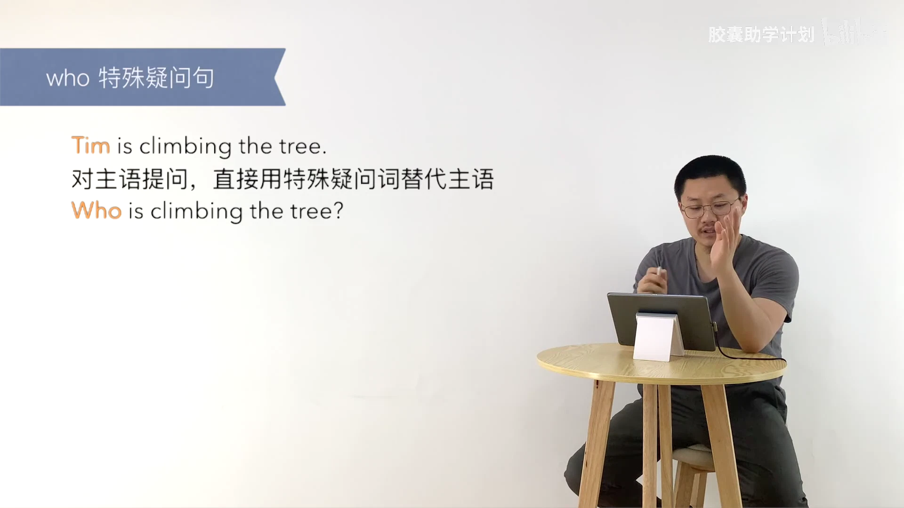

文字识别：胶囊助学计划 / who 特殊疑问句 / Tim is climbing the tree. / 对主语提问，直接用特殊疑问词替代主语 / Who is climbing the tree?

### 画面 00:03:26

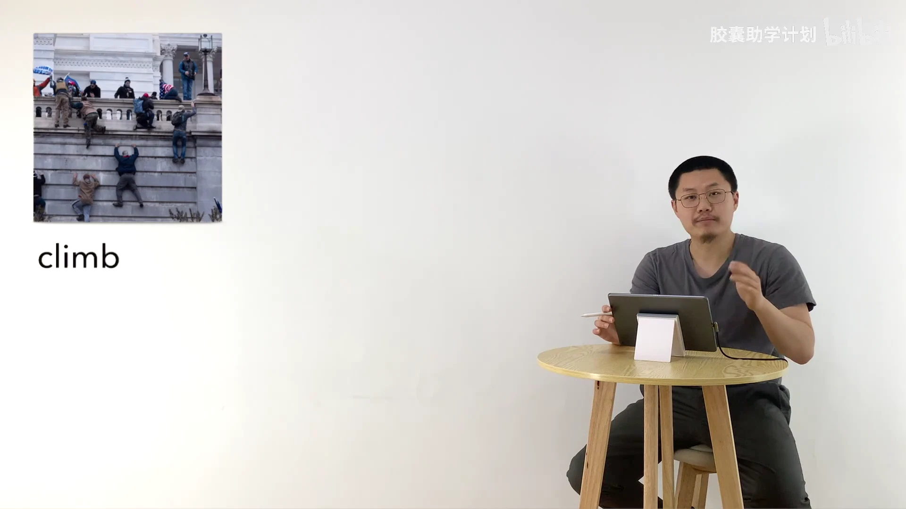

文字识别：胶囊助学计划 / climb

## 00:03:30–00:04:00

们造几个小的句子啊，比如说 climb 叫爬。那我说 they are climbing the wall，他们正在爬墙。我现在想问谁正在爬墙，是不是用 who 直接替代 they 就可以了？不用再变一般疑问句了，这是一个特殊情况啊，叫做 who are climbing the wall。 OK，那老习惯 take off 叫做脱掉。那我说 he is taking off the coat，他正在脱外套。我对 he 提问，

### 画面 00:03:50

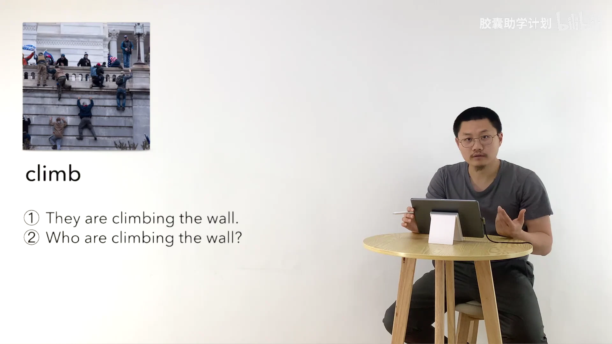

文字识别：胶囊助学计划 / climb /  They are climbing the wall. / Who are climbing the wall?

### 画面 00:03:52

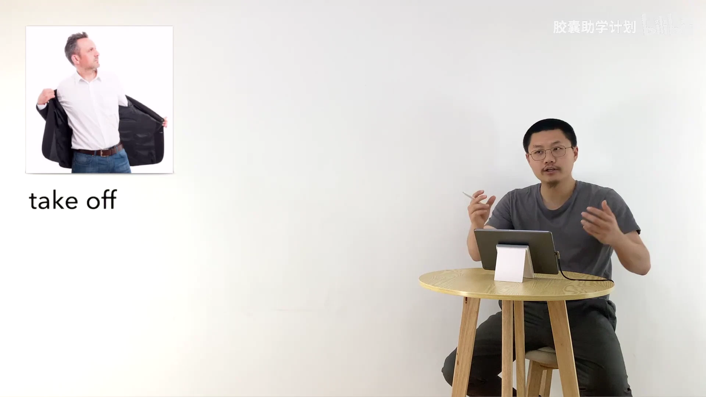

文字识别：胶囊助学计划 / take off

## 00:04:00–00:04:30

那就是 who is taking off the coat? 谁正在脱这个外套啊？ Next one, empty, 倒空，对吧？那我们可以说 he is emptying the box. 他正在倒空这个箱子。那我说谁正在倒空这个箱子呀？叫做 who is emptying the box? OK, very good. 那接下来我们看一个小的电影片段。这个电影片段当中出现了一句话叫

### 画面 00:04:01

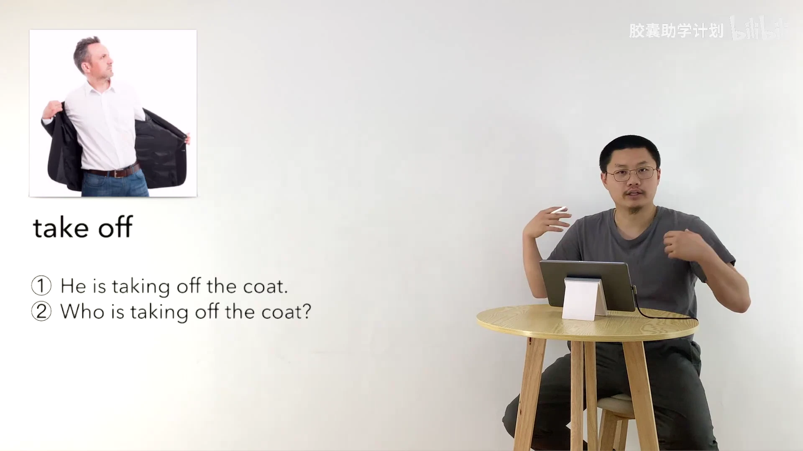

文字识别：胶囊助学计划 / take off / He is taking off the coat. /  Who is taking off the coat?

### 画面 00:04:05

文字识别：胶囊助学计划 / 课堂笔记 / X / 公众号：胶囊助学计划 / 正版教材 / X / 雅思托福课 / ·学员来信 / ·试听课 / ·课程详情

### 画面 00:04:08

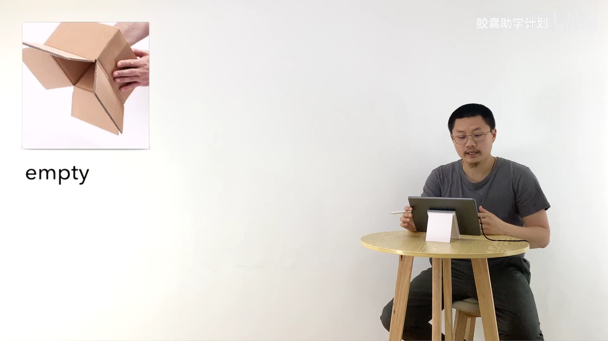

文字识别：胶囊助学计划 / empty

### 画面 00:04:11

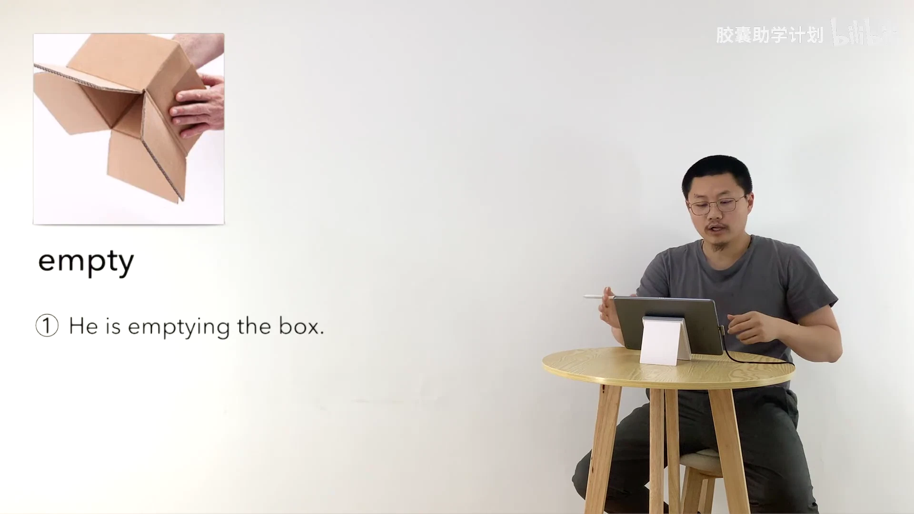

文字识别：胶囊助学计划 / empty / ① He is emptying the box.

### 画面 00:04:25

文字识别：ENDING VISION OF REALITY FROM THE DIRECTOR OFWATCHM / 胶囊助学计划 / YOU WILL BE UNPREPARED / Who is dancing? / 美少女特攻队 Sucker Punch(2011) / 36:06 / MARCH25 / EXPERIENCEITIN IMA

## 00:04:30–00:05:00

Who is dancing? Who is dancing? 好，我们看一下。 What do you want? She's dancing. Who is dancing? Your baby doll. Okay, 那他说 She's dancing. 然后这个男的就问了一句叫做 Who is dancing? 就是对 she 提问，直接替代，不用再变一般疑问句了，好吧？ Okay, 那我们回到文章，他说

### 画面 00:04:35

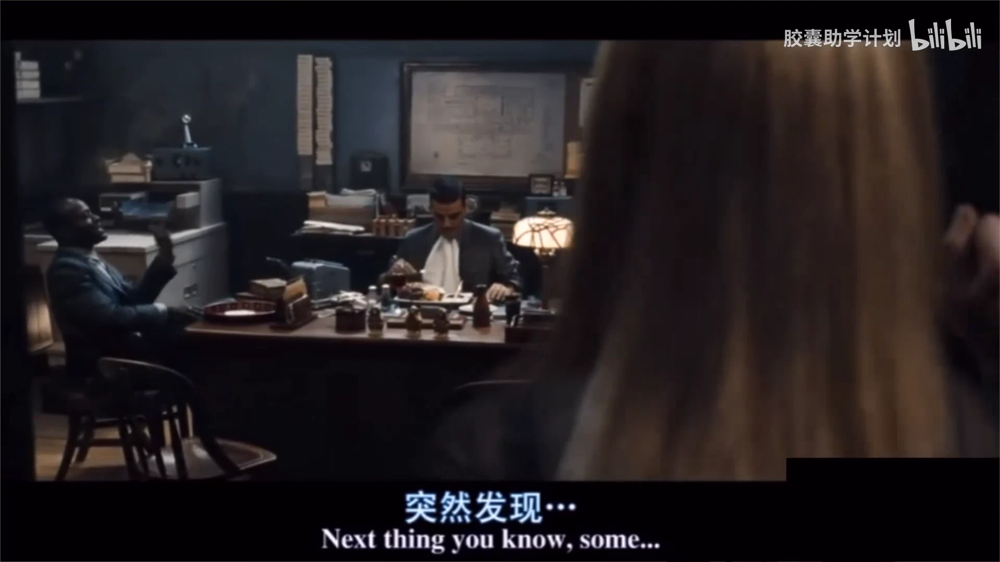

文字识别：bilibili / 胶囊助学计划 / 突然发现 / Next thing you know, some...

### 画面 00:04:37

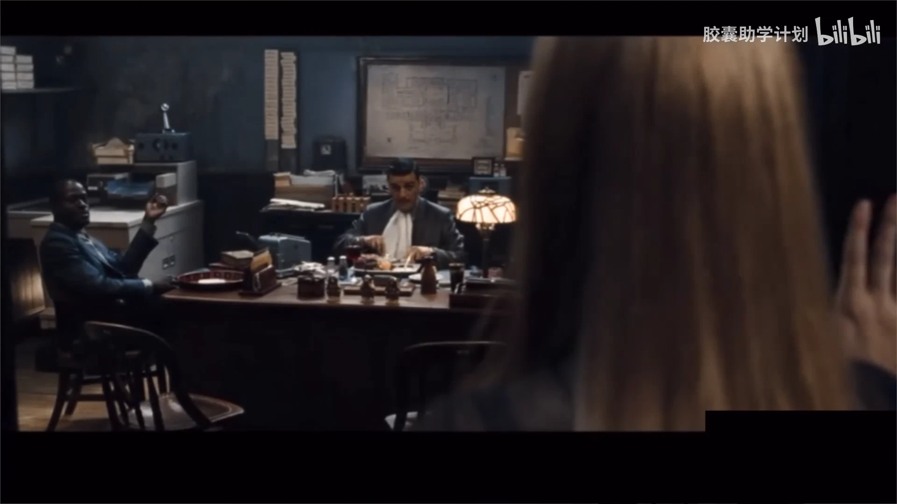

文字识别：Bilibili / 胶囊助学计划

### 画面 00:04:39

文字识别：bibili / 胶囊助学计划 / -你什么事-她在跳舞 / -What do you want? -She's dancing.

### 画面 00:04:41

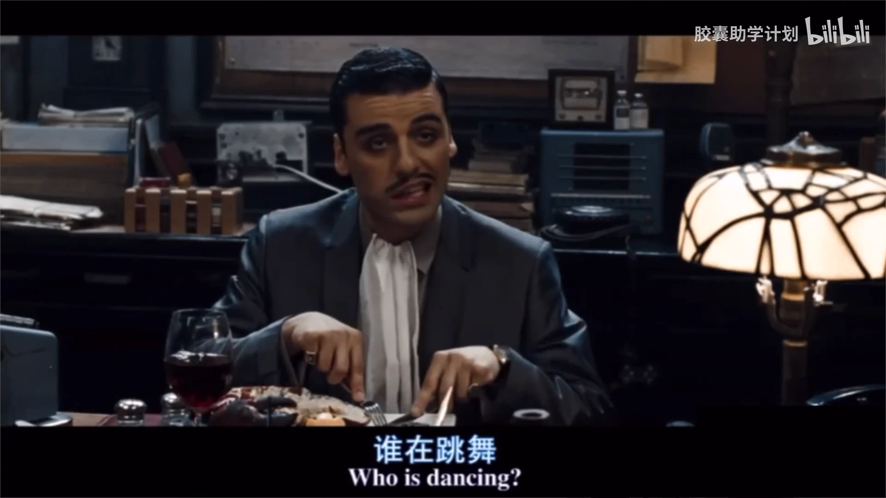

文字识别：Bilbili / 胶囊助学计划 / 谁在跳舞 / Who is dancing?

### 画面 00:04:43

文字识别：Bilbili / 胶囊助学计划 / 你的洋娃娃 / Your baby doll.

### 画面 00:04:45

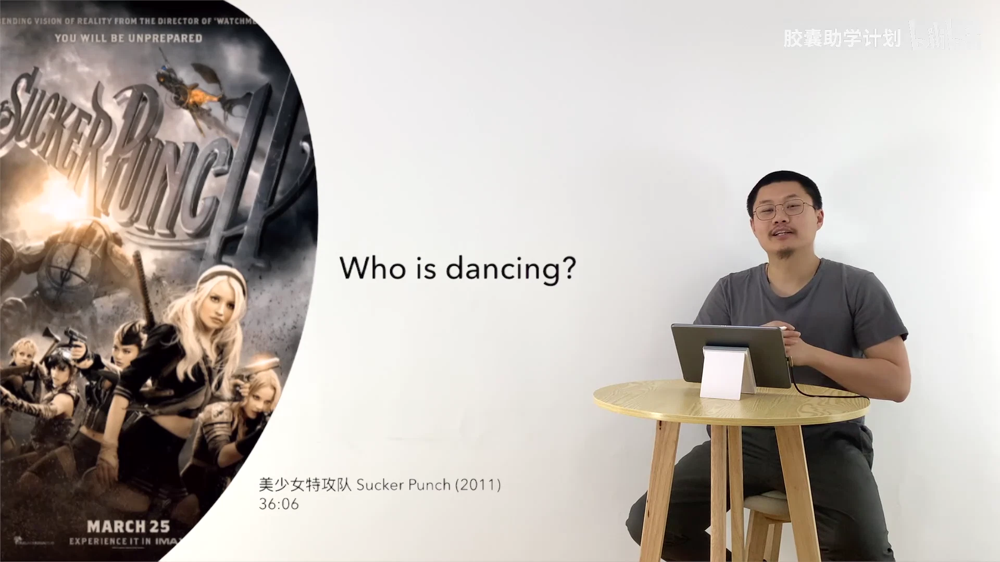

文字识别：ENDINC VISION OF REALITY FROM THE DIRECTOR OFWATCHM / 胶囊助学计划 / YOU WILL BE UNPREPARED / Who is dancing? / 美少女特攻队 Sucker Punch(2011) / 36:06 / MARCH25 / EXPERIENCEITIN IMA

### 画面 00:04:57

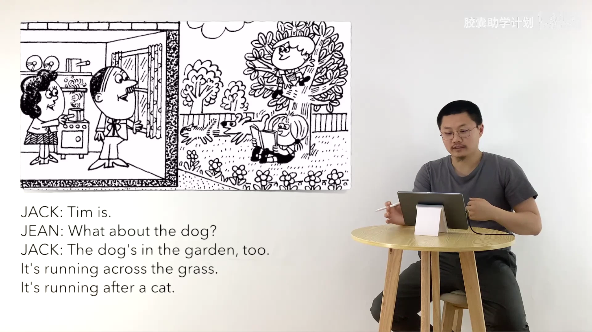

文字识别：胶囊助学计划 / JACK: Tim is. / JEAN: What about the dog? / JACK: The dog's in the garden, too. / It's running across the grass. / It's running after a cat.

## 00:05:00–00:05:30

is climbing the tree? 谁正在爬树呢？他说 Tim is. Tim, this is Tim. Tim 正在爬树. What about the dog? 那狗呢？ So this is their dog. This is a cat. 还炸毛了，是吧？说 What about the dog? 那这个狗呢？说 The dogs in the garden too. 这个狗啊，现在也在花园当中呢. It's running. 它现在正在跑 across the grass. 跑着正在穿过这片草

### 画面 00:05:27

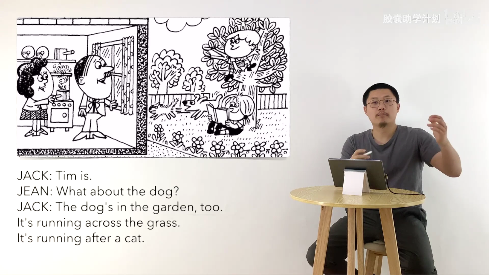

文字识别：胶囊助学计划 / JACK: Tim is. / JEAN: What about the dog? / JACK: The dog's in the garden, too. / It's running across the grass. / It's running after a cat.

## 00:05:30–00:06:00

### 画面 00:05:36

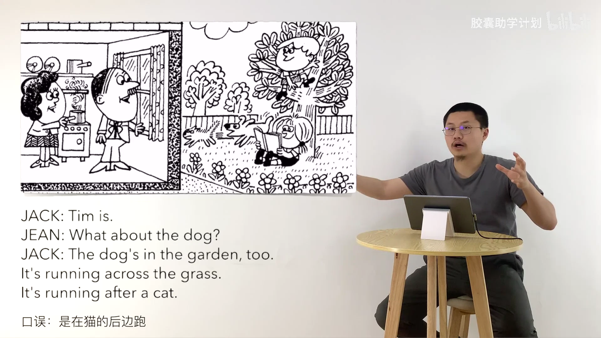

文字识别：胶囊助学计划 / JACK: Tim is. / JEAN: What about the dog? / JACK: The dog's in the garden, too. / It's running across the grass. / It's running after a cat. / □误：是在猫的后边跑

### 画面 00:05:41

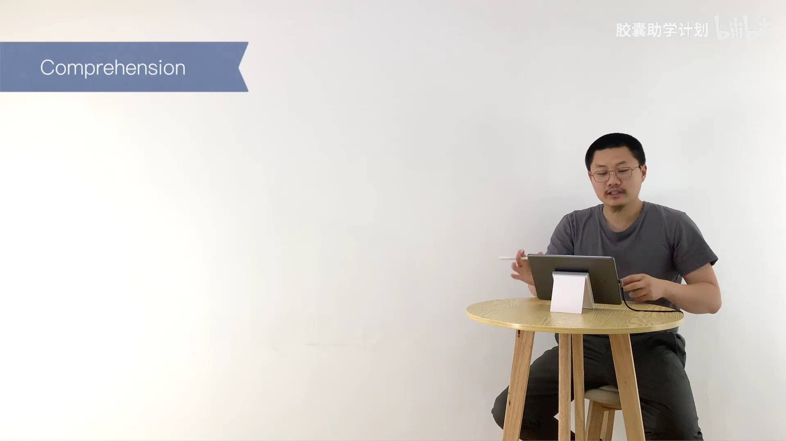

文字识别：胶囊助学计划 / Comprehension

### 画面 00:05:57

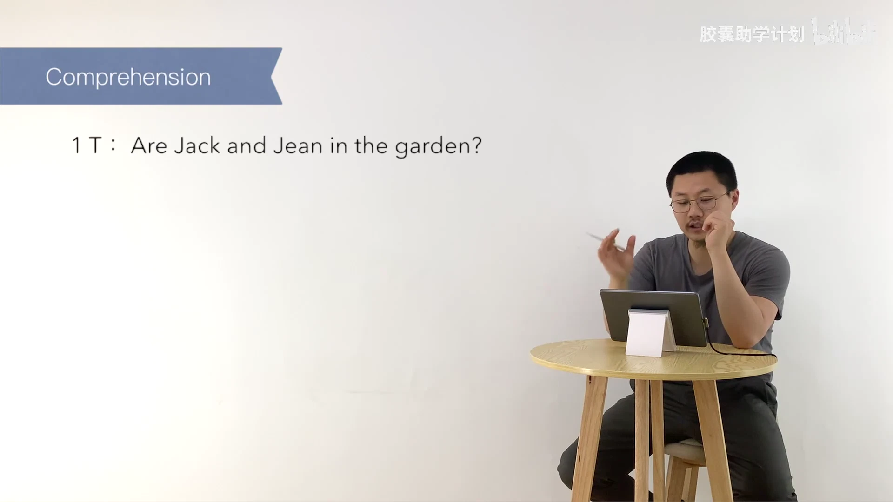

文字识别：胶囊助学计划州 / Comprehension / 1 T : Are Jack and Jean in the garden?

## 00:06:00–00:06:30

and Jim in the garden? Think about who is Jack and who is Jim. No, they aren't. Next one. Are they in the kitchen? Yes, they are. Next one. Is Sally in the garden? Yes, she is. Is Tim in the living room? No, he isn't. He's in the garden.

### 画面 00:06:26

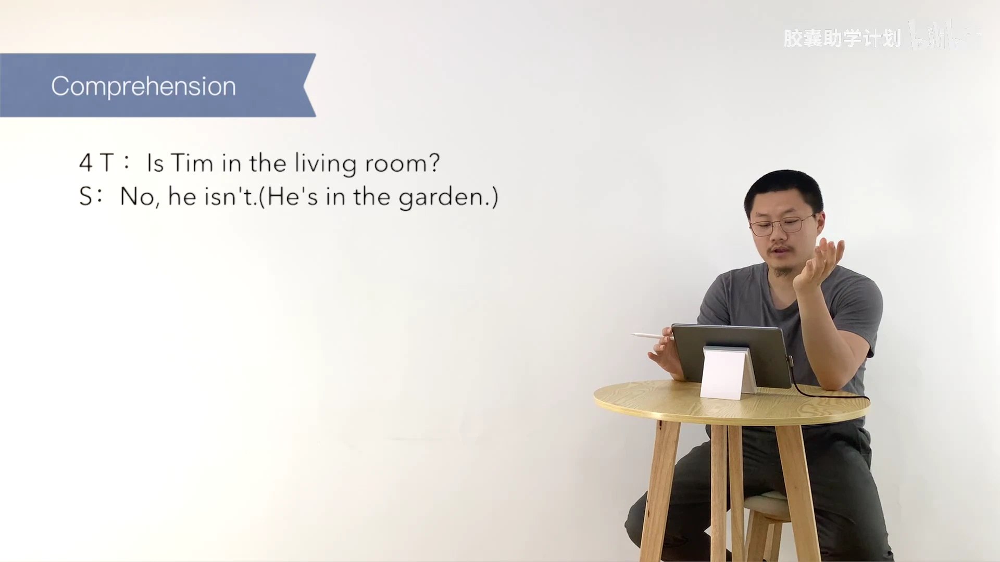

文字识别：胶囊助学计划 / Comprehension / 4 T: Is Tim in the living room? / S: No, he isn't.(He's in the garden.)

## 00:06:30–00:07:00

Who's sitting under the tree? Sally is sitting under the tree. What's Tim doing? He's climbing the tree. Where's the dog? Is in the garden. Is the dog climbing the tree? No, it isn't.

### 画面 00:06:33

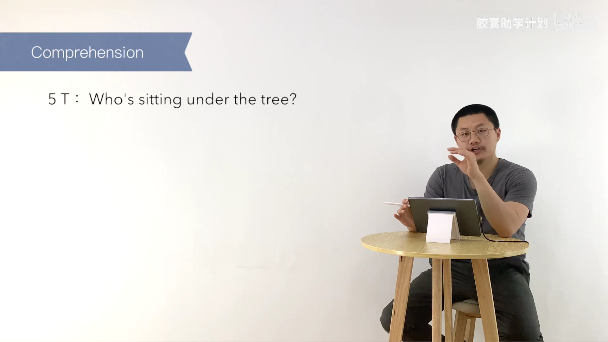

文字识别：胶囊助学计划 / Comprehension / 5 T: Who's sitting under the tree?

## 00:07:00–00:07:30

What's the dog doing? It's running across the grass.你也可以说 is running after a cat. 都是对的答案。 Okay. 好， asking questions. 这个地方我们又是要做一些小的听力口语练习了。我问您答啊。我们可以先看一个例子，比如说说 Sally is in the garden. 您要做的事情是听懂他用口语回答我，

### 画面 00:07:03

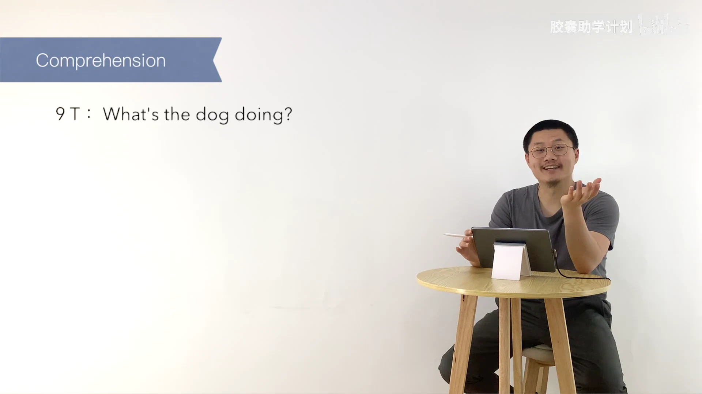

文字识别：胶囊助学计划 / Comprehension / 9T: What's the dog doing?

### 画面 00:07:13

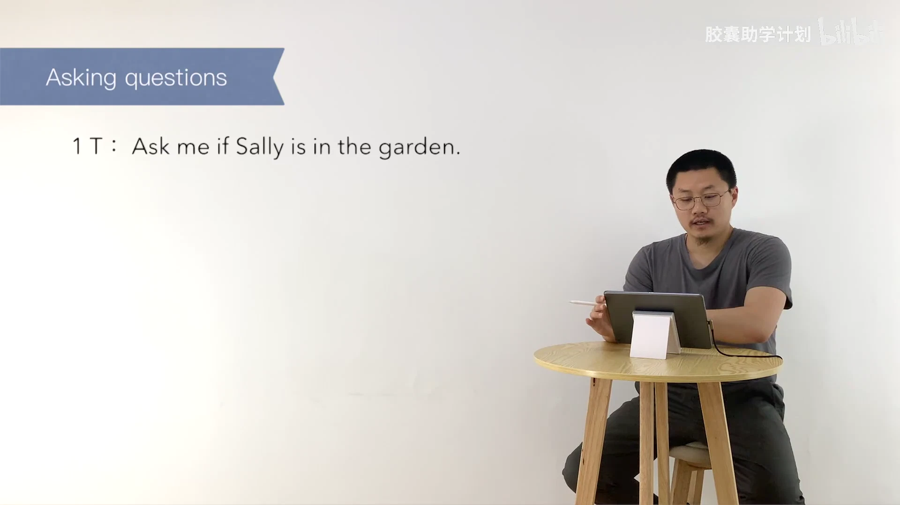

文字识别：胶囊助学计划 / Asking questions / 1 T: Ask me if Sally is in the garden.

## 00:07:30–00:08:00

叫做 Is Sally in the garden? 把肯定句转化成一般疑问句，然后呢，我给一个特殊疑问词，当然有的可能会不给，然后呢，您去想怎么把一般疑问句再变成特殊疑问句，变成了 Where is Sally? OK，来了， Ask me if Sally is sitting under the tree. 答案 Is Sally sitting under the tree?

### 画面 00:07:43

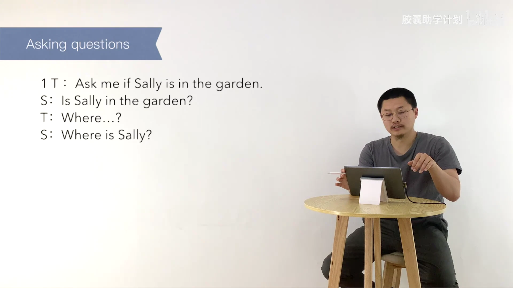

文字识别：胶囊助学计划 / Asking questions / 1 T: Ask me if Sally is in the garden. / S: Is Sally in the garden? / T: Where...? / S: Where is Sally?

### 画面 00:07:48

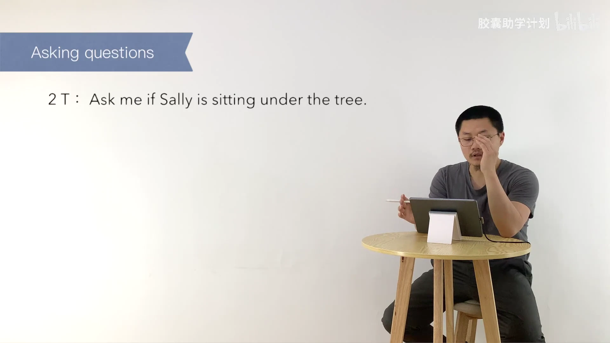

文字识别：胶囊助学计划 / Asking questions / 2 T: Ask me if Sally is sitting under the tree.

## 00:08:00–00:08:30

Where? Where is Sally sitting? 好，注意他现在就是在问 Sally 正坐在什么地方。我们实际上把两个语法呀融合到一起了。第一个是我们刚刚学过的 be 加 doing，对吧？第二个是肯定句如何变一般疑问句，如何变特殊疑问句？这是我们前三十课不停在学的一个语法。两个语法放到一起了，就产生了一个效果。我们可以问出来一

### 画面 00:08:01

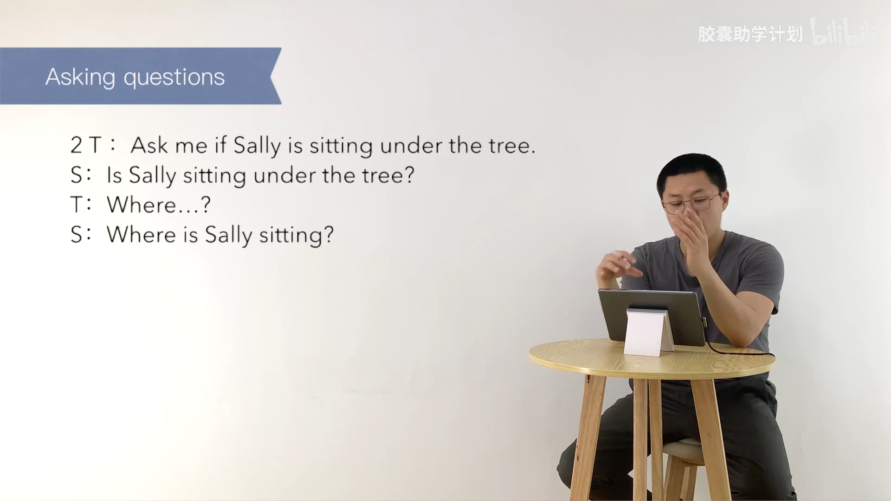

文字识别：胶囊助学计划 / Asking questions / 2T: Ask me if Sally is sitting under the tree. / S: Is Sally sitting under the tree? / T:Where...? / S: Where is Sally sitting?

## 00:08:30–00:09:00

句话叫 Sally 正坐在什么地方。 Next one, ask me if Tim is climbing the tree. 答案 Is Tim climbing the tree? What? 你想一下 What 对这里面的谁提问？ What is Tim climbing? 他正在爬什么？ Next one, ask me if the dog is in the garden. Is the dog in the garden?

### 画面 00:08:31

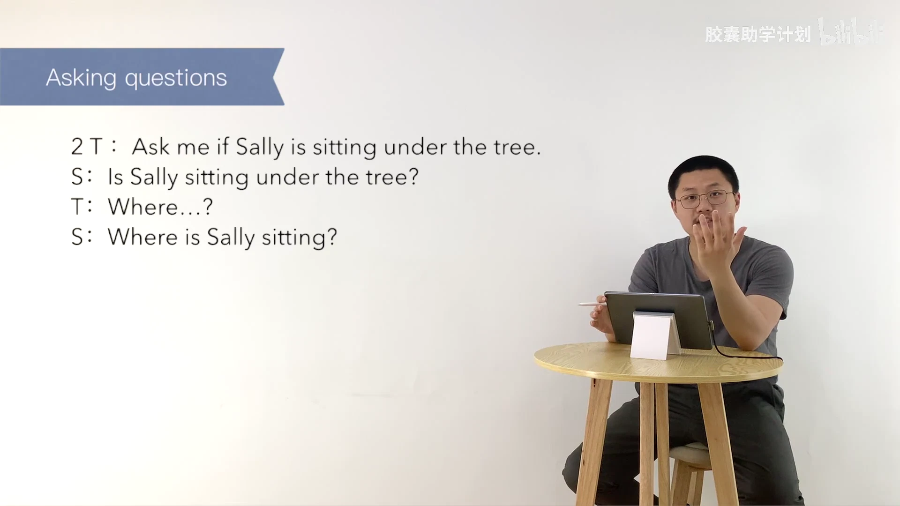

文字识别：胶囊助学计划 / Asking questions / 2T: Ask me if Sally is sitting under the tree. / S: Is Sally sitting under the tree? / T:Where...? / S: Where is Sally sitting?

### 画面 00:08:33

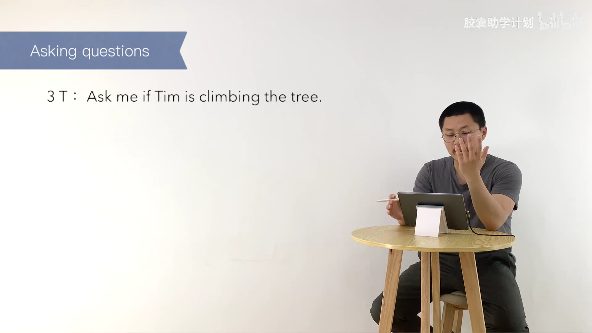

文字识别：胶囊助学计划 / Asking questions / 3 T: Ask me if Tim is climbing the tree.

## 00:09:00–00:09:30

Where? Where is the dog? Next one. Ask me if the dog is running across the grass. Is the dog running across the grass? Where? 肯定是对 across the grass 提问了，对吧？ Where is the dog running? 这个狗在什么地方正在跑呢？ Okay. 好，那我们 recap 看一下这课的最关键的点，就是各位要记

### 画面 00:09:01

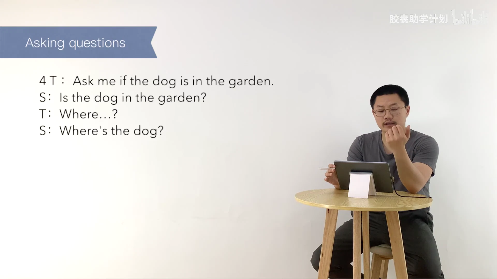

文字识别：胶囊助学计划 / Asking questions / 4T : Ask me if the dog is in the garden. / S: Is the dog in the garden? / T:Where...? / S: Where's the dog?

### 画面 00:09:04

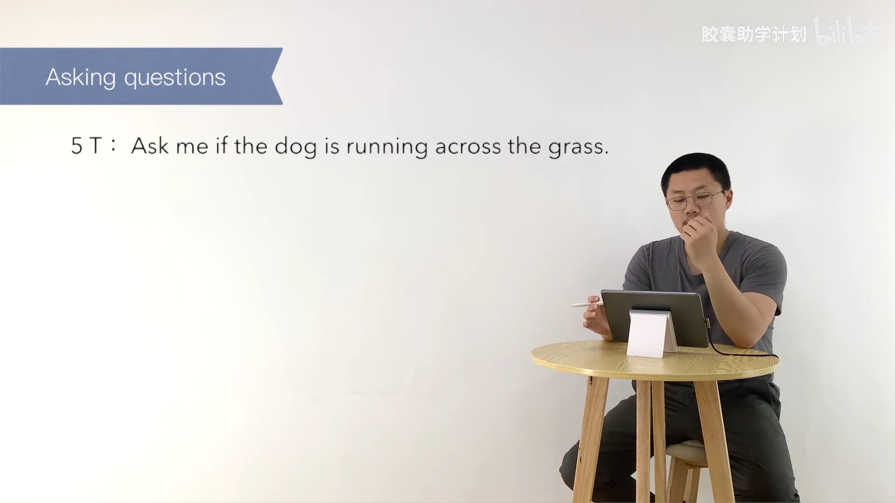

文字识别：胶囊助学计划 / Asking questions / 5 T : Ask me if the dog is running across the grass.

### 画面 00:09:15

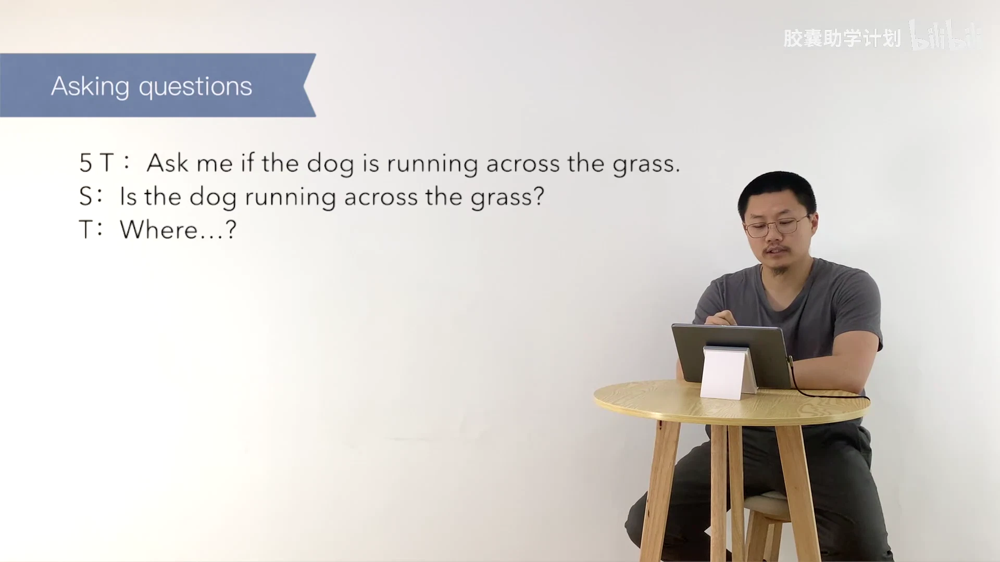

文字识别：胶囊助学计划 / Asking questions / 5 T : Ask me if the dog is running across the grass. / S: Is the dog running across the grass? / T: Where...?

### 画面 00:09:24

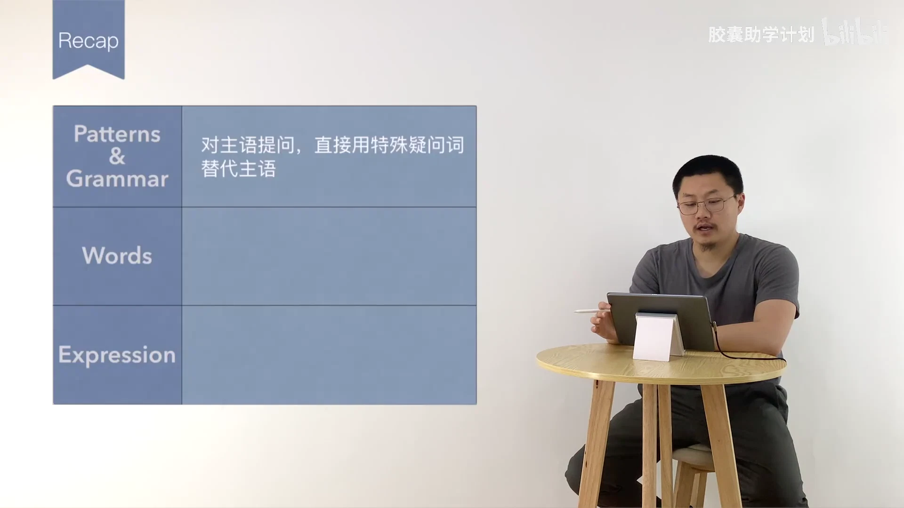

文字识别：BiH / 胶囊助学计划 / Recap / Patterns / 对主语提问，直接用特殊疑问词 / 替代主语 / Grammar / Words / Expression

## 00:09:30–00:10:00

住一个事儿，特殊疑问词对主语提问的时候，直接用特殊疑问词替代主语，不要再变一般疑问句了。这个小的知识点，我们从今天一直贯穿到整个新二的结束。OK，好，那我们看一下本期视频的家务作业。第一，绿皮书各位三十一课可以完成了。第二，文章老习惯要跟读至熟读成诵。您在跟读的过程当中，把本课的单词、语法、习惯用法全部融会贯通了。

### 画面 00:09:44

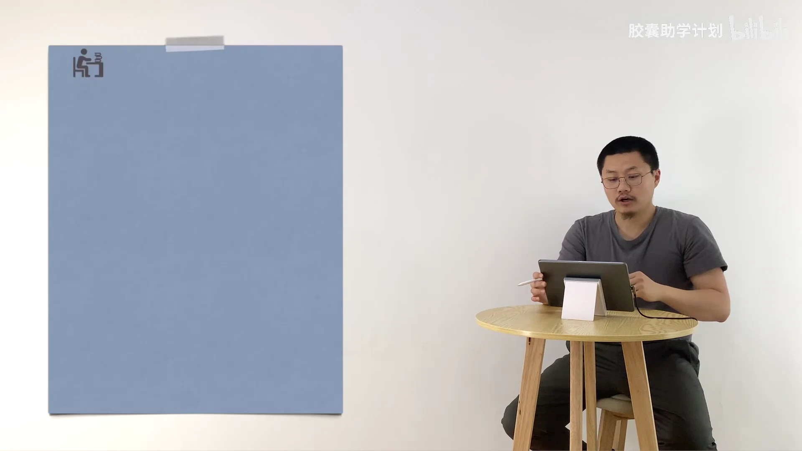

文字识别：胶囊助学计划

### 画面 00:09:51

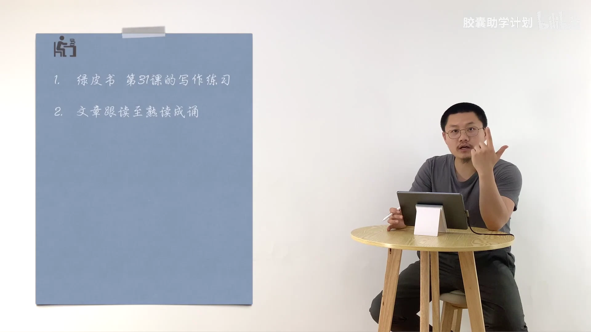

文字识别：胶囊助学计划 / 绿皮书第31课的写作练习 / 2.文章跟读至熟读成诵

## 00:10:00–00:10:30

您甚至可以不用专门花时间去背单词，对吧？文章你读到足够的熟的时候，再加上我们之前录制的自然拼读法则那些简易的课程，各位如果这两个点同时满足，大部分的单词您基本上拼写含义，对吧？加包括它的发音，您都可以自己搞定了。OK，接下来呢，观察家人，上次不是让各位出去观察社区嘛？今天您跟家人多花点时间在一起，用B加读音造句，

### 画面 00:10:21

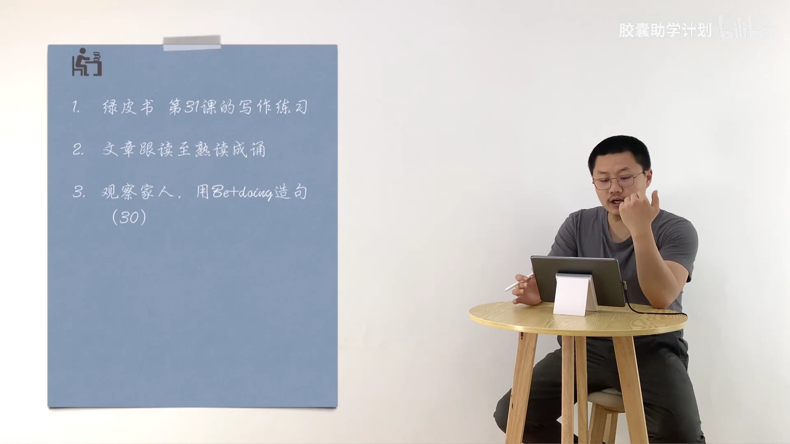

文字识别：胶囊助学计划 / 绿皮书第31课的写作练习 / 文章跟读至熟读成诵 / 3.观察家人，用Be+daing造句 / (30)

## 00:10:30–00:11:00

习惯三十句，肯定句、否定句、一般疑问句、特殊疑问句，没有那么难，您试着做一下。OK，好，接下来呢，给自己讲解一遍今天的知识点，尤其是对主语提问的特殊疑问句应该是什么样子，这个知识点。OK，好，那以上呢就是本期视频的全部内容了。如果大家喜欢我们的课程，欢迎大家关注、订阅、一键三连支持，并分享给那些需要的朋友们。最后的最后，我们再来看一句名

### 画面 00:10:47

文字识别：胶囊助学计划

### 画面 00:10:58

文字识别：胶囊助学计划 / Someone is sitting in the shade today / because someone planted a tree a long / time ago. / Warren Buffett

## 00:11:00–00:11:24

人名言。 Someone is sitting in the shade today because someone planted a tree a long time ago. See you next time.

### 画面 00:11:12

### 画面 00:11:14

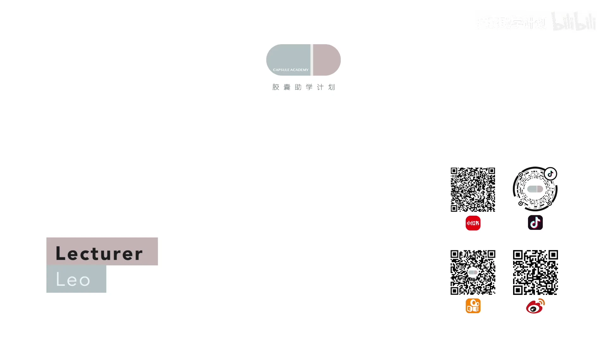

文字识别：CAPSULEACADEMY / 胶囊助学计划 / 小红书 / Lecturer / Leo / 8 / OE

### 画面 00:11:17

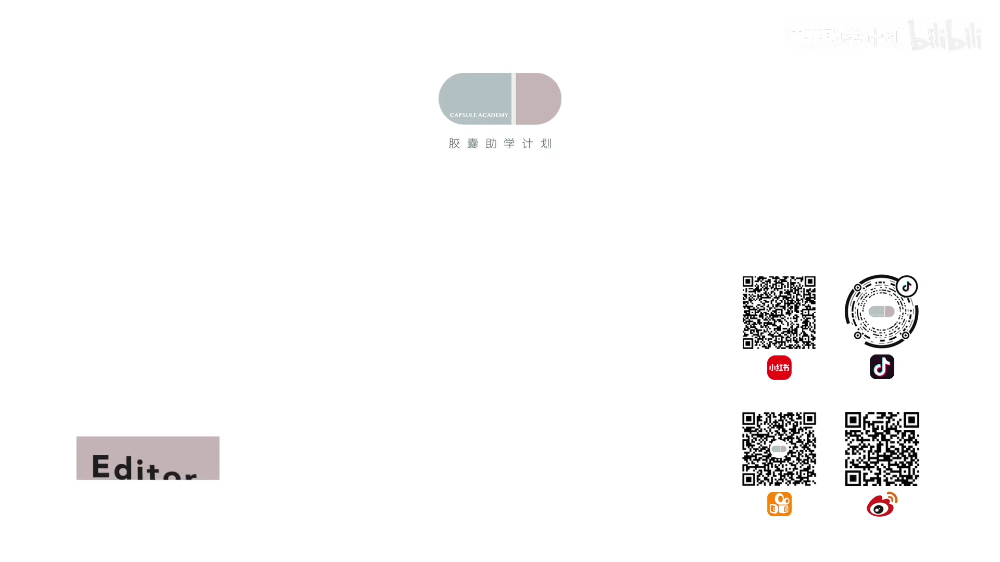

文字识别：CAPSULEACADEMY / 胶囊助学计划 / 小红书 / Editor

### 画面 00:11:20

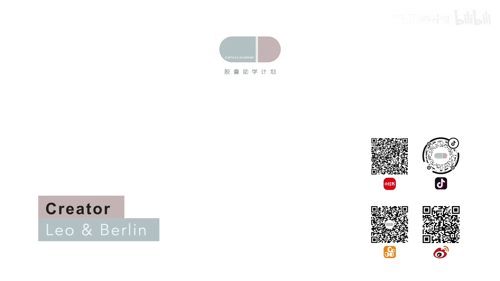

文字识别：CAPSULEACADEMY / 胶囊助学计划 / 『 / 小红书 / Creator / □ / Leo & Berlin / OE

### 画面 00:11:22

文字识别：bilbili / 胶囊助学计划 / 胶囊助学计划 / 小红书 / OE

### 画面 00:11:24

文字识别：bilbili / 胶囊助学计划

