# 033 文章

快速机器解析：语音为单模型转写，未进行独立交叉校对或人工复核；画面每秒采样并按变化选帧，短时文字和标记可能遗漏。截图时间约有 1 秒误差。图片有损压缩；遇到疑点请按时间查看 Google Drive 原视频。

## 00:00:00–00:00:30

Hello everyone, welcome to Capsule Academy. This is Leo. Today we're going to learn New Concept English Book One Lesson Thirty Three Story. Hope you gonna enjoy it.好，那我们直接进入文章。我们先来看第一句话，说 It is a fine day today. 啊，这个我们之前其实有讲到了，在 fine day day 这个单词造句的时候，说今儿天儿还不错。

### 画面 00:00:00

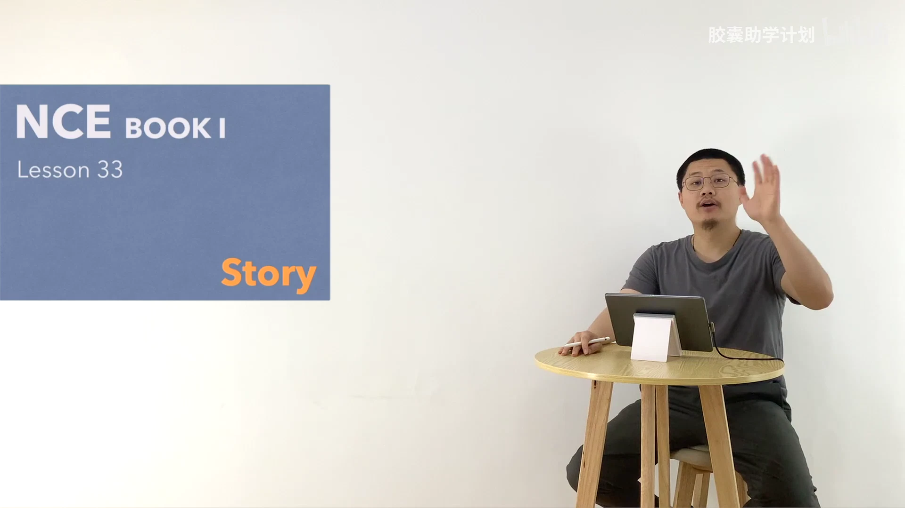

文字识别：胶囊助学计划 / NCE / BOOKI / Lesson 33 / Story

### 画面 00:00:04

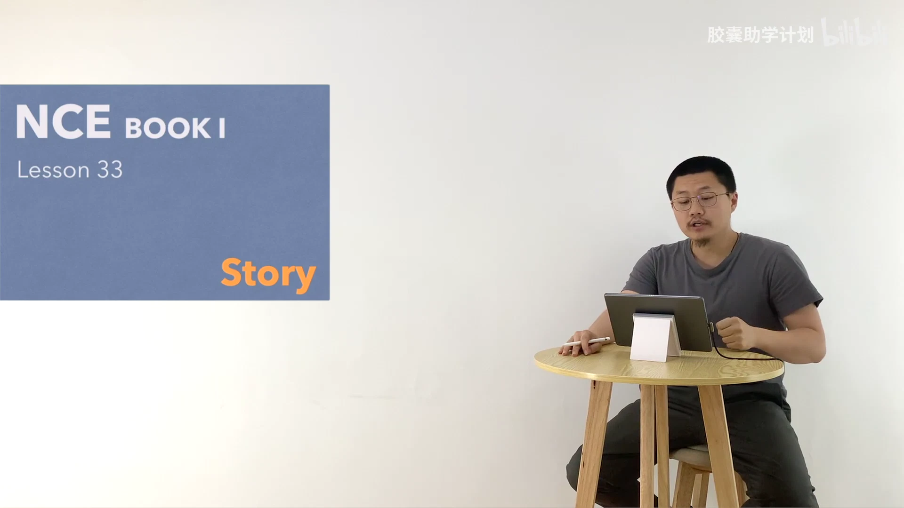

文字识别：胶囊助学计划 / NCE / BOOKI / Lesson 33 / Story

### 画面 00:00:11

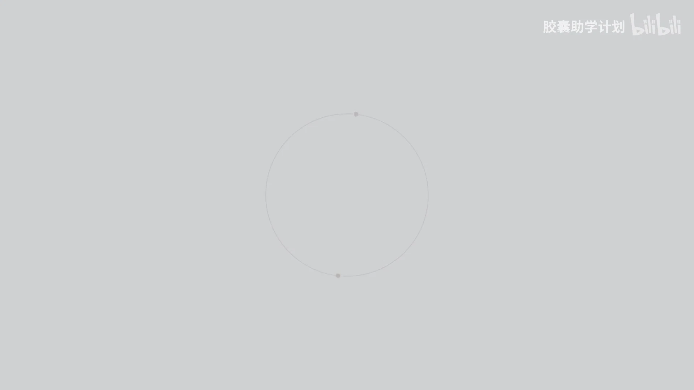

文字识别：胶囊助学计划bilbl

### 画面 00:00:14

文字识别：胶囊助学计划 / 胶囊助学计划

### 画面 00:00:16

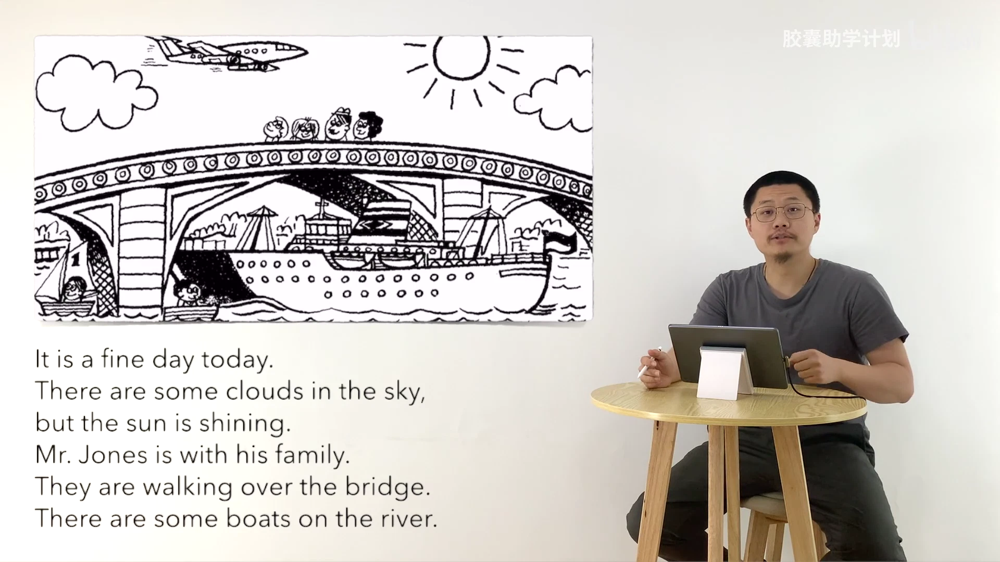

文字识别：000 / It is a fine day today. / There are some clouds in the sky, / but the sun is shining. / Mr. Jones is with his family. / They are walking over the bridge. / There are some boats on the river.

### 画面 00:00:18

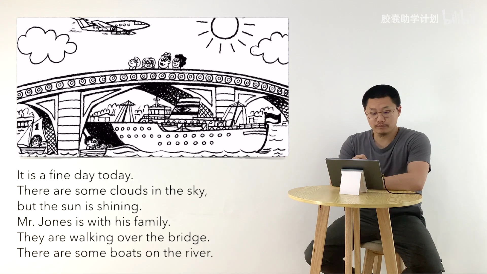

文字识别：胶囊助学计划 / 000 / It is a fine day today. / There are some clouds in the sky, / but the sun is shining. / Mr. Jones is with his family. / They are walking over the bridge. / There are some boats on the river.

## 00:00:30–00:01:00

这地方只有一个小点注意提醒各位一下，就是天，对吧？我想说今儿天儿不错的时候，你不能说 today is a fine day，一定要用 it 去当这个小的主语，叫做 it is a fine day。 OK，好，那接下来说 there are some clouds in the sky， clouds clouds in the sky，在天空当中有一些白云啊。那注意这是 there be 句型，如果我想变一般疑问句，二提前，some 要

### 画面 00:00:34

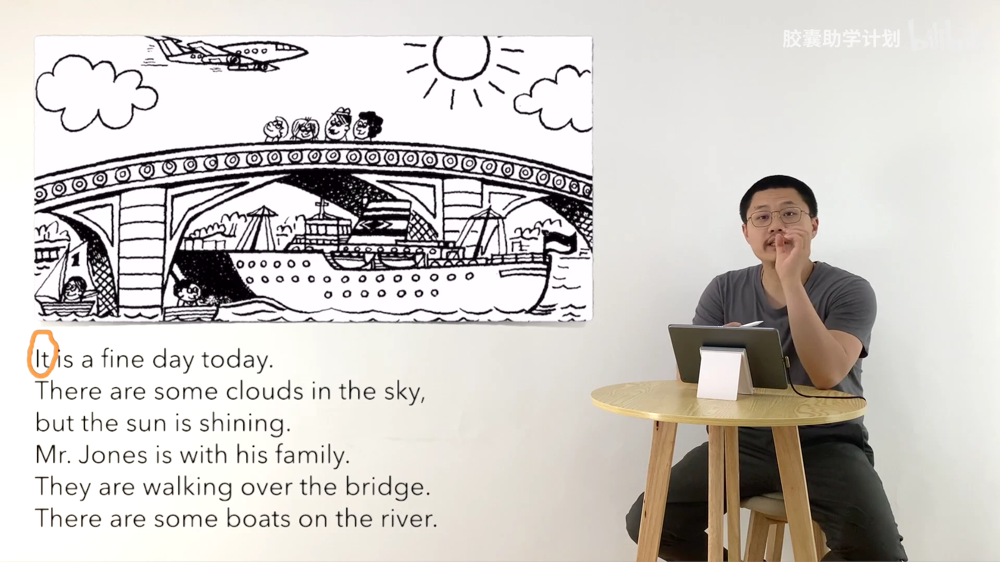

文字识别：胶囊助学计划 / 000 / tis a fine day today. / There are some clouds in the sky, / but the sun is shining. / Mr. Jones is with his family. / They are walking over the bridge. / There are some boats on the river.

### 画面 00:00:49

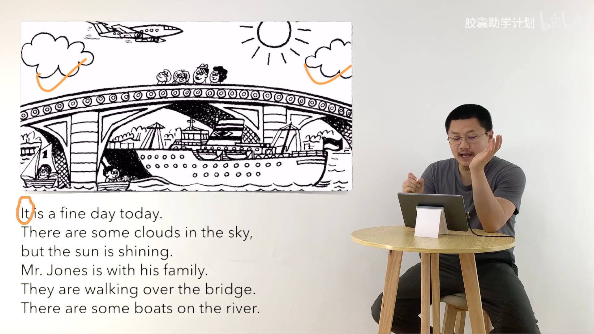

文字识别：胶囊助学计划 / 000 / tis a fine day today. / There are some clouds in the sky, / but the sun is shining. / Mr. Jones is with his family. / They are walking over the bridge. / There are some boats on the river.

### 画面 00:00:57

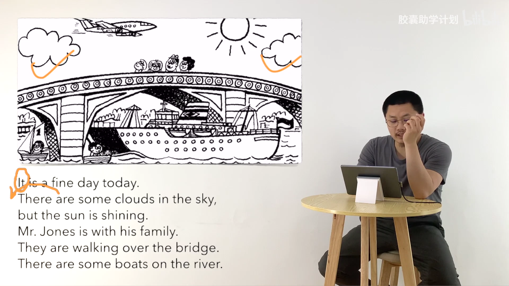

文字识别：胶囊助学计划 / 000 / ica fine day today. / There are some clouds in the sky, / but the sun is shining. / Mr. Jones is with his family. / They are walking over the bridge. / There are some boats on the river.

## 00:01:00–00:01:30

换回 any 对不对？接下来说 but the sun is shining 说但是啊这个太阳正在照耀着，哎，虽然有云啊，但是呢阳光还是很充足的。Mr. Jones Jones 先生 is with his family 说现在啊和他的家人在一起。那我想说他和他的家人在一起吗？你就应该会了。他和他的家人不在一起

### 画面 00:01:01

文字识别：胶囊助学计划 / 000 / isa fine day today. / There are some clouds in the sky, / but the sun is shining. / Mr. Jones is with his family. / They are walking over the bridge. / There are some boats on the river.

### 画面 00:01:11

文字识别：胶囊助学计划 / 000 / ca fine day today. / There are some clouds in the sky, / but the sun is shining. / Mr. Jones is with his family. / They are walking over the bridge. / There are some boats on the river.

### 画面 00:01:20

文字识别：胶囊助学计划 / 000 / isa fine day today. / There are some clouds in the sky, / but the sun is shining. / Mr. Jones is with his family. / They are walking over the bridge. / There are some boats on the river.

## 00:01:30–00:02:00

这句话您也应该会了。所以这是我们反复强调的文章不用背诵，熟读成诵即可。然后接下来要做的事情是什么呢？四句型转换。They are walking over the bridge。首先，they are walking，他们正在走，然后走穿过跨越这座桥，叫 over the bridge。OK。然后呢，there are some boats on the river，boat boat。OK，要注意看这个图

### 画面 00:01:35

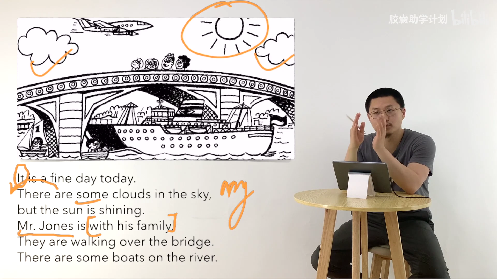

文字识别：胶囊助学计划 / 00 / sa fine day today. / There are some clouds in the sky, / but the sun is shining. / Mr. Jones is With his family / They are walking over the bridge. / There are some boats on the river.

### 画面 00:01:43

文字识别：胶囊助学计划 / 000 / tica fine day today. / There are some clouds in the sky, / but the sun is shining. / Mr. Jones is With his family / They are walking over the bridge. / There are some boats on the river.

### 画面 00:01:45

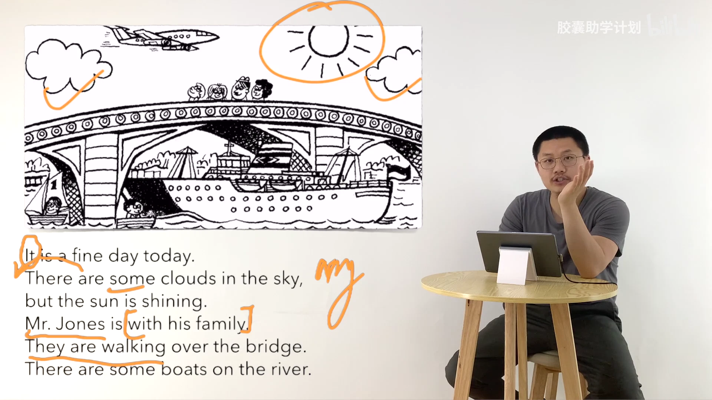

文字识别：胶囊助学计划 / 000 / sa fine day today. / There are some clouds in the sky, / but the sun is shining. / Mr.Jones is with his family / They are walking over the bridge. / There are some boats on the river.

### 画面 00:01:47

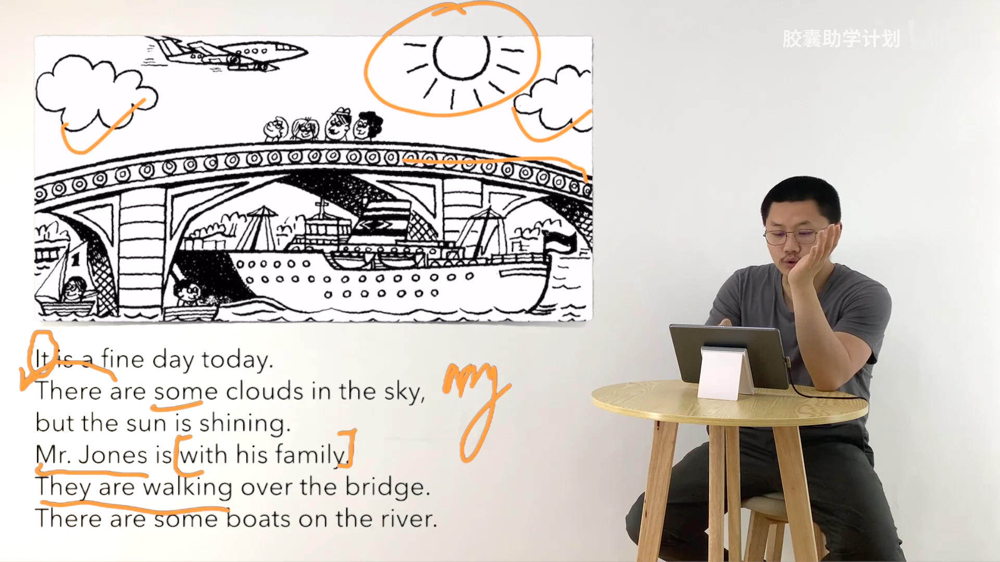

文字识别：胶囊助学计划 / 000 / sa fine day today. / There are some clouds in the sky, / but the sun is shining. / Mr.Jones is with his family / They are walking over the bridge. / There are some boats on the river.

### 画面 00:01:49

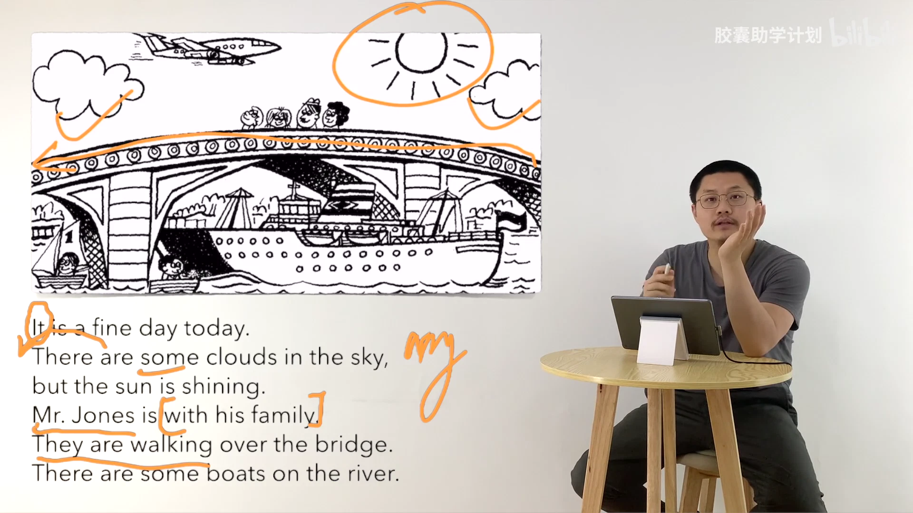

文字识别：胶囊助学计划 / 00 / tisa fine day today. / There are some clouds in the sky, / but the sun is shining. / Mr. Jones is with his family / They are walking over the bridge. / There are some boats on the river.

### 画面 00:01:52

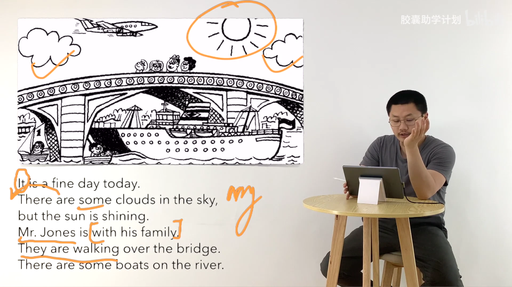

文字识别：胶囊助学计划 / 00 / isa fine day today. / There are some clouds in the sky, / but the sun is shining. / Mr. Jones is with his family / They are walking over the bridge. / There are some boats on the river.

### 画面 00:01:55

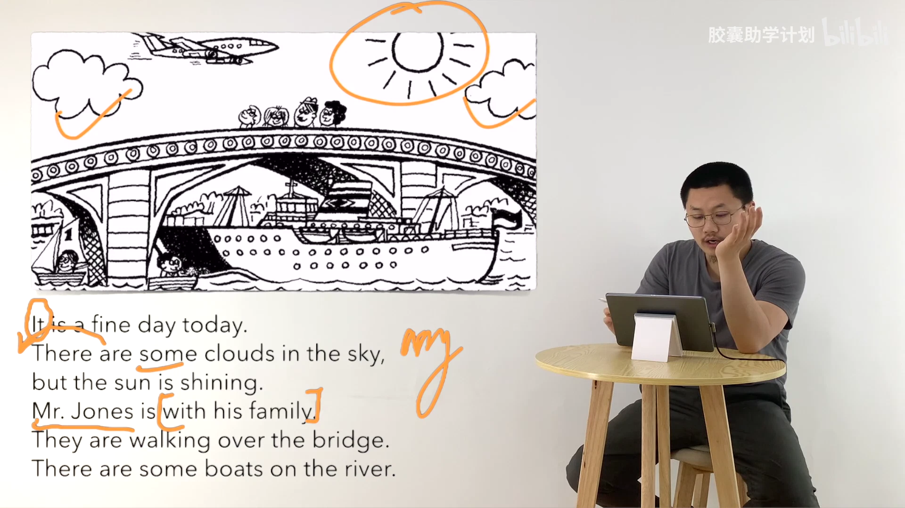

文字识别：胶囊助学计划 / 000 / isa fine day today. / There are some clouds in the sky, / but the sun is shining. / Mr. Jones isWith his family / They are walking over the bridge. / There are some boats on the river.

### 画面 00:01:58

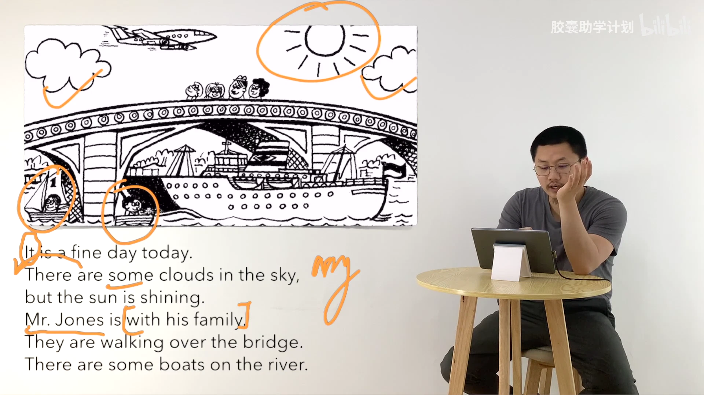

文字识别：胶囊助学计划 / 000 / isa fine day today. / There are some clouds in the sky, / but the sun is shining. / Mr. Jones isWith his family / They are walking over the bridge. / There are some boats on the river.

## 00:02:00–00:02:30

啊。说有一些小船在河的上方。变一般疑问句老习惯 are 提前，然后 some 要换回 any。继续，Mr. Jones and his wife，他和他老婆看注意看俩人的眼神啊，are looking at 正在看这些小船。然后呢，Sally，哎，就是那个树下看书的那个小姑娘，is

### 画面 00:02:03

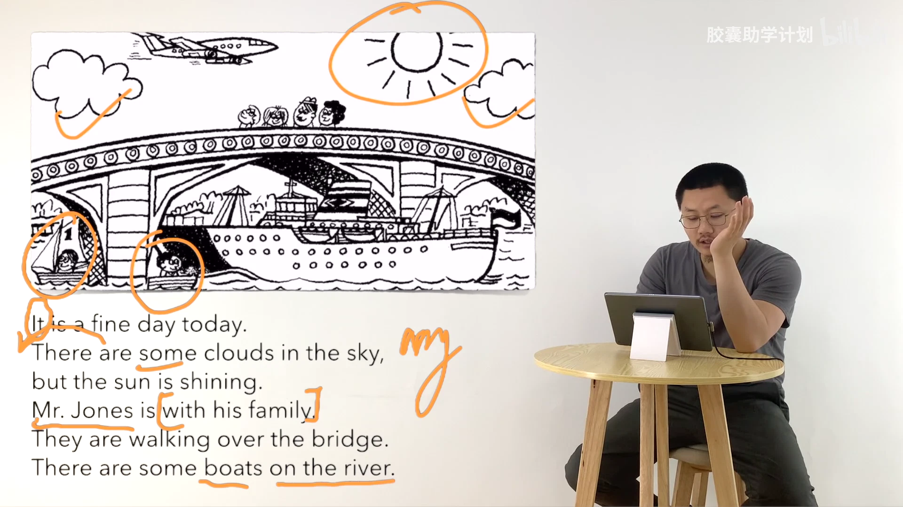

文字识别：胶囊助学计划 / 。00 / isa fine day today. / There are some clouds in the sky, / but the sun is shining. / Mr. Jones is With his family / They are walking over the bridge. / There are some boats on the river.

### 画面 00:02:07

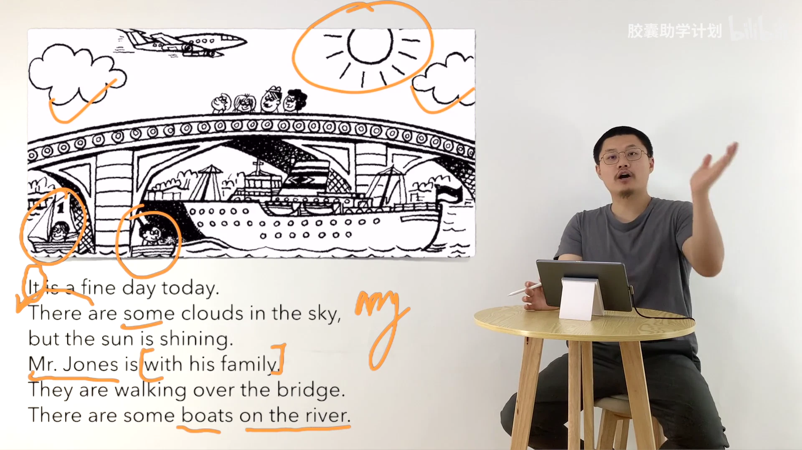

文字识别：胶囊助学计划 / 000 / ica fine day today. / There are some clouds in the sky, / but the sun is shining. / Mr. Jones is With his family / They are walking over the bridge. / There are some boats on the river.

### 画面 00:02:10

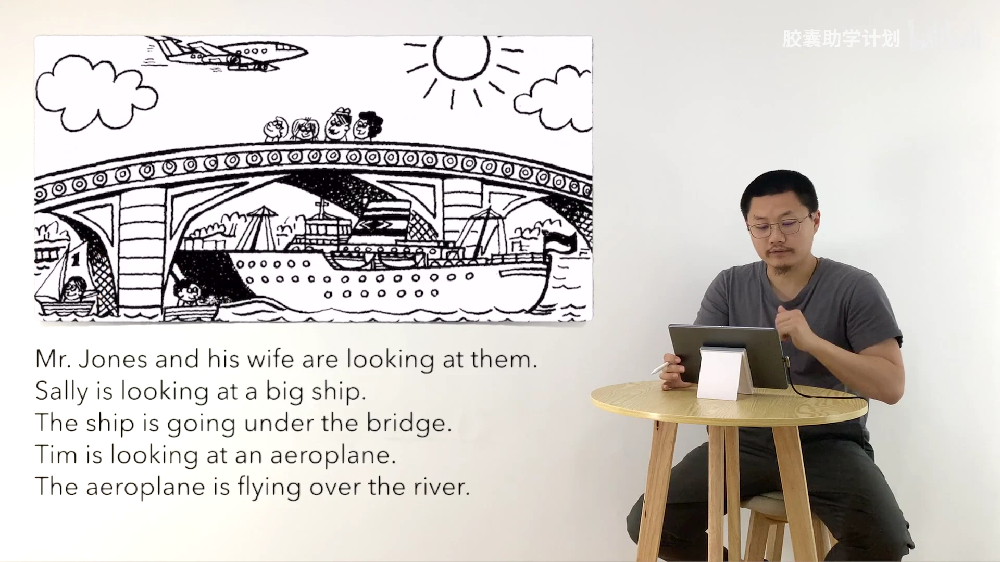

文字识别：000 / Mr. Jones and his wife are looking at them. / Sally is looking at a big ship. / The ship is going under the bridge. / Tim is looking at an aeroplane. / The aeroplane is flying over the river.

### 画面 00:02:12

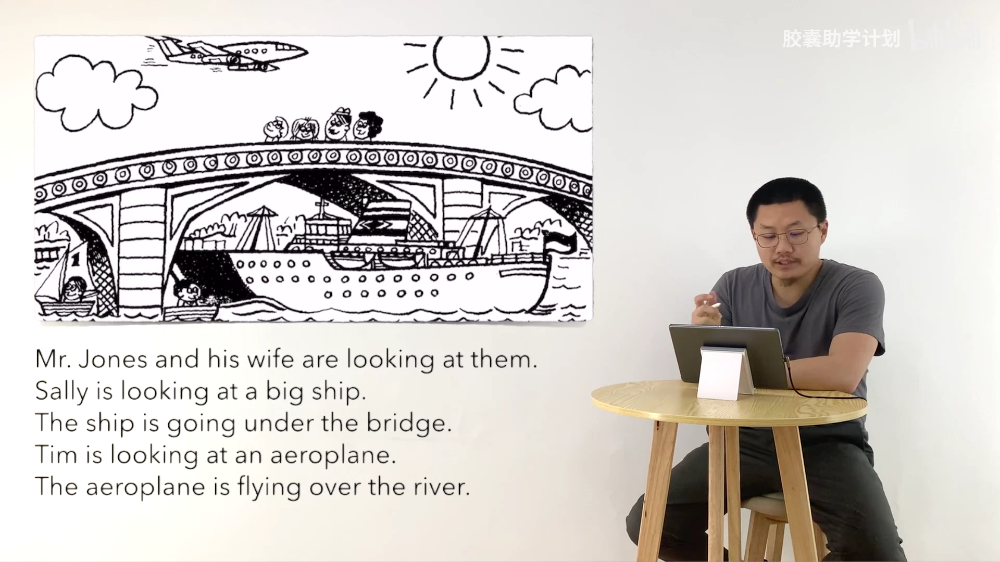

文字识别：胶囊助学计划 / 000 / Mr. Jones and his wife are looking at them. / Sally is looking at a big ship. / The ship is going under the bridge. / Tim is looking at an aeroplane. / The aeroplane is flying over the river.

### 画面 00:02:19

文字识别：胶囊助学计划 / 000 / Mr. Jones and his wife are looking at them. / Sally is looking at a big ship. / The ship is going under the bridge. / Tim is looking at an aeroplane. / The aeroplane is flying over the river.

### 画面 00:02:24

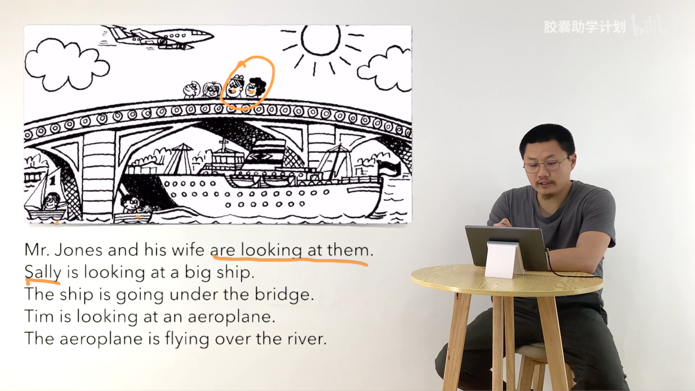

文字识别：胶囊助学计划 / 000 / Mr. Jones and his wife are looking at them. / Sally is looking at a big ship. / The ship is going under the bridge. / Tim is looking at an aeroplane. / The aeroplane is flying over the river.

## 00:02:30–00:03:00

looking at a big ship，正在看这个大轮船。The ship is going，它正在走，走在什么地方呢？Under the bridge，正在走在这个桥下。Tim，这个小男孩正在干嘛呢？Is looking at an airplane，正在往天上看，正在看这个飞机。那我们讲到了 airplane，大多数情况下各位可以直接处理成 plane就可以了。The

### 画面 00:02:30

文字识别：胶囊助学计划 / 000 / Mr. Jones and his wife are looking at them. / Sally is looking at a big ship. / The ship is going under the bridge. / Tim is looking at an aeroplane. / The aeroplane is flying over the river.

### 画面 00:02:38

文字识别：胶囊助学计划 / 000 / Mr. Jones and his wife are looking at them. / Sally is looking at a big ship. / The ship is going under the bridge. / Tim is looking at an aeroplane. / The aeroplane is flying over the river.

### 画面 00:02:47

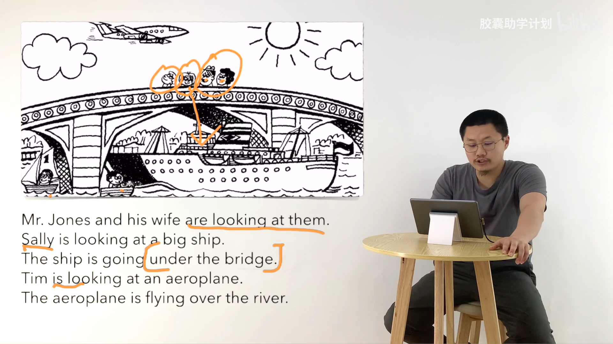

文字识别：胶囊助学计划 / 000 / Mr. Jones and his wife are looking at them. / Sally is looking at a big ship. / The ship is going under the bridge. / Tim is looking at an aeroplane. / The aeroplane is flying over the river.

### 画面 00:02:50

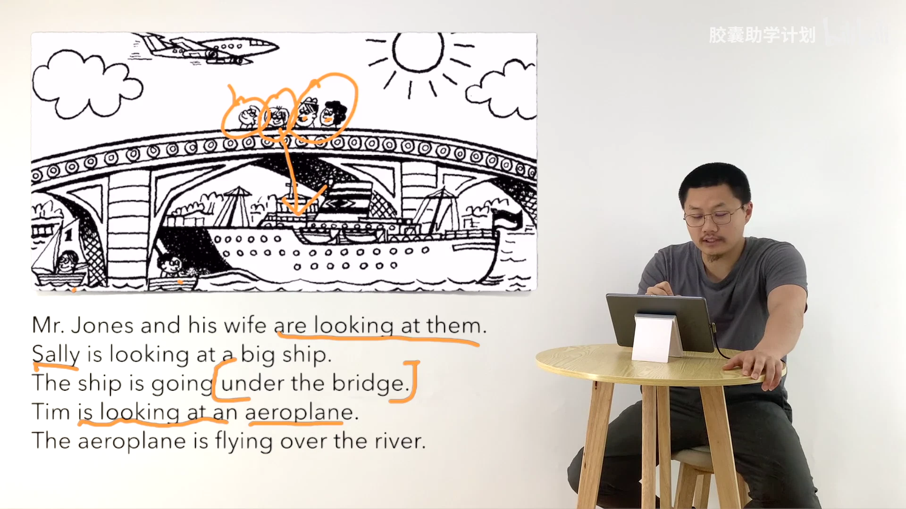

文字识别：胶囊助学计划 / 000 / Mr. Jones and his wife are looking at them. / Sally is looking at a big ship. / The ship is going under the bridge. / Tim is looking at an aeroplane. / The aeroplane is flying over the river.

## 00:03:00–00:03:30

airplane is flying.它正在飞over the river.注意over实际上至少目前为止我们知道两个意思，一个就是跨越，另外一个就在什么什么的上方。它正在这个河岸的上方飞跃啊！当然您这儿也可以把它理解成另一个意思，叫做飞跃这座河，都是可以的。OK，好，那文章就是这么多了。接下来我们进行口语听力练习。各位看着文章，直接做这

### 画面 00:03:04

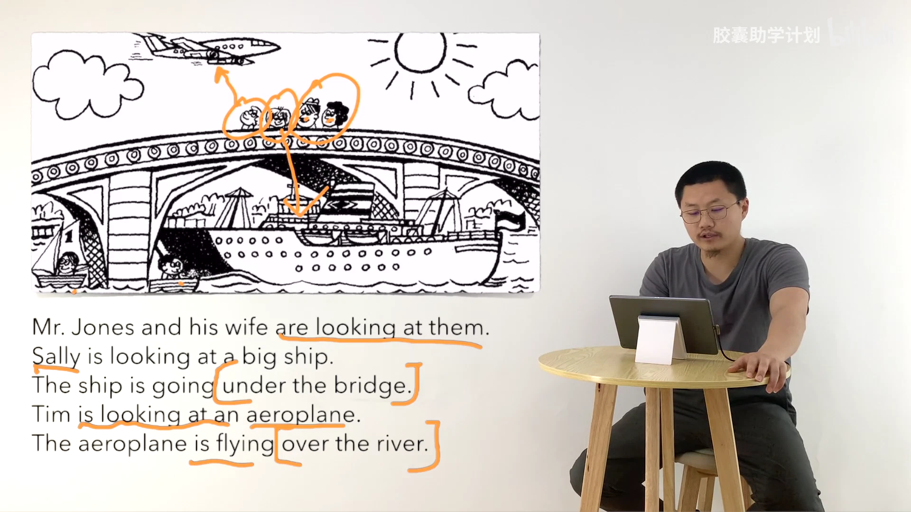

文字识别：胶囊助学计划 / Mr. Jones and his wife are looking at them. / Sally is looking at a big ship. / The ship is going under the bridge. / Tim is looking at an aeroplane. / The aeroplane is flying over the river.

### 画面 00:03:23

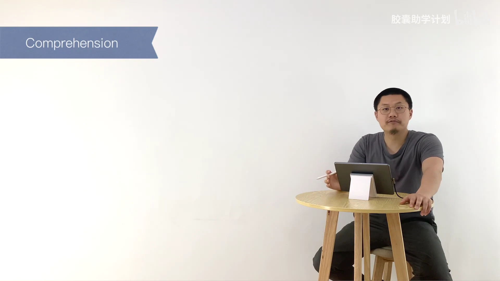

文字识别：胶囊助学计划 / Comprehension

## 00:03:30–00:04:00

个口语听力练习来了。Is it a cold day today? Cold, cold day today. No, it isn't. Is it a fine day today? Yes, it is.啊，如果这儿比较快啊，那各位暂停或者往前重复看一下，多听几遍来了。Are there any clouds in the sky? Yes, there

### 画面 00:03:36

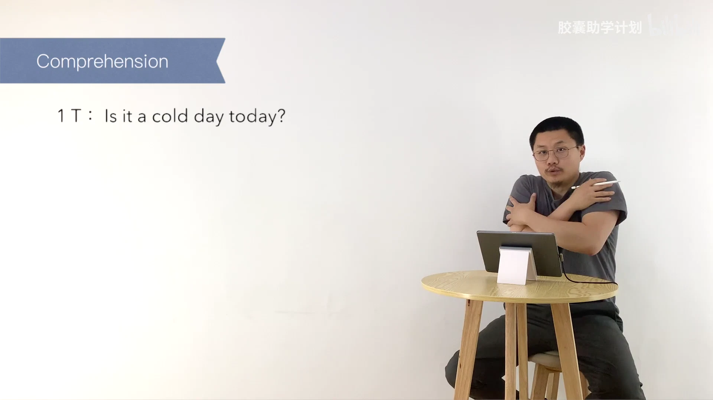

文字识别：胶囊助学计划 / Comprehension / 1 T: Is it a cold day today?

### 画面 00:03:38

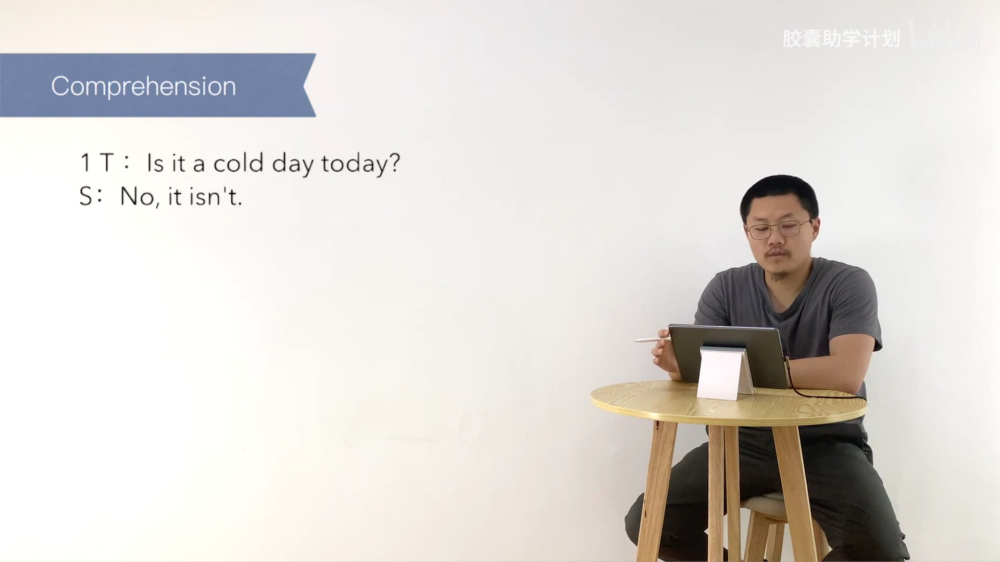

文字识别：胶囊助学计划 / Comprehension / 1 T: Is it a cold day today? / S: No, it isn't.

### 画面 00:03:48

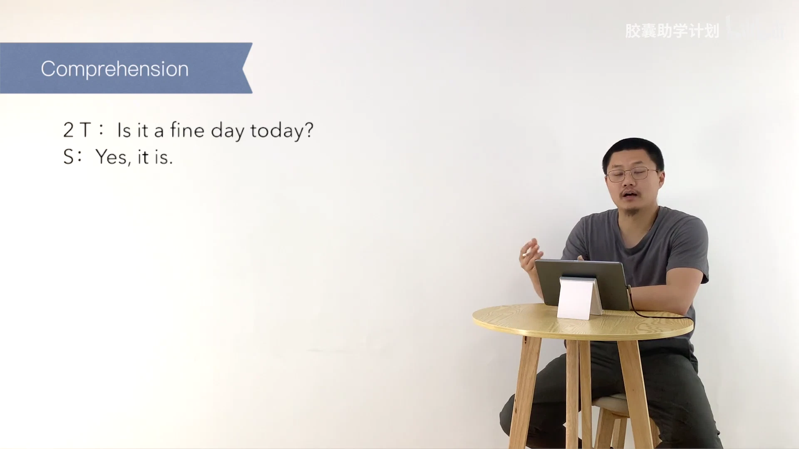

文字识别：胶囊助学计划 / Comprehension / 2T: Is it a fine day today? / S: Yes, it is.

## 00:04:00–00:04:30

are. Where is Mr. Jones? Mr. Jones is with his family. Who is walking over the bridge? Mr. Jones and his family. Are there any boats on the river? Yes, there are. What are Mr. Jones and his

### 画面 00:04:04

文字识别：胶囊助学计划 / Comprehension / 4T: Where is Mr. Jones? / S: Mr. Jones is with his family. / 2

## 00:04:30–00:05:00

wife doing. They are looking at the boats. What is Sally doing? She's looking at a big ship. What is Tim doing? 拔树的那个小男孩. He's looking at an airplane. What is the airplane doing? Flying over

### 画面 00:04:32

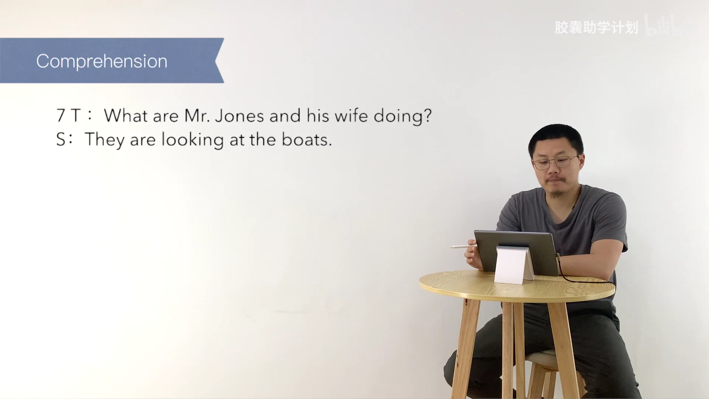

文字识别：胶囊助学计划 / Comprehension / 7 T : What are Mr. Jones and his wife doing? / S: They are looking at the boats.

### 画面 00:04:42

文字识别：胶囊助学计划 / Comprehension / 8T: What is Sally doing? / S: She's looking at a big ship.

### 画面 00:04:54

文字识别：胶囊助学计划 / Comprehension / 10T : What is the aeroplane doing?

## 00:05:00–00:05:30

the river. Okay, there you go.接下来 asking questions.各位听，然后口语作答来了. Ask me if不重要，听后面的. They are walking over the bridge.答案Are they walking over the bridge? Where? Where are they walking?那对over the bridge提问对吧？把它去掉. Next one. Ask me if

### 画面 00:05:05

文字识别：胶囊助学计划 / Asking questions

### 画面 00:05:17

文字识别：胶囊助学计划 / Asking questions / 1 T: Ask me if they are walking over the bridge. / S: Are they walking over the bridge?

### 画面 00:05:25

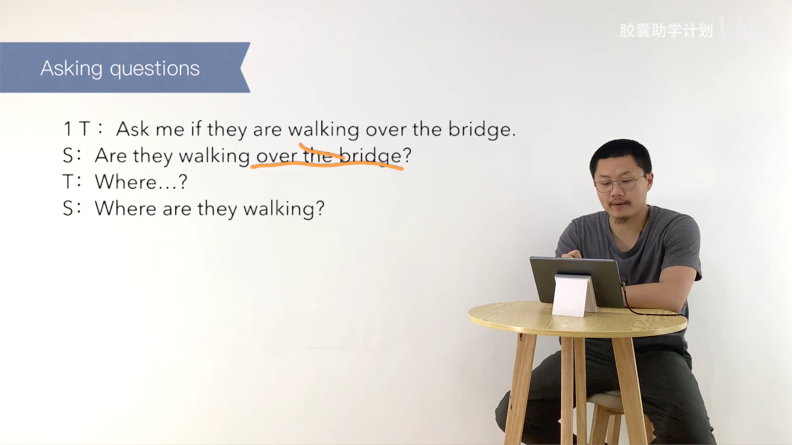

文字识别：胶囊助学计划 / Asking questions / 1 T: Ask me if they are walking over the bridge. / S: Are they walking over tne bridge? / T: Where...? / S: Where are they walking?

### 画面 00:05:27

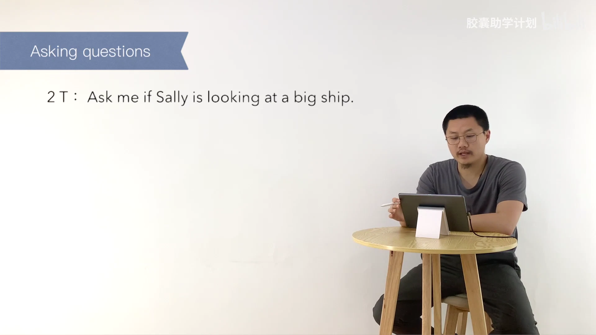

文字识别：胶囊助学计划 / Asking questions / 2 T: Ask me if Sally is looking at a big ship.

## 00:05:30–00:06:00

Sally is looking at a big ship. Is Sally looking at a big ship? What? What is Sally looking at? That,对a big ship提问，对吧？Ask me if the ship is going under the bridge. Is the ship going under the bridge? Where?

### 画面 00:05:40

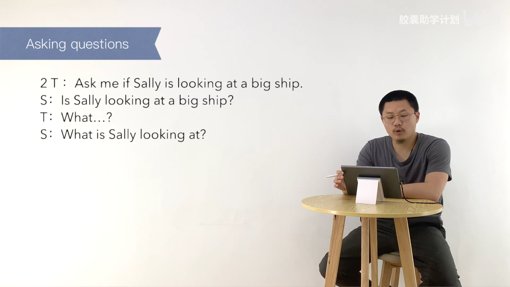

文字识别：胶囊助学计划 / Asking questions / 2 T: Ask me if Sally is looking at a big ship. / S: Is Sally looking at a big ship? / T: What...? / S: What is Sally looking at?

### 画面 00:05:46

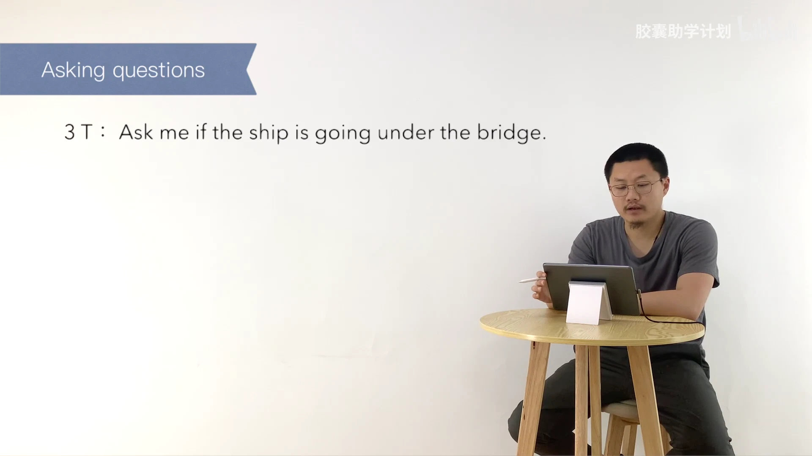

文字识别：胶囊助学计划 / Asking questions / 3 T: Ask me if the ship is going under the bridge.

### 画面 00:05:59

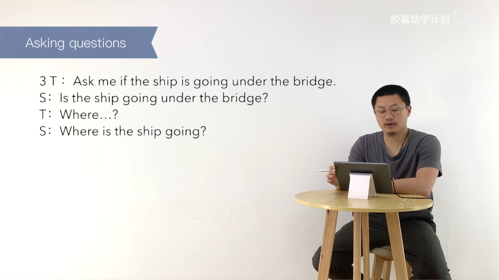

文字识别：胶囊助学计划 / Asking questions / 3 T: Ask me if the ship is going under the bridge. / S: Is the ship going under the bridge? / T:Where...? / S: Where is the ship going?

## 00:06:00–00:06:30

Where is the ship going? Ask me if Tom is looking at an airplane. Is Tom looking at an airplane? What? What is Tom looking at? Next one. Ask me if the plane is flying over the bridge.

### 画面 00:06:03

文字识别：胶囊助学计划 / Asking questions / 4 T : Ask me if Tom is looking at an aeroplane.

## 00:06:30–00:07:00

Is the plane flying over the bridge? Where? 对 over the bridge提问。 Where is the airplane flying? Okay,好，那本课呢没有过多新的语法或者新的单词，各位无非我们还是复习了一下 am is are 加 doing 这个时态叫现在进行时，一个动作现在正在发生。接下来我们看一下家庭作业，绿皮书三

### 画面 00:06:31

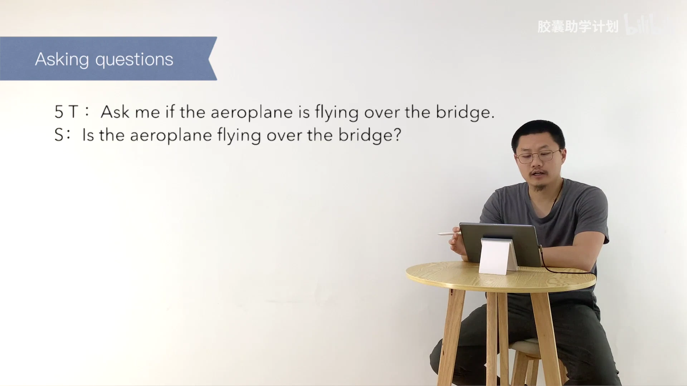

文字识别：胶囊助学计划 / Asking questions / 5 T: Ask me if the aeroplane is flying over the bridge. / S: Is the aeroplane flying over the bridge?

### 画面 00:06:42

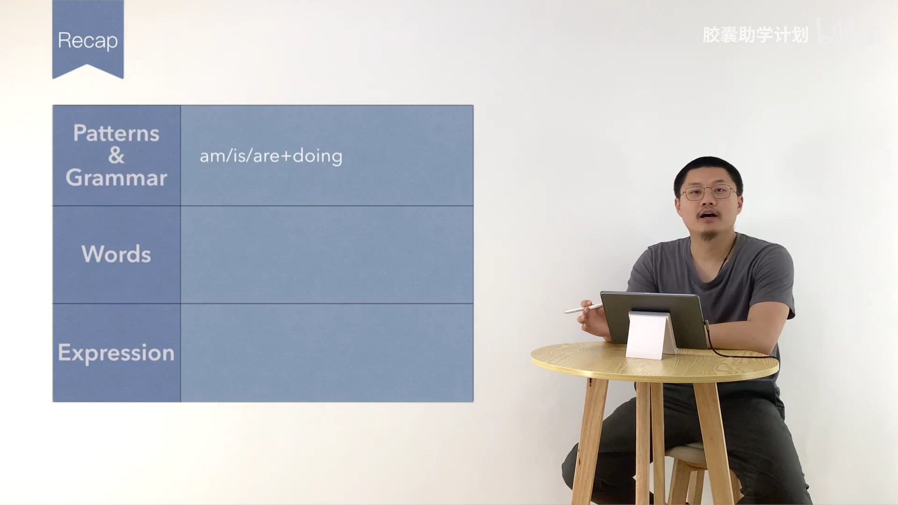

文字识别：胶囊助学计划 / Recap / Patterns / am/is/are+doing / Grammar / Words / Expression

### 画面 00:06:44

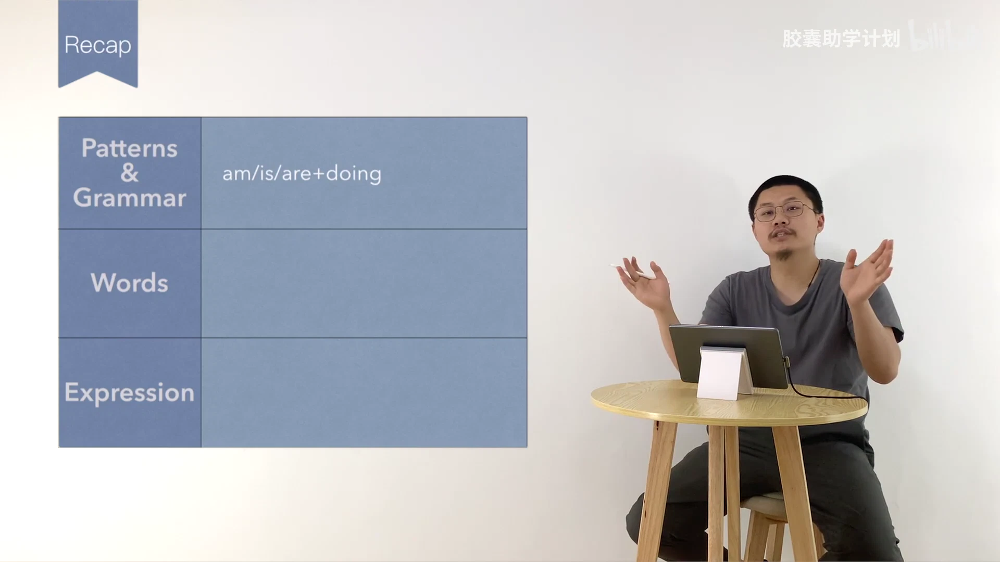

文字识别：胶囊助学计划 / Recap / Patterns / & / am/is/aretdoing / Grammar / Words / Expression

### 画面 00:06:47

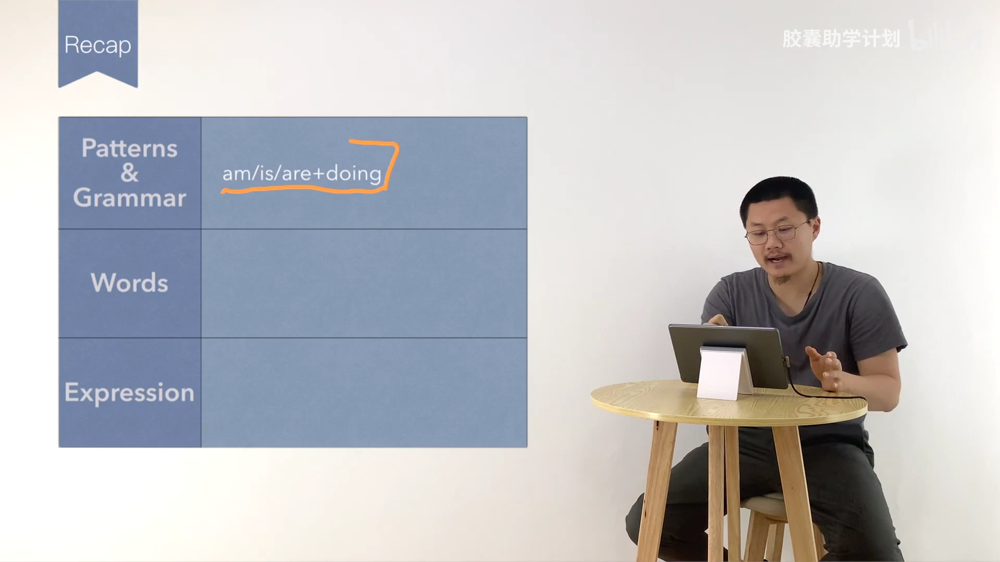

文字识别：Recap / 胶囊助学计划 / Patterns / am/is/are+doing / Grammar / Words / Expression

### 画面 00:06:50

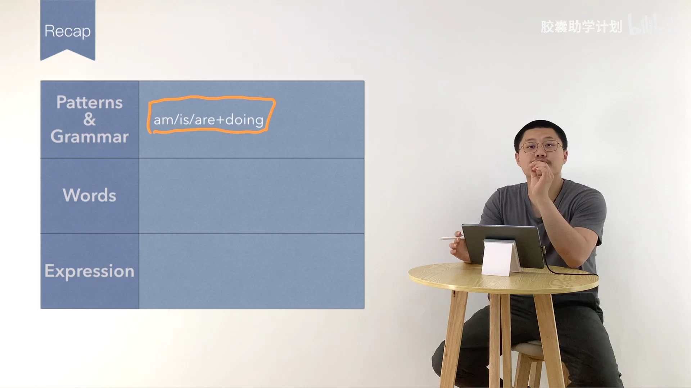

文字识别：胶囊助学计划 / Recap / Patterns / am/is/are+doing / Grammar / Words / Expression

### 画面 00:06:57

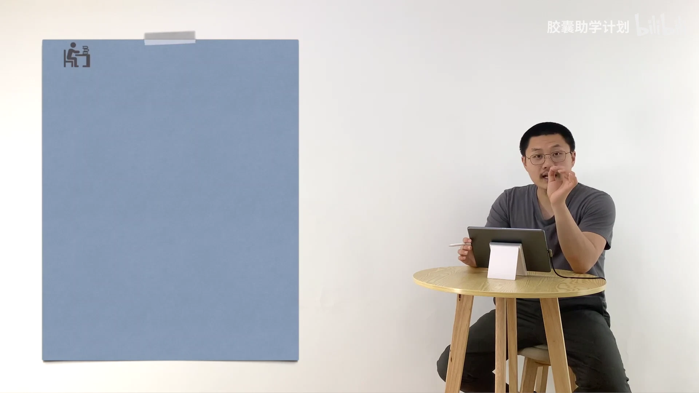

文字识别：胶囊助学计划

## 00:07:00–00:07:30

十三课的写作练习，各位可以尝试去写了。接下来文章老习惯一定要跟读至熟读成诵。如何跟读？我们在最开始的开篇内容给大家详详细细的解释了一下，各位不妨可以再去翻看一下。接下来呢，给自己讲解一遍今天的核心知识点，这个是提高我们吸收率的。OK，好，那以上呢就是本期视频的全部内容了。如果大家喜欢我们的课程，欢迎

### 画面 00:07:17

文字识别：胶囊助学计划 / 绿皮书第33课的写作练习 / 文章跟读至熟读成诵 / 3.请给自己讲解一遍今天的 / 核心知识点

### 画面 00:07:24

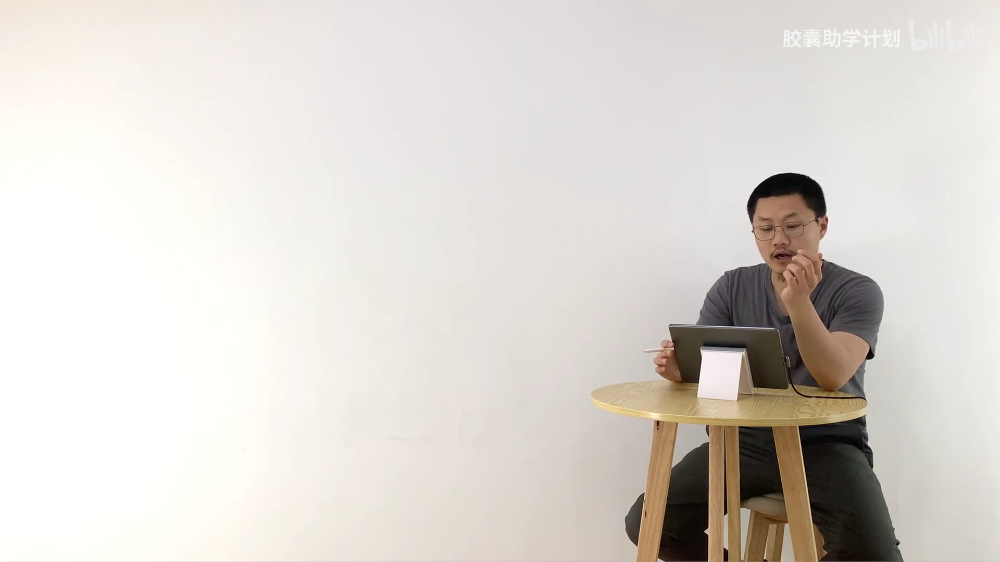

文字识别：胶囊助学计划

### 画面 00:07:26

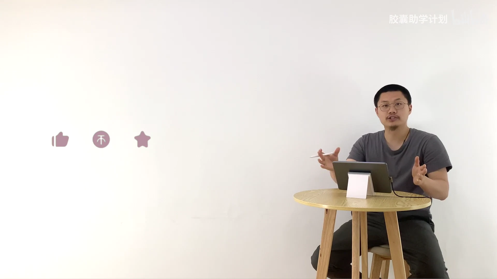

文字识别：胶囊助学计划

## 00:07:30–00:07:59

大家关注、订阅、一键三连，并分享给那些需要的朋友们。最后的最后，我们再来看一句名人名言：If you want to shine like a sun, the first burn like a sun. See you next time.

### 画面 00:07:35

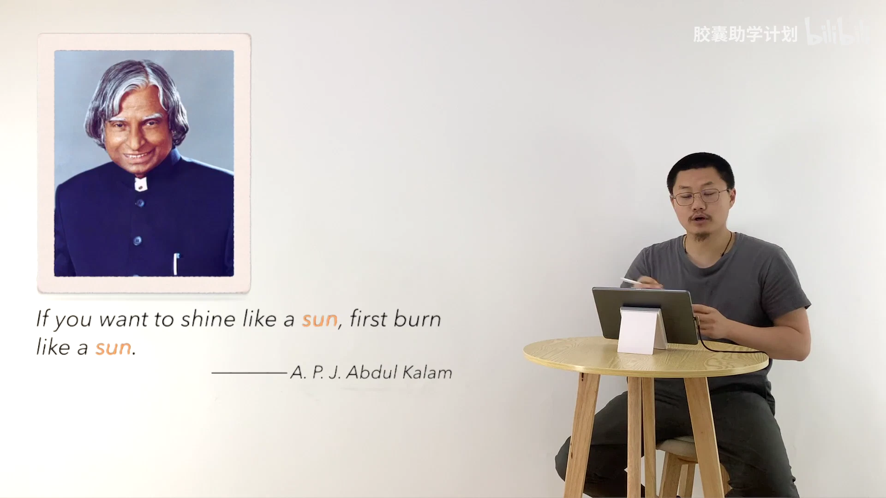

文字识别：胶囊助学计划 / If you want to shine like a sun, first burn / like a sun. / -A. P. J. Abdul Kalam

### 画面 00:07:46

### 画面 00:07:48

文字识别：CAPSULEACADEMY / 胶囊助学计划 / 小红书 / Lecturer / Leo / OE

### 画面 00:07:51

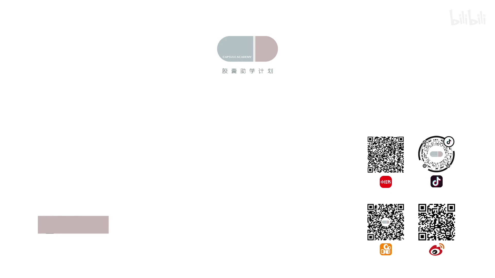

文字识别：CAPSULEACADEMY / 胶囊助学计划 / 小红书 / OE

### 画面 00:07:54

文字识别：CAPSULEACADEMY / 胶囊助学计划 / 小红书 / Creator / Leo & Berlin / OE

### 画面 00:07:56

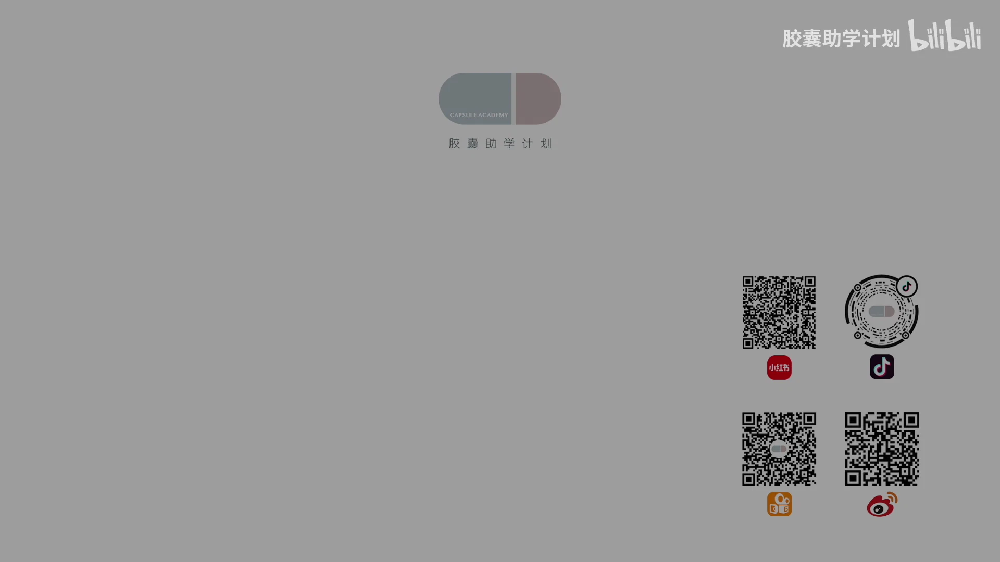

文字识别：bilbili / 胶囊助学计划 / CAPSULEACADEMY / 胶囊助学计划 / 小红书 / OE

### 画面 00:07:58

文字识别：bilibili / 胶囊助学计划

