# 035 文章

快速机器解析：语音为单模型转写，未进行独立交叉校对或人工复核；画面每秒采样并按变化选帧，短时文字和标记可能遗漏。截图时间约有 1 秒误差。图片有损压缩；遇到疑点请按时间查看 Google Drive 原视频。

## 00:00:00–00:00:30

Hello everyone, welcome to Capsule Academy. This is Leo. Today we're going to learn New Concept English Book One Lesson Thirty Five Story. Hope you gonna enjoy it.好，那我们直接进入文章，我们看图说话啊。来说，This is a photograph of our village. A photograph of our village. A of B结构由后往前翻

### 画面 00:00:00

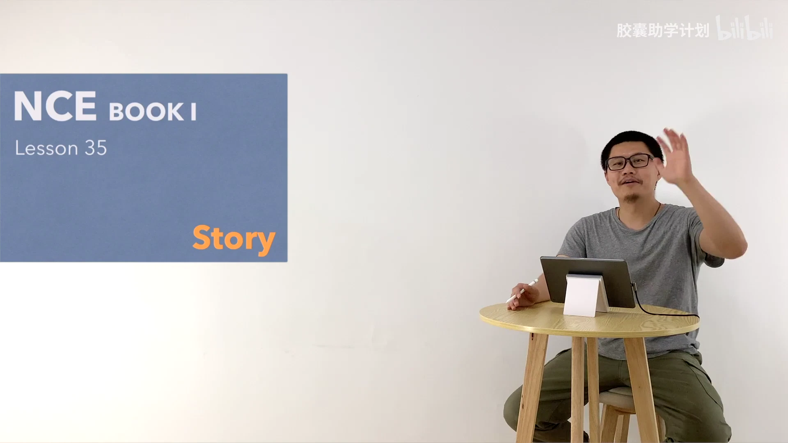

文字识别：胶囊助学计划 / NCE / BOOKI / Lesson 35 / Story

### 画面 00:00:02

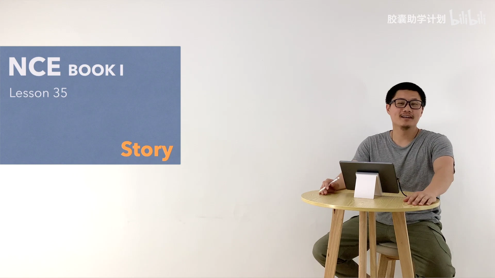

文字识别：胶囊助学计划 / NCE / BOOKI / Lesson 35 / Story

### 画面 00:00:09

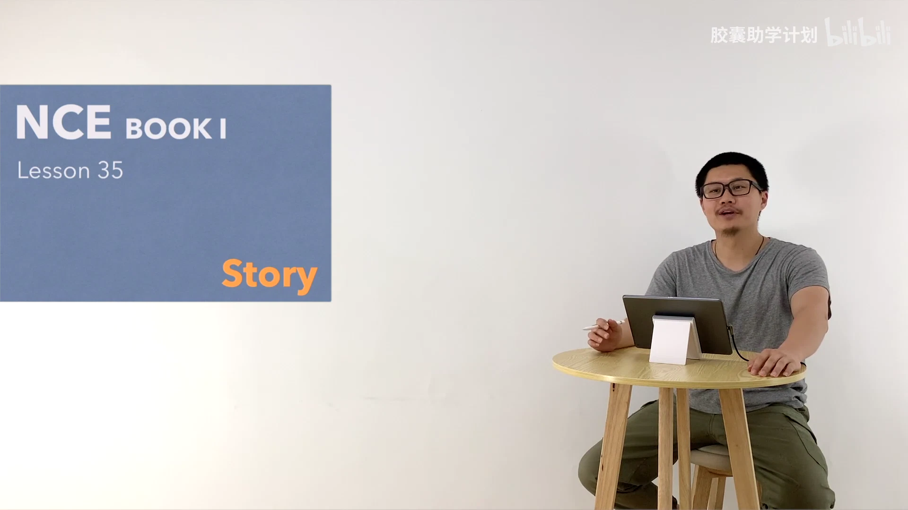

文字识别：胶囊助学计划 / NCE / BOOKI / Lesson 35 / Story

### 画面 00:00:11

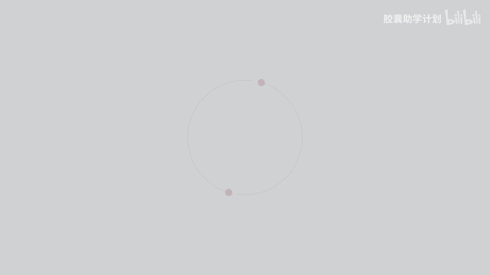

文字识别：胶囊助学计划 bilbl / •

### 画面 00:00:14

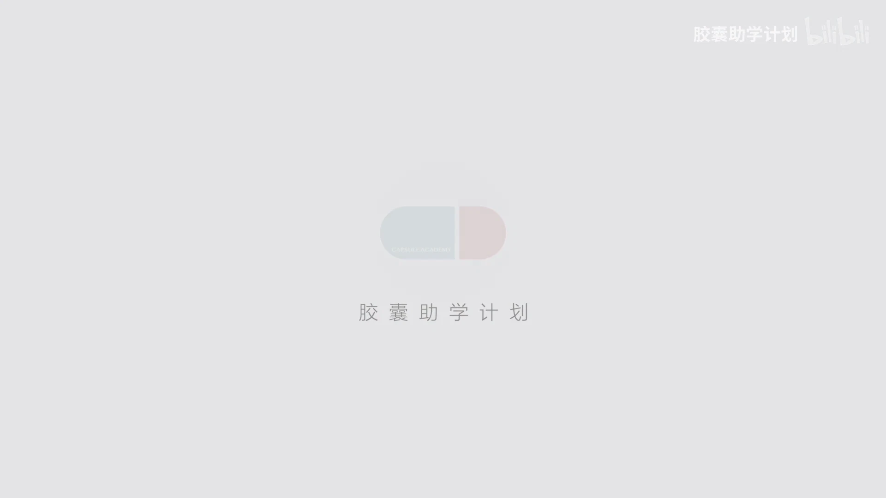

文字识别：胶囊助学计划 / 胶囊助学计划

### 画面 00:00:16

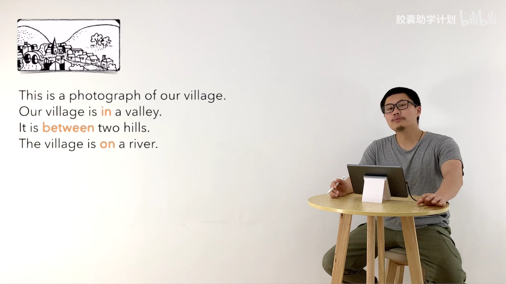

文字识别：胶囊助学计划 / 0 / This is a photograph of our village. / Our village is in a valley. / It is between two hills. / The village is on a river.

### 画面 00:00:18

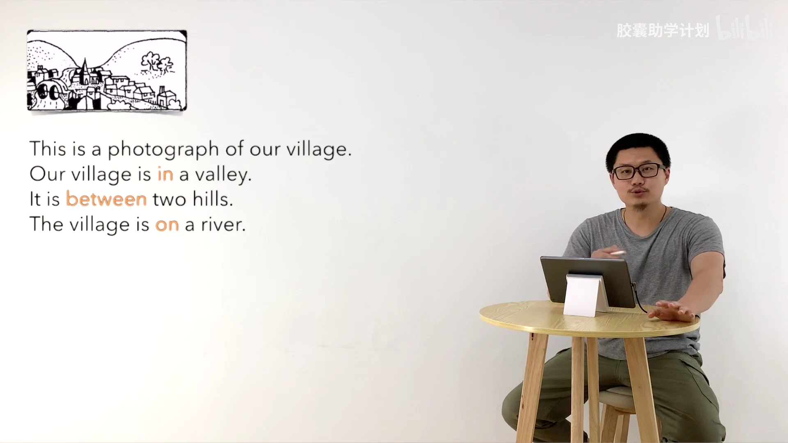

文字识别：胶囊助学计划 / This is a photograph of our village. / Our village is in a valley. / It is between two hills. / The village is on a river.

### 画面 00:00:20

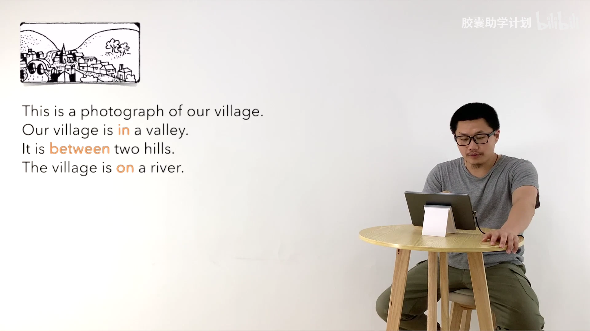

文字识别：胶囊助学计划 / This is a photograph of our village. / Our village is in a valley. / It is between two hills. / The village is on a river.

### 画面 00:00:26

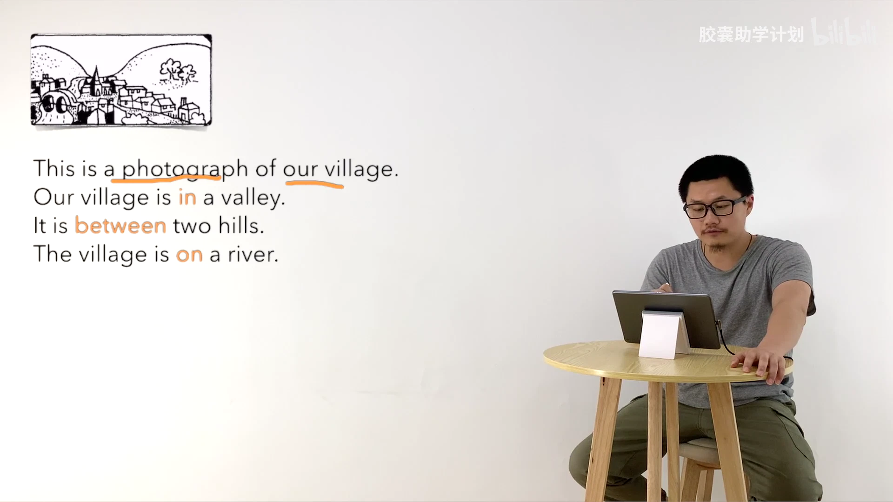

文字识别：胶囊助学计划 / 0 / This is a photograph of our village. / Our village is in a valley. / It is between two hills. / The village is on a river.

### 画面 00:00:29

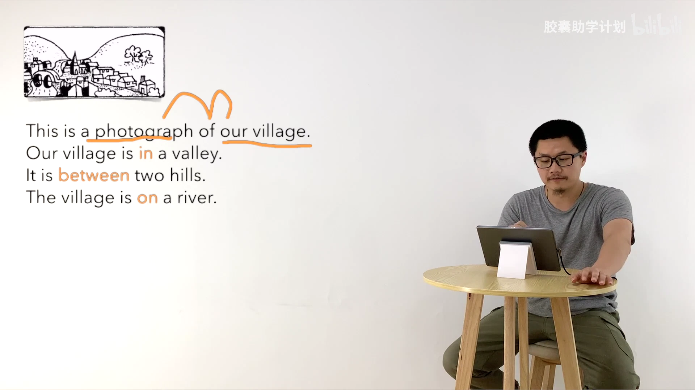

文字识别：胶囊助学计划 / 0 / This is a photograph of our village. / Our village is in a valley. / It is / between two hills. / The village is on a river.

## 00:00:30–00:01:00

译，我们村儿的一张照片啊，这是我们村儿的一张照片。然后 Our village is in a valley，说我们的村落呀是在一个山谷的里面。各位注意，This is a hill and this is another hill，啊，There are two trees here。OK，说这是一个小的山丘啊，然后这边呢也是一个小的山丘，那在两个山

### 画面 00:00:42

文字识别：胶囊助学计划 / 00 / This is a photograph of our village. / Our village is / s in a valley. / It is / between / two / hills. / The / village is / on a river.

### 画面 00:00:49

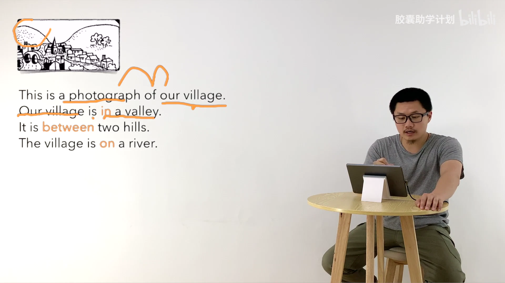

文字识别：胶囊助学计划 / This is a photograph of our village. / Our village is / ina valley. / It is / between / two / hills. / The / village is / ona / river.

### 画面 00:00:51

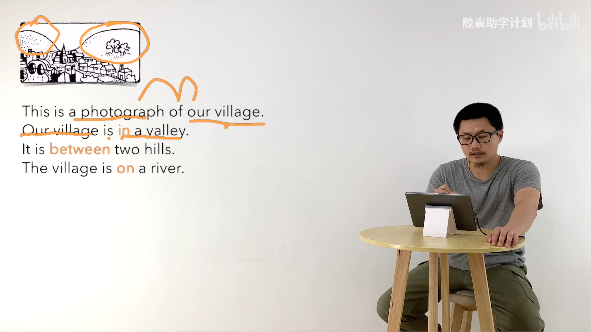

文字识别：胶囊助学计划 / 00 / This is a photograph of our village. / Our village is / ina valley. / It is / between / two / hills. / The / village is / ona / river.

### 画面 00:00:56

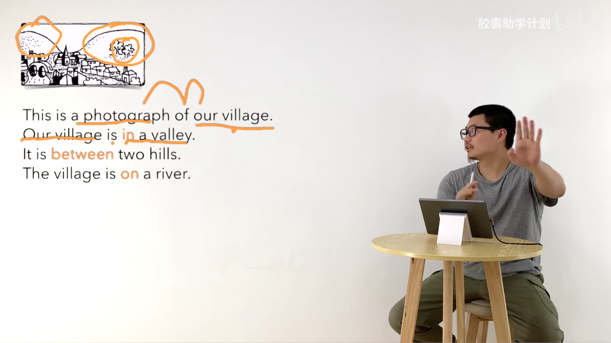

文字识别：胶囊助学计划 / 000 / This is a photograph of our village. / Our village is / ina valley. / It is / between / two / hills. / The / village is / ona / river.

## 00:01:00–00:01:30

丘的中间就是 in a valley， OK，这个是介词，在一个小的山谷里面。It is between two hills，说这个村儿啊，it 指的是我们村儿啊，是在两个山丘的中间。Between 在什么什么之间。The village is on a river，说这个村儿啊是在河的直译叫做上方，对吧？你像我曾经去过这个威尼斯，那那

### 画面 00:01:03

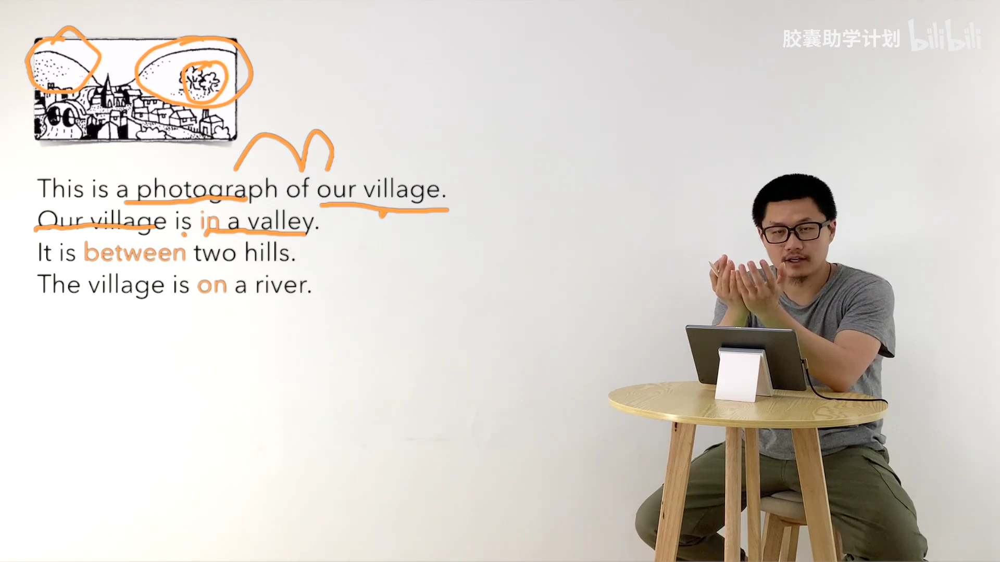

文字识别：胶囊助学计划 / 00 / This is a photograph of our village. / Our village is / ina valley. / It is / between / two / hills. / The / village is / ona / river.

### 画面 00:01:06

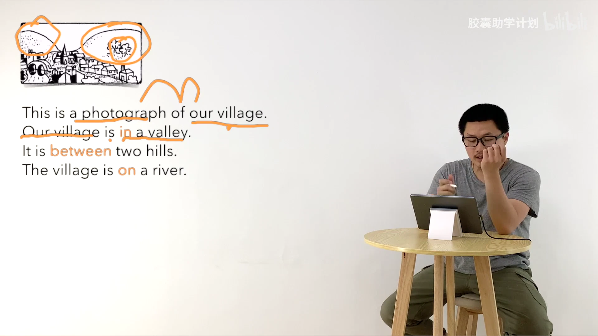

文字识别：胶囊助学计划 / This is a photograph of our village. / Our village is / ipa valley. / It is / between / two / hills. / The / village is / ona / river.

### 画面 00:01:14

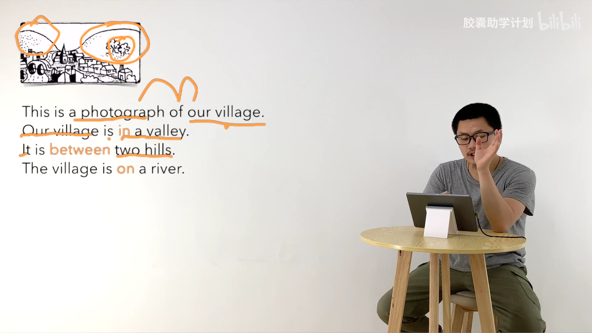

文字识别：胶囊助学计划 / 0 / This / is a photograph of / our village. / Our village is / in a valley. / Itis / between / two hills. / The / village is / ona / river.

### 画面 00:01:24

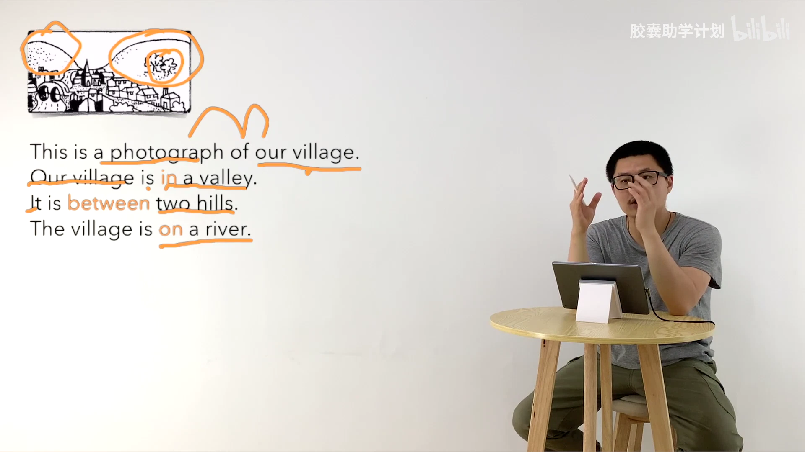

文字识别：胶囊助学计划 / This / is a photograph of / our village. / Our village is / ina valley. / It is / between / two hills. / The / village is / on a river.

### 画面 00:01:28

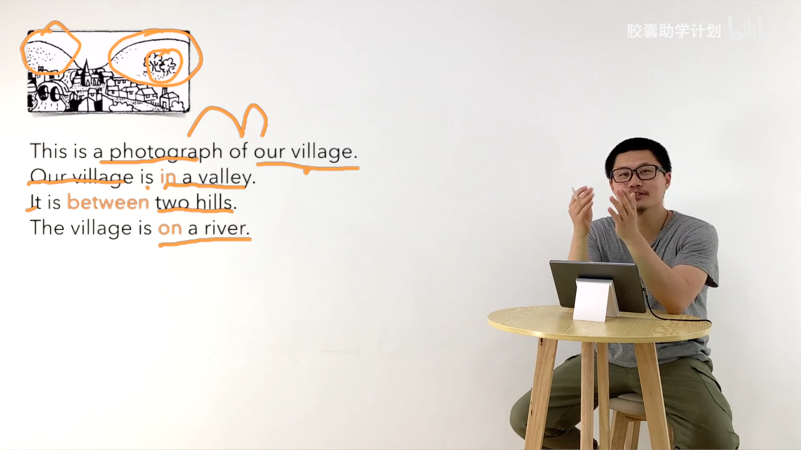

文字识别：胶囊助学计划 / 0 / This /  is a photograph of / our village. / Our village is / in a valley. / Itis / between / two hills. / The / village is / on a river.

## 00:01:30–00:02:00

个整个威尼斯城都是建在这个河或者说海的上面的。但在这儿并不是这个意思。这个地方的 on 是一个特别罕见的用法，各位可能直接学完新概念都可能不会见到第二次了。它指的其实在这个地方指的是 near，n e a r，在什么什么附近的意思。所以各位在这儿可以不妨把它记一下，就是 on 后边去加江河湖海的时

### 画面 00:01:33

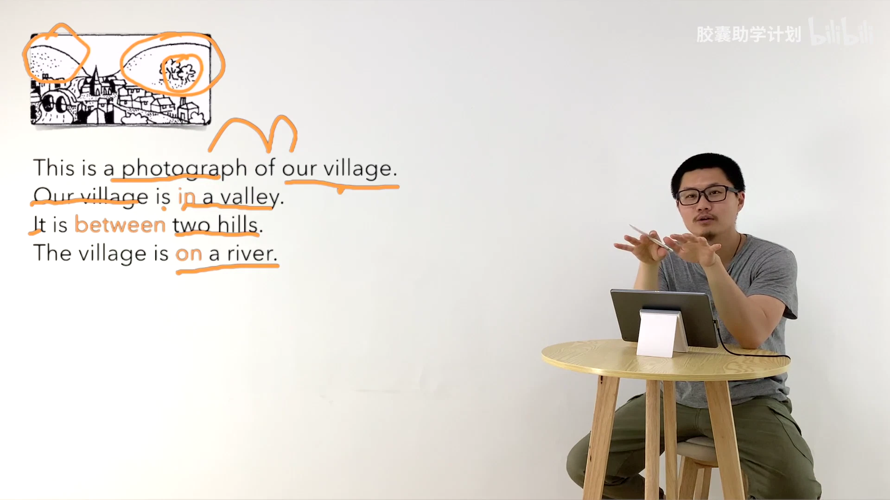

文字识别：胶囊助学计划 / 00 / This / is a photograph of / our village. / Our village is / in a valley. / tis / between / two hills. / The / village is / on a river.

### 画面 00:01:35

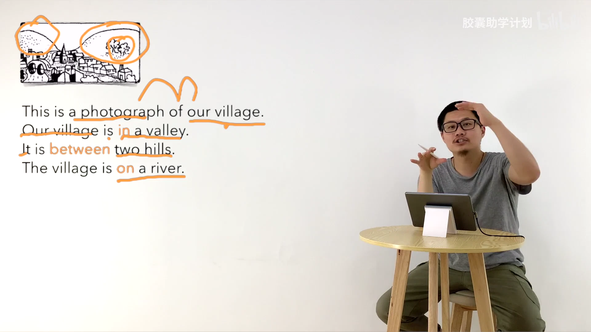

文字识别：胶囊助学计划 / 0 / This /  is a photograph of / our village. / Our village is / ina valley. / It is / between / two hills. / The / village is / on a river.

### 画面 00:01:37

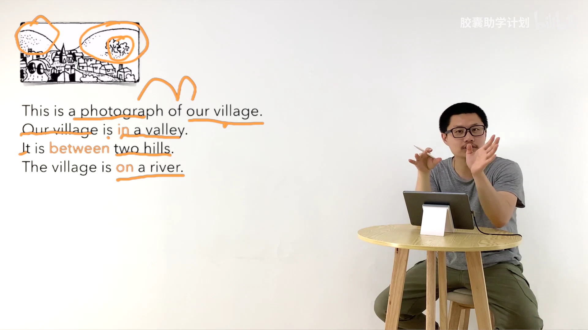

文字识别：胶囊助学计划 / 00 / This /  is a photograph of / our village. / Our village is / ina valley. / t is / between / two hills. / The / village is / on a river.

### 画面 00:01:39

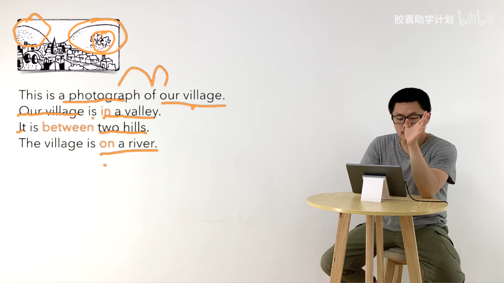

文字识别：胶囊助学计划 / This /  is a photograph of / our village. / Our village is / ina valley. / t is / between / two hills. / The / village is / on a river.

### 画面 00:01:41

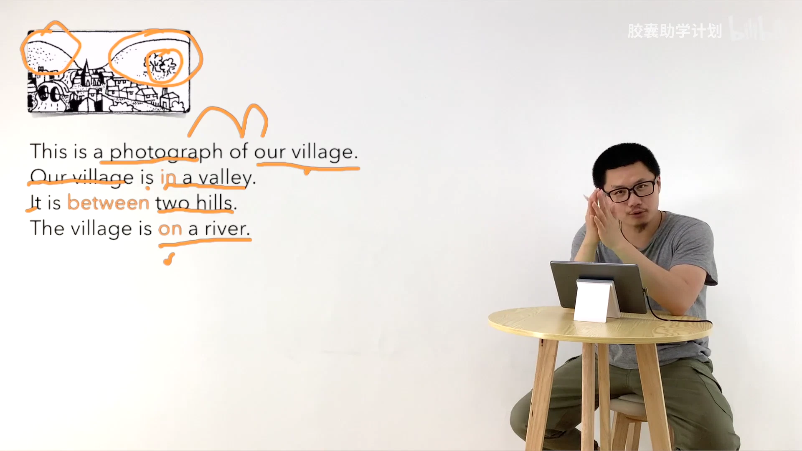

文字识别：胶囊助学计划 / This / is a photograph of / our village. / Our village is / ina valley. / tis / between / two hills. / The / village is / on a river.

### 画面 00:01:50

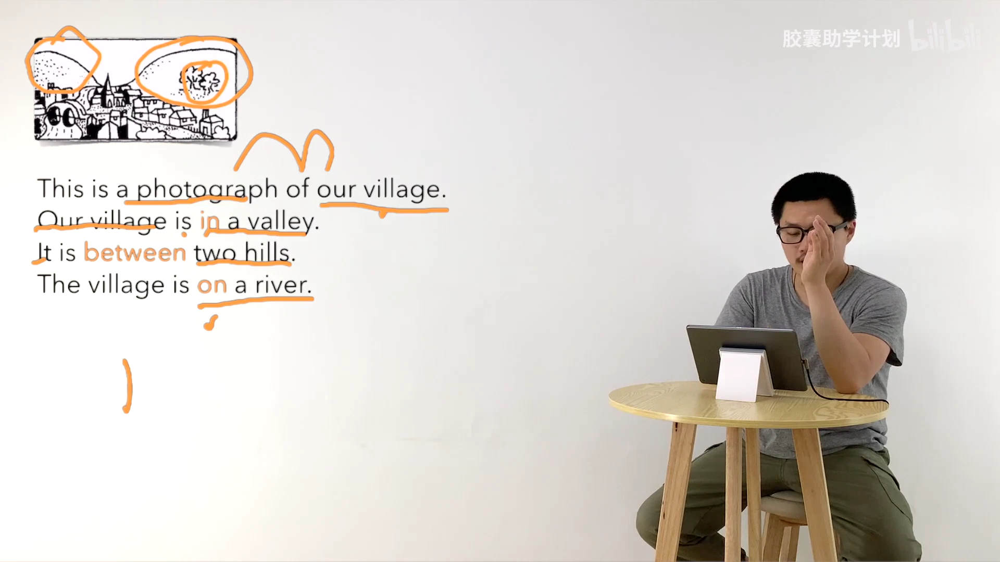

文字识别：胶囊助学计划 / 00 / This / is a photograph of / our village. / Our village is / ina valley. / tis / between / two hills. / The / village is / on a river.

### 画面 00:01:52

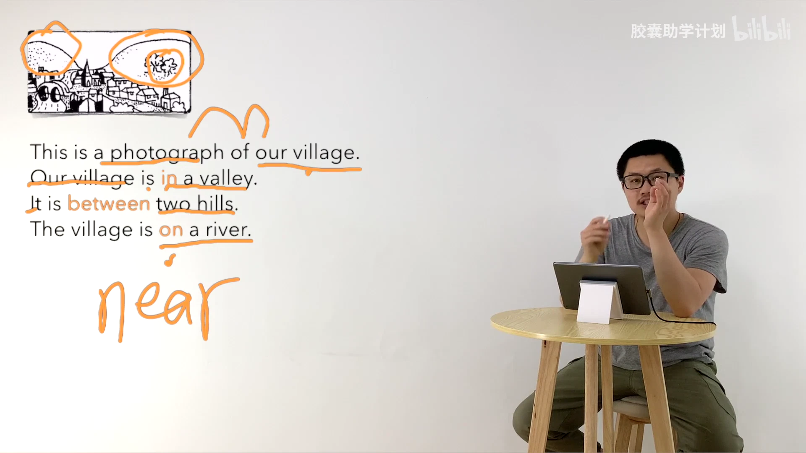

文字识别：胶囊助学计划 / 0 / This / is a photograph of / our village. / Our village is / ina valley. / It is / between / two hills. / The / village is / on a river. / near

### 画面 00:01:56

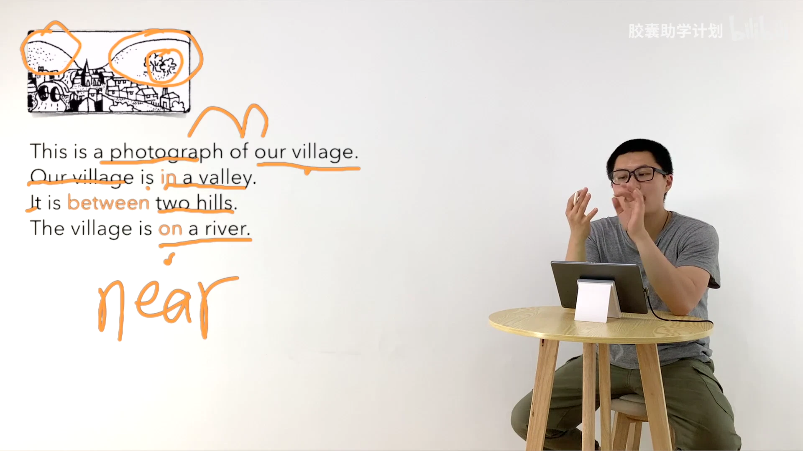

文字识别：胶囊助学计划 / 0 / 2 / This / is a photograph of / our village. / Our village is / ina valley. / t is / between / two hills. / The / village is / ona / river. / neay

## 00:02:00–00:02:30

候，它可以表示 near 的意思，叫在什么什么的附近啊。 Okay, continue. Say here is another.哎，这是另一个 photograph of the village. 这是这个村的另一张照片。 My wife and I. 说我妻子和我呀 are walking. 注意在途中啊，你看我们正在走。注意 along 叫做沿着 the banks

### 画面 00:02:02

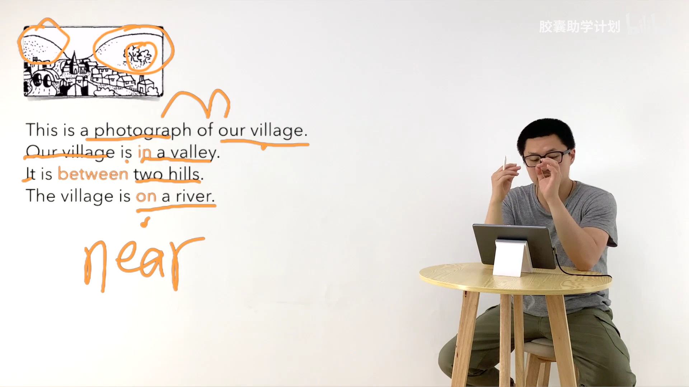

文字识别：胶囊助学计划 / 2 / This / is a photograph of / our village. / Our village is / ina valley. / tis / between / two hills. / The / village is / on a river. / neay

### 画面 00:02:05

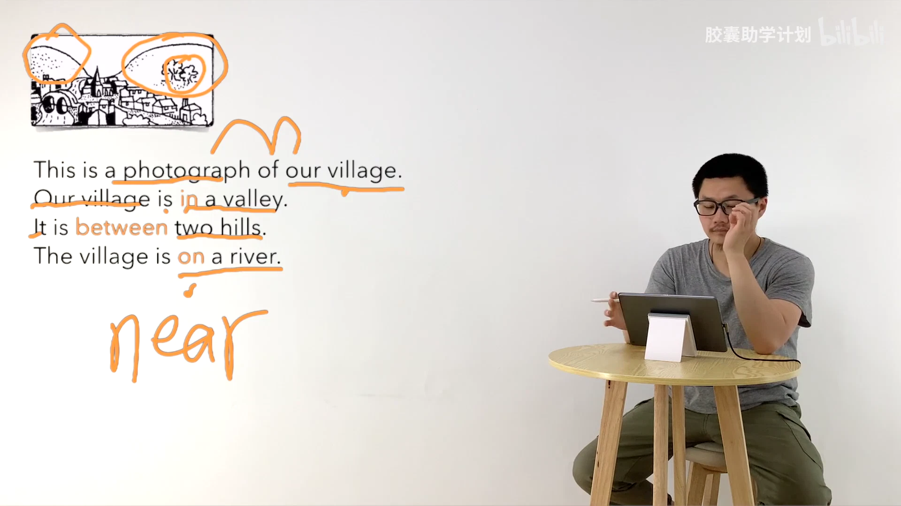

文字识别：胶囊助学计划 / 0 / This /  is a photograph of / our village. / Our village is / ina valley. / tis / between / two hills. / The / village is / ona / river. / neay

### 画面 00:02:07

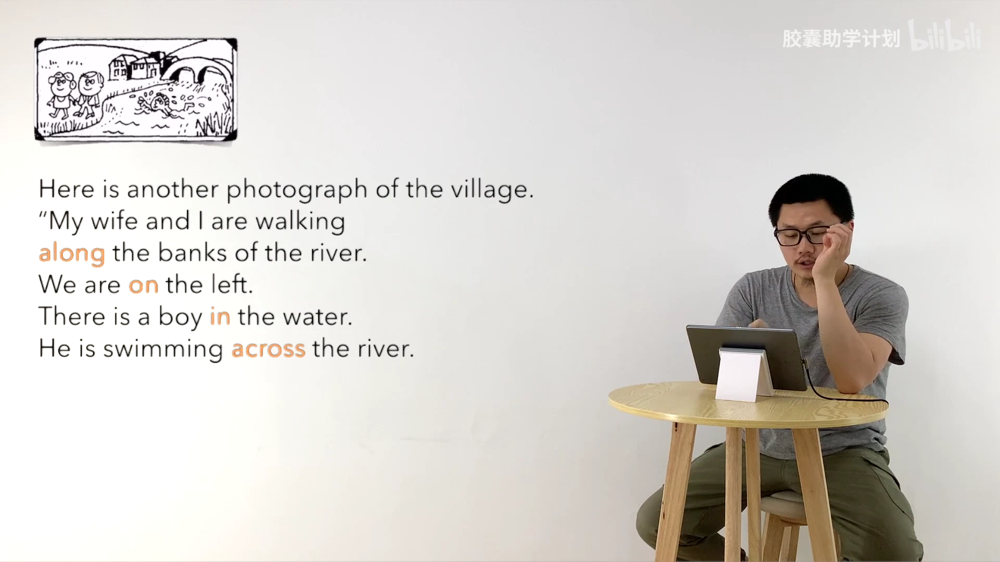

文字识别：胶囊助学计划 / Here is another photograph of the village. / "My wife and I are walking / along the banks of the river. / We are on the left. / There is a boy in the water. / He is swimming across the river.

### 画面 00:02:15

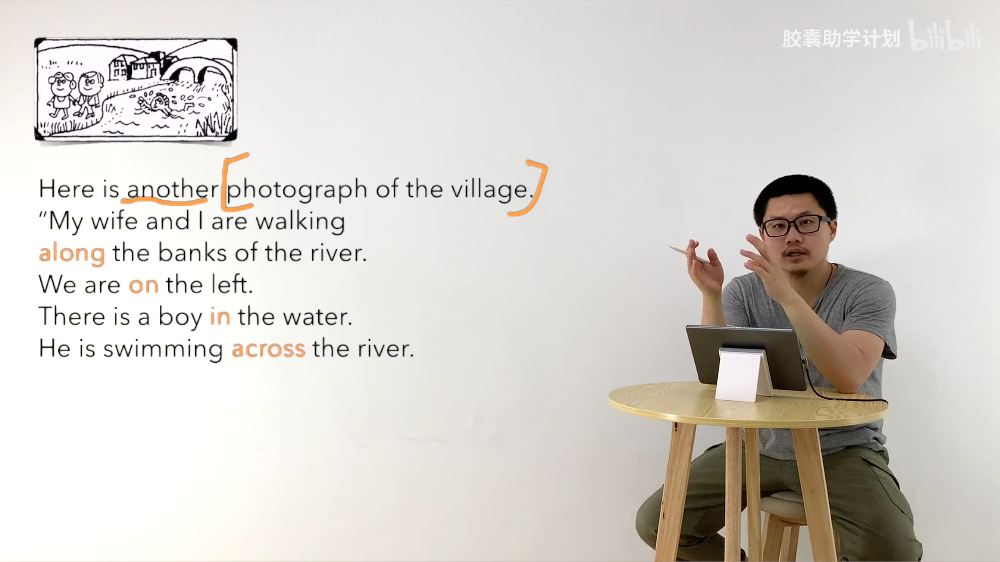

文字识别：胶囊助学计划 / Here is anotherphotograph of the village. / "My wife and I are walking / along the banks of the river. / We are on the left. / There is a boy in the water. / He is swimming / across the river.

### 画面 00:02:22

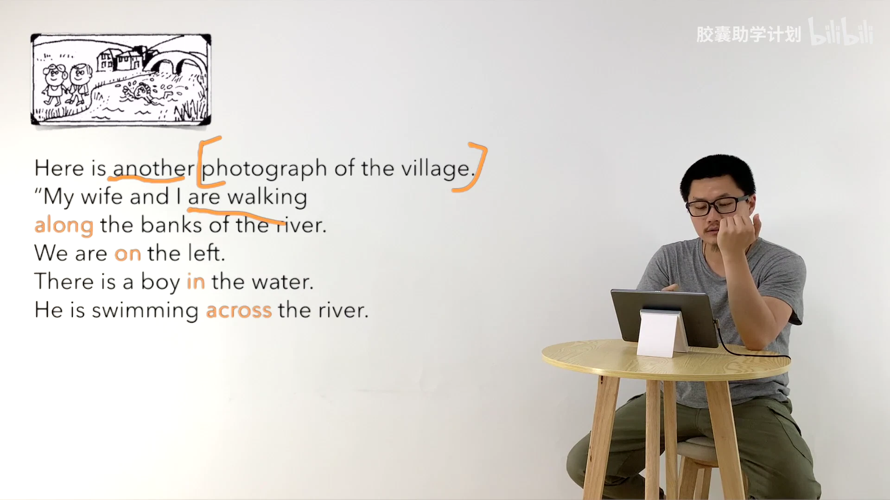

文字识别：胶囊助学计划 / Here is anotherphotograph of the village. / "My wife / and I are walking / along t / the banks of the river. / We are on the left. / There is a boy in the water. / He is swimming / across the river.

### 画面 00:02:29

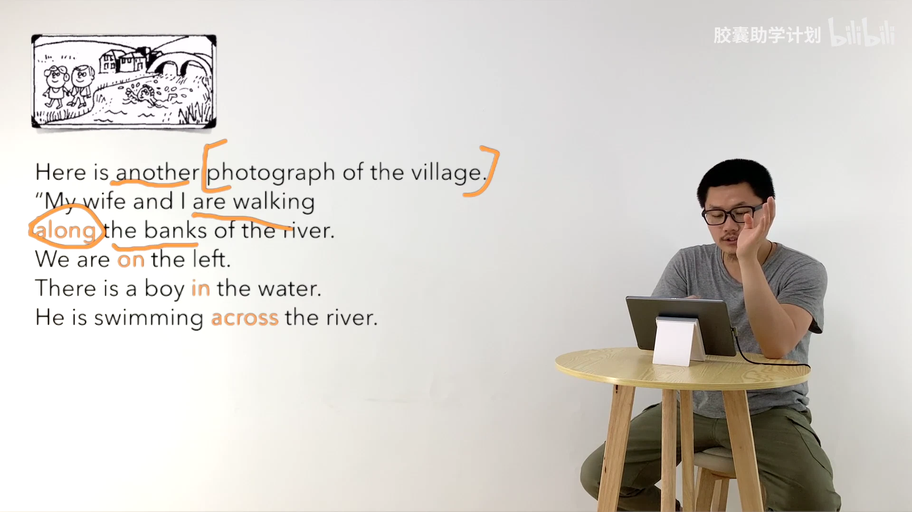

文字识别：胶囊助学计划 / Here is anotherphotograph of the village, / "My wife / and I are walking / alongthe banks of the river. / We areon the left. / There is a boy in the water. / He is swimming / across the river.

## 00:02:30–00:03:00

of the river. 这有一个很小的语言细节。首先，我们先看 A of B 结构，由后往前翻译就行了。河的岸就是河岸，就 river bank 也可以啊，the bank of the river 也可以。但他用的是 banks，那其实就告诉你这个河是有几个岸，一般是两岸，对吧？好，那他说 the banks of the river，就是说这些人其实这两个人啊，可能是从这儿走的，河的这一岸开始走

### 画面 00:02:32

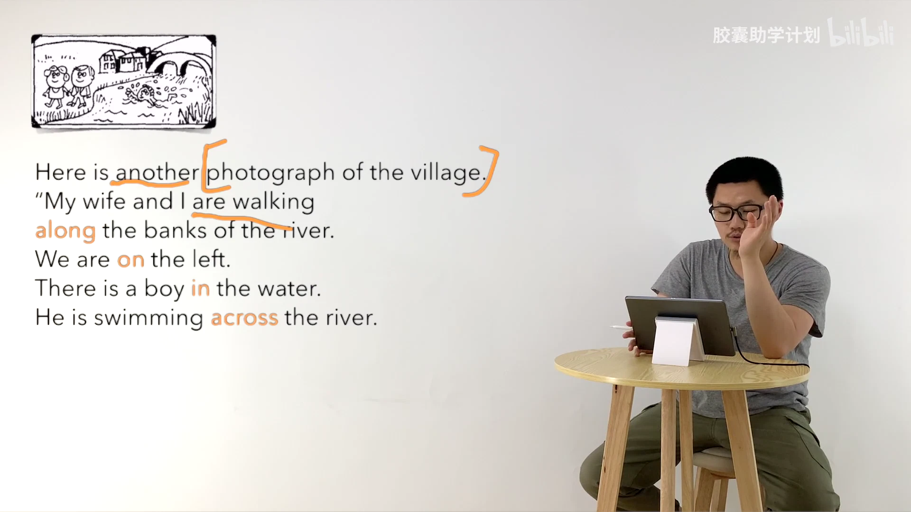

文字识别：胶囊助学计划 / Here is anotherphotograph of the village. / "My wife / and I are walking / alongt / the banks of the river. / We are on the left. / There is a boyinthe water. / He is swimming / across the river.

### 画面 00:02:35

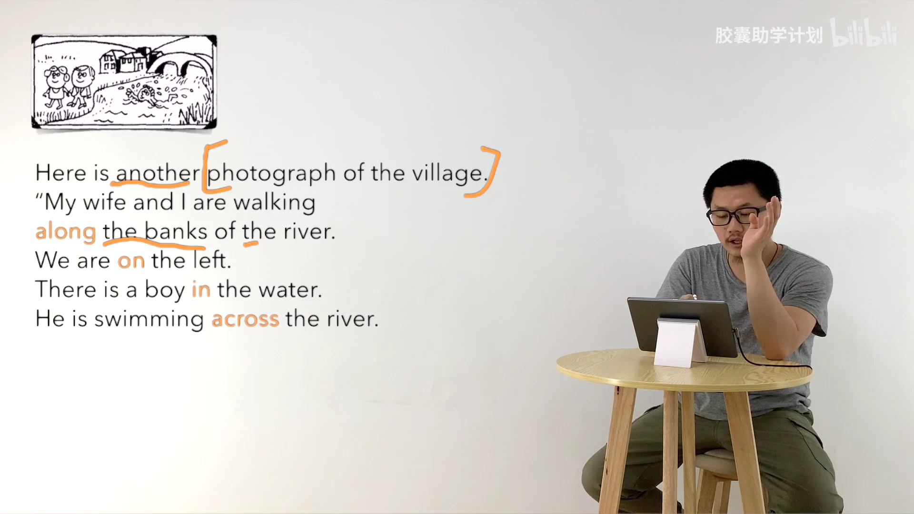

文字识别：胶囊助学计划 / Here is anotherphotograph of the village. / "My wife / and I are walking / alongt / the banks of the river. / We are on theTeft. / There is a boy in the water. / He is swimming / across the river.

### 画面 00:02:37

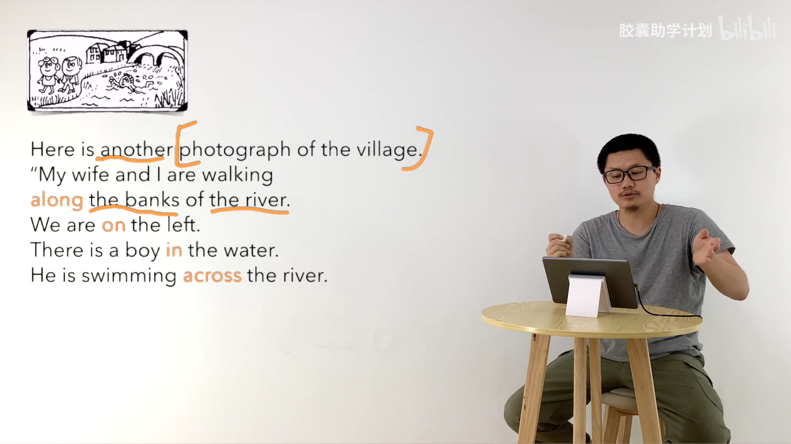

文字识别：胶囊助学计划 / Here is anotherphotograph of the village. / "My / wife / and I are walking / along / the banks of the river. / We are on the Teft. / There is a boy in the water. / He is swimming / across the river.

### 画面 00:02:46

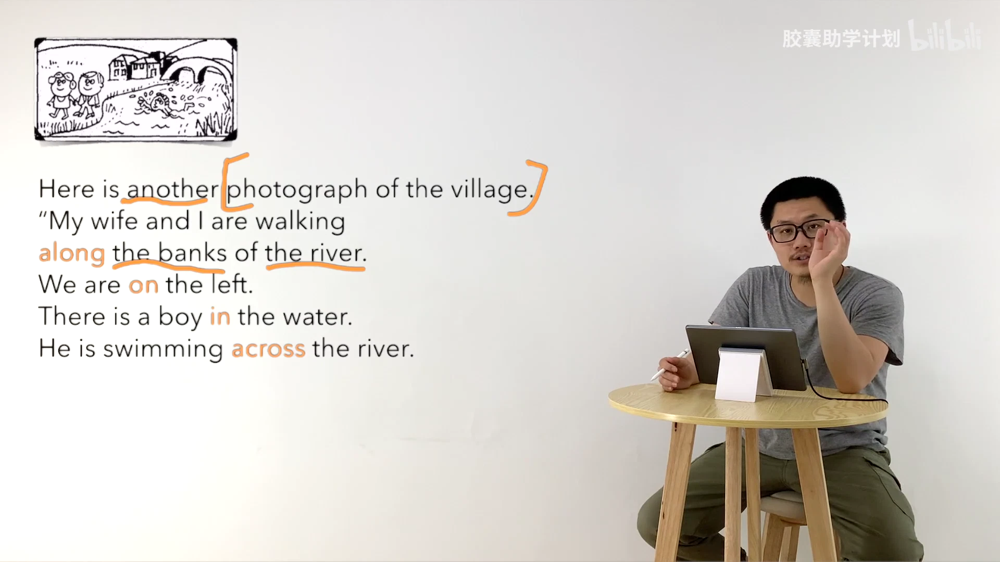

文字识别：胶囊助学计划 / Here is anotherphotograph of the village. / "My / wife / and I are walking / along / the banks of the river. / We are on the Teft. / There is a boy in the water. / He is swimming / across the river.

### 画面 00:02:48

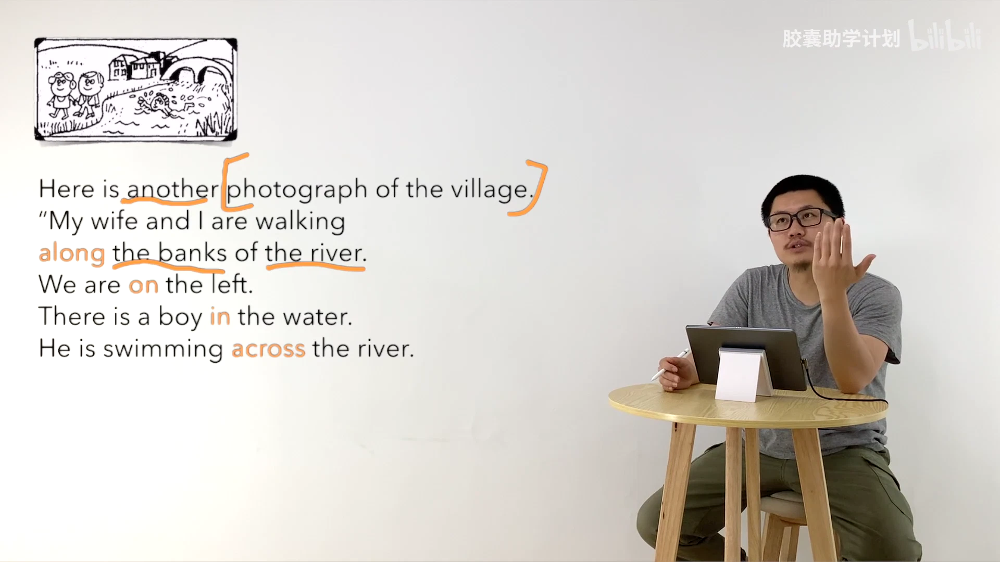

文字识别：胶囊助学计划 / Here is anotherphotograph of the village, / "My wife / and I are walking / along / the banks of the river. / We are on theTeft. / There is a boyin the water. / He is swimming / across the river.

### 画面 00:02:52

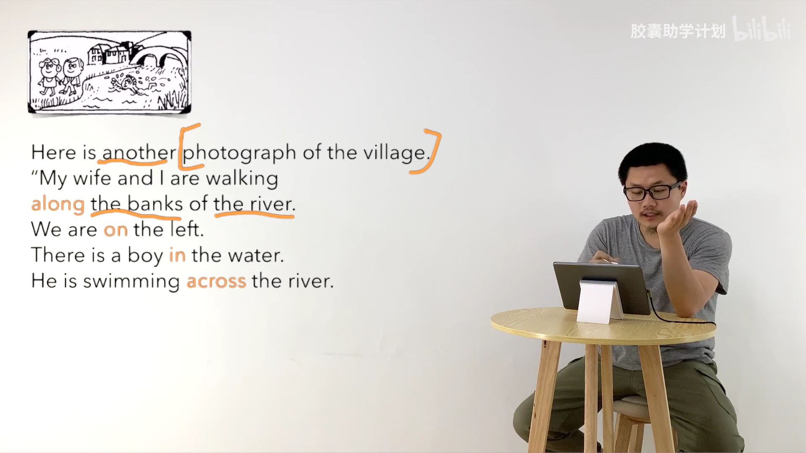

文字识别：胶囊助学计划 / Here is anotherphotograph of the village. / "My wife / and I are walking / along / the banks of the river. / We are on theTeft. / There is a boy in the water. / He is swimming / across the river.

### 画面 00:02:57

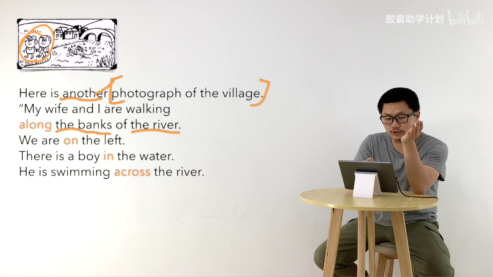

文字识别：胶囊助学计划 / Here is anotherphotograph of the village, / "My / wife / and I are walking / along / the banks of the river. / We are on theTeft. / There is a boy in the water. / He is swimming / across the river.

### 画面 00:02:59

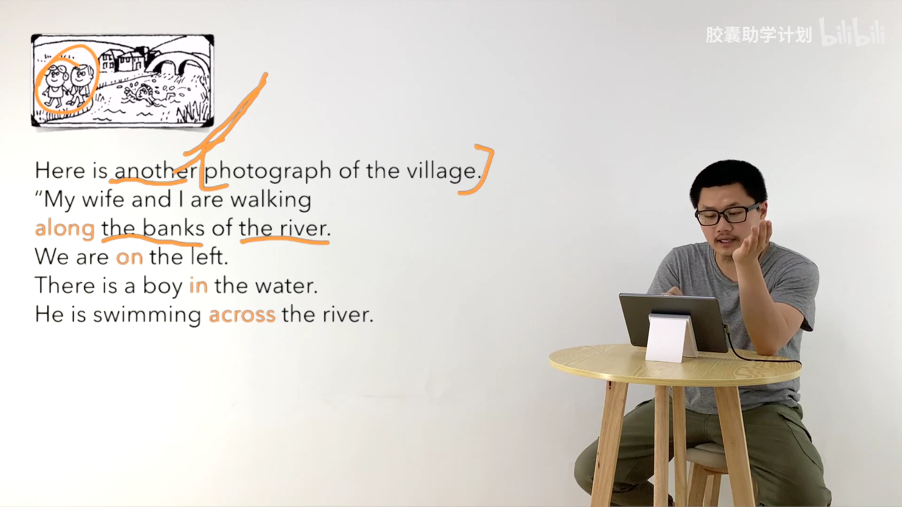

文字识别：胶囊助学计划 / Here is anotherphotograph of the village. / "My / wife / and I are walking / along / the banks / s of the river. / We are on theTeft. / There is a boy in the water. / He is swimming / across / the river.

## 00:03:00–00:03:30

的，然后呢，从桥走过去了，然后又从另一岸开始走，所以叫做 along the banks of the river，沿着河的两岸去走，这是很小的语言细节。We are on the left，说我们在左手边。On the left，there be句型，说 there is a boy，说有一个小男孩 in the water，或者说 in the river，在河里，在水里都可以。He is swimming，注意

### 画面 00:03:01

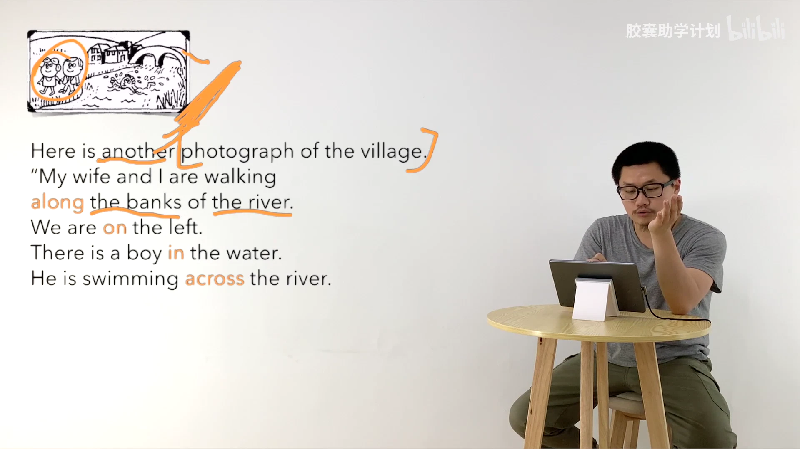

文字识别：胶囊助学计划 / Here is anotherphotograph of the village, / "My / wife / and I are walking / along / the banks / s of the river. / We are on theTeft. / There is a boy in the water. / He is swimming / across the river.

### 画面 00:03:03

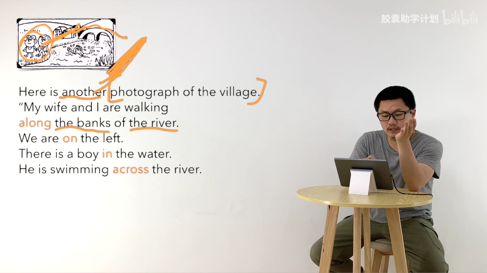

文字识别：胶囊助学计划 / Here is anotherphotograph of the village, / "My / wife / and I are walking / along / the banks / s of the river. / We are on the Teft. / There is a boy in the water. / He is swimming / across / the river.

### 画面 00:03:06

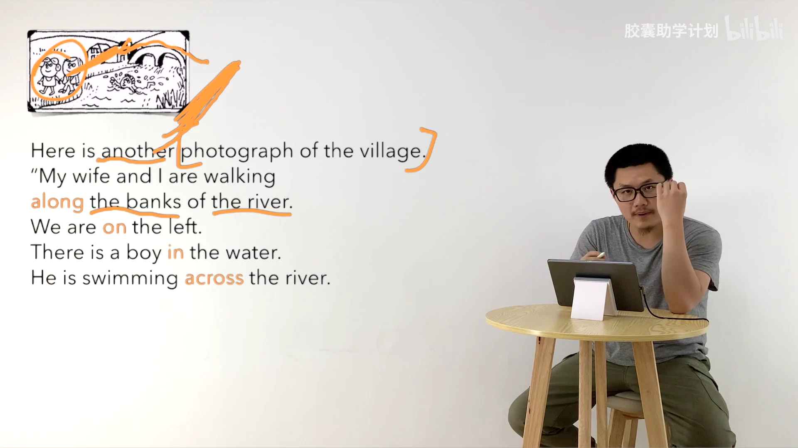

文字识别：胶囊助学计划 / Here is anotherphotograph of the village. / "My / wife / and I are walking / along / the banks / of the river. / We are on the Teft. / There is a boy in the water. / He is swimming / across / the river.

### 画面 00:03:15

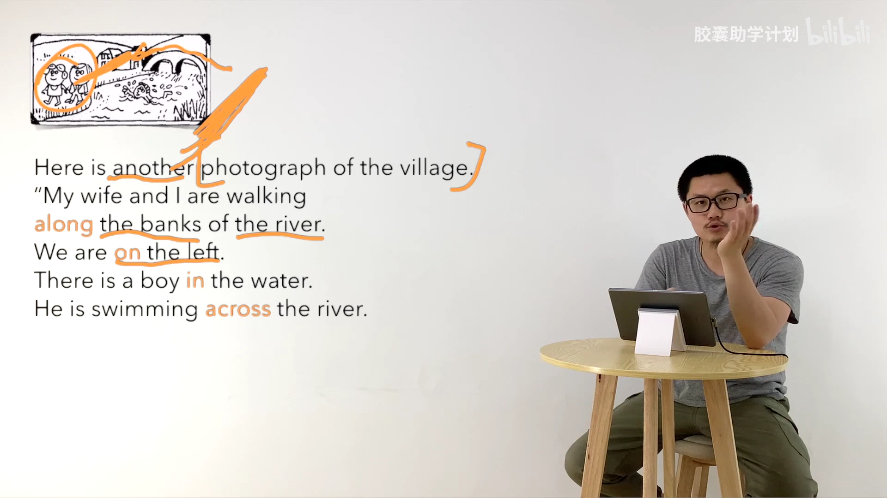

文字识别：胶囊助学计划 / Here is anotherphotograph of the village. / "My / wife / and I are walking / along / the banks / of the river. / We are on the Teft. / There is a boy in the water. / He is swimming / across / the river.

### 画面 00:03:24

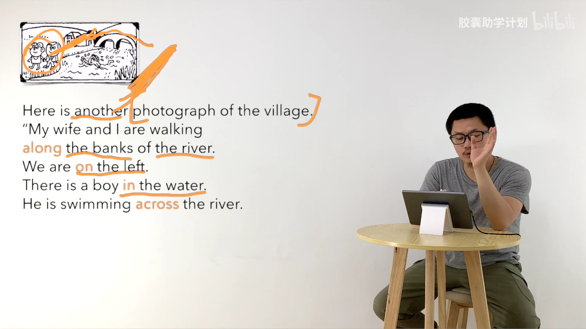

文字识别：胶囊助学计划 / Here / e is anotherphotograph of the village, / "My / wife / andI / I are walking / along / the banks / of the river. / We / are / on theTeft. / There is a boy in the water. / He is / swimming / across / the river.

## 00:03:30–00:04:00

他正在游。那你看一下他的方向，叫做 across the river，穿过这条河。他正在游着，穿过横跨这条河。 Continue. Here is another photograph. 说这儿啊是另一张照片。你看不一样了，对吧？说 This is the school building. 说这是我们学校的建筑物。 School building. It is beside a park. Beside，

### 画面 00:03:35

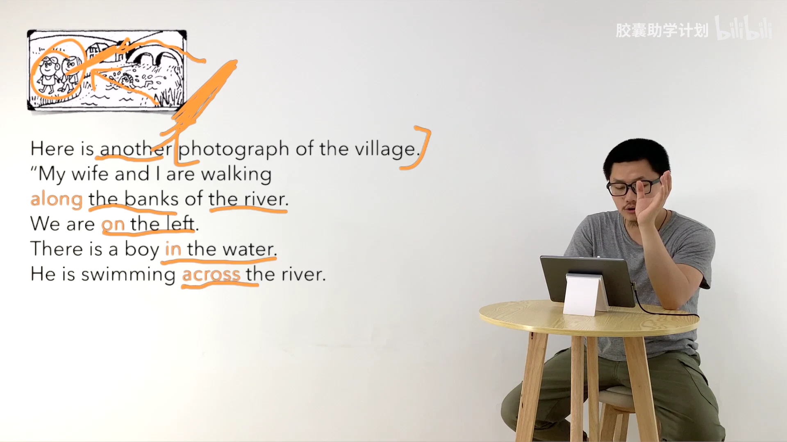

文字识别：胶囊助学计划 / Here / e is anotherphotograph of the village, / "My / wife / and I arev / walking / along / the banks / of the river. / We / are / on the Teft. / There is a boy in the water. / Heis / swimming / across / the / river.

### 画面 00:03:37

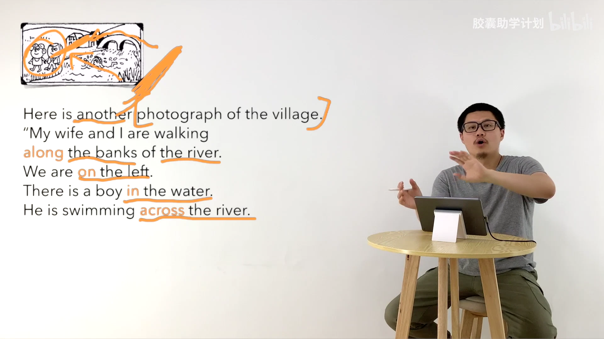

文字识别：胶囊助学计划 / Here is anotherphotograph of the village. / "My / wife / and I are walking / along / the banks / of the river. / We are / on the Teft. / There is a boy in the water. / He is swimming / across / the river.

### 画面 00:03:41

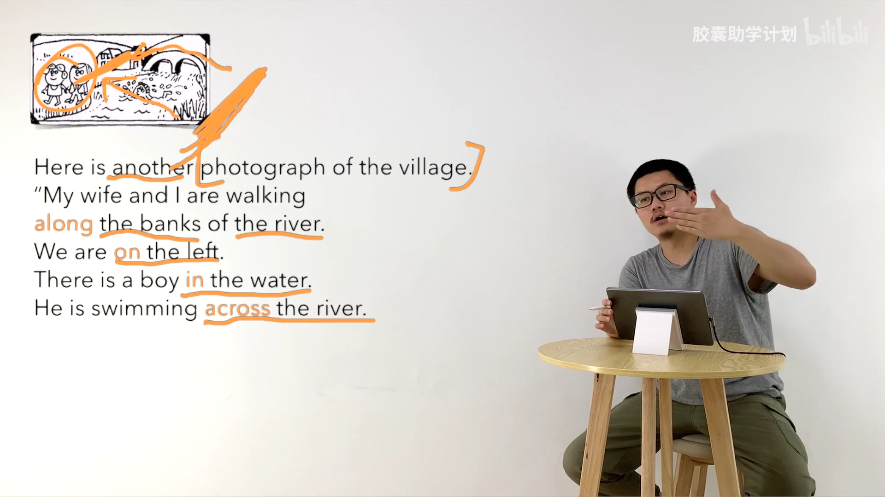

文字识别：胶囊助学计划 / 2 / Here is anotherphotograph of the village, / "My / wife / and I are walking / along / the banks / of the river. / We are / on the Teft. / There is a boy in the water. / Heis / swimming / across / the river.

### 画面 00:03:44

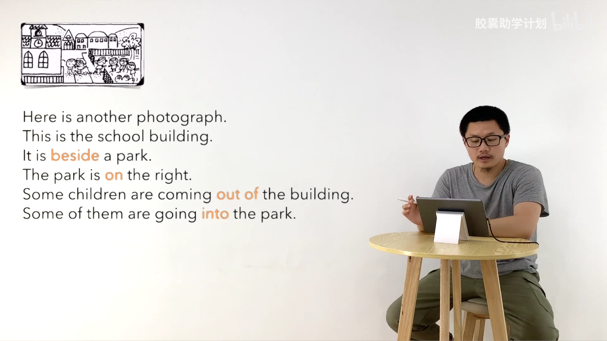

文字识别：胶囊助学计划 / D / nn / Here is another photograph. / This is the school building. / It is beside a park. / The park is on the right. / Some children are coming out of the building. / Some of them are going into the park.

### 画面 00:03:48

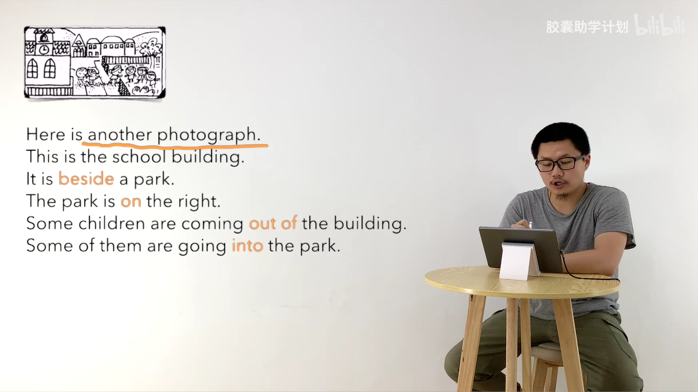

文字识别：胶囊助学计划 / nn / Here is another photograph. / This is the school building. / It is beside a park. / The park is on the right. / Some children are coming out of the building. / Some of them are going into the park.

### 画面 00:03:53

文字识别：胶囊助学计划 / 品 / nn / Here is another photograph. / This is the school building. / It is beside a park. / The park is on the right. / Some children are coming out of the building. / Some of them are going into the park.

## 00:04:00–00:04:30

紧挨着，它在这个公园的旁边，紧靠着。The park is on the right, on the right.一个小的短语叫做在右面。Some children,一些孩子, are coming,正在来, out of the building,正在出这个建筑物,所谓的出这个学校啊, coming out of the school. Some of them,他们当中的有一些人呢, are going into

### 画面 00:04:02

文字识别：胶囊助学计划 / □D / nn / Here is another photograph. / This is the school building. / It is beside a park. / The park is on the right. / Some children are coming out of the building. / Some of them are going into the park.

### 画面 00:04:08

文字识别：胶囊助学计划 / nn / Here is another photograph. / This is the school building. / It is / beside / a park. / The park is on the right. / Some children are coming out of the building. / Some of them are going into the park.

### 画面 00:04:18

文字识别：胶囊助学计划 / nn / Here is another photograph. / This is the school building. / It is / beside / a park. / The park is on the right. / Some children are coming / but of the building. / Some of them are going / into the park.

## 00:04:30–00:05:00

the park, 正在进入这个公园，走进这个公园，叫做 into. OK, 文章也不是很难。那接下来我们做一些 comprehension 的练习。各位要么闭眼，要么直接看文章，尽量做听力的输入和口语的输出。来了，第一题。Is our village in a valley? 答案 Yes, it is. Next one.

### 画面 00:04:30

文字识别：胶囊助学计划 / □D / nn / Here is another photograph. / This is / the school building. / It is / beside / a park. / The / parkis / ont / the right. / building. / Some / children  / are / coming / but of the / Some of them are / going / into the park.

### 画面 00:04:33

文字识别：胶囊助学计划 / □D / Here is another photograph. / This is / the school building. / It is / beside / a park. / The / parkis / ont / the right. / building. / Some / children / are / coming / but of the / Some of them are / going / into the park.

### 画面 00:04:37

文字识别：胶囊助学计划 / □D / Here is another photograph. / This is / the school building. / It is / beside / a park. / The / park is / ont / the right. / building. / Some / children are / coming / but of the / Some of them are / going / into the park.

### 画面 00:04:39

文字识别：胶囊助学计划 / Comprehension

### 画面 00:04:41

文字识别：胶囊助学计划 / Comprehension

## 00:05:00–00:05:30

is our village on a hill? No, it isn't. Next one, where is our village? It's between two hills. 当然了，你的答案也可以说 in a valley. Continue. Is our village on a river? Yes, it is. 注意这儿的 on a river 指的是 near a river.

### 画面 00:05:11

文字识别：胶囊助学计划 / Comprehension / 3T: Where is our village?

### 画面 00:05:27

文字识别：胶囊助学计划 / Comprehension / 4T: Is our village on a river? / S: Yes, it is.

## 00:05:30–00:06:00

Next one, who is walking along the banks of the river? My wife and I. Next one, who is in the water? A boy. Is is加不加都可以. What is the boy doing? He is swimming across the river. Next one, where is the

### 画面 00:05:30

文字识别：胶囊助学计划 / Comprehension / 5 T: Who is walking along the banks of the river?

### 画面 00:05:49

文字识别：胶囊助学计划 / Comprehension / 7 T: What is the boy doing?

### 画面 00:05:51

文字识别：Comprehension / 7 T: What is the boy doing? / DO

### 画面 00:05:53

文字识别：胶囊助学计划 / Comprehension / 7 T: What is the boy doing? / S: He is swimming across the river.

### 画面 00:05:57

文字识别：胶囊助学计划 / Comprehension / 8 T: Where is the school building?

## 00:06:00–00:06:30

school building? It's beside a park. Next one, where is the park? Is on the right. 当然你也可以说 beside the school building, 对吧? Next one, where are some of the children going? They are going into the park. 好，听力口语练习结束，接下来我们一起做一

### 画面 00:06:22

文字识别：胶囊助学计划 / Comprehension / 10 T: Where are some of the children going? / S: They're going into the park

### 画面 00:06:27

文字识别：胶囊助学计划 / Asking questions

## 00:06:30–00:07:00

下 asking questions 四句型转换。第一题 ask me if 不重要，看后面 this is a photograph of our village。第一课您就知道怎么变了 is 提前 is this a photograph of our village? What 注意 what 我们现在固定一下对 our village 提问 what is this a photograph of? 那这个句子的

### 画面 00:06:43

文字识别：胶囊助学计划 / Asking questions / 1 T: Ask me if this is a photograph of our village. / S: Is this a photograph of our village?

### 画面 00:06:53

文字识别：胶囊助学计划 / Asking questions / 1 T: Ask me if this is a photograph of our village. / S: Is this a photograph of our village? / T: What ..?

## 00:07:00–00:07:30

意思是，这张照片是关于什么的照片啊？是我们村儿的一张照片。Next one, ask me if our village is in a valley. Is our village in a valley? Where, where is our village? 你也可以说 Where is your village? 你们的村在哪儿啊？这个人称您是随便变的。Next one,

### 画面 00:07:01

文字识别：胶囊助学计划 / Asking questions / 1 T: Ask me if this is a photograph of our village. / S: Is this a photograph of our village? / T: What ...? / S: What is this a photograph of?

### 画面 00:07:06

文字识别：胶囊助学计划 / Asking questions / 2T: Ask me if our village is in a valley.

### 画面 00:07:19

文字识别：胶囊助学计划 / Asking questions / 2 T: Ask me if our village is in a valley. / S: Is our village in a valley? / T: Where ...? / S: Where is our village?

### 画面 00:07:28

文字识别：胶囊助学计划 / Asking questions

## 00:07:30–00:08:00

ask me if这句话比较长了. My wife and I are walking along the banks of the river.别忘了张嘴给我答案啊！千万别只看视频，听我一个人在这儿说. Are your wife and you walking along the banks of the river? Where?那肯定是对 along the banks of the river 提问了. Where are your wife and you walking?你们正在什么地方走路呢？散步

### 画面 00:07:44

文字识别：胶囊助学计划 / Asking questions / 3 T: Ask me if my wife and I are walking along / the banks of the river. / S: Are your wife and you walking along the / banks of the river?

### 画面 00:07:52

文字识别：胶囊助学计划 / Asking questions / 3 T: Ask me if my wife and I are walking along / the banks of the river. / S: Are your wife and you walking along the / banks of the river? / T: Where ...?

## 00:08:00–00:08:30

呢？ Next one. Ask me if the boy is swimming across the river. Is the boy swimming across the river? Where? Where is the boy swimming? Next one. Ask me if the school building is beside the park. Is the school building beside the park?

### 画面 00:08:01

文字识别：胶囊助学计划 / Asking questions / 4 T: Ask me if the boy is swimming across the river.

### 画面 00:08:15

文字识别：胶囊助学计划 / Asking questions / 4 T: Ask me if the boy is swimming across the river. / S: Is the boy swimming across the river? / T: Where ...? / S: Where is the boy swimming?

### 画面 00:08:18

文字识别：胶囊助学计划 / Asking questions

## 00:08:30–00:09:00

where? That's beside the park.提问 Where is the school building? Okay,本课复习就一个东西，就是关键点文章当中的各个介词，这是非常关键的一个点。Okay,好，那本课的作业呢？第一，绿皮书三十五课，各位去写了，到现在还不知道绿皮书是什么的，各位一定要去我们新概念一册的开篇去自己找一下。第二，文章要跟

### 画面 00:08:30

文字识别：胶囊助学计划 / Asking questions / 5 T: Ask me if the school building is beside the park. / S: Is the school building beside the park? / T: Where ..?

### 画面 00:08:32

文字识别：胶囊助学计划 / Asking questions / 5 T: Ask me if the school building is beside the park. / S: Is the school building beside the park? / T: Where ...?

### 画面 00:08:37

文字识别：胶囊助学计划 / Recap / Patterns / prep. / Grammar / Words / Expression

### 画面 00:08:42

文字识别：胶囊助学计划 / Recap / Patterns / & / prep. / Grammar / Words / Expression

### 画面 00:08:46

文字识别：胶囊助学计划 / Recap / Patterns / prep. / Grammar / Words / Expression

### 画面 00:08:48

文字识别：胶囊助学计划 / 绿皮书第35课的写作练习

## 00:09:00–00:09:30

读至熟读成诵。如何跟读？新概念一册的开篇视频，请去观看。最后呢，给自己讲解一遍今天的核心知识点。那如果大家喜欢我们的课程，欢迎大家关注、订阅、一键三连支持，并分享给那些需要的朋友。我们再来看一句名人名言。One of the most sincere forms of respect is actually listening to what another has to say. See you next time.

### 画面 00:09:09

文字识别：胶囊助学计划

### 画面 00:09:17

文字识别：胶囊助学计划 / One of the most sincere forms of respect is / actually listening to what another has to say. / Bryant H. McGill

### 画面 00:09:27

文字识别：胶囊助学计划 / One of the most sincere forms of respect is / actually listening to what another has to say. / Bryant H. McGilI

### 画面 00:09:29

文字识别：胶囊助学计划 / One of the most sincere forms of respect is / actually listening to what another has to say. / Bryant H. McGilI

## 00:09:30–00:09:42

### 画面 00:09:31

文字识别：CAPSULEACADEMY / 胶囊助学计划 / 小红书 / Lecturer / □ / 口 / Leo / OE

### 画面 00:09:33

文字识别：CAPSULEACADEMY / 胶囊助学计划 / 小红书 / Photographer / Berlin / OE

### 画面 00:09:36

文字识别：CAPSULEACADEMY / 胶囊助学计划 / 小红书 / Editor / □ / 口 / Berlin / OE

### 画面 00:09:38

文字识别：CAPSULEACADEMY / 胶囊助学计划 / 『 / 小红书 / Creator / □ / Leo & Berlin / OE

### 画面 00:09:40

文字识别：bilibili / 胶囊助学计划

### 画面 00:09:41

文字识别：bilibili / 胶囊助学计划

