# 039 语法 单词 文章

快速机器解析：语音为单模型转写，未进行独立交叉校对或人工复核；画面每秒采样并按变化选帧，短时文字和标记可能遗漏。截图时间约有 1 秒误差。图片有损压缩；遇到疑点请按时间查看 Google Drive 原视频。

## 00:00:00–00:00:30

Hello everyone, welcome to Capsule Academy. This is Leo. Today we're going to learn New Concept English Book One, Lesson Thirty Nine, Grammar Words and Story. Old habit. Before entering the formal course, we will first look at three questions. First, how to express? Careful. Second, how to express? Don't cry. Third, give somebody something. We learned it in Lesson Twenty-One. What does its variant look like? With these three questions, hope you can enjoy it.

### 画面 00:00:00

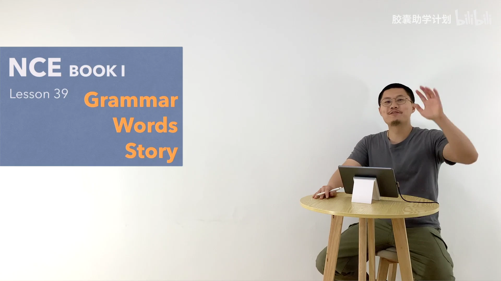

文字识别：胶囊助学计划 / NCE / BOOKI / Lesson 39 / Grammar / Words / Story

### 画面 00:00:02

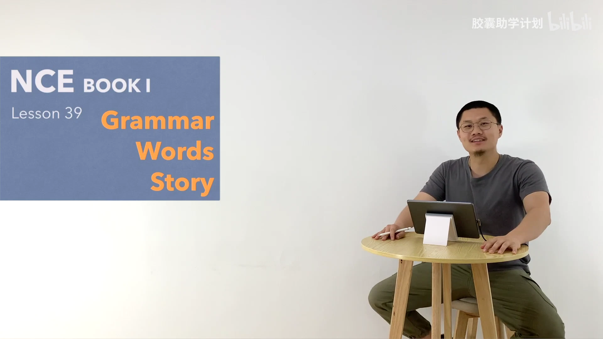

文字识别：胶囊助学计划 / NCE / BOOKI / Lesson 39 / Grammar / Words / Story

### 画面 00:00:08

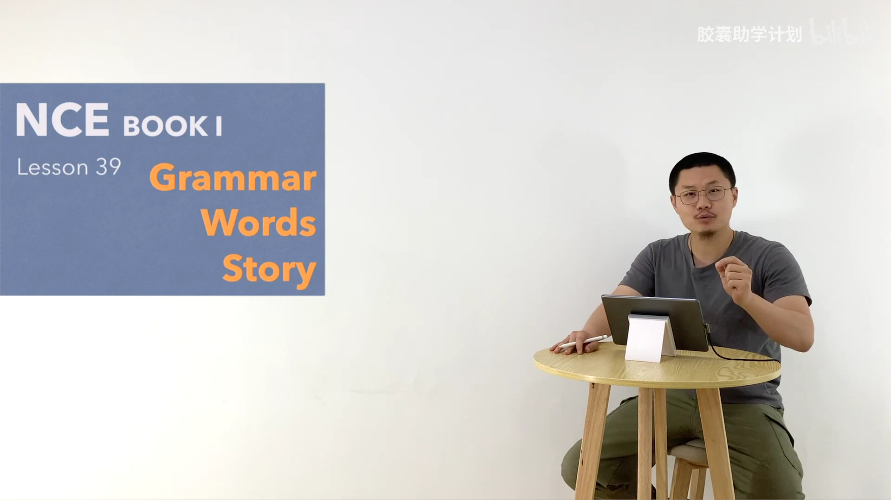

文字识别：胶囊助学计划 / NCE / BOOKI / Lesson 39 / Grammar / Words / Story

### 画面 00:00:11

文字识别：胶囊助学计划

### 画面 00:00:13

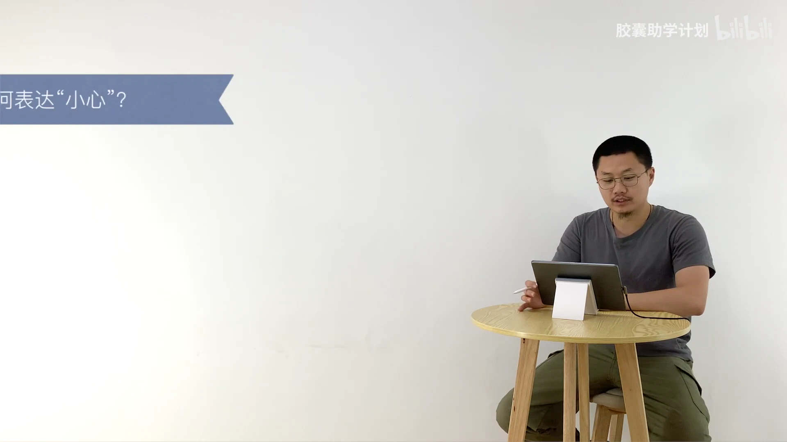

文字识别：胶囊助学计划 / 可表达“小心”？

### 画面 00:00:15

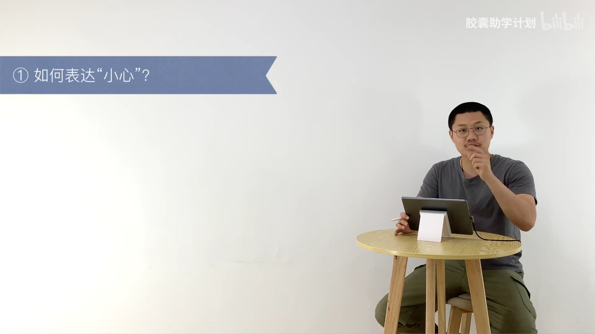

文字识别：胶囊助学计划 / ①如何表达“小心”？

### 画面 00:00:17

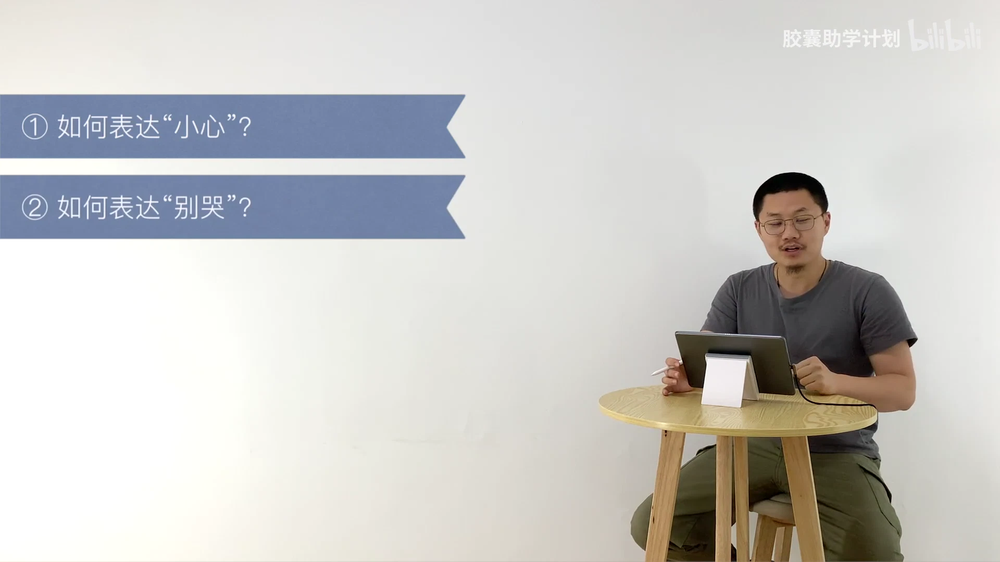

文字识别：胶囊助学计划 / ①如何表达“小心”？ / 如何表达“别哭”?

### 画面 00:00:19

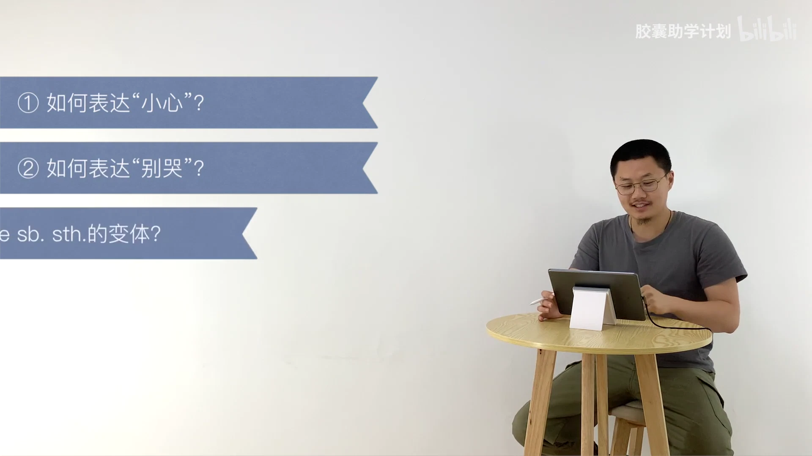

文字识别：胶囊助学计划 / ①如何表达“小心”？ / 如何表达“别哭”? / esb.sth.的变体?

### 画面 00:00:21

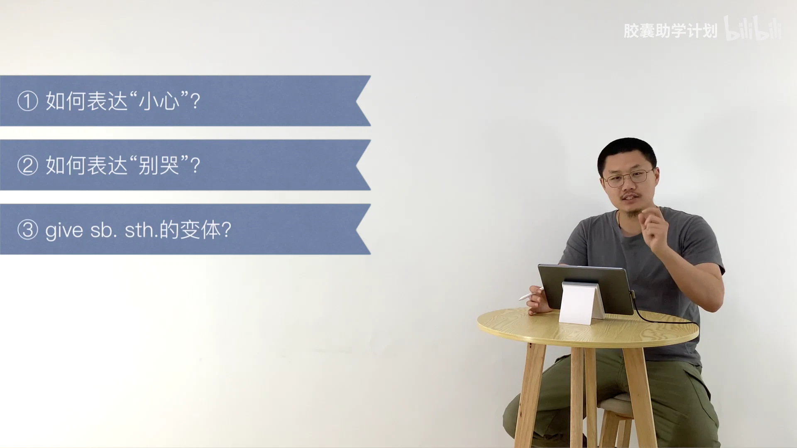

文字识别：胶囊助学计划 / ①如何表达“小心”？ / 如何表达“别哭”? / give sb. sth.的变体?

### 画面 00:00:28

文字识别：胶囊助学计划bl出 / •

## 00:00:30–00:01:00

好，那我们上来先看第一个单词啊，我们先一起读一下。来，front，注意它是一个音节，对吧？只有一个元音啊。我们在音标的课程当中讲过，如何判断一个单词有几个音节，要看它的音标有几个元音音标就有几个音节，对吧？OK，那跟我读一下，front。它的直接的意思叫在什么什么的前面。那它往往

### 画面 00:00:32

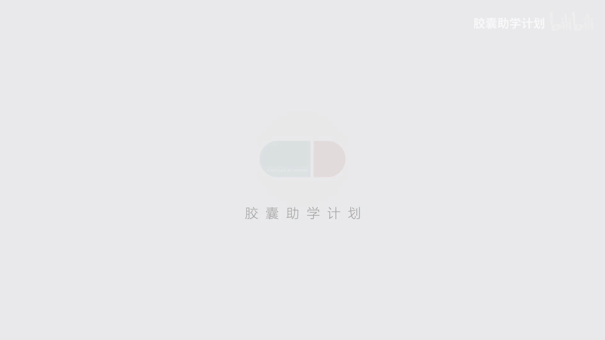

文字识别：胶囊助学计划

### 画面 00:00:34

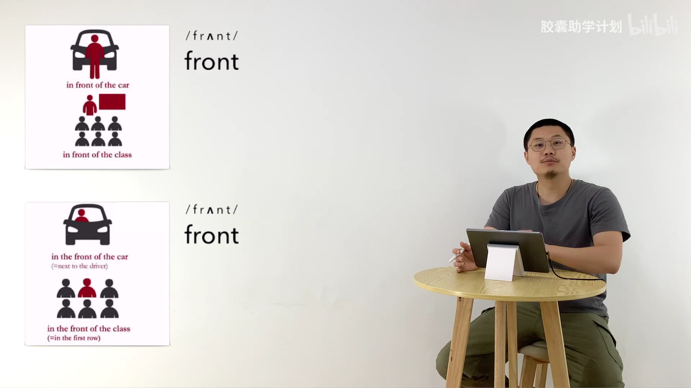

文字识别：胶囊助学计划 / /frant/ / front / in front of the car / in front of the class / /frΛnt/ / front / in the front of the car / (=next to the driver) / in the front of the class / (=in the first row)

### 画面 00:00:37

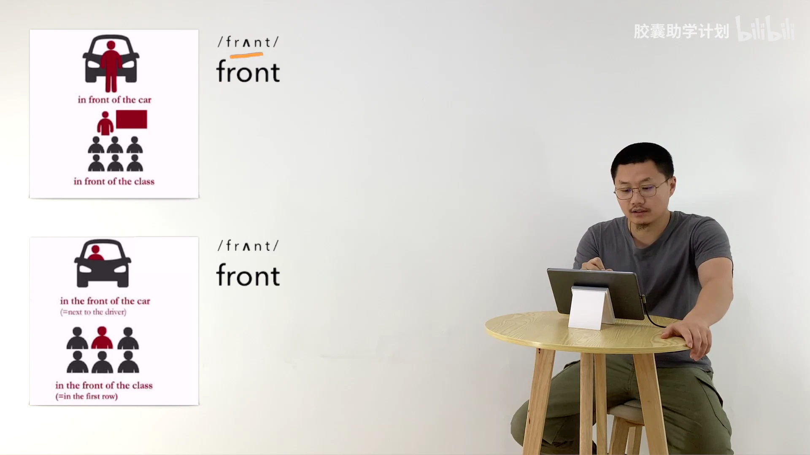

文字识别：胶囊助学计划 / /frΛnt/ / front / in front of the car / in front of the class / /frant/ / front / in the front of the car / (=next to the driver) / in the front of the class / (=in the first row)

### 画面 00:00:43

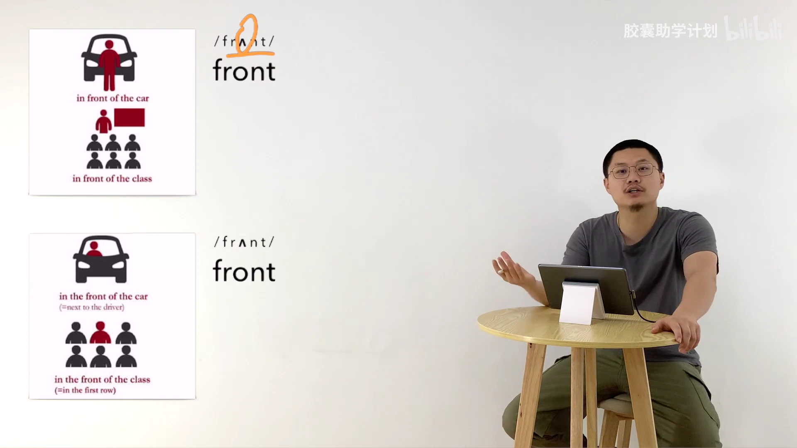

文字识别：胶囊助学计划 / /fr / yt/ / front / in front of the car / in front of the class / /frant/ / front / in the front of the car / (=next to the driver) / in the front of the class / (=in the first row)

### 画面 00:00:48

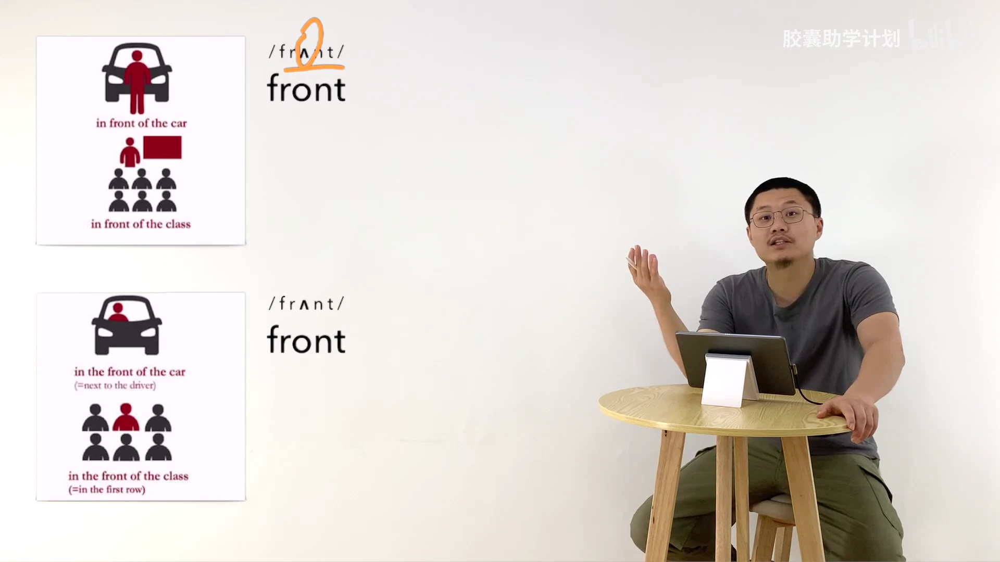

文字识别：胶囊助学计划 / / f r / At/ / front / in front of the car / in front of the class / /frant/ / front / in the front of the car / (=next to the driver) / in the front of the class / (=in the first row)

## 00:01:00–00:01:30

不会单独出现，它会配合着短语出现。比如说 in front of，叫在什么什么的前面。那我们注意一下啊，我们看一下这幅图，看一下左面，它左面对应的这幅图，这个红色的小人在车的前面。注意，它不是在车里面的前面，对吧？车在这儿，人在这儿啊，他们两个是分开的。这个叫做 in front of。所以我们可以造一句话说，the man is

### 画面 00:01:01

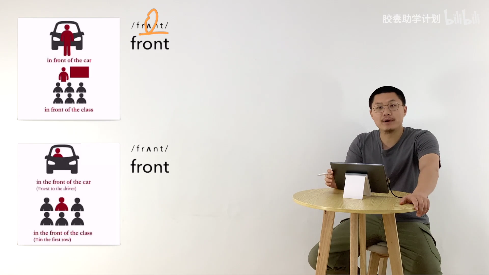

文字识别：胶囊助学计划 / / f r / At/ / front / in front of the car / in front of the class / /frant/ / front / in the front of the car / (=next to the driver) / in the front of the class / (=in the first row)

### 画面 00:01:05

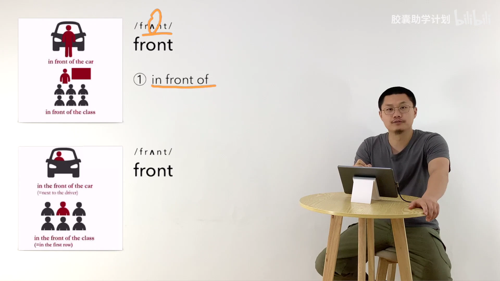

文字识别：胶囊助学计划 / / fr / At/ / front / in front of the car / in front of / in front of the class / /frant/ / front / in the front of the car / (=next to the driver) / in the front of the class / (=in the first row)

### 画面 00:01:26

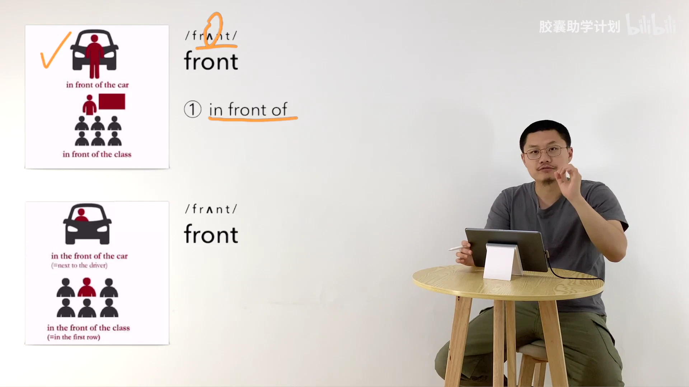

文字识别：胶囊助学计划 / / fr / At/ / front / in front of the car / in front of / in front of the class / /frant/ / front / in the front of the car / (=next to the driver) / in the front of the class / (=in the first row)

## 00:01:30–00:02:00

in front of the car. 你脑海当中应该出现的这个画面就是图中的这种画面，车在后面，人在车的外面，但在车的前面。OK，好。其次呢，比如说我们看图当中啊，这个字也许过小，我给大家读一下，叫做 in front of the class，叫做在这个教室或者在这个教呃在这个教室的前面啊，它不在人群当中。比如说老师就可以说 in

### 画面 00:01:43

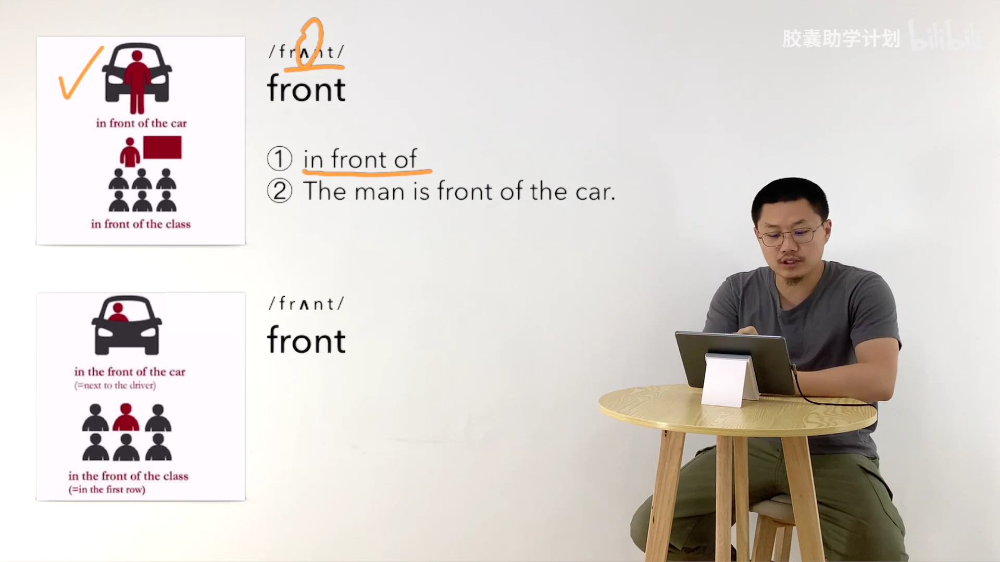

文字识别：胶囊助学计划 / / fr / t/ / front / in front of the car / ① / in front of / The man is front of the car. / in front of the class / /frant/ / front / in the front of the car / (=next to the driver) / in the front of the class / (=in the first row)

### 画面 00:01:46

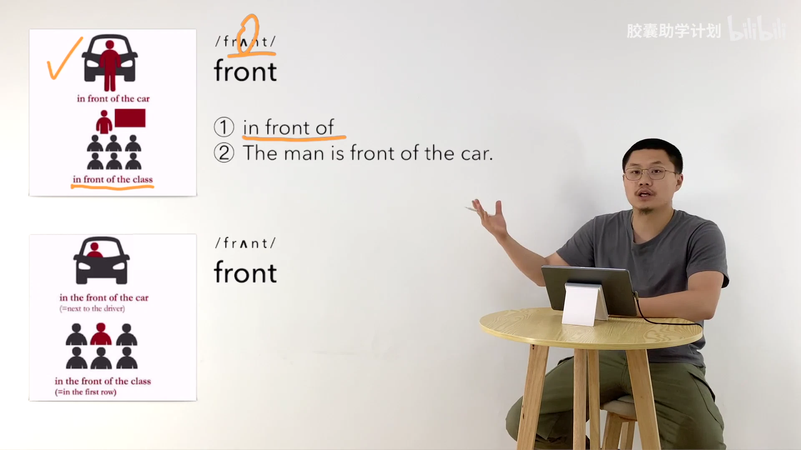

文字识别：胶囊助学计划 / / fr / 人t/ / front / in front of the car / in front of / 1 / The man is front of the car. / in front of the class / /frant/ / front / in the front of the car / (=next to the driver) / in the front of the class / (=in the first row)

### 画面 00:01:55

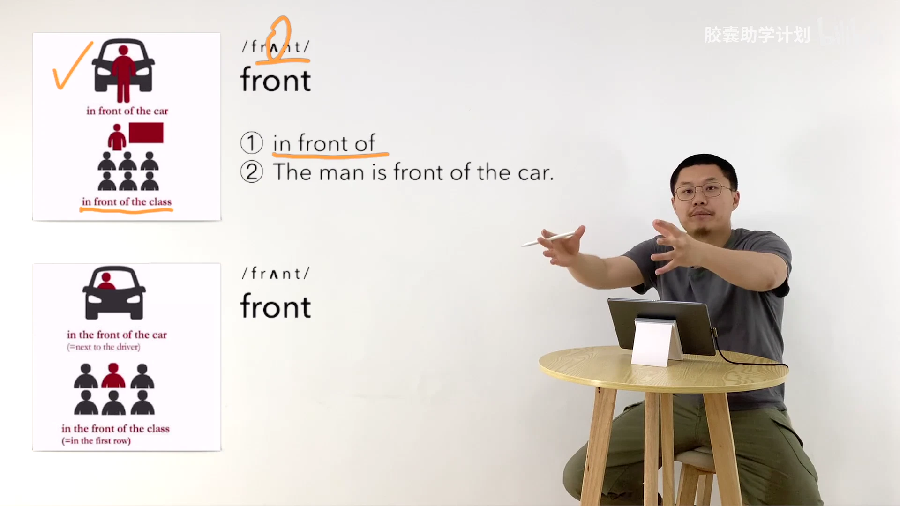

文字识别：胶囊助学计划 / / f r / ht/ / front / in front of the car / ①i / in front of / The man is front of the car. / in front of the class / /frant/ / front / in the front of the car / (=next to the driver) / in the front of the class / (=in the first row)

## 00:02:00–00:02:30

front of the class，对吧？学生坐在底下，老师站在学生们的前面，叫做 in front of the class。好，那 in front of 呢？它还有另一个非常的像，叫做 in the front of，多了一个 the。别看小瞧这一个 the，一下意思就不太一样了。我们看图，叫做 in front of， in the front of the car，叫做在车的前面，还是在车的前面，但是它是在车的里

### 画面 00:02:00

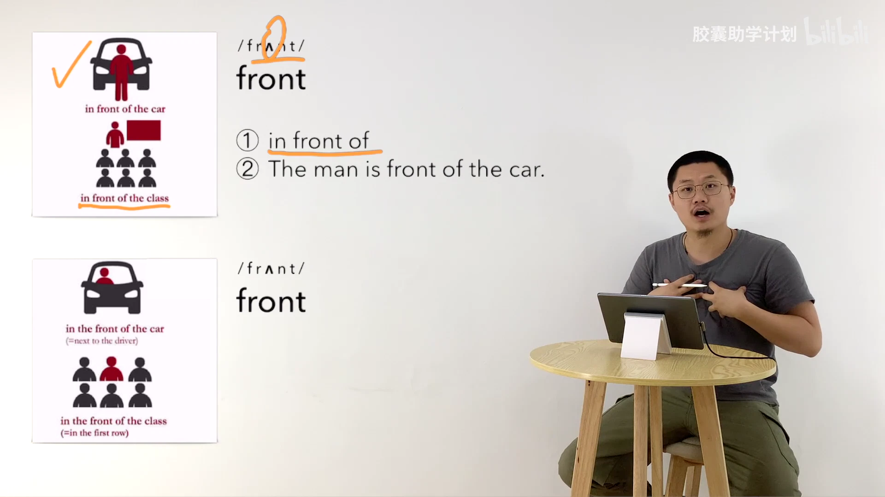

文字识别：胶囊助学计划 / / fr / ht/ / front / in front of the car / in front of / The man is front of the car. / in front of the class / /frant/ / front / in the front of the car / (=next to the driver) / in the front of the class / (=in the first row)

### 画面 00:02:10

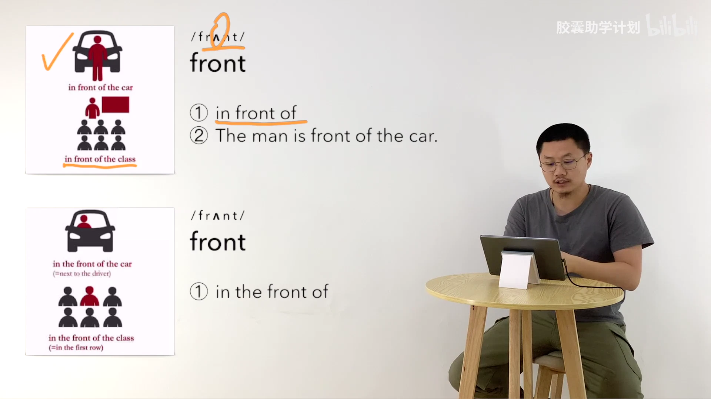

文字识别：胶囊助学计划 / / fr / ht/ / front / in front of the car / in front of / 1 / The man is front of the car. / in front of the class / /frant/ / front / in the front of the car / (=next to the driver) / ① in the front of / in the front of the class / (=in the first row)

### 画面 00:02:12

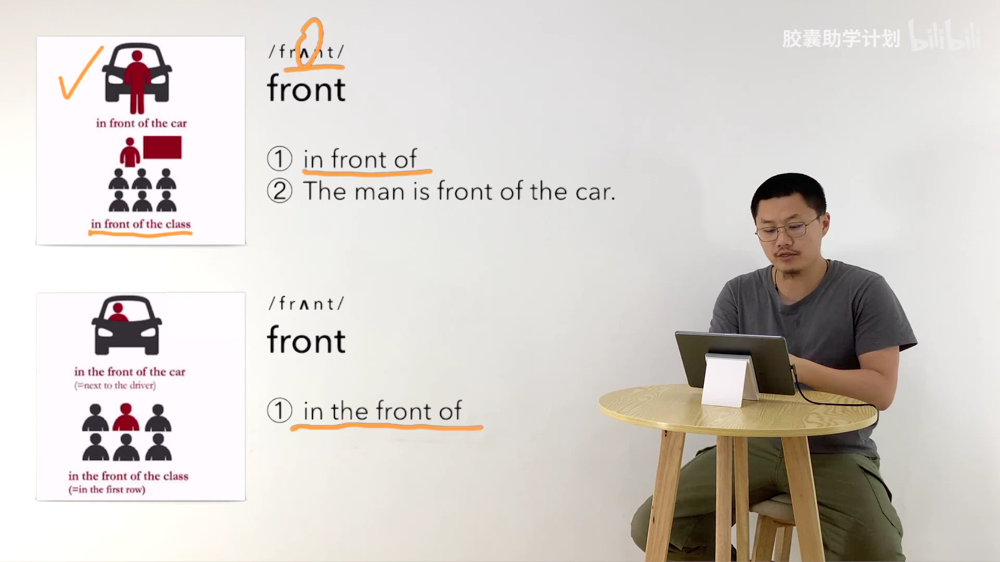

文字识别：胶囊助学计划 / / fr / ht/ / front / in front of the car / in front of / 1 / The man is front of the car. / in front of the class / /frant/ / front / in the front of the car / (=next to the driver) / ① in the front of / in the front of the class / (=in the first row)

### 画面 00:02:14

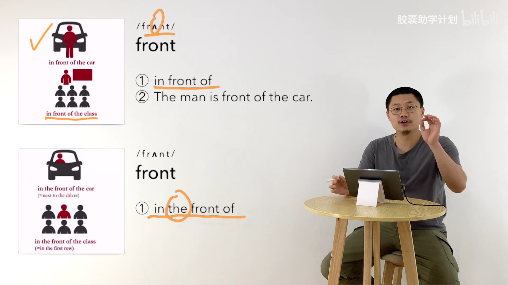

文字识别：胶囊助学计划 / / fr / t/ / front / in front of the car / in front of / 1 / The man is front of the car. / in front of the class / /frant/ / front / in the front of the car / (=next to the driver) / ① inthe front of / in the front of the class / (=in the first row)

### 画面 00:02:20

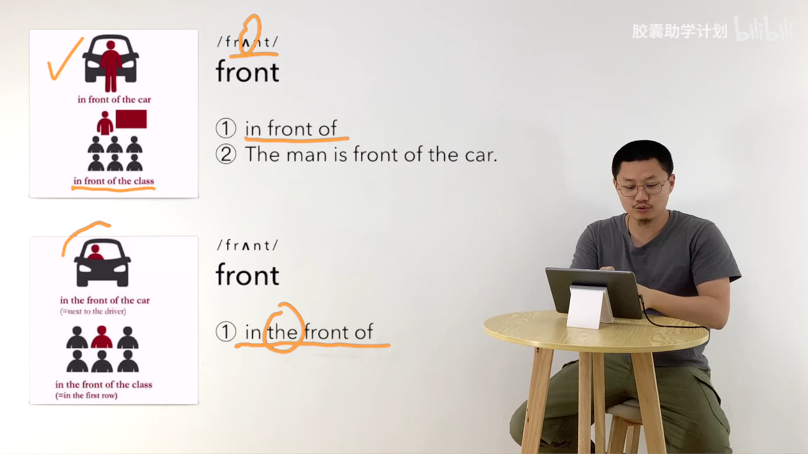

文字识别：胶囊助学计划 / / fr / ht/ / front / in front of the car / in front of / 1 / The man is front of the car. / in front of the class / /frant/ / front / in the front of the car / (=next to the driver) / ① inthe front of / in the front of the class / (=in the first row)

### 画面 00:02:22

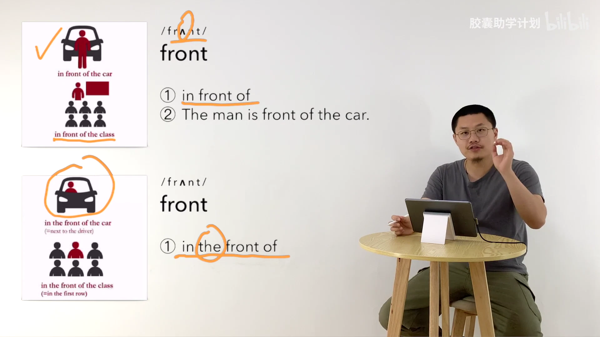

文字识别：胶囊助学计划 / / fr / ht/ / front / in front of the car / ① / in front of / The man is front of the car. / in front of the class / /frant/ / front / in the front of the car / (=next to the driver) / ① inthe front of / in the front of the class / (=in the first row)

## 00:02:30–00:03:00

面的前排，OK。比如说你在副驾驶或者在驾驶的位置，就叫做 in the front of the car，OK。那同理说，in the front of the class，那指的是你是学生坐在这么多学生的前排，而不是在所有学生的前面。比如说老师这个位置，OK。比如说我们还是同样的一个句子，叫 the man is in the front of the car。注意多了一个 the，它指的不是

### 画面 00:02:39

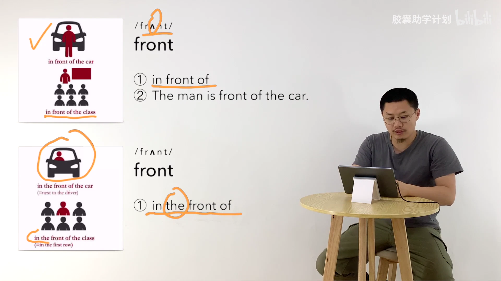

文字识别：胶囊助学计划 / / fr / At/ / front / in front of the car / in front of / 1 / The man is front of the car. / in front of the class / /frant/ / front / in the front of the car / (=next to the driver) / ① inthe front of / in the front of the class / (=in the first row)

### 画面 00:02:41

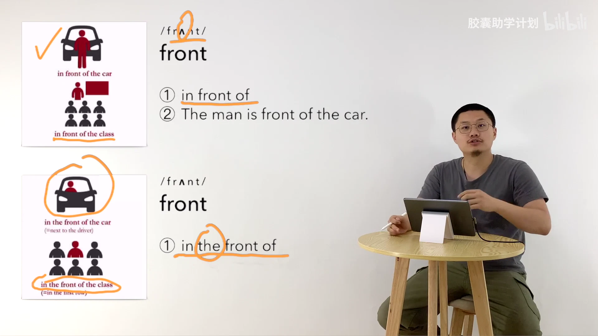

文字识别：胶囊助学计划 / / fr / t/ / Λ / front / in front of the car / 1 / in front of / The man is front of the car. / in front of the class / /frant/ / front / in the front of the car / (=next to the driver) / ① in the front of / in the front of the class / (=in tne urstr

### 画面 00:02:51

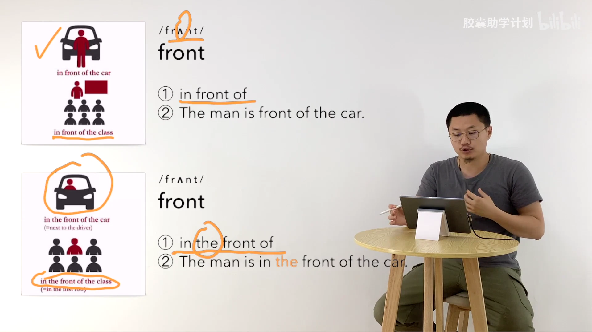

文字识别：胶囊助学计划 / / fr / 人t/ / front / in front of the car / in front of / 1 / The man is front of the car. / in front of the class / /frant/ / front / in the front of the car / (=next to the driver) / ① inthe front of / The man is in the front of the car. / in the front of the class / (in the urst io)

### 画面 00:02:56

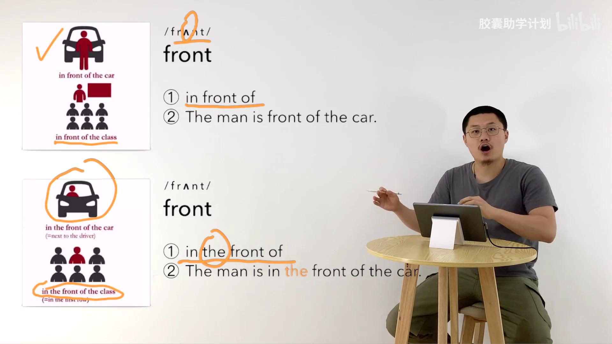

文字识别：胶囊助学计划 / / fr / At/ / front / in front of the car / in front of / 1 / The man is front of the car. / in front of the class / /frant/ / front / in the front of the car / (=next to the driver) / ① inthe front of / The man is in the front of the car. / in the front of the class / (=in the urstio

## 00:03:00–00:03:30

内部的前面，指的是外部的前面。比如说，那给大家提一个小的问题，我和这面墙之间的关系是in front of还是in the front of？那in the front of的话，我人就在这个墙的里面了。注意啊，所以我现在是在它的外面，叫做in front of。OK，好，希望各位能把它辨析清楚。接下来下一个单词，看一下有几个音节，两个元音音标中间一个辅音给后面，所

### 画面 00:03:05

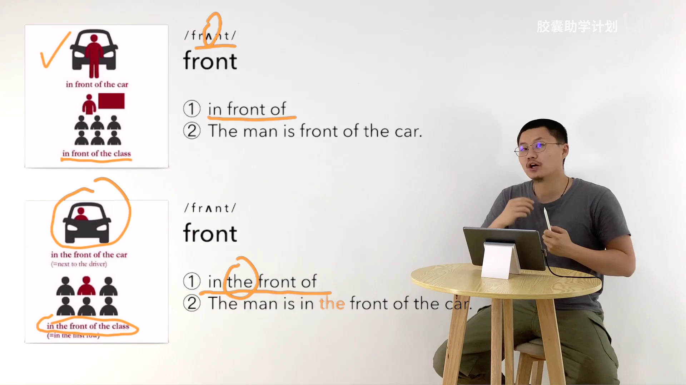

文字识别：胶囊助学计划 / /fr / ht/ / front / in front of the car / ①i / in front of / The man is front of the car. / in front of the class / /frant/ / front / in the front of the car / (=next to the driver) / ①inthe front of / The man is in the front of the car. / in the front of the class / (=in tne urstr

### 画面 00:03:09

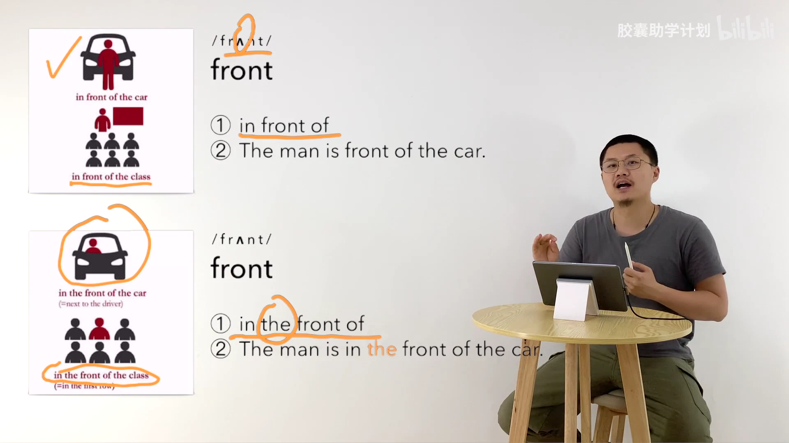

文字识别：胶囊助学计划 / / fr / ht/ / front / in front of the car / in front of / 1 / The man is front of the car. / in front of the class / /frant/ / front / in the front of the car / (=next to the driver) / ① inthe front of / The man is in the front of the car. / in the front of the class / (=in tne urstio

### 画面 00:03:14

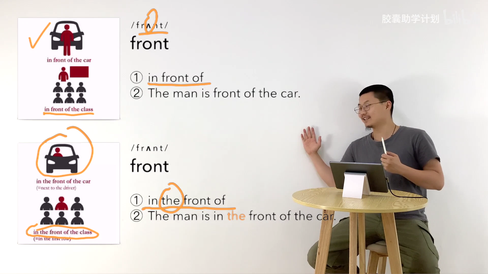

文字识别：胶囊助学计划 / / fr / At/ / front / in front of the car / 1 / in front of / The man is front of the car. / in front of the class / /frant/ / front / in the front of the car / (=next to the driver) / ①in the front of / The man is in the front of the car. / in the front of the class / (=in tne urstio

### 画面 00:03:17

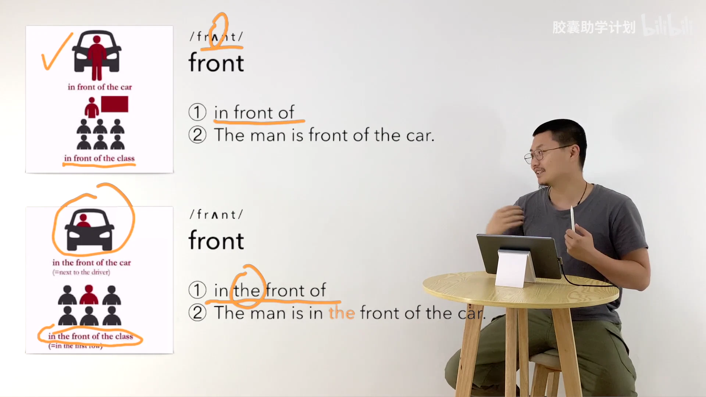

文字识别：胶囊助学计划 / /fr / ht/ / front / in front of the car / in front of / 1 / The man is front of the car. / in front of the class / /frant/ / front / in the front of the car / (=next to the driver) / ① inthe front of / The man is in the front of the car. / in the front of the class / (=in the urstio)

### 画面 00:03:22

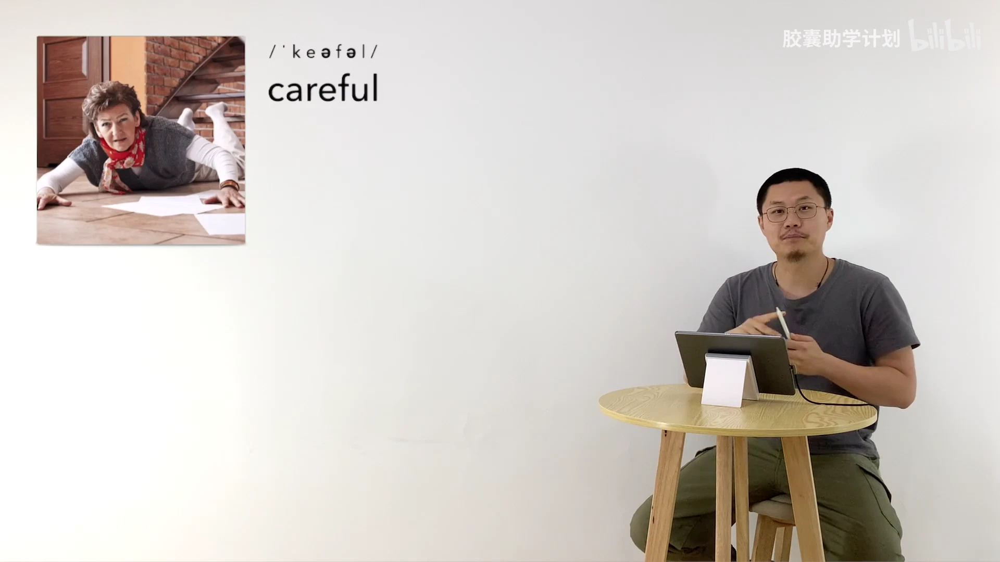

文字识别：胶囊助学计划 / /'keafal/ / careful

### 画面 00:03:25

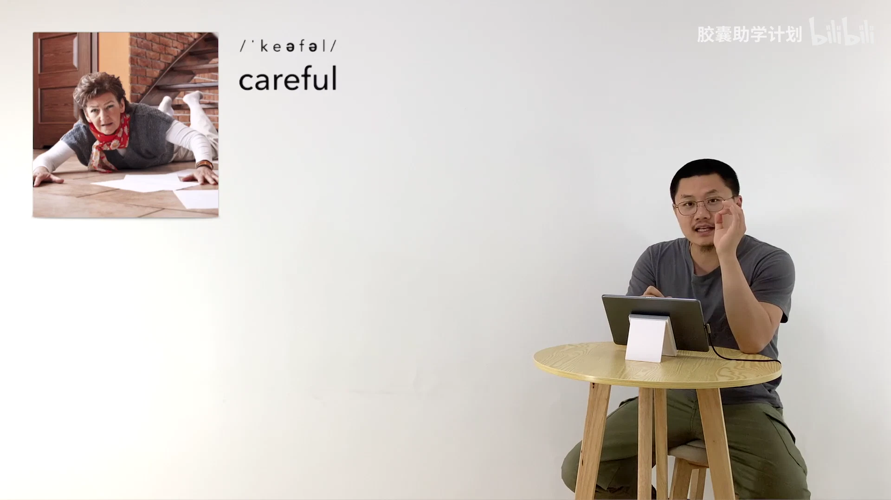

文字识别：胶囊助学计划 / /'keafal/ / careful

## 00:03:30–00:04:00

所以它是两个音节，对吧？第一个音节 care，第二音节 full，连起来 careful， careful 叫小心。那我们一可以单独去说 careful 啊，比如说人家过马路有一个车，你可以说 careful。好，另一个短语也非常的常见，就是在前面加上 be be 这个单词叫做 be careful。 OK，那 be 这个单词它其实没有具体的含义，但是各位见过它的变体，比如说

### 画面 00:03:36

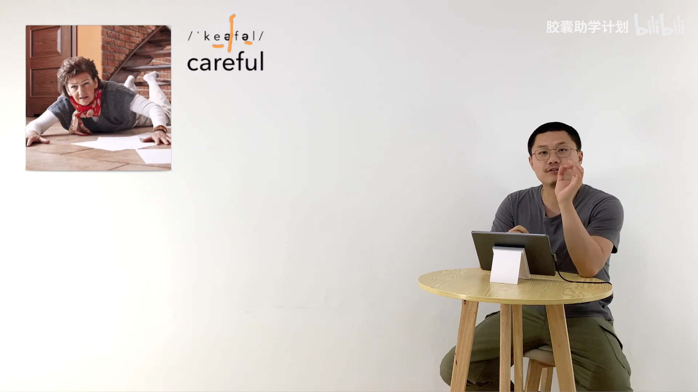

文字识别：胶囊助学计划 / /'keafal/ / careful

### 画面 00:03:38

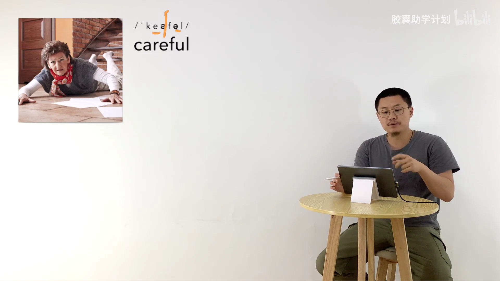

文字识别：胶囊助学计划 / /'keafal/ / careful

### 画面 00:03:42

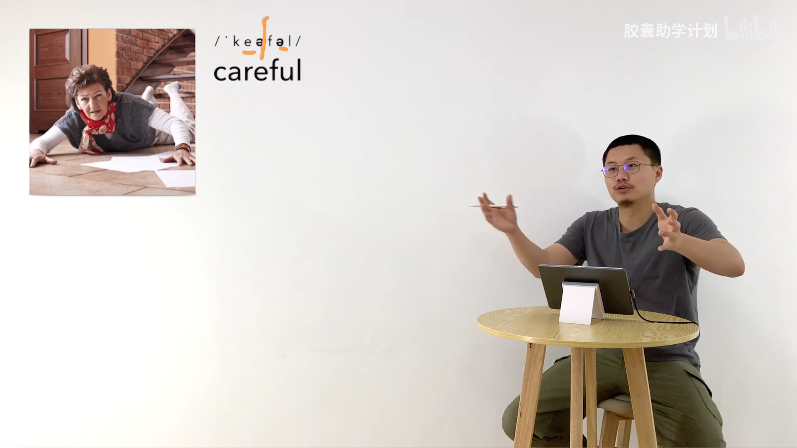

文字识别：胶囊助学计划 / /'keafal/ / careful

### 画面 00:03:46

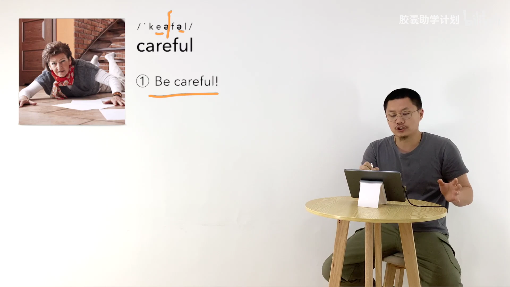

文字识别：胶囊助学计划 / /'keafal/ / careful / ① Be careful!

### 画面 00:03:49

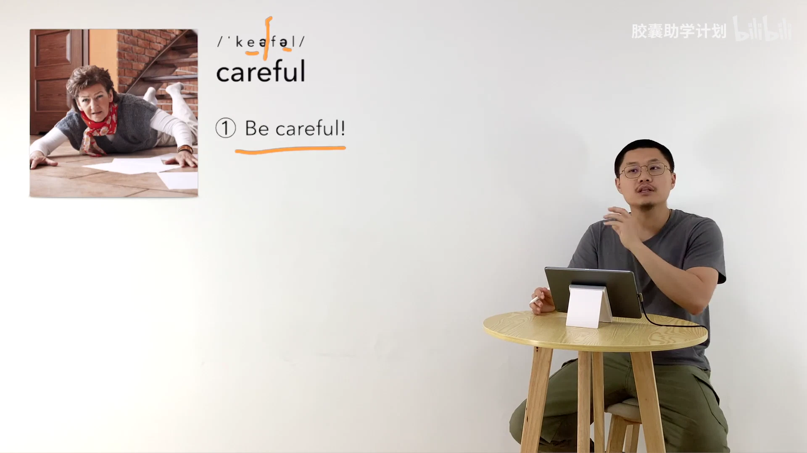

文字识别：胶囊助学计划 / /'keafal/ / careful / ① Be careful!

### 画面 00:03:52

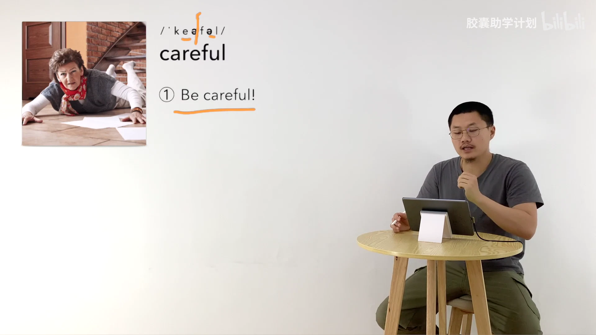

文字识别：胶囊助学计划 / /'keafal/ / careful / ① Be careful!

### 画面 00:03:57

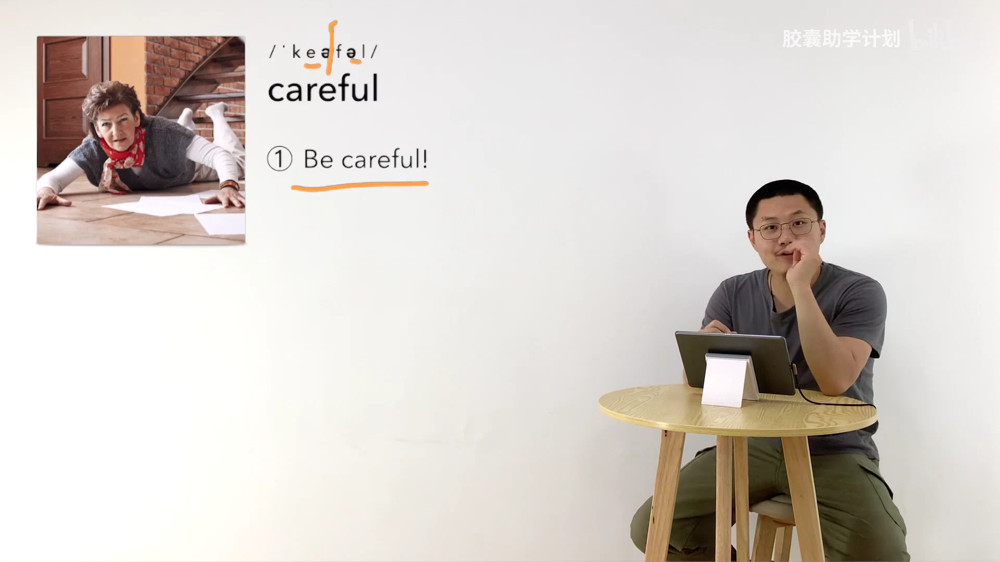

文字识别：胶囊助学计划 / /keafal/ / careful / ① Be careful!

## 00:04:00–00:04:30

三个单词，各位现在都很熟悉了，叫做 am is are。这三个单词的原形非常神奇，就是这个单词叫做 be。那今天呢，我们知道它和 careful 组成了一个小的短语就可以了。以后我们会花一定的时间专门给大家去解释这个单词，因为这个单词还有别的变体，比如说 was were，比如说 being，比如说 been。 OK，好，再跟我读一遍： be careful，啊，小心。

### 画面 00:04:00

文字识别：am / 胶囊助学计划 / /'keafal/ / careful / ① Be careful!

### 画面 00:04:02

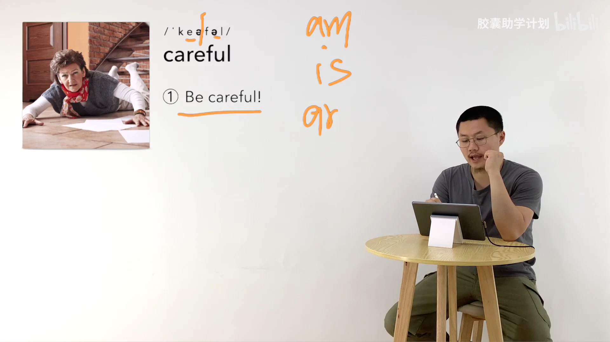

文字识别：am / 胶囊助学计划 / /'keafal/ / careful / (S / ① Be careful!

### 画面 00:04:05

文字识别：am / 胶囊助学计划 / /'keafal/ / careful / (S / ① Be careful!

### 画面 00:04:08

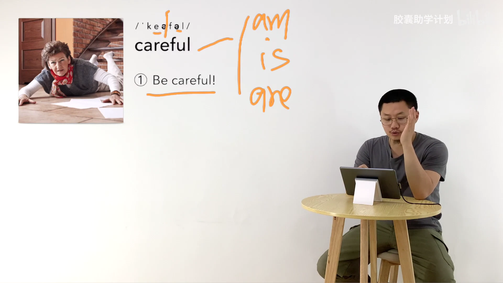

文字识别：/am / 胶囊助学计划 / /'keafal/ / careful / (S / ① Be careful!

### 画面 00:04:10

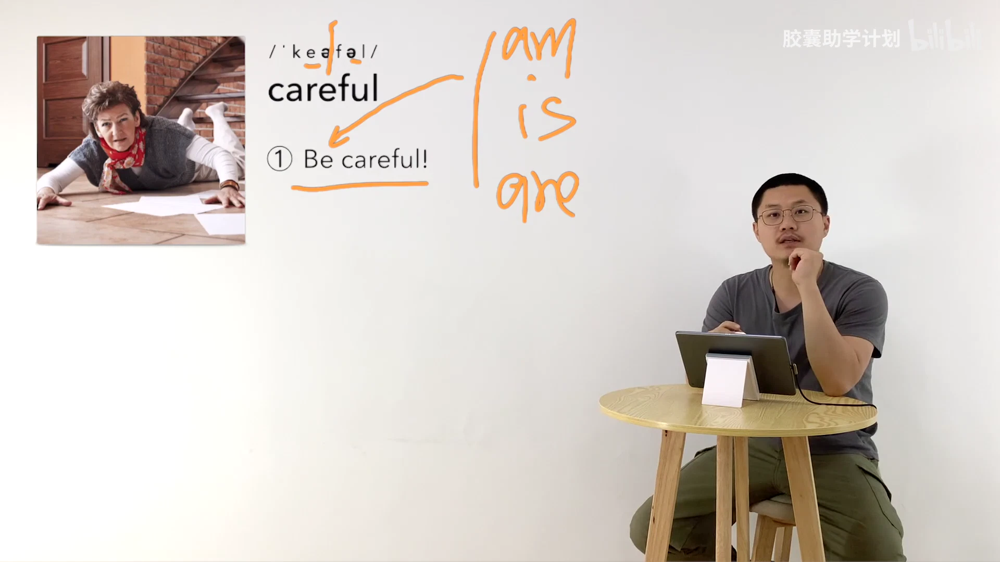

文字识别：/am / 胶囊助学计划 / /'keafal/ / careful / (S / Be careful!

### 画面 00:04:12

文字识别：/am / 胶囊助学计划 / /'keafal/ / careful / (S / )Be careful! / 1

### 画面 00:04:15

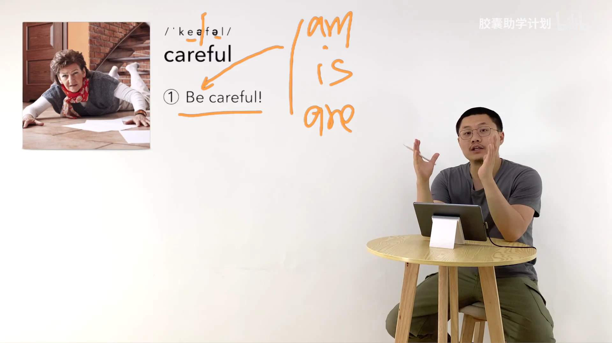

文字识别：/am / 胶囊助学计划 / /'keafal/ / careful / (S / 1 / Be careful!

### 画面 00:04:21

文字识别：/am / 胶囊助学计划 / /'keafal/ / careful / (S / 1 / Be careful!

### 画面 00:04:26

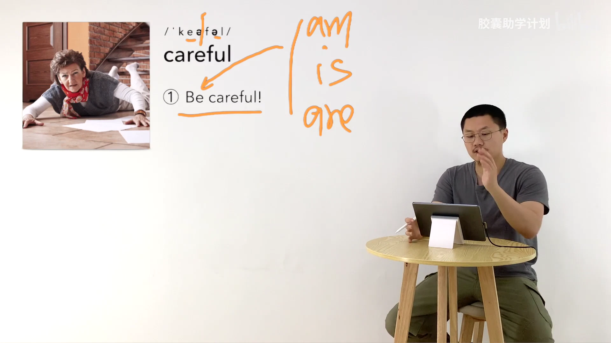

文字识别：/am / 胶囊助学计划 / /'keafal/ / careful / (S / )Be careful!

### 画面 00:04:29

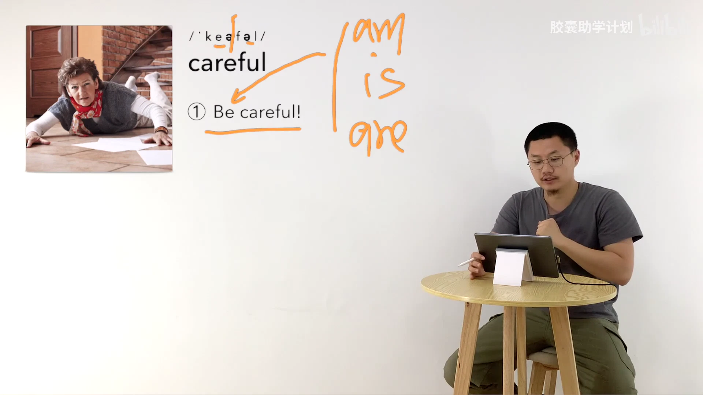

文字识别：/am / 胶囊助学计划 / /'keafal/ / careful / (S / 1 / Be careful!

## 00:04:30–00:05:00

接下来一个单词叫花瓶，注意它实际上有两个不同的发音。我们啊，单这个课这个呃书本当中给大家的这个发音是英式发音，叫做 vase，啊，有点像咱们说那个 vase，啊，那个发音 vase，非常的像。美式发音呢，哎，我带着大家也一起读一下，叫做 vase vase。OK，这您随便啊，你自己读哪个舒服

### 画面 00:04:31

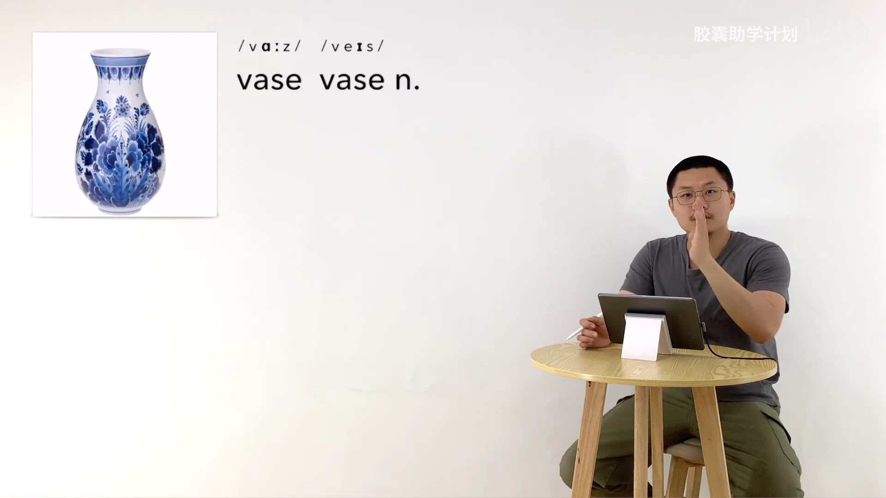

文字识别：胶囊助学计划 / /va:z/ /veisl / vase vase n.

### 画面 00:04:33

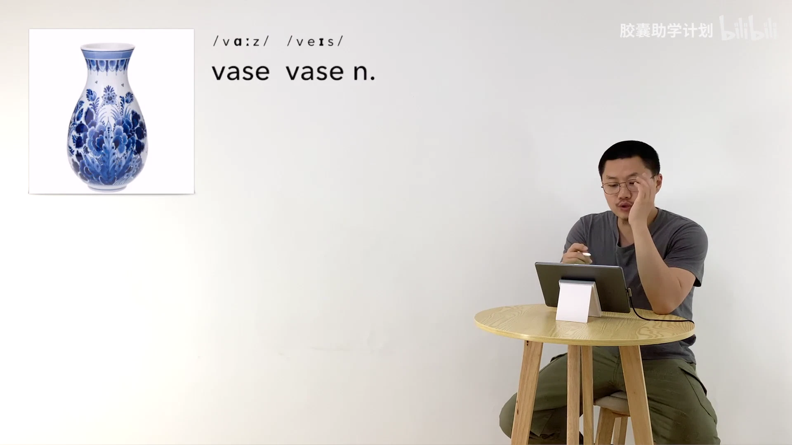

文字识别：胶囊助学计划 / /va:z/ /veis/ / vase vase n.

### 画面 00:04:38

文字识别：胶囊助学计划 / /vaiz/ / /veisl / vase vase n.

### 画面 00:04:40

文字识别：胶囊助学计划 / /va:z/ / /velsl / vase vase n.

### 画面 00:04:50

文字识别：胶囊助学计划 / /va:z/ / lveisl / vase vase n. / 2

### 画面 00:04:57

文字识别：胶囊助学计划 / /vaizl / /velsl / vase / vase n.

### 画面 00:04:59

文字识别：胶囊助学计划 / /va:zl / /velsl / vase / vase n.

## 00:05:00–00:05:30

哪个，别人一般都能听得懂。你就是去美国读buzz，你想一下啊，你是结合上下文场景的，别人也能听得懂，对吧？啊，你去英国读base，结合上下文场景，别人也能明白你想说什么，不用太担心啊。OK，那我们说它是一个名词，我们就要单词造句的思路就是找动词，对吧？找动词。那动找动词的思路不是各位去现在翻字典，我不鼓励这个行为。初

### 画面 00:05:08

文字识别：胶囊助学计划 / /va:z/ / /velsl / vase / vase n.

### 画面 00:05:11

文字识别：胶囊助学计划 / /va:zl / /velsl / vase / vase n.

### 画面 00:05:16

文字识别：胶囊助学计划 / /va:zl / /velsl / vase / vase n. / ① v. paint; wash; clean; / climb; empty; put

### 画面 00:05:18

文字识别：胶囊助学计划 / /vaizl / lvelsl / vase / vase n. / ① v. paint; wash; clean; / climb; empty; put

### 画面 00:05:20

文字识别：胶囊助学计划 / /va:zl / lveis/ / vase / vase n. / ① v. paint; wash; clean; / climb; empty; put

### 画面 00:05:23

文字识别：胶囊助学计划 / /va:zl / /velsl / vase / vase n. / .paint; wash; clean; / climb; empty; put

### 画面 00:05:26

文字识别：胶囊助学计划 / /va:z/ / lvelsl / vase / vase n. / y.paint; wash; clean; / climb; empty; put

## 00:05:30–00:06:00

期啊，初期我更鼓励的行为是什么呢？您之前的单词还经常记不住呢。我们现在正好利用这个机会，把之前学到的一些动词拉过来跟他去造句，对吧？那只有动词还不够，我们还得有一些语法结构。比如说，这个语法结构包含了amazing doing，我们三十一课刚刚学过的，叫表示某个动作正在进行。比如说，What is your father doing？你爸爸干嘛呢？你的回答就可以是He is

### 画面 00:05:35

文字识别：胶囊助学计划 / /va:zl / lvelsl / vase / vase n. / paint; wash; clean; / climb; empty; put

### 画面 00:05:37

文字识别：胶囊助学计划 / /va:zl / /velsl / vase / vase n. / paint; wash; clean; / climb; empty; put

### 画面 00:05:39

文字识别：胶囊助学计划 / /va:zl / /velsl / vase / vase n. / ypaint; wash; clean; / climb; empty; put

### 画面 00:05:47

文字识别：胶囊助学计划 / /va:zl / /velsl / vase / vase n. / paint; wash: clean; / climb; empty; put / am/is/are+doing

### 画面 00:05:50

文字识别：胶囊助学计划 / /va:zl / lvelsl / vase / vase n. / paint; wash; clean; / climb; empty; put / am/is/are+doing

### 画面 00:05:53

文字识别：胶囊助学计划 / /va:zl / /veIsl / vase / vase n. / paint; wash; clean; / climb; empty; put / am/is/are+doing

### 画面 00:05:55

文字识别：胶囊助学计划 / /va:zl / lvelsl / vase / vase n. / paint; wash; clean; / climb; empty; put / am/is/are+doing

### 画面 00:05:59

文字识别：胶囊助学计划 / /va:zl / /veIsl / vase / vase n. / paint; wash; clean; / climb; empty; put / am/is/are+doing

## 00:06:00–00:06:30

cleaning the vase.他正在擦这个花瓶呢。OK，那接下来下一个三十七课我们学到的，对吧？叫做be going to do，叫计划打算去做某件事情。比如说，What are you going to do？你可以回答我要把它喷点喷点漆，是吧？刷点漆，叫做I'm going to paint the vase。OK，来一个下一个单词跟我读一下，叫做drop，drop。

### 画面 00:06:01

文字识别：胶囊助学计划 / /va:zl / /veisl / vase / vase n. / y.paint; wash. / clean / climb; empty; put / am/is/are+doing

### 画面 00:06:03

文字识别：胶囊助学计划 / /va:zl / lveisl / vase / vase n. / V.paint; wash. / clean / climb; empty; put / am/is/are+doing

### 画面 00:06:05

文字识别：胶囊助学计划 / /va:zl / /veisl / vase / vase n. / y.paint; wash. / clean / climb; empty; put / am/is/are+doing

### 画面 00:06:08

文字识别：胶囊助学计划 / /va:zl / /veisl / vase / vase n. / y.paint; wash. / clean / climb; empty; put / am/is/are+doing / am/is/are+going / 3 / to do

### 画面 00:06:10

文字识别：胶囊助学计划 / /va:zl / /veisl / vase / vase n. / y.paint; wash. / clean / climb; empty; put / am/is/are+doing / am/is/are+going / to do

### 画面 00:06:12

文字识别：胶囊助学计划 / /va:z1 / /veisl / vase / vase n. / y.paint; wash: / clean / climb; empty; put / am/is/are+doing / am/is/are+going / to do

### 画面 00:06:15

文字识别：胶囊助学计划 / /va:zl / /veisl / vase / vase n. / y.paint; wash: / clean / climb; empty; put / am/is/are+doing / am/is/are+going / to do

### 画面 00:06:17

文字识别：胶囊助学计划 / /va:zl / /veIsl / vase / vase n. / y.paint; wash: / clean / climb; empty; put / am/is/are+doing / am/is/are+going / to do

### 画面 00:06:19

文字识别：胶囊助学计划 / /va:z1 / lveisl / vase / vase n. / v.paint; wash. / clean / climb; empty; put / am/is/are+doing / am/is/are+going / to do

### 画面 00:06:25

文字识别：胶囊助学计划 / /drpp/ / drop v. / -

### 画面 00:06:27

文字识别：胶囊助学计划 / /drpp/ / drop v.

## 00:06:30–00:07:00

drop，好，这个不用读成 drop 啊， drop 就可以了。 OK，接下来我们造一个句子叫做 I'm going to drop that，说我要把它扔下去啊，放手啊，这个扔下去让它掉下去， catch it，把它抓住啊，抓住它 catch it。之前我们十三课学过这个单词，十一课啊应该是。好，那如何说别把它丢下去呢？就是在前面加上一个 don't。这个单词啊，如果基础比较好，可能是

### 画面 00:06:30

文字识别：胶囊助学计划 / /drop/ / drop v. / 三- / 25

### 画面 00:06:36

文字识别：胶囊助学计划 / /drop/ / drop v. / ① Iam going to drop that. Catch it.

### 画面 00:06:40

文字识别：胶囊助学计划 / /drpp/ / drop v. / ① Iam going to drop that. Catch it.

### 画面 00:06:48

文字识别：胶囊助学计划 / /drpp/ / drop v. / ① Iam going to drop that. Catch it.

### 画面 00:06:51

文字识别：胶囊助学计划 / /drpp/ / drop v. / ① Iam going to drop that. Catch it. /  Don't drop it.

### 画面 00:06:54

文字识别：胶囊助学计划 / /drop/ / drop v. / ① I am going to drop that. Catch it. /  Don't drop it.

### 画面 00:06:56

文字识别：胶囊助学计划 / /drpp/ / drop v. / ① Lam going to drop that. Catch it. / ② Don't drop it.

### 画面 00:06:58

文字识别：胶囊助学计划 / /drpp/ / drop v. / ① I am going to drop that. Catch it. /  Don't drop it.

## 00:07:00–00:07:30

见过的；如果基础不是很好，比如说您是真的零基础，这个单词各位下一次见到啊，可能是要到四十七课了。到时候呢，各位就很会很清楚了，为什么是用 don't。现在呢，可能需要各位先尝试死记硬背把它记下来，叫做别啊。你记住这个单词现在的意思叫别，don't drop it，叫做别把它丢掉啊，别把它丢下来，别把它摔到地上。OK，注意这个地方，我给大家两个不同的读音，

### 画面 00:07:00

文字识别：胶囊助学计划 / /drpp/ / drop v. / ① I am going to drop that. Catch it. / ② Don't drop it.

### 画面 00:07:03

文字识别：胶囊助学计划 / /drpp/ / drop v. / ① I am going to drop that. Catch it. / ② Don't drop it.

### 画面 00:07:06

文字识别：胶囊助学计划 / /drop/ / drop v. / ① Iam going to drop that. Catch it. / Don't drop it.

### 画面 00:07:10

文字识别：47 / 胶囊助学计划 / /drpp/ / drop v. / ① Iam going to drop that. Catch it. / Don't drop it.

### 画面 00:07:14

文字识别：47 / 胶囊助学计划 / /drpp/ / drop v. / ① Iam going to drop that. Catch it. / Don't drop it.

### 画面 00:07:27

文字识别：47 / 胶囊助学计划 / /drpp/ / drop v. / ① Iam going to drop that. Catch it. / Don't drop it.

## 00:07:30–00:08:00

各位自己去区分一下啊。第一个叫做 don't drop it, don't drop it。第二个叫 don't drop it, don't drop it。各位这个地方其实差别没有那么大，只有两个小点的差别。第一个，我们第一个读法叫做 don't，特特，对吧？北方人辅音发的比较重，您读的是特，而这个地方我们要把它叫失去爆破，之前讲过，所以叫 don't。这这个音甚至可以不发，

### 画面 00:07:30

文字识别：47 / 胶囊助学计划 / /drpp/ / drop v. / ① Iam going to drop that. Catch it. / Don't drop it.

## 00:08:00–00:08:30

don't, don't, OK，甚至是可以不发的。其次，后面的这个辅音 drop 本来是这么读的，对吧？我们把它连起来，不读成 drop it，读的是 drop it。也就是说，我们把音标变成了这个样子，drop it, OK, drop it。也就是 drop 的最后一个字母给了 it，所以连起来读叫做 drop it，啊，

### 画面 00:08:00

文字识别：47 / 胶囊助学计划 / /drpp/ / drop v. / ① Iam going to drop that. Catch it. / Don't drop it.

### 画面 00:08:04

文字识别：47 / 胶囊助学计划 / /drpp/ / drop v. / ① Iam going to drop that. Catch it. / Don't drop it.

### 画面 00:08:07

文字识别：47 / 胶囊助学计划 / /drop/ / drop v. / ① I am going to drop that. Catch it. / Don't drop it.

### 画面 00:08:16

文字识别：47 / 胶囊助学计划 / /drpp/ / drop v. / ① Iam going to drop that. Catch it. / Don't drop it.

### 画面 00:08:20

文字识别：47 / 胶囊助学计划 / /drpp/ / drop v. / ① I am going to drop that. Catch it. / Don't drop it. / Ipit/

### 画面 00:08:25

文字识别：47 / 胶囊助学计划 / /drpp/ / drop v. / ① Iam goinglo drop that. Catch it. / Don't drop it. / Ipit/

## 00:08:30–00:09:00

扔掉它 drop it OK，那儿一个。那希望各位懂了。这个地方啊是举一反三的。如果说别把它摔到地上叫别把它扔掉地上叫做 don't drop it。那别哭 cry 我们学过了，别哭叫做 don't cry，对吧？把它给我啊， give it to me 啊，当然这是一会儿我们要学的。别把它给我叫 don't give it to me OK，那儿一个。那接下来，比如说别在公交车上吃东西，对吧？这是我们大都市

### 画面 00:08:30

文字识别：47 / /drpp/ / drop v. / ①I am going lo drop that. Catch it. / Don't drop it. / pit/

### 画面 00:08:34

文字识别：47 / 胶囊助学计划 / /drpp/ / drop v. / ① Iam going to drop that. Catch it. / Don't drop it. / Iprt

### 画面 00:08:36

文字识别：4 / 胶囊助学计划 / /drpp/ / drop v. / ① Iam going to drop that. Catch it. / Don't drop it.

### 画面 00:08:47

文字识别：4 / 胶囊助学计划 / /drpp/ / drop v. / ① I am going to drop that. Catch it. / Don't drop it. / Don't cry.

### 画面 00:08:52

文字识别：4 / 胶囊助学计划 / /drpp/ / drop v. / ① Iam going to drop that. Catch it. / Don't drop it. / Don't cry.

## 00:09:00–00:09:30

的一个礼仪，对吧？啊，我们一般都不会在公交车上、公共交通上吃东西啊，这是大家约定俗成的一个习惯。所以你说，don't eat on the bus，哎，不要在公交车上吃东西，或者说，don't eat on the subway，对吧？不要在地铁上吃东西。好，接下来在这儿，各位要把它抽象出来的就是，don't加动词的原形，不要去做某件事情啊。希望各位能把它记住了。OK，

### 画面 00:09:18

文字识别：4 / 胶囊助学计划 / /drpp/ / drop v. / ① I am going to drop that. Catch it. / Don't drop it. / Don't cry. / Don't eat on the bus. / ) Don't+v.

### 画面 00:09:22

文字识别：4 / 胶囊助学计划 / /drpp/ / drop v. / ① Iam going to drop that. Catch it. / Don't drop it. / Don't cry. / Don'teat on the bus. / Don't+v.

### 画面 00:09:24

文字识别：4 / 胶囊助学计划 / /drpp/ / drop v. / ① Iam going to drop that. Catch it. / Don't drop it. / Don't cry. / Don't eat on the bus. / Don't+v.

### 画面 00:09:28

文字识别：4 / 胶囊助学计划 / /drpp/ / drop v. / ① Iam going to drop that. Catch it. / Don't drop it. / Don't cry. / on't oat on the bus. / Don't+v.

## 00:09:30–00:10:00

那接下来呢？我们看一个小的电影片段。这个电影当中出现了叫Don't cry，别哭，和We're talking to the lady。这是我们之前学过的be doing，叫我们正和这名ladies and gentlemen，对吧？Lady就是这位女士在说话来了。You mean you don't like me? No, of course I like you. It's because I like you. I don't want to be with you. It's a complicated emotion. No, don't cry. I

### 画面 00:09:30

文字识别：From the Creators of / MONSTERS / 胶囊助学计划 / Don't cry / There ure 3.7 erllion fih in the ocean / Theyre looking for one. / are talking / We / Dionep / PIXAR / FINDING / NEMO / to the lady. / May 30 / 海底总动员 Finding Nemo(2003) / 41:05 / mo.com / WALT DISNEY PICTURES PRESENTSA PIX

### 画面 00:09:33

文字识别：From the Creators of / MONSTERS / 胶囊助学计划 / Don't cry / There ure 3.7 crlion fsh in the ocean / Theyre looking for one. / are talking / We / Dionep / ·PIXAR / FINDING / NEMO / to the lady. / May 30 / 海底总动员 Finding Nemo(2003) / 41:05 / mo.com / WALT DISNEY PICTURES PRESENTSA PIX

### 画面 00:09:35

文字识别：From the Creators of / MONSTERS / 胶囊助学计划 / Don't cry / There are 37 crlion fsh in the ocean / Theyhe looking for one. / are talking / We / Diap·PIXAR / FINDING / NEMO / to the lady. / May 30 / 海底总动员 Finding Nemo(2003) / 41:05 / neno.com / WALT DISNEY PICTURES PRESENTSA PIX

### 画面 00:09:38

文字识别：From the Creators of / MONSTERS / 胶囊助学计划 / Don't cry / There are 3.7 cellion fsh in the ocean' / Theyre looking for one. / are talking / We / Diap·PIXAR / FINDING / NEMO / to the lady. / May 30 / 海底总动员 Finding Nemo(2003) / 41:05 / nemo.com / WALT DISNEY PICTURES PRESENTSA PIX

### 画面 00:09:40

文字识别：From the Creators of / MONSTERS / 胶囊助学计划 / Don't cry / There are 3.7 erlion fah in the ocean / Theyre looking for one. / Disap· PIXAR / We / are /  talking / FINDING / NEMO / to the lady. / May 30 / 海底总动员 Finding Nemo(2003) / 41:05 / WALT DISNEY PICTURES PRESENTSA PIX

### 画面 00:09:42

文字识别：From the Creators of / MONSTERS / 胶囊助学计划 / Don't cry / There are 3.7 crllion fsh in the ocean' / Theyre looking for one. / isap·PIXAR / We / are /  talking / FINDING / NEMO / to the lady. / May 30 / 海底总动员 Finding Nemo(2003) / 41:05 / neno.com / WALT DISNEY PICTURES PRESENTSA PIX

### 画面 00:09:45

文字识别：From the Creators of / MONSTERS / 胶囊助学计划 / Don't cry / There are 3 7 erlion fsh in the ocean* / Theyhe looking for one. / Disap· PIXAR / We / are / talking / FINDING / NEMO / to the lady. / May 30 / 海底总动员 Finding Nemo(2003) / 41:05 / WALT DISNEY PICTURES PRESENTSA PIX

### 画面 00:09:47

文字识别：Bilbili / 胶囊助学计划 / 你的意思是 / 000 / You mean.

### 画面 00:09:49

文字识别：Bilbili / 胶囊助学计划 / 你的意思是你不喜欢我？ / You mean you don't like me?

### 画面 00:09:51

文字识别：Bilbili / 胶囊助学计划 / 不当然我喜欢你 / No, of course I like you.

### 画面 00:09:53

文字识别：bilbili / 胶囊助学计划 / 那是因为我喜欢你所以我才不想你和我一起走 / It's because I like you I don't want to be with you.

### 画面 00:09:55

文字识别：Bilbili / 胶囊助学计划 / 那是种复杂的感情 / It's a complicated emotion.

### 画面 00:09:57

文字识别：Bilbili / 胶囊助学计划 / -噢！-不要哭 我喜欢你 / -Ohh! - Don't cry.I like you.

### 画面 00:09:59

文字识别：Bilbili / 胶囊助学计划 / -噢！-不要哭我喜欢你 / -Ohh! - Don't cry.I like you.

## 00:10:00–00:10:30

like you. Hey, you, lady, is this guy bothering you? Um, I don't remember. Were you? No, no, no, no, no. We're just. Hey, do you guys know how I can get to Palace? We're talking to the lady, not you. Okay, don't cry,别哭了和We're talking to the lady.我们正在和女士说话，而不是你说话。接下来下一个单词读flower这个单词叫做花的意思，它是一个名词，我们自然要动词去

### 画面 00:10:01

文字识别：Bilbili / 胶囊助学计划 / 嘿你！女士这个家伙找你的麻烦吗？ / Hey, you! Lady, is this guy bothering you?

### 画面 00:10:03

文字识别：bilbili / 胶囊助学计划 / 嘿你！女士这个家伙找你的麻烦吗？ / Hey, you! Lady, is this guy bothering you?

### 画面 00:10:05

文字识别：bilbili / 胶囊助学计划 / 嘿你！女士这个家伙找你的麻烦吗？ / Hey, you! Lady, is this guy bothering you?

### 画面 00:10:07

文字识别：bilbii / 胶囊助学计划

### 画面 00:10:09

文字识别：bilibii / 胶囊助学计划 / 你们知道我怎么才能到 / Do you guys know howI can get to.

### 画面 00:10:11

文字识别：胶囊助学计划bibi出 / 看伙计我们在和女士说话不是跟你说 / Look, pal, we're talking to the lady, not you.

### 画面 00:10:13

文字识别：胶囊助学计划biibil / 看伙计我们在和女士说话不是跟你说 / Look, pal, we're talking to the lady, not you.

### 画面 00:10:15

文字识别：From the Creators of / MONSTERS / 胶囊助学计划 / Don't cry / There are 3.7 erlion fsh in the ocean / Theyhe looking for one. / Disaep·PIXAR / We / are / : talking / FINDING / NEMO / to the lady. / May 30 / 海底总动员 Finding Nemo(2003) / 41:05 / mo.com / WALT DISNEY PICTURES PRESENTSA PIX

### 画面 00:10:19

文字识别：From the Creators of / MONSTERS / 胶囊助学计划 / Don't cry / There are 3.7 erliion fsh in the ocean / Theyhe looking for one. / are talking / We / Dioaep· PIXAR / FINDING / NEMO / to the lady. / May 30 / 海底总动员 Finding Nemo(2003) / 41:05 / no.com / WALT DISNEY PICTURES PRESENTSA PIX

### 画面 00:10:21

文字识别：胶囊助学计划 / / fl a ua / / flower n.

### 画面 00:10:23

文字识别：胶囊助学计划 / / fl a ua / / flower n.

## 00:10:30–00:11:00

造句了，对吧？找动词，找动词的思路还是往前翻。您不用着急创新，对吧？先把我们之前学过的老扎扎实实的把握住就可以了。好，比如说我们造一句话，说 He is going to eat that flower，说他怎么要把那个他要把那个花给吃了，是吧？OK，我们也不知道他要吃什么花。还有呢，说 The cat is eating that flower。注意 be going to do 和 is 加 eating，这是我们目前学过的唯一两个时态，对吧？一个

### 画面 00:10:32

文字识别：胶囊助学计划 / / fl a u a / / flower n. / 米 / ① v.

### 画面 00:10:39

文字识别：胶囊助学计划 / / fl a ua / / flower n. / ① v.

### 画面 00:10:41

文字识别：胶嚢助学计划 / / fl a u a / / flower n. / 1 / V. / ) He is going to eat that flower.

### 画面 00:10:45

文字识别：胶囊助学计划 / / fl a u a / / flower n. / V. / ) He is going to eat that fl ower.

### 画面 00:10:49

文字识别：胶囊助学计划 / / fl aua / / flower n. / 1 / V. / He is going to eat that flower. / The cat is eating that flower. / 3

### 画面 00:10:52

文字识别：胶囊助学计划 / / fl a ua / / flower n. / 1 / V. / He is going to eat that flower. / The cat is eating that flower. / 3

### 画面 00:10:54

文字识别：胶囊助学计划 / / fl a ua / / flower n. / 1 / V. / He is going to eat that flower. / 2 / The cat is eating that flower.

### 画面 00:10:56

文字识别：胶囊助学计划 / / fl au a / / flower n. / 1 / V. / He is going to eat that flower. / 2 / The cat is eating that flower.

## 00:11:00–00:11:30

表示计划打算，一个表示的是正在进行。哪一个？好了，我们还可以回顾一下二十五课的一个小的语法点，叫做 there be 句型啊。There are some flowers in the park。公园当中有一些花朵。各位，一个是在这些地方啊，你可以张嘴跟我一起进行跟读。第二，各位完全可以暂停，然后把这些肯定句做四句型转换。Are there any flowers in the park？这不

### 画面 00:11:13

文字识别：胶囊助学计划 / / fl a u a / / flower n. / 1 / V. / He is going to eat that flower. / The cat is eating that flower. / There are some flowers in the park.

### 画面 00:11:26

文字识别：胶囊助学计划 / / fl aua / / flower n. / 1 / V. / Heis going to eat that flower. / 2 / The cat is eating that flower. / There are some flowers in the park.

## 00:11:30–00:12:00

就变成您自己的句子了吗？OK.接下来我们进入文章。我们看一男一女两人聊天。Sam，这名男士说了一句话：说What are you going to do?好，到这儿各位都是认得的。What are going to do叫你要去干什么？注意后面叫做with that vase。注意这个do with可以完全翻译成叫做处理，叫你打算怎么处理那个花瓶啊？Penny. OK.一会儿我们

### 画面 00:11:32

文字识别：胶囊助学计划 / SAM: What are you going to do with / that vase, Penny? / PENNY: I'm going to put it on this / table,Sam.

### 画面 00:11:36

文字识别：胶囊助学计划 / SAM: What are you going to do with / that vase, Penny? / PENNY: I'm going to put it on this / table, Sam.

### 画面 00:11:42

文字识别：胶囊助学计划 / SAM. What are you going to dowith / that vase, Penny? / PENNY: I'm going to put it on this / table, Sam.

### 画面 00:11:48

文字识别：胶囊助学计划 / SAM. What are you going to do with / that vase, Penny? / PENNY: I'm going to put it on this / table, Sam.

### 画面 00:11:51

文字识别：胶囊助学计划 / SAM. What are you going todo / with / that vase, Penny? / PENNY: I'm going to put it on this / table, Sam.

## 00:12:00–00:12:30

进行这个练习。说I'm going to.好，注意be going to do计划打算。Put it.我打算放置它。It指的是 vase这个花瓶。On this table，在这个桌子上。Sam，好，两个人的对话结束。接下来我们看一些do with something处理某事。等我张嘴读啊。What is he going to do with that refrigerator?他要怎么去处理这个冰箱？

### 画面 00:12:04

文字识别：胶囊助学计划 / SAM. / What are you going to / ddo / with / that vase, Penny? / PENNY: I'm going to put it on this / table, Sam.

### 画面 00:12:13

文字识别：胶囊助学计划 / SAM. / What are you going to / do / with / that vase, Penny? / PENNY: I'm goina to put it on this / table, / Sam.

### 画面 00:12:15

文字识别：胶囊助学计划 / do with sth.

### 画面 00:12:29

文字识别：胶囊助学计划 / do with sth. / What is he going to do with that refrigerator? / ② He is going to clean it.

## 00:12:30–00:13:00

He is going to clean it. 他打算要把它擦一下。好，do with. What are you going to do with that old car? 你这辆旧车你打算怎么处理啊？啊， I'm going to give Leo the car. Give somebody something. 我们正好复习一下。我打算把这辆车啊送给Leo. Continue. 说 What are you going to do with those dirty dishes? 说

### 画面 00:12:36

文字识别：胶囊助学计划 / do with sth.

### 画面 00:12:44

文字识别：胶囊助学计划 / do with sth. / What are you going to do with that old car? / ② I'm going to give Leo the car.

### 画面 00:12:49

文字识别：胶囊助学计划 / do with sth. / What are you going to do with that old car? / ②I'm going to give Leo the car. / 2

### 画面 00:12:54

文字识别：胶囊助学计划 / do with sth.

## 00:13:00–00:13:30

这些脏盘子碗，你打算怎么办？你怎么处理一下？说I'm going, I'm gonna clean them.好了，各位，be going to do, going to，经常可以在口语当中变成 gonna，不要忘掉，对吧？叫I'm gonna clean them.我要把它们哎洗干净，弄干净。好，接下来我们看一个小的电影片段。电影片段当中啊，就出现了叫做What are we gonna do with it？咱们怎么处理

### 画面 00:13:09

文字识别：胶囊助学计划 / do with sth. / What are yougoing todo with those dirty dishes ? / ②I'm gonna clean them.

### 画面 00:13:13

文字识别：胶囊助学计划 / do with sth. / What ar you going to do with those dirty dishes / ② I'm gonna clean them.

### 画面 00:13:19

文字识别：Michael Doug / 胶囊助学计划 / What / are / we / gonna / do / with it? / Undependable. / Unpredictable. / Unforgettable. / 奇迹小子Wonder Boys(2000) / 22:40 / IN THEATRES THISP

### 画面 00:13:21

文字识别：Michael Doug / 胶囊助学计划 / What / are / we / gonna / do / with /  it? / Undependable. / Unpredictable. / Unforgettable. / Wonder-3 / 奇迹小子 Wonder Boys (2000) / 22:40 / IN THEATRES THISP

### 画面 00:13:24

文字识别：Michal Doug / 胶囊助学计划 / What / are / we / gonna / do / with / it? / Undependable. / Unpredictable. / Unforgettable. / Wonder3 / 奇迹小子 Wonder Boys (2000) / 22:40 / IN THEATRES THISP

### 画面 00:13:26

文字识别：Michael Doug / 胶囊助学计划 / What / are / we / gonna / do / with it? / Undependable. / Unpredictable. / Unforgettable. / Wonder13 / 奇迹小子 Wonder Boys (2000) / 22:40 / IN THEATRES THISP

### 画面 00:13:29

文字识别：Michael Doug / 胶囊助学计划 / What / are / we / gonna / do / with it? / Undependable. / Unpredictable. / Unforgettable. / 奇迹小子 Wonder Boys (2000) / 22:40 / IN THEATRES THISP

## 00:13:30–00:14:00

它呀？这个 it 指的是什么呢？是一条死狗。 OK，来了。 First, you're gonna give me that little catkin of yours. Come on. Professor Tripp, what are we gonna do with it? OK，行，What are we gonna do with it？啊，咱们怎么处理这条死狗啊？

### 画面 00:13:31

文字识别：Michal Doug / 胶囊助学计划 / What / are / we / gonna / do / with / it? / Undependable. / Unpredictable. / Unforgettable. / Wonder13 / 奇迹小子 Wonder Boys (2000) / 22:40 / IN THEATRES THISP

### 画面 00:13:33

文字识别：Michael Doug / 胶囊助学计划 / What / are / we / gonna / do / with / it? / Undependable. / Unpredictable. / Unforgettable. / Wonder13 / 奇迹小子 Wonder Boys (2000) / 22:40 / IN THEATRES THIS

### 画面 00:13:35

文字识别：Michael Doug / 胶囊助学计划 / What / are / we / gonna / do / with / it? / Undependable. / Unpredictable. / Unforgettable. / Wonder-3 / 奇迹小子 Wonder Boys (2000) / 22:40 / IN THEATRES THISP

### 画面 00:13:37

文字识别：Bilbii / 胶囊助学计划 / 首先你得把你那把小枪给我

### 画面 00:13:39

文字识别：bilibili / 胶囊助学计划 / 首先你得把你那把小枪给我

### 画面 00:13:41

文字识别：Biltbili / 胶囊助学计划 / 拿来吧

### 画面 00:13:43

文字识别：Bilbili / 胶囊助学计划

### 画面 00:13:45

文字识别：Biltbli / 胶囊助学计划

### 画面 00:13:47

文字识别：bilbli / 胶囊助学计划 / 崔普教授，我们要拿...它.

### 画面 00:13:49

文字识别：bilbli / 胶囊助学计划 / 崔普教授,我们要拿.它.

### 画面 00:13:51

文字识别：bilibili / 胶囊助学计划 / 崔普教授,我们要拿..它.

### 画面 00:13:53

文字识别：bilibili / 胶囊助学计划 / 怎么办?

### 画面 00:13:55

文字识别：Michael Doug / 胶囊助学计划 / What / are / we / gonna / do / with it? / Undependable. / Unpredictable. / Unforgettable. / Wonder-3 / 奇迹小子 Wonder Boys (2000) / 22:40 / IN THEATRES THISJ

### 画面 00:13:57

文字识别：Michael Doug / 胶囊助学计划 / What / are / we / gonna / do / with it? / Undependable. / Unpredictable. / Unforgettable. / Wonder3 / 奇迹小子 Wonder Boys (2000) / 22:40 / IN THEATRES THISJ

### 画面 00:13:59

文字识别：Michael Doug / 胶囊助学计划 / What / are / we / gonna / do / with it? / Undependable. / Unpredictable. / Unforgettable. / WonderB / 奇迹小子 Wonder Boys (2000) / 22:40 / INTHEATRES THISP

## 00:14:00–00:14:30

OK，下一个，continue，接着看，说Don't do that.好，别do that，叫那么做。Do也是一个动词，指的是做某件事情啊。比如说有某个品牌的广告叫Just do it啊，放手去搏吧，放手去做吧。Do it啊，做吧。OK，所以Don't do that叫不要那么做。Give it to me. Oh, very good.来了，这个就是Give somebody

### 画面 00:14:01

文字识别：胶囊助学计划 / SAM: Don't do that. / Give it to me. / PENNY: What are you going to do with it? / SAM: I'm going to put it here, / in front of the window.

### 画面 00:14:03

文字识别：胶囊助学计划 / SAM: Don't do that. / Give it to me. / PENNY: What are you going to do with it? / SAM: I'm going to put it here, / in front of the window.

### 画面 00:14:09

文字识别：胶囊助学计划 / SAM:Don'tdo that. / Give it to me. / PENNY: What are you going to do with it? / SAM: I'm going to put it here, / in front of the window.

### 画面 00:14:25

文字识别：胶囊助学计划 / V / SAM: Don'tdothat. / Give it to me. / MN / PENNY: What are you going to do with it? / SAM: I'm going to put it here, / in front of the window.

### 画面 00:14:27

文字识别：胶囊助学计划 / V / SAM: Don'tdothat. / Give it to me / MN / PENNY: What are you going to do with it? / SAM: I'm going to put it here, / in front of the window.

### 画面 00:14:29

文字识别：胶囊助学计划 / √ / SAM: Don'tdo that. / Give it to me / PENNY: What are you going to do with it? / SAM: I'm going to put it here, / in front of the window.

## 00:14:30–00:15:00

something 的变体。那 give it to me 就是把它给我。一会儿我们去进行更深入的讲解和练习。我们现在先知道它的意思有什么就行了。继续，What are you going to do with it？那你打算怎么办啊？啊，你把这花瓶给我，你打算怎么办呢？I'm going to put it here. 我打算把它放在这里。我们看啊，它要放在这里，in front of the window，放在这个窗户的前面啊。这明显不是一个好地方。一

### 画面 00:14:31

文字识别：胶囊助学计划 / V / SAM: Don'tdo that. / ghe / S / Give it to me / PENNY: What are you going to do with it? / SAM: I'm going to put it here, / in front of the window.

### 画面 00:14:43

文字识别：胶囊助学计划 / SAM: Don'tdothat. / sh / gme / Give it to me / PENNY: What are you going to do with it? / SAM: I'm going to put it here, / in front of the window.

### 画面 00:14:49

文字识别：胶囊助学计划 / V / SAM: Don'tdo that. / Give it to me / PENNY: What are you going to do with it? / SAM: I'm going to put it here, / in front ot the window.

### 画面 00:14:53

文字识别：胶囊助学计划 / √ / SAM: Don'tdo that. / Give it to me / PENNY: What are you going to do with it? / SAM: I'm going to put it here, / in front ot the window.

### 画面 00:14:55

文字识别：胶囊助学计划 / SAM: Don'tdo that. / Give it to me / PENNY: What are you going to do with it? / SAM: I'm going to put it here, / in front ot the window.

## 00:15:00–00:15:30

下雨就要啊，一刮风就可能会把它打碎了，对吧？叫 I'm going to put it here，把它放在这里。In front of the window，注意，而不是 in the front of the window。想一下，一个是在外面，一个是在里面，对吧？的前面。好，接下来我们又给大家总结出来了一个小的语法点。二十一课我们学过叫 give somebody something，今天您要知道的是，它还有一个变体，等于 give something

### 画面 00:15:12

文字识别：胶囊助学计划 / V / SAM: Don'tdo that. / Give it to me / PENNY: What are you going to do with it? / SAM: I'm going to put it here, / in front ot the window.

### 画面 00:15:16

文字识别：胶囊助学计划 / V / SAM: Don'tdo that. / Give it to me / PENNY: What are you going to do with it? / SAM: I'm going to put it here, / in front ot the window.

### 画面 00:15:18

文字识别：胶囊助学计划 / give sb. sth. = give sth.to sb.

### 画面 00:15:22

文字识别：胶囊助学计划 / give sb. sth. = give sth. to sb.

### 画面 00:15:27

文字识别：胶囊助学计划 / give sb. sth. = give sth.to sb.

## 00:15:30–00:16:00

to somebody，含义没有任何区别，都是给某人某物。比如说， give me the book。我们在二十一课就学会了。那我们现在完全，你看，这是 somebody，这是 something。您把 somebody 放到这儿，把 something 放到这儿，中间再加个 to，答案就出来了，叫做 give the book to me。 Give the book something to somebody。 Give something to somebody。完美的契合了这个公式，对吧？

### 画面 00:15:42

文字识别：胶囊助学计划 / give sb. sth. = give sth.to sb. / ①give / the bool

### 画面 00:15:44

文字识别：胶囊助学计划 / give sb. sth / give sth. to sb. / ①give / the boo / me

### 画面 00:15:46

文字识别：胶囊助学计划 / give sb. sth / give sth.to sb. / ①give / the boo / me

### 画面 00:15:49

文字识别：胶囊助学计划 / give sb. sth / give sth. to sb. / the boo / give / me / 1 / give / the book to / me.

### 画面 00:15:51

文字识别：胶囊助学计划 / give sb. sth. = give sth. to sb. / give me the book. / 2 / give the book to me.

### 画面 00:15:54

文字识别：胶囊助学计划 / give sb. sth. = give sth. to sb. / give me the book. / give the bookto me.

### 画面 00:15:56

文字识别：胶囊助学计划 / give sb.sth. = givesth.to sb. / give me the book. / 1 / ktome. / give the book

### 画面 00:15:59

文字识别：胶囊助学计划 / give sb.sth.= givesth.tosb. / give me the book. / give the booktome.

## 00:16:00–00:16:30

当然了，the book还可以用it去替代，对吧？于是它就变成了give it to me。好，这个地方提一点，又有一个小的连读。第一个，不把它读成give it，不这么去读，变成give it，give it，give it。OK，give it，听到了吧？give的v和后面的it连起来了，叫做give it。OK，其次这

### 画面 00:16:11

文字识别：胶囊助学计划 / give sb.sth. = givesth.tosb. / give me the book. / tome. / give t / the book / 2 / give it to me.

### 画面 00:16:17

文字识别：胶囊助学计划 / give sb.sth. = givesth.tosb / give me the book. / 1 / tome. / give the book / 2 / give it to me.

## 00:16:30–00:17:00

个地方有两个t。你要是这么把它每一个单词都发的很好，就变成了give it to me。这样比较麻烦。你把它直接读成give it to me。那个give it，你看t是不读出来的，to me就可以了。把它直接失去爆破啊。于是它其实读起来有点像这种感觉，give it to me。看到了吗？有点像这种感觉，叫give it to me。Okay. One more, continue.

### 画面 00:16:30

文字识别：胶囊助学计划 / give sb.sth.=givesth.tosb / give me the book. / 1 / tome. / givet / the book / 2 / give it to me.

### 画面 00:16:34

文字识别：胶囊助学计划 / give sb.sth.= givesth.tosb. / give me the book. / 1 / ktome. / give / the book / 2 / give itto / 3 / me.

### 画面 00:16:49

文字识别：胶囊助学计划 / give sb.sth.=givesth.tob / give me the book. / 1 / tome. / give / the book / giveito / 3 / me.

### 画面 00:16:52

文字识别：+ / 胶囊助学计划 / Siv' / give sb.sth.= givest.tosb / give me the k / book. / 1 / tome. / give / the book / give it / 3 / me.

### 画面 00:16:54

文字识别：+ / 胶囊助学计划 / me / Sivi / give sb.sth.= givest.tosb / give me the k / book. / 1 / tome. / give / the book / give it / 3 / me.

### 画面 00:16:56

文字识别：+ / 胶囊助学计划 / me / Sivi / give sb.sth.= givesth.tosb. / give me the book. / 1 / tome. / give / the book / give it / 3 / me.

### 画面 00:16:58

文字识别：胶囊助学计划 / give sb. sth. = give sth. to sb.

## 00:17:00–00:17:30

Give me the vase.往里去带就变成了 give the vase to me. There you go. Continue变成了 give it to me. Okay.好，那 give me those flowers.把那些花给我就变成了 give those flowers to me.那 those flowers用谁替代？Give them to me.把它们给我. Okay.接下来我们看一个电影片段，当中连续出现了两次 give it

### 画面 00:17:01

文字识别：胶囊助学计划 / give sb. sth. = give sth. to sb. / ①give me the vase.

### 画面 00:17:08

文字识别：胶囊助学计划 / give sb. sth. = give sth.to sb.

### 画面 00:17:18

文字识别：胶囊助学计划 / give sb. sth. = give sth. to sb. /  give me those flowers. / 1 / ② give those flowers to me.

### 画面 00:17:25

文字识别：BRAD / MO / PITT / FREEM / 胶囊助学计划 / GLUTTONY / GRLED / SLOTH / ENVY / give it to me. / W3ATH / PFIDE / IJST / seveh / 七宗罪 Se7en(1995) / Seven deadly sins. Seven ways / 16:44

### 画面 00:17:27

文字识别：BRAD / MO / PITT / FREEM / 胶囊助学计划 / GLUTIONY / GRLED / SLOTH / ENVY / give it to me. / WATH / PIIDE / IJST / DAIDFINORER / seveh / 七宗罪 Se7en(1995) / Seven deadly sins. Seven ways / 16:44

### 画面 00:17:29

文字识别：BRAD / MO / PITT / FREEM / 胶囊助学计划 / GLUTIONY / GRLED / SLOTH / ENVY / give it to me. / WATH / PIDE / LJST / DANID FINORE / sever / 七宗罪 Se7en(1995) / Seven deadly sins. Seven wayst / 16:44

## 00:17:30–00:18:00

to me. 听一下，他读的是 Give it to me 还是 Give it to me? Okay, 来了. To put on this and you know it, this is better. You don't just get to swap. Give it to me. Say what? Yeah, he doesn't want it. Fuck him. Sorry, but see you later. Have a nice time. Give it to me. No, I'm putting you on something else. Okay, 把这个案子给我吧. Give it to me, 而不是 Give it to

### 画面 00:17:31

文字识别：BRAD / MO / PITT / FREEM / 胶囊助学计划 / GLUTTONY / GRLED / SLOTH / ENVY / give it to me. / WATH / PFIDE / LJST / UDATD FINOPE / sever / 七宗罪 Se7en(1995) / Seven deadly sins. Seven ways / 16:44

### 画面 00:17:34

文字识别：BRAD / MO / PITT / FREEM / 胶囊助学计划 / GLUTTONY / GRLED / SLOTH / ENVY / give it to me. / WATH / PFIDE / LJST / DAIDFINCPER / sever / 七宗罪 Se7en(1995) / Seven deadly sins. Seven ways / 16:44

### 画面 00:17:36

文字识别：BRAD / MO / PITT / FREEM / 胶囊助学计划 / GLUTTONY / GRLED / SLOTH / ENVY / give it to me. / WATH / PFIDE / LSST / DWIDFINCRR / sever / 七宗罪 Se7en(1995) / Seven deadly sins. Seven ways / 16:44

### 画面 00:17:38

文字识别：Bilibili / 胶囊助学计划

### 画面 00:17:41

文字识别：bilbli / 胶囊助学计划 / 你知道的已经定下来了 / to put on this and you know it. This is metro...

### 画面 00:17:43

文字识别：bilbli / 胶囊助学计划 / -你不能一走了之-交给我吧 / You don't just get to swap. - Give it to me.

### 画面 00:17:45

文字识别：biibili / 胶囊助学计划 / -你说什么-他不想做这个案子就滚吧 / - Say what? -Yeah. he doesn't what it. fuck him.

### 画面 00:17:47

文字识别：biibili / 胶囊助学计划 / -你说什么-他不想做这个案子就滚吧 / - Say what? -Yeah. he doesn't what it. fuck him.

### 画面 00:17:49

文字识别：bilibli / 胶囊助学计划 / 抱歉永别了祝你过得愉快交给我做 / Sorry. but see you later. hawe a nice time. Give it to me.

### 画面 00:17:51

文字识别：bilbli / 胶囊助学计划 / 不我会让你办别的案子 / No. I'm putting you on something else.

### 画面 00:17:53

文字识别：bilibili / 胶囊助学计划

### 画面 00:17:55

文字识别：Bilibili / 胶囊助学计划

### 画面 00:17:57

文字识别：BRAD / MO / PITT / FREEM / 胶囊助学计划 / GLUTTONY / GRLED / SLOTH / ENVY / give it to me. / WATH / PFIDE / IJST / sever / 七宗罪 Se7en(1995) / Seven deadly sins. Seven ways / 16:44

### 画面 00:17:59

文字识别：BRAD / MO / PITT / FREEM / 胶囊助学计划 / GLUTIONY / GRLED / SLOTH / ENVY / give it to me. / WATH / PFIDE / IJST /  AIDRNCHER / sever / 七宗罪 Se7en(1995) / Seven deadly sins. Seven ways / 16:44

## 00:18:00–00:18:30

me, 对吧？来一个。接下来我们继续回到文章说 be careful, 小心, don't drop it, 别把它弄掉了。Okay, don't put it there, 别把它放在那里, Sam. Put it here on this shelf, 把它放在这里吧，在这个架子上啊。On this shelf, there we are. 哎, there we are. 其实跟之前我们学的 here we are 是一码事儿，就是好了, it's okay, that's nice. 啊，哦，就大概是这样的一个意

### 画面 00:18:01

文字识别：胶囊助学计划 / PENNY: Be careful! / Don't drop it! / M / PENNY: Don't put it there, Sam. / Put it here, / on this shelf.

### 画面 00:18:03

文字识别：胶囊助学计划 / PENNY: Be careful! / Don't drop it! / PENNY: Don't put it there, Sam. / Put it here, / on this shelf.

### 画面 00:18:06

文字识别：胶囊助学计划 / PENNY: Be carefull! / Don't drop it! / PENNY: Don't put it there, Sam. / Put it here, / on this shelf.

### 画面 00:18:11

文字识别：胶囊助学计划 / PENNY: Be carefull! / Don't drop it! / PENNY: Don't put it there, Sam. / Put it here, / on this shelf.

### 画面 00:18:13

文字识别：胶囊助学计划 / PENNY: Be careful! / Don't drop it! / PENNY: Don't put it there, Sam. / Put it here, / on this shelf.

### 画面 00:18:15

文字识别：胶囊助学计划 / PENNY: Be careful! / Don't drop it! / PENNY: Don't put it there, Sam. / Put it here, / on this shelf.

### 画面 00:18:17

文字识别：胶囊助学计划 / PENNY: Be careful! / Don't drop it! / PENNY: Don't put it there, Sam. / Put it here, / on this shelf.

### 画面 00:18:19

文字识别：胶囊助学计划 / mmmm / SAM:There we are! / It's a lovely vase. / PENNY: Those flowers are lovely, too.

### 画面 00:18:21

文字识别：胶囊助学计划 / SAM:There we arel / It's a lovely vase. / PENNY: Those flowers are lovely, too.

## 00:18:30–00:19:00

思。Okay, 啊，就是好了，没有问题了。It's a lovely vase. 说这真是一个特别可爱的花瓶啊。Lovely vase, lovely vase, 对吧？说Those flowers are lovely too. 说这些花朵呀，也特别的可爱啊。也Me too. Okay. 接下来我们进行口语听力练习。各位还是眼睛放在别的地方，或者直接放在课本当中听我的问题，然后从课

### 画面 00:18:44

文字识别：胶囊助学计划 / mm / SAM:There we arel / Vt's a lovely vase. / PENNY: Those flowers are lovely, too.

### 画面 00:18:50

文字识别：胶囊助学计划 / Comprehension

### 画面 00:18:53

文字识别：胶囊助学计划 / Comprehension

## 00:19:00–00:19:30

本当中找答案啊！来了，第一题。What is Penny to do? What is Penny going to do with the vase? She's going to put it on the table. Next one. Is Sam going to put the vase on the table? No, he isn't. Next one. What is Sam going to do with the vase? He's going to put it

### 画面 00:19:10

文字识别：胶囊助学计划 / Comprehension / 1 T: What is Penny going to do with the vase? / S: She's going to put it on the table.

### 画面 00:19:15

文字识别：胶囊助学计划 / Comprehension / 2 T: Is Sam going to put the vase on the table?

### 画面 00:19:28

文字识别：胶囊助学计划 / Comprehension / 3 T: What is Sam going to do with the vase? / S: He's going to put it in front of the window.

## 00:19:30–00:20:00

in front of the tape window. Next one. Look at picture seven. Ah,看第七张图. Where is the vase now? On the shelf. Answer. Next one. Is it a lovely vase? Yes, it is. Next one. Are those flowers lovely? Yes, they are.好, asking questions,

### 画面 00:19:34

文字识别：胶囊助学计划 / Comprehension / 4 T: Look at Picture 7. Where is the vase now?

## 00:20:00–00:20:30

肯定句变一般疑问句变特殊疑问句。好，这个地方各位可以先抬个头啊。我们先来一个，ask me if不重要，看后面，Penny is going to put the vase on the table. Be going to do is提前就可以了，叫做Is Penny going to put the vase on the table? Where注意where是对哪提问，自己想一下。这只有一个地点，对吧？叫做Where is Penny

### 画面 00:20:04

文字识别：胶囊助学计划 / Asking questions

### 画面 00:20:06

文字识别：胶囊助学计划 / Asking questions / 1 T: Ask me if Penny is going to put the vase on / the table.

### 画面 00:20:08

文字识别：胶囊助学计划 / Asking questions / 1 T: Ask me if Penny is going to put the vase on / the table.

### 画面 00:20:15

文字识别：胶囊助学计划 / Asking questions / 1 T: Ask me if Penny is going to put the vase on / the table.

### 画面 00:20:27

文字识别：胶囊助学计划 / Asking questions / 1 T: Ask me if Penny is going to put the vase on / the table. / S: Is Penny going to put the vase on the table? / T: Where ...?

## 00:20:30–00:21:00

going to put the vase? 这地方各位要张嘴啊，跟着我一起去读啊。 Where is Penny going to put the vase? 好，next one。好，如果您基础比较好，眼睛完全脱离它，只进行听和说上的练习。如果在这个地方您没法完全听懂，您就看着它，我读一句，您读一句，并且要明白你为什么这样变啊。来了， Ask me if Sam is

### 画面 00:20:38

文字识别：胶囊助学计划 / Asking questions

## 00:21:00–00:21:30

taking the vase from Penny. Is Sam taking the vase from Penny? What? What is Sam taking from Penny? So you think一下这句话是什么意思？什么Sam正在拿从Penny那个地方，那就变成汉语的语序叫Sam正在从Penny那里拿走什么？A vase,对吧？Next one. Ask me if

### 画面 00:21:03

文字识别：胶囊助学计划 / Asking questions / 2 T: Ask me if Sam is taking the vase from Penny. / S: Is Sam taking the vase from Penny?

### 画面 00:21:13

文字识别：胶囊助学计划 / Asking questions / 2 T: Ask me if Sam is taking the vase from Penny. / S: Is Sam taking the vase from Penny? / I: What...? / S: What is Sam taking from Penny?

### 画面 00:21:17

文字识别：胶囊助学计划 / Asking questions / 2 T: Ask me if Sam is taking the vase from Penny. / S: Is Sam taking the vase from Penny? / I: What...? / S: What is Sam taking from Penny?

### 画面 00:21:19

文字识别：胶囊助学计划 / Asking questions / 2 T: Ask me if Sam is taking the vase from Penny. / S: Is Sam taking the vase from Penny? / I: What ...? / S: What is Sam taking / from Penny

### 画面 00:21:26

文字识别：胶囊助学计划 / Asking questions

## 00:21:30–00:22:00

he's going to put it in front of the window. Is he going to put it in front of the window? 这儿也有一个小的连读，不是 put it，读的是 put it put it. Okay. Where? Where is he going to put it? Answer: In front of the window. Continuing. Ask me if. 不重要，看后面. He's putting

### 画面 00:21:35

文字识别：胶囊助学计划 / Asking questions / 3 T: Ask me if he's going to put it in front of the window. / S: Is he going to put it in front of the window?

### 画面 00:21:50

文字识别：胶囊助学计划 / Asking questions / 3 T: Ask me if he's going to put it in front of the window. / S: Is he going to put it in front of the window? / T: Where ...? / S: Where is he going to put it?

### 画面 00:21:52

文字识别：胶囊助学计划 / Asking questions / 3 T: Ask me if he's going to put it in front of the window. / S: Is he going to put itin front of the window? / T: Where ...? / S: Where is he going to put it?

### 画面 00:21:54

文字识别：胶囊助学计划 / Asking questions / 4 T: Ask me if he's putting it on the shelf.

### 画面 00:21:58

文字识别：胶囊助学计划 / Asking / questions / 4 T: Ask me if he's putting it on the shelf.

## 00:22:00–00:22:30

it on the shelf. Is he putting it on the shelf? Where, where is he putting it?他正把它放在什么地方？来一个，好，recap复习啊，这课的小的知识点还真的不少。第一个，don't cry，别哭。第二，二十一课学过give somebody something，今天又学到give something to somebody。第三，do with something叫做

### 画面 00:22:07

文字识别：胶囊助学计划 / Asking / questions / 4 T: Ask meif/he's putting it on the shelf. / S: Is he putting it on the shelf? / T: Where ...? / S: Where is he putting it?

### 画面 00:22:13

文字识别：Recap / 胶囊助学计划 / Patterns / Don't cry / give sb.sth.= give sth.to sb. / Grammar / do with sth. / Words / Be careful / Expression / in /  front of / in the front of

### 画面 00:22:16

文字识别：胶囊助学计划 / Recap / Patterns / Don't cry / give sb. sth.= give sth.to sb. / Grammar / do with sth. / Words / Be careful / Expression / in front of / in the front of

### 画面 00:22:18

文字识别：胶囊助学计划 / Recap / Patterns / Don't cry / give sb. sth.= give sth.to sb. / Grammar / do with sth. / Words / Be careful / Expression / in / front of / in / the / front of

### 画面 00:22:25

文字识别：胶囊助学计划 / Recap / Patterns / Don't cry / qive sb sth.= give sth.to sb. / Grammar / do with sth. / Words / Be careful / Expression / in / front / of / in / the / front of

### 画面 00:22:29

文字识别：胶囊助学计划 / Recap / Patterns / Don't cry / qive sb sth.= give sth.to sb. / Grammar / do with sth. / Words / Be careful / Expression / in / front / of / in / the / front of

## 00:22:30–00:23:00

处理某事儿。那我们初期啊，尽量还是不要自己去用它，还是把它跟上。Be going to do叫做打算怎么去处理某件事情啊。接下来expression be careful小心。In front of哎，在什么什么的外部的前面和in the front of在什么什么内部的前面。对，看一下今天作业，绿皮书三十九课，各位可以写了。文章要跟读至熟读成诵，老生常谈的，

### 画面 00:22:43

文字识别：胶囊助学计划 / Recap / Patterns / Don't cry / cive sb sth.= give sth.to sb. / Grammar / do with sth. / Words / Be careful / Expression / in / front / of / in / the / front of

### 画面 00:22:52

文字识别：胶囊助学计划

## 00:23:00–00:23:30

给自己讲解一遍今天的核心知识点，提高自己的吸收率。OK，好，那如果大家喜欢我们的课程呢，欢迎大家关注、订阅、一键三连，分享给那些需要的朋友。最后的最后，我们来看一个名人名言。I'm careful not to confuse excellence with perfection. Excellence I can achieve reach for. Perfection is God's business. See you next time.

### 画面 00:23:05

文字识别：胶囊助学计划

### 画面 00:23:07

文字识别：胶囊助学计划

### 画面 00:23:13

文字识别：胶囊助学计划

### 画面 00:23:15

文字识别：胶囊助学计划 / I am careful not to confuse excellence with / perfection. Excellence I can reach for; / perfection is God's business. / Michael J. Fox

### 画面 00:23:18

文字识别：胶囊助学计划 / I am careful not to confuse excellence with / perfection. Excellence I can reach for; / perfection is God's business. / Michael J. Fox

### 画面 00:23:29

文字识别：I am careful not to confuse excellence with / perfection. Excellence I can reach for; / perfection is God's business. / Michael J.Fox

## 00:23:30–00:23:42

### 画面 00:23:31

文字识别：CAPSULEACADEMY / 胶囊助学计划 / 『 / 小红书 / Lecturer / Leo / OE

### 画面 00:23:34

文字识别：CAPSULEACADEMY / 胶囊助学计划 / 小红书 / 品 / OE

### 画面 00:23:37

文字识别：CAPSULEACADEMY / 胶囊助学计划 / 小红书 / Creator / Leo & Berlin / OE

### 画面 00:23:39

文字识别：bilbili / 胶囊助学计划 / CAPSULEACADEMY / 胶囊助学计划 / 小红书 / OE

### 画面 00:23:41

文字识别：bilibili / 胶囊助学计划

