# 040 单词 练习

快速机器解析：语音为单模型转写，未进行独立交叉校对或人工复核；画面每秒采样并按变化选帧，短时文字和标记可能遗漏。截图时间约有 1 秒误差。图片有损压缩；遇到疑点请按时间查看 Google Drive 原视频。

## 00:00:00–00:00:30

Hello everyone, welcome to Capsule Academy. This is Leo. Today we're going to learn New Concept English Book One, Lesson Forty, Practices and Words.老习惯呢，进入正式课程之前，我们先看三个问题：第一，如何表达展示某人某物；第二，如何表达寄送某人某物；第三，如何表达带给某人某物。那带着这三个问题，Hope you're gonna enjoy it.好，那

### 画面 00:00:00

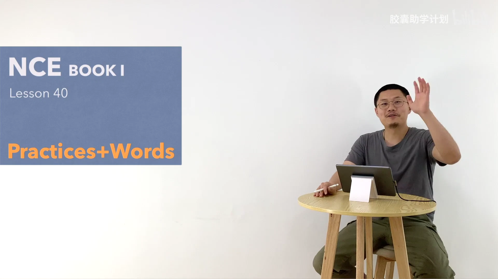

文字识别：胶囊助学计划 / NCE / BOOKI / Lesson 40 / Practices+Words

### 画面 00:00:02

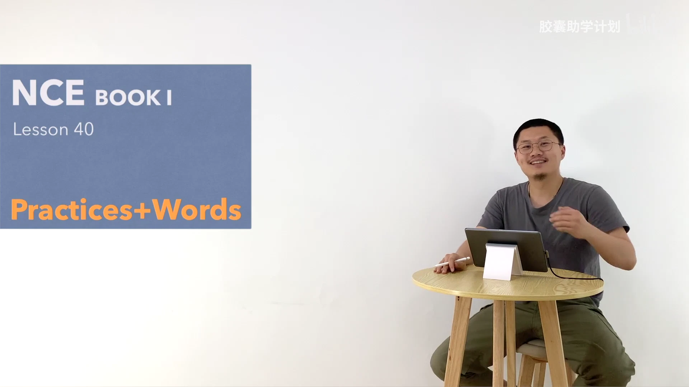

文字识别：胶囊助学计划 / NCE / BOOKI / Lesson 40 / Practices+Words

### 画面 00:00:05

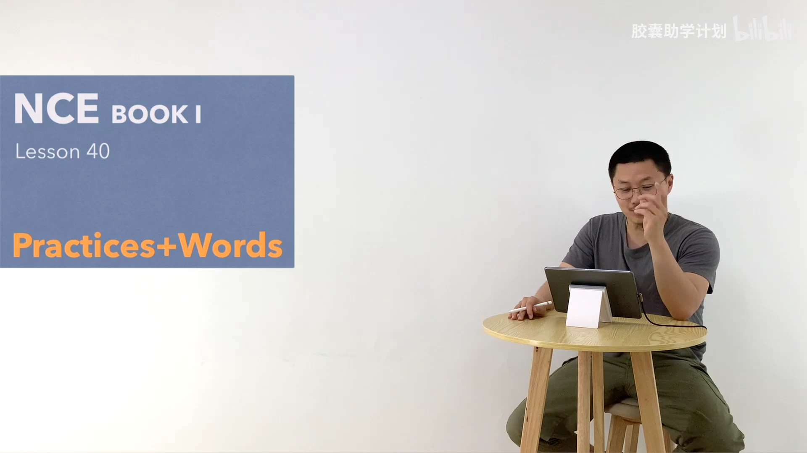

文字识别：胶囊助学计划 / NCE / BOOKI / Lesson 40 / Practices+Words

### 画面 00:00:08

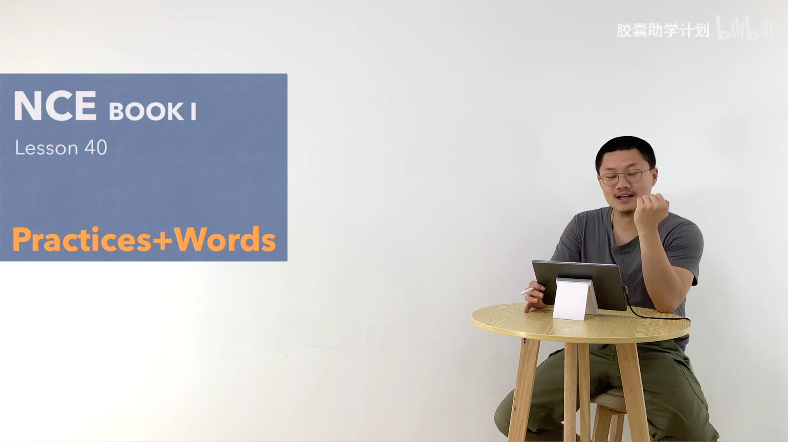

文字识别：胶囊助学计划 / NCE / BOOKI / Lesson 40 / Practices+Words

### 画面 00:00:10

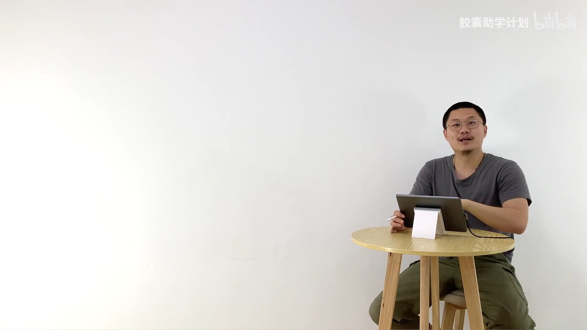

文字识别：胶囊助学计划

### 画面 00:00:12

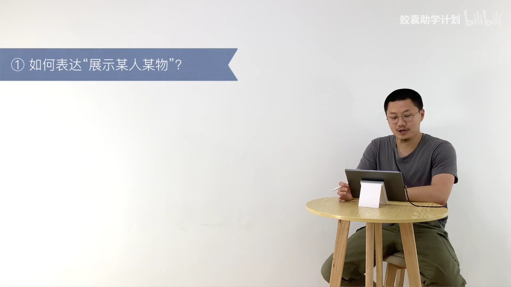

文字识别：胶囊助学计划 / ①如何表达“展示某人某物”？

### 画面 00:00:16

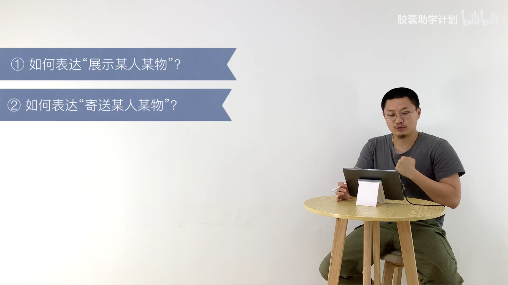

文字识别：胶囊助学计划 / ①如何表达“展示某人某物”？ / 如何表达“寄送某人某物”?

### 画面 00:00:18

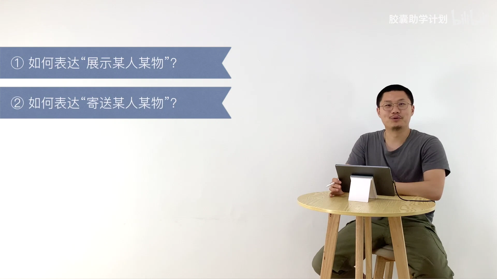

文字识别：胶囊助学计划 / ①如何表达“展示某人某物”？ / 如何表达“寄送某人某物”?

### 画面 00:00:20

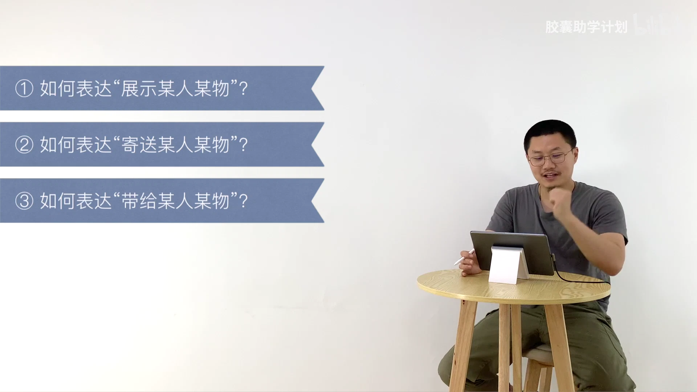

文字识别：胶囊助学计划 / ①如何表达“展示某人某物”？ / 如何表达“寄送某人某物”? / 如何表达“带给某人某物”?

### 画面 00:00:25

文字识别：胶囊助学计划 bilb出 / •

### 画面 00:00:29

## 00:00:30–00:01:00

好，那我们先看第一个单词，跟我先一起读一下。Show，双元音 o 和一个辅音 sh 拼起来，show 叫做展示给某人看。比如说，我们可以说叫做 show me your passport，把你的护照给我看一下。比如说在机场的时候，可能就会听到这样的一个句型，叫做 show me your passport。注意啊，你把 show 换成 give，这个句型是不是就特别熟悉了？叫 give

### 画面 00:00:31

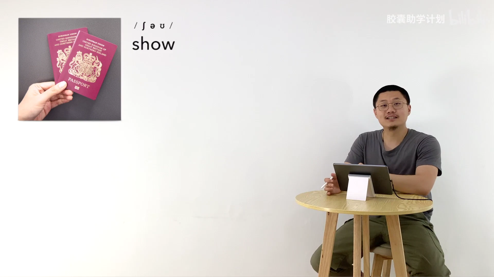

文字识别：胶囊助学计划 / BURORRAN UNION / show / UNTTED KINGDOM / AND NORTIERN / fop / PASSPORT

### 画面 00:00:33

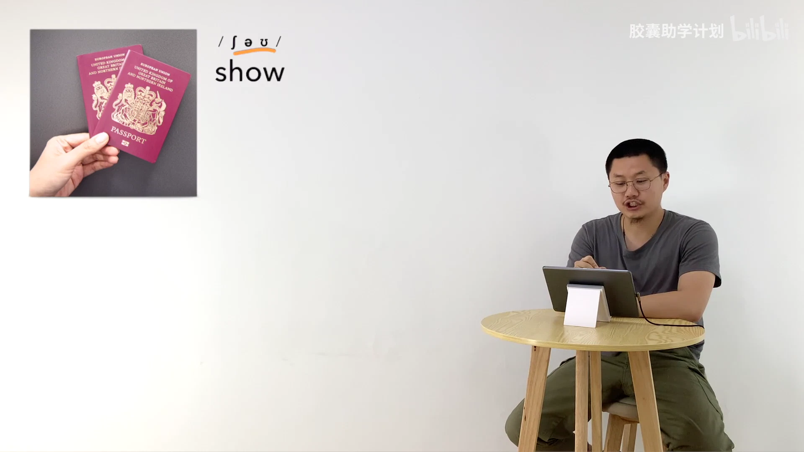

文字识别：胶囊助学计划 / /∫au/ / show / UNITED KINGDOM / CREAT BRITA / AND NORTHERN / fop / PASSPORT / 2A

### 画面 00:00:40

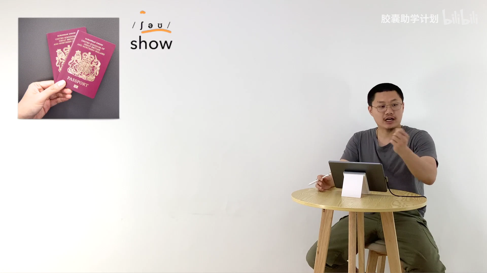

文字识别：胶囊助学计划 / /∫au/ / RUROYIAN UMON / show / UNITED KINODOM / GREAT BRITAY / AND NORTHERN / fop / PASSPORT

### 画面 00:00:48

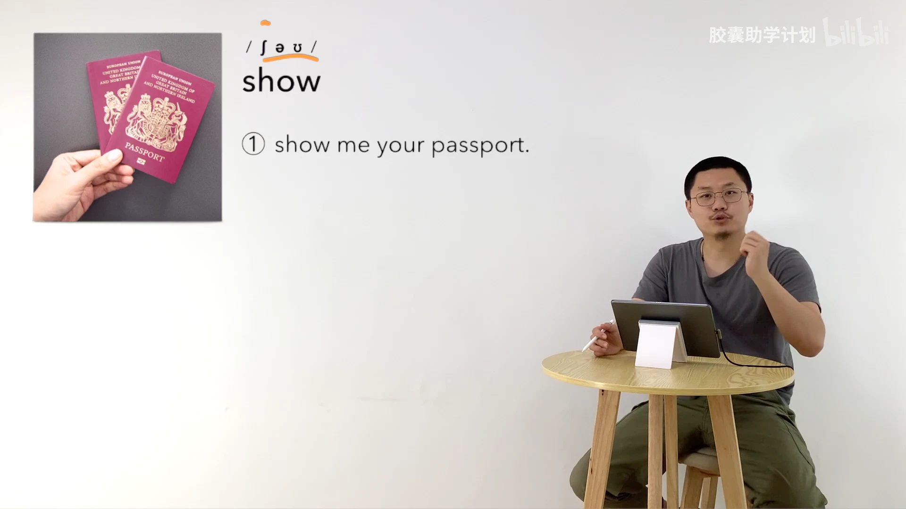

文字识别：胶囊助学计划 / /∫au/ / BUROPBAN UNION / show / UNITED KNGDOM / AND NORTHERN / fop / ① show me your passport. / PASSPORT

### 画面 00:00:54

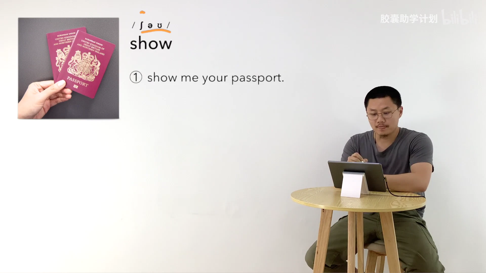

文字识别：胶囊助学计划 / /∫au/ / show / UNTTED KNGDOM / AND NORTHERN / fop / ① show me your passport. / PASSPORT

### 画面 00:00:56

文字识别：胶囊助学计划 / /sau/ / show / UNITED KNGDOM / AND NORTHERN / fop / show me your passport. / PASSPORT

### 画面 00:00:58

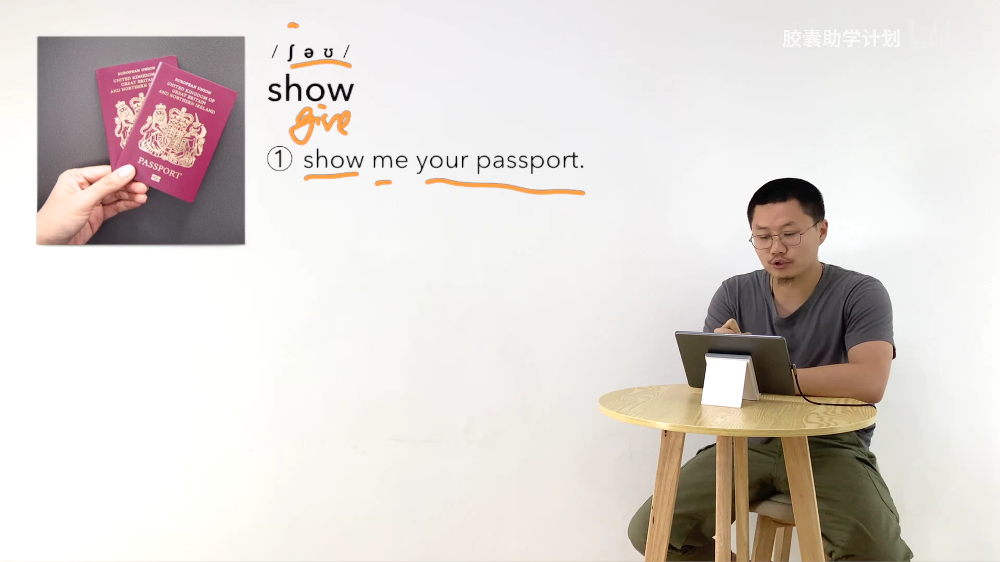

文字识别：胶囊助学计划 / /∫au/ / BUROPIAN UNION / show / UNTTED KNGDOM / GREAT BRITAV / AND NORTHERN / IKELAND / fop / give / show me your passport. / PASSPORT

## 00:01:00–00:01:30

something。那现在变变成了把 give 换成 show 了嘛，叫做 show somebody something，展示给某人某物。比如说，我们可以说叫做 show me your ticket，给我看一下，给我展示一下你的票，门票，对吧？ Show me your ticket。于是我们再把它这地方抽象总结一下，叫做 show somebody something，叫做展示给某人某物，或者是 show something to somebody。各位能看到它跟 give 几

### 画面 00:01:01

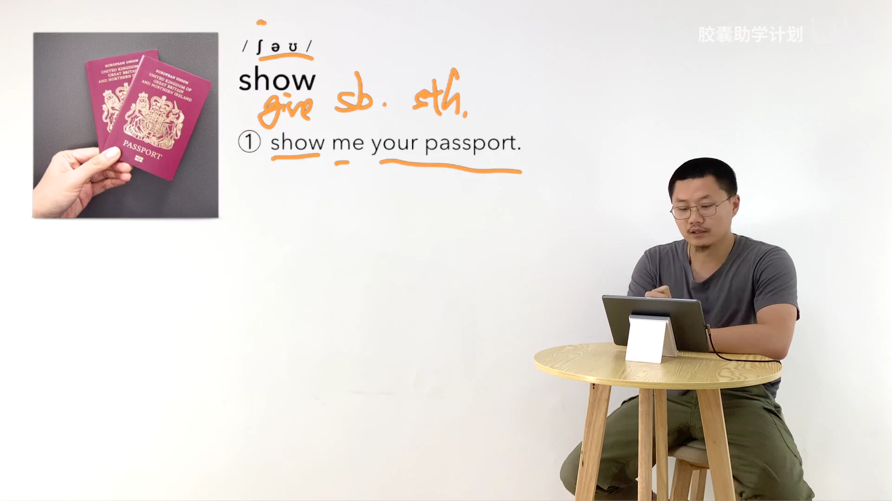

文字识别：/sau/ / BUROPRAN UNION / show / sb. sth. / UNTTED KDNODOM / AND NORTHERN / fop / five / show me your passport. / PASSPORT

### 画面 00:01:03

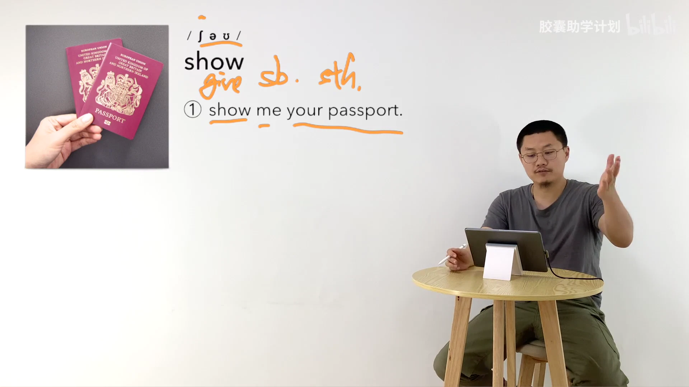

文字识别：胶囊助学计划 / /sau/ / BUROPRAN UNION / show / sb. sth. / UNTTED KDNODOM / AND NORTHERN / fop / five / show me your passport. / PASSPORT

### 画面 00:01:10

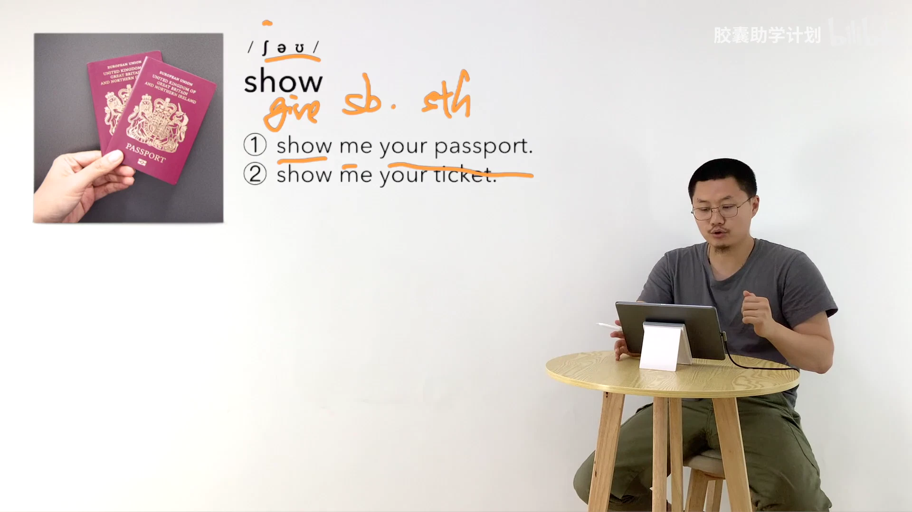

文字识别：胶囊助学计划 / /∫au/ / BUROPSAN UNION / show / sb.sth / UNTTED KNODOM / AND NORTHERN / 宝ELAND / fop / show me your passport. / PASSPORT / show / me / your ticke

### 画面 00:01:12

文字识别：胶囊助学计划 / /∫au/ / BUROPIANUNION / show / UNTTED KNODOM / AND NORTHERN / IRELAND / fop / give / show me your passport. / PASSPORT / show me your ticket.

### 画面 00:01:14

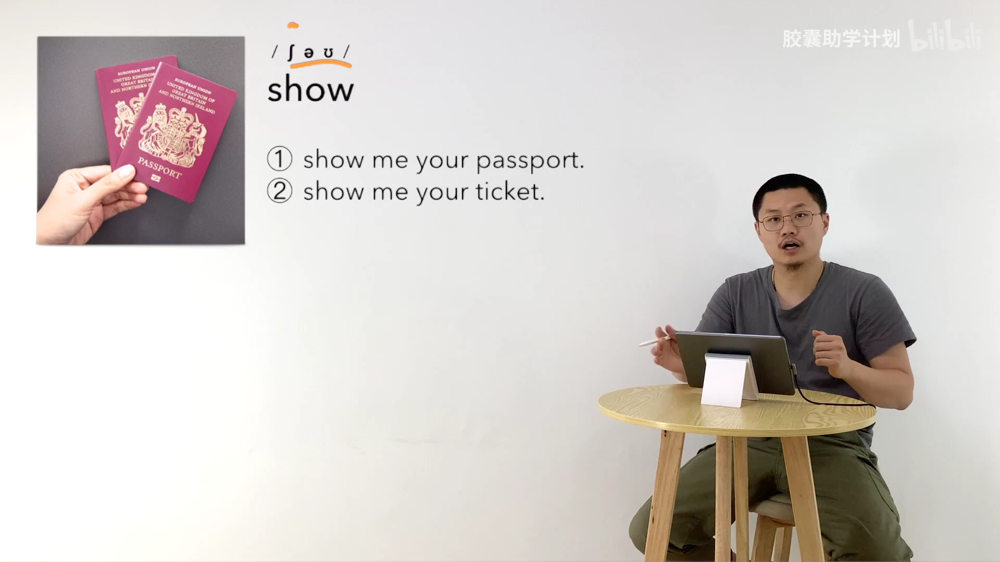

文字识别：胶囊助学计划 / /∫au/ / BUROPEAN UNION / show / UNTED KINODOM / AND NORTHERN / RELAND / fop / ① / show me your passport. / PASSPORT / A / show me your ticket. / 2

### 画面 00:01:19

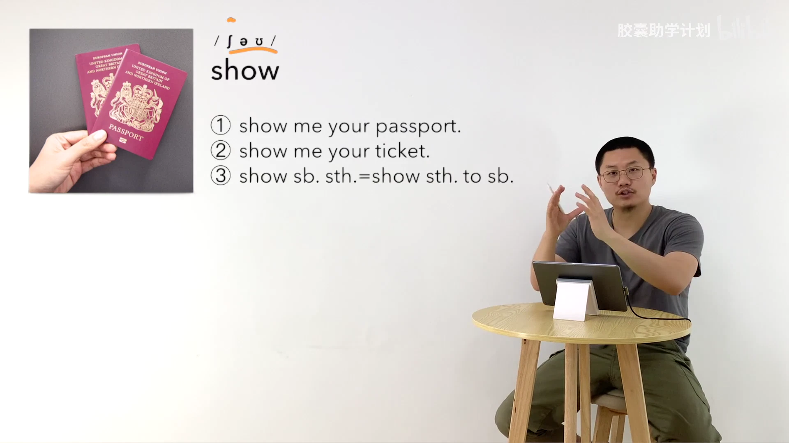

文字识别：胶囊助学计划 / /∫au/ / show / UNTED KINODOM / GREAT BRITAY / AND NORTHERN / IRELAND / fop / PASSPORT / 1 / show me your passport. / 2 / show me your ticket. / show sb.sth.=show sth.to sb.

### 画面 00:01:21

文字识别：胶囊助学计划 / /∫au/ / BUROPIAN UNIO / show / UNITED KINGDON / AND NORTHERN / ANDN / IRELAND / fop / PASSPORT / 1 / show me your passport. / 2 / show me your ticket. / show sb.sth.=show sth.to sb.

### 画面 00:01:23

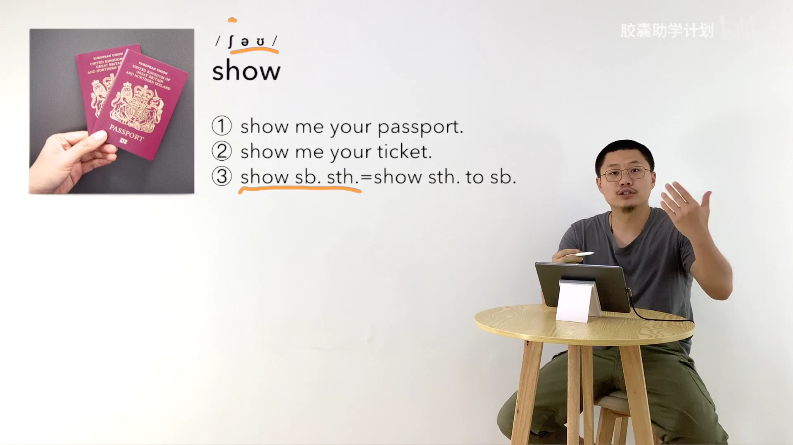

文字识别：胶囊助学计划 / /∫au/ / BUROPRAN UNIOR / show / UNITED KINODOM / AND NORTHERN / IRELAND / fop / show me your passport. / PASSPORT / 1 / show me your ticket. / show sb.sth.=show sth.to sb.

### 画面 00:01:26

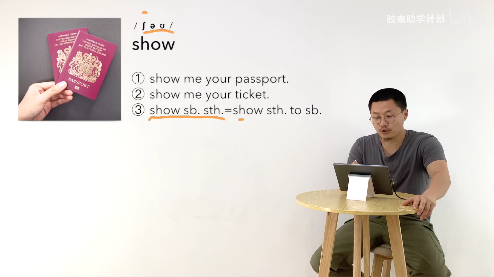

文字识别：胶囊助学计划 / /lau/ / BUROPRAN UNSON / show / UNITED KINGDOM / AND NORTHERN / ANDN / IRELAND / op / show me your passport. / PASSPORT / show me your ticket. / show sb.sth.=show sth.to sb.

### 画面 00:01:28

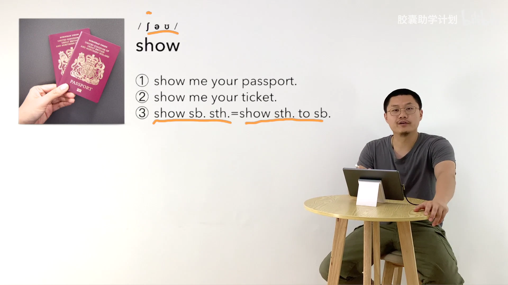

文字识别：胶囊助学计划 / /∫au/ / show / UNITED KINGDOM / AND NORTHERN / ANDN / fop / show me your passport. / PASSPORT / 1 / show me your ticket. / show sb.sth.=show sth.to sb.

## 00:01:30–00:02:00

乎是一模一样的，对吧？含义相同，有两个不同的结构可以都表达这个含义。比如说，What are you going to do with your passport? 你怎么处理你的护照？你打算怎么处理你的护照？然后你说，I'm going to show it to Leo. 我打算把它给 Leo 看一下。 Show something to somebody, OK? 叫展示。接下来 send 指的是发送或者说寄送。

### 画面 00:01:37

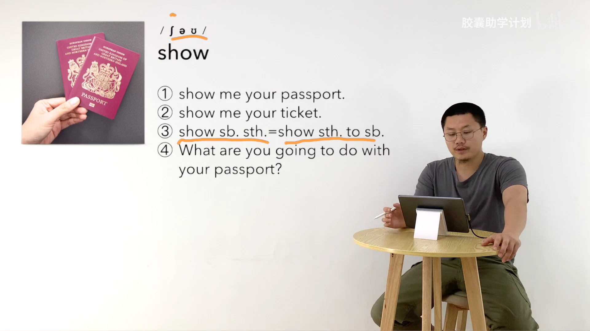

文字识别：胶囊助学计划 / /∫au/ / show / UNTTED XINODOM / AND NORTHERN / AND / IRELAND / fop / 1 / show me your passport. / PASSPORT / show me your ticket. / 2 / show sb.sth.=show sth.to sb. / What are you going to do with / your passport?

### 画面 00:01:47

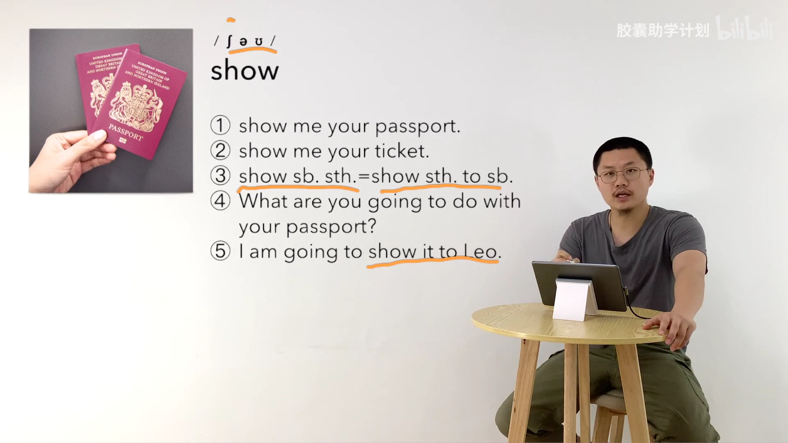

文字识别：胶囊助学计划 / /∫au/ / BUROPIAN UNIOR / show / UNTTED KINGDOM / AND NORTHERN / ERELAND / fom / 1 / show me your passport. / PASSPORT / show me your ticket. / 2 / show sb.sth.=show sth.to sb. / What are you going to do with / your passport? / ⑤ Iam going to show itto Leo.

### 画面 00:01:55

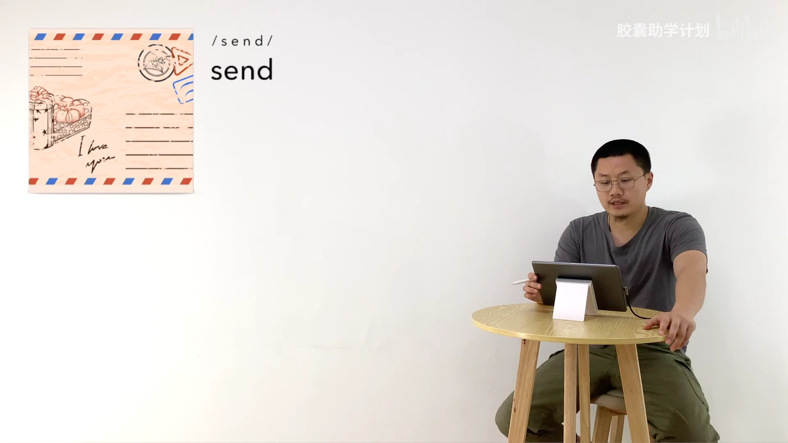

文字识别：胶囊助学计划 / /send/ / send / I hve / pp:e-

## 00:02:00–00:02:30

OK，那它的用法跟刚才是一样的，叫 send me a postcard。那 postcard 实际上是我们新二才会学的单词，但也并不难。post 表邮政，card 表卡片，邮政卡片、明信片，OK。那 send me a postcard 就给我寄了一张明信片，也可以说 send me a letter，给我邮寄了一张信啊，OK。那它的用法跟刚才一样，send somebody something 或 send something to

### 画面 00:02:07

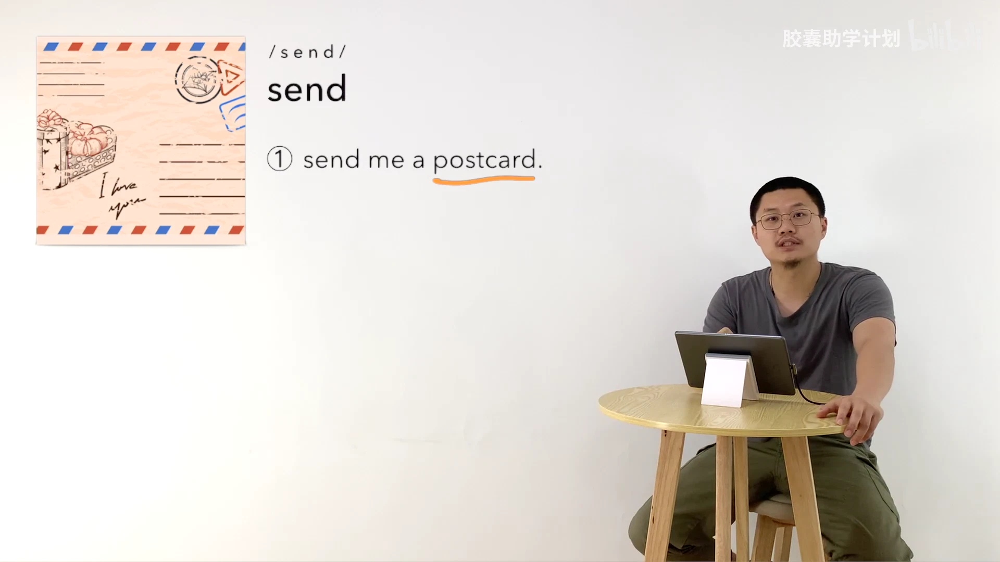

文字识别：胶囊助学计划 / /send/ / send / ① send me a postcard. / Ihve / pp-

## 00:02:30–00:03:00

somebody, give某人邮寄了某物或者发送了某物。那我们继续造句，说跟我读。What are you going to do with the postcard? I'm going to send it to Lyle. 注意这儿有一个小的连读，不是读成 send it，读的是 send it, send it, send it to Lyle, send it to Lyle. Okay, 我打算把它邮寄给 Lyle. Continue, take

### 画面 00:02:30

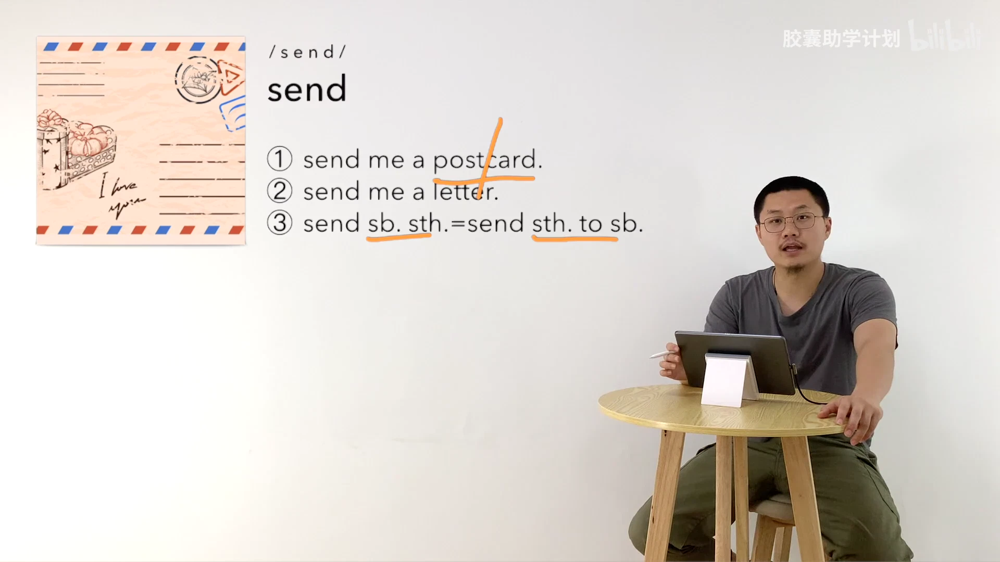

文字识别：胶囊助学计划 / /send/ / send / ① send me a postcard. / I hve / send me a letter. / send sb.sth.=send sth.to sb. / 3

### 画面 00:02:41

文字识别：胶囊助学计划 / /send/ / send / ① send me a postcard. / I hive / ② / send me a letter. / send sb.sth.=send sth.to sb. / 3 / What are you going to do with / the postcard? / ⑤ Iam going to send it to Leo.

### 画面 00:02:46

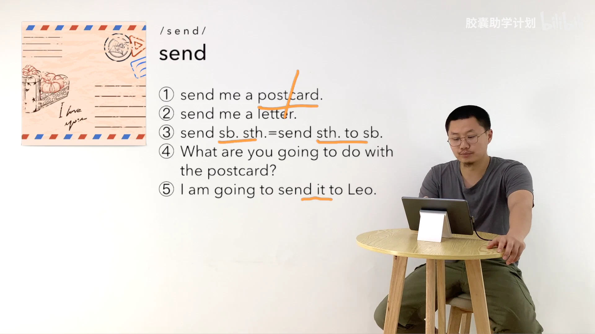

文字识别：胶囊助学计划 / /send/ / send / ① send me a postcard. / I hve / ② / send me a lettdr. / ppe / 3 / send sb. sth.=send sth.to sb. / What are you going to do with / the postcard? / ⑤ Iam going to send itto Leo.

### 画面 00:02:58

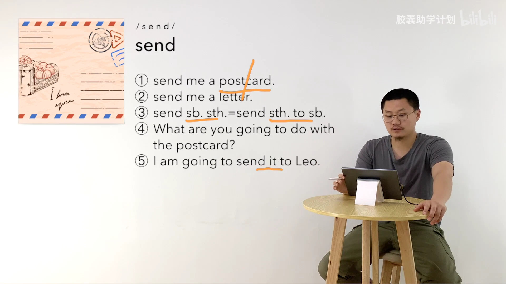

文字识别：胶囊助学计划 / /send/ / send / ① send me a postcard. / I hive / ② / send me a letter. / 3 / send sb. sth.=send sth.to sb. / What are you going to do with / the postcard? / ⑤ Iam going to send itto Leo.

## 00:03:00–00:03:30

叫做拿携带啊，OK，那take me some clothes叫做给我拿一些衣服。It's cold outside，外边很冷。OK，那你也可以说叫take me some coffee please。比如说您在办公室让别人帮您拿点咖啡，您说take me some coffee please啊，帮我拿一点咖啡。各位啊，在用这些句子的时候会显得不是那么的礼貌，所以呢，我们要学四十三课。Can you take

### 画面 00:03:00

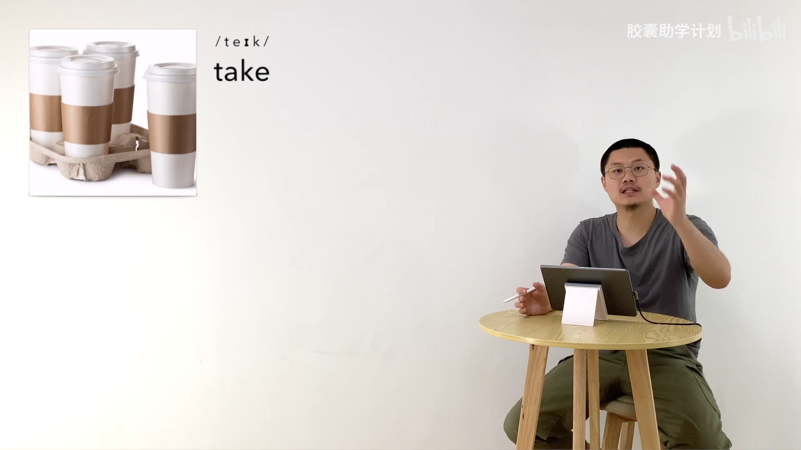

文字识别：胶囊助学计划 / /teik/ / take

### 画面 00:03:04

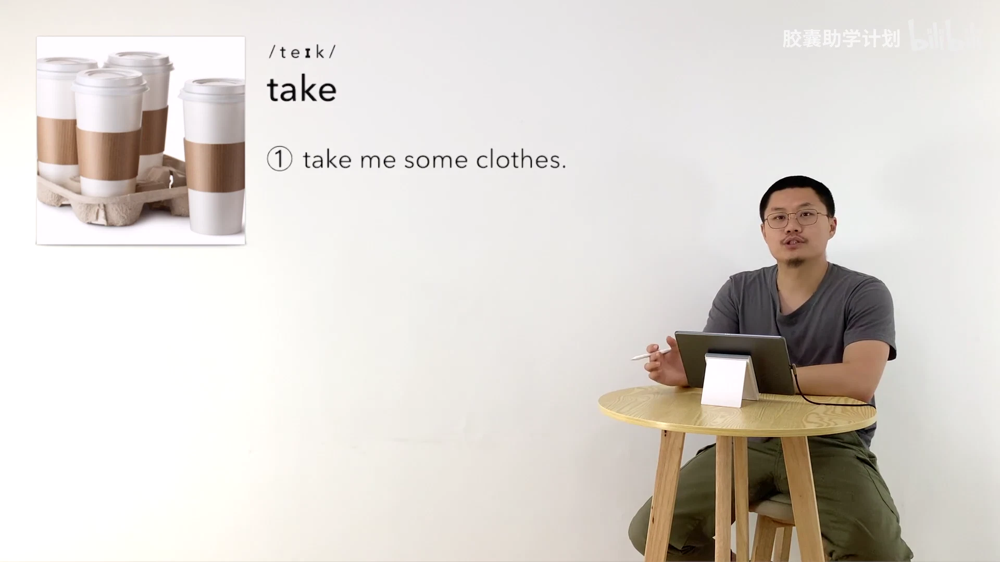

文字识别：胶囊助学计划 / /teik/ / take / ① take me some clothes.

### 画面 00:03:07

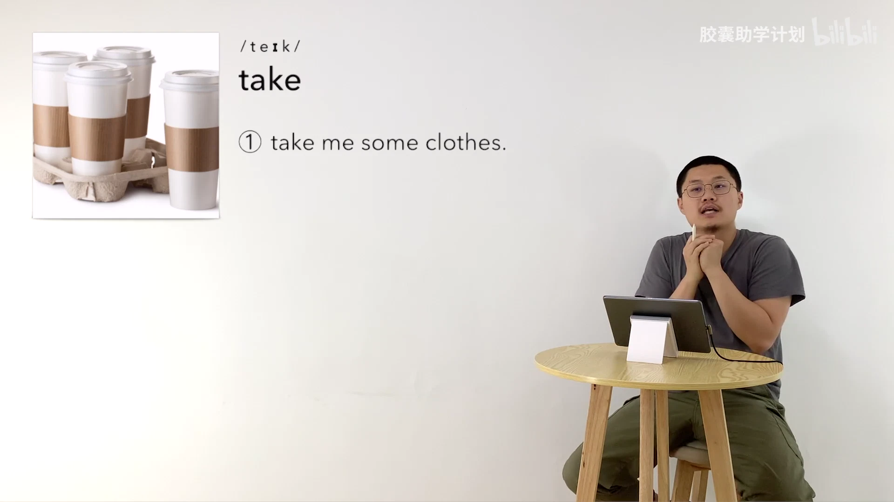

文字识别：胶囊助学计划 / /teik/ / take / ① take me some clothes.

### 画面 00:03:16

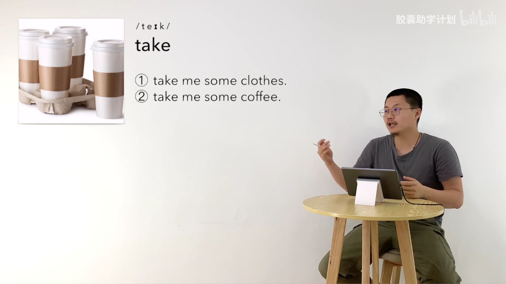

文字识别：胶囊助学计划 / /teik/ / take / ① take me some clothes. / ② take me some coffee.

### 画面 00:03:21

文字识别：胶囊助学计划 / /teik/ / take / ① take me some clothes. /  take me some coffee. / 2

### 画面 00:03:23

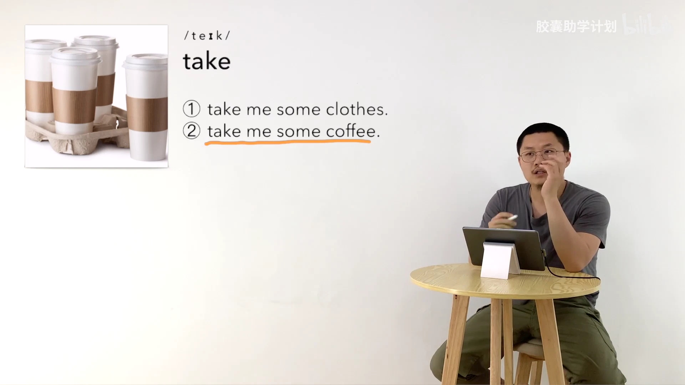

文字识别：胶囊助学计划 / /teik/ / take / ① take me some clothes. / take me some coffee.

## 00:03:30–00:04:00

me some coffee, 对吧？所以呢，我们现在可以加上 please. Can you take me some coffee, please? Okay, there you go. 接下来一样，同理，take somebody something 等于 take something to somebody，啊，完全一一码事儿。那继续说，What are you going to do with the coffee? 啊，这杯咖啡你打算怎么处理啊？说 I'm going to take it to Lyle. Be going to do 结合了 take something to somebody，我打算要把它

### 画面 00:03:39

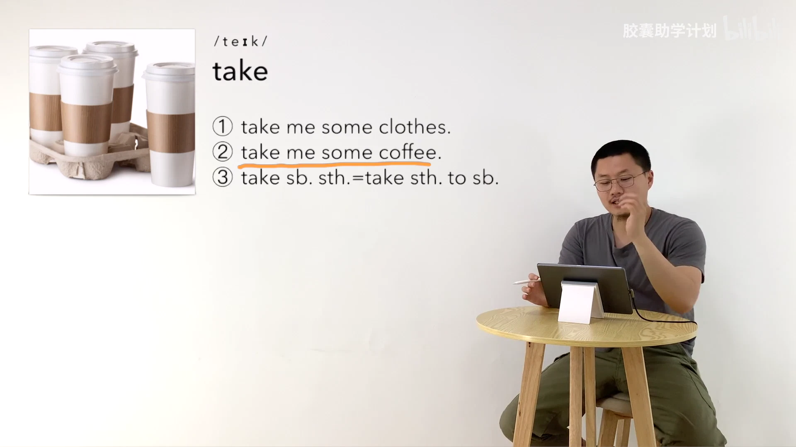

文字识别：胶囊助学计划 / /teik/ / take / ① take me some clothes. / take me some coffee. / take sb.sth.=take sth.to sb.

### 画面 00:03:45

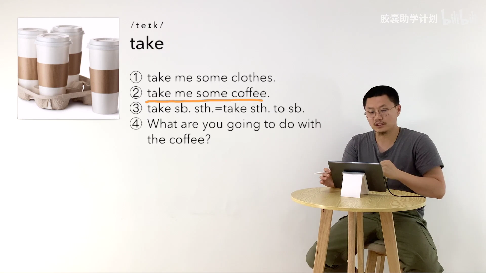

文字识别：胶囊助学计划 / /teik/ / take / ① take me some clothes. / take me some coffee. / take sb.sth.=take sth.to sb. / What are you going to do with / the coffee?

### 画面 00:03:48

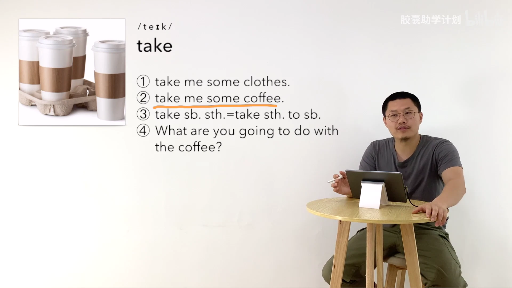

文字识别：胶囊助学计划 / /teik/ / take / ① take me some clothes. / take me some coffee. / take sb.sth.=take sth.to sb. / What are you going to do with / the coffee?

### 画面 00:03:55

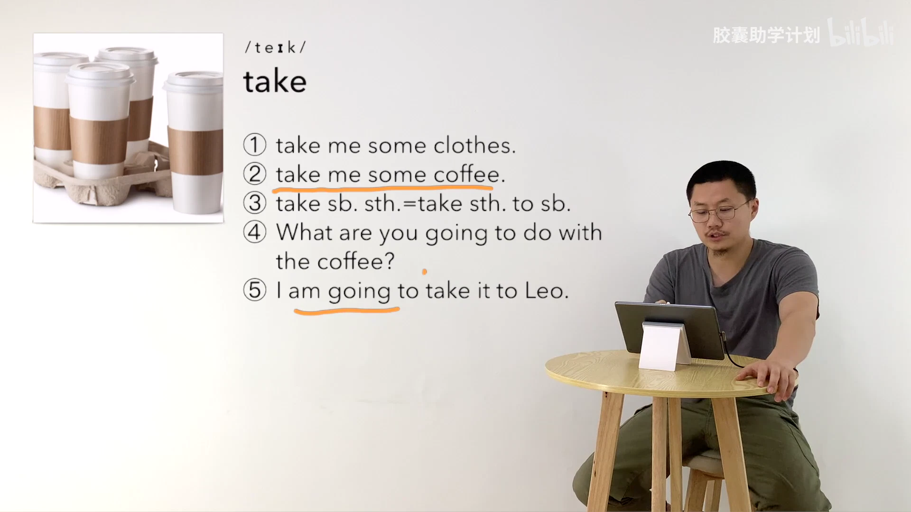

文字识别：胶囊助学计划 / /teik/ / take / ① take me some clothes. / take me some coffee. / take sb.sth.=take sth.to sb. / What are you going to do with / the coffee? / ⑤ I am going to take it to Leo.

### 画面 00:03:58

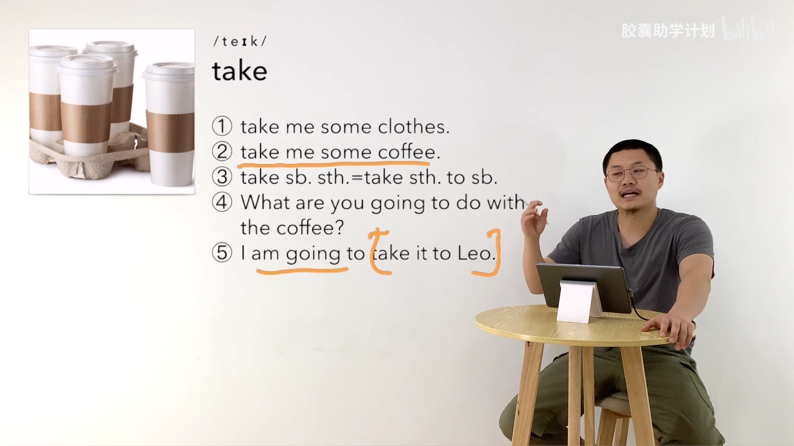

文字识别：胶囊助学计划 / /teik/ / take / ① take me some clothes. / take me some coffee. / 2 / take sb.sth.=take sth.to sb. / What are you going to do with / the coffee? / ⑤Iam going to / take it to Leo.

## 00:04:00–00:04:30

带给 Lil，拿给 Lil。 Okay，接下来我们做一些小的练习。练习当中又有一个很小的语法点，我们接着往下看啊。首先， put on 叫穿戴的意思，对吧？比如说戴上帽子，那我们就说 Are you going to put on your hat? Be going to do，你打算要戴帽子吗？注意，这是 put on your hat。早在二十九课，我们就学过这个短语叫 put on your

### 画面 00:04:03

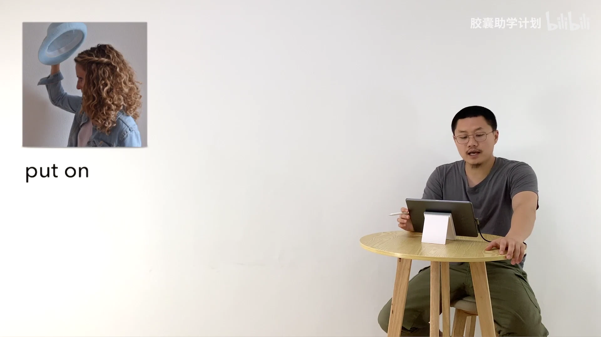

文字识别：胶囊助学计划 / put on

### 画面 00:04:07

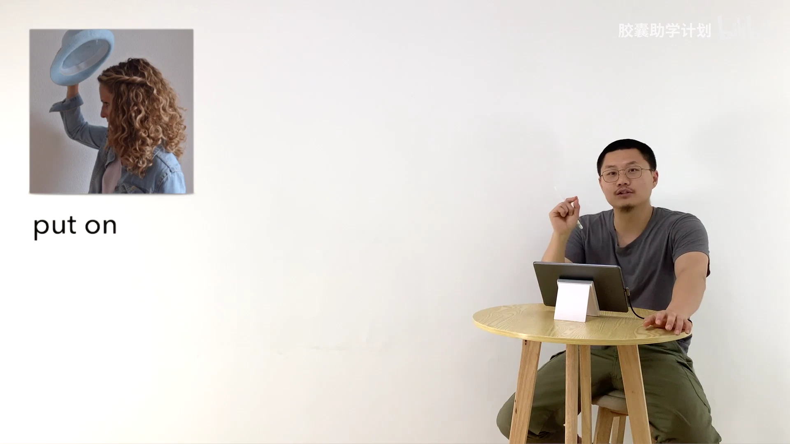

文字识别：胶囊助学计划 / put on

### 画面 00:04:21

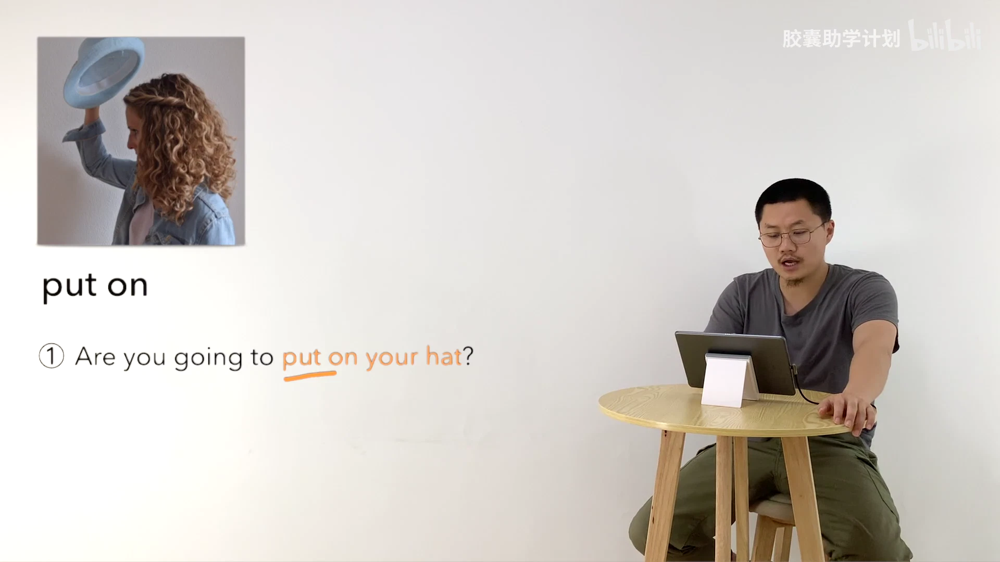

文字识别：胶囊助学计划 / put on / ① Are you going to put on your hat?

### 画面 00:04:26

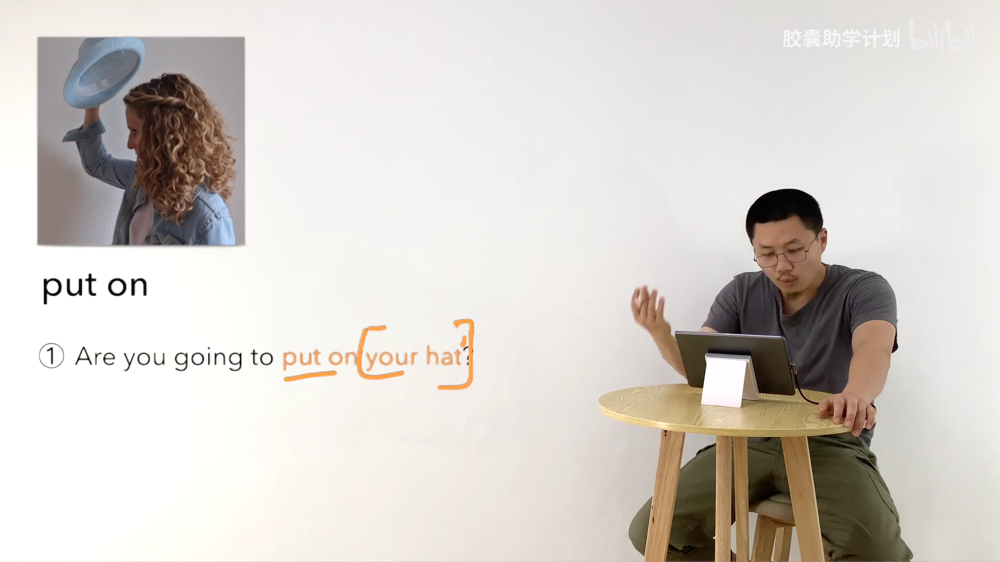

文字识别：胶囊助学计划 / put on

## 00:04:30–00:05:00

hat啊，二十九和三十课。今天我们可以把它做一个小的变体。Yes, I'm going to put it on.有一个小的连读 put it on. Okay, 注意它变成了什么？Put on your hat是一个名词。你当把它变成 it 这样的代词的时候，可以把它放中间去，叫做 put it on, put it on 和 put on your hat 是一个意思。Continue, say Are you going to take

### 画面 00:04:34

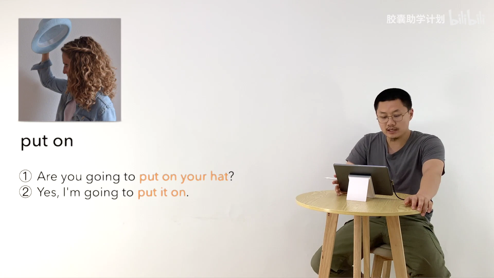

文字识别：胶囊助学计划 / put on / Are you going to put on your hat? / 1 / Yes, I'm going / to / put it on.

### 画面 00:04:44

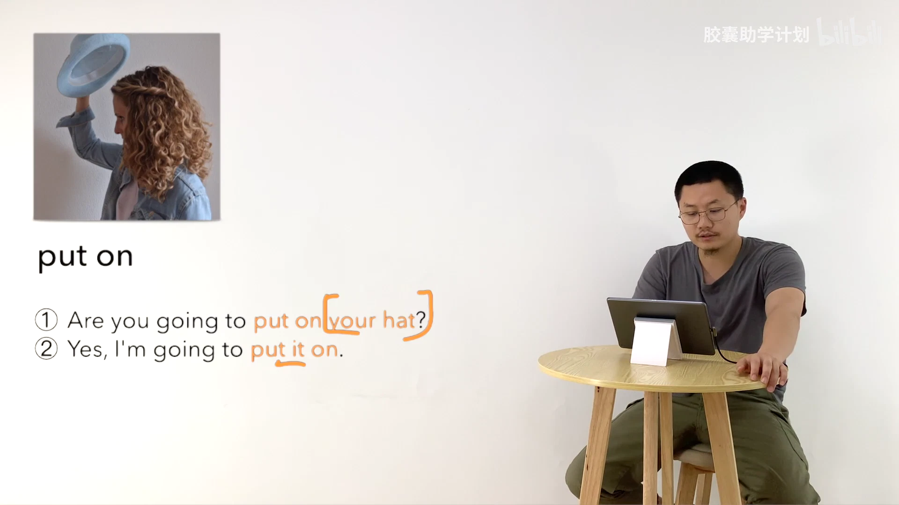

文字识别：胶囊助学计划 / put / on / t onVour hat? / 1 / Are / you / going / to / put / Yes,I'm / 2 / going / to / put it / on.

### 画面 00:04:50

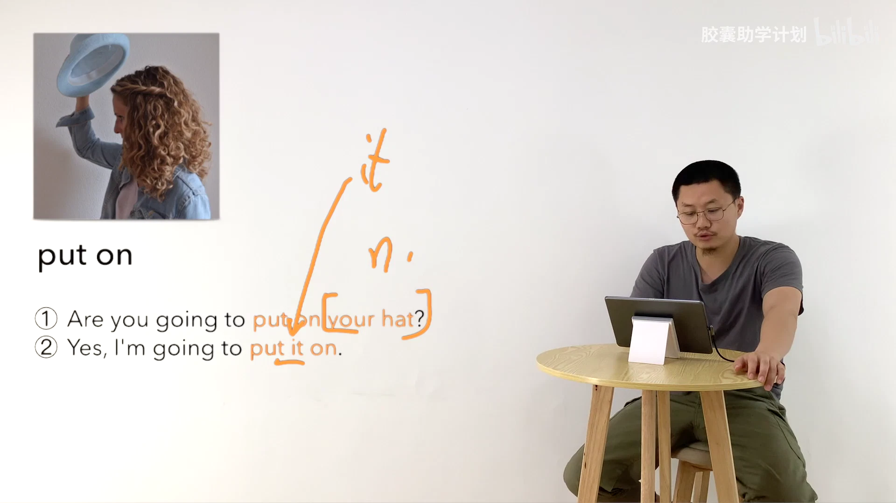

文字识别：胶囊助学计划 / put  / on / 0 / putbnLour hat? / 1 / Are / you / going / to / Yes, I'm / 2 / going / to / put it / on.

### 画面 00:04:55

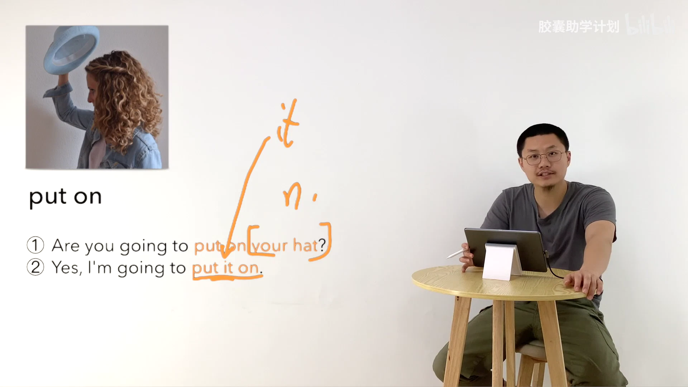

文字识别：胶囊助学计划 / t / put on / putbnLour hatr? / 1 / Are / you / going / to / Yes, I'm / going / to / put it on.

## 00:05:00–00:05:30

off your hat? 你打算要脱了吗？ No, I'm not going to take it off. 我不打算把它脱下来，对吧？不不打算把它摘下来。 Okay, take it off. 还是注意位置，本来是 your hat 变成 it 的时候可以放到中间去。 Take it off. 接下来我速度会稍微快一点，但思路是完全一样的。来了， Are you going to

### 画面 00:05:05

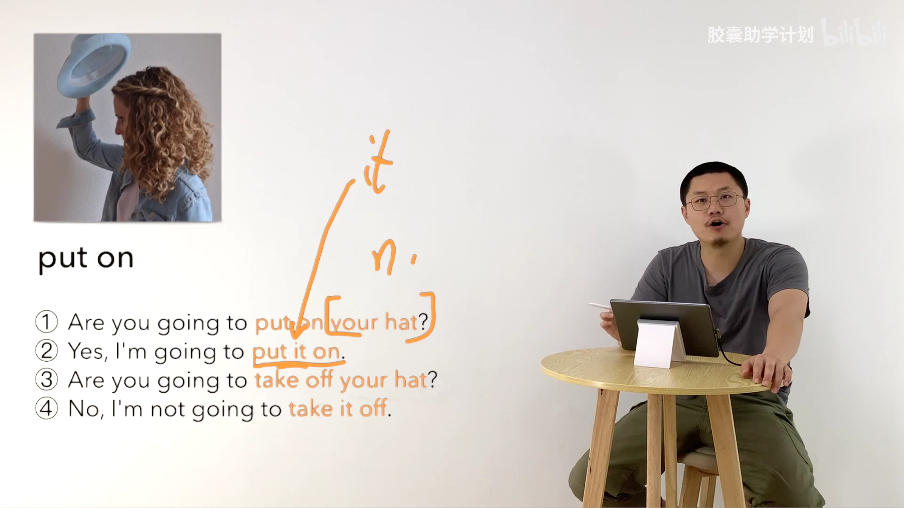

文字识别：胶囊助学计划 / put on / putbnLour hatr? / 1 / Are / you / going / to / 2 / Yes, / l'm / going / to / put it on. / 3 / Are / you / going / to / takeoff / your / hat? / No,l'm / not / going / to take it off.

### 画面 00:05:13

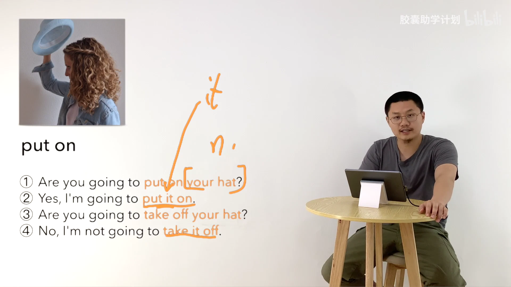

文字识别：胶囊助学计划 / put / on / purnVour hat? / 1 / Are / you / going / to / 2 / Yes, / lm / going / to / put it on. / 3 / Are / you / going / to / takeoff / your / hat? / No, / I'm / not / going / to / takeit off.

### 画面 00:05:16

文字识别：胶囊助学计划 / put / on / putnour / hat? / 1 / Are / you / going / to / 2 / Yes, / Im / going / to / put it / on. / hata / of / Wour / 3 / Are / you / going / to / take / No, / I'm / not / going / to / take it off.

### 画面 00:05:18

文字识别：胶囊助学计划 / put / on / putonkour / hat? / 1 / Are / you / going / to / 2 / Yes, / Im / going / to / put it on. / hata / Tour / Are / you / going / to / take / off / No, / l'm / not / going / to / takeit off.

### 画面 00:05:21

文字识别：胶囊助学计划 / put / on / putbnLour / That? / 1 / Are / you / going / to / t / 2 / Yes, / Im / going / to / put it on. / hata / Wour / off / Are / you / going / to / take / No, / l'm / not / going / to / take it off.

### 画面 00:05:23

文字识别：胶囊助学计划 / take off

## 00:05:30–00:06:00

take off your shoes? Yes, I'm going to take them off. 放中间了。继续 turn on 打开。 Are you going to turn on the light? 你要开灯吗？ Yes, I'm going to turn it on. Are you going to turn off the light? No, I'm not going to turn it off. Okay, 放中间了。 Continue.

### 画面 00:05:31

文字识别：胶囊助学计划 / take off / ① Are you going to take off your shoes?

### 画面 00:05:37

文字识别：胶囊助学计划 / turn on

### 画面 00:05:50

文字识别：胶囊助学计划 / turn on / 1 / Are you going to turn on the light? / 2 / Yes, I'm / going / tot / turn it on. / Are you going to turn of the light?

### 画面 00:05:59

文字识别：胶囊助学计划 / turn off

## 00:06:00–00:06:30

Are you going to turn off the stereo? 哎，音响对吧？车载音响。你打算把它关掉吗？Yes, I'm going to turn it off. 放中间了. It. Are you going to turn on the radio? Stereo. 张嘴跟我一起读啊。No, I'm not going to turn it on. Okay. Continue. Are you going to put on your suit? Yes, I'm going

### 画面 00:06:04

文字识别：胶囊助学计划 / turn off / ① Are you going to turn of the stereo?

### 画面 00:06:13

文字识别：胶囊助学计划 / turn off / ① Are you going to turn off the stereo? / Yes, I'm going to turn it off. / 2 / Are you going to turn on the stereo?

### 画面 00:06:24

文字识别：胶囊助学计划 / put on / ① Are you going to put on your suit?

## 00:06:30–00:07:00

to put it on. 继续跟着读。好，来一个。那我们复习一下。其实 show, send, take 跟 give 一样，对吧？ Give something to somebody. 这三个单词的用法跟 give 一样，只是含义不同。各位要记住就 OK 了。家庭作业，绿皮书四十课，各位可以去写了。给自己讲解一遍今天的核心知识点。实际上有

### 画面 00:06:33

文字识别：Recap / 胶囊助学计划 / Patterns / Grammar / show / Words / send / sth. to sb. / take / Expression

### 画面 00:06:35

文字识别：胶囊助学计划 / Recap / Patterns / Grammar / show / Words / send sth. to sb. / take / Expression

### 画面 00:06:39

文字识别：胶囊助学计划 / Recap / Patterns / Grammar / show / Words / send sth. to sb. / take / Expression

### 画面 00:06:42

文字识别：胶囊助学计划 / Recap / Patterns / gn / Grammar / show / Words / sends / sth.to sb. / take / Expression

### 画面 00:06:47

文字识别：胶囊助学计划 / Recap / Patterns / gw / Grammar / show / Words / sends / sth.to sb. / take / Expression

### 画面 00:06:53

文字识别：胶囊助学计划

### 画面 00:06:55

文字识别：胶囊助学计划 / 绿皮书第40课的写作练习

## 00:07:00–00:07:30

两个，一个是跟 give 一样的那三个小单词，另一个很小，就是 turn on the stereo 可以变成 turn it on 这样的一个小点啊。各位如果认真的跟着我刚才张嘴去做了那些练习，这个知识点您应该已经记起来了。好，如果大家喜欢我们的课程呢，欢迎大家关注、订阅、一键三连支持啊，并分享给身边需要的朋友。最后我们再来看一句名人名言：Friends show their love in times

### 画面 00:07:02

文字识别：胶囊助学计划 / 绿皮书第40课的写作练习 / 请给自己讲解一遍今天的 / 核心知识点

### 画面 00:07:11

文字识别：胶囊助学计划 / 绿皮书第40课的写作练习 / 请给自己讲解一遍今天的 / 核心知识点

### 画面 00:07:16

文字识别：胶囊助学计划

### 画面 00:07:26

文字识别：胶囊助学计划 / Friends show their love in times of trouble, / not in happiness. / Euripides

## 00:07:30–00:07:47

of trouble, not in happiness. See you next time.

### 画面 00:07:30

文字识别：胶囊助学计划 / Friends show their love in times of trouble, / not in happiness. / Euripides

### 画面 00:07:34

文字识别：胶囊助学计划 / Friends show their love in times of trouble, / not in happiness. / Euripides

### 画面 00:07:36

文字识别：CAPSULEACADEMY / 胶囊助学计划 / 小红书 / Lecturer / Leo / OE

### 画面 00:07:38

文字识别：CAPSULEACADEMY / 胶囊助学计划 / 小红书 / Photographer / Berlin / OE

### 画面 00:07:41

文字识别：CAPSULEACADEMY / 胶囊助学计划 / 『 / 小红书 / Editor / Berlin / OE

### 画面 00:07:43

文字识别：CAPSULEACADEMY / 胶囊助学计划 / 小红书 / Creator / Leo & Berlin / OE

### 画面 00:07:45

文字识别：bilibili / 胶囊助学计划

### 画面 00:07:46

文字识别：bilibili / 胶囊助学计划

