# 041 语法 单词 文章

快速机器解析：语音为单模型转写，未进行独立交叉校对或人工复核；画面每秒采样并按变化选帧，短时文字和标记可能遗漏。截图时间约有 1 秒误差。图片有损压缩；遇到疑点请按时间查看 Google Drive 原视频。

## 00:00:00–00:00:30

Hello everyone, welcome to Capsule Academy. This is Leo. Today we're going to learn new concept English book one lesson forty one grammar words and story.老习惯进入正式课程之前呢，我们先看一个问题，到底什么才是不可数名词？好，带着这个问题，Hope you guys enjoy it.那我们既然要讲什么是不可数名词，那我们先想一下它的肯定啊，可数名词

### 画面 00:00:00

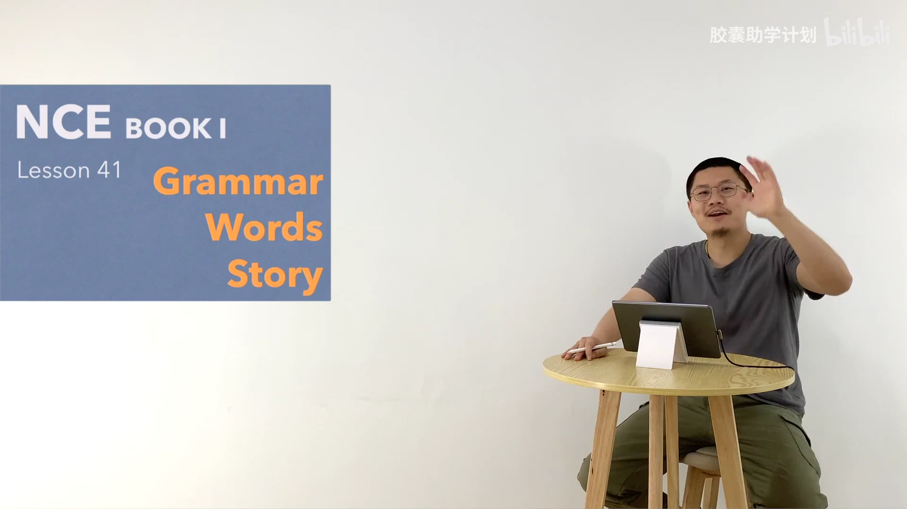

文字识别：胶囊助学计划 / NCE / BOOKI / Lesson 41 / Grammar / Words / Story

### 画面 00:00:02

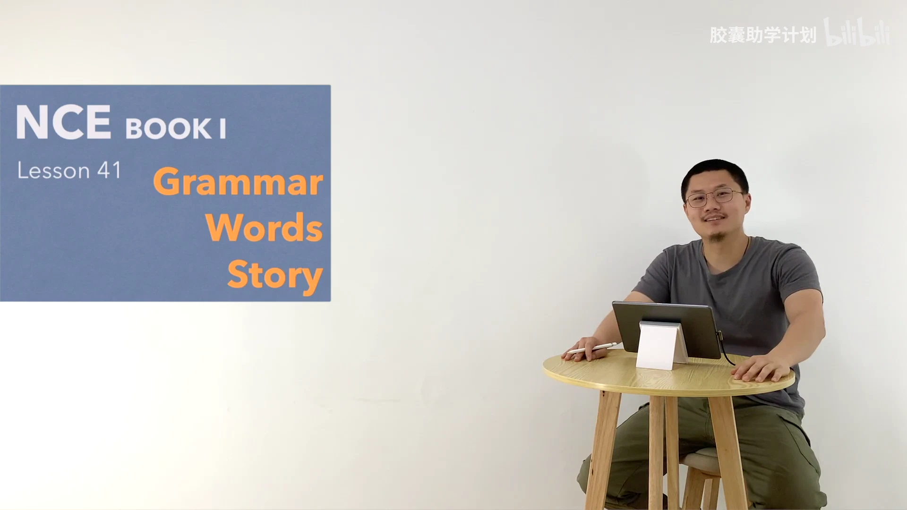

文字识别：胶囊助学计划 / NCE / BOOKI / Lesson 41 / Grammar / Words / Story

### 画面 00:00:11

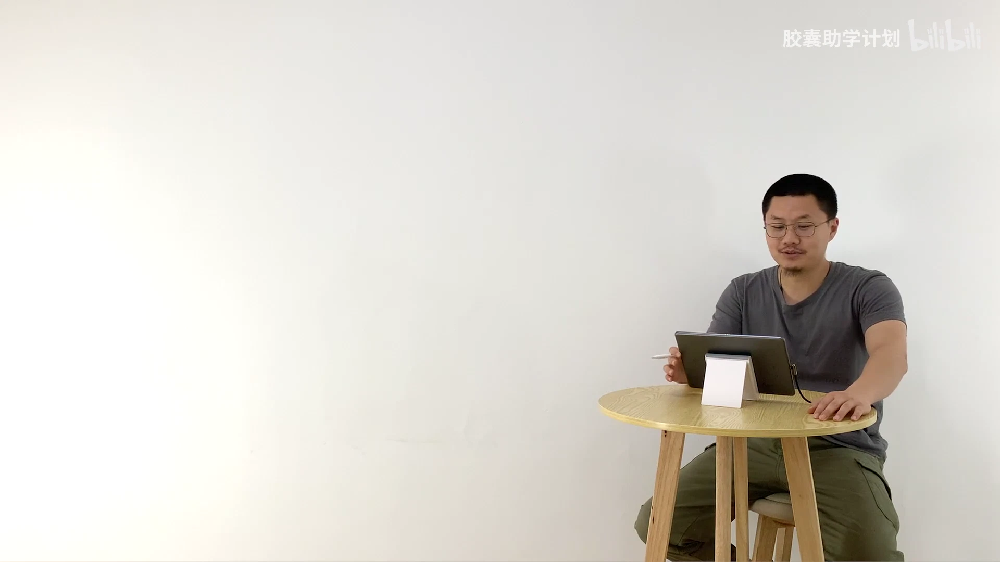

文字识别：胶囊助学计划

### 画面 00:00:13

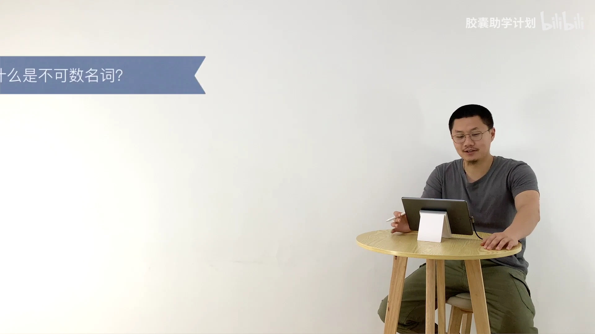

文字识别：胶囊助学计划 / 十么是不可数名词？

### 画面 00:00:15

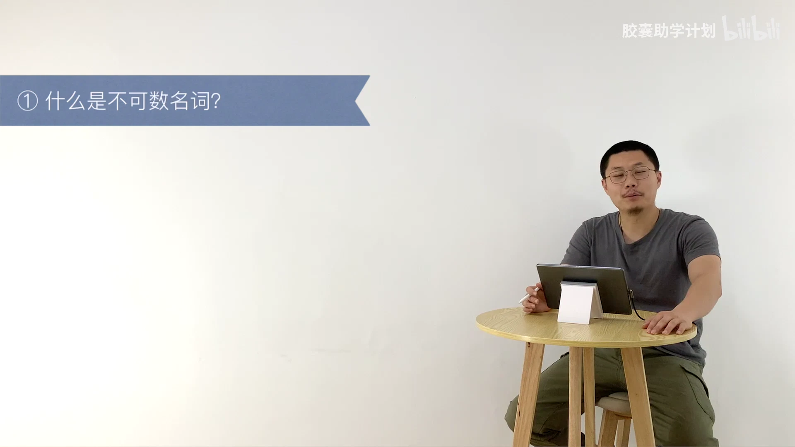

文字识别：胶囊助学计划 / ①什么是不可数名词？

### 画面 00:00:19

文字识别：胶囊助学计划bll / •

### 画面 00:00:23

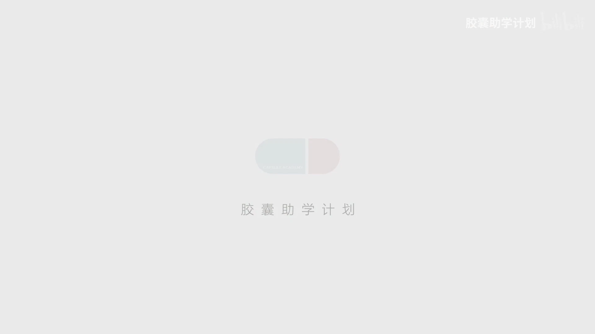

文字识别：胶囊助学计划

### 画面 00:00:25

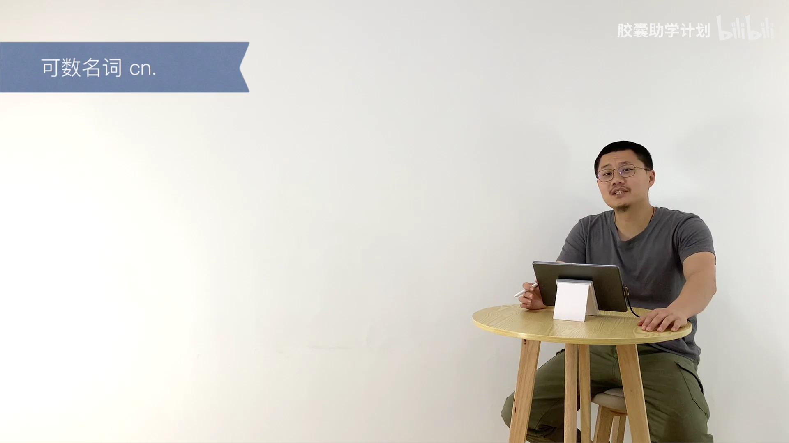

文字识别：胶囊助学计划 / 可数名词 cn.

## 00:00:30–00:01:00

是什么？首先，我们最熟悉的可数名词或者说名词，就是用n点儿来去做一个代表。那可数名词就是count，就是能数的名词啊。c o u n t count指的是数数的意思啊。c n点儿就是可数名词的一个缩写。可数名词其实我们之前已经学过了，只不过呢没有提到这个学术术语罢了。比如说，there is a pen on the table，a pen，可数名

### 画面 00:00:31

文字识别：胶囊助学计划 / 可数名词 cn.

### 画面 00:00:41

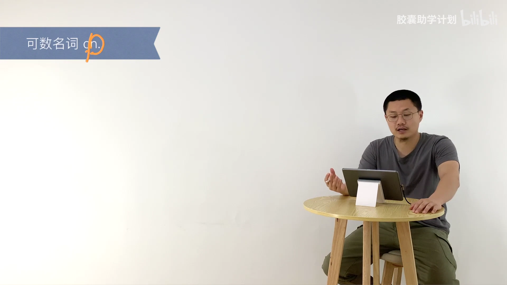

文字识别：胶囊助学计划 / 可数名词

### 画面 00:00:58

文字识别：胶囊助学计划 / 可数名词 / ① There is a pen on the table.

## 00:01:00–00:01:30

词，一支笔，对吧？可以数嘛？我能数出来一支，我也能数出来一堆，对吧？二三四五六，我就能往下一直去数。比如说，there are some pens on the table.所以这一课呀，实际上这个可数名词跟我们第十五课关系非常的大。第十五课我们学到了所谓叫名词复数，名词的单数和复数的概念是针对于可数名词而言的。一支笔，两

### 画面 00:01:13

文字识别：胶囊助学计划 / 可数名词 / There isa pen on the table. / There are some pens on the table.

### 画面 00:01:19

文字识别：L15 / 胶囊助学计划 / 可数名词 / There isa pen or the table. / There are some pens on the table.

### 画面 00:01:22

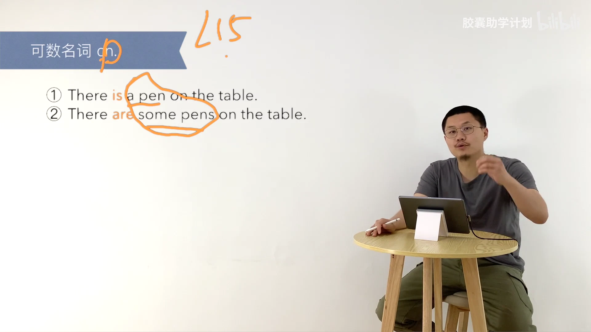

文字识别：215 / 胶囊助学计划 / 可数名词 / There isa pen or the table. / There are some pens on the table.

### 画面 00:01:25

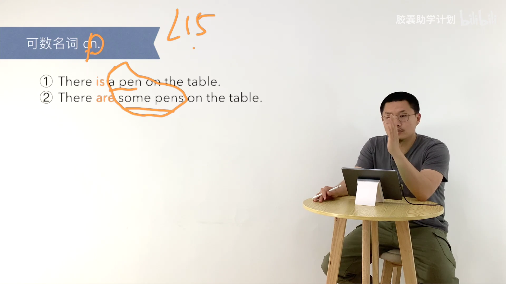

文字识别：L15 / 胶囊助学计划 / 可数名词 / There isa pen on the table. / There are some pens on the table.

### 画面 00:01:29

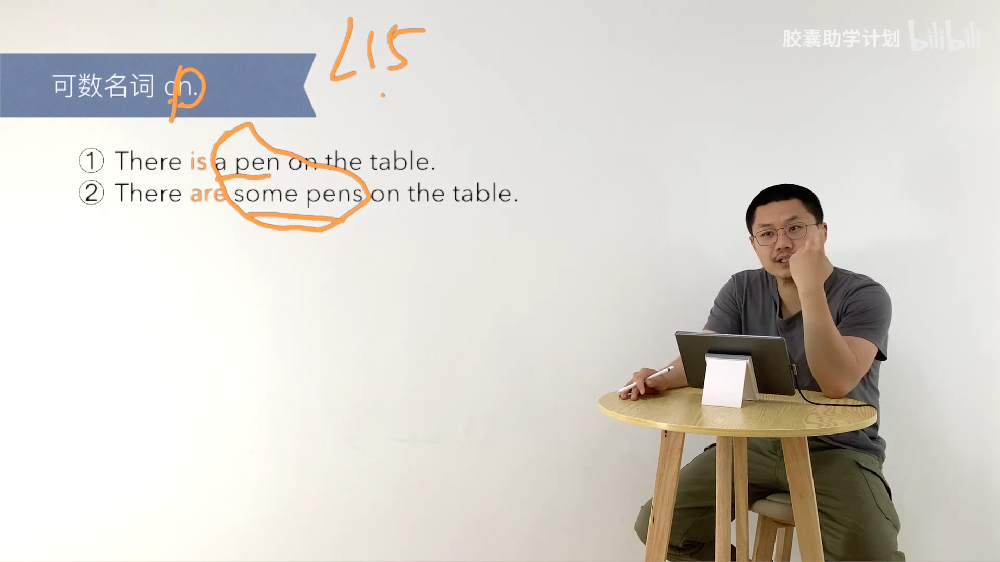

文字识别：L15 / 胶囊助学计划 / 可数名词 / There isa pen on the table. / There are some pens on the table.

## 00:01:30–00:02:00

支笔，two pen就不行了，叫two pens，后边要加一个s去表达一个复数，这就是我们之前学过的叫可数名词啊。那不可数名词呢，就是u n点儿啊，这个n点儿还是名词，u就是uncountable啊，countable uncountable就是没法数出来的，字面意思就是数不了，没法数，对吧？但它不完全是这个意思。比如说，我们先举一个例子啊，说there

### 画面 00:01:31

文字识别：215 / 胶囊助学计划 / 可数名词 / There isa pen or the table. / There are some pens on the table.

### 画面 00:01:35

文字识别：L15 / 胶囊助学计划 / 可数名词 / There isa pen on the table. / There are some pens on the table.

### 画面 00:01:39

文字识别：L15 / 胶囊助学计划 / 可数名词 / There isa pen on the table. / There are some pens on the table.

### 画面 00:01:42

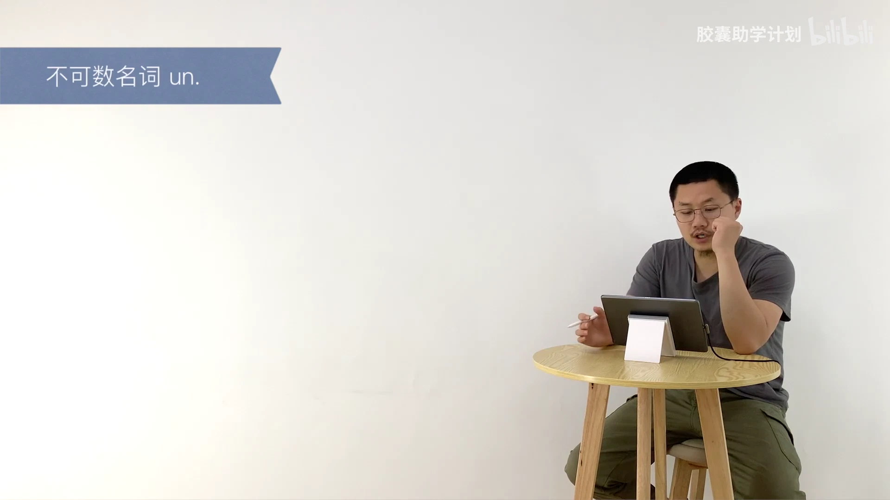

文字识别：胶囊助学计划 / 不可数名词 un.

### 画面 00:01:45

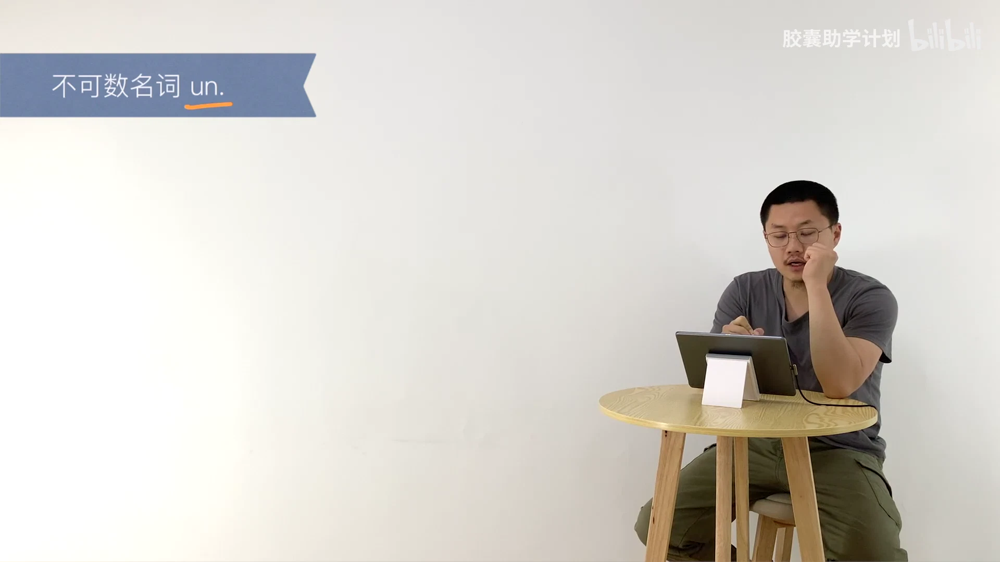

文字识别：胶囊助学计划 / 不可数名词 / J un.

### 画面 00:01:57

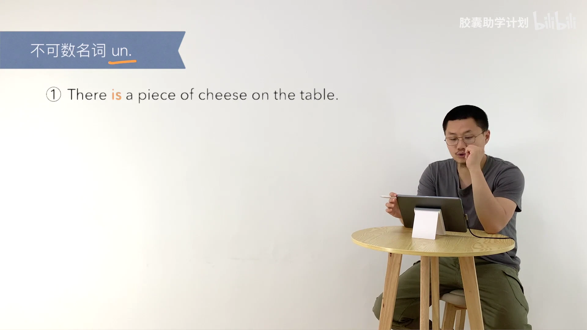

文字识别：胶囊助学计划 / 不可数名词 un. /  There is a piece of cheese on the table.

### 画面 00:01:59

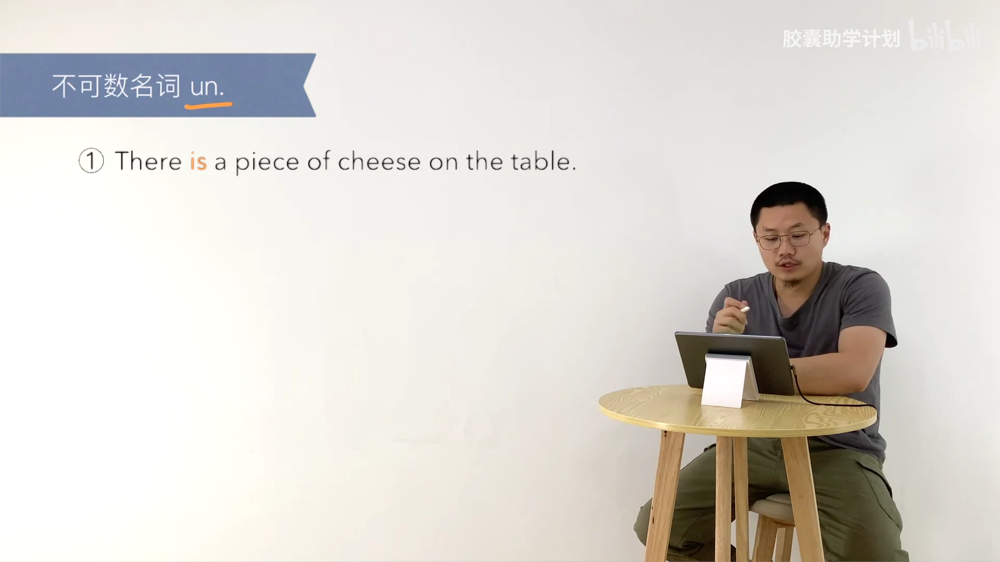

文字识别：胶囊助学计划 / 不可数名词 un. /  There is a piece of cheese on the table. / b

## 00:02:00–00:02:30

is a piece of cheese，这是本课的一个生词，叫做奶酪或者起司啊。A piece of 指的是 一片儿，说有一片儿奶酪在桌子上。在英文当中，这个奶酪，比如说我举个例子啊，你的汉语感受这是明明能数嘛，一片儿、两片儿、三片儿，怎么不能数呢？英文认为这个单词就是个不可数名词啊，他认为是一整块儿，你只不过切成了片儿，对吧？啊，那另一个点呢，就是说它如果是

### 画面 00:02:01

文字识别：胶囊助学计划 / 不可数名词 un. / ① There is a piece of cheese on the table.

### 画面 00:02:05

文字识别：胶囊助学计划 / 不可数名词 / ] un. / There is a piece ofcheese / on the table.

### 画面 00:02:11

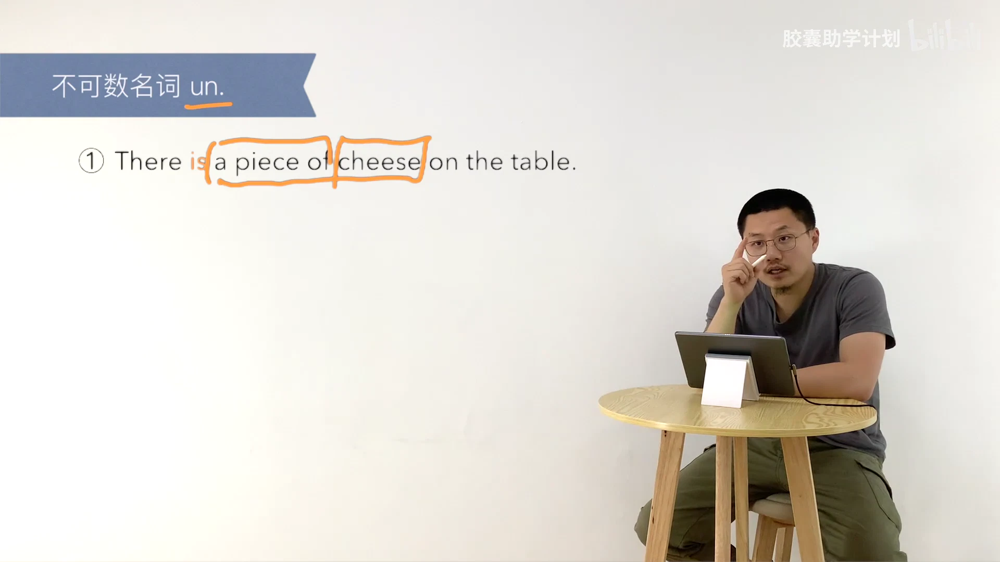

文字识别：胶囊助学计划 / 不可数名词 / un. / There is a piece of / cheese / on the table.

### 画面 00:02:16

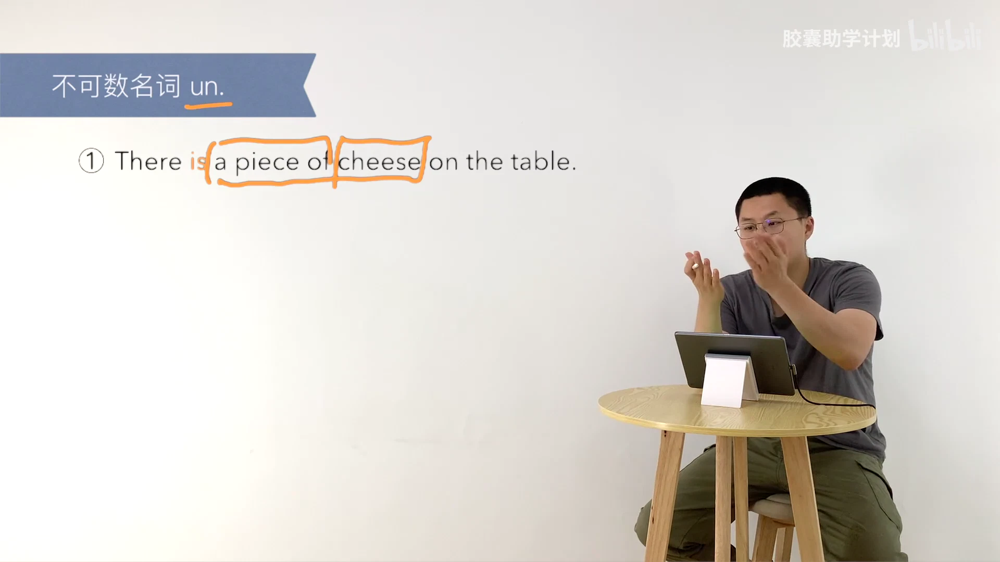

文字识别：胶囊助学计划 / 不可数名词 / un. / There is a piece of / cheese / on the table.

### 画面 00:02:19

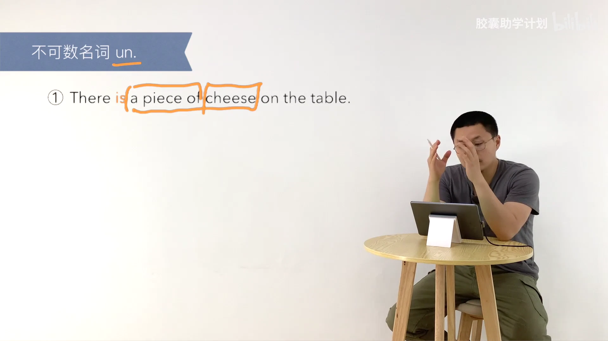

文字识别：胶囊助学计划 / 不可数名词 / ] un. / There is a piece of / cheese / on the table.

### 画面 00:02:24

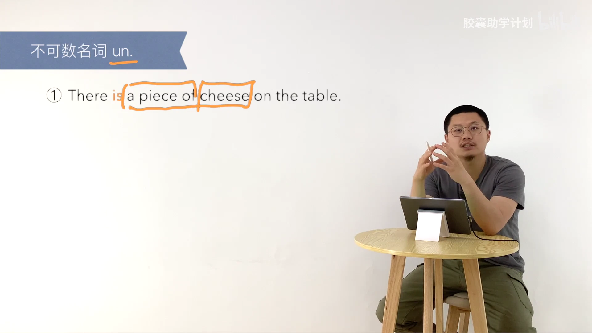

文字识别：胶囊助学计划 / 不可数名词 / ] un. / There is a piece of / cheese / on the table.

### 画面 00:02:26

文字识别：胶囊助学计划 / 不可数名词 / J un. / There is a piece of / cheese / on the table.

### 画面 00:02:28

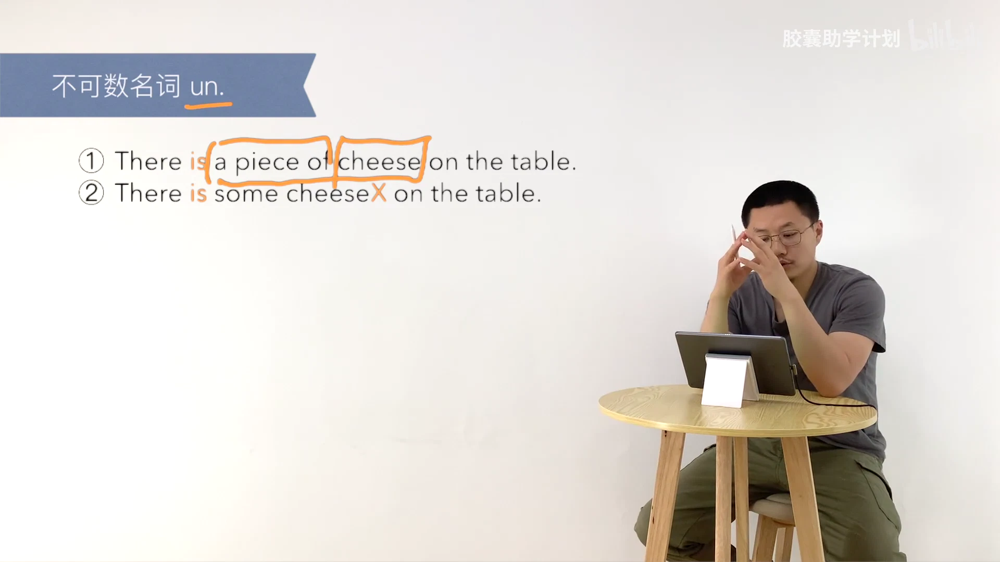

文字识别：胶囊助学计划 / 不可数名词 / ]un. / There is a piece ot / cheese / on the table. / There is some cheeseX on the table.

## 00:02:30–00:03:00

不可数名词，它有没有复数呢？就不存在复数这个概念了。所以各位看到这个地方，我在讲 cheese 的时候，画边加了一个小叉，就是告诉你不要加 s 去表达复数。你但你依旧可以说 some，说一些 cheese 啊， some cheese 是没有问题的。比如说 bread 面包这个单词，也是一会儿我们会学到的啊，你就不能说 one bread， two breads 是吧？不会这么聊，我们一般叫做 some bread，一些面

### 画面 00:02:35

文字识别：胶囊助学计划 / 不可数名词un. / There is a piece ofcheese / on the table. / There is some cheeseX on the table.

### 画面 00:02:37

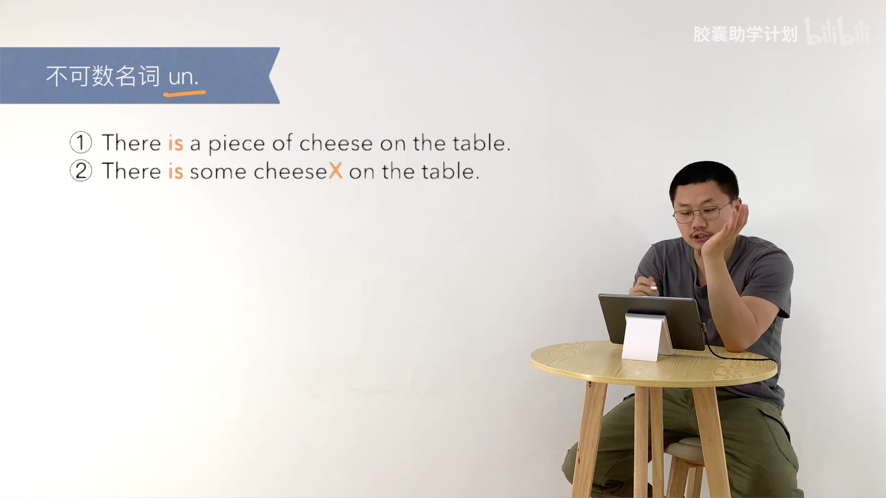

文字识别：胶囊助学计划 / 不可数名词 un. /  There is a piece of cheese on the table. /  There is some cheeseX on the table.

### 画面 00:02:41

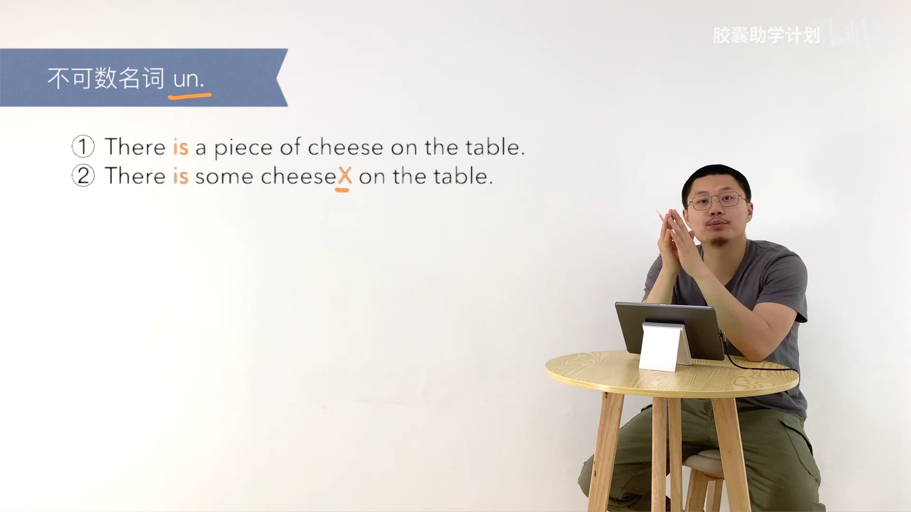

文字识别：胶囊助学计划 / 不可数名词un. /  There is a piece of cheese on the table. / There is some cheeseX on the table.

### 画面 00:02:44

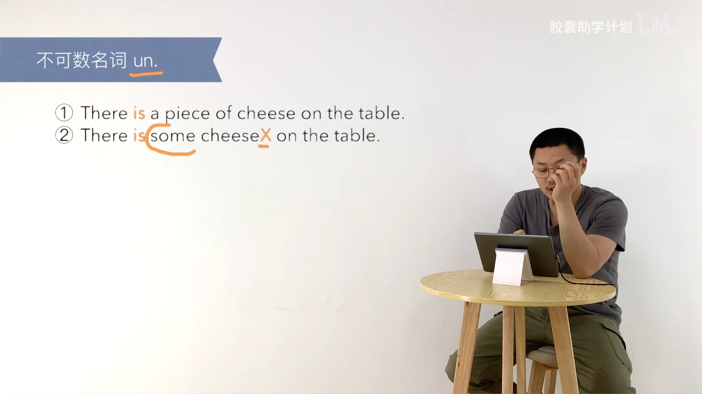

文字识别：胶囊助学计划 / 不可数名词un. / There is a piece of cheese on the table. / There issome cheeseX on the table.

### 画面 00:02:47

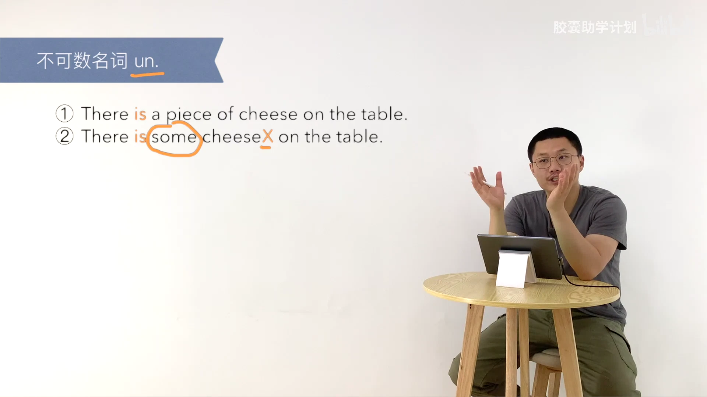

文字识别：胶囊助学计划 / 不可数名词 un. / There is a piece of cheese on the table. / There issome cheeseX on the table.

## 00:03:00–00:03:30

包后边不加s，不存在单数或复数这个概念。但是有一个点很有意思，注意啊，当你说some cheese的时候，前面我用的是are，而用的是is，所以我们说there is some cheese on the table，而不要看到some就立刻想用are，你要看后面的名词是可数还是不可数，对吧？我给玩一个，那这地方就有一个非常麻烦的事

### 画面 00:03:05

文字识别：胶囊助学计划 / 不可数名词 un. / There is a piece of cheese on the table. / There issome cheeseX on the table.

### 画面 00:03:09

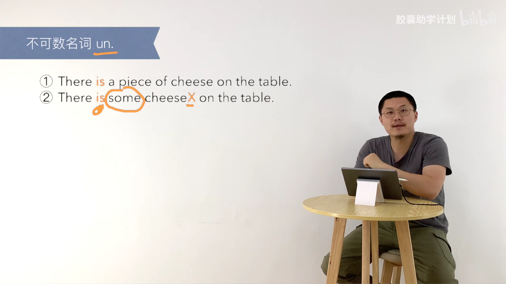

文字识别：胶囊助学计划 / 不可数名词 un. / There is a piece of cheese on the table. / There issome cheeseX on the table.

### 画面 00:03:13

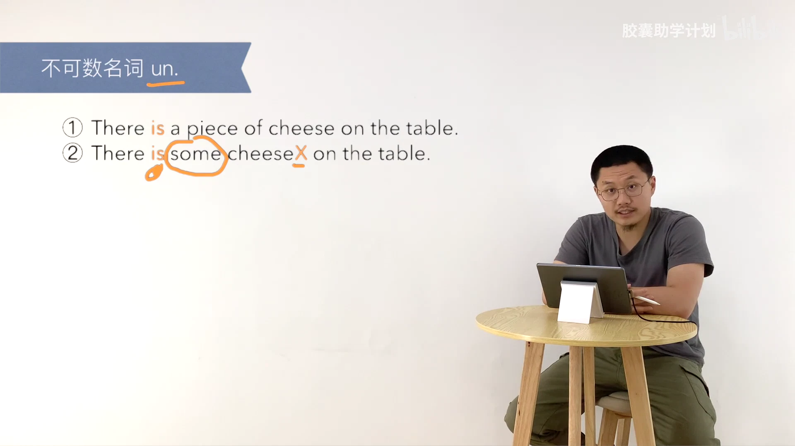

文字识别：胶囊助学计划 / 不可数名词 un. / There is a piece of cheese on the table. / There issome cheeseX on the table.

### 画面 00:03:24

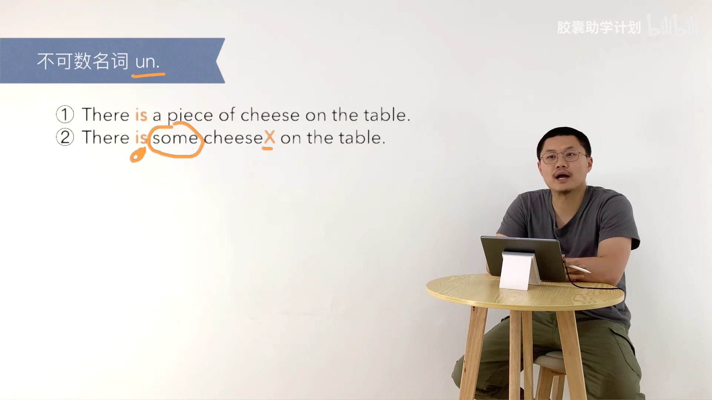

文字识别：胶囊助学计划 / 不可数名词un. / There is a piece of cheese on the table. / There issome cheeseX on the table.

### 画面 00:03:28

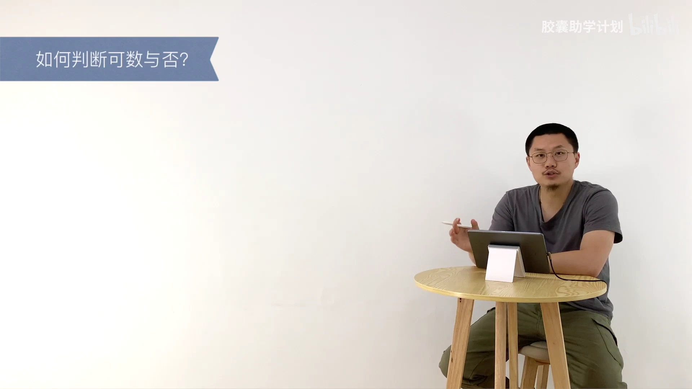

文字识别：胶囊助学计划 / 如何判断可数与否?

## 00:03:30–00:04:00

情，你看啊，我们通过它的字面汉语翻译说不可数就是没法数，但我明明觉得这个起司我能数啊，但你英文定义它叫不可数，于是这地方就有一个麻烦的事情，英文的名词千千万是吧？我怎么知道谁是可数谁是不可数？如何进行判断呢？有这么几个大的原则，首先啊，如果它是液体，比如说我们之前学过的milk，你就很难去数它，

### 画面 00:03:46

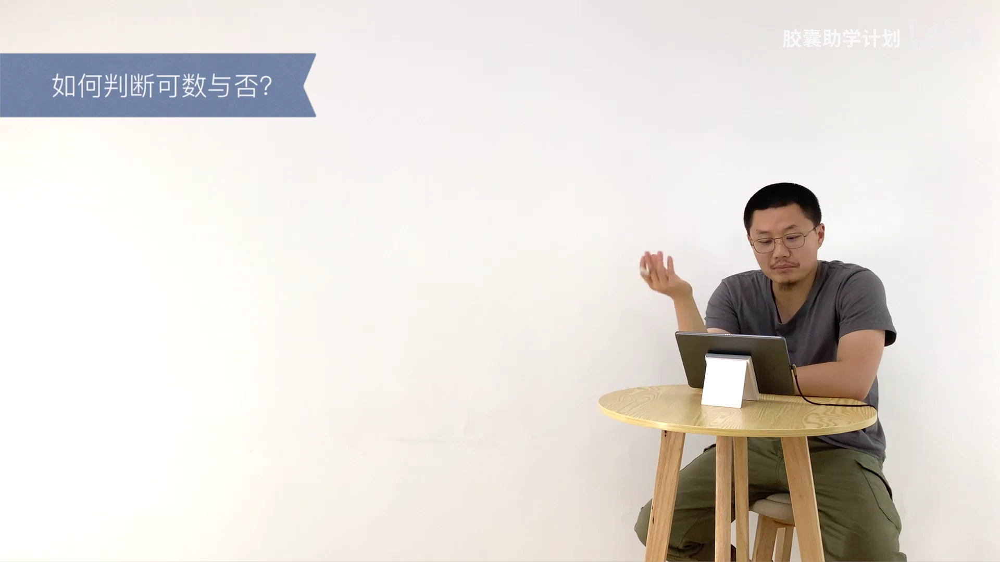

文字识别：如何判断可数与否?

### 画面 00:03:51

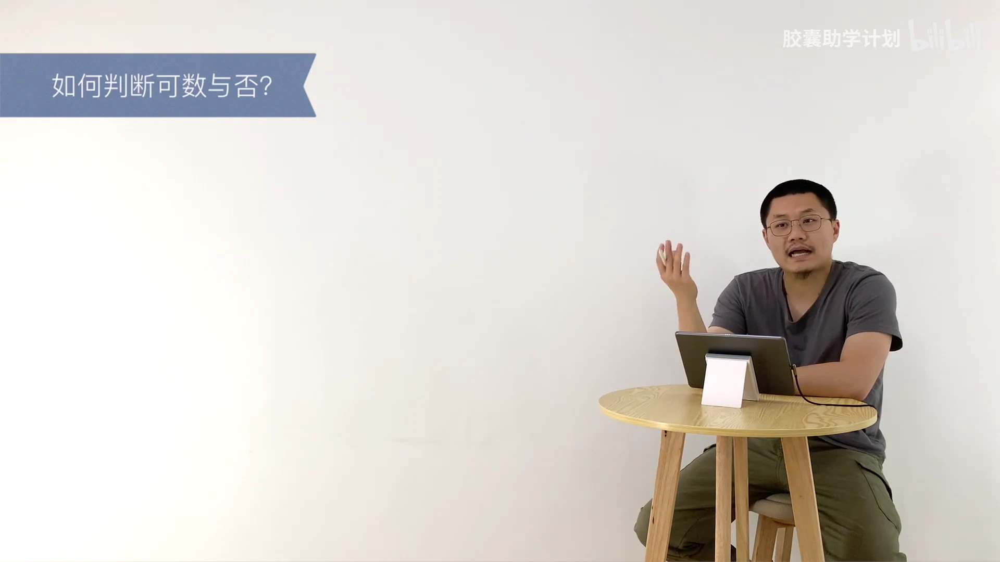

文字识别：胶囊助学计划 / 如何判断可数与否?

### 画面 00:03:55

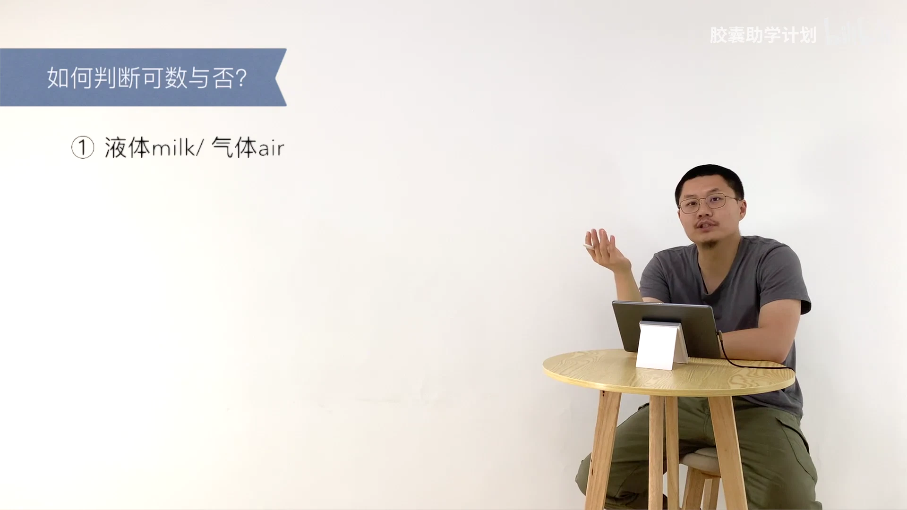

文字识别：胶囊助学计划 / 如何判断可数与否? / ①液体milk/ 气体air

## 00:04:00–00:04:30

你数的是瓶儿，你数的不是牛奶。你想一下啊，一瓶牛奶，一罐牛奶，你数的是那个量词罐儿和瓶儿，你数的不是牛奶本身啊。包括气体，比如说 air 这个单词，我们之前也学过空气，对吧？这怎么数，是吧？OK，那接下来呢？如果它的组成啊过小，比如说像沙子啊，沙子新二学的单词，那提前说一下，那后边这两个单词可是我们学过的，比如说 grass 草啊，

### 画面 00:04:11

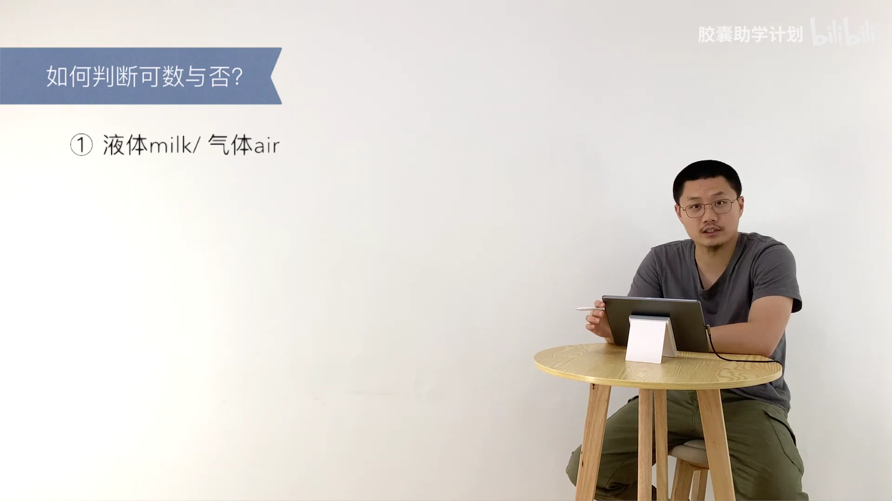

文字识别：胶囊助学计划 / 如何判断可数与否? / ①液体milk/ 气体air

### 画面 00:04:17

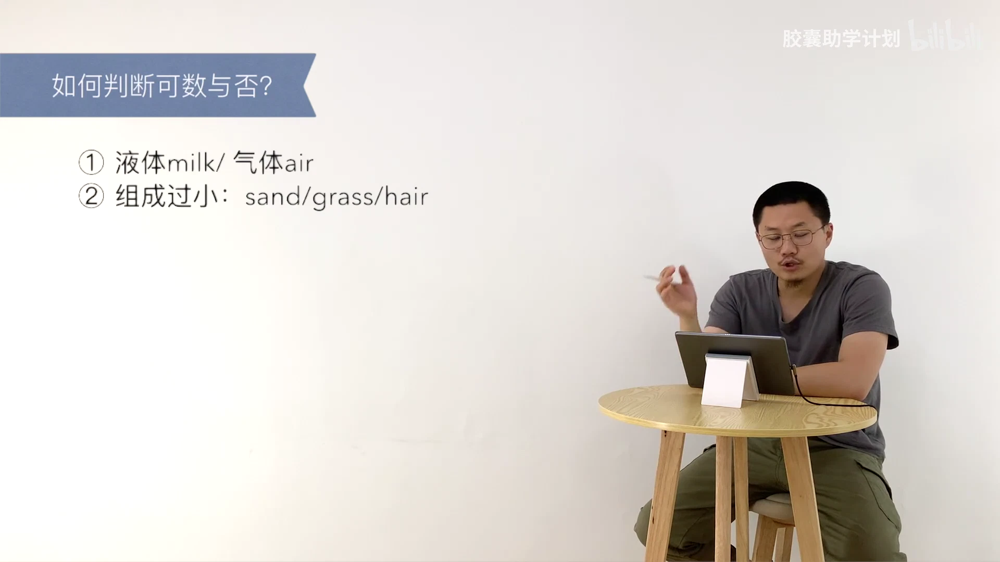

文字识别：胶囊助学计划 / 如何判断可数与否? / 液体milk/气体air / 组成过小：sand/grass/hair

### 画面 00:04:19

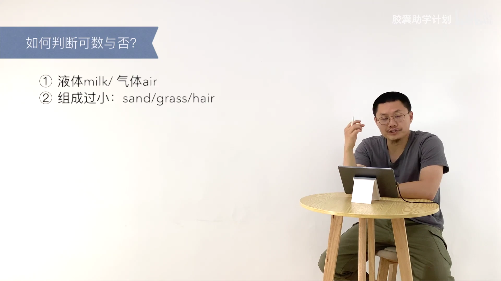

文字识别：如何判断可数与否? / 液体milk/气体air / 组成过小：sand/grass/hair

### 画面 00:04:23

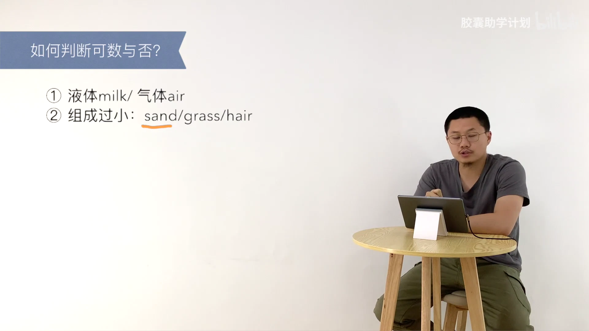

文字识别：胶囊助学计划 / 如何判断可数与否? / 液体milk/ 气体air / 组成过小：sand/grass/hair

### 画面 00:04:27

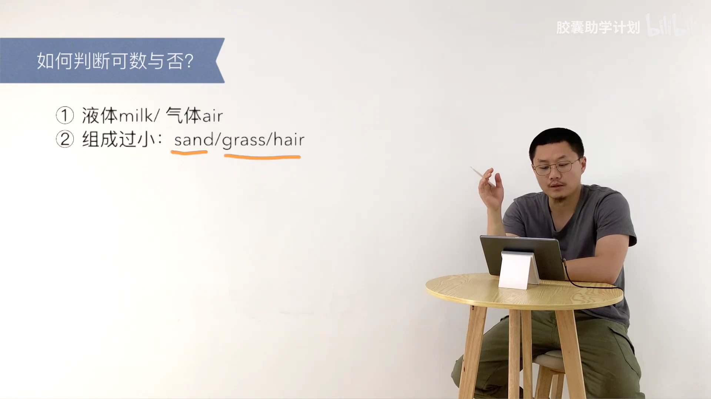

文字识别：胶囊助学计划 / 如何判断可数与否? / 液体milk/气体air / 组成过小：sand/grass/hair

## 00:04:30–00:05:00

包括这个hair头发。同理，你如果非要说它能数，它能不能数呢？它当然能数了，一根头发、两根头发、三根头发，肯定是能数的。但是我们认为它是一个整体的时候，比如说来着满头秀发，对吧？这个头发的这个总体概念的时候，它就不可数。OK。其次呢，如果是一些总称，比如说food叫做食物，食物它是一个抽象名词，其实它是一个所

### 画面 00:04:32

文字识别：如何判断可数与否? / 液体milk/ 气体air / 组成过小：sand/grass/hair

### 画面 00:04:37

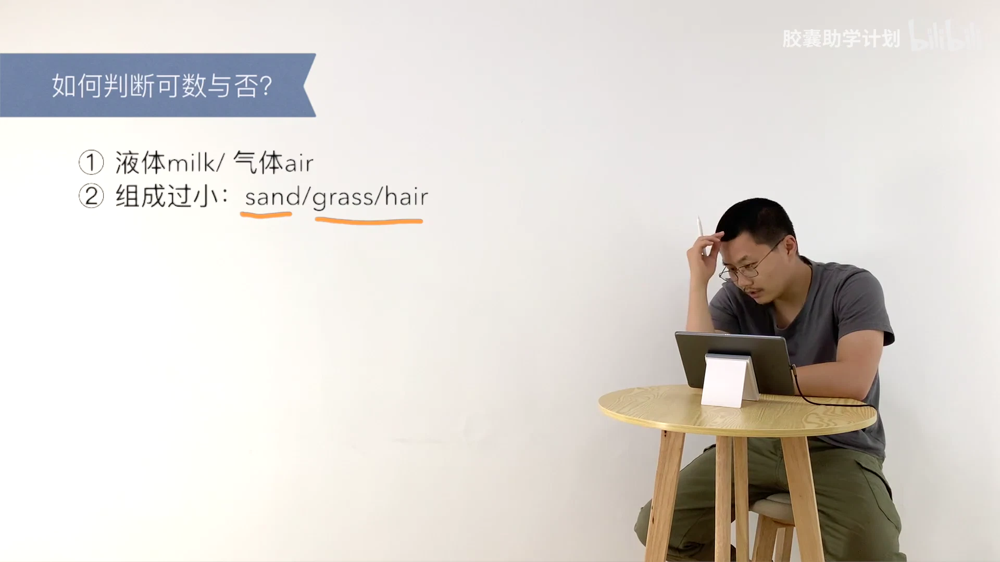

文字识别：胶囊助学计划 / 如何判断可数与否? / 液体milk/气体air / 组成过小：sand/grass/hair

### 画面 00:04:41

文字识别：胶囊 / 如何判断可数与否? / 液体milk/气体air / 组成过小：sand/grass/hair

### 画面 00:04:49

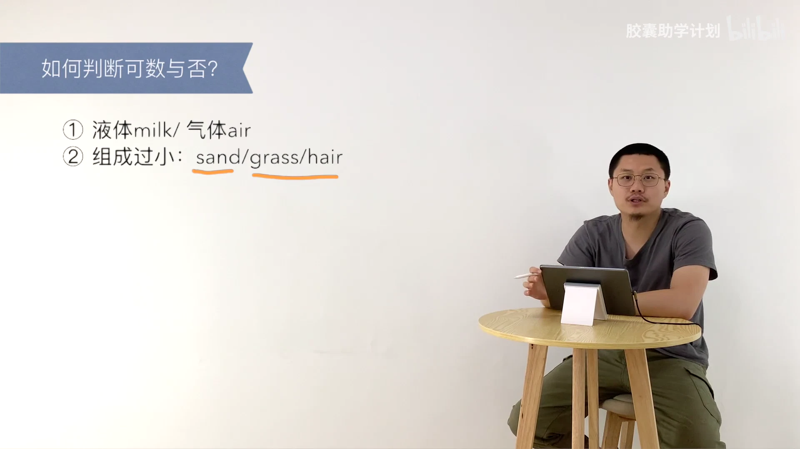

文字识别：胶囊助学计划 / 如何判断可数与否? / 液体milk/ 气体air / 组成过小：sand/grass/hair

### 画面 00:04:54

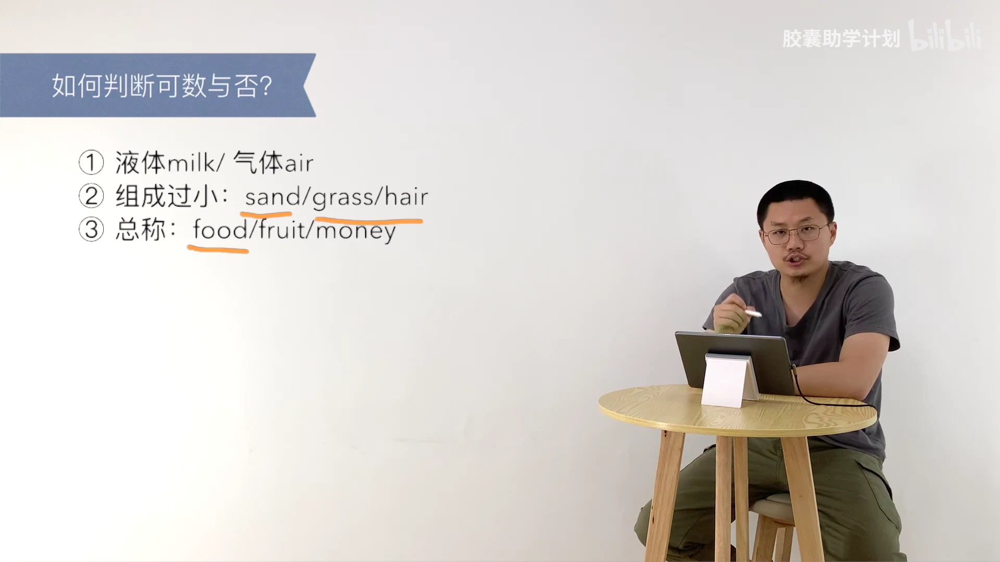

文字识别：胶囊助学计划 / 如何判断可数与否? / 液体milk/ 气体air / 组成过小：sand/grass/hair / 总称：food/fruit/money

### 画面 00:04:57

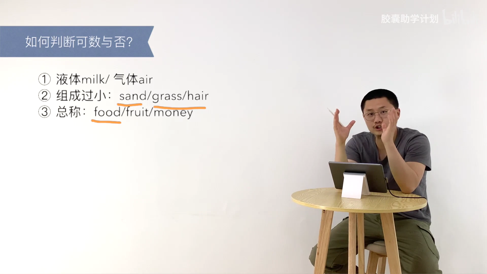

文字识别：胶囊助学计划 / 如何判断可数与否? / 液体milk/气体air / 组成过小：sand/grass/hair / 总称：food/fruit/money

## 00:05:00–00:05:30

有食物的总体名称，比如说 fruit 水果，比如说 money 啊，这个时候你看你又拿汉语的逻辑想不清了，因为如果我说钱，如果钱不能数，那我呢一一块两块三块四块，我数的是什么？我数的不就是钱吗？只不过各位要注意 money 这个单词是钱的一个抽象的概念，所有的钱啊统称为 money 这个单词，它是抽象概念，你数的是

### 画面 00:05:17

文字识别：胶囊助学计划 / 如何判断可数与否? / 液体milk/气体air / 组成过小：sand/grass/hair / 总称：food/fruit/money

### 画面 00:05:19

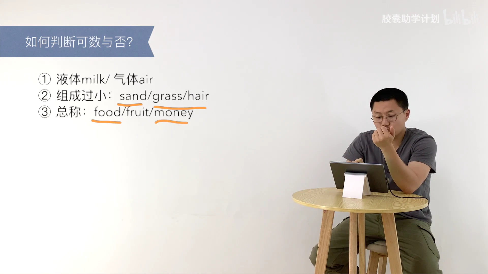

文字识别：胶囊助学计划 / 如何判断可数与否? / 液体milk/ 气体air / 组成过小：sand/grass/hair / 总称：food/fruit/money

### 画面 00:05:21

文字识别：胶囊助学计划 / 如何判断可数与否? / 液体milk/气体air / 组成过小：sand/grass/hair / 总称：food/fruit/money

## 00:05:30–00:06:00

一块两块，而不是数的钱这个抽象概念，所以这个单词也认为它是不可数的，我们管它叫总称，对吧？接下来更麻烦的事情在于，同一个单词含义不同，它还分可数和不可数。有的单词它有，比如说十个不同的含义，有的含义之下可数，有的含义之下不可数。你看，说到这儿的时候，我们已经该崩溃了。为什么？我们本来以为我们只要掌握了一些规则，比如

### 画面 00:05:37

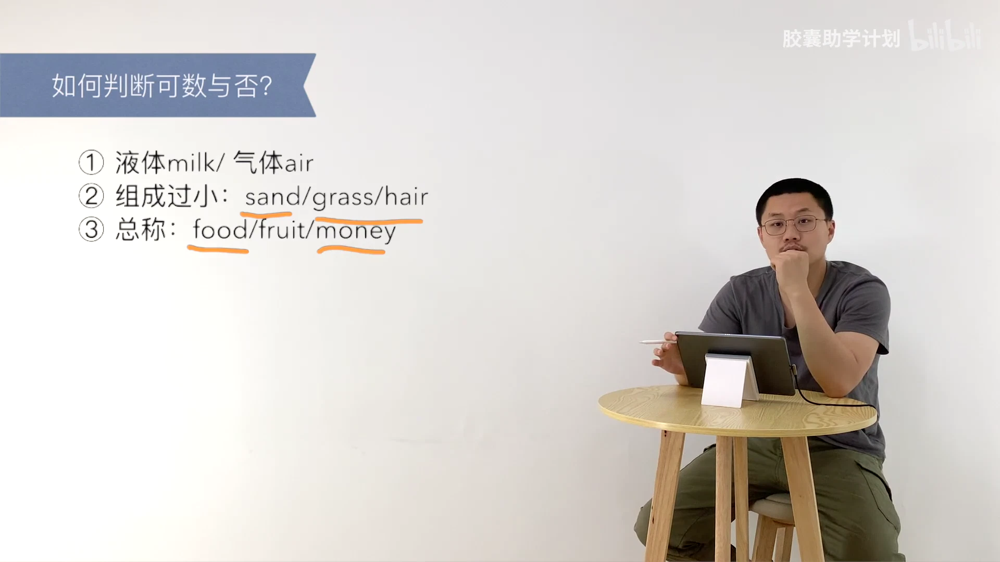

文字识别：胶囊助学计划 / 如何判断可数与否? / 液体milk/ 气体air / 组成过小：sand/grass/hair / 总称：food/fruit/money

### 画面 00:05:40

文字识别：如何判断可数与否? / 液体milk/气体air / 组成过小：sand/grass/hair / 总称：food/fruit/money / 同一个单词， / 含义不同

### 画面 00:05:44

文字识别：胶囊助学计划 / 如何判断可数与否? / 液体milk/气体air / 组成过小：sand/grass/hair / 总称：food/fruit/money / 同一个单词， / ，含义不同

### 画面 00:05:50

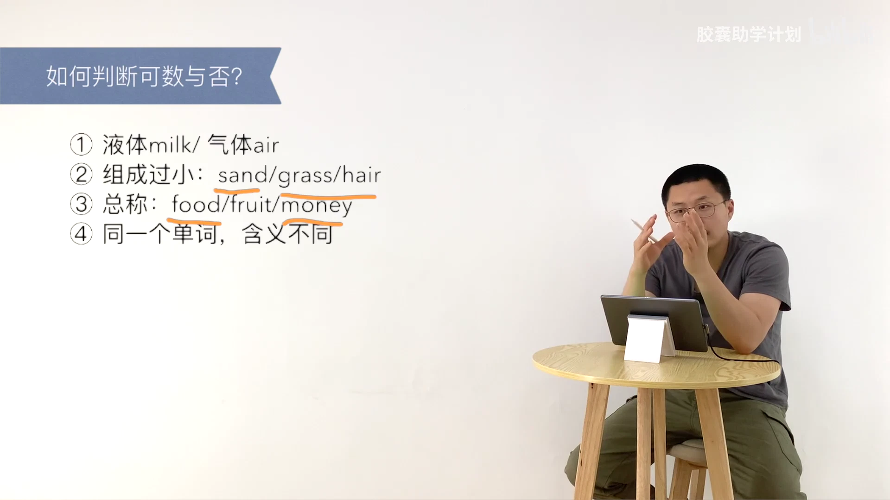

文字识别：胶囊助学计划 / 如何判断可数与否? / 液体milk/气体air / 组成过小：sand/grass/hair / 总称：food/fruit/money / 同一个单词， / 含义不同

## 00:06:00–00:06:30

说一二三这样的规则，我就能非常自信的判断一个单词到底是可数还是不可数。然而很遗憾的是，没有人能做到这一点啊！就算是英文的教授，他也不能完全判断一个名词到底是可数还是不可数，也可能需要去做一件事情，叫做查字典或者查词典。那为什么我之前讲了c n点儿或u n点儿，就是这个原因。你要去查到这个单词这个名词，

### 画面 00:06:00

文字识别：胶囊助学计划 / 如何判断可数与否? / 液体milk/气体air / 组成过小：sand/grass/hair / 总称：food/fruit/money / 同一个单词， / 含义不同

### 画面 00:06:09

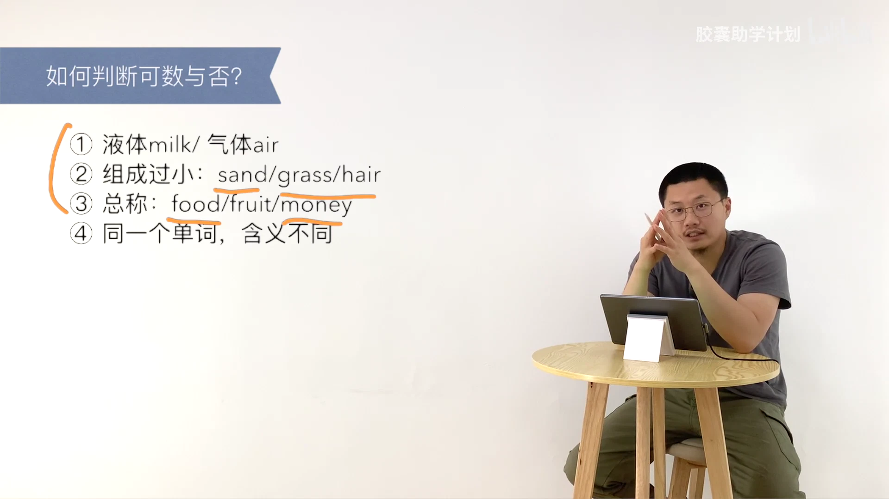

文字识别：如何判断可数与否? / 液体milk/气体air / 组成过小：sand/grass/hair / 总称：food/fruit/money / 同一个单词，含义不同 / 4

### 画面 00:06:22

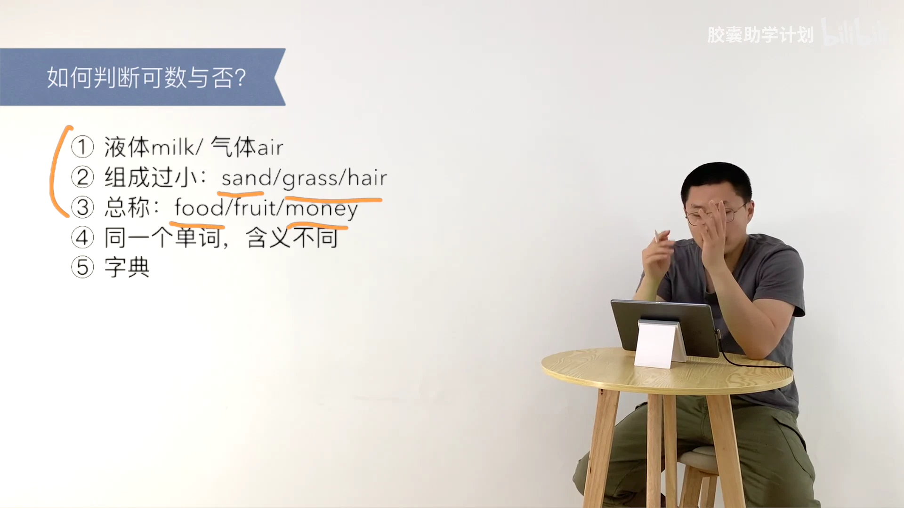

文字识别：胶囊助学计划 / 如何判断可数与否? / 液体milk/气体air / 组成过小：sand/grass/hair / 总称：food/fruit/money / 同一个单词， / 含义不同 / 4 / 字典 / 5

### 画面 00:06:25

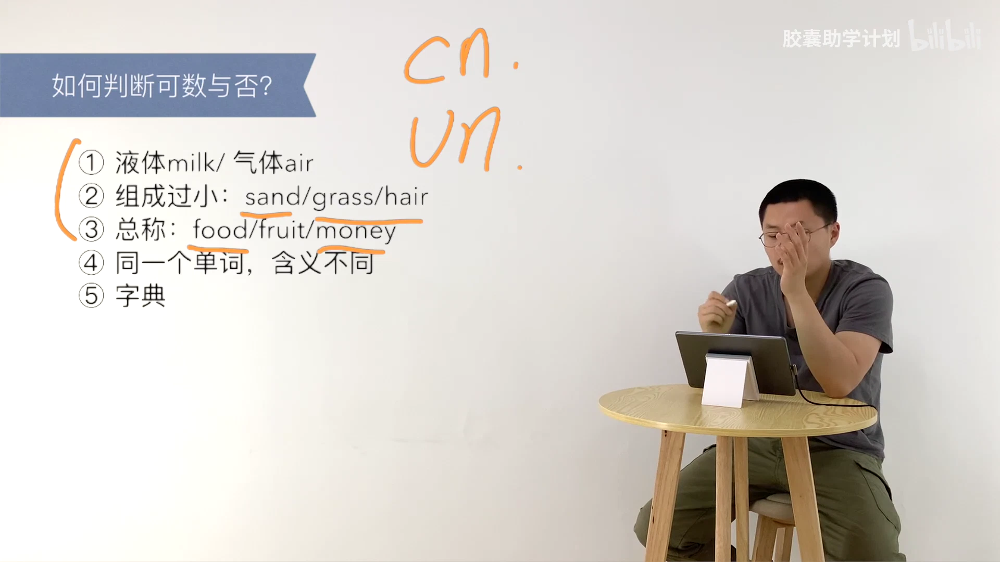

文字识别：cn / 胶囊助学计划 / 如何判断可数与否? / UN / 液体milk/气体air / 组成过小：sand/grass/hair / 总称：food/fruit/money / 同一个单词， / ，含义不同 / 字典 / 5

### 画面 00:06:27

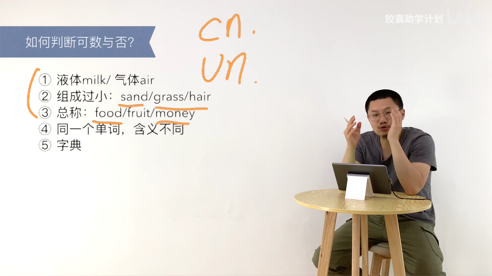

文字识别：cn / 胶囊助学计划 / 如何判断可数与否? / UN / 液体milk/气体air / 组成过小：sand/grass/hair / 总称：food/fruit/money / 同一个单词，含义不同 / 4 / 字典 / 5

## 00:06:30–00:07:00

比如说它有十个意思，在文章当中它是第六个意思，然后你去看它第六个意思那个字典上写的是c n点儿还是u n点儿，或者甚至它可能直接写的就是可数这个汉字或不可数这个汉字。OK，只有这样才能判断一个单词到底是可数的，并且还还是不可数的，并且这个单词在文章中这个意思的时候到底是可数的还是不可数的，所以这是一个比较复杂的事情，但

### 画面 00:06:36

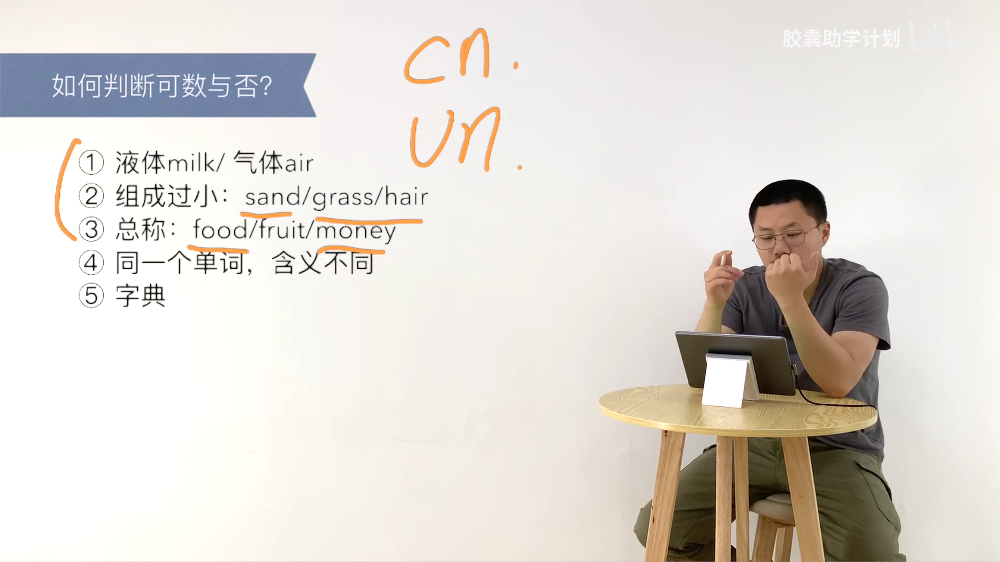

文字识别：cn / 胶囊助学计划 / 如何判断可数与否? / UN / 液体milk/气体air / 组成过小：sand/grass/hair / 总称：food/fruit/money / 同一个单词，含义不同 / 4 / 字典 / 5

### 画面 00:06:38

文字识别：cn / 胶囊助学计划 / 如何判断可数与否? / UN / 液体milk/ 气体air / 组成过小：sand/grass/hair / 总称：food/fruit/money / 同一个单词，含义不同 / 字典 / 5

### 画面 00:06:40

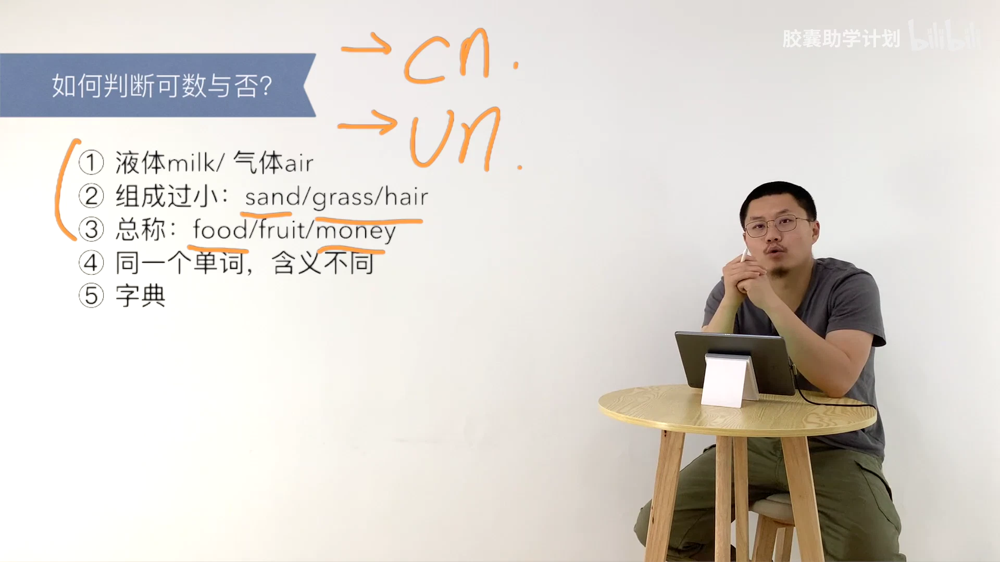

文字识别：胶囊助学计划 / cn / 如何判断可数与否? / UN / 液体milk/气体air / 组成过小：sand/grass/hair / 总称：food/fruit/money / 同一个单词， / 含义不同 / 字典 / 5

### 画面 00:06:47

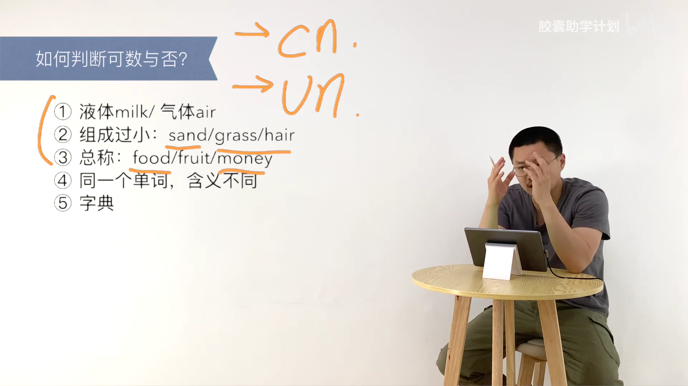

文字识别：cn / 胶囊助学计划 / 如何判断可数与否? / Un / 液体milk/气体air / 组成过小：sand/grass/hair / 总称：food/fruit/money / 同一个单词， / 含义不同 / 字典 / 5

### 画面 00:06:50

文字识别：cn / 胶囊助学计划 / 如何判断可数与否? / Un / 液体milk/气体air / 组成过小：sand/grass/hair / 总称：food/fruit/money / 同一个单词， / 含义不同 / 字典 / 5

## 00:07:00–00:07:30

但一劳永逸的解决方式就是要一个好的手机词典或者手机字典。OK，好，那希望在这儿我给大家讲清楚了。接下来我们看一下本课的单词，跟我一起张嘴读，cheese，cheese，刚才讲过它的含义了。那因为它是不可数单词，你可以说some cheese，你也可以说a piece of cheese，叫做一片。接下来下一个单词叫做bread，叫做面包，对吧？你看

### 画面 00:07:06

文字识别：cn / 胶囊助学计划 / 如何判断可数与否? / Un / 液体milk/气体air / 组成过小：sand/grass/hair / 总称：food/fruit/money / 同一个单词， / 含义不同 / 字典 / 5

### 画面 00:07:08

文字识别：胶囊助学计划 / / t ∫i : z 1 / cheese

### 画面 00:07:10

文字识别：胶囊助学计划 / / t ∫ i : z / / cheese

### 画面 00:07:15

文字识别：胶囊助学计划 / / t ∫i : z 1 / cheese

### 画面 00:07:21

文字识别：胶囊助学计划 / / bre d / / bread

### 画面 00:07:24

文字识别：胶囊助学计划 / / b r e d / / bread

### 画面 00:07:27

文字识别：胶囊助学计划 / / b r e d / / bread

## 00:07:30–00:08:00

这个又很有意思了。面包怎么不可数呢？一块两块。英文当中认为这个单词就是不可数的。所以这个地方各位要注意一件事情，我们学的是语言，语言它符合一定的逻辑，但它不符合完美的逻辑。不存在一件事情叫做如果一加一等于二，那么一加二就应该等于三。不存在这样一个非常直接简单的逻辑推理关系，不存在的啊。英文

### 画面 00:07:33

文字识别：胶囊助学计划 / / br e d / / bread

### 画面 00:07:35

文字识别：胶囊助学计划 / / b r e d / / bread

## 00:08:00–00:08:30

有一定的逻辑，但它不存在完美的逻辑。于是您不能用这种我们所谓就是说拿反例去推，对吧？你看 bread 可数吧，一块面包、两块面包，我能数啊，对吧？啊，不存在这个状况，符合人家语言习惯就行了。所以 bread 它就是不可数，英文当中。那你可以说 a piece of bread 一片面包，你也可以说 a loaf of bread。这个用法其实还不是那么常见。loaf 这个单词

### 画面 00:08:05

文字识别：/ br e d / / bread

### 画面 00:08:18

文字识别：胶囊助学计划 / / bre d / / bread

### 画面 00:08:23

文字识别：胶囊助学计划 / / b r e d / / bread / ① a piece of bread / ② a loaf of bread

### 画面 00:08:27

文字识别：胶囊助学计划 / / br e d / / bread / ① a piece of bread / ② a loaf of bread

## 00:08:30–00:09:00

它指的就是什么呢？指的就是一条一块一片随便。但是你注意，它基本上只和面包放在一起去连用啊。它的意思就是一条破糊面包。OK了吧？好理解哈。OK，next one下一个单词来soap啊，soap啊，指的是我们说这个香皂肥皂啊。又来了，怎么不能数呢？一块两块，英文不认为它可数啊。来，a bar of

### 画面 00:08:30

文字识别：胶囊助学计划 / / br e d / / bread / ① a piece of bread / ②a loaf of bread

### 画面 00:08:32

文字识别：胶囊助学计划 / / br e d / / bread / ① a piece of bread / ②a loaf of bread

### 画面 00:08:36

文字识别：/ bre d / / bread / ① a piece of bread / ② a loaf of bread / 2

### 画面 00:08:40

文字识别：胶囊助学计划 / / b r e d / / bread / ① a piece of bread / ②a loaf ofbread

### 画面 00:08:45

文字识别：胶囊助学计划 / / br e d / / bread / ① a piece of bread / ②a loaf ofbread

### 画面 00:08:47

文字识别：胶囊助学计划 / /saupl / soap

### 画面 00:08:53

文字识别：胶囊助学计划 / /saupl / soap

### 画面 00:08:56

文字识别：胶囊助学计划 / /saupl / soap

## 00:09:00–00:09:30

soap 叫做一条或者一块儿，注意 bar 啊，一条一块儿肥皂啊或香皂。当然您可以说 some soap，而不要加 s 了。为什么？因为它是不可数名词。这个名词单数复数是针对于可数名词而言的，好吧？脑海当中要想一下啊，这是名词，这是可数，这是不可数。可数分了单数复数，不可数不聊这个事儿啊。 Okay, some

### 画面 00:09:00

文字识别：胶囊助学计划 / /saup/ / soap / ① a bar of soap

### 画面 00:09:07

文字识别：胶囊助学计划 / /saup/ / soap / ① a bar of soap

### 画面 00:09:14

文字识别：胶囊助学计划 / /saupl / soap / ① a bar of soap

### 画面 00:09:19

文字识别：胶囊助学计划 / /saup/ / soap / ① a bar of soap

### 画面 00:09:21

文字识别：胶囊助学计划 / /saup/ / soap / ① a bar of soap

### 画面 00:09:23

文字识别：胶囊助学计划 / /saup/ / soap / ① a bar of soap

### 画面 00:09:26

文字识别：胶囊助学计划 / /saup/ / soap / ① a bar of soap

### 画面 00:09:29

文字识别：胶囊助学计划 / /saup/ / soap / ① a bar of soap / ② some soap

## 00:09:30–00:10:00

something continue. Chocolate, chocolate. 啊，什么 chocolate 啊，巧克力啊。 OK, 那 a bar of chocolate 一条啊。当然你说一块儿呢，那就是还是 a bar a a bar of。你说一片儿呢，你可以说 a piece of，你也可以说 a bar of，没问题啊。一条一块儿。 Next one, sugar. 啊，这个其实相对来说可能好理解一点。为什么不可数是吧？啊，就是组成成分过

### 画面 00:09:31

文字识别：胶囊助学计划 / /·t ∫oklit / / chocolate

### 画面 00:09:34

文字识别：胶囊助学计划 / /·t ∫oklI t / / chocolate

### 画面 00:09:36

文字识别：胶囊助学计划 / /·t ∫ｏklⅠt / / chocolate

### 画面 00:09:38

文字识别：胶囊助学计划 / /·t∫ｏklit/ / chocolate

### 画面 00:09:42

文字识别：胶囊助学计划 / /·t ∫pk lit / / chocolate / ① a bar of chocolate

### 画面 00:09:47

文字识别：胶囊助学计划 / / ·t ∫pk lit / / chocolate / ① a bar of chocolate

### 画面 00:09:51

文字识别：胶囊助学计划 / / ·t ∫pk lI t / / chocolate / ① a bar of chocolate

### 画面 00:09:53

文字识别：胶囊助学计划 / /'Suga/ / sugar

## 00:10:00–00:10:30

小，是吧？跟我们那个草头发啊有点类似啊。Sugar还是有一点点规则的。来，a pound of sugar。注意这个地方的pound是英制啊，英制重量单位，英国人使用的。那我们国际的重量单位就是kg，对吧？一kg等于两斤啊，我没有记错的话。这个斤啊两就是我们中国自己用的这个进制啊。那这个kg是全球统一的，而

### 画面 00:10:08

文字识别：胶囊助学计划 / /'∫uga/ / sugar / ① a pound of sugar

### 画面 00:10:11

文字识别：胶囊助学计划 / /'Juga/ / sugar / apoundof sugar

### 画面 00:10:17

文字识别：KX / 胶囊助学计划 / /'Juga/ / sugar / apoundof sugar

### 画面 00:10:28

文字识别：胶囊助学计划 / /'∫uga/ / :2 / sugar / apoundof sugar

## 00:10:30–00:11:00

pound 指的是英制一磅、两磅的这个磅啊。啊， pound of sugar。继续下一个单词来，叫做 coffee。所以我们说带给我一些咖啡，我不知道各位有没有印象，我们上一节课刚刚讲过，叫做 take me some coffee，而不说 some coffees，啊，对吧？没有加 s，它不聊单数复数的事儿，那是可数名词的事儿，不可数名词避而不谈，不聊这个事儿，对吧？ Some coffee 就可以了。你可以说 a

### 画面 00:10:32

文字识别：胶囊助学计划 / /'Juga/ / :2 / sugar / )of sugar / apound

### 画面 00:10:35

文字识别：胶囊助学计划 / /  k p f 1 / / coffee

### 画面 00:10:45

文字识别：胶囊助学计划 / / ^ k o f 1 / / coffee

### 画面 00:10:53

文字识别：胶囊助学计划 / / ' k p f 1 / / coffee

### 画面 00:10:58

文字识别：胶囊助学计划 / / ' kp f 1 / / coffee / ① a cup of coffee

## 00:11:00–00:11:30

cup of coffee 啊，这个要记住 a cup of a cup 你是有印象的 a cup of 就是一个量词，叫做一杯。你说 a cup of，比如说 wine，我们之前啊以后会学到单词叫红酒，可以吗？可以啊。那这个 a cup of water 可以吗？a cup of tea 可以吗？都可以啊。好，哎，立刻来了，来读一下 tea，茶叶，对吧？那你可以说 half a pound of tea。好，注意 a pound of，

### 画面 00:11:00

文字识别：胶囊助学计划 / / ^ k o f 1 / / coffee / ① a cup of coffee

### 画面 00:11:02

文字识别：胶囊助学计划 / / ' k p f 1 / / coffee / ① a cup of coffee

### 画面 00:11:04

文字识别：胶囊助学计划 / / ' k o f 1 / / coffee / ① a cup of coff ee

### 画面 00:11:07

文字识别：胶囊助学计划 / / ' k o f r / / coffee / ① a cup of coff ee

### 画面 00:11:10

文字识别：胶囊助学计划 / / ^ k p f 1 / / coffee / ① a cup of coff ee

### 画面 00:11:21

文字识别：胶囊助学计划 / /ti:1 / tea

### 画面 00:11:23

文字识别：胶囊助学计划 / /ti:1 / tea

### 画面 00:11:26

文字识别：胶囊助学计划 / /ti:1 / tea / ① half a pound of tea

### 画面 00:11:29

文字识别：胶囊助学计划 / /ti:1 / tea / ① half a pound of tea

## 00:11:30–00:12:00

之前刚刚讲过了，叫做一磅。那half这个单词，各位要单独把它记下来，叫做一半儿。那half a pound of叫做半磅啊，半磅，一半儿啊，一磅的一半儿啊。那half pound就是半磅。Okay, next one, tobacco, tobacco啊，注意啊，它不是我们说的那个香烟啊，不是我们抽的那个香烟啊，烟卷儿，它指的是烟丝啊，就我们东

### 画面 00:11:34

文字识别：胶囊助学计划 / /ti:1 / tea

### 画面 00:11:48

文字识别：胶囊助学计划 / /ta'bækau/ / tobacco

### 画面 00:11:50

文字识别：胶囊助学计划 / /ta'bækau/ / tobacco

### 画面 00:11:54

文字识别：胶囊助学计划 / /ta'bækau/ / tobacco

## 00:12:00–00:12:30

北的那个旱烟对吧？或者说我们老一辈爱抽的那个旱烟。当然你在西方的一些国家，比如说新西兰啊，抽烟的时候，他可能买的就是这个 tobacco，就是烟丝，然后自己去买过滤嘴啊，自己去买纸，然后去卷。这个东西我们管它叫做 tobacco 啊，不是我们之前学的那个单词叫 cigarette，那个指的是已经卷好的那种带过滤嘴的香烟啊，这个叫烟丝 tobacco。你看它的组成成分也是跟 tea 那种很像，组成成分过小

### 画面 00:12:11

文字识别：/ta'bækau/ / tobacco

### 画面 00:12:24

文字识别：胶囊助学计划 / /ta'bækau/ / tobacco

### 画面 00:12:27

文字识别：胶囊助学计划 / /ta'bækau/ / tobacco

### 画面 00:12:29

文字识别：胶囊助学计划 / /ta'bækau/ / tobacco

## 00:12:30–00:13:00

感觉的，对吧？不可数。来叫做 a tin of tobacco。这儿有一个小的单词叫做 tin。啊，我们之前应该是学过，叫马口铁，对吧？或者说这个小罐头啊，一小罐的 tobacco 烟草啊。a tin of。那你我能不能说 a pound of tobacco？啊，一磅的这个这个烟草行不行呢？啊，当然也行啊，但我估计没有人这么买啊。Half a pound 都够呛啊。Some tobacco

### 画面 00:12:33

文字识别：胶囊助学计划 / /ta'bækau/ / tobacco / ① a tin of tobacco

### 画面 00:12:37

文字识别：胶囊助学计划 / /ta' bækau/ / tobacco / ① a tin of tobacco

### 画面 00:12:41

文字识别：胶囊助学计划 / /ta'bækau/ / tobacco / ① a tin of tobacco

### 画面 00:12:44

文字识别：胶囊助学计划 / /ta'bækau/ / tobacco / ① a tin of tobacco

### 画面 00:12:56

文字识别：胶囊助学计划 / /ta'bækau/ / tobacco / ①a tin of tobacco

### 画面 00:12:59

文字识别：胶囊助学计划 / /ta'bækau/ / tobacco / Da tin of tobacco / 1 / some tobacco

## 00:13:00–00:13:30

叫做一些tobacco，你注意后边又没加s，对不对？Okay，very good. Continue.那直接进入文章了。文章啊和我们单词几乎是高度重合的啊。我们来了，说Is that bag heavy, Penny?说那个包重吗，Penny？啊，你我想说那个包很重，那就把is放回去嘛。你是怎么提到句首的？你就把它放回到原来的位置，叫做That bag is heavy，对吧？Not

### 画面 00:13:05

文字识别：胶囊助学计划 / SAN: Is that bag heavy, Penny? / PENNY: Not very. / SAN: Here! Put it on this chair. / What's in it?

### 画面 00:13:07

文字识别：胶囊助学计划 / SAN: Is that bag heavy, Penny? / PENNY: Not very. / SAN: Here! Put it on this chair. / What's in it?

### 画面 00:13:12

文字识别：胶囊助学计划 / SAN: Is that bag heavy, Penny? / PENNY: Not very. / SAN: Here! Put it on this chair. / What's in it?

### 画面 00:13:16

文字识别：胶囊助学计划 / SAN: Is that bag heavy, Penny? / PENNY: Not very. / SAN: Here! Put it on this chair. / What's in it?

### 画面 00:13:23

文字识别：胶囊助学计划 / SAN: Is that bag heavy, Penny? / PENNY: Not very. / SAN: Here! Put it on this chair. / What's in it?

## 00:13:30–00:14:00

very,不是很沉. Here,这儿. Put it on this chair.把它放到这个椅子上吧. What's in it?什么在它里面?它指的是这个bag,对吧?什么在它里面? Penny开始说了, a piece of cheese.啊,一块儿,一片儿,起司,奶酪啊. A loaf of bread.啊,一条啊.你由图去决定怎么翻汉语,对吧?好,

### 画面 00:13:34

文字识别：胶囊助学计划 / SAN: Is that bag heavy, Penny? / PENNY: Not very. / SAN: Here! Put it on this chair. / What's in it?

### 画面 00:13:43

文字识别：胶囊助学计划 / SAN: Is that bag heavy, Penny? / PENNY: Not very. / SAN: Here! Put it on this chair. / What's in it?

### 画面 00:13:46

文字识别：胶囊助学计划 / PENNY: A piece of cheese. / A loaf of bread.

### 画面 00:13:48

文字识别：胶囊助学计划 / PENNY: A piece of cheese. / A loaf of bread.

### 画面 00:13:54

文字识别：胶囊助学计划 / PENNY: A piece of cheese. / Aloaf of bread.

### 画面 00:13:57

文字识别：胶囊助学计划 / PENNY: A piece of cheese. / Aloaf of bread.

## 00:14:00–00:14:30

一条面包，a bar of soap，一块儿肥皂，香皂，a bar of chocolate。你看这儿的a bar of，你翻译成一条就不合适了吧？人家图就不是一条，一块儿是吧？一片，a bottle of milk，啊，一瓶，a bottle of bottle这个单词我们学过对吧？a cup of，你刚才也见到了。来，a pound of sugar，一磅的糖，half a pound of coffee，半磅的咖啡。注

### 画面 00:14:01

文字识别：胶囊助学计划 / A bar of soap. / SOAP / A bar of Chocolate. / w / CHOCOLATE / mme / A bottle of milk. / XXY

### 画面 00:14:04

文字识别：A bar of soap. / 胶囊助学计划 / SOAP / A bar of Chocolate. / w / CHOCOLATE / ②mme / A bottle of milk.

### 画面 00:14:07

文字识别：A bar of soap. / 胶囊助学计划 / SOAP / A bar of Chocolate. / w / CHOCOLATE / 9mme / A bottle of milk.

### 画面 00:14:14

文字识别：A bar of soap. / 胶囊助学计划 / SOAP / A bar of Chocolate. / CHOCOLATE / mme / A bottle of milk.

### 画面 00:14:22

文字识别：胶囊助学计划 / A pound of sugar. / SUGAR / Half a pound of coff ee. / COFFEE / A quarter of pound of tea. / TEA

### 画面 00:14:25

文字识别：胶囊助学计划 / A pound of sugar. / SUGAR / Half a pound of coffee. / COFFEE / A quarter of pound of tea. / TEA

### 画面 00:14:28

文字识别：胶囊助学计划 / A pound of sugar. / SUGAR / Half a pound ofcoffee. / COFFEE / A quarter of pound of tea. / TEA

## 00:14:30–00:15:00

意 half，对吧？以及 a quarter of pound of tea，注意 a quarter of 这里边关键的单词就是这个 quarter， Q U A R T E R， half 是二分之一， quarter 是四分之一啊。那 a quarter of pound of tea 指的是四分之一磅的茶。OK，好，continue and a tin of tobacco，然后还有一听的

### 画面 00:14:31

文字识别：胶囊助学计划 / A pound of sugar. / SUCAR / Half pound ofcoffee. / COFFEE / A quarter of pound of tea. / TEA

### 画面 00:14:37

文字识别：胶囊助学计划 / A pound of sugar. / SUGAR / Half / pound ofcoffe. / COFFEE / A quarter of pound of tea. / TEA / •

### 画面 00:14:42

文字识别：胶囊助学计划 / A pound of sugar. / SUGAR / Half a pound ofcoffee. / COFFEE / A quarter of pound of tea. / TEA / •

### 画面 00:14:45

文字识别：胶囊助学计划 / A pound of sugar. / SUGAR / Half  pound of coffee. / COFFEE / A quarter ofpound of tea. / TEA / •

### 画面 00:14:49

文字识别：胶囊助学计划 / A pound of sugar. / SUGAR / 2 / Half pound ofcoffee. / COFFEE / A quarter of pound of tea. / TEA / • / 4

### 画面 00:14:54

文字识别：胶囊助学计划 / TOBACCO / And a tin of tobacco. / SAN: Is that tin of tobacco for me? / PENNY: Well, it's certainly not for me!

## 00:15:00–00:15:30

一罐的这个烟草啊。Well,哎，Sam说，Is that tin of tobacco for me?哎，之前学过三十九课，我没有记错的话，是吧？我们学的就是说，呃，这个This book is isn't for me.啊，这个书柜不是给我的，is for my daughter Susan，对吧？说那听啊，那一听的tobacco a of b由后往前翻译，二十五课我们学过，对吧？说那一听的

### 画面 00:15:00

文字识别：胶囊助学计划 / TOBACCO / And a tin of tobacco. / SAN: Is that tin of tobacco for me? / PENNY: Well, it's certainly not for me!

### 画面 00:15:04

文字识别：胶囊助学计划 / TOBACCO / And a tin of tobacco. / SAN: Is that tin of tobacco for me? / PENNY: Well, it's certainly not for me!

### 画面 00:15:06

文字识别：胶囊助学计划 / TOBACCO / And a tin of tobacco. / SAN: Is that tin of tobacco for me? / PENNY: Well, it's certainly not for me!

### 画面 00:15:08

文字识别：胶囊助学计划 / TOBACCO / And a tin of tobacco. / SAN: Is that tin of tobaccc for me? / PENNY: Well, it's certainly not for me!

### 画面 00:15:16

文字识别：胶囊助学计划 / TOBACCO / And a tin of tobacco. / SAN: Is that tin of tobaccc for me / PENNY: Well, it's certainly not for me!

### 画面 00:15:20

文字识别：胶囊助学计划 / TOBACCO / And a tin of tobacco. / SAN: Is that tin of tobaccc for me / PENNY: Well, it's certainly not for me!

### 画面 00:15:23

文字识别：胶囊助学计划 / TOBACCO / And a tin of tobacco. / SAN: Is hat tin oftobaccc for me? / PENNY: Well, it's certainly not tor me!

### 画面 00:15:25

文字识别：胶囊助学计划 / TOBACCO / ottobalco / And a tin / that tin ofiobaccd for me / SAN: Is / PENNY: Wvell, it's certainly / 'not for me!

## 00:15:30–00:16:00

tobacco 是给我的吗？烟草是给我的吗？我要他说好吧，这就是个口头禅啊。 Is certainly not for me。 注意 certainly 这个单词，我们下一次再见它可能要到六十多课，就是当然，类似于我们马上要学的叫做 of course 啊，它当然不是给我的了。 OK，这是一个。那文章呢，并不是很难。接下来我们做一些口语听力练习。各位看文章来了。第一题，

### 画面 00:15:38

文字识别：胶囊助学计划 / TOBACCO / oltobalco / And / a tin / chat tin ofobaccd forr / SAN: Is / me / PENNY: / Well, it's certainly not tor me!

### 画面 00:15:42

文字识别：胶囊助学计划 / TOBACCO / olfobarco / And / a tin / Co / hat tin ofobacco forr / SAN: Is / me / PENNY: / Well, it's certainly / not for me!

### 画面 00:15:53

文字识别：胶囊助学计划 / Comprehension

### 画面 00:15:55

文字识别：胶囊助学计划 / Comprehension

### 画面 00:15:58

文字识别：胶囊助学计划 / Comprehension

## 00:16:00–00:16:30

Look at picture number two. 各位看第二幅图。Is there a piece of cheese on the table? 答 Yes, there is. Look at picture number three. 看第三张图。Is there a loaf of bread on the table? Yes, there is. Next one. Look at number four. Is there a bar of soap on the table? Yes,

### 画面 00:16:05

文字识别：胶囊助学计划 / Comprehension / 1 T: Look at number 2. / Is there a piece of cheese on the table?

## 00:16:30–00:17:00

there is. Continue. Look at number five. Is there any chocolate on the table? Yes, there is. 注意这个小点，全用的是 is，虽然后边是 any chocolate，对吧？ Continue. Look at number six. Is there a bottle of milk on the table? Yes, there is. Next one. Look at number six again. That again, come again. 第一节课我们就

### 画面 00:16:35

文字识别：胶囊助学计划 / Comprehension / 4 T: Look at number 5. / Is there any chocolate on the table? / 2

### 画面 00:16:41

文字识别：胶囊助学计划 / Comprehension / 4 T: Look at number 5. / Is there any chocolate on the table? / S: Yes, there is.

### 画面 00:16:45

文字识别：胶囊助学计划 / Comprehension / 4T: Look at number 5. / there any chocolate on the table? / S: Yes, there is.

### 画面 00:16:47

文字识别：胶囊助学计划 / Comprehension / 5 T: Look at number 6.

## 00:17:00–00:17:30

学过，就再来一次，对吧？ Again, 就是再来一次。再看一下，Is there any milk in the bottle? Yes, there is. Continue. Look at number seven. Is there any sugar on the table? Yes, there is. Continue. Look at number eight. Is there any coffee on the table? Yes, there is.

### 画面 00:17:00

文字识别：胶囊助学计划 / Comprehension / 6 T: Look at number 6again.

### 画面 00:17:10

文字识别：胶囊助学计划 / Comprehension

## 00:17:30–00:18:00

Continue. Look at number nine. Is there any tea on the table? Yes, there is. Continue. 最后一个啊，不是，应该不是最后一个. Look at number ten. Is there any tobacco in the tin? Yes, there is. 好, continue. Is the tobacco for Penny? 想一下, Penny是男的女的啊? No, it isn't.

### 画面 00:17:40

文字识别：胶囊助学计划 / Comprehension / 10 T: Look at number 10.

## 00:18:00–00:18:30

好，下一题，asking questions，又到了这道题。各位要做的事情是看肯定句变一般疑问句。来了啊，跟我读。There is a piece of cheese on the table. 答案给我。好，我给答案。Is there a piece of cheese on the table? Continue. Ask me if there is a bottle of milk on the table. 啊，各位

### 画面 00:18:00

文字识别：胶囊助学计划 / Asking questions / 1 T: Ask me if there is a piece of cheese on the table.

### 画面 00:18:08

文字识别：胶囊助学计划 / Asking questions / 1 T: Ask me if there is a piece of cheese on the table

### 画面 00:18:22

文字识别：胶囊助学计划 / Asking questions

## 00:18:30–00:19:00

口语说答案。好，答案 is there a bottle of milk on the table? Continue. Ask me if there is any chocolate on the table. Is there any chocolate on the table? Continue. Ask me if there is any coffee on the table. Is there any coffee on the table?

### 画面 00:18:52

文字识别：胶囊助学计划 / Asking questions / 4 T: Ask me if there is any coffee on the table.

## 00:19:00–00:19:30

Okay, continue. Ask me if that tin of tobacco is for Sam. Is that tin of tobacco for Sam? Who for? 注意啊，不用管 who for. Who 对 Sam 提问啊，剩下照抄. Who is that tin of tobacco for? For 就是给谁的，对吧？就是那一听儿、那一罐儿的烟草是给谁的啊？

### 画面 00:19:14

文字识别：胶囊助学计划 / Asking questions / 5 T: Ask me if that tin of tobacco is for Sam. / S: Is that tin of tobacco for Sam? / T: Who ...for?

### 画面 00:19:23

文字识别：胶囊助学计划 / Asking questions / 5 T: Ask me if that tin of tobacco is for Sam. / S: Is that tin of tobacco for Sam? / T: Who ...for? / S: Who is that tin of tobacco for?

### 画面 00:19:25

文字识别：胶囊助学计划 / Asking questions / 5 T: Ask me if that tin of tobacco is for Sam. / S: Is that tin of tobacco for Sam? / T: Who ...for? / S: Who is that tin of tobacco for?

## 00:19:30–00:20:00

OK，下一个。好，Recap本课的关键语法就是不可数名词，对吧？然后呢，还有一些小的量词，比如说 a bar of， a piece of， a bottle of， a cup of，这样的量词很重要。OK，那家庭作业，第一四十一课，各位绿皮书可以去写了。到今天还不知道绿皮书是什么的朋友们，一定要去看一下我们新概念的一册的开篇啊，里面非常详细的解释了绿皮书

### 画面 00:19:30

文字识别：胶囊助学计划 / Asking questions / 5 T: Ask me if that tin of tobacco is for Sam. / S: Is that tin of tobacco for Sam? / T: Who ...for? / S: Who is that tin of tobacco for?

### 画面 00:19:32

文字识别：Recap / 胶囊助学计划 / Patterns / un.不可数名词 / Grammar / Words / Expression / 量词

### 画面 00:19:46

文字识别：胶囊助学计划

### 画面 00:19:48

文字识别：胶囊助学计划 / 绿皮书第41课的写作练习

### 画面 00:19:50

文字识别：胶囊助学计划 / 绿皮书第41课的写作练习

### 画面 00:19:53

文字识别：胶囊助学计划 / 绿皮书第41课的写作练习

### 画面 00:19:57

文字识别：胶囊助学计划 / 绿皮书第41课的写作练习

## 00:20:00–00:20:30

是什么。OK，好，接下来文章要跟读至熟读成诵，这样这样一个水平。然后呢，给自己讲解一遍今天的核心知识点，提升我们的吸收率。好，呃，如果大家喜欢我们的课程呢，欢迎大家关注、订阅啊，点赞、一键三连支持，并分享给那些需要的朋友。最后的最后，我们再来看一句名人名言：Hope is the poor man's bread。 See you next time。

### 画面 00:20:01

文字识别：胶囊助学计划 / 绿皮书第41课的写作练习

### 画面 00:20:04

文字识别：胶囊助学计划 / 绿皮书第41课的写作练习 / 2.文章跟读至熟读成诵

### 画面 00:20:09

文字识别：胶囊助学计划 / 绿皮书第41课的写作练习 / 文章跟读至熟读成诵 / 3.请给自己讲解一遍今天的 / 核心知识点

### 画面 00:20:13

文字识别：胶囊助学计划

### 画面 00:20:15

文字识别：胶囊助学计划

### 画面 00:20:22

文字识别：胶囊助学计划 / Hope is the poor man's bread. / Gary Herbert

### 画面 00:20:24

文字识别：胶囊助学计划 / Hope is the poor man's bread. / Gary Herbert

### 画面 00:20:29

文字识别：胶囊助学计划 / Hope is the poor man's bread. / Gary Herbert

## 00:20:30–00:20:42

### 画面 00:20:31

文字识别：CAPSULEACADEMY / 胶囊助学计划 / 小红书 / Iertrer / Leo / OE

### 画面 00:20:33

文字识别：CAPSULEACADEMY / 胶囊助学计划 / 小红书 / Ber jrapher / OE

### 画面 00:20:36

文字识别：CAPSULEACADEMY / 胶囊助学计划 / 小红书 / Editor / Berlin / OE

### 画面 00:20:39

文字识别：CAPSULEACADEMY / 胶囊助学计划 / 小红书

### 画面 00:20:41

文字识别：bilibili / 胶囊助学计划

### 画面 00:20:42

文字识别：bilibili / 胶囊助学计划

