# 043 文章

快速机器解析：语音为单模型转写，未进行独立交叉校对或人工复核；画面每秒采样并按变化选帧，短时文字和标记可能遗漏。截图时间约有 1 秒误差。图片有损压缩；遇到疑点请按时间查看 Google Drive 原视频。

## 00:00:00–00:00:30

Hello everyone, welcome to Capsule Academy. This is Leo. Today we're going to learn the Concept English Book One Lesson Forty Three Story. Hope you guys enjoy.那我们直接看文章啊。Kenny说 Can you make the tea? Sam说哎 Can you can提前变一般疑问句，叫做你能吗？你能 make the tea, Sam？你看

### 画面 00:00:00

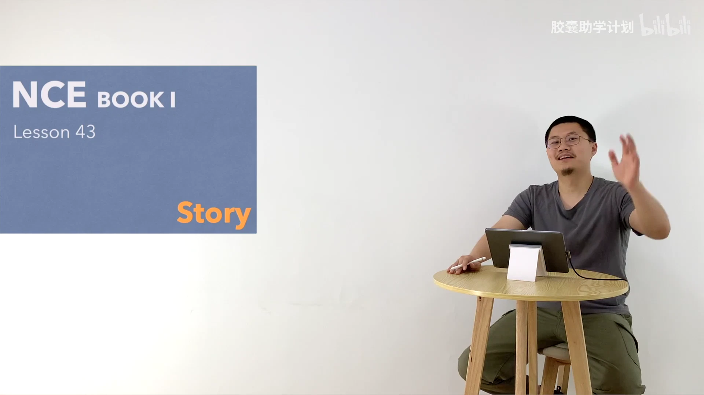

文字识别：胶囊助学计划 / NCE / BOOKI / Lesson 43 / Story

### 画面 00:00:10

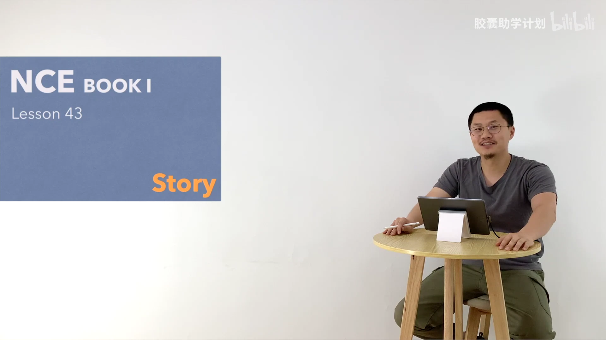

文字识别：Bilbil / 胶囊助学计划 / NCE / BOOKI / Lesson 43 / Story

### 画面 00:00:12

文字识别：胶囊助学计划bll

### 画面 00:00:15

文字识别：胶囊助学计划

### 画面 00:00:17

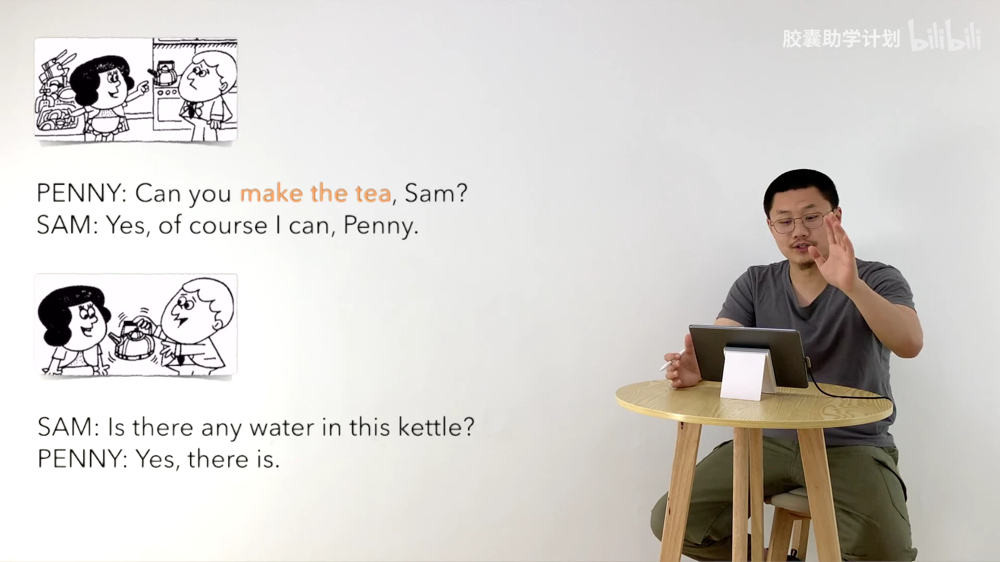

文字识别：胶囊助学计划 / PENNY: Can you make the tea, Sam? / SAM: Yes, of course I can, Penny. / SAM: Is there any water in this kettle? / PENNY: Yes, there is.

### 画面 00:00:22

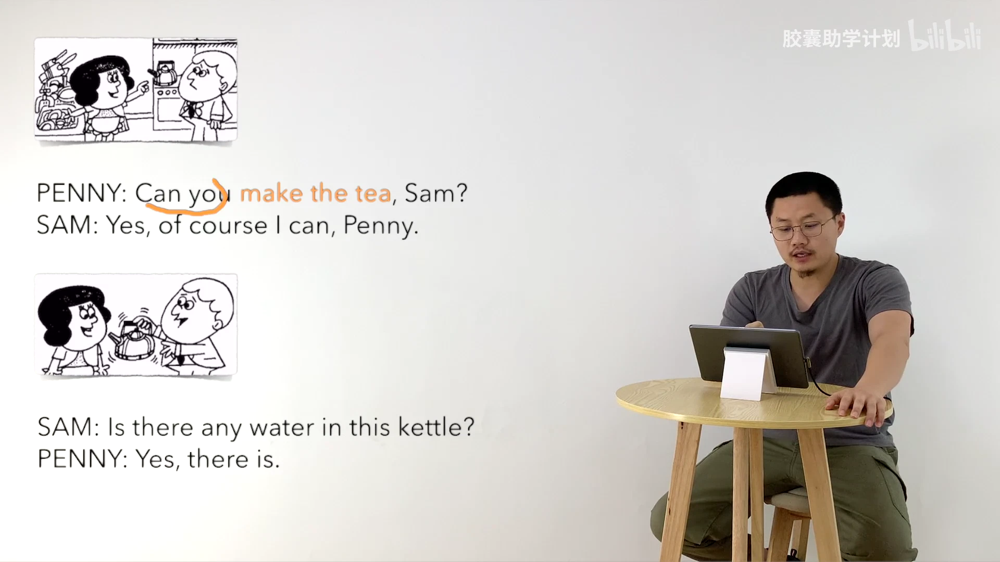

文字识别：胶囊助学计划bilb出 / PENNY: Can yoy make the tea, Sam? / SAM: Yes, of course I can, Penny. / SAM: Is there any water in this kettle? / PENNY: Yes, there is.

### 画面 00:00:28

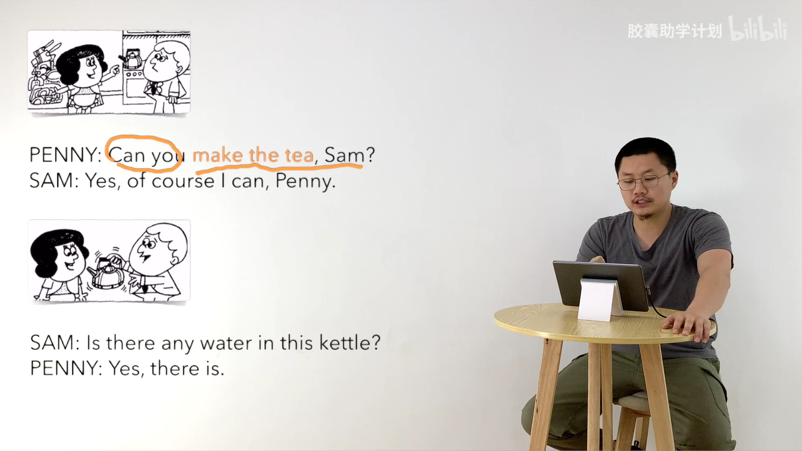

文字识别：胶囊助学计划 / PENNY: Can yoy make the tea, Sam? / SAM: Yes, of course I can, Penny. / SAM: Is there any water in this kettle? / PENNY: Yes, there is.

## 00:00:30–00:01:00

啊，对于各位来说，make这个单词我们在make the bookcase和make the bed这个地方见过两次。我没有记错的话，一个是二十九课，一个是三十九课，对吧？二十九课我们看过make the bed叫整理床铺，而三十九课我们学的make the bookcase指的是制作一个这个书柜，对吧？那在这儿你说make the tea，你再结合这个场景仔细看图，你觉得make the tea是什么意思？几乎就只

### 画面 00:00:31

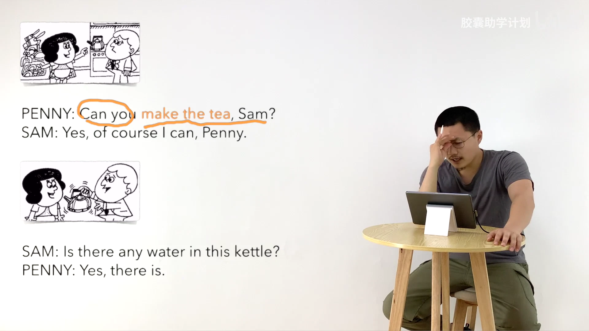

文字识别：胶囊助学计划 / PENNY: Can you make the tea, Sam? / SAM: Yes, of course I can, Penny. / SAM: Is there any water in this kettle? / PENNY: Yes, there is.

### 画面 00:00:35

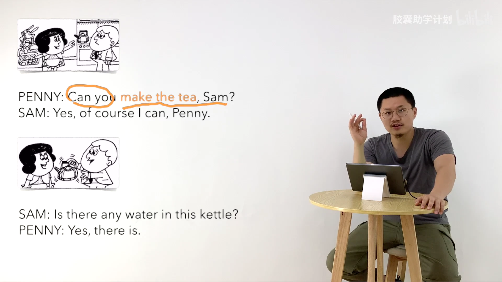

文字识别：胶囊助学计划 / PENNY: Can yoy make the tea, Sam? / SAM: Yes, of course I can, Penny. / SAM: Is there any water in this kettle? / PENNY: Yes, there is.

### 画面 00:00:54

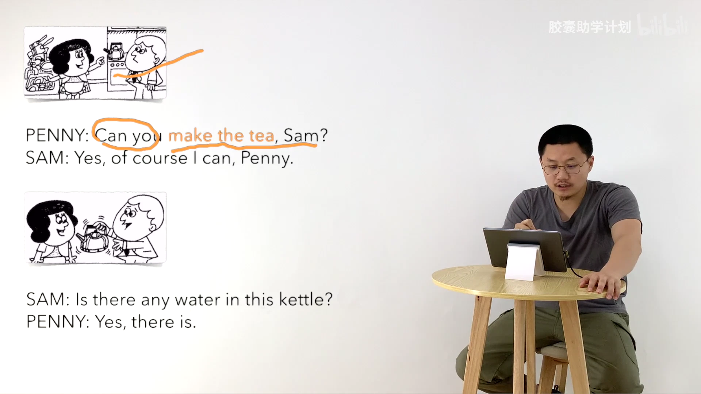

文字识别：胶囊助学计划 / PENNY:Can yoy make the tea, Sam? / SAM: Yes, of course I can, Penny. / SAM: Is there any water in this kettle? / PENNY: Yes, there is.

## 00:01:00–00:01:30

能翻译成沏茶了，对不对？或者煮茶啊？你能沏点茶或煮点茶吗？啊，做点茶吗？所以 make the tea，记住这个呃习惯用法啊，叫做做茶。你能做点茶吗，Sam？ Yes, of course I can. Penny说当然我能了。 Yes, I can. 叫我能了。 Yes, of course I can. 叫做当然我能了。 Of course就是一个我们可以理解为是加强语气的这样一个小词。当然能了，对吧，Penny？

### 画面 00:01:14

文字识别：胶囊助学计划 / PENNY:Can yoy make the tea, Sam? / SAM: Yes, of course I can, Penny. / SAM: Is there any water in this kettle? / PENNY: Yes, there is.

## 00:01:30–00:02:00

Sam说，Is there any water in this kettle?啊，说有任何的水吗？在这个kettle啊，刚才我们说了对吧？这个烧水壶，在这个水壶当中啊，有任何的水吗？注意any water，但是前面用的是is，说明water是可数不可数。四十一课我们刚刚学过，四十二课又练过，对吧？我们现在转到四十三课，希望各位没有忘记不可数，所以前面是用is的，对吧？所以回答说，Yes,

### 画面 00:01:32

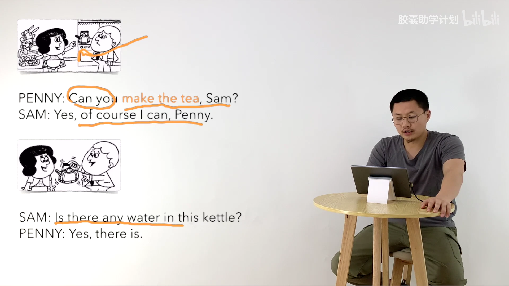

文字识别：胶囊助学计划 / PENNY: Can yoy make the tea, Sam? / SAM: Yes, of course I can, Penny. / SAM: Is there any water in this kettle? / PENNY: Yes, there is.

### 画面 00:01:36

文字识别：胶囊助学计划 / PENNY: Can yoy make the tea, Sam? / SAM: Yes, of course I can, Penny. / SAM: Is there any waterin this kettle? / PENNY: Yes, there Is.

### 画面 00:01:38

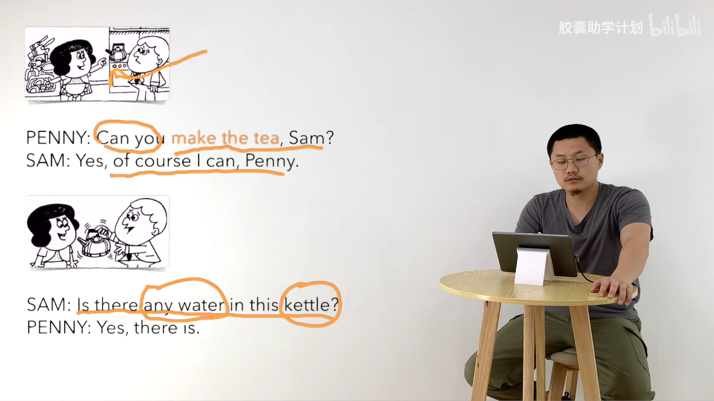

文字识别：胶囊助学计划 / PENNY: / Can yoy make the tea, Sam? / SAM: Yes, of course I can, Penny. / SAM: Is there any water in this / kettle? / PENNY: Yes, there Is.

### 画面 00:01:48

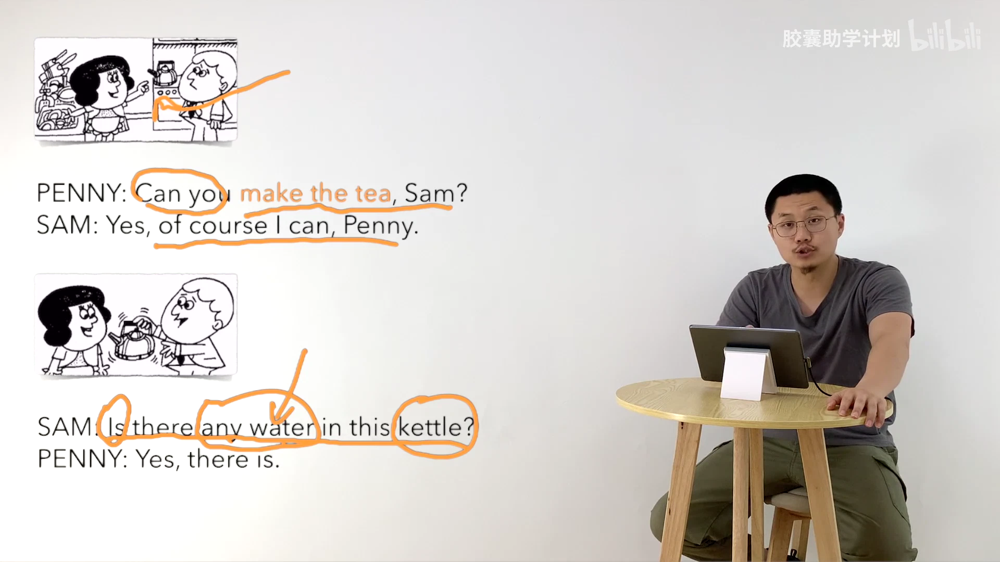

文字识别：胶囊助学计划 / PENNY: / Can yoy make the tea, Sam? / SAM: Yes, of course I can, Penny. / SAM Is there any waten in this / kettle? / PENNY: Yes, there Is.

### 画面 00:01:51

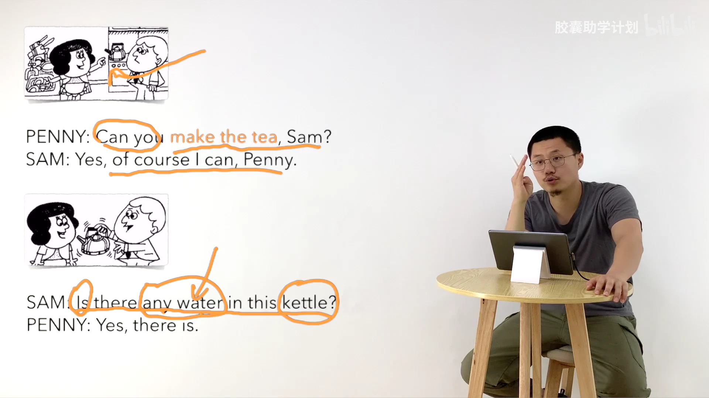

文字识别：胶囊助学计划 / PENNY: /  Can you make the tea, Sam? / SAM: Yes, of course I can, Penny. / SAM Is there anv water in this / kettle? / PENNY: Yes, there Is.

### 画面 00:01:59

文字识别：胶囊助学计划 / PENNY: / Can you make the tea, Sam? / SAM: Yes, of course I can, Penny. / SAM Is there any water in this / kettle? / PENNY: Yes, there Is.

## 00:02:00–00:02:30

there is.有啊。Continue.接下来我们看一个小的电影片段。电影片段当中出现了叫做 Let's make some tea. 让我们来做点茶喝吧。OK. Hello, darling. Mom, how are you? Honestly. Why not? I am fucking furious. I am so

### 画面 00:02:01

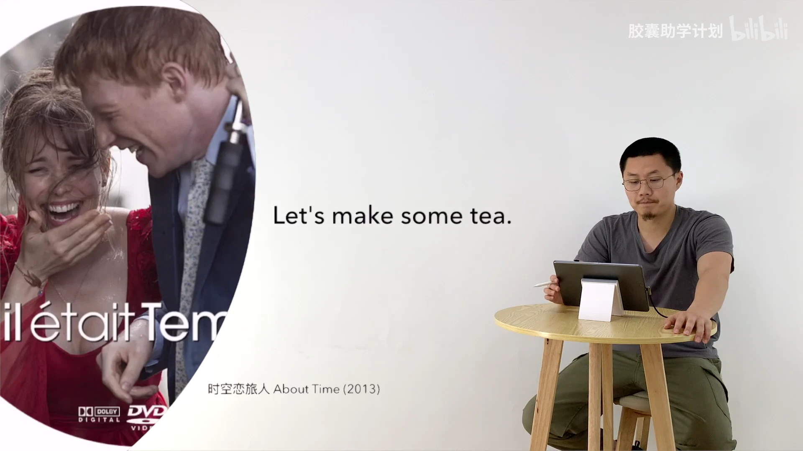

文字识别：胶囊助学计划 / Let's make some tea. / ilétaitTem / 时空恋旅人About Time(2013) / DODOLOY / DVD / DIGITAL / VID

### 画面 00:02:05

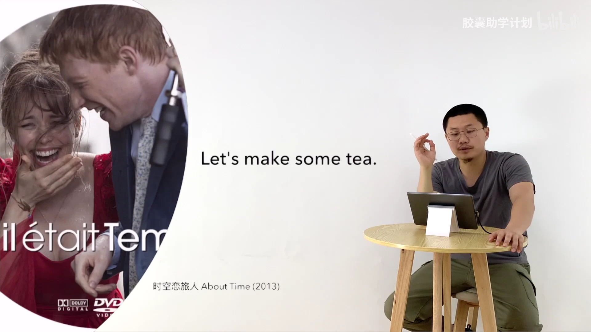

文字识别：胶囊助学计划 / Let's make some tea. / ilétaitTem / 时空恋旅人About Time(2013) / DODOLOY / DVD / DIGITAL / VID

### 画面 00:02:07

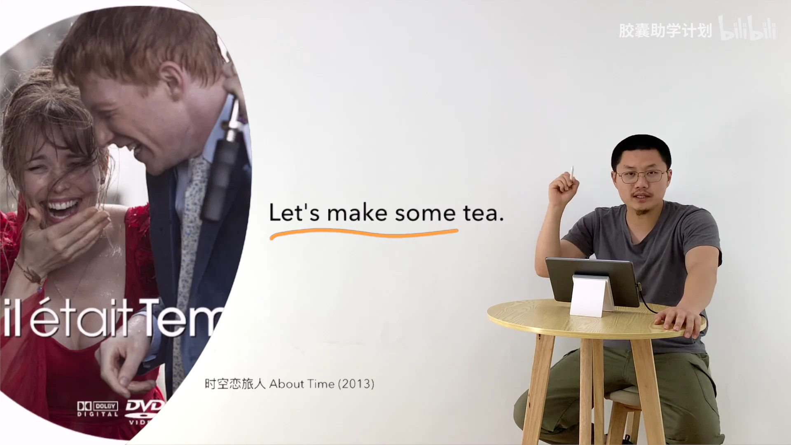

文字识别：胶囊助学计划 / Let's make some / tea. / ilétaitTem / 时空恋旅人About Time(2013) / DODOLOY / DVD / DIGITAL / VID

### 画面 00:02:12

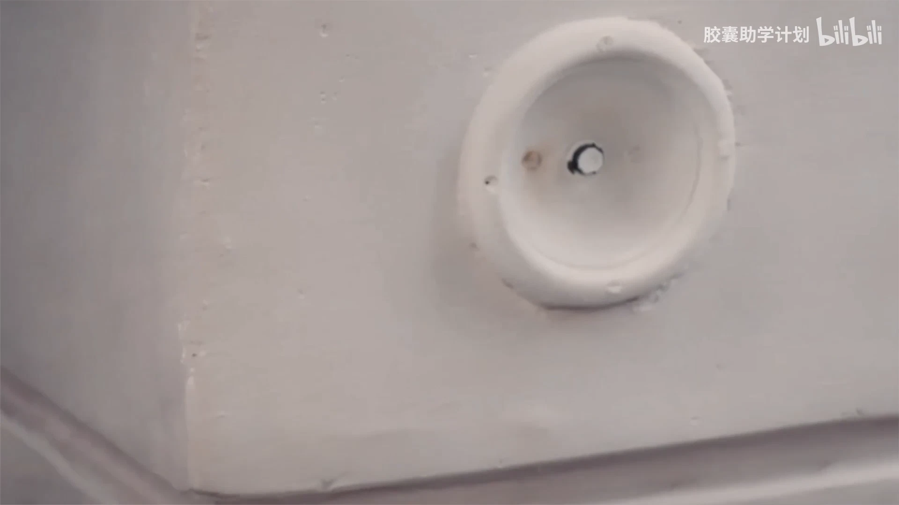

文字识别：Bilbili / 胶囊助学计划

### 画面 00:02:14

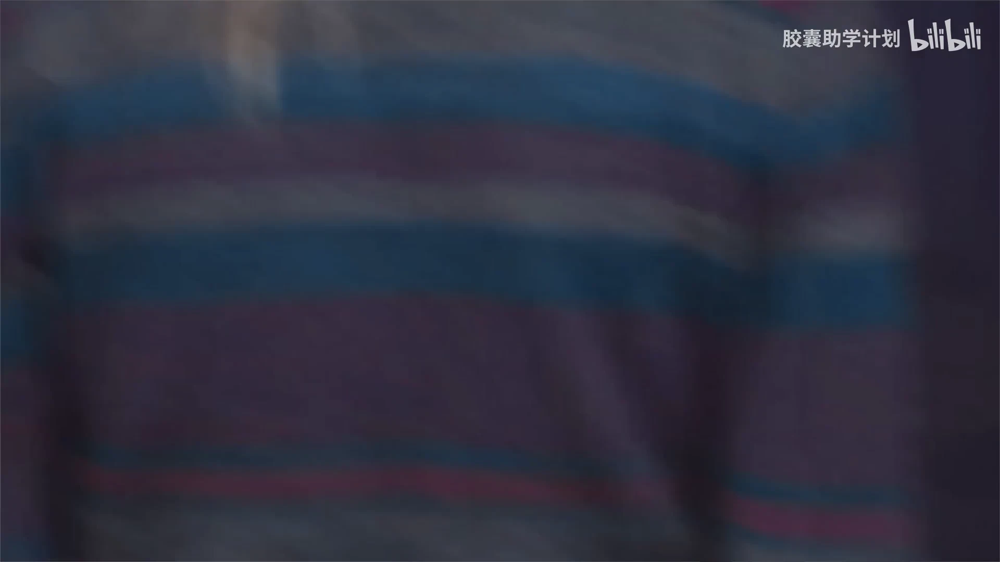

文字识别：bilibili / 胶囊助学计划

### 画面 00:02:16

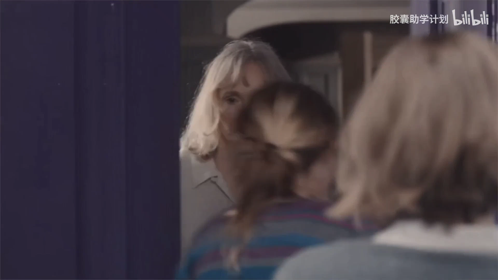

文字识别：bilibili / 胶囊助学计划

### 画面 00:02:18

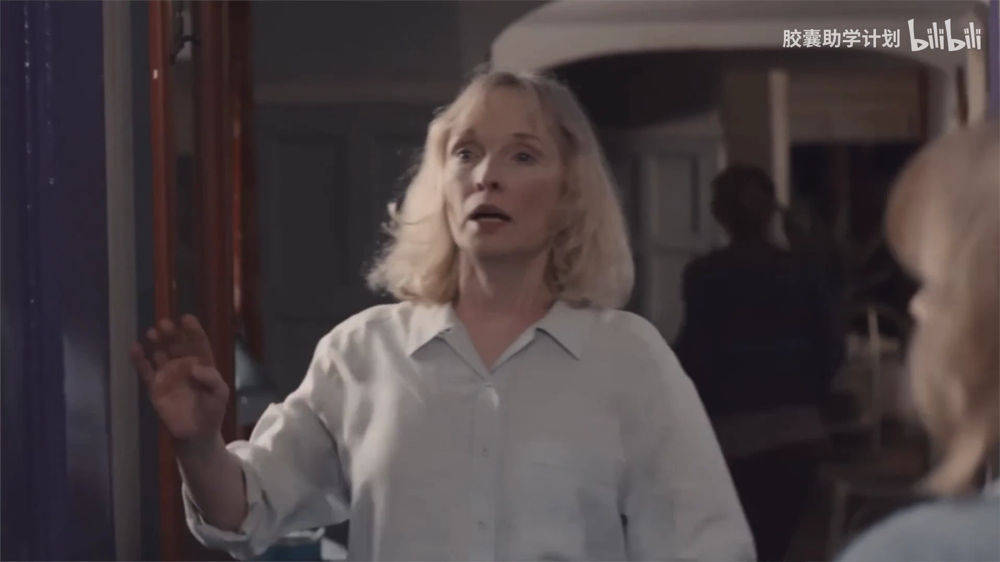

文字识别：Bilbii / 胶囊助学计划

### 画面 00:02:20

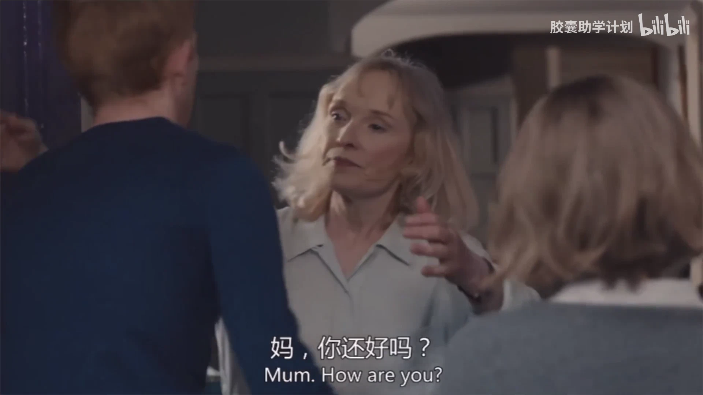

文字识别：Bilbili / 胶囊助学计划 / 妈，你还好吗？ / Mum. How are you?

### 画面 00:02:22

文字识别：Bilbili / 胶囊助学计划 / 实话实说 / Honestly?

### 画面 00:02:24

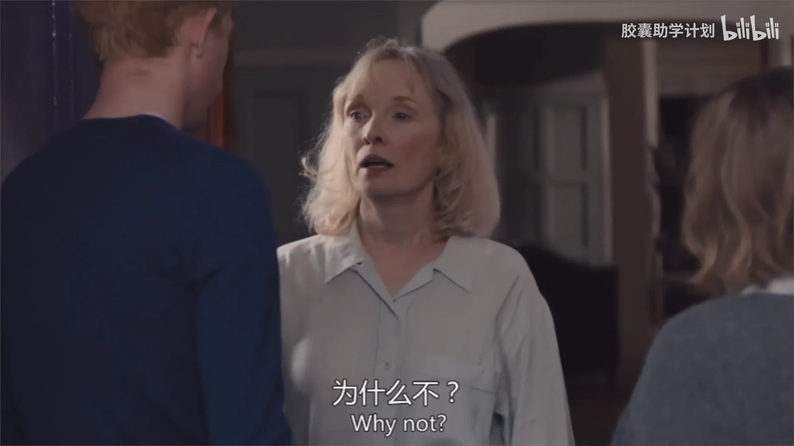

文字识别：bilibili / 胶囊助学计划 / 为什么不？ / Why not?

### 画面 00:02:26

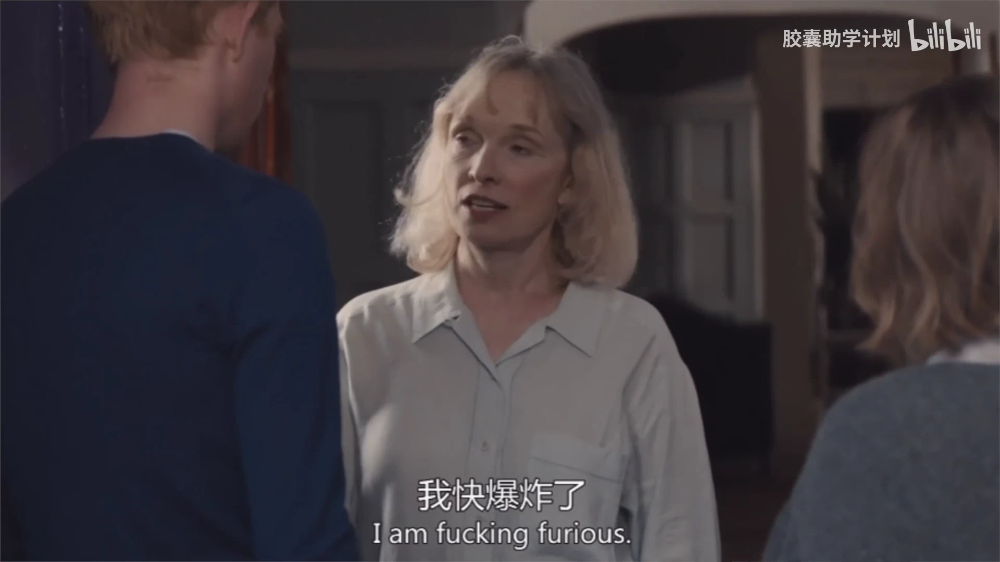

文字识别：Bilbili / 胶囊助学计划 / 我快爆炸了 / I am fucking furious.

### 画面 00:02:28

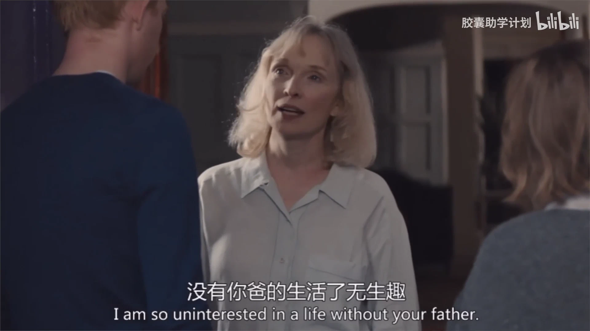

文字识别：bilbli / 胶囊助学计划 / 没有你爸的生活了无生趣 / I am so uninterested in a life without your father.

## 00:02:30–00:03:00

uninterested in a life without your father, Mary. Come on, let's make some tea. Okay, come on, let's make some tea. 让我们一起去煮点茶喝吧。 Okay, 好，接下来回到文章，说 Where's the tea? 啊，她的老公一看就不干活，对吧？谁这个让他煮个茶，每一步都要问。他说茶在哪儿？ Is over there. 好， over there 这个小的短语，各位也可以记下来。

### 画面 00:02:30

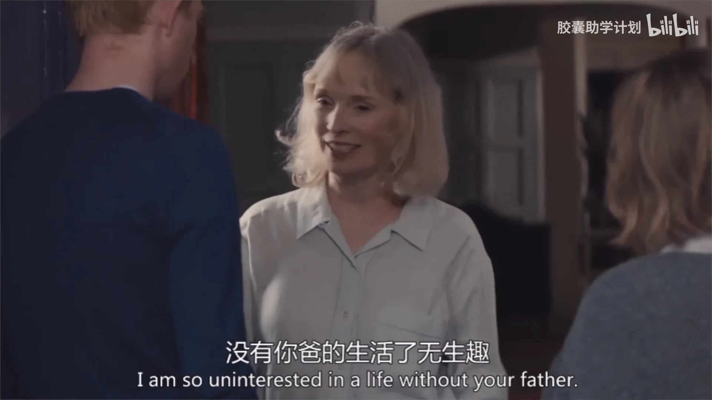

文字识别：bilbili / 胶囊助学计划 / 没有你爸的生活了无生趣 / I am so uninterested in a life without your father.

### 画面 00:02:32

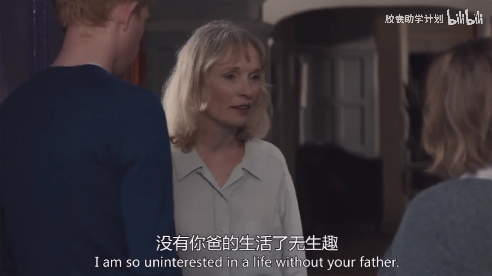

文字识别：bilbili / 胶囊助学计划 / 没有你爸的生活了无生趣 / I am so uninterested in a life without your father.

### 画面 00:02:34

文字识别：Bilibili / 胶囊助学计划 / 玛丽，来，我们喝点茶 / Mary. Come on, let's make some tea.

### 画面 00:02:36

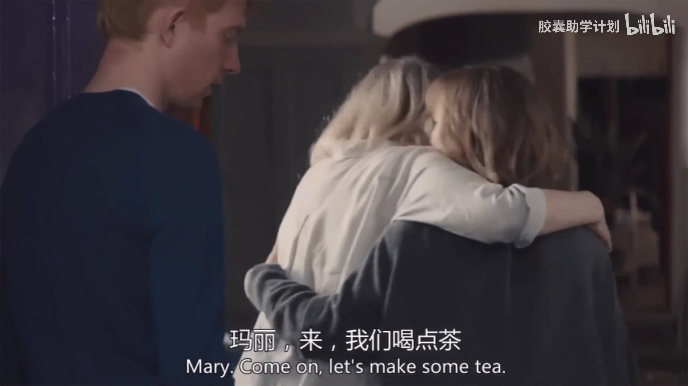

文字识别：bilibili / 胶囊助学计划 / 玛丽，来，我们喝点茶 / Mary. Come on, let's make some tea.

### 画面 00:02:38

文字识别：Bilibili / 胶囊助学计划 / Let's make some tea. / ilétaitTem / 时空恋旅人About Time(2013) / DODOLEY / DVD / DIGITAL / VID

### 画面 00:02:40

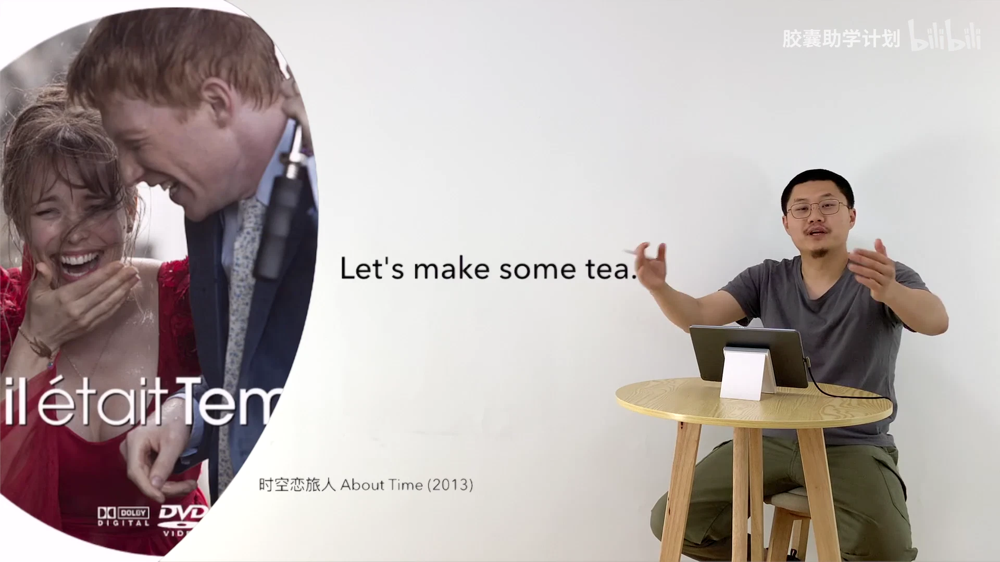

文字识别：胶囊助学计划 / Let's make some / tea. / ilétaitTem / 时空恋旅人About Time(2013) / DODOLOY / DVD / DIGITAL / VID

### 画面 00:02:44

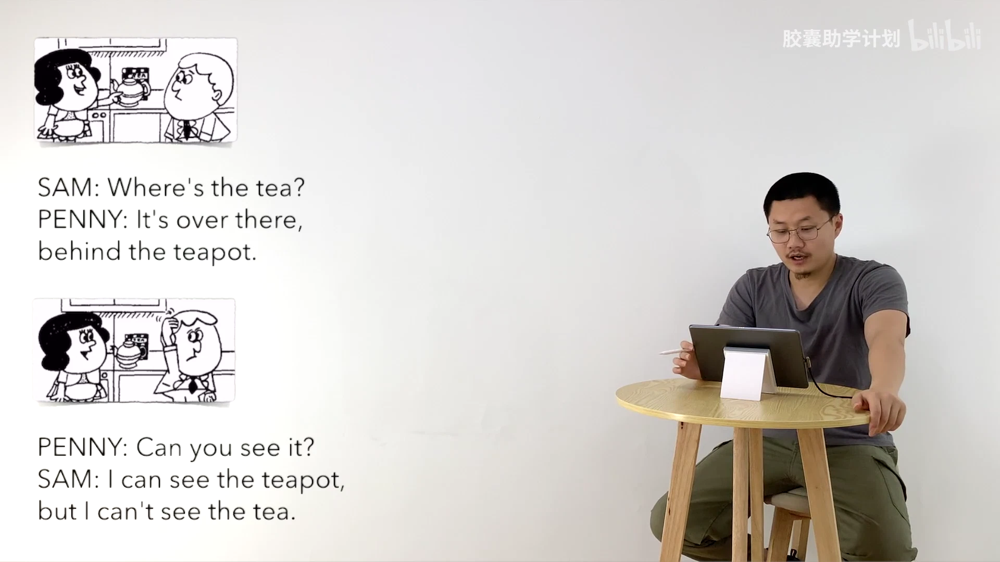

文字识别：胶囊助学计划 / SAM: Where's the tea? / PENNY: It's over there, / behind the teapot. / PENNY: Can you see it? / SAM: I can see the teapot, / but I can't see the tea.

### 画面 00:02:46

文字识别：胶囊助学计划b出出 / SAM: Where's the tea? / PENNY: It's over there, / behind the teapot. / PENNY: Can you see it? / SAM: I can see the teapot, / but I can't see the tea.

### 画面 00:02:50

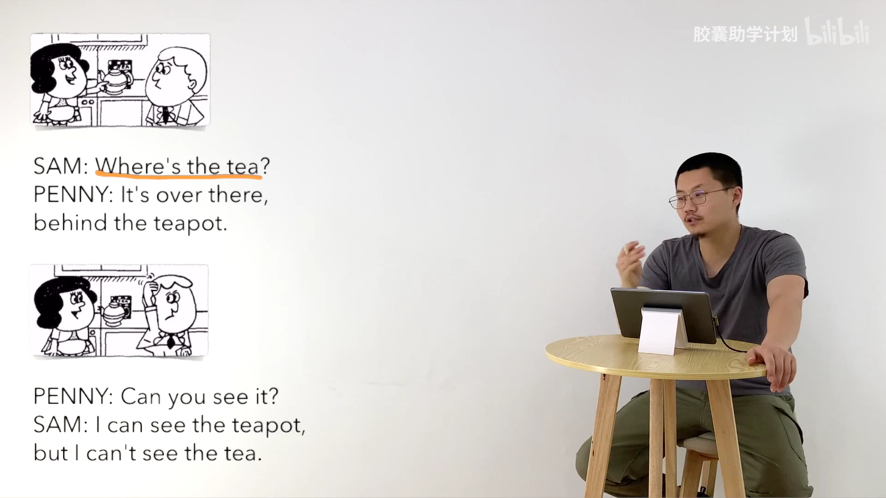

文字识别：胶囊助学计划bib山 / SAM: Where's the tea? / PENNY: It's over there, / behind the teapot. / PENNY: Can you see it? / SAM: I can see the teapot, / but I can't see the tea.

### 画面 00:02:57

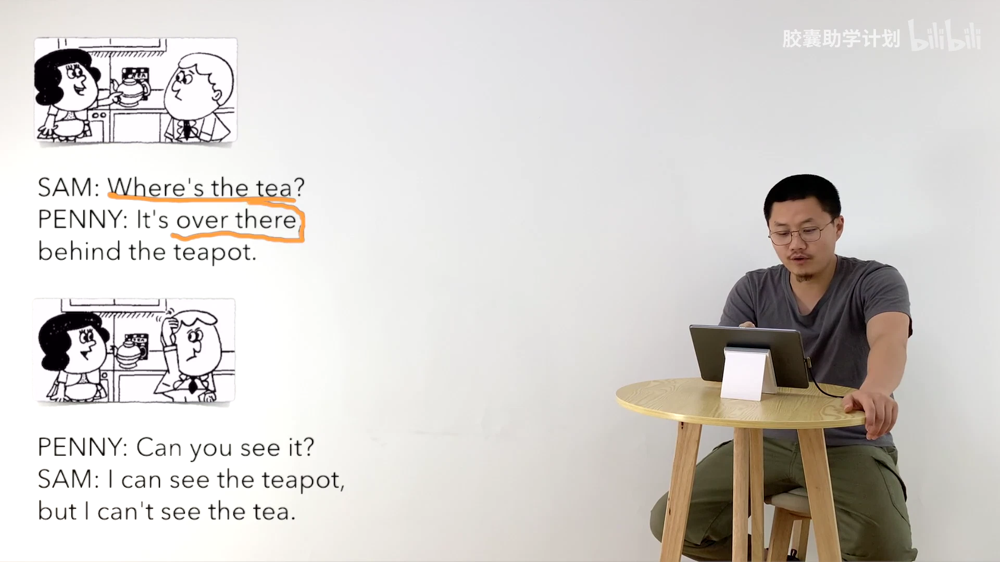

文字识别：胶囊助学计划b山出 / SAM: Where's the tea? / PENNY: It's over there / behind the teapot. / PENNY: Can you see it? / SAM: I can see the teapot, / but I can't see the tea.

## 00:03:00–00:03:30

Over there有用法上有一个很好玩的现象，必须配合你几乎的身体的某一个部位去指，因为over there叫在那里，这个那指的是哪儿？要么用眼神，要么用手。叫做，比如说我用眼神，我说我我跟您说is over there，用眼神盯一下，别人能明白。或者你直接用手说，用手is over there，只有这样才可以叫在那里over

### 画面 00:03:00

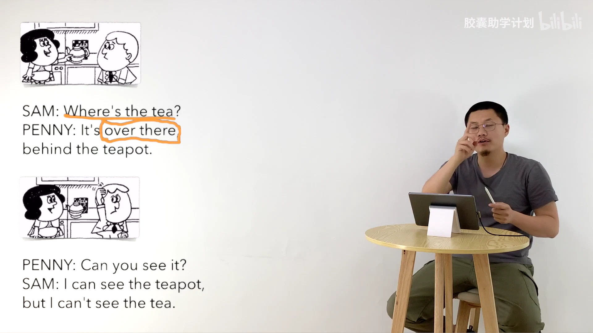

文字识别：胶囊助学计划 / SAM: Where's the tea? / PENNY: It'sover there / behind the teapot. / PENNY: Can you see it? / SAM: I can see the teapot, / but I can't see the tea.

## 00:03:30–00:04:00

there。这两个单词放在一起去记，OK？一个小的短语 behind the teapot。注意啊，在这个茶壶的后面啊，直接告诉他茶壶也在什么地方了。OK？Can you see it？你能看见吗？I can see the teapot。我能看见这个茶壶，but I can't see the tea。但是我完全看不见这个茶啊。这个就是我们经常说老公老婆吵架说这活还不如我自己干呢，对吧？你什么都

### 画面 00:03:30

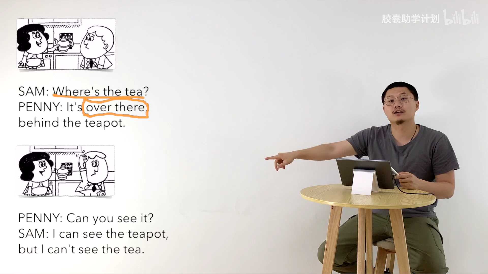

文字识别：胶囊助学计划bl出 / SAM: Where's the tea? / PENNY: It'sover there / behind the teapot. / PENNY: Can you see it? / SAM: I can see the teapot, / but I can't see the tea.

### 画面 00:03:36

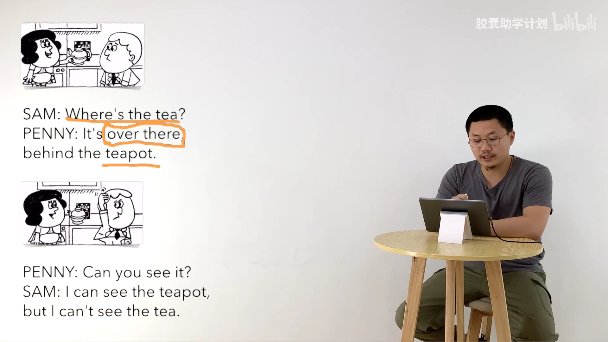

文字识别：胶囊助学计划bi出 / SAM: Where's the tea? / PENNY: It'sover there / behind the teapot. / PENNY: Can you see it? / SAM: I can see the teapot, / but I can't see the tea.

### 画面 00:03:38

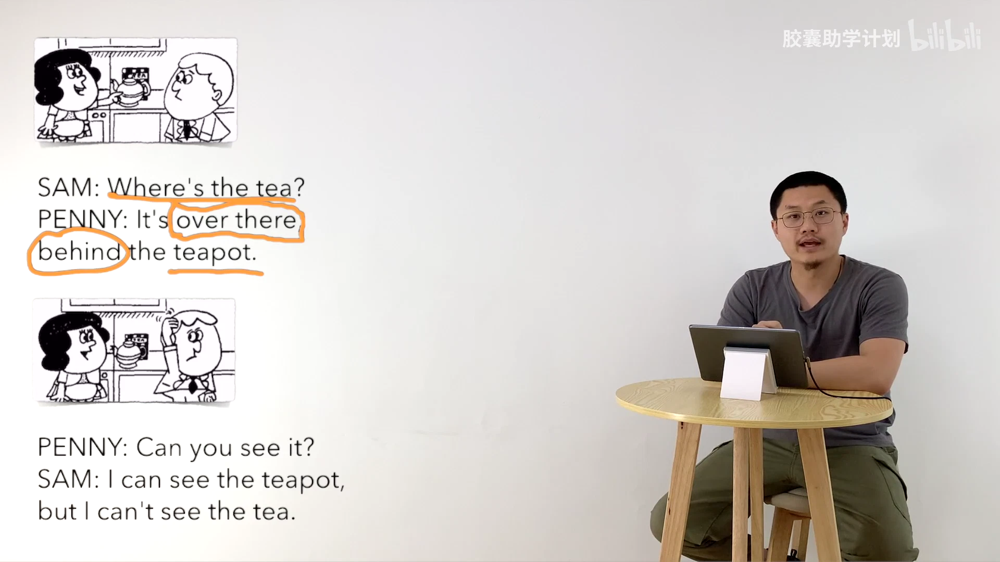

文字识别：胶囊助学计划blb出 / SAM: Where's the tea? / PENNY: It'sover there / behind the teapot. / PENNY: Can you see it? / SAM: I can see the teapot, / but I can't see the tea.

### 画面 00:03:44

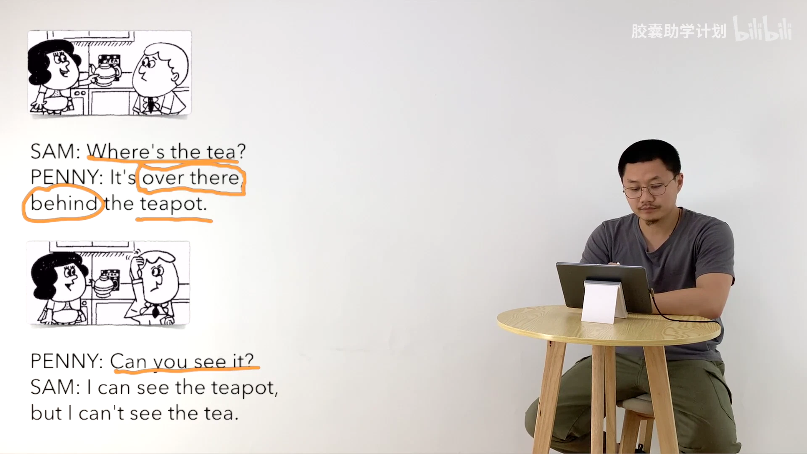

文字识别：胶囊助学计划b出b出 / SAM: Where's the tea? / PENNY: It'sover there / behind the teapot. / PENNY: Can vou see it? / SAM: I can see the teapot, / but I can't see the tea.

### 画面 00:03:46

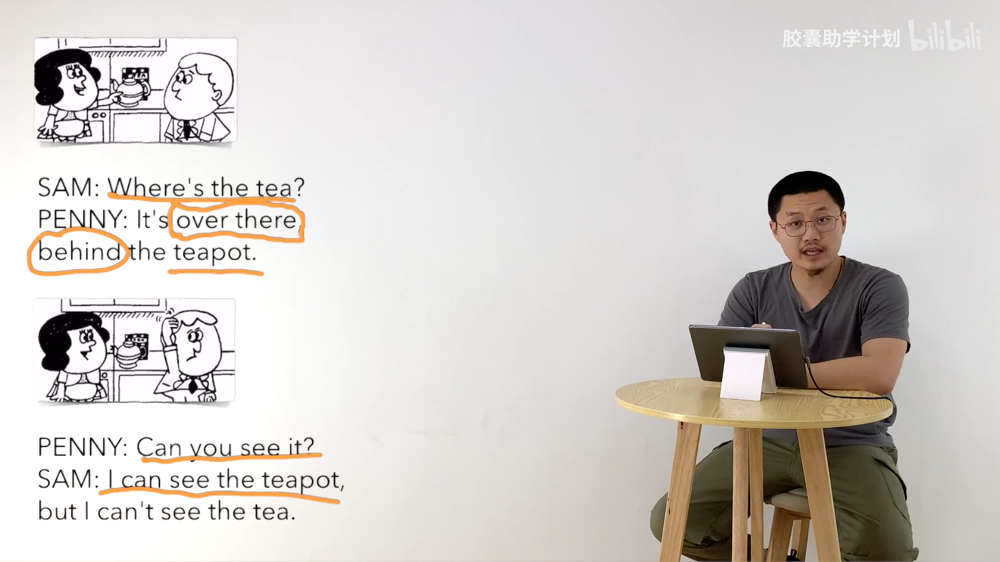

文字识别：Bilbili / 胶囊助学计划 / SAM: Where's the tea? / PENNY: It'sover there / behind the teapot. / PENNY: Can vou see it? / SAM: L can see the teapot, / but I can't see the tea.

### 画面 00:03:50

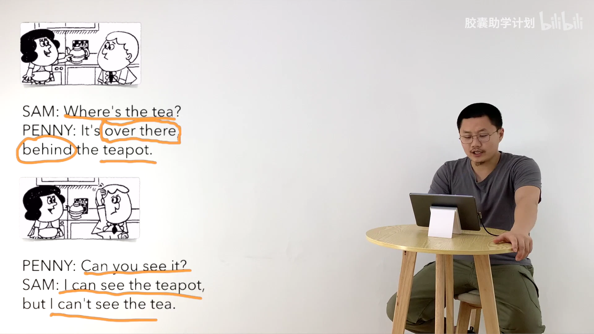

文字识别：yBibil / 胶囊助学计划 / SAM: Where's the tea? / PENNY: It'sover there / behind the teapot. / PENNY: Can vou see it? / SAM:  can see the teapot, / but I can't see the tea.

### 画面 00:03:57

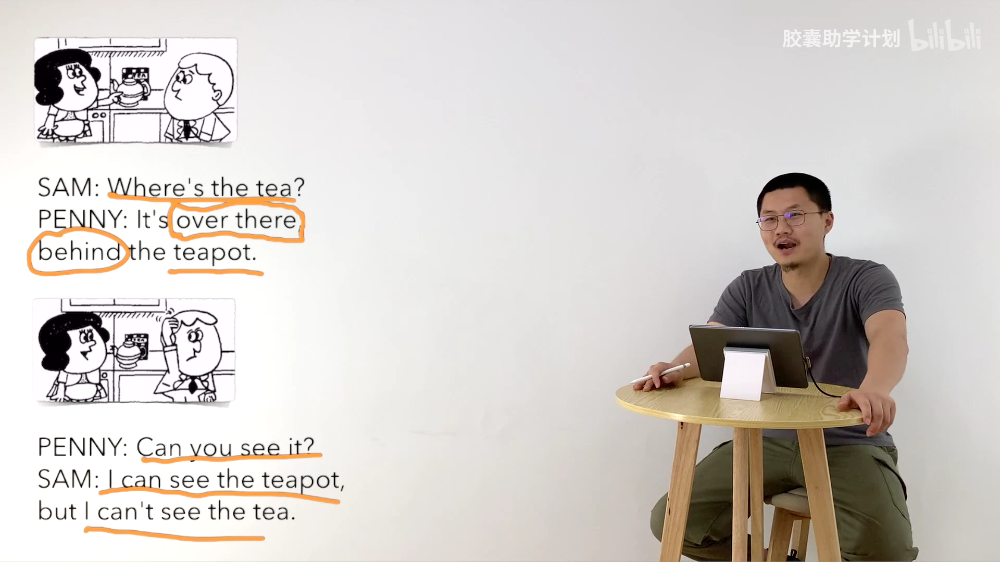

文字识别：Bilbli / 胶囊助学计划 / SAM: Where's the tea? / PENNY: It'sover there / behind the teapot. / PENNY: Can vou see it? / SAM: Lcan see the teapot, / but I can't see the tea.

## 00:04:00–00:04:30

我，还不如我自己干呢。我全给你找好了，对吧？那你我我看不见茶，看见茶壶看不见茶啊。接下来说，哎，把那茶壶一挪，There it is。其实这句话呀，你可以把它理解为反过来，叫做 It is there，叫做它在那里。OK，所以它的含义是一样的，It is there 或者 There it is。OK，It's in front of you，就在你的正前方啊。Oh yes，I can see

### 画面 00:04:03

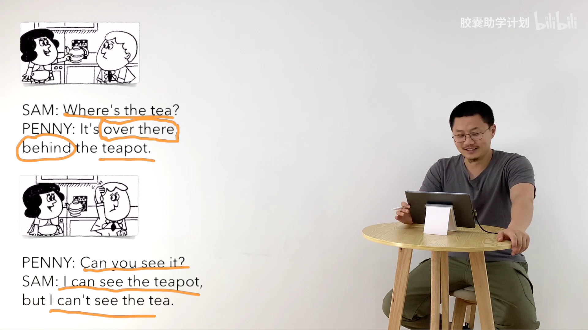

文字识别：Bilb出 / 胶囊助学计划 / SAM: Where's the tea? / PENNY: It'sover there / behind the teapot. / PENNY: Can vou see it? / SAM:  can see the teapot, / but I can't see the tea.

### 画面 00:04:06

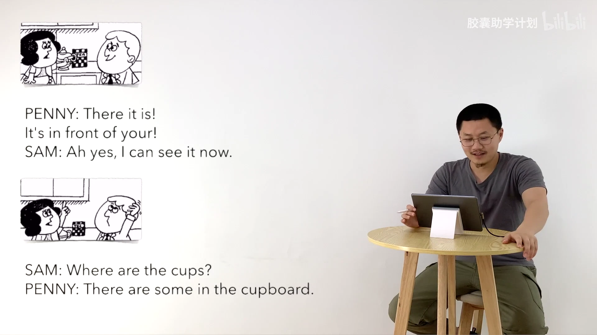

文字识别：胶囊助学计划 / PENNY: There it is! / It's in front of your! / SAM: Ah yes, I can see it now. / SAM: Where are the cups? / PENNY: There are some in the cupboard.

### 画面 00:04:09

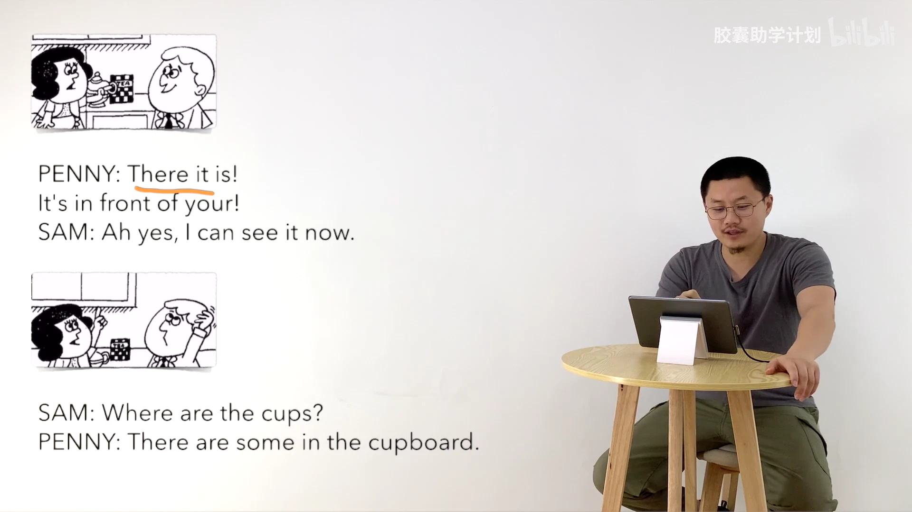

文字识别：胶囊助学计划 / PENNY: There it is! / It's in front of your! / SAM: Ah yes, I can see it now. / SAM: Where are the cups? / PENNY: There are some in the cupboard.

### 画面 00:04:14

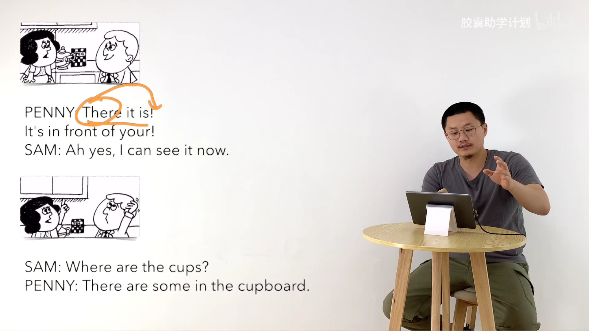

文字识别：胶囊助学计划 / PENNYThere it is! / It's in front of your! / SAM: Ah yes, I can see it now. / SAM: Where are the cups? / PENNY: There are some in the cupboard.

### 画面 00:04:26

文字识别：胶囊助学计划山业 / PENNYThere it is! / It's in front of your! / SAM: Ah yes, I can see it now. / SAM: Where are the cups? / PENNY: There are some in the cupboard.

### 画面 00:04:29

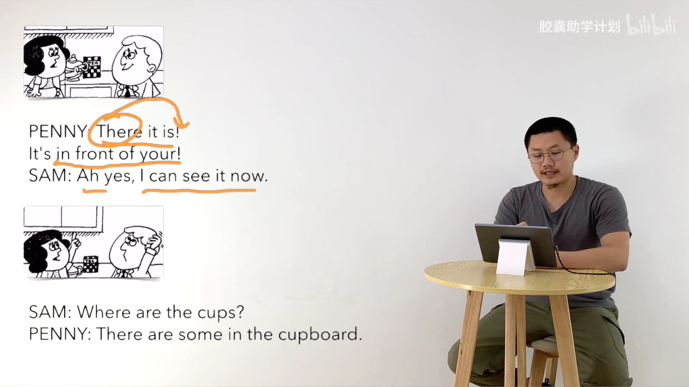

文字识别：胶囊助学计划 / PENNY / There it is! / It's in front of your! / SAM: Ah yes, I can see it now. / SAM: Where are the cups? / PENNY: There are some in the cupboard.

## 00:04:30–00:05:00

now.啊，说哦，好吧，好吧，我现在能看见了。Continue.那Where are the cups? Sam又开始问，是吧？煮茶缺几个东西，他全问了一遍。他说：“那我煮完茶，这个茶杯在哪儿呢？”Where are the cups? Penny说：“There are some in the cupboard.”说有一些啊，在这个橱柜上方啊，橱柜当中，他连找都不找，直接问，对吧？在这个食橱的上方啊，有有一些。Continue. Can you

### 画面 00:04:36

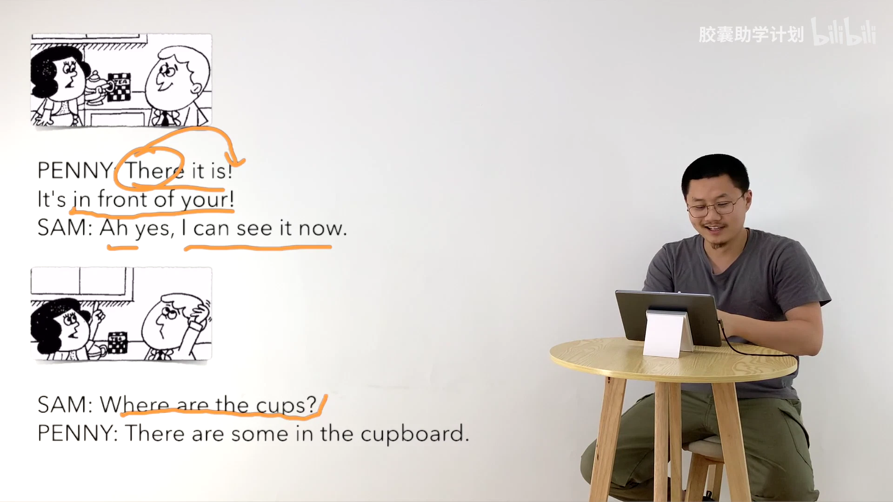

文字识别：胶囊助学计划 / PENNY / There it is! / It's in front of your! / SAM: Ah yes, I can see it now. / SAM: Where are the cups? / PENNY: There are some in the cupboard.

### 画面 00:04:38

文字识别：胶囊助学计划 / PENNY / There it is! / It's in front of your! / SAM: Ah yes, I can see it now. / SAM: / Where are the cups? / PENNY: There are some in the cupboard.

### 画面 00:04:47

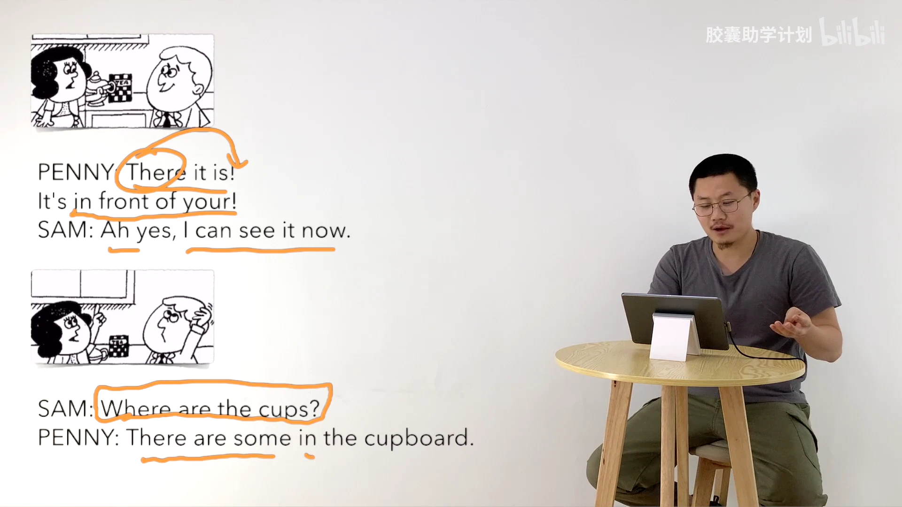

文字识别：胶囊助学计划 / PENNY / There it is! / It's in front of your! / SAM: Ah yes, I can see it now. / SAM: / Where are the cups? / PENNY: There are some in the cupboard.

### 画面 00:04:49

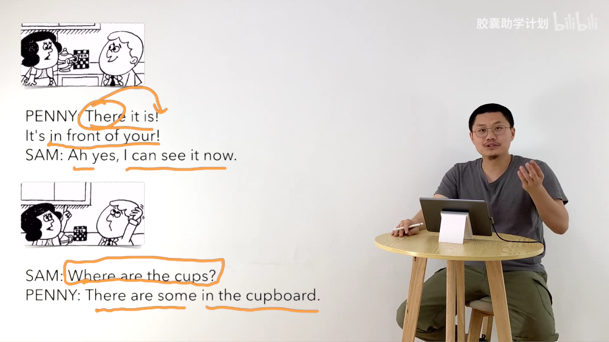

文字识别：胶囊助学计划 / PENNY / There it is! / It's in front of your! / SAM: Ah yes, I can see it now. / SAM: / Where are the cups? / PENNY: There are some in the cupboard.

### 画面 00:04:58

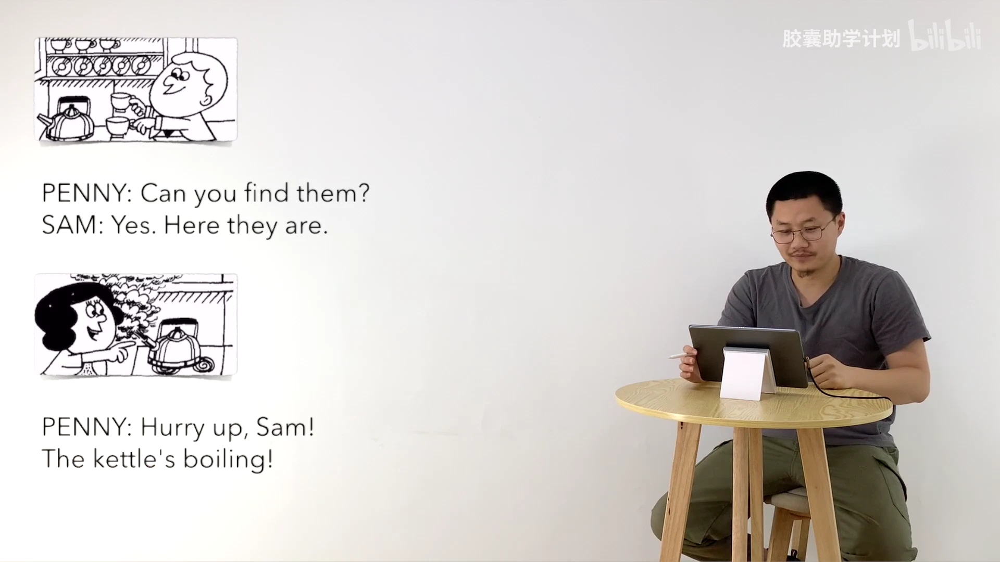

文字识别：胶囊助学计划 / 777 / PENNY: Can you find them? / SAM: Yes. Here they are. / PENNY: Hurry up, Sam! / The kettle's boiling!

## 00:05:00–00:05:30

find the啊你能找到吗？注意 find刚才我们讲单词的时候提到了之前对吧？它一定指的是什么？找到找没找到对吧？这个动作强调的结果，不强调动作的过程啊。Yes, here they are.啊 here they are是我们之前学过了吧？对吧？叫 they are here或者你可以理解为就是在这儿呢啊这我们之前就见过了。OK也讲过了. Hurry up, Sam.那Penny说快点Sam. The bottles,

### 画面 00:05:06

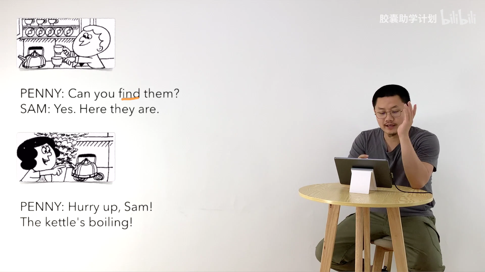

文字识别：胶囊助学计划山山 / PENNY: Can you find them? / SAM: Yes. Here they are. / PENNY: Hurry up, Sam! / The kettle's boiling!

### 画面 00:05:16

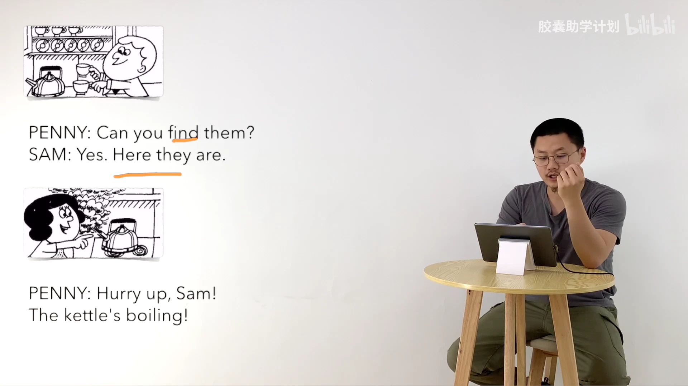

文字识别：胶囊助学计划 / PENNY: Can you find them? / SAM: Yes. Here they are. / PENNY: Hurry up, Sam! / The kettle's boiling!

### 画面 00:05:19

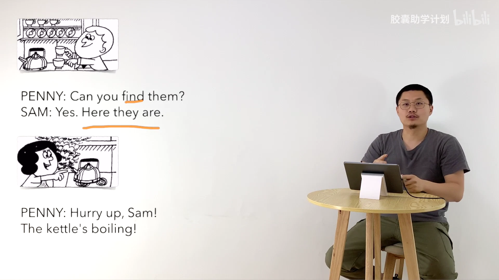

文字识别：胶囊助学计划 / 7171 / PENNY: Can you find them? / SAM: Yes. Here they are. / PENNY: Hurry up, Sam! / The kettle's boiling!

### 画面 00:05:28

文字识别：胶囊助学计划 / C8 / PENNY: Can you find them? / SAM: Yes. Here they are. / PENNY: Hurry up, Sam! / The kettle's boiling!

## 00:05:30–00:06:00

recording. Transcribe the exact words in their original spoken languages. Never translate. Preserve repetitions, questions and examples. This is Sam. The bottles, the kettle's boiling.说你这个壶啊，水都烧开了，已经开了，对吧？正在开了。那我们汉语不这样说，你会觉得很怪啊。表示的就是这个水已经开了。OK，也就换一种来说，他让他煮点茶，每一步都要监控一下，让精准监控啊。这个茶基本上是这个Penny做的，这名女士做的啊，跟Sam没啥关系，是吧？OK, again.好，接下来各位看着文章，要么闭上眼睛，

### 画面 00:05:30

文字识别：胶囊助学计划 / X77 / PENNY: Can you find them? / SAM: Yes. Here they are. / PENNY: Hurry up, Sam! / The kettle's boiling!

### 画面 00:05:44

文字识别：胶囊助学计划 / X77 / PENNY: Can you find them? / SAM: Yes. Here they are. / PENNY: Hurry up, Sam! / The kettle's boiling!

### 画面 00:05:47

文字识别：胶囊助学计划 / X77 / PENNY: Can you find them? / SAM: Yes. Here they are. / PENNY: Hurry up, Sam! / The kettle's boiling!

### 画面 00:05:53

文字识别：胶囊助学计划 / 8 / 777 / PENNY: Can you find them? / SAM: Yes. Here they are. / PENNY: Hurry up, Sam! / The kettle's boiling!

### 画面 00:05:55

文字识别：Bibili / 胶囊助学计划 / Comprehension

### 画面 00:05:57

文字识别：胶囊助学计划 / Comprehension

## 00:06:00–00:06:30

我们做口语听力练习。来了，第一题。Is Penny going to make the tea? Tea? Penny是那个女主啊。No, she isn't. 下一题，Is Sam going to make the tea? Yes, he is. 那Sam是这个男主对吧？啊，其实也不是他做的了，都是Penny做的。Next one. Is there any water in the kettle?

### 画面 00:06:02

文字识别：胶囊助学计划 / 出出 / Comprehension / 1 T: Is Penny going to make the tea?

### 画面 00:06:05

文字识别：Biibii / 胶囊助学计划 / Comprehension / 1 T: Is Penny going to make the tea?

## 00:06:30–00:07:00

Yes, there is. Next question. Is there any tea in the kettle? No, there isn't. Continue. Where is the tea? Is behind the teapot. Ah, in this teapot's back. Next one. Can Sam see the tea? No, he can't. He can't see it. He can't see it. He

### 画面 00:06:35

文字识别：胶囊助学计划blb鼎 / Comprehension / 4 T: Is there any tea in the kettle?

### 画面 00:06:40

文字识别：胶囊助学计划 / Comprehension / 4 T: Is there any tea in the kettle? / S: No, there isn't.

### 画面 00:06:43

文字识别：胶囊助学计划 / Comprehension / 5 T:Where is the tea?

### 画面 00:06:47

文字识别：胶囊助学计划 / Comprehension / 5 T:Where is the tea? / S: It's behind the teapot.

## 00:07:00–00:07:30

### 画面 00:07:05

文字识别：胶囊助学计划 / Comprehension / 7 T: Are there any cups on the table?

### 画面 00:07:29

文字识别：胶囊助学计划 / Asking questions

## 00:07:30–00:08:00

Ah, uh,还是老习惯。各位可以先抬头看一个啊。说Ask me if不重要。Sam can make the tea. Ah, Sam能制作茶。变一般疑问句，Can提前。今天刚学过，对吧？在上一个视频当中叫做Can Sam make the tea?好，What对the tea提问，对吧？叫做What can Sam make?他能做什么啊？制作什么？Okay, next one. The

### 画面 00:07:36

文字识别：bibi出 / 胶囊助学计划 / Asking questions / 1 T: Ask me if Sam can make the tea.

### 画面 00:07:42

文字识别：胶囊助学计划 / Asking questions / 1 T: Ask me if Sam can make the tea.

## 00:08:00–00:08:30

tea is over there. Over there,对吧？记得吧？我说 over there，对吧？一定要配合一些肢体语言，眼神也算肢体语言了。一般疑问句，Is the tea over there? Where?对 over there 提问，对吧？叫做 Where is the tea? Okay, next one. Ask me if Sam can see the tea. 各位给答案啊！这个地方你

### 画面 00:08:01

文字识别：胶囊助学计划 / Asking questions / 2 T: Ask me if the tea is over there.

### 画面 00:08:18

文字识别：胶囊助学计划 / Asking questions / 2 T: Ask me if the tea is over there. / S: Is the tea over there? / T: Where ...? / S: Where is the tea?

### 画面 00:08:21

文字识别：BiBil / 胶囊助学计划 / Asking questions

### 画面 00:08:23

文字识别：胶囊助学计划bilb出 / Asking questions / 3 T: Ask me if Sam can see the tea.

## 00:08:30–00:09:00

是要张开嘴的，不要只听啊，只听效果很差的。Can Sam see the tea? What? 各位张嘴说答案。What can Sam see? OK，玩一个。Next one. Ask me if the cups are in the cupboard. 二题前，Are the cups in the cupboard? Continue. Where? Where are the cups?

### 画面 00:08:50

文字识别：胶囊助学计划 / Asking questions / 4 T: Ask me if the cups are in the cupboard. / S: Are the Cups in the cupboard?

## 00:09:00–00:09:30

Okay, one more. Good. 好，这地方有一个小的 typo 啊，注意它应该是小写，不应该大写。 Continue. Ask me if Sam can find the cops. 答案，各位自己说。 Can Sam find the cops? What? 各位说答案。给答案。 What can Sam find? 他能找到什么？ Okay, one more.

### 画面 00:09:06

文字识别：胶囊助学计划 / Asking questions / 4 T: Ask me if the cups are in the cupboard. / S: Are the Cups in the cupboard? / T: Where ..? / S: Where are the cups?

### 画面 00:09:08

文字识别：胶囊助学计划 / Asking questions / 5 T: Ask me if Sam can find the cups.

### 画面 00:09:15

文字识别：胶囊助学计划b出b出 / Asking questions / 5 T: Ask me if Sam can find the cups.

### 画面 00:09:28

文字识别：胶囊助学计划 / Recap / Patterns / & / can / Grammar / Words / Expression

## 00:09:30–00:10:00

Recap，本课还是没有新的知识点，关键来说我们还是围绕着can这个单词啊，整个文章其实就是在讲can啊，写这个文章的目的就是让各位知道can放在现实生活当中或者模拟现实生活当中是如何去用的。OK，那本课的家作业，第一，绿皮书四十三课各位可以写了。其次，文章要跟读至熟读成诵，再然后要给自己讲解

### 画面 00:09:30

文字识别：胶囊助学计划 / Recap / Patterns / & / can / Grammar / Words / Expression

### 画面 00:09:32

文字识别：胶囊助学计划 / Recap / Patterns / & / can / Grammar / Words / Expression

### 画面 00:09:41

文字识别：胶囊助学计划 / Recap / Patterns / & / can / Grammar / Words / Expression

### 画面 00:09:49

文字识别：胶囊助学计划blb出 / 绿皮书第43课的写作练习

## 00:10:00–00:10:30

一遍今天的核心知识点。OK，那如果大家喜欢我们的课程，欢迎大家关注、订阅、一键三连支持，并分享给那些需要的朋友。我们再来看一句名人名言：Change your life today. Don't gamble on the future. Act now without delay. See you next time.

### 画面 00:10:02

文字识别：BilBili / 胶囊助学计划

### 画面 00:10:05

文字识别：胶囊助学计划

### 画面 00:10:10

文字识别：胶囊助学计划 / Change your life today. Don't gamble on the / future, act now, without delay. / Simone de Beauvoir

### 画面 00:10:14

文字识别：胶囊助学计划 / Change your life today. Don't gamble on the / future, act now, without delay. / Simone de Beauvoir

### 画面 00:10:23

### 画面 00:10:25

文字识别：CAPSULEACADEMY / 胶囊助学计划 / 『 / 小红书 / Lecturer / Leo / OE

### 画面 00:10:28

文字识别：CAPSULEACADEMY / 胶囊助学计划 / 『 / 小红书 / Editor / OE

## 00:10:30–00:10:35

### 画面 00:10:31

文字识别：CAPSULEACADEMY / 胶囊助学计划 / 小红书 / Creator / Leo & Berlin / OE

### 画面 00:10:33

文字识别：bilibili / 胶囊助学计划 / 胶囊助学计划 / 小红书 / OE

### 画面 00:10:35

文字识别：bilibili / 胶囊助学计划

