# 047 语法 单词 文章

快速机器解析：语音为单模型转写，未进行独立交叉校对或人工复核；画面每秒采样并按变化选帧，短时文字和标记可能遗漏。截图时间约有 1 秒误差。图片有损压缩；遇到疑点请按时间查看 Google Drive 原视频。

## 00:00:00–00:00:30

Hello everyone, welcome to Capsule Academy. This is Leo. Today we're going to learn new concept English Book One Lesson Forty Seven Grammar Words and Story. 那老习惯进入正式课程之前，我们先看一个问题，一般现在时这个时态到底应该怎么去用？这是我们学到的第三个时态了。 Hope you guys enjoyed. 好，那老习惯，我们上来还是先看时

### 画面 00:00:00

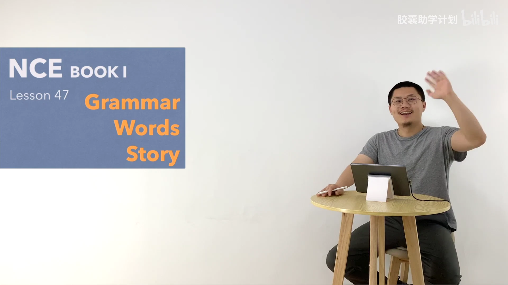

文字识别：胶囊助学计划 / NCE / BOOKI / Lesson 47 / Grammar / Words / Story

### 画面 00:00:02

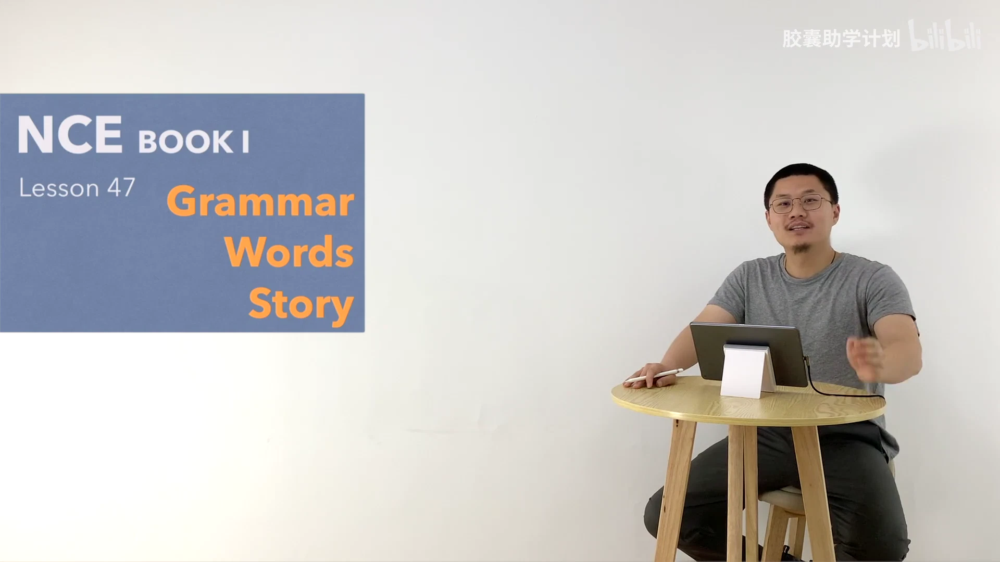

文字识别：胶囊助学计划 / NCE / BOOKI / Lesson 47 / Grammar / Words / Story

### 画面 00:00:11

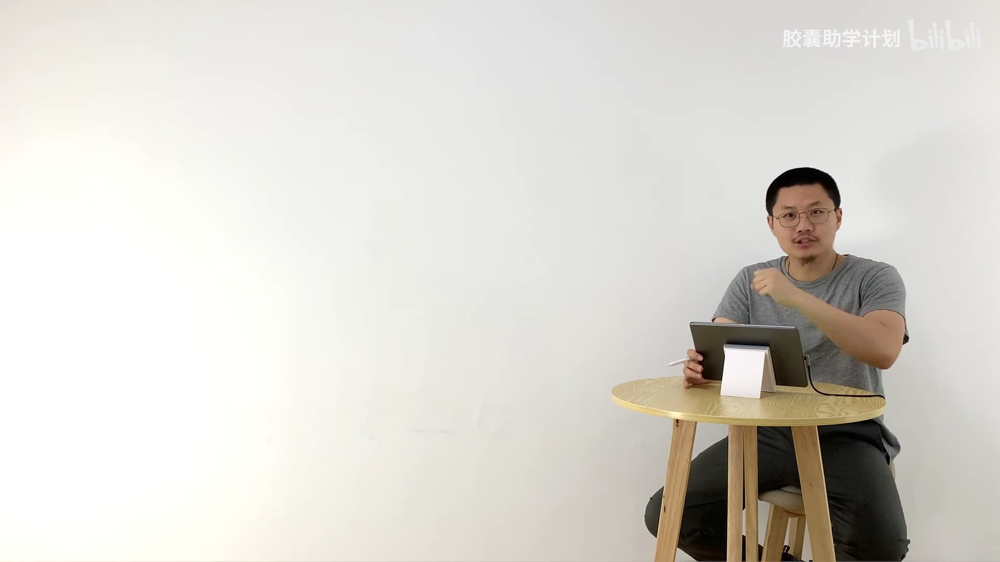

文字识别：胶囊助学计划

### 画面 00:00:13

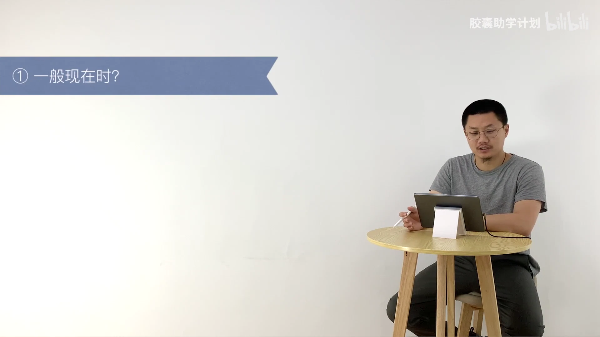

文字识别：胶囊助学计划 / )一般现在时？

### 画面 00:00:22

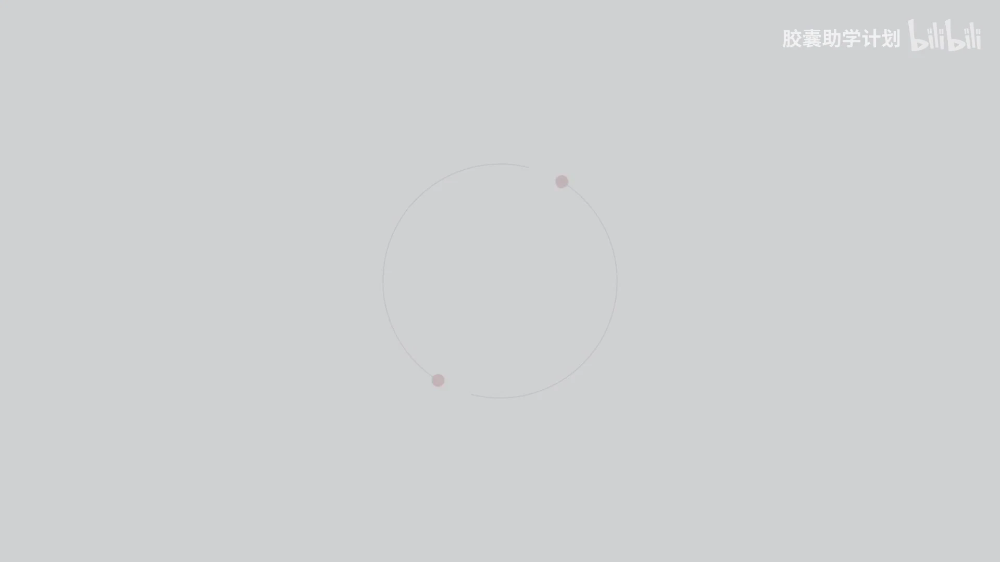

文字识别：胶囊助学计划b出出 / •

### 画面 00:00:26

### 画面 00:00:28

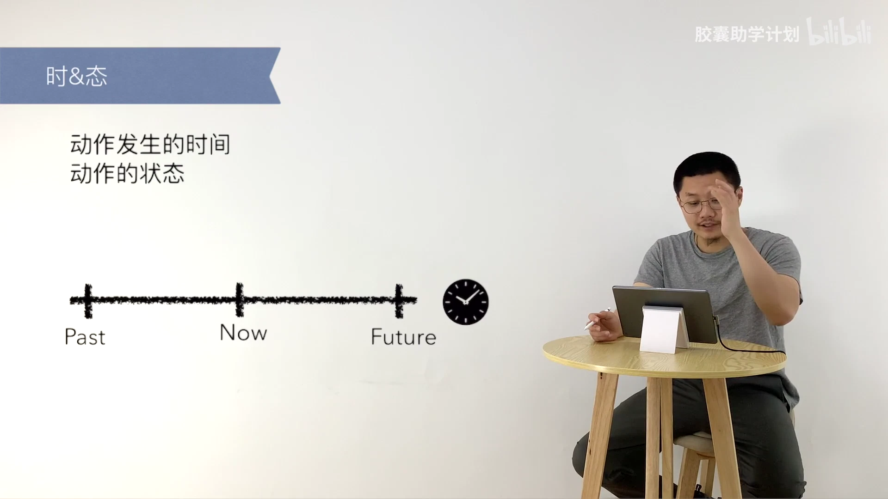

文字识别：胶囊助学计划 / 时&态 / 动作发生的时间 / 动作的状态 / Now / Past / Future

## 00:00:30–00:01:00

态到底是什么意思。时指的是动作发生的时间，那态指的就是动作时候发生的状态。比如说一般将来时，我们之前学过的啊，动作没有具体的状态，所谓零状态，但是时间是发生在将来。包括我们原来学到三十一课学到的现在进行时，哎，它动作发生时候的状态是进行，那动作发生的时间是现在。今天呢，我们来学一个

### 画面 00:00:32

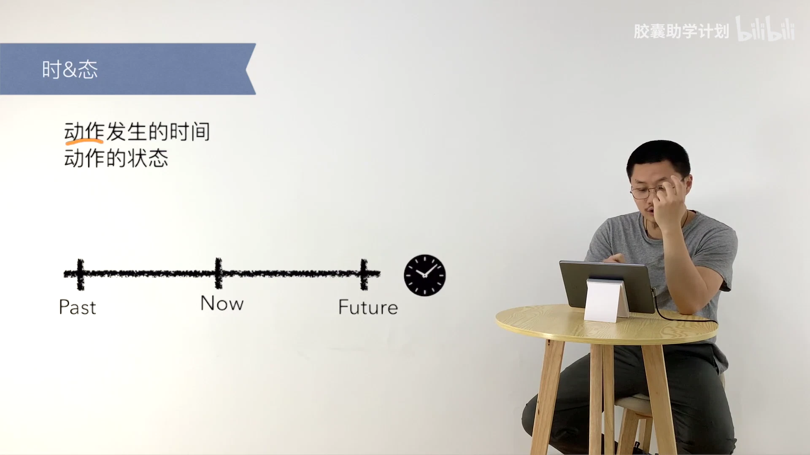

文字识别：Bibii / 胶囊助学计划 / 时&态 / 动作发生的时间 / 动作的状态 / Past / Now / Future

### 画面 00:00:35

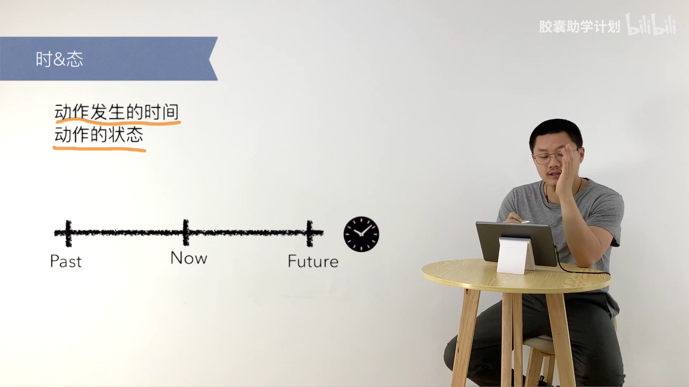

文字识别：Bilibili / 胶囊助学计划 / 时&态 / 动作发生的时间 / 动作的状态 / Past / Now / Future

### 画面 00:00:42

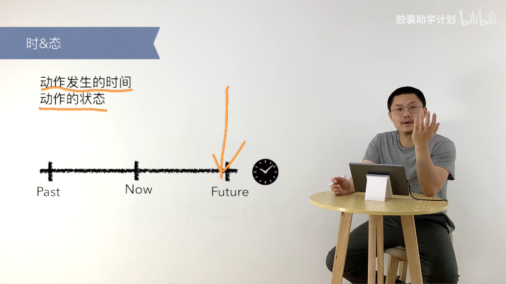

文字识别：bibili / 胶囊助学计划 / 时&态 / 动作发生的时间 / 动作的状态 / Past / Now / Future

### 画面 00:00:59

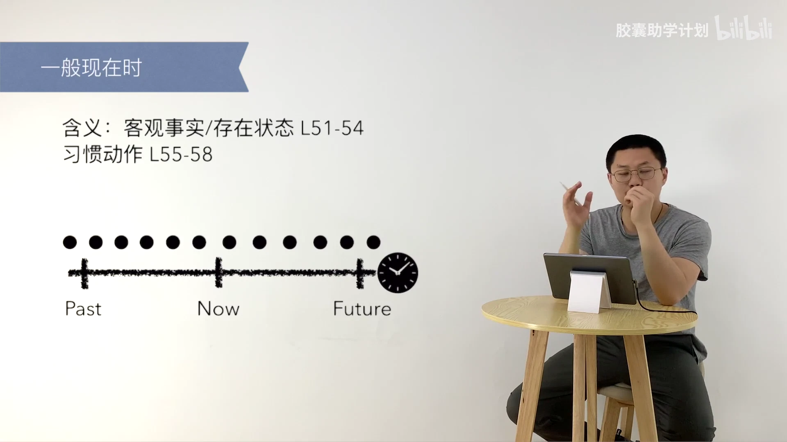

文字识别：Bitbli / 胶囊助学计划 / 一般现在时 / 含义：客观事实/存在状态 L51-54 / 习惯动作L55-58 / Past / Now / Future

## 00:01:00–00:01:30

时态，叫做一般现在时。啊，这个时态光从名字上来说很容易懵，因为它表示的是好像动作说的是现在，但是各位一定要注意看我底下给各位画的这个图，它不只指现在，它指的是过去、现在以及将来全包含在内了。所以你看，它最常用的含义有两个，一个叫客观事实或者存在的状态啊，就是在那儿放着呢，就

### 画面 00:01:17

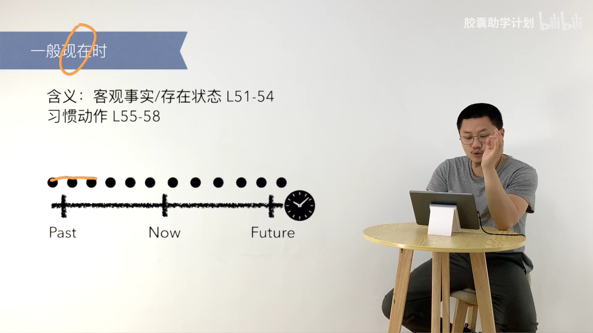

文字识别：胶囊助学计划 / 一般现在时 / 含义：客观事实/存在状态 L51-54 / 习惯动作L55-58 / Past / Now / Future

### 画面 00:01:19

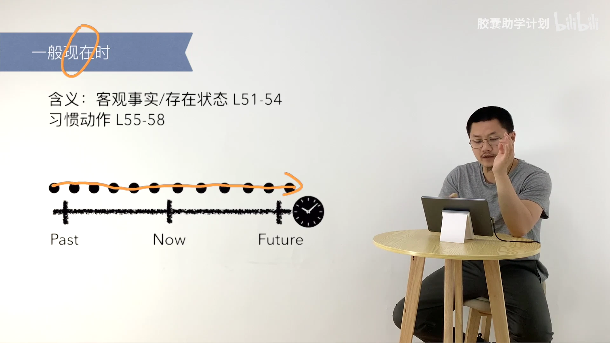

文字识别：胶囊助学计划 / 一般现在时 / 含义：客观事实/存在状态 L51-54 / 习惯动作L55-58 / Past / Now / Future

### 画面 00:01:23

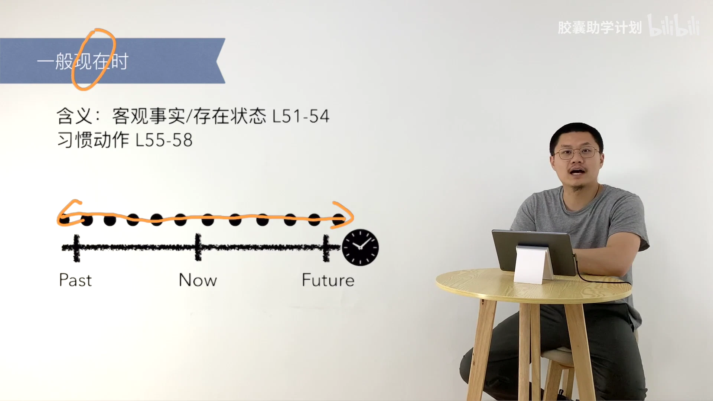

文字识别：胶囊助学计划 / 一般现在时 / 含义：客观事实/存在状态 L51-54 / 习惯动作L55-58 / Past / Now / Future

### 画面 00:01:26

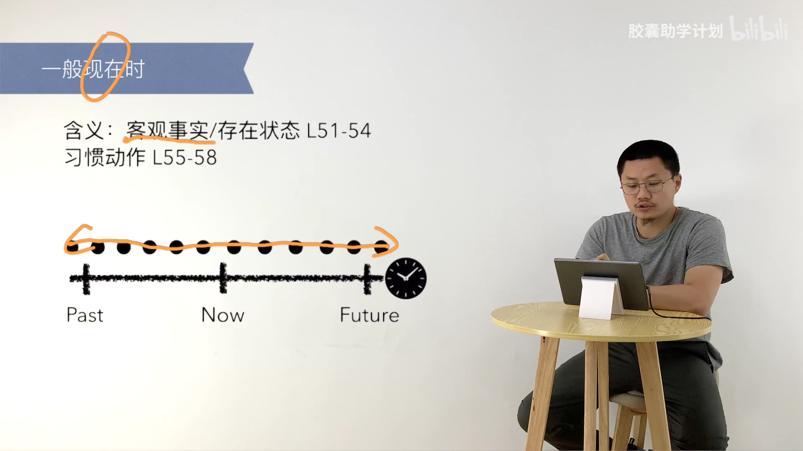

文字识别：胶囊助学计划 / 一般现在时 / 含义：客观事实/存在状态 L51-54 / 习惯动作L55-58 / Past / Now / Future

## 00:01:30–00:02:00

是在那儿待着呢啊，就是有这么一个事儿。好，这是我们五十一课到五十四课会继续见到的。今天我们见到会会见到它啊，以后也还会继续见到它。另一个就是习惯动作，一般现在时可以表示。那你想，既然是习惯动作，不可能是我今天正在做的事情，对吧？我昨天是这样做，前天是这样做，未来也会这样做，所以它在叫我们的生活习惯。所以注意一个小点，一般现

### 画面 00:01:30

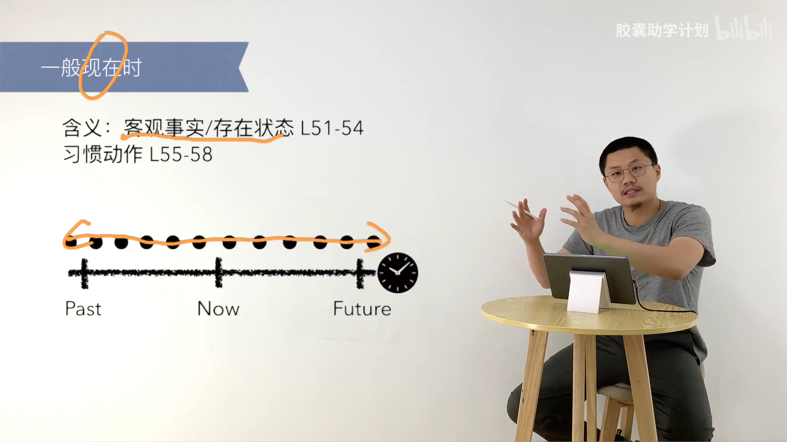

文字识别：胶囊助学计划 / 一般现在时 / 含义：客观事实/存在状态 L51-54 / 习惯动作L55-58 / Past / Now / Future

### 画面 00:01:35

文字识别：胶囊助学计划 / 一般现在时 / 含义：客观事实/存在状态 / L51-54 / 习惯动作L55-58 / Past / Now / Future

### 画面 00:01:44

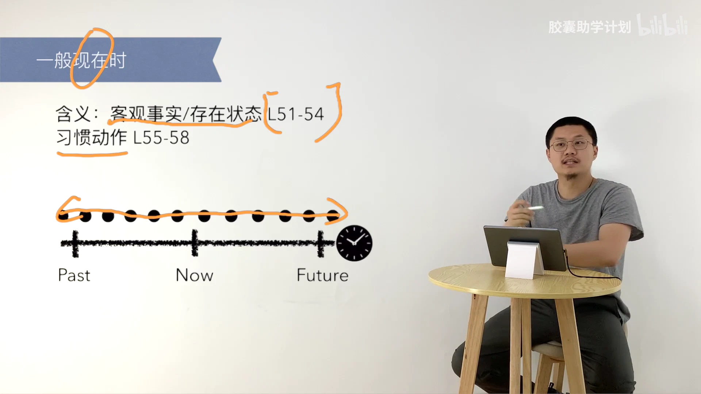

文字识别：胶囊助学计划 / 一般现在时 / 含义：客观事实/存在状态 / L51-54 / 习惯动作L55-58 / Past / Now / Future

## 00:02:00–00:02:30

在时它并非表示现在，它跟现在进行时不一样。其次，一般这个字儿啊，我们在一般将来时已经见到了，就是零状态，就是不强调它的动作状态。OK，好，那比如说我们先说一下肯定句，含义讲完了，说一下肯定句，比如说 I want this job，很简单，这就是个一般现在时，我想要这份工作啊，你想不想要这份工作？我想要这份工作，陈述的就是一个客

### 画面 00:02:05

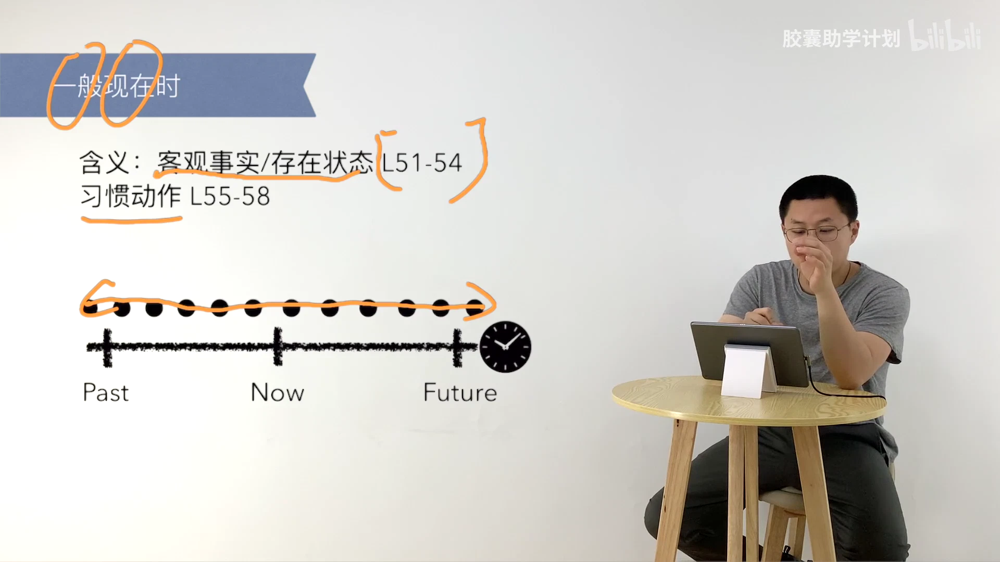

文字识别：胶囊助学计划 / 一般现在时 / 含义：客观事实/存在状态 / L51-54 / 习惯动作L55-58 / Past / Now / Future

### 画面 00:02:13

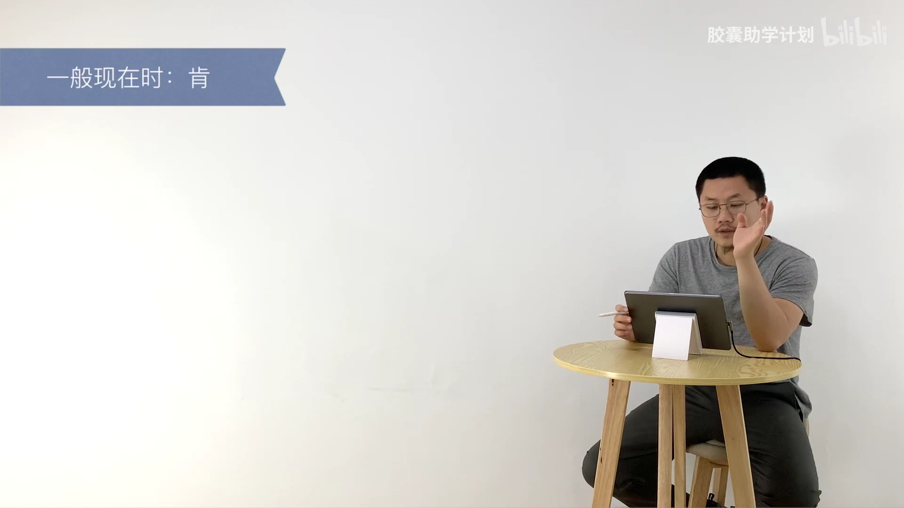

文字识别：胶囊助学计划 / 一般现在时：肯

### 画面 00:02:18

文字识别：胶囊助学计划 / 一般现在时：肯 / I want this job.

### 画面 00:02:23

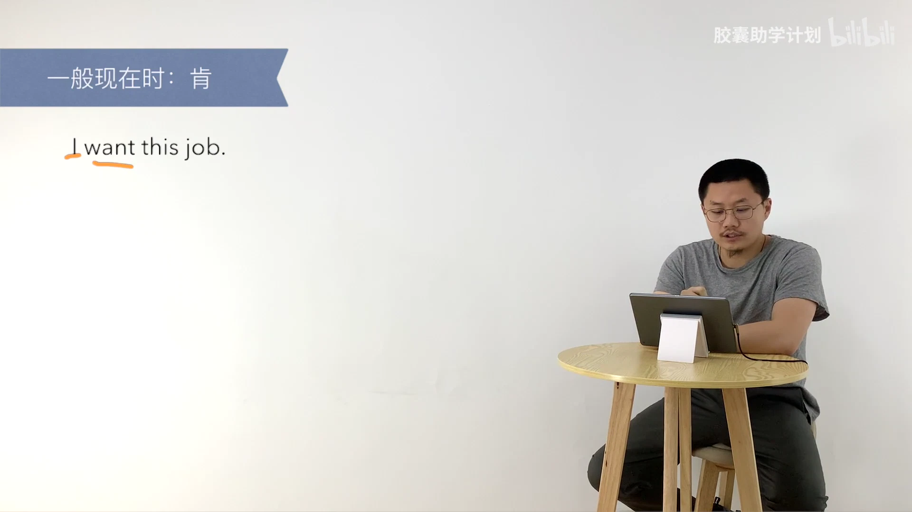

文字识别：胶囊助学计划 / 一般现在时：肯 / Lwant this job.

### 画面 00:02:26

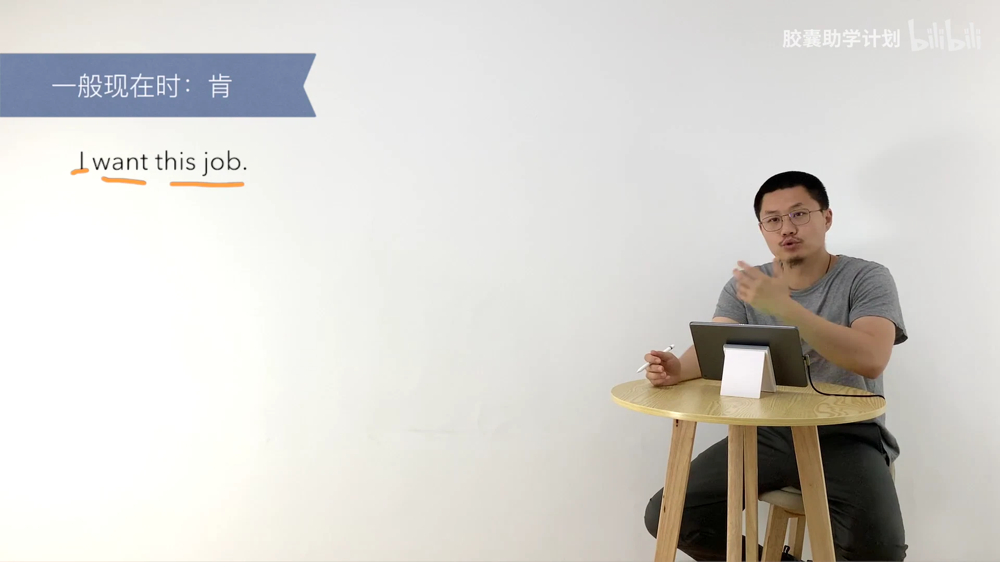

文字识别：胶囊助学计划 / 一般现在时：肯 / Lwant this job.

## 00:02:30–00:03:00

观事实，它不存在说我现在想要，过去想要，将来想造，不存在这件事儿，就是想告诉各位，客观事实是我想要这份工作。比如说 I love Beijing，它不可能今天突然间爱上北京，对吧？啊，当然你可以是今天说的这句话，OK，那表示的也不是只是当下爱，跟未来是不是也有关系？所以它表示的陈述一个客观事实，包括也可以说 I like tea，好，叫我喜欢茶啊，喜欢茶，

### 画面 00:02:56

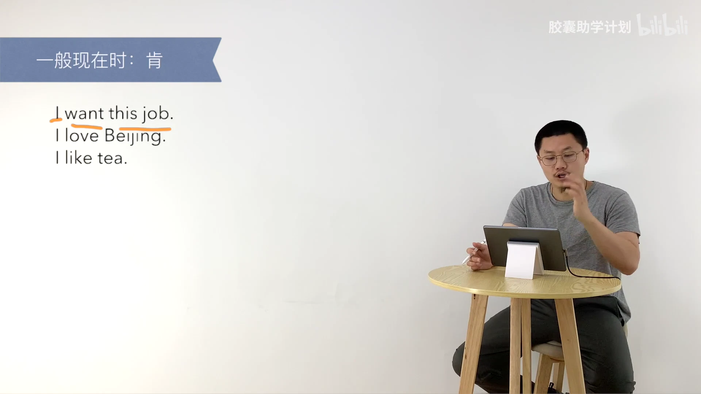

文字识别：胶囊助学计划 / 一般现在时：肯 / lwant / this job. / Llove / Beijing. / Ilike / tea.

## 00:03:00–00:03:30

你看，它也是一个陈述客观事实。既然你说你喜欢茶，我的理解一定不是你现在喜欢茶，过去不喜欢茶，或者将来就立刻不喜欢茶了，对吧？陈述客观事实，过去、现在、将来都在一起。那这个地方注意一下，你发没发现，一般现在时的肯定句跟我们汉语的语序一模一样。我爱北京，我喜欢茶，一模一样，对

### 画面 00:03:17

文字识别：胶囊助学计划 / 一般现在时：肯 / lwant / this job. / Llove / Beljing. / Ilike / tea.

### 画面 00:03:20

文字识别：一般现在时：肯 / lwant / this job. / Llove / Beljing. / Ilike / tea.

### 画面 00:03:23

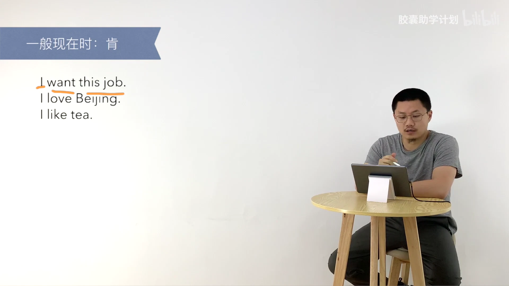

文字识别：胶囊助学计划 / 一般现在时：肯 / Lwant t / this job. / Llove / Beljing. / Ilike / tea.

### 画面 00:03:25

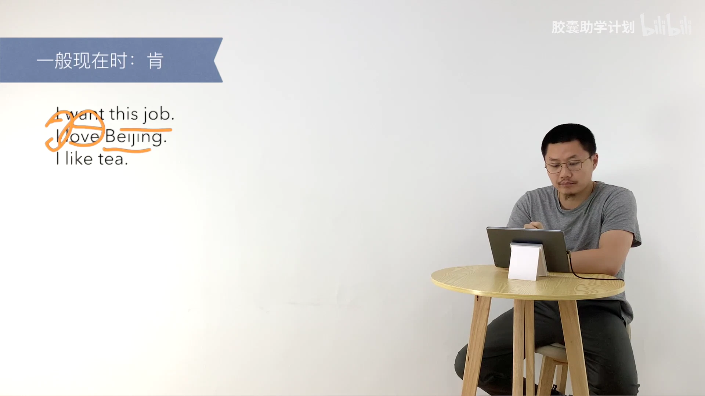

文字识别：胶囊助学计划 / 一般现在时：肯 / this job. / Being. / llike / tea. / 2

### 画面 00:03:27

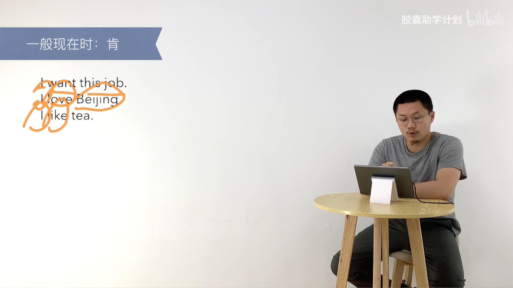

文字识别：胶囊助学计划 / 一般现在时：肯 / thiejob. / Beijing / ike / tea.

### 画面 00:03:29

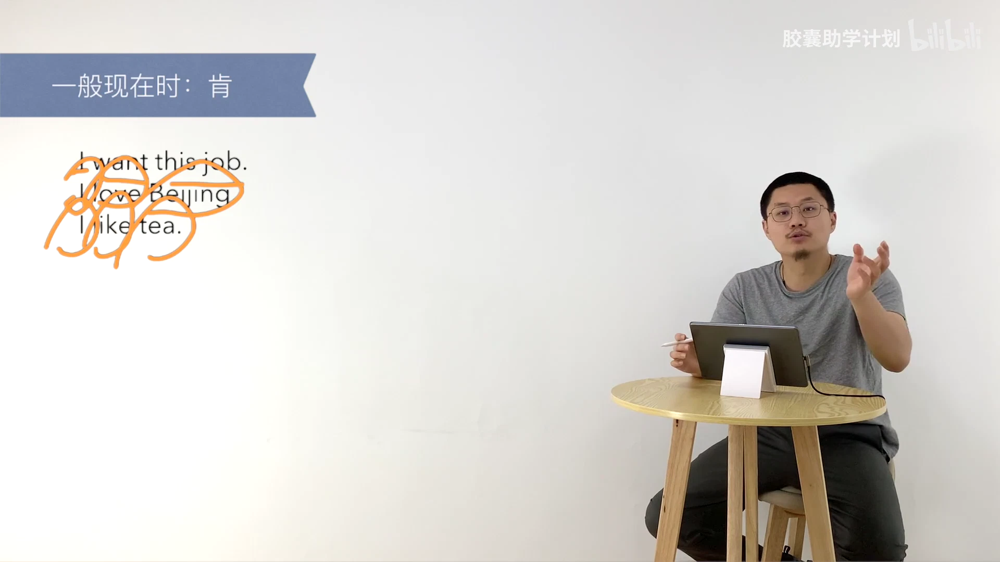

文字识别：胶囊助学计划 / 一般现在时：肯 / sjob / jing / IMiketea.

## 00:03:30–00:04:00

啊，这点是我们在学习的时候对于大家一个很大的帮助，很巧了，英文也是主谓宾，汉语也是主谓宾。OK，好，这地方我再多提一点，叫做 do 这个单词。首先，我们之前见过它，比如说 do my homework，对吧？What are you going to do？ What are you doing？这个里面的 do 都是一个动词，表示的是做啊。Do my homework，做我的家庭作业。或 just doing，放手去搏吧，放手去做吧。但是注意，在 I

### 画面 00:03:32

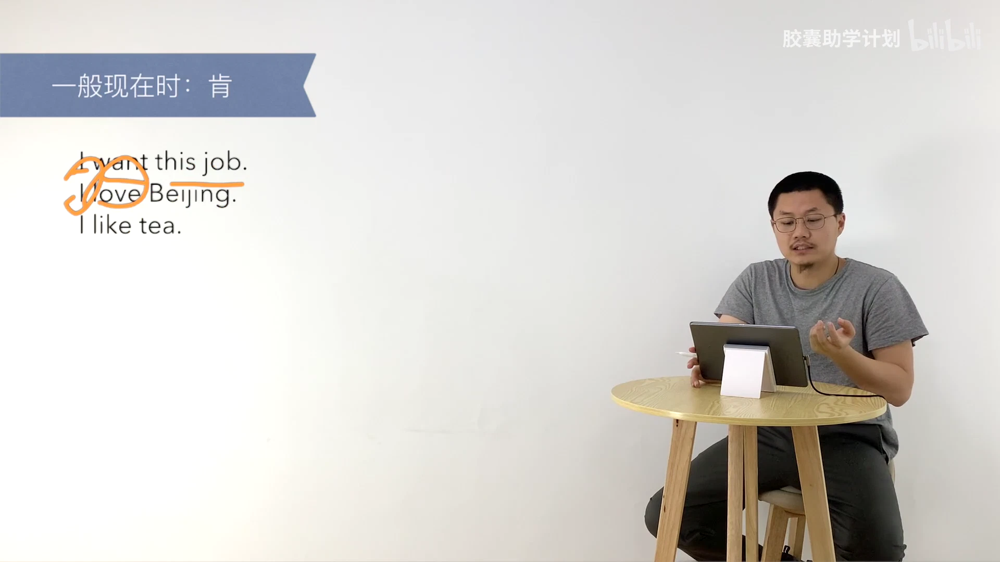

文字识别：胶囊助学计划 / 一般现在时：肯 / this job. / Beijing. / I like t / tea.

### 画面 00:03:34

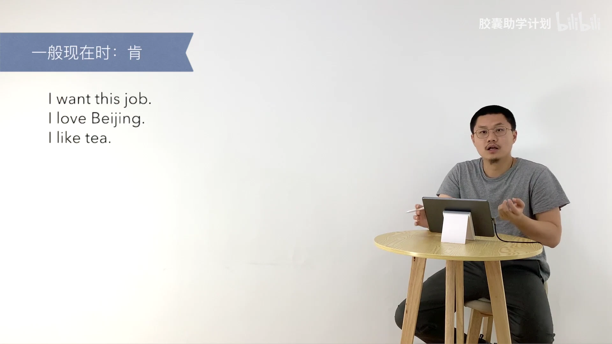

文字识别：胶囊助学计划 / 一般现在时：肯 / I want this job. / Ilove Beijing. / I like tea.

### 画面 00:03:44

文字识别：胶囊助学计划 / Ao / 一般现在时：肯 / I want this job. / Ilove Beijing. / I like tea. / I do like tea.

## 00:04:00–00:04:30

like tea 的中间，在 I 跟 like 也就是动词的前面去加 do 的时候，这时候的 do 它只是一个助动词，不是具体的做的意思。OK，那它是什么意思呢？也就是说，那 I like tea 跟 I do like tea 有什么区别呢？ I like tea 就我喜欢茶， I do like tea do 在这儿它表示的是一种语气上的强调。那我们汉语怎么用语气强调？比如说，我真的喜欢

### 画面 00:04:09

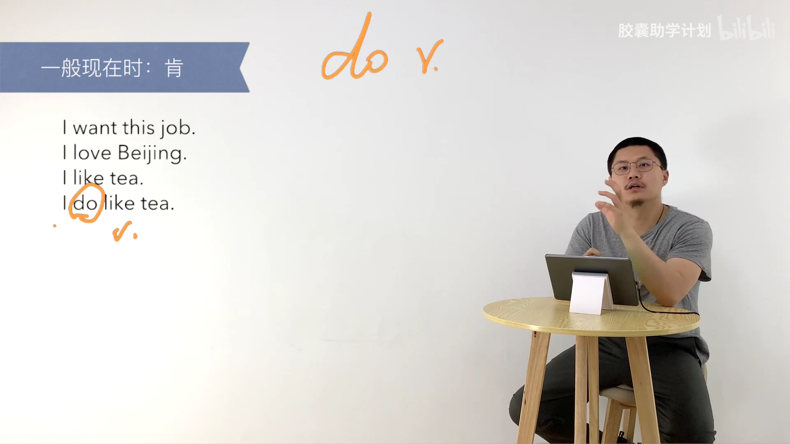

文字识别：胶囊助学计划 / Ao / 一般现在时：肯 / I want this job. / Ilove Beijing. / Ilike tea. / like tea. / ✔

### 画面 00:04:19

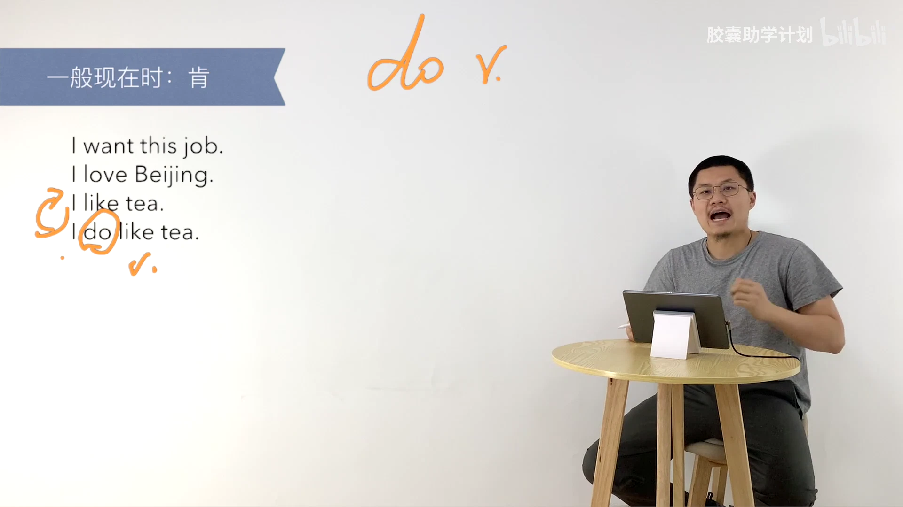

文字识别：胶囊助学计划 / Ao / 一般现在时：肯 / V / I want this job. / Ilove Beijing. / I like / tea. / like tea.

## 00:04:30–00:05:00

茶呀，或者我确实很喜欢喝茶呀。OK，但是你注意这儿的 do，它不是翻译成确实，它不是它的含义不是确实或者真的，它只是在英文当中表强调，而汉语用真的或者确实去表达强调。OK，那为什么要提这地方有一个 do 呢？原因很简单，就是否定句这个时态的否定句就是在 do 这个单词后边加一个 not，它大部分情况

### 画面 00:04:30

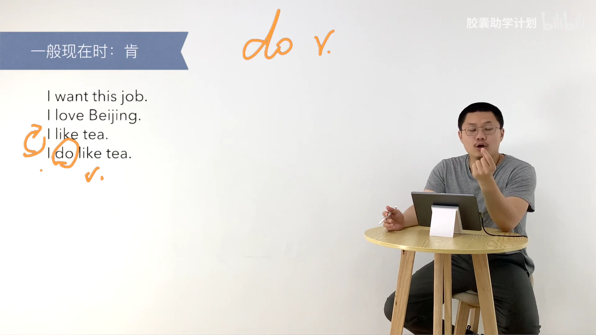

文字识别：胶囊助学计划 / Ao / 一般现在时：肯 / V / I want this job. / llove / e Beijing. / I like / tea. / like tea. / o

### 画面 00:04:32

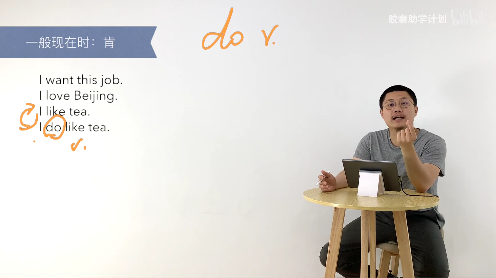

文字识别：胶囊助学计划 / Ao / 一般现在时：肯 / V / I want this job. / Ilove Beijing. / Ilike / tea. / like tea.

### 画面 00:04:51

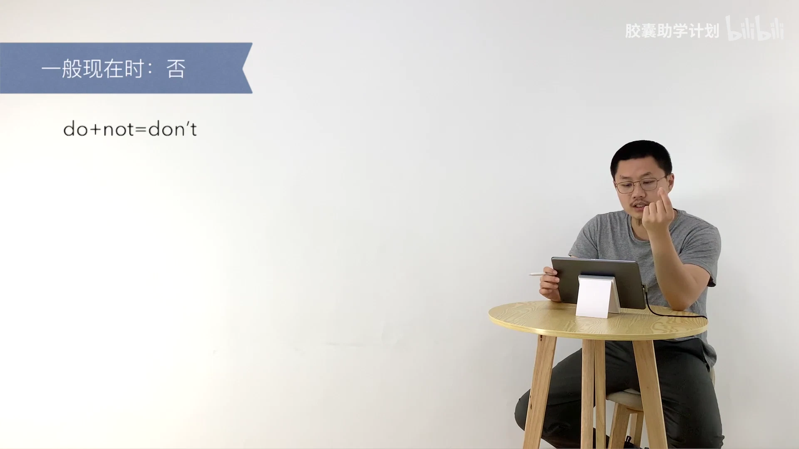

文字识别：胶囊助学计划 / 一般现在时：否 / do+not=don't

### 画面 00:04:57

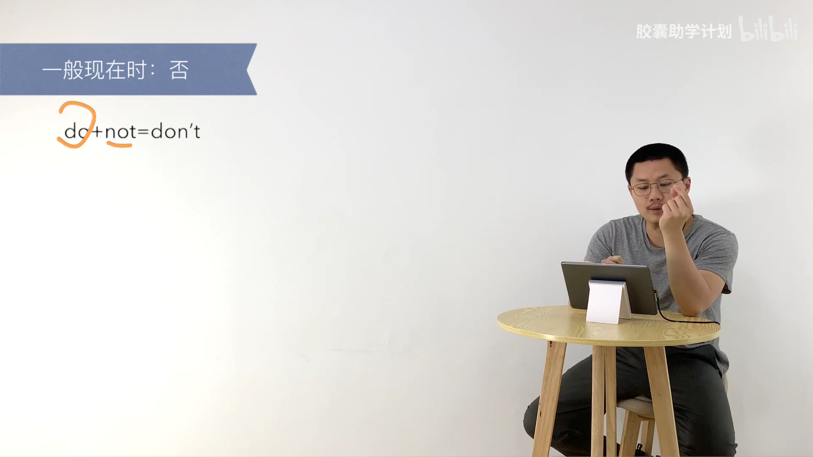

文字识别：胶囊助学计划 / 一般现在时：否 / do+not=don't

## 00:05:00–00:05:30

下不出现。I like it,不出现。但你要知道，在I跟like中间有一个do，对吧？我们目前变各种否定都是在某个单词的后面加上了not，所以do not，哎，翻译成don't。这个单词各位也见过，就算您之前没学过，对吧？你说我在学新概念之前没有任何语法基础，我们在新概念一册三十九课也学过，叫don't do that，别那么去做。这个don't是怎么

### 画面 00:05:16

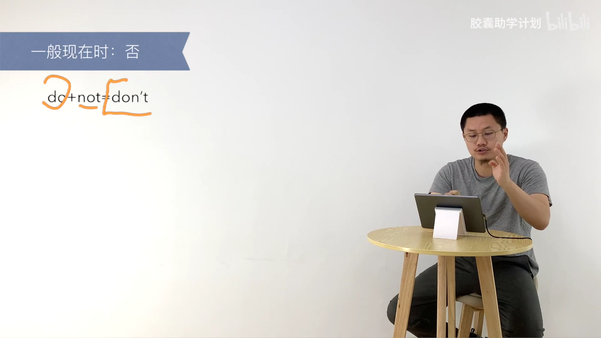

文字识别：胶囊助学计划 / 一般现在时：否 / do+not=don't

### 画面 00:05:21

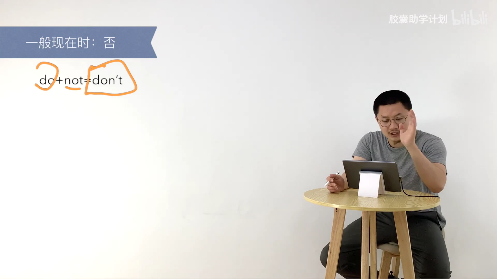

文字识别：胶囊助学计划 / 一般现在时：否 / do+not=don't

### 画面 00:05:29

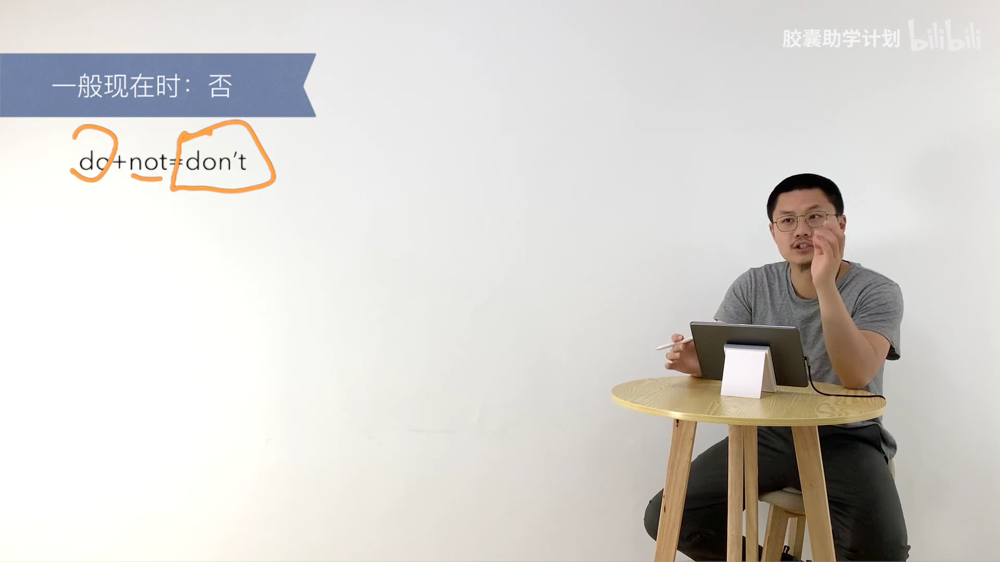

文字识别：胶囊助学计划 / 一般现在时：否 / do+not=don't

## 00:05:30–00:06:00

来的呢？就是在这个地方来的 do 加 not OK。比如说，那我们接下来尝试去造句啊。比如说 I do not want this job. 我不想要这份工作。Do not 就是否定 OK。那你说我确实想要这份工作，我真的很想要这份工作呀，叫做 I do want this job OK。好，接下来 I don't like tea. 我不喜欢茶。你

### 画面 00:05:34

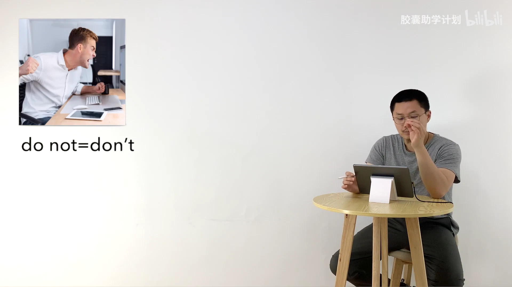

文字识别：胶囊助学计划 / do not=don't

### 画面 00:05:37

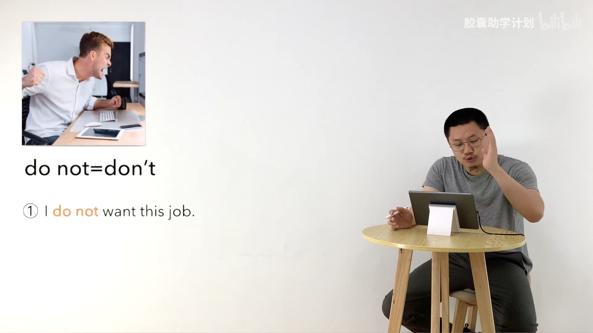

文字识别：胶囊助学计划 / do not=don't / ① I do not want this job.

### 画面 00:05:43

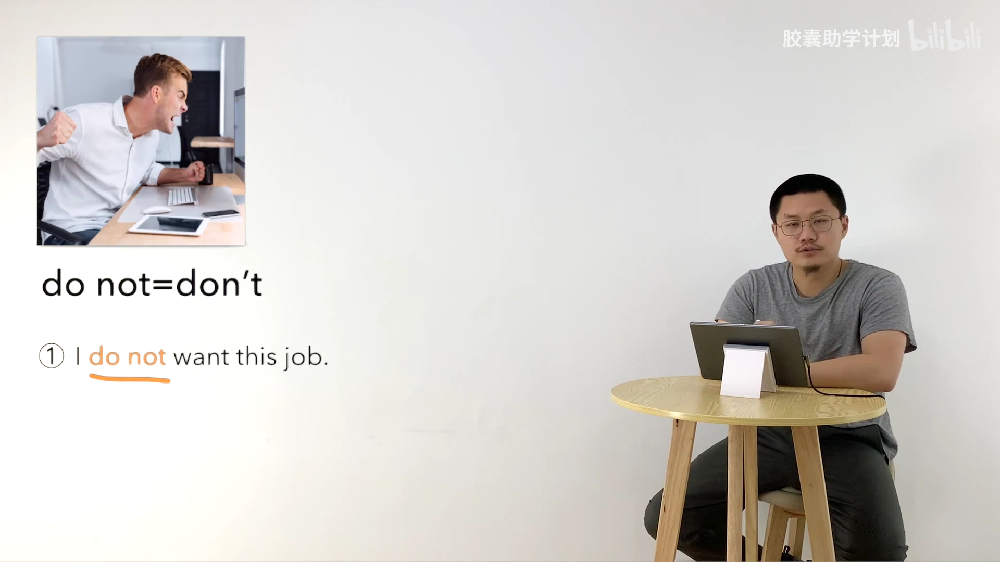

文字识别：胶囊助学计划 / do not=don't / ①I do not want this job.

### 画面 00:05:55

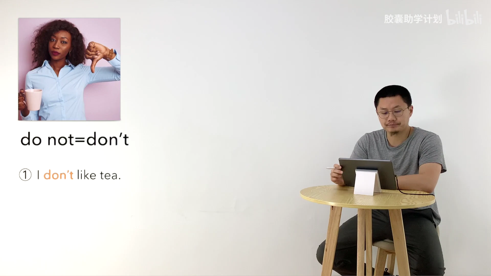

文字识别：胶囊助学计划 / do not=don't / ①Idon't like tea.

## 00:06:00–00:06:30

看，还是在爱跟 like，本来有一个 do，常年省略，但你要变否定的时候，这个 do 就要出现了，所以 do 后边加 not。 I don't like tea. Continue. 接下来 I don't love you. 我不爱你，对吧？啊，我不爱你。 I don't love you. 我不爱你。你看，基本上跟汉语一一对应，非常舒服。接下来我们看一个小的电影片段，当中出现了一句话叫做 I don't want this. 我不想

### 画面 00:06:02

文字识别：胶囊助学计划 / do not=don't / ①Idon't like tea.

### 画面 00:06:06

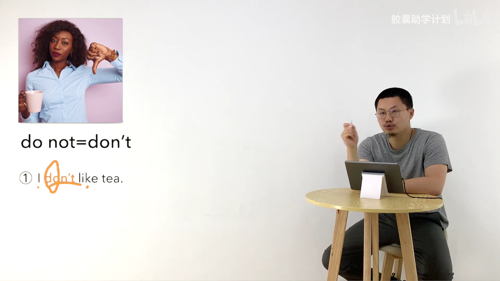

文字识别：胶囊助学计划 / do not=don't / ddn't like tea. / •

### 画面 00:06:11

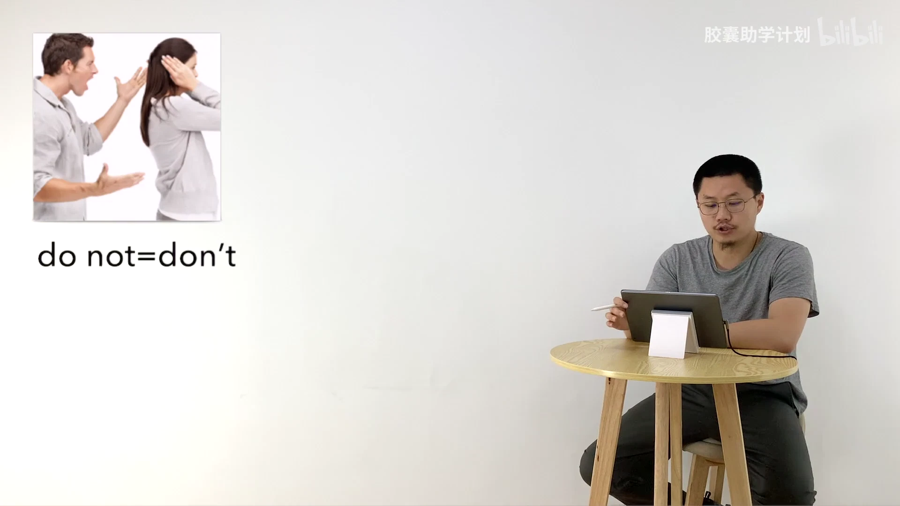

文字识别：胶囊助学计划 / do not=don't

### 画面 00:06:21

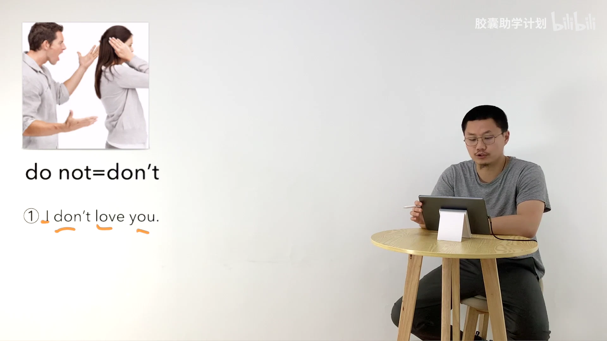

文字识别：胶囊助学计划 / do not=don't / ①Idon't love you.

### 画面 00:06:23

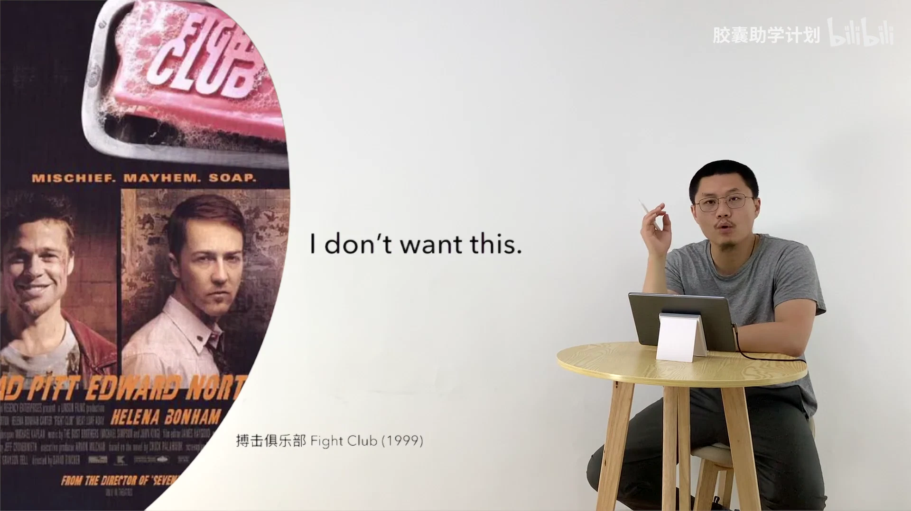

文字识别：胶囊助学计划 / MISCHIEF. MAVHEM. SOAP. / I don't want this. / D PITT EDWARD NORT / HELENA BONHAM / OTE / 搏击俱乐部 Fight Club(1999) /  ta x / FROM THE DIRECTOR OF'SEVEN

## 00:06:30–00:07:00

这个东西. Okay, 我不想要这一切. Why is she here, tying up loose ends? What? I'm begging you, please don't do this. I'm not doing this. We are doing this. This is what we want. No, I don't want this. Right. Okay, I don't want this. 我不想要这一切. Okay, 我不想要这个. Okay, very good. 接下来变一般疑问句是 do 提到句首. 我们现在回想一

### 画面 00:06:33

文字识别：bilibili / 胶囊助学计划

### 画面 00:06:35

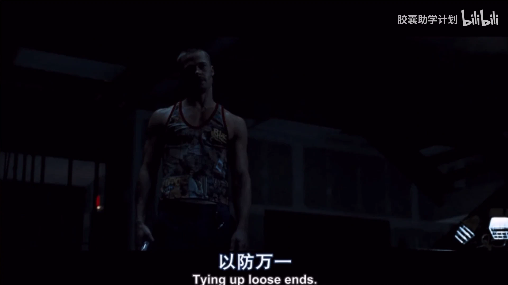

文字识别：bilibili / 胶囊助学计划 / 三 / 以防万一 / Tying up loose ends.

### 画面 00:06:37

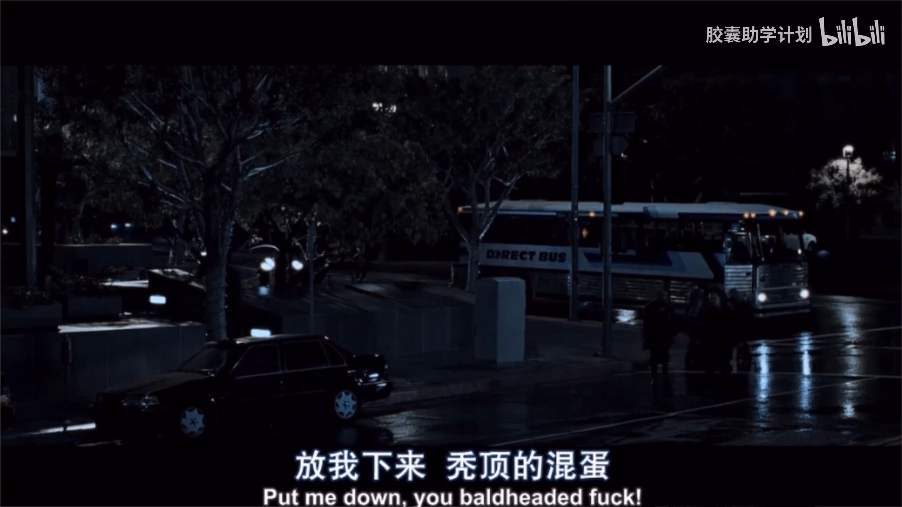

文字识别：bilibili / 胶囊助学计划 / DIRECTBUS / 放我下来秃顶的混蛋 / Put me down, you baldheaded fuck!

### 画面 00:06:39

文字识别：bilibili / 胶囊助学计划 / DJRECT BUS / 放我下来秃顶的混蛋 / Put me down, you baldheaded fuck!

### 画面 00:06:41

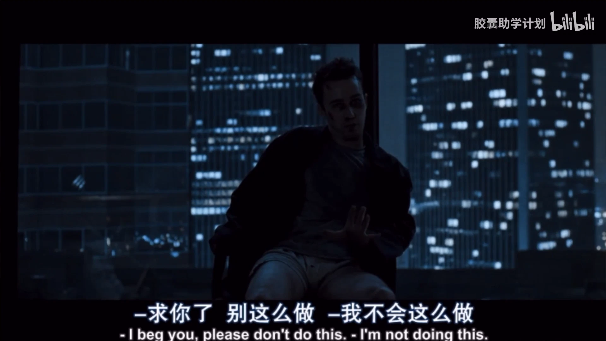

文字识别：bilibili / 胶囊助学计划 / -求你了 / 别这么做-我不会这么做 / -I beg you, please don't do this. -I'm not doing this.

### 画面 00:06:43

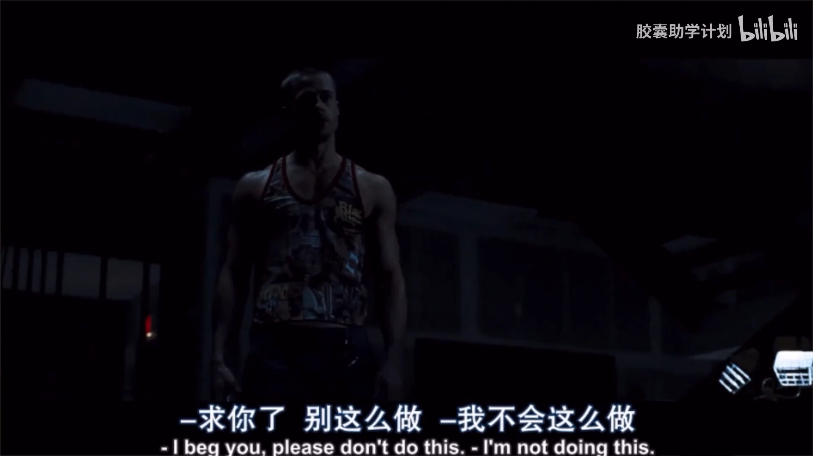

文字识别：bilbili / 胶囊助学计划 / -求你了 / 别这么做-我不会这么做 / -I beg you, please don't do this.-I'm not doing this.

### 画面 00:06:45

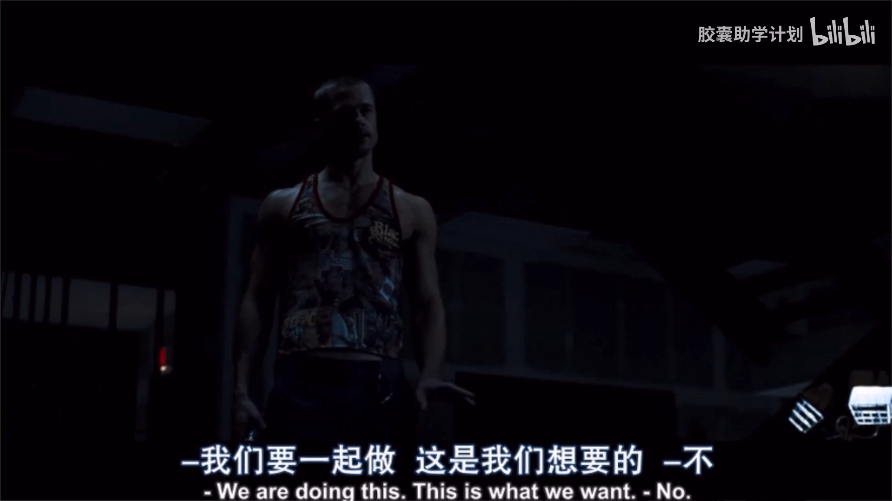

文字识别：bilibli / 胶囊助学计划 / 三 / -我们要一起做这是我们想要的-不 / -We are doing this. This is what we want.- No.

### 画面 00:06:47

文字识别：bilibili / 胶囊助学计划

### 画面 00:06:50

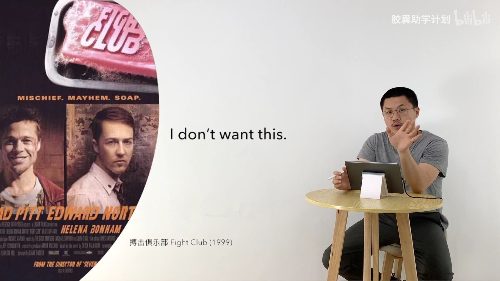

文字识别：胶囊助学计划 / MISCHIEF. MAYHEM. SOAP. / I don't want this. / ID PITT EDWARD NORT / HELENA 30NHAM / 搏击俱乐部 Fight Club(1999) / FROMTHE DIRECTOROF'SEVEN

### 画面 00:06:54

文字识别：胶囊助学计划 / 一般现在时：一般 / Do 提句首

### 画面 00:06:58

文字识别：胶囊助学计划 / 一般现在时：一般 / Do 提句首

## 00:07:00–00:07:30

下啊，前二十课学 am is are，在 am is are 后边加 not，am is are 提句首。三十一课学 am is are 加 doing，am is are 怎么办？后边加 not，提句首变一般疑问句。三十七课我们学了 be going to do，am is are going to do，am is are 后边加 not，am is are 提到句首。四十三课我们又学了 can 这个单词，can 后边加 not，can 提到句首变一般疑问句。今天我们在 do 后边加了 not，那把

### 画面 00:07:28

文字识别：胶囊助学计划 / 一般现在时：一般 / Do 提句首

## 00:07:30–00:08:00

do 提到句首变一般疑问句，这个前后是不是还是保持一致的？很容易理解吧，对吧？OK，那比如说我们来一句话叫做 Do you want this job？你想要这个工作吗？把 do 提到句首。OK， continue。 Yes， I do。回答肯定回答，注意就不是 Yes， I can，或者 Yes， I am 了。我用 do 去提问，你要用 do 去回答。那同理，否定就是 No， I don't。这个点各

### 画面 00:07:37

文字识别：胶囊助学计划 / Do 提句首

### 画面 00:07:54

文字识别：胶囊助学计划 / Do 提句首 / you want this job? / ② Yes, Ido.

## 00:08:00–00:08:30

位要注意。OK,接下来说Do you like tea?你喜欢茶吗？回答肯定回答就是Yes, I do.否定回答就是No, I don't. OK, continue.接下来Do you love him?注意一个小点，这地方再去读的时候，我们会有一个小的击穿现象啊。你可以理解为是语音变音现象。我们一般不把它读成Do you love him?我们把它读成的Do you love him?

### 画面 00:08:01

文字识别：胶囊助学计划 / Do 提句首

### 画面 00:08:11

文字识别：胶囊助学计划 / Do 提句首

## 00:08:30–00:09:00

Love him, OK. 注意一个小点，在这儿就没发音。他最后 love 后边有一个 v，然后后边是 him，把它连起来叫 la la la 音标啊 la him. Do you love him? Do you love him? OK，是这个样子去读，不读成 Do you love him? 你读 Do you love him? 别人能听懂，但英语是母语的人，大多数读的是 Do you love him? Love him, OK.

### 画面 00:08:36

文字识别：胶囊助学计划 / Do 提句首 / V / ① Do you love lim?

### 画面 00:08:40

文字识别：胶囊助学计划 / Do 提句首 / W.Im / ① Do you love lim?

### 画面 00:08:46

文字识别：胶囊助学计划 / ICΛ.Vm / Do 提句首 / W.m / ① Do you love lim?

## 00:09:00–00:09:30

one more. That肯定回答叫 Yes, I do. 否定回答叫 No, I don't. One more. 接下来我们就看一个小的电影片段。这个片段还真的不错，连续出现了这样一些句子。 Do you love him? 你爱他吗？ Why can't you? 四十五课，四啊四十四课，我们刚学的，对吧？啊 Why can't you? 为什么你不能？ You don't know me. 你不认识我。 I don't know you. 我不认识你。 经典电影《泰坦尼克号》，我们接下来一起看一下。 Do

### 画面 00:09:05

文字识别：胶囊助学计划 / Do you love him? / Why can't you .. / You don't know me, / and I don't know you. / LEONARDO DiCAPRIO / KATE WIN / TITANy / 泰坦尼克号Titanic(1997)

### 画面 00:09:15

文字识别：胶囊助学计划 / Do you love him? / Why can't you / E / You don't know me, / and I don't know you. / LEONARDO DiCAPRIO / KATE WIN / TITANy / 泰坦尼克号Titanic(1997)

### 画面 00:09:23

文字识别：胶囊助学计划 / Do you love him? / Why can't vou / You don't know me, / and I don't know you. / LEONARDO DiCAPRIO / KATE WIN / TITANI / 泰坦尼克号Titanic(1997)

### 画面 00:09:29

文字识别：biibili / 胶囊助学计划

## 00:09:30–00:10:00

love him? Pardon me. Do you love him? You're being very rude. You shouldn't be asking me this. Well, it's a simple question. Do you love the guy or not? This is not a suitable conversation. Why can't you just answer the question? This is absurd. You don't know me, and I don't know you. Okay, very good. You love him? Do you love him? Why can't you?

### 画面 00:09:31

文字识别：biibli / 胶囊助学计划

### 画面 00:09:33

文字识别：Bilbli / 胶囊助学计划 / 你爱他吗？ / Do you love him?

### 画面 00:09:35

文字识别：bilbli / 胶囊助学计划 / 你太无礼了你不该问我这个问题 / You're being very rude. You shouldn't be asking me this.

### 画面 00:09:37

文字识别：bilbli / 胶囊助学计划 / 你太无礼了你不该问我这个问题 / You're being very rude. You shouldn't be asking me this.

### 画面 00:09:39

文字识别：bilibili / 胶囊助学计划 / 嗯这个问题很简单你爱他还是不爱？ / Well,jit's a simple question. Do you love the guy or

### 画面 00:09:41

文字识别：Bilbili / 胶囊助学计划

### 画面 00:09:43

文字识别：Bilbili / 胶囊助学计划

### 画面 00:09:45

文字识别：Bilbli / 胶囊助学计划 / 我们谈这个不太合适 / This is not a suitable conversation.

### 画面 00:09:47

文字识别：Biltbli / 胶囊助学计划

### 画面 00:09:49

文字识别：Bilibili / 胶囊助学计划

### 画面 00:09:51

文字识别：Bilbili / 胶囊助学计划 / 这太荒谬了 / This is absurd.

### 画面 00:09:53

文字识别：bilbili / 胶囊助学计划 / 你我都不认识 / You don't know me and I don't know you...

### 画面 00:09:55

文字识别：胶囊助学计划 / Do you love him? / Why can't you .. / You don't know me, / and I don't know you. / LEONARDO DiCAPRIO / KATE WIN / TITANy / 泰坦尼克号Titanic(1997)

### 画面 00:09:59

文字识别：胶囊助学计划 / Do you love him? / Why can't you . / You don't know me, / and I don't know you. / LEONARDO DiCAPRIO / KATE WIN / TITANI / 泰坦尼克号Titanic(1997)

## 00:10:00–00:10:30

### 画面 00:10:04

文字识别：胶囊助学计划 / 一般现在时：特殊 / 特殊疑问句=特殊疑问词+一般疑问句 (去掉答案)

### 画面 00:10:09

文字识别：bilbl / 胶囊助学计划 / 一般现在时：特殊 / 特殊疑问句=特殊疑问词+一般疑问句 (去掉答案)

### 画面 00:10:11

文字识别：Bilbl / 胶囊助学计划 / 一般现在时：特殊 / 特殊疑问句 / 特殊疑问词 / 一般疑问句 / (去掉答案)

### 画面 00:10:13

文字识别：胶囊助学计划 / BilBil / 一般现在时：特殊 / 特殊疑问句 / 特殊疑问词 / 一般疑问句（去掉答案) / I want this job.

### 画面 00:10:19

文字识别：Bibil / 胶囊助学计划 / 一般现在时 / 特殊 / 特殊疑问句 / 特殊疑问词 / 一般疑问句 / （去掉答案） / DI want this job.

## 00:10:30–00:11:00

do you want? 你想要什么到底啊？你告诉我，对吧？你 What do you want? There we go. Continue. 接下来我们看一个小的电影片段，当中出现了 What do you want? 我们做一个小的听力练习。

### 画面 00:10:36

文字识别：WELCOME TO A WORLD WITHOUT RULES / 胶囊助学计划 / What do you want? / CAINE LEDGER OLDMAN ECKHART GYLLENHAAL FF / THE / DARK KNIG / 蝙蝠侠：黑暗骑士The Dark Knight (2008) / JULY 18 / SYRCIPY

### 画面 00:10:38

文字识别：WELCOME TO A WORLD WITHOUT RULES. / 胶囊助学计划 / What do you want? / CAINE LEDGER OLDMAN ECKHART GYLLENHAAL / FR / THE / DARK KNIG / 蝙蝠侠：黑暗骑士The Dark Knight(2008) / JULY 18 / SYNCOPY

### 画面 00:10:40

文字识别：WELCOME TO A WORLD WITHOUT RULES. / 胶囊助学计划 / What do you want? / CAINE LEDGER OLDMAN ECKHART GYLLENHAAL / FF / THE / DARK KNIG / 蝙蝠侠：黑暗骑士The Dark Knight(2008) / JULY 18 / SYWCOPY

### 画面 00:10:44

文字识别：bilibili / 胶囊助学计划

### 画面 00:10:46

文字识别：Bilbii / 胶囊助学计划

### 画面 00:10:48

文字识别：bilibili / 胶囊助学计划

### 画面 00:10:50

文字识别：bilbli / 胶囊助学计划 / 把武器放下 / Drop the weapon now!

### 画面 00:10:52

文字识别：bilbli / 胶囊助学计划 / 是我自己不好 / It's my own damn fault,

### 画面 00:10:54

文字识别：Bilbii / 胶囊助学计划 / 快放开他 放开他 / Let him go now!

### 画面 00:10:56

文字识别：Bilbii / 胶囊助学计划 / 什么 我听不清 / What? Sorry?

### 画面 00:10:58

文字识别：Bilbli / 胶囊助学计划 / 你想怎么样 / What do you want?

## 00:11:00–00:11:30

just want my phone call. Okay, what do you want? You want? Okay, continue. That.本课呢只有两个小的单词，都比较简单。刚才我也都带着大家，其实用过了。我们再读一下，比如说 like 喜欢，我们拿它去造句。I like coffee,非常的简单。我确实喜欢咖啡呀，叫做 I do like coffee. Continue. 然后我们把它变成一般疑问句。Do you

### 画面 00:11:00

文字识别：bilbli / 胶囊助学计划 / 我就想打个电话 / I just want my phone call.

### 画面 00:11:02

文字识别：bilibili / 胶囊助学计划

### 画面 00:11:04

文字识别：bilibili / 胶囊助学计划

### 画面 00:11:06

文字识别：WELCOME TO A WORLD WITHOUT RULES. / 胶囊助学计划 / What do you want? / CAINE LEDGER OLDMAN ECKHART GYLLENHAAL FF / THE / DARK KNIG / 蝙蝠侠：黑暗骑士The Dark Knight(2008) / JULY 18 / SYNCOPY

### 画面 00:11:08

文字识别：Bilbli / 胶囊助学计划 / /laik/ / like

### 画面 00:11:15

文字识别：Bilbli / 胶囊助学计划 / /larkl / like

### 画面 00:11:24

文字识别：胶囊助学计划b出出 / /laik1 / like / ① I like coffee.

### 画面 00:11:27

文字识别：胶囊助学计划b出出 / /laikl / like / ① I like coffee. / ② Do you like coffee?

## 00:11:30–00:12:00

coffee?跟我张嘴一起读啊。Why don't?你看我们之前学过了，叫Why can't?怎么变？它跟一般疑问句配合在一起，怎么去变？那Why don't?完全就是一码事儿。你把do去掉，Why don't?一起放到句首就行了。叫做Why don't you like coffee?你为什么不喜欢咖啡呢？啊，你比如说我喝了心悸，对吧？Why don't you like coffee? Very good.那否定句I don't like coffee和

### 画面 00:11:35

文字识别：胶囊助学计划l出 / /laikl / like / ① Ilike coffee. / ② Do you like coff ee? / Why don't...

### 画面 00:11:39

文字识别：胶囊助学计划bb出 / /lark/ / like / ①I like coffee. / Do you like coffee? / Why don't...

### 画面 00:11:44

文字识别：Bilili / 胶囊助学计划 / /lark/ / like / ①|like coffee. / Do you like coff ee? / Why don

### 画面 00:11:49

文字识别：Bibi / 胶囊助学计划 / /laikl / like / ①I like coffee. / Do you like coffee? / 2 / Why don't... / Why don't you like coffee?

### 画面 00:11:52

文字识别：胶囊助学计划bl出 / /laikl / like / ① I like coffee. / ② Do you like coffee? / Why don't... / 3) / ④ Why don't you like coffee?

## 00:12:00–00:12:30

特殊疑问句What do you like你喜欢什么？下一个单词跟我读Want叫想要，OK。比如说I want tea. I'm thirsty. I want tea.我想要一些茶。Do you want tea？你想要茶吗？Why don't逻辑一致，把do去掉，把它俩放到句首，一般疑问句句首就行了，叫做Why don't you want coffee？啊，或者Why don't you want tea？我们前后保持一下一致，叫你为什

### 画面 00:12:04

文字识别：胶囊助学计划b出b出 / /wpnt/ / want

### 画面 00:12:19

文字识别：胶囊助学计划blb出 / /wpnt/ / want / ①I want tea. / 2 / Do you want tea? / 3 / Why don't...

### 画面 00:12:27

文字识别：Bilbli / 胶囊助学计划 / /wDnt/ / want / ① I want tea. / you want tea? / 3 / Why / don't... / Why / don't you want coffee?

## 00:12:30–00:13:00

么不想要一些茶呢？Okay, very nice.啊，非常好。I don't want it.我不想要茶和What do you want? Very good.接下来我们进入文章，文章还是比较简单的，我们来一起看一下啊。Kristin说，Do you like coffee? Yeah，你喜欢咖啡吗？Do提到句首去了。Yes, I do.用do去回答，我喜欢。Do you want a cup?啊，你想要注意a cup不是问你想要来个杯子吗？肯

### 画面 00:12:35

文字识别：BilBili / 胶囊助学计划 / /wDnt/ / want / ①I want tea. / you want tea? / te / 3 / Why / don't... / Why / don't you want coffee? / 5 / I don't want tea.

### 画面 00:12:40

文字识别：胶囊助学计划b出b鼎 / CHRISTINE: Do you like coffee, Ann? / ANN: Yes, Ido. / CHRISTINE: Do you want a cup? / ANN: Yes, please, Christine.

### 画面 00:12:51

文字识别：胶囊助学计划blb出 / CHRISTINE: bd you like coffee, Ann? / ANN: Yes, I do / CHRISTINE: Do you want a cup? / ANN: Yes, please, Christine.

## 00:13:00–00:13:30

定是问你想要来一杯 a cup of coffee，对吧？他只是没把 a coffee 说出来，因为你前面问了嘛。你想要来一杯吗？Yes, please, Christine. Continue. Do you want any sugar? 你想要任何的糖不？想要糖不？Yes, please. 是的，谢谢。Do you want any milk? 你想要牛奶吗？No, thank you. 不，谢了。I don't like milk. 我不喜欢牛奶。In my coffee.

### 画面 00:13:07

文字识别：胶囊助学计划鼎i / CHRISTINE: bd you like coff ee, Ann? / ANN: Yes, I / CHRISTINE: Do you want a cup? / ANN: Yes, please, Christine.

### 画面 00:13:11

文字识别：胶囊助学计划 / CHRISTINE: Do you like coffee, Ann? / ANN: Yes, Ido. / CHRISTINE: Do you want a cup? / ANN: Yes, please, Christine.

### 画面 00:13:13

文字识别：胶囊助学计划 / CHRISTINE: Do you want any sugar? / ANN: Yes, please. / CHRISTINE: Do you want any milk? / ANN: No, thank you. / I don't like milk in my coffee. / I like black coffee.

### 画面 00:13:20

文字识别：胶囊助学计划 / Biil / CHRISTINE: Do you want any sugar? / ANN: Yes, please. / CHRISTINE: Do you want any milk? / ANN: No, thank you. / I don't like milk in my coffee. / I like black coffee.

## 00:13:30–00:14:00

在我的咖啡当中，注意这个地方叫做 don't 叫做不喜欢。 I like black coffee. 那黑咖啡就什么都不加啊。我喜欢 black coffee. Very good. 我确实喜欢怎么说？ I do like black coffee. Very good. Continue. Do you like biscuits? 那你喜欢饼干吗？ Yes, I do. Do you want one? 你想要来一个不？ Yes, please. Very good.

### 画面 00:13:30

文字识别：胶囊助学计划 / Bitbil / CHRISTINE: Do you want any sugar? / ANN: Yes, please. / CHRISTINE: Do you want any milk? / ANN: No, thank you. / I don't like milk in my coffee, / I like black coffee.

### 画面 00:13:37

文字识别：胶囊助学计划 / CHRISTINE: Do you want any sugar? / ANN: Yes, please. / CHRISTINE: Do you want any milk? / ANN: No, thank you. / don' like milkin my coffee. / I like black coffee.

### 画面 00:13:48

文字识别：胶囊助学计划 / 15 / CHRISTINE: Do you like biscuits? / ANN: Yes.Ido. / -E3 / CHRISTINE: Do you want one? / ANN: Yes, please.

### 画面 00:13:51

文字识别：胶囊助学计划 / 115 / CHRISTINE: Do you like biscuits? / ANN: Yes.Ido. / CHRISTINE: Do you want one? / ANN: Yes, please.

### 画面 00:13:59

文字识别：胶囊助学计划 / Recap / Patterns / 一般现在时 do / Grammar / Words / Expression

## 00:14:00–00:14:30

很简单文章啊。那我们本课 recap 复习关键点就是一般现在是 do 这个单词。四十九课我们马上会学到它的孪生兄弟 does。OK，那各位今天要做的就是把这个 do 的肯定句、否定句、一般疑问句和特殊疑问句都给它搞定一下。OK，家庭作业，首先各位四十七课的写作绿皮书可以写了。其次呢，文章老习惯一定要跟读至熟

### 画面 00:14:06

文字识别：胶囊助学计划 / Recap / Patterns / 般现在时do / Grammar / Words / Expression

### 画面 00:14:16

文字识别：Recap / 胶囊助学计划 / Patterns / 般现在时do / Grammar / Words / Expression

### 画面 00:14:19

文字识别：胶囊助学计划 / Recap / Patterns / 般现在时do / Grammar / Words / Expression

### 画面 00:14:21

文字识别：u bilibili / 胶囊助学计划 / 绿皮书第47课的写作练习

## 00:14:30–00:15:00

读成诵。如何跟读？他读一句，您听懂了，暂停，你模仿的他去读一句，这就是跟读啊。接下来呢，要给自己讲解一遍今天的核心知识点，这是我们老生常谈的了。那如果大家喜欢我们的课程，欢迎大家关注、订阅、一键三连，分享给那些需要的朋友。最后，我们再来看一句名人名言。The way I see it, if you want the rainbow, you got to put up with the rain. See

### 画面 00:14:42

文字识别：胶囊助学计划

### 画面 00:14:49

文字识别：胶囊助学计划

### 画面 00:14:51

文字识别：胶囊助学计划 / The way I see it, if you want the rainbow, you / gotta put up with the rain. / -Dolly Parton

## 00:15:00–00:15:13

you next time.

### 画面 00:15:01

### 画面 00:15:03

文字识别：CAPSULEACADEMY / 胶囊助学计划 / 小红书 / Lecturer / Leo / OE

### 画面 00:15:05

文字识别：CAPSULEACADEMY / 胶囊助学计划 / 小红书 / Photographer / Berlin / OE

### 画面 00:15:08

文字识别：CAPSULEACADEMY / 胶囊助学计划 / 小红书 / Creator / OE

### 画面 00:15:11

文字识别：bilibili / 胶囊助学计划

### 画面 00:15:13

文字识别：bilibili / 胶囊助学计划

