# 048 练习 单词

快速机器解析：语音为单模型转写，未进行独立交叉校对或人工复核；画面每秒采样并按变化选帧，短时文字和标记可能遗漏。截图时间约有 1 秒误差。图片有损压缩；遇到疑点请按时间查看 Google Drive 原视频。

## 00:00:00–00:00:30

Hello everyone, welcome to Capsule Academy. This is Liu. Today we're going to learn new concept English book one lesson forty eight practices and words. Hope you gonna enjoy it.那我们先看一组形容词加名词放在一起去学。首先跟我读 fresh，注意这个小的音标，各位很容易忘，叫做 sh fresh。其

### 画面 00:00:00

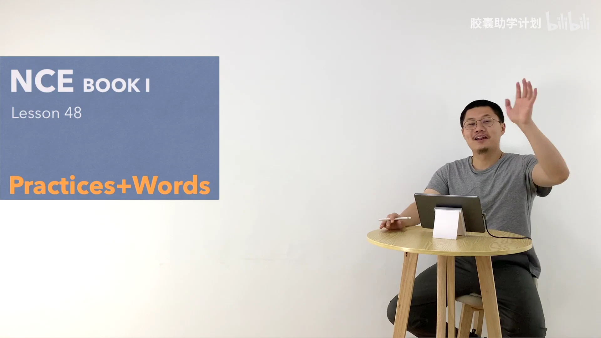

文字识别：胶囊助学计划 / NCE / BOOKI / Lesson 48 / Practices+Words

### 画面 00:00:02

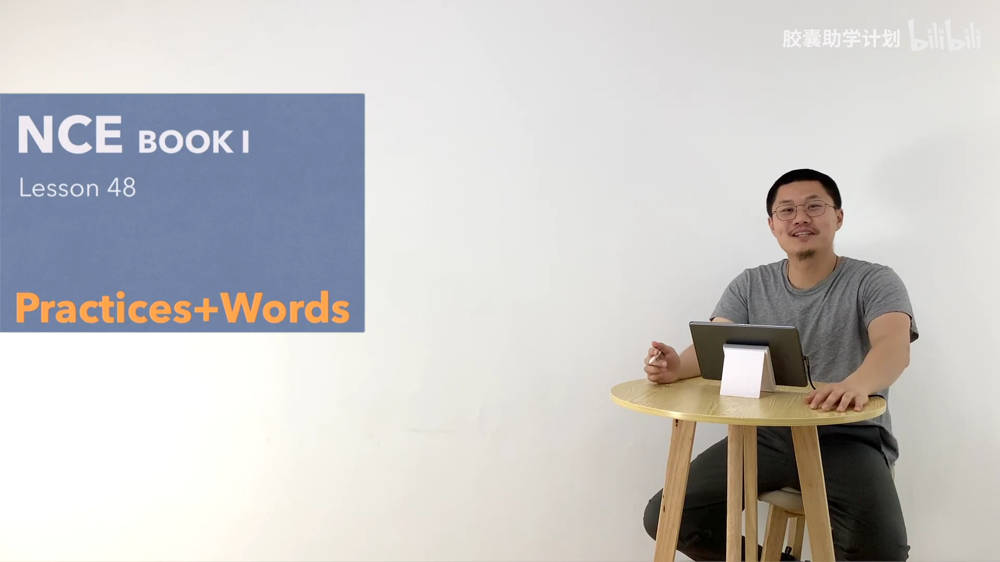

文字识别：胶囊助学计划 / NCE / BOOKI / Lesson 48 / Practices+Words

### 画面 00:00:10

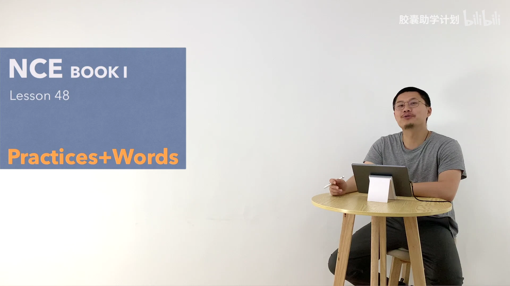

文字识别：胶囊助学计划 / NCE / BOOKI / Lesson 48 / Practices+Words

### 画面 00:00:12

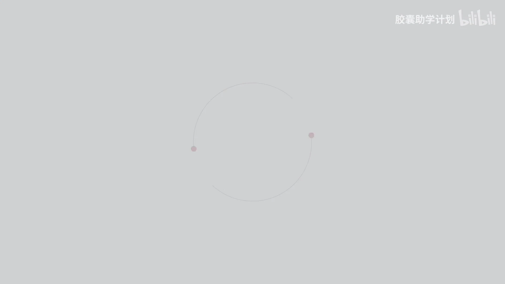

文字识别：胶囊助学计划bill / •

### 画面 00:00:16

### 画面 00:00:18

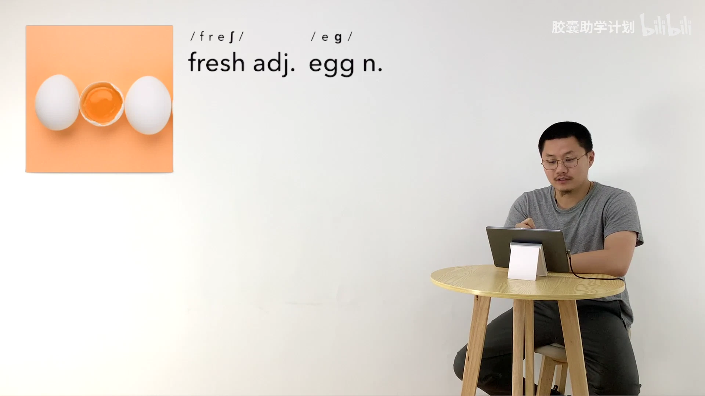

文字识别：胶囊助学计划 / /fre∫/ / /eg/ / fresh adj. egg n.

### 画面 00:00:29

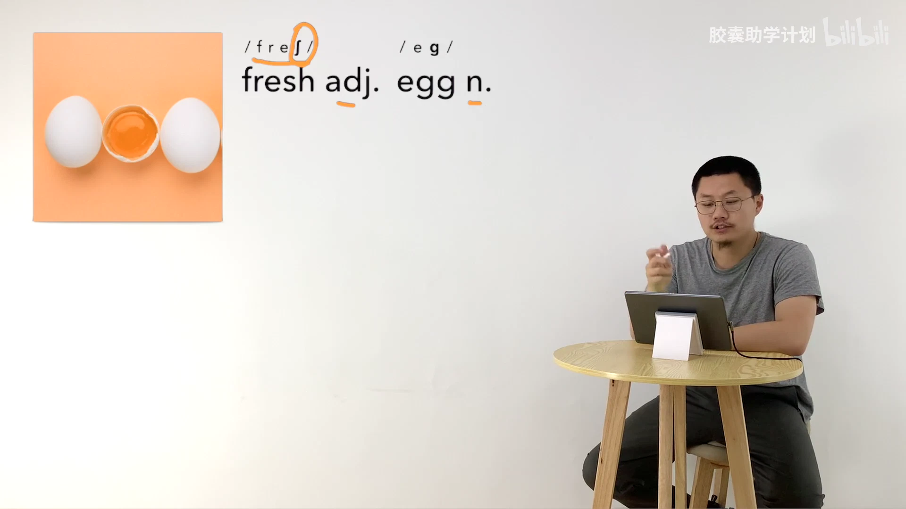

文字识别：胶囊助学计划 / / fre / /eg/ / fresh adj. egg n.

## 00:00:30–00:01:00

次egg鸡蛋，那fresh是形容词叫做新鲜的鸡蛋fresh egg。我们拿它去造句来了，跟我一起读。Can you take me a fresh egg?你能给我拿一个新鲜的鸡蛋吗？Take somebody something。我们第四十课，我没有记错的话，咱们学过，对吧？OK，四十课对四十课学的啊。Can you一般疑问句can提前，四十三课学的。Continue说What is she going to

### 画面 00:00:38

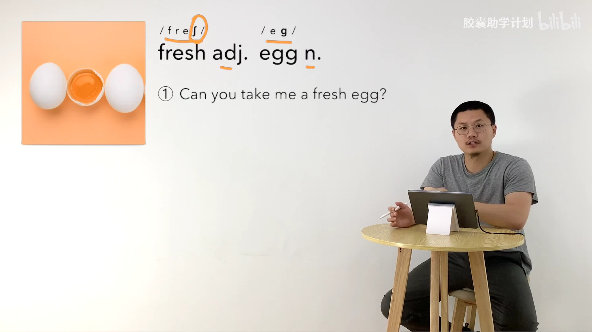

文字识别：胶囊助学计划 / / f r e / /eg/ / fresh adj. egg n. / ① Can you take me a fresh egg?

### 画面 00:00:44

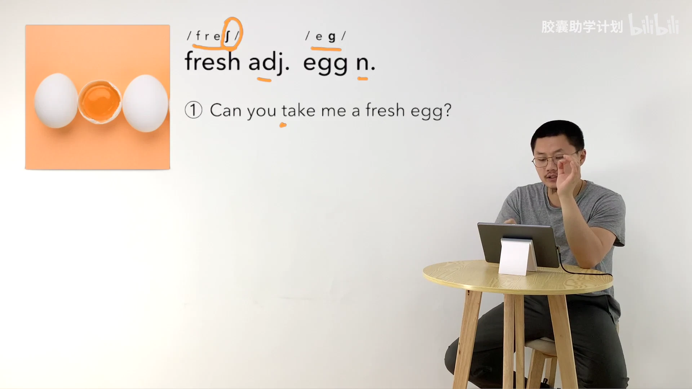

文字识别：胶囊助学计划 / / fre / /eg/ / fresh adj. egg n. / ① Can you take me a fresh egg?

### 画面 00:00:46

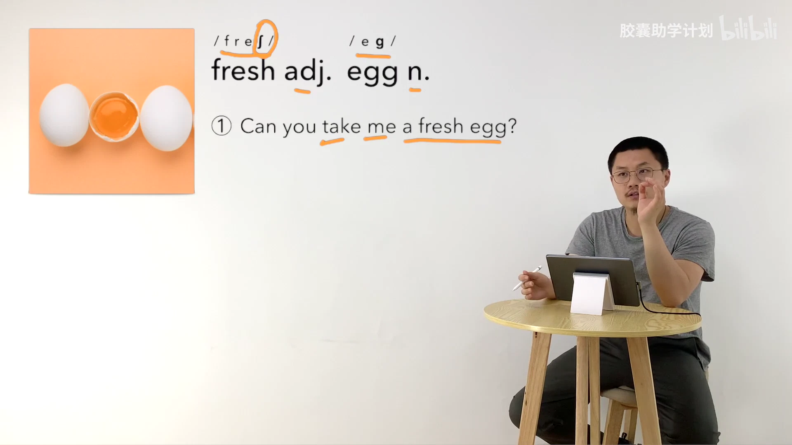

文字识别：胶囊助学计划 / / fre / / eg/ / fresh adj. egg / n. / ① Can you take me a fresh egg?

### 画面 00:00:54

文字识别：胶囊助学计划 / / fre / /eg/ / fresh adj. egg / n. / Can you cake me a fresh egg?

### 画面 00:00:58

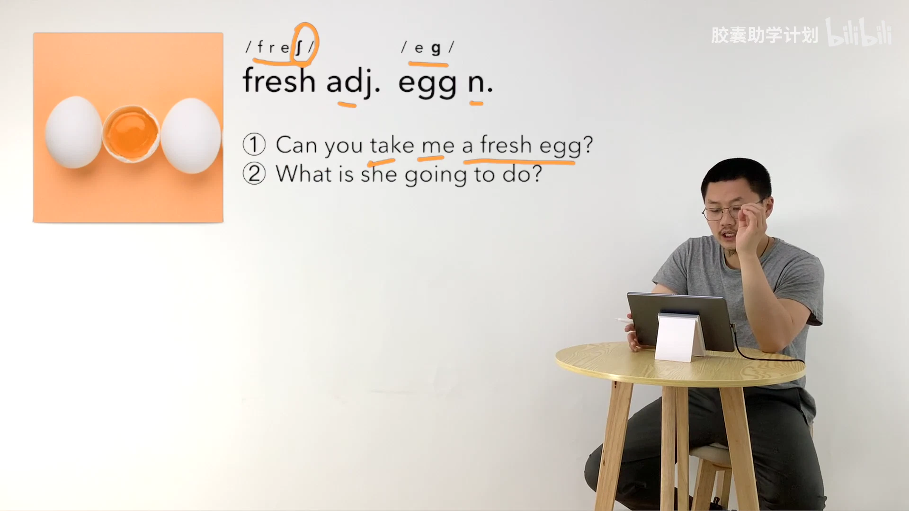

文字识别：胶囊助学计划 / / fre / /eg/ / fresh adj. egg / n. / ① Can you take me a fresh egg? / What is she / going to do?

## 00:01:00–00:01:30

Zhang Zui,跟我读. She is going to send Leo some fresh eggs. Send somebody something.她打算be going to do.三十七课学的，邮寄给Leo一些新鲜的鸡蛋. There you go.再跟我读一遍这两个单词. Fresh eggs.在这儿我想提一个小点，就是各位注意到，其实我在不停的把我们之前学到的知识点拉到今天来去进行造句。这

### 画面 00:01:08

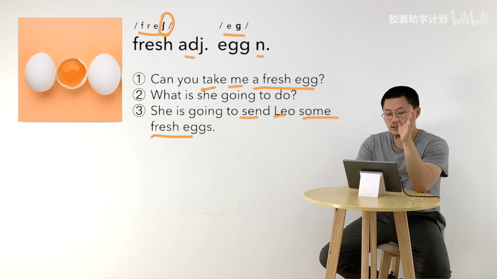

文字识别：胶囊助学计划 / / fre / /eg/ / fresh adj. / . egg / n. / Can you take me a fresh egg? / ① / What is / she / going to do? / She is going t / to send Leo some / fresh eggs.

### 画面 00:01:11

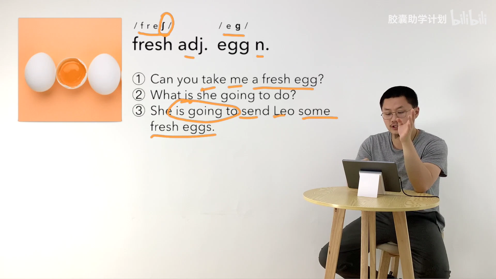

文字识别：胶囊助学计划 / / fre / /eg/ / fresh: / adj. / egg / n. / Can you take me a fresh egg? / 1 / What is she / going / to / do? / Sheis / going / to send / Leo /  some / fresh / eggs.

### 画面 00:01:24

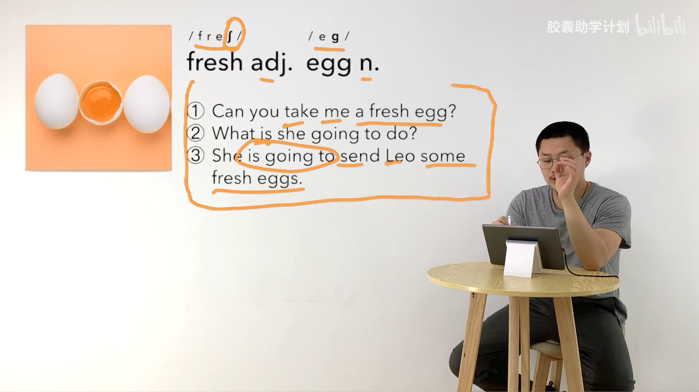

文字识别：胶囊助学计划 / / fre / /eg/ / fresh a / adj. / egg / n. / Can you take me a fresh egg? / 1 / 2 / What is she / going t / to / do? / Sheis / 3 / going t / tosend / Leo /  some / fresh / eggs.

### 画面 00:01:26

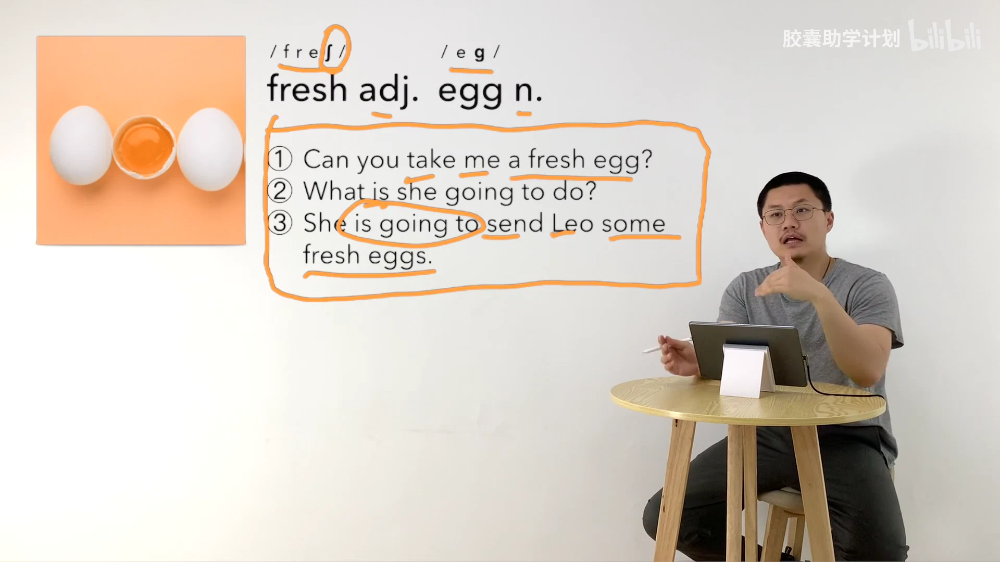

文字识别：胶囊助学计划 / / fre / /eg/ / fresh / adj. / egg / n. / 1 / Can you take / me /  fresh egg? / a / 2 / Whatis / she / going / to / do? / Sheis / 3 / going / tosend / Leo / some / fresh / eggs.

## 00:01:30–00:02:00

个也是各位自己课下去造句的时候一个重要的思路，各位要尝试去用，好吧？好，不多说，接下来下一个单词 butter 加根儿话音 butter 黄油。Can you give me some butter, please？注意，你看我 butter 没加 s，提醒了你什么？不可数，对吧？说 What are you going to do？ I'm going to eat some butter。我要吃一些黄油啊，抹在面包上吃，of course。

### 画面 00:01:35

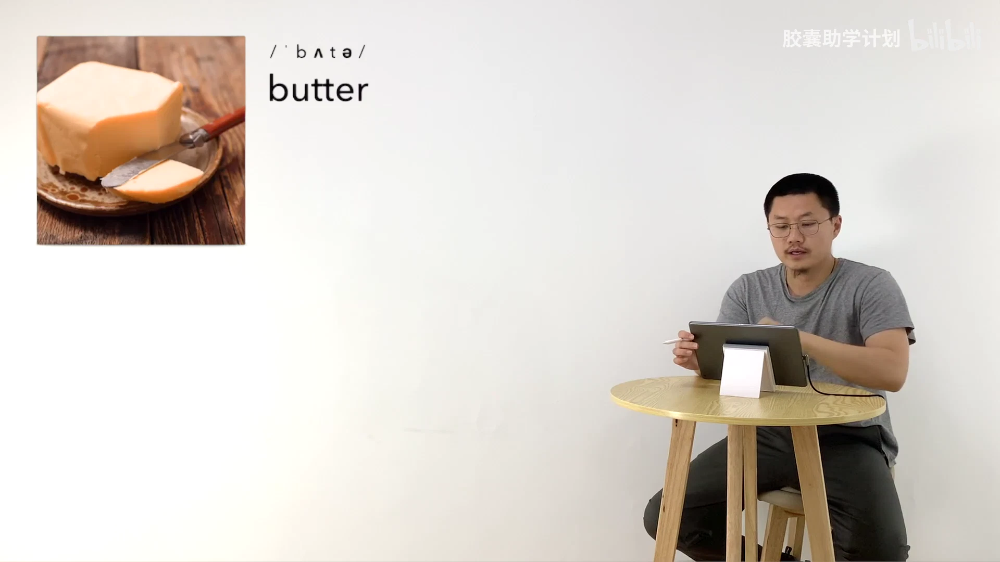

文字识别：胶囊助学计划 / /'bnta/ / butter

### 画面 00:01:37

文字识别：胶囊助学计划 / /'bΛta/ / butter

### 画面 00:01:42

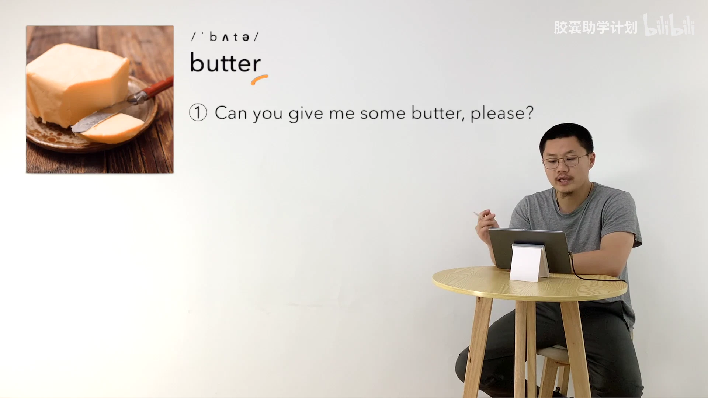

文字识别：胶囊助学计划b出b出 / / ' bΛta / / butter / ① Can you give me some butter, please?

### 画面 00:01:46

文字识别：胶囊助学计划 / / ' bΛta / / butter / ① Can you give me some butter, please?

### 画面 00:01:54

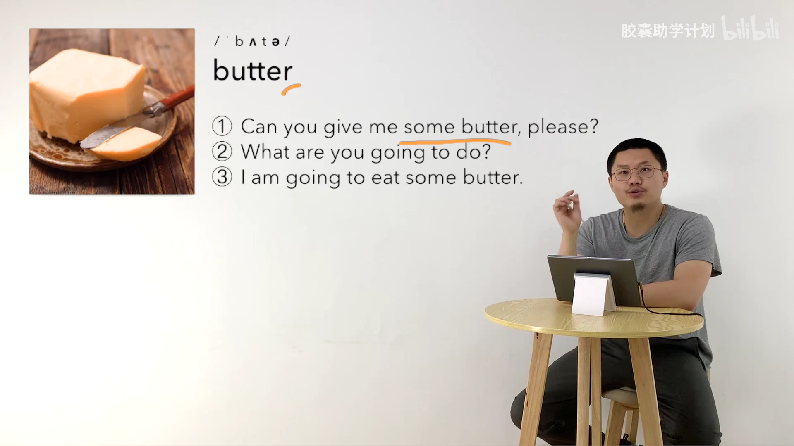

文字识别：胶囊助学计划 / / bΛta / / butter / ① Can you give me some butter, please? / What are you going to do? / ③ Iam going to eat some butter.

## 00:02:00–00:02:30

good. Continue.下一个单词，pure, pure. Okay, honey, pure,纯净的，纯洁的。Honey叫做蜂蜜啊，纯净的蜂蜜。Okay,跟我读。There is some pure honey in the kitchen.注意没加s，不可数。Is there any pure honey in the house? Pure honey. Continue. Ripe

### 画面 00:02:01

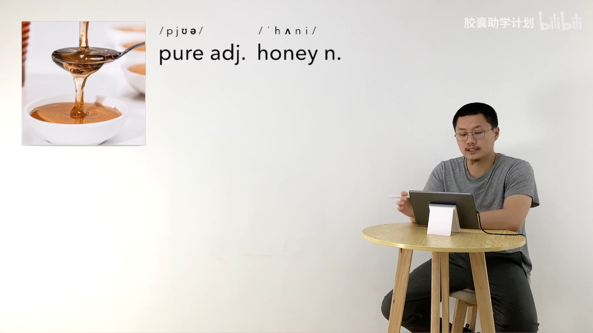

文字识别：胶囊助学计划bil出 / MM / /pjua/ / /'hΛni / / pure adj. honey n.

### 画面 00:02:05

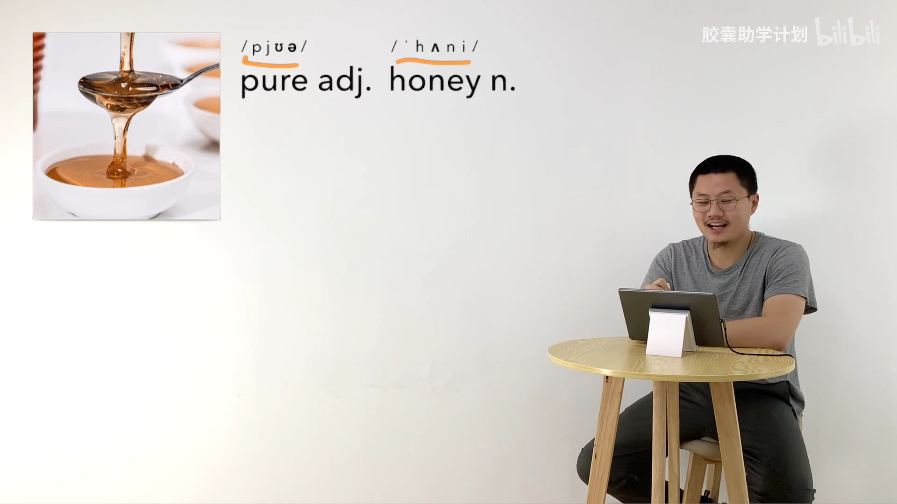

文字识别：g Bilbli / 胶囊助学计划 / /pjua/ / / 'hani / / pure adj. honey n.

### 画面 00:02:20

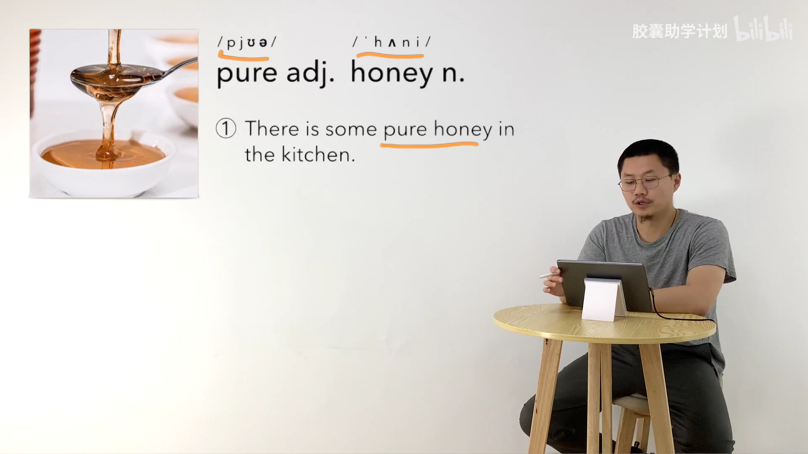

文字识别：胶囊助学计划bilb出 / /pjua/ / / 'hΛn i / / pure adj. honey n. / ① There is some pure honey in / the kitchen.

### 画面 00:02:29

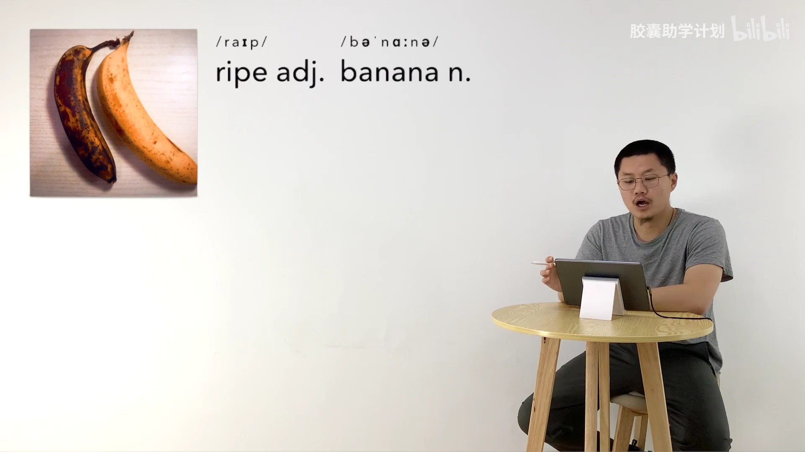

文字识别：胶囊助学计划blb出 / /raip/ / /ba'naina/ / ripe adj. banana n.

## 00:02:30–00:03:00

banana,双元音跟我读一下, I, I ripe叫成熟的，那banana图就行了，OK. Continue, I want some ripe bananas.注意banana加s了。Can I eat a banana?来，都是我们学过的，对吧？四十三课，eat你肯定知道。来，下一个单词跟我读，jam果酱，jam very good。

### 画面 00:02:39

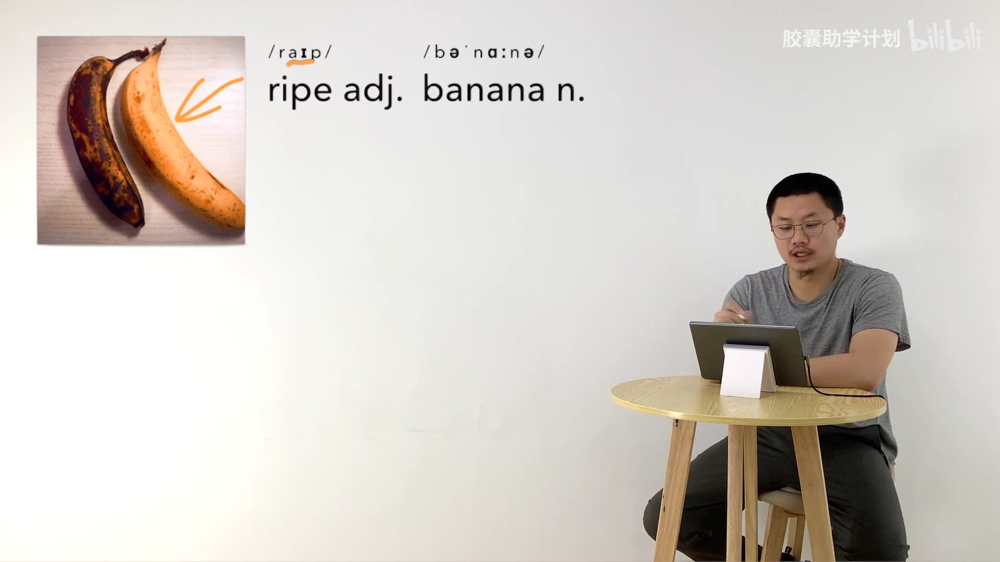

文字识别：胶囊助学计划bil山 / /raip/ / /ba'naina/ / ripe adj. banana n.

### 画面 00:02:54

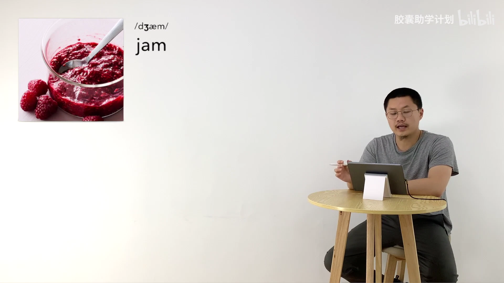

文字识别：胶囊助学计划b出b出 / /d3æm/ / jam

## 00:03:00–00:03:30

造句. Is this jam sweet?甜吗? Do you like jam?我们刚刚学过的四十七课. Do you like? Continue.来跟我读. Sweet啊，刚才我们见到了叫甜的形容词. Orange, orange, orange.橙子，橘子. OK.好，那跟我们一起读叫做I don't like sweet

### 画面 00:03:11

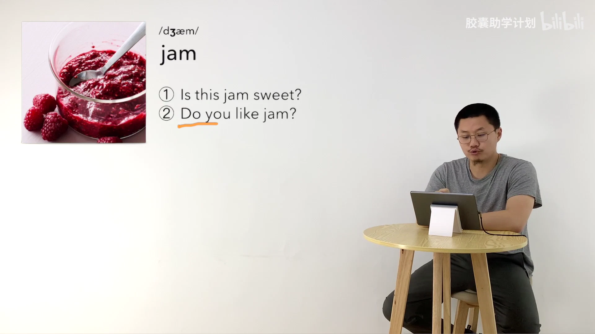

文字识别：胶囊助学计划 / Bilbil / /d3æm/ / jam / ① Is this jam sweet? / Do you like jam?

### 画面 00:03:14

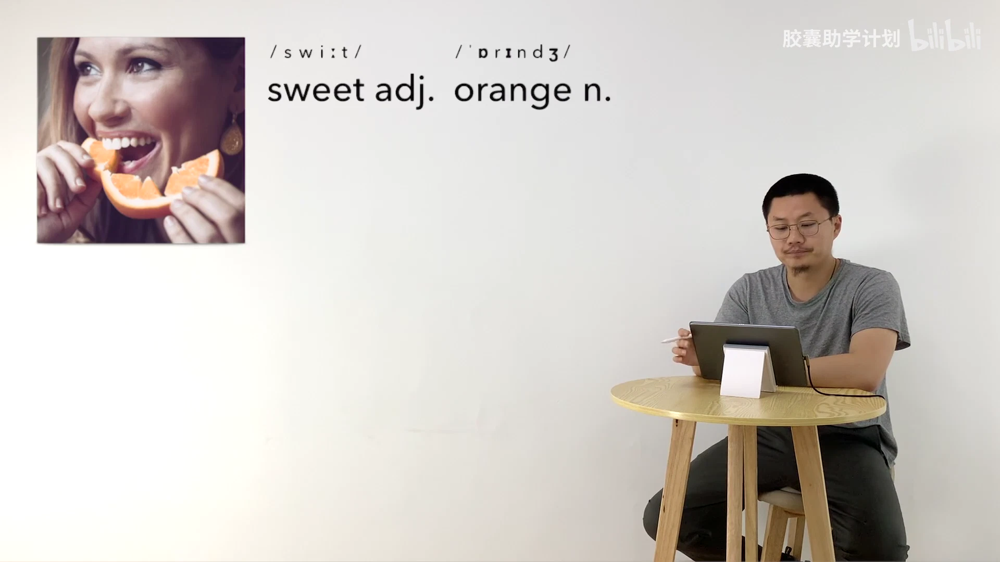

文字识别：胶囊助学计划blbl / / s wi :t / / /'prind3/ / sweet adj. orange n.

### 画面 00:03:19

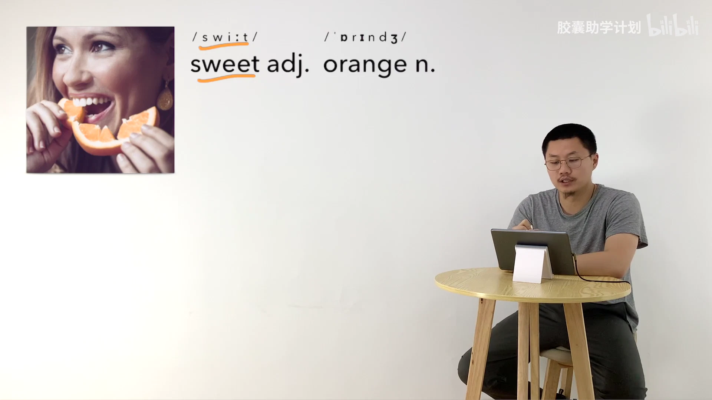

文字识别：胶囊助学计划 / / s w i :t / / /'prind3/ / sweet adj. orange n.

## 00:03:30–00:04:00

orange. 我不喜欢甜橙子. What is she doing? She is eating that sweet orange. 好，她正在吃啊. Be doing. 我们三十一课学的. Next one. 注意这儿要浊化，叫做 Scotch. 哥，对吧？首音是 s，第二个音是清辅音，把它浊化成对应的浊辅音啊. Scotch 苏格兰 whiskey.

### 画面 00:03:35

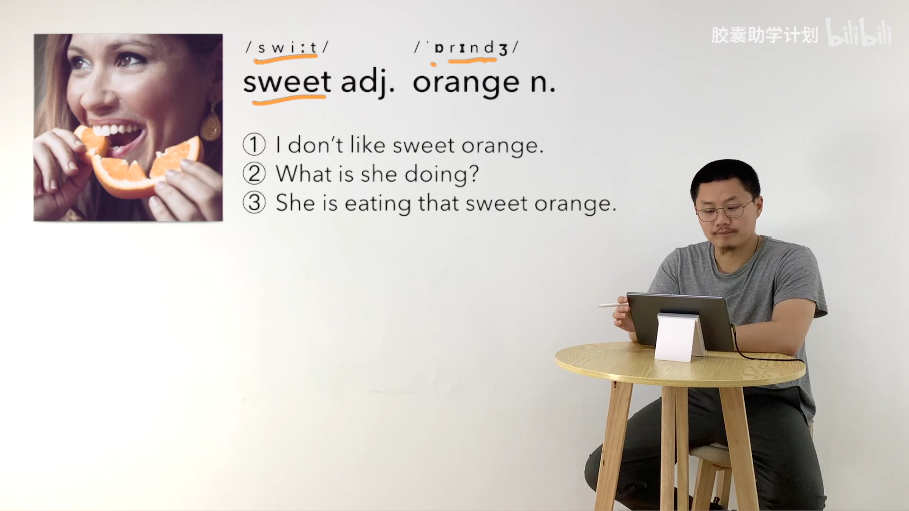

文字识别：胶囊助学计划b出b出 / I s w i : t / / / 'prind3/ / sweet adj. orange n. / ① I don't like sweet orange. / What is she doing? / She is eating that sweet orange.

### 画面 00:03:45

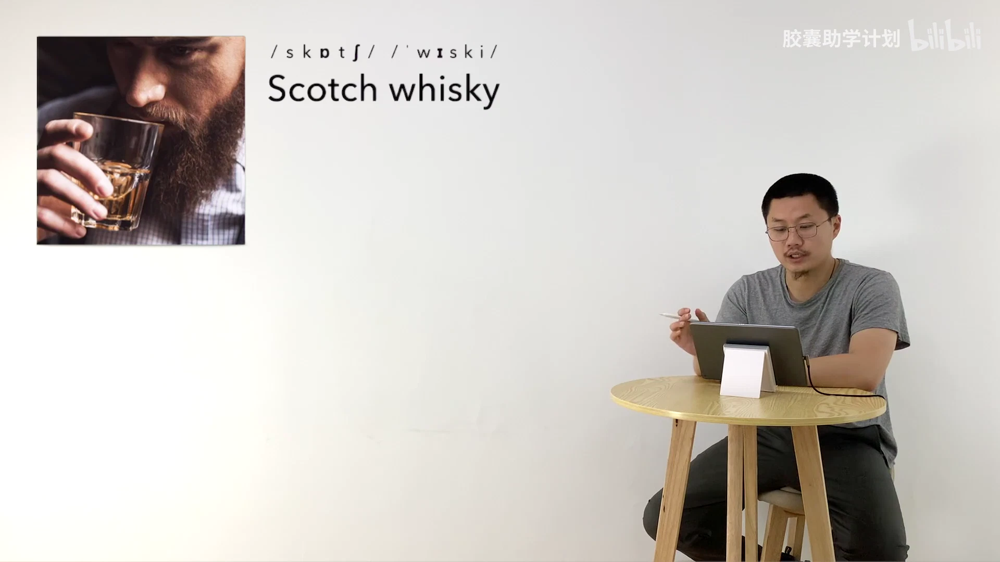

文字识别：胶囊助学计划blb出 / / skｐt ∫/ / wIski / / Scotch whisky

## 00:04:00–00:04:30

okay. 苏格兰 whiskey. 跟我造句，张嘴跟我读。 Do you like Scotch whiskey? What is he going to do? 他要干嘛去啊？ He is going to drink the Scotch whiskey, 或者是 some Scotch whiskey. Okay. Next one. Can you drink the Scotch whiskey? 你能喝苏格兰威士忌吗？ There you go. Next one. Choice. 注

### 画面 00:04:01

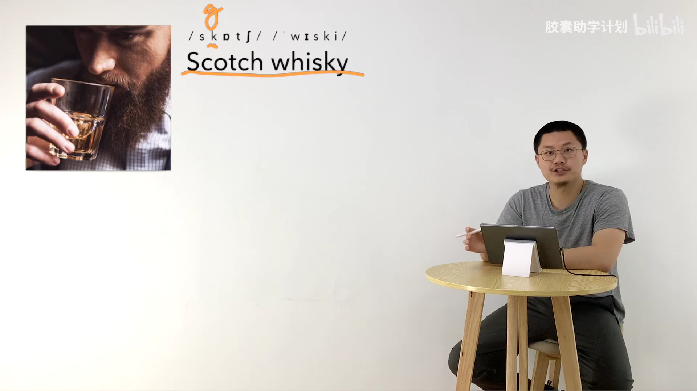

文字识别：胶囊助学计划bilb出 / / skpt ∫/ /'wIs ki/ / Scotch whiskv

### 画面 00:04:12

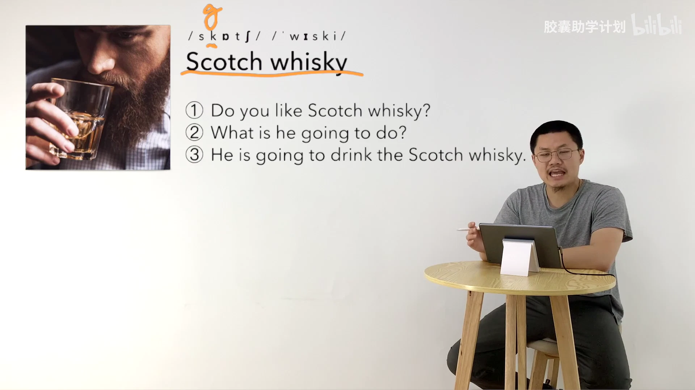

文字识别：胶囊助学计划 / / skp t ∫/ / wI s k i / / Scotch whiskv / ① Do you like Scotch whisky? / What is he going to do? / He is going to drink the Scotch whisky.

### 画面 00:04:26

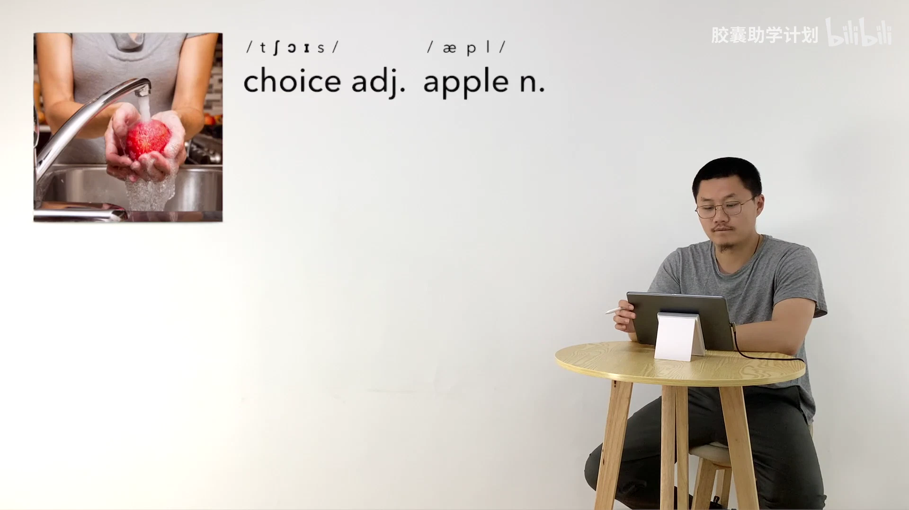

文字识别：Bibl / 胶囊助学计划 / / t ∫oI s / / / æp l / / choice adj. apple n.

## 00:04:30–00:05:00

意这个小的音标 ch choice apple a choice 形容词呃优选的优质的 apple 苹果啊优选优质的苹果跟我读 Do you want a choice apple? What is she doing? What is she doing? She is washing the choice apple. She's washing the choice apple.

### 画面 00:04:35

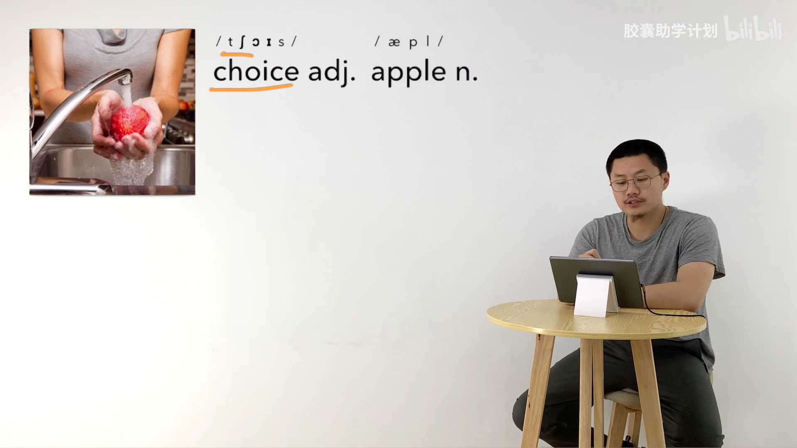

文字识别：胶囊助学计划bil出 / / t ∫o I s / / / æe p l / / choice adj. apple n.

### 画面 00:04:51

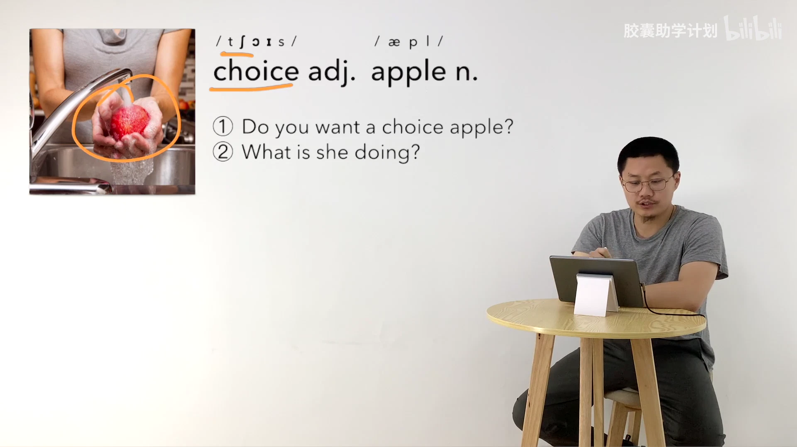

文字识别：胶囊助学计划b鼎b出 / / t ∫o Ⅰ s / / / æe p | / / choice adj. apple n. / ① Do you want a choice apple? / What is she doing?

## 00:05:00–00:05:30

Very good. What is she going to do? 对吧，她正在洗，那她打算去干嘛？ She is going to eat it. 注意一个小点，我们在这儿有一个连读，可以读成 eat eat，没问题，别人能听懂啊。但是别人可能不会这么读，尤其是英语是母语的人，他可能会读的是 eat it eat it eat it，而不是 eat eat. Okay, eat it. Very good. Continue.跟我读 wine，

### 画面 00:05:02

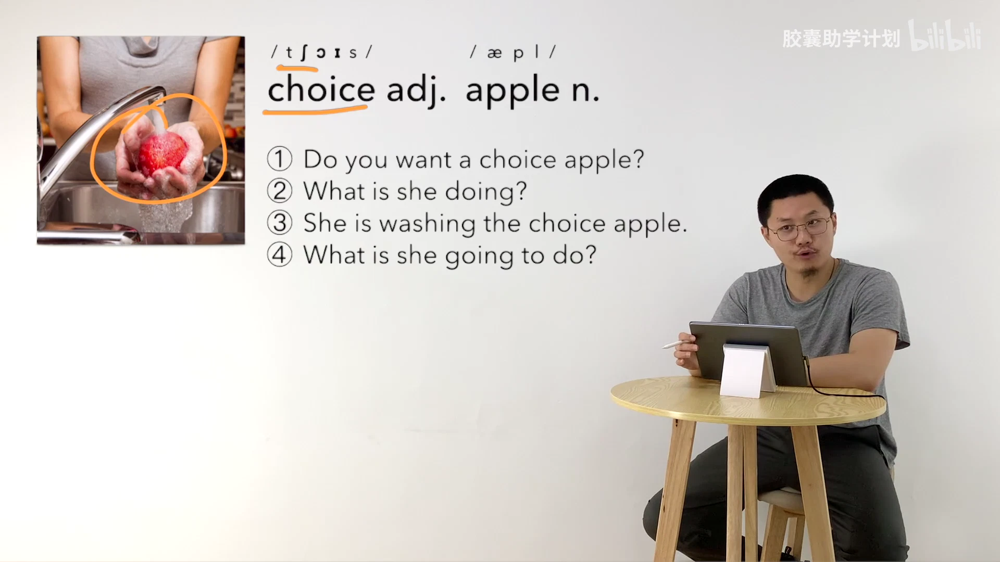

文字识别：胶囊助学计划 / / t ∫ o I s / / / æ p l / / choice adj. apple n. / ① Do you want a choice apple? / What is she doing? / She is washing the choice apple. / What is she going to do?

### 画面 00:05:12

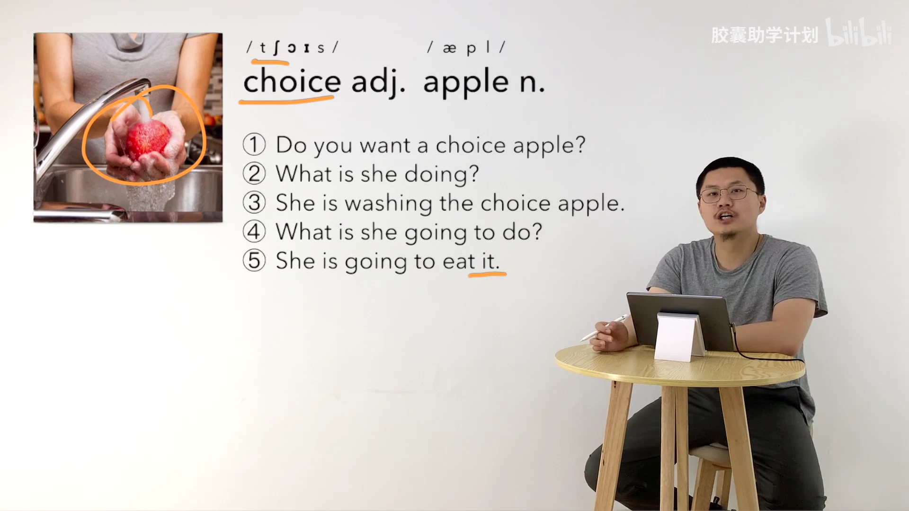

文字识别：胶囊助学计划 / / t ∫ o I s / / / æ p l 1 / choice adj. apple n. / ① Do you want a choice apple? / What is she doing? / 2 / She is washing the choice apple. / What is she going to do? / ⑤ She is going to eatit.

### 画面 00:05:20

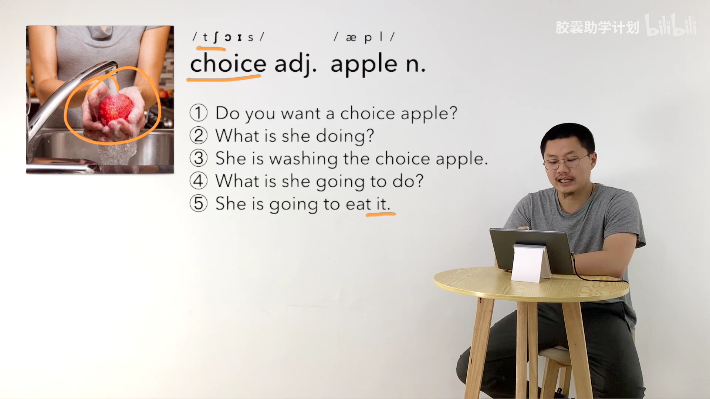

文字识别：胶囊助学计划 / / t ∫ o I s / / / æ p | 1 / choice adj. apple n. / ① Do you want a choice apple? / What is she doing? / 2 / She is washing the choice apple. / What is she going to do? / ⑤ She is going to eatit.

### 画面 00:05:27

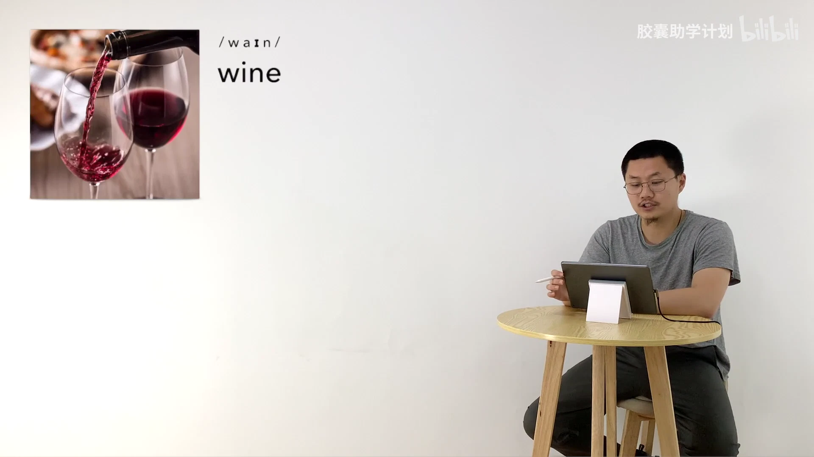

文字识别：BiBi / 胶囊助学计划 / /waIn/ / wine

## 00:05:30–00:06:00

红酒对吧？wine酒，你猜它可数不可数？对吧？milk water不可数，你猜它可数不可数？来了，Do you like wine？ No， I don't. What are they going to do？ They are going to drink some wine. 你看到答案了，可数不可数？没加s，不可数。OK， continue next one beer，啤酒啊不可数

### 画面 00:05:47

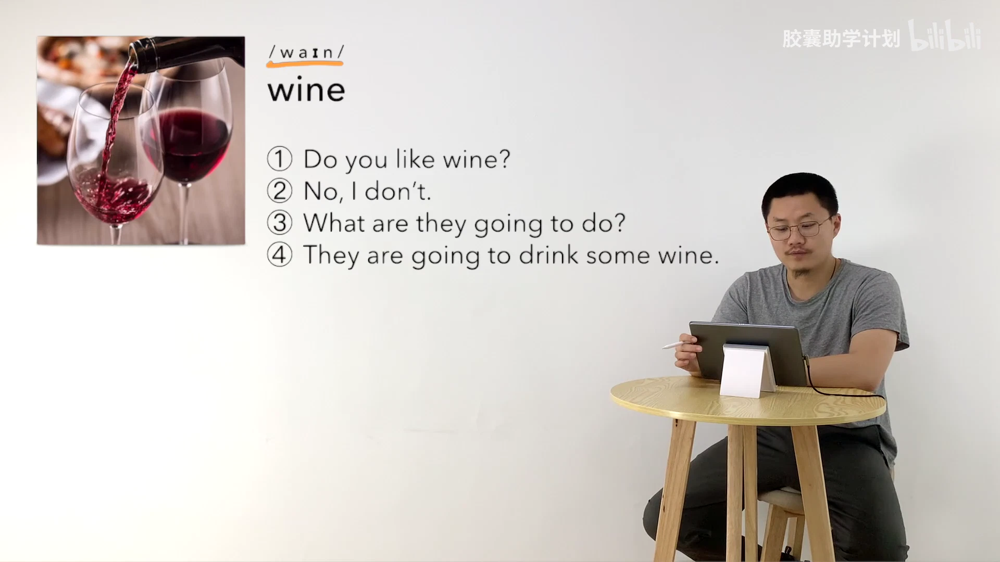

文字识别：胶囊助学计划 / /waIn/ / wine / ① Do you like wine? / No,l don't. / What are they going to do? / They are going to drink some wine.

### 画面 00:05:52

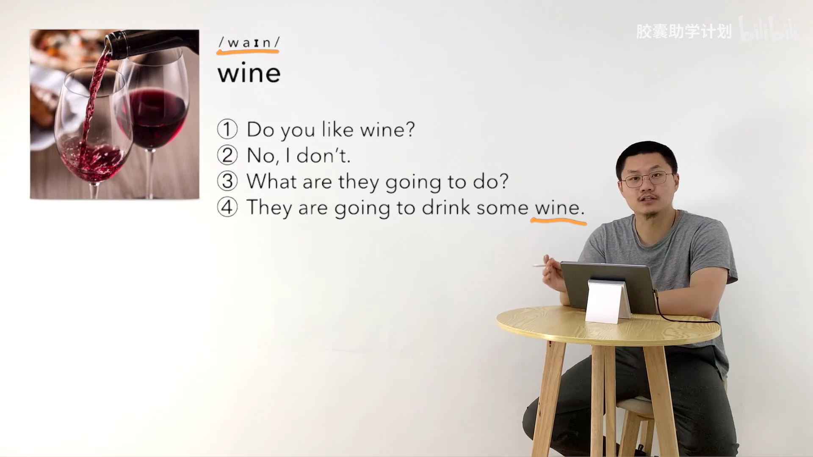

文字识别：胶囊助学计划 / /waIn/ / wine / ① Do you like wine? / No, l don't. / What are /  they going to do? / They are going to drink some wine.

### 画面 00:05:56

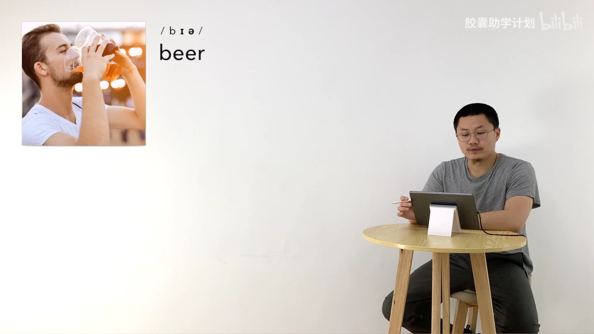

文字识别：胶囊助学计划 / /bia/ / beer

## 00:06:00–00:06:30

啊。来，Do you like beer?张嘴跟我读。Yes, I do. What is he doing? He is drinking beer. Very good. Next one, blackboard. Okay,这实际上是两个单词，black黑色的，board板子，黑色的板子啊，黑板。跟我读。What is he doing? He is writing

### 画面 00:06:07

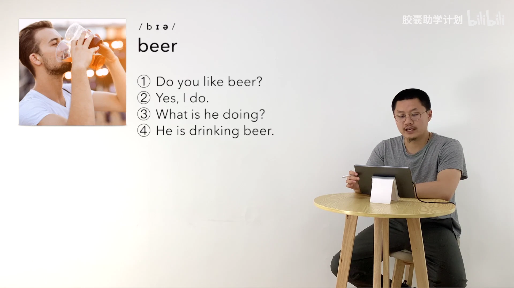

文字识别：胶囊助学计划 / /bia/ / beer / ① Do you like beer? / Yes, l do. / What is he doing? / He is drinking beer.

### 画面 00:06:11

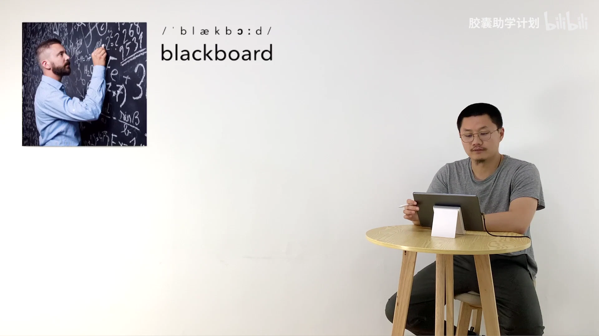

文字识别：胶囊助学计划 / / 'blækbo:d / / blackboard / DinB

### 画面 00:06:15

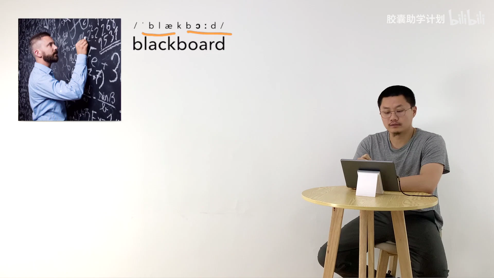

文字识别：胶囊助学计划 / /blækbo:d / / blackboard / Nin13

### 画面 00:06:20

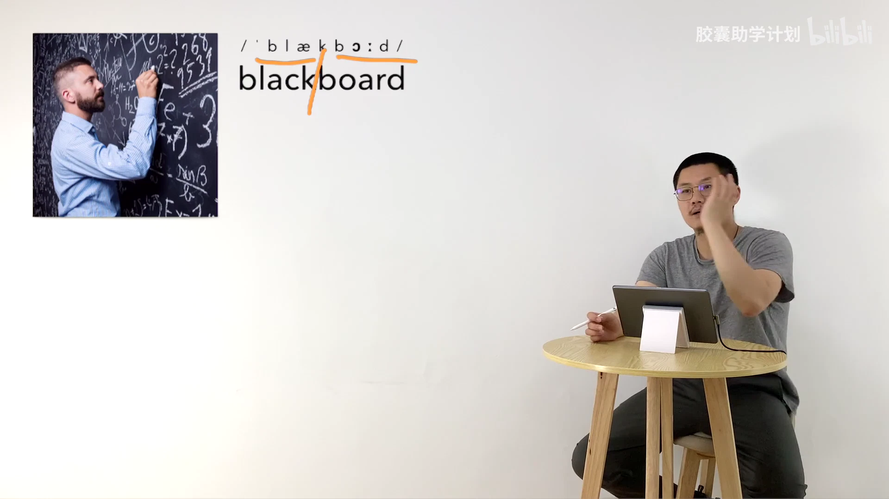

文字识别：胶囊助学计划 / blækboid/ / blackboard / Din3

### 画面 00:06:23

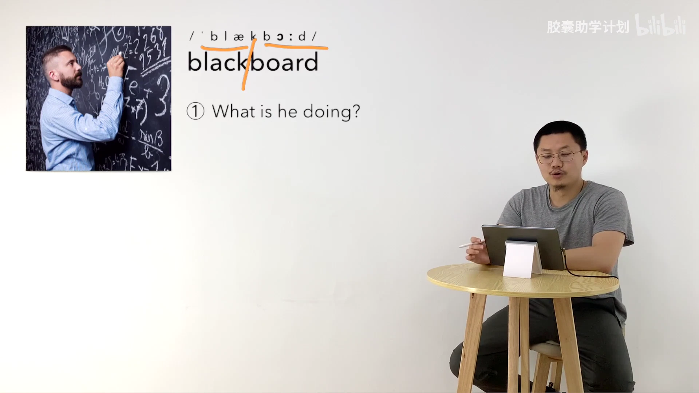

文字识别：胶囊助学计划 / /·blækbo:d/ / blackboard / ① What is he doing? / Din3

## 00:06:30–00:07:00

on the blackboard. Cindy, can you write it on the blackboard? 你能把它写在黑板上吗？注意一个小的介词 on. Where can I write it? Ah, on the blackboard, 对吧？好，接下来呢，我们不是单词了。刚才单词过去一遍，但每个单词我也给各位造句了。接下来我们进行一些比较快快速的口语练习。我张嘴，您张嘴，跟我一起读就行了。来

### 画面 00:06:33

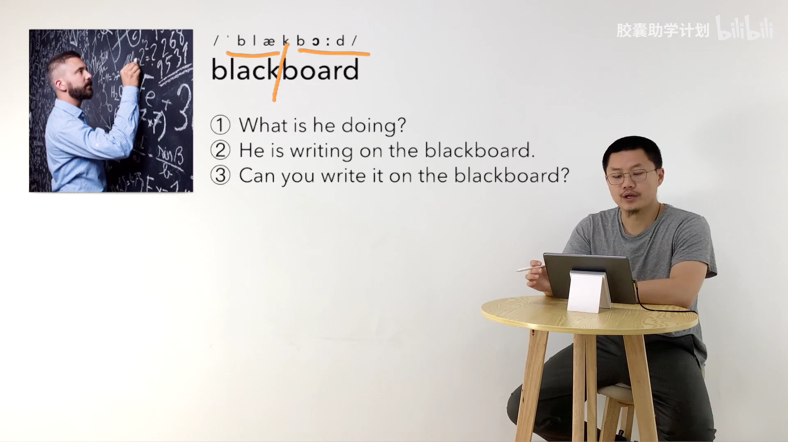

文字识别：胶囊助学计划 / /  blækbo:d / / blackboard / ① What is he doing? / Din3 / He is writing on the blackboard. / ) Can you write it on the blackboard? / 3

### 画面 00:06:45

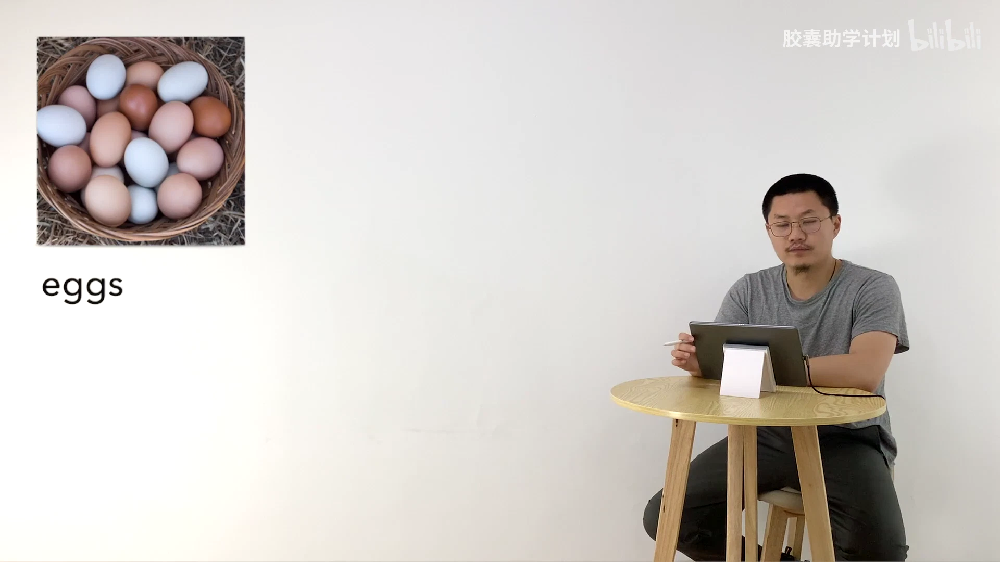

文字识别：胶囊助学计划bilbil / eggs

### 画面 00:06:50

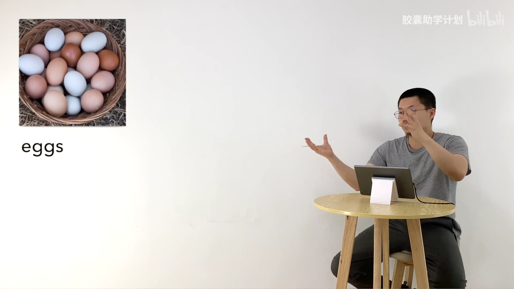

文字识别：Bilbil / 胶囊助学计划 / eggs

## 00:07:00–00:07:30

了，Do you like eggs? Yes, I do. I like eggs, but I don't want one. Do you like butter? Yes, I do. I like butter, but I don't want any.注意一个小点，上一个是 I don't want one，这一个是 I don't want any。区别是什么？One一个可数嘛，我不想要任何，不可数，对吧？Butter不可数。Continuing, honey,

### 画面 00:07:00

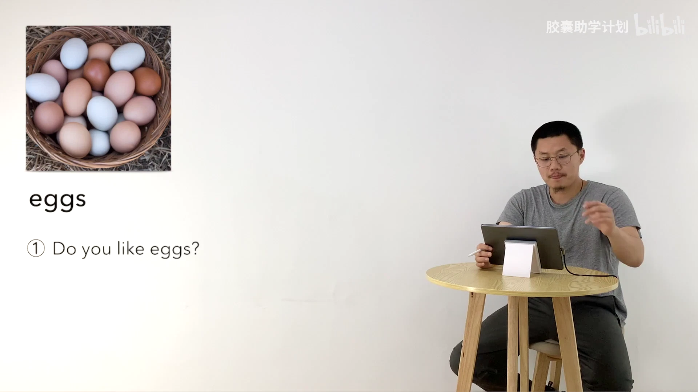

文字识别：胶囊助学计划 / eggs / ① Do you like eggs?

### 画面 00:07:03

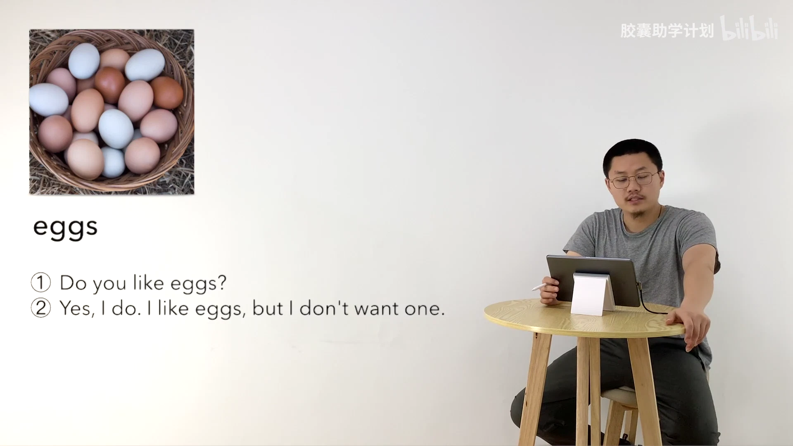

文字识别：胶囊助学计划 / eggs / ① Do you like eggs? / ② Yes, I do.I like eggs, butI don't want one. / 2

### 画面 00:07:08

文字识别：胶囊助学计划 / butter / ① Do you like butter?

### 画面 00:07:17

文字识别：胶囊助学计划 / butter / One / ① Do you like butter? / Yes, I do. I like butter, butI don't want any.

### 画面 00:07:21

文字识别：胶囊助学计划 / butter / One / ① Do you like butter? / Yes, I do.I like butter, but I don't want any.

### 画面 00:07:27

文字识别：胶囊助学计划 / honey

## 00:07:30–00:08:00

蜜。Do you like honey?张嘴。Yes, I do. I like honey, but I don't want any. Continue. Bananas. Do you like bananas?你喜欢香蕉吗？Yes, I do.是的，我喜欢。I like bananas.我喜欢香蕉，but I don't want one.但我不想要一个啊。我我喜欢，但我现在不想要。Continue. Jam. Do you like

### 画面 00:07:40

文字识别：胶囊助学计划b出b山 / - / bananas

### 画面 00:07:44

文字识别：胶囊助学计划b出b出 / bananas / ① Do you like bananas? / ② Yes, I do.I like bananas, but I don't want one.

### 画面 00:07:56

文字识别：Bilbil / 胶囊助学计划 / jam

## 00:08:00–00:08:30

jam? Yes, I do. I like jam, but I don't want any. Continue oranges, oranges. Do you like oranges? Yes, I do. I like oranges, but I don't want one. Continue ice cream. Do you like ice cream? Yes, I do. I like ice cream, but I don't want one. Continue

### 画面 00:08:08

文字识别：胶囊助学计划 / Bilbi / oranges

### 画面 00:08:14

文字识别：胶囊助学计划bilb出 / oranges / ① Do you like oranges? /  Yes, I do.I like oranges, butI don't want one. / 2

### 画面 00:08:18

文字识别：胶囊助学计划 / ice cream

### 画面 00:08:23

文字识别：胶囊助学计划 / ice cream / ① Do you like ice cream? / ② Yes, I do.I like ice cream, but I don't want one.

### 画面 00:08:29

文字识别：胶囊助学计划b出b山 / whisky

## 00:08:30–00:09:00

whiskey. Do you like whiskey? Yes, I do. I like whiskey, but I don't want any. Continue apples. Do you like apples? Yes, I do. I like apples, but I don't want any. Wine. Do you like wine? Yes, I do. I like wine,

### 画面 00:08:33

文字识别：胶囊助学计划 / 出出 / whisky / ① Do you like whisky? /  Yes, I do.I like whisky, but I don't want any.

### 画面 00:08:36

文字识别：胶囊助学计划 / 出5出 / whisky / ① Do you like whisky? /  Yes, I do.I like whisky, but I don't want any. / 2

### 画面 00:08:40

文字识别：胶囊助学计划 / apples

### 画面 00:08:43

文字识别：胶囊助学计划 / Bibil / apples / ① Do you like apples?

### 画面 00:08:48

文字识别：胶囊助学计划b鼎b出 / apples / ① Do you like apples? / ② Yes, I do.I like apples, but I don't want one.

### 画面 00:08:50

文字识别：胶囊助学计划 / apples / ① Do you like apples? / ② Yes, I do.I like apples, but I don't want one.

### 画面 00:08:52

文字识别：胶囊助学计划 / wine

### 画面 00:08:55

文字识别：胶囊助学计划 / wine / ① Do you like wine?

## 00:09:00–00:09:30

but I don't want any biscuits.饼干。Do you like biscuits? Yes, I do. I like biscuits, but I don't want any beer.啤酒。Do you like beer? Yes, I do. I like beer, but I don't want any. Okay, recap.本课我们关键

### 画面 00:09:01

文字识别：胶囊助学计划 / 2 / wine / ① Do you like wine? / ② Yes, I do.I like wine, but I don't want any. / 2)

### 画面 00:09:03

文字识别：胶囊助学计划 / biscuits

### 画面 00:09:07

文字识别：胶囊助学计划bilb山 / biscuits / ① Do you like biscuits?

### 画面 00:09:14

文字识别：胶囊助学计划b出 / beer

### 画面 00:09:26

文字识别：胶囊助学计划 / Recap / Patterns / 一般现在时do / Grammar / Words / Expression

### 画面 00:09:28

文字识别：胶囊助学计划 / Recap / Patterns / 一般现在时 do / Grammar / Words / Expression

## 00:09:30–00:10:00

练习的还是一般现在时 do，但同时我在第一个单词以及我们其实大多数单词的时候，我都给各位灌入了一个思路啊，传授了一个思啊，叫分享了吧一个思路，就是你要结合之前的各种大的句型，各位一定要去整理一下，看一下本课家庭作业绿皮书四十八课写作练习，各位可以完成了，给自己讲解一遍今天的核心知识点。那如果各位喜欢我们的课程呢，欢迎大家关

### 画面 00:09:31

文字识别：Recap / 胶囊助学计划 / Patterns / 一般现在时 do / Grammar / Words / Expression

### 画面 00:09:33

文字识别：Recap / 胶囊助学计划 / Patterns / & / 一般现在时 do / Grammar / Words / Expression

### 画面 00:09:47

文字识别：胶囊助学计划 / Recap / Patterns / 一般现在时 do / Grammar / Words / Expression

### 画面 00:09:49

文字识别：胶囊助学计划bl出 / 绿皮书第48课的写作练习

### 画面 00:09:56

文字识别：Bibili / 胶囊助学计划

## 00:10:00–00:10:29

注、订阅、一键三连，并分享给那些需要的朋友。最后，我们再来看一句名人名言：The present was an egg laid by the past, and that had the future inside its shell. See you next time.

### 画面 00:10:04

文字识别：胶囊助学计划bilb出 / The present was an egg laid by the past / that had the future inside its shell. / -Zora Neale Hurston

### 画面 00:10:16

文字识别：胶囊助学计划 / The present was an egg laid by the past / that had the future inside its shell. / -Zora Neale Hurston

### 画面 00:10:18

文字识别：CAPSULEACADEMY / 胶囊助学计划 / 小红书 / Lecturer / □ / Leo / OE

### 画面 00:10:21

文字识别：CAPSULEACADEMY / 胶囊助学计划 / 小红书

### 画面 00:10:24

文字识别：CAPSULEACADEMY / 胶囊助学计划 / 小红书 / Creator / Leo & Berlin / OE

### 画面 00:10:26

文字识别：biltbili / 胶囊助学计划 / CAPSULEACADEMY / 胶囊助学计划 / 小红书 / 品 / OE / 0

### 画面 00:10:28

文字识别：bilibili / 胶囊助学计划

