# 049 单词

快速机器解析：语音为单模型转写，未进行独立交叉校对或人工复核；画面每秒采样并按变化选帧，短时文字和标记可能遗漏。截图时间约有 1 秒误差。图片有损压缩；遇到疑点请按时间查看 Google Drive 原视频。

## 00:00:00–00:00:30

Hello everyone, welcome to Capsule Academy. This is Leo. Today we're going to learn new concept English book one lesson forty nine words. 老习惯进入正式课程之前，我们先看几个问题。第一，如何表达牛排几分熟？OK。第二，如何表达我也不是？我们之前学过了，我也是叫做 me too，对吧？那今天我们来看一下，我也不是用英文如何表达？带着这两个问题， hope you gonna enjoy.

### 画面 00:00:00

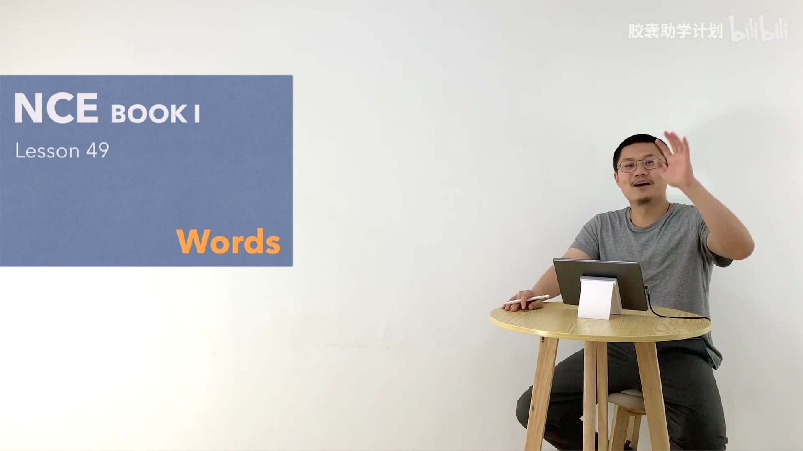

文字识别：胶囊助学计划 / NCE / BOOKI / Lesson 49 / Words

### 画面 00:00:02

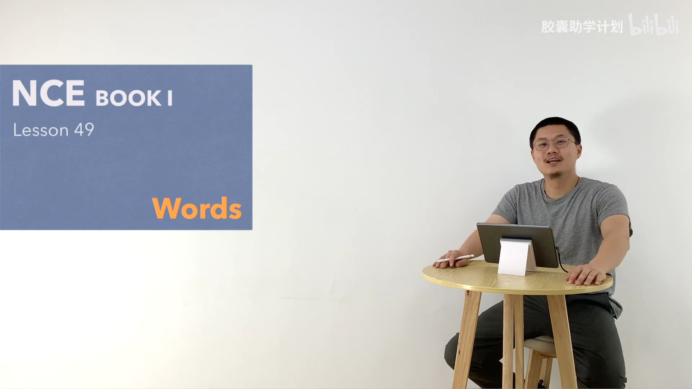

文字识别：胶囊助学计划 / NCE / BOOKI / Lesson 49 / Words

### 画面 00:00:09

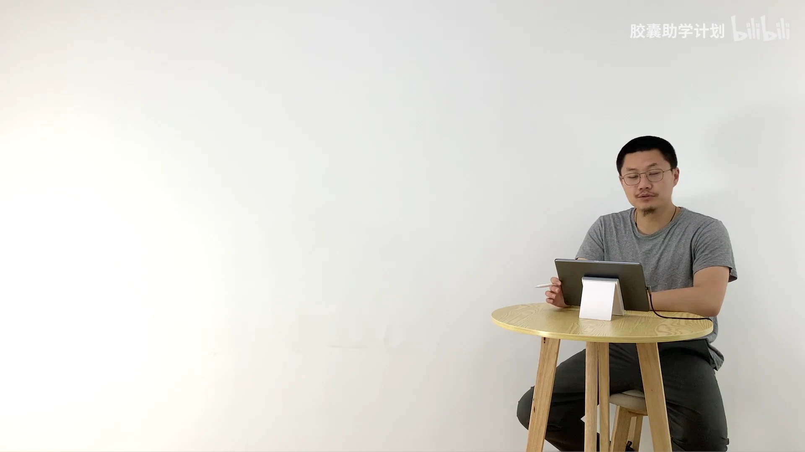

文字识别：胶囊助学计划

### 画面 00:00:11

文字识别：胶囊助学计划 / ①如何表达“牛排几分熟”？

### 画面 00:00:15

文字识别：胶囊助学计划 / ①如何表达“牛排几分熟”? / 如何表达“我也不是”？

### 画面 00:00:18

文字识别：胶囊助学计划 / ①如何表达“牛排几分熟”？ / 如何表达“我也不是”?

### 画面 00:00:27

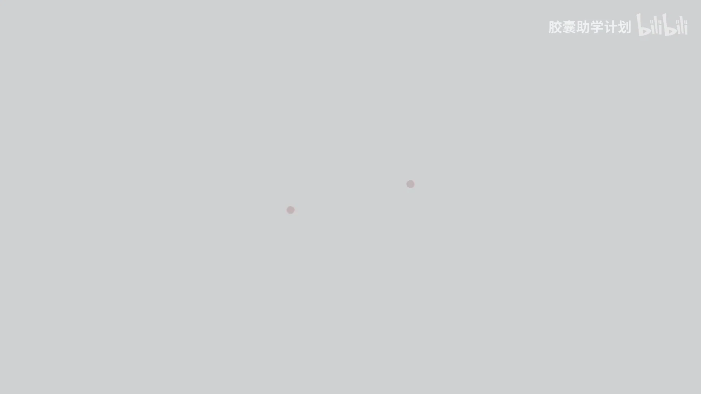

文字识别：胶囊助学计划 billl / •

## 00:00:30–00:01:00

我们先看第一个单词，跟我一起读一下，叫做 butcher，有一个儿化音 butcher butcher 啊，卖肉的人，屠夫，对吧？OK butcher。好，那我们来一个小的短语，这个实际上我们到六十七课才会见到，但今天拿出来也无妨，叫做 at the butcher's。其实后边应该还加一个小单词叫做 shop，但是我们 shop 可以直接

### 画面 00:00:31

文字识别：胶囊助学计划

### 画面 00:00:33

文字识别：胶囊助学计划blb出 / /'but∫a/ / butcher n.

### 画面 00:00:40

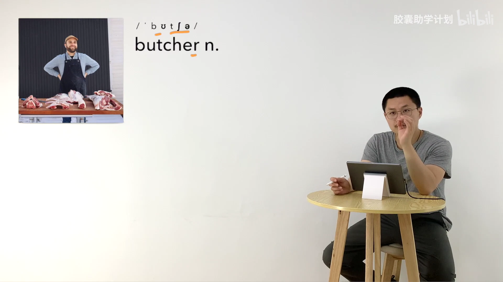

文字识别：胶囊助学计划b出b出 / /'but ∫a/ / butcher n.

### 画面 00:00:49

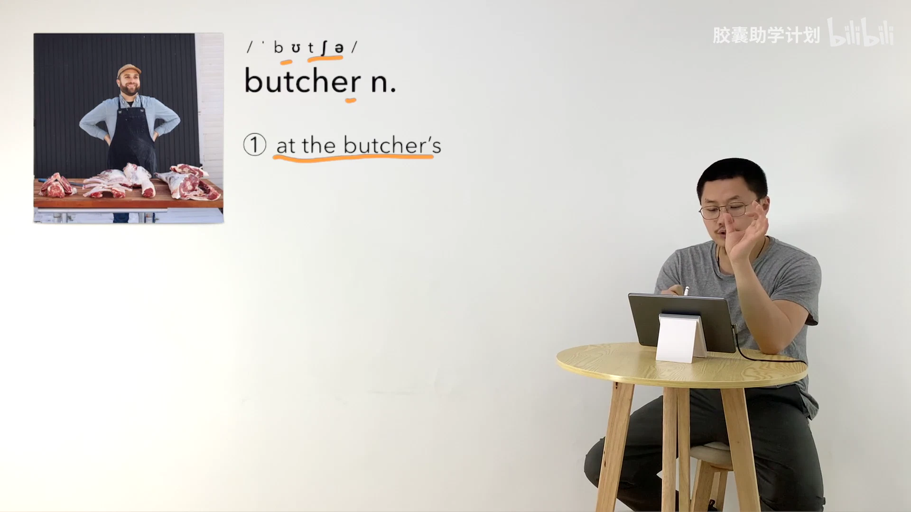

文字识别：胶囊助学计划b出b出 / /'but ∫a / / butcher n. / at the butcher's

### 画面 00:00:56

文字识别：胶囊助学计划bib出 / /'but∫a/ / butcher n. / at the butcher's h

### 画面 00:00:58

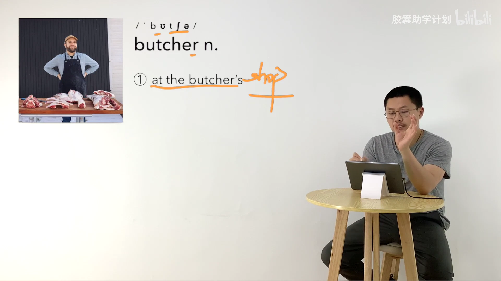

文字识别：Bitbl / 胶囊助学计划 / /'but ∫a / / butcher n. / h / at the butcher's

## 00:01:00–00:01:30

省略掉啊。商店叫做在屠夫的商店，在卖肉的那个地方的商店，其实就是在肉店。OK，那比如说Where are you？你人在哪儿呢？打电话对吧？你说I'm at the butchers。我在肉店的at the butchers。OK，there you go. Continue.接下来下一个单词啊，本课跟肉关系特别大。下一个单词读meat，meat啊肉。OK，好，接下来我们

### 画面 00:01:00

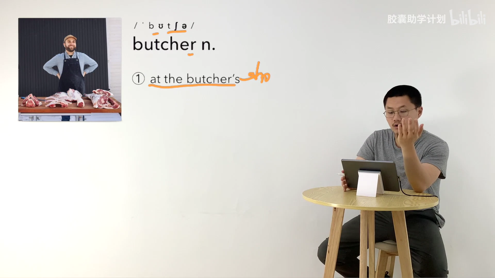

文字识别：胶囊助学计划bi出 / /'but ∫a/ / butcher n. / at the butcher's ho

### 画面 00:01:02

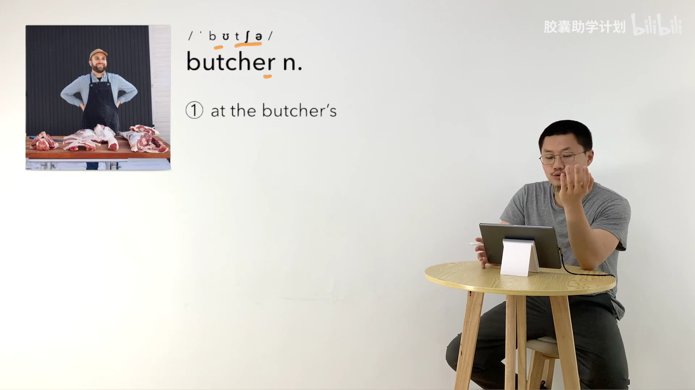

文字识别：胶囊助学计划b出出 / /'but ∫a/ / butcher n. / ① at the butcher's

### 画面 00:01:06

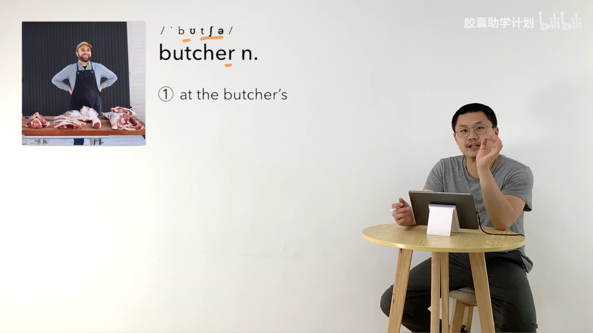

文字识别：胶囊助学计划bill / /'but ∫a / / butcher n. / ① at the butcher's

### 画面 00:01:19

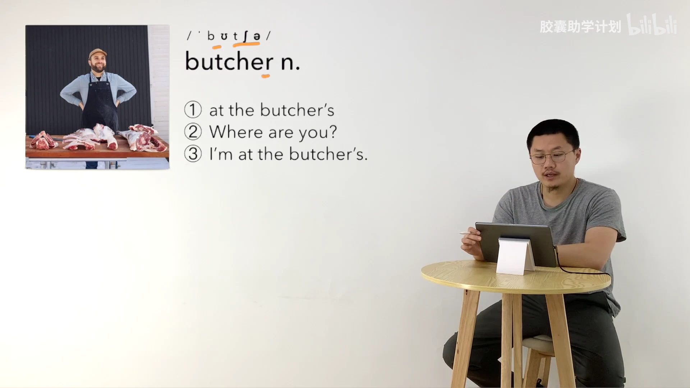

文字识别：胶囊助学计划 / Bilbilt / /'but ∫a/ / butcher n. / at the butcher's / Where are you? / 2 / I'm at the butcher's. / 3

### 画面 00:01:21

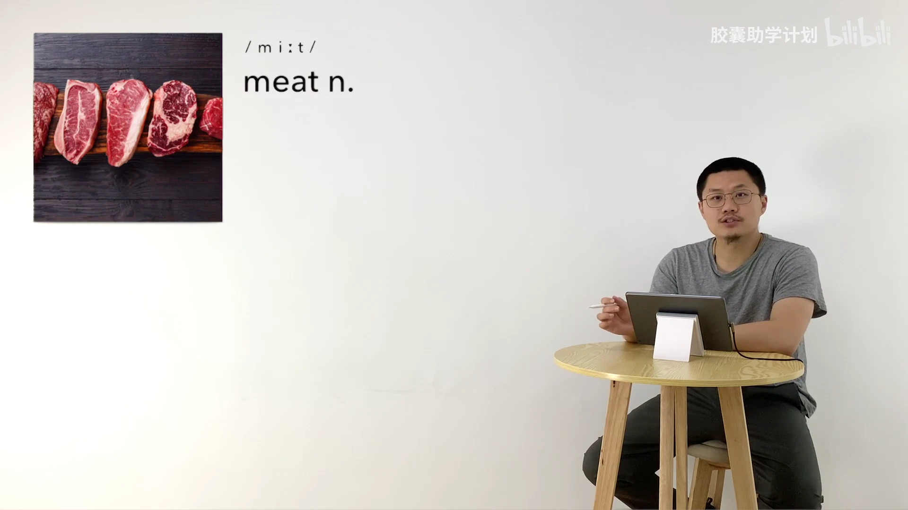

文字识别：胶囊助学计划b出b出 / /mi:t/ / meat n.

## 00:01:30–00:02:00

一起读一下啊，看一下它的这个哪些动词能跟它连起来，对吧？首先说cook做这个是最容易连起来的。那wash洗啊，把这个肉稍微洗一下也可以连起来。那我们开始来了，比如说Can you wash this meat, please? 你能把这些肉洗一下吗？Very good. 接下来I'm going to cook some meat for you. 啊，为了你，我要去做一些肉啊，我打算给你做一些肉。I'm going to cook some meat

### 画面 00:01:38

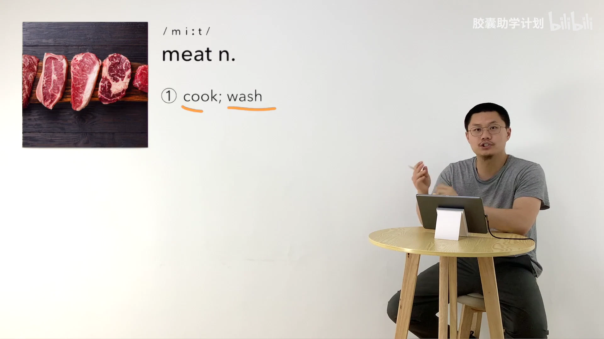

文字识别：胶囊助学计划bl出 / /mi:t/ / meat n. / ① cook; wash / 2

### 画面 00:01:48

文字识别：胶囊助学计划b出b业 / / mi:t/ / meat n. / ① cook; wash / ② Can you wash these meat, please? / ③ Iam going to cook some meat for you.

### 画面 00:01:53

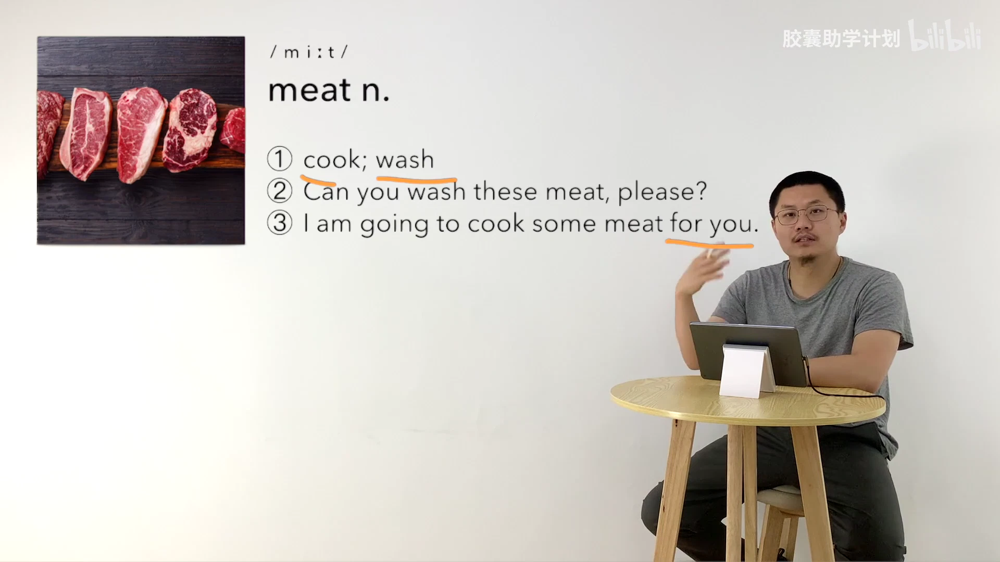

文字识别：胶囊助学计划 / / mi:t/ / meat n. / ① cook; wash / ② Can you wash these meat, please? / ③ Iam going to cook some meat for you.

## 00:02:00–00:02:30

for you. There you go. 下一个单词跟我读一下，叫做 beef, beef, 牛肉。OK。好，接下来哪些单词可以跟它连？至少 like 和 what 是可以连在一起的。比如说，Do you want some beef? 或者说，Do you like beef? 你喜欢牛肉吗？ There you go. 那我们看我这造的叫做 Do you like beef? There you go. 很简单。那我可以回答说，I like beef, but I don't want any beef

### 画面 00:02:01

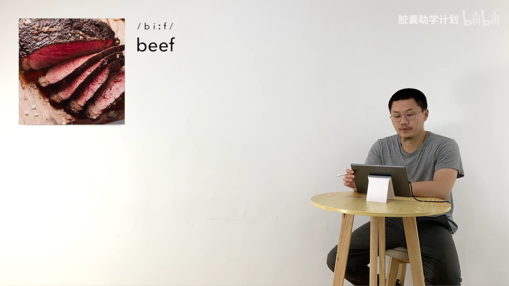

文字识别：胶囊助学计划L鼎D / / bi:f/ / beef

### 画面 00:02:06

文字识别：胶囊助学计划 / / bi:fL / beef / 2

### 画面 00:02:15

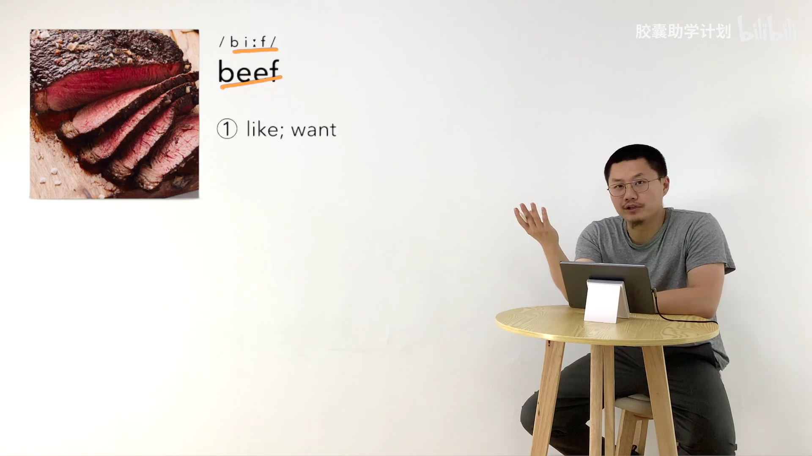

文字识别：胶囊助学计划 / / bi:f/ / beef / ① like; want

### 画面 00:02:20

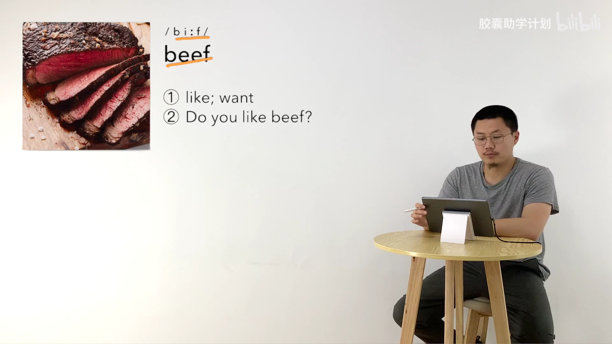

文字识别：胶囊助学计划 / / b i : f / / beef / ① like; want / ② Do you like beef?

### 画面 00:02:28

文字识别：胶囊助学计划 / / b i : f / / beef / )like; want / ② Do you like beef? / ③ Ilike beef. ButI don't want any beef noW

## 00:02:30–00:03:00

now.那我现在不想要，现在不想吃。OK，好，下一个单词跟我读。Lamb，注意，你看音标就能感觉出来，b这个字母发没发音？没发音，对吧？OK，Lamb，Lamb常见的有两个意思，一个就像图中所示，叫做小羔羊；另一个就是羔羊肉，对吧？羊肉。OK，好，那跟我读啊。我们看一下啊，动词，eat可以跟它连起来。当然还有别的动词

### 画面 00:02:30

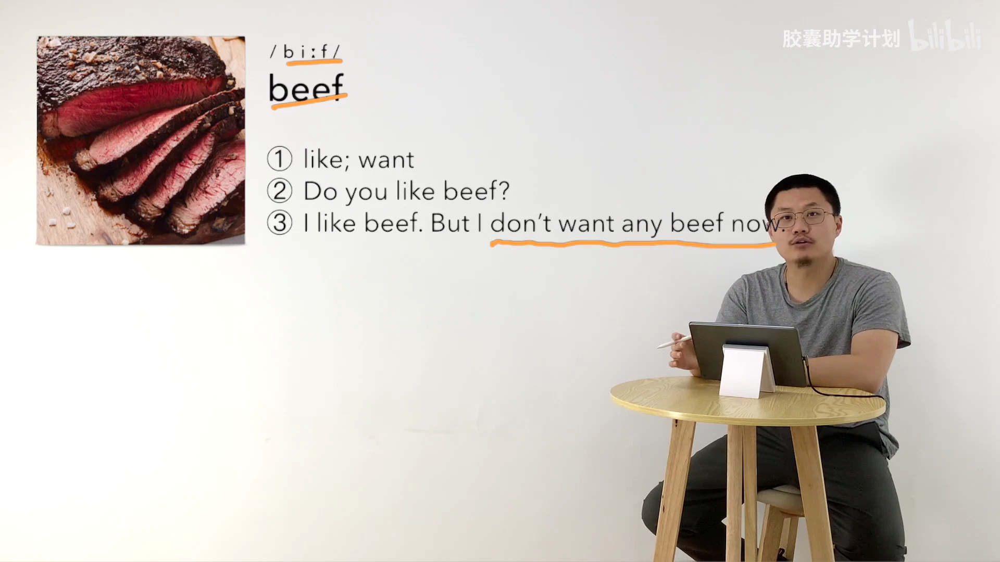

文字识别：胶囊助学计划 / / bi:f L / beef / 1 / Dlike; want / ② Do you like beef? / ③ Ilike beef. But I don't want any beef noW / 2

### 画面 00:02:33

文字识别：胶囊助学计划 / / l æe m/ / lamb

### 画面 00:02:37

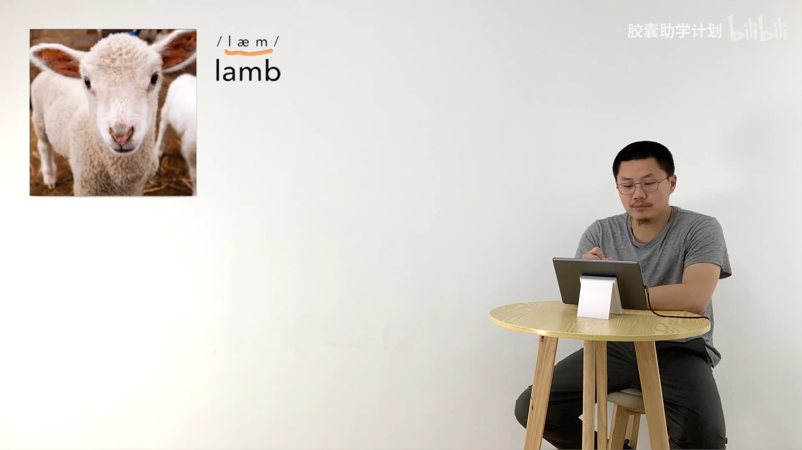

文字识别：胶囊助学计划 / / | æe m_/ / lamb / 2

### 画面 00:02:48

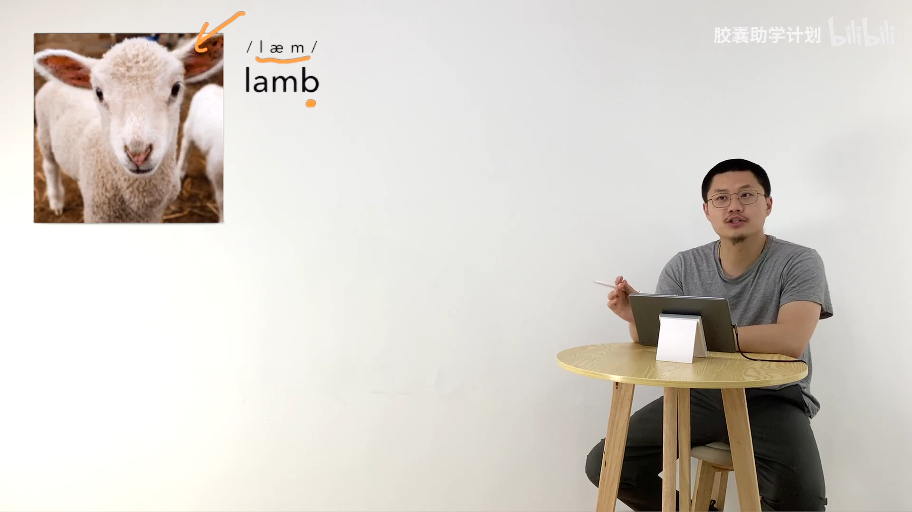

文字识别：胶囊助学计划 / / 1 æe m / / lamb / 2

## 00:03:00–00:03:30

了，对吧？比如说，我在这儿其实给大家补了一个小的单词，叫做 sheep。 Sheep 就是羊的总称，你也可以理解为，如果不强调它大小的话，就用 sheep 就可以了啊。绵羊，那 sheep milk 就是羊奶啊。我们可能中国人喝的不是很多，是吧？ Sheep milk 叫羊奶，我们喝牛奶多一些。比如说， I don't drink sheep milk。 我喝不了羊奶。我不知道各位喝没喝过，特别膻，对吧？我

### 画面 00:03:03

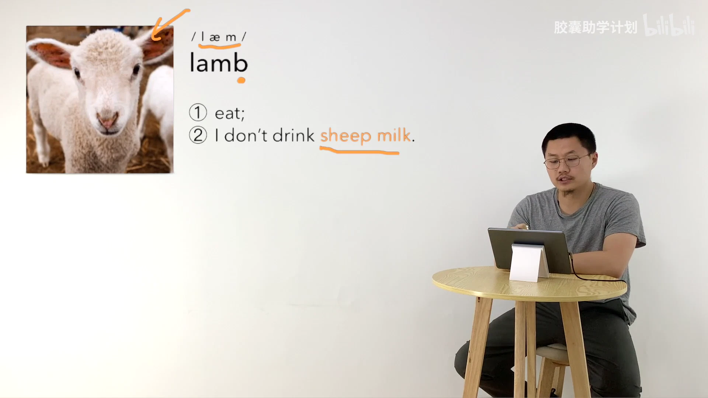

文字识别：胶囊助学计划 / / | aæe m_ / / lamb / ① eat; / ② I don't drink sheep milk.

### 画面 00:03:16

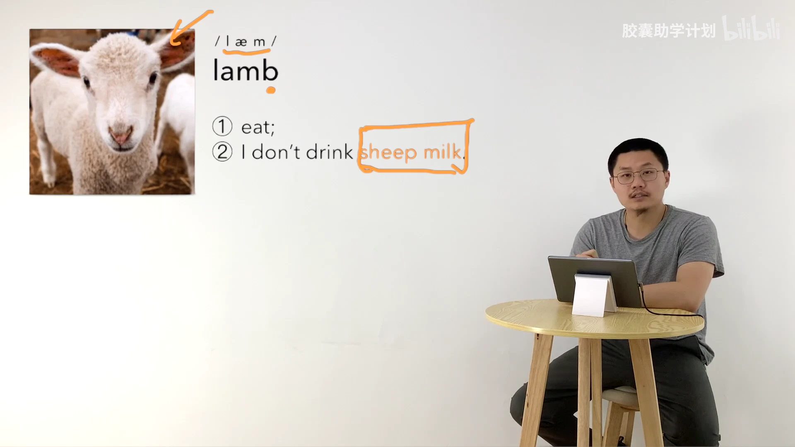

文字识别：胶囊助学计划 / / l æe m/ / lamb / ① / eat; / ) I don't drink / sheep milk. / D

### 画面 00:03:24

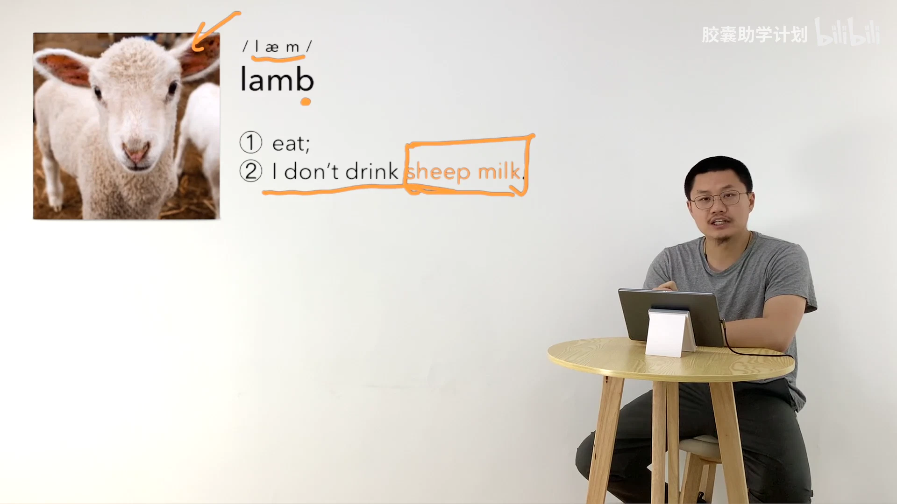

文字识别：胶囊助学计划 / / | æe m/ / lamb / ① / eat; / Idon't drink / sheep milk.

### 画面 00:03:27

文字识别：胶囊助学计划 / / | æe m_/ / lamb / ① / eat; / Idon't drink / sheep milk.

## 00:03:30–00:04:00

不能喝羊奶，I don't drink。我不喝羊奶。那你也可以说我不喜欢，叫做 I don't like。啊，那你喜欢吗？Do you like sheep milk? Okay, one more. Continue.下一个小的单词还是肉啊。本课比较油腻，叫做 pork 啊，猪肉。那我们来了，跟它能连起来的，可以做，可以吃，可以喜欢，可以想要，是吧？我们随便造几个，比如说 Can you cook pork? 你会

### 画面 00:03:31

文字识别：胶囊助学计划 / / | æe m_/ / lamb / ① / eat; / Idon't drink / sheep milk.

### 画面 00:03:35

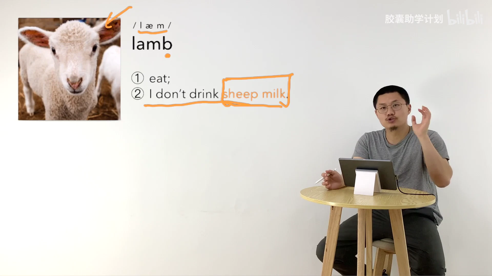

文字识别：胶囊助学计划 / / | æe m/ / lamb / ① / eat; / Idon't drink / sheep milk.

### 画面 00:03:38

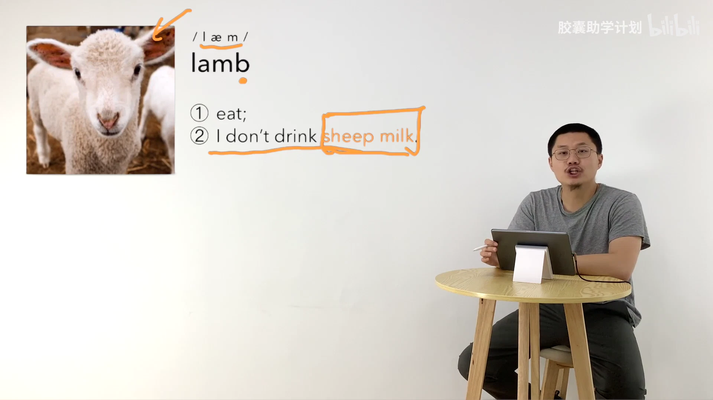

文字识别：胶囊助学计划 / / | aæe m/ / lamb / 1 / eat; / Idon't drink / sheep milk.

### 画面 00:03:42

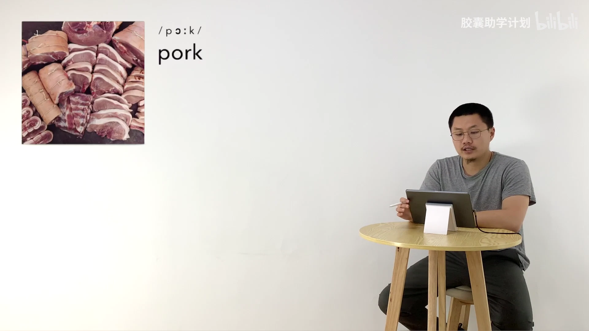

文字识别：胶囊助学计划 / /po:k/ / pork

### 画面 00:03:52

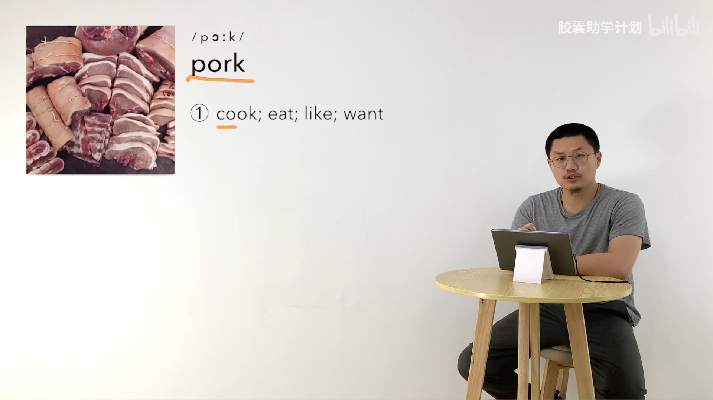

文字识别：胶囊助学计划 / /po:k/ / pork / ① cook; eat; like; want

## 00:04:00–00:04:30

做猪肉吗？OK，再来。Do you want any pork? 你想要一些猪肉吗？There you go. 好，接下来下一个单词我们之前已经学过了，跟我一起读一下，叫做 husband. Husband. OK，丈夫。那来说，This is my husband. 前二十课我们就学过了，介绍一下某人，然后我们可以拿它造句，说 He is going to be going to do cook some lamb. 啊，他要去做一些

### 画面 00:04:07

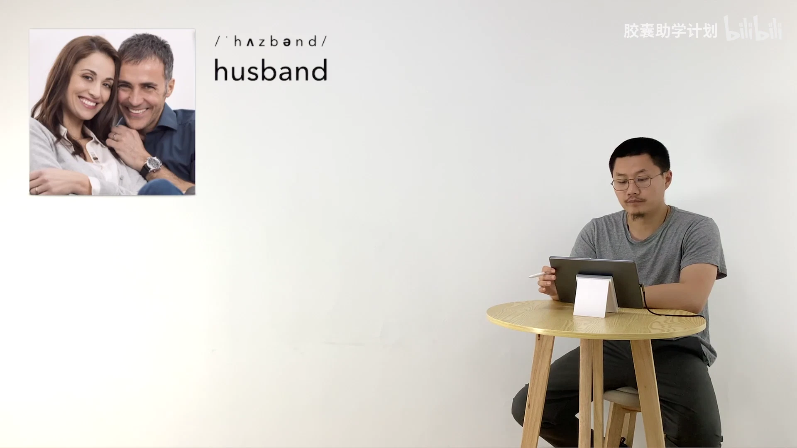

文字识别：胶囊助学计划 / /'hazband/ / husband

### 画面 00:04:23

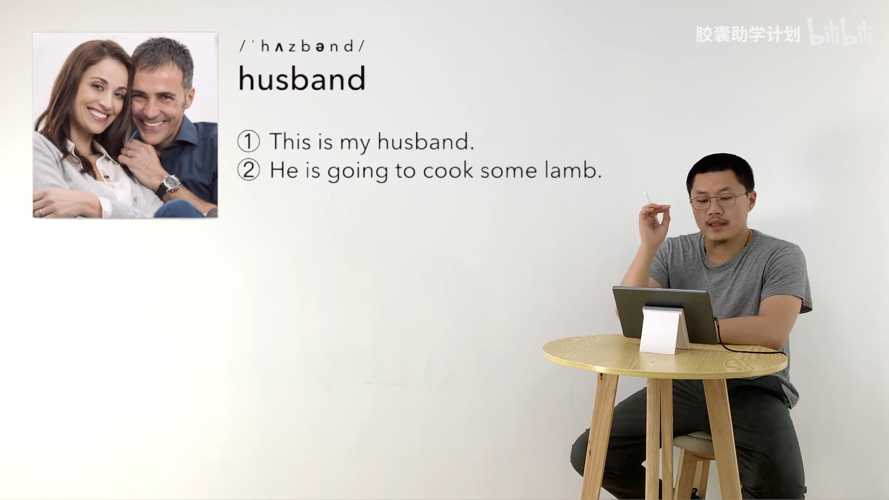

文字识别：胶囊助学计划 / /'hazband/ / husband / ① This is my husband. / ) He is going to cook some lamb.

## 00:04:30–00:05:00

羊肉啊。OK，下一个单词还是牛肉，但是这时候它不只是牛肉了。先读一下，注意一个浊化，把它变成 the，读起连起来读叫做 steak，steak，它指的是牛排了啊。牛肉所有牛肉统称为 beef，那牛排虽然它也是牛肉，但它有一个专属的词叫做 steak。OK，那各位出国点餐的时候，你避

### 画面 00:04:30

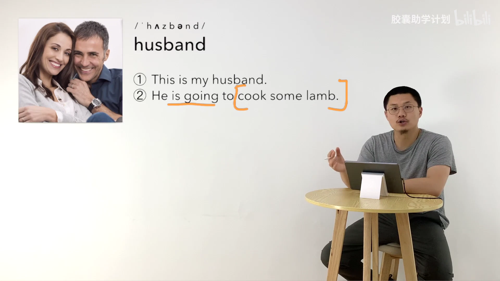

文字识别：胶囊助学计划 / / 'hΛz band / / husband / ① This is my husband. / ) He is going tocook some lamb. / 2

### 画面 00:04:32

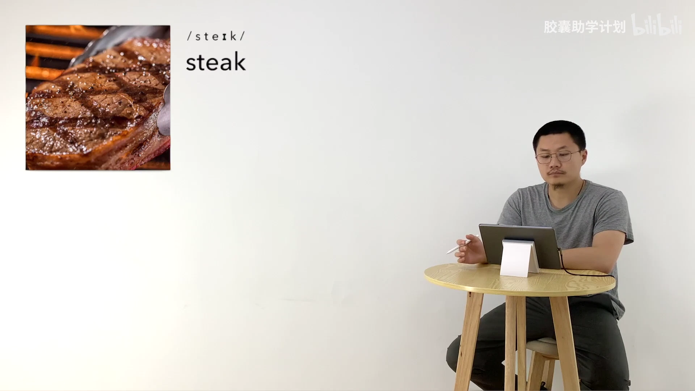

文字识别：胶囊助学计划 / /steik/ / steak / 2

### 画面 00:04:35

文字识别：胶囊助学计划 / /steik/ / steak

### 画面 00:04:40

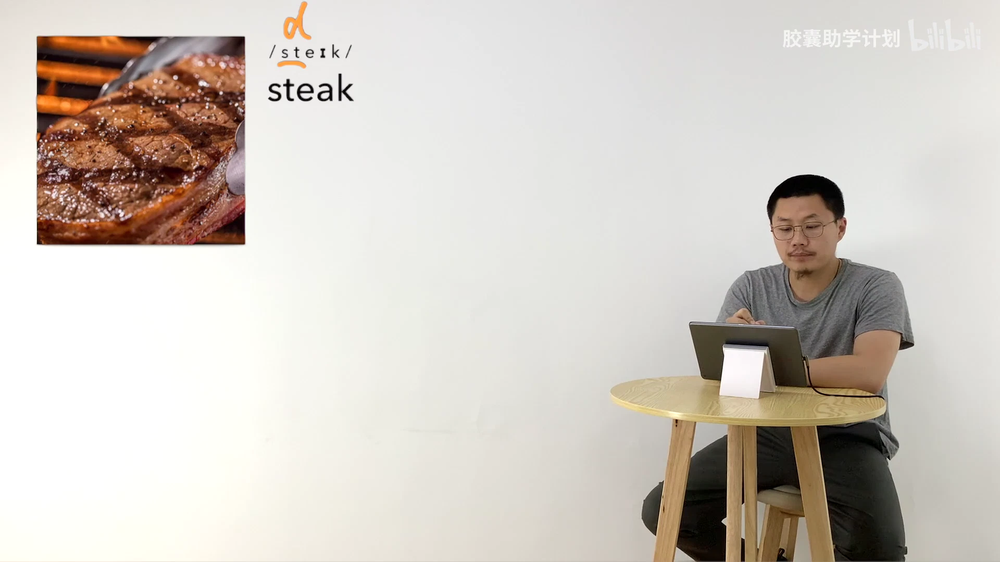

文字识别：d / 胶囊助学计划 / /steik/ / steak

### 画面 00:04:43

文字识别：d / 胶囊助学计划 / /steik/ / steak / 2

### 画面 00:04:48

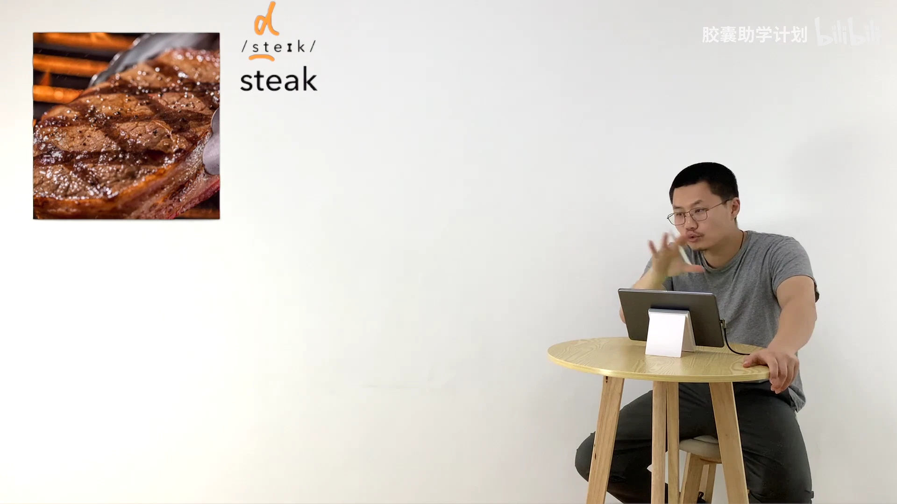

文字识别：d / 胶囊助学计划 / /steik/ / steak

### 画面 00:04:54

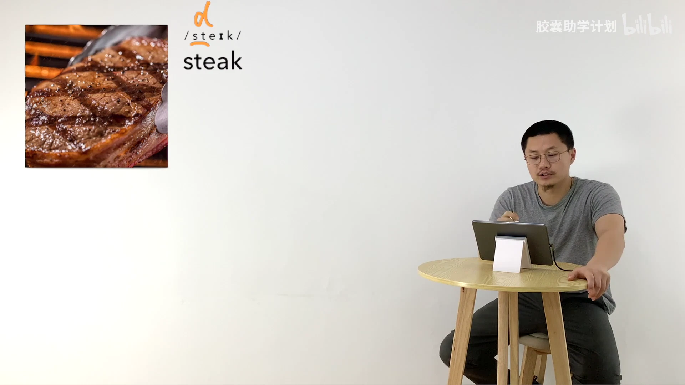

文字识别：d / 胶囊助学计划 / /steik/ / steak

### 画面 00:04:58

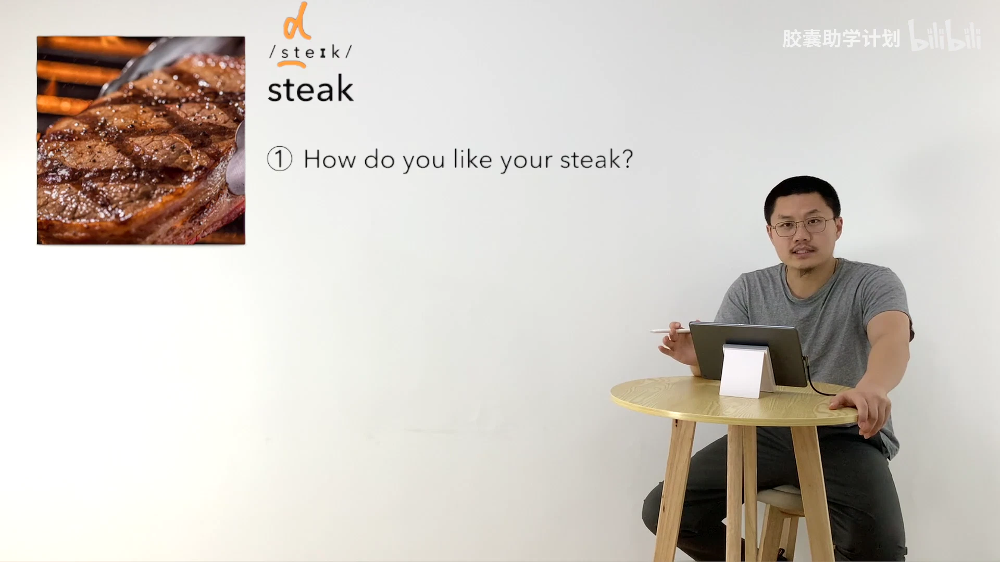

文字识别：胶囊助学计划 / /steik/ / steak / ① How do you like your steak?

## 00:05:00–00:05:30

免不了会吃人家做的牛排，对不对？人家可能就会问你一个问题，当然不是只有这一个问法，但大多数都是围绕着这种方式去问，叫 How do you like your steak？啊，它的直接意思就是，字面意思就是你想要怎么样你的牛排啊？你想要你的牛排怎么样？它其实直接的意思，或者说不是字面意思，就是你牛排想要几分熟？那我们最常见的三种

### 画面 00:05:02

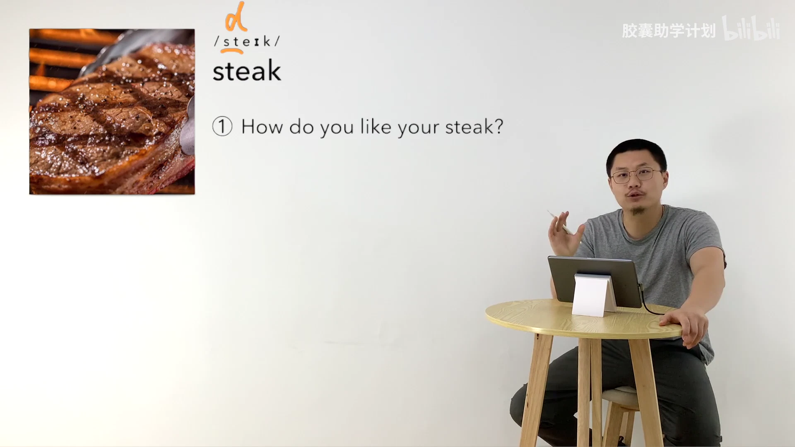

文字识别：胶囊助学计划 / /steik/ / steak / ① How do you like your steak?

### 画面 00:05:05

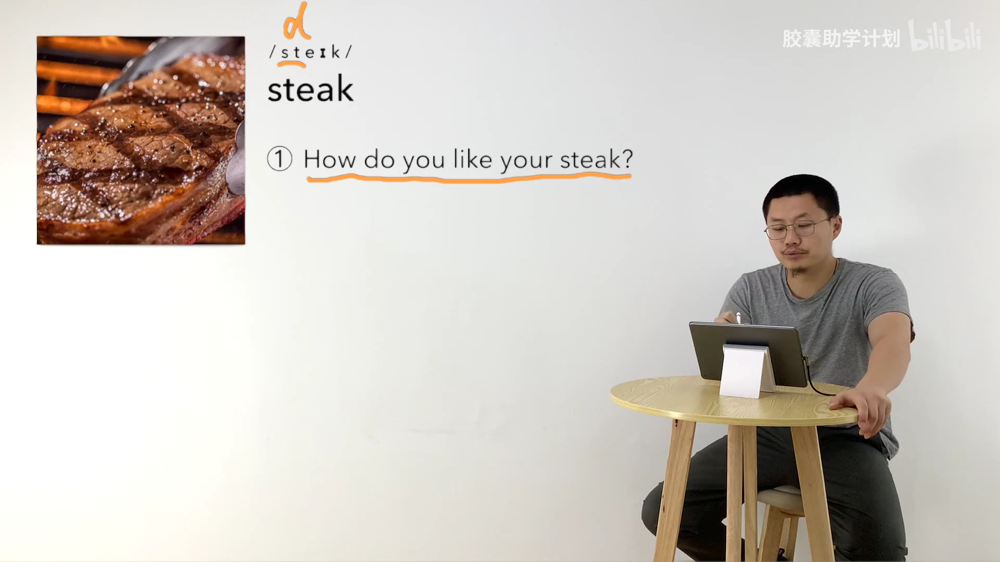

文字识别：d / 胶囊助学计划 / /steik/ / steak / ① How do you like your steak?

### 画面 00:05:07

文字识别：胶囊助学计划 / /steik/ / steak / ① How do you like your steak?

### 画面 00:05:10

文字识别：d / /steik/ / steak / ① How do you like your steak?

### 画面 00:05:15

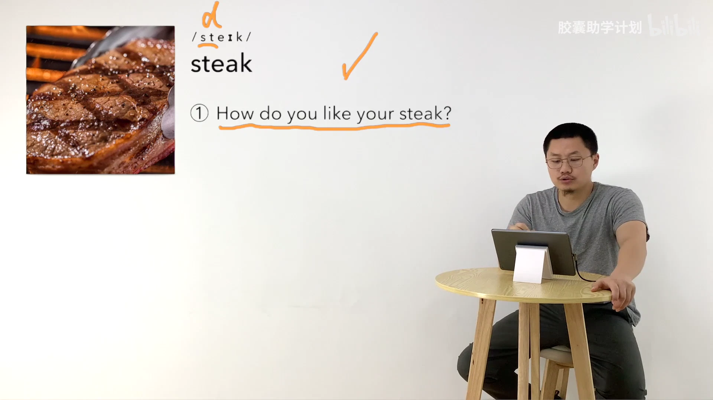

文字识别：胶囊助学计划 / /steik/ / steak / ① How do you like your steak?

### 画面 00:05:18

文字识别：胶囊助学计划 / /steik/ / steak / ① How do you like your steak?

### 画面 00:05:20

文字识别：胶囊助学计划 / /steik/ / steak / ① How do you like your steak?

### 画面 00:05:25

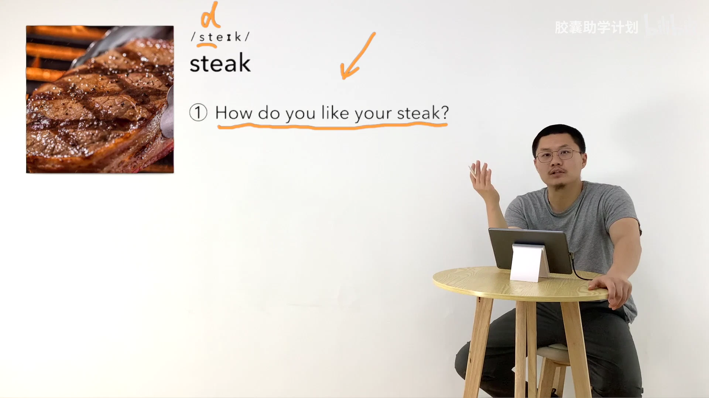

文字识别：d / 胶囊助学计划 / /steik/ / steak / ① How do you like your steak? / 2

### 画面 00:05:29

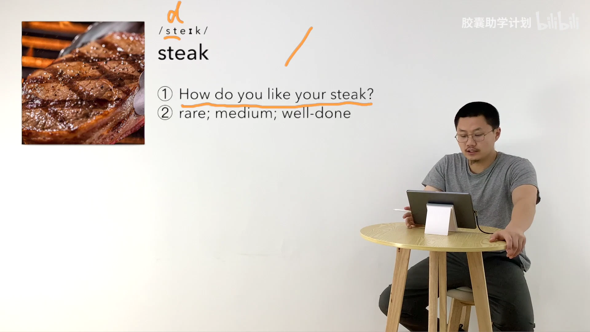

文字识别：八 / 胶囊助学计划 / /steik/ / steak / How do you like your steak? / rare; medium; well-done

## 00:05:30–00:06:00

表达就是 rare 啊，你也可以说 bloody 对吧？ Bloody 就是充满血的。 Rare 就可以理解为两三成熟， medium 就五六分熟， well done 就全熟。大多数情况下，没有人会点 well done，对吧？大多数人就是 rare 或者 medium。 Medium 基本上各位可以理解为就是熟了啊。 Rare 呢，吃起来的感觉就你在切的时候还会有一些血水，但是也很好吃啊，

### 画面 00:05:31

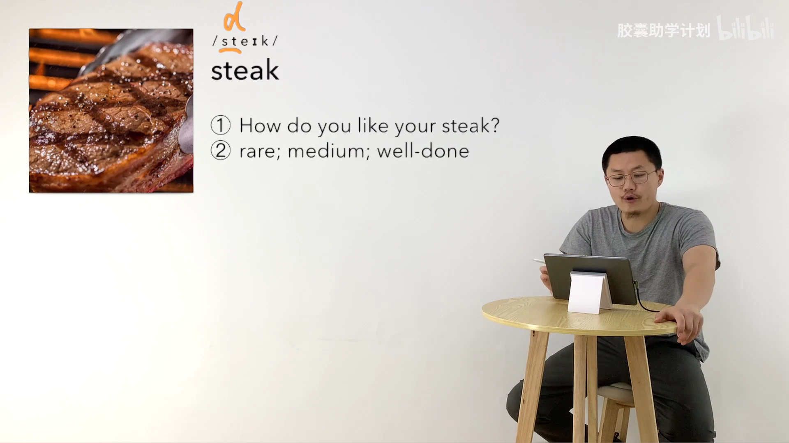

文字识别：胶囊助学计划 / /steik/ / steak / ① How do you like your steak? / rare; medium; well-done

### 画面 00:05:36

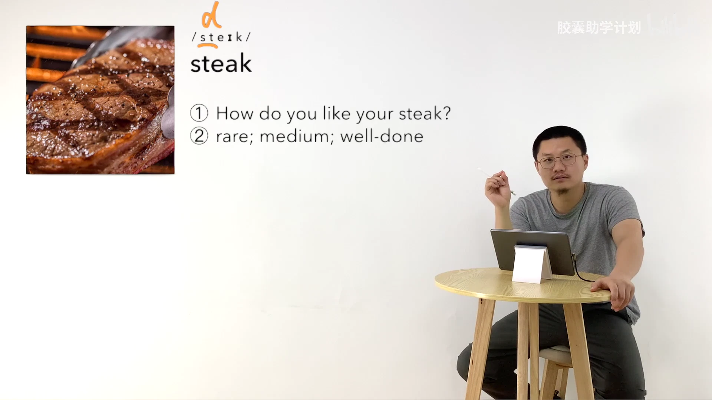

文字识别：胶囊助学计划 / /steik/ / steak / ① How do you like your steak? / rare; medium; well-done

### 画面 00:05:43

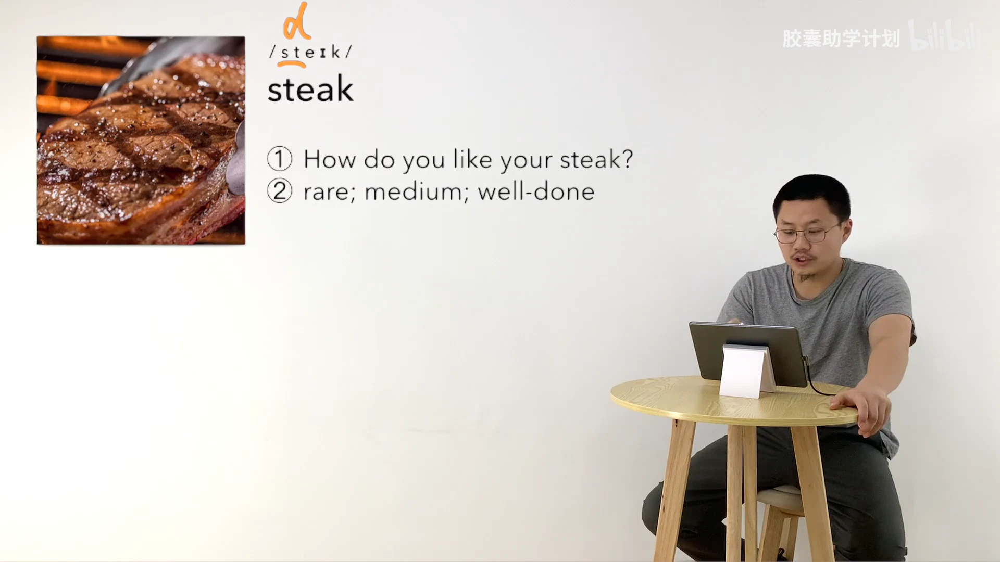

文字识别：八 / 胶囊助学计划 / /steik/ / steak / ① How do you like your steak? / rare; medium; well-done / /

### 画面 00:05:45

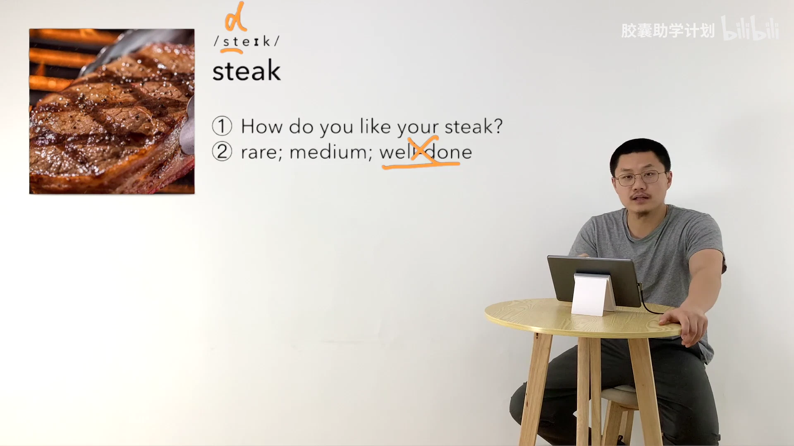

文字识别：胶囊助学计划 / /steik/ / steak / ① How do you like your steak? / rare; medium; weldone

### 画面 00:05:49

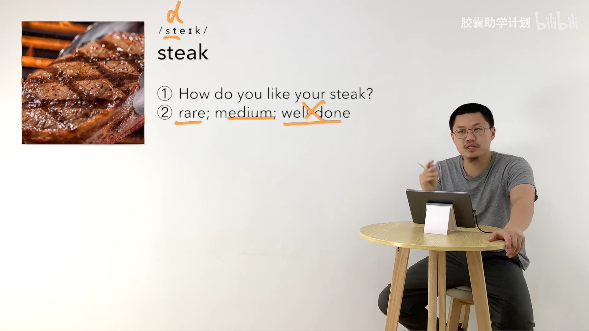

文字识别：胶囊助学计划 / /steik/ / steak / ① / How do you like your steak? / rare; medium; weldone

### 画面 00:05:51

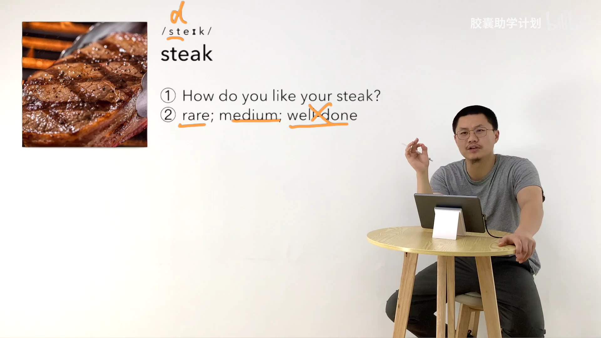

文字识别：胶囊助学计划 / /steik/ / steak /  How do you like your steak? / rare; medium; wel done

### 画面 00:05:55

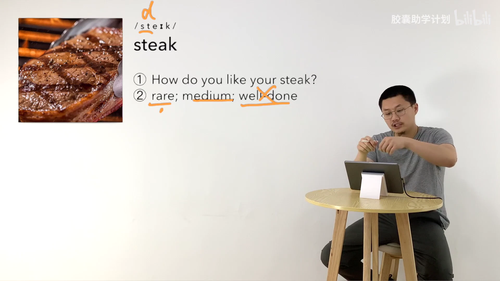

文字识别：胶囊助学计划 / /steik/ / steak / ① / How do you like your steak? / rare; medium; wel done

## 00:06:00–00:06:30

叫 rare. Okay, medium and well done. Another one.下一个单词跟我一起读一下，叫做 mince啊，肉馅儿。那我们拿它去造句，比如说，Can you give me some mince, please?能给我一些肉馅儿吗？谢谢了。注意如何才能变得更有礼貌。哎，划线部分就是核心关键。Okay,好。下一个单词读 chicken，鸡肉啊，chicken。

### 画面 00:06:00

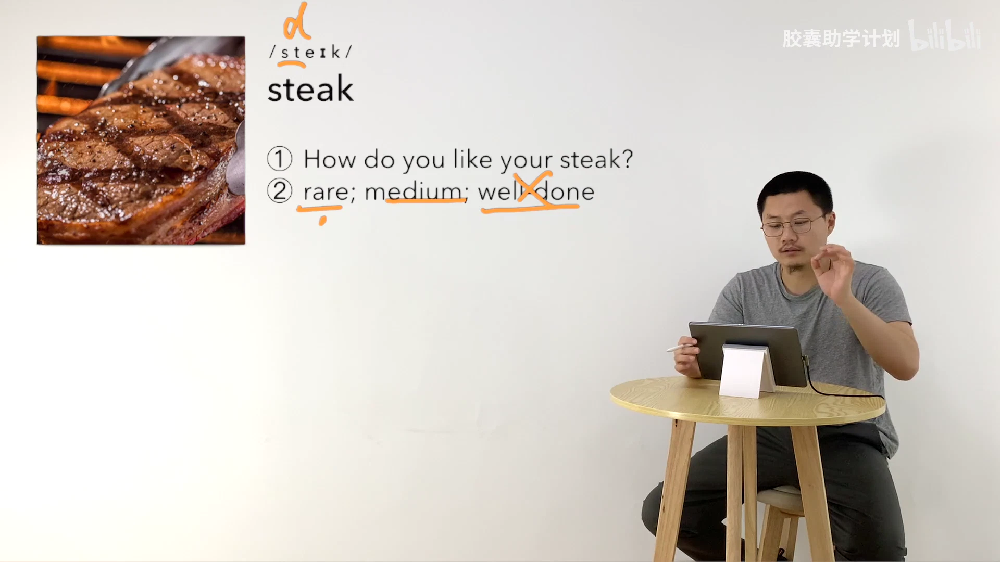

文字识别：胶囊助学计划 / /steik/ / steak / How do you like your steak? / rare; medium; wel done

### 画面 00:06:04

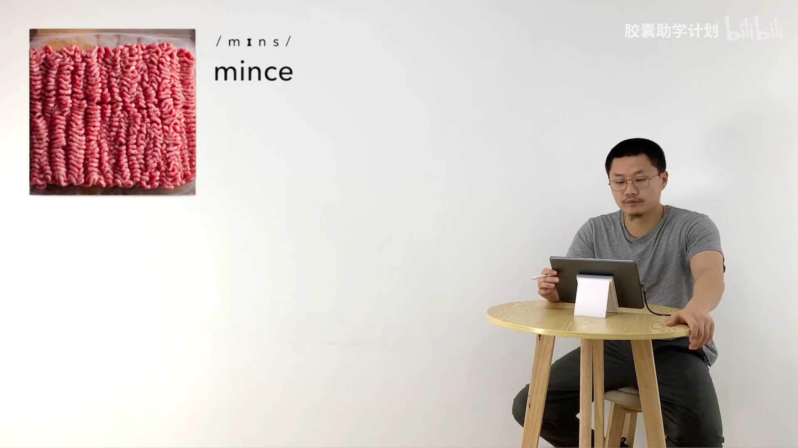

文字识别：胶囊助学计划 / / mⅠns / / mince

### 画面 00:06:07

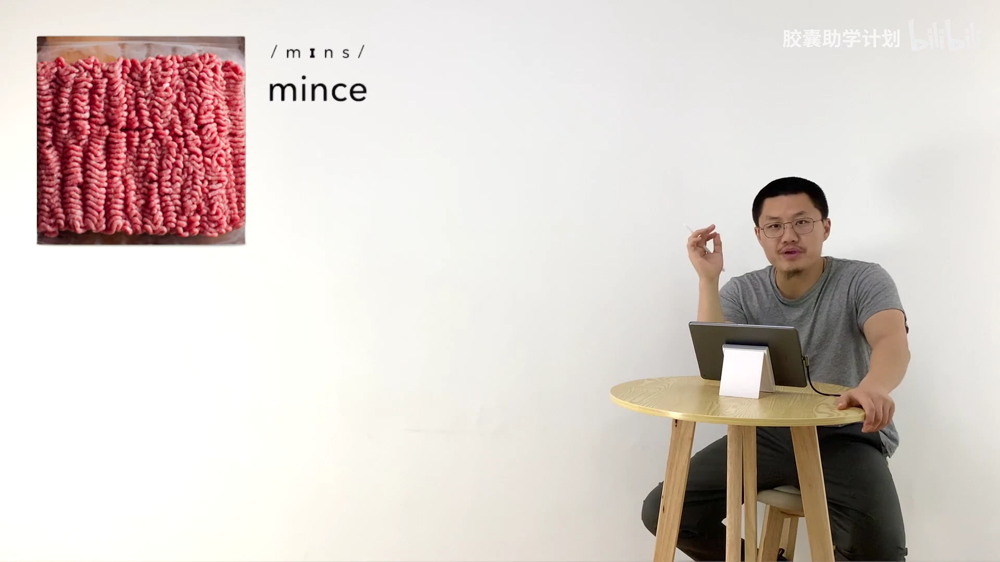

文字识别：胶囊助学计划 / /mⅠns / / mince

### 画面 00:06:10

文字识别：胶囊助学计划 / / m Ⅰn s / / mince / ① Can you give me some mince, please? / 2

### 画面 00:06:15

文字识别：胶囊助学计划 / / m Ⅰ n s / / mince / ① Can you give me some mince, please? / 2

### 画面 00:06:20

文字识别：胶囊助学计划 / / m Ⅰn s / / mince / ① Can you give me some mince, please?

### 画面 00:06:22

文字识别：胶囊助学计划 / / m Ⅰn s / / mince / ①Can yoa / give me some mince, please?

### 画面 00:06:24

文字识别：胶囊助学计划 / / 't∫ikIn/ / chicken / 2

## 00:06:30–00:07:00

好，我们读一下，造个句子叫 I'm going to cook some chicken. Cook这个单词今天出现的频率还是挺高的。 Continue说 Do you want some chicken? 啊 Do you want any chicken? 注意这个地方还真可以用some。我们进入文章去讲。 Continue下一个单词 tell，叫做告诉。那我们直接说叫 You can tell me. 你可以告诉我啊。放心吧，You can tell me. Okay. 我们还可以造叫你

### 画面 00:06:31

文字识别：胶囊助学计划 / / 't ∫I kI n / / chicken / ① Iam going to cook some chicken. / 2

### 画面 00:06:34

文字识别：胶囊助学计划 / / ' t ∫I kIn / / chicken / ① Iam going to cook some chicken.

### 画面 00:06:36

文字识别：胶囊助学计划 / / ' t ∫I kⅠn / / chicken / ① Iam going tocook gome chicken. / 2

### 画面 00:06:40

文字识别：胶囊助学计划 / / 't ∫I kIn / / chicken / ① Iam going tocook gome chicken. / ② Do you want some? / 2）

### 画面 00:06:45

文字识别：胶囊助学计划 / / 't ∫IkIn/ / chicken / ①Iam going tocook gome chicken. / ② Do you want some? / 2 / 2

### 画面 00:06:47

文字识别：胶囊助学计划 / /tel/ / tell

### 画面 00:06:55

文字识别：胶囊助学计划 / /tel/ / tell / ① You can tell me.

### 画面 00:06:58

文字识别：胶囊助学计划 / /tel/ / tell / ① You can tell me. / ② Can you tell me?

## 00:07:00–00:07:30

叫你能告诉我吗？叫Can you tell me?注意，它是个动词，对吧？I'm going to tell you.我要告诉你和truth truth要真相连在一起，对吧？就我们说tell和truth连在一起，叫做tell me the truth.你告诉你跟我讲实话，咱们汉语叫你跟我讲实话啊。那truth当它T大写的时候，首次指的是真理啊。这个往往和逻辑

### 画面 00:07:07

文字识别：胶囊助学计划 / /tel/ / tell / ① You can tell me. / ② Can you tell me? / ③ Iam going to tell you.

### 画面 00:07:10

文字识别：胶囊助学计划 / /tru:01 / truth / TRUTH

### 画面 00:07:20

文字识别：胶囊助学计划 / /tru:θ1 / truth / TRUTH / ① tell me the truth

### 画面 00:07:25

文字识别：胶囊助学计划b出b出 / /tru:θ1 / truth / TRUTH / ① tell me the truth

## 00:07:30–00:08:00

学或者宗教是有关系的。所谓，比如说那个 capital T，对吧？Truth。那我们在这儿，truth 就是事实的真相啊，实话。Tell me the truth，就是跟我讲实话啊。Can you tell me the truth？你能跟我讲实话吗？OK。那接下来呢，我们再看最后一个小的单词，我们直接放到这个电影当中去讲，叫做它有两个发音，一个叫做 either，一个叫做 either，都是对的，您怎么读都

### 画面 00:07:32

文字识别：胶囊助学计划 / /tru:01 / truth / TRUTH / ① tell me the truth

### 画面 00:07:35

文字识别：胶囊助学计划bill / /tru:θ1 / truth / TRUTH / ① tell me the truth

### 画面 00:07:43

文字识别：胶囊助学计划 / Dilb / /tru:θ1 / truth / TRUTH / ① tell me the truth

### 画面 00:07:45

文字识别：From the cheator of Tue Romance'&Resevoi / 胶囊助学计划 / JoTalaSaeJasoaThaHveeAadea / Ving Rhares FicSot osamaAqgete Chistpher alkenruce is / PulpFiction / y Quentin Taxantiuo / 104 / Lamene / Bender / /'arǒa'i:ǒa/ / I don't eat dog, either. / 低俗小说 Pulp Fiction (1994) / Coming soon to a tker

### 画面 00:07:47

文字识别：From the cheator of' Tuue Romance'& Reservoi / 胶囊助学计划 / JoaaeAPa / Vnga / PulpFiction / y Quentin Taxantino / 10 / Lamence / Bendar / /'arǒa'i:ǒa/ / I don't eat dog, either. / 低俗小说 Pulp Fiction(1994) / Coming soou to a ther

### 画面 00:07:49

文字识别：From the cheator o Tue Romance'&Resevoi / 胶囊助学计划 / JaeAaa / VngRasais / PulpFiction / By Queutin Taxantino / 100 / Lanrene / Bender / /'arǒa 'i:ǒa/ / I don't eat dog, either. / 低俗小说 Pulp Fiction (1994) / Coming soou to a ther

### 画面 00:07:51

文字识别：From the cheator of' Twue Romance'&Resewoi / 胶囊助学计划 / JoaSaJaeeAPa / Vngaa / PulpFiction / by Guentin Tanantiuo / 104 / Lawene / Bender / /'arǒa'i:ǒa/ / I don't eat dog, either. / 低俗小说 Pulp Fiction (1994) / Coming soou to a ther

### 画面 00:07:55

文字识别：From the ckeator of' Tue Romance'&Resevoi / 胶囊助学计划 / JoaSaJaeeAdPa / Vag Rhaes Fi akRasaaAqgete Crstphe alenuce is / PulpFiction / y Qventin Tanantino / 104 / LaNrene / Bender / /'aroa'i:ǒa/ / I don't eat dog, either. / 低俗小说 Pulp Fiction (1994) / Coming soon to a tker

### 画面 00:07:59

文字识别：From the cheator of'Tuue Romance'&Reserwoi / 胶囊助学计划 / Je / Ving Rlaes Fi akRosaaAqgeeChnstpher aleuce is / PulpFiction / y Quentin Tanantino / 10 / Lavene / Bender / /'arǒa'i:ǒa/ / I don't eat dog, either. / 低俗小说 Pulp Fiction (1994) / Coming soon to a ther / 2

## 00:08:00–00:08:30

可以。前面是英式，后面是偏美式。OK，Either either，那接下来它如何去用呢？我们就得看它前半句话，叫 I don't eat dog either。我也不吃狗肉啊。也注意我们之前学的那个单词叫 too，叫做 me too，叫我也是，对吧？那这个地方叫做我也是不吃狗肉的，它是否定的，而前面那个

### 画面 00:08:02

文字识别：From the cheator of Tuue Romance'& Resewoi / 胶囊助学计划 / JaePa / Ving Rlaes Fi akRosanaAqgeeCnstpher alenuce is / PulpFiction / y Quentin Taxantiuo / 10 / Lamence / Bender / /'arǒa'i:ǒa/ / I don't eat dog, either. / 低俗小说 Pulp Fiction (1994) / Coming soon to a ther

### 画面 00:08:04

文字识别：From the cheator of'Tuue Romance'& Reserwoin / 胶囊助学计划 / Bilbili / JoaaaveeAdPMa / Vng Rhames Fi SolRosanaAqee Crstpher alenuce is / PulpFiction / y Quentin Taxantino / 100 / Lavenee / Bender / /'arǒa'i:ǒa/ / I don't eat dog, either. / 低俗小说 Pulp Fiction (1994) / Coming soon to a ther

### 画面 00:08:07

文字识别：From the cheator of Tuue Romance'& Resewvoik / 胶囊助学计划 / Biltbil / JoaaaveeAPa / Vng Rhames Fie ak osanaAqee Crstpher alenuce is / PulpTiction / y Gueutin Taxantino / 100 / 英美 / Lanene / Bender / /'arǒa'i:ǒa/ / I don't eat dog, either. / 低俗小说 Pulp Fiction (1994) / Coming soon to a ther

### 画面 00:08:09

文字识别：From the cheator of'Tuue Romance'&Resewoin / 胶囊助学计划 / JoaSaaeeAPMa / Vag Rhaes Fi SalRosanaAqgee Crstphe alkenBruce is / PulpFiction / y Quentin Taxantiuo / 10e / 英美 / Lanene / Bender / /'aioa'i:ǒa/ / I don't eat dog, either. / 低俗小说 Pulp Fiction (1994) / Coming soou to a ther

### 画面 00:08:15

文字识别：From the cheator of'Tuue Romance'&Reserwoin / 胶囊助学计划 / Bilbil / JaaeAaMa / Vag Rhames Fie Sak osaaAqeeChrstpherWalenEruce is / PulpFiction / y Quentin Tanantino / 10 / 英美 / Lamene / Bender / /'aiǒa'i:oa/ / I don't eat dog, either. / 低俗小说 Pulp Fiction (1994) / Coming soon to a ther

### 画面 00:08:19

文字识别：From the cheator of'Tuue Romance'&Reserwoi / 胶囊助学计划 / Bilbili / JaeAaMa / Vng Rhames Fi okRosaaAqgee Crstpher alenuce is / PulpFiction / y Quentin Tanantino / 10 / 英美 / Lanene / Bender / /'aroa'i:ǒa/ / I don't eat dog, either. / 低俗小说 Pulp Fiction (1994) / Coming soou to a ther

### 画面 00:08:21

文字识别：From the cheator of'Tuue Romance'&Reserwoi / to / 胶囊助学计划 / BiltBil / JaeAaa / Vng Rhames Fic okRosaaAqgeeChrstpher alenruce is / PulpFiction / y Quentin Tanantino / 10 / 英美 / Lanene / Bender / /'aroa'i:ǒa/ / I don't eat dog, either. / 低俗小说 Pulp Fiction(1994) / Coming soon to a ther

### 画面 00:08:23

文字识别：From the cheator of'Tuue Romance'&Reserwoin / metoo / 胶囊助学计划 / JoaeAP / Vng Rhames Fi olRasaaAqgee hrstphe alkenruce is / PulpFiction / y Quentin Taxantino / 10 / 英美 / Lanene / Bender / /'arǒa'i:ǒa/ / I don't eat dog, either. / 低俗小说 Pulp Fiction(1994) / Coming soou to a ther

### 画面 00:08:25

文字识别：From the cheator of' Tuue Romance'&Resewoi / meto / 胶囊助学计划 / JoaaaeAPa / Vag Rlames Fic SakRasanaAqee Crstpher alkenruce is / PulpFiction / y Quentin Taantiuo / 10 / 英美 / Lamene / Bender / /'arǒa'i:ǒa/ / I don't eat dog, either. / 低俗小说 Pulp Fiction(1994) / Coming soon to a ther

### 画面 00:08:27

文字识别：From the cheator of'Tuue Romance'&Reservoir / meto / 胶囊助学计划 / JoaeAP / Vag Rhames Fic akRasanaAqee Chstpher alkenruce is / PulpFiction / y Quentin Taxantino / 10 / 英美 / Lanene / Bender / I don't eat dog / either. / 低俗小说 Pulp Fiction(1994) / Coming soou to a ther

### 画面 00:08:29

文字识别：From the cheator o'Tue Romance'&Resevoi / to / 胶囊助学计划 / me. / JoaeeAPa / Vngasais / PulpFiction / by Quentin Tanantino / 108 / 英美 / Lanreme / Bender / I don't eat dog / either. / 低俗小说 Pulp Fiction (1994) / Coming soou to a ther

## 00:08:30–00:09:00

个 too 是肯定的。否定的我也是用的是 either。 OK，接下来我们看电影片段。 God is on feces. Have a dog. Dog eats its own feces. I don't eat dog either. Yeah, but do you consider a dog to be a filthy animal? I wouldn't go so far as to call a dog filthy, but they're definitely dirty. OK, 那 I don't eat dog either。我也不吃狗肉，我也不吃。 OK，好，下一个，那我也

### 画面 00:08:31

文字识别：From the cheator ol'Tuue Romance'&Resewwoin / meltoo / 胶囊助学计划 / JoaaveeAdPa / Ving Rtames FicSoalRasanaAqgeeChrstphe alkenruce is / PulpFiction / y Quentin Taxantino / 108 / 英美 / Lanrene / Bendar / I don't eat dog / either. / 低俗小说 Pulp Fiction(1994) / Coming soou to a ther

### 画面 00:08:34

文字识别：From the cheator of Tue Romance'& Resewvoi / 胶囊助学计划 / me. / JoaaeeAP / Vngasa / PulpFiction / y Quentin Tanantino / 104 / 英美 / LaMene / Bender / I don't eat dog / either. / 低俗小说 Pulp Fiction (1994) / Coming soou to a ther

### 画面 00:08:37

文字识别：Bilbili / 胶囊助学计划 / 我不吃喜欢自己排泄物的动物 / I ain't eatin' nothin' ain't got sense enough to disregard its own feces.

### 画面 00:08:39

文字识别：胶美助学计划出出 / 那狗呢？狗吃自己的屎我也不吃狗肉 / What about a dog? Dog eats its own feces. I don't eat dog either.

### 画面 00:08:41

文字识别：bilibili / 助学计划 / 那狗呢？狗吃自己的屎我也不吃狗肉 / What about a dog? Dog eats its own feces. I don't eat dog either.

### 画面 00:08:43

文字识别：胶囊助学计划-bilb出 / 可是你觉得狗龌龊吗？ / Yeah, but do you consider' a dog to be a filthy animal?

### 画面 00:08:45

文字识别：交囊助学计划ibl / 可是你觉得狗龌龊吗？ / Yeah, but do you consider a dog to be a filthy animal?

### 画面 00:08:47

文字识别：bilbil / 囊助学计划 / 狗很脏没错可是并不龌龊 / I wouldn't go so far as to calla dog fithy, but they're definitely dirty.

### 画面 00:08:49

文字识别：Dilibli / 囊助学计划 / 狗很脏没错可是并不龌龊 / I wouldn't go so far as to calla dog fithy, but they're definitely dirty.

### 画面 00:08:51

文字识别：From the cheator of'Tuue Romance'&Resevoi / 胶囊助学计划 / JoaaePM / VngRaha / PulpFiction / y Qucutin Tanantino / 100 / Lamene / Bendes / /'arǒa'i:ǒa/ / I don't eat dog, either. / 低俗小说 Pulp Fiction(1994) / Coming soou to a ther

### 画面 00:08:53

文字识别：From the cheator of'Tue Romance'&Reservoi / 胶囊助学计划 / JoaaeP / Vngaa / PulpFiction / y Quentin Tanantino / 100 / Lanence / Bender / /'arǒa'i:ǒa/ / I don't eat dog, either. / 低俗小说 Pulp Fiction (1994) / Coming soou to a ther

### 画面 00:08:55

文字识别：From the cheator o'Tue Romance'&Resewoi / 胶囊助学计划 / JoaaJaveeAdPa / Vngasa / PulpFiction / y Quentin Taxantino / 10g / Lavenne / Bender / /'arǒa'i:ǒa/ / I don't eat dog, either. / 低俗小说 Pulp Fiction(1994) / Coming soou to a ther

### 画面 00:08:57

文字识别：胶囊助学计划 / me either / nm / DENZEL WASHINGTON / MANoN / 怒火救援Man on Fire(2004) / 2

## 00:09:00–00:09:30

否定的，我也不是，对吧？我也不是这样的，我也不这样认为的。我们之前学到的叫做 me too 是肯定的啊， me either 就是否定的。接下来我们看一下电影片段。Thank God, will forgive us for what we've done. You know. Okay, me either 啊，我也不认为他会宽恕我们的。Me either，这儿一个。

### 画面 00:09:05

文字识别：胶囊助学计划 / N / me either / DENZEL WASHINGTON / MANoN / 怒火救援 Man on Fire (2004)

### 画面 00:09:07

文字识别：胶囊助学计划 / Joo / me / me either / DENZEL WASHINGTON / MANoN / 怒火救援 Man on Fire (2004)

### 画面 00:09:09

文字识别：胶囊助学计划 / 如oo / me / 20 / me either / DENZEL WASHINGTON / MANoN / 怒火救援 Man on Fire (2004)

### 画面 00:09:13

文字识别：bibil / 胶囊助学计划

### 画面 00:09:15

文字识别：bilibili / 胶囊助学计划 / 你认为上帝会宽恕我们做的事吗 / You think God will forgive us forwhat we've done?

### 画面 00:09:17

文字识别：Bilibili / 胶囊助学计划 / -不会-不会吗 / -No.-You don't?

### 画面 00:09:19

文字识别：biibii / 胶囊助学计划 / 我也这么想 / Me either.

### 画面 00:09:21

文字识别：Bilibili / 胶囊助学计划 / 我也这么想 / Me either.

### 画面 00:09:23

文字识别：Bilbili / 胶囊助学计划

### 画面 00:09:25

文字识别：胶囊助学计划 / me either / RTm / DENZEL WASHINGTON / MANoN / 怒火救援 Man on Fire (2004)

### 画面 00:09:29

文字识别：胶囊助学计划 / Recap / Patterns / Grammar / Words / either / How do you like your steak? / Expression

## 00:09:30–00:10:00

Recap本课关键单词either这个单词还挺重要，以后我们还真的会经常见到它，口语当中也比较常见，把它记住，它是否定的，我也是对吧？或者我也不是。OK，那其次呢，给大家还多了一个小的句子，各位出国真的用得到，叫How do you like your steak？更多的不是您说的，是你要记住它，别人可能会跟你说，当然也可能是它的变体，比如说How would you like your steak？但大概

### 画面 00:09:44

文字识别：胶囊助学计划 / Recap / Patterns / Grammar / Words / either / How do you like your steak? / Expression

### 画面 00:09:47

文字识别：胶囊助学计划 / Recap / Patterns / Grammar / Words / either / How do you like your steak? / Expression

### 画面 00:09:57

文字识别：胶囊助学计划 / Recap / Patterns / Grammar / Words / either / How do you like your steak? / Expression / 2

## 00:10:00–00:10:30

差别不大。它的答案我们给了三个，对吧？Rare, medium, and well done.来一个，好，看一下本课的家庭作业。各位拿这课全是肉是吧？你拿单词去造句，结合之前学过的动词和大的结构，be doing, be going to do, and can。当然又学了一个do，对吧？四十七课学的，各位去造句，每个单词来五句话，给自己讲解一遍今天的核心知识点。其实我

### 画面 00:10:06

文字识别：胶囊助学计划 / Recap / Patterns / Grammar / Words / either / How do you like your steak? / Expression

### 画面 00:10:08

文字识别：胶囊助学计划

### 画面 00:10:11

文字识别：胶囊助学计划 / 单词造句(5)

### 画面 00:10:14

文字识别：胶囊助学计划 / 单词造句(5) / 2

### 画面 00:10:19

文字识别：胶囊助学计划 / 单词造句(5)

## 00:10:30–00:11:00

认为这课的比较核心知识点大概都是那些小的点，因为是单词课嘛。比如说 either 怎么去用，me too，me either 的区别是什么？OK，以及跟牛排相关的那句话和答案，这个各位要给自己多读两遍。那如果大家喜欢我们的课程呢，欢迎大家关注、订阅、一键三连、分享给身边需要的朋友。最后我们再来看一句名人名言，Mark Twain，是吧？马克吐温说的，If you tell the truth，you don't have to remember

### 画面 00:10:44

文字识别：胶囊助学计划 / DiSil

### 画面 00:10:47

文字识别：胶囊助学计划 / 不

### 画面 00:10:51

文字识别：胶囊助学计划 / If you tellthe truth, you don't have to / remember anything. /  Mark Twain

## 00:11:00–00:11:16

remember anything. See you next time.

### 画面 00:11:03

文字识别：If you tell the truth, you don't have to / remember anything. / Mark Twain

### 画面 00:11:05

文字识别：CAPSULEACADEMY / 胶囊助学计划 / 小红书 / Lecturer / □ / Leo / OE

### 画面 00:11:08

文字识别：CAPSULEACADEMY / 胶囊助学计划 / 小红书 / Berlin / ner / OE

### 画面 00:11:11

文字识别：CAPSULEACADEMY / 胶囊助学计划 / 『 / 小红书 / Creator / Leo & Berlin / OE

### 画面 00:11:14

文字识别：bilibili / 胶囊助学计划

### 画面 00:11:15

文字识别：bilibili / 胶囊助学计划

