# 049 语法 文章

快速机器解析：语音为单模型转写，未进行独立交叉校对或人工复核；画面每秒采样并按变化选帧，短时文字和标记可能遗漏。截图时间约有 1 秒误差。图片有损压缩；遇到疑点请按时间查看 Google Drive 原视频。

## 00:00:00–00:00:30

Hello everyone, welcome to Capsule Academy. This is Leo. Today we're going to learn new concept English book one lesson forty nine grammar and story.老习惯进入正式课程之前，我们先看几个问题。第一，一般现在时我们上一节课学过了，但我们学的是 do 这个单词。今天来看一下 does 和它有什么区别。接下来呢，我们要看一下动词的第三人称单数。这是我们除了动词原形和动词的现在分词以

### 画面 00:00:00

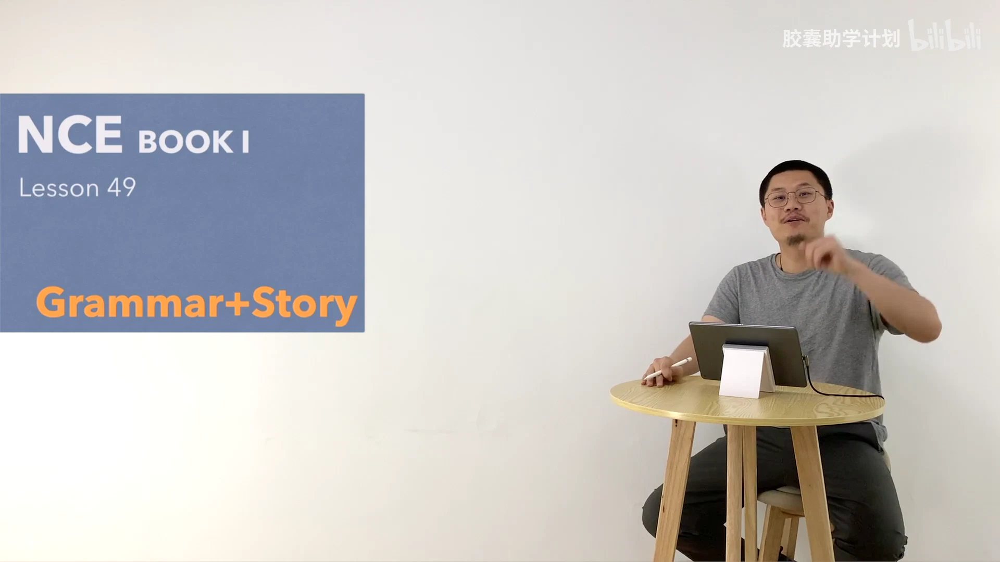

文字识别：胶囊助学计划 / NCE / BOOKI / Lesson 49 / Grammar+Story

### 画面 00:00:02

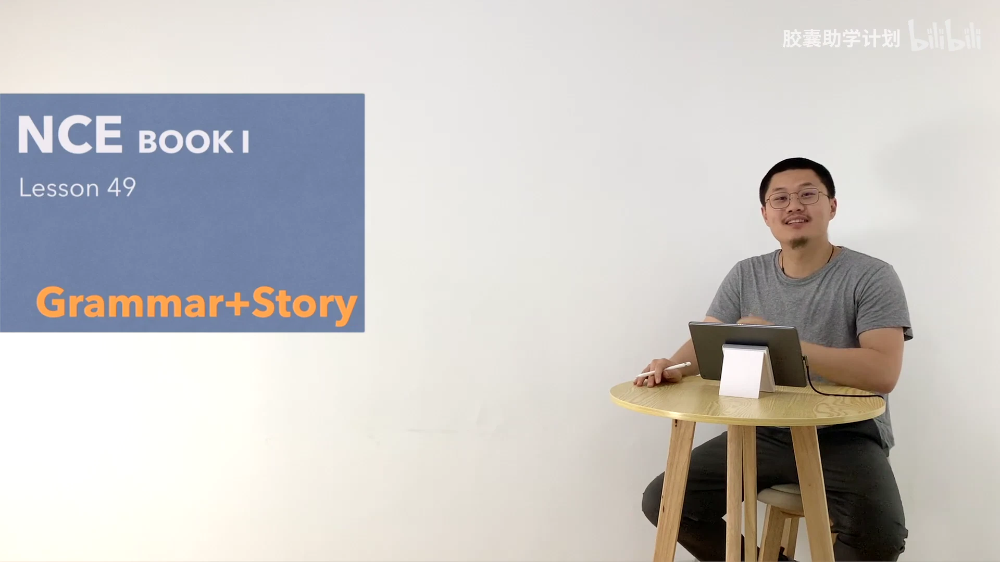

文字识别：胶囊助学计划 / NCE / BOOKI / Lesson 49 / Grammar+Story

### 画面 00:00:05

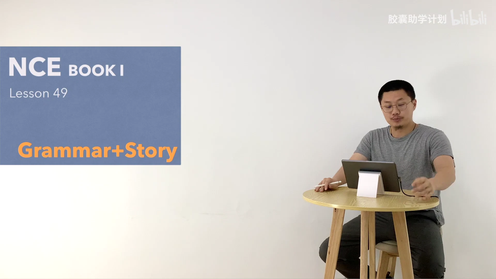

文字识别：胶囊助学计划 / NCE / BOOKI / Lesson 49 / Grammar+Story

### 画面 00:00:10

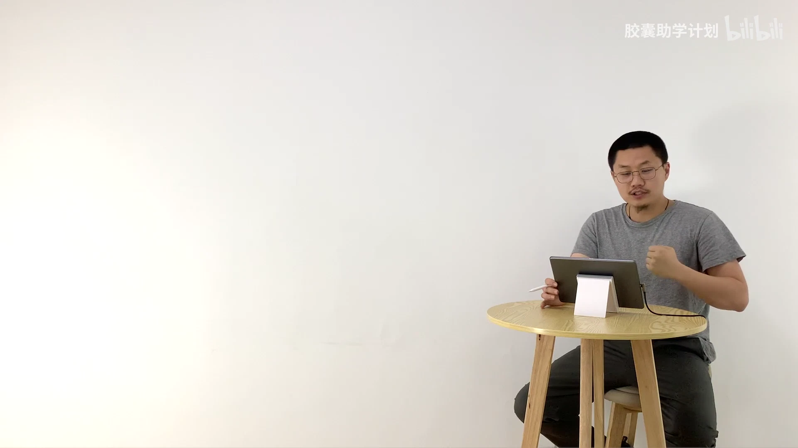

文字识别：BilD / 胶囊助学计划

### 画面 00:00:12

文字识别：胶囊助学计划 / ①一般现在时 does?

### 画面 00:00:15

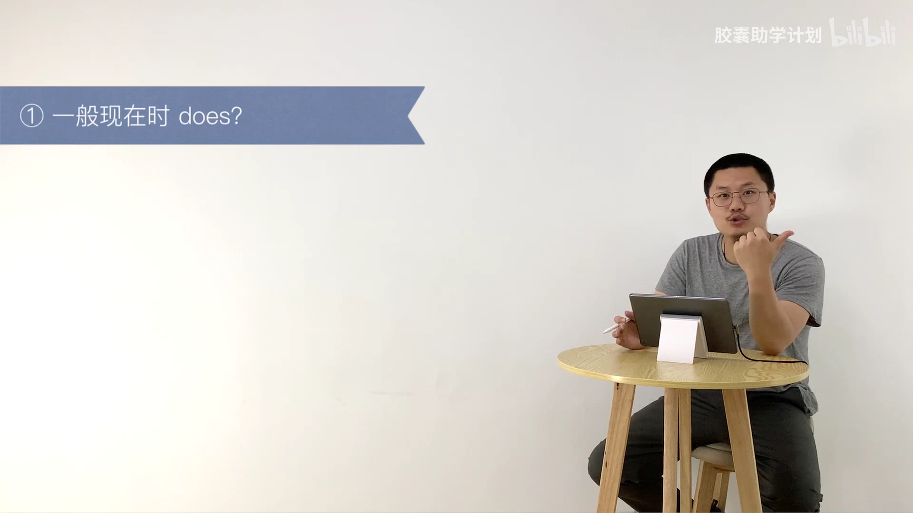

文字识别：胶囊助学计划 / ①一般现在时 does?

### 画面 00:00:21

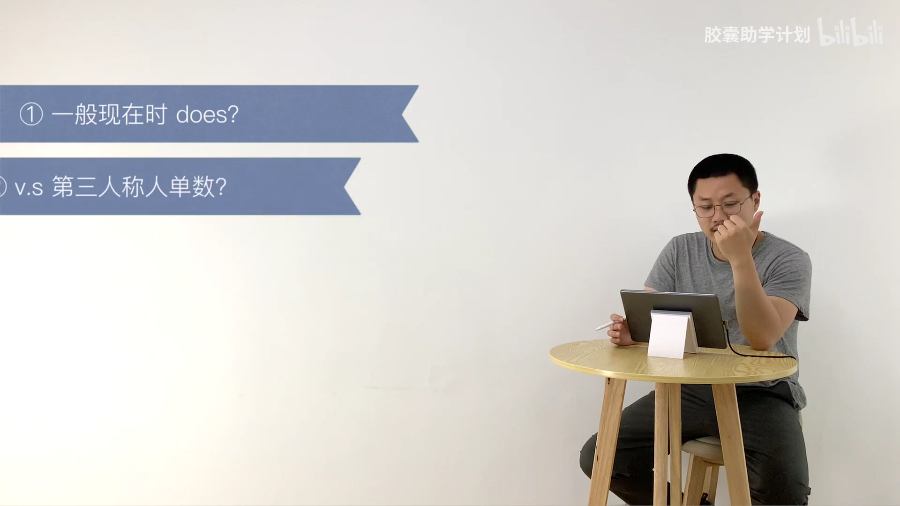

文字识别：胶囊助学计划 / ①一般现在时 does? / v.s 第三人称人单数?

### 画面 00:00:25

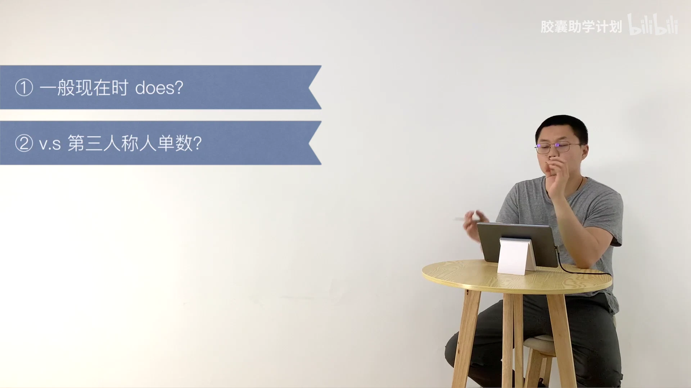

文字识别：胶囊助学计划 / ①一般现在时 does? / v.s 第三人称人单数?

## 00:00:30–00:01:00

外见到的动词的第三种形式叫做动词的第三人称单数。带着这两个问题，Hope you guys enjoy it。好，那我们先回顾一下一般现在时它的用法，要么陈述客观事实或者目前存在的状态，五十一到五十四我们还会再见；要么说的是习惯动作，这个要到五十五课到五十八课我们才能再见到。OK，那它不是表

### 画面 00:00:38

文字识别：胶囊助学计划bill / •

### 画面 00:00:42

文字识别：胶囊助学计划

### 画面 00:00:44

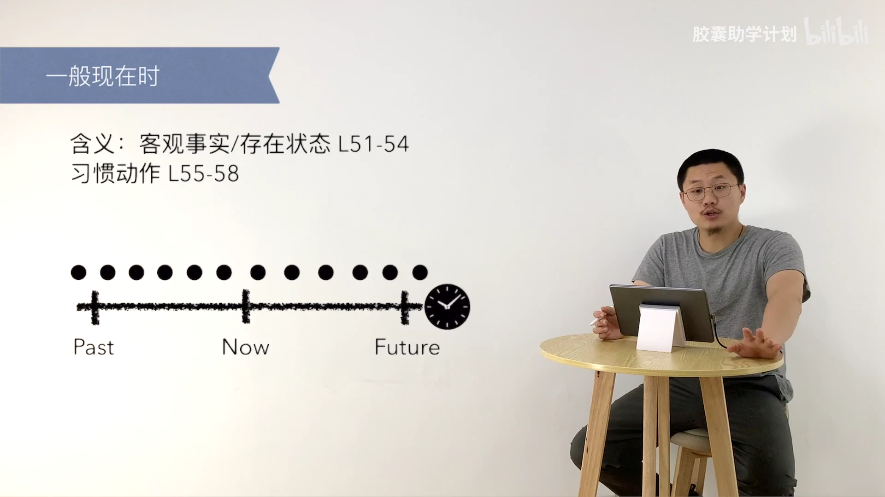

文字识别：胶囊助学计划 / 一般现在时 / 含义：客观事实/存在状态 L51-54 / 习惯动作L55-58 / Past / Now / Future

### 画面 00:00:46

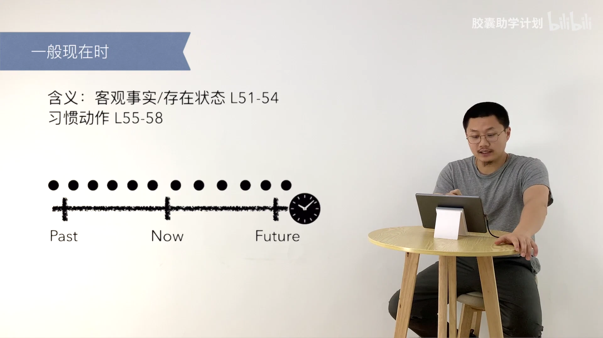

文字识别：胶囊助学计划 / 一般现在时 / 含义：客观事实/存在状态 L51-54 / 习惯动作L55-58 / Past / Now / Future

### 画面 00:00:48

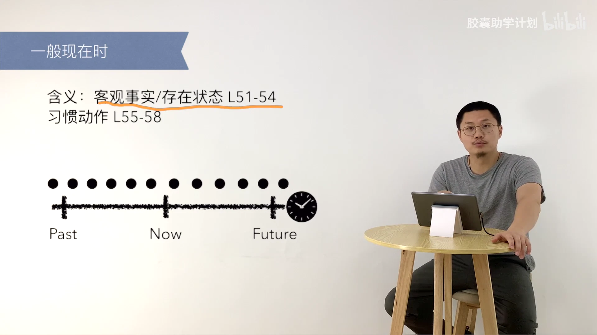

文字识别：胶囊助学计划 / 一般现在时 / 含义：客观事实/存在状态 L51-54 / 习惯动作L55-58 / Past / Now / Future

### 画面 00:00:53

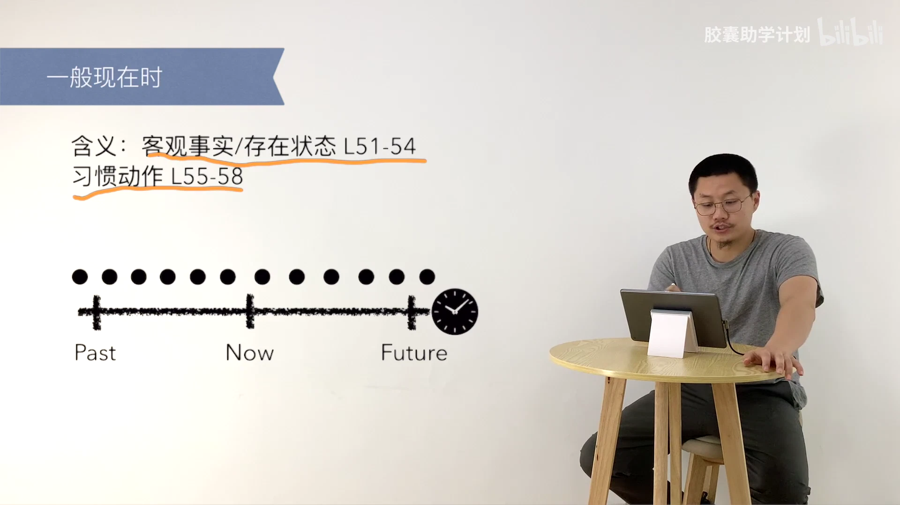

文字识别：胶囊助学计划 / 一般现在时 / 含义：客观事实/存在状态 L51-54 / 习惯动作L55-58 / Past / Now / Future

## 00:01:00–00:01:30

示现在、过去、现在、将来都有关系。上节课我们学到的是 do，今天我们来看一下 does。这三句话在四十七课我们已经见过了。如果我们现在想把人称主语，注意本来是我，现在换了一下，换成了 he。我们想一下 he，首先他是第三人称，第三人称就是他、他、他、他们、他们、他们，对吧？宝盖儿他，女字旁他和

### 画面 00:01:00

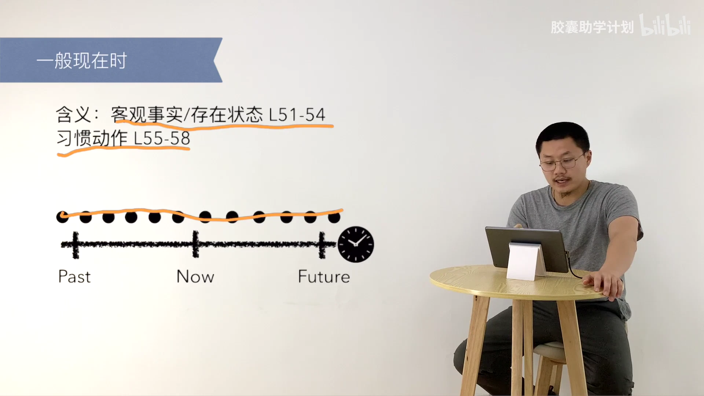

文字识别：bilbili / 胶囊助学计划 / 一般现在时 / 含义：客观事实/存在状态 L51-54 / 习惯动作L55-58 / Past / Now / Future

### 画面 00:01:04

文字识别：Biltbili / 胶囊助学计划 / 一般现在时：肯 / I want this job. / Ilove Beijing. / I like tea.

### 画面 00:01:15

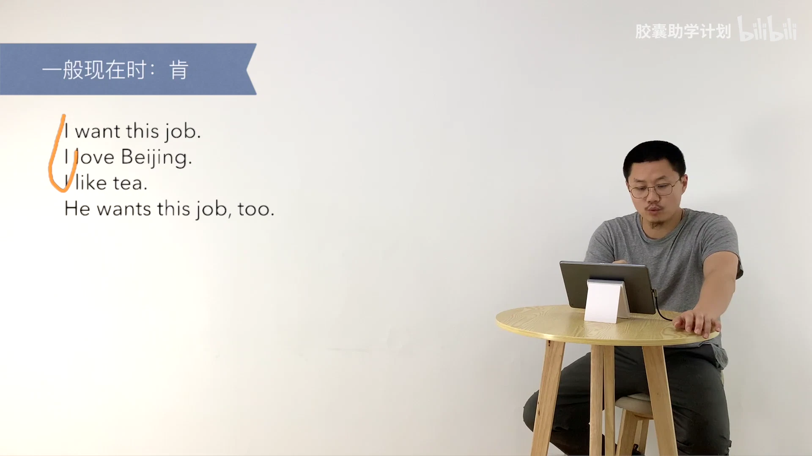

文字识别：bilibil / 胶囊助学计划 / 一般现在时：肯 / I want this job. / Ijove Beijing. / like tea. / He wants this job, too.

### 画面 00:01:22

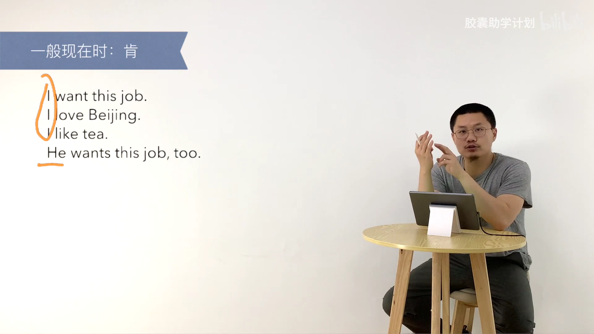

文字识别：胶囊助学计划 / 一般现在时：肯 / want this job. / ove Beijing. / like tea. / He wants this job, too.

### 画面 00:01:28

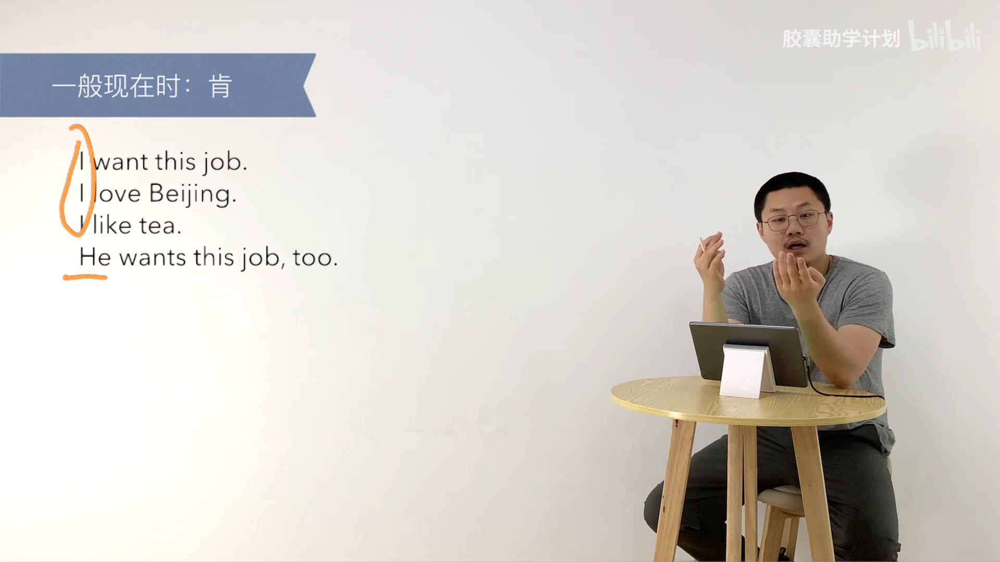

文字识别：胶囊助学计划 / 一般现在时：肯 / want this job. / ove Beijing. / like tea. / He wants this job, too.

## 00:01:30–00:02:00

单立人儿它的单数是三个它，还有它们的复数三个它们，这些全叫做第三人称。还要注意一个点，它同时也要是单数，也就是只有三个单词 he she it 这三个单词。当它们去做主语的时候，或者是我举个例子，比如说我说 Leo，Leo 是不是可以用 he 去替代？所以它后面如果出现了一般现在时这个时态之下动词，比如说

### 画面 00:01:32

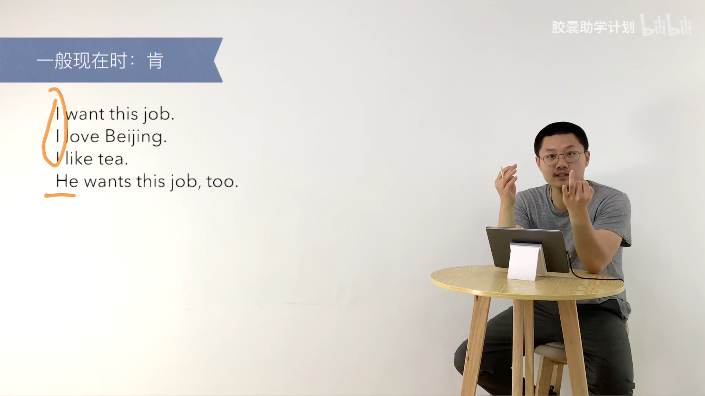

文字识别：Bilbl / 胶囊助学计划 / 一般现在时：肯 / want this job. / ove Beijing. / like tea. / He wants this job, too.

### 画面 00:01:34

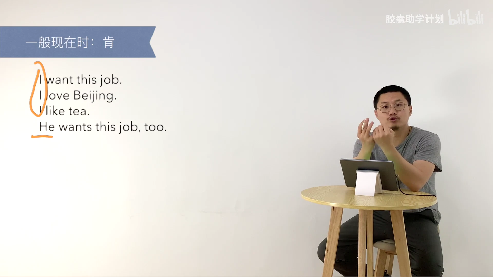

文字识别：胶囊助学计划 / 一般现在时：肯 / want this job. / ove Beijing. / like tea. / He wants this job, too.

### 画面 00:01:40

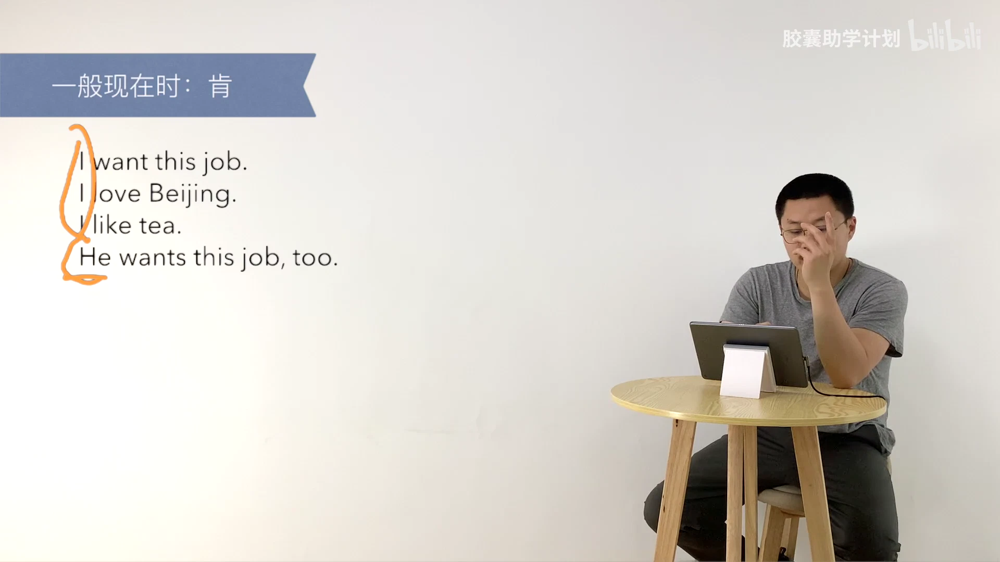

文字识别：胶囊助学计划 / 一般现在时：肯 / want this job. / ove Beijing. / like tea. / He wants this job, too.

### 画面 00:01:51

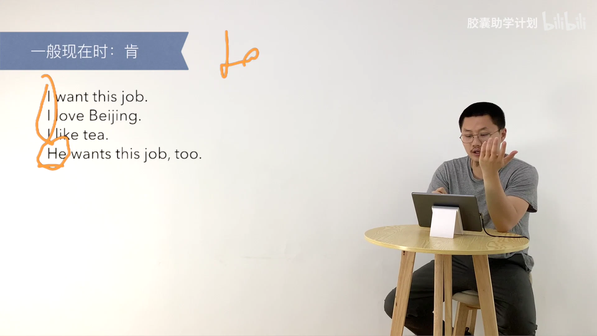

文字识别：胶囊助学计划 / 一般现在时：肯 / want this job. / ove Beijing. / ike / tea. / He wants this job, too.

### 画面 00:01:54

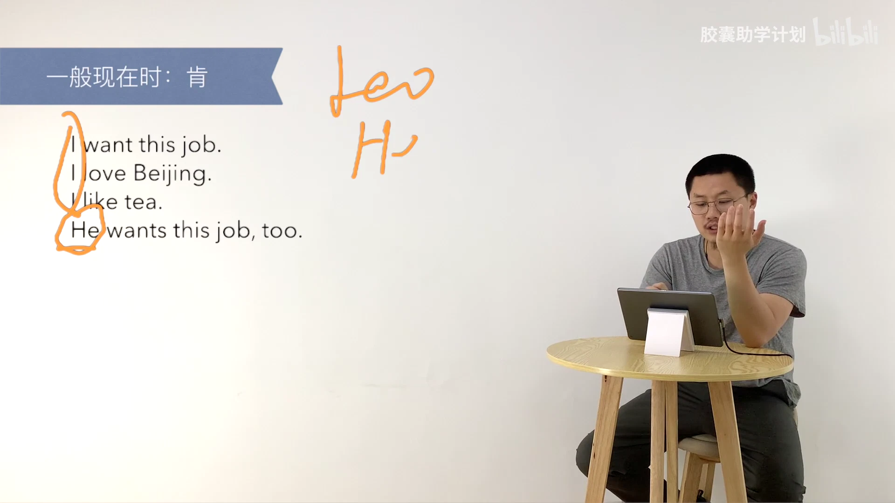

文字识别：胶囊助学计划 / 一般现在时：肯 / fev / H / want this job. / ove / Beijing. / ike / tea. / He wants t / this job, too.

### 画面 00:01:56

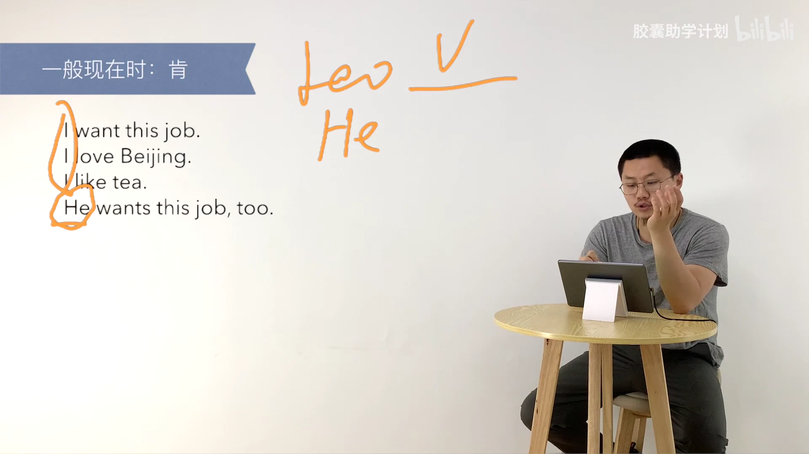

文字识别：胶囊助学计划 / fev / 一般现在时：肯 / He / want t / t this job. / ove / Beijing. / ike / tea. / Hev / wants t / this job, too.

## 00:02:00–00:02:30

Leo 想要这个工作，注意 want 后边加了个 s，多了一个小的字母，对吧？Leo, he wants this job too. 他也想要这个工作。这个地方就注意一个点，does 就可以表强调了。各位还记不记得我讲说 I like tea, I do like tea. Do 放在 I 跟 like 中间，对吧？那 does 也可以表强调，它放在什么位置呢？还是放在 he 跟动

### 画面 00:02:06

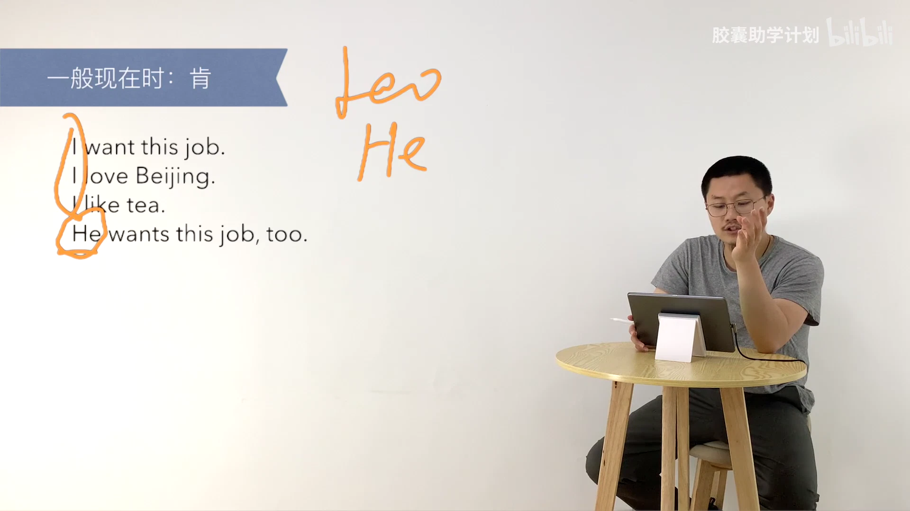

文字识别：胶囊助学计划 / 一般现在时：肯 / fev / He / want t /  this job. / ove / Beijing. / ike / tea. / Hev / wants / this job, too.

### 画面 00:02:10

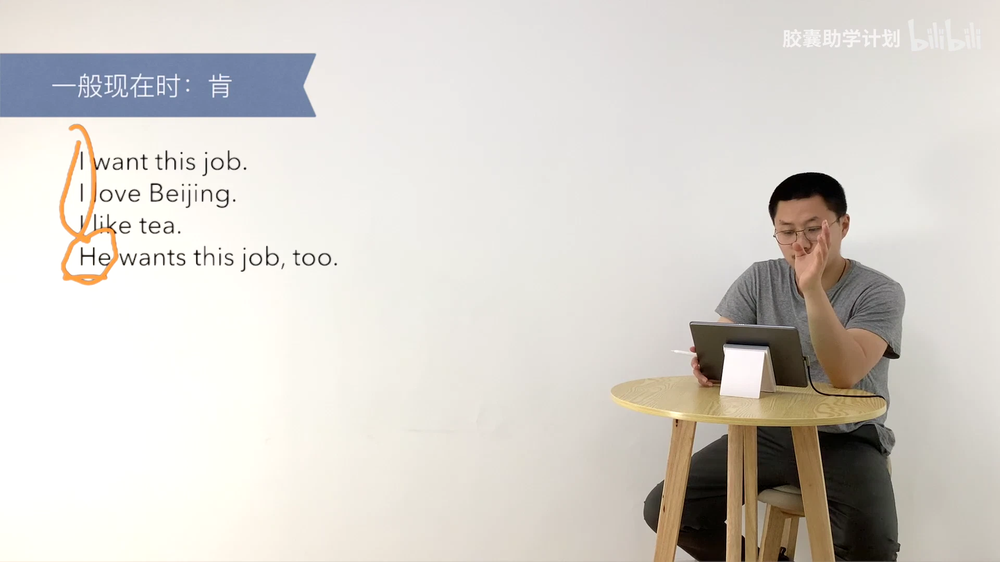

文字识别：胶囊助学计划 / 一般现在时：肯 / want this job. / ove Beijing. / ike / tea. / He wants this job, too.

### 画面 00:02:16

文字识别：胶囊助学计划 / 一般现在时：肯 / want this job. / ove Beijing. / like tea. / He wants this job, too. / does表强调

### 画面 00:02:20

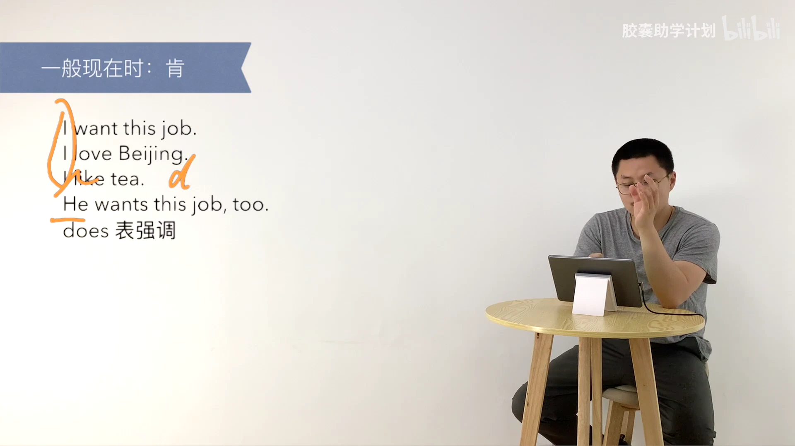

文字识别：胶囊助学计划 / 一般现在时：肯 / want this job. / ove / e Beijing. / hke / tea. / d / He wants / this job, too. / does表强调

### 画面 00:02:22

文字识别：胶囊助学计划 / 一般现在时：肯 / want this job. / ove / Beijingy / oo / ke / tea. / He wants / this job, too. / does / 表强调

### 画面 00:02:24

文字识别：胶囊助学计划 / 一般现在时：肯 / want this job. / ove / ke / tea. / He wants / this job, too. / does / 表强调

### 画面 00:02:26

文字识别：胶囊助学计划 / 一般现在时：肯 / I want this job. / Ilove Beijing. / I like tea. / He wants this job, too. / does 表强调

## 00:02:30–00:03:00

词的中间，比如说 he does want this job。但是注意一个小点，如果你没有 does 的时候，want 后边是加 s，这个我们管它叫动词的第三人称单数。刚才我讲到了，对吧？好，如果你用 does 去表强调的时候，注意这个第三人称单数就换回了原形，这句话就变成了 he does want this job。换一句话来说，

### 画面 00:02:32

文字识别：胶囊助学计划 / 一般现在时：肯 / I want this job. / Ilove Beijing. / I like tea. / He wants this job, too. / does 表强调 / He does want this job.

### 画面 00:02:53

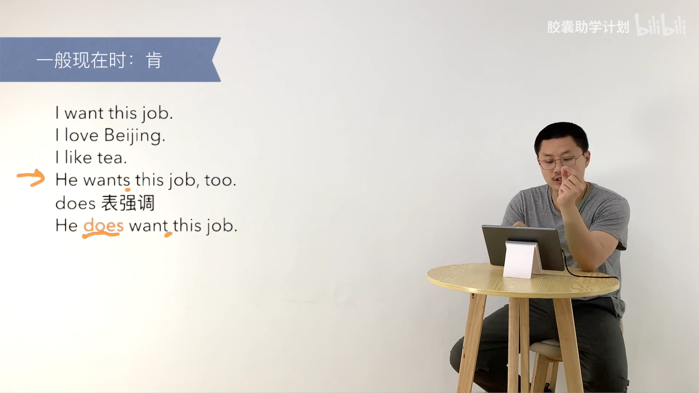

文字识别：bilbili / 胶囊助学计划 / 一般现在时：肯 / I want this job. / llove / e Beijing. / Ilike / tea. / He / ewants / this job, too. / does 表强调 / He / does / want this job.

### 画面 00:02:56

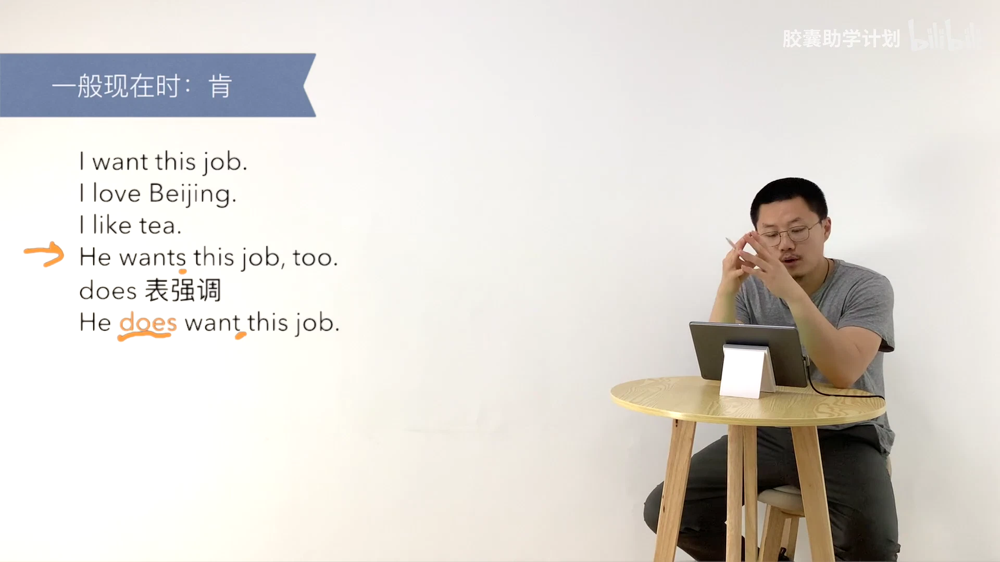

文字识别：胶囊助学计划 / 一般现在时：肯 / I want this job. / llove / Beijing. / Ilike / tea. / He / wants / this job, too. / does / 表强调 / He / does / want this job.

### 画面 00:02:59

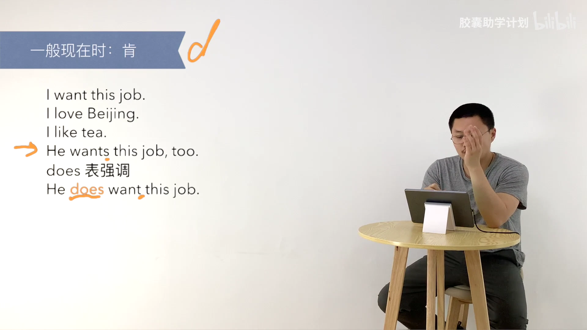

文字识别：胶囊助学计划 / 一般现在时：肯 / I want this job. / llove / Beijing. / Ilike / tea. / He / ewants / this job, too. / does / 表强调 / He / does / want this job.

## 00:03:00–00:03:30

do的第三人称单数就是does，这样是不是好理解了一些？OK，好，比如说他也爱北京，叫做He loves Beijing too。而我是I love Beijing，动词用的是原形。再来说She likes tea too。他也喜欢茶，叫做likes。首先，对吧？如果你说他确实也喜欢，首先要在

### 画面 00:03:01

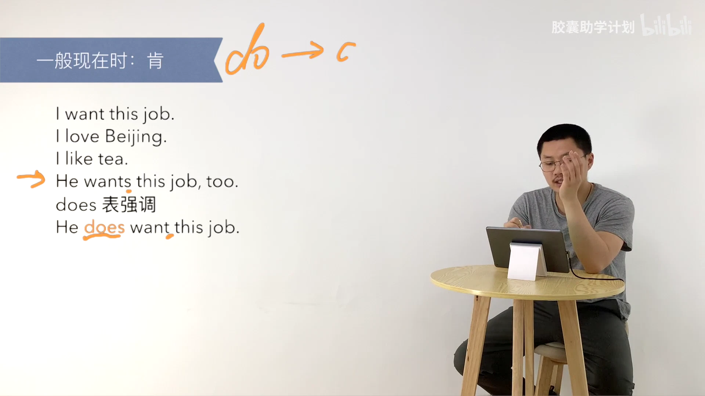

文字识别：胶囊助学计划 / 一般现在时：肯 / I want this job. / llove / Beijing. / Ilike / tea. / He / wants / this job, too. / does / 表强调 / He / does / want this job.

### 画面 00:03:03

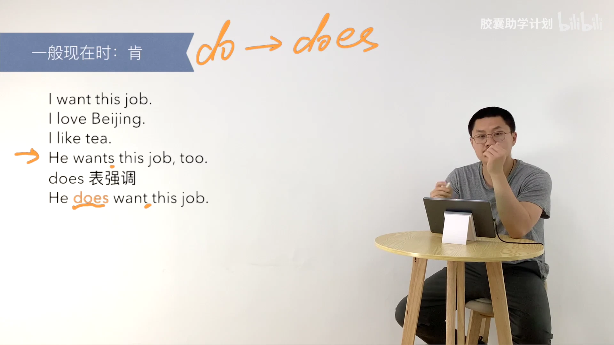

文字识别：> does / 胶囊助学计划 / 一般现在时：肯 / Iwant t /  this job. / llove / Beijing. / Ilike / tea. / He / wants / this job, too. / does / 表强调 / He / does / want this job.

### 画面 00:03:06

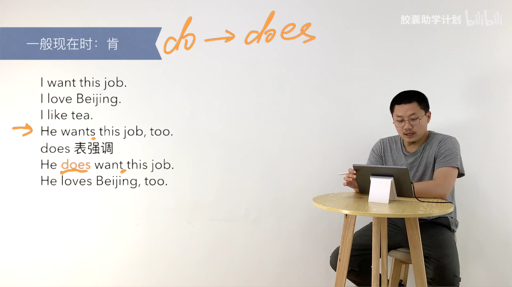

文字识别：does / 胶囊助学计划 / 一般现在时：肯 / I want t /  this job. / llove / Beijing. / Ilike / tea. / He / wants / this job, too. / does / 表强调 / He / does / want this job. / He loves / Beijing, too.

### 画面 00:03:14

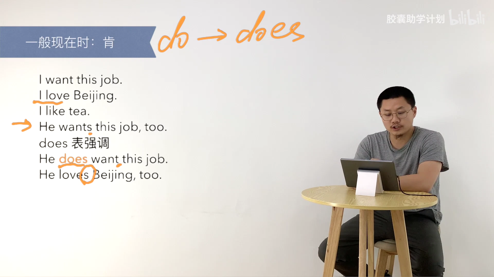

文字识别：does / 胶囊助学计划 / c / 一般现在时：肯 / Iwant / this job. / llove / Beijing. / Ilike / tea. / He / wants / this job, too. / does / 表强调 / He / does / want this job. / He love / Beijing, / ,too. / S

### 画面 00:03:24

文字识别：does / 胶囊助学计划 / h / 一般现在时：肯 / I want / this job. / llove / Beijine / Ilike / tea. / He / wants / this job, too. / does / 表强调 / He / does / want this / job. / eloves Beijing, / He / too. / Shelikes tea, too.

## 00:03:30–00:04:00

这儿加一个 does，而不是 do 了。其次 like as 要取消掉，就变成了 she does like tea. They want some money. 原因是你看 want 的后边现在没有加 s，为什么呢？ He, she 是第三人称， they 虽然也是第三人称，但它是复数，动词就用原形。只有当主语是第三人

### 画面 00:03:30

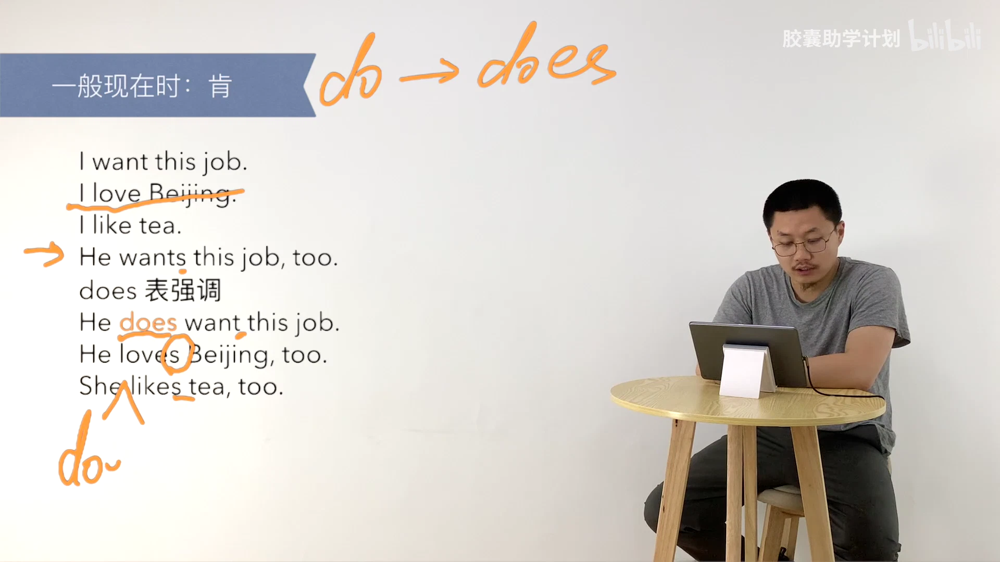

文字识别：does / 胶囊助学计划 / 一般现在时：肯 / I want / this job. / llove / Beijing / Ilike / tea. / He / wants / this job, too. / does / 表强调 / He / does / want t / this / job. / eloves Beijing, / He / too. / Shelikes tea, too. / do~

### 画面 00:03:36

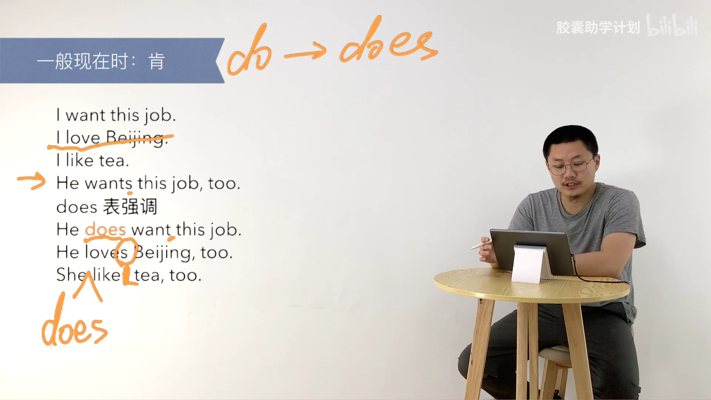

文字识别：does / 胶囊助学计划 / 一般现在时：肯 / I want / this job. / llove / Beiing / Ilike / tea. / He / wants / this job, too. / does / 表强调 / He / does / want this / job. / He loves Beijing, / too. / Shelike / Ltea, too. / does

### 画面 00:03:39

文字识别：胶囊助学计划 / 一般现在时：肯 / I want this job. / llove / Beijing. / Ilike / tea. / He / wants / this job, too. / does / 表强调 / He / does / want this job. / He / loves / Beijing, too. / She / likes / tea, too. / They want some money.

### 画面 00:03:47

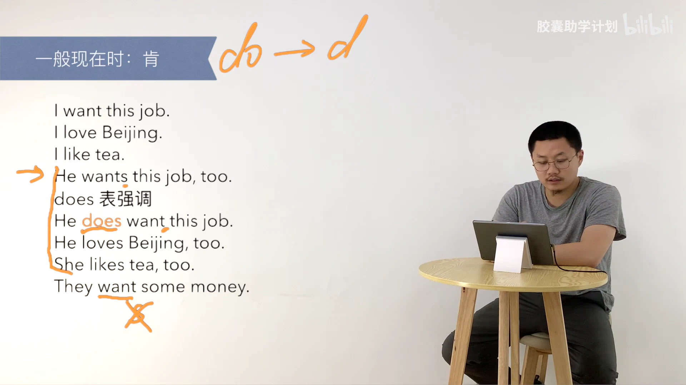

文字识别：胶囊助学计划 / 一般现在时：肯 / I want this job. / llove / Beijing. / Ilike / tea. / He / wants / this job, too. / does / 表强调 / He / does / want this job. / He / loves / Beijing, too. / She / likes / tea, too. / They want some money.

### 画面 00:03:55

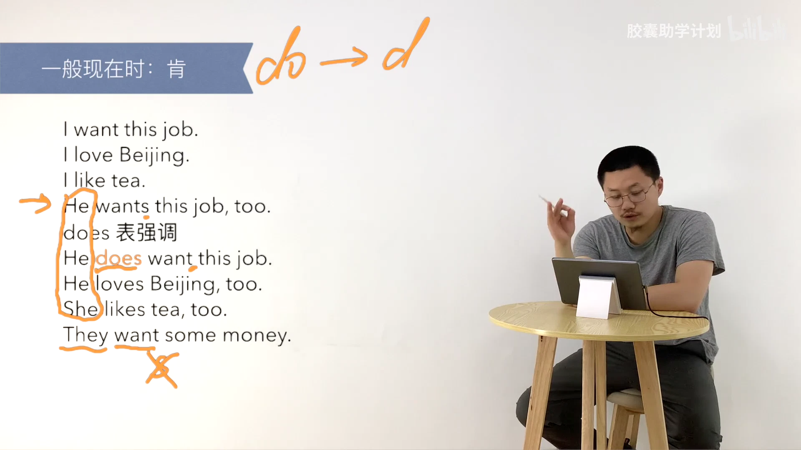

文字识别：胶囊助学计划 / 一般现在时：肯 / I want / this job. / llove / Beijing. / Ilike / tea. / He / wants / this job, too. / does / 表强调 / He / does / want this j / job. / He / loves / Beijing, / too. / Shelikes / tea, too. / They / wantS / some / money.

## 00:04:00–00:04:30

称，并且是单数的时候，我们后边的动词才变成动词的第三人称单数。好，那接下来我们自然要去讲的就是动词如何变成第三人称单数呢？首先，各位刚才见到了，已经很简单，就是直接后边加 s。注意啊，名词后边加 s 指的是名词的单复数，而动词后边加 s 它是一般现在时这个时态之下。

### 画面 00:04:05

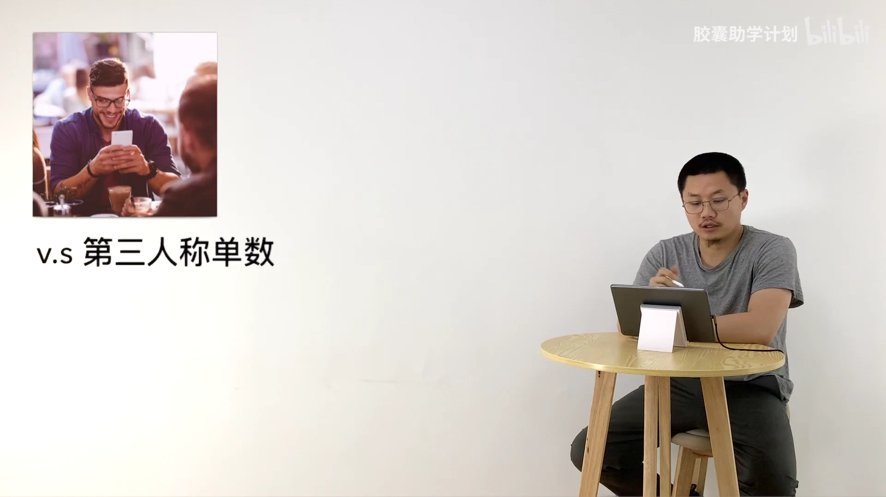

文字识别：胶囊助学计划 / 第三人称单数 / V.S

### 画面 00:04:07

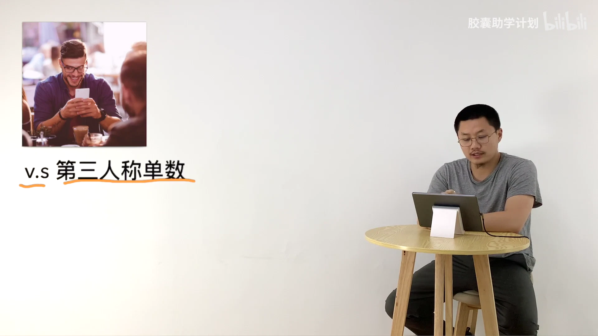

文字识别：胶囊助学计划 / v.s第三人称单数

### 画面 00:04:12

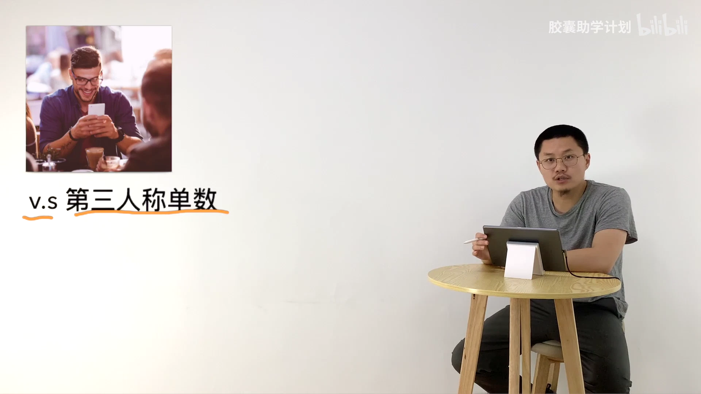

文字识别：胶囊助学计划 / v.s第三人称单数

### 画面 00:04:17

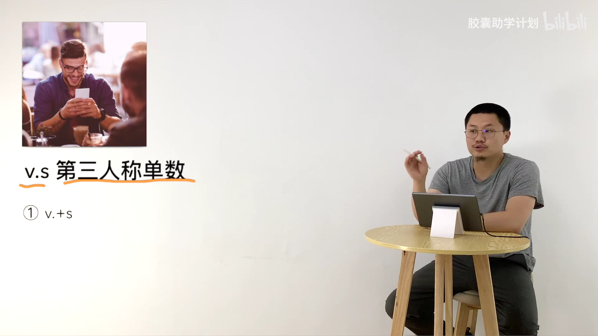

文字识别：胶囊助学计划 / v.s第三人称单数 / V.+S

### 画面 00:04:28

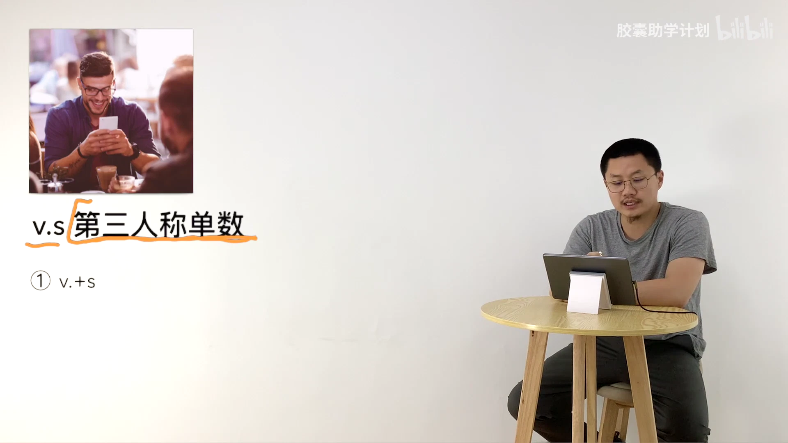

文字识别：胶囊助学计划 / 第三人称单数 / V.S / へ / V.+S

## 00:04:30–00:05:00

当主语是第三人称并且是单数的时候，要做的改变，比如说 likes 和 wants。那我们造一句话叫做 He likes coffee。注意，这儿就要有一个 s。你说那为什么他们要这么加呢？这不是我们要关心的话题，对吧？这个是研究语言学才要关心的话题。我们要知道的是，他要这样加。每一个美国人、英国人或者英语为母语的这个人，他说话的时候，当

### 画面 00:04:30

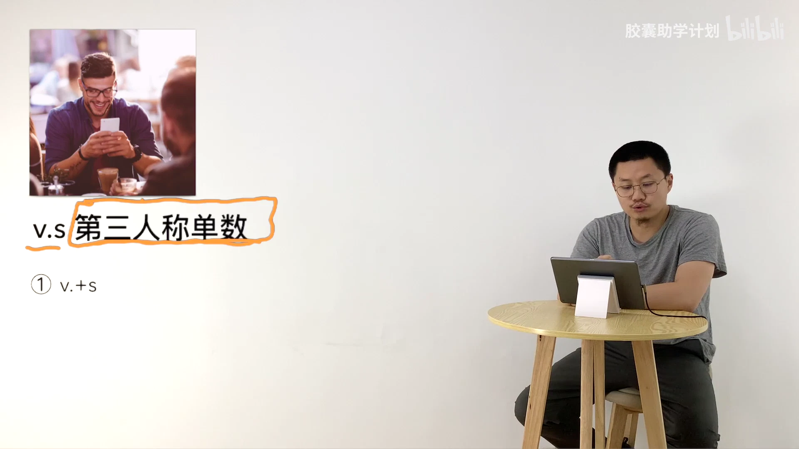

文字识别：胶囊助学计划 / 第三人称单数 / V.S / V.+S

### 画面 00:04:32

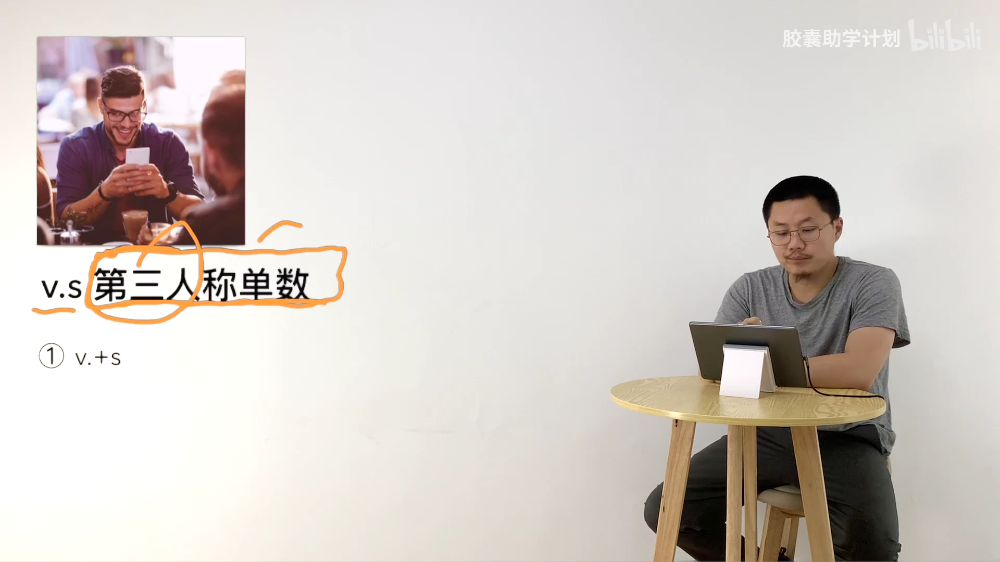

文字识别：胶囊助学计划 / 第三人.称单数 / V.S / V.+S

### 画面 00:04:34

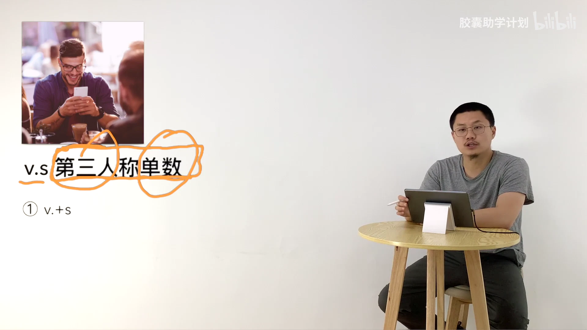

文字识别：胶囊助学计划 / 第三人称单数 / V.S / V.+S

### 画面 00:04:41

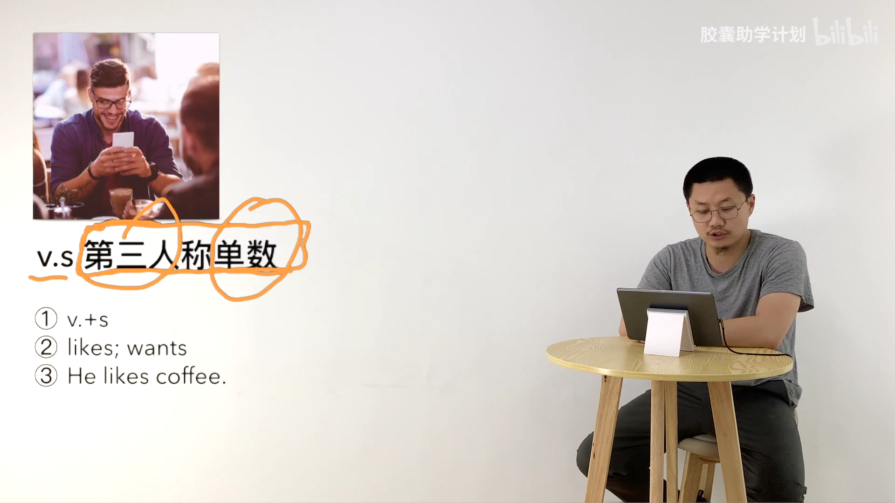

文字识别：胶囊助学计划 / 第三人.称单数 / V.S / V.+S / likes; wants / He likes coffee.

### 画面 00:04:45

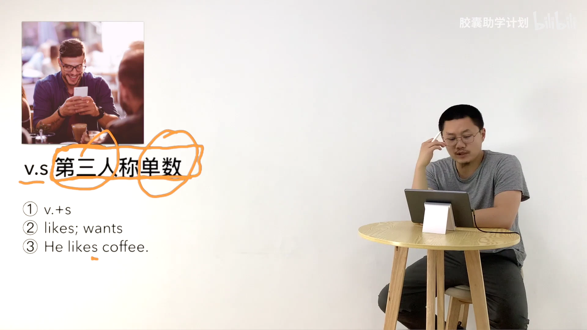

文字识别：胶囊助学计划 / 第三人.称单数 / V.S / V.+S / likes; wants / He likes coffee.

### 画面 00:04:55

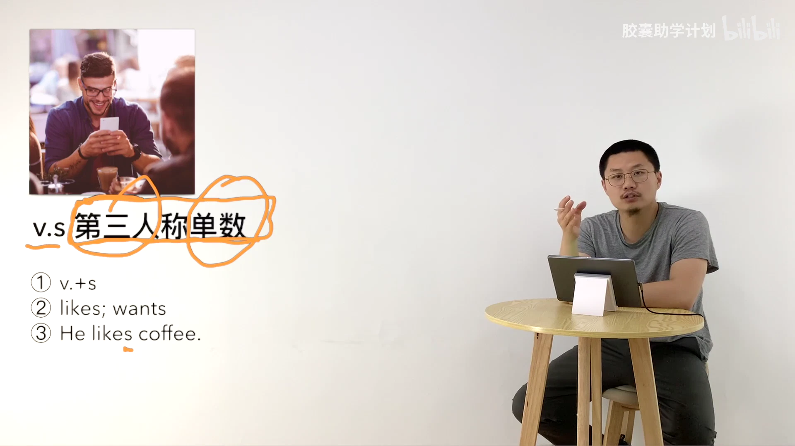

文字识别：胶囊助学计划 / 第三人.称单数 / V.S / V.+S / likes; wants / He likes coffee.

## 00:05:00–00:05:30

he 做主语的时候，他就在后边加一个 likes，并且还得是这个时态是一般现在时。所以 Jimmy 它的第二种变化就是 s x c h s h o 结尾的动词加 e s。你看结尾的名词加 e s，这个规则都是一样的，对吧？这不就变成名词复数了？比如说看加 e s，走加 e s，洗加 e s，做加 e s。比如说 he

### 画面 00:05:05

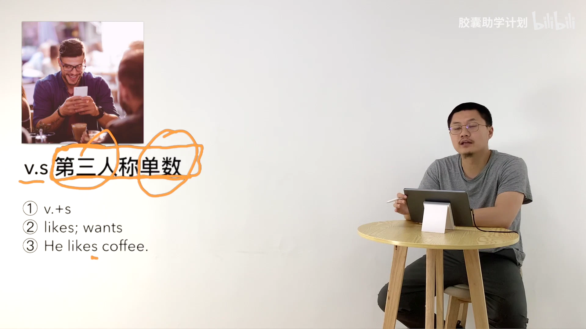

文字识别：胶囊助学计划 / 第三人称单数 / V.S / V.+S / likes; wants / He likes coffee.

### 画面 00:05:07

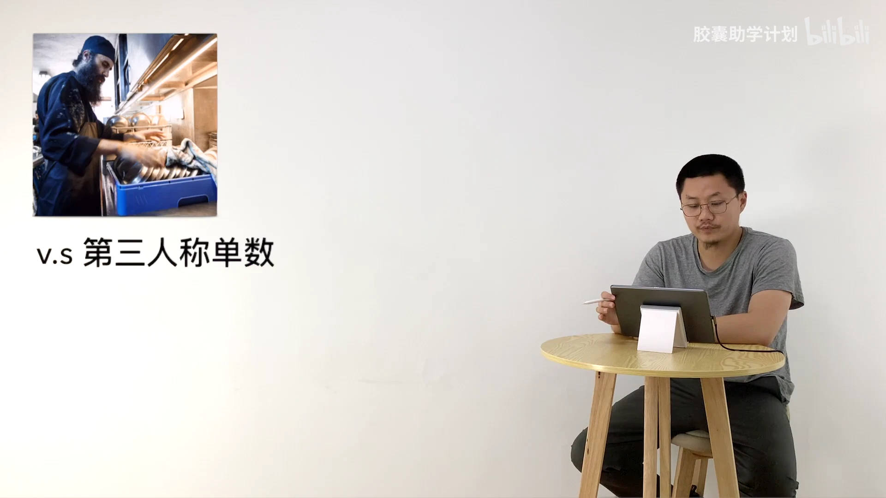

文字识别：胶囊助学计划 / 第三人称单数 / V.S

### 画面 00:05:14

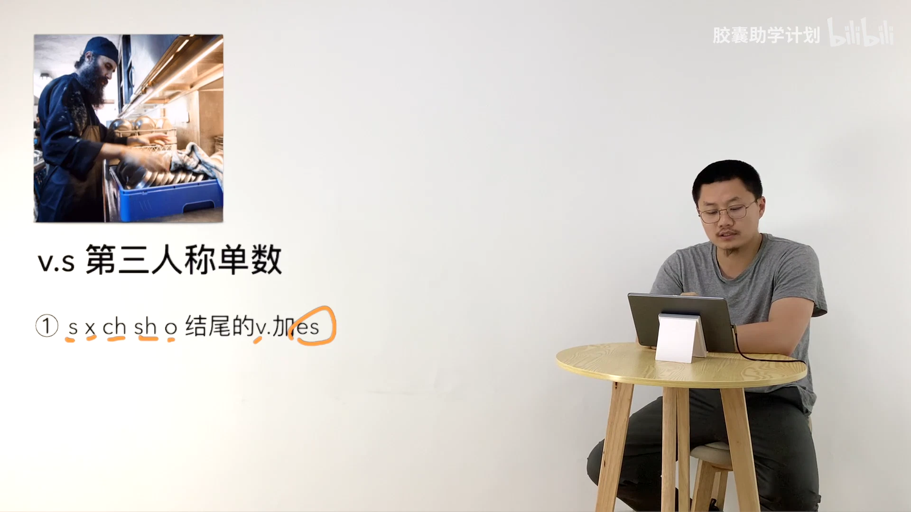

文字识别：胶囊助学计划 / 第三人称单数 / V.S / ①sxchsho结尾的y.加 / res

### 画面 00:05:27

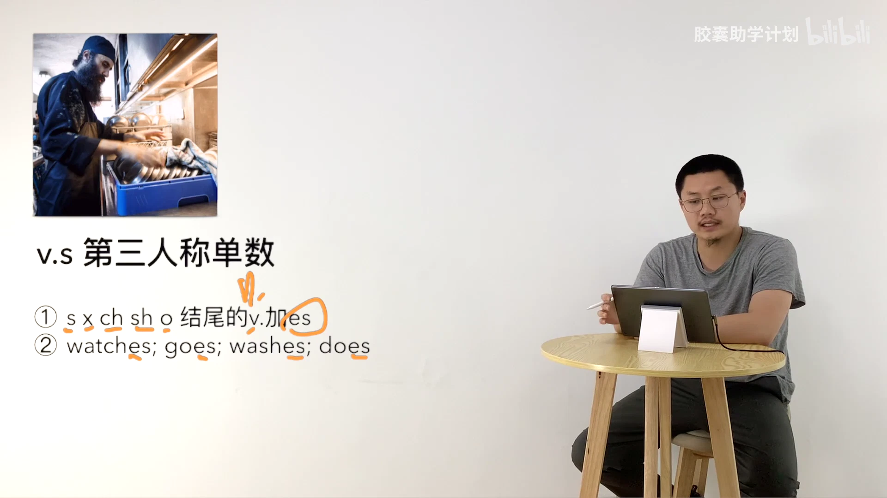

文字识别：胶囊助学计划 / 第三人称单数 / V.S / sxch sho结尾的y.加res / watches; goes; washes; does

## 00:05:30–00:06:00

washes dishes every day. 你看，非常棒。Washes, 注意这是动词，第三人称单数。Every day, 每一天嘛，生活习惯，一般现在时。主语是第三人称单数，动词也要用第三人称单数。至于后边的这个 dishes，那是名词的复数。OK，接下来就刚才这是第二点。第三点，如果是辅音字母加 y 结尾的，你要变 y 为 i，

### 画面 00:05:35

文字识别：胶囊助学计划 / 第三人称单数 / V.S / sxch sho结尾的y.加res / 7 / watches; goes; washes; does / He washes / dishes every day. / V

### 画面 00:05:42

文字识别：胶囊助学计划 / 第三人称单数 / V.S / sxch sho结尾的y.加es / watches; goes; washes; does / He washe / dishes every day. / 人 / V

### 画面 00:05:48

文字识别：胶囊助学计划 / 第三人称单数 / V.S / sxch sho结尾的y.加es / 1 / watches; goes; washes; does / He washesdish / every day. / es / 人 / V

### 画面 00:05:52

文字识别：胶囊助学计划 / v.s 第三人称单数

## 00:06:00–00:06:30

再加 e s，听上去跟名词变复数简直太像了。Cry，哭，辅音字母加 y 结尾的，变 y 为 i 再加 e s。Cry 这个单词也许我们现在还没学啊，将来会学到，叫油炸，对吧？变 y 为 i 加 e s。比如说，我们造一句话叫做 The baby cries every night。这个宝宝啊，哭，每天晚上都哭，是一种习惯，是

### 画面 00:06:05

文字识别：胶囊助学计划 / v.s 第三人称单数 / 辅音字母+y结尾，变y为i+es / cry-cries; fry-fries

### 画面 00:06:26

文字识别：胶囊助学计划 / 第三人称单数 / V.S / 辅音字母+y结尾，变y为i+es / cry-cries; fry-fries / The baby cries every night.

### 画面 00:06:29

文字识别：胶囊助学计划 / 第三人称单数 / V.S / 辅音字母+y结尾，变y为i+es / cry-cries; fry-fries / The baby / cries / every night.

## 00:06:30–00:07:00

吧？Cries every night, very good. 接下来下一个，如果是元音字母加 y 结尾的，直接加 s，比如说买 buy buys. Say，注意它加 s 了之后，它有一个小的变音，它不读 says 或者 says，它读的是 says, a says. Okay，有一个小的变音，各位要注意一下。我们造一句话说，He buys

### 画面 00:06:33

文字识别：胶囊助学计划 / v.s 第三人称单数

### 画面 00:06:56

文字识别：胶囊助学计划 / 第三人称单数 / V.S / 元音字母+y结尾，直接加s / buy-buys; say-says/sez/ / 2 / He buys a new phone every year. / 3

## 00:07:00–00:07:30

a new phone every year. 注意，我故意加了一个 every year，每一年都如此。生活习惯，所以是一般现在时。这个大的前提必须先满足。其次，当主语是第三人称，并且是单数的时候，后边的动词就要用动词的第三人称单数。这个地方我提一个小点，刚才我讲的这些规则，是不是所有的规

### 画面 00:07:00

文字识别：胶囊助学计划 / 第三人称单数 / V.S / 元音字母+y结尾，直接加s / buy-buys; say-says/sez/ / He buys a new phone every year. / 3

### 画面 00:07:03

文字识别：胶囊助学计划 / 第三人称单数 / V.S / 元音字母+y结尾，直接加s / buy-buys; say-says/sez/ / 2 / He buys a new phone / everyyear.

### 画面 00:07:05

文字识别：胶囊助学计划 / 第三人称单数 / V.S / 元音字母+y结尾，直接加s / buy-buys; say-says/sez/ / 2 / He buys a new phone / 3 / every year.

### 画面 00:07:08

文字识别：胶囊助学计划 / 第三人称单数 / V.S / 元音字母+y结尾，直接加s / buy-buys; say-says/sez/ / 2 / He buys a new phone / 3 / every year.

### 画面 00:07:14

文字识别：胶囊助学计划 / 第三人称单数 / V.S / 元音字母+y结尾，直接加s / buy-buys; say-says/sez/ / 3 / He / buys a new phone / every year.

### 画面 00:07:19

文字识别：胶囊助学计划 / 第三人称单数 / V.S / 元音字母+y结尾，直接加s / buy-buys; say-says/sez/ / 2 / 3 / He buys a new phone / every year.

### 画面 00:07:26

文字识别：胶囊助学计划 / 第三人称单数 / V.S / 元音字母+y结尾，直接加s / buy-buys; say-says/sez/ / 2 / 3 / He buys a new phone / every year. / V.s

### 画面 00:07:28

文字识别：胶囊助学计划 / 第三人称单数 / V.S / 元音字母+y结尾，直接加s / buy-buys; say-says/sez/ / 2 / 3 / He buys a new phone / every year. / V.s

## 00:07:30–00:08:00

则都包含所有的动词变成第三人称单数都包含在内了呢？明显不是。对于各位来说，除了这些规则以外，最好用的一个方式就是你要有一个好的手机词典。这个手机词典你现在随便找一个动词，比如说 buy，你看它有没有在底下给你标出来，它做动词讲的时候，它的第三人称单数是什么样子的？一个好的字典必定会给你标这个。OK，好，那接下来我们看一下它的否

### 画面 00:07:36

文字识别：胶囊助学计划 / 第三人称单数 / V.S / 元音字母+y结尾，直接加s / buy-buys; say-says/sez/ / 3 / He buys a new phone / every year. / V.S

### 画面 00:07:41

文字识别：胶囊助学计划 / 第三人称单数 / V.S / 元音字母+y结尾，直接加s / buy-buys; say-says/sez/ / 2 / 3 / He buys a new phone / every year. / V.s

### 画面 00:07:46

文字识别：胶囊助学计划 / 第三人称单数 / V.S / 元音字母+y结尾，直接加s / buy-buys; say-says/sez/ / 2 / 3 / He / buys a new  / phone / everyyear. / V.s

### 画面 00:07:57

文字识别：胶囊助学计划 / 一般现在时：否定 / He wants this job. / He doesn't want this job.

## 00:08:00–00:08:30

定。否定其实，如果各位 do 那儿学的好， does 这个地方应该就不太费劲了。我们说了嘛， does 就是 do 的第三人称单数。你既然当年 do 是后边加 not，那没有理由不是在 does 后边加 not 嘛，对吧？那加了一个 n'撇 t，也就是 not。我们连起来读的时候，管它叫做 doesn't，叫不是。所以 he doesn't want this job，叫他不想要这份

### 画面 00:08:00

文字识别：胶囊助学计划 / 一般现在时：否定 / He wants this job. / He doesn't want this job.

### 画面 00:08:09

文字识别：胶囊助学计划 / 一般现在时：否定 / He wants this job. / He doesn't want this job.

### 画面 00:08:18

文字识别：胶囊助学计划 / 一般现在时：否定 / He wants this job. / He doesh't want this job.

### 画面 00:08:25

文字识别：胶囊助学计划 / 一般现在时：否定 / He wants this job. / He doesn't want this job.

## 00:08:30–00:09:00

工作。注意，主语是第三人称，并且是单数，并且是一般现在时，三者同时满足，我们采用在动词后边加 s，采用 does 这个单词后边加 not。 Continue， does 加 not。 She likes tea。我想变否定，跟我读。 She doesn't like tea。注意一个小点，肯定句的时候，动

### 画面 00:08:32

文字识别：胶囊助学计划 / 一般现在时：否定 / wants this job. / Hedoesn't want this job.

### 画面 00:08:40

文字识别：胶囊助学计划 / 一般现在时： / 否定 / wantsthis job. / C / Hedoesn't want this job.

### 画面 00:08:43

文字识别：胶囊助学计划 / 一般现在时： / 否定 / V.C / this job. / cvants / He does't want this job.

### 画面 00:08:45

文字识别：胶囊助学计划 / does+not

## 00:09:00–00:09:30

词用的是第三人称单数，而你一旦加上了 doesn't like，就要换回原形了。这个点真的是我们要练很多很多遍，各位可你别看这个点很简单，各位才可能把它完全记住的啊。我们多练没事儿啊，再来说 she washes the dishes every day，她每天都洗。否定句就是 she doesn't wash the dishes every day。首先用 doesn't，其次动词从三

### 画面 00:09:01

文字识别：胶囊助学计划 / does+not / V.c / ①She likes tea. /  She doesn't like tea. / 2

### 画面 00:09:07

文字识别：胶囊助学计划 / does+not / V.5 /  She likes tea. / 1 / She doesn't like tea. / 2

### 画面 00:09:17

文字识别：胶囊助学计划 / does+not

### 画面 00:09:22

文字识别：胶囊助学计划 / does+not / ① She washes the dishes every day. / ② She doesn't wash the dishes every day. / 2）

### 画面 00:09:27

文字识别：胶囊助学计划 / does+not /  She washes the dishes every day. / 1 / ? wash the dishes every day. / 2 / She / coesn'

## 00:09:30–00:10:00

单换回原形。 Continue, the baby cries every night. 动词的三单对吧？那 the baby doesn't cry every night. 你用了 doesn't，动词换回原形。 Continue，我们接下来看一个电影片段，当中出现了叫做 does not like you，叫不喜欢你。好，我们看。 Listen to me. I have to consider the possibility that God does not

### 画面 00:09:32

文字识别：胶囊助学计划 / does+not

### 画面 00:09:38

文字识别：胶囊助学计划 / does+not / Vs / The baby cries every night. / The baby doesn't cry every night.

### 画面 00:09:46

文字识别：胶囊助学计划 / MISCHIEF. MAYHEM. SOAP. / does not like you. / D PITT EDWARD NORT / HELENA 3ONHAM / 搏击俱乐部 Fight Club (1999) / FROM THE DIRECTOR OF'SEVEN

### 画面 00:09:54

文字识别：Bilbii / 胶囊助学计划

### 画面 00:09:56

文字识别：bilibli / 胶囊助学计划 / 听我说你必须想到有可能 / Listen to me. You have to consider the possibility

### 画面 00:09:58

文字识别：bilibli / 胶囊助学计划 / 听我说1 / 你必须想到有可能 / Listen to me. You have to consider the possibility

## 00:10:00–00:10:30

like you, never wanted you, in all probability, he hates you. This is not the worst thing that can happen. We don't need him. We don't like him. Okay, does not like you. 好看，不喜欢你。 Continue. 那一般疑问句怎么办？Does 后边加 not, does 提前。我们目前所有全是这个样子。 Okay, 不多解释了。Does 提前，叫 Does he want this job? 注意跟否定句一样，动词换回了原形。这个小点，各位一定要记

### 画面 00:10:00

文字识别：bilibli / 胶囊助学计划 / 上帝根本不爱你 / that God does not like you.

### 画面 00:10:02

文字识别：bilibli / 胶囊助学计划 / 他根本不想要你甚至还恨你 / He never wanted you. In all probability, He hates you.

### 画面 00:10:04

文字识别：bilibli / 胶囊助学计划 / 这还不是最惨的事我们根本不需要他 / This is not the worst thing that can happen. We don't need Him!

### 画面 00:10:06

文字识别：bilbili / 胶囊助学计划 / 这还不是最惨的事 / 我们根本不需要他 / This is not the worst thing that can happen. We don't need Him!

### 画面 00:10:08

文字识别：bilbli / 胶囊助学计划 / 不需要我同意 / We don't! I agree!

### 画面 00:10:10

文字识别：胶囊助学计划 / MISCHIEF. MAYHEM. SOAP. / does not like you. / ID PITT EDWARD NORT / HELENA 3ONHAM / CAEHE / 搏击俱乐部 Fight Club(1999) / FROMTHE DIRECTOR OF'SEVEN

### 画面 00:10:13

文字识别：胶囊助学计划山业 / 一般现在时：一般 / He wants this job. / Does he want this job?

### 画面 00:10:26

文字识别：胶囊助学计划 / 一般现在时：一般 / He wants this job. / Does he want this job?

## 00:10:30–00:11:00

住。我们造句啊，She washes the dishes every day. 这有一个 does，我把这 does 提到句首，把它换回原形，这句话就出来了。张嘴跟我读，Does she wash the dishes every day? Continue. The baby cries every day. 这有一个 does 提到句首，换回原形。Does the baby cry every night? 他每天晚上都哭吗？ Continue. He buys a new.

### 画面 00:10:30

文字识别：胶囊助学计划 / does提句首+v.

### 画面 00:10:34

文字识别：胶囊助学计划 / does提句首+v. / ① She washes the dishes every day.

### 画面 00:10:39

文字识别：胶囊助学计划 / does提句首+v. / D She washc the dishes every day. / 1 / Does she wash the dishes every day?

### 画面 00:10:45

文字识别：胶囊助学计划 / does提句首+v.

### 画面 00:10:49

文字识别：胶囊助学计划 / does提句首+v. / ① The babycries every night.

### 画面 00:10:53

文字识别：胶囊助学计划 / does提句首+v. / V / The babycries e / every night. / Does the baby cry every night?

### 画面 00:10:57

文字识别：胶囊助学计划 / does提句首+v.

## 00:11:00–00:11:30

Ah, does提前换回原形. Does he buy a new phone every year?每年都买一个新手机吗？Okay.接下来我们直接进入文章啊。刚才讲完了这课这两课，四十七课和四十九课，do和does的用法。接下来我们在文章当中看一下它如何应用。Do you want any meat today?你想要肉吗？今天Mrs. Bird伯

### 画面 00:11:01

文字识别：胶囊助学计划 / does提句首+v. / ① He buys a new phone every year.

### 画面 00:11:08

文字识别：胶囊助学计划 / does提句首+v. / ① He buys a new phone every year. /  Does he buy a new phone every year? / 2）

### 画面 00:11:10

文字识别：胶囊助学计划 / BUTCHER: Do you want any meat today. Mrs. Bird? / MRS.BIRD: Yes, please. / BUTCHER: Do you want beef or lamb? / MRS.BIRD: Beef, please.

### 画面 00:11:14

文字识别：胶囊助学计划 / BUTCHER: Do you want any meat today. Mrs. Bird? / MRS.BIRD: Yes, please. / BUTCHER: Do you want beef or lamb? / MRS.BIRD: Beef, please.

### 画面 00:11:21

文字识别：胶囊助学计划 / BUTCHER: Do you Want any meat today. Mrs. Bird? / MRS.BIRD: Yes, please. / BUTCHER: Do you want beef or lamb? / MRS.BIRD: Beef, please.

### 画面 00:11:24

文字识别：胶囊助学计划 / BUTCHER: Do you want any meat today. Mrs. Bird? / MRS.BIRD: Yes, please. / BUTCHER: Do you want beef or lamb? / MRS.BIRD: Beef, please.

### 画面 00:11:29

文字识别：胶囊助学计划 / BUTCHER: Do you Want any meat toda. Mrs. Bird? / MRS.BIRD: Yes, please. / BUTCHER: Do you want beef or lamb? / MRS.BIRD: Beef, please.

## 00:11:30–00:12:00

德女士，伯德夫人啊，应该是，Yes, please.想要，Do you want beef or lamb?还是羊肉？注意or是或者的意思。他说Beef, please.牛肉，拜托了。This lamb's very good.注意这是撇s对吧？说这块羊肉啊特别好。然后伯德夫人说I like lamb.我喜欢羊肉。But但是

### 画面 00:11:36

文字识别：胶囊助学计划 / BUTCHER: Do you Want any meat todax. Mrs. Bird? / MRS.BIRD: Yes, please. / BUTCHER: Deyeu want beef or lamb? / MRS.BIRD: Beef, please.

### 画面 00:11:45

文字识别：胶囊助学计划 / BEEF / BUTCHER: This lamb's very good. / MRS.BIRD: I like lamb, / but my husband doesn't. / BUTCHER: What about some steak? / This is a nice piece. / MRS.BIRD: Give me that piece, please.

## 00:12:00–00:12:30

呢，my husband doesn't.其实后边还省略了叫做like lamb，对吧？说但是我老公不喜欢羊肉。注意，那我老公是不是就是he？是第三人称，并且是单数，所以就是doesn't，并且动词要换回原形，对吧？Continue.说What about some steak？注意这个some，别看它用的是some，

### 画面 00:12:07

文字识别：胶囊助学计划 / BEEF / BUTCHER: This lamb's very good. / MRS.BIRD: Ilike lamb, / .like laom / but my husband doesn't. / BUTCHER: What about some steak? / This is a nice piece. / MRS.BIRD: Give me that piece, please.

### 画面 00:12:13

文字识别：胶囊助学计划 / BEER / BUTCHER: This lamb's very good. / MRS.BIRD: Ilike lamb, / .like larmb / but my husband doesn't. / BUTCHER: What about some steak? / This is a nice piece. / MRS.BIRD: Give me that piece, please.

### 画面 00:12:27

文字识别：胶囊助学计划 / BEEF / BUTCHER: This lamb's very good. / MRS.BIRD: Ilike lamb, / .like lamb / but my husband doesn't. / He / V. / BUTCHER: What about some steak? / This is a nice piece. / MRS.BIRD: Give me that piece, please.

## 00:12:30–00:13:00

理论上是不是应该用 any 呀？ Some 肯定句，any 用在否定和疑问句当中。但为什么在这个地方用了 some 呢？各位，这就是例外了。语法有规则，有例外。它的例外就是记住，当我们问一句话，你希望别人做肯定回答，不是表达客套的时候，呃，疑问句当中，我们可以用 some 来表示，我不是在跟你客套，我想让你给

### 画面 00:12:31

文字识别：胶囊助学计划 / BEEF / BUTCHER: This lamb's very good. / MRS.BIRD: Ilike lamb, / .like lamb / but my husband doesn't. / He / V. / BUTCHER: What about some steak? / This is a nice piece. / MRS.BIRD: Give me that piece, please.

### 画面 00:12:36

文字识别：胶囊助学计划 / BEEF / BUTCHER: This lamb's very good. / MRS.BIRD: Ilike lamb, / .like lamb / but my husband doesn't. / He / V. / BUTCHER: What about some steak? / This is a nice piece. / MRS.BIRD: Give me that piece, please.

### 画面 00:12:41

文字识别：胶囊助学计划 / BEEF / BUTCHER: This lamb's very good. / MRS.BIRD: Ilike lamb, / .like larmb / but my husband doesn't. / He / V. / BUTCHER: What about some steak? / This is a nice piece. / MRS.BIRD: Give me that piece, please.

## 00:13:00–00:13:30

我一个肯定回答啊，所以叫 What about some steak? 啊，要不那那要不要来点牛排呢？ This is a nice piece. 说这一块特别的棒，这一片特别的棒。 Piece 四十一课学的，a piece of 一片，对吧？ Give me that piece, please. 把那一片给我吧，把这一块给我吧，多谢了。 Continue, and a pound of minced too. 然后呢，我还要一磅

### 画面 00:13:11

文字识别：胶囊助学计划 / BEEF / BUTCHER: This lamb's very good. / MRS.BIRD: Ilike lamb, / .like lamb / but my husband doesn't. / He / V. / BUTCHER: What about some steak? / This is a nice piece. / MRS.BIRD: Give me that piece, please.

### 画面 00:13:23

文字识别：胶囊助学计划 / MRS.BIRD: And a pound of mince, too. / BUTCHER: Do you want a chicken, Mrs. Bird? / They're very nice. / MRS.BIRD: No, thank you.

## 00:13:30–00:14:00

的肉馅啊，磅我们之前学过了，四十一课对吧？指的是英国的重量单位啊，它不是国际重量单位，国际重量单位应该是Kg对吧？就Do you want a chicken？那你想要来只鸡吗？Mrs. Bird啊，伯德夫人，你看她这个名字很有意思啊。首先确实有伯德夫人，这不是亚历山大自己胡诌的啊，有伯德这个名字，但Bird其实就鸟的意思是吧？这个听上去挺好玩的啊。你要直接翻译成汉语就是鸟夫

### 画面 00:13:43

文字识别：胶囊助学计划 / C0 / MRS.BIRD: And a pound of mince, too. / BUTCHER: Do you want a chicken, Mrs. Bird? / They're very nice. / MRS.BIRD: No, thank you.

### 画面 00:13:48

文字识别：胶囊助学计划 / MRS.BIRD: And a pound of mince, too. / BUTCHER: Do you want a chicken, / Mrs. Bird' / They're very nice. / MRS.BIRD: No, thank you.

### 画面 00:13:51

文字识别：胶囊助学计划 / MRS.BIRD: And a pound of mince, too. / BUTCHER: Do you want a chicken, / Mrs / Bird / They're very nice. / MRS.BIRD: No, thank you.

## 00:14:00–00:14:30

人，你想要一只鸟吗？啊，鸡不就是鸟吗？对吧？啊，they are very nice，他们特别的好。No，thank you，不，谢谢了。说My husband likes steak，喜欢牛排，but he doesn't like chicken，但是他不喜欢鸡肉。你看和我们之前学的是不是一致？动词的三单，然后 doesn't like 换回原形，对吧？Butcher，这个屠夫卖

### 画面 00:14:03

文字识别：胶囊助学计划 / MRS.BIRD: And a pound of mince, too. / BUTCHER: Do you want a chicken, / Mrs / Bird / They're very nice. / MRS.BIRD: No, thank you.

### 画面 00:14:07

文字识别：胶囊助学计划 / Ca / MRS.BIRD: And a pound of mince, too. / BUTCHER: Do you want a chicken / Mrs / Bird / They're very nice. / MRS.BIRD: No, thank you.

### 画面 00:14:09

文字识别：胶囊助学计划 / MRS.BIRD: My husband likes steak, / but he doesn't like chicken. / BUTCHER: To tell you the truth, / Mrs. Bird, I don't like chicken either!

### 画面 00:14:23

文字识别：胶囊助学计划 / Vc / MRS.BIRD: My husband likesteak, / but he doesn't like chicken. / BUTCHER: To tell you the truth, / Mrs. Bird, I don't like chicken either!

## 00:14:30–00:15:00

肉的说了一句话，他说To tell the truth, 我和你讲实话吧。Mrs. Bird, I don't like chicken either. I don't eat dog either. 各位还记得那个电影片段吧？我也不吃狗肉，对吧？说我也不喜欢鸡肉，一模一样。OK，接下来我们做一个 comprehension 口语练习，听力口语练习。各位看着书或者完全闭上眼睛，我问您口语回答。第一题，Where is Mrs.

### 画面 00:14:31

文字识别：胶囊助学计划 / Vc / MRS.BIRD: My hvspand like /steak, / but he doesn'tlikechicken. / BUTCHER: To tell you the truth, / Mrs. Bird, I don't like chicken either!

### 画面 00:14:36

文字识别：胶囊助学计划 / Vc / MRS.BIRD: My huspand like steak, / but he doesn'tlikechicken. / BUTCHER: To tell you the truth, / Mrs. Bird, I don't like chicken either!

### 画面 00:14:40

文字识别：胶囊助学计划 / Vc / MRS.BIRD: My husband likeS steak, / but he doesn'tlikechicken. / BUTCHER: To tell you the truth / Mrs. Bird, I don't like chickeneither!

### 画面 00:14:44

文字识别：胶囊助学计划 / Vc / MRS.BIRD: My husband likeS steak, / but he doesn'tlikechicken. / BUTCHER: To tell you the truth / Mrs. Bird, I don't like chickeneither!

### 画面 00:14:47

文字识别：胶囊助学计划 / Comprehension

### 画面 00:14:58

文字识别：胶囊助学计划 / Comprehension / 1 T: Where is Mrs Bird?

## 00:15:00–00:15:30

Butcher? Ah, sorry. Where is Mrs. Bird? She's at the butcher's. Next one. Does Mrs. Bird want any meat today? Yes, she does. Continue. Does she want beef or lamb? Beef. Next one. Is the lamb good?

### 画面 00:15:28

文字识别：胶囊助学计划 / Comprehension / 4T: Is the lamb good?

## 00:15:30–00:16:00

Yes, it is. Who likes lamb? Mrs. Bird likes lamb, or Mrs. Bird does. Does Mr. Bird like steak?注意Mr.伯德先生了啊. Like steak. Yes, he does. Next one. Does Mrs. Bird want any meats? Yes, she

### 画面 00:15:58

文字识别：胶囊助学计划 / Comprehension / 7 T: Does Mrs. Bird want any mince? / S: Yes, she does.

## 00:16:00–00:16:30

does. Continue. Does Mrs. Bird want chicken? No, she doesn't. Continue. Does Mr. Bird like chicken? No, he doesn't. Continue. Does the butcher like chicken? No, he doesn't either.那加不加either无所谓了啊。

### 画面 00:16:20

文字识别：胶囊助学计划 / Comprehension / 10 T: Does the butcher like chicken?

### 画面 00:16:24

文字识别：胶囊助学计划 / Comprehension / 10 T: Does the butcher like chicken? / S: No, he doesn't, either.

### 画面 00:16:29

文字识别：胶囊助学计划 / Asking questions

## 00:16:30–00:17:00

OK。那 asking questions 口语听力练习，我念肯定句，您变一般疑问句。我给特殊疑问词，您口语变成特殊疑问句来了。Ask me if 不重要，后边听好了。Mrs. Bird is at the butcher's。一般疑问句 Is Mrs. Bird at the butcher's? Where 那肯定是对 at the butcher's 提问了。Where is Mrs. Bird? Next one.

### 画面 00:16:31

文字识别：胶囊助学计划 / Asking questions

### 画面 00:16:33

文字识别：胶囊助学计划 / Asking questions

### 画面 00:16:40

文字识别：胶囊助学计划 / Asking questions / 1 T: Ask me if Mrs Bird is at the butcher's.

### 画面 00:16:42

文字识别：胶囊助学计划 / Asking questions / 1 T: Ask me if Mrs Bird is at the butcher's.

### 画面 00:16:48

文字识别：胶囊助学计划 / Asking questions / 1 T: Ask me if Mrs Bird is at the butcher's. / S: Is Mrs. Bird at the butcher's?

### 画面 00:16:54

文字识别：胶囊助学计划 / Asking questions / 1 T: Ask me if Mrs Bird is at the butcher's. / S: Is Mrs. Bird at the butcher's? / T:Where...? / 2

### 画面 00:16:59

文字识别：胶囊助学计划 / Asking questions

## 00:17:00–00:17:30

Ask me if Mrs. Bird wants any lamb today. Wants. Does Mrs. Bird want any lamb today?返回原形. What, what does Mrs. Bird want today? You听听. Ask me if she wants that piece of steak. Does she want

### 画面 00:17:09

文字识别：胶囊助学计划 / Asking questions / 2 T: Ask me if Mrs. Bird wants any lamb today. / S: Does Mrs. Bird want any Tamb today?

### 画面 00:17:21

文字识别：胶囊助学计划 / Asking questions

## 00:17:30–00:18:00

that piece of steak? Which piece? 好，注意一个小点，各位可以抬头看一下，which piece指的是哪一片儿？怎么判断他对谁提问？谁能回答他，他就对谁提问。谁能回答他哪一片儿？那一片儿，对吧？所以他的答案就是 which piece of steak does she want? 哪一片儿牛排他想要？回答那一片

### 画面 00:17:34

文字识别：胶囊助学计划 / Asking questions / 3 T: Ask me if she wants that piece of steak. / S: Does she want that piece of steak? / T: Which piece...?

### 画面 00:17:40

文字识别：胶囊助学计划 / Asking questions / 3 T: Ask me if she wants that piece of steak. / S: Does she want that piece of steak? / T: Which piece...?

### 画面 00:17:54

文字识别：胶囊助学计划 / Asking questions / 3 T: Ask me if she wants that piece of steak. / S: Does she want/hatpiece of steak? / T: Which piece...? / S: Which piece of steak does she want?

### 画面 00:17:56

文字识别：胶囊助学计划 / Asking questions / 3 T: Ask me if she wants that piece of steak. / S: Does she want/hatpiece of steak? / T: Which piece...? / S: Which piece of steak / does she want?

## 00:18:00–00:18:30

对吧？ Continue. Ask me if Mr. Bird likes steak. Likes谁提线？Does Mr. Bird like steak? What What does Mr. Bird like? Continue.好，Recap.本课我们学到了一般现在时，当主语是第三人称单数的时候，我们

### 画面 00:18:01

文字识别：胶囊助学计划 / Asking questions

### 画面 00:18:10

文字识别：胶囊助学计划 / Asking questions / 4 T: Ask me if Mr. Bird likes steak. / S: Does Mr. Bird like steak?

### 画面 00:18:20

文字识别：Recap / 胶囊助学计划 / Patterns / 一般现在时 does / v.s 第三人称单数 / Grammar / Words / Expression

### 画面 00:18:22

文字识别：Recap / 胶囊助学计划 / Patterns / 一般现在时 does / v.s 第三人称单数 / Grammar / Words / Expression

### 画面 00:18:26

文字识别：Recap / 胶囊助学计划 / Patterns / 一般现在时 does / v.s 第三人称单数 / Grammar / Words / Expression

## 00:18:30–00:19:00

动词要变成对应的第三人称单数，变成否定句、一般疑问句和特殊疑问句的时候，借助的就不是 do 而是 does 了。在这儿简单给大家捋一下，就是一般现在时这个大的前提不能变。当主语是第三人称单数的时候，首先动词也要是第三人称单数，其次你要借助于 does 去变句型，对吧？当它是非三

### 画面 00:18:35

文字识别：Recap / 胶囊助学计划 / Patterns / 一般现在时does / v.s 第三人称单数 / Grammar / Words / Expression

### 画面 00:18:41

文字识别：Recap / 胶囊助学计划 / Patterns / 一般现在时does / v.s第三人称单数 / Grammar / Words / Expression

### 画面 00:18:43

文字识别：胶囊助学计划 / Recap / Patterns / 一般现在时does / v.s第三人称单数 / Grammar / Words / Expression

### 画面 00:18:48

文字识别：胶囊助学计划 / Recap / Patterns / 一般现在时does / v.s第三人称单数 / Grammar / Words / Expression

### 画面 00:18:58

文字识别：胶囊助学计划 / Recap / Patterns / 一般现在时does / v.s第三人称单数 / Grammar / Words / Expression

## 00:19:00–00:19:30

单的时候，叫做不是第三人称，或同时也不是单数的时候，对吧？或者或者不是单数的时候啊，那这个时候你就是用动词原形，并且用的是 do 变各种其他的句型，这是一个。那看一下家务作业，绿皮书四十九课写作练习，各位可以写了。文章跟读至熟读成诵，给自己讲解一遍今天的核心知识点。OK，那如果大家喜欢我们的课程，欢迎大家关注、订阅、一键三连支持，并分享给那

### 画面 00:19:00

文字识别：Recap / 胶囊助学计划 / Patterns / 一般现在时does / & / v.s第三人称单数 / Grammar / Words / Expression

### 画面 00:19:05

文字识别：Recap / 胶囊助学计划 / Patterns / 一般现在时does / v.s第三人称单数 / Grammar / Words / Expression

### 画面 00:19:08

文字识别：Recap / 胶囊助学计划 / Patterns / 一般现在时does / & / v.s第三人称单数 / Grammar / Words / Expression

### 画面 00:19:11

文字识别：Recap / 胶囊助学计划 / Patterns / 一般现在时does / v.s第三人称单数 / Grammar / Words / Expression

### 画面 00:19:13

文字识别：胶囊助学计划 / Recap / Patterns / 一般现在时does / v.s第三人称单数 / Grammar / Words / Expression

### 画面 00:19:15

文字识别：胶囊助学计划 / 绿皮书第49课的写作练习

### 画面 00:19:19

文字识别：胶囊助学计划 / 绿皮书第49课的写作练习 / 文章跟读至熟读成诵

### 画面 00:19:23

文字识别：胶囊助学计划

### 画面 00:19:26

文字识别：胶囊助学计划 / 不

## 00:19:30–00:19:55

些需要的朋友。最后，我们再来看一句名人名言：A good marriage would be between a blind wife and a deaf husband. See you next time.

### 画面 00:19:31

文字识别：胶囊助学计划 / A good marriage would be between a / blind wife and a deaf husband. / Michel de Montaigne

### 画面 00:19:42

文字识别：胶囊助学计划 / A good marriage would be between a / blind wife and a deaf husband. /  Michel de Montaigne

### 画面 00:19:44

文字识别：CAPSULEACADEMY / 胶囊助学计划 / 小红书 / Lecturer / □ / Leo / OE

### 画面 00:19:47

文字识别：CAPSULEACADEMY / 胶囊助学计划 / 小红书 / Photographer / Berlin / OE

### 画面 00:19:49

文字识别：CAPSULEACADEMY / 胶囊助学计划 / 小红书 / Editor / Berlin / OE

### 画面 00:19:52

文字识别：CAPSULEACADEMY / 胶囊助学计划 / 『 / 小红书 / OE

### 画面 00:19:54

文字识别：bilibili / 胶囊助学计划

### 画面 00:19:55

文字识别：bilibili / 胶囊助学计划

