# 050 单词 练习

快速机器解析：语音为单模型转写，未进行独立交叉校对或人工复核；画面每秒采样并按变化选帧，短时文字和标记可能遗漏。截图时间约有 1 秒误差。图片有损压缩；遇到疑点请按时间查看 Google Drive 原视频。

## 00:00:00–00:00:30

Hello everyone, welcome to Capsule Academy. This is Leo. Today we are going to learn New Concept English Book One Lesson Fifty Practices and Words. Hope you are gonna enjoy it.那我们先看第一个单词，跟我一起读，叫做 tomato，三个音节，对吧？重音在第二个音节上，tomato，西红柿啊，tomato，可数了，这个当然可数了。来，

### 画面 00:00:00

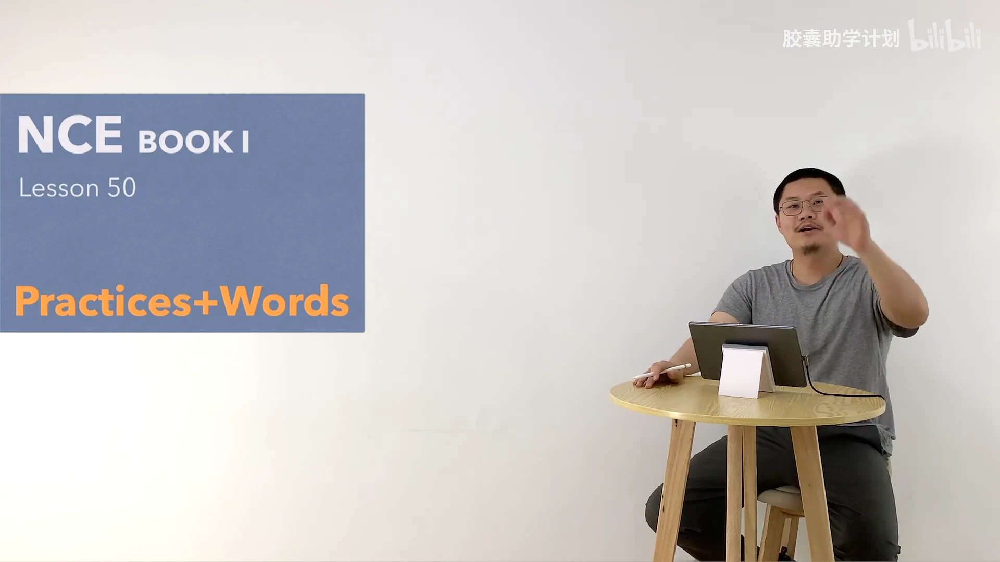

文字识别：Bilibil / 胶囊助学计划 / NCE / BOOKI / Lesson 50 / Practices+Words

### 画面 00:00:04

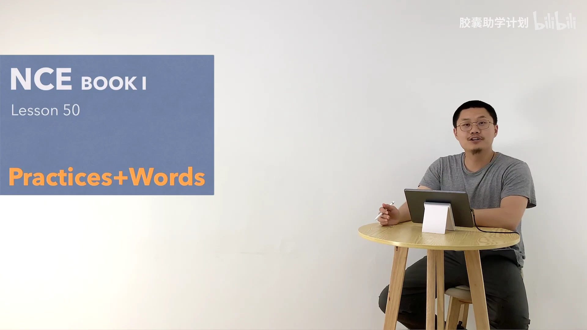

文字识别：Bilibili / 胶囊助学计划 / NCE / BOOKI / Lesson 50 / Practices+Words

### 画面 00:00:11

文字识别：胶囊助学计划bll / •

### 画面 00:00:15

### 画面 00:00:17

文字识别：Bilbil / 胶囊助学计划 / /ta'ma:tau/ / tomato n.

### 画面 00:00:22

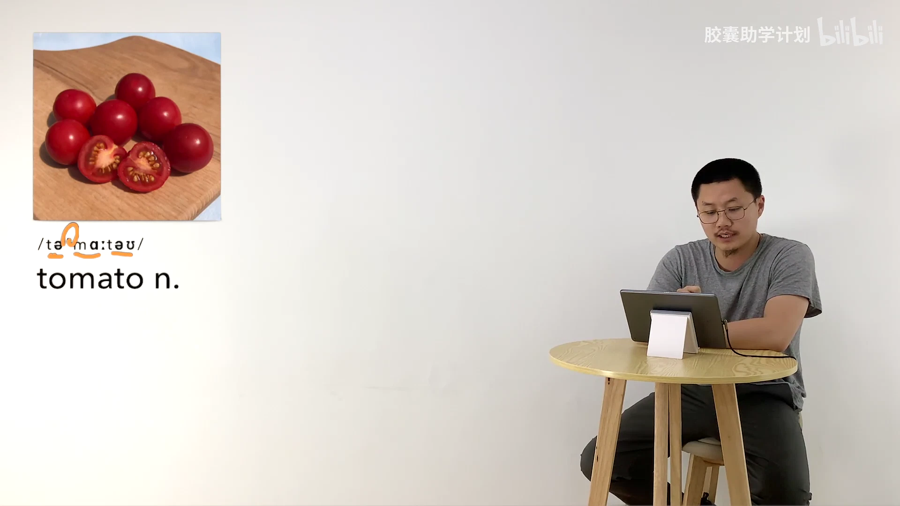

文字识别： bilbii / 胶囊助学计划 / /tama:tau/ / tomato n.

### 画面 00:00:26

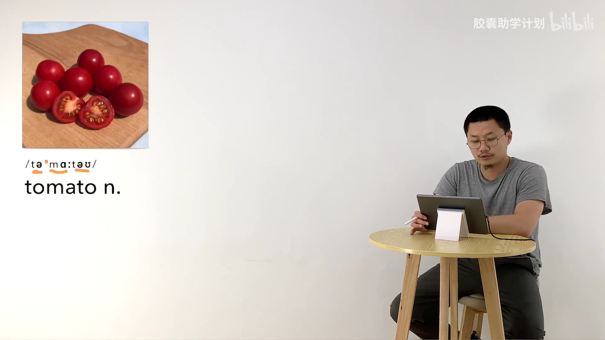

文字识别：Biibili / 胶囊助学计划 / /ta maitau/ / tomato n.

## 00:00:30–00:01:00

Does Penny like tomatoes?张嘴跟我读啊！我们连着单词在练习。跟读。What does Penny like?或者是What does Penny want? Yes, she does. She likes tomatoes, but she doesn't want any.好，我们注意一个小点。首先，一般疑问句用Does动词换回原形；特殊疑问句用Does动词是用

### 画面 00:00:32

文字识别：Bilbili / 胶囊助学计划 / /ta'ma:tau/ / tomato n. / ① Does Penny like tomatoes?

### 画面 00:00:36

文字识别：biibili / 胶囊助学计划 / /tamaitau/ / tomato n. / ① Does Penny like tomatoes? / What does Penny like/want?

### 画面 00:00:51

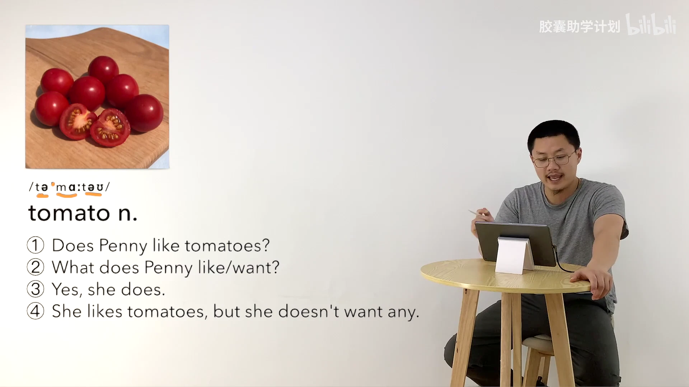

文字识别：Bitbii / 胶囊助学计划 / /ta'maitau/ / tomato n. / ① Does Penny like tomatoes? / What does Penny like/want? /  Yes, she does. / 3 / She likes tomatoes, but she doesn't want any.

### 画面 00:00:56

文字识别：胶囊助学计划 / /tama:tau/ / tomato n. / Does Penny like tomatoes? / What does Penny like/want? / Yes, she does. / She likes tomatoes, but she doesn't want any.

## 00:01:00–00:01:30

原形，肯定句主语三单，动词对应也要用三单，然后否定句用 doesn't，动词换回原形，和我们四十九课讲的一模一样，对吧？好，我们直接看一个小的电影片段，出现了 What does she want？来了， Steve doesn't like that kind of talk. You know what Romanoff？ So what does he want？ To become better， better than us？

### 画面 00:01:01

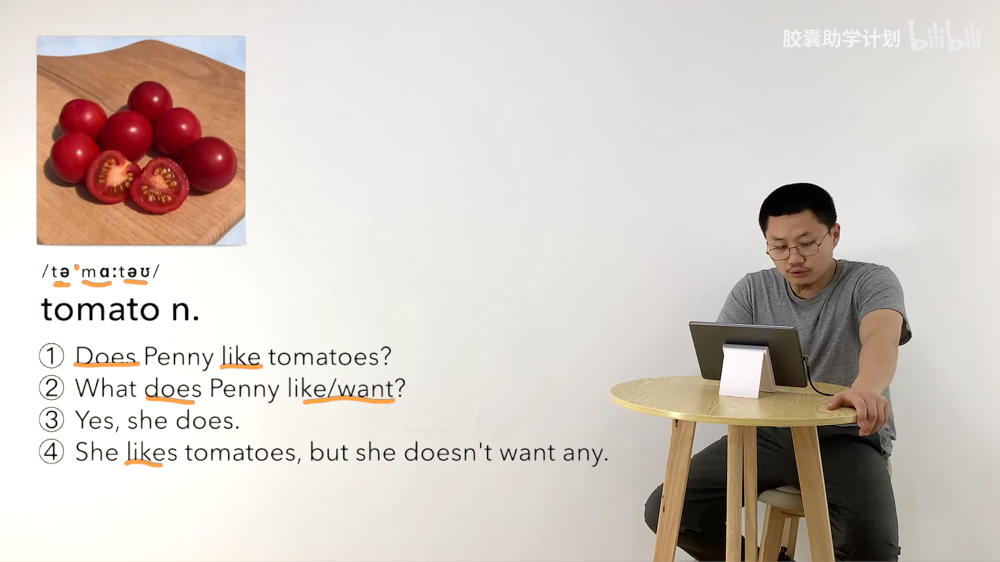

文字识别：胶囊助学计划 / /tama:tau/ / tomato n. / Does Penny like tomatoes? / What does Penny / like/want? / Yes,S / she does. / She / e likes tomatoes, but she doesn't want any.

### 画面 00:01:07

文字识别：胶囊助学计划 / /tama:tau/ / tomato n. / Does Penny like tomatoes? / What does Penny / like/want? / Yes, she does. / She / : likes tomatoes, but she doesn't want any. / V.S

### 画面 00:01:13

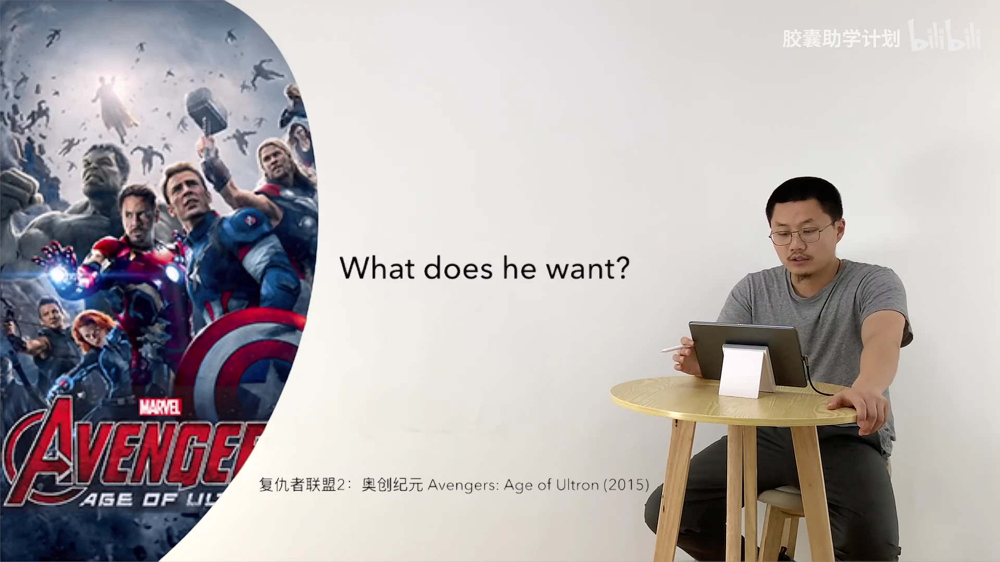

文字识别：胶囊助学计划 / What does he want? / MARNE / VENGE / 复仇者联盟2：奥创纪元Avengers:Age ofUltron(2015) / TAGE OF UY

### 画面 00:01:16

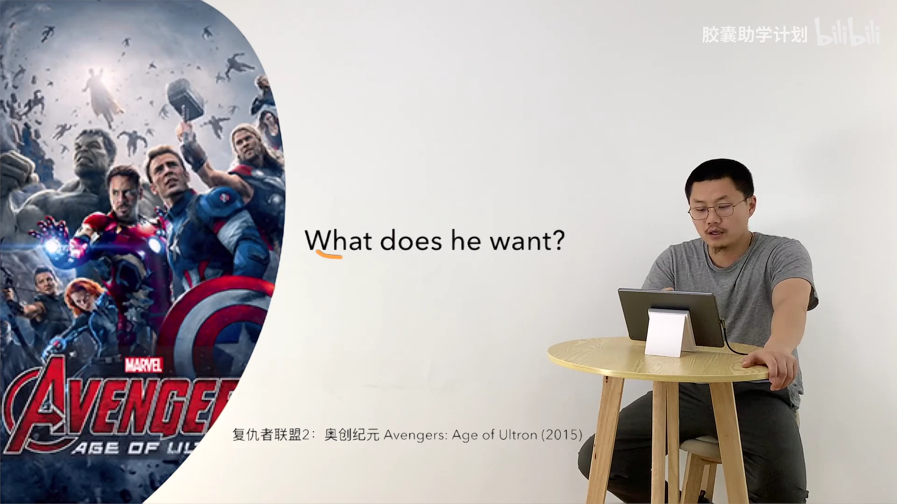

文字识别：胶囊助学计划 / What does he want? / HARVE / VENGE / 复仇者联盟2：奥创纪元Avengers:Age ofUltron(2015) / AGE OFLY

### 画面 00:01:18

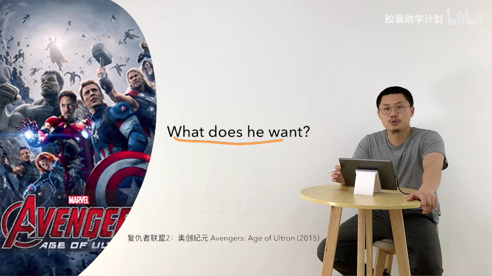

文字识别：胶囊助学计划 / What does he want? / HARVE / VENGE / 复仇者联盟2：奥创纪元Avengers: Age ofUltron(2015) / AGE OF LY

### 画面 00:01:20

文字识别：bilibli / 胶囊助学计划 / 史蒂夫不喜欢你这么说 / Steve doesn't like that kind of talk.

### 画面 00:01:22

文字识别：bilibili / 胶囊助学计划 / 告诉你 罗曼诺夫 / You know what, Romanoff?

### 画面 00:01:24

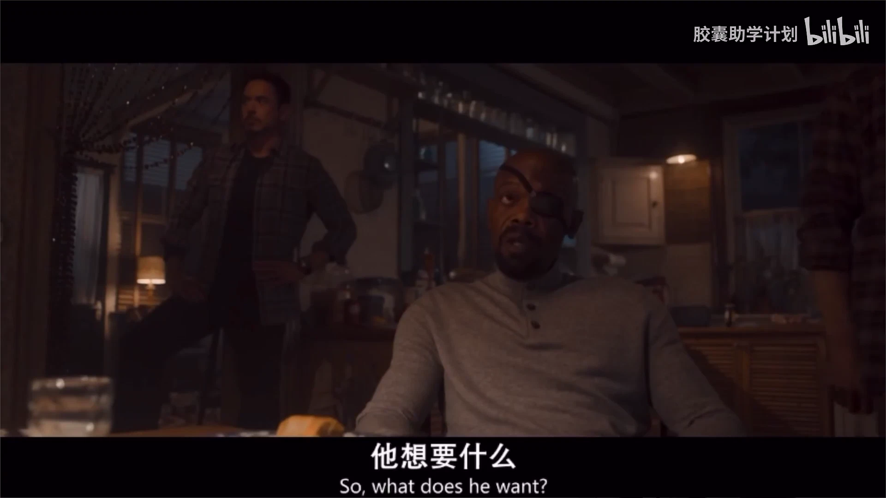

文字识别：bilibili / 胶囊助学计划 / 他想要什么 / So, what does he want?

### 画面 00:01:26

文字识别：bilibili / 胶囊助学计划

### 画面 00:01:28

文字识别：bilibili / 胶囊助学计划 / 变得更好 / To become better.

## 00:01:30–00:02:00

he keeps building bodies. Okay, what does she want? What does he want? Actually,啊，他男他啊，What does he want?他想要什么？接下来还是我们张嘴去读单词 potato, potato.跟我读. Do you like potatoes?土豆啊. Yes, I do. I like potatoes, but I don't want any. Continue. Cabbage,洋白菜，卷心

### 画面 00:01:30

文字识别：bilibili / 胶囊助学计划

### 画面 00:01:32

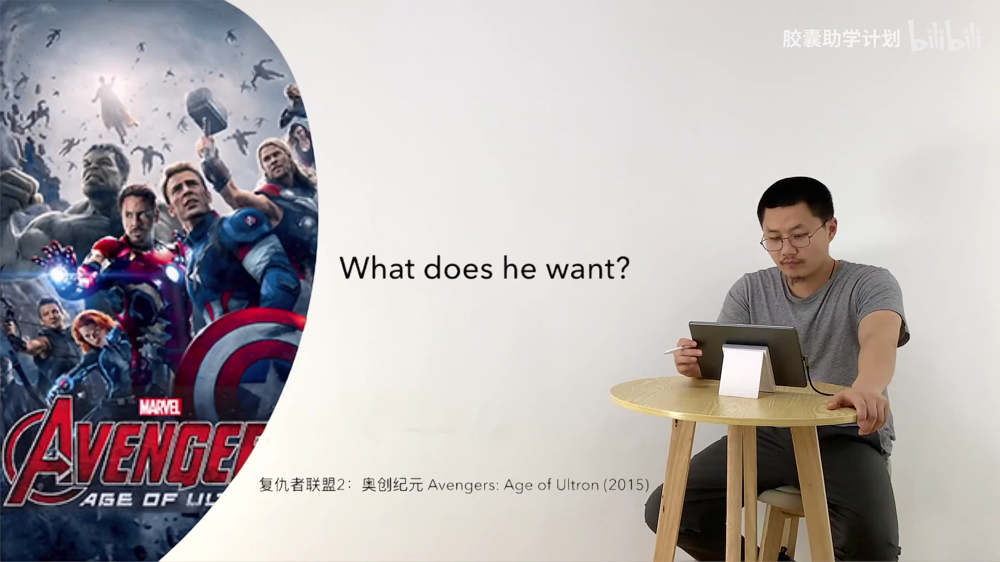

文字识别：胶囊助学计划 / What does he want? / T / MARVE / VENGE / 复仇者联盟2：奥创纪元Avengers:Age ofUltron(2015) / PAGE OF UY

### 画面 00:01:35

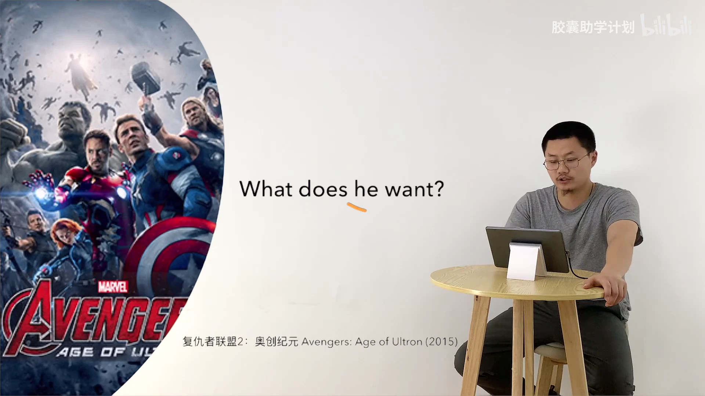

文字识别：胶囊助学计划 / What does he want? / MARVE / VENGE / 复仇者联盟2：奥创纪元Avengers: Age ofUltron(2015) / TAGE OF UY

### 画面 00:01:39

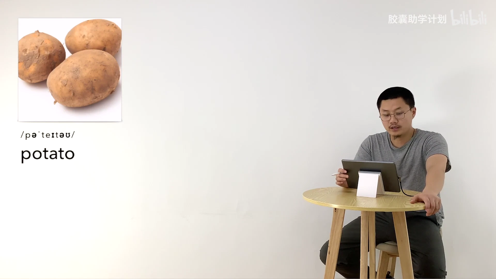

文字识别：胶囊助学计划 / /pa'tertau/ / potato

### 画面 00:01:41

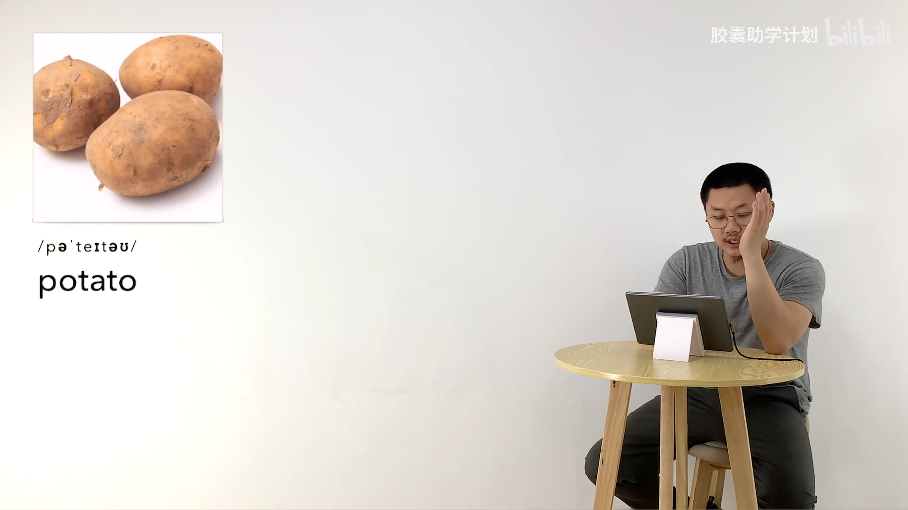

文字识别：胶囊助学计划 / /pa'tertau/ / potato

### 画面 00:01:46

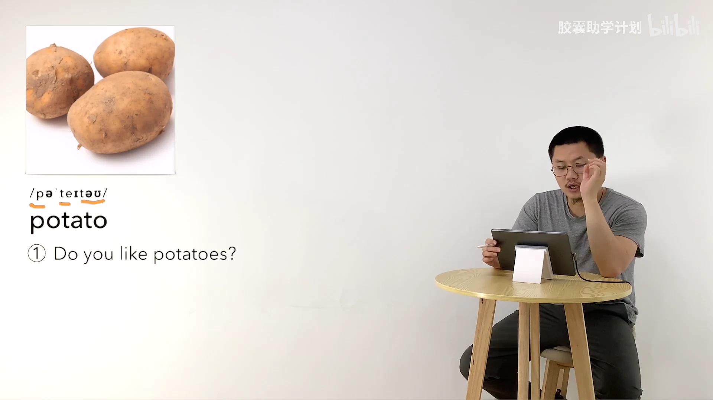

文字识别：胶囊助学计划 / /pa'teitau/ / potato / ① Do you like potatoes?

### 画面 00:01:56

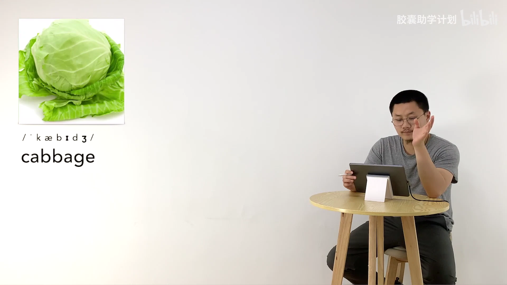

文字识别：胶囊助学计划 / /kebid3/ / cabbage

## 00:02:00–00:02:30

菜啊。Cabbage, continue. Does Tom like cabbage? Yes, he does. He likes cabbage, likes cabbage, but he doesn't want any. Continue. Lettuce.好，lettuce这个单词很有意思。我专门去查了一下，它实际上是有两个意思的，一个是我们书中的意思，另外一个就是在这个地方的意思

### 画面 00:02:08

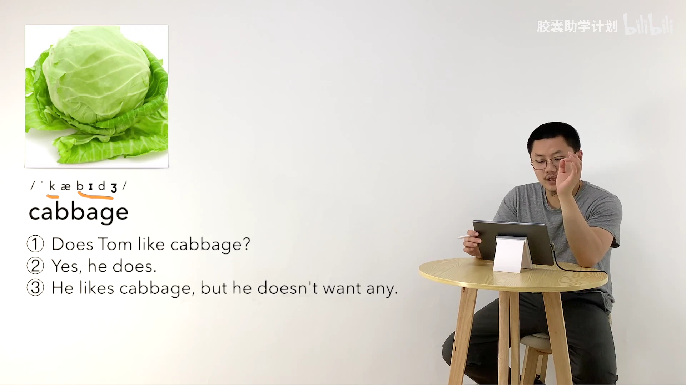

文字识别：胶囊助学计划 / /kxb1 d3/ / cabbage / ①Does Tom like cabbage? / ② Yes, he does. /  He likes cabbage, but he doesn't want any.

### 画面 00:02:12

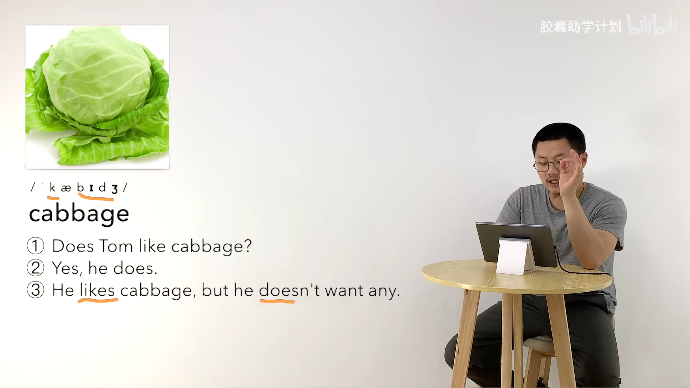

文字识别：胶囊助学计划 / /kxb1d3/ / cabbage / ① Does Tom like cabbage? / ② Yes, he does. / 2 /  He likes cabbage, but he doesn't want any.

### 画面 00:02:17

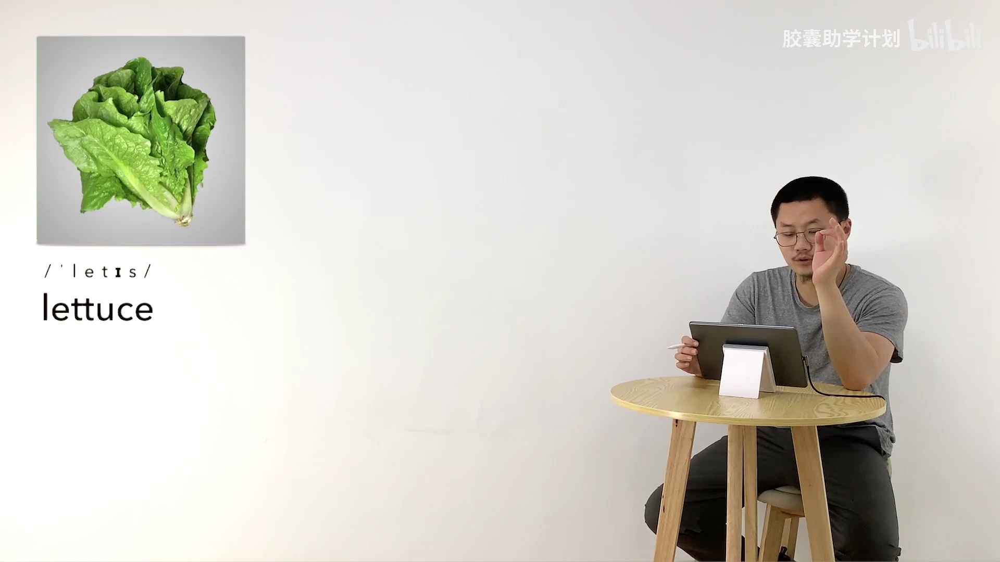

文字识别：胶囊助学计划 / /letIs/ / lettuce

### 画面 00:02:28

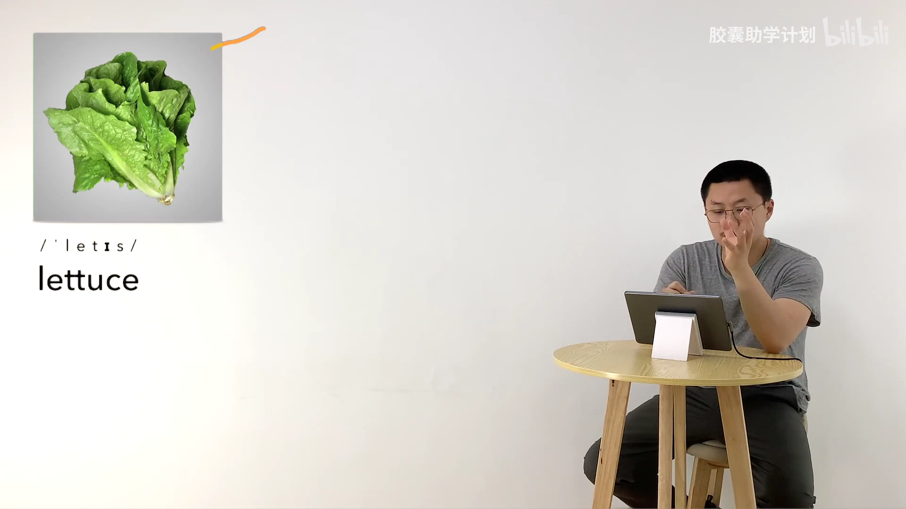

文字识别：胶囊助学计划 / /letis/ / lettuce

## 00:02:30–00:03:00

啊，呃，我们管它叫生菜，对吧？生菜啊，都可以。来，Does Tom like lettuce? Yes, he does. He likes lettuce, likes. But he doesn't want any. 动词原形 continue pea豌豆啊。Do you like peas? Yes, I do. I like peas, but I don't

### 画面 00:02:30

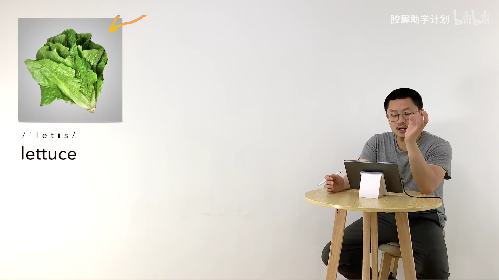

文字识别：胶囊助学计划 / /letis/ / lettuce

### 画面 00:02:35

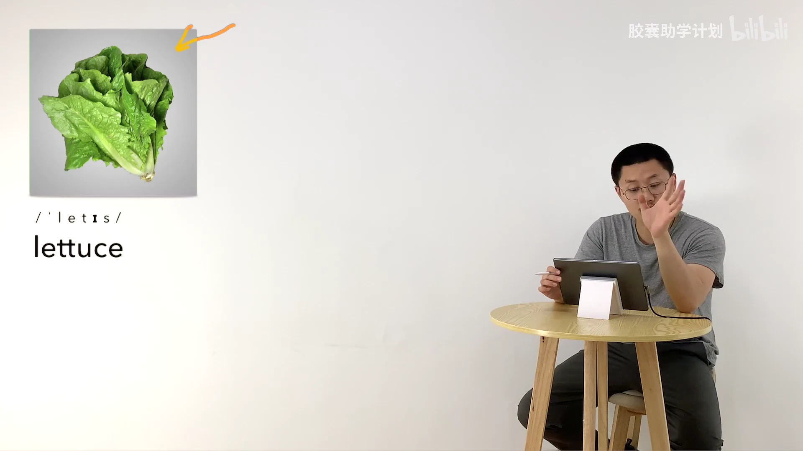

文字识别：胶囊助学计划 / /letis/ / lettuce

### 画面 00:02:42

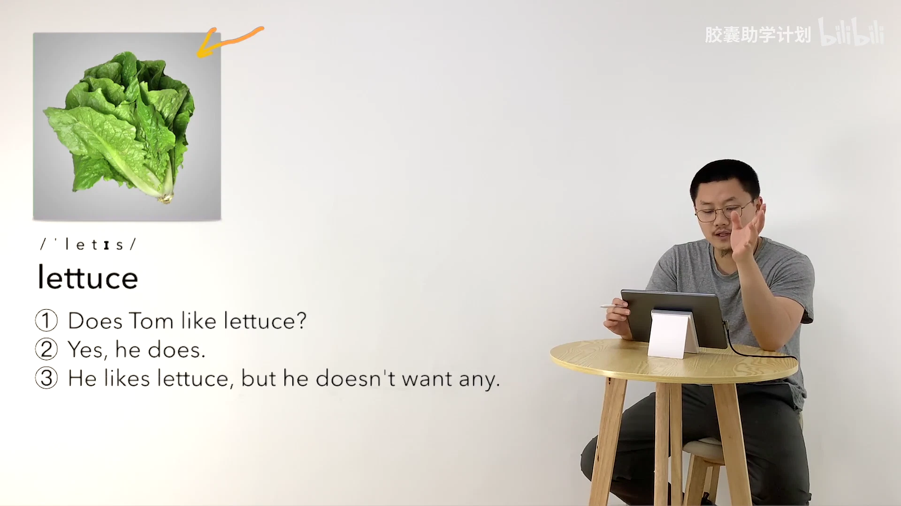

文字识别：胶囊助学计划 / /letIs / / lettuce / ① Does Tom like lettuce? / ② Yes, he does. /  He likes lettuce, but he doesn't want any.

### 画面 00:02:46

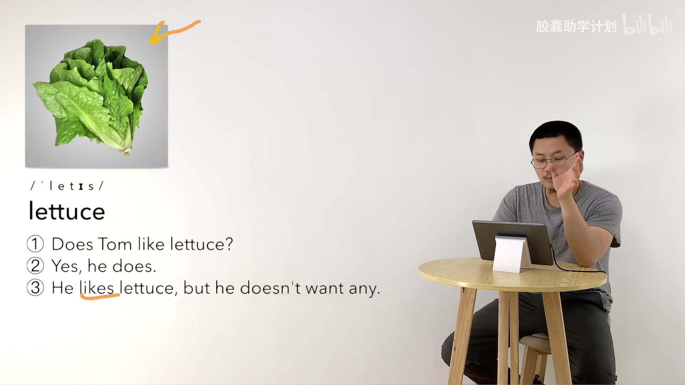

文字识别：胶囊助学计划 / /letIs / / lettuce / ① Does Tom like lettuce? / ② Yes, he does. / ③ He likes lettuce, but he doesn't want any.

### 画面 00:02:49

文字识别：胶囊助学计划 / /letis/ / lettuce / ① Does Tom like lettuce? / ② Yes, he does. / ③ He likes lettuce, but he doesn't want any. / 3）

### 画面 00:02:51

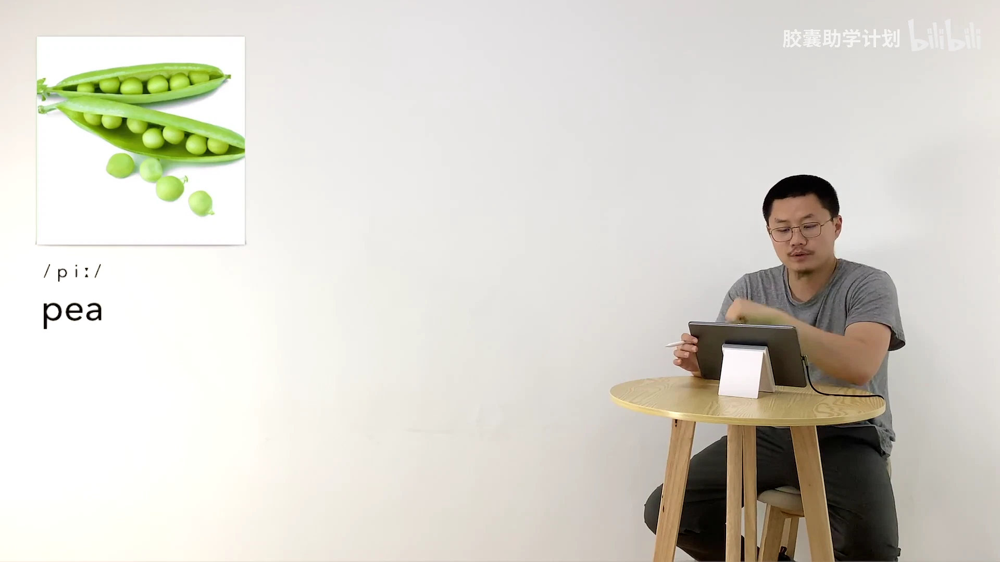

文字识别：胶囊助学计划 / /pi:/ / pea

### 画面 00:02:56

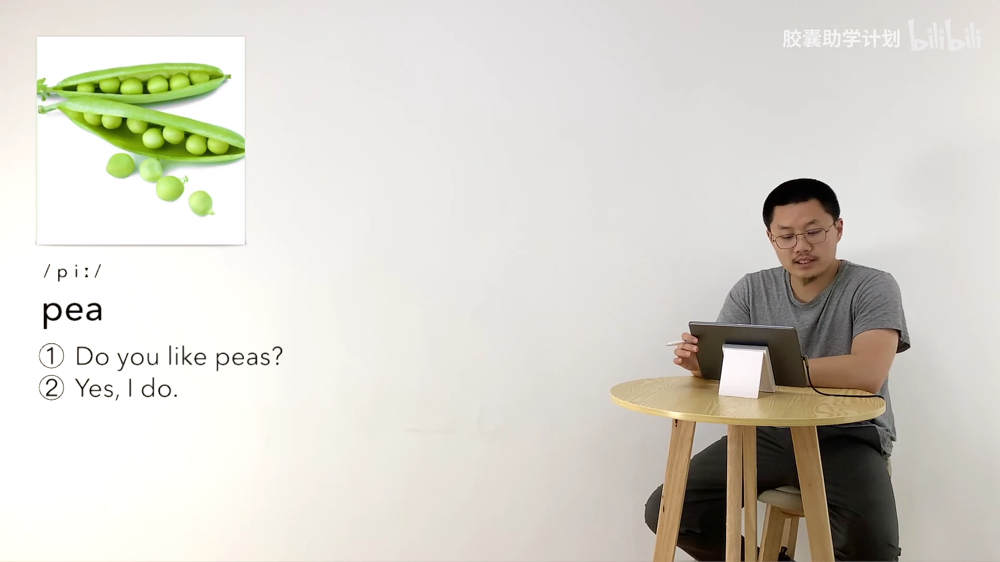

文字识别：胶囊助学计划 / /pi:/ / pea / ① Do you like peas? / ② Yes, I do.

## 00:03:00–00:03:30

want any. 注意 I don't want any, 对吧？如果是 he，就是 he doesn't want any. Okay, continue beans, 豆角. Does Anna like beans? Yes, she does. She likes beans. 这是动词的第三人称单数，这是名词的复数. Okay, but she doesn't want any. Doesn't 动词 want 换回原形. Continue pear,

### 画面 00:03:07

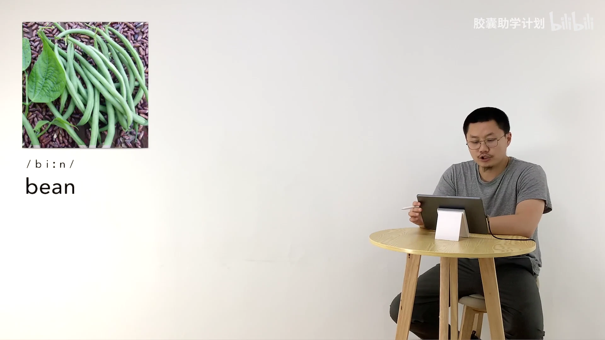

文字识别：胶囊助学计划 / /bi:n/ / bean

### 画面 00:03:15

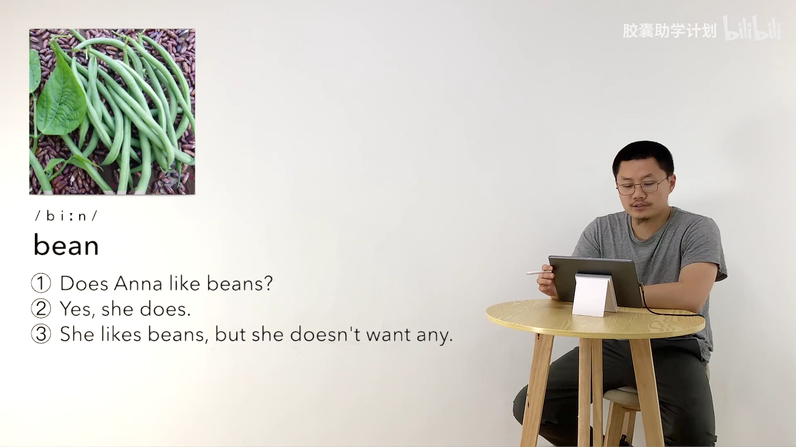

文字识别：胶囊助学计划 / / bi:n/ / bean / ① Does Anna like beans? / ② Yes, she does. / 3 She likes beans, but she doesn't want any.

### 画面 00:03:20

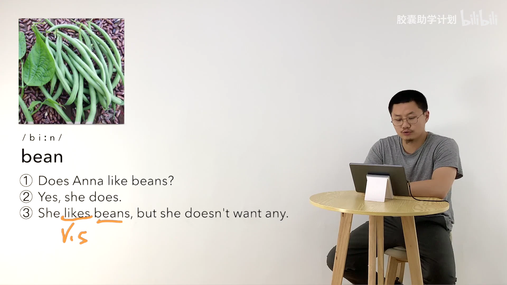

文字识别：胶囊助学计划 / /bi:n/ / bean / ① Does Anna like beans? / ② Yes, she does. / 3 She likes beans, but she doesn't want any. / 3 / Vs

### 画面 00:03:23

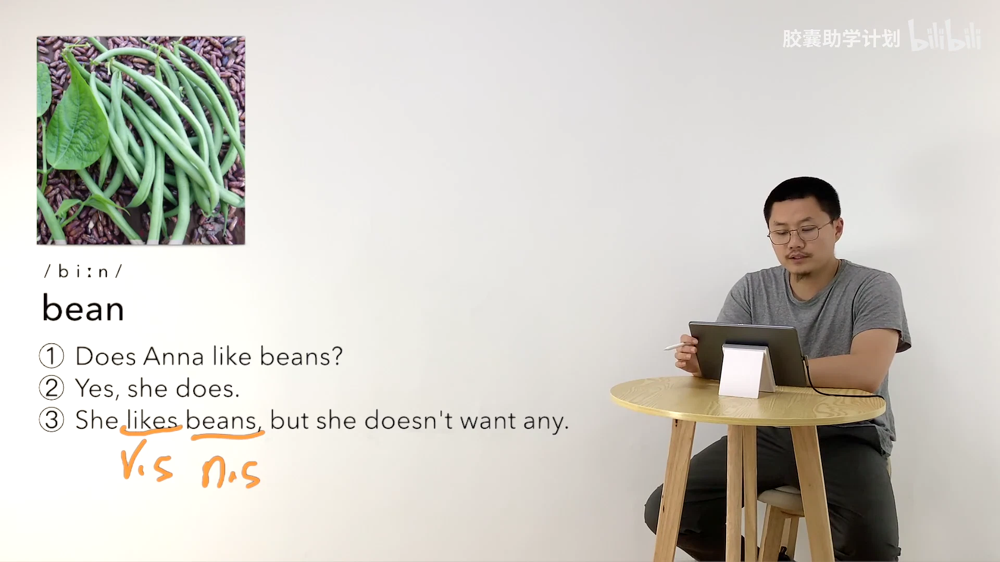

文字识别：胶囊助学计划 / /bi:n/ / bean / ① Does Anna like beans? / ② Yes, she does. / ③ She likes beans, but she doesn't want any. / 3 / V.s / n·s

### 画面 00:03:28

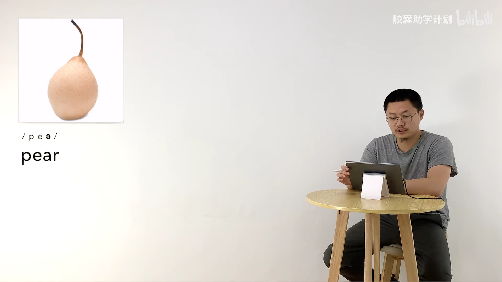

文字识别：胶囊助学计划 / - / /pea/ / pear

## 00:03:30–00:04:00

梨. Does Elizabeth like pears? Yes, she does. She likes pears, but she doesn't want any. Continue, grape,葡萄. Do you like grapes? Yes, I do. I like grapes, but I don't want any.

### 画面 00:03:38

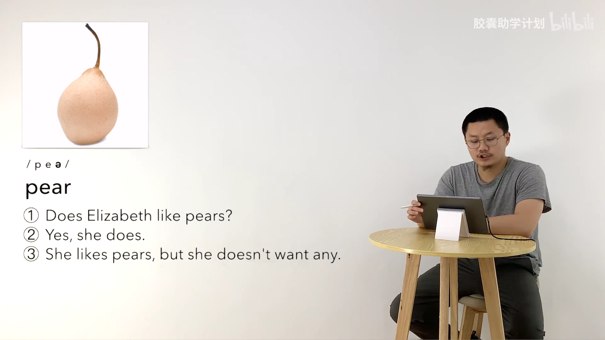

文字识别：胶囊助学计划 / /pea/ / pear / ① Does Elizabeth like pears? / ② Yes, she does. / 3 She likes pears, but she doesn't want any.

### 画面 00:03:42

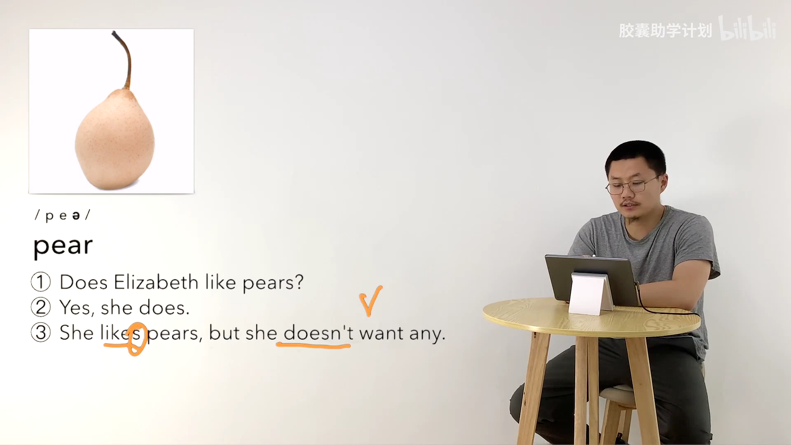

文字识别：胶囊助学计划 / /pea/ / pear / ① Does Elizabeth like pears? / ② Yes, she does. / V / ③ She like pears, but she doesn't want any.

### 画面 00:03:45

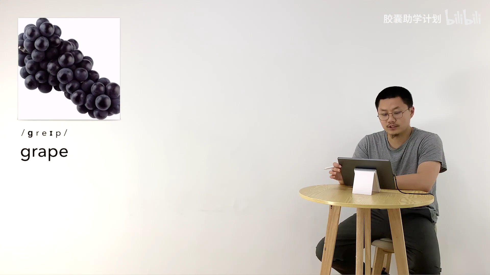

文字识别：胶囊助学计划 / /greip/ / grape

### 画面 00:03:53

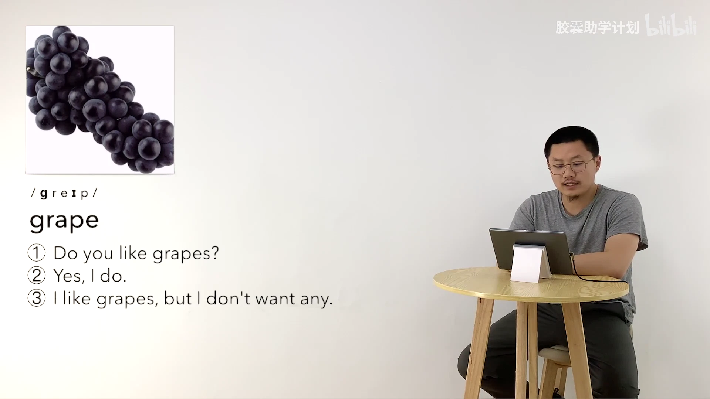

文字识别：胶囊助学计划 / /greip/ / grape / ① Do you like grapes? / 2 / Yes, ldo. / ③ I like grapes, but I don't want any. / 3

### 画面 00:03:56

文字识别：胶囊助学计划 / /greip/ / grape / ① / Do you like grapes? / Yes, ldo. / 2 / Ilike / grapes, but I don't want any.

### 画面 00:03:59

文字识别：胶囊助学计划 / /pi:t∫/ / peach

## 00:04:00–00:04:30

Continue peach, peach. Does Betty like peaches? 注意，这儿是加es了，对吧？ch结尾的啊。Yes, she does. She likes peaches, but she doesn't want any. Continue banana. Do you like bananas? Yes, I do. I like bananas, but I don't want

### 画面 00:04:08

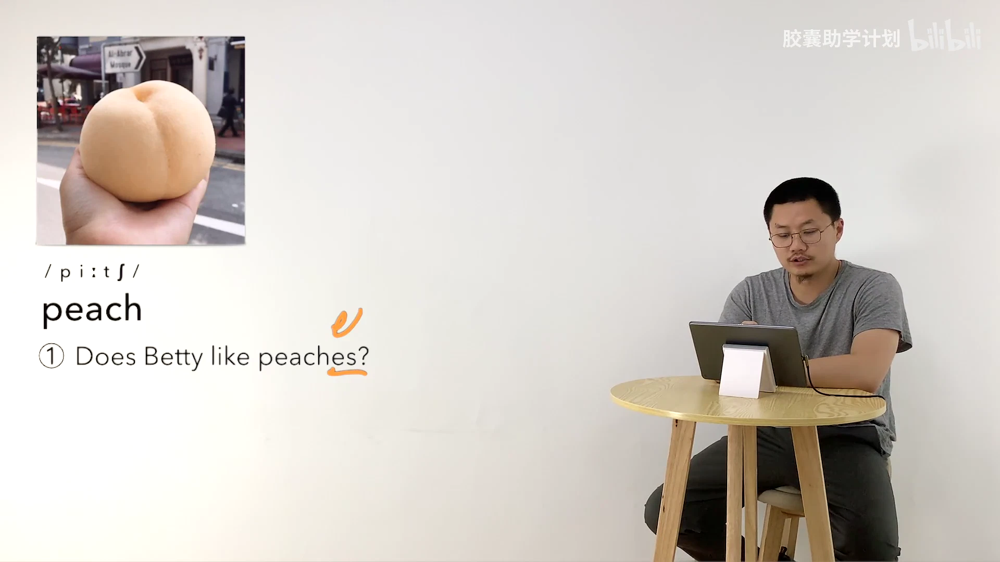

文字识别：胶囊助学计划 / /pi:t∫/ / peach / ① Does Betty like peaches?

### 画面 00:04:14

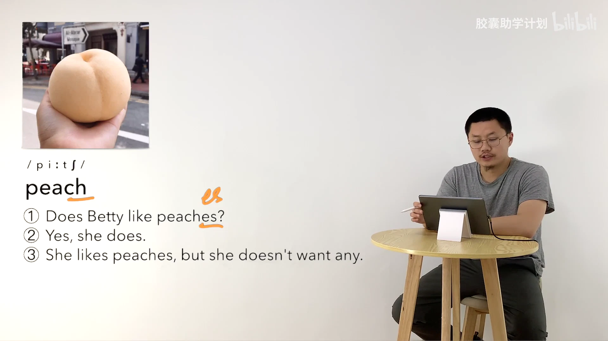

文字识别：胶囊助学计划 / /pi :t∫/ / peach / ① Does Betty like peaches? / ② Yes, she does. /  She likes peaches, but she doesn't want any.

### 画面 00:04:20

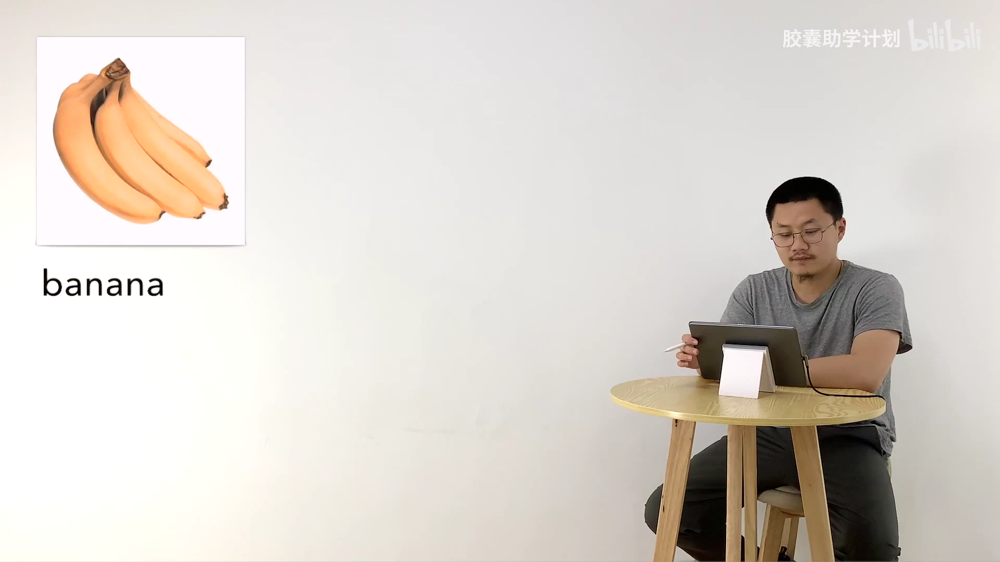

文字识别：胶囊助学计划 / banana

### 画面 00:04:26

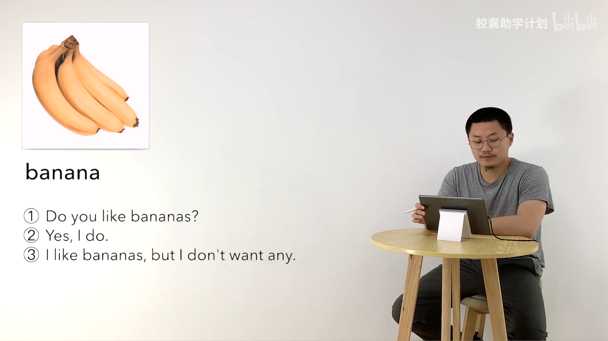

文字识别：胶囊助学计划 / banana / ① Do you like bananas? / ② Yes,Ido. / ③ I like bananas, but I don't want any.

## 00:04:30–00:05:00

any orange. Does Mr. Jones like oranges?注意like原形，does提前。Yes, he does. He likes oranges.哦，注意这应该是likes哦，apple. He doesn't want any apple. Does George like apples?

### 画面 00:04:32

文字识别：胶囊助学计划 / orange

### 画面 00:04:39

文字识别：胶囊助学计划 / orange / ① Does Mr. Jones like oranges?

### 画面 00:04:41

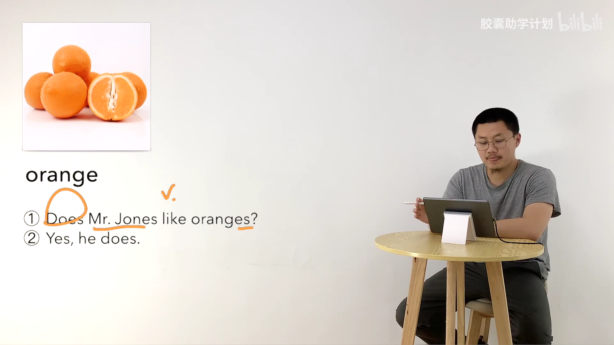

文字识别：胶囊助学计划 / orange / Does Mr. Jones / like oranges? / Yes, he does.

### 画面 00:04:55

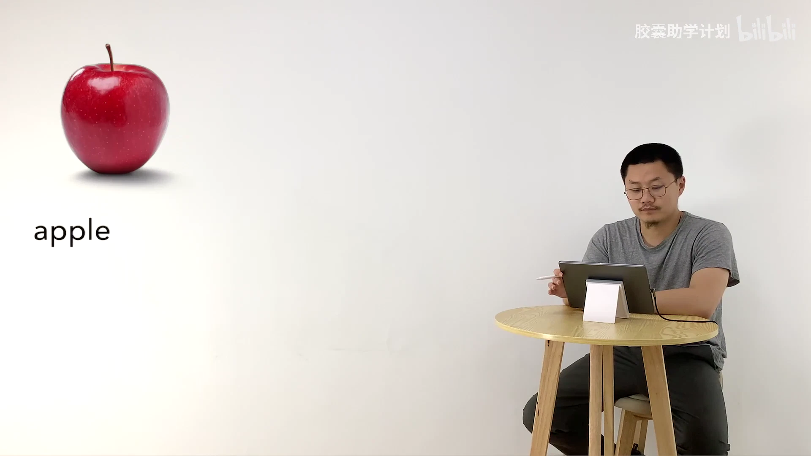

文字识别：胶囊助学计划 / apple

## 00:05:00–00:05:30

Yes, he does. He likes apples. 动词三单, but he doesn't want any. V点动词原形，对吧？ Okay,那 recap本课我们实际上最重要的就是把do跟does放到一起去进行了一个练习啊。Does he like and do you like? Okay,要注意这个小点。那接下来呢，我们在五十一课一直到六十课这漫长的

### 画面 00:05:01

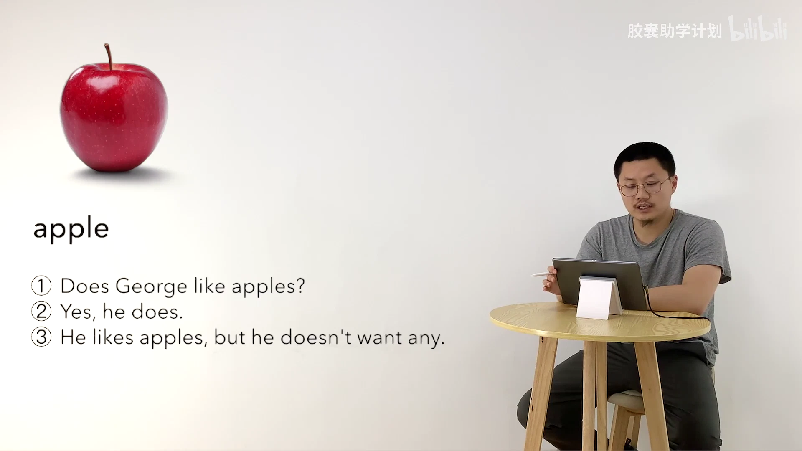

文字识别：胶囊助学计划 / apple / ① Does George like apples? / ② Yes, he does. / ③ He likes apples, but he doesn't want any.

### 画面 00:05:06

文字识别：胶囊助学计划 / apple / ① Does George like apples? / ② Yes, he does. / ③ Helikes apples, but he doesn't want any. / 3 / VS

### 画面 00:05:11

文字识别：胶囊助学计划 / apple / ① Does George like apples? / ② Yes, he does. / ③ He likes apples, but he doesn't want any. / VS

### 画面 00:05:13

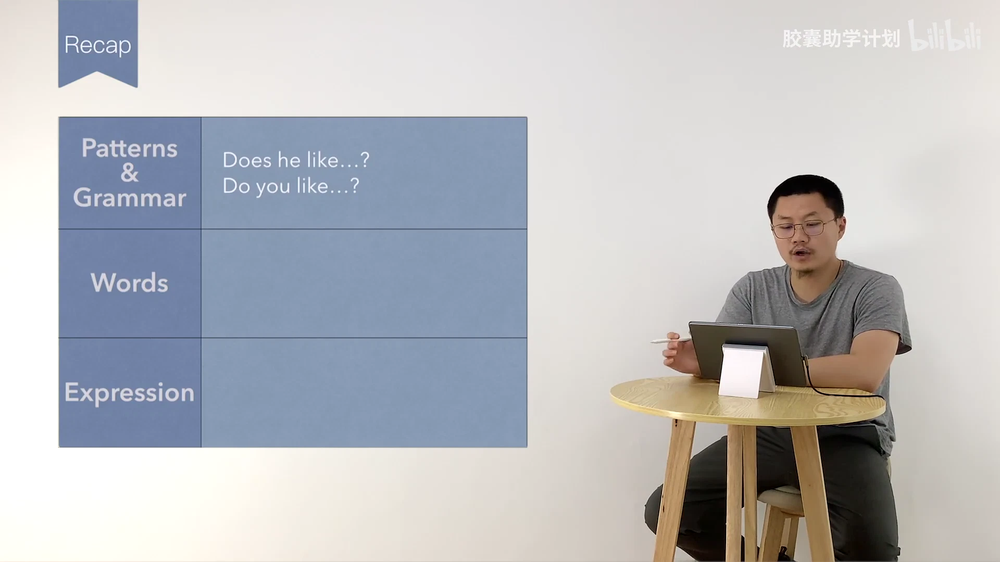

文字识别：胶囊助学计划 / Recap / Patterns / Does he like...? / Do you like..? / Grammar / Words / Expression

### 画面 00:05:18

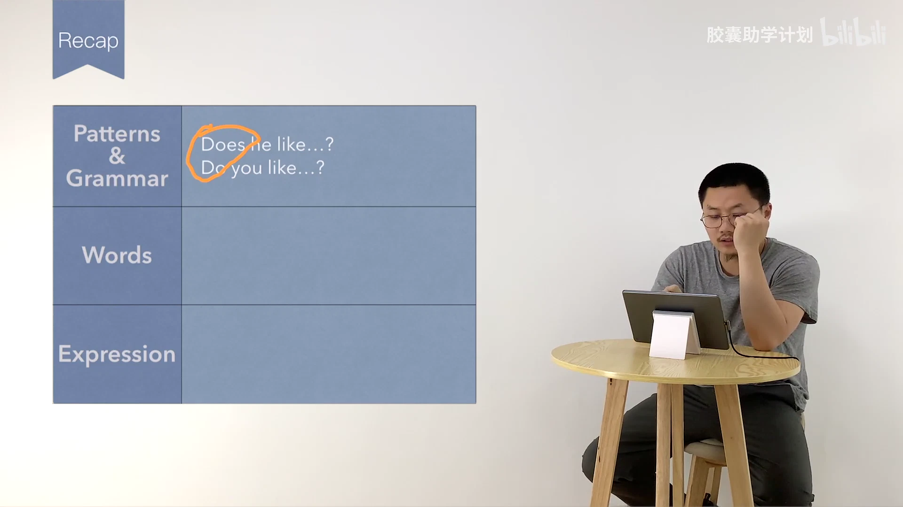

文字识别：胶囊助学计划 / Recap / Patterns / DoesNe like..? / Doyou like..? / Grammar / Words / Expression

### 画面 00:05:28

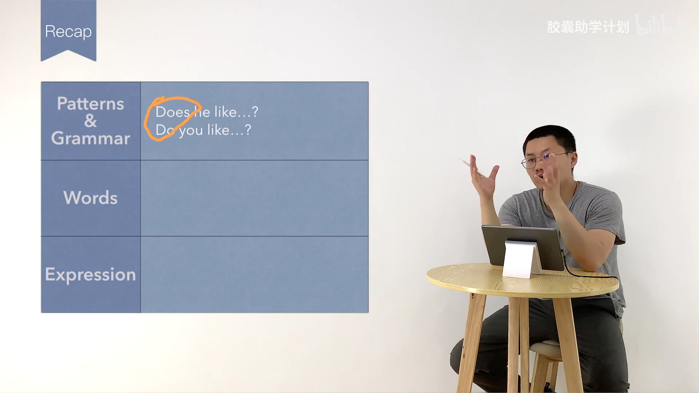

文字识别：胶囊助学计划 / Recap / Patterns / DoesNe like..? / Doyou like..? / Grammar / Words / Expression

## 00:05:30–00:06:00

十课当中，就会不停的练 do does do does do does 啊，让各位拿各种动词去练它们。 OK，好，看一下本课家庭作业，绿皮书三五十课，各位可以写了，给自己讲解一遍今天的核心知识点，张开嘴去跟我读视频当中出现的那些句子。 OK，好，如果大家喜欢我们的课程呢，欢迎大家关注、订阅、一键三连支持，并分享给那些需要的朋友们。最后，我们再来看一句名人名言：

### 画面 00:05:37

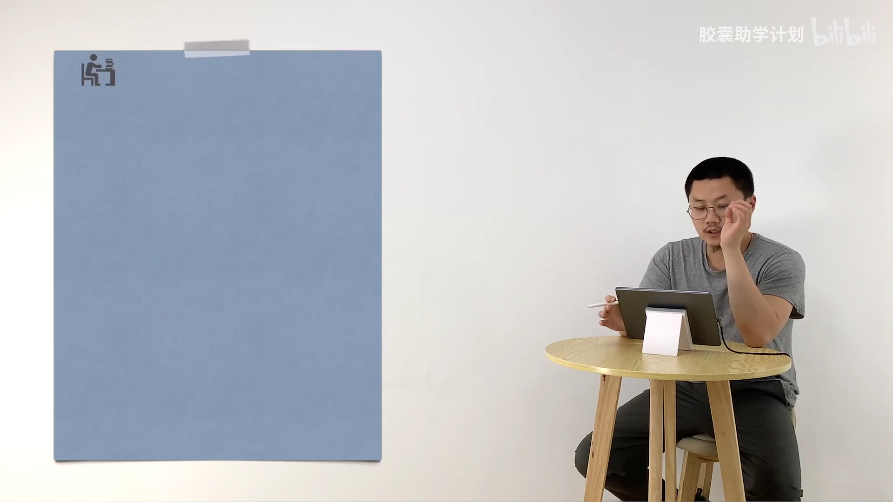

文字识别：胶囊助学计划

### 画面 00:05:39

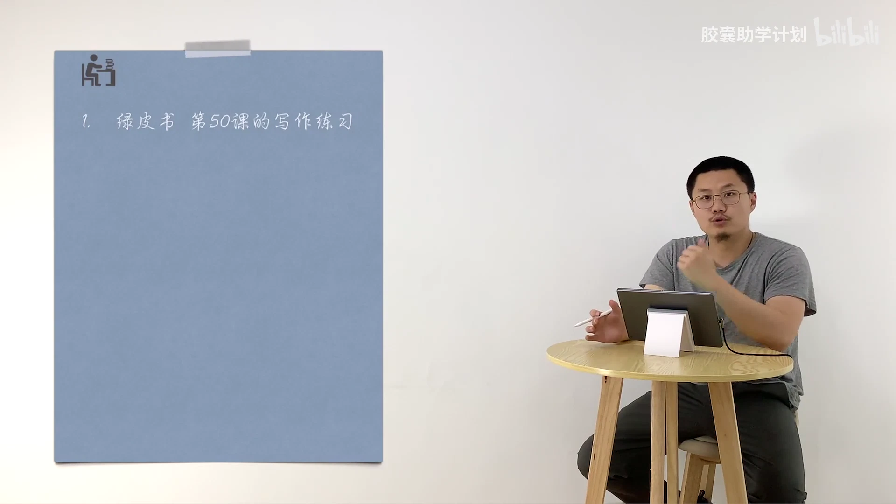

文字识别：胶囊助学计划 / 绿皮书第50课的写作练习

### 画面 00:05:49

文字识别：胶囊助学计划

### 画面 00:05:53

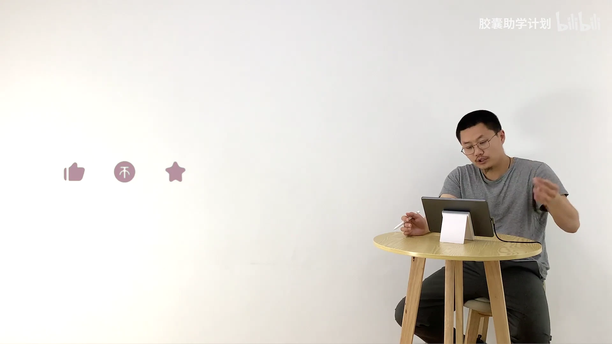

文字识别：胶囊助学计划

### 画面 00:05:57

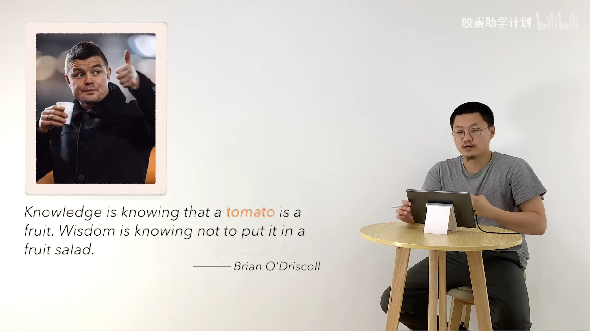

文字识别：胶囊助学计划 / Knowledge is knowing that a tomato is a / fruit. Wisdom is knowing not to put it in a / fruit salad. / Brian O'Driscoll

## 00:06:00–00:06:25

Knowledge is knowing that a tomato is a fruit. Wisdom is knowing not to put it in a fruit salad. See you next time.

### 画面 00:06:01

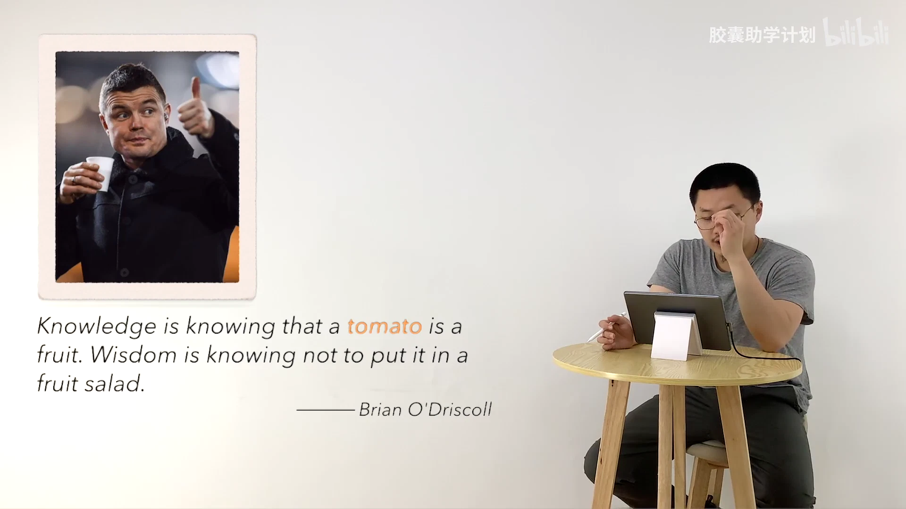

文字识别：胶囊助学计划 / Knowledge is knowing that a tomato is a / fruit. Wisdom is knowing not to put it in a / fruit salad. / Brian O'Driscoll

### 画面 00:06:11

文字识别：胶囊助学计划 / Knowledge is knowing that a tomato is a / fruit. Wisdom is knowing not to put it in a / fruit salad. / Brian O'Driscoll

### 画面 00:06:13

文字识别：CAPSULEACADEMY / 胶囊助学计划 / 小红书 / □ / 口 / OE

### 画面 00:06:15

文字识别：CAPSULEACADEMY / 胶囊助学计划 / 小红书 / □ / 口 / Leo

### 画面 00:06:21

文字识别：CAPSULEACADEMY / 胶囊助学计划 / 小红书 / Creator / Leo & Berlin / OE / 0

### 画面 00:06:23

文字识别：bilibili / 胶囊助学计划

### 画面 00:06:24

文字识别：bilibili / 胶囊助学计划

