# 051 文章

快速机器解析：语音为单模型转写，未进行独立交叉校对或人工复核；画面每秒采样并按变化选帧，短时文字和标记可能遗漏。截图时间约有 1 秒误差。图片有损压缩；遇到疑点请按时间查看 Google Drive 原视频。

## 00:00:00–00:00:30

Hello everyone, welcome to Capsule Academy. This is Leo. Today we're going to learn Concept English Book One Lesson Fifty One Story. 那老习惯进入正式课程之前，我们先看两个问题，或者说带着这两个问题啊。第一，我们说了一般现在时，从五十一到五十四讲的就是客观事实与存在状态。接下来我们在文章当中看一下它是如何体现的。其次呢，如何使用 how often？实际上我们在单词部分已经简

### 画面 00:00:00

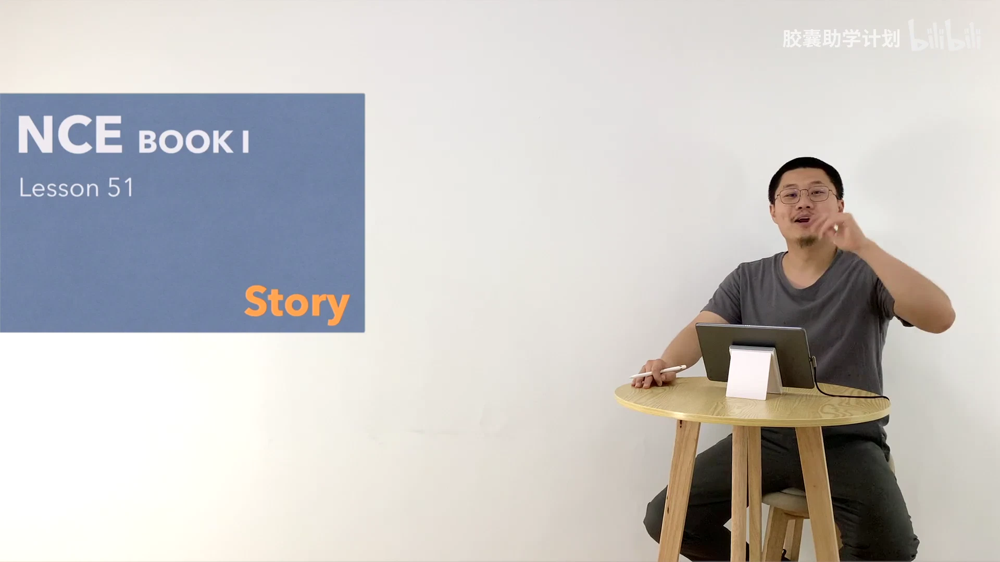

文字识别：胶囊助学计划 / NCE / BOOKI / Lesson 51 / Story

### 画面 00:00:03

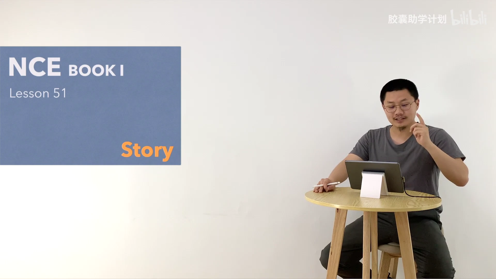

文字识别：胶囊助学计划 / NCE / BOOKI / Lesson 51 / Story

### 画面 00:00:09

文字识别：胶囊助学计划 / 9

### 画面 00:00:11

文字识别：胶囊助学计划 / ①客观事实/存在状态?

### 画面 00:00:15

文字识别：胶囊助学计划 / ① 客观事实/存在状态?

### 画面 00:00:25

文字识别：胶囊助学计划 / ① 客观事实/存在状态? / 如何使用how often?

### 画面 00:00:27

文字识别：胶囊助学计划 / ① 客观事实/存在状态? / 如何使用how often？

## 00:00:30–00:01:00

单讲了一下了。今天呢，我们再给它仔仔细细的过一下。OK，好，那带着这两个问题，Hope you guys enjoy it.好，我们直接进入文章。两个人在对话。Hans说，Where do you come from？和我们单词部分造的句叫做Where does he come from？一模一样，只不过换了个人称，换成了Where do you come from？OK，说

### 画面 00:00:35

文字识别：胶囊助学计划 / ① 客观事实/存在状态? / 如何使用how often？

### 画面 00:00:38

文字识别：胶囊助学计划bill / •

### 画面 00:00:42

文字识别：胶囊助学计划

### 画面 00:00:44

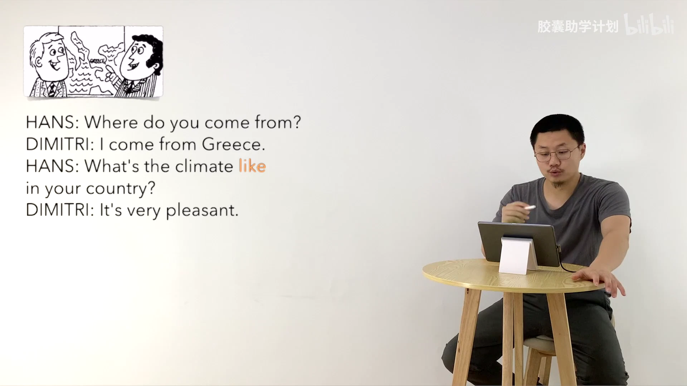

文字识别：胶囊助学计划 / HANS: Where do you come from? / DIMITRl: I come from Greece. / HANS: What's the climate like / in your country? / DIMITRl: It's very pleasant.

### 画面 00:00:51

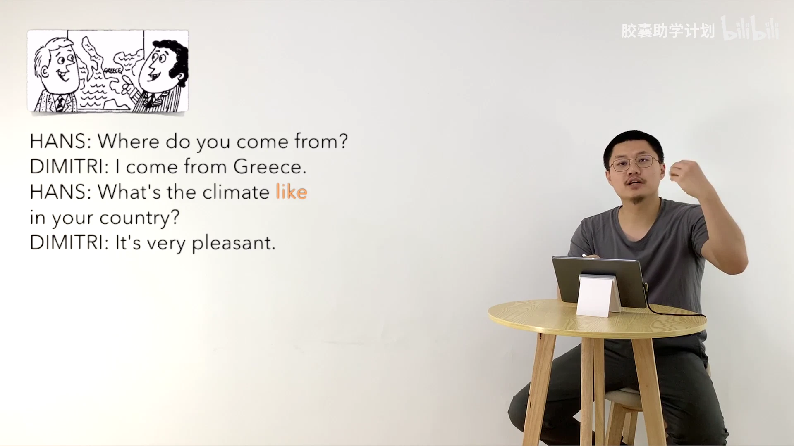

文字识别：胶囊助学计划 / HANS: Where do you come from? / DIMITRl: I come from Greece. / HANS: What's the climate like / in your country? / DIMITRl: It's very pleasant.

## 00:01:00–00:01:30

I come from Greece. I come from

### 画面 00:01:00

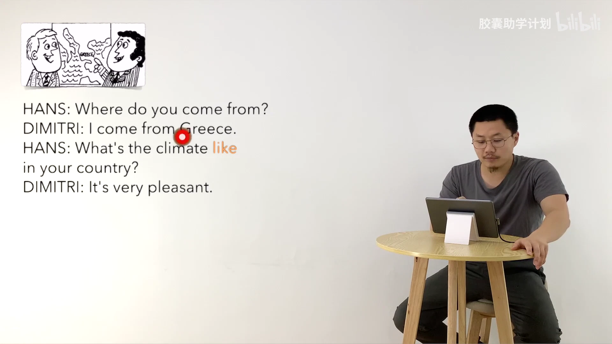

文字识别：胶囊助学计划 / HANS: Where do you come from? / DIMITRI: I come from Greece. / HANS: What's the climate like / in your country? / DIMITRI: It's very pleasant.

### 画面 00:01:03

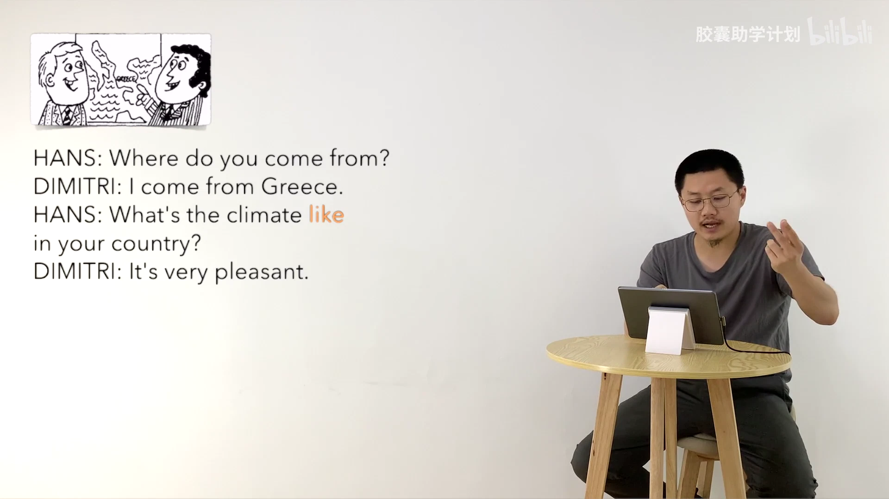

文字识别：胶囊助学计划 / HANS: Where do you come from? / DIMITRl: I come from Greece. / HANS: What's the climate like / in your country? / DIMITRI: It's very pleasant.

### 画面 00:01:20

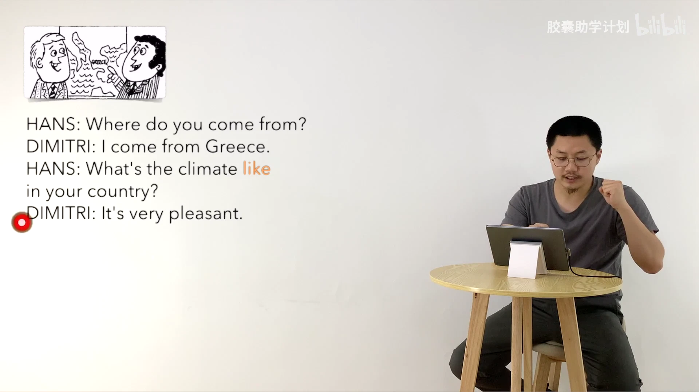

文字识别：胶囊助学计划 / HANS: Where do you come from? / DIMITRl: I come from Greece. / HANS: What's the climate like / in your country? / DIMITRl: It's very pleasant.

### 画面 00:01:24

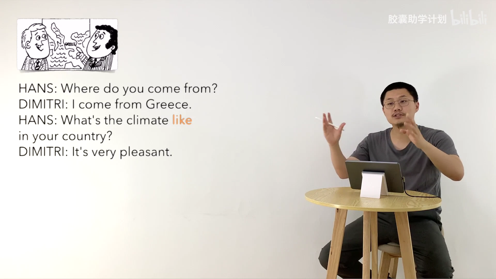

文字识别：胶囊助学计划 / HANS: Where do you come from? / DIMITRI: I come from Greece. / HANS: What's the climate like / in your country? / DIMITRl: It's very pleasant.

### 画面 00:01:28

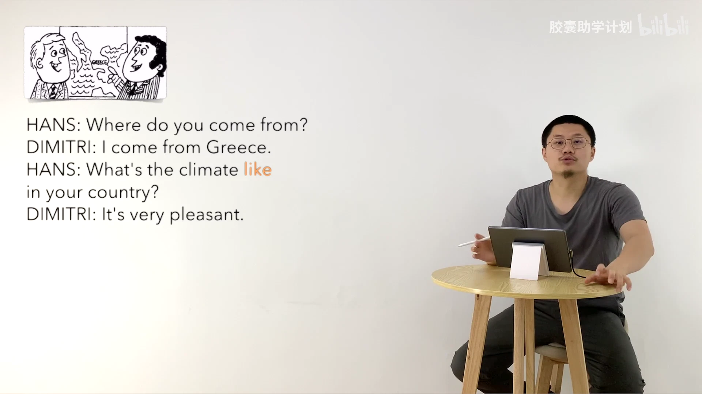

文字识别：胶囊助学计划 / HANS: Where do you come from? / DIMITRl: I come from Greece. / HANS: What's the climate like / in your country? / DIMITRl: It's very pleasant.

## 00:01:30–00:02:00

continue。那在这个地方就提一个小点，说 What's the weather like there？啊，在那个地方，那 there 就是那里，对吧？呃，代替了所有的地点，说在那里天气怎么样？注意一个小点， the weather 是可以被替代的。比如说 What's your boyfriends？哎， sorry，啊，这个地方出现了一个关键的点，是吧？不能加 as，啊，不能加 as。你的男朋友们是吧？这个乌龙就大了啊！我们要说说你的这个男朋友啊，这个

### 画面 00:01:30

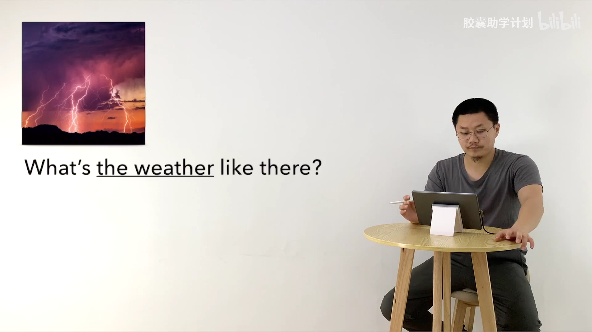

文字识别：胶囊助学计划 / What's the weather like there?

### 画面 00:01:51

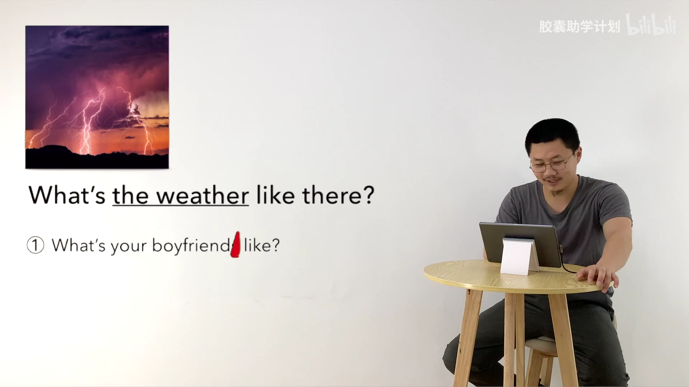

文字识别：胶囊助学计划 / What's the weather like there? / ① What's your boyfriend like?

## 00:02:00–00:02:30

人怎么样啊？注意，你看天气怎么样？那你说男朋友怎么样？你男朋友怎么样？注意，那你的回答就是好不好？怎么样去形容这个人？不是问他喜欢吃什么啊？不是说 What does your boyfriend like？而是 What is your boyfriend like？ Okay， very good啊，这注意啊，不能加s啊。好，接下来 continue，说 What's the weather like in spring？啊，天气怎么样？In

### 画面 00:02:08

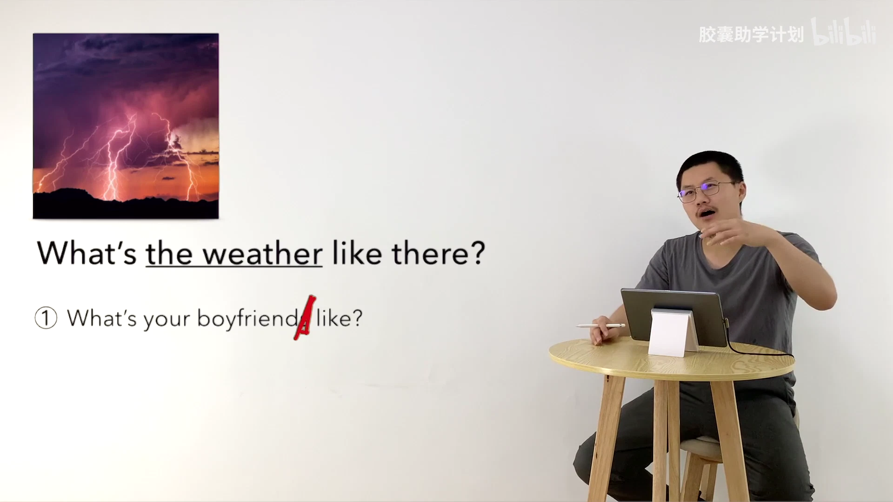

文字识别：胶囊助学计划 / What's the weather like there? / ① What's your boyfriendll / like?

### 画面 00:02:20

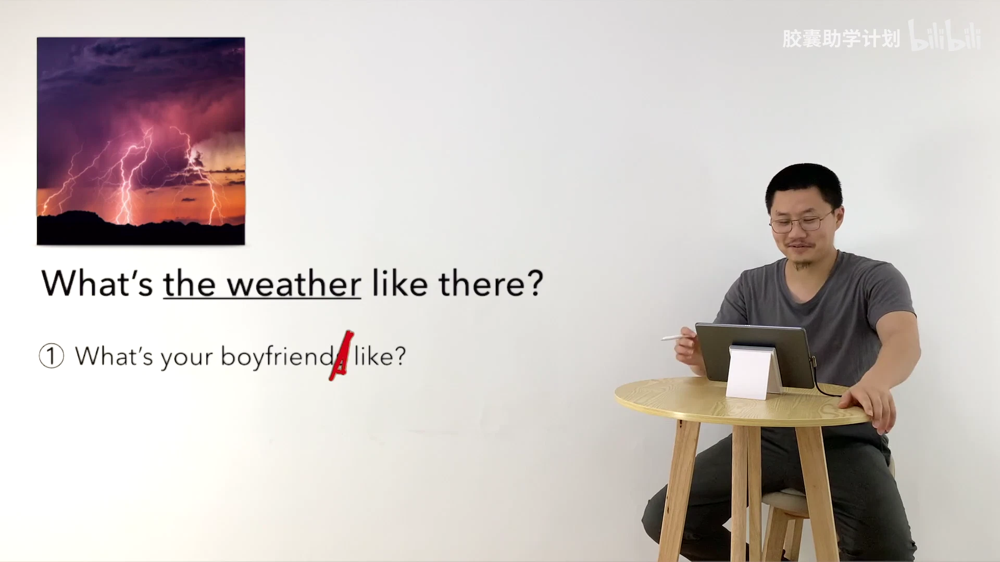

文字识别：胶囊助学计划 / What's the weather like there? / ① What's your boyfriendl / like?

### 画面 00:02:23

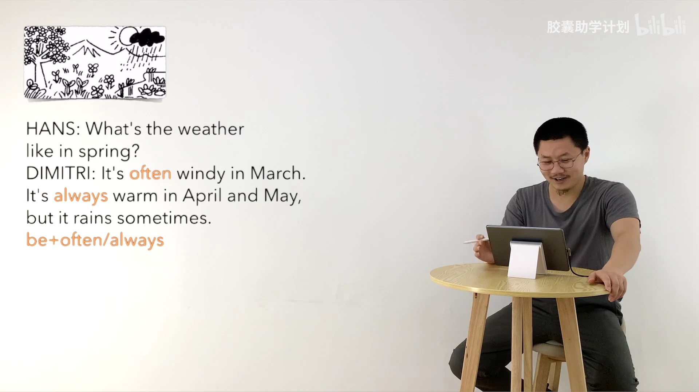

文字识别：胶囊助学计划 / HANS: What's the Weather / like in spring? / DIMITRI: It's often windy in March. / It's always warm in April and May, / but it rains sometimes. / be+often/always

## 00:02:30–00:03:00

spring，在春天，天气怎么样？Is often windy，说经常啊，经常是刮大风的。In March，在三月份，注意 often， always，这个地方提醒各位一个点，要放在 be 动词的后面。Be 动词没错的话，应该是我今天可能第一次或者说第二次提的次数不多，就是我们讲的 am, is, are 这三个单词。当然以后还会

### 画面 00:02:35

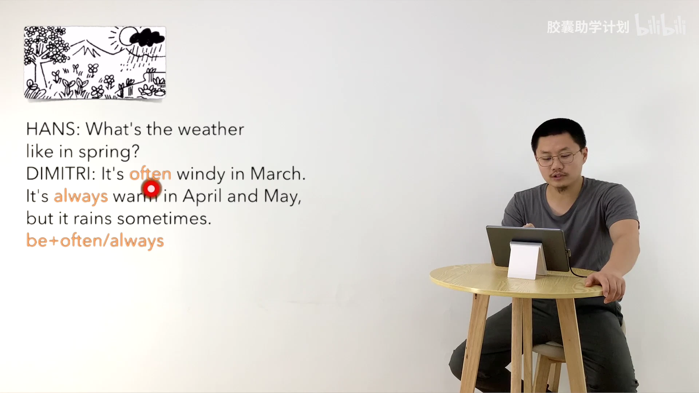

文字识别：胶囊助学计划 / 8 / HANS: What's the weather / like in spring? / DIMITRI: It's often /  windy in March. / It's always / warPin April  / and May, / but it rains sometimes. / be+often/always

### 画面 00:02:51

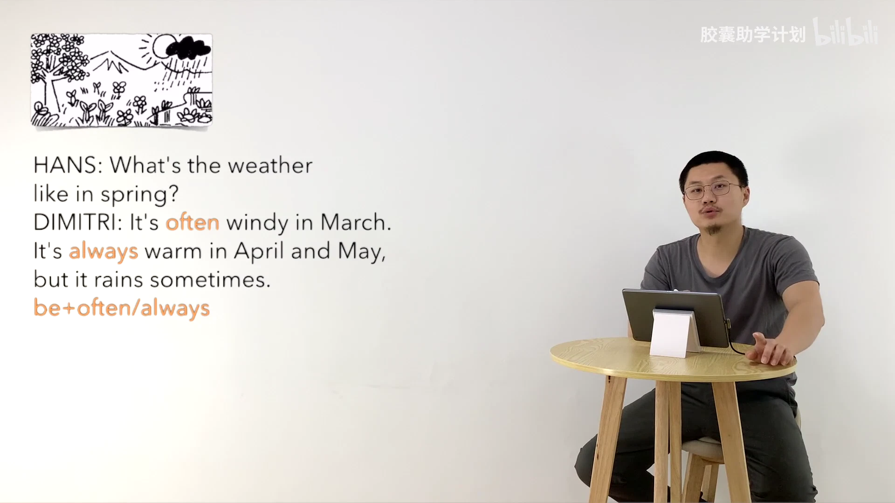

文字识别：胶囊助学计划 / 8 / HANS: What's the Weather / like in spring? / DIMITRI: It's often windy in March. / It's always warm in April and May, / but it rains sometimes. / be+often/always

## 00:03:00–00:03:30

拓展，但今天就是这三个单词啊。你看它放在了 is 的后面，对吧？说经常是刮大风的啊，经常是刮风的。In March，在三月份，is always warm，总是呢很暖。Always 放在 is 的后面，对吧？In April and May，在四五月份，注意 in in 这样的小介词，各位要记住啊。But it rains sometimes。你看我们在单词部分造的是 sometimes it

### 画面 00:03:21

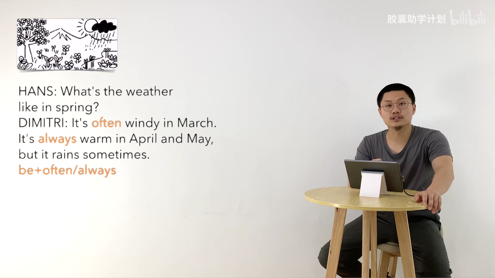

文字识别：胶囊助学计划 / 8 / HANS: What's the Weather / like in spring? / DIMITRI: It's often windy in March. / It's always v / s warm in April and May, / but it rains sometimes. / be+often/always

## 00:03:30–00:04:00

rains in spring.跟这句话本质上是一样的。比如说我们现在想把 it rains sometimes 做一些四句型转化，您要做的事情就特别简单。看到了 rain，确定了它是动词，后边又加了三单，然后它也是客观事实，对吧？说在春天啊，有的时候会下雨。这对于至少我们中国人来说是一个客观事实了。然后你想把它变一般疑问句，Does 往前一提，动词换回原形。

### 画面 00:03:31

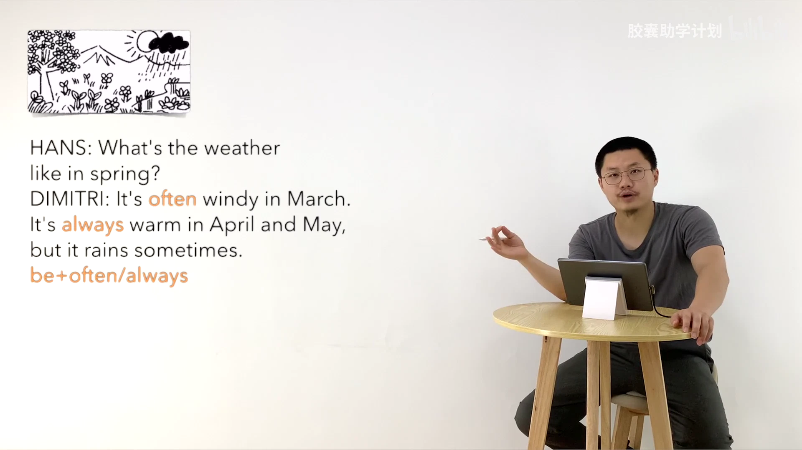

文字识别：胶囊助学计划 / 8 / HANS: What's the weather / like in spring? / DIMITRI: It's often windy in March. / It's always v / s warm in April and May, / but it rains sometimes. / be+often/always

### 画面 00:03:39

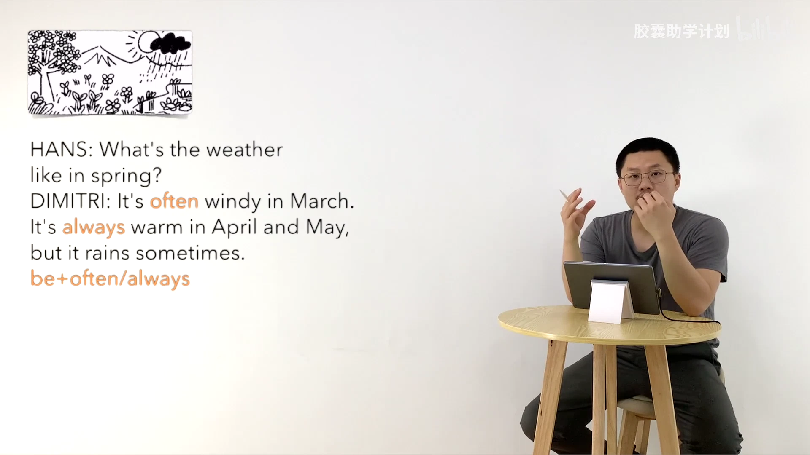

文字识别：胶嚢助学计划 / m / HANS: What's the weather / like in spring? / DIMITRI: It's often windy in March. / It's always warm in April and May, / but it rains sometimes. / be+often/always

## 00:04:00–00:04:30

Does it rain sometimes? Okay, very good.好，接着往下看。他说，What's it like in summer? It指的就是weather，因为我连着问了好几遍了，我把weather就换成了it，对吧？其实它的全句还是What's the weather like?夏天天气怎么样呢？Is always hot，总是特别的热。In June, July, and August，六七八，August，

### 画面 00:04:03

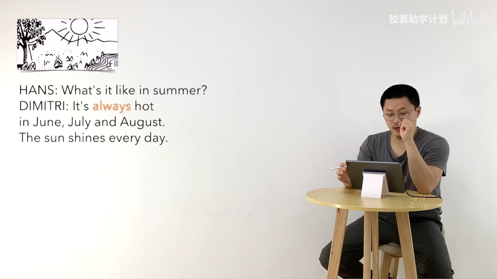

文字识别：胶囊助学计划 / HANS: What's it like in summer? / DIMITRI: It's always hot / in June, July and August. / The sun shines every day.

### 画面 00:04:05

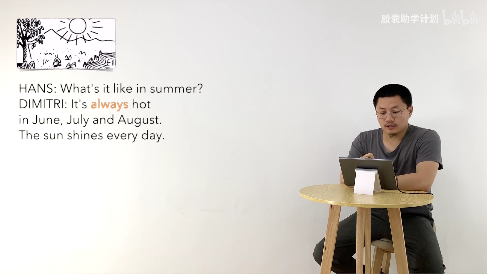

文字识别：胶囊助学计划 / HANS: What's it like in summer? / DIMITRI: It's always hot / in June, July and August. / The sun shines every day.

## 00:04:30–00:05:00

啊八，然后 always 放在了 is 的后面。 The sun shines every day. 太阳每一天都在照耀着啊，就应该是我们三十三课学过的 sun 跟 shines 照耀。你注意，你看现在不是 is shining 了，我们那时候学的是一般现在进行时，对吧？那时候学的是现在进行时，正在照耀。现在说的是每一天，陈述客观事实，对吧？就是夏天的时候，太阳天天都是

### 画面 00:04:30

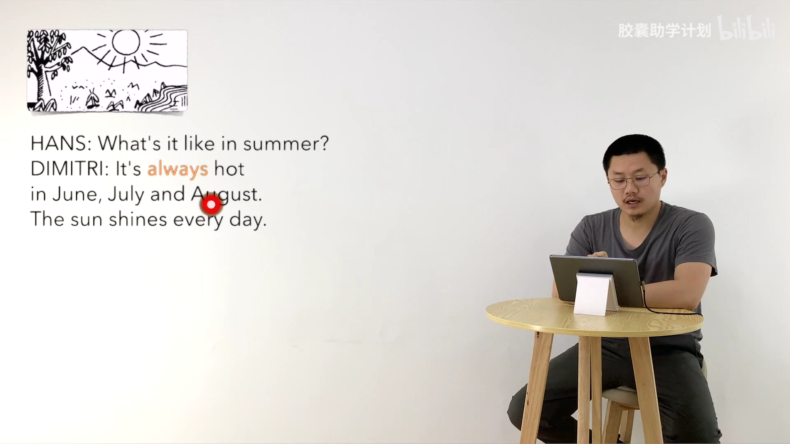

文字识别：胶囊助学计划 / HANS: What's it like in summer? / DIMITRI: It's always hot / in June, July and Agust. / The sun shines every day.

### 画面 00:04:36

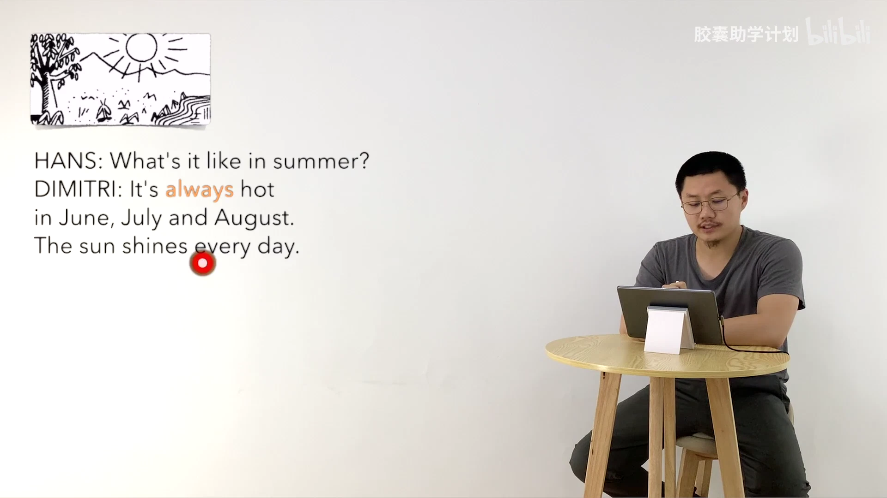

文字识别：胶囊助学计划 / M / HANS: What's it like in summer? / DIMITRI: It's always / hot / in June, July and August. / The sun shines every day.

## 00:05:00–00:05:30

当空照的，对吧？OK，那你把 does 就要提前。Does the sun shine every day？注意 shine 要换回原形了，就不能是 shines，对吧？其次，我想对 every day 提问，用谁呢？各位自己去想一想。Does the sun shine every day？然后我对 every day 提问，你想 every day 是每一天，它不是具体的时间，它更多表达的是

### 画面 00:05:06

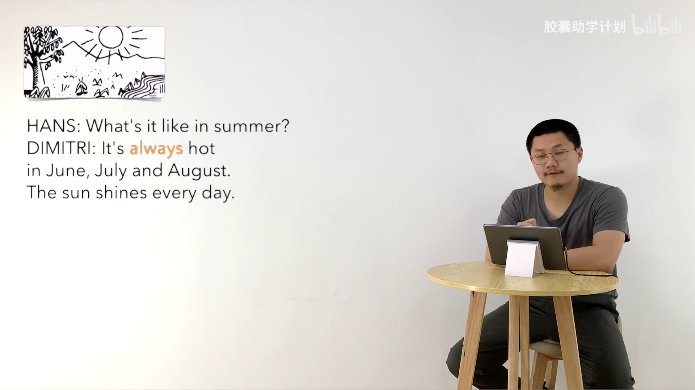

文字识别：胶囊助学计划 / M / HANS: What's it like in summer? / DIMITRI: It's always hot / in June, July and August. / The sun shines every day.

### 画面 00:05:16

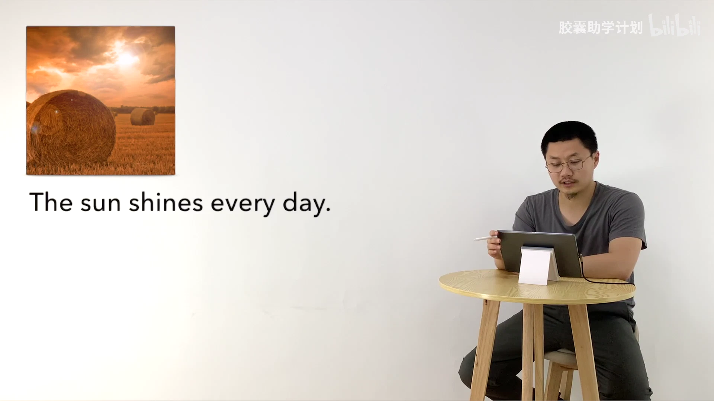

文字识别：胶囊助学计划 / The sun shines every day.

### 画面 00:05:20

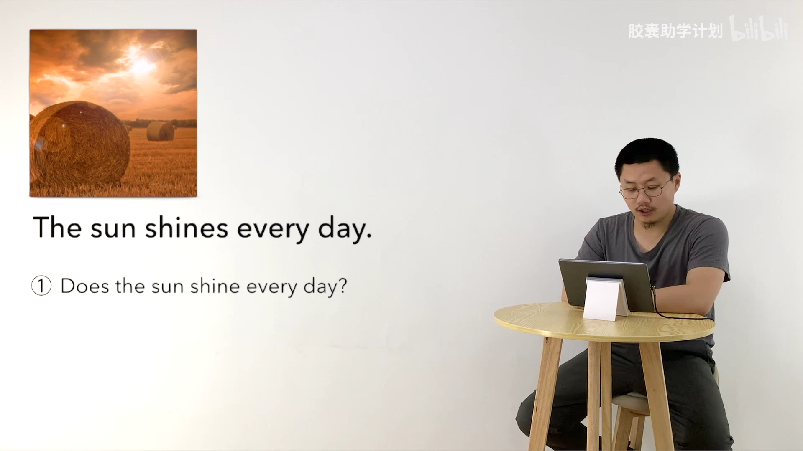

文字识别：胶囊助学计划 / The sun shines every day. / ① Does the sun shine every day?

### 画面 00:05:22

文字识别：胶囊助学计划 / The sun shines every day. / ① Does the sun shine every day?

### 画面 00:05:25

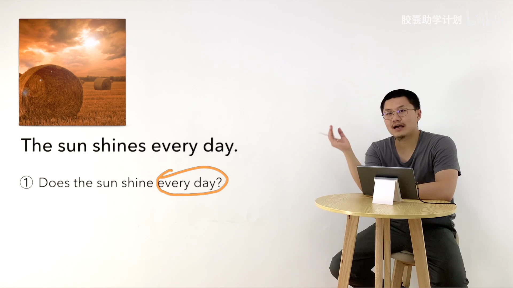

文字识别：胶囊助学计划 / The sun shines every day. / ① Does the sun shine every day?

## 00:05:30–00:06:00

频率的概念，对吧？那所以我们就要用用频率的特殊疑问词去对它进行对它进行提问，所以用 how often。 How often does the sun shine？太阳多长时间照耀一次，对吧？啊，或者说太阳不能这样翻译，不太对。太阳照耀太阳出现的频率，对吧？太阳当空照的频率是什么样子的呢？几乎是每一天，every day，每天都太阳

### 画面 00:05:33

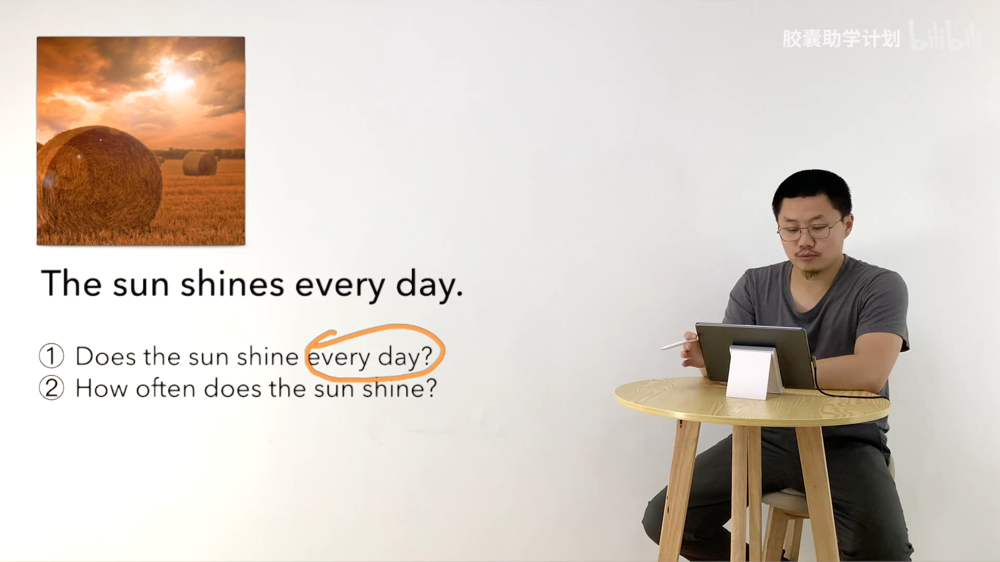

文字识别：胶囊助学计划 / The sun shines every day. / ① Does the sun shineevery day? / How often does the sun shine?

### 画面 00:05:36

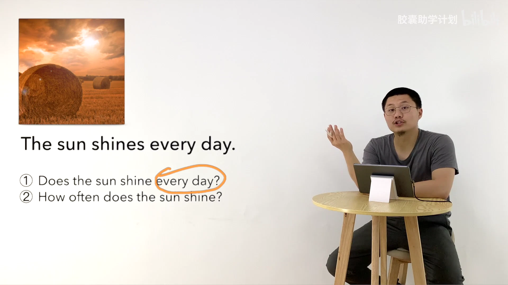

文字识别：胶囊助学计划 / The sun shines every day. / ① Does the sun shineevery day? / How often does the sun shine?

### 画面 00:05:40

文字识别：胶囊助学计划 / The sun shines every day. / ①Does the sun shinee / every day? / How often does the sun shine?

### 画面 00:05:43

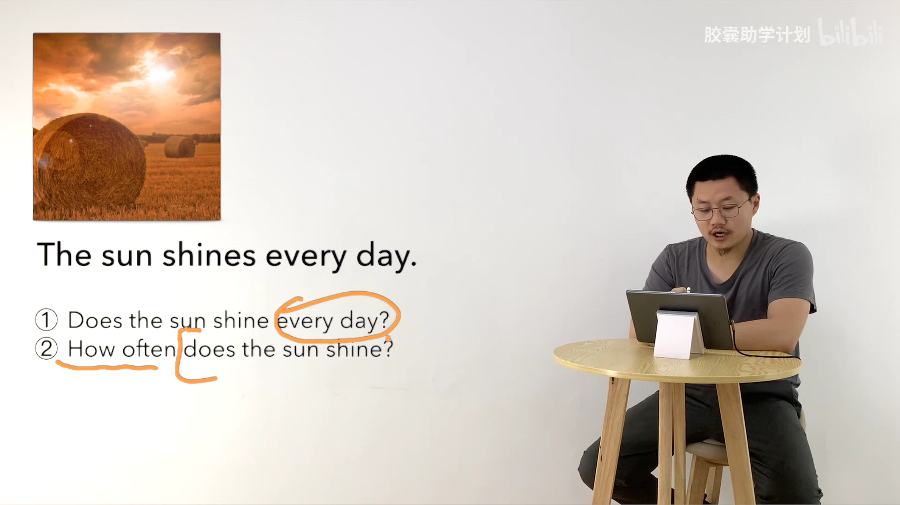

文字识别：胶囊助学计划 / The sun shines every day. / Does the sun shine / every day? / How / oftendoes the / sun shine?

### 画面 00:05:46

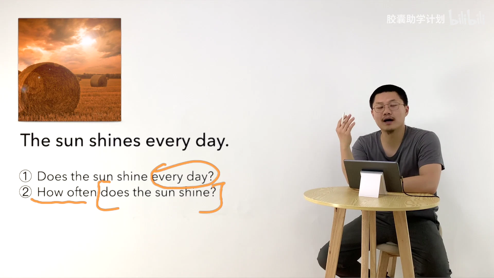

文字识别：胶囊助学计划 / The sun shines every day. / Does the sun shine / every day? / 1 / How oftendoes the / sun shine?

## 00:06:00–00:06:30

当空照。Okay, there we go. 这就是 how often. 接下来我们看一个小的电影，这个电影片段当中就出现了叫 how often do you see them? 你多久看他们一次啊？注意，这不是指的时间间隔，指的是多长时间频率啊？你会见到他们一次。There we go, 来了。

### 画面 00:06:02

文字识别：胶囊助学计划 / How often do / you see them? / THE SIXTH / 第六感 The Sixth Sense(1999)

### 画面 00:06:04

文字识别：胶囊助学计划 / How often do / you see them? / THE SIXTH / 第六感 The Sixth Sense(1999)

### 画面 00:06:06

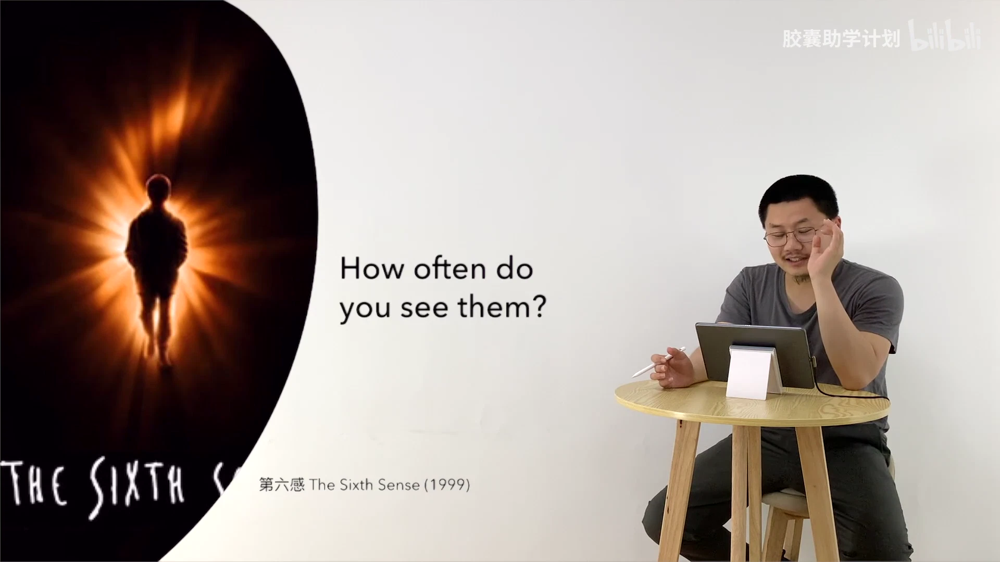

文字识别：胶囊助学计划 / How often do / you see them? / THE SIXTH / 第六感 The Sixth Sense(1999)

### 画面 00:06:14

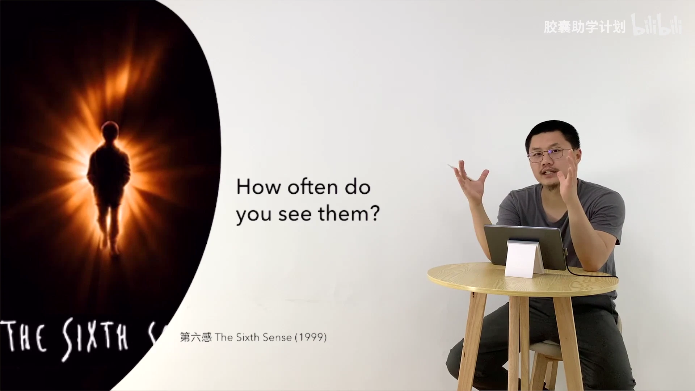

文字识别：胶囊助学计划 / How often do / you see them? / THE SIXTH / 第六感 The Sixth Sense(1999)

### 画面 00:06:20

文字识别：bilibili / 胶囊助学计划

### 画面 00:06:22

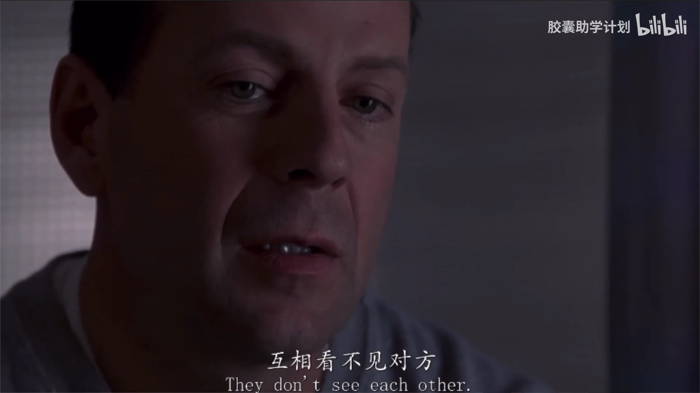

文字识别：bilibili / 胶囊助学计划 / 互相看不见对方 / They don't see each other.

### 画面 00:06:24

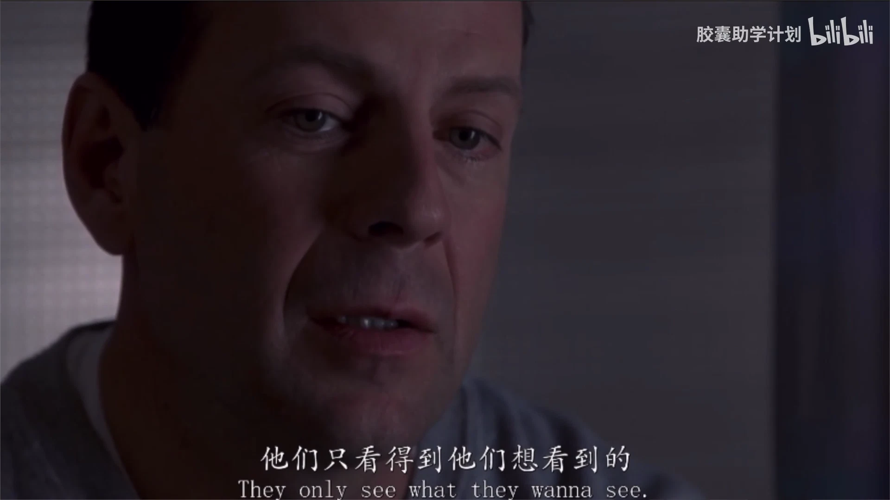

文字识别：bilibili / 胶囊助学计划 / 他们只看得到他们想看到的 / They only see what they wanna see.

### 画面 00:06:27

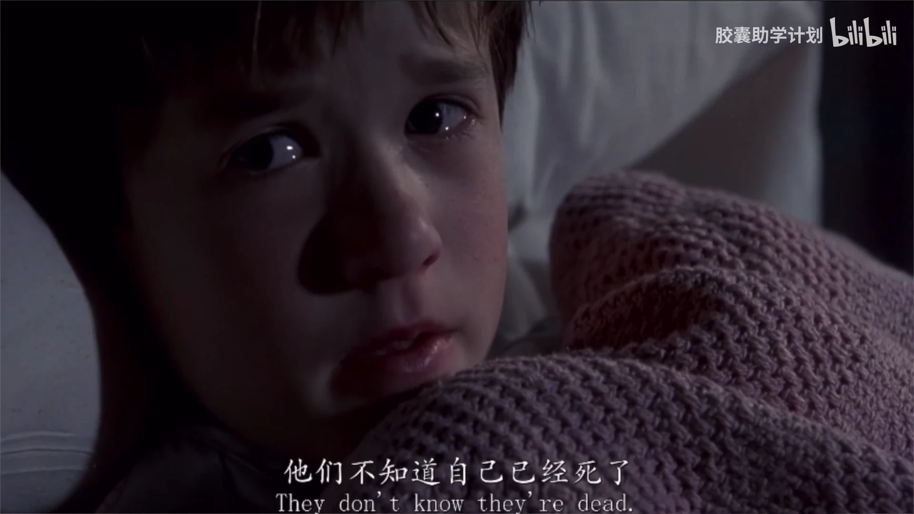

文字识别：bilibli / 胶囊助学计划 / 他们不知道自己已经死了 / They don't know they' re dead.

### 画面 00:06:29

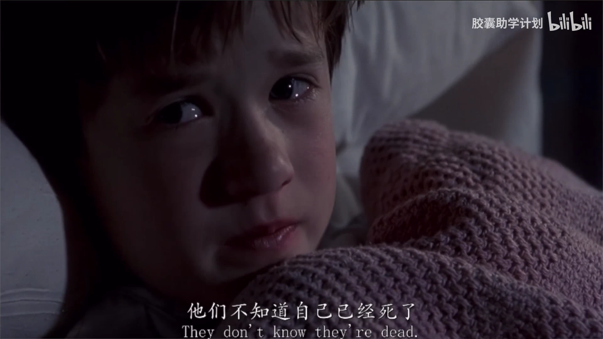

文字识别：bilibli / 胶囊助学计划 / 他们不知道自己已经死了 / They don' t know they' re dead.

## 00:06:30–00:07:00

How often do you see them? Most time. They're everywhere. Okay. How often do you see them?你看到他们的频率是什么样子的？Here we go.那接下来我们继续回到文章。Is it cold?注意 is 放在了 it

### 画面 00:06:31

文字识别：bilibili / 胶囊助学计划

### 画面 00:06:35

文字识别：bilibili / 胶囊助学计划

### 画面 00:06:37

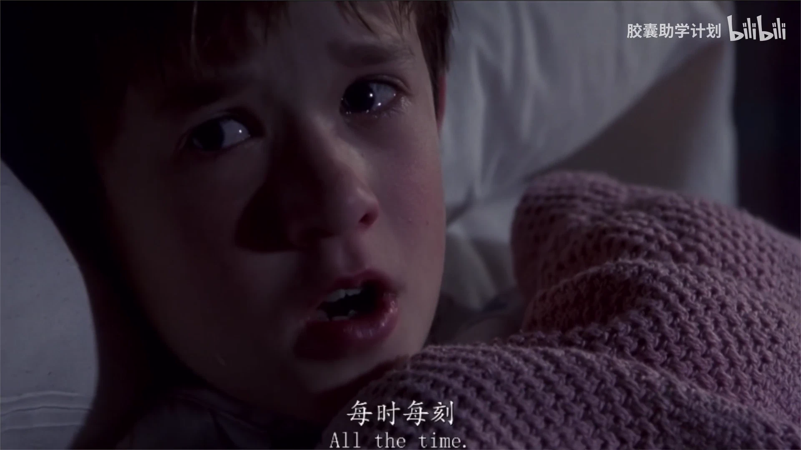

文字识别：Bilibili / 胶囊助学计划 / 每时每刻 / All the time.

### 画面 00:06:39

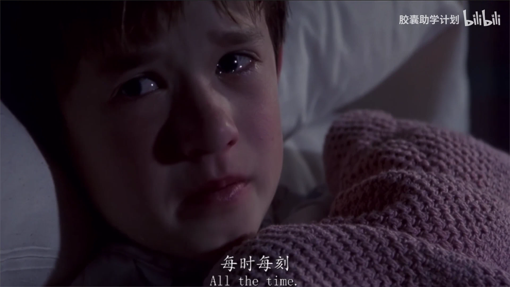

文字识别：Bilibili / 胶囊助学计划 / 每时每刻 / All the time.

### 画面 00:06:41

文字识别：bilibili / 胶囊助学计划

### 画面 00:06:43

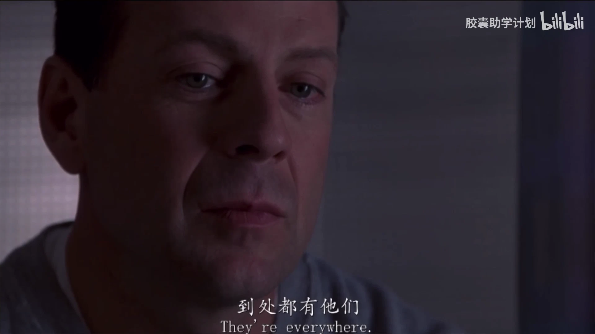

文字识别：bilibili / 胶囊助学计划 / 到处都有他们 / They're everywhere.

### 画面 00:06:45

文字识别：胶囊助学计划 / How often do / you see them? / THE SIXTH / 第六感 The Sixth Sense(1999)

### 画面 00:06:47

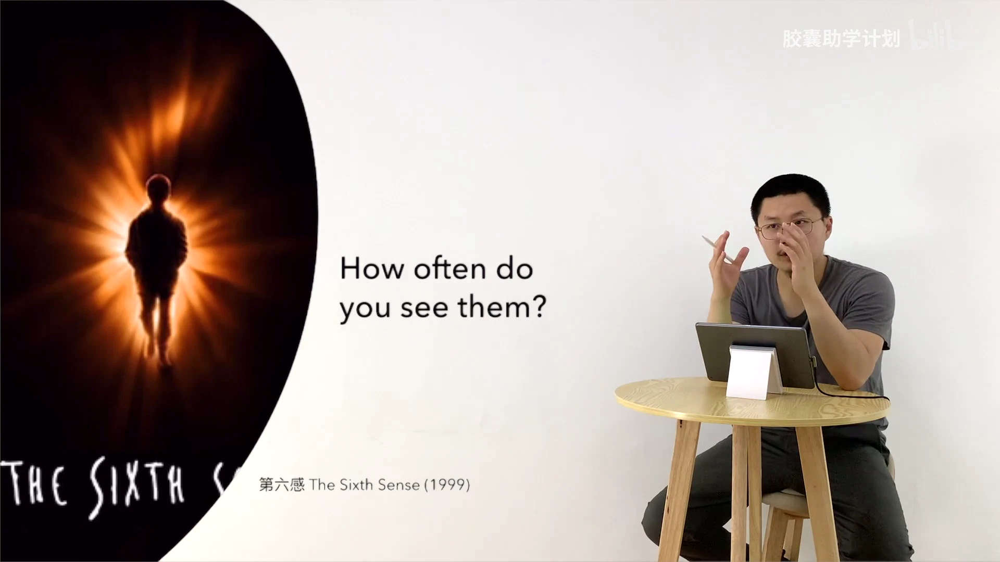

文字识别：胶囊助学计划 / How often do / you see them? / THE SIXTH / 第六感 The Sixth Sense(1999)

### 画面 00:06:51

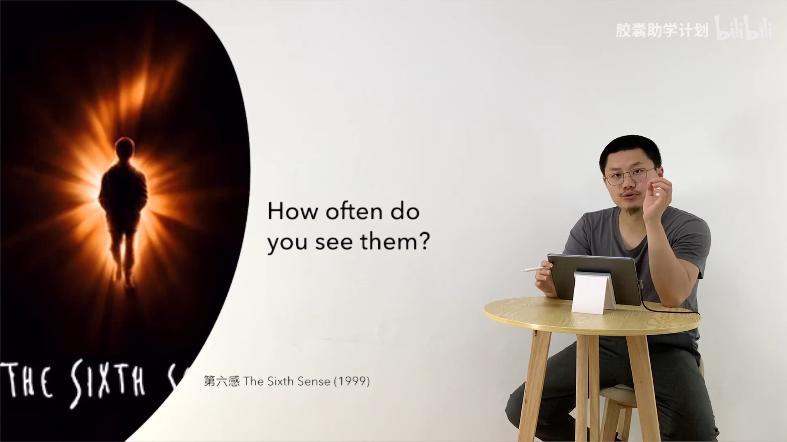

文字识别：胶囊助学计划 / How often do / you see them? / THE SIXTH / 第六感 The Sixth Sense(1999)

### 画面 00:06:53

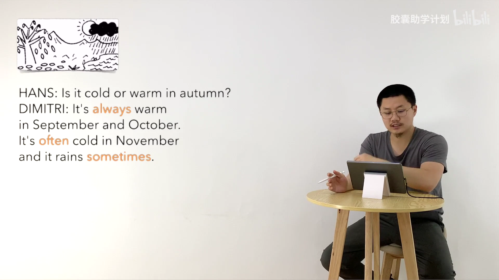

文字识别：胶囊助学计划 / l / HANS: Is it cold or warm in autumn? / DIMITRl: It's always warm / in September and October. / It's often cold in November / and it rains sometimes.

## 00:07:00–00:07:30

的前面，这提醒你了，是一般疑问句。说是冷 or warm 还是暖 in autumn 在春啊在呃秋天的时候，说 is always warm 总是非常的暖啊。 In September and October 九十月份 is often cold，经常就很冷了。 In November 在十一月份，哎，这跟北方也很像，对吧？ It rains sometimes，有时啊会下雨。

### 画面 00:07:23

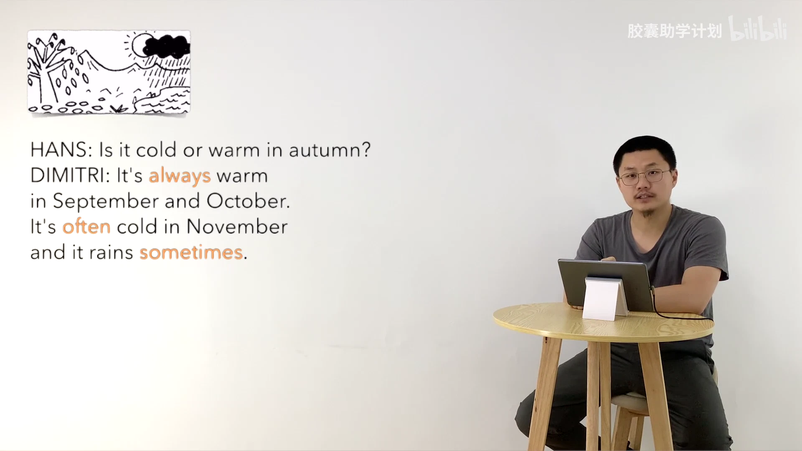

文字识别：胶囊助学计划 / HANS: Is it cold or warm in autumn? / DIMITRl: It's always warm / in September and October. / It's often cold in November / and it rains sometimes.

## 00:07:30–00:08:00

注意，always跟often是放在be的后面，但是sometimes这个单词您随便放，放在句首可以，放在句尾可以，甚至放在中间也可以。你可以说sometimes it rains, it rains sometimes，或者是it sometimes rains，都OK。接下来我们口语把它变一般疑问句，did提前，叫did it rain sometimes？Very good。再然后，我现在想把

### 画面 00:07:53

文字识别：胶囊助学计划 / HANS: Is it cold or warm in autumn? / DIMITRl: It's always warm / in September and October. / It's often cold in November / and it rains sometimes.

## 00:08:00–00:08:30

它对 sometimes 提问应该用谁？ How often, 对吧？ How often does it rain? There you go. 继续. Is it very cold in winter? 说在冬天是不是特别的冷啊？他说 is often cold. 经常是很冷的. In December, January, and February. December, January, February. 十二月份、一月份和二月份。然后 it snows sometimes. 又出现了，它时不

### 画面 00:08:07

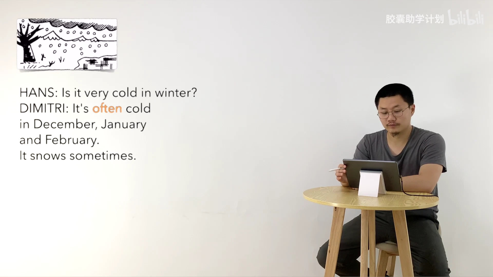

文字识别：胶囊助学计划 / 。 / O / 0 / 0 / V1 / HANS: Is it very cold in winter? / DIMITRl: It's often cold / in December, January / and February. / It snows sometimes.

## 00:08:30–00:09:00

时的还会下雪。There you go.接下来我们做口语听力练习，各位看着文章去找答案。OK，听我问问题，然后看文章给我答案。第一题，Does Dmitri come from Germany？注意两个人对吧？一个人叫Hans，一个人叫Dmitri。啊，你看一下Dmitri，Germany，德国。No, he doesn't. Continue. Where does Dmitri come from？

### 画面 00:08:32

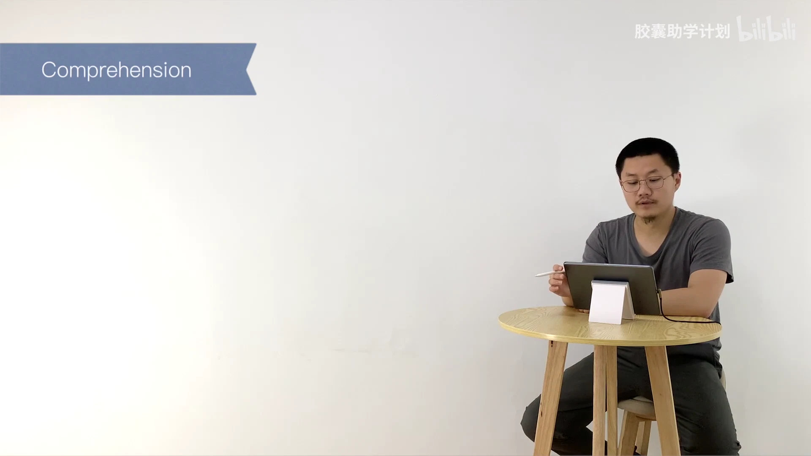

文字识别：胶囊助学计划 / Comprehension

### 画面 00:08:34

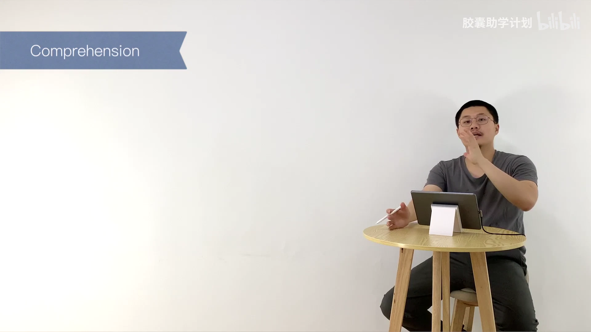

文字识别：胶囊助学计划 / Comprehension

### 画面 00:08:40

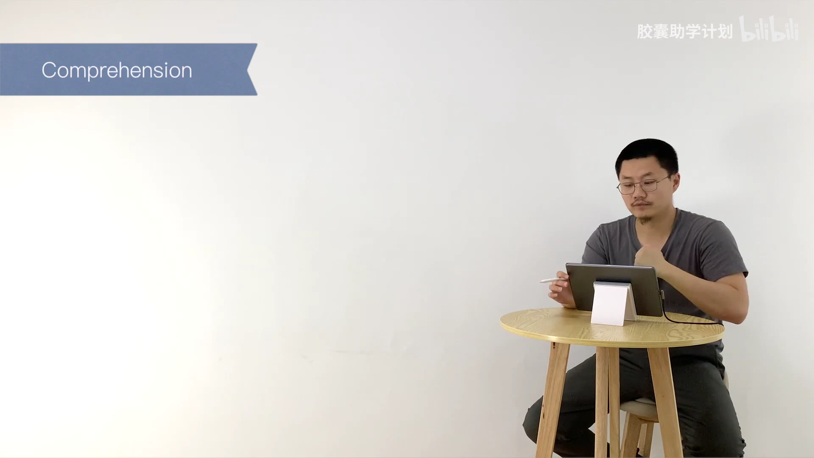

文字识别：胶囊助学计划 / Comprehension

### 画面 00:08:42

文字识别：胶囊助学计划 / Comprehension / 1 T: Does Dimitri come from Germany?

### 画面 00:08:46

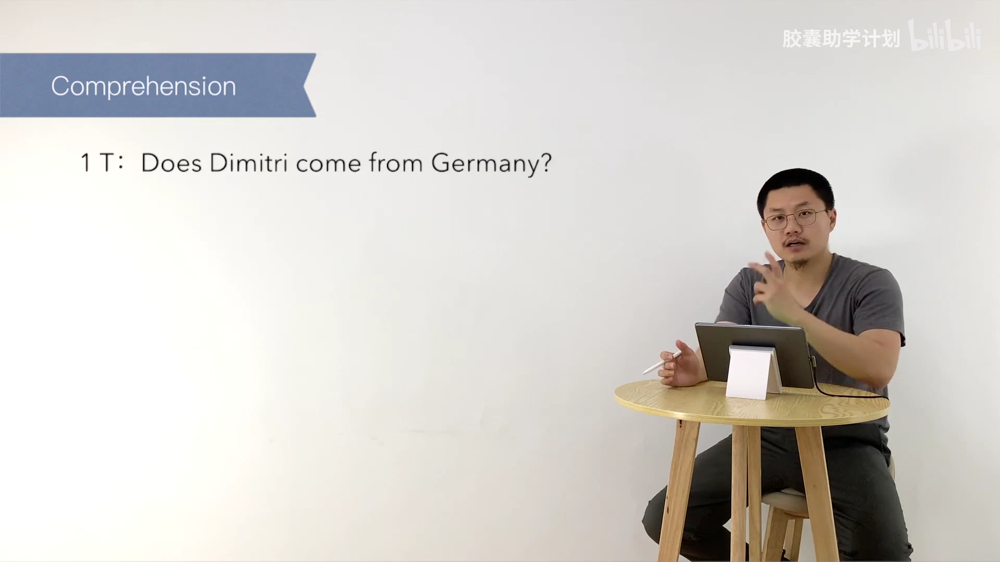

文字识别：胶囊助学计划 / Comprehension / 1 T: Does Dimitri come from Germany?

### 画面 00:08:51

文字识别：胶囊助学计划 / Comprehension / 1 T: Does Dimitri come from Germany?

## 00:09:00–00:09:30

Greece. There you go. Continue. What is the climate like in Greece? Ah, it's very pleasant. Continue. What's the weather like in spring? It's often windy in March and warm in April and May. Continue. What's it like in summer?

### 画面 00:09:11

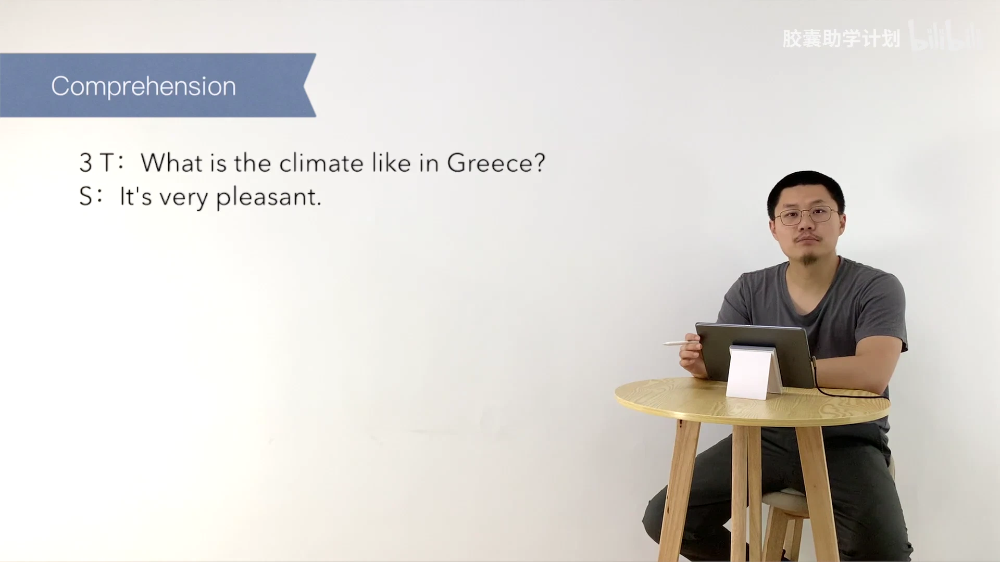

文字识别：胶囊助学计划 / Comprehension / 3 T: What is the climate like in Greece? / S: Ilt's very pleasant.

### 画面 00:09:18

文字识别：胶囊助学计划 / Comprehension / 4T: What's the weather like in spring? / S: It's often windy in March and warm in / April and May.

### 画面 00:09:25

文字识别：胶囊助学计划 / Comprehension / 5 T: What's it like in summer?

## 00:09:30–00:10:00

Hot. Continue. Ah, when? When does the sun shine every day? When does the sun shine every day? In June, July, August. Next one. What's the weather like in September? Continue. It's always warm, and it rains sometimes. Continue. Is it

### 画面 00:09:52

文字识别：胶囊助学计划 / Comprehension / 7 T: What's the weather like in September? / S: It's always warm and it rains sometimes.

### 画面 00:09:58

文字识别：胶囊助学计划 / Comprehension / 8 T: Is it often cold in November?

## 00:10:00–00:10:30

often cold in November? Yes, it is. Is it cold in Greece in winter? Yes, it is. Continuing, does it ever snow in Greece? Ever就是在任何时候啊。 Yes, it does. 下一题, asking questions,肯定句,否定句啊,肯定句,一般疑问句,特殊疑问句,

### 画面 00:10:27

文字识别：胶囊助学计划 / Asking questions

## 00:10:30–00:11:00

我们做了很多了。直接来，Dimitri comes from Greece. Comes does提前，对吧？Does提前，Does Dimitri come from Greece? Where Where does Dimitri come from? Continue. Is it often windy in March? Is it often windy in March? Okay,啊，刚才应该是It is啊，It

### 画面 00:10:31

文字识别：胶囊助学计划 / Asking questions / 1 T: Ask me if Dimitri comes from Greece.

### 画面 00:10:43

文字识别：胶囊助学计划 / Asking questions / 1 T: Ask me if Dimitri comes from Greece. / S: Does Dimitri come from Greece? / T:Where...? / S: Where does Dimitri come from?

### 画面 00:10:47

文字识别：胶囊助学计划 / Asking questions

## 00:11:00–00:11:30

it is often windy in March. 然后把 is 提前变成了 is it 啊，你听听 when 那肯定是对 in March 提问 when is it often windy. Next one, ask me if it's hot in summer. It's it is 对吧 is 提前 is it hot in summer. What's it like? 就是问天气嘛对吧？那就是 what's it like in summer.

### 画面 00:11:03

文字识别：胶囊助学计划 / Asking questions / 2T: Ask me if it is often windy in March. / S: Is it often windy in March?

### 画面 00:11:08

文字识别：胶囊助学计划 / Asking questions / 2T: Ask me if it is often windy in March. / S: Is it often windy in March? / T: When...? / S: When is it often windy?

### 画面 00:11:12

文字识别：胶囊助学计划 / Asking questions / 3 T: Ask me if it's hot in summer.

## 00:11:30–00:12:00

Continue. It rains in November sometimes. Does it rain? 注意动词换回原形. In November sometimes. When? 你想一下, when是对in November还是how often? 对in November应该用谁? 对sometimes应该用谁? Okay. When does it rain? 后面可以加上sometimes. Ah. Continue.

### 画面 00:11:36

文字识别：胶囊助学计划 / Asking questions / 4 T: Ask me if it rains in November sometimes. / S:Does it rain in November sometimes?

### 画面 00:11:43

文字识别：胶囊助学计划 / Asking questions / 4 T: Ask me if it rainsin November sometimes. / S: Does it rain in November sometimes? / T: When...?

### 画面 00:11:45

文字识别：胶囊助学计划 / Asking questions / 4 T: Ask me if it rainsin November sometimes. / S: Does it rain in November sometimes? / T: When...?

### 画面 00:11:49

文字识别：胶囊助学计划 / Asking / questions / 4 T: Ask me if it rainsin November sometimes. / S: Does it rain in November sometimes? / T: When...?

### 画面 00:11:59

文字识别：胶囊助学计划 / Asking questions / 5 T: Ask me if it snows in December?

## 00:12:00–00:12:30

It snows in December. Does it snow in December? When? Ah, when does it snow? Very good.何时下雪？注意，不是问之前什么时候下的雪，这不是一般现在时，问的是一般状态下什么时候会下雪，陈述客观事实，对吧？Okay, 那我们看一下 recap 本课几个关键点。第一个，How often 我们又见到了。第二，What's the

### 画面 00:12:13

文字识别：胶囊助学计划 / Asking questions / 5 T: Ask me if it snows in December? / S: Does it snow in December. / T: When...? / S: When does it snow?

### 画面 00:12:16

文字识别：胶囊助学计划 / Asking questions / 5 T: Ask me if it snows in December? / S: Does it snow in December. / T: When...? / S: When does it snow?

### 画面 00:12:23

文字识别：胶囊助学计划 / Recap / Patterns / How / often / What's the weather like...? / Grammar / be+often / Words / be+always / Expression

## 00:12:30–00:13:00

weather like? 第三，often跟always要放在be的后面。Where you go? 看一下本课家庭作业，绿皮书五十一课，各位可以写了。第二，文章老习惯，跟读至熟读成诵。哎，并且在各位跟读的过程当中，您这篇文章不妨多读一些变数，因为文章当中自带了四季，外加十二个月，对吧？文章您读熟了，这十六个单词也差不多了。Continue，

### 画面 00:12:32

文字识别：Recap / 胶囊助学计划 / Patterns / How / often / What's the weather like..? / Grammar / be+often / Words / be+ / alway / Expression

### 画面 00:12:36

文字识别：胶囊助学计划

### 画面 00:12:43

文字识别：胶囊助学计划 / 绿皮书第51课的写作练习 / 文章跟读至熟读成诵

## 00:13:00–00:13:30

给自己讲解一遍今天的核心知识点，这是我们提升提升学习效率的一个很棒的方式。如果大家喜欢我们的课程呢，欢迎大家关注、订阅、一键三连，分享给身边需要的朋友们。最后，我们再来看一句名人名言：Solitude is pleasant, loneliness is not. See you next time.

### 画面 00:13:07

文字识别：胶囊助学计划

### 画面 00:13:14

文字识别：胶囊助学计划 / Solitude is pleasant. Loneliness is not. / -Anna Neagle

### 画面 00:13:23

### 画面 00:13:25

文字识别：CAPSULEACADEMY / 胶囊助学计划 / 『 / 小红书 / Lecturer / Leo / OE

### 画面 00:13:28

文字识别：CAPSULEACADEMY / 胶囊助学计划 / 『 / 小红书 / Editor / OE

## 00:13:30–00:13:35

### 画面 00:13:31

文字识别：CAPSULEACADEMY / 胶囊助学计划 / 小红书 / Creator / □ / Leo & Berlin / OE

### 画面 00:13:33

文字识别：bilibili / 胶囊助学计划

### 画面 00:13:35

文字识别：bilibili / 胶囊助学计划

