# 051 单词

快速机器解析：语音为单模型转写，未进行独立交叉校对或人工复核；画面每秒采样并按变化选帧，短时文字和标记可能遗漏。截图时间约有 1 秒误差。图片有损压缩；遇到疑点请按时间查看 Google Drive 原视频。

## 00:00:00–00:00:30

Hello everyone, welcome to Capsule Academy. This is Leo. Today we're going to learn New Concept English Book One Lesson Fifty One Words. Hope you guys enjoyed.好，上来呢，我们先看第一组单词。我们先看音标啊，e长音的，对吧？连起来，grace, grace，希腊。好，后面Greek，希腊语，希腊人。OK， Greek。

### 画面 00:00:00

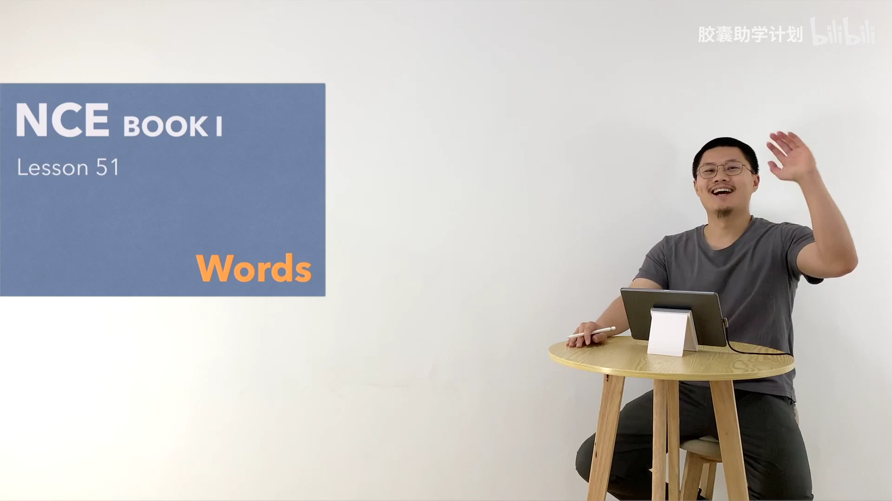

文字识别：胶囊助学计划 / NCE / BOOKI / Lesson 51 / Words

### 画面 00:00:02

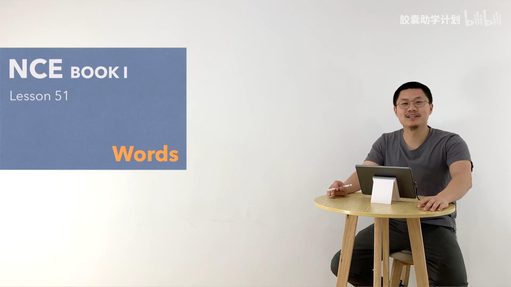

文字识别：胶囊助学计划 / NCE / BOOKI / Lesson 51 / Words

### 画面 00:00:10

文字识别：胶囊助学计划b出l / • / •

### 画面 00:00:14

### 画面 00:00:16

文字识别：胶囊助学计划b山 / /gri:s/ /gri:k / / Greece Greek

### 画面 00:00:28

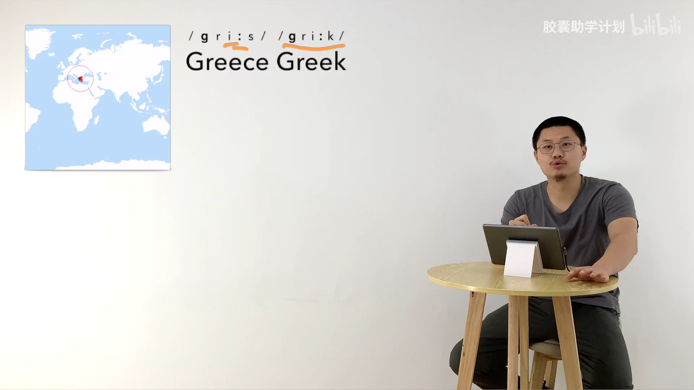

文字识别：Bib出 / 胶囊助学计划 / / gri:s/ /gri:k / / Greece / Greek

## 00:00:30–00:01:00

好，我们看单词造句。我们先来一句话，叫He comes from Greece。这个是五十一、五十三，我们会不停的练到的一个关键句型。其实它很简单，我们看一下它的汉语翻译啊。它来是come，去是go，这个各位最熟悉了，来对吧？来自from就是从什么什么地方，从希腊来，就是说它来自于希腊。这个地方我们注意几个小

### 画面 00:00:34

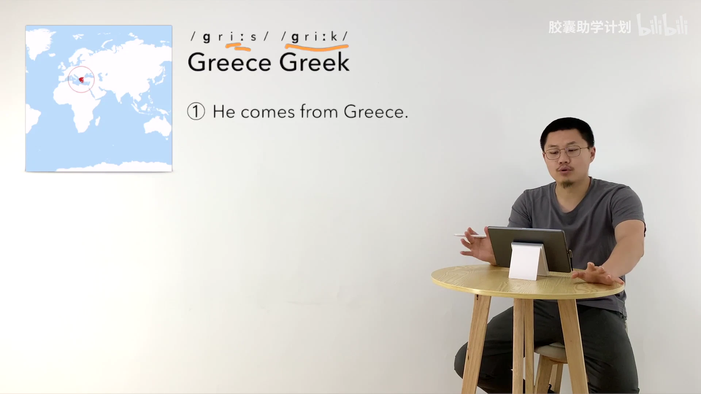

文字识别：胶囊助学计划 / / gri:s/ /gri:k / / Greece / Greek / ① He comes from Greece.

### 画面 00:00:48

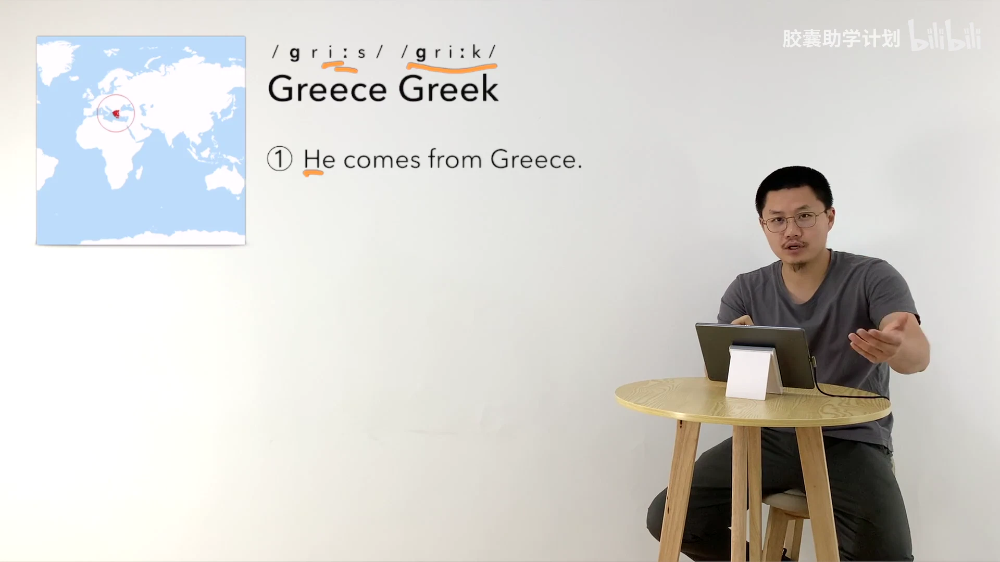

文字识别：胶囊助学计划 / / gri:s/ / gri: k / / Greece / Greek / ① He comes from Greece.

### 画面 00:00:55

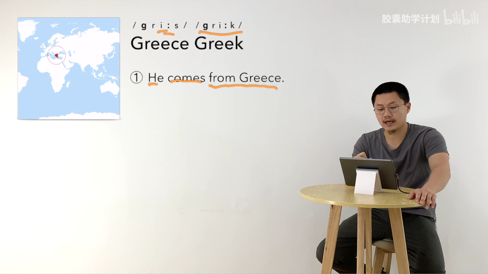

文字识别：胶囊助学计划 / Bilbil / / gris / /gri:k / / Greece / Greek / ① He comes from Greece.

### 画面 00:00:57

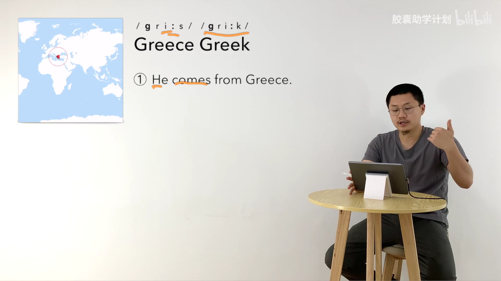

文字识别：胶囊助学计划 / / gri:s/ /gri:k/ / Greece / Greek / ① He cames from Greece.

### 画面 00:00:59

文字识别：胶囊助学计划 / / gri:s/ /gri: k / / Greece / Greek / ① He comes from Greece.

## 00:01:00–00:01:30

点。第一，为什么这个地方加了 s？这个在我们四十九课有专门去讲过，对吧？当主语是第三人称，并且满足单数条件，并且它是一般现在时。那我们想一下，一般现在时陈述客观事实或生活习惯，对吧？那这个就是一个陈述客观事实。你来自于什么地方？这是一个客观事实。这不代表说说过去是这样，现在不是这样，将来就不是

### 画面 00:01:07

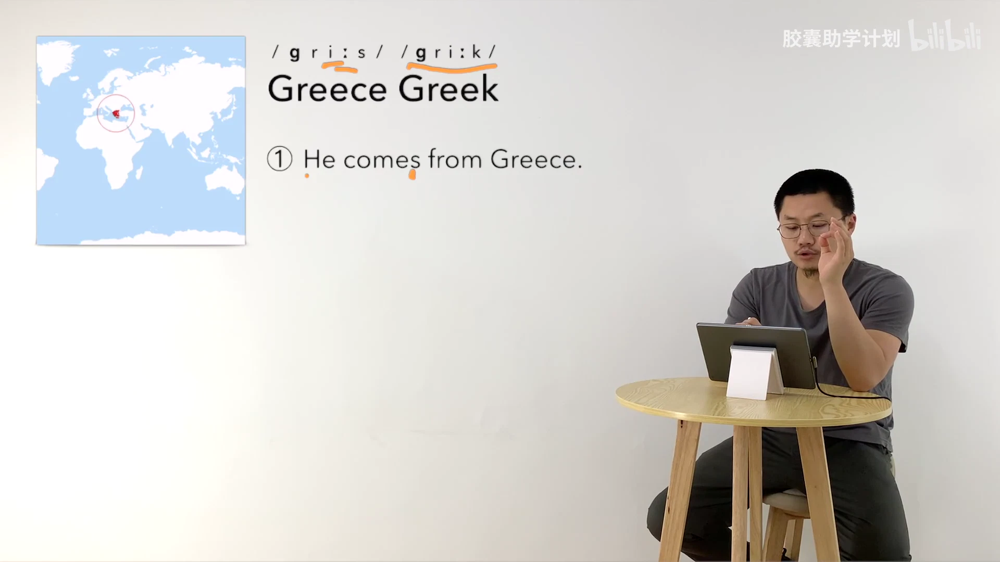

文字识别：胶囊助学计划 / / gri :s / /gri:k / / Greece / Greek / ① He comes from Greece.

### 画面 00:01:12

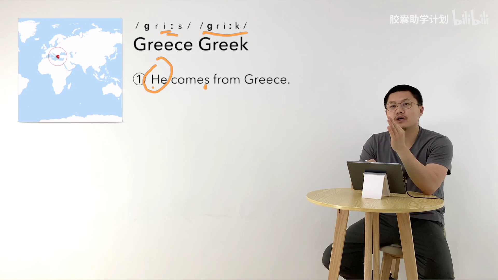

文字识别：胶囊助学计划 / / gri:s / /gri: k / / Greece / Greek / 1 Hecomes from Greece.

## 00:01:30–00:02:00

这样了，对吧？或者说它永远是这样的。所以一般现在时，主语第三人称单数，动词也要做第三人称单数，于是加了个 s。那这个地方我们现在想把它变一般疑问句，就存在一个小的问题了。用什么单词去变？如果四十七课、四十九课这两课各位认认真真的去学了，并且做了练习，那在这个地方你找不到任何答案，除了把 does 这个单词提到句首去以外，没有别的答案了，对吧？叫 Does he come from

### 画面 00:01:40

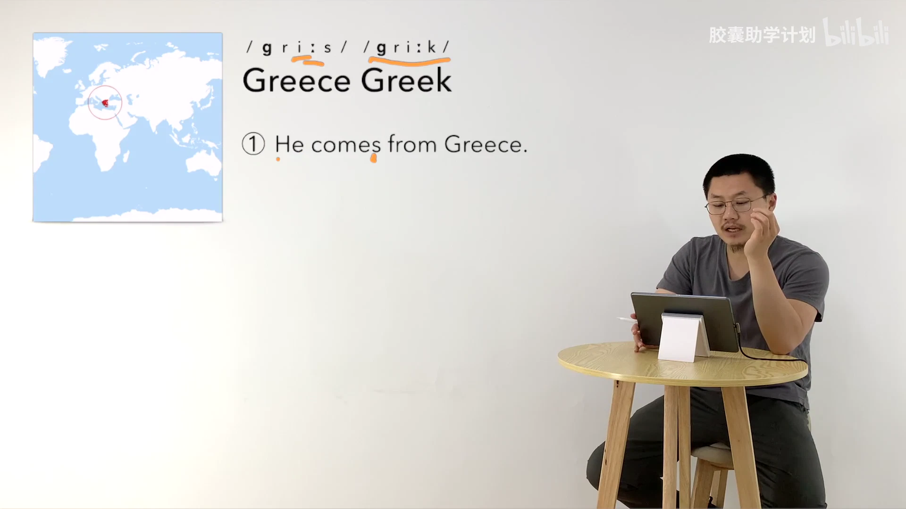

文字识别：胶囊助学计划 / / gri :s / /gri:k / / Greece / Greek / ① He comes from Greece.

## 00:02:00–00:02:30

Greece? 其次，各位在这儿注意一个小的点，就是 come 从 comes 换成了 come，对吧？换回了原形。那然后我想对 Greece 提问，这是一个国家，也是一个地点。我们学了这么多的特殊疑问词，用谁呢？用 Where？什么地方，对吧？所以答案叫 Where does he come from？它的意思叫他来自于什么地方？然后如果各位有印象的话，应该没错，是我们新概念一册第五课学过

### 画面 00:02:06

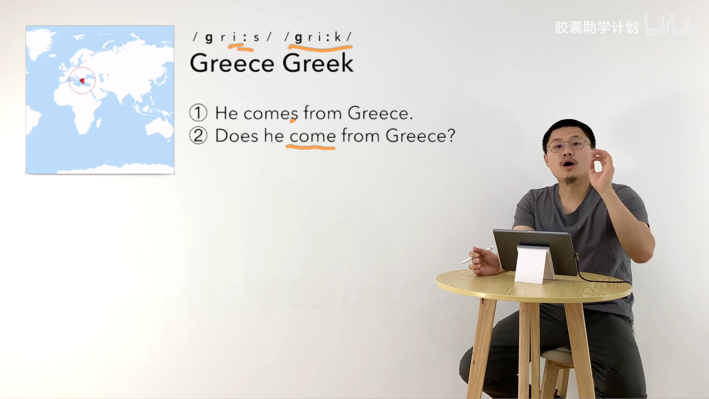

文字识别：胶囊助学计划 / / gri:s/ /gri: k / / Greece / Greek / ① He comes from Greece. / ② Does he come from Greece?

### 画面 00:02:09

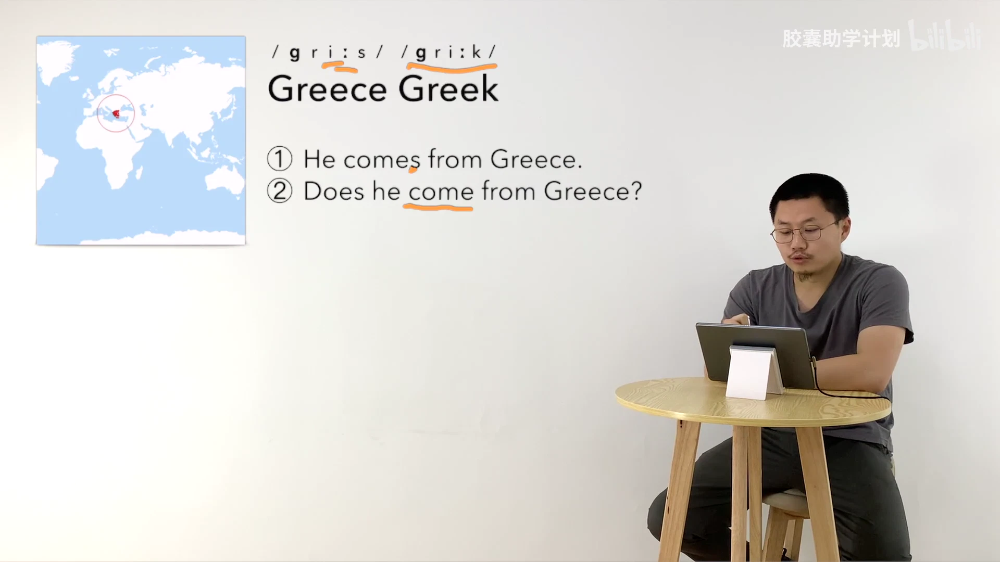

文字识别：胶囊助学计划 / / gri:s / / gri: k / / Greece / Greek / ① He comes from Greece. /  Does he come from Greece?

### 画面 00:02:11

文字识别：胶囊助学计划 / / gri:s / / gri:k / / Greece / Greek / ① He comes from Greece. / ) Does he come fromGreece

### 画面 00:02:13

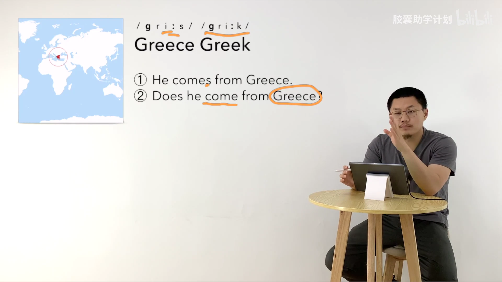

文字识别：胶囊助学计划 / / gri:s / / gri:k / / Greece / Greek / ① He comes from Greece. / ) Does he come fromGreece

### 画面 00:02:24

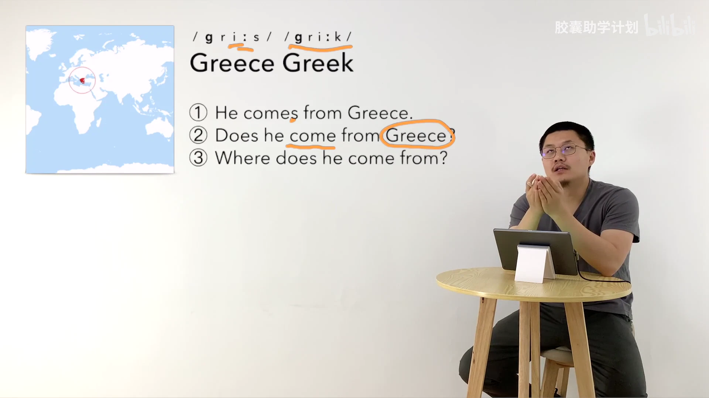

文字识别：胶囊助学计划 / / gr i:s / / gri: k / / Greece / Greek / ① He comes from Greece. / Does he come fromGreece / Where does he come from?

## 00:02:30–00:03:00

一个句型，叫做 He is from Greece. 他来自于希腊。好，变一般疑问句。第五课我们就学过，把 is 提前，然后对 Greece 提问，变成了 Where is he from？然后您看一下标号三和标号六的这两句话，它们虽然结构不一样，一句话叫 Where does he come from？另外一句叫 Where is he from？但这两句话的含义完全相同，叫他来自于

### 画面 00:02:37

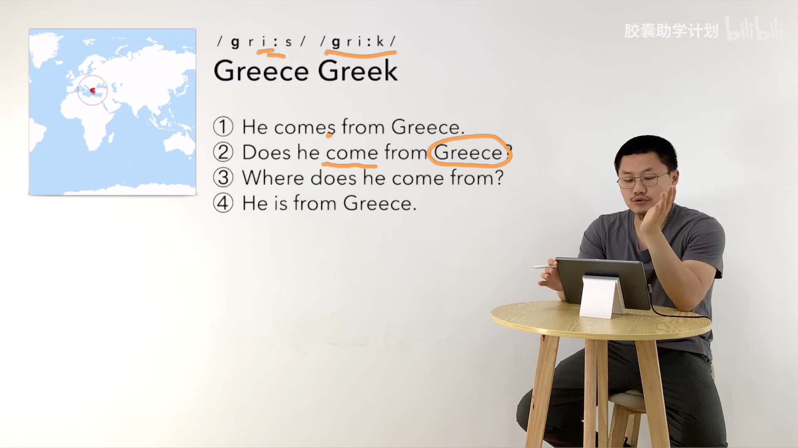

文字识别：胶囊助学计划 / / gr i :s / / gri:k / / Greece / Greek / ① He comes from Greece. / Does he come fromGreece / Where does he come from? / He is from Greece.

### 画面 00:02:49

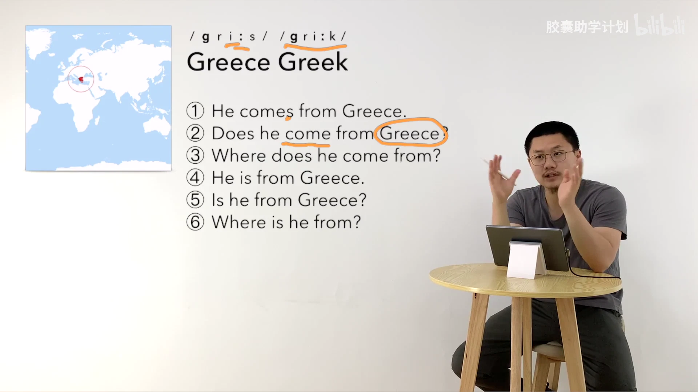

文字识别：胶囊助学计划 / / gr i:s / / gri: k / / Greece / Greek / ① He comes from Greece. / Does he come fromGreece / Where does he come from? / He is from Greece. / ⑤ Is he from Greece? / ⑥ Where is he from?

## 00:03:00–00:03:30

什么地方？只不过结构是不同的。OK，好，接下来我们看下一个单词。先看一下一个元音，两个元音中间一个辅音，一边一个啊，中间一个辅音给后面。这是我们在音节的视频当中教过各位啊。好，我们看一下第一个音节叫做 climate，后面叫做 meet，连起来 climate 气候。那我们还是直接给大家补一句话，各位在文章当中还是会见到。我们现

### 画面 00:03:05

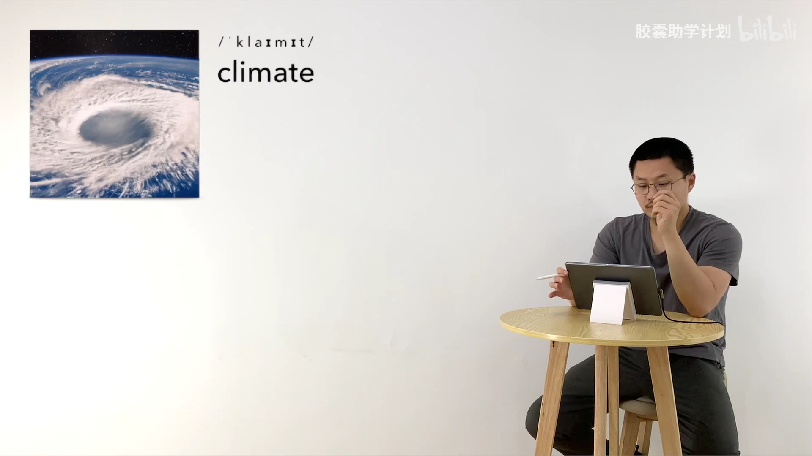

文字识别：胶囊助学计划 / /'klaimit/ / climate

### 画面 00:03:07

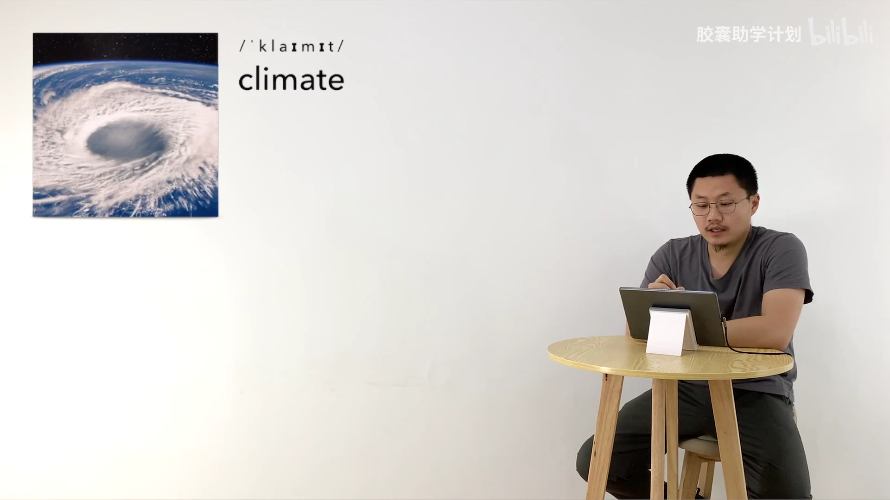

文字识别：胶囊助学计划 / /'klaimit/ / climate

## 00:03:30–00:04:00

在不妨先把它提前看一下，一回生二回熟啊。说 What's the weather? What's the climate like? 好，注意这个地方，首先要讲两个小点。第一，is 指的是 is 啊，is is is。说 What is the climate? 气候是 like。注意，我们虽然四十七课就学过 like 的动词表示的是喜欢啊，I like you，我喜欢你。那注意这个地方的 like

### 画面 00:03:35

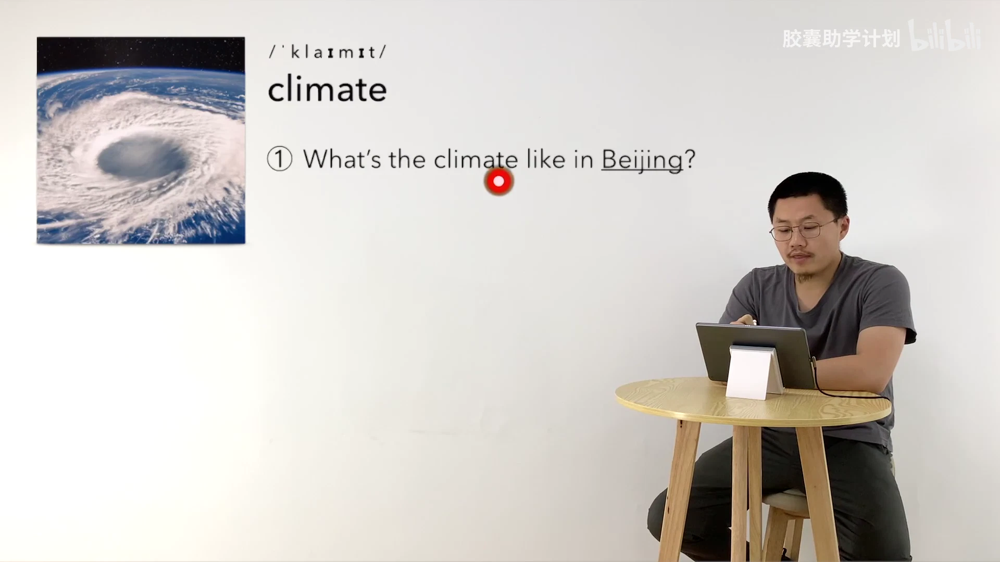

文字识别：胶囊助学计划 / /'klaimIt/ / climate / ① What's the climate like in Beijing?

### 画面 00:03:45

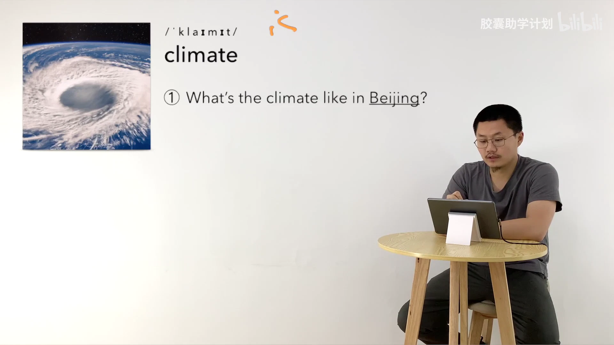

文字识别：胶囊助学计划 / /'klaimit/ / climate / ① What's the climate like in Beijing?

## 00:04:00–00:04:30

并不表示的是喜欢，而是像什么什么一样，它实际上是一个介词啊。所以 what's the climate like 就是气候怎么样？后边又加了一个小的短语叫做 in Beijing，叫做在北京气候怎么样？那你想一下，和 weather weather 表示的是天气，气候是用 climate 表示，这就有点像回到了我们小学或者初中的语文课堂了。也就是你要扪心自

### 画面 00:04:07

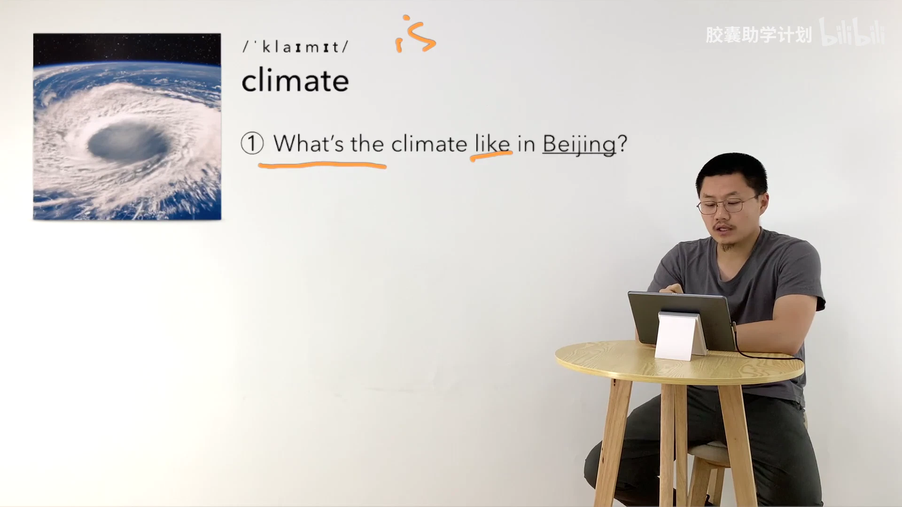

文字识别：胶囊助学计划 / /'klaimit/ / climate / D What's the climate like in Beijing? / 1

### 画面 00:04:09

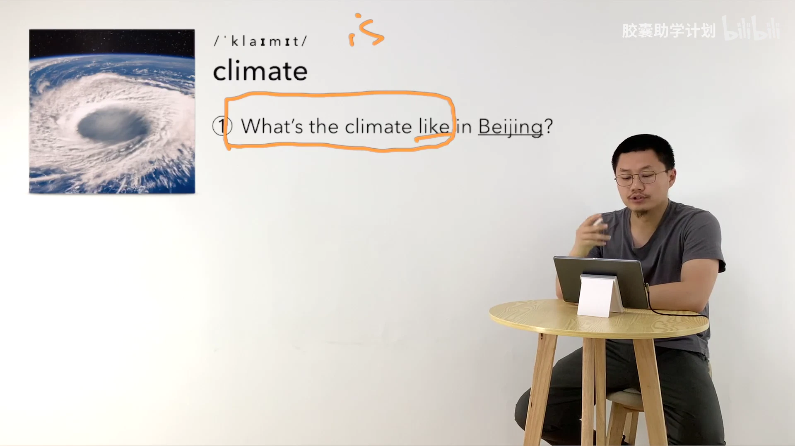

文字识别：胶囊助学计划 / /'klaimit/ / climate / What's the climate likein Beijing?

### 画面 00:04:15

文字识别：胶囊助学计划 / /'klaimIt/ / climate / What's the climate likein Beijing?

## 00:04:30–00:05:00

问一下，天气和气候有什么区别，对吧？天气可能更像是短时间，比如说今儿天气怎么样，我们很少会说今儿气候怎么样，这是不对的。那气候可能更指的是跨度时间更长的一段时间，我们才聊到气候，对吧？气候的改变，天气的改变。Okay, good.那在背境这个地方，您是可以随便去换一些词的，比如说 What's the climate like in Guangzhou? In Shanghai?

### 画面 00:04:45

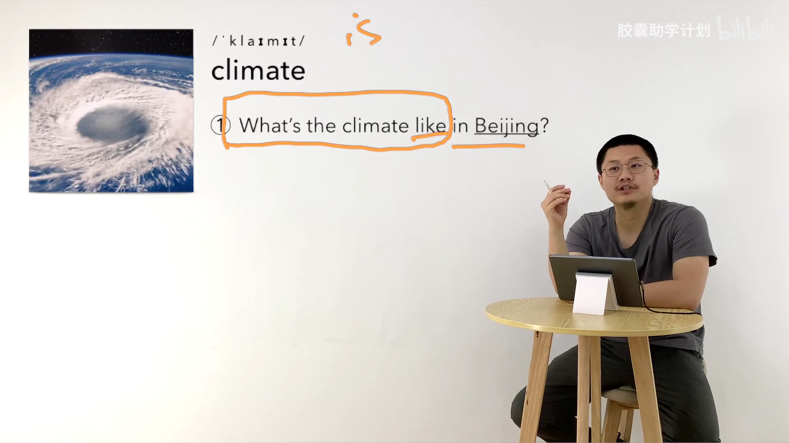

文字识别：胶囊助学计划 / /'klaimit/ / climate / What's the climate likein Beijing?

### 画面 00:04:51

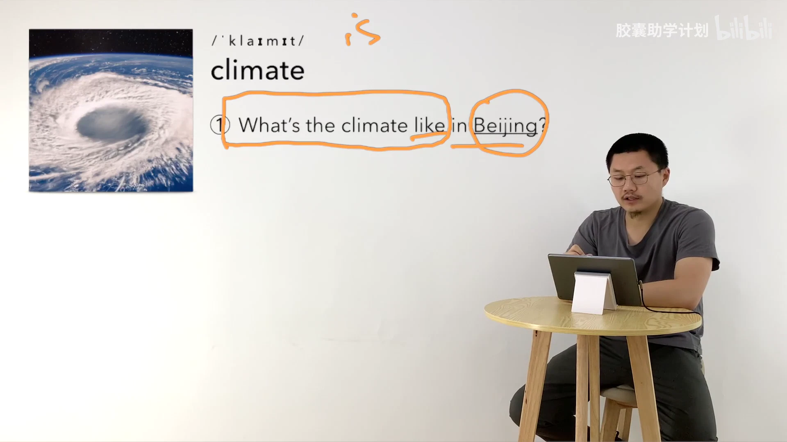

文字识别：胶囊助学计划 / /'klaimit/ / climate / What's the climate likeinBeijing

## 00:05:00–00:05:30

OK, 这儿一个好，下一个单词跟我读一下，叫做 country, country, OK，它叫国家。接下来我们就会在偶数课啊，五十二课和五十四课学到很多很多国家的这个呃表达。我提前先说一下，各位不用把它们先都背下来，OK，不用有太大的焦虑感。那我们先看这个单词，来 country 表示的是国家。补一个小的短语，说在我

### 画面 00:05:01

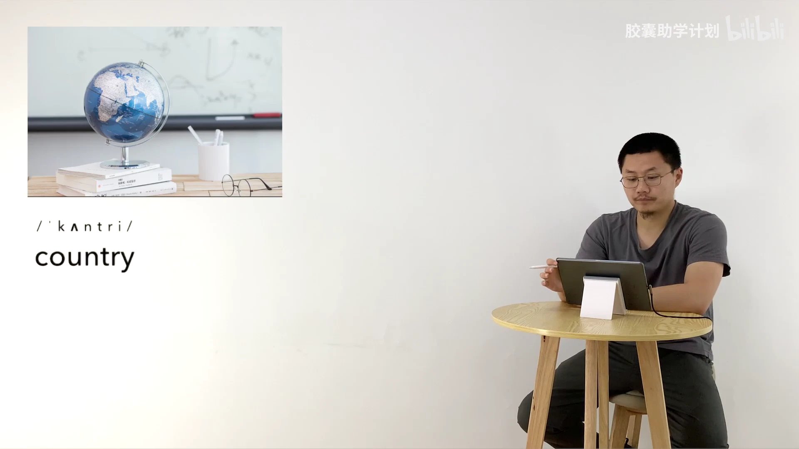

文字识别：胶囊助学计划 / /'kantri/ / country

## 00:05:30–00:06:00

的国家叫做 in my country，那叫在你的国家叫 in your country。我们结合上一个 climate 那个关键句型，叫做 What's the climate like in your country？在你的国家气候怎么样？那不同的国家气候是不一样的。OK，好，接下来呢，我们造一句话说 people 说人们呀 don't eat dinner 是不吃晚饭的。注意后边还有一个限定叫 in some countries，在一

### 画面 00:05:31

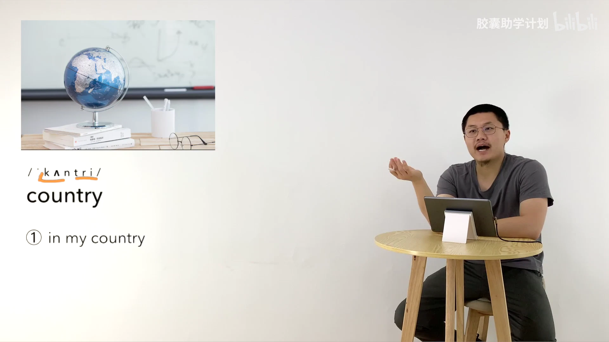

文字识别：胶囊助学计划 / /kantri/ / country / ① in my country

### 画面 00:05:56

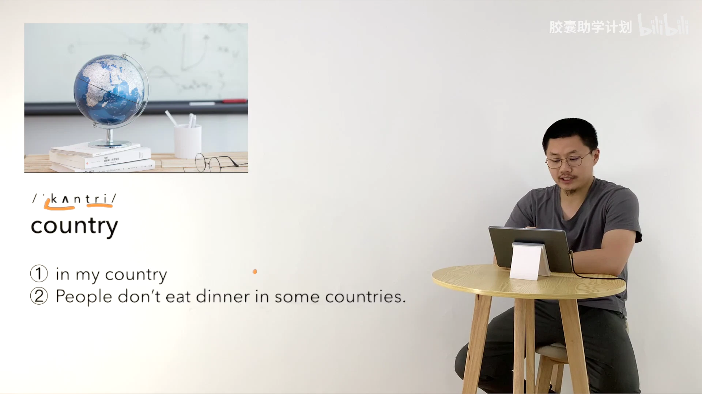

文字识别：胶囊助学计划 / /kantri/ / country / ① in my country / ② People don't eat dinner in some countries.

## 00:06:00–00:06:30

些国家，哎，我们尝试就造出来了一句话。然后这儿注意一个小点，叫 countries， countries 加上了变 y 为 i 加 es 复数，它是可数的啊。其次，Why don't 我们之前已经学过了，叫为什么不，对吧？好，那我们其实直接就可以又造出来一句话，叫 Why don't people eat dinner in these countries？为什么人们在这些国家，它是不

### 画面 00:06:06

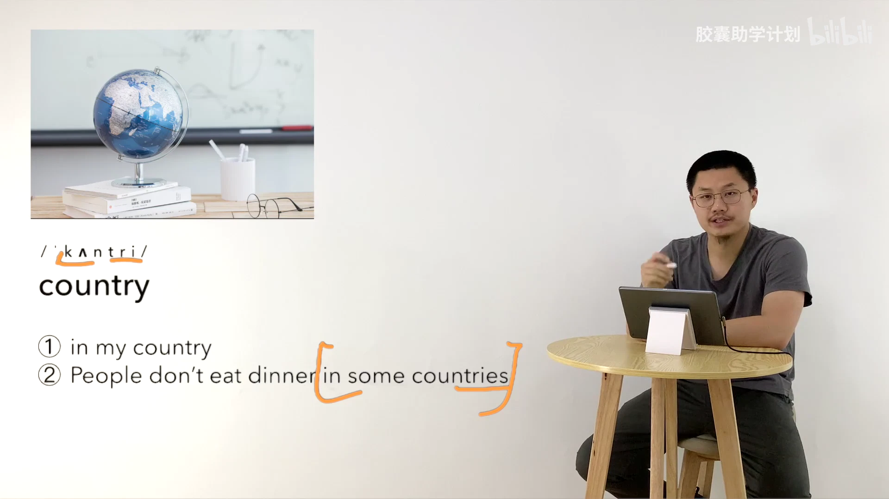

文字识别：胶囊助学计划 / /kantri/ / country / ① in my country / ② People don't eat dinnerin some countries

### 画面 00:06:13

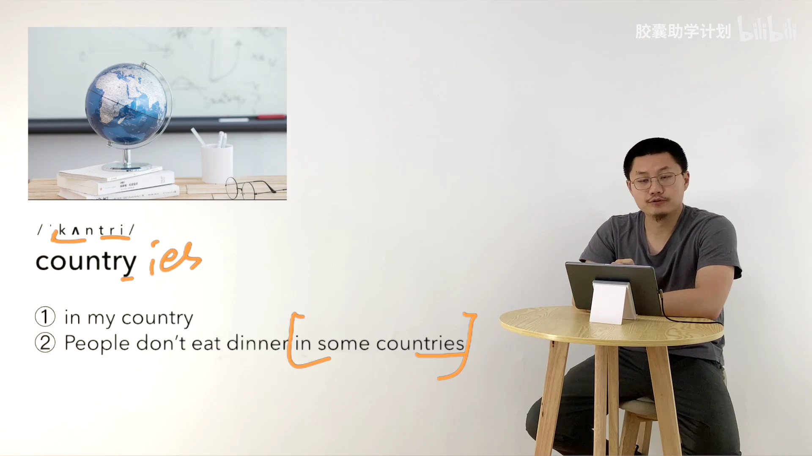

文字识别：胶囊助学计划 / /kantri/ / ie / country / ① in my country / People don't eat dinner in some countries / 2

### 画面 00:06:16

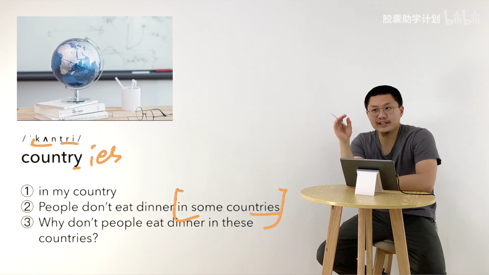

文字识别：胶囊助学计划 / / kantri/ / ie / country / ① in my country / People don't eat dinnerin some countries / Why don't people eat dimner in these / 3 / countries?

## 00:06:30–00:07:00

吃晚饭的呢。OK，这就涉及到人类学、社会学上的事儿了。我们在这儿就不讲了啊，各位感兴趣自己去查。Why don't people eat dinner in these countries or in some countries? OK，好，下一个单词，先跟我看第一个 pleasant a 和 a，对吧？pleasant，边一个 pleasant，就是很宜人的。那后面这个单词 a a，复音给后面

### 画面 00:06:43

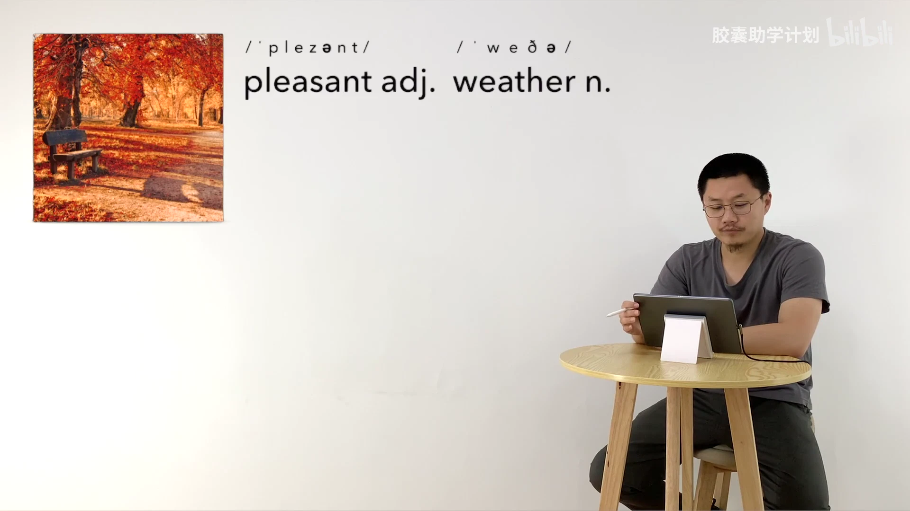

文字识别：胶囊助学计划 / /'plezant/ / /'weǒa l / pleasant adj. weather n.

### 画面 00:06:46

文字识别：胶囊助学计划 / /'plezant/ / /weǒal / pleasant adj. weather n.

### 画面 00:06:50

文字识别：胶囊助学计划 / /'plezant/ / /weǒal / pleasant adj. weather n.

### 画面 00:06:56

文字识别：胶囊助学计划 / /'plezant / / /weǒal / pleasant adj. weather n.

## 00:07:00–00:07:30

weather weather叫做天气，那 pleasant weather 指的是很宜人的一个天气，很迷人的天气。OK，好，那我们就可以造句了。说 the weather is pleasant，说天气啊真不错。然后多了个小的地点介 in Auckland，啊是我比较喜欢的一个城市，奥克兰对吧？在奥克兰呢，天气很宜人。你注意 pleasant 指的是 weather 啊，怎么说它很宜人

### 画面 00:07:00

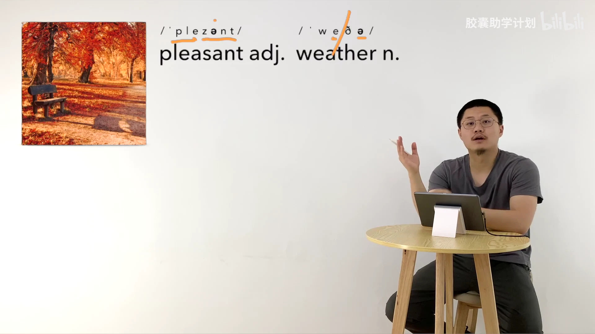

文字识别：胶囊助学计划 / /'plezant/ / w e / pleasant adj. weather n.

### 画面 00:07:05

文字识别：胶囊助学计划 / /'plezant/ / pleasant adj. weather n.

### 画面 00:07:08

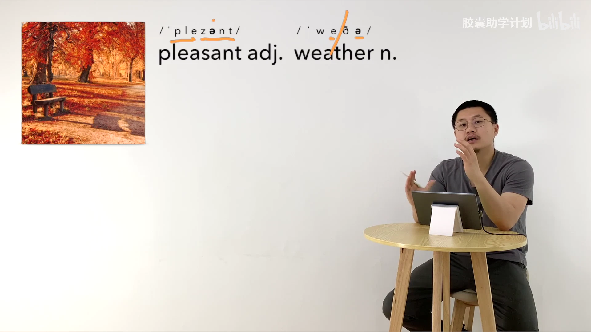

文字识别：胶囊助学计划 / /'plezant/ / we / pleasant adj. weather n.

### 画面 00:07:10

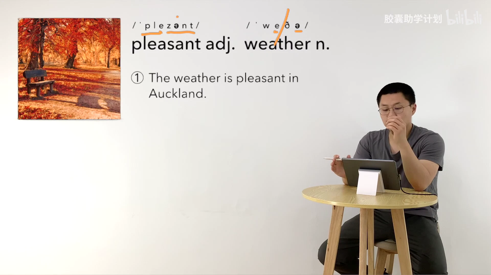

文字识别：胶囊助学计划 / /'plezant/ / pleasant adj. weather n. / ① The weather is pleasant in / Auckland.

### 画面 00:07:15

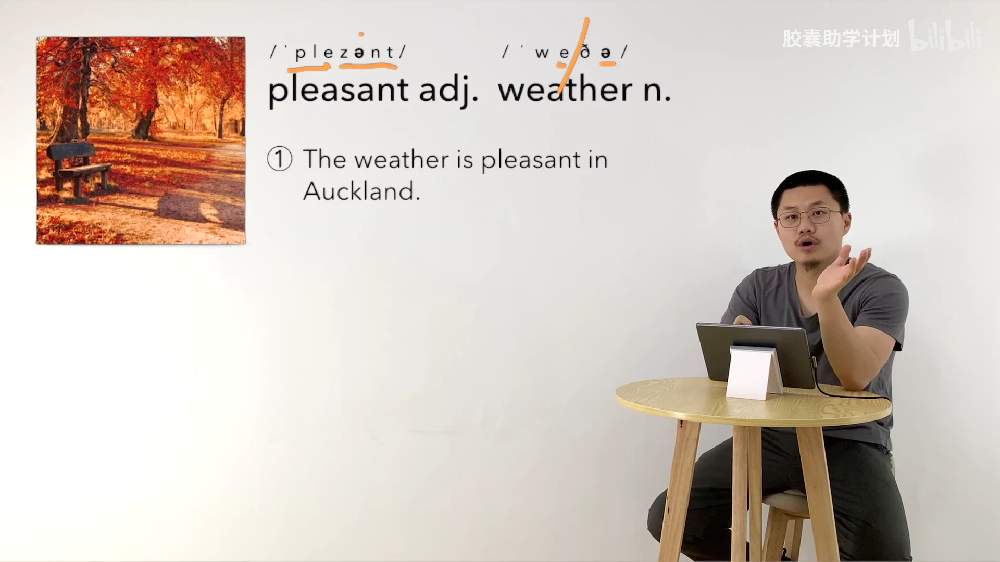

文字识别：胶囊助学计划 / /'plezant/ / we / pleasant adj. weather n. / ① The weather is pleasant in / Auckland.

### 画面 00:07:17

文字识别：胶囊助学计划 / /'plezant/ / W / pleasant adj. weather n. / ① The weather is pleasant in / Auckland.

### 画面 00:07:20

文字识别：胶囊助学计划 / /'plezant/ / W / pleasant adj. weather n. / ① The weather is pleasant in / Auckland.

### 画面 00:07:27

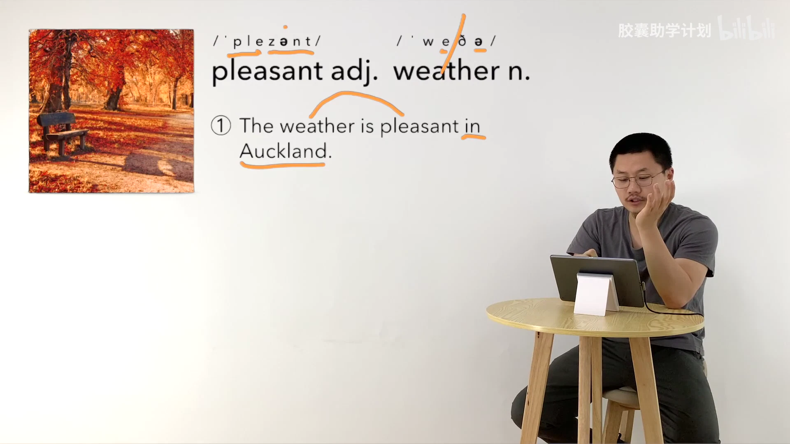

文字识别：胶囊助学计划 / /'plezant/ / W / pleasant adj. weather n. / ① The weather is pleasant in / Auckland.

## 00:07:30–00:08:00

呢？比如说冬天啊，最低温度七度啊，最高温度十五度啊，太阳出来的时候你还是很暖和的，也不会很冷。夏天呢也不热，是吧？最高温度二十度左右，是吧？高热了就是二十五度，然后呢最低温度呢十五度，你每天都感觉是凉凉快快的，一年四季如春啊，永远是有绿叶，有有这个绿草啊，很有意思。我们就可以说 the weather is pleasant in Auckland. 那你看，我们想问为什么的时候，

### 画面 00:07:30

文字识别：胶囊助学计划 / /'plezant/ / W / pleasant adj. weather n. / ① The weather is pleasant in / Auckland.

### 画面 00:07:52

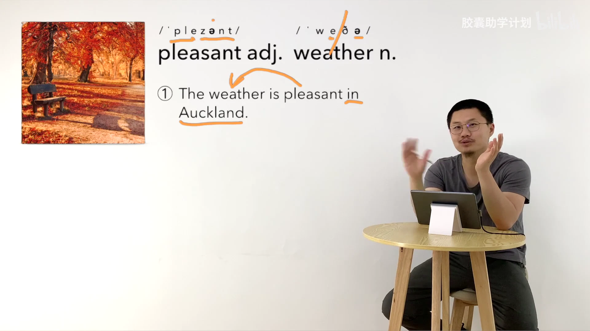

文字识别：胶囊助学计划 / /'plezant/ / W / pleasant adj. weather n. / ① The weather is pleasant in / Auckland.

### 画面 00:07:54

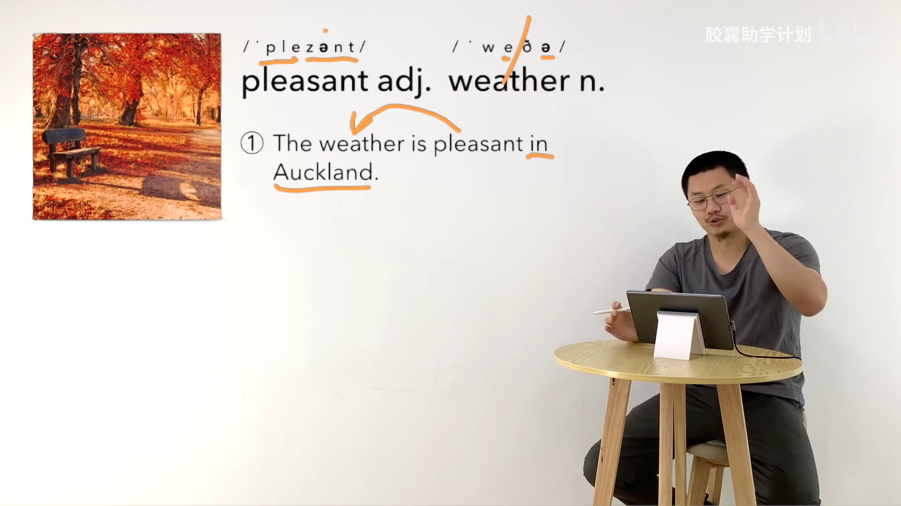

文字识别：胶囊助学计划 / /'plezant/ / W / pleasant adj. weather n. / ① The weather is pleasant in / Auckland.

### 画面 00:07:57

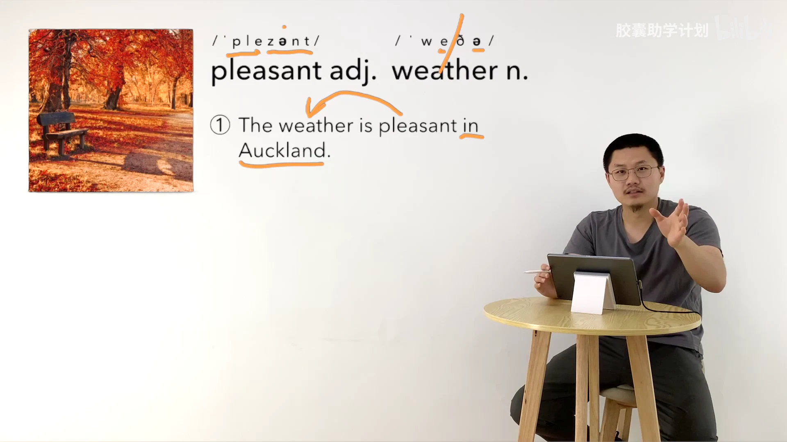

文字识别：胶囊助学计划 / /'plezant/ / W / pleasant adj. weather n. / ① The weather is pleasant in / Auckland.

### 画面 00:07:59

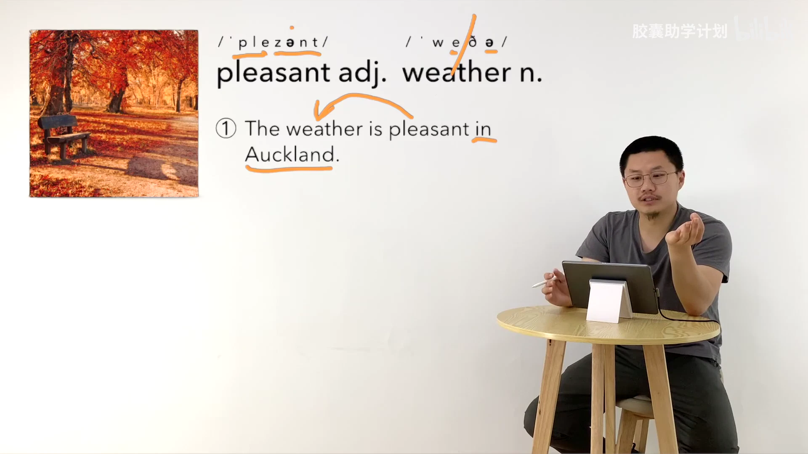

文字识别：胶囊助学计划 / /'plezant / / W / pleasant adj. weather n. / ① The weather is pleasant in / Auckland.

## 00:08:00–00:08:30

这是个特殊疑问句。我们想思路啊，在这个地方就教各位造句的思路。我们是先要把 is 提前，叫做 is the weather pleasant in Auckland？在奥克兰这座城市，哎，这个呃天气很宜人吗？然后就做的事情非常简单，在它前面再加一个小的单词叫做 why？为什么在那里天气很宜人？那这就涉及到气象学的事儿了，各位要自己去查了。OK，好，接下来很有意思。我们刚刚讲过

### 画面 00:08:01

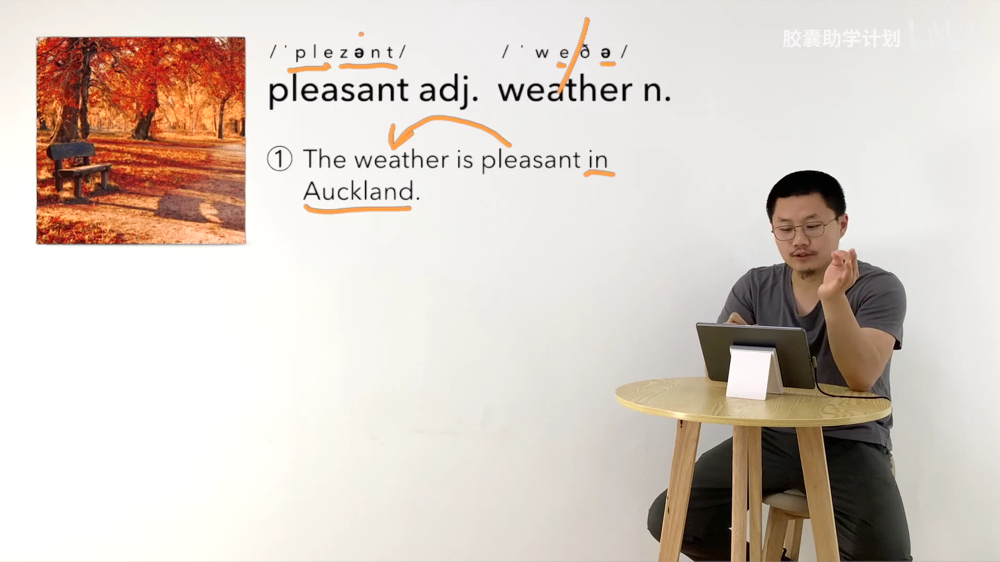

文字识别：胶囊助学计划 / /'plezant/ / W / pleasant adj. weather n. / ① The weather is pleasant in / Auckland.

### 画面 00:08:05

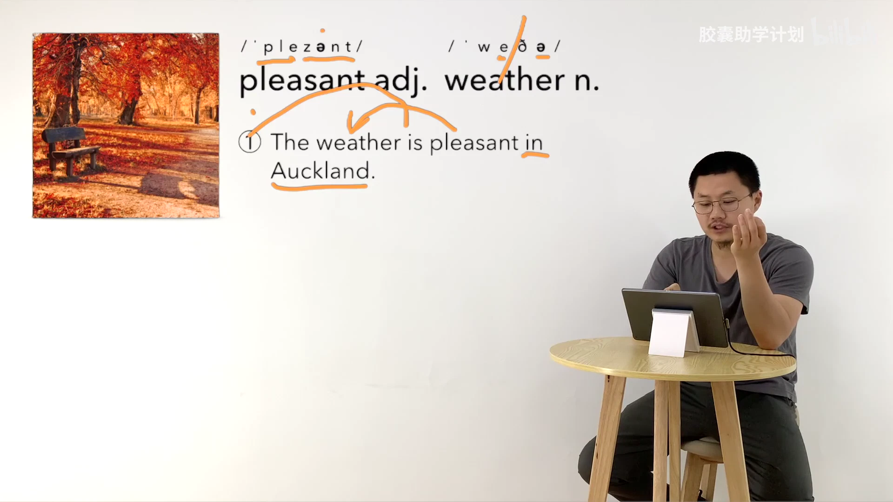

文字识别：胶囊助学计划 / /'plezant / / W / e / pleasant adj. / weather n. / The weather is pleasant in / Auckland.

### 画面 00:08:07

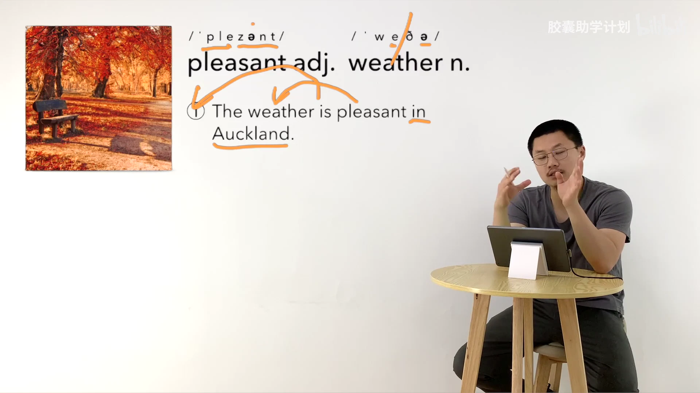

文字识别：胶囊助学计划 / /'plezant/ / W / e / pleasant adj. / weather n. / The weather is pleasant in / Auckland.

### 画面 00:08:10

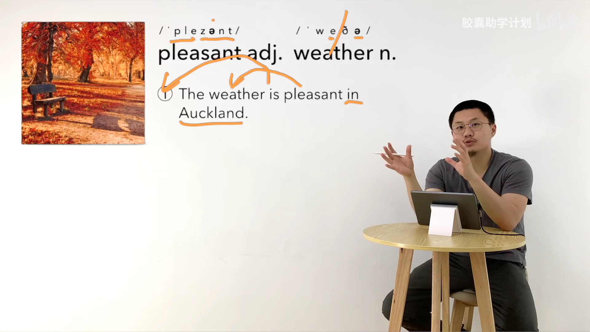

文字识别：胶囊助学计划 / /'plezant/ / W / e / pleasant adj. / weather n. / The weather is pleasant in / Auckland.

### 画面 00:08:14

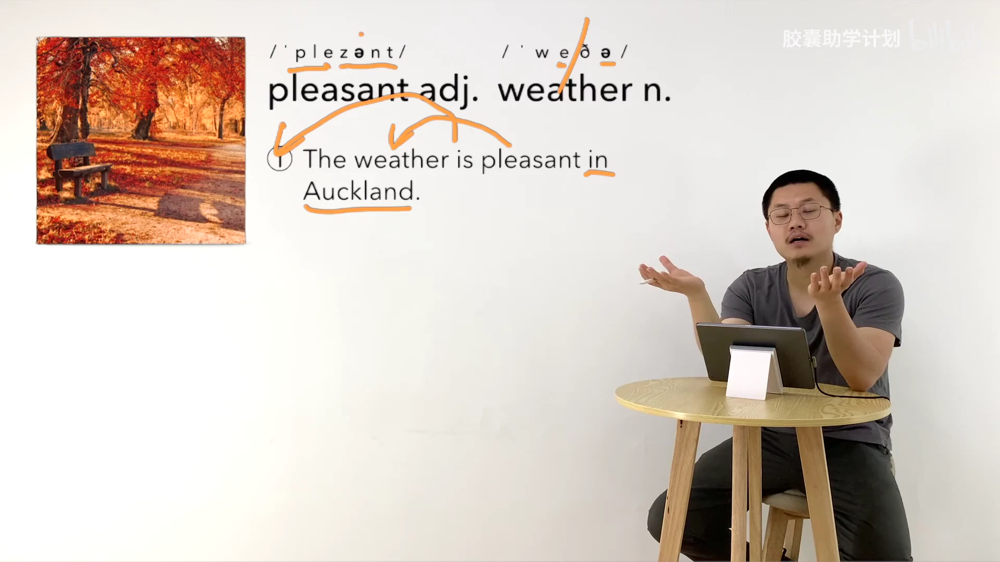

文字识别：胶囊助学计划 / /'plezant/ / W / e / pleasant adj. / weather n. / The weather is pleasant in / Auckland.

### 画面 00:08:17

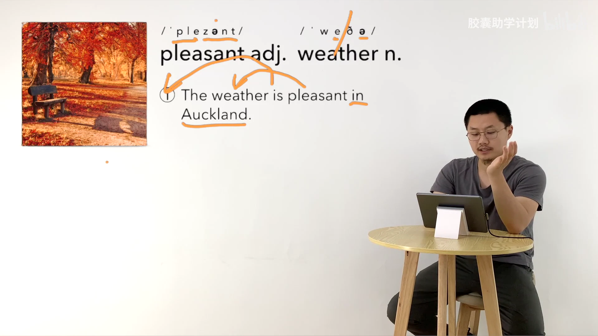

文字识别：胶囊助学计划 / /'plezant / / W / e / pleasant adj. / weather n. / The weather is pleasant in / Auckland.

### 画面 00:08:19

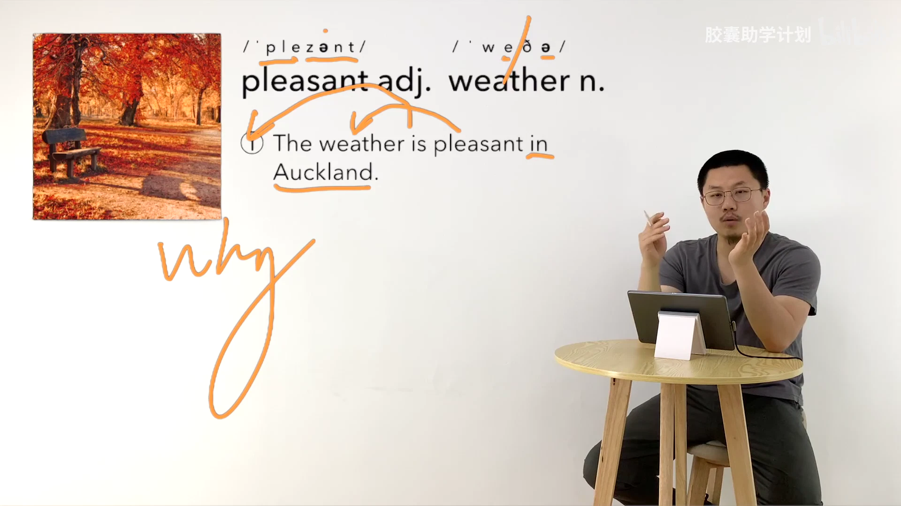

文字识别：胶囊助学计划 / /'plezant/ / W / e / pleasant adj. / weather n. / The weather is pleasant in / Auckland. / Wmn

### 画面 00:08:21

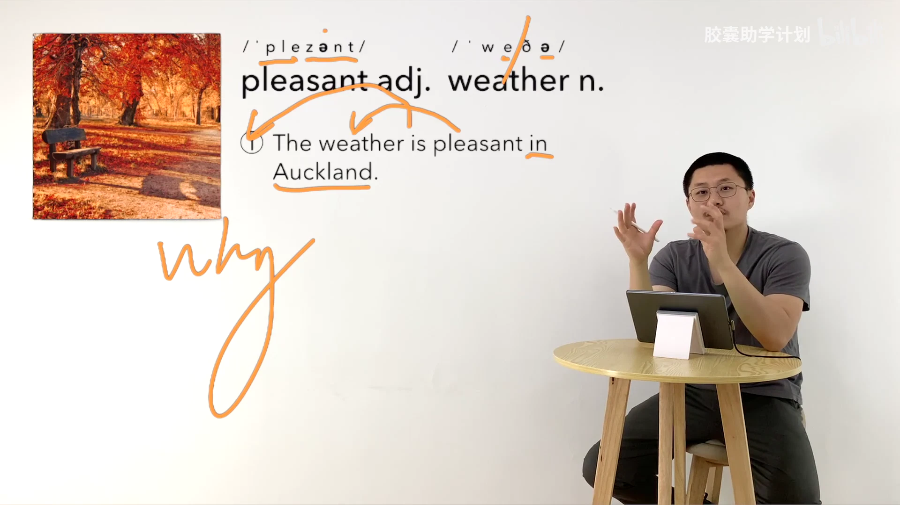

文字识别：胶囊助学计划 / /'plezant/ / W / e / pleasant adj. / weather n. / The weather is pleasant in / Auckland. / Wmn

### 画面 00:08:24

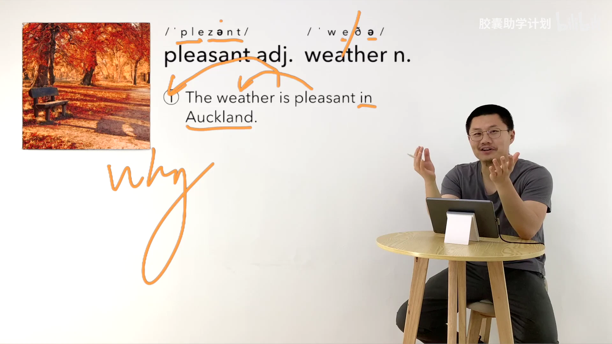

文字识别：胶囊助学计划 / /'plezant/ / W / e / pleasant adj. / weather n. / The\ / weather is pleasant in / Auckland. / Wmn

### 画面 00:08:26

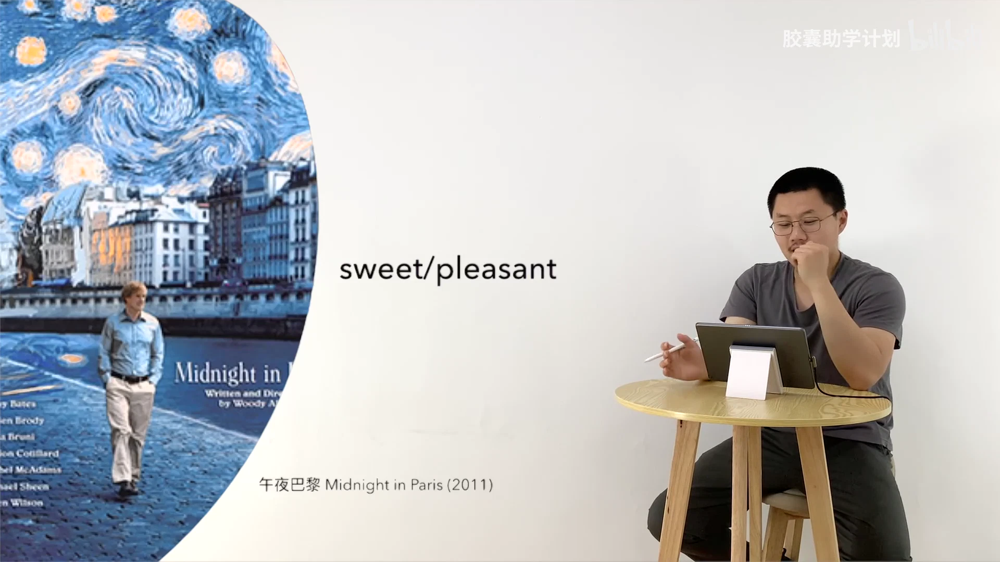

文字识别：胶囊助学计划 / sweet/pleasant / Midnight in / Wen and r / by WoodyA / rn Beody / 午夜巴黎 Midnight in Paris (2011)

### 画面 00:08:28

文字识别：胶囊助学计划 / sweet/pleasant / Midnight in / WYeien and Diry / by woodyA / Beody / 午夜巴黎 Midnight in Paris (2011)

## 00:08:30–00:09:00

了两个单词，其实都是刚学不久。一个是五十课学，一个五十一个学的。Sweet，我们指的是甜。那pleasant，刚才我们讲到说天气非常的宜人，它也可以去形容人。说一个人，He is sweet。说他这个人长起来很甜，什么意思？不是，是吧？说这个人啊，很有点像，比如说我们说很暖啊，暖男的那个暖。说这个人很暖，叫sweet，很甜。那pleasant呢，就是让人相处非常

### 画面 00:08:30

文字识别：胶囊助学计划 / sweet/pleasant / Midnight in / WYeten and DNry / bywoodyA / Beody / 午夜巴黎 Midnight in Paris (2011)

### 画面 00:08:32

文字识别：胶囊助学计划 / sweet/pleasant / Midnight in / WYeten and Diry / bywoodyA / rnBrody / 午夜巴黎 Midnight in Paris (2011)

### 画面 00:08:34

文字识别：胶囊助学计划 / sweet/pleasant / Midnight in / Weien and Dry / by woodyA / Beody / 午夜巴黎 Midnight in Paris (2011)

### 画面 00:08:36

文字识别：胶囊助学计划 / sweet/pleasant / Midnight in / WYeten and Diry / by woodyA / Beody / 午夜巴黎 Midnight in Paris (2011)

### 画面 00:08:38

文字识别：胶囊助学计划 / sweet/pleasant / Midnight in / WYiten and DNr / by woodyN / Beody / 午夜巴黎 Midnight in Paris (2011)

### 画面 00:08:40

文字识别：胶囊助学计划 / sweet/pleasant / Midnight in / Wviien and Diry / by woodyA / Beody / 午夜巴黎 Midnight in Paris (2011)

### 画面 00:08:42

文字识别：胶囊助学计划 / sweet/pleasant / Midnight in / WYinien and Diry / by Wbody N / Beody / 午夜巴黎 Midnight in Paris (2011)

### 画面 00:08:44

文字识别：胶囊助学计划 / sweet/pleasant / Midnight in / Wviten and DNry / by woody N / Beody / 午夜巴黎 Midnight in Paris (2011)

### 画面 00:08:46

文字识别：胶囊助学计划 / sweet/pleasant / Midnight in / Wveienand DNry / by woodyA / Beody / 午夜巴黎 Midnight in Paris (2011)

### 画面 00:08:48

文字识别：胶囊助学计划 / sweet/pleasant / Midnight in / WYitenand DNr / by woody / Brody / 午夜巴黎 Midnight in Paris (2011)

### 画面 00:08:50

文字识别：胶囊助学计划 / sweet/pleasant / Midnight in / Writen and Diry / by WoodyA / Brody / 午夜巴黎 Midnight in Paris (2011)

### 画面 00:08:52

文字识别：胶囊助学计划 / sweet/pleasant / Midnight in / Wvien and DNr / by WoodyA / Beody / 午夜巴黎 Midnight in Paris (2011)

### 画面 00:08:54

文字识别：胶囊助学计划 / sweet/pleasant / Midnight in / WYten and Dry / by woodyN / 午夜巴黎 Midnight in Paris (2011)

### 画面 00:08:56

文字识别：胶囊助学计划 / sweet/pleasant / Midnight in / wYten and DNry / by woadyA / Beody / 午夜巴黎Midnight in Paris (2011)

### 画面 00:08:58

文字识别：胶囊助学计划 / sweet/pleasant / Midnight in / WYeten and Dir / by WoodyA / Beody / 午夜巴黎 Midnight in Paris (2011)

## 00:09:00–00:09:30

的愉快，叫做 pleasant，它可以去形容人的。接下来我们看一下电影片段。 I didn't like that maid. I didn't like her from the beginning. I said that she was pleasant. She was sweet. You always take the side of the help. Okay, ah, sweet, pleasant, 可以形容人。各位在这儿记一下啊，口语。比如说我想说，嗯，你你这个人真好，真甜，叫 you are sweet. Okay，或者说你这个人非常令人觉得很舒服

### 画面 00:09:00

文字识别：胶囊助学计划 / sweet/pleasant / Midnight in / WYeten and DNry / by woady / tn Beody / 午夜巴黎 Midnight in Paris (2011)

### 画面 00:09:02

文字识别：胶囊助学计划 / sweet/pleasant / Midnight in / WYeten and Nr / by woodyA / Beody / 午夜巴黎 Midnight in Paris (2011)

### 画面 00:09:04

文字识别：胶囊助学计划 / sweet/pleasant / Midnight in / Wviten and DNr / by WoodyA / Beody / 午夜巴黎 Midnight in Paris (2011)

### 画面 00:09:06

文字识别：bilibili / 胶囊助学计划 / 我不喜欢那个服务员一开始我就讨厌她 / I didn't like that maid. I didn't like her from the beginning.

### 画面 00:09:08

文字识别：bilibili / 胶囊助学计划 / 我不喜欢那个服务员 / 员一开始我就讨厌她 / I didn't like that maid. I didn't like her from the beginning.

### 画面 00:09:10

文字识别：bilibili / 胶囊助学计划 / 她很可爱 / 也很讨人喜欢 / 还很乐观 / She was sweet. / She / was / pleasant. / She was upbeat!

### 画面 00:09:12

文字识别：bilibili / 胶囊助学计划 / 你总是站在弱势一方 / You always / take / the side of the help, as usual!

### 画面 00:09:14

文字识别：bilibili / 胶囊助学计划 / 你总是站在弱势一方 / You always / take / the side of the help, as usual!

### 画面 00:09:16

文字识别：胶囊助学计划 / sweet/pleasant / Midnight in / WYlten and Dry / bywoodA / tn Beody / 午夜巴黎 Midnight in Paris (2011)

### 画面 00:09:18

文字识别：胶囊助学计划 / sweet/pleasant / Midnight in / Wytes and Ory / bywodyA / en Beody / 午夜巴黎 Midnight in Paris (2011)

### 画面 00:09:20

文字识别：胶囊助学计划 / sweet/pleasant / Midnight in / WYtenand DNr / by wodyA / tn Beody / 午夜巴黎 Midnight in Paris (2011)

### 画面 00:09:22

文字识别：胶囊助学计划 / sweet/pleasant / Midnight in / WYnaNd Dir / by wodyA / rn Beody / 午夜巴黎 Midnight in Paris (2011)

### 画面 00:09:24

文字识别：胶囊助学计划 / sweet/pleasant / Midnight in / WYwtin and DNry / by woodyA / en Beody / hnel / 午夜巴黎 Midnight in Paris (2011)

### 画面 00:09:26

文字识别：胶囊助学计划 / sweet/pleasant / Midnight in / WYtn aNd Diry / by woodyA / Beody / 午夜巴黎 Midnight in Paris (2011)

### 画面 00:09:28

文字识别：胶囊助学计划 / sweet/pleasant / Midnight in / WYs and r / by WoodyA / en Beody / 午夜巴黎 Midnight in Paris (2011)

## 00:09:30–00:10:00

啊，叫做 you are a very pleasant guy. You are very pleasant. Okay, okay. 接下来我们看四个小的单词，春夏秋冬。同理啊，接下来春夏秋冬之后，我们又会学到一到十二月。各位还是他一口气儿出来，各位会非常的紧张或焦虑，我是能理解的。注意我对各位的要求啊，您不用今天把它记下来，就每天看两遍，每天看两遍。等你从今天开始，对吧？有意识的看

### 画面 00:09:30

文字识别：胶囊助学计划 / sweet/pleasant / Midnight in / WYten and Nr / bywoodyA / tn Beody / 午夜巴黎 Midnight in Paris (2011)

### 画面 00:09:32

文字识别：胶囊助学计划 / sweet/pleasant / Midnight in / Wten and Nr / by WoodA / tn Brody / 午夜巴黎 Midnight in Paris (2011)

### 画面 00:09:34

文字识别：胶囊助学计划 / sweet/pleasant / Midnight in / Wnand Nr / by WoodyA / en Beody / 午夜巴黎 Midnight in Paris (2011)

### 画面 00:09:36

文字识别：胶囊助学计划 / /sprin//sΛma/ /o:tam//'winta/ / spring summer autumn winter

### 画面 00:09:38

文字识别：胶囊助学计划 / /sprin//·sΛma//'o:tam/ /'winta/ / spring summer autumn winter

### 画面 00:09:48

文字识别：胶囊助学计划 / /sprin//sΛma//o:tam//'winta/ / spring summer autumn winter

## 00:10:00–00:10:30

它，看到新概念一册结束，你也看了，估计大概小半年了，肯定就记下来了，不用专门去背它。除非你明天要考试考到这个，否则您不用专门花时间背啊，多看就可以了。那我们先看一下音标，春天注意一个小点，这儿要浊化，对吧？这个地方要浊化啊，叫 spring， spring， OK，好，夏天读一下 summer， summer， 秋

### 画面 00:10:17

文字识别：胶囊助学计划 / /sprin//sΛma/ /'o:tam//'winta/ / spring summer autumn winter

## 00:10:30–00:11:00

天. In杰, autumn, autumn,冬天. Winter, winter, very good.那接下来我说在春天在夏天啊在春夏秋冬就前面加一个小的时间介词。其实in这个单词我们见过，叫在什么什么的里面，对吧？那叫做in spring, in summer, in autumn，或者是in winter。你比如说，你可以说What's the weather like？

### 画面 00:10:34

文字识别：胶囊助学计划 / /sprin//sama/ / :tam/ /'winta/ / 5： / spring / summer autumn winter

### 画面 00:10:42

文字识别：胶囊助学计划 / 2itam/ /winta/ / /sprin//sΛma / spring / summera / autumn / winter / ① in spring/summer/autumn/winter

## 00:11:00–00:11:30

这一句话各位还记得吧？我们之前刚刚学过，对吧？叫做 in spring in your country，或者说 in Beijing。那北京的春天天气怎么样呢？OK，我们说春脖子短，对吧？OK， continue。下一个单词，注意它是个形容词。我们先一起读一下，叫做 windy， windy，啊，就是刮风的。那我们说 What's the weather like today？注意，我们实际上是把 climate

### 画面 00:11:12

文字识别：胶囊助学计划 / 2:tam/ /winta/ / /sprn//sAma/ / spring / summer a / autumn / winter / ① in spring/summer/autumn/winter

### 画面 00:11:14

文字识别：胶囊助学计划 / /'wIndi/ / windy adj.

### 画面 00:11:19

文字识别：胶囊助学计划 / /'windi/ / windy adj.

### 画面 00:11:25

文字识别：胶囊助学计划 / /'windi/ / windy adi. / D What's the weather like today?

## 00:11:30–00:12:00

换成了 weather 这个单词，对吧？把后边的 in Beijing 换成了 today，本质上差别不大。说今儿天气怎么样呢？回答 It's windy. 啊，今儿刮大风了。It's windy. Very good. 好，下一个单词跟我一起读，叫做 warm. Warm. OK，还是注意一个小点，它是一个形容词。形容词那很可能就可以连着什么，连着什么名词，对不对？去造句的时候，比如说

### 画面 00:11:30

文字识别：胶囊助学计划 / /'wIndi/ / windy adi. / ① What's the weather like today?

### 画面 00:11:37

文字识别：胶囊助学计划 / /'wIndi/ / windy adj. / ① What's the weather liketoday?

### 画面 00:11:44

文字识别：胶囊助学计划 / /w3:m/ / warm adj.

### 画面 00:11:46

文字识别：胶囊助学计划 / /w3:m/ / warm adj.

### 画面 00:11:49

文字识别：胶囊助学计划 / /w3:m/ / warm adj.

### 画面 00:11:51

文字识别：胶囊助学计划 / /w3:m1 / warm adj.

### 画面 00:11:54

文字识别：胶囊助学计划 / /wo:m/ / warm adj. / ① I like warm tea in winter.

### 画面 00:11:57

文字识别：胶囊助学计划 / / w o:m 1 / warm adj. / ① I like warm tea in winter.

### 画面 00:11:59

文字识别：胶囊助学计划 / / w o:m 1 / fn / warm adj. / ① I like warm tea in winter.

## 00:12:00–00:12:30

我在这儿就连了一个 tea。你比如说 I like tea，这个是不是各位在第四十七课就学过的，对吧？I like tea，I like coffee 等等这样一句话。那我们现在只不过在它前面加了一个小的形容词，这句话就造出来了，叫 I like warm tea。我喜欢暖茶，对吧？有的人喜欢凉茶，有的人喜欢暖茶，有人喜欢热茶，hot tea，warm tea，cold tea。OK，那我们又多加了一个小的时间点，叫做 in winter。啊，OK，小

### 画面 00:12:01

文字识别：胶囊助学计划 / /wo:m/ / fn / warm adj. / ① I like warm tea in winter.

### 画面 00:12:03

文字识别：胶囊助学计划 / /w 3:m/ / fn. / warm adj. / ① I like warm tea in winter.

### 画面 00:12:06

文字识别：胶囊助学计划 / /w3:m/ / fn / warm adj. / ① I like warm tea in winter.

### 画面 00:12:10

文字识别：胶囊助学计划 / /wo:m/ / fn. / warm adj. / ① I like warm tea in winter.

### 画面 00:12:14

文字识别：胶囊助学计划 / / w 3:m1 / fn. / warm adj. / ① I like warm tea in winter.

### 画面 00:12:20

文字识别：胶囊助学计划 / /w o:m / / fn. / warm adj. / ① I like warm tea in winter.

### 画面 00:12:23

文字识别：胶囊助学计划 / /wo:m/ / fn. / warm adj. / ① I like warm tea in winter.

### 画面 00:12:25

文字识别：胶囊助学计划 / /w3:m1 / fn. / warm adj. / ① I like warm tea in winter.

### 画面 00:12:28

文字识别：胶囊助学计划 / / w3:m/ / fn / warm adj. / ① Ilike warm teain winter.

## 00:12:30–00:13:00

Continuing. Say what's the weather like in spring?春天天气怎么样呢？答案很答案很简单，叫做 is warm in spring. 注意一个小点，这是浊化了，不是 spring 啊，是 spb spring. There we go. 好，接下来下一个单词跟我读一下，下雨 rain rain. Okay. 然后还有一个单词叫 sometimes. 你仔细看这个单词，哎，你好像

### 画面 00:12:30

文字识别：胶囊助学计划 / /w3:m/ / fn / warm adj. / ① Ilike warm teain winter. / What's the weather like ih spring?

### 画面 00:12:32

文字识别：胶囊助学计划 / / w 3:m 1 / fn / warm adj. / ① I like warm teain winter. / What's the weather like in spring?

### 画面 00:12:34

文字识别：胶囊助学计划 / / w 3:m/ / fn / warm adj. / ① I like warm tea in winter. / What's the weather like in spring?

### 画面 00:12:37

文字识别：胶囊助学计划 / /wo:m/ / fn / warm adj. / ① I like warm tea in winter. / What's the weather like in spring? / It's warm in spring. / 人

### 画面 00:12:41

文字识别：胶囊助学计划 / 1w3:m1 / fn / warm adj. / ① I like warm tea in winter. / What's the weather like in spring? / It's warm in spring.

### 画面 00:12:44

文字识别：胶囊助学计划 / /w3:m1 / fn / warm adj. / ① I like warm tea in winter. / What's the weather like in spring? / It's warm in spring. / 人

### 画面 00:12:47

文字识别：胶囊助学计划 / /rein/ / /'sΛmtaImz / / rain v. sometimes

### 画面 00:12:56

文字识别：胶囊助学计划 / /rein/ / / 'sΛmt aImz 1 / rain v. sometimes

## 00:13:00–00:13:30

的，some你认的，time你认的，只不过不知道为什么后边加了个s，是吧？它不是加了个s啊，这个单词就是有一个s结尾，叫sometimes，叫做有时。那我们先造一句话吧，sometimes，有时，it rains in spring。好，注意有时啊，春天下雨。我们先注意几个小点，第一，我在动词后边加了s，主语是第三人称，并且是单数，指

### 画面 00:13:03

文字识别：胶囊助学计划 / /rein/ / 'sΛmtaImz / / rain v. sometime / S

### 画面 00:13:17

文字识别：胶囊助学计划 / /rein/ / 'sΛmt aImz1 / rain v. sometimes / ① Sometimes, it rains in spring.

### 画面 00:13:24

文字识别：胶囊助学计划 / /rein/ / / 'sΛm t a I m z 1 / rain v. sometimes / ① Sometimes, it rains in spring.

## 00:13:30–00:14:00

的就是老天天气，对吧？说天气啊会下雨啊，就是会下雨。汉语直接把主语省略了。在春天，有时春天下雨。你注意，这是陈述一个客观事实，对不对？一般现在时。所以我想把它变一般疑问句，肯定就是Does提前，Rain换回原形。四十九课一模一样的知识点。Does it rain in spring sometimes?好，接下来关键点是，如果我想

### 画面 00:13:54

文字识别：胶囊助学计划 / /rein/ / / 'sΛm t aIm z 1 / rain v. sometimes / ① Sometimes, it rains in spring. / Does it rain in spring sometimes?

## 00:14:00–00:14:30

对 sometimes 提问，我应该用谁？我应该如果我想对 in spring 提问，我应该用谁？对吧？ Sometimes 提问，有时你要用频率去提问，叫做 how often？ Okay，所以答案就是 how often does it rain in spring？说春天啊，多长时间下一次雨？频率是什么样子的？答案就是时不时的下一场，也不是很多，对吧？由情况决

### 画面 00:14:01

文字识别：胶囊助学计划 / /rein/ / 'sΛmtaImz1 / rain v. sometimes / ① Sometimes, it rains in sprina. / Does it rain in spring / sometimes?

### 画面 00:14:09

文字识别：胶囊助学计划 / /rein/ / sΛm / taⅠm z1 / rain / sometimes / V. / 1 / Sometimes, it rains in sprina. / Does / it rain / in / spring / sometimes? / How / often / does it rain in spring?

### 画面 00:14:26

文字识别：胶囊助学计划 / /rein/ / sΛm / taⅠm z/ / sometimes / rain / V. / 1 / Sometimes, it rains in sprina. / Does / it rain / in. / spring / sometimes? / How / often / does it rain in spring?

## 00:14:30–00:15:00

定啊。梅雨季节的南方，那就是天天下；北方呢，春天时下时不下，叫做 sometimes。 OK，好，接下来我们继续看下一个单词，跟我读 snow，snow 叫做雪。那 sometimes 叫做有时啊。我们造同样的句子，叫做 sometimes it snows in winter。有的时候啊，冬天下雪。变一般疑问句，Does it snow in winter sometimes？一模

### 画面 00:14:37

文字识别：胶囊助学计划 / Isnaul / /'sΛmtaImz / / snow v. sometimes

### 画面 00:14:46

文字识别：胶囊助学计划 / /snaul / / 'sΛm t aImz / / snow v. sometimes

### 画面 00:14:55

文字识别：胶囊助学计划 / /snau/ / / 'sΛmtaⅠmz / / snow v. sometimes / ① Sometimes, it snows in winter. / ② Does it snow in winter sometimes?

## 00:15:00–00:15:30

一样，对吧？Does提前动词换回原形，对？Sometimes提问用How often？答案是How often does it snow in winter？Very good.好，接下来，接下来就到了我们漫长的一到十二月份了，对吧？OK，再提一句，各位不用今天非得把它背下来，搞得自己压力很大。您今天看着音标能把它读出来，这个任务就结束了。OK，啊，如果你还，比如说

### 画面 00:15:11

文字识别：胶囊助学计划 / /ma:t∫/ /'eipral/ /mer/ / March April May

### 画面 00:15:13

文字识别：胶囊助学计划 / /ma:t∫/ /'eipral/ /mer/ / March April May

### 画面 00:15:15

文字识别：胶囊助学计划 / /ma:t∫/ /'eipral/ /mer/ / March April May

### 画面 00:15:19

文字识别：胶囊助学计划 / /ma:t∫/ /'eipral/ /mer/ / March April May

## 00:15:30–00:16:00

你说我我不焦虑，我不紧张，我就想把它都背起来，行不行？行。但是如果你不能，很可能状态是，如果您以前没背过，今天把这十二个单词背起来比较困难，您就往后拖，每天看几遍，每天读几遍，相信我，慢慢您就记下来了。Okay，那我们先看单词拼啊，三四五啊，三四五，March，March，三月份，四月份，

### 画面 00:15:32

文字识别：胶囊助学计划 / /ma:t∫/ /'eipral/ /mer/ / March April May

### 画面 00:15:45

文字识别：胶囊助学计划 / /ma:t∫/ /'eipral/ /mer/ / March April May

### 画面 00:15:47

文字识别：胶囊助学计划 / /ma:t∫/ /'eipral/ /mer/ / March April May

### 画面 00:15:52

文字识别：胶囊助学计划 / /ma:t∫/ /'eipral/ / /mei/ / March April May

## 00:16:00–00:16:30

April April OK 五月份 May May 注意他们都是 Spring 啊，这是我们中国给的一个官方答案，叫 Spring，叫做春天。 Continue 注意啊，今天的任务不是拿他们去造句，就是看音标能读就行了。来 June July August

### 画面 00:16:04

文字识别：胶囊助学计划 / /ma:t∫/ /'eipral/ / /meI/ / March / n April / May

### 画面 00:16:16

文字识别：胶囊助学计划 / /d3uin/ /dzu'lar/ /'o:gast/ / June July August

## 00:16:30–00:17:00

August, OK,六七八，那他们统称为叫做summer，对吧？冬天，呃呃，夏天。Continue，接下来，秋天，音标变长了，但其实变简单了啊。September, September，九月。October，十月，October，十一月，November, November,

### 画面 00:16:33

文字识别：胶囊助学计划 / /d3uin/ /d3u'lar/ /'o:gast/ / June July August / summer

### 画面 00:16:38

文字识别：胶囊助学计划 / /sep'temba/ /pk'tauba//nau'vembai / September October November

### 画面 00:16:40

文字识别：胶囊助学计划 / /sep'temba/ /pk'tauba//nau'vembai / September October November

### 画面 00:16:43

文字识别：胶囊助学计划 / /sep'temba/ /pk'tauba/ /nau'vembai / September October November

### 画面 00:16:45

文字识别：胶囊助学计划 / /sep'temba/ /pk'tauba/ /nau'vemba/ / September October November

### 画面 00:16:48

文字识别：胶囊助学计划 / /sep'temba/ /pk'tauba//nau'vemba/ / September October November

### 画面 00:16:50

文字识别：胶囊助学计划 / /sep'temba/ /pk'tauba/ /nau'vembai / September October November

### 画面 00:16:52

文字识别：胶囊助学计划 / /sep'temba/ /pk'tauba//nau'vembai / September October November

### 画面 00:16:54

文字识别：胶囊助学计划 / /sep'temba/ /pk'tauba//nau'vemba/ / September October November

### 画面 00:16:56

文字识别：胶囊助学计划 / /sep'temba/ /pk'tauba/ /nau'vemba/ / September October November

### 画面 00:16:58

文字识别：胶囊助学计划 / /sep'temba/ /pk'tauba//nauvembai / September October November

## 00:17:00–00:17:30

OK,他们统称为autumn，叫做秋天。Continue，接下来December，十二月份。December，你看啊，如果你会自然拼读法则，那课您有好好听，音标你有好好学，通过音标它的发音你会了。通过自然拼读法则，你想一下December，你看基本上只有两个字母e，你无法判断，

### 画面 00:17:01

文字识别：胶囊助学计划 / /sep'temba/ /pk'tauba//nau'vemba/ / September October November / autumn

### 画面 00:17:03

文字识别：胶囊助学计划 / /sep'temba/ /pk'tauba//nau'vemba/ / September October November / autumn

### 画面 00:17:05

文字识别：胶囊助学计划 / / dI'sem b a/ /'dzæenjuari/ /'februari/ / December January February

### 画面 00:17:14

文字识别：12 / 胶囊助学计划 / / dI'sem b a/ /'dzæenjuari/ /februari/ / December January February

## 00:17:30–00:18:00

剩下通过自然拼读法则，d放单词当中去发的嘛，c可以发s，m就发嗯，b就发b，对吧？然后e r在后边来个r加儿化音，你只有两个字母需要背，就是这儿有一个e，这儿有一个e，就对于你来说，你可能去拼的时候是这个状态，December，然后这两个是什么？这就是自然拼读法则帮我们拼单词的一个重要点。OK，下一个单词，

### 画面 00:17:30

文字识别：12 / 胶囊助学计划 / / dIsem b a/ /'dzænjuari/ / 'februari/ / Deēmber January February

### 画面 00:17:38

文字识别：し1z / 胶囊助学计划 / / dI'sem ba/ /'dzænjuari/ /februari/ / De:ember January / February

### 画面 00:17:44

文字识别：12 / 胶囊助学计划 / /dⅠ'sem / ba / /'dzænjuari/ /'februari/ / ember / January / February / D

### 画面 00:17:49

文字识别：12 / と / 胶囊助学计划 / /dI'semba / /'dzænjuari/ /'februari/ / 2e:ember. / January / February / D

### 画面 00:17:52

文字识别：12 / 胶囊助学计划 / /dⅠ' / sembal / /'dzænjuari/ /'februari/ / O / Peember / January / February / 2_c_mber

### 画面 00:17:57

文字识别：12 / 胶囊助学计划 / /dI / sembal / /'dzænjuari/ /'februari/ / O / :0mber / January / February / _C_mber

## 00:18:00–00:18:30

January, January, January. Okay, January, 一月份 February, February, February, February. Okay, very good. 然后注意这个地方就是二月，那他们统称为 Winter，好，冬天 Very good. Recap，看一下本课的关键点。首先第一个关键点，实

### 画面 00:18:11

文字识别：12 / 胶囊助学计划 / /dⅠ / se / m / ba / /'d3ænjuari/ / /'februari/ / kember / January / February / D / C_mber

### 画面 00:18:24

文字识别：胶囊助学计划 / Recap / Patterns / He / comes / from / Greece. / Does / he come / from Greece? / Grammar / Where / does he come from? / Words / Expression / She is pleasant!

## 00:18:30–00:19:00

际上也是接下来会不停练习的一个点啊，五一五二五三五四，我们会不停的见到这个句型，三个句型，肯定句、一般疑问句和特殊疑问句。接下来我们要明白一个小事儿，pleasant给大家做了一个小的拓展，它的使用范围不仅可以表达天气，还可以表达形容一个人，very pleasant，非常的令人舒服，非常令人相处愉快，叫做pleasant。OK，看一下家庭作业，首先

### 画面 00:18:30

文字识别：Recap / 胶囊助学计划 / Patterns / He / comes / from / Greece. / & / Does / he come / from / Greece? / Grammar / Where does he come / from? / Words / Expression / She is pleasant!

### 画面 00:18:32

文字识别：Recap / 胶囊助学计划 / Patterns / He / comes / from / Greece. / & / Does / he come / from / Greece? / Grammar / Where does he come from? / Words / Expression / She is pleasant!

### 画面 00:18:41

文字识别：Recap / 胶囊助学计划 / Patterns / He / comes / from / Greece. / Does / he come / from / Greece? / Grammar / Where does he come from? / Words / Expression / She is pleasant!

### 画面 00:18:45

文字识别：Recap / 胶囊助学计划 / Patterns / He / comes / from / Greece. / Does / he come / from / Greece? / Grammar / Where does he come from? / Words / Expression / She is pleasant!

### 画面 00:18:58

文字识别：胶囊助学计划 / 单词造句

## 00:19:00–00:19:30

各位今天去尝试单词造句，但是您可以不用造十二个月份。OK，除了这十二月份，剩下您尝试去单词造一下句，就是结合我上课给各位讲的这些例句，您做一些要么四句型转换呀，要么比如说我换个时间呢，要么换个时态呀，换个结构啊，用这样的方式去进行一些单词造句。OK，其次呢，给自己讲解一遍今天的核心知识点。

### 画面 00:19:28

文字识别：胶囊助学计划 / 单词造句 / 请给自己讲解一遍今天的 / 核心知识点

## 00:19:30–00:20:00

那如果大家喜欢我们的课程，欢迎大家关注、订阅、一键三连，分享给那些需要的朋友。最后，我们再来看一句名人名言：Advice is like snow; the softer it falls, the longer it dwells upon, and the deeper it sinks into the mind. See you next time.

### 画面 00:19:30

文字识别：胶囊助学计划

### 画面 00:19:32

文字识别：胶囊助学计划 / 不 / ￥

### 画面 00:19:37

文字识别：胶囊助学计划 / 不

### 画面 00:19:39

文字识别：胶囊助学计划 / Advice is like snow - the softer it falls, the / longer it dwells upon, and the deeper it / sinks into the mind. / -Samuel Taylor Coleridge

### 画面 00:19:51

### 画面 00:19:53

文字识别：CAPSULEACADEMY / 胶囊助学计划 / 小红书 / Lecturer / Leo / OE

### 画面 00:19:56

文字识别：CAPSULEACADEMY / 胶囊助学计划 / 『 / 小红书 / Editor

### 画面 00:19:59

文字识别：CAPSULEACADEMY / 胶囊助学计划 / 小红书 / Creator / Leo & Berlin

## 00:20:00–00:20:03

### 画面 00:20:01

文字识别：Bilibili / 胶囊助学计划 / 胶囊助学计划 / 足品 / 小红书 / 只识

### 画面 00:20:03

文字识别：bilibili / 胶囊助学计划

