# 052 单词 练习

快速机器解析：语音为单模型转写，未进行独立交叉校对或人工复核；画面每秒采样并按变化选帧，短时文字和标记可能遗漏。截图时间约有 1 秒误差。图片有损压缩；遇到疑点请按时间查看 Google Drive 原视频。

## 00:00:00–00:00:30

Hello everyone, welcome to Capsule Academy. This is Leo. Today we are going to learn in Concept English Book One Lesson Fifty Two Practices and Words. Hope you guys enjoy it.好，我们先看前两个单词啊。第一个，美国叫做跟我读，the U S.美国是吧？它是缩写 United States，啊，美利坚合众国的缩写叫做 the U S. OK，所以你看这两个点儿就是在

### 画面 00:00:00

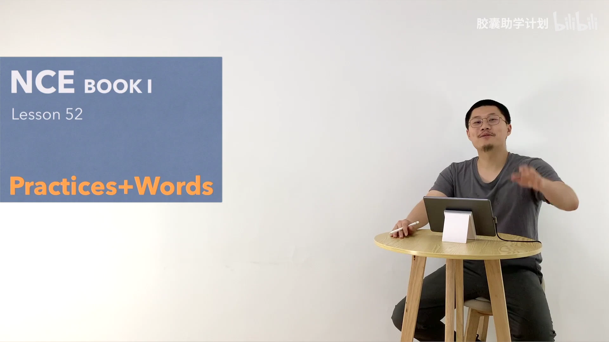

文字识别：胶囊助学计划 / NCE / BOOKI / Lesson 52 / Practices+Words

### 画面 00:00:08

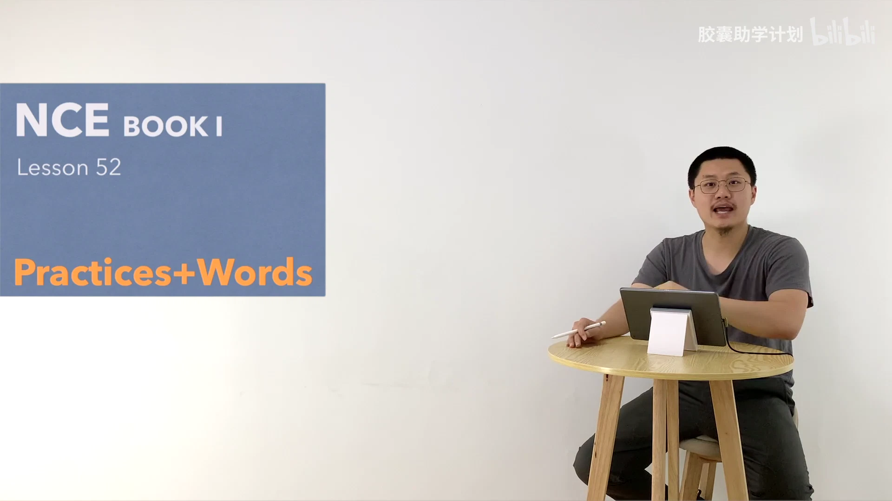

文字识别：胶囊助学计划 / NCE / BOOKI / Lesson 52 / Practices+Words

### 画面 00:00:11

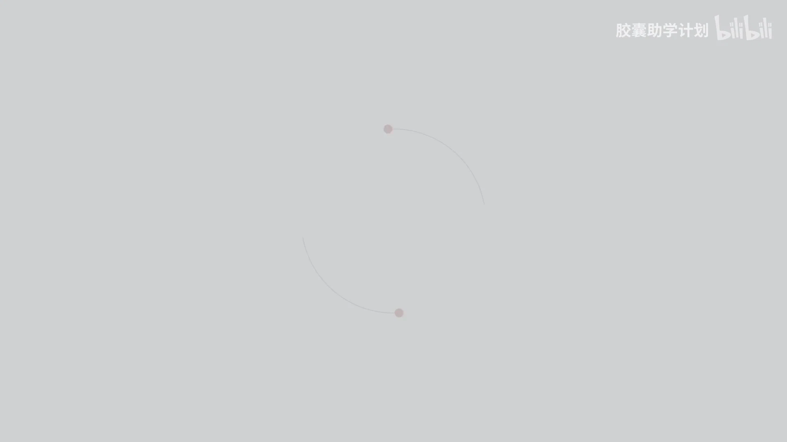

文字识别：胶囊助学计划bl出 / •

### 画面 00:00:15

### 画面 00:00:17

文字识别：胶囊助学计划 / the U.S. / /bra'zil/ / Brazil

### 画面 00:00:20

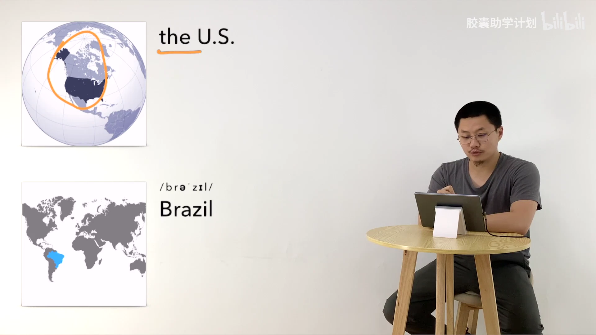

文字识别：胶囊助学计划 / the U.S. / /bra'zil/ / Brazil

## 00:00:30–00:01:00

告诉各位，这两个大写的U跟S是一个单词的缩写。接下来跟我读这个单词叫做Brazil，它在哎刚才这是美国对吧？那它在下面啊，上上北下南，它在南美啊，南美应该是最大的国家了，叫做Brazil，巴西。那我们拿它们去尝试造句啊。接下来啊，我们本课讲的都是跟国家相关的单词。我还是那句话，各位您不用着急，今

### 画面 00:00:42

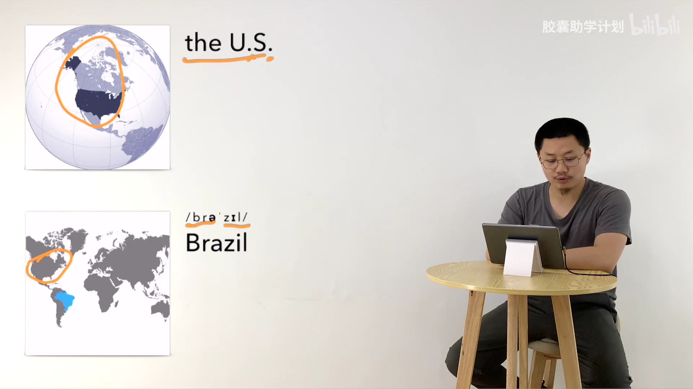

文字识别：胶囊助学计划 / the U.S. / /bra'zil/ / Brazil

### 画面 00:00:51

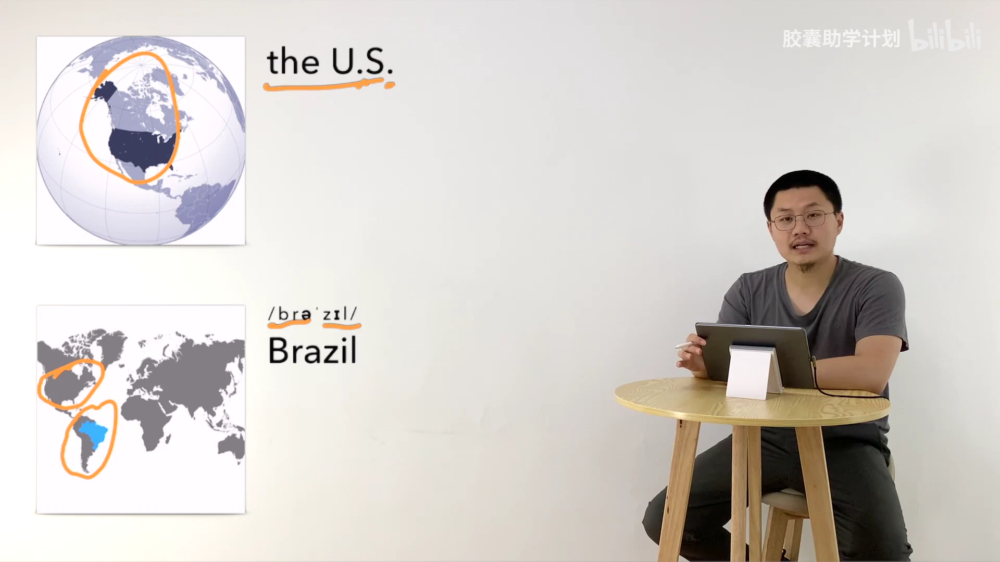

文字识别：胶囊助学计划 / the U.S. / /bra'zil/ / Brazil

## 00:01:00–00:01:30

天把它全背下来啊。各位要做的事情是什么呢？比如说，我个人建议啊，除非你是为了考试而考试有这些东西啊，如果不是为了这些，那你就不妨把，比如说这个国家我特感兴趣，我想去，你就先把它记下来，然后先拿它造句。OK，剩下那些国家，比如说我暂时没兴趣，可以暂时先不管它，以后出现咱们再查啊。但是今天更多的是得通过音标把它们拼出来啊，以及我们的重点呢是这些句

### 画面 00:01:01

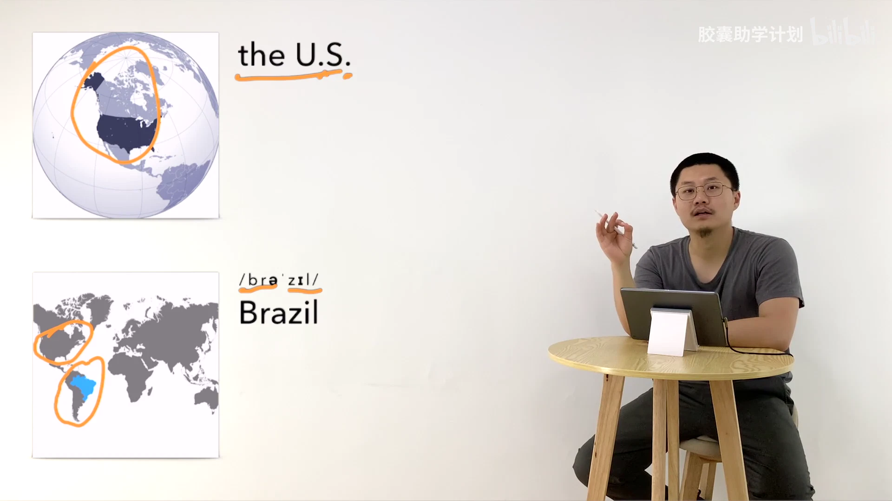

文字识别：胶囊助学计划 / the U.S. / /bra'z1l/ / Brazil

### 画面 00:01:28

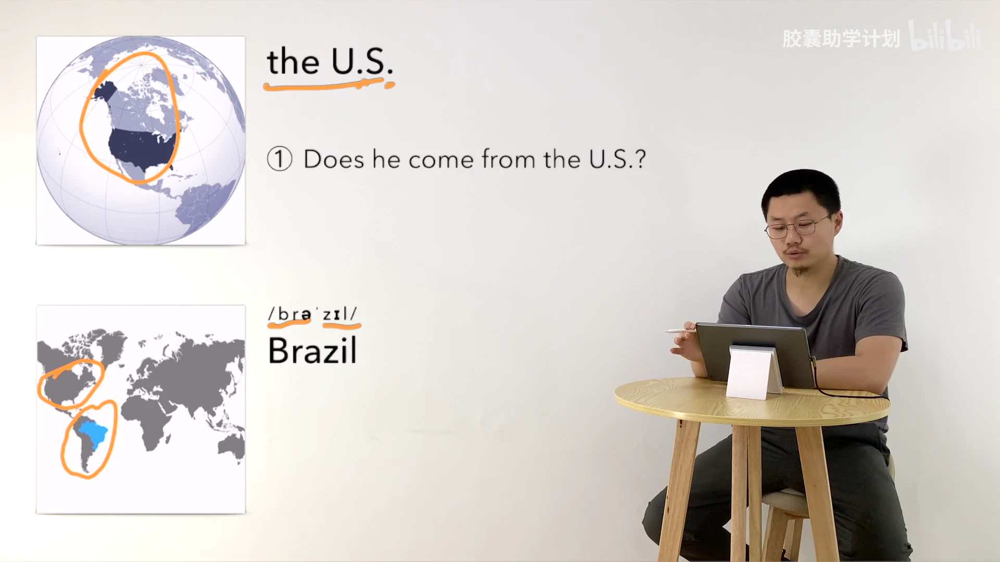

文字识别：胶囊助学计划 / the U.S. / ① Does he come from the U.S.? / /bra'zil/ / Brazil

## 00:01:30–00:02:00

型，张嘴跟我读，Does he come from the U.S.? No, he doesn't come from the U.S. He comes from Brazil. 注意重音在后面，所以是Brazil, Brazil. OK, very good. Continue. Do you come from Brazil? No, I don't come from Brazil. I come from the U.S. 哎，关键句型其实就是

### 画面 00:01:40

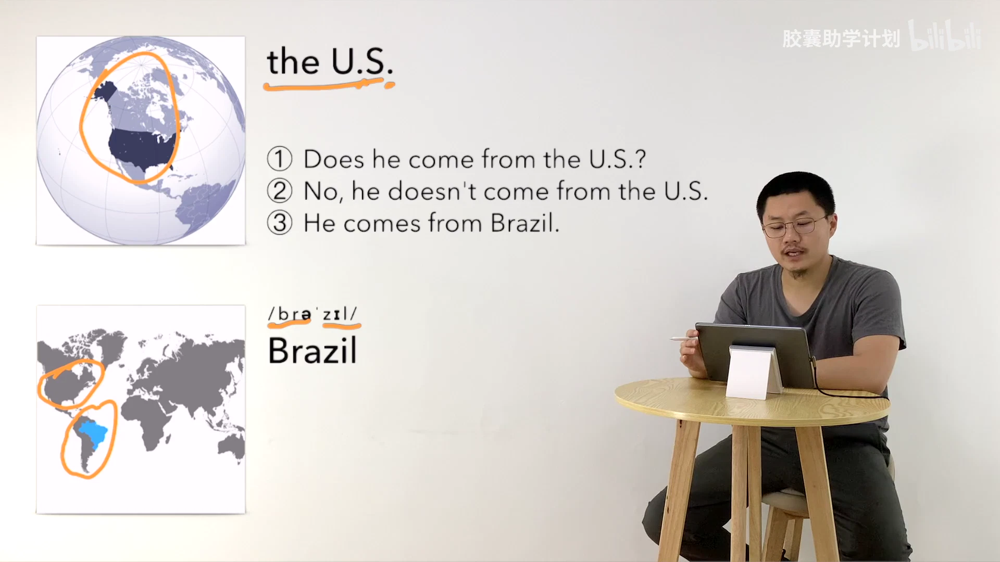

文字识别：胶囊助学计划 / the U.S. / ① Does he come from the U.S.? / No, he doesn't come from the U.S. / He comes from Brazil. / 3 / /bra'zil/ / Brazil

### 画面 00:01:54

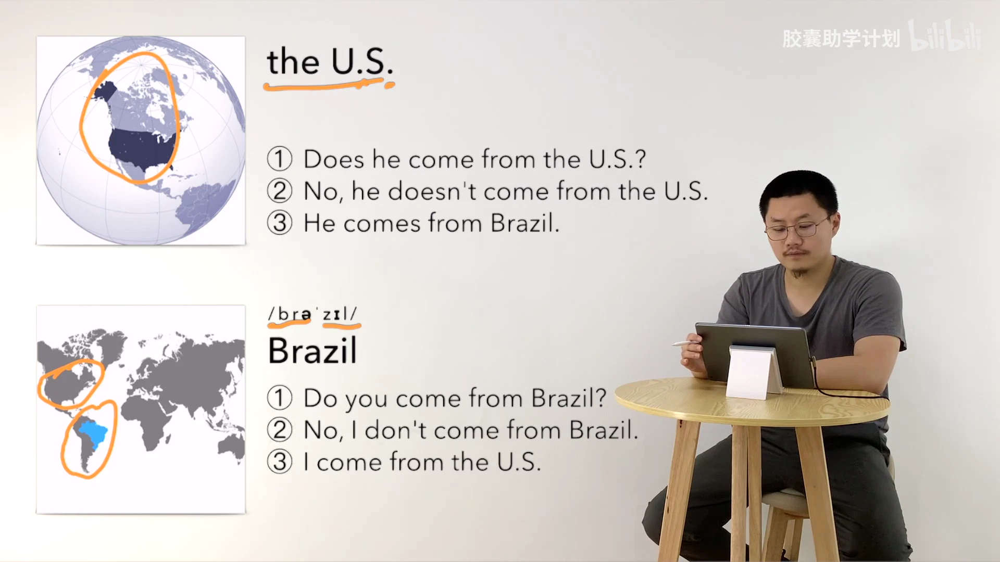

文字识别：胶囊助学计划 / the U.S. / ① Does he come from the U.S.? / ② No, he doesn't come from the U.S. /  He comes from Brazil. / 3 / /bra'zil/ / Brazil / ① Do you come from Brazil? / ② No, I don't come from Brazil. / ③ I come from the U.S.

### 画面 00:01:59

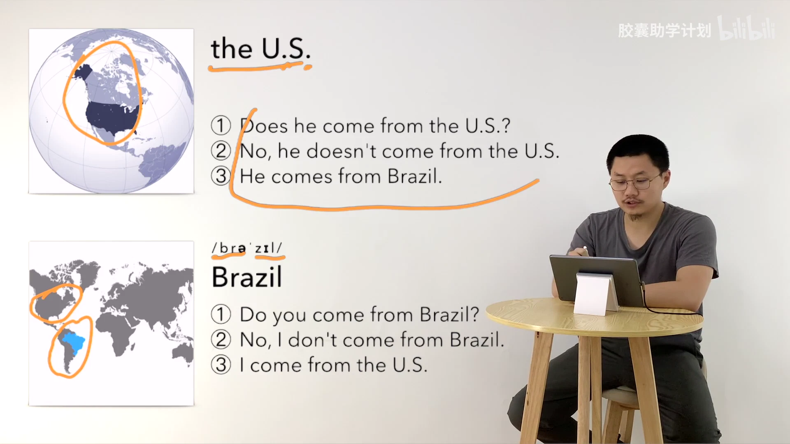

文字识别：胶囊助学计划 / the U.S. / foes he come from the U.S.? / 1 / No, he doesn't come from the U.S. / He comes from Brazil. / 3 / /bra'zil/ / Brazil / ① Do you come from Brazil? / ② No, I don't come from Brazil. / ③ I come from the U.S.

## 00:02:00–00:02:30

这些啊！我们今天真正要练的是来自于什么地方，用的是这个 come from 这个句型。下一个单词跟我读，Holland，荷兰。之前应该学过啊。Does she come from England? No, she doesn't come from England. She comes from Holland. 她来自于荷兰。Continue, England. 啊，我们说过对吧？英国实际上分四个部

### 画面 00:02:01

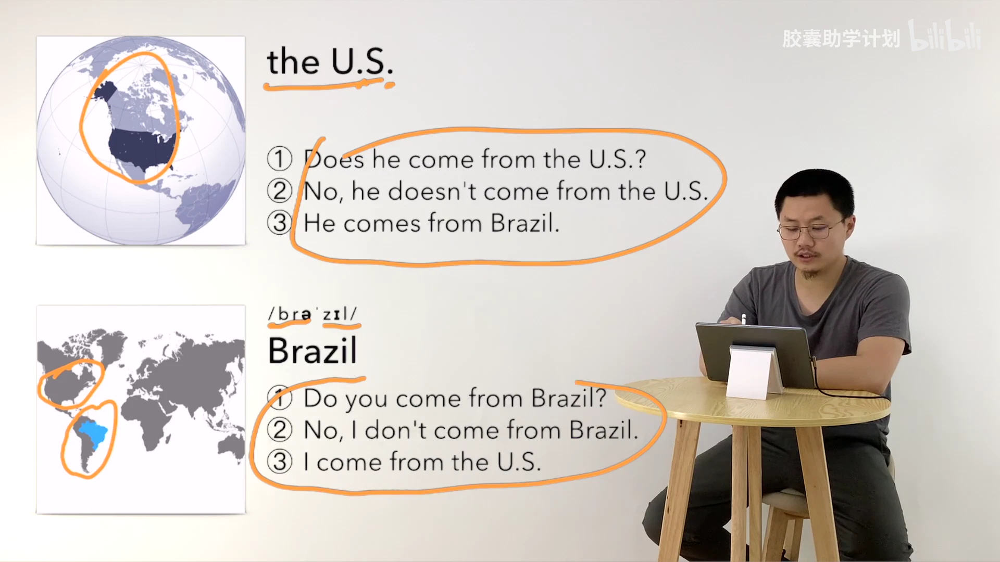

文字识别：胶囊助学计划 / the U.S. / foes he come from the U.S.? / 1 / No, he doesn't come from the U.S. / 3 / He comes from Brazil. / /bra'z1l/ / Brazil /  Do you come from Brazil? / ② / No, I don't come from Brazil. / ③ I come from the U.S.

### 画面 00:02:03

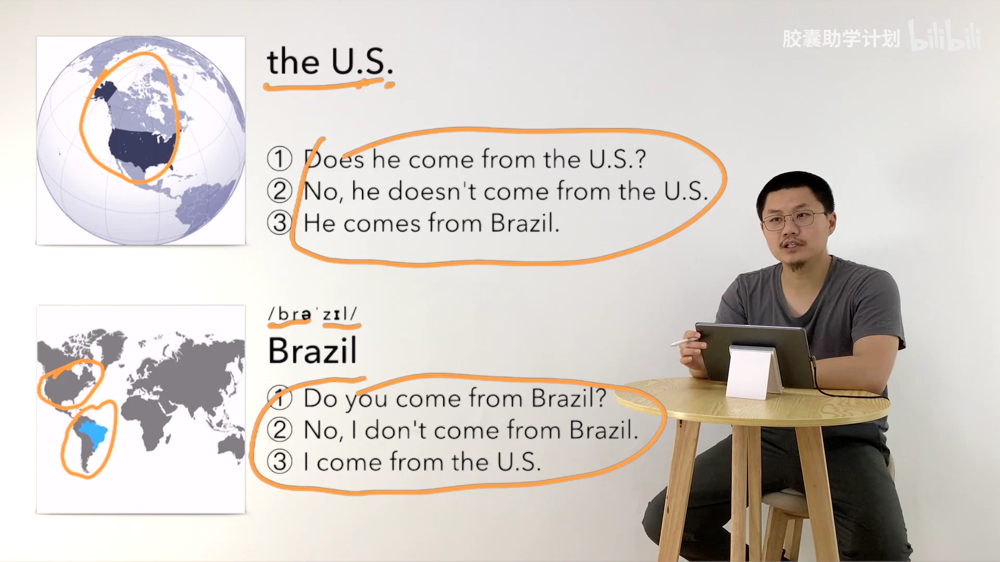

文字识别：胶囊助学计划 / the U.S. / poes he come from the U.S.? / 1 / No, he doesn't come from the U.S. / 3 / He comes from Brazil. / /bra'z1l/ / Brazil /  Do you come from Brazil? / ② / No, I don't come from Brazil. / ③ I come from the U.S.

### 画面 00:02:06

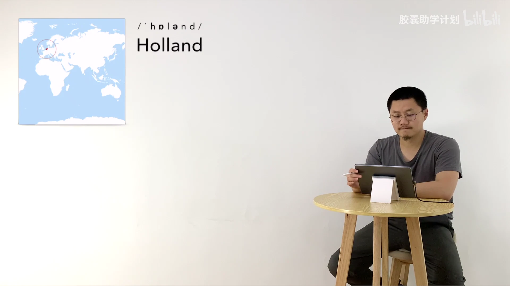

文字识别：胶囊助学计划 / / 'hｏland / / Holland

### 画面 00:02:14

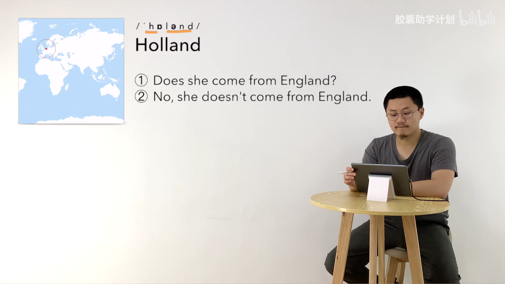

文字识别：胶囊助学计划 / / 'h o lan d / / Holland / ① Does she come from England? /  No, she doesn't come from England.

### 画面 00:02:24

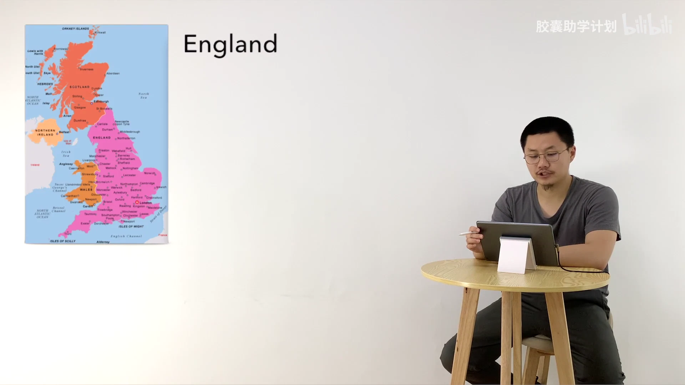

文字识别：胶囊助学计划 / ORKNEYISLANDS / England / Lewie / Marria / orth Ulint / oeto uNst / Sa / HEBRIDES / SCOTLAND / ATLANTIC / NORTH / North / Nea / OCEAN / lalay / NORTHERN / IRELAND / CNOLAND / Sea / Anglerey / Sainf Llan / ATLANTH / NORTH / Chamnel / CCEAN / ISLES OF WIGHT / ISLES OF SCILLY

### 画面 00:02:29

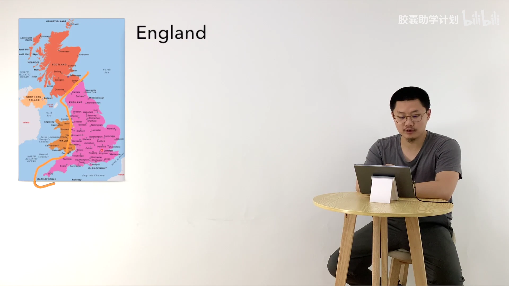

文字识别：胶囊助学计划 / ORKNEYISLANDS / England / forth Ulist / owth Ulisr / HEORIDES / SCOTLAND / ATIANTK / NORTH / North / Sea / OCEAN / lalny / NORTHERN / IRELAND / 1rish / Sea / Anglesey / Sotme Ltand / C / WALE! / ATLANTH / NORTH / Chamnel / CB / OCEAN / ISLES OF WIGHT / ISLES OF SCILLY / Aldeer

## 00:02:30–00:03:00

分，其中我现在给大家标的这个部分是 England，是英格兰，对吧？比如说上边是苏格兰，对吧？这是北爱尔兰，这是威尔士。 Okay, Wales. Another one.来，Do you both come from Poland? Both叫做都，你们都来自于荷兰吗？注意，you有两个意思，你和你们。 No, we don't come from Poland. We come from England. Continue. France and

### 画面 00:02:31

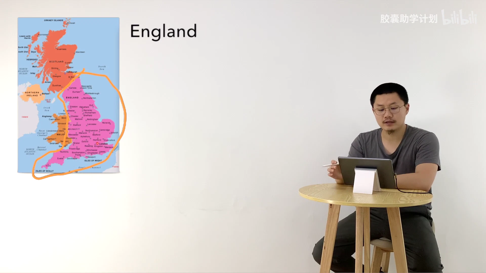

文字识别：胶囊助学计划 / ORKNEYISLANDS / England / orth Uint / eth UMet / HEORIDES / BCOTLAND / ATLANTK / NORTE / Morth / Sea / OCEAN / NORTHERN / IRELAND / Sea / Anglevey / Soimr Lian / WALEP / ATLANTH / NORTH / Caraamel / OCEAN / ISLES OF WIGN / ISLES OF SCILLY

### 画面 00:02:35

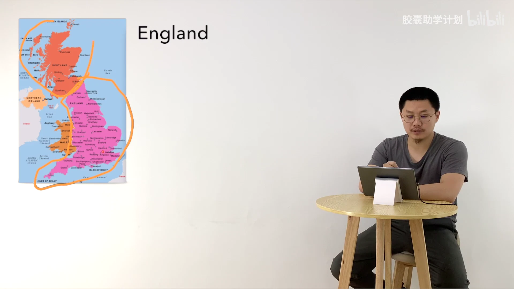

文字识别：胶囊助学计划 / England / SCOTLAND / Seo / NORTHERN / IRELAND / ENOLAND / Sea / Anglesey / Satne Lian / Grarge / C / WALEP / ATLANTH / NORTH / Chamnel / Ce / OCEAN / TSLES OF WIGN / ISLES OF SCILLY

### 画面 00:02:38

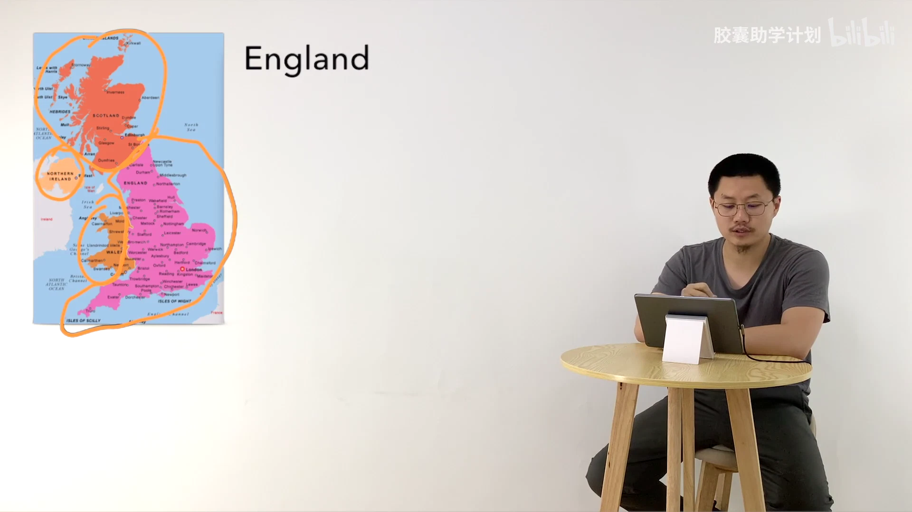

文字识别：胶囊助学计划 / England / LMsI / SCOTLAND / Forth / IANT / OCEAN / Seo / NORTHERN / IRELAND / WALEP / ATLANTH / NORTH / OCEAN / ISLES OF WIGN / ISLES OF SCILLY

### 画面 00:02:40

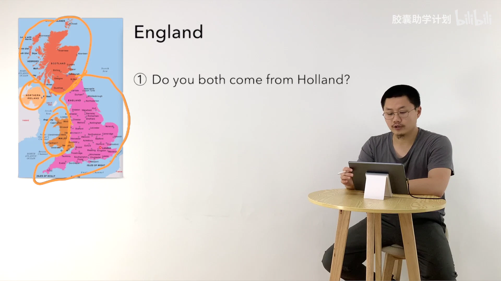

文字识别：胶囊助学计划 / England / SCOTLAND / Norih / ONCEAN / [LAN] / Sea / ① Do you both come from Holland? / NORTHERN / IRELAND / aot / ATLANTIC / NORTH / Brikto / OCEAN / ISLES OF WIGA / ISLES OF SCILLY

### 画面 00:02:56

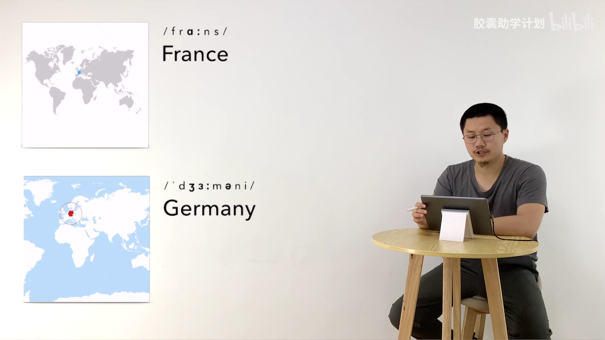

文字识别：胶囊助学计划 / / frains/ / France / /'d33:mani/ / Germany

## 00:03:00–00:03:30

Germany, ah,这两个国家其实是紧挨着了啊。德国在上面地图上，对吧？法国在它的下面。OK，好，那我们上面是法国，底下是德国，这是法国啊。来，Do they come from Germany? No, they don't come from Germany. They come from France.注意，这儿为什么不加s？它不是第三啊，是第三人称，但它不是

### 画面 00:03:12

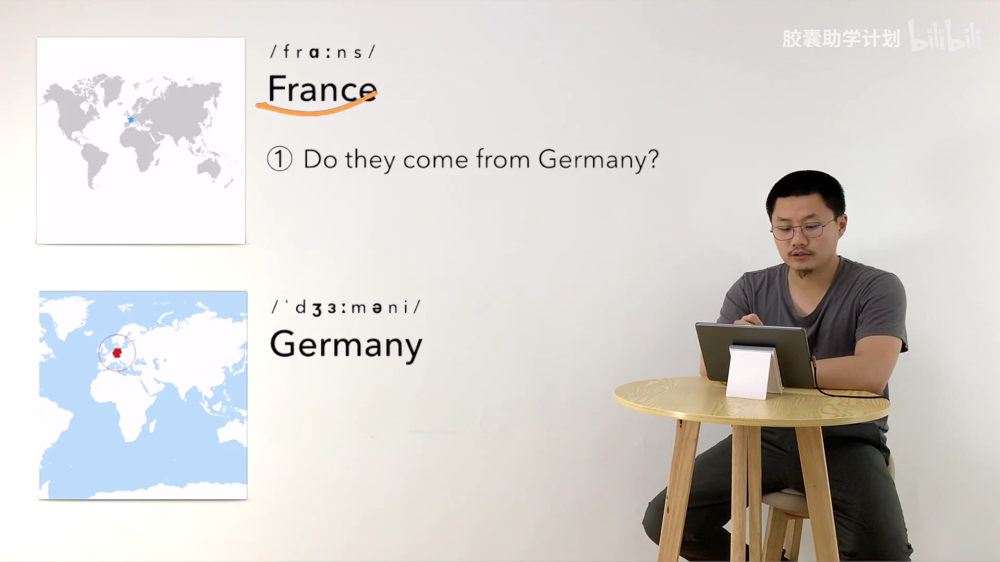

文字识别：胶囊助学计划 / / frain s / / France / ① Do they come from Germany? / /'d33:mani/ / Germany

### 画面 00:03:16

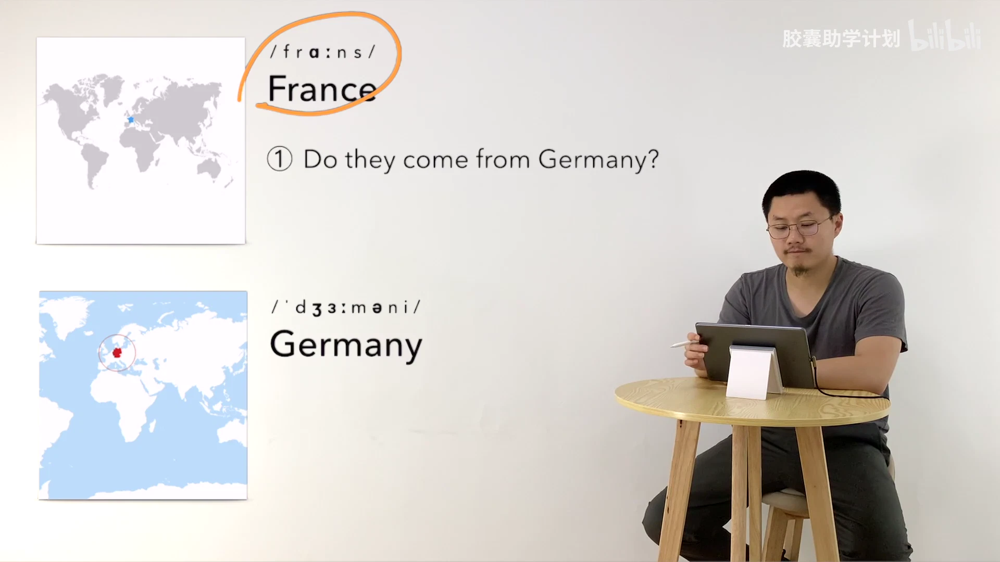

文字识别：胶囊助学计划 / / fra:ns / / France / ① Do they come from Germany? / /'d33:mani/ / Germany

### 画面 00:03:23

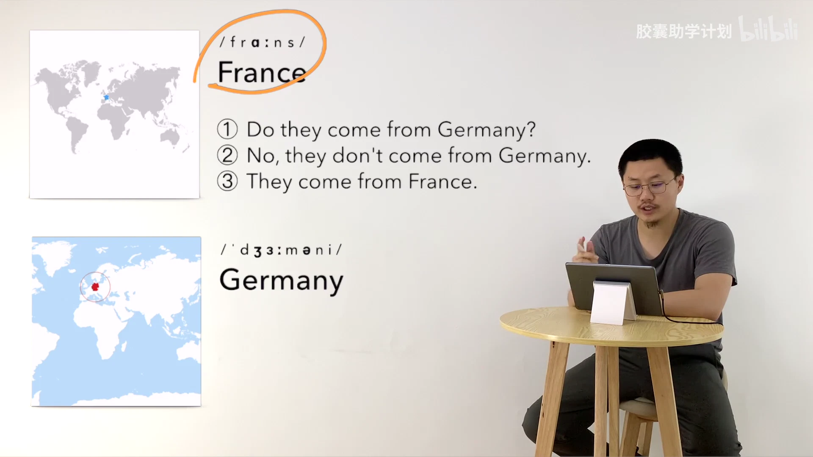

文字识别：胶囊助学计划 / / frains / / France / ① Do they come from Germany? / ② 1 /  No, they don't come from Germany. / They come from France. / 3 / /'d33:mani/ / Germany

### 画面 00:03:26

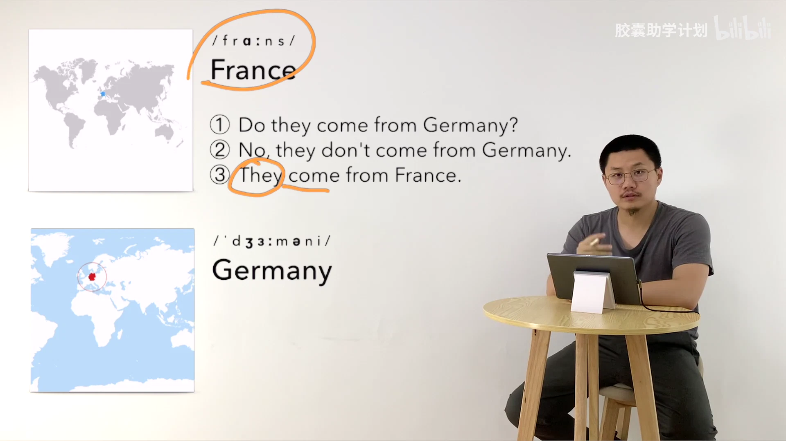

文字识别：胶囊助学计划 / / fra:ns / / France / ① Do they come from Germany? / ② No, they don't come from Germany. / Theycome from France. / 3 / /'d33:mani/ / Germany

### 画面 00:03:28

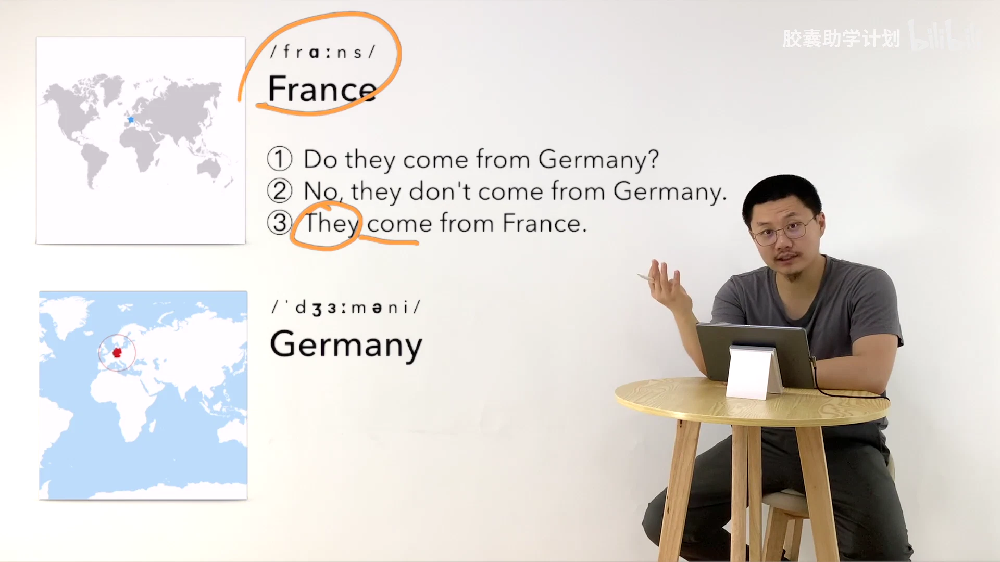

文字识别：胶囊助学计划 / /frains / / France / ① Do they come from Germany? / No, they don't come from Germany. / ②1 / Theycome from France. / 3 / /'d33:mani/ / Germany

## 00:03:30–00:04:00

单数，它是复数，对吧？ Continue. Do I come from France? 啊，我来自于法国吗？你猜一猜。啊，我回答说，No, you don't come from France. 你没有French accent啊，你没有法语的那个英文腔啊。 You come from Germany. 啊，你这一听就是来自于德国的。 You come from Germany. There you go. Continue. Italy. 这应该我们之前也学过，意大利，对吧？啊，一个靴子踢着一个球，

### 画面 00:03:32

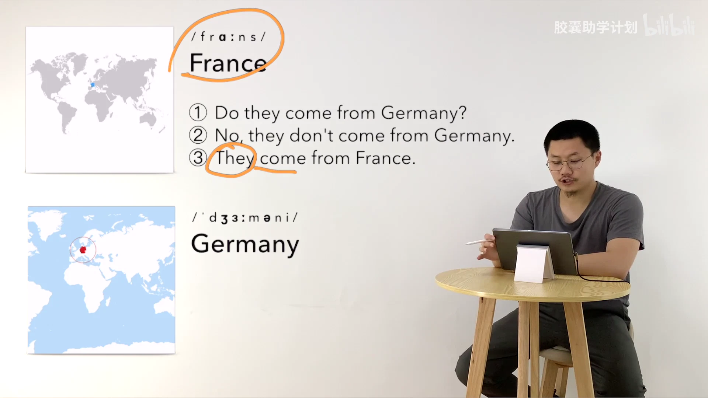

文字识别：胶囊助学计划 / / fra:ns / / France / ① Do they come from Germany? / ② No, they don't come from Germany. / Theycome from France. / 3 / /'d33:mani/ / Germany

### 画面 00:03:39

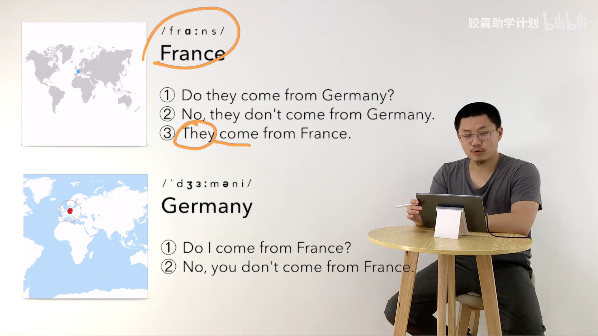

文字识别：胶囊助学计划 / /frains / / France / ① Do they come from Germany? / ② No, they don't come from Germany. / Theycome from France. / 3 / /'d33:mani/ / Germany / ① Do I come from France? / ② No, you don't come from France.

### 画面 00:03:53

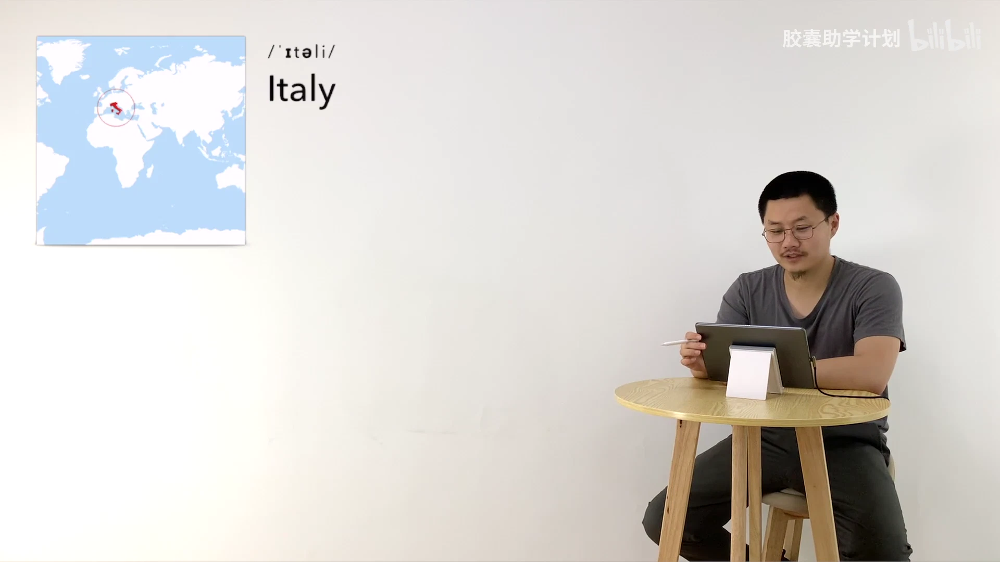

文字识别：胶囊助学计划 / /'itali/ / Italy

## 00:04:00–00:04:30

球是西西里岛。Very good.跟我读。Does he come from Italy? No, he doesn't come from Italy. He comes from Greece.他来自于希腊。Continue. Norway.这个之前也见过了。挪威，对吧？我们就是拿它造一下句子。Does he come from Norway? No, he doesn't come from Norway. He comes from Italy.来自于意大利。

### 画面 00:04:09

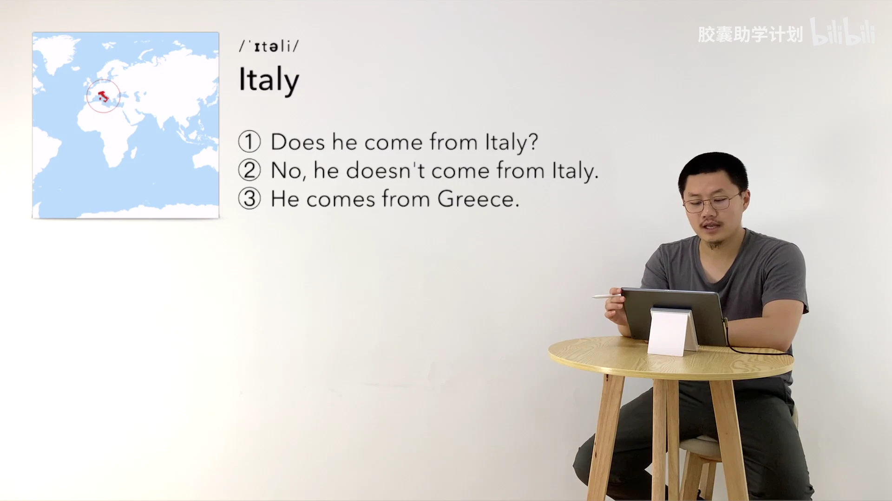

文字识别：胶囊助学计划 / /'Itali/ / Italy / ① Does he come from Italy? / No, he doesn't come from Italy. / He comes from Greece.

### 画面 00:04:15

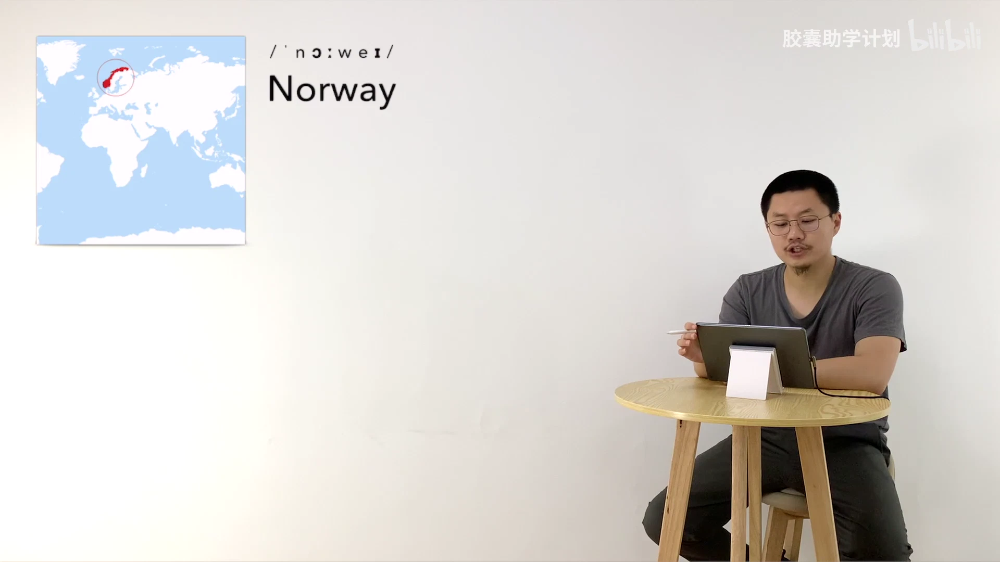

文字识别：胶囊助学计划 / /'no:weIl / Norway

### 画面 00:04:23

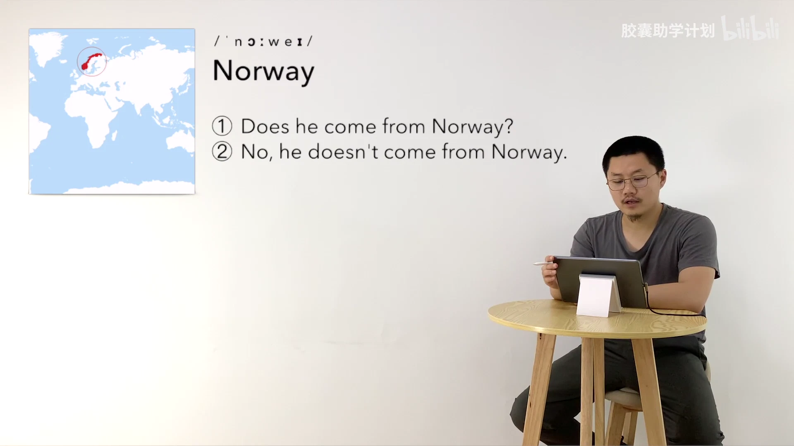

文字识别：胶囊助学计划 / / 'no:weI/ / Norway / ① Does he come from Norway? / ② No, he doesn't come from Norway.

## 00:04:30–00:05:00

Continue, Russia,俄国啊这么大一块儿对吧？底下地图上的底下是咱们中国. Russia. Continue. Does he come from Russia? No, he doesn't come from Russia. It comes from Norway. Continue, Spain.西班牙啊.

### 画面 00:04:31

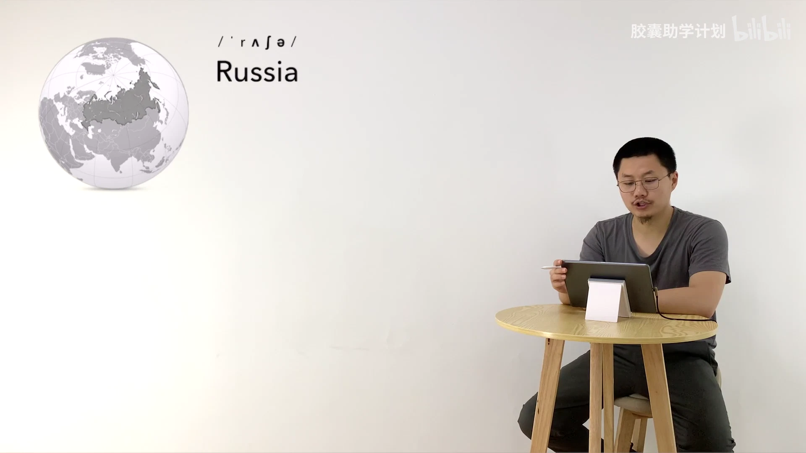

文字识别：胶囊助学计划 / / 'rn ∫a / / Russia

### 画面 00:04:35

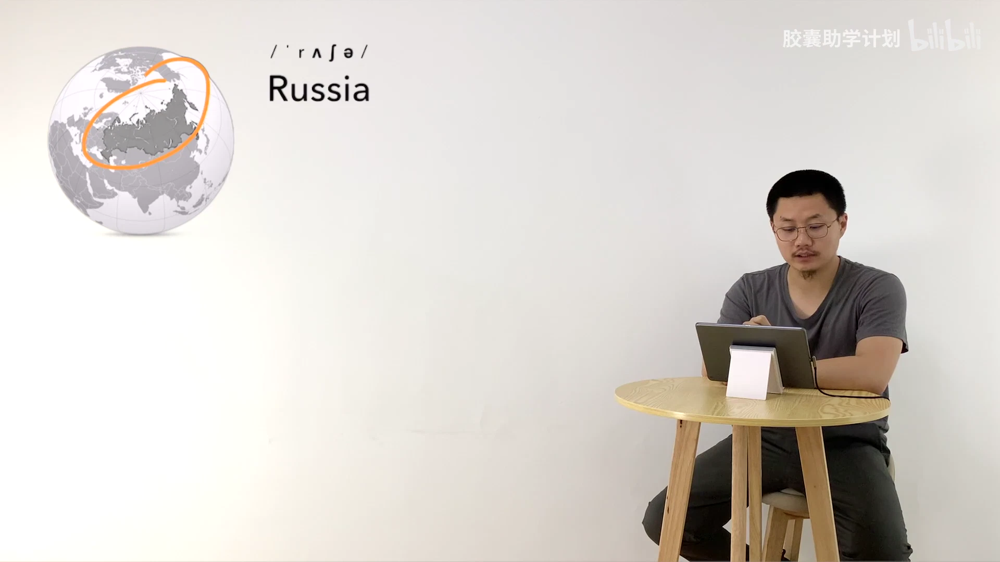

文字识别：胶囊助学计划 / / 'rn ∫a/ / Russia

### 画面 00:04:38

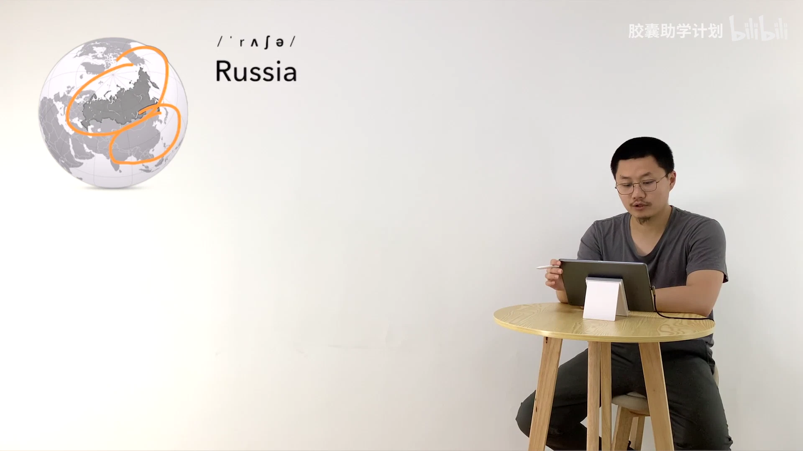

文字识别：胶囊助学计划 / / 'rn ∫al / Russia

### 画面 00:04:48

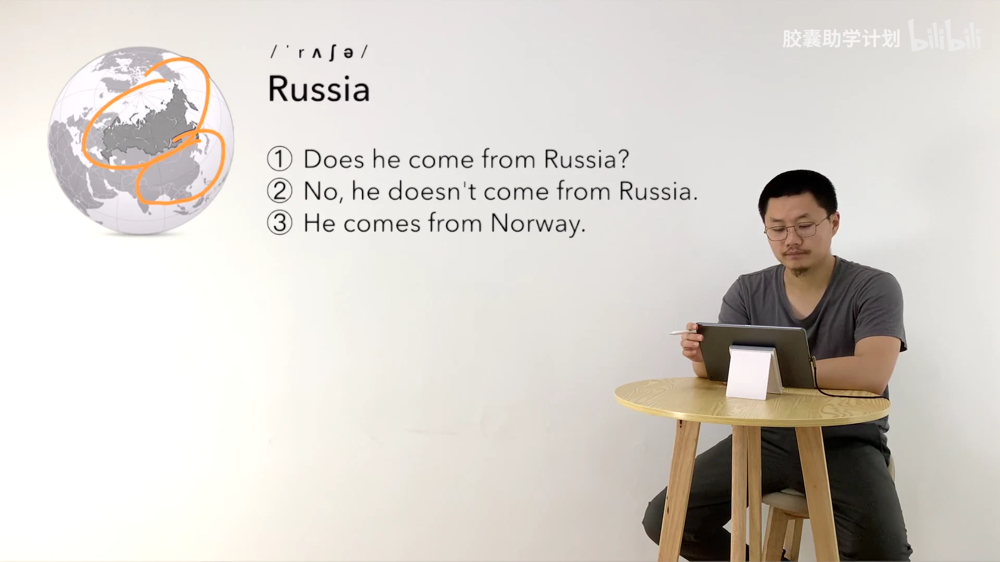

文字识别：胶囊助学计划 / / 'rn ∫a/ / Russia / ① Does he come from Russia? / ② No, he doesn't come from Russia. / ③ He comes from Norway.

### 画面 00:04:53

文字识别：胶囊助学计划 / /spein/ / Spain

## 00:05:00–00:05:30

Does he come from Spain? No, he doesn't come from Spain. He comes from Russia. Ah, Russia in this place, right? Ah, then Spain in this place, connecting North Africa. Continue. Sweden, the oil five countries, right? Sweden. Does he come from Sweden? Sweden. No, he doesn't come from Sweden. He

### 画面 00:05:07

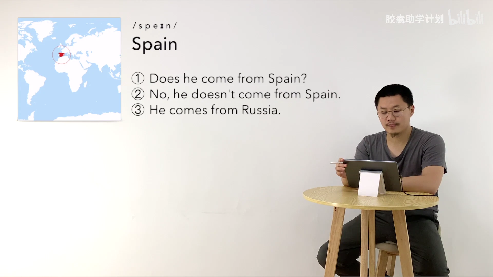

文字识别：胶囊助学计划 / /spein/ / Spain / ① Does he come from Spain? / No, he doesn't come from Spain. / 2 / He comes from Russia. / 3

### 画面 00:05:12

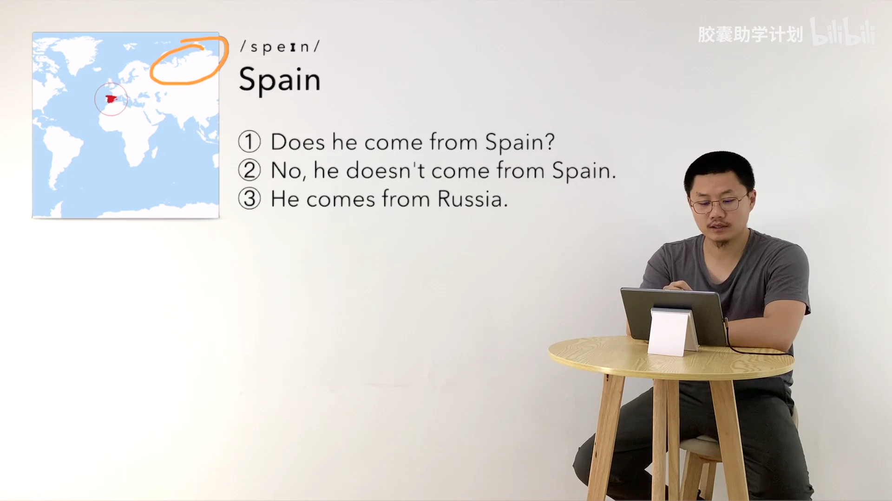

文字识别：胶囊助学计划 / /spein/ / Spain / ① Does he come from Spain? / No, he doesn't come from Spain. / He comes from Russia. / 3

### 画面 00:05:16

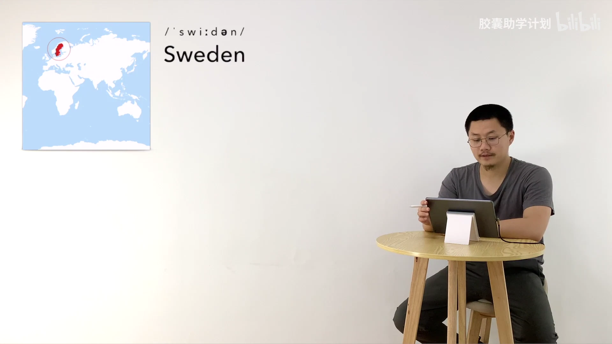

文字识别：胶囊助学计划 / / 'swi:dan/ / Sweden

### 画面 00:05:26

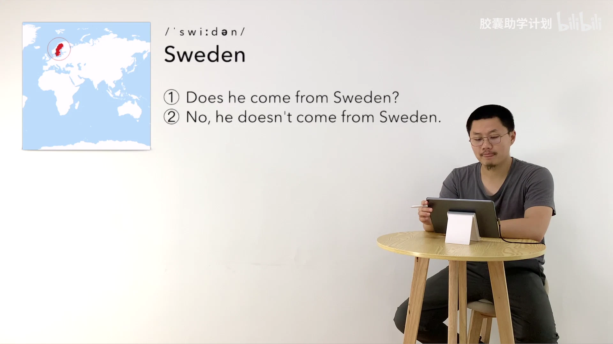

文字识别：胶囊助学计划 / / 'swi:dan / / Sweden / ① Does he come from Sweden? / ② No, he doesn't come from Sweden.

## 00:05:30–00:06:00

comes from Spain. Ah, Spain in this place, right? Portugal, Spain are both in this peninsula. Okay, break up. This lesson practice is these three sentences: affirmative, negative, general question. Okay, then you should pay attention to this place. When to add s, when not to add s, when to appear does or doesn't. Okay, this lesson homework. First, 52 sentences you can write. Then, you should explain to yourself today's core knowledge points. Okay, if you.

### 画面 00:05:36

文字识别：胶囊助学计划 / Recap / Patterns / Does / he come / from. / No, he doesn't come from / Grammar / He comes from / Words / Expression

### 画面 00:05:48

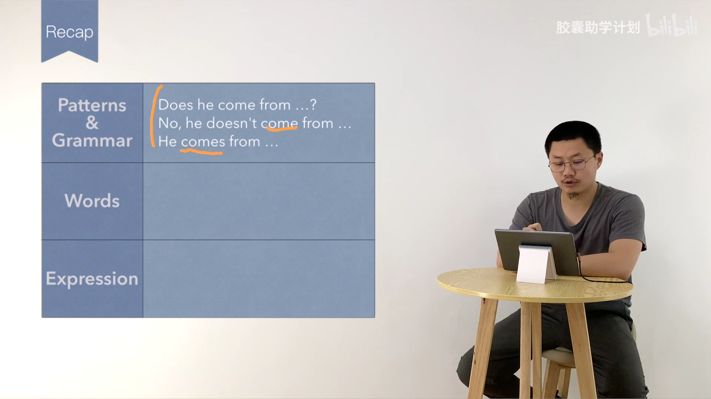

文字识别：Recap / 胶囊助学计划 / Patterns / Does / he / come / from / No, / he / doesn't come / from / Grammar / He / comes / from / Words / Expression

### 画面 00:05:51

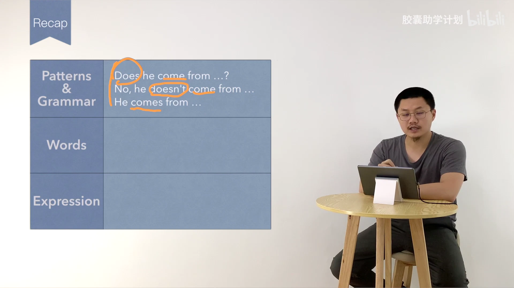

文字识别：胶囊助学计划 / Recap / Patterns / Does / he come / from / No,he / doesn't come / from / Grammar / He / comes from / Words / Expression

### 画面 00:05:53

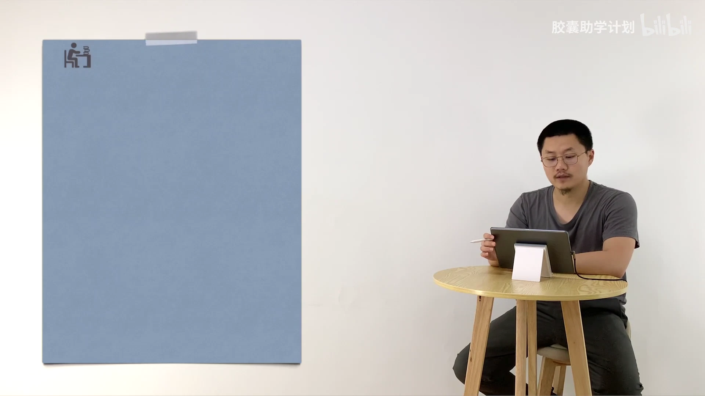

文字识别：胶囊助学计划

### 画面 00:05:56

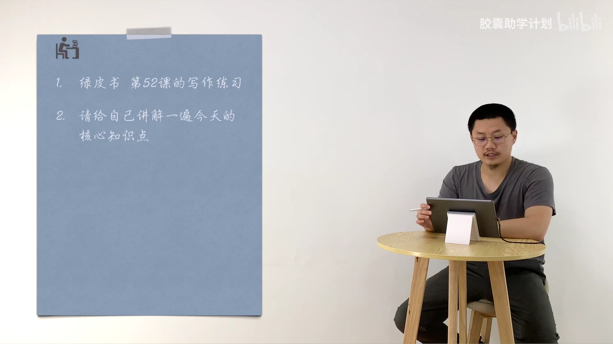

文字识别：胶囊助学计划 / 绿皮书第52课的写作练习 / 请给自己讲解一遍今天的 / 核心知识点

## 00:06:00–00:06:30

心知识点。OK，如果各位喜欢我们的课程呢，欢迎大家关注、订阅、一键三连，分享给那些需要的朋友。最后，我们再来看一句名人名言：A smile is so sexy yet so warm. When someone genuinely smiles at you, is the greatest feeling in the world. See you next time.

### 画面 00:06:00

文字识别：胶囊助学计划

### 画面 00:06:02

文字识别：胶囊助学计划

### 画面 00:06:06

文字识别：胶囊助学计划

### 画面 00:06:08

文字识别：胶囊助学计划 / A smile is so sexy, yet so warm. When / someone genuinely smiles at you, it's the / greatest feeling in the world. / - Mandy Moore

### 画面 00:06:11

文字识别：胶囊助学计划 / A smile is so sexy, yet so warm. When / someone genuinely smiles at you, it's the / greatest feeling in the world. / - Mandy Moore

### 画面 00:06:22

文字识别：A smile is so sexy, yet so warm. When / someone genuinely smiles at you, it's the / greatest feeling in the world. / Mandy Moore

### 画面 00:06:24

文字识别：CAPSULEACADEMY / 胶囊助学计划 / 小红书 / Lecturer / □ / Leo / OE

### 画面 00:06:27

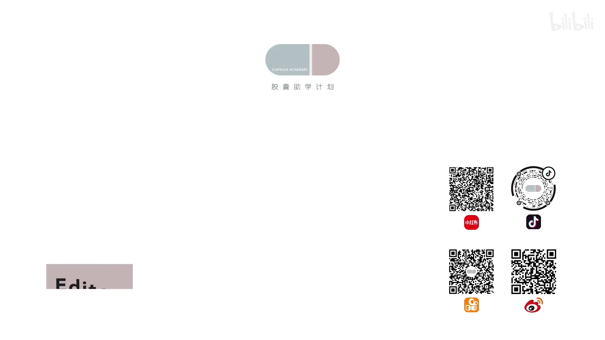

文字识别：CAPSULEACADEMY / 胶囊助学计划 / 小红书 / Fdi- / OE

## 00:06:30–00:06:34

### 画面 00:06:30

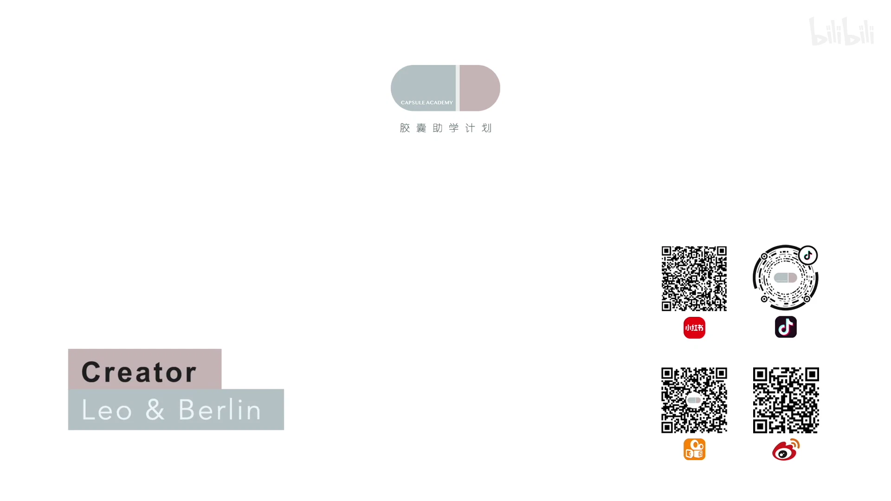

文字识别：CAPSULEACADEMY / 胶囊助学计划 / 小红书 / Creator / □ / Leo & Berlin / OE

### 画面 00:06:32

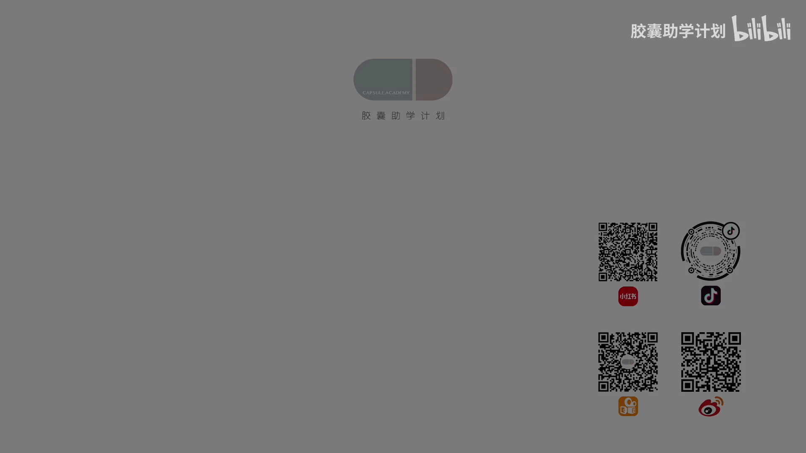

文字识别：bilibili / 胶囊助学计划 / CAPSULEACADEMY / 胶囊助学计划 / 小红书 / OE

### 画面 00:06:34

文字识别：bilibili / 胶囊助学计划

