# 053 文章

快速机器解析：语音为单模型转写，未进行独立交叉校对或人工复核；画面每秒采样并按变化选帧，短时文字和标记可能遗漏。截图时间约有 1 秒误差。图片有损压缩；遇到疑点请按时间查看 Google Drive 原视频。

## 00:00:00–00:00:30

Hello everyone, welcome to Capsule Academy. This is Leo. Today we're going to learn New Concept English Book One Lesson Fifty Three Story. Hope you guys enjoy it. Good. We directly enter the article. Ah, still two people, Hans and Jim's conversation. Ah, we see what they two people say. Where do you come from? Old-fashioned sentence. We've seen it many times. Where do you come from? I come

### 画面 00:00:00

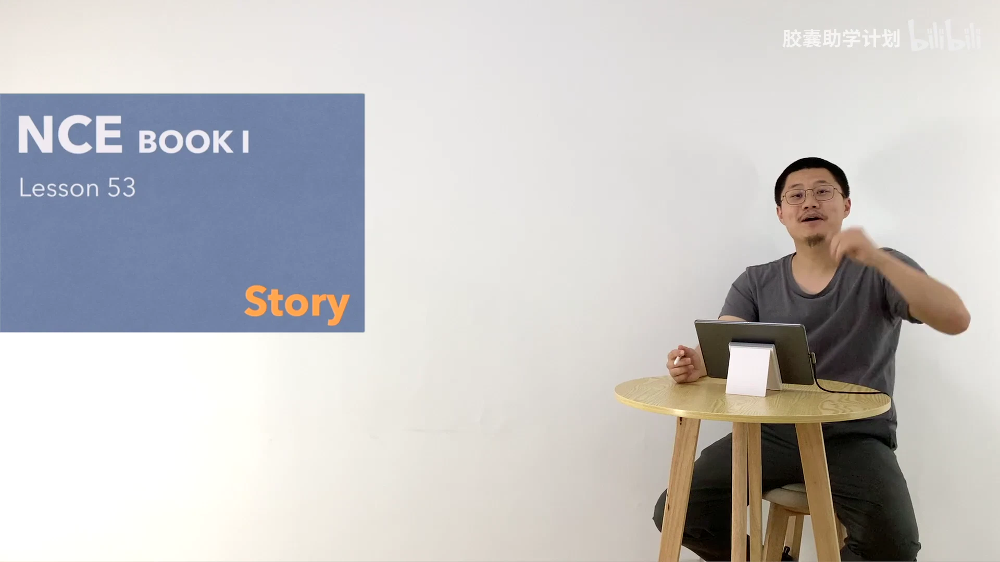

文字识别：胶囊助学计划 / NCE / BOOKI / Lesson 53 / Story

### 画面 00:00:02

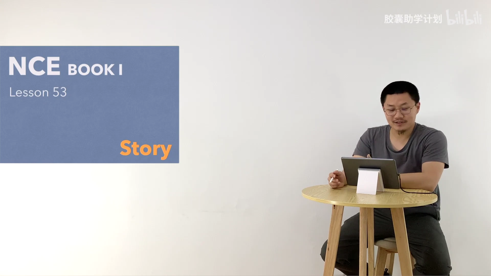

文字识别：胶囊助学计划 / NCE / BOOKI / Lesson 53 / Story

### 画面 00:00:05

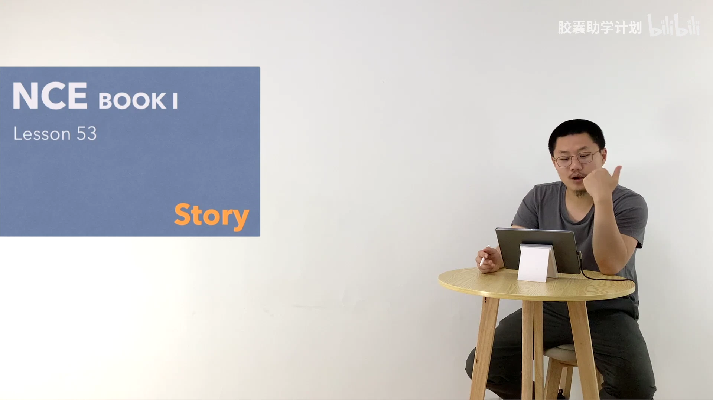

文字识别：胶囊助学计划 / NCE / BOOKI / Lesson 53 / Story

### 画面 00:00:10

文字识别：胶囊助学计划 bill

### 画面 00:00:14

文字识别：胶囊助学计划

### 画面 00:00:16

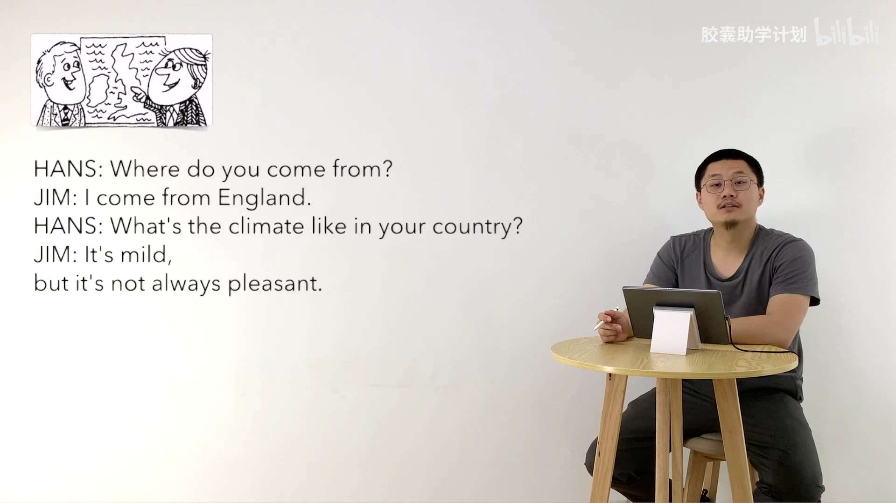

文字识别：胶囊助学计划 / HANS: Where do you come from? / JIM: I come from England. / HANS: What's the climate like in your country? / JIM: It's mild, / but it's not always pleasant.

### 画面 00:00:19

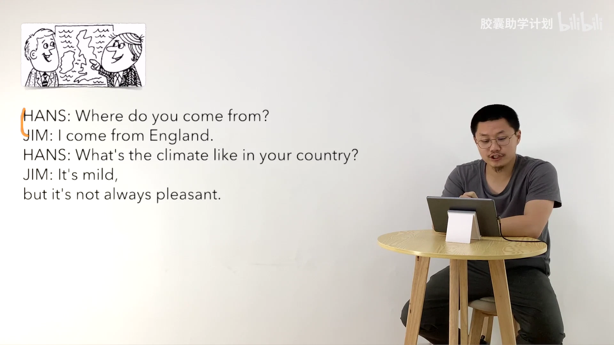

文字识别：胶囊助学计划 / HANS: Where do you come from? / yIM: I come from England. / HANS: What's the climate like in your country? / JIM: It's mild, / but it's not always pleasant.

## 00:00:30–00:01:00

from England. 我来自于英格兰. Come from. 如果是主语是 he，那就是 he comes from. Okay. So what's the climate like in your country? 说在你的国家啊，注意，其实更准确的应该是 region，啊，地区，对吧？我们讲过，对吧？英格英大英帝国及北爱尔兰联合王国统称为英国。英国实际上是四个部分组成的，其中一个部分各位最熟悉的那个部分叫英格兰。

### 画面 00:00:49

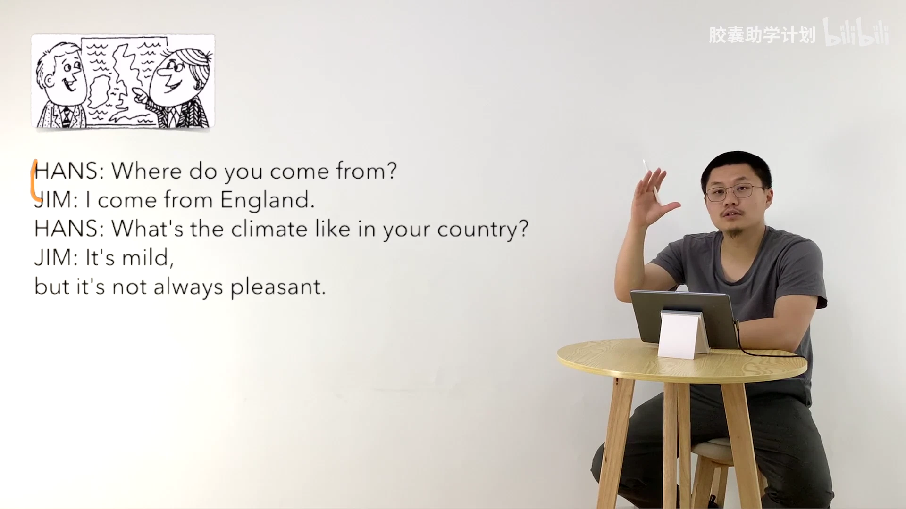

文字识别：胶囊助学计划 / HANS: Where do you come from? / YIM: I come from England. / HANS: What's the climate like in your country? / JIM: It's mild, / but it's not always pleasant.

## 00:01:00–00:01:30

比如说伦敦就在英格兰这个地区啊，所以在你们的这个地方呢，天气候怎么样？说 is mild，就说还是挺温和的，但是啊，这个梗就大了，is not always pleasant，说它不总是 pleasant，叫不总是非常的宜人。这句话就有一个潜台词，就是有的时候还是宜人的，但不总是宜人的啊。实际上，就我

### 画面 00:01:19

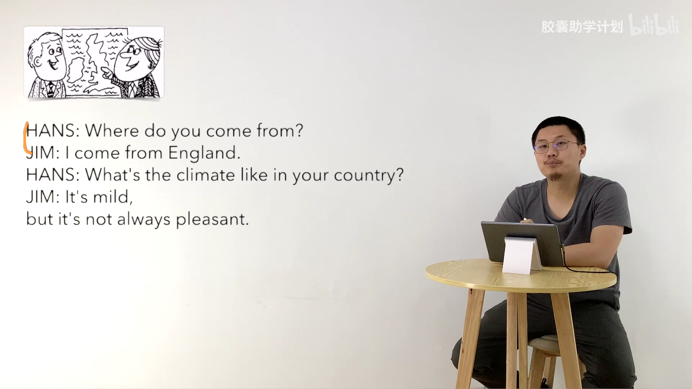

文字识别：胶囊助学计划 / HANS: Where do you come from? / YIM: I come from England. / HANS: What's the climate like in your country? / JIM: It's mild, / but it's not always pleasant.

### 画面 00:01:22

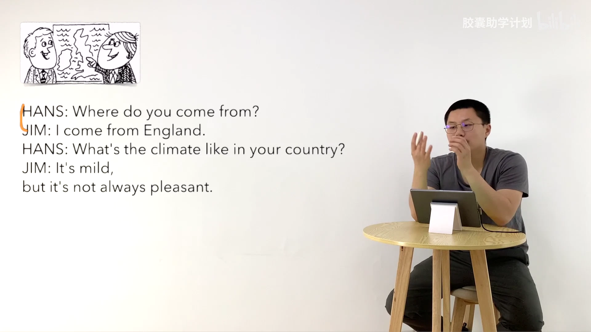

文字识别：胶囊助学计划 / HANS: Where do you come from? / YIM: I come from England. / HANS: What's the climate like in your country? / JIM: It's mild, / but it's not always pleasant.

## 00:01:30–00:02:00

我自己看过的一些纪录片和一些亲身感受，伦敦啊，至少我们不说英格兰吧，伦敦的这个天气简直非常的鬼畜，是吧？非常的令人糟心，它几乎可以说 is always unpleasant，总是不是太宜人。OK，那我们看一下啊，为什么他说不总是宜人的？我们看他怎么说的啊？你看他给的地图也是英格兰那一块的地图，对吧？没包括威尔士、苏格兰。说 the weather is often cold，这个天

### 画面 00:01:33

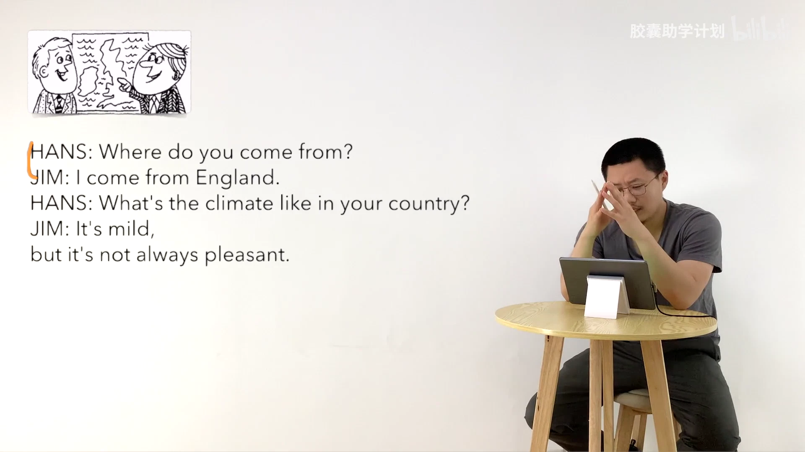

文字识别：胶囊助学计划 / HANS: Where do you come from? / YIM: I come from England. / HANS: What's the climate like in your country? / JIM: It's mild, / but it's not always pleasant.

### 画面 00:01:38

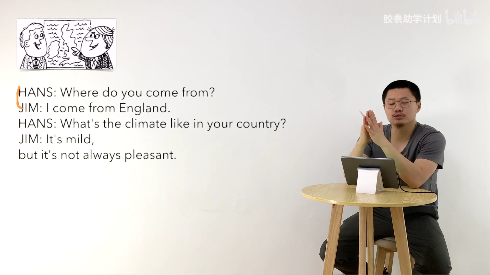

文字识别：胶囊助学计划 / HANS: Where do you come from? / YIM: I come from England. / HANS: What's the climate like in your country? / JIM: It's mild, / but it's not always pleasant.

### 画面 00:01:40

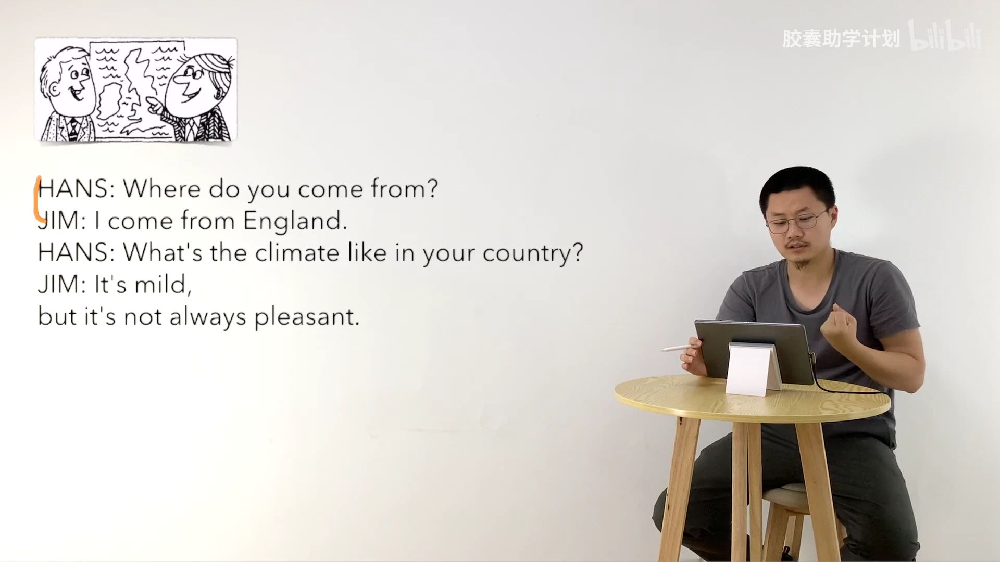

文字识别：胶囊助学计划 / HANS: Where do you come from? / YIM: I come from England. / HANS: What's the climate like in your country? / JIM: It's mild, / but it's not always pleasant.

### 画面 00:01:45

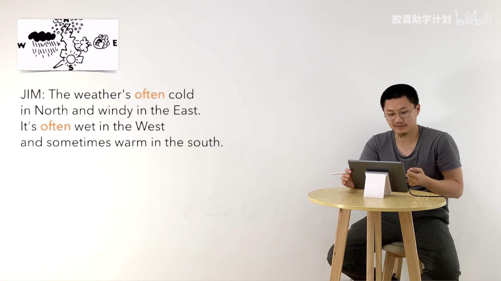

文字识别：胶囊助学计划 / JIM: The weather's often cold / in North and windy in the East. / It's often wet in the West / and sometimes warm in the south.

### 画面 00:01:47

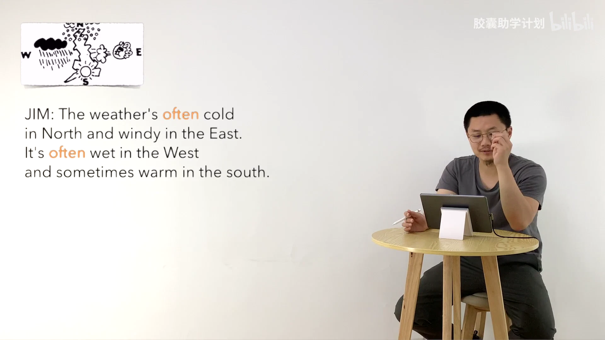

文字识别：胶囊助学计划 / JIM: The weather's often cold / in North and windy in the East. / It's often wet in the West / and sometimes warm in the south.

### 画面 00:01:50

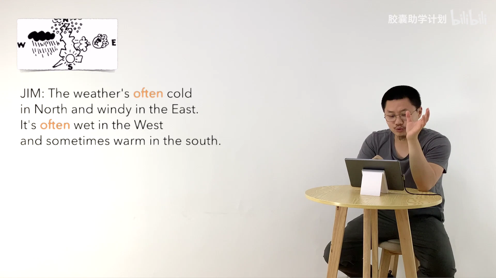

文字识别：胶囊助学计划 / JIM: The weather's often cold / in North and windy in the East. / It's often wet in the West / and sometimes warm in the south.

## 00:02:00–00:02:30

气啊总是很冷。In north,应该是and windy in the east.然后呢下大雨啊就刮大风，在东部is often wet,总是很潮湿。In the west,你看in the west在西部总是很潮湿。And sometimes warm in the south.有的时候啊在南部会稍微的暖和一点。你看

### 画面 00:02:20

文字识别：胶囊助学计划 / JIM: The weather's often cold / in North and windy in the East. / It's often wet in the West / and sometimes warm in the south.

## 00:02:30–00:03:00

冷，这是大多数人不喜欢的，刮大风是不喜欢的，过分的潮湿是不太喜欢的，对吧？啊，都不是很舒服。只在南边呢，有一点点，有的时候还是暖和的，有太阳。再来，他说 Which seasons do you like best？这个很有意思。首先 Which 我们就已经见过了，叫哪一个？二十一个学的 seasons，那注意不是哪一个季节，我问的是哪几个季节，加 s 了嘛，对吧？Do you like best？叫你最喜欢。

### 画面 00:02:30

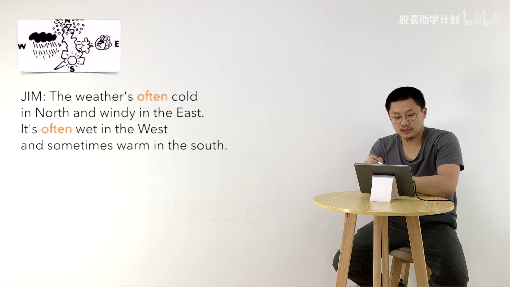

文字识别：胶囊助学计划 / JIM: The weather's often cold / in North and windy in the East. / It's often wet in the West / and sometimes warm in the south.

### 画面 00:02:41

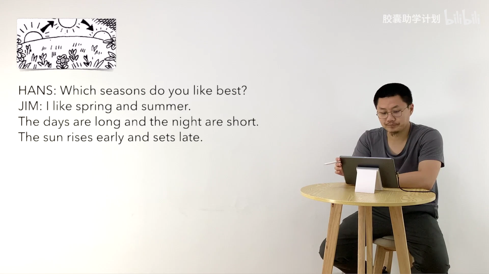

文字识别：胶囊助学计划 / 11111 / 111 / 川 / 三 / HANS: Which seasons do you like best? / JIM: I like spring and summer. / The days are long and the night are short. / The sun rises early and sets late.

### 画面 00:02:53

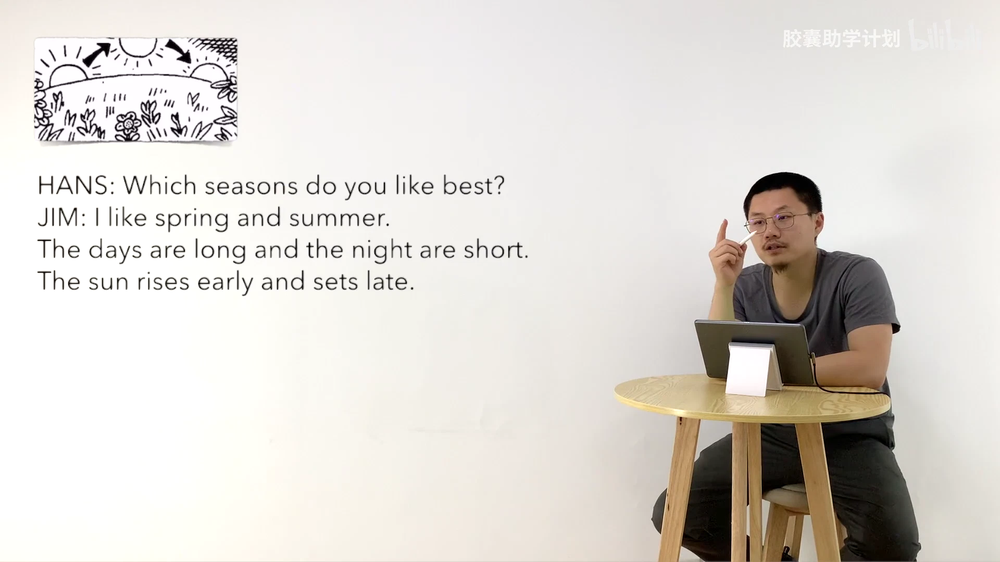

文字识别：胶囊助学计划 / 11111 / 111 / M / HANS: Which seasons do you like best? / JIM: I like spring and summer. / The days are long and the night are short. / The sun rises early and sets late.

### 画面 00:02:58

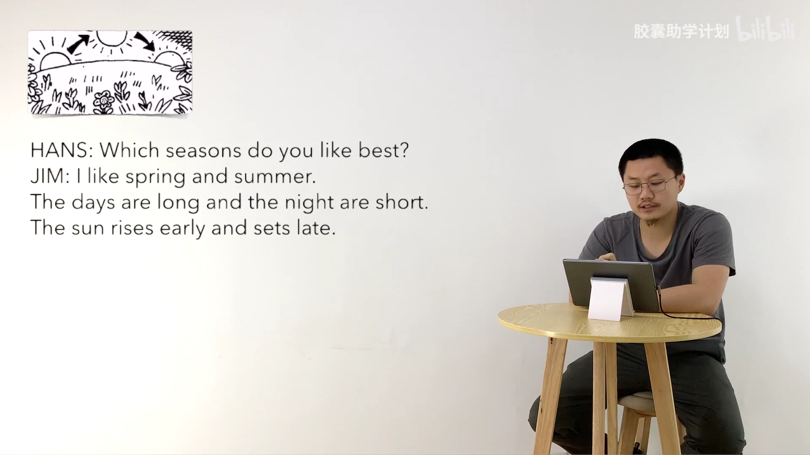

文字识别：胶囊助学计划 / 11111 / 111 / " / HANS: Which seasons do you like best? / JIM: I like spring and summer. / The days are long and the night are short. / The sun rises early and sets late.

## 00:03:00–00:03:30

I like spring and summer.我喜欢春天夏天。The days are long.白天长。And然后呢，the nights are short.然后呢，夜晚短。注意这个地方应该有一个小的s，有一个taper啊。说夜晚呢短。The sun rises early and sets late.这刚才我们都造过了，对吧？说太阳rises early，升起的早，落的

### 画面 00:03:28

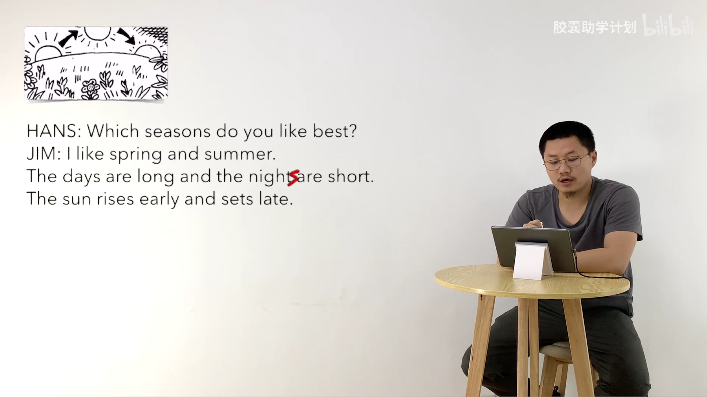

文字识别：胶囊助学计划 / 11111 / 111 / 川 / HANS: Which seasons do you like best? / JIM: I like spring and summer. / The days are long and the nightare short. / The sun rises early and sets late.

## 00:03:30–00:04:00

晚。OK，这是我们小时候学的地理知识嘛。I don't like autumn and winter，说我不喜欢秋冬。The days are short and nights are long，说这个天呐短，白天短，夜晚长。那接下来就是太阳升的晚，落的早呗。The sun rises late，升的很晚，and sets。注意，这是又是一个小的 typo，应该叫做 sets early，啊，然后落下去

### 画面 00:03:32

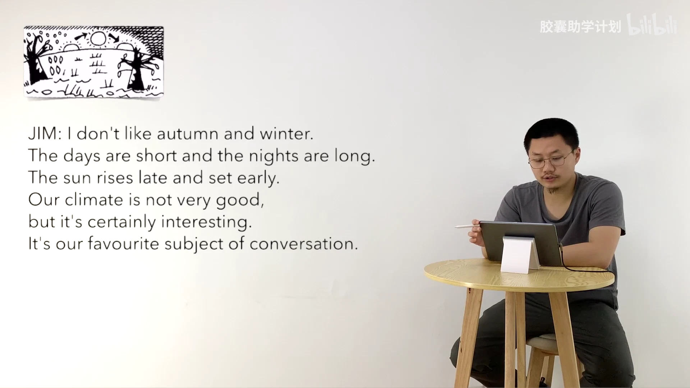

文字识别：胶囊助学计划 / 。 / 0 / 000 / 0011 / 0 / JIM: I don't like autumn and winter. / The days are short and the nights are long. / The sun rises late and set early. / Our climate is not very good, / but it's certainly interesting. / It's our favourite subject of conversation.

## 00:04:00–00:04:30

的很早。Our climate is not very good.说我们的这个气候啊不是特别的好。But但是啊is certainly interesting.但是它肯定是比较有趣的。啊，它这个有趣怎么体现呢？比如说多变啊，比如说像奥克兰那个天气is pleasant but also interesting.啊，是非常的令人这个很舒服，但同时也特别的有

### 画面 00:04:02

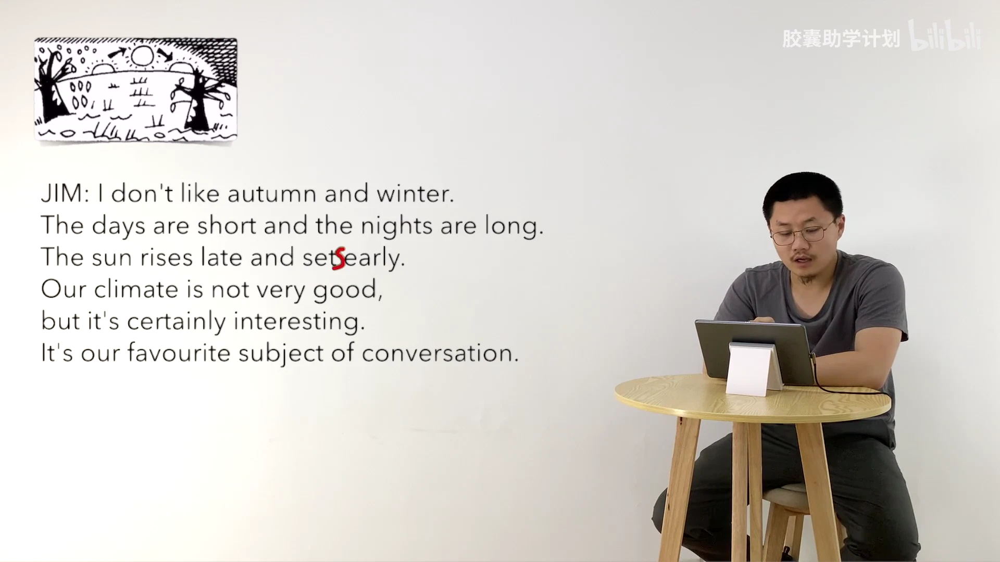

文字识别：胶囊助学计划 / 。 / 。 / 000 / 001 / 上 / 0 / JIM: I don't like autumn and winter. / The days are short and the nights are long. / The sun rises late and setearly. / Our climate is not very good, / but it's certainly interesting. / It's our favourite subject of conversation.

### 画面 00:04:14

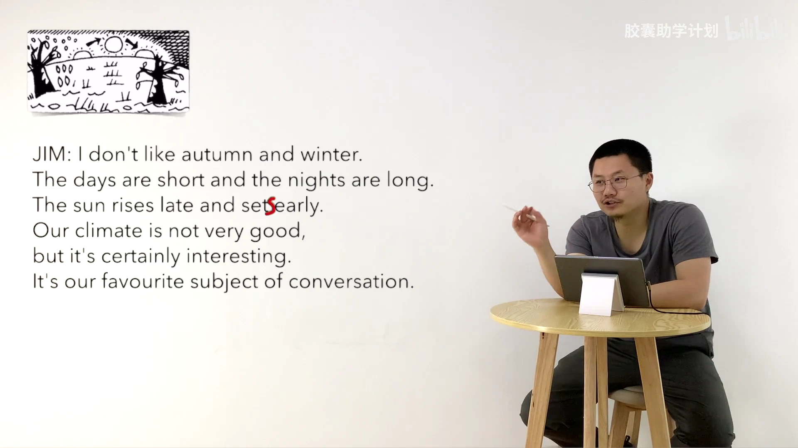

文字识别：胶囊助学计划 / 。 / 000 / 001 / 上 / JIM: I don't like autumn and winter. / The days are short and the nights are long. / The sun rises late and setearly. / Our climate is not very good, / but it's certainly interesting. / It's our favourite subject of conversation.

## 00:04:30–00:05:00

意思，比如说，它冬天是雨季，冬天疯狂的下雨，是吧？每一天都下几乎，然后呢，下完太阳就出来，然后你看冬天的时候，奥克兰的那个草啊，一人多高，是吧？你要不剪它，它能长到很高。然后到夏天呢，就变成这个所谓的叫做旱季了，是吧？也不下雨，地上那个草就枯了，和我们理解的这种四季的变换啊，非常的不一样。所以你就可以理解为它叫做 interesting，这个就是 interesting

### 画面 00:04:42

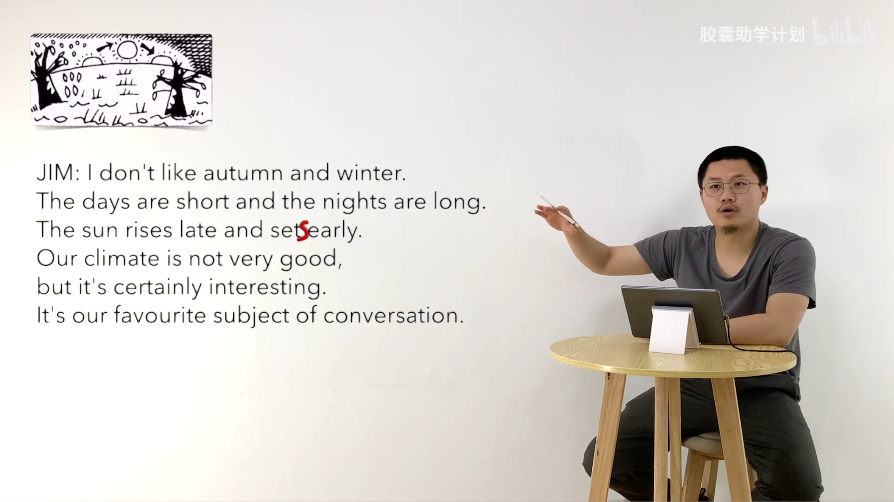

文字识别：胶囊助学计划 / 。 / 。 / 000 / 001 / 上 / 0 / JIM: I don't like autumn and winter. / The days are short and the nights are long. / The sun rises late and setSearly. / Our climate is not very good, / but it's certainly interesting. / It's our favourite subject of conversation.

### 画面 00:04:45

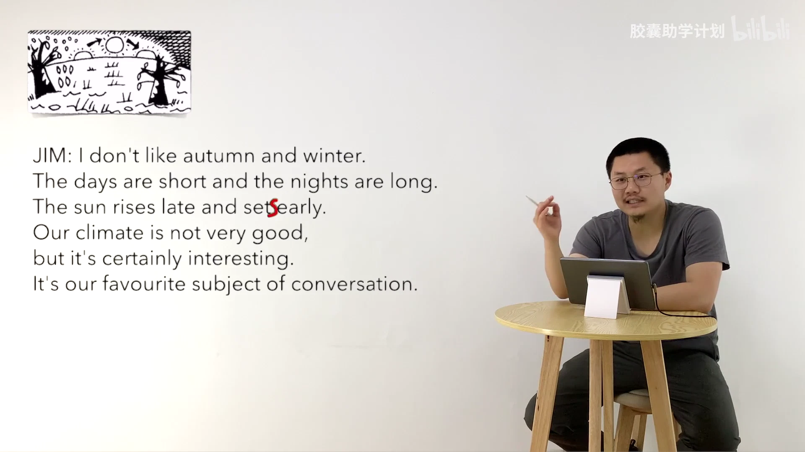

文字识别：胶囊助学计划 / 。 / 000 / 001 / JIM: I don't like autumn and winter. / The days are short and the nights are long. / The sun rises late and setearly. / Our climate is not very good, / but it's certainly interesting. / It's our favourite subject of conversation.

### 画面 00:04:50

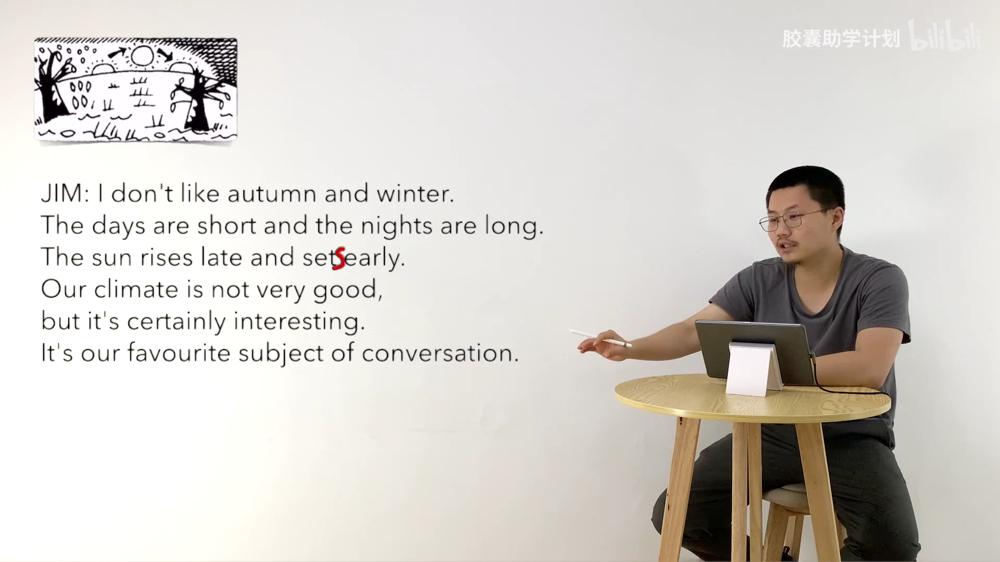

文字识别：胶囊助学计划 / 。 / 。 / 000 / 001 / 上 / 0 / JIM: I don't like autumn and winter. / The days are short and the nights are long. / The sun rises late and setearly. / Our climate is not very good, / but it's certainly interesting. / It's our favourite subject of conversation.

## 00:05:00–00:05:30

意思，它跟funny没有必然联系。你笑不笑没有关系，你只是觉得它有趣好玩儿，就叫interesting. OK,他说It's our favorite subject of conversation. A of B结构，二十五课我们就学过了。由后往前翻译，对话的话题，我们谈话的话题是我们最喜欢的谈话的话题啊。我给它这样圈一下啊，各位就能看明

### 画面 00:05:00

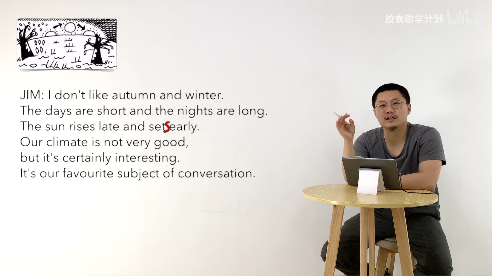

文字识别：胶囊助学计划 / 。 / 000 / 001 / 上 / 0 / JIM: I don't like autumn and winter. / The days are short and the nights are long. / The sun rises late and setearly. / Our climate is not very good, / but it's certainly interesting. / It's our favourite subject of conversation.

### 画面 00:05:28

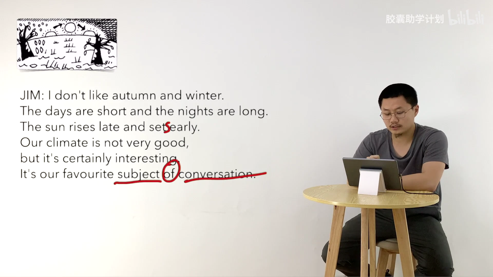

文字识别：胶囊助学计划 / 。 / 0 / 000 / 001 / 上 / 0 / JIM: I don't like autumn and winter. / The days are short and the nights are long. / The sun rises late and setearly. / Our climate is not very good, / but it's certainly interesting / It's our favourite subject / conversation.

## 00:05:30–00:06:00

白了，是吧？谈话的话题，我们最喜欢的，OK，Very good。接下来我们进行一些口语和听力的练习，各位还是啊，看我们的书啊，看我们的书。来了，第一题，Does Jim come from Australia? No, he doesn't. Does he come from England?

### 画面 00:05:31

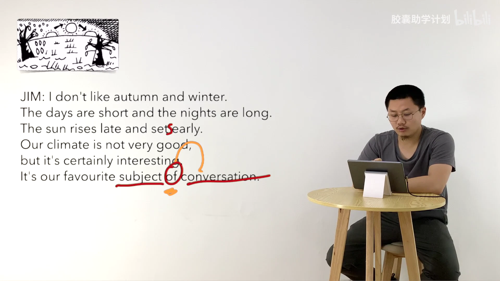

文字识别：胶囊助学计划 / 。 / 0 / 000 / 001 / 上 / 0 / JIM: I don't like autumn and winter. / The days are short and the nights are long. / The sun rises late and setearly. / Our climate is not very gooa, / but it's certainly interesting / It's our favourite subject / conversation.

### 画面 00:05:33

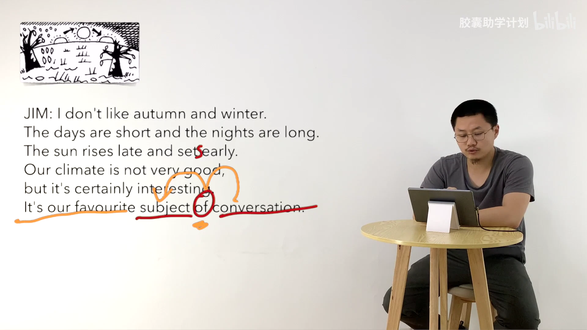

文字识别：胶囊助学计划 / 0 / 000 / 001 / 上 / ou / 0 / JIM: I don't like autumn and winter. / The days are short and the nights are long. / The sun rises late and setearly. / Our climate is not very goo / but it's certainly inteestin / It's our favourite subject / conversation.

### 画面 00:05:35

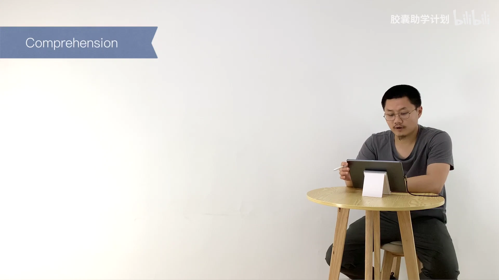

文字识别：胶囊助学计划 / Comprehension

### 画面 00:05:37

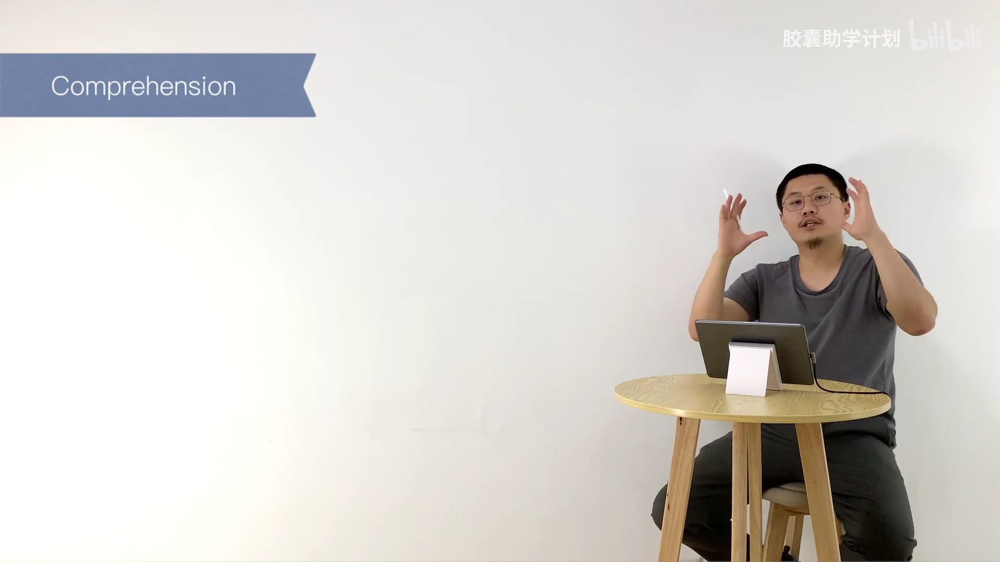

文字识别：胶囊助学计划 / Comprehension

### 画面 00:05:39

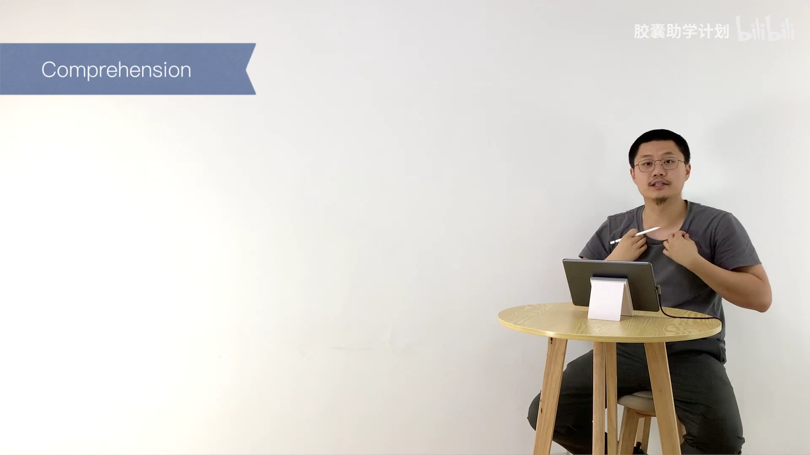

文字识别：胶囊助学计划 / Comprehension

### 画面 00:05:42

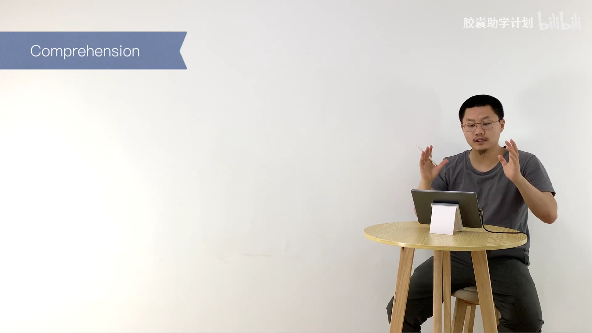

文字识别：胶囊助学计划 / Comprehension

### 画面 00:05:45

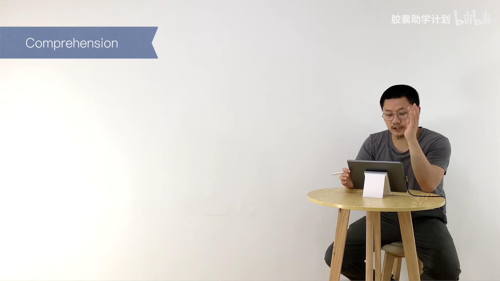

文字识别：胶囊助学计划 / Comprehension

### 画面 00:05:58

文字识别：胶囊助学计划 / Comprehension / 2 T: Does he come from England?

## 00:06:00–00:06:30

Yes, he does. Next one, is the weather always pleasant in England?再问一遍啊, is the weather always pleasant in England? No, it doesn't.不是的，对吧？有的时候还是不好的啊。其实它的描述大多数时候是不好的。Nadini, what's the weather like in the north? It's often cold.

### 画面 00:06:02

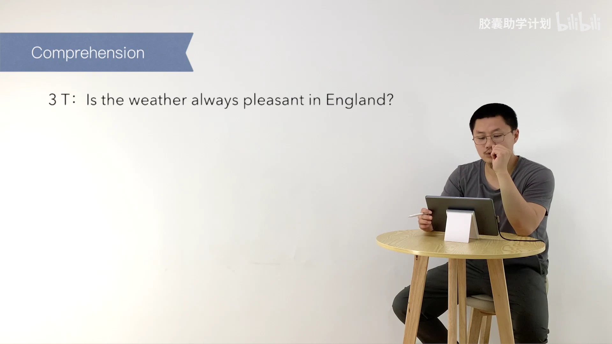

文字识别：胶囊助学计划 / Comprehension / 3 T: Is the weather always pleasant in England?

### 画面 00:06:16

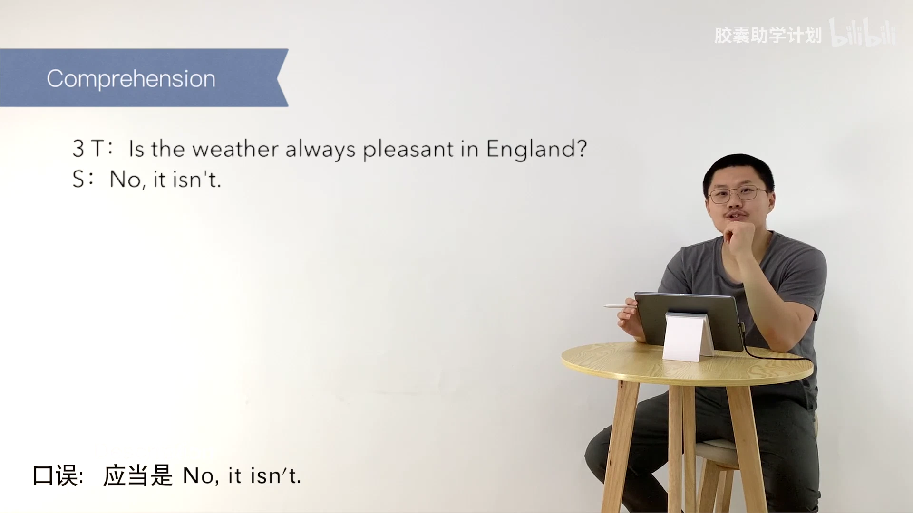

文字识别：胶囊助学计划 / Comprehension / 3 T: Is the weather always pleasant in England? / S: No, it isn't. / □误：应当是 No， it isn't.

### 画面 00:06:22

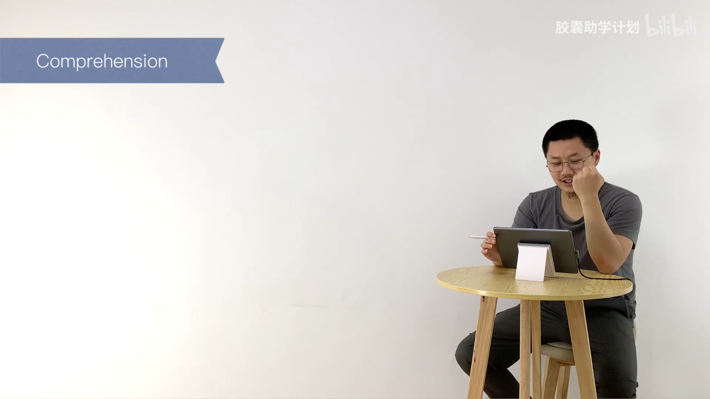

文字识别：胶囊助学计划 / Comprehension

## 00:06:30–00:07:00

Next one, what's the weather like in the east? It's often windy. Continue. What's the weather like in the west? It's often wet in the west. Continue. Which seasons does Jim like best? He最喜欢哪几个季节? Spring and summer.

### 画面 00:06:52

文字识别：胶囊助学计划 / Comprehension / 7 T: Which seasons does Jim like best?

### 画面 00:06:54

文字识别：胶囊助学计划 / Comprehension / 7 T: Which seasons does Jim like best?

## 00:07:00–00:07:30

Continue. Are the days long in spring and summer? Yes, they are. Continue. Does the sun rise early in summer? 你想下汉语翻译过来，你就明白答案了。 Yes, it does. 啊，这用常识判断就行了。 Next one. Is the climate interesting in England? Yes, it is. Very good. Of course it is.

### 画面 00:07:06

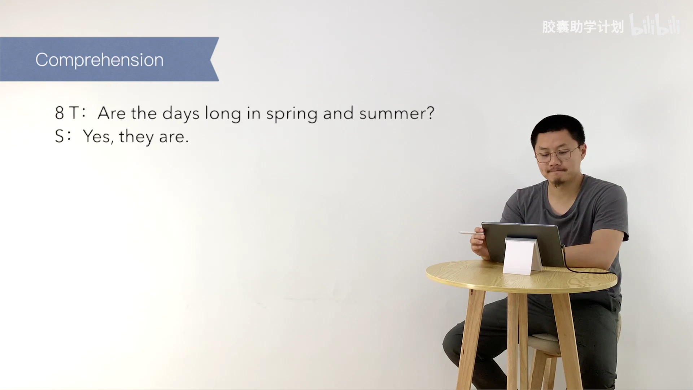

文字识别：胶囊助学计划 / Comprehension / 8 T: Are the days long in spring and summer? / S: Yes, they are.

### 画面 00:07:11

文字识别：胶囊助学计划 / Comprehension / 9 T: Does the sun rise early in summer?

### 画面 00:07:23

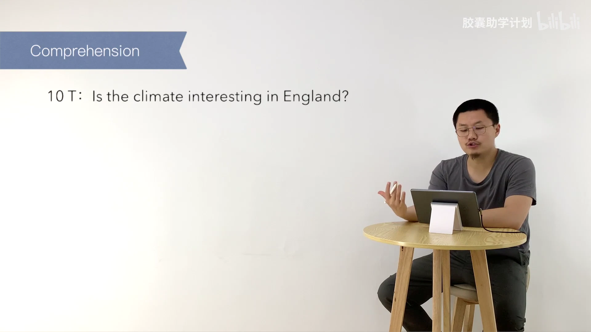

文字识别：胶囊助学计划 / Comprehension / 10 T: Is the climate interesting in England?

## 00:07:30–00:08:00

is. It's very interesting. Good. Continue asking questions.口语听力练习，各位见着肯定句变一般疑问句，再变特殊疑问句。不多说，我们开始. Ask me if Jim comes from England. Does提前动词还原形. Does Jim come from England? Where? Where does Jim come from? Continue. Ask me if the climate is mild in

### 画面 00:07:30

文字识别：胶囊助学计划 / Asking questions

### 画面 00:07:48

文字识别：胶囊助学计划 / Asking questions / 1 T: Ask me if Jim comes from England. / S: Does Jim come from England?

## 00:08:00–00:08:30

England. Is the climate mild in England? What's it like?天气气候怎么样，对吧？What's the climate like in England? Answer is what? Mild. Listen. Ask me if. Is often wet in the west. Is it often wet in the west? What's it like?

### 画面 00:08:05

文字识别：胶囊助学计划 / Asking questions / 2 T: Ask me if the climate is mild in England. / S: Is the climate mild in England? / T: What ...like?

### 画面 00:08:15

文字识别：胶囊助学计划 / Asking questions

## 00:08:30–00:09:00

Climate, right? What's it like in the West? 注意这个 it 实际上指的就是 the weather 啊，就是天气。听你 ask me if the sun rises early in summer. Does 提前? Does the sun rise early in summer? 是吧？你这是动词三单了，已经提醒你了。When? When does the sun rise in summer? 哎，太阳在夏天的时

### 画面 00:08:31

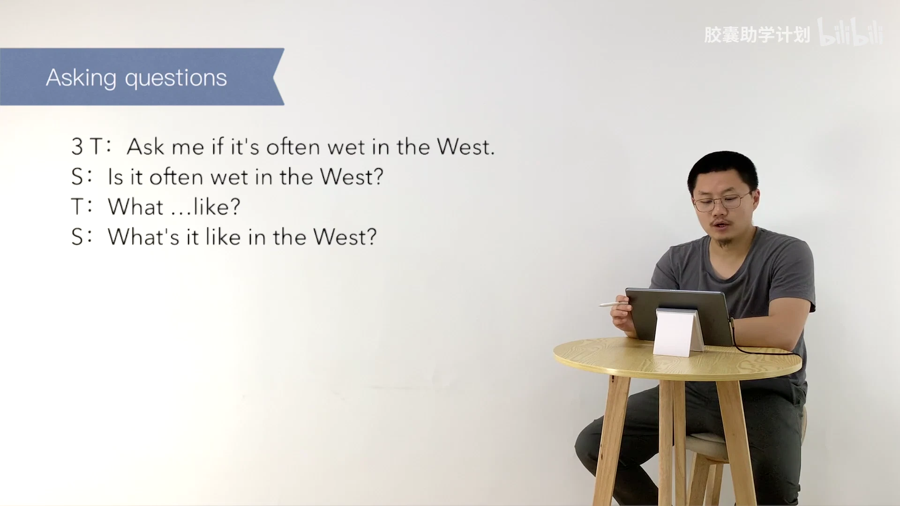

文字识别：胶囊助学计划 / Asking questions / 3 T: Ask me if it's often wet in the West. / S: Is it often wet in the West? / T: What ...like? / S: What's it like in the West?

### 画面 00:08:39

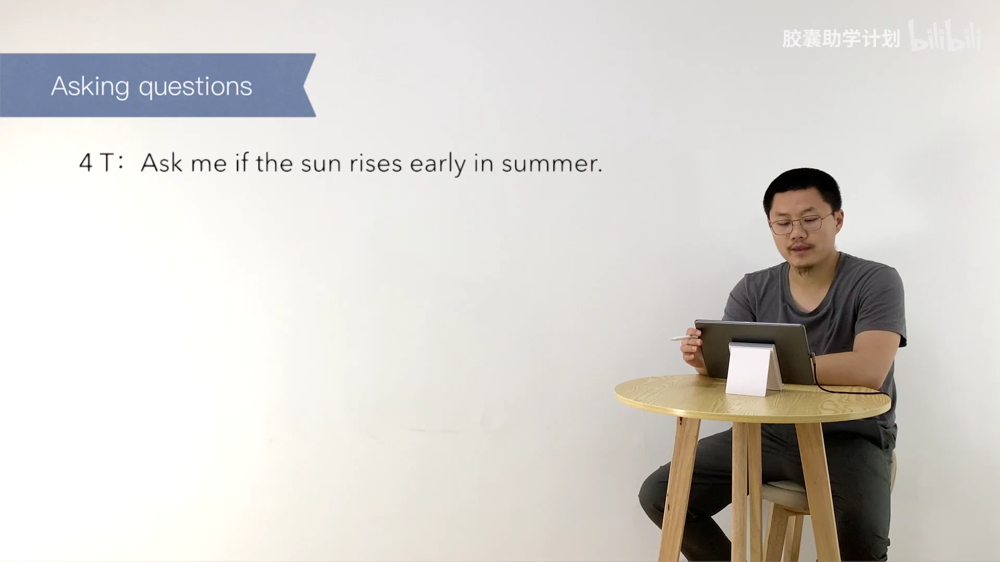

文字识别：胶囊助学计划 / Asking questions / 4 T: Ask me if the sun rises early in summer.

### 画面 00:08:53

文字识别：胶囊助学计划 / Asking questions / V / 4 T: Ask me if the sun rises early in summer. / S: Does the sun rise early in summer? / T: When ...? / S: When does the sun rise in summer?

## 00:09:00–00:09:30

候什么时候升起？你也可以对 in summer 提问，那答案就是 when does the sun rise early？太阳什么时候升的早？答案叫在夏天，这两个答案都可以。你听，你 ask me if the sun sets early in winter. Does the sun set early in winter? When? When does the sun set in winter?

### 画面 00:09:02

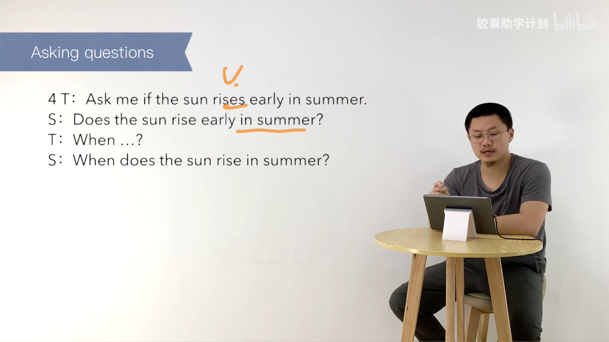

文字识别：胶囊助学计划 / Asking questions / V / 4 T: Ask me if the sun rises early in summer. / S: Does the sun rise early in summer? / T: When ...? / S: When does the sun rise in summer?

### 画面 00:09:12

文字识别：胶囊助学计划 / Asking questions / 5 T: Ask me if the sun sets early in winter.

### 画面 00:09:25

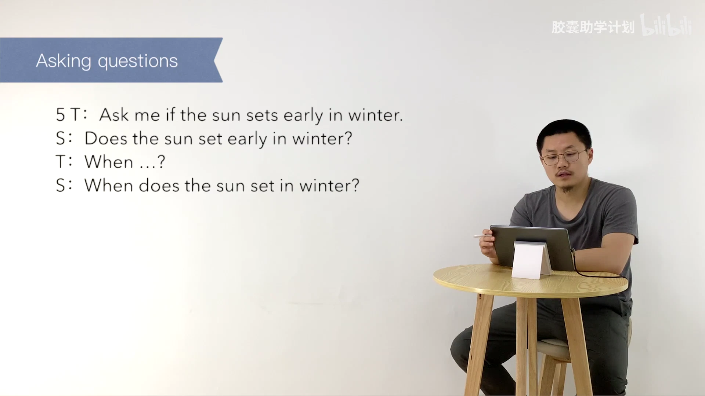

文字识别：胶囊助学计划 / Asking questions / 5 T: Ask me if the sun sets early in winter. / S: Does the sun set early in winter? / T: When ...? / S: When does the sun set in winter?

## 00:09:30–00:10:00

Okay, very good. Recap.本课除了本课固有的单词，已经有的这些单词以外，我们基本上还是在围绕着一般现在时陈述客观事实啊，存在呃，陈述客观事实存在的状态，在围绕着它去展开，对吧？那这些单词实际上跟我们讲单词那些基本上是高度重合的，也没有什么新的单词。各位把文章读熟了之后，这些单词自然而然就给它记下来了。Okay,看

### 画面 00:09:31

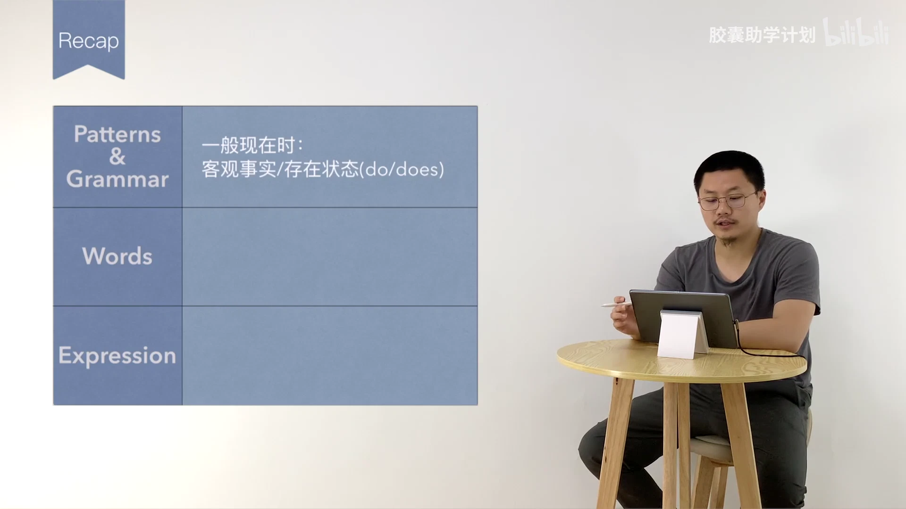

文字识别：Recap / 胶囊助学计划 / Patterns / 一般现在时： / 客观事实/存在状态(do/does) / Grammar / Words / Expression

### 画面 00:09:33

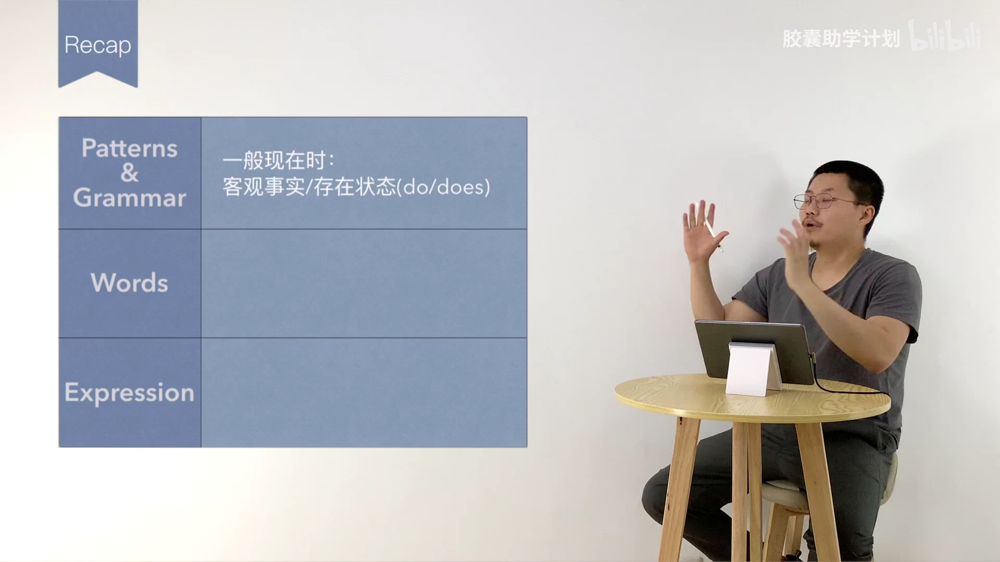

文字识别：Recap / 胶囊助学计划 / Patterns / 一般现在时： / 8 / 客观事实/存在状态(do/does) / Grammar / Words / Expression

### 画面 00:09:35

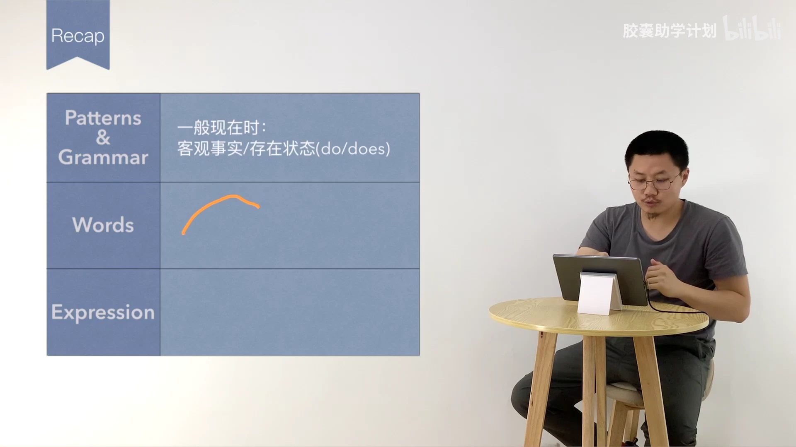

文字识别：Recap / 胶囊助学计划 / Patterns / 一般现在时： / 客观事实/存在状态(do/does) / Grammar / Words / Expression

### 画面 00:09:37

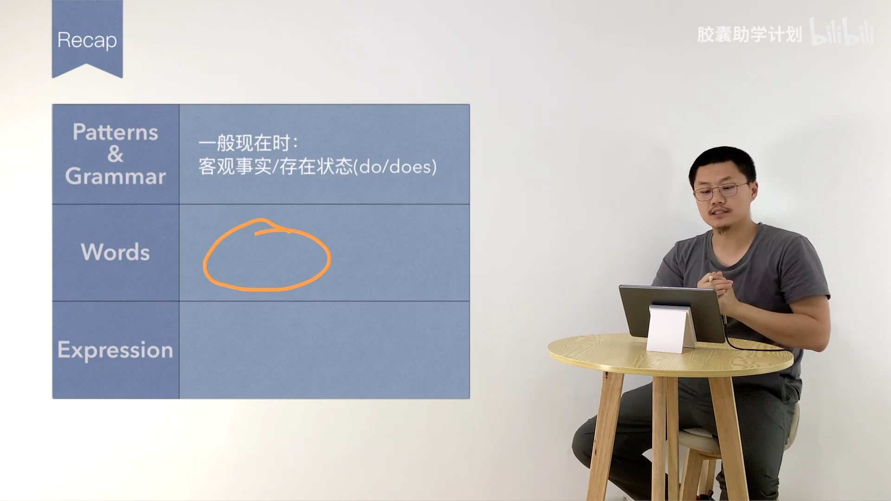

文字识别：Recap / 胶囊助学计划 / Patterns / 一般现在时： / & / 客观事实/存在状态(do/does) / Grammar / Words / Expression

### 画面 00:09:39

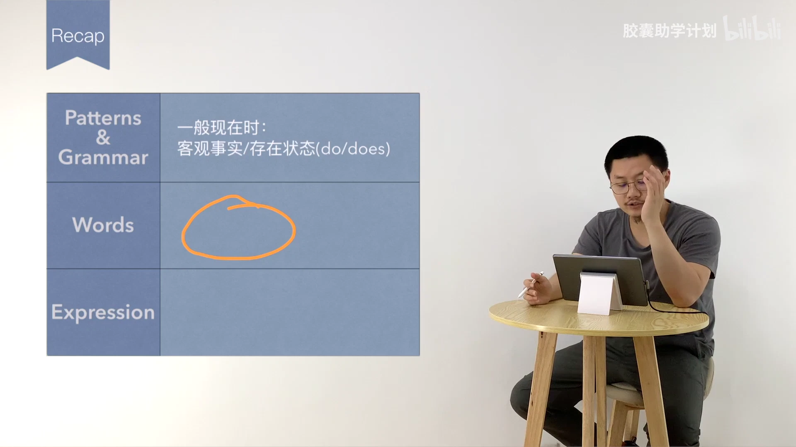

文字识别：Recap / 胶囊助学计划 / Patterns / 一般现在时： / 客观事实/存在状态(do/does) / Grammar / Words / Expression

### 画面 00:09:49

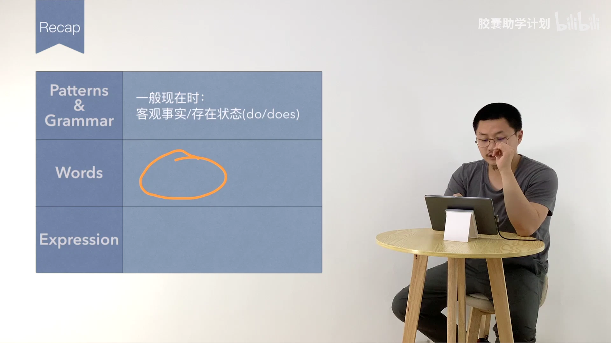

文字识别：Recap / 胶囊助学计划 / Patterns / 一般现在时： / 客观事实/存在状态(do/does) / Grammar / Words / Expression

### 画面 00:09:51

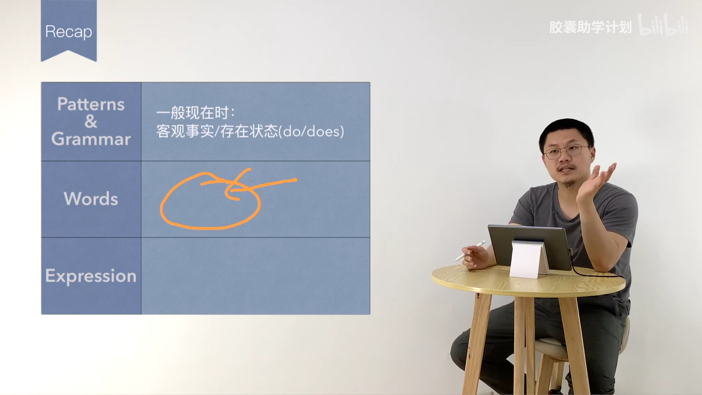

文字识别：Recap / 胶囊助学计划 / Patterns / 一般现在时： / 客观事实/存在状态(do/does) / Grammar / Words / Expression

### 画面 00:09:54

文字识别：Recap / 胶囊助学计划 / Patterns / 一般现在时： / 客观事实/存在状态(do/does) / Grammar / Words / Expression

### 画面 00:09:57

文字识别：胶囊助学计划 / Recap / Patterns / 一般现在时： / 客观事实/存在状态(do/does) / Grammar / Words / Expression

### 画面 00:09:59

文字识别：胶囊助学计划 / 绿皮书53课的写作练习

## 00:10:00–00:10:30

下家庭作业。首先，五十三课绿皮书，各位可以去写了。这是非常棒的一个初期的语法练习，各位要坚持住。文章老习惯，各位要跟读至熟读成诵啊！这是我们学英语初期要不停做的一件事情。OK，接下来给自己讲解一遍今天的核心知识点，提升我们的吸收效率。如果大家喜欢我们的课程呢，欢迎大家关注、订阅、一键三连支持，并分享给那些需要的朋友。最后，我们再来看一句名人名

### 画面 00:10:01

文字识别：胶囊助学计划 / 绿皮书53课的写作练习

### 画面 00:10:07

文字识别：胶囊助学计划 / 绿皮书53课的写作练习 / 文章跟读至熟读成诵

### 画面 00:10:10

文字识别：胶囊助学计划 / 绿皮书53课的写作练习 / 文章跟读至熟读成诵

### 画面 00:10:15

文字识别：胶囊助学计划 / 绿皮书53课的写作练习 / 文章跟读至熟读成诵 / 3.请给自己讲解一遍今天的 / 核心知识点

### 画面 00:10:18

文字识别：胶囊助学计划 / 绿皮书53课的写作练习 / 文章跟读至熟读成诵 / 3.请给自己讲解一遍今天的 / 核心知识点

### 画面 00:10:20

文字识别：胶囊助学计划

### 画面 00:10:23

文字识别：胶囊助学计划

### 画面 00:10:27

文字识别：胶囊助学计划

### 画面 00:10:29

文字识别：胶囊助学计划 / It's never too late - never too late to start over, / never too late to be happy. / Jane Fonda

## 00:10:30–00:10:51

言：It's never too late, never too late to start over, never too late to be happy. See you next time.

### 画面 00:10:33

文字识别：胶囊助学计划 / It's never too late - never too late to start over, / never too late to be happy. / -Jane Fonda

### 画面 00:10:37

文字识别：胶囊助学计划 / It's never too late - never too late to start over, / never too late to be happy. / - Jane Fonda

### 画面 00:10:39

文字识别：It's never too / ate - never too / late to start over, / late to be happy. / never too / -Jane Fonda

### 画面 00:10:41

文字识别：CAPSULEACADEMY / 胶囊助学计划 / 小红书 / Lecturer / □ / 口 / Leo / OE

### 画面 00:10:44

文字识别：CAPSULEACADEMY / 胶囊助学计划 / 小红书 / Fdi- / OE

### 画面 00:10:47

文字识别：CAPSULEACADEMY / 胶囊助学计划 / 小红书 / Creator / □ / Leo & Berlin / OE

### 画面 00:10:49

文字识别：bilibili / 胶囊助学计划 / CAPSULEACADEMY / 胶囊助学计划 / 小红书

### 画面 00:10:51

文字识别：bilibili / 胶囊助学计划

