# 054 练习 单词

快速机器解析：语音为单模型转写，未进行独立交叉校对或人工复核；画面每秒采样并按变化选帧，短时文字和标记可能遗漏。截图时间约有 1 秒误差。图片有损压缩；遇到疑点请按时间查看 Google Drive 原视频。

## 00:00:00–00:00:30

Hello everyone, welcome to Capsule Academy. This is Leo. Today we are going to learn the Concept English Book One Lesson Fifty Four Practices and Words. Hope you will enjoy. Good. Then we come up directly to the words. The words in this lesson are mostly related to countries. As usual, like Lesson Fifty Two, you should prioritize the countries you are interested in, right? The countries you are not interested in can be left for later.

### 画面 00:00:00

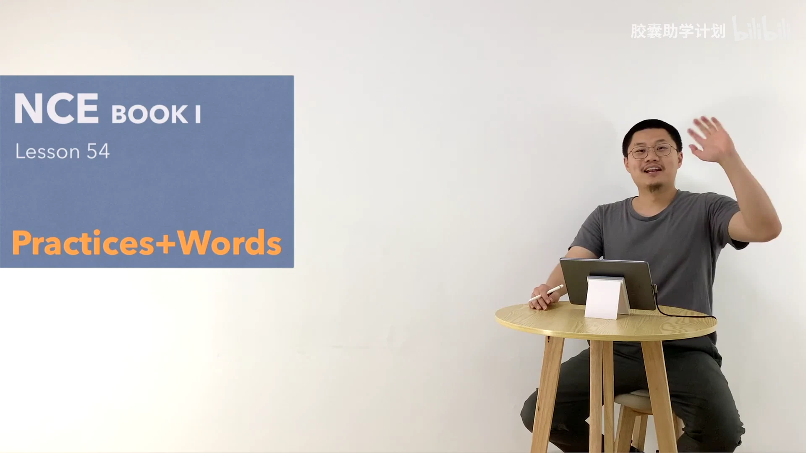

文字识别：胶囊助学计划 / NCE / BOOKI / Lesson 54 / Practices+Words

### 画面 00:00:02

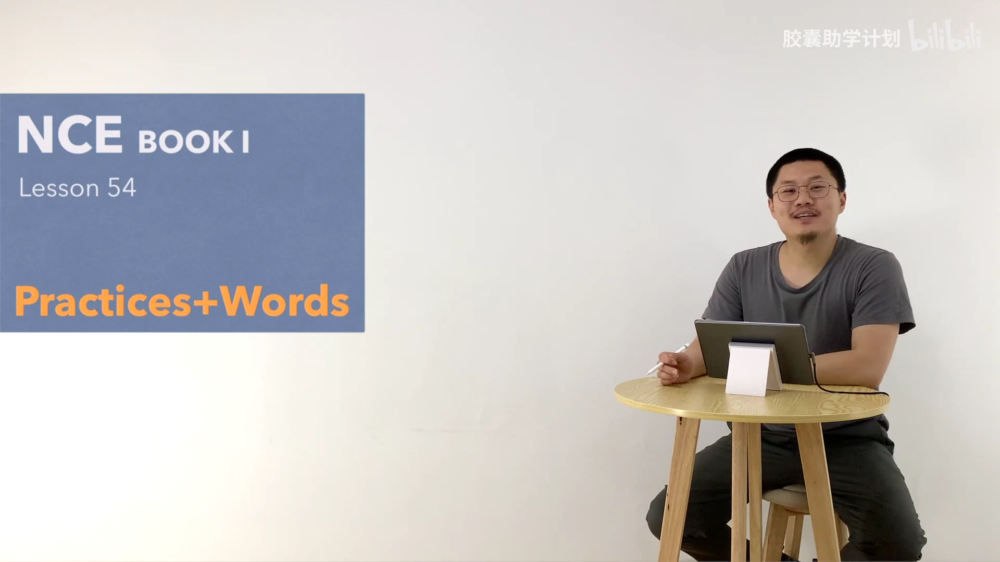

文字识别：胶囊助学计划 / NCE / BOOKI / Lesson 54 / Practices+Words

### 画面 00:00:04

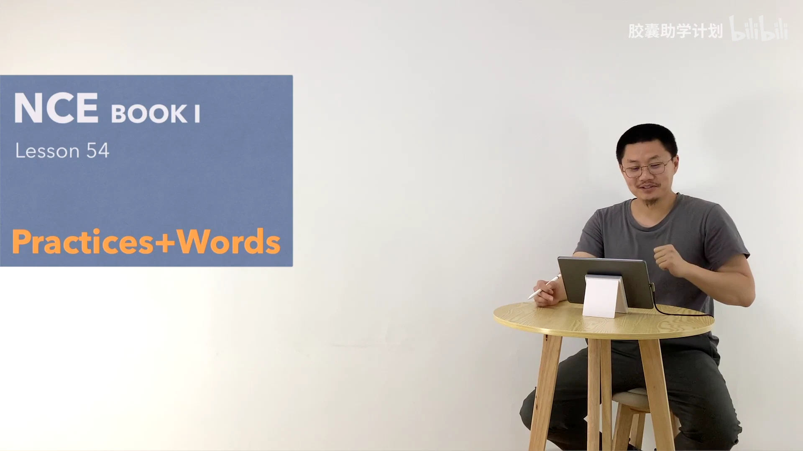

文字识别：胶囊助学计划 / NCE / BOOKI / Lesson 54 / Practices+Words

### 画面 00:00:10

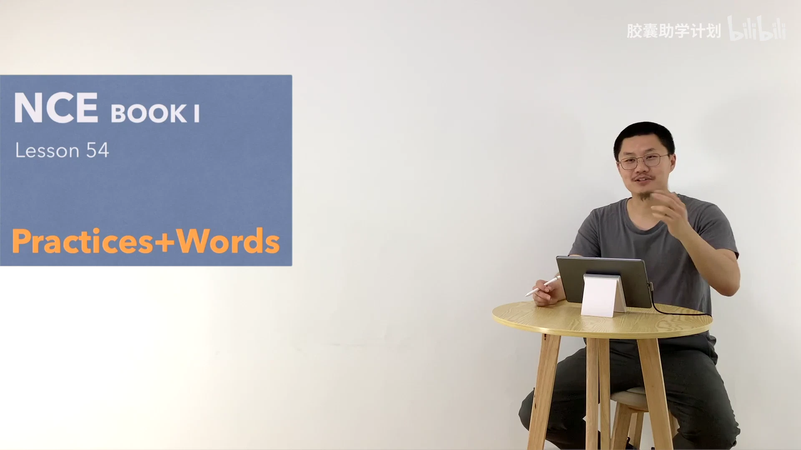

文字识别：胶囊助学计划 / NCE / BOOKI / Lesson 54 / Practices+Words

### 画面 00:00:12

文字识别：胶囊助学计划bill

### 画面 00:00:15

### 画面 00:00:17

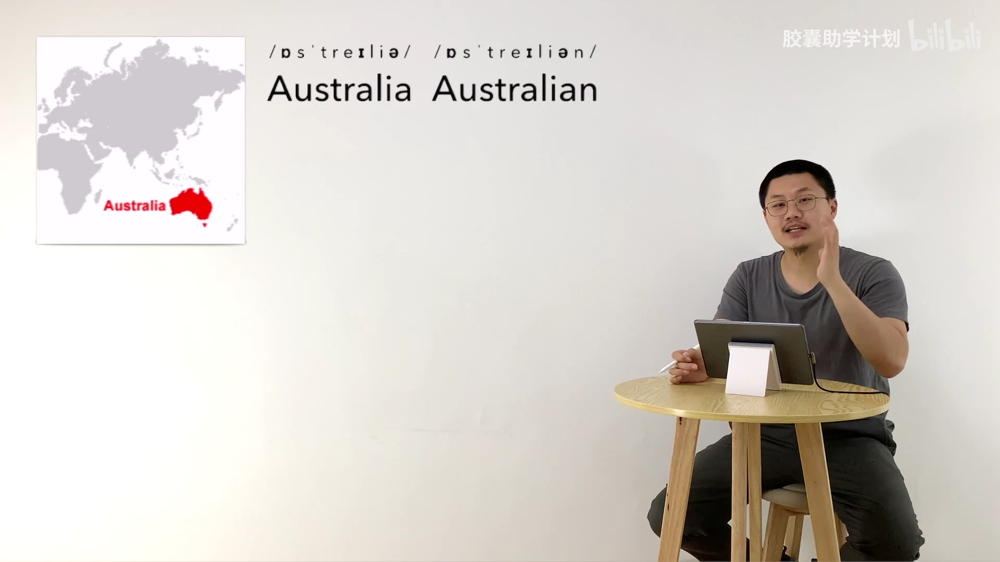

文字识别：胶囊助学计划 / /ps'trerlia/ /ps'treilian/ / Australia Australian / Australia

## 00:00:30–00:01:00

国家的名字，可以暂时不用着急把它背起来。但重点是要靠音标把它们拼出来，是检验我们音标学习成果的时候来了。因为这些单词还真的都不是特别好读。我们先看第一个澳大利亚啊，中国我们在这个位置对吧？澳大利亚在我们的地图上的南部来了，Australia，Australia叫澳大利亚这个国家，后边加了个字母n，就多了个嗯，对吧？Australian，

### 画面 00:00:35

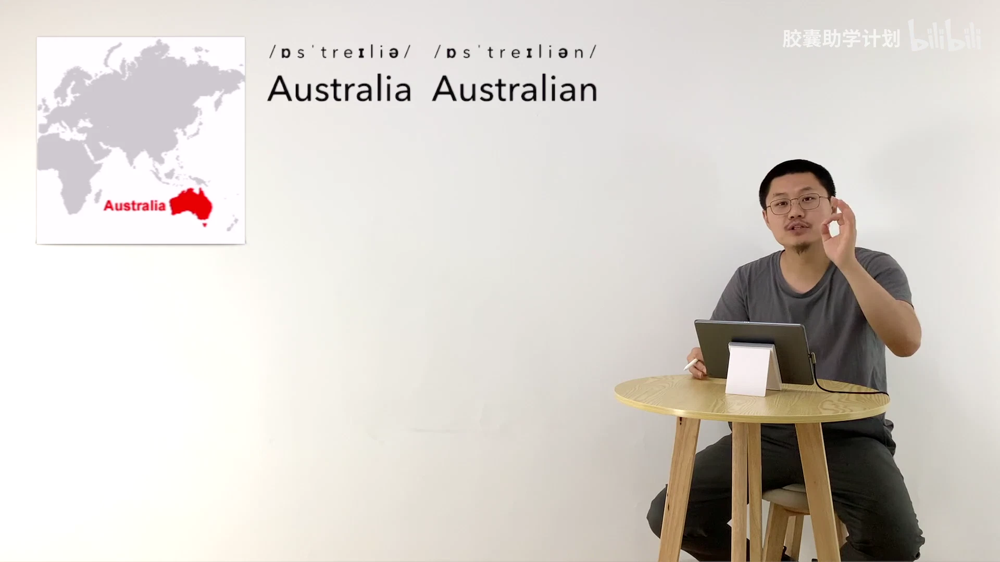

文字识别：胶囊助学计划 / /ps'trerlia/ /ps'treilian/ / Australia Australian / Australia

### 画面 00:00:41

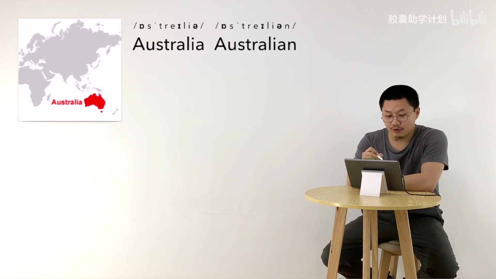

文字识别：胶囊助学计划 / /ps'trerlia/ /ps'treilian/ / Australia Australian / Australia

### 画面 00:00:44

文字识别：胶囊助学计划 / /ps'trerlia/ /ps'treilian/ / Australia Australian / Australia

### 画面 00:00:59

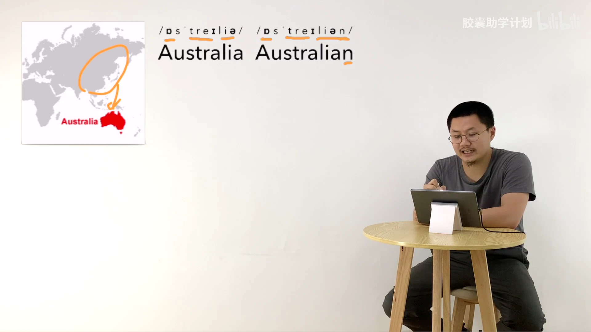

文字识别：胶囊助学计划 / /ps'trerlia/ / /ps'treilian/ / Australia / Australian / Australia

## 00:01:00–00:01:30

澳大利亚人，Australian，就澳大利亚人，OK，那不存在澳大利亚语啊，不不不聊这件事儿，对吧？他们的官方语言也是英文啊，OK，所以Where do you come from？这个地方各位张嘴跟我读就行了，跟读。Are you Australian？Yes, I come from Australia. OK, continue.下一个跟他长得还真的有点像，发音也有点像，

### 画面 00:01:14

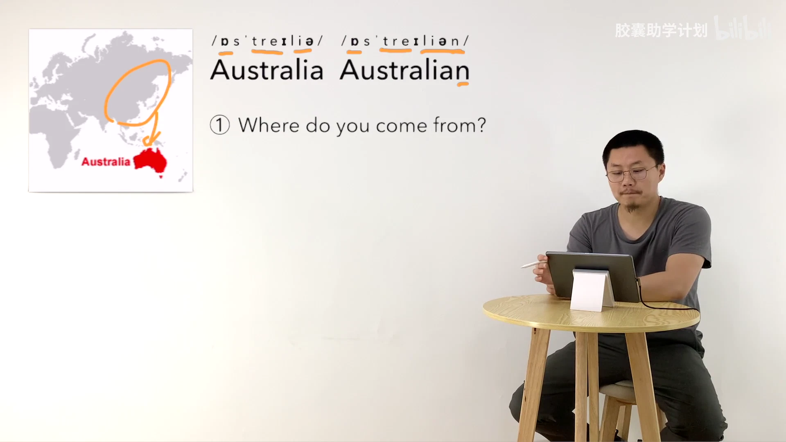

文字识别：胶囊助学计划 / /ps'treilia/ / /ps'treilian/ / Australia / Australian / ① Where do you come from? / Australia

### 画面 00:01:25

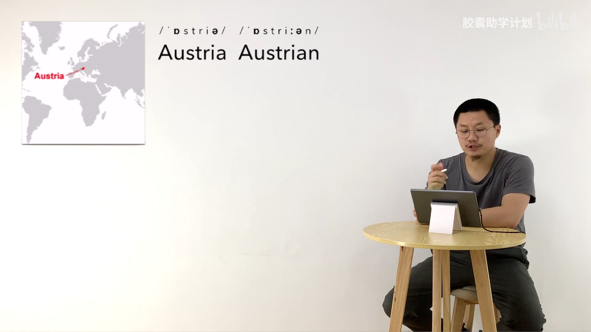

文字识别：胶囊助学计划 / /'pstria/ /'pstri:an/ / Austria Austrian / Austria

## 00:01:30–00:02:00

Austria，奥地利对吧？Austria，那也是加了个字母n，Austrian，Austrian在中欧啊，在欧洲的中部，奥地利。来，Where does he come from? Is he Austrian? Yes, he comes from Austria. Okay, continue.来，Canada，这个比较简单一点，

### 画面 00:01:38

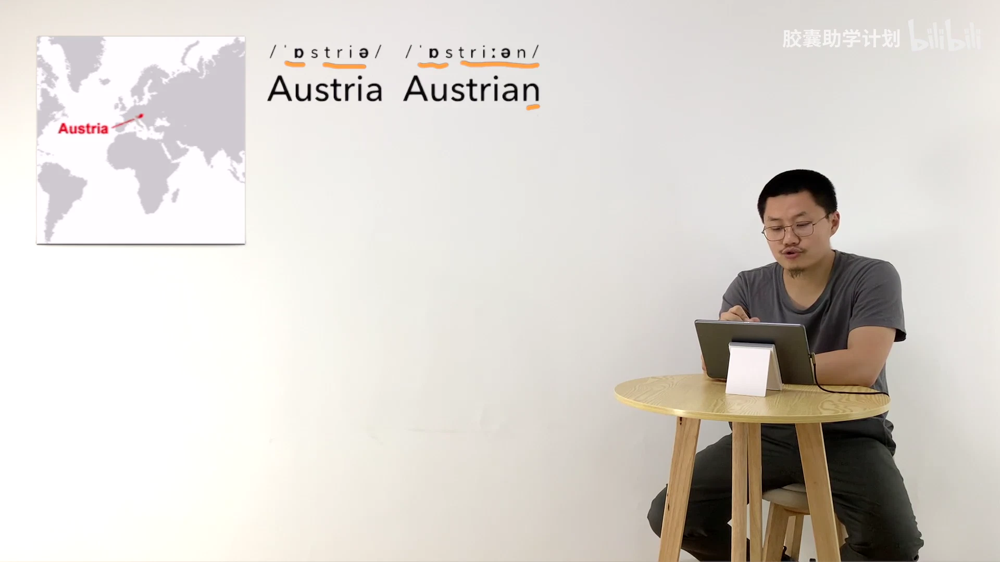

文字识别：胶囊助学计划 / / 'pstria/ / /'pstri:an/ / Austria / Austrian / Austria

### 画面 00:01:49

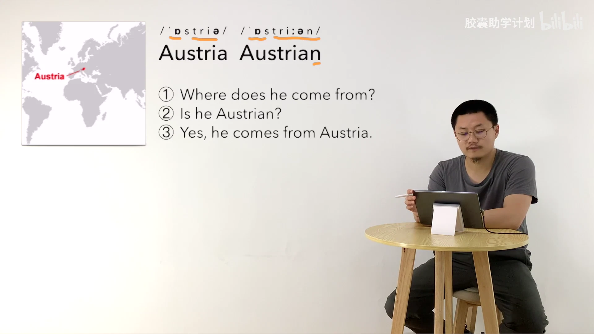

文字识别：胶囊助学计划 / / 'pstria/ / /pstri:an/ / Austria / Austrian / Austria / ① Where does he come from? / ② Is he Austrian? / 2 / Yes, he comes from Austria. / 3

### 画面 00:01:56

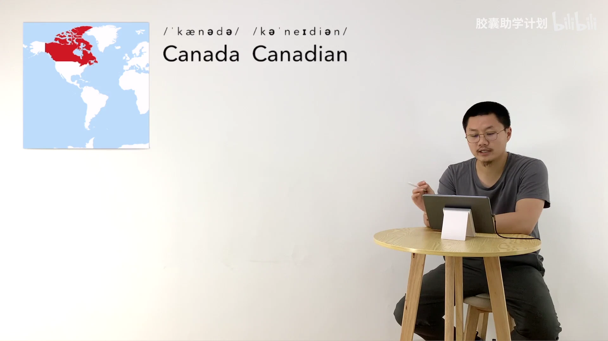

文字识别：胶囊助学计划 / / 'kænada/ /ka'neidian/ / Canada Canadian

## 00:02:00–00:02:30

### 画面 00:02:07

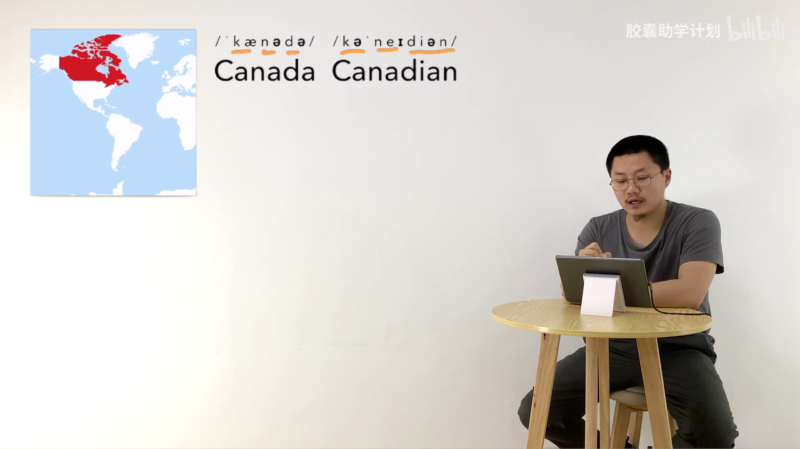

文字识别：胶囊助学计划 / / 'kænada/ / /ka'neidian/ / Canada / Canadian

### 画面 00:02:29

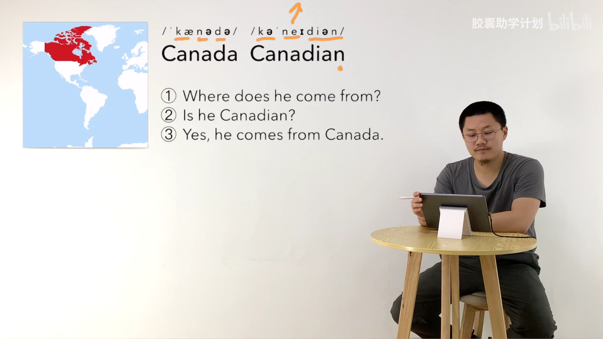

文字识别：胶囊助学计划 / /kænada/ /ka'neidian/ / Canada Canadian / ① Where does he come from? / ② Is he Canadian? / ③ Yes, he comes from Canada.

## 00:02:30–00:03:00

Yes, he comes from Canada. Okay,好，再然后芬兰，读一下叫做Finland, Finland.然后芬兰人叫做Finish啊，它的发音和那个完成那个单词很像Finish.好，跟我读Where do I come from? Am I Finish?啊，我是芬兰人吗？Yes, you come

### 画面 00:02:35

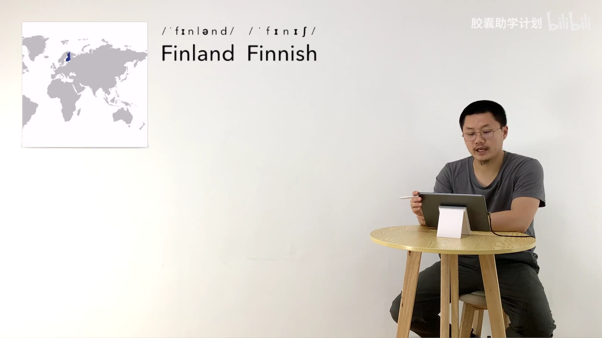

文字识别：胶囊助学计划 / /'finland/ /fini∫/ / Finland Finnish

### 画面 00:02:46

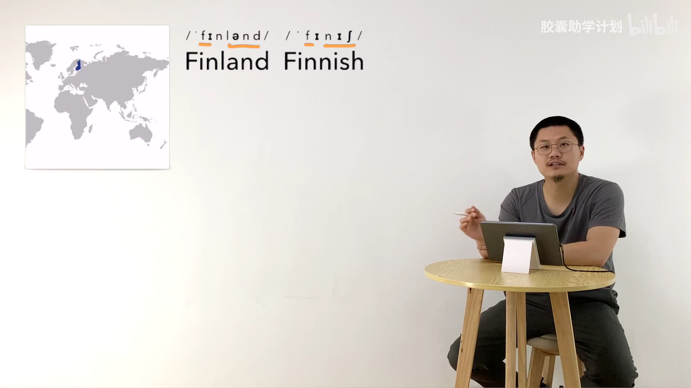

文字识别：胶囊助学计划 / / 'fin land / / /' fin I ∫/ / Finland / Finnish

### 画面 00:02:58

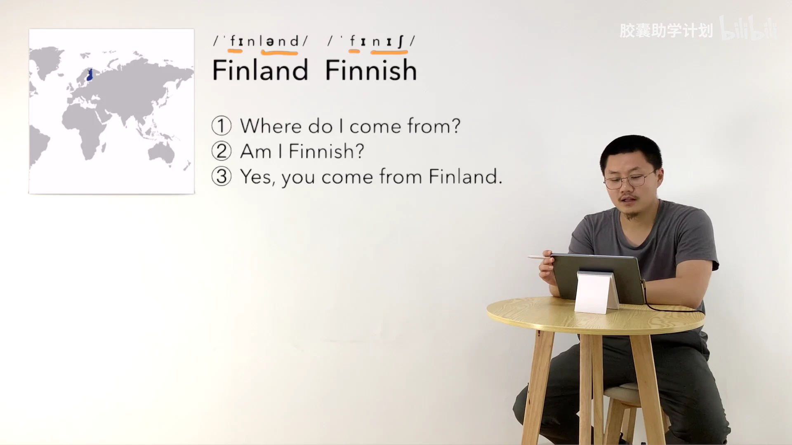

文字识别：胶囊助学计划 / / finland/ /fIni∫/ / Finland / Finnish / ① Where do I come from? / Am I Finnish? / 2 / Yes, you come from Finland. / 3

## 00:03:00–00:03:30

from Finland.是的，你来自于芬兰，北欧，对吧？Continuing, India或者是Indian啊，印度。后面你看，它也是加了个字母n，表示印度人。来，Where does she come from? Is she Indian? Yes, she comes from India.来自于印度。Next one,哎，这个就比较的长了。

### 画面 00:03:04

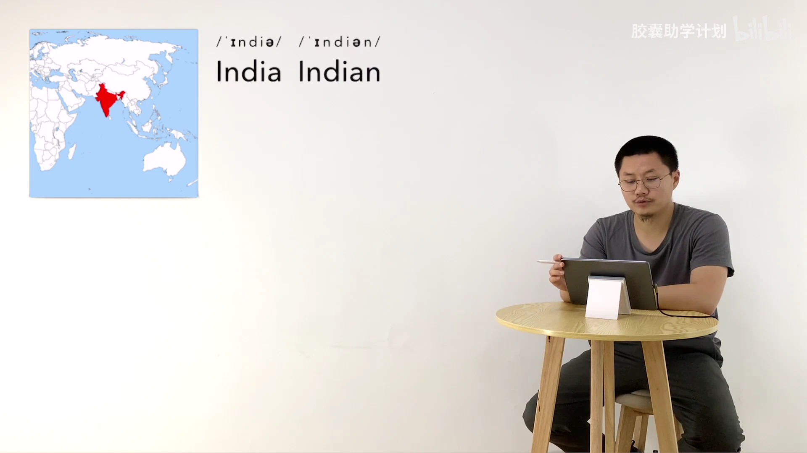

文字识别：胶囊助学计划 / /'india/ /'indian/ / India Indian

### 画面 00:03:20

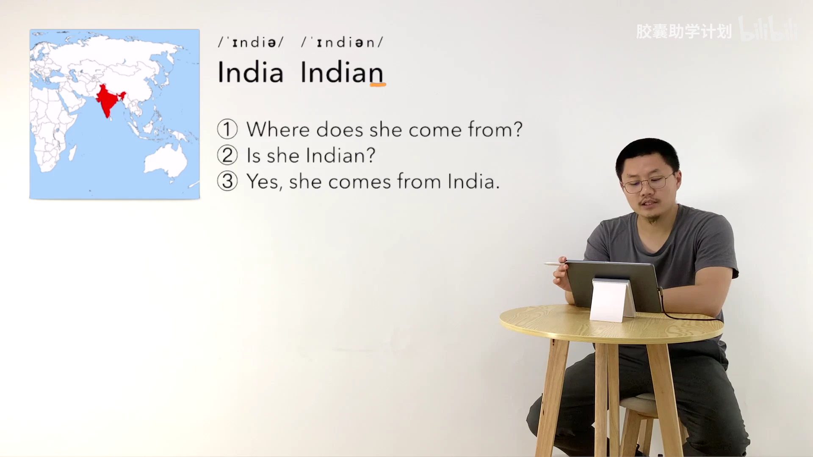

文字识别：胶囊助学计划 / /'india/ /'Indian/ / India Indian / ① Where does she come from? / ② Is she Indian? / ③ Yes, she comes from India.

### 画面 00:03:26

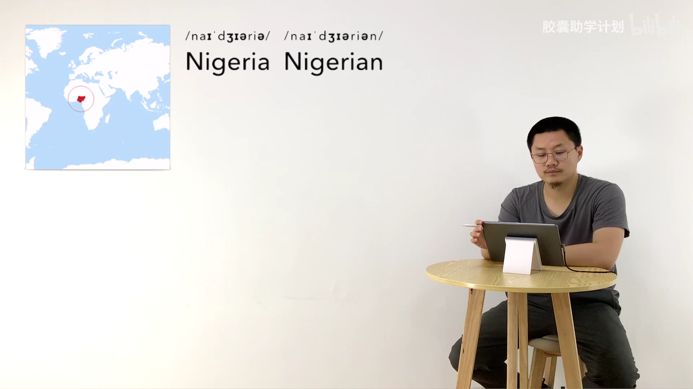

文字识别：胶囊助学计划 / /nar'dziaria/ / /nar'dziarian/ / Nigeria 1 / Nigerian

## 00:03:30–00:04:00

非洲啊，非洲，尼日利亚，Nigeria，Nigerian。好，我们连起来读，Nigeria，Nigerian。多加了个字母n，对吧？鼻音。Where does she come from? Is she Nigerian? Yes, she comes from Nigeria.

### 画面 00:03:36

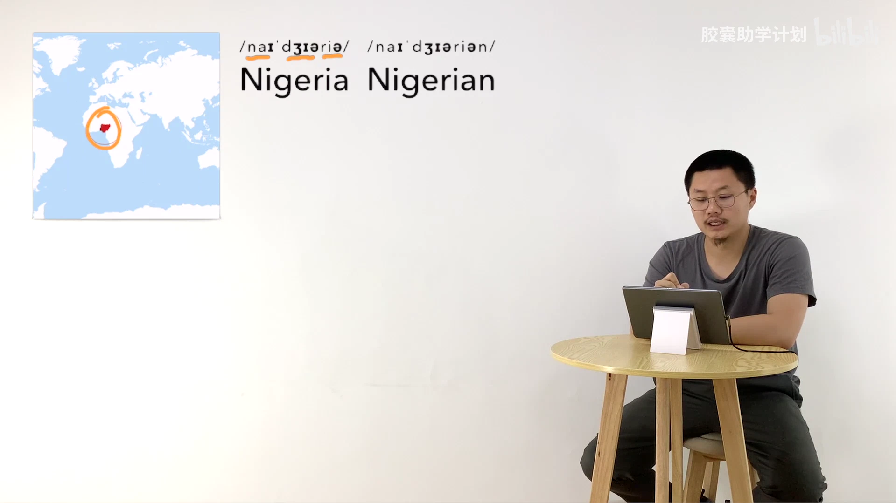

文字识别：胶囊助学计划 / /nai'd3iaria/ / /nar'd3iarian/ / Nigeria / Nigerian

### 画面 00:03:47

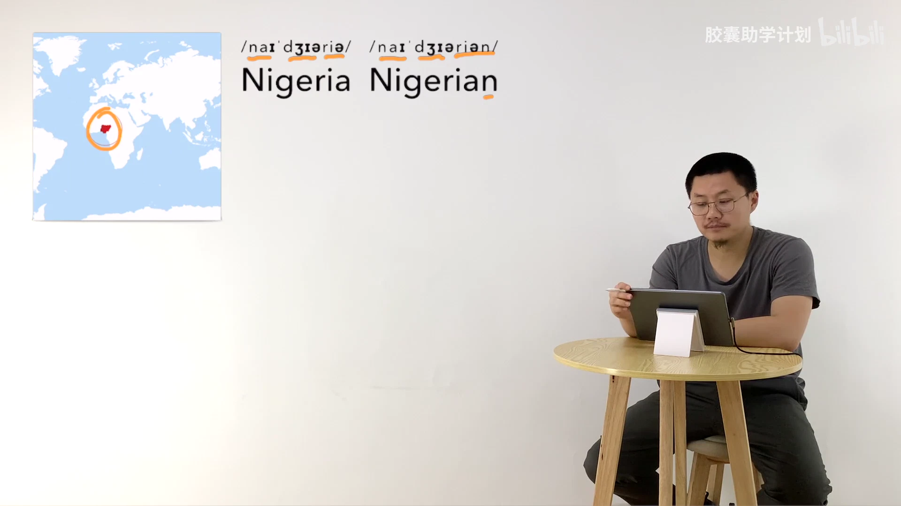

文字识别：胶囊助学计划 / /nai' / 'dziaria/ / /nai' / d3iarian/ / Nigeria / Nigerian

### 画面 00:03:50

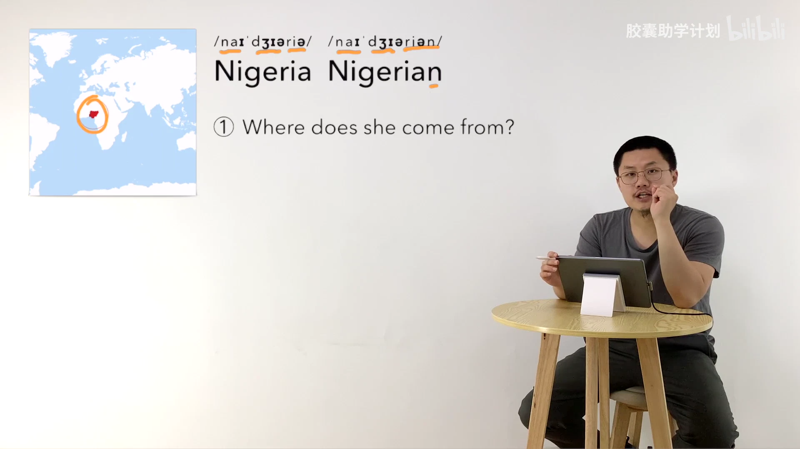

文字识别：胶囊助学计划 / /nal'd3iaria/ / /nar' / d3iarian/ / Nigeria / Nigerian /  Where does she come from?

## 00:04:00–00:04:30

Very good. Continue. Turkey. Turkey. Turkish.土耳其啊，各位能看到在地中海的东部，基本上它是亚非欧链接处那个板块啊。Turkey. Turkish.土耳其土耳其人. Where does she come from? Is she Turkish?

### 画面 00:04:01

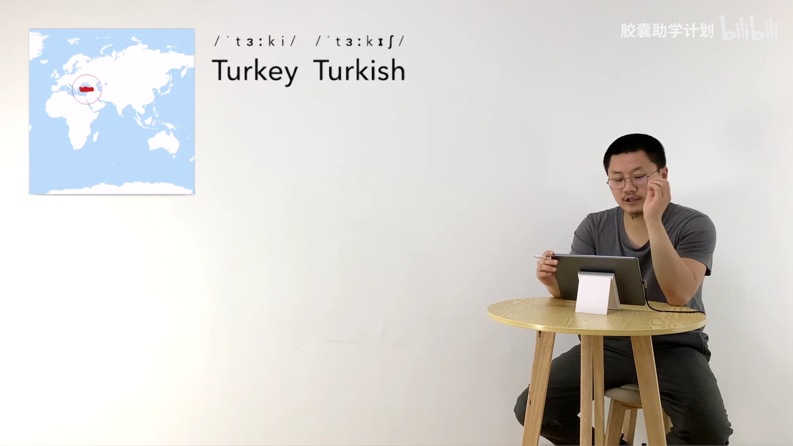

文字识别：胶囊助学计划 / /^t3:ki/ /^t3:kr∫/ / Turkey Turkish

### 画面 00:04:09

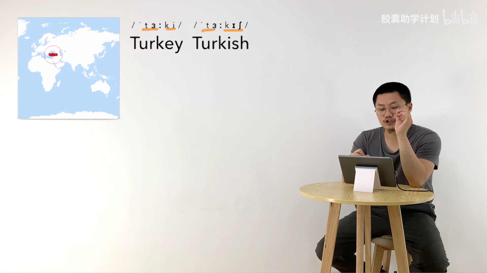

文字识别：胶囊助学计划 / 1 ' t3:ki/ / ^t3:k1{/ / Turkey / Turkish

### 画面 00:04:25

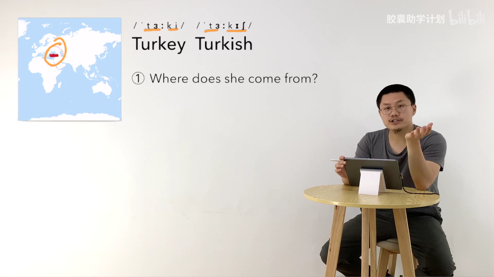

文字识别：胶囊助学计划 / 1 ^ t3: ki/ / ^t3:k1 {/ / Turkey / Turkish / ① Where does she come from?

## 00:04:30–00:05:00

Yes, she comes from Turkey. Okay, next one. Ah, our neighbor Korean. Ah, sorry, Korea. Ah, this has no n, right? Then add a letter n, Korean. It often refers to Korea, not North Korea. Korea, Korean. Okay, come with me. Where do you come from? Are you Korean?

### 画面 00:04:35

文字识别：胶囊助学计划 / /ka'ria/ / Korea Korean

### 画面 00:04:46

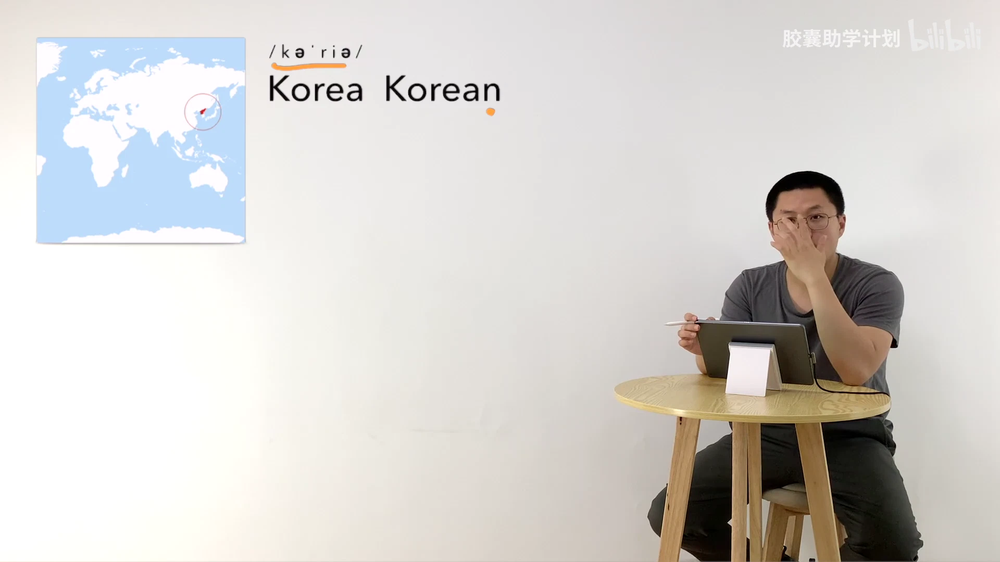

文字识别：胶囊助学计划 / /ka'ria/ / Korea Korean

### 画面 00:04:59

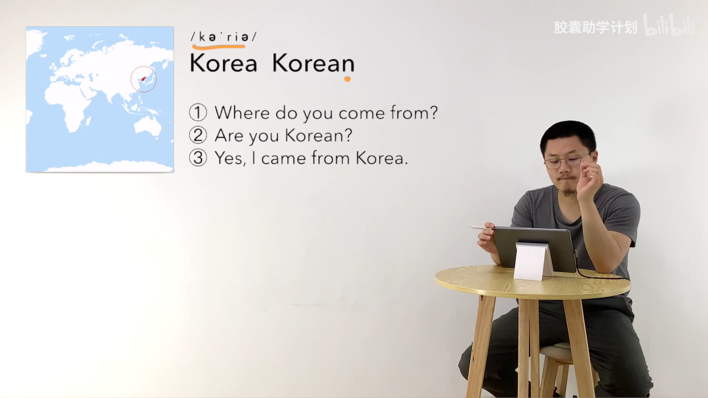

文字识别：胶囊助学计划 / /ka'ria/ / Korea Korean / ① Where do you come from? / Are you Korean? / Yes, I came from Korea. / 3

## 00:05:00–00:05:30

Yes, I come from. 这有一个小的 typo 啊，叫做 I come from Korea. There you go. 好来 Poland, 波兰啊，德国闪击波兰就是这个波兰啊。二战全面爆发。来 Polish 啊，你看它紧挨着德国，对吧？它的旁边左边德国，在下面法国 Polish. 来 Where do you come from? Are you Polish?

### 画面 00:05:09

文字识别：胶囊助学计划 / /'pauland/ /'pplr∫/ / Poland Polish

### 画面 00:05:13

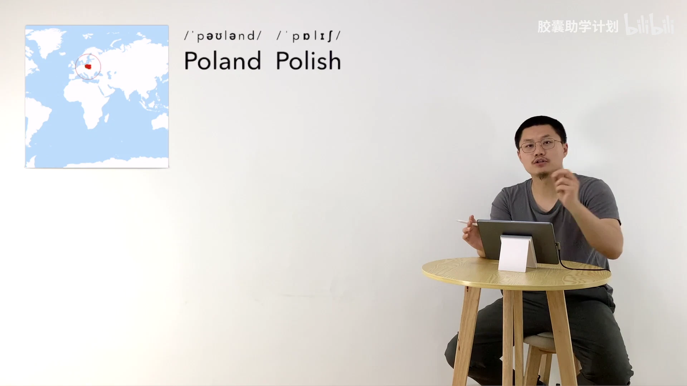

文字识别：胶囊助学计划 / /'pauland/ /'pplr∫/ / Poland Polish

### 画面 00:05:17

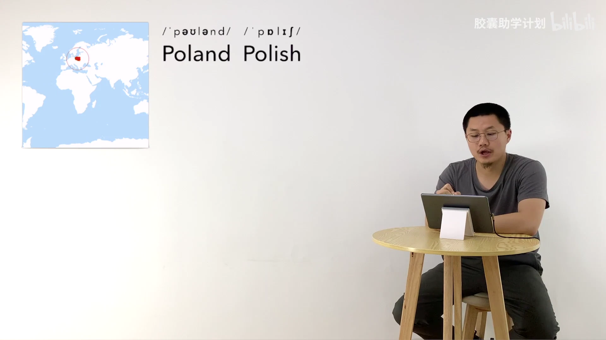

文字识别：胶囊助学计划 / /'pauland/ /'pplr∫/ / Poland Polish

### 画面 00:05:22

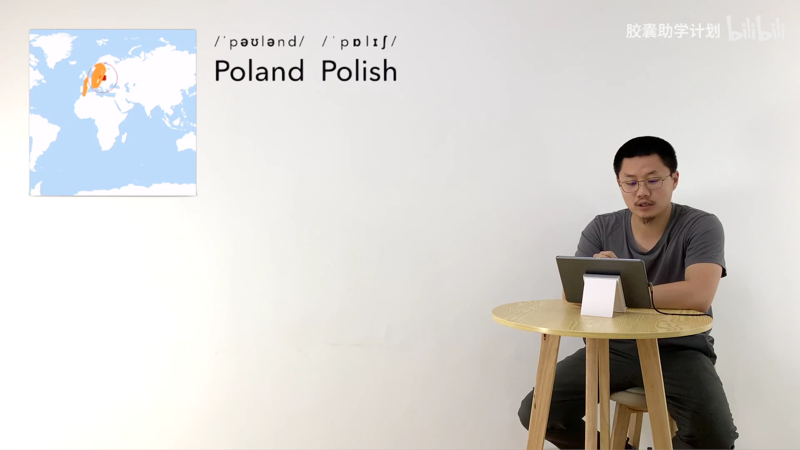

文字识别：胶囊助学计划 / /'pauland/ /'pplr∫/ / Poland Polish

## 00:05:30–00:06:00

Yes,啊这是一样的。Oh, I come from Poland.好，那接下来我们看这个单词啊，来Thailand, Thailand, OK,泰国。那泰国人呢就是Thai, OK。好，接下来我们造句。来，Where do we both come from?啊，我们都来自于哪儿？你猜一猜啊？Are we both Thai?我们都是泰国人吗？Yes, you come from Thailand.啊，你们都是来自于

### 画面 00:05:30

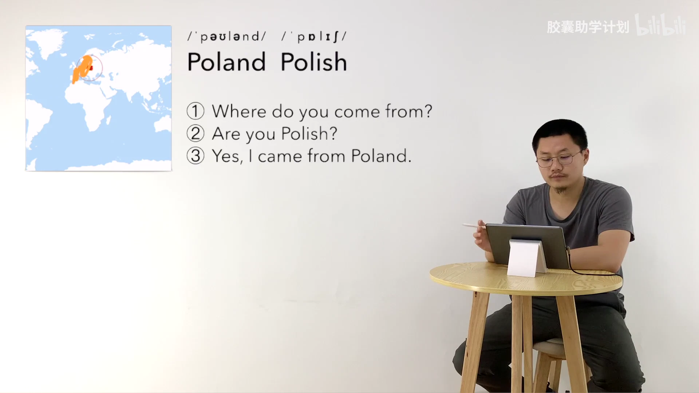

文字识别：胶囊助学计划 / /'pauland/ /'pplr∫/ / Poland Polish / ① Where do you come from? / Are you Polish? / Yes, I came from Poland. / 3

### 画面 00:05:36

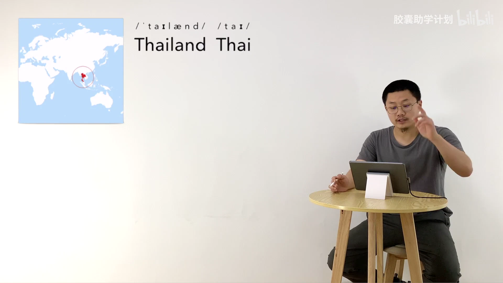

文字识别：胶囊助学计划 / / tai lænd/ /tai/ / Thailand Thai

### 画面 00:05:38

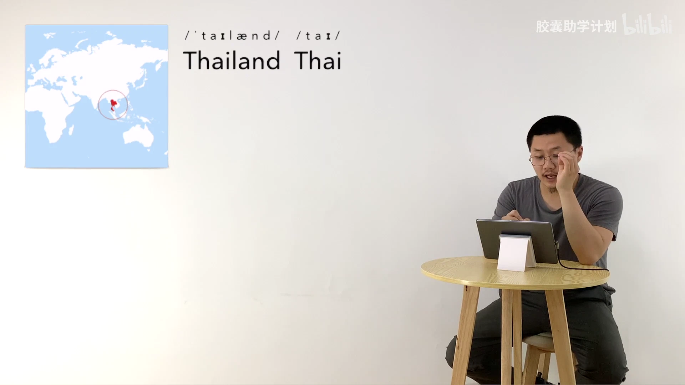

文字识别：胶囊助学计划 / / 'tai |ænd/ /tai/ / Thailand Thai

### 画面 00:05:43

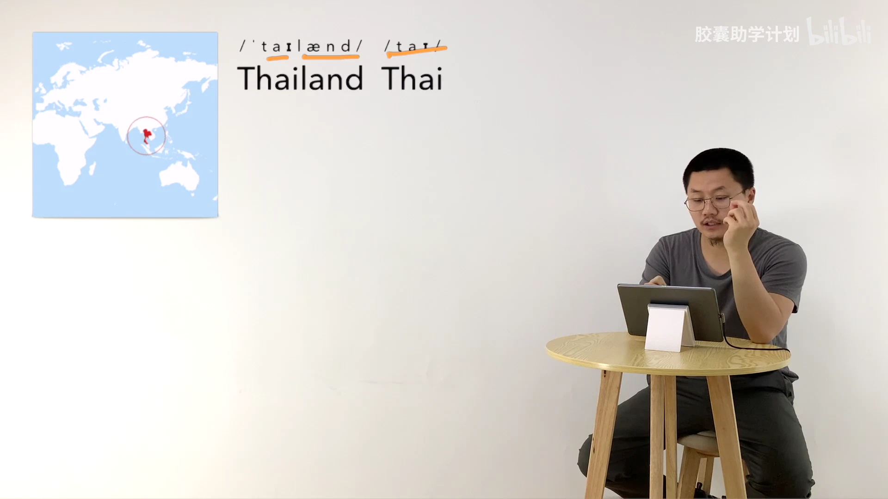

文字识别：胶囊助学计划 / / 'tai l æend / / / tai / / Thailand / Thai

### 画面 00:05:48

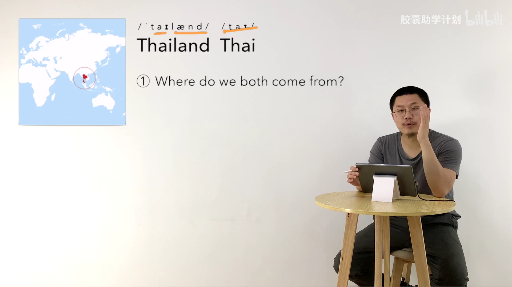

文字识别：胶囊助学计划 / / ' t ai l æen d / / /tar/ / Thailand / d Thai / ① Where do we both come from?

## 00:06:00–00:06:30

于泰国。再跟我读一下，泰国人，Thai，泰国，Thailand。好，那Where does she come from? Is she and Yes, she comes from.就是本课的recap部分，这个是非常关键的啊，关键的句型。我们本课练习练的就是这个。OK，好，那接下来呢，看一下本课家庭作业。首先，绿皮书第五十四课写作练习，各位可以处理了。给自己讲解一

### 画面 00:06:00

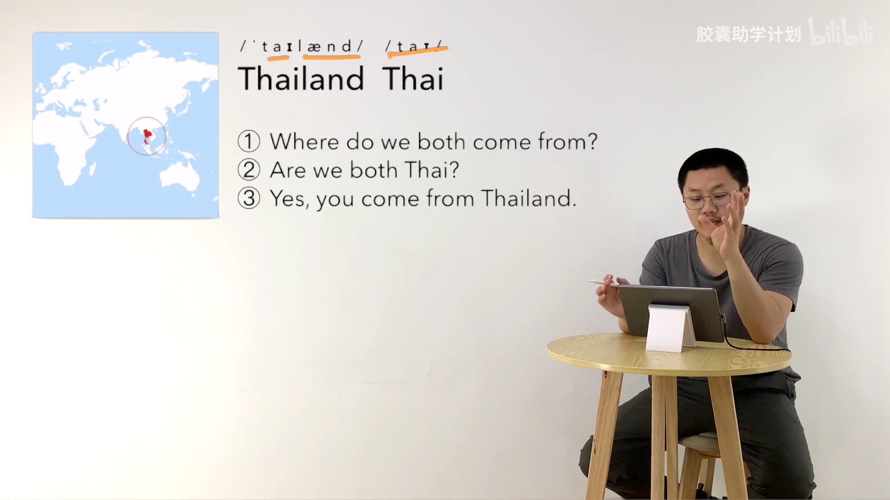

文字识别：胶囊助学计划 / / ' t ai lænd / / /tai/ / Thailand Thai / ① Where do we both come from? / Are We both Thai? / 2 / ) Yes, you come from Thailand. / 3

### 画面 00:06:04

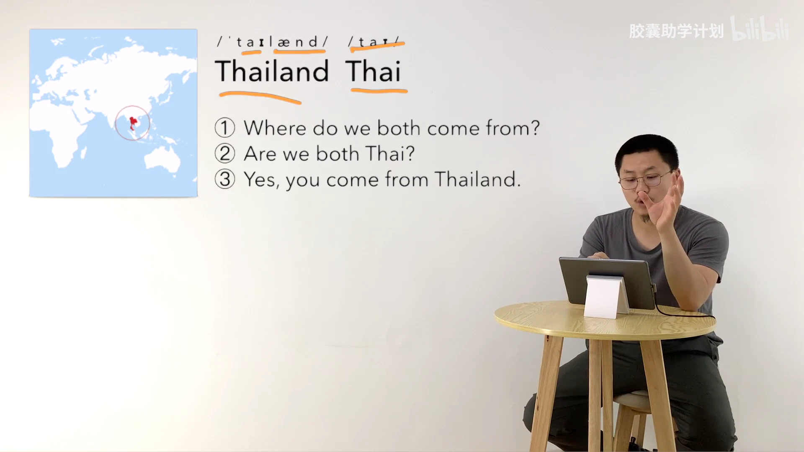

文字识别：胶囊助学计划 / / 't ai l æend / / / tai/ / Thailand / Thai / ① Where do we both come from? / Are We both Thai? / Yes, you come from Thailand. / 3

### 画面 00:06:06

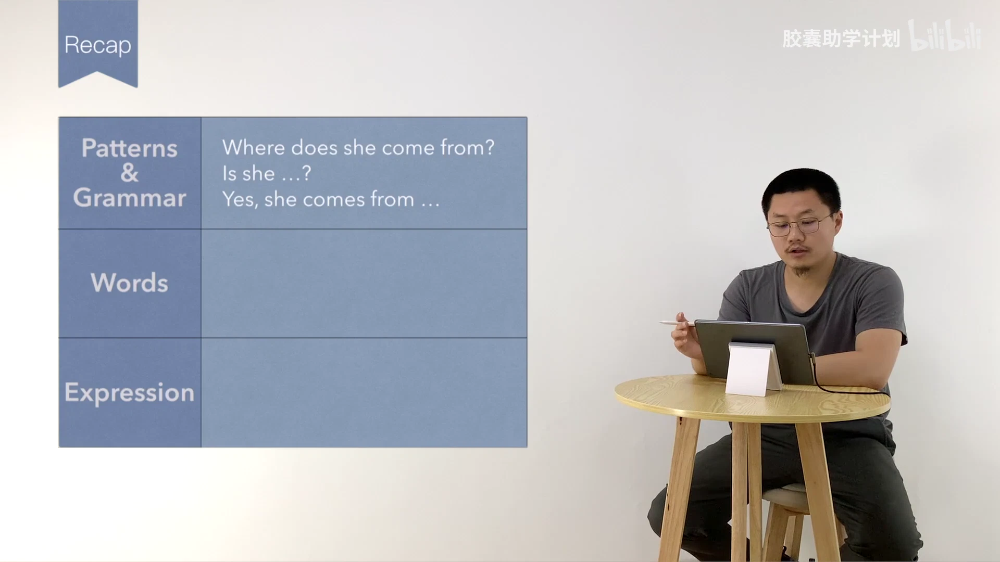

文字识别：胶囊助学计划 / Recap / Patterns / Where does she come from? / Is she ...? / Grammar / Yes, she comes from / Words / Expression

### 画面 00:06:15

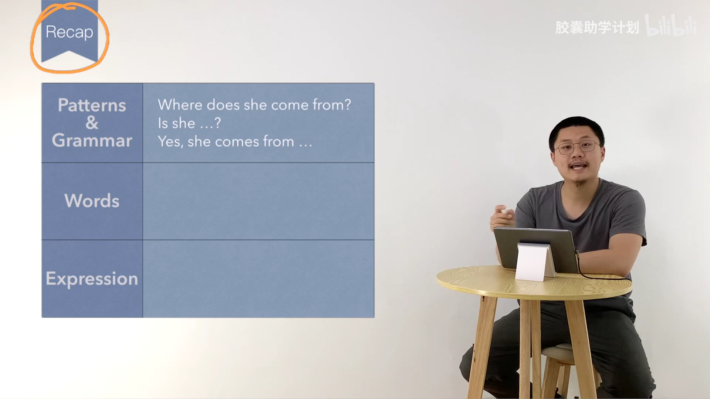

文字识别：胶囊助学计划 / Recap / Patterns / Where / does she come from? / Is she ...? / Grammar / Yes, she comes from / Words / Expression

### 画面 00:06:23

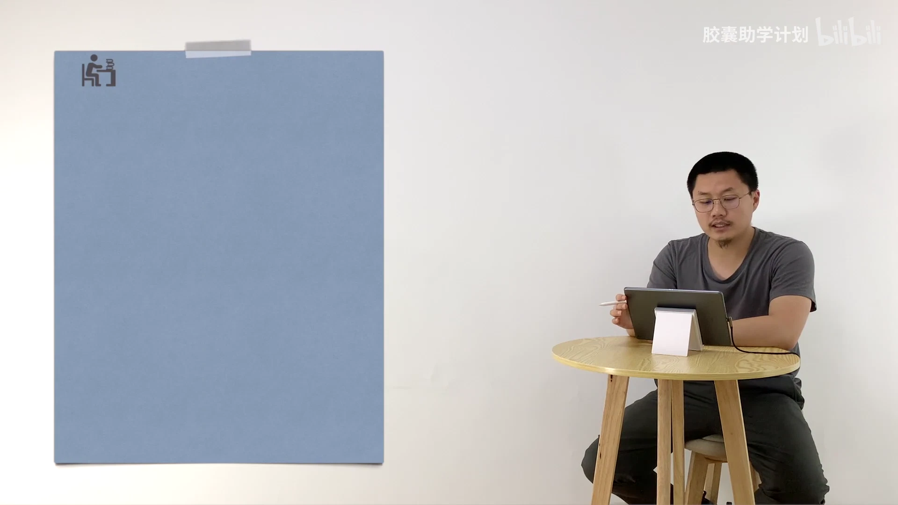

文字识别：胶囊助学计划

## 00:06:30–00:07:00

遍今天的核心知识点。呃，如果大家喜欢我们的课程呢，欢迎大家关注、订阅、一键三连，并分享给那些需要的朋友。最后，我们再来看一句名人名言：Strength does not come from winning. Your struggles develop your strength. See you next time.

### 画面 00:06:32

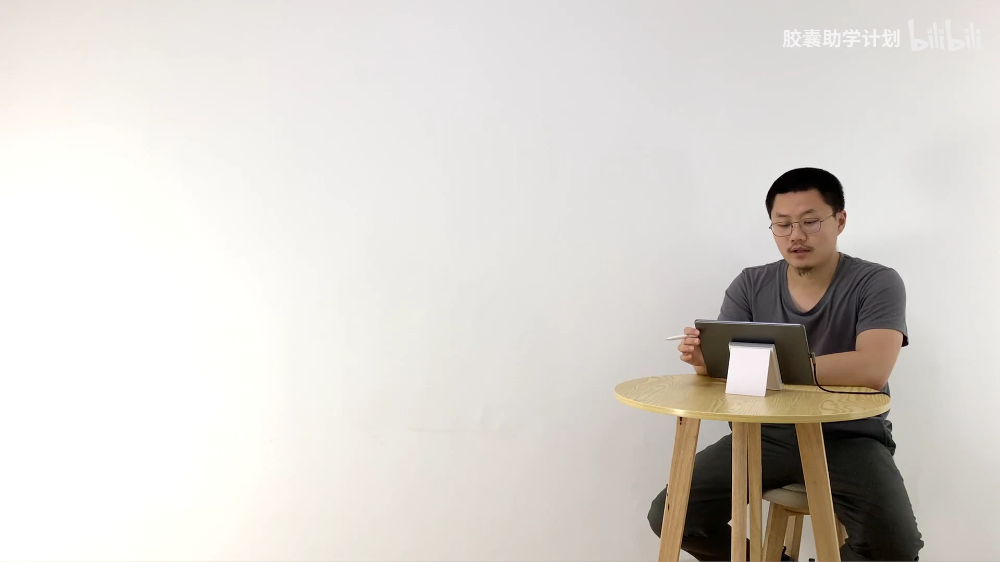

文字识别：胶囊助学计划

### 画面 00:06:34

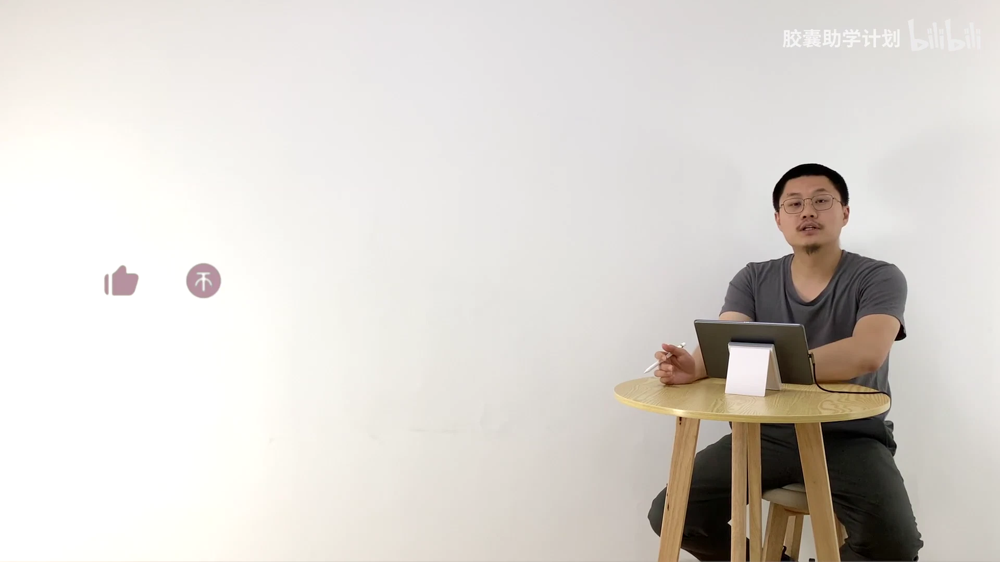

文字识别：胶囊助学计划

### 画面 00:06:40

文字识别：胶囊助学计划 / Strength / does not come / from winning. / Your struggles / develop. / o your strengths. / Arnold S / Schwarzenegger

### 画面 00:06:42

文字识别：胶囊助学计划 / Strength / does not come / from winning. / Your struggles / develop / o your strengths. / Arnold S / Schwarzenegger

### 画面 00:06:47

文字识别：胶囊助学计划 / Strength / does not come / from winning. / Your struggles / develop / o your strengths. / Arnold S / Schwarzenegger

### 画面 00:06:52

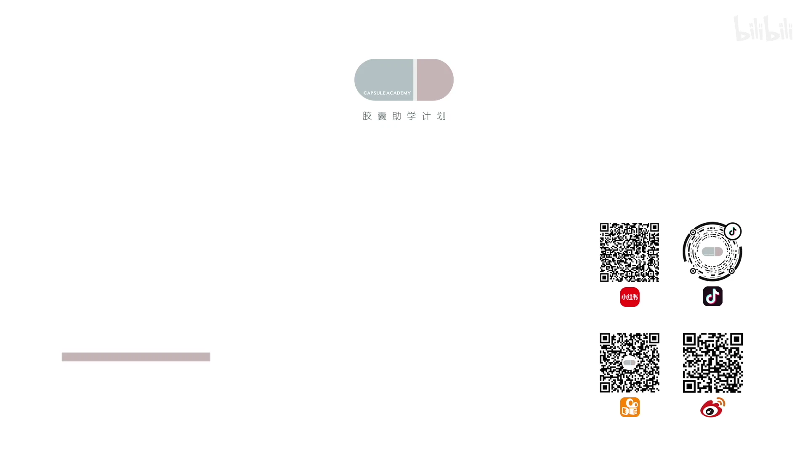

文字识别：CAPSULEACADEMY / 胶囊助学计划 / 小红书

### 画面 00:06:54

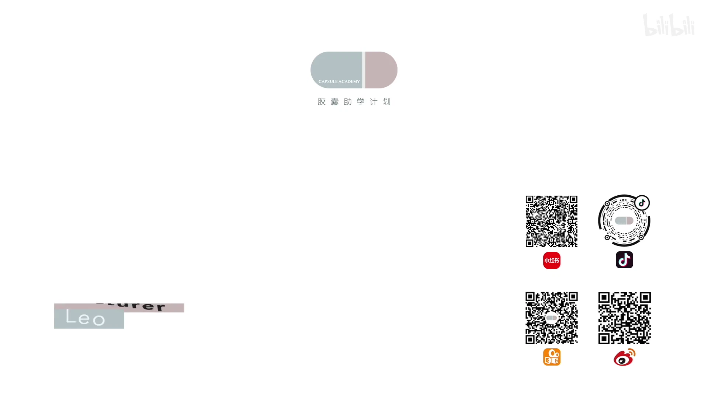

文字识别：CAPSULEACADEMY / 胶囊助学计划 / 『 / 小红书 / 证 / Leo

## 00:07:00–00:07:04

### 画面 00:07:00

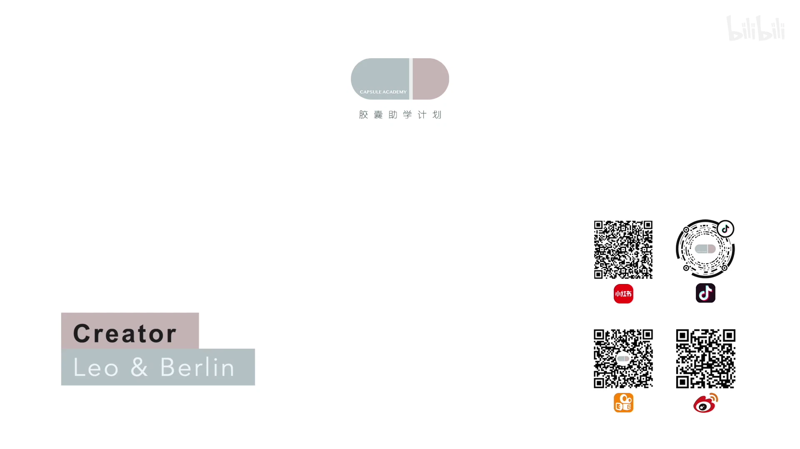

文字识别：CAPSULEACADEMY / 胶囊助学计划 / 小红书 / Creator / 口 / Leo & Berlin / OE

### 画面 00:07:02

文字识别：bilibili / 胶囊助学计划

### 画面 00:07:03

文字识别：bilibili / 胶囊助学计划

