# 055 单词

快速机器解析：语音为单模型转写，未进行独立交叉校对或人工复核；画面每秒采样并按变化选帧，短时文字和标记可能遗漏。截图时间约有 1 秒误差。图片有损压缩；遇到疑点请按时间查看 Google Drive 原视频。

## 00:00:00–00:00:30

Hello everyone, welcome to Capsule Academy. This is Leo. Today we are going to learn in Concept English Book One Lesson Fifty Five Words. 老习惯进入正式课程之前呢，我们先看一个问题：如何表达吃午饭这个英文表达？OK，那带着这个问题，Hope you gonna enjoy. 我们先看第一个小的单词，先跟我读一下啊，来，live， live叫做居住啊。那首

### 画面 00:00:00

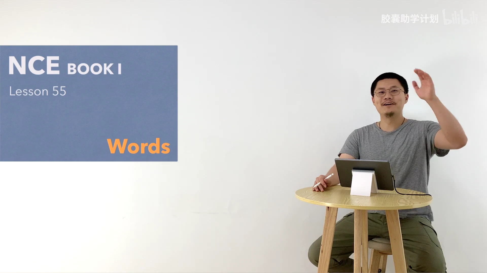

文字识别：胶囊助学计划 / NCE / BOOKI / Lesson 55 / Words

### 画面 00:00:02

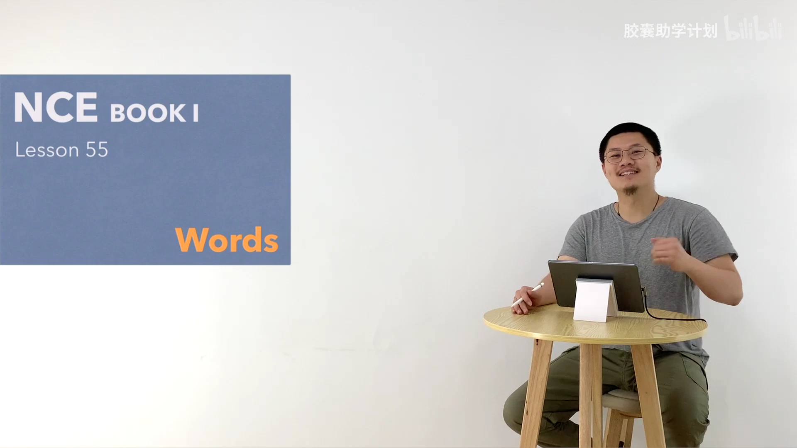

文字识别：胶囊助学计划 / NCE / BOOKI / Lesson 55 / Words

### 画面 00:00:04

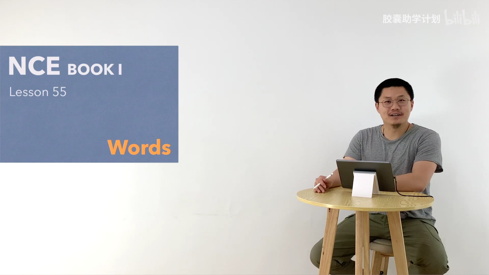

文字识别：胶囊助学计划 / NCE / BOOKI / Lesson 55 / Words / D

### 画面 00:00:09

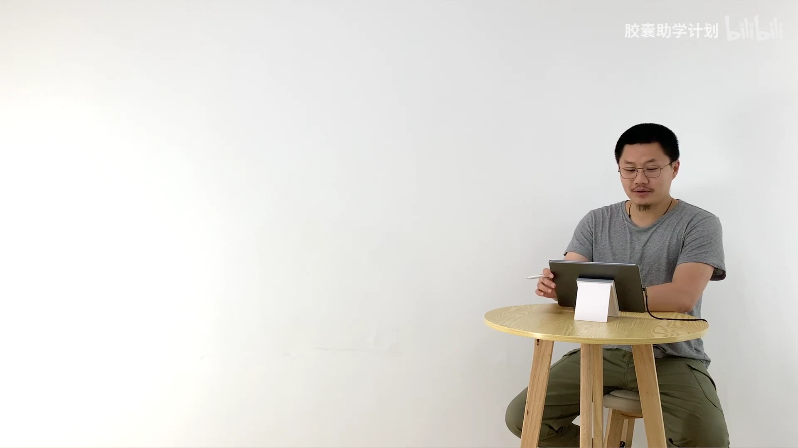

文字识别：胶囊助学计划

### 画面 00:00:11

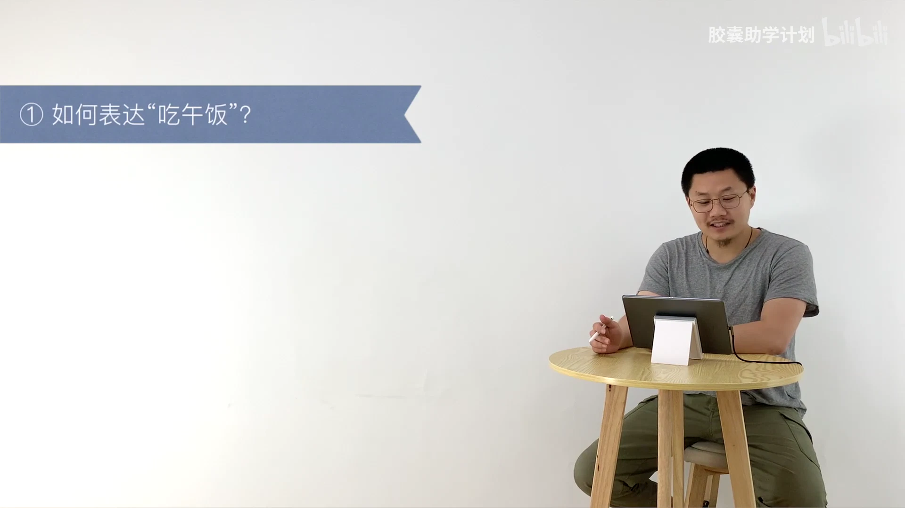

文字识别：胶囊助学计划 / ①如何表达“吃午饭”？

### 画面 00:00:17

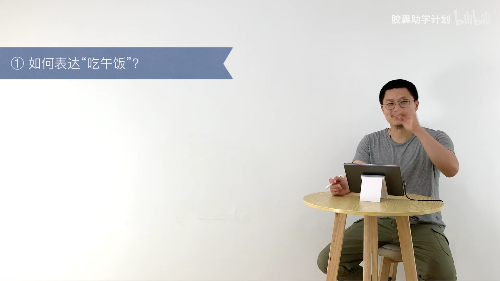

文字识别：胶囊助学计划 / ①如何表达“吃午饭”？

### 画面 00:00:19

文字识别：胶囊助学计划b出出

### 画面 00:00:22

### 画面 00:00:24

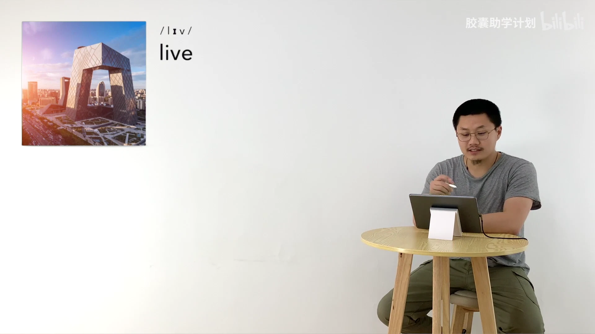

文字识别：胶囊助学计划 / /lIv/ / live

## 00:00:30–00:01:00

先我们要知道它跟小的介词是可以连用在一起的，比如说三十五课我们就学过的两个介词，一个叫 in，一个叫 at，对吧？那首先各位要知道 live in 一般加的是国家或城市，比如说 right now I'm living 啊，或者说 I live in Beijing，OK，现在呢我住在北京，陈述客观事实啊，不用 I'm living，直接用 I live in Beijing，一般现在时就行了。那如果是具体门牌号呢，我们可能就会加 live at

### 画面 00:00:30

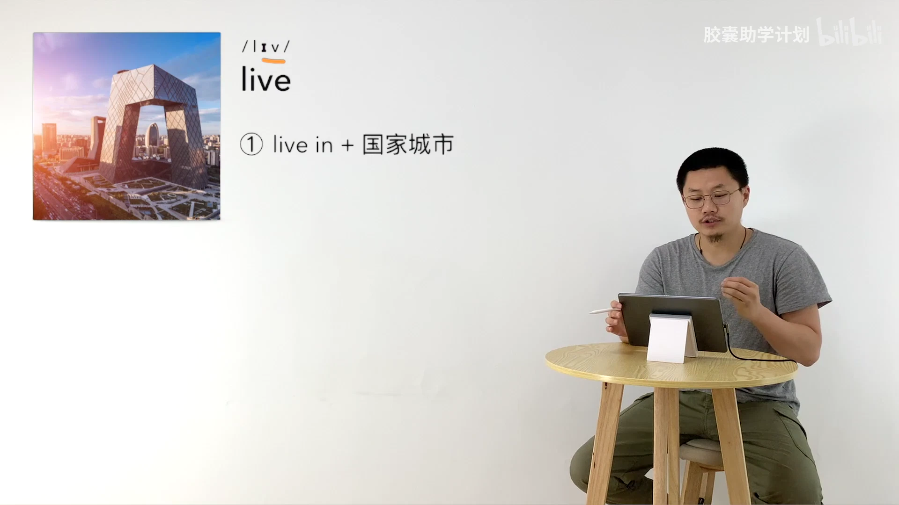

文字识别：胶囊助学计划 / /lIv/ / live / ① live in + 国家城市

### 画面 00:00:32

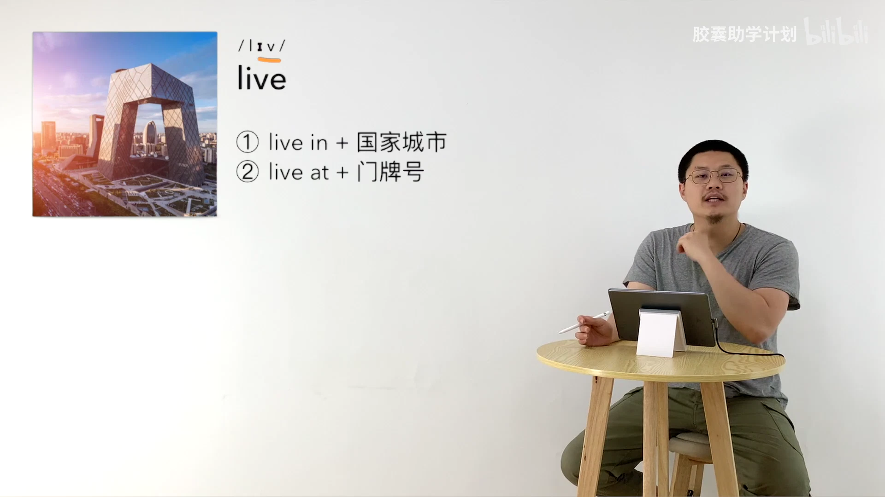

文字识别：胶囊助学计划 / /lIv/ / live / ① live in + 国家城市 / live at + 门牌号

### 画面 00:00:35

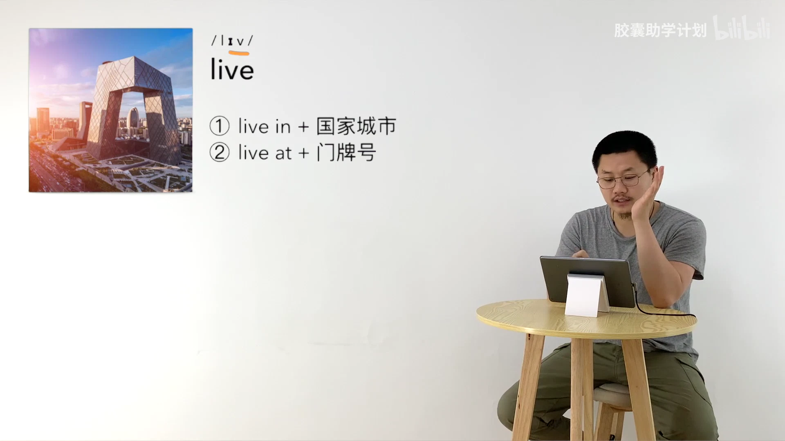

文字识别：胶囊助学计划 / /lIv/ / live / ① live in + 国家城市 / live at +门牌号

### 画面 00:00:40

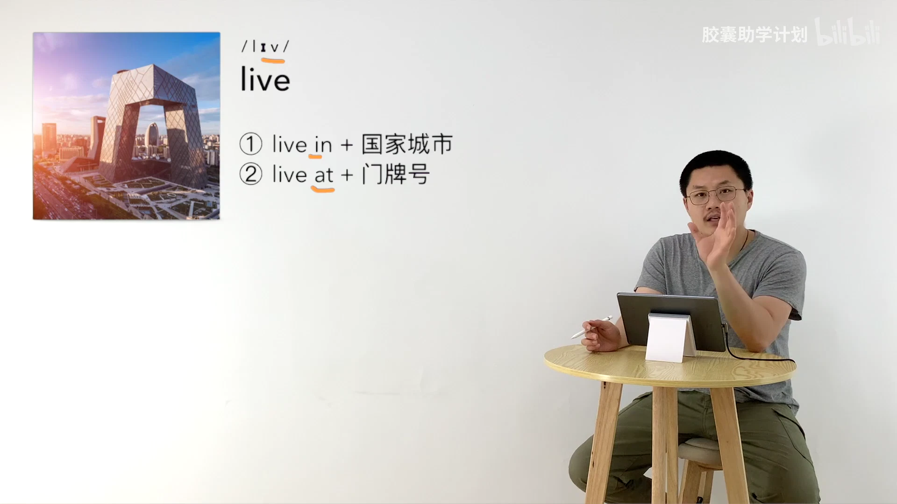

文字识别：胶囊助学计划 / /lIv/ / live / ① livein + 国家城市 / live at +门牌号 / D

### 画面 00:00:56

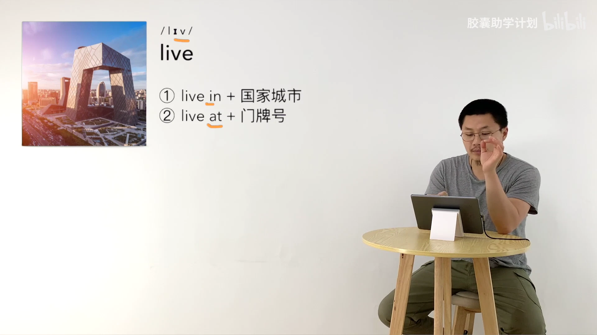

文字识别：胶囊助学计划 / /lIv/ / live / ① livein + 国家城市 / live at + 门牌号

### 画面 00:00:58

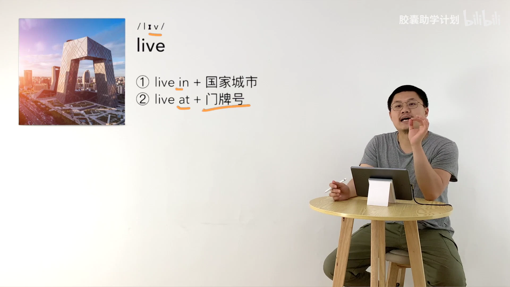

文字识别：胶囊助学计划 / /lIv/ / live / ① livein + 国家城市 / live at +门牌号

## 00:01:00–00:01:30

这样的一个小的介词，用 at 表示更小的一个地点。我们在文章当中也会见到。那接下来我们尝试造一个句子，比如说刚才我说的是 I live in。那我如果想说他住在北京，就是 she lives in。这地方注意一个小点，因为这是陈述客观事实，满足第一个条件，一般现在时。第二，主语是第三人称，对吧？并且第三个条件它是单数形式，她，对吧？女，她是单数，

### 画面 00:01:05

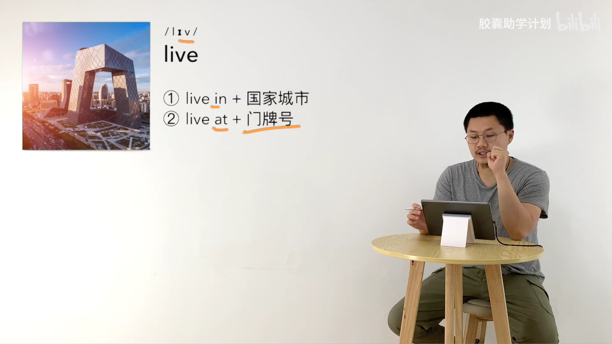

文字识别：胶囊助学计划 / /lIv/ / live / ① livein +国家城市 / live at +门牌号

### 画面 00:01:07

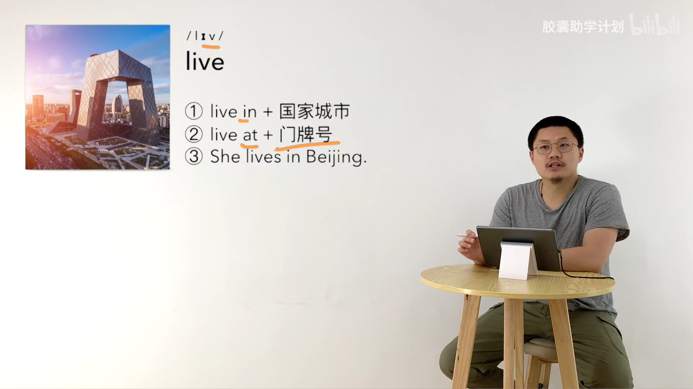

文字识别：胶囊助学计划 / /lIv/ / live / 1 / livein +国家城市 / live at +门牌号 / She Tives in Beijing.

### 画面 00:01:09

文字识别：胶囊助学计划 / /lIv/ / live / ① livein + 国家城市 / live at +门牌号 / She Tives in Beijing.

### 画面 00:01:17

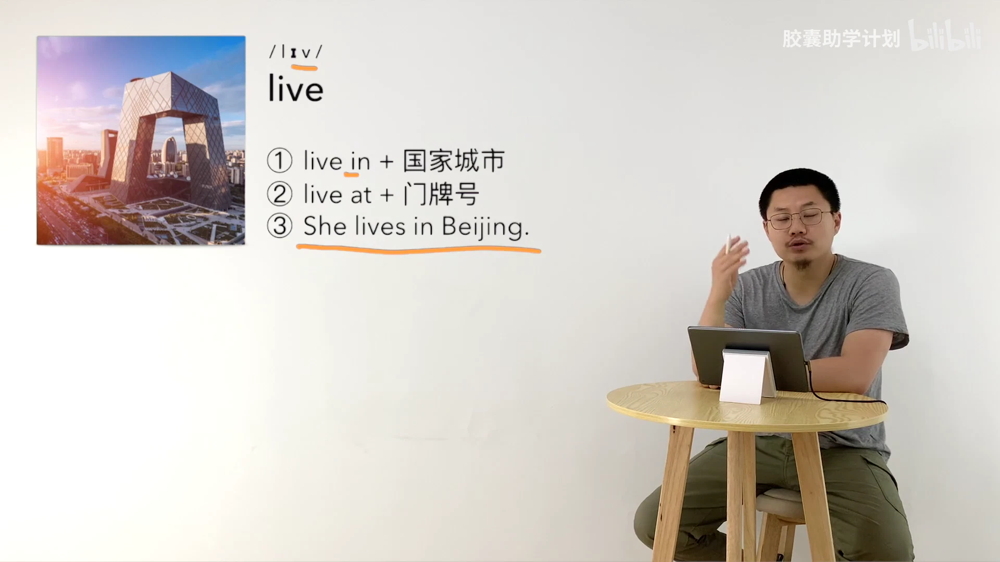

文字识别：胶囊助学计划 / 1lIv/ / live / ① / livein +国家城市 / live at + 门牌号 / She lives in Beijing.

### 画面 00:01:24

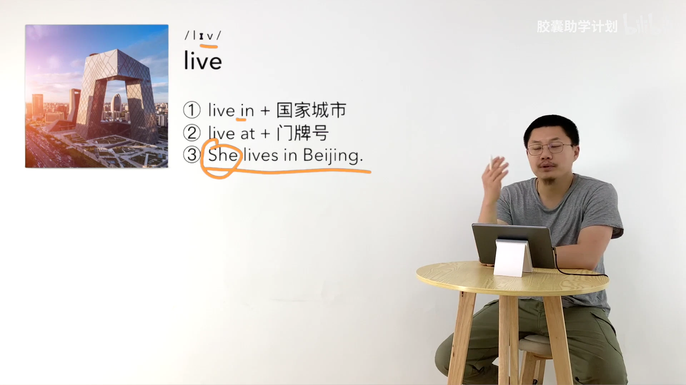

文字识别：胶囊助学计划 / /lIv/ / live / 1 / livein +国家城市 / live at +门牌号 / Shelives in Beijing.

## 00:01:30–00:02:00

所以后面的动词也要用动词的第三人称单数的形式，所以是 she lives in Beijing. OK，好，那接下来我们想把它变一般疑问句，这地方就要注意一下，要把 does 提前，动词换回原形，叫 does she live in Beijing? OK, very good. 接下来我想对 in Beijing 提问，很简单，where? Where does she live? 她住在什么地方呢？注意，这是问一个

### 画面 00:01:34

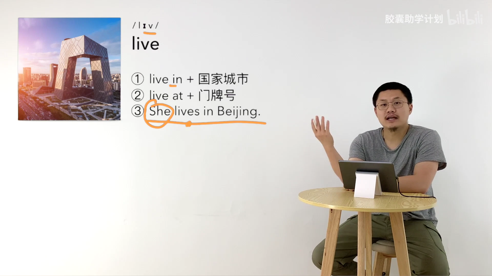

文字识别：胶囊助学计划 / /lIv/ / live / 1 / livein +国家城市 / live at + 门牌号 / Shelives in Beijing.

### 画面 00:01:41

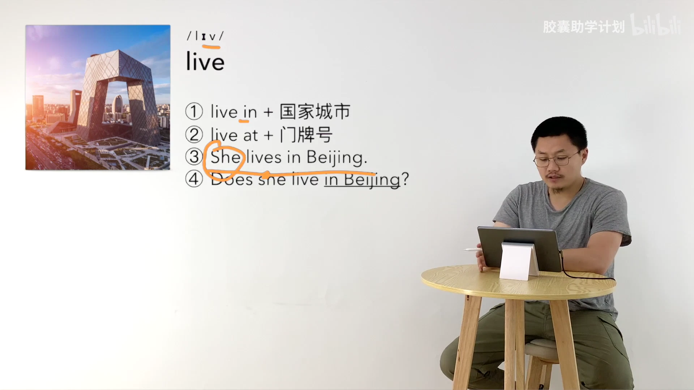

文字识别：胶囊助学计划 / /lIv/ / live / 1 / livein +国家城市 / live at + 门牌号 / She lives in Beijing. / es she live in Beljing?

### 画面 00:01:43

文字识别：胶囊助学计划 / /lIv1 / live / live in +国家城市 / 1 / live at + 门牌号 / She lives in Beijing. / Does she live in Beijing?

### 画面 00:01:49

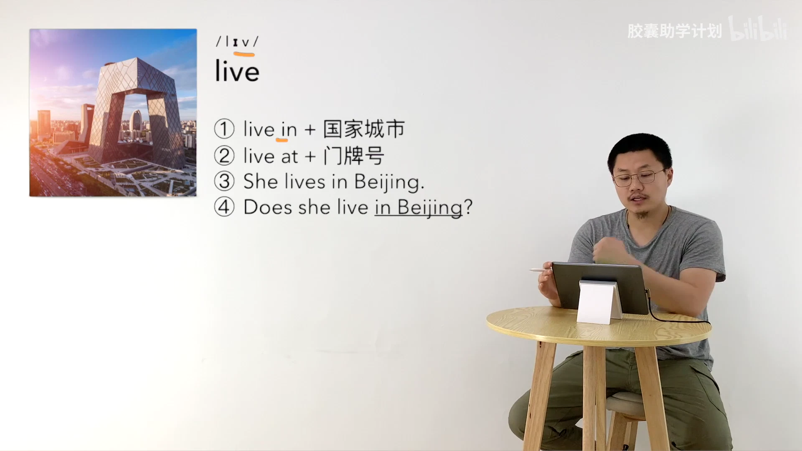

文字识别：胶囊助学计划 / /lIv/ / live / livein + 国家城市 / 1 / live at + 门牌号 / She lives in Beijing. / Does she live in Beijing?

### 画面 00:01:53

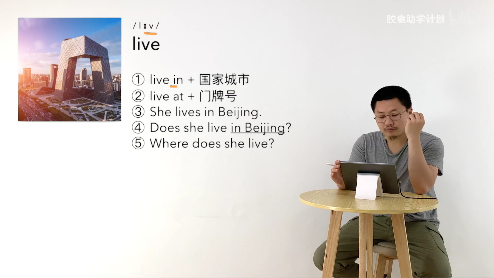

文字识别：胶囊助学计划 / /lIv/ / live / ①livein +国家城市 / live at +门牌号 / She lives in Beijing. / Does she live in Beijing? / Where does she live?

### 画面 00:01:57

文字识别：胶囊助学计划 / /lIv/ / live / livein +国家城市 / 1 / live at + 门牌号 / She lives in Beijing. / Does she live in Beijing? / Where does she live?

## 00:02:00–00:02:30

陈述，一个客观事实，对吧？啊，就是他现在住在一个什么地方啊？你可以说答案：In Beijing。然后一个live，再跟我读一下：live。OK，Next one，我们直接把三个单词放在一起啊，其中有一个单词各位很可能是认得的，我们先一起读一下，叫做home，home啊，home sweet home啊，甜蜜的家。后面这个单啊，前面这个单词呢，注意一个小点，不读stay，这个t要把它浊化成d，

### 画面 00:02:02

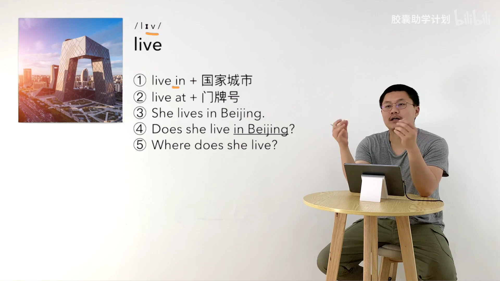

文字识别：胶囊助学计划 / /lIv/ / live / 1 / livein +国家城市 / live at + 门牌号 / She lives in Beijing. / Does she live in Beijing? / Where does she live?

### 画面 00:02:06

文字识别：胶囊助学计划 / /lIv/ / live / 1 / live in +国家城市 / live at + 门牌号 / She lives in Beijing. / Does she live in Beijing? / Where does she live?

### 画面 00:02:10

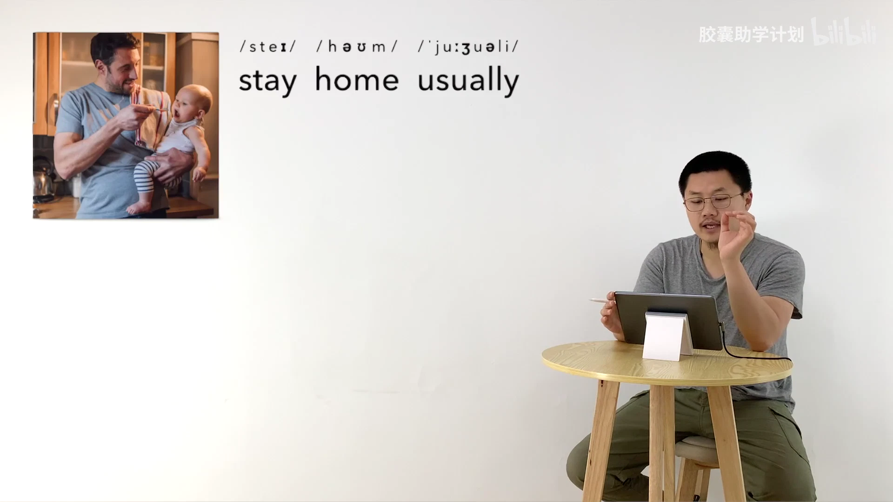

文字识别：胶囊助学计划 / /stei/ /haum/ /'ju:3uali/ / stay home usually

### 画面 00:02:12

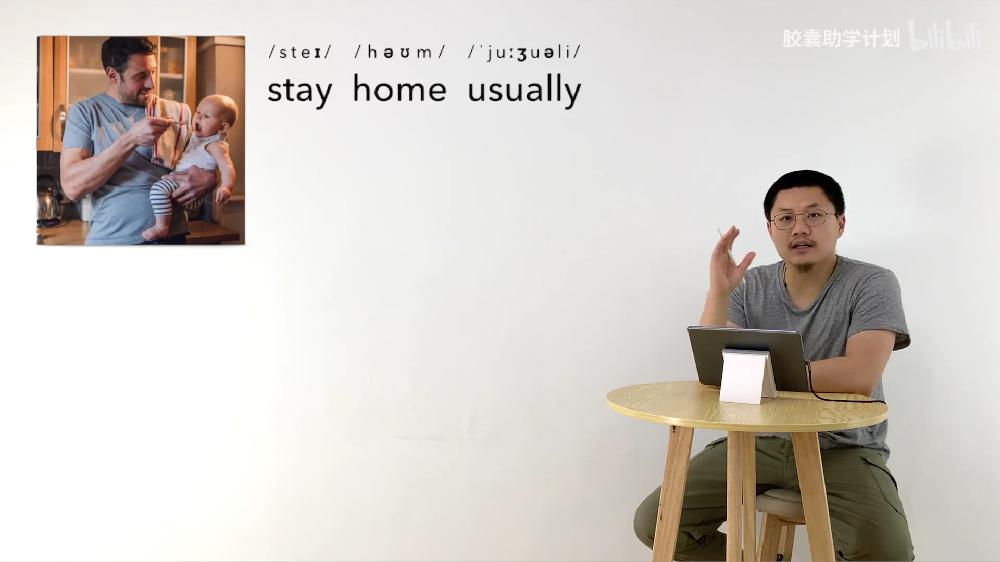

文字识别：胶囊助学计划 / /stei/1 / /haum/ /'jui3uali/ / stay h / home usually

### 画面 00:02:16

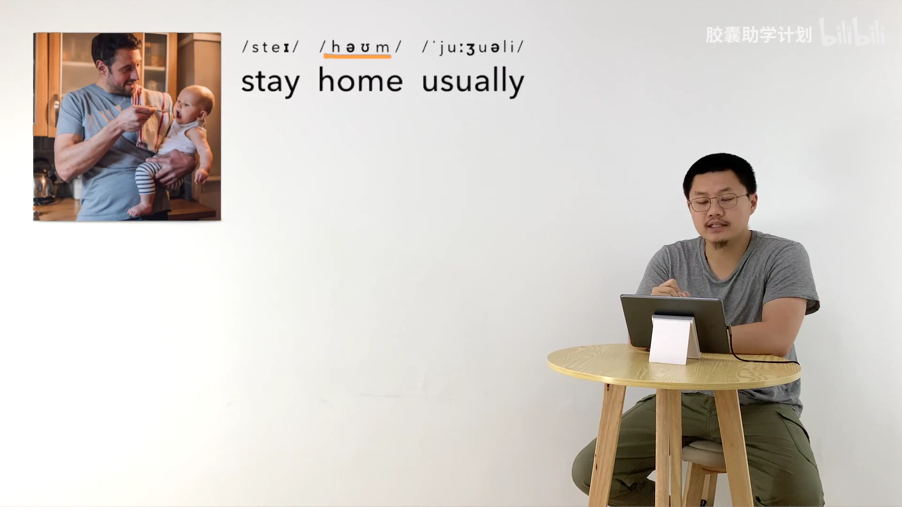

文字识别：胶囊助学计划 / /stei/ / /haum/ /'ju:3uali/ / stay / home usually

### 画面 00:02:25

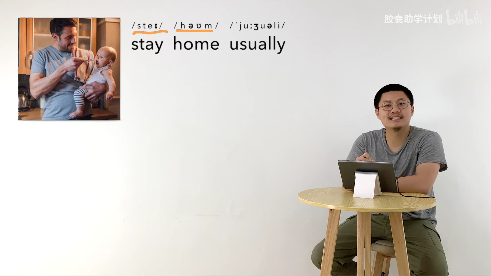

文字识别：胶囊助学计划 / /stei/ / /haum/ / /'ju:3uali/ / stay / home l / usually

## 00:02:30–00:03:00

在音标课程我们给大家录制的这个视频当中有专门的去讲解如何去变啊，在这个地方要记住换回换成的，于是呢跟我一起读一下，叫做stay，叫做停留。OK，接下来下面这个单词叫做usually，usually，OK，它跟我们五十一课、五十三课见过的always、often、sometimes，哎，都

### 画面 00:02:31

文字识别：胶囊助学计划 / /stei/ / /haum/ / /'ju:3uali/ / stay / home l / usually

### 画面 00:02:41

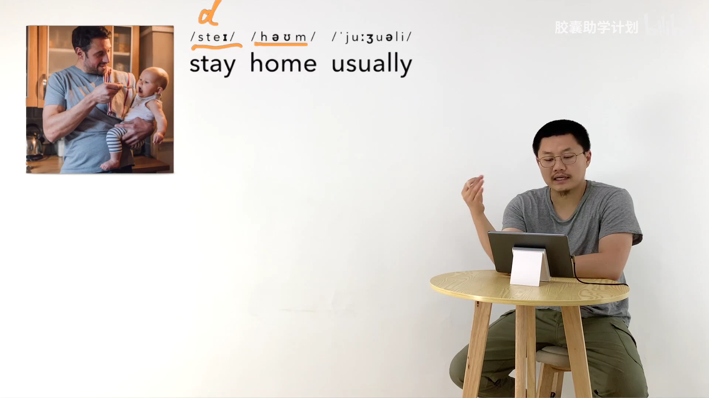

文字识别：🌈 / 胶囊助学计划 / /stei/ / /haum/ / /'ju:3uali/ / stay / home l / usually

### 画面 00:02:47

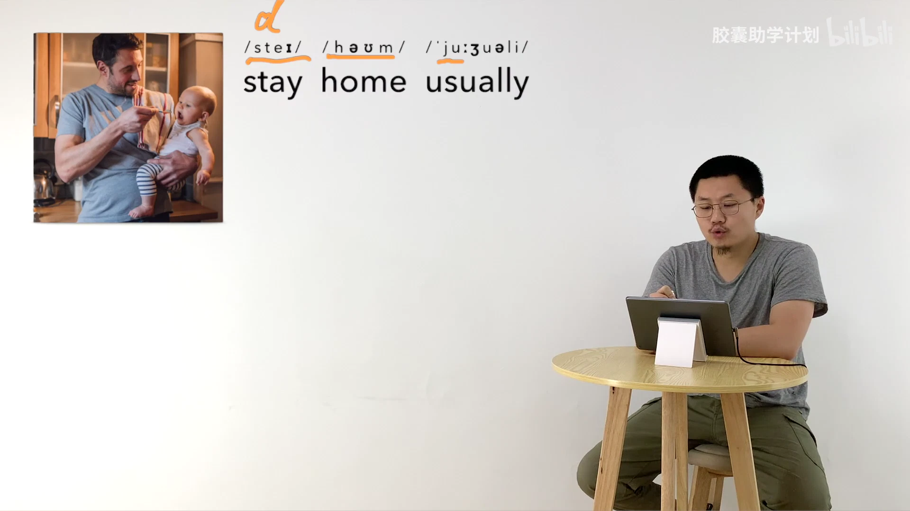

文字识别：胶囊助学计划 / /stei/ / /haum/ / /'ju:3uali/ / stay / home / usually

## 00:03:00–00:03:30

是一类的用法。OK,那usually叫做通常状态下，那often叫做经常，always叫做总是，都是表示这样一种做某些事情的频率，对不对？再跟我读一下最后这个单词，usually通常状态下，OK，通常情况下，OK，那我们拿它尝试去造句，一定是围绕着动词去展开造句的。那stay in跟刚才一样，待停留在某个国家、城市，对吧？或者stay at停留在某个

### 画面 00:03:01

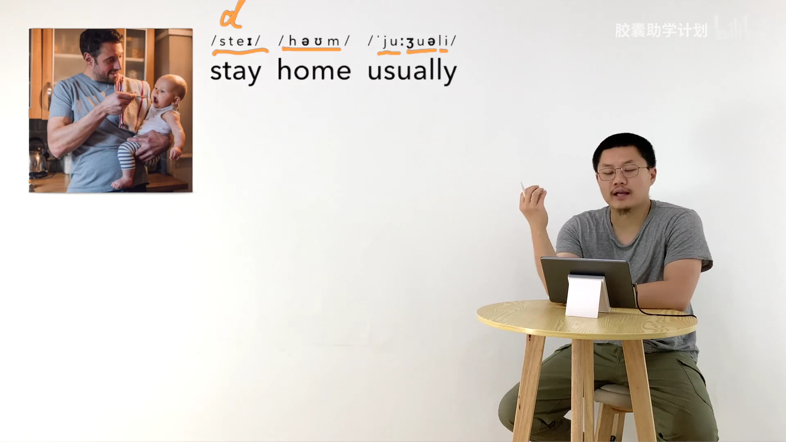

文字识别：胶囊助学计划 / /stei/ / /haum/ / /ju:3uali/ / stay / home / usually

### 画面 00:03:06

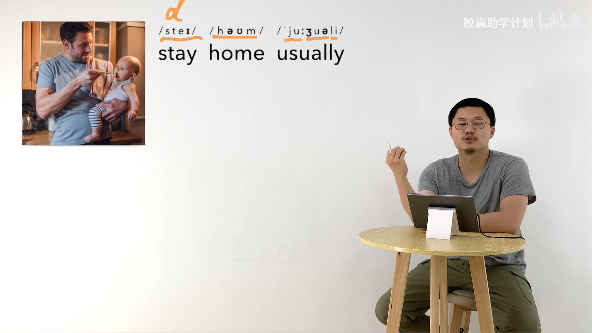

文字识别：胶囊助学计划 / /stei/ / /haum/ / /'ju:3uali/ / stay / home / usually

### 画面 00:03:20

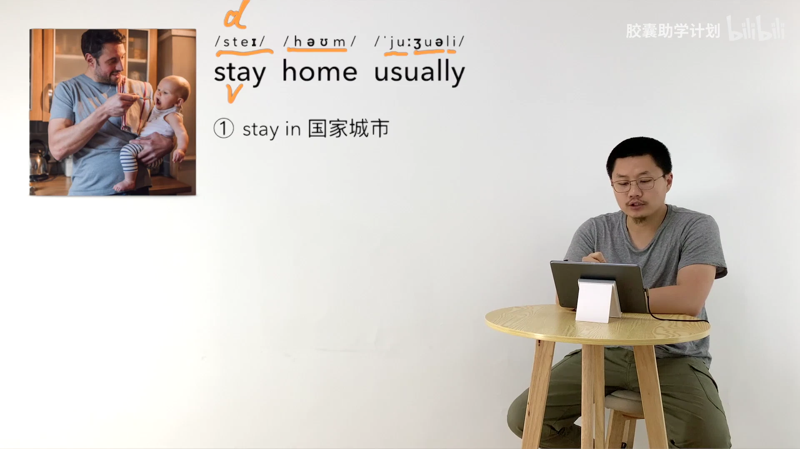

文字识别：胶囊助学计划 / /stei/ / /haum/ / /'ju:3uali/ / stay / home / usually / V / stay in 国家城市

## 00:03:30–00:04:00

小的地方，比如说待在家里叫做 stay at home这样的一个小的短语。然后我们造一个句子叫 He usually stays at home with his child at night.你看这句话已经很长了，我们把它尝试去分析一下，说他呀停留在家里。哎，我们三十一三十三课就学过了，和谁谁在一起叫做 with his child，然后有一个小的短语叫 at night。然后呢，注意 usually

### 画面 00:03:31

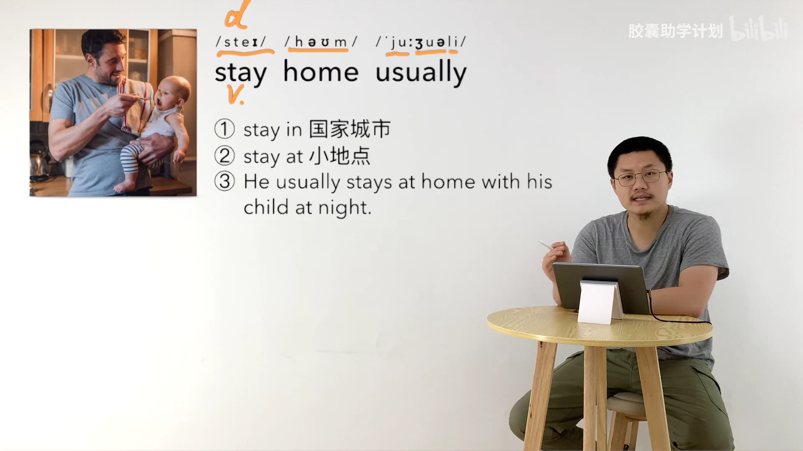

文字识别：胶囊助学计划 / /stei/ / /haum/ / /'ju:3uali/ / stay / home / usually / V. / stay in 国家城市 / stay at 小地点 / He usually / stays at home with his / child at night.

### 画面 00:03:35

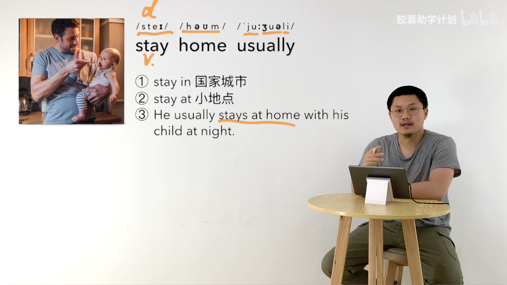

文字识别：胶囊助学计划 / /stei/ / / haum/ / /'ju:3uali/ / stay / home / usually / V. / stay in 国家城市 / stay at 小地点 / He usually / stays at home with his / child at night.

### 画面 00:03:40

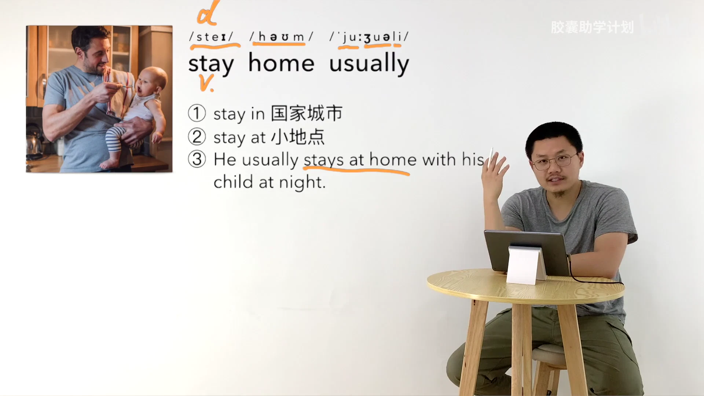

文字识别：学计划 / /stei/ / / haum/ / /'ju:3uali/ / stay / home / usually / V. / stay in 国家城市 / stay at 小地点 / He usually / stays at home with his / child at night.

### 画面 00:03:45

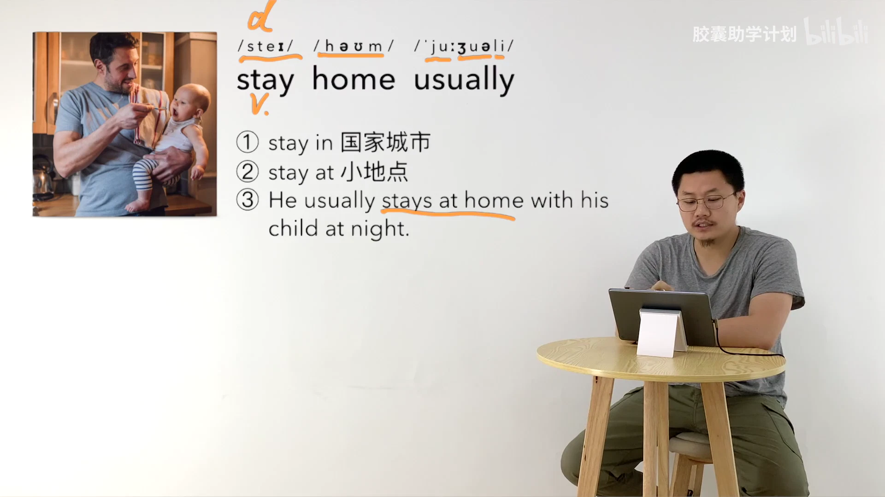

文字识别：胶囊助学计划 / /stei/ / /haum/ / /'ju:3uali/ / stay / home / usually / V. / stay in 国家城市 / stay at 小地点 / He usually / stays at home with his / child at night.

### 画面 00:03:48

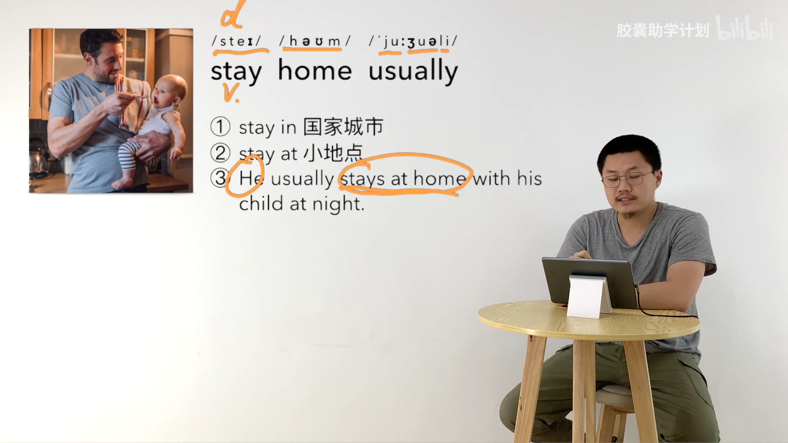

文字识别：胶囊助学计划 / /stei/ / /haum/ / /'ju:3uali/ / stay / home / usually / V. / stay in 国家城市 / at小地点 / He / usually / stays at home with his / child at night.

### 画面 00:03:51

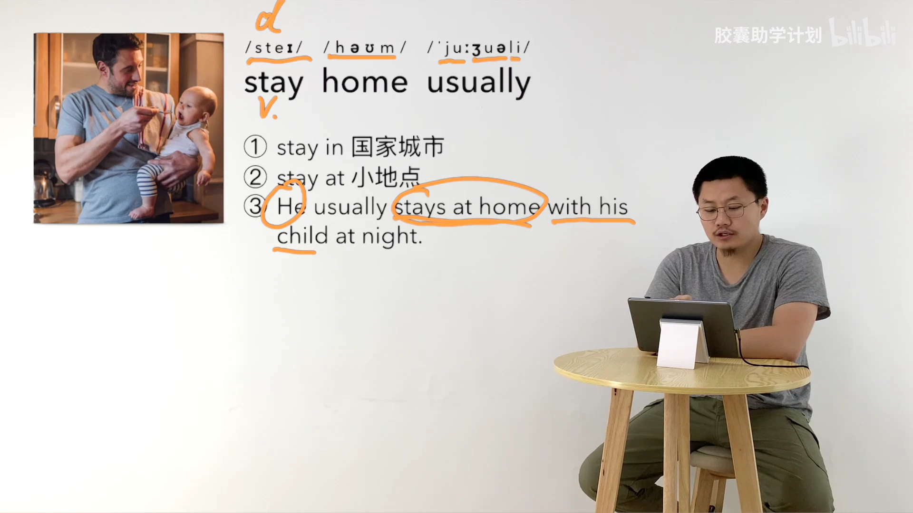

文字识别：胶囊助学计划 / /stei/ / /haum/ / /'ju:3uali/ / stay / home / usually / V. / stay in 国家城市 / at小地点 / He / usually / stays a / at homewith his / child  / at night.

## 00:04:00–00:04:30

这个地方，它放在了动词的前面。我们刚才说 usually 跟 often always 是一样的。那 often always 我们之前说过，它是放在 be as r 的后面，对吧？现在出现在了动词的前面。好，这实际上是一个小的规则。我们接下来会不停的练。我在这儿先不多说了。肯定句出来了之后，我们肯定是一般疑问句了，对不对？一般疑问句把 does 提前，动词换回原形，

### 画面 00:04:01

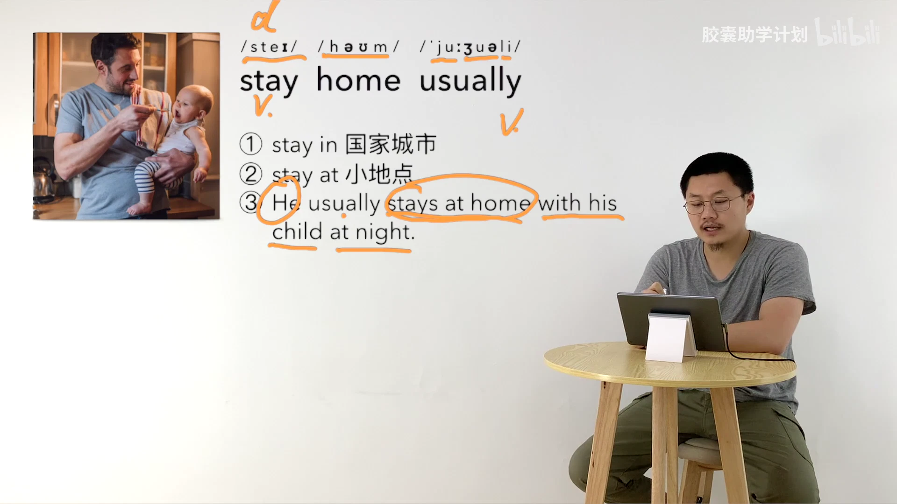

文字识别：胶囊助学计划 / /ster/ / /haum/ / / ju:3uali/ / stay / home / usually / V. / V / stay in 国家城市 / at小地点 / He / usually / stays / at home with his / child / at night.

### 画面 00:04:03

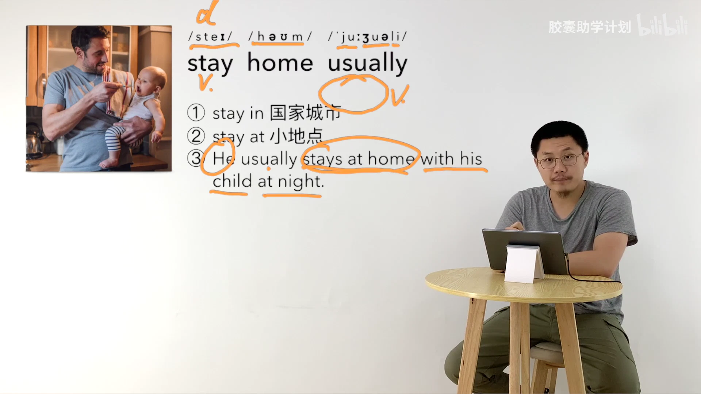

文字识别：胶囊助学计划 / /ster/ / /haum/ / /ju:3uali/ / stay / home / usually / V. / stay in国家城市 / at小地点 / He / usually / stays / at homewith his / child / at night.

### 画面 00:04:06

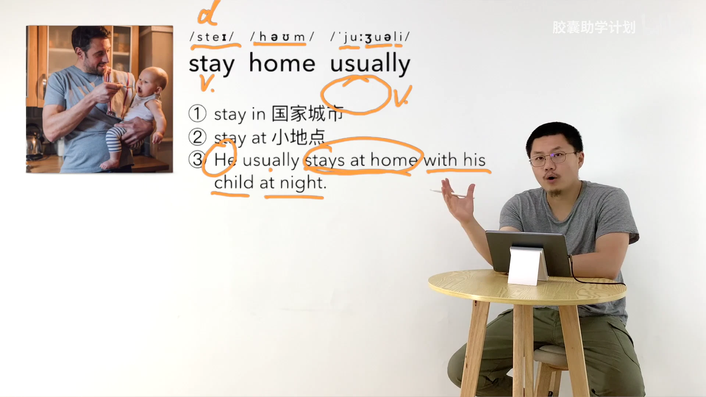

文字识别：胶囊助学计划 / /stei/ / /haum/ / /'ju:3uali/ / stay / home / usually / V. / stay in国家城市 / at小地点 / He / usually / stays / at home with his / child / at night.

### 画面 00:04:10

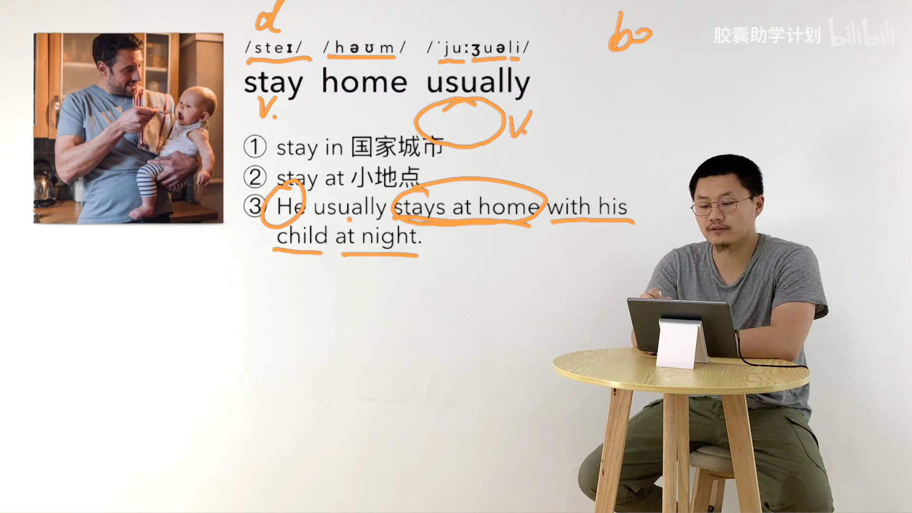

文字识别：胶囊助学计划 / /stei/ / /haum/ / /'jui3uali/ / stay / home / usually / V. / stay in 国家城市 / at小地点 / He / usually / stays / at home with his / child / at night.

### 画面 00:04:13

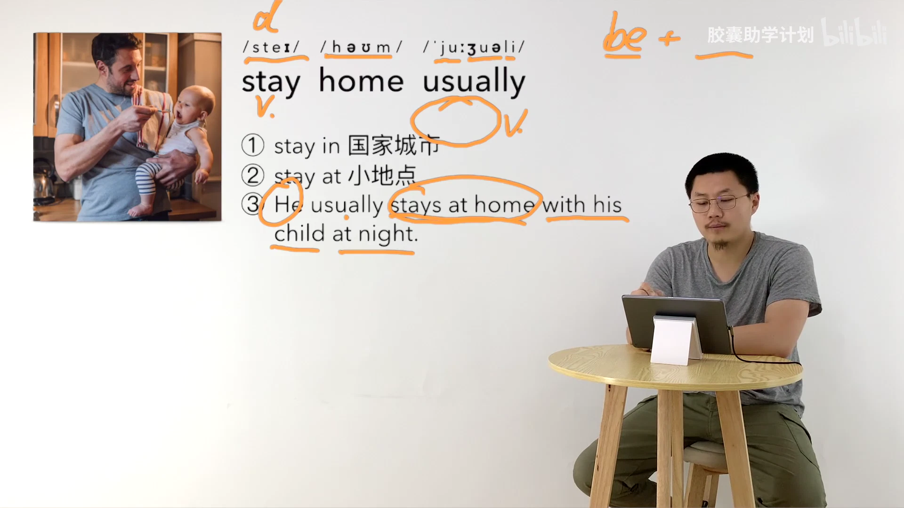

文字识别：be / 胶囊助学计划 / + / /stei/ / / haum/ / /'ju:3uali/ / stay / home / usually / V. / stay in国家城市 / at小地点 / He / usually / stays / at home with his / child / at night.

### 画面 00:04:16

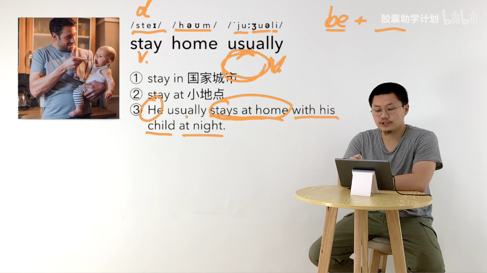

文字识别：be / 胶囊助学计划 / + / /stei/ / / haum/ / /'ju:3uali/ / stay / home / usually / V. / stay in国家城 / at小地点 / He / usually / stays / at home with his / child / at night.

### 画面 00:04:22

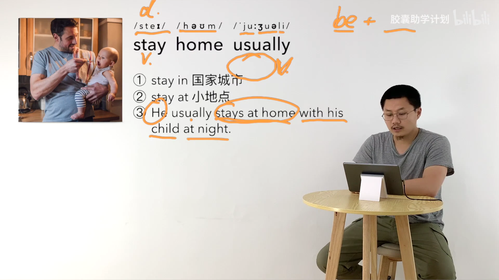

文字识别：be / 胶囊助学计划 / + / /stei/ / /haum/ / /'ju:3uali/ / stay / home / usually / V. / stay in 国家城市 / at小地点 / He / usually / stays / at home with his / child / at night.

### 画面 00:04:24

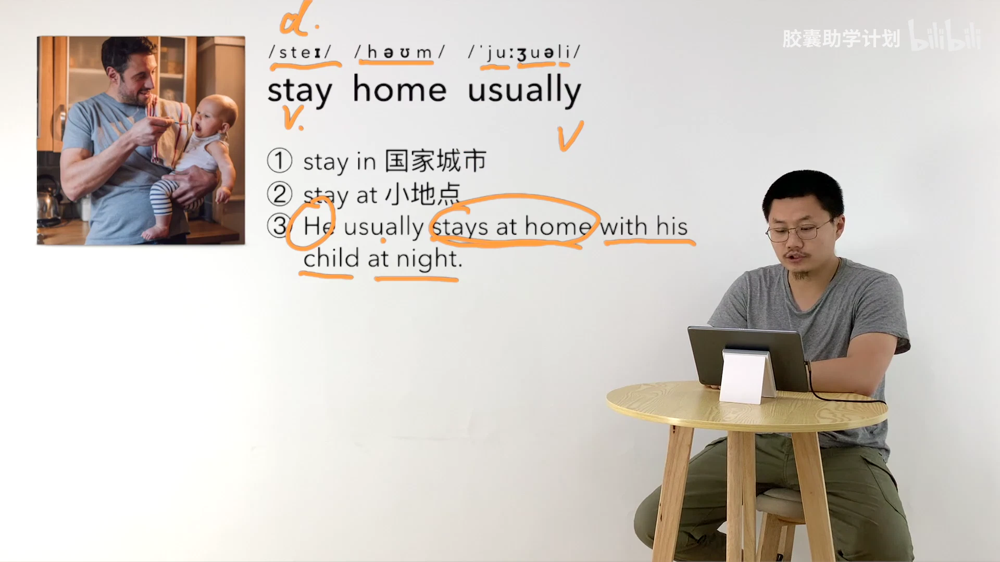

文字识别：胶囊助学计划 / /stei/ / /haum/ / /'ju:3uali/ / stay / home / usually / V. / V / stay in 国家城市 / at小地点 / He / usually / stays / at home with his / child / at night.

### 画面 00:04:26

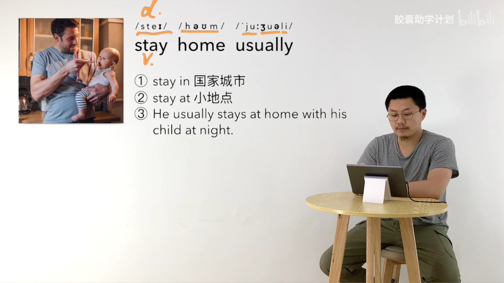

文字识别：胶囊助学计划 / /stei/ / /haum/ / /'ju:3uali/ / stay / home / usually / V. / stay in 国家城市 / stay at 小地点 / He usually / stays at home with his / child at night.

## 00:04:30–00:05:00

张嘴跟我读。Does he usually stay at home at night?他经常晚上待在家里吗？通常状态下，注意，你看这个一般疑问句当中，我们能提问的点已经非常多了。At home, where, at night, when, usually, how often，以及直接可以对整句话提问叫做Why？为什么他晚上一般待在家里面呢？对吧？He wants to spend some time with his child.啊，他想跟他孩子去度过一些

### 画面 00:04:45

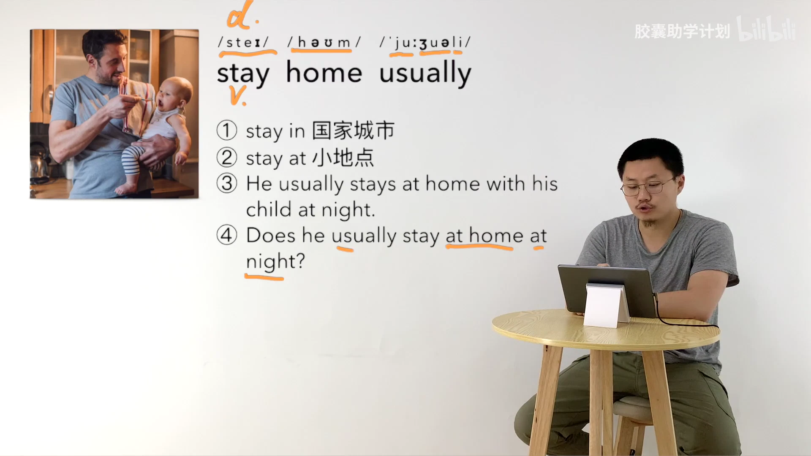

文字识别：胶囊助学计划 / /stei/ / /haum/ / /'ju:3uali/ / stay / home / usually / V. / stay in 国家城市 / stay at 小地点 / He usually / stays at home with his / child at night. / Does I /  he usually stay at home at / night?

### 画面 00:04:51

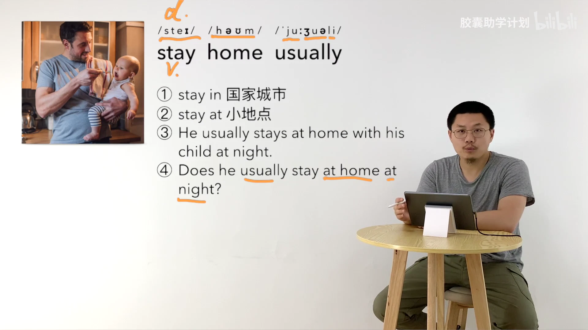

文字识别：胶囊助学计划 / /stei/ / /haum/ / /'ju:3uali/ / stay / home / usually / V. / stay in 国家城市 / stay at 小地点 / He usually / stays at home with his / child at night. / Does / he usually stay at home at / night?

## 00:05:00–00:05:30

时光。There you go。那我们现在对 usually 提问用的是 how often，就我们之前刚刚讲过。How often does he stay at home at night? OK，张嘴跟我一起读。There you go。接下来下一个单词跟我读 housework。Housework，你看这个单词实际上跟我们之前学过的 homework 特别的像 homework 家里面家庭作业是吧？Housework 就是家务劳动啊，各位我相信是能分清的。

### 画面 00:05:02

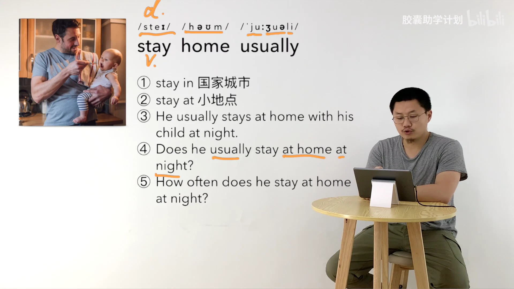

文字识别：胶囊助学计划 / /stei/ / /haum/ / /'ju:3uali/ / stay / home / usually / V. / 1 / stay in 国家城市 / stay at 小地点 / He usually stays at home with his / child at night. / Does he usually stay at home at / night? / How often does he stay at home / at night?

### 画面 00:05:04

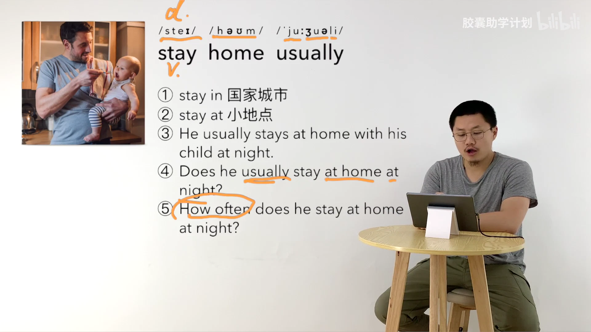

文字识别：胶囊助学计划 / /stei/ / /haum/ / /'ju:3uali/ / stay / home / usually / V. / stay in 国家城市 / 1 / stay at 小地点 / He usually / stays at home with his / child at night. / Does / he usually stay at home at / niaht? / ⑤How ofter does he stay at home / at night?

### 画面 00:05:13

文字识别：胶囊助学计划 / / 'hau sw 3 :k / / housework n. / 仙

### 画面 00:05:20

文字识别：胶囊助学计划 / / 'hau sw 3 :k / / housework n. / D

## 00:05:30–00:06:00

OK，那house加work，刚才我们讲到了，它跟homework一样，做家务劳动用的就是do这个单词。比如说，我们造句子啊，那比如说，我现在想表达，我正他他们正在做家务劳动，叫做they are doing the housework。OK，好，我们还学了一个叫be going to do，那我们可以说我要去做家务了，是吧？叫做啊，I'm going to do my do

### 画面 00:05:30

文字识别：胶囊助学计划 / /hau sw 3 :k / / housework n. / ① house + work

### 画面 00:05:34

文字识别：胶囊助学计划 / /hausw3 :k / / housework n. / ① house + work / ② do the housework

### 画面 00:05:39

文字识别：胶囊助学计划 / /'hau s w 3 :k / / housework n. / ① house + work / ② / do the housework / am/is/are doing / 3

### 画面 00:05:42

文字识别：胶囊助学计划 / /hau sw3 :k / / housework n. / 山 / ①house + work / ② / do the housework / am/is/are doing / 3 / D

### 画面 00:05:45

文字识别：胶囊助学计划 / /'hau sw 3 : k / / housework n. / ① house + work / ② do the housework / am/is/are doing / 3

## 00:06:00–00:06:30

the housework,或者do the do my housework,也OK了。OK，好，这叫准备要去做。那Can，那你跟我说，你能做一下这个家务劳动吗？Can you do the housework for me?或者Instead，对吧？I'm so tired today. Can you do the housework for me?我今天太累了，你能帮我把家务劳动做一下吗？家庭的这些，OK，very very good. Next one, do does.那do does是我们刚刚学过的时态，四十七课一直

### 画面 00:06:15

文字识别：胶囊助学计划 / / 'hau s w 3 : k / / housework n. / ① house + work / 2 / do the housework / am/is/are doing / am/is/are going to do / 5 / can

## 00:06:30–00:07:00

持续到了今天。陈述一个呃，比如说客观事实，对吧？或者生活习惯，比如说他每天晚上都会做家务劳动，那叫做 He does the housework every night. Okay, 那我把这个地方给大家从三到六给大家摆出来，放在这个地方是想告诉各位，目前我们造句啊，能用到的大的结构是这四个啊。各位回去一定要拿单词去尝

### 画面 00:06:45

文字识别：/ hausw3:k / / housework n. / ①house + work / 2 / do the housework / am/is/are doing / am/is/are going to do / 5 / can / do/does / 6

### 画面 00:06:47

文字识别：胶囊助学计划 / / 'h au s w 3:k / / housework n. / ① house + work / do the housework / am/is/are doing / am/is/are going to do / can / do/does / 6

### 画面 00:06:49

文字识别：胶囊助学计划 / / 'hau s w 3:k / / housework n. / ① house + work / ② do the housework / am/is/are doing / 3 / am/is/are going to do / 4 / 5 / can / do/does / 6

### 画面 00:06:51

文字识别：胶囊助学计划 / / 'hau s w 3:k / / housework n. / ① house + work / ② do the housework / am/is/are doing / 3 / am/is/are going to do / 4 / 5 / can / do/does / 6

### 画面 00:06:53

文字识别：胶囊助学计划 / /'hau s w 3:k / / housework n. / ①house + work / ②do the housework / am/is/are doing / 3 / am/is/are going to do / 4 / 5 / can / do/does / 6

## 00:07:00–00:07:30

试造句，比如说 do the housework 这个小的短语。 OK， continue。接下来我们看一个小的电影片段，这个电影片段当中看出现了这么多的英文，我先带的大家一起看一下啊。来了，他说 Whenever you want something， Whenever 这个我们可能到新二才能学，叫做任何时候。 You want something，这个各位应该能看懂，叫你想要一些什么东西。 I buy it for you automatically。你看，

### 画面 00:07:02

文字识别：胶囊助学计划 / / 'hau s w 3:k / / housework n. / ① house + work / ② do the housework / am/is/are doing / 3 / am/is/are going to do / 4 / 5 / can / 6 / do/does

### 画面 00:07:04

文字识别：omment a-t-on ose / 胶囊助学计划 / film de IOl.1i / un / Whenever you want something I buy it for / you automatically. / take you to concerts, to museums, to movies. / do all the housework! / Who /  does the tidying up? I do. / Who does the cooking? I do. / BRS / LOLIT / 洛丽塔 Lolita (1962) / S MASON-SHELE WNRS-FEP / ALEY KUBROX / VADINR NA80D / D

### 画面 00:07:06

文字识别：omment a-t-on ose / 胶囊助学计划 / filmde lOl.li / An / Whenever you want something I buy it for / you automatically. / take you to concerts, to museums, to movies. / do all the housework! / Who does the tidying up? I do. / Who does the cooking? I do. / SAESBRARS / LOLIT / 洛丽塔 Lolita (1962) / SASON SHELE WINTRS-FEFP / ALEY NUBROXVIADIMRMABO / D

### 画面 00:07:09

文字识别：omment a-t-on ose / 胶囊助学计划 / film de IOl.1i / un- / Whenever you want something I buy it for / you automatically. / take you to concerts, to museums, to movies. / do all the housework! / Who does the tidying up? I do. / Who does the cooking? I do. / SAESBRARS / LOLIT / 洛丽塔 Lolita (1962) / SMASON-SHELE WINTRSFEFP / ALEY KUBROX VADIRAO

### 画面 00:07:12

文字识别：omment a-t-on ose / 胶囊助学计划 / un film de IOl.li / Whenever you want something I buy it for / you automatically. / take you to concerts, to museums, to moviesl / do all the housework! / Who does the tidying up? I do. / Who does the cooking? I do. / LOLIT / AEBBAS / 洛丽塔 Lolita (1962) / SASON SHELEYWINTERS PEFP / ALEYUBRXADRABO

### 画面 00:07:15

文字识别：omment a-t-on ose / 胶囊助学计划 / un film de Iol.li / Whenever you want something I buy it for / you automatically. / take you to concerts, to museums, to movies / do all the housework! / Who does the tidying up? I do. / Who does the cooking? I do. / AWBBARS / LOLIT / 洛丽塔 Lolita (1962) / SMASON-SHELE WINTRS-FEP / AEYKBRXAIRNAO

### 画面 00:07:20

文字识别：omment a-t-on ose / 胶囊助学计划 / film de Lol.l1 / An / Wheneve / you want something I buy it for / you automatically. / take you to concerts, to museums, to movies / do / all the / housework! / Who / does the tidying up? I do. / Whoc / does the cooking? I do. / LOLIT / AEBBAS / 洛丽塔 Lolita (1962) / SASON-SHELE WINTRS-FEFP / ALEY UBROX VAIR AO

## 00:07:30–00:08:00

我买它给你 for you三十七克三十九克我们学的三十七克应该是啊三十七三十九呃这两克我们学的叫做给某人对吧包括四十一克也学过是吧Is this tobacco for me啊是为了我的吗注意automatically就很自动我就给你买了那任何时候你想要东西我就自动给你买了啊跟我读一下啊Whenever you want something, I buy it for you automatically. Continue,他说Take you to concerts这个

### 画面 00:07:39

文字识别：omment a-t-on ose / 胶囊助学计划 / film de lol.li / An / Wheneve / you want something I buy it for / you automatically. / take you to concerts, to museums, to movies / doa / all the housework! / Who /  does the tidying up? I do. / Who does the cooking? I do. / LOLIT / 洛丽塔 Lolita (1962) / SASON SHELE WINTERS PEFP / ALEY KUBROX / VLADINR NAB0800 / /

### 画面 00:07:44

文字识别：omment a-t-on ose / 胶囊助学计划 / film de lol.li / An / Wheneve / you want something I buy it for / you automatically. / take you to concerts, to museums, to movies. / do / all the housework! / Who / does the tidying up? I do. / Who does the cooking? I do. / LOLIT / 洛丽塔 Lolita(1962) / SMASON-SHEE WINTRS-FEFP / ALEY NUBROX  / VIADINR NA8000

### 画面 00:07:51

文字识别：omment a-t-on ose / 胶囊助学计划 / film de LOl.li / 4n / Wheneve / you want something I buy it for / you automatically. / take you to concerts, to museums, to movies / do / all the / housework! / Who / does the tidying up? I do. / Who / does the cooking? I do. / LOIIT / 洛丽塔 Lolita (1962) / SMASON-SHEE WINTRSFEP / ALEY KUBRXVADIMRNAO / D

### 画面 00:07:57

文字识别：omment a-t-on ose / 胶囊助学计划 / film de Lol.li / An / Wheneve / you want something I buy it for / you automatically. / you to concerts, to museums, to movies. / all thel / housework! / Who / does the tidying up? I do. / Who does the cooking? I do. / AWEBS8-AS / LOIIT / 洛丽塔 Lolita (1962) / SMASON-SHEE WINTRS-FEFP / ALEY KUBROXSr / VIADINR NA8000

## 00:08:00–00:08:30

### 画面 00:08:17

文字识别：omment a-t-on ose / 胶囊助学计划 / film de lol.li / An / Wheneve / you want something I buy it for / you automatically. / take you to concerts, to museums, to movies. / do / all the housework! / Who / does the tidying up? I do. / Whoc / does the cooking?I do. / LOLIT / 洛丽塔 Lolita (1962) / SMASON-SHEE WINTRS-FEFP / ALEY KUBROX / VLADINR NA80800

### 画面 00:08:20

文字识别：omment a-t-on ose / 胶囊助学计划 / film de lol.li / An / Wheneve / you want something I buy it for / you automatically. / take you to concerts, to museums, to movies / do / all the housework! / Who / doest /  the tidving / up?ldo. / Who / doest /  the cooking? I do. / AWESBFAIS / LOLIT / 洛丽塔 Lolita (1962) / SMASON SHELE WNTERS-PEFP / ALEYUBROVANRAB

## 00:08:30–00:09:00

了，叫 untidy 啊，不认的应该检讨是吧？这是我们二十九课学的啊。OK，叫做不整洁的。那把 un 去掉，tidy 就可以变成一个动词。那 tidying up 其实就跟 do the housework 理论上是类似的意思。那 tidying up 就是把它们变得整洁啊。I do 我做。Who does the cooking？谁做饭？I do 我做。好，接下来我们看一下电影片段。Whenever you

### 画面 00:08:30

文字识别：omment a-t-on ose / 胶囊助学计划 / film de LOl.li / An / Wheneve / you want something I buy it for / you automatically. / take you to concerts, to museums, to movies. / do / all the housework! / Who does the tidying up? I do. / Who does the cooking? I do. / LOLIT / 洛丽塔 Lolita (1962) / SMASON-SHEE WINTRS-FEFP / ALEY KUBROX  / . VLADINR NA80800

### 画面 00:08:46

文字识别：omment a-t-on ose / 胶囊助学计划 / film de lol.li / An / Wheneve / you want something I buy it for / you automatically. / take you to concerts, to museums, to moviesi / do / all the housework! / Who /  does the tidying up? I do. / Who does the cooking? I do. / AEB8AS / LOLIT / 洛丽塔 Lolita (1962) / SMASON-SHEE WNTRS-FEFP / ALEY KUBROX / VIADINR MA8000

### 画面 00:08:50

文字识别：omment a-t-on ose / 胶囊助学计划 / film de Lol.l1 / 4n / Wheneve / you want something I buy it for / you automatically. / take you to concerts, to museums, to movies. / do / all the housework! / Who / does the tidying up? I do. / Who does the cooking? I do. / LOLIT / 洛丽塔 Lolita (1962) / SMASON-SHEIE WNTERS PEP / ALEYUBROXVADRABM

### 画面 00:08:58

文字识别：bilibili / 胶囊助学计划

## 00:09:00–00:09:30

want something, I buy it for you automatically. I take you to concerts, to museums, to movies. I do all the housework. Who does the the tidying up? I do. Who does the cooking? I do. Okay, ready? Oh,各位这一片段可以反复去听。实际上，在这儿我教了各位一个小小的用电影学习英语的方法啊，就是你把台词拿出来反复读，读到特别熟，然后你就会发现，你回去再

### 画面 00:09:00

文字识别：bilibili / 胶囊助学计划

### 画面 00:09:02

文字识别：Bilbii / 胶囊助学计划

### 画面 00:09:05

文字识别：Bilbii / 胶囊助学计划

### 画面 00:09:07

文字识别：bilibili / 胶囊助学计划

### 画面 00:09:09

文字识别：bilibili / 胶囊助学计划

### 画面 00:09:11

文字识别：Bilibili / 胶囊助学计划

### 画面 00:09:13

文字识别：omment a-t-on ose / 胶囊助学计划 / film de LOl.li / 4n / Whenever you want something I buy it for / you automatically. / take you to concerts, to museums, to movies. / do all the housework! / Who does the tidying up? I do. / Who does the cooking? I do. / AESBFAES / LOIIT / 洛丽塔 Lolita (1962) / SMASON-SHEE WNTRS-FEFP / ALEYKUBROX VAIRAO / D

### 画面 00:09:16

文字识别：omment a-t-on ose / 胶囊助学计划 / filmde LOl.li / An / Whenever you want something I buy it for / you automatically. / take you to concerts, to museums, to movies. / do all the housework! / Who does the tidying up? I do. / Who does the cooking? I do. / AESBRAIS / LOLIT / 洛丽塔 Lolita (1962) / SMASON-SHEE WINTRS-FEFP / ALEY NUBROX

### 画面 00:09:18

文字识别：omment a-t-on ose / 胶囊助学计划 / un film de IOl.li / Whenever you want something I buy it for / you automatically. / take you to concerts, to museums, to movies. / do all the housework! / Who does the tidying up? I do. / Who does the cooking? I do. / ZAESBHASS / LOLIT / 洛丽塔 Lolita (1962) / SASON SHELE WINTERS PF / ALEYUBOAIRA

### 画面 00:09:24

文字识别：omment a-t-on ose / 胶囊助学计划 / an film de I-o1.1i / Whenever you want something I buy it for / you automatically. / take you to concerts, to museums, to movies / do all the housework! / Who does the tidying up? I do. / Who does the cooking? I do. / AS8FAS / LOLIT / 洛丽塔 Lolita (1962) / SMASON-SHEE WINTRS-FEFP / ALEY NUBROXWLADINRNAO / /

## 00:09:30–00:10:00

听这个没有字幕的电影的当电影的时候呢，你会发现你听懂了啊。所以第一步把台词找到，第二步把台词的意思弄清楚，通过阅读的方式。第三步把它读到非常的熟。Whenever you want something, I buy it for you automatically. Take you to concerts, to museums, to movies. Do all the housework. Who does the tidying up? I do. Who does the cooking? I do. Okay，你读成这样的时候，你回去再听，你会发

### 画面 00:09:45

文字识别：omment a-t-on ose / 胶囊助学计划 / an film de IOl.1i / Whenever you want something I buy it for / you automatically. / take you to concerts, to museums, to movies / do all the housework! / Who does the tidying up? I do. / Who does the cooking? I do. / LOLIT / AEBBAIS / 洛丽塔 Lolita (1962) / SMASON SHEIE WNTERS-PEFP / ALEYKUBROX VADIR MA / D

### 画面 00:09:49

文字识别：omment a-t-on ose / 胶囊助学计划 / an film de IOl.li / Whenever you want something I buy it for / you automatically. / take you to concerts, to museums, to movies. / do all the housework! / Who does the tidying up? I do. / Who does the cooking? I do. / LOLIT / 洛丽塔 Lolita (1962) / SMASON-SHELE WNIRS-FEFP / ALEYUBROXVADIRA

### 画面 00:09:52

文字识别：omment a-t-on ose / 胶囊助学计划 / an film de IOl.li / Whenever you want something I buy it for / you automatically. / take you to concerts, to museums, to movies / do all the housework! / Who does the tidying up? I do. / Who does the cooking? I do. / LOLIT / 洛丽塔Lolita(1962) / SMASON-SHEE WNTRS-FEFP / ALEYUBROXAINRAD

### 画面 00:09:57

文字识别：omment a-t-on ose / 胶囊助学计划 / an film de IOl.1i / Whenever you want something I buy it for / you automatically. / take you to concerts, to museums, to movies! / do all the housework! / Who does the tidying up? I do. / Who does the cooking? I do. / ASBNS / LOLIT / 洛丽塔 Lolita (1962) / SMASON-SHELE WNTRS-PEFP / ALEYKBRXAIMRA

## 00:10:00–00:10:30

现瞬间你听的就特别特别清楚了，完全你就能听懂了，而且不需要字幕，这是一个小的学习方法。OK， continue，接下来下一个单词跟我读一下，叫做 lunch 午餐，还有后面这个单词叫 together 连起来 together 叫做一起。那我们就造一个小的句子，叫 We always have lunch together。我们注意 have lunch 是小短语，这

### 画面 00:10:00

文字识别：omment a-t.on ose / 胶囊助学计划 / an film de IOl.1i / Whenever you want something I buy it for / you automatically. / take you to concerts, to museums, to movies. / do all the housework! / Who does the tidying up? I do. / Who does the cooking? I do. / LOLIT / 洛丽塔Lolita(1962) / SMASON-SHEE WNTRS-FEFP / LEYKOBRXAMRAB

### 画面 00:10:04

文字识别：omment a-t-on ose / 胶囊助学计划 / film de Lol.li / An- / Whenever you want something I buy it for / you automatically. / take you to concerts, to museums, to movies. / do all the housework! / Who does the tidying up? I do. / Who does the cooking? I do. / LOLIT / 洛丽塔 Lolita (1962) / SMASON SHELE WINTRS-FEFP / ALEY KUBRXVADIMRMABO

### 画面 00:10:07

文字识别：胶囊助学计划 / /lΛnt∫/ /ta'geǎa/ / lunch together

### 画面 00:10:09

文字识别：胶囊助学计划 / /lΛnt∫/ /ta'geǎal / lunch together

## 00:10:30–00:11:00

together? Do you always have lunch together? Do you always have lunch together? Do you always have lunch together? Do you

### 画面 00:10:39

文字识别：胶囊助学计划 / /lantJ/ /ta'geǒal / lunch together / ① We always have lunch together.

## 00:11:00–00:11:30

吗？以及我想问，张嘴跟我读，Why do you always have lunch together? Okay,思路还是由肯定句变一般疑问句变的特殊疑问句。There you go, continue.下一个单词跟我读一下，看音标。Arrive, arrive叫做到达。那我们可以造一句话叫做He arrives home late every night.每天晚上他到家都非常的晚。您看是不

### 画面 00:11:01

文字识别：胶囊助学计划 / /lantS/ / /ta'geǒal / lunch together / ① We always have lunch together. / 2 / Do you always have lunch together? / Why do you always have lunch / together?

### 画面 00:11:13

文字识别：胶囊助学计划 / la'raiv/ / arrive / D

### 画面 00:11:24

文字识别：胶囊助学计划 / /a'raiv/ / arrive / ① He arrives home late every night. / D

### 画面 00:11:28

文字识别：胶囊助学计划 / /a'raiv/ / arrive / ① He arrives home late every night.

## 00:11:30–00:12:00

是一个生活习惯，对吧？那我现在想把它变一般疑问句，Does提前就行了。Does he arrive home late every night？以及我对整句话提问，跟我读。Why does he arrive home late every night？Very good。那我们就会问了。下一个单词，时间下午，afternoon，afternoon，afternoon。Very good。那我们一个

### 画面 00:11:40

文字识别：胶囊助学计划 / /a'raiv/ / arrive / ① He arrives home late every night. / Does he arrive home late every / night? / Why does he arrive home late / every night?

### 画面 00:11:49

文字识别：胶囊助学计划 / /a:fta'nuin/ / afternoon / D

## 00:12:00–00:12:30

小的短语在下午叫做in the afternoon.好，我们造句子，结合be going to do啊。跟我读，They are going to do the housework in the afternoon. Okay,肯定句给你了，剩下的句型各位下课或者说您暂停视频，张嘴顺便就把它练一下。接下来下一个单词evening, evening, evening. Very good.叫做晚上对

### 画面 00:12:01

文字识别：胶囊助学计划 / /a:fta'nuin/ / afternoon / ① in the afternoon / D

### 画面 00:12:10

文字识别：胶囊助学计划 / /a:fta'nuin/ / afternoon / ① in the afternoon / They are going to do the / housework in the afternoon.

### 画面 00:12:22

文字识别：胶囊助学计划 / / 'i:vnn/ / evening / D

## 00:12:30–00:13:00

吧？Okay, in the evening，叫在晚上。Can I watch TV this evening? Can用上了，对吧？Watch TV之前我们学过，今晚能看电影吗？小孩问妈妈，对吧？好，Recap复习一下本课我们要学的一个呃学过的一些关键的点啊。首先第一个叫做have lunch，吃晚饭，以及接呃吃中午饭，以及接下来的三个小的时间。

### 画面 00:12:42

文字识别：Recap / 胶囊助学计划 / Patterns / Grammar / Words / have / lunch / in / the / evening / Expression / in / the / afternoon / at night

### 画面 00:12:56

文字识别：Recap / 胶囊助学计划 / Patterns / Grammar / Words / have / lunch / Expression / in / the / evening / in / the / afternoon / at night / D

## 00:13:00–00:13:30

in the evening, in the afternoon, 和 at night. Very good. 好，那接下来我们看一下本课家庭作业。首先，各位回去用一般现在时描述一下今天一天的生活，或者说您描述一下自己每一天的生活，对吧？您的生活习惯是什么的？啊，这个就是一个一般现在时了。 Very good. 好，那其次呢，要给自己讲解一遍今天的核心知识点。如果大家喜欢我们

### 画面 00:13:05

文字识别：胶囊助学计划 / D

### 画面 00:13:09

文字识别：描述一下自己一天的生活 / （一般现在时）

### 画面 00:13:18

文字识别：胶囊助学计划 / 描述一下自己一天的生活 / （一般现在时）

### 画面 00:13:28

文字识别：胶囊助学计划 / D

## 00:13:30–00:14:00

的课程呢，欢迎大家关注、订阅、一键三连支持，并分享给那些需要的朋友。最后，我们再来看一句话：Dream as if you will live forever. Live as if you will die today. See you next time.

### 画面 00:13:31

文字识别：胶囊助学计划 / D

### 画面 00:13:33

文字识别：胶囊助学计划 / D

### 画面 00:13:35

文字识别：胶囊助学计划 / D

### 画面 00:13:37

文字识别：胶囊助学计划 / Dream as if you'll live forever. Live as if / you'll die today. / -James Dean

### 画面 00:13:46

文字识别：胶囊助学计划 / Dream as if you'll live forever. Live as if / you'll die today. / -James Dean

### 画面 00:13:48

文字识别：CAPSULEACADEMY / 胶囊助学计划 / 『 / 小红书 / Lecturer / OE

### 画面 00:13:50

文字识别：CAPSULEACADEMY / 胶囊助学计划 / 小红书 / 口 / Photoaranha / OE

### 画面 00:13:53

文字识别：CAPSULEACADEMY / 胶囊助学计划 / 小红书 / Editor / □ / Berlin / OE

### 画面 00:13:56

文字识别：CAPSULEACADEMY / 胶囊助学计划 / 『 / 小红书 / 品 / OE

### 画面 00:13:58

文字识别：bilibili / 胶囊助学计划

### 画面 00:13:59

文字识别：bilibili / 胶囊助学计划

## 00:14:00–00:14:00

