# 055 文章

快速机器解析：语音为单模型转写，未进行独立交叉校对或人工复核；画面每秒采样并按变化选帧，短时文字和标记可能遗漏。截图时间约有 1 秒误差。图片有损压缩；遇到疑点请按时间查看 Google Drive 原视频。

## 00:00:00–00:00:30

Hello everyone, welcome to Capsule Academy. This is Leo. Today we're going to learn new concept English book one lesson fifty five story. Hope you gonna enjoy it.那我们直接看文章啊。这一课我们要做一点点小的变化，四句型上的变化。我们一起来。他说 The Sawyer's，索耶一家人。这个地方注意一下，the 后边加上这个姓氏

### 画面 00:00:00

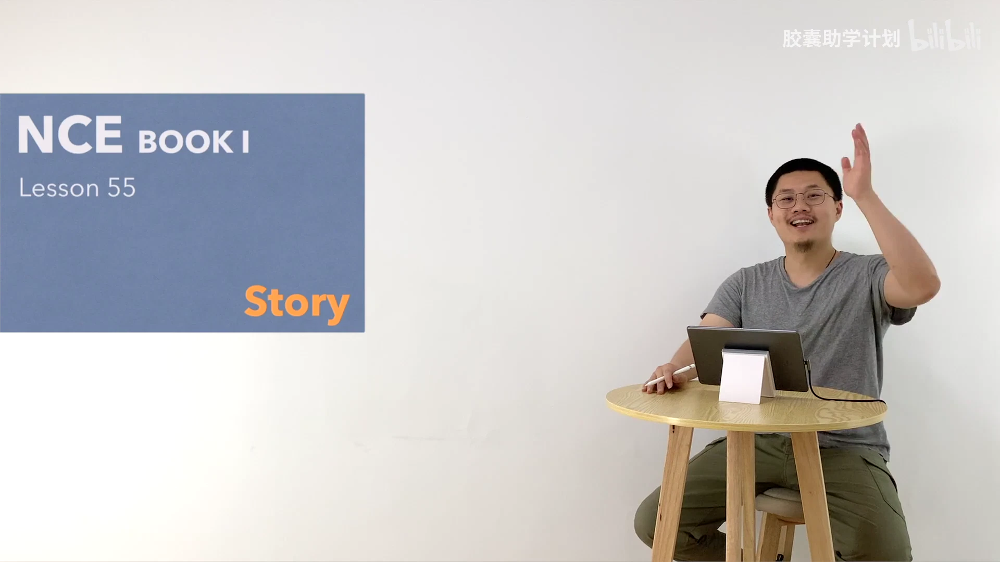

文字识别：胶囊助学计划 / NCE / BOOKI / Lesson 55 / Story / D

### 画面 00:00:02

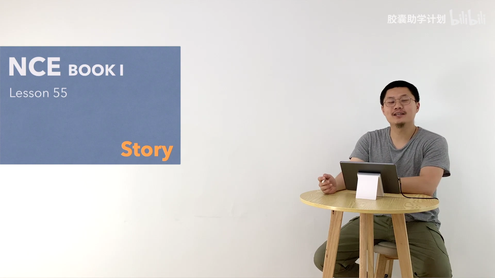

文字识别：胶囊助学计划 / NCE / BOOKI / Lesson 55 / Story / D

### 画面 00:00:05

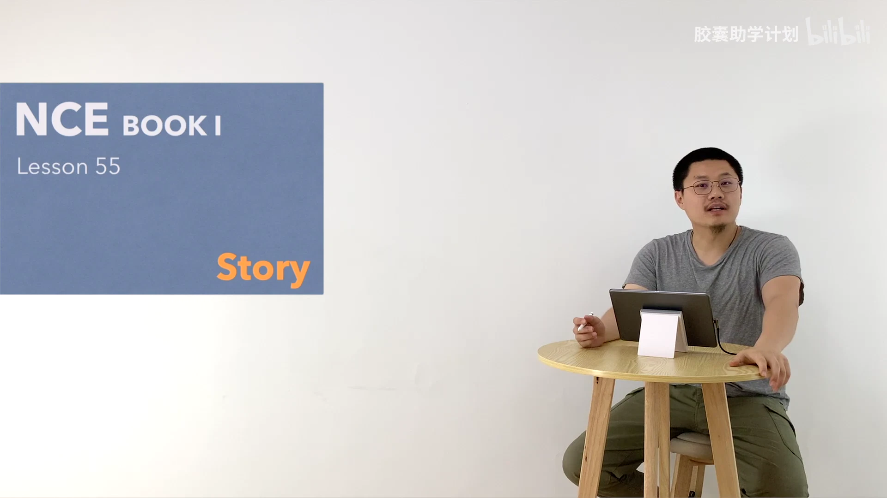

文字识别：胶囊助学计划 / NCE / BOOKI / Lesson 55 / Story / D

### 画面 00:00:09

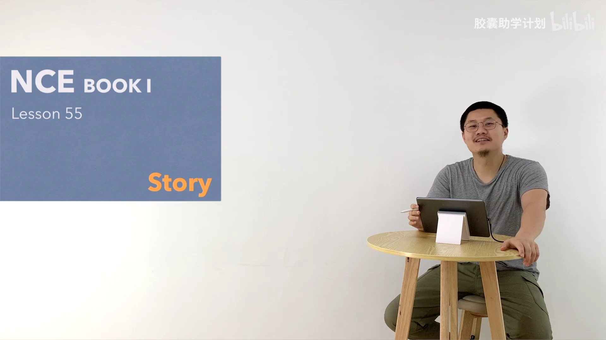

文字识别：胶囊助学计划 / NCE / BOOKI / Lesson 55 / Story

### 画面 00:00:11

文字识别：胶囊助学计划 bil

### 画面 00:00:14

文字识别：胶囊助学计划

### 画面 00:00:16

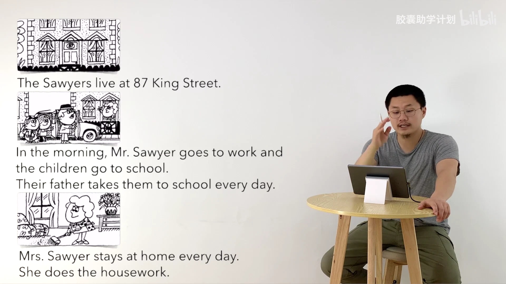

文字识别：胶囊助学计划 / The Sawyers live at 87 King Street. / In the morning, Mr. Sawyer goes to work and / the children go to school. / Their father takes them to school every day. / Mrs. Sawyer stays at home every day. / She does the housework.

### 画面 00:00:19

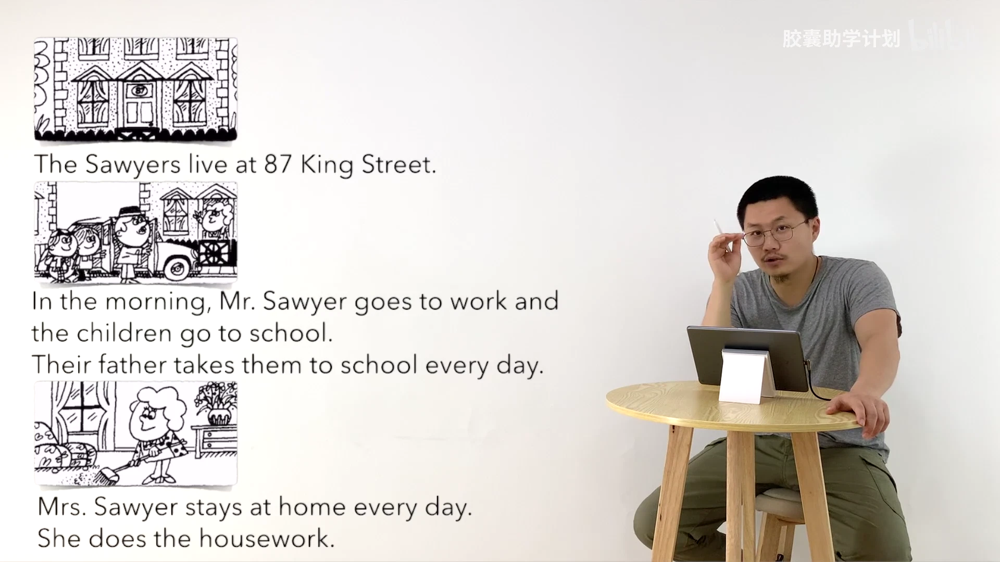

文字识别：胶囊助学计划 / The Sawyers live at 87 King Street. / In the morning, Mr. Sawyer goes to work and / the children go to school. / Their father takes them to school every day. / Mrs. Sawyer stays at home every day. / She does the housework.

### 画面 00:00:23

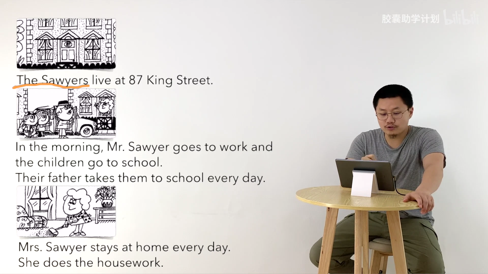

文字识别：胶囊助学计划 / The Sawyers live at 87 King Street. / In the morning, Mr. Sawyer goes to work and / the children go to school. / Their father takes them to school every day. / Mrs. Sawyer stays at home every day. / She does the housework.

### 画面 00:00:26

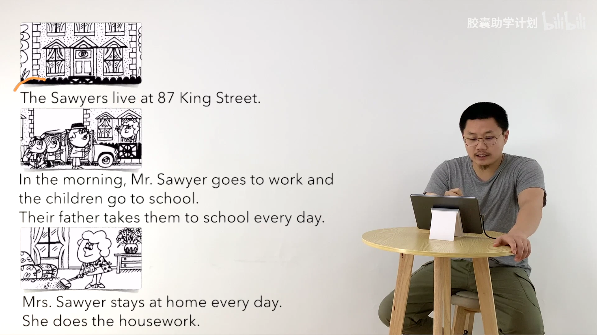

文字识别：胶囊助学计划 / The Sawyers live at 87 King Street. / In the morning, Mr. Sawyer goes to work and / the children go to school. / Their father takes them to school every day. / Mrs. Sawyer stays at home every day. / She does the housework.

### 画面 00:00:28

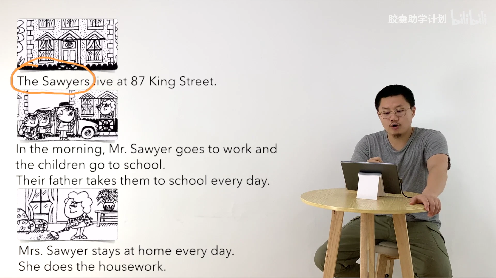

文字识别：胶囊助学计划 / The Sawyersive at 87 King Street. / In the morning, Mr. Sawyer goes to work and / the children go to school. / Their father takes them to school every day. / Mrs. Sawyer stays at home every day. / She does the housework.

## 00:00:30–00:01:00

啊，它指的是这样一家人。Live at居住在，注意它虽然是陈述客观事实，本课都是陈述客观事实或生活习惯啊。但是the Soyers一家人这是一个复数而不是单数，所以动词不用第三人称单数。OK，住在什么地方呢？At具体门牌号eighty seven King Street国王街八十七号。Well, you go.那我们看一下这句话。

### 画面 00:00:30

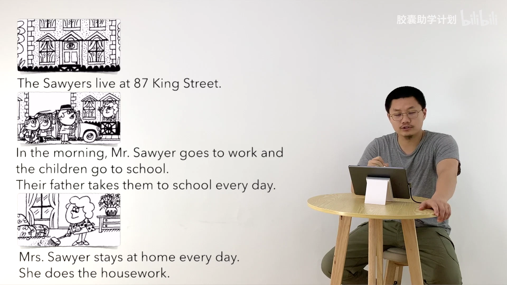

文字识别：胶囊助学计划 / The Sawyers live at 87 King Street. / In the morning, Mr. Sawyer goes to work and / the children go to school. / Their father takes them to school every day. / Mrs. Sawyer stays at home every day. / She does the housework.

### 画面 00:00:42

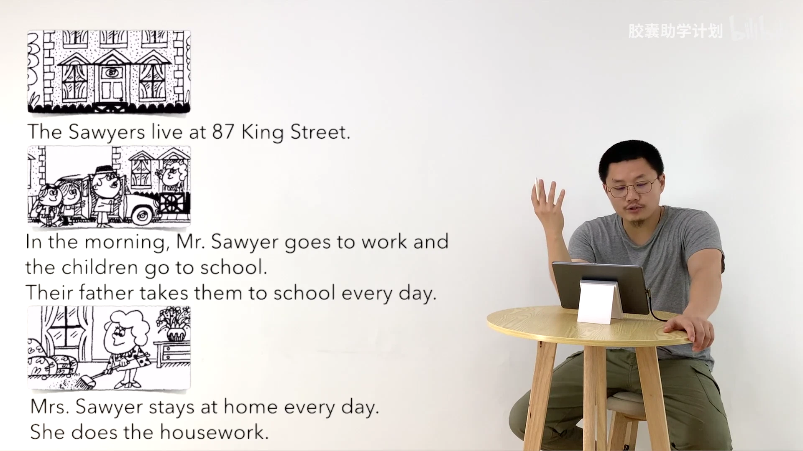

文字识别：胶囊助学计划 / The Sawyers live at 87 King Street. / In the morning, Mr. Sawyer goes to work and / the children go to school. / Their father takes them to school every day. / Mrs. Sawyer stays at home every day. / She does the housework. / /

### 画面 00:00:52

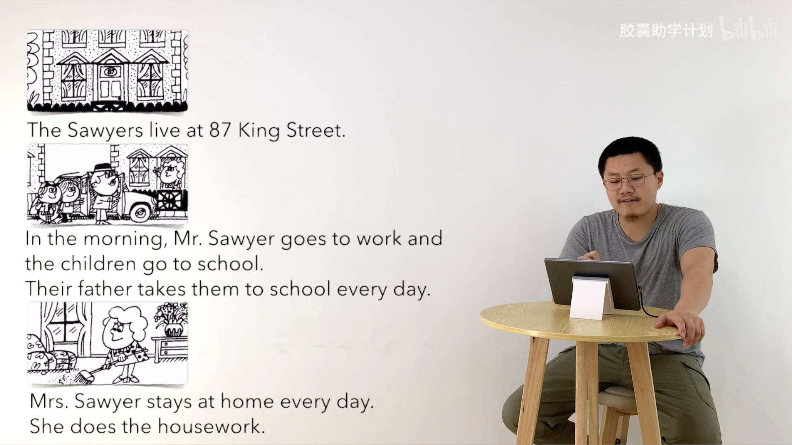

文字识别：胶囊助学计划 / The Sawyers live at 87 King Street. / In the morning, Mr. Sawyer goes to work and / the children go to school. / Their father takes them to school every day. / Mrs. Sawyer stays at home every day. / She does the housework.

### 画面 00:00:58

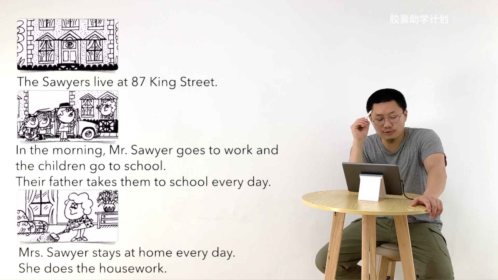

文字识别：胶囊助学计划 / The Sawyers live at 87 King Street. / In the morning, Mr. Sawyer goes to work and / the children go to school. / Their father takes them to school every day. / Mrs. Sawyer stays at home every day. / She does the housework.

## 00:01:00–00:01:30

我们如果花了百分之百的精力把这篇文章背下来了，您背到的是肯定句，这固然是好的。但如果我们花百分之五十的时间把文章熟读成诵，然后剩下百分之五十的时间我们去做四技能转换，您看一下您能多得到多少东西？时间假设咱们都是一个小时啊。The Sawyer's live at eighty-seven King Street. 首先这句话我们可以把它变成否定句，叫做 The Sawyer's don't live

### 画面 00:01:14

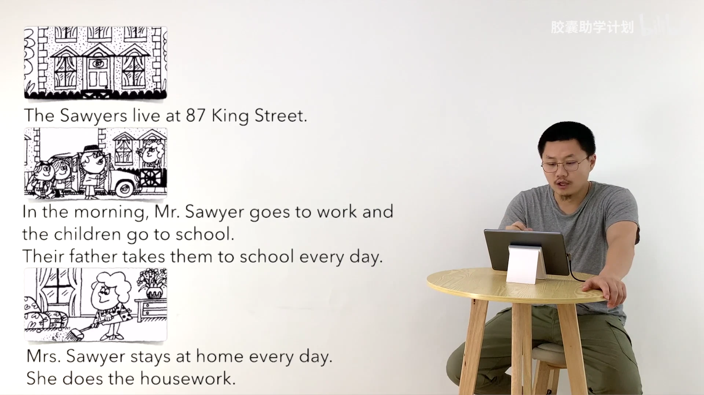

文字识别：胶囊助学计划 / The Sawyers live at 87 King Street. / In the morning, Mr. Sawyer goes to work and / the children go to school. / Their father takes them to school every day. / Mrs. Sawyer stays at home every day. / She does the housework.

### 画面 00:01:23

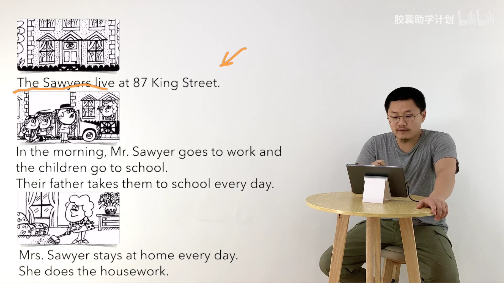

文字识别：胶囊助学计划 / The Sawyers live at 87 King Street. / In the morning, Mr. Sawyer goes to work and / the children go to school. / Their father takes them to school every day. / Mrs. Sawyer stays at home every day. / She does the housework.

### 画面 00:01:25

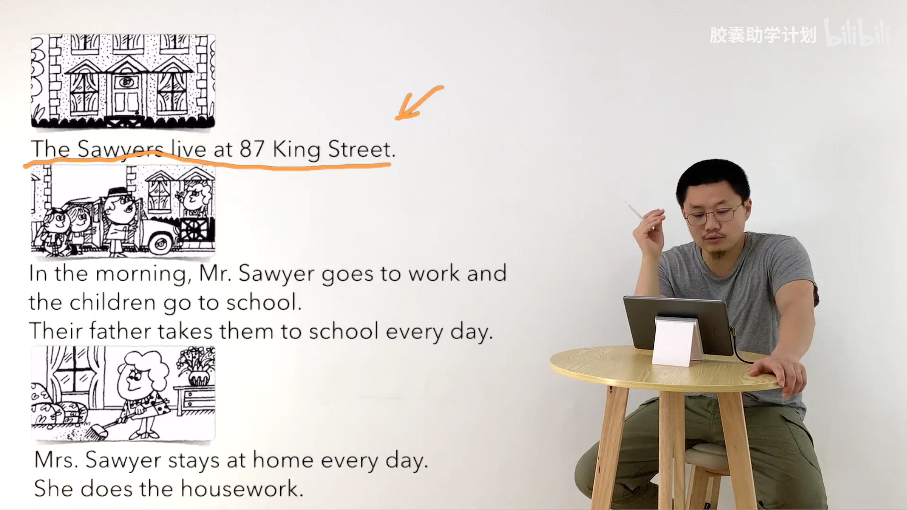

文字识别：胶囊助学计划 / The Sawyers live at 87 King Street. / In the morning, Mr. Sawyer goes to work and / the children go to school. / Their father takes them to school every day. / Mrs. Sawyer stays at home every day. / She does the housework.

### 画面 00:01:27

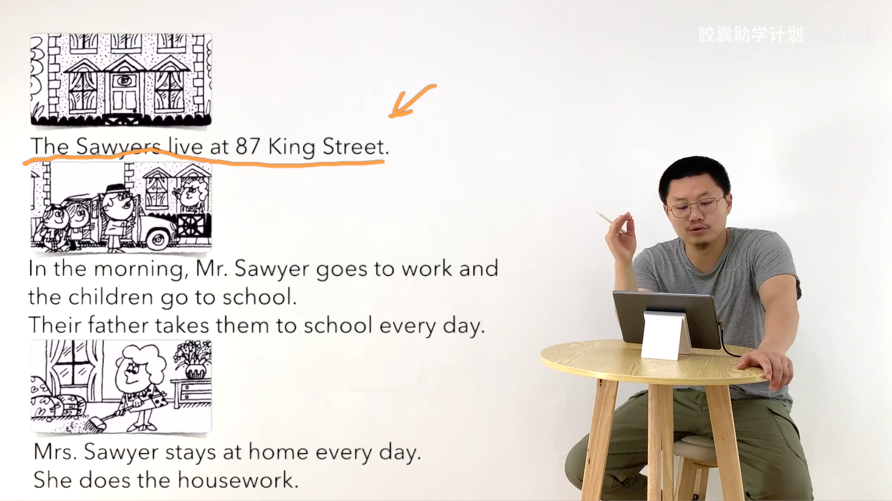

文字识别：The Sawyers live at 87 King Street. / In the morning, Mr. Sawyer goes to work and / the children go to school. / Their father takes them to school every day. / Mrs. Sawyer stays at home every day. / She does the housework.

## 00:01:30–00:02:00

at eighty-seven King Street.否定句出来一句话，您多学会了一句话。一般疑问句 Do the Sawyer's live at eighty-seven King Street?一般疑问句您出来了一句话，然后各种特殊疑问句，比如说我想对 the Sawyer's 提问，可以用 who，对不对？对 At eighty-seven King Street，可以用什么？用 where，对不对？所以所以这句话的答案叫 Where do the Sawyer's live? 所以

### 画面 00:01:41

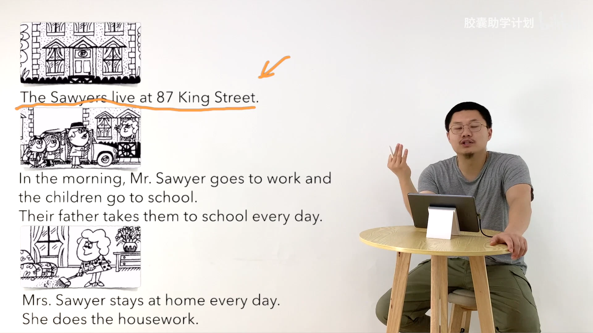

文字识别：胶囊助学计划 / The Sawyers live at 87 King Street. / In the morning, Mr. Sawyer goes to work and / the children go to school. / Their father takes them to school every day. / Mrs. Sawyer stays at home every day. / She does the housework.

### 画面 00:01:46

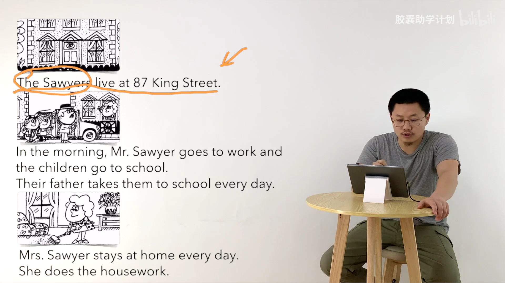

文字识别：胶囊助学计划 / The Sawyers live at 87 King Street. / In the morning, Mr. Sawyer goes to work and / the children go to school. / Their father takes them to school every day. / Mrs. Sawyer stays at home every day. / She does the housework. / /

### 画面 00:01:49

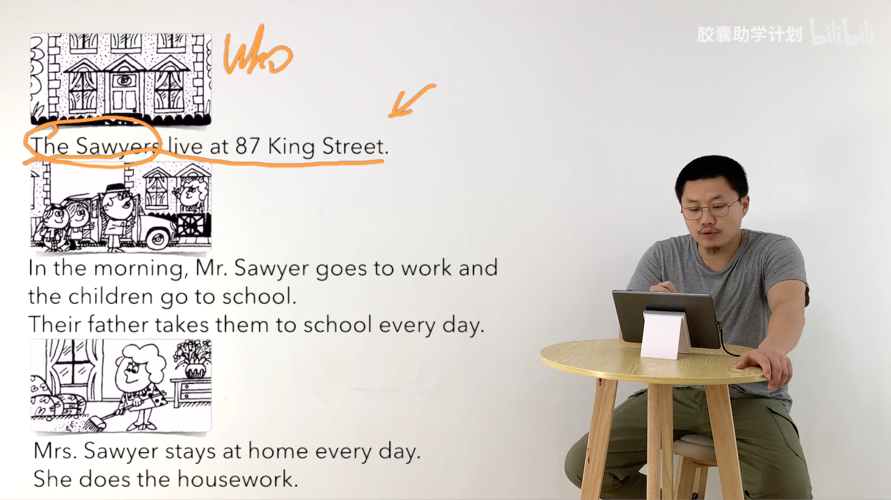

文字识别：Wo / 胶囊助学计划 / The Sawyers live at 87 King Street. / In the morning, Mr. Sawyer goes to work and / the children go to school. / Their father takes them to school every day. / Mrs. Sawyer stays at home every day. / She does the housework.

### 画面 00:01:51

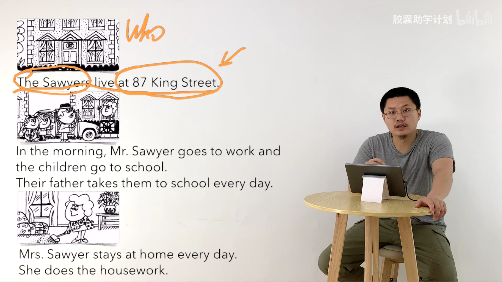

文字识别：Mo / 胶囊助学计划 / The Sawyers live at 87 King Street. / In the morning, Mr. Sawyer goes to work and / the children go to school. / Their father takes them to school every day. / Mrs. Sawyer stays at home every day. / She does the housework.

### 画面 00:01:54

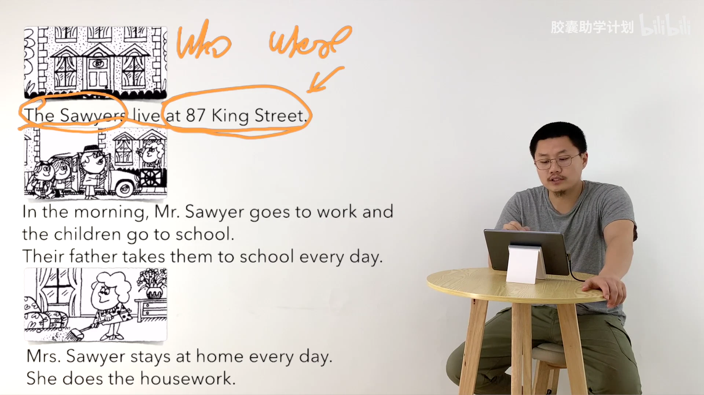

文字识别：Mo / Werol / 胶囊助学计划 / The Sawyere live at 87 King Street. / In the morning, Mr. Sawyer goes to work and / the children go to school. / Their father takes them to school every day. / Mrs. Sawyer stays at home every day. / She does the housework.

### 画面 00:01:56

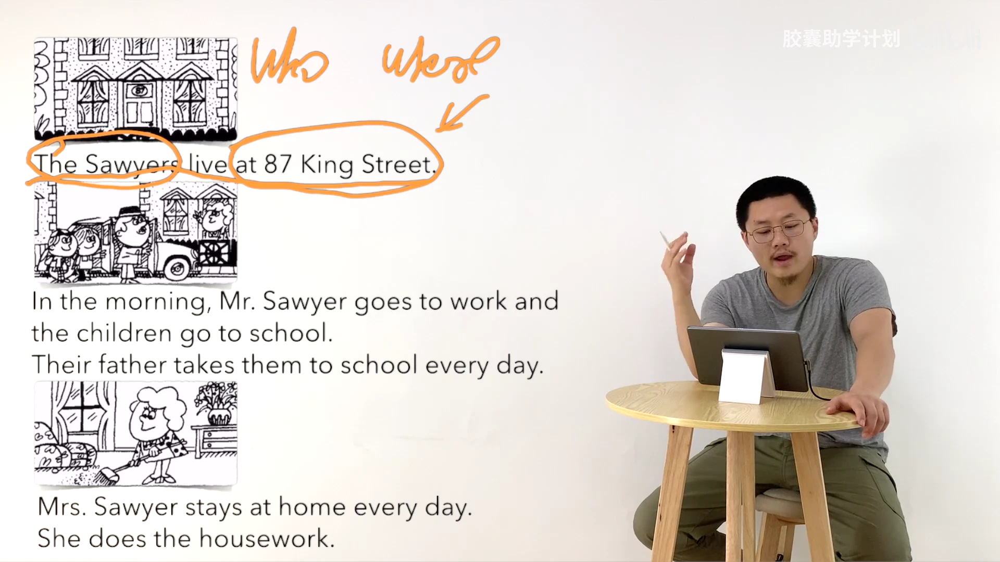

文字识别：Weol / The Sawyere live at 87 King Street. / In the morning, Mr. Sawyer goes to work and / the children go to school. / Their father takes them to school every day. / Mrs. Sawyer stays at home every day. / She does the housework.

## 00:02:00–00:02:30

一家人住在什么地方？您想一下这句话，你是不是可能能用到？但如果你花了百分之百的精力背文章，那这句话你可能就没有练习到，对吧？我们给大家提出的方案是百分之五十的时间或者百分之八十的时间去把文章熟读成诵，然后再留一点时间把文章当中的肯定句做一些四句型的转换。比如说刚才我做的事情，我们再往下看啊。比如说 in the morning，在早晨，

### 画面 00:02:09

文字识别：Mo / Weol / 胶囊助学计划 / The Sawyere live at 87 King Street. / In the morning, Mr. Sawyer goes to work and / the children go to school. / Their father takes them to school every day. / Mrs. Sawyer stays at home every day. / She does the housework.

### 画面 00:02:20

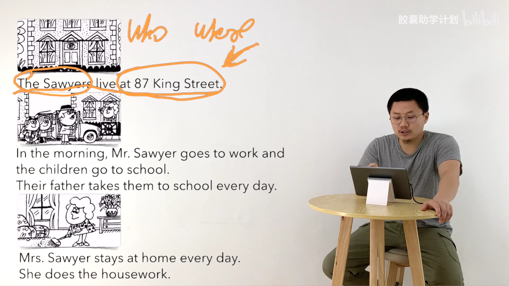

文字识别：Mo / Werol / 胶囊助学计划 / The Sawyere live at 87 King Street. / In the morning, Mr. Sawyer goes to work and / the children go to school. / Their father takes them to school every day. / Mrs. Sawyer stays at home every day. / She does the housework. / /

### 画面 00:02:23

文字识别：Wo / Werol / The Sawyere live at 87 King Street. / In the morning, Mr. Sawyer goes to work and / the children go to school. / Their father takes them to school every day. / Mrs. Sawyer stays at home every day. / She does the housework.

### 画面 00:02:27

文字识别：Mo / Werol / 胶囊助学计划 / The Sawyere live at 87 King Street. / In the morning, Mr. Sawyer goes to work and / the children go to school. / Their father takes them to school every day. / Mrs. Sawyer stays at home every day. / She does the housework.

## 00:02:30–00:03:00

Mr. Sawyer goes to work.他去上班了。好，我们先不看后半句话，只看到这儿。叫In the morning, Mr. Sawyer goes to work.肯定句出来了。我们现在把它直接，我拿口语带大家变一般疑问句。想象啊，叫做Does Mr. Sawyer go to work in the morning?我现在想对Mr. Sawyer提问用Who，对吧？我现在想对整句话提问

### 画面 00:02:31

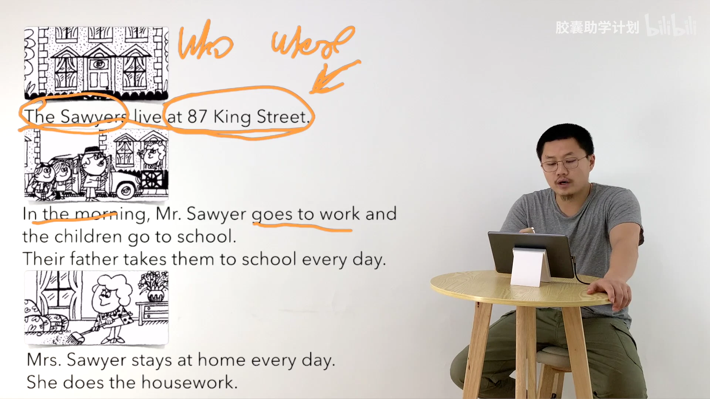

文字识别：Wo / Weol / 胶囊助学计划 / The Sawyere live at 87 King Street. / In the morning, Mr. Sawyer goes to work and / the children go to school. / Their father takes them to school every day. / Mrs. Sawyer stays at home every day. / She does the housework.

### 画面 00:02:38

文字识别：Mo / Werol / 胶囊助学计划 / The Sawyere live at 87 King Street. / In the morning, Mr. Sawyer goes to workand / the children go to school. / Their father takes them to school every day. / Mrs. Sawyer stays at home every day. / She does the housework.

## 00:03:00–00:03:30

问 why？我现在想对 in the morning 提问，用 when？比如说，When does Mr. Sawyer go to work？他什么时候去工作？这是各位今天课下也要做的事情。OK，我只是在这儿给大家举三个例子啊。And然后呢，The children go to school。注意，The children是they啊，你看图也能看出来是两个人，包括The children也是复数，对吧？所以动词不用变成第三人称单数，他们去上学。

### 画面 00:03:08

文字识别：Wo / Werol / The Sawyers live at 87 King Street. / In the morning, Mr. Sawyer goes to work and / the children go to school. / Their father takes them to school every day. / Mrs. Sawyer stays at home every day. / She does the housework.

### 画面 00:03:15

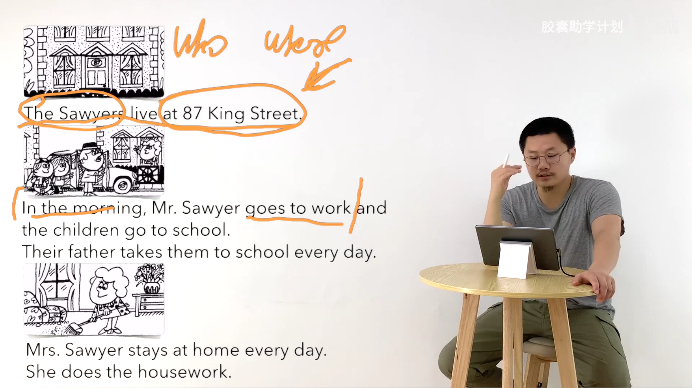

文字识别：Wo / Wede / The Sawyers live at 87 King Street. / In the morning, Mr. Sawyer goes to work and / the children go to school. / Their father takes them to school every day. / Mrs. Sawyer stays at home every day. / She does the housework.

### 画面 00:03:19

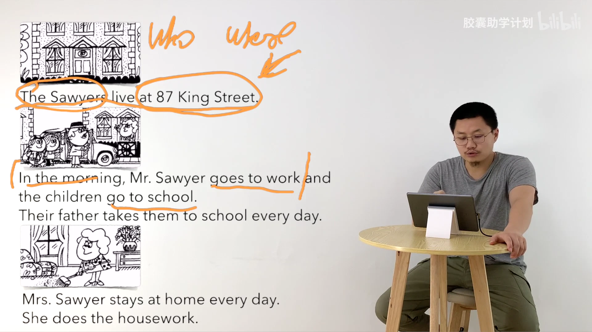

文字识别：Mo / Werol / 胶囊助学计划 / The Sawyere live at 87 King Street. / In the morning, Mr. Sawyer goes to workand / the children go to school. / Their father takes them to school every day. / Mrs. Sawyer stays at home every day. / She does the housework.

### 画面 00:03:22

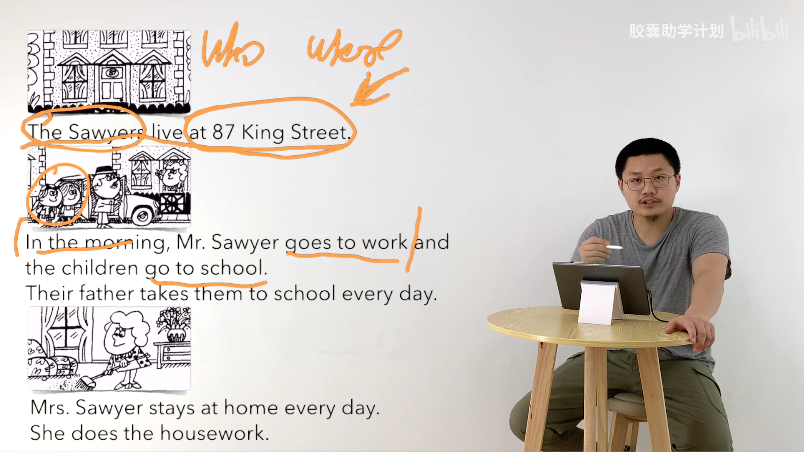

文字识别：Mo / Wedl / 胶囊助学计划 / The Sawyere live at 87 King Street. / In the morning, Mr. Sawyer goes to workand / the children go to school. / Their father takes them to school every day. / Mrs. Sawyer stays at home every day. / She does the housework.

### 画面 00:03:24

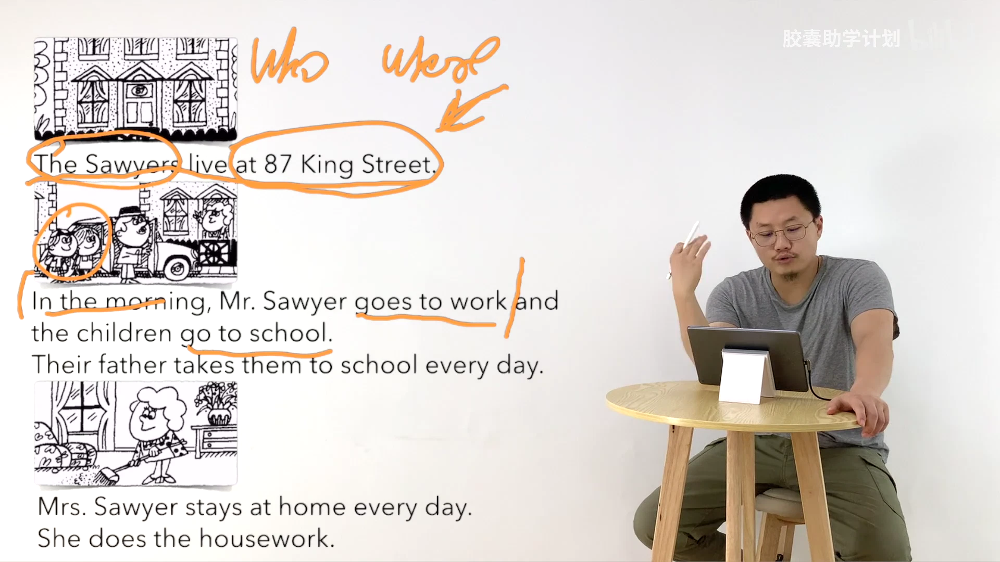

文字识别：Mo / Werol / 胶囊助学计划 / The Sawyere live at 87 King Street. / In the morning, Mr. Sawyer goes to work and / the children go to school. / Their father takes them to school every day. / Mrs. Sawyer stays at home every day. / She does the housework.

### 画面 00:03:27

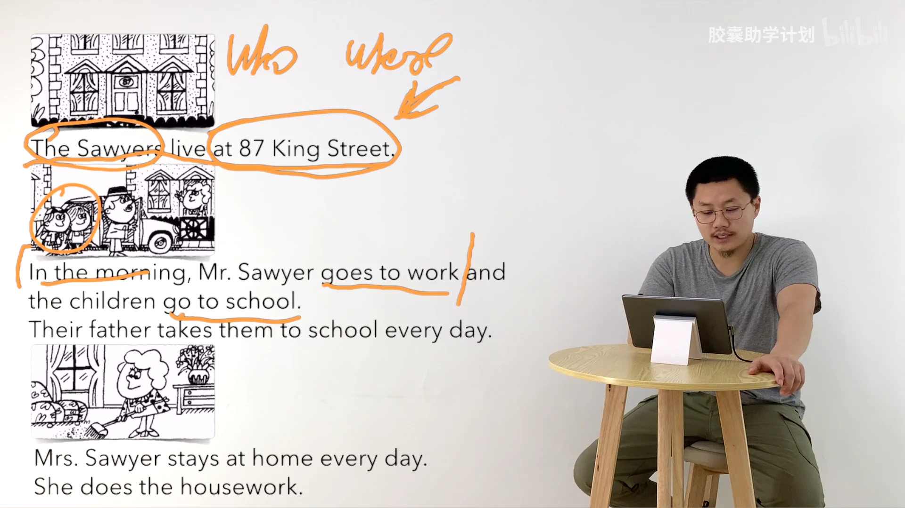

文字识别：Wo / Werol / 胶囊助学计划 / The Sawyere live at 87 King Street. / In the morning, Mr. Sawyer goes to workand / the children go to school. / Their father takes them to school every day. / Mrs. Sawyer stays at home every day. / She does the housework.

## 00:03:30–00:04:00

Their father，他们的父亲，注意接下来是一个小的习惯用法，叫做 takes them to school，带着他们去学校啊。你这个 take 我们的理解是拿，对吧？那你翻译成拿着他们去上学，这肯定翻译不通。你就能理解指的是带他们去学校，对吧？送他们去上学，every day 每一天。于是看到这样一个肯定句的时候啊，各位现在要条件反射式的养

### 画面 00:03:31

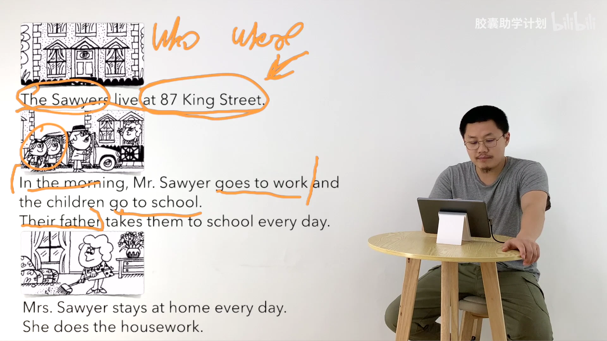

文字识别：Mo / Werol / 胶囊助学计划 / The Sawyere live at 87 King Street. / In the morning, Mr. Sawyer goes to workand / the children go to school. / Their fathel takes them to school every day. / Mrs. Sawyer stays at home every day. / She does the housework.

### 画面 00:03:34

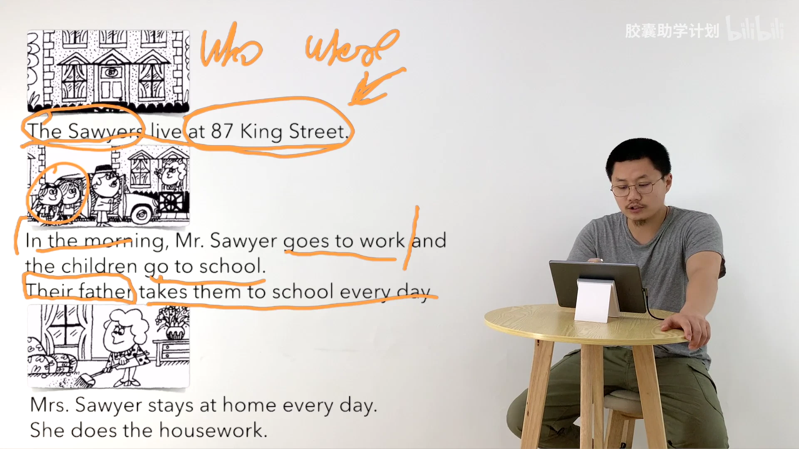

文字识别：Mo / Werol / 胶囊助学计划 / The Sawyere live at 87 King Street. / In the morning, Mr. Sawyer goes to workand / the children go to school. / Their fathel takes them to school every day / Mrs. Sawyer stays at home every day. / She does the housework.

### 画面 00:03:36

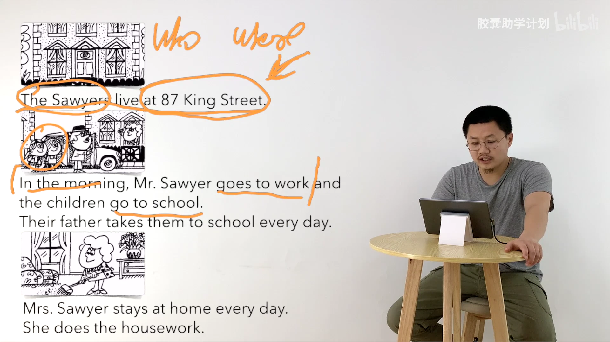

文字识别：Mo / Werol / 胶囊助学计划 / The Sawyere live at 87 King Street. / In the morning, Mr. Sawyer goes to workand / the children go to school. / Their father takes them to school every day. / Mrs. Sawyer stays at home every day. / She does the housework.

### 画面 00:03:38

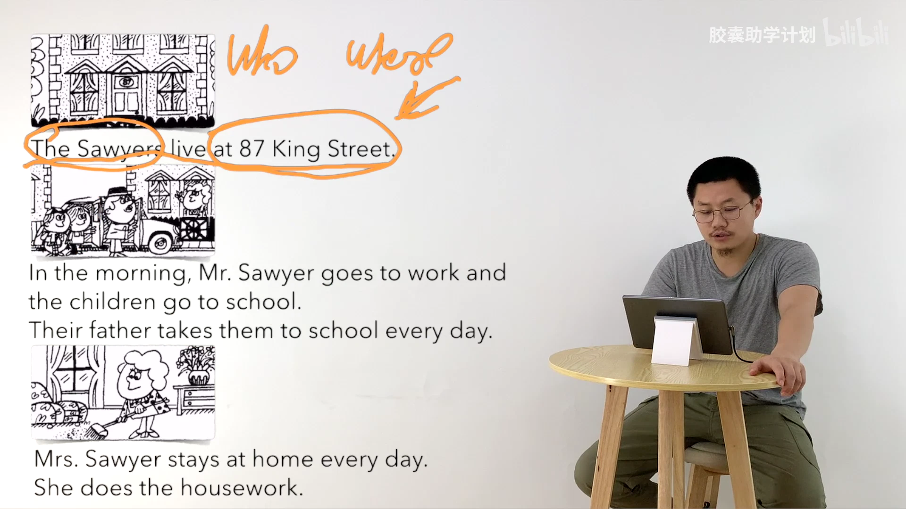

文字识别：Mo / Wedl / 胶囊助学计划 / The Sawyere live at 87 King Street. / In the morning, Mr. Sawyer goes to work and / the children go to school. / Their father takes them to school every day. / Mrs. Sawyer stays at home every day. / She does the housework.

### 画面 00:03:41

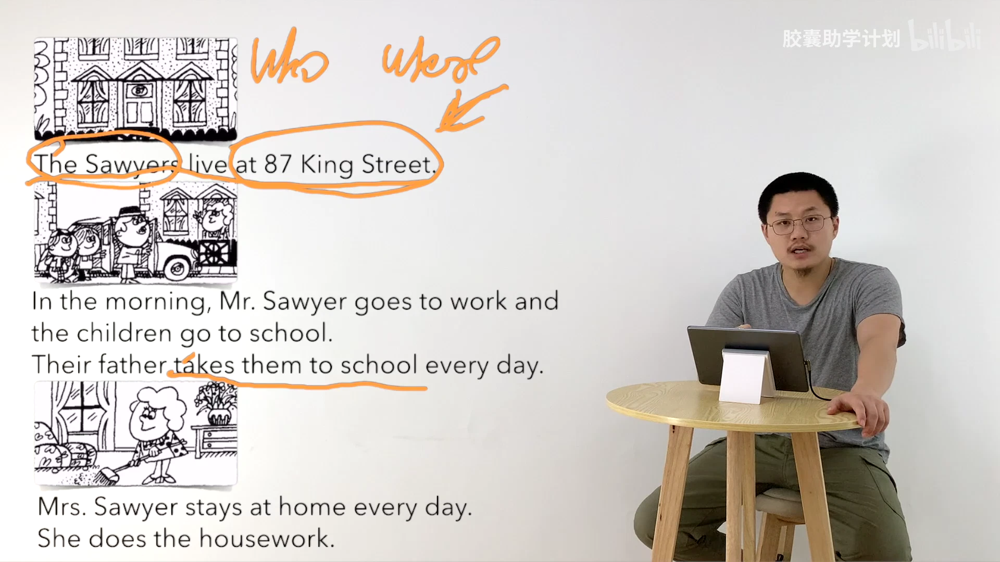

文字识别：Mo / Werol / 胶囊助学计划 / The Sawyere live at 87 King Street. / In the morning, Mr. Sawyer goes to work and / the children go to school. / Their father takes them to school every day. / Mrs. Sawyer stays at home every day. / She does the housework.

### 画面 00:03:55

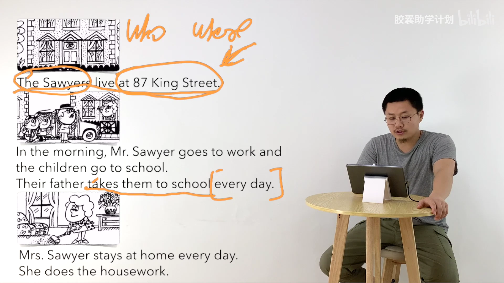

文字识别：Mo / Weol / 胶囊助学计划 / The Sawyere live at 87 King Street. / In the morning, Mr. Sawyer goes to work and / the children go to school. / Theirfather kes hemto school every day. / Mrs. Sawyer stays at home every day. / She does the housework.

## 00:04:00–00:04:30

成几个习惯，第一，这个肯定句是什么时态或者是什么大的结构？我如何才能把它变成一般疑问句？这句话当中用的是 does，Does their father take them to school every day？OK，这是第一个问题，叫做我如何才能把它变成一般疑问句？那第二个问题就是这里边有多少个特殊疑问词可以能对它提问？另一个方向思考就是我这个肯定

### 画面 00:04:00

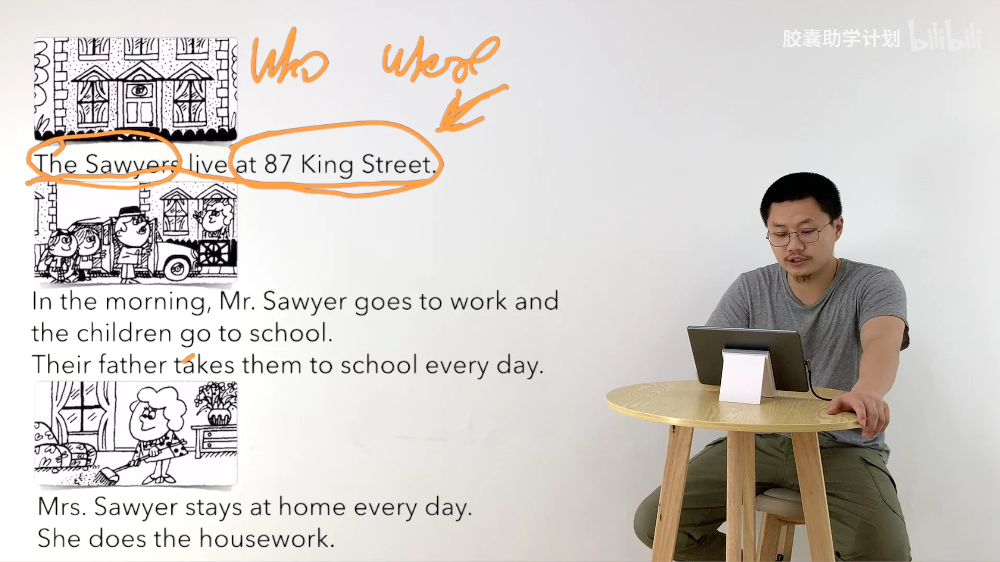

文字识别：Mo / Wede / 胶囊助学计划 / The Sawyere live at 87 King Street. / In the morning, Mr. Sawyer goes to work and / the children go to school. / Their father takes them to school every day. / Mrs. Sawyer stays at home every day. / She does the housework.

### 画面 00:04:05

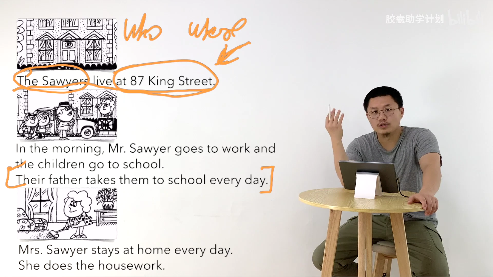

文字识别：Mo / Werol / 胶囊助学计划 / The Sawyers live at 87 King Street. / In the morning, Mr. Sawyer goes to work and / the children go to school. / Mrs. Sawyer stays at home every day. / She does the housework.

### 画面 00:04:08

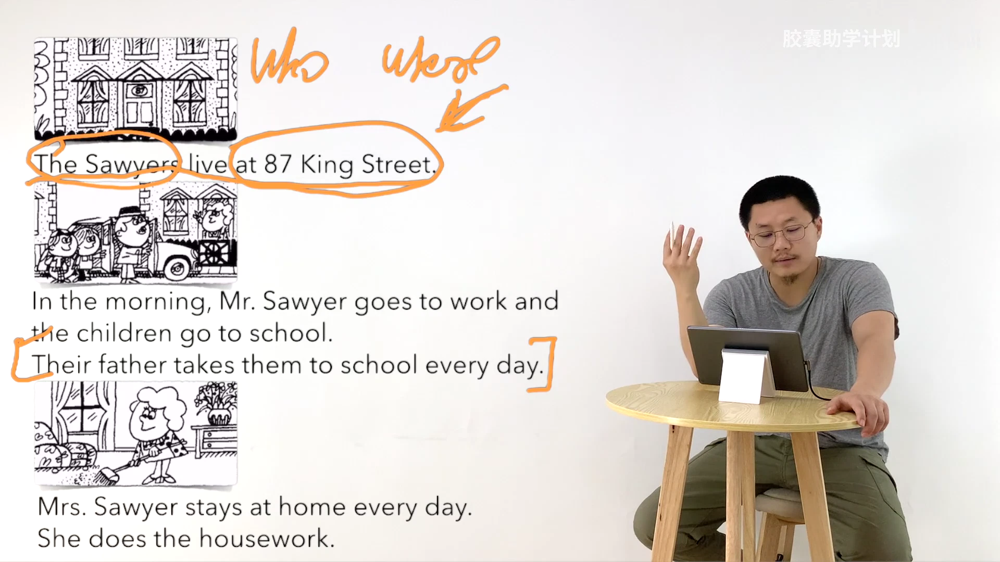

文字识别：Mo / Weroe / The Sawyere live at 87 King Street. / In the morning, Mr. Sawyer goes to work and / the children go to school. / Mrs. Sawyer stays at home every day. / She does the housework.

## 00:04:30–00:05:00

句能造多少个特殊疑问句出来？比如说 to school，是不是用 where？ Every day，是不是用 how often？整句话是不是可以用 when？他每一天父亲几点钟带他们去上学？对吧？对 them 提问是不是可以用 who？对 their father 提问是不是可以用 who？你也可以问为什么是他的父亲而不是他的母亲？那对整句话提问就是 why？你看这句话我们能造多少个特

### 画面 00:04:33

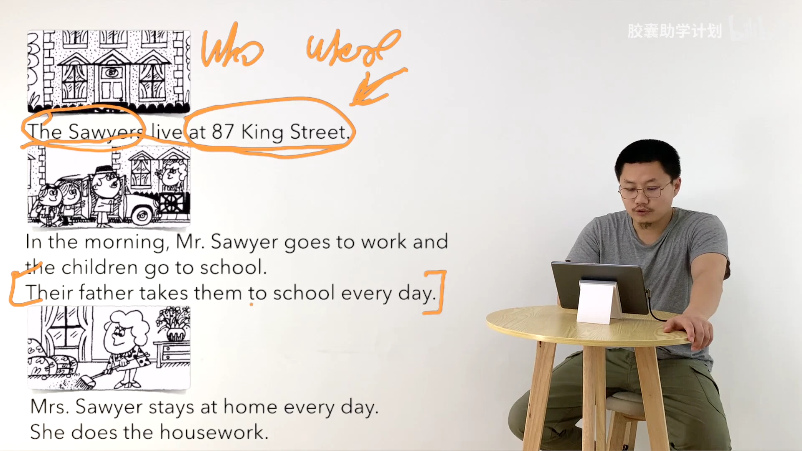

文字识别：Mo / Werol / 胶囊助学计划 / The Sawyere live at 87 King Street. / In the morning, Mr. Sawyer goes to work and / the children go to school. / Mrs. Sawyer stays at home every day. / She does the housework.

### 画面 00:04:36

文字识别：Mo / Werol / 胶囊助学计划 / The Sawyere live at 87 King Street. / In the morning, Mr. Sawyer goes to work and / the children go to school. / Mrs. Sawyer stays at home every day. / She does the housework.

### 画面 00:04:46

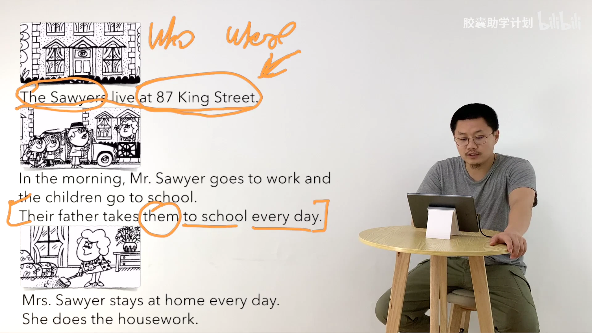

文字识别：Mo / Weoe / 胶囊助学计划 / The Sawyere live at 87 King Street. / In the morning, Mr. Sawyer goes to work and / thie children go to school. / Mrs. Sawyer stays at home every day. / She does the housework.

### 画面 00:04:50

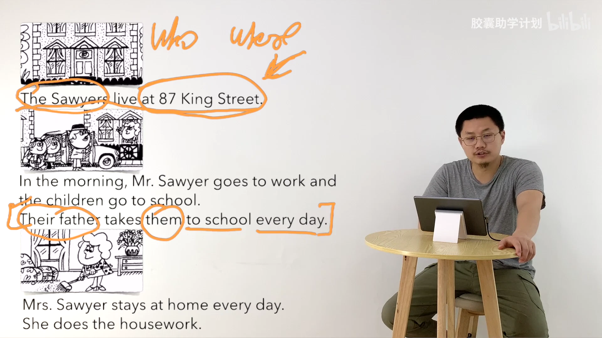

文字识别：Wo / Weoe / 胶囊助学计划 / The Sawyere live at 87 King Street. / In the morning, Mr. Sawyer goes to work and / the children go to school. / Mrs. Sawyer stays at home every day. / She does the housework.

### 画面 00:04:57

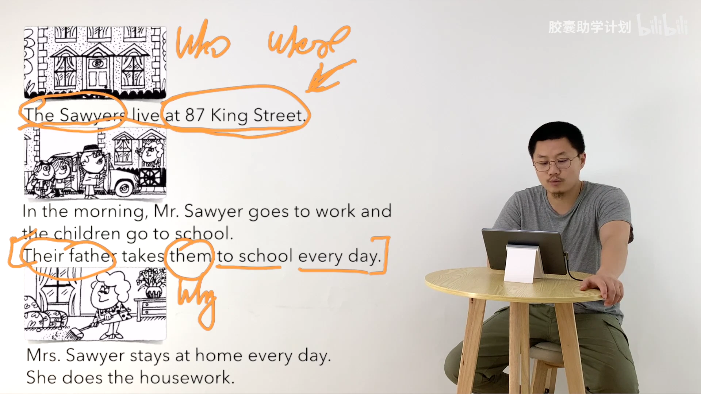

文字识别：Mo / Werol / 胶囊助学计划 / The Sawyere live at 87 King Street. / In the morning, Mr. Sawyer goes to work and / the children go to school. / Their fathe takes them to schol every day. / Mrs. Sawyer stays at home every day. / She does the housework.

### 画面 00:04:59

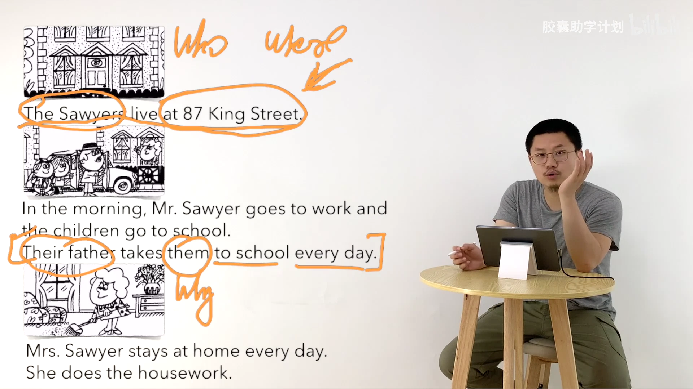

文字识别：Mo / Werol / 胶囊助学计划 / The Sawyere live at 87 King Street. / In the morning, Mr. Sawyer goes to work and / the children go to school. / heirfathe takes them to school every day. / Mrs. Sawyer stays at home every day. / She does the housework.

## 00:05:00–00:05:30

殊疑问句？Why一个，Who两个，To school where一个，How often一个，When一个，也就是我们能造六句特殊疑问句，再加上一句一般疑问句，再加上一句否定句，一个肯定句，我们能给它推出来八句不同的话。所以您花百分之百的时间背一句话，还是花百分之百的时间搞九句话，对吧？这是一个简单的数学题了。OK，

### 画面 00:05:02

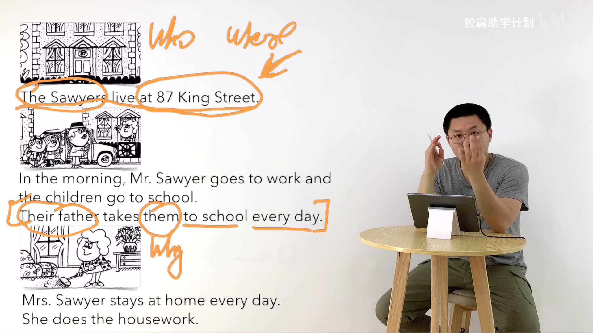

文字识别：Wo / Werol / 胶囊助学计划 / The Sawyere live at 87 King Street. / In the morning, Mr. Sawyer goes to work and / thie children go to school. / Mrs. Sawyer stays at home every day. / She does the housework.

### 画面 00:05:07

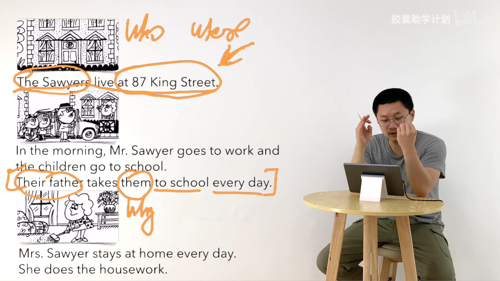

文字识别：Wo / Werol / 胶囊助学计划 / The Sawyere live at 87 King Street. / In the morning, Mr. Sawyer goes to work and / thie children go to school. / Mrs. Sawyer stays at home every day. / She does the housework.

### 画面 00:05:25

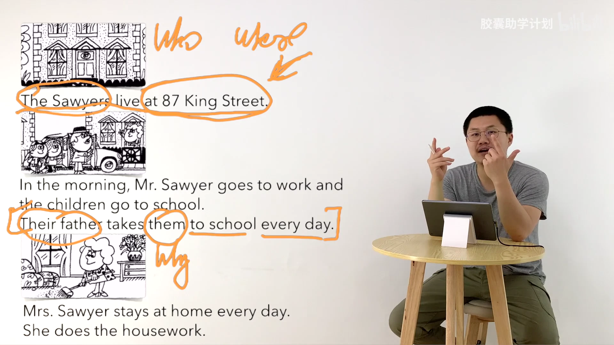

文字识别：Mo / Werdl / 胶囊助学计划 / The Sawyere live at 87 King Street. / In the morning, Mr. Sawyer goes to work and / the children go to school. / Mrs. Sawyer stays at home every day. / She does the housework.

## 00:05:30–00:06:00

好，接下来我们稍微速度快一点，思路给大家了啊。说Mrs. Sawyer stays at home每天都停留在家every day. How often提问？She does the housework.她做家务劳动。Continuing. She always注意你看放在了动词的前面，对吧？It's her lunch at noon.在中午的时候呢，经常是吃午餐的。In the afternoon，下午的时候呢，

### 画面 00:05:30

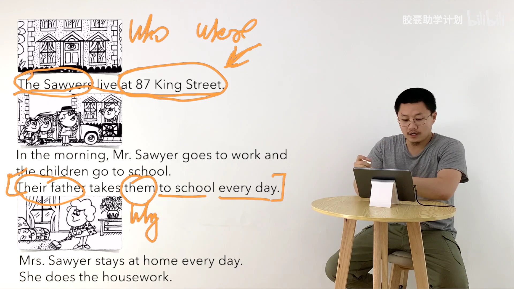

文字识别：Mo / Werol / 胶囊助学计划 / The Sawyere live at 87 King Street. / In the morning, Mr. Sawyer goes to work and / the children go to school. / heirfathe takes them to school every day. / Mrs. Sawyer stays at home every day. / She does the housework.

### 画面 00:05:33

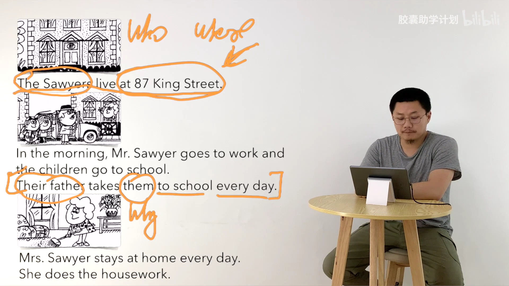

文字识别：Mo / Weol / 胶囊助学计划 / The Sawyere live at 87 King Street. / In the morning, Mr. Sawyer goes to work and / the children go to school. / Their athe takes them to schol every day. / Mrs. Sawyer stays at home every day. / She does the housework.

### 画面 00:05:36

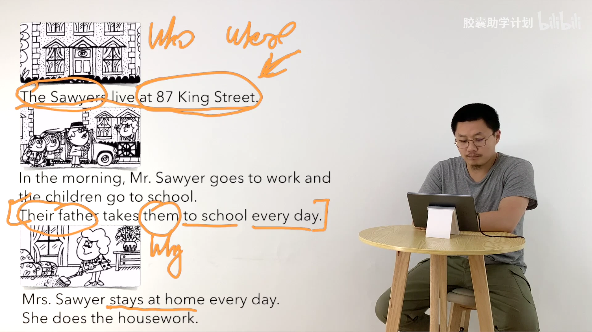

文字识别：Mo / Werl / 胶囊助学计划 / The Sawyere live at 87 King Street. / In the morning, Mr. Sawyer goes to work and / thie children go to school. / Their fathe t / takesthem toschool every day. / Mrs. Sawyer stays at home every day. / She does the housework.

### 画面 00:05:41

文字识别：Mo / Werol / 胶囊助学计划 / The Sawyere live at 87 King Street. / In the morning, Mr. Sawyer goes to work and / thie children go to school. / Their tathe t / every day.J / Mrs. Sawyer stays at home / She does the housework.

### 画面 00:05:45

文字识别：胶囊助学计划 / She always eats her lunch at noon. / In the afternoon, she usually sees her / friends. They often drink tea together. / In the evening, the children come home / from school. They arrive home early.

### 画面 00:05:49

文字识别：胶囊助学计划 / She &lways eats her lunch at noon. / In the afternoon, she usually sees her / friends. They often drink tea together. / In the evening, the children come home / from school. They arrive home early.

### 画面 00:05:55

文字识别：胶囊助学计划 / She lway eats her lunch at noon. / In the afternoon, she usually sees her / friends. They often drink tea together. / In the evening, the children come home / from school. They arrive home early.

### 画面 00:05:58

文字识别：胶囊助学计划 / She lway eats her lunch at noon. / In the afternoon, she usually sees her / friends. They often drink tea together. / In the evening, the children come home / from school. They arrive home early.

## 00:06:00–00:06:30

She usually注意sees，动词usually放在了动词的前面，她通常呢会去看她的朋友啊，拜访她的朋友。They often drink tea together.你注意，你看啊，刚才这儿主语是she，所以是sees对吧？加s。现在的主语是they，是they，所以这个地方就用的是原形。Often放在了动词的前面，这个小的点要记住。

### 画面 00:06:09

文字识别：胶囊助学计划 / She / lway eats her lunch at noon. / V / In the afternoon, she usually sees her / friends. They often drink tea together. / In the evening, the children come home / from school. They arrive home early.

### 画面 00:06:18

文字识别：胶囊助学计划 / She / lway eats her lunch at noon. / In the afternoon, she usually / seesher / friends. They often drink tea together. / V. / In the evening, the children come home / from school. They arrive home early.

## 00:06:30–00:07:00

他们经常一起喝茶。In the evening，在晚上的时候呢，the children come home from school，回家从学校都是字面意思。They arrive home early，他们到家呢，到达的非常的早。主语非三单，动词用原形。Continuing，Mr. Sawyer，Sawyers，索耶先生 comes home from work，回家从工作

### 画面 00:06:48

文字识别：胶囊助学计划 / She / lway eats her lunch at noon. / In the afternoon, she usually / seesher / friends. They often drink tea together. / V. / In the evening, the children come home / from school. They arrive home early.

### 画面 00:06:50

文字识别：胶囊助学计划 / Mr. Sawyer comes home from work. / He arrives home late. / At night, the children always do their / homework. Then they go to bed. Mr. Sawyer / usually reads his newspaper, but sometimes / he and his wife watch television.

## 00:07:00–00:07:30

的地方，对吧？He arrives home late.他到家非常的晚。注意主语是第三人称单数，动词也用第三人称单数，对吧？At night，夜晚的时候呢，the children always do their homework，总是做他们的家庭作业。Then，然后 they go to bed. Go to bed，直接的翻译叫做去床

### 画面 00:07:20

文字识别：胶囊助学计划 / Mr. Sawyer comes home from work. / He arrives home late. / At night, the children always do their / homework. Then they go to bed. Mr. Sawyer / usually reads his newspaper, but sometimes / he and his wife watch television.

## 00:07:30–00:08:00

上，对吧？就指的就是上床睡觉啊，去睡觉。Mr. Sawyer usually reads，这儿有两个小点，第一个动词的三单，第二 usually 放在 reads 的前面，对吧？读他的 his newspaper，读他的报纸。But 但是 sometimes 好，sometimes 这个单词我之前就讲过了，句中、句首、句尾您随便放，这个单词的位置特别的不固定，放在哪几乎都可以。

### 画面 00:07:31

文字识别：胶囊助学计划 / Mr. Sawyer comes home from work. / He arrives home late. / At night, the children always do their / homework. Then they go to bed. Mr. Sawyer / usually reads his newspaper, but sometimes / he and his wife watch television.

### 画面 00:07:40

文字识别：胶囊助学计划 / Mr. Sawyer comes home from work. / He arrives home late. / At night, the children always do their / homework. Then they go to bed. Mr. Sawyer / usually reads his newspaper, but sometimes / he and his wife watch television.

### 画面 00:07:52

文字识别：胶囊助学计划 / Mr. Sawyer comes home from work. / He arrives home late. / At night, the children always do their / homework. Then they go to bed. Mr. Sawyer / usually reads his newspaper, but sometimes / he and his wife watch television.

## 00:08:00–00:08:30

he and his wife watch television.你注意，你看这儿的watch看电视为什么不用动词三单呢？因为主语是he and his wife，他和他妻子两个人，也就是说你想去替代他的时候用的是they。他虽然是第三人称，但他不是单数。Okay, very good.好，接下来我们做一些口语听力练习。各位看着文章啊，听

### 画面 00:08:00

文字识别：胶囊助学计划 / Mr. Sawyer comes home from work. / He arrives home late. / 三 / At night, the children always do their / homework. Then they go to bed. Mr. Sawyer / usually reads his newspaper, but sometimes / he and his wife watch television.

### 画面 00:08:16

文字识别：胶囊助学计划 / Mr. Sawyer comes home from work. / He arrives home late. / At night, the children always do their / homework. Then they go to bed. Mr. Sawyer / usually reads his newspaper, but sometimes / he and his wife watch television. / Thev

### 画面 00:08:19

文字识别：胶囊助学计划 / Mr. Sawyer comes home from work. / He arrives home late. / 三 / 国 / At night, the children always do their / homework. Then they go to bed. Mr. Sawyer / usually reads his newspaper, but sometimes / he and his wife watch television. / They

### 画面 00:08:22

文字识别：胶囊助学计划 / Comprehension

### 画面 00:08:26

文字识别：Comprehension / D

## 00:08:30–00:09:00

我说一句，您在文章当中找答案，读出来这句答案。口语听力练习，第一题。Where do the Soyers live? 答案 At eighty-seven King Street. Next one. What does Mr. Sawyer do in the morning? 答案 He goes to work. Next one. What do the children do in the morning?

### 画面 00:08:35

文字识别：胶囊助学计划 / Comprehension / 1 T: Where do the Sawyers live? / D

### 画面 00:08:37

文字识别：胶囊助学计划 / Comprehension / 1 T: Where do the Sawyers live?

### 画面 00:08:52

文字识别：胶囊助学计划 / Comprehension / 2 T: What does Mr. Sawyer do in the morning? / S: He goes to work.

## 00:09:00–00:09:30

Answer: They go to school. Continue. Who takes the children to school every day? Answer: Mr. Sawyer does.或者说直接说Mr. Sawyer就可以了. What does Mrs. Sawyer do every day? She stays at home. Next one. When does she eat her lunch?

### 画面 00:09:22

文字识别：胶囊助学计划 / Comprehension / 5 T: What does Mrs. Sawyer do every day? / S: She stays at home.

## 00:09:30–00:10:00

At noon. Continue. What does she usually do in the afternoon? She usually sees her friends. Continue. When do the children come home from school? In the evening. Continue. When do the children do their homework?

### 画面 00:09:49

文字识别：胶囊助学计划 / Comprehension / 8 T: When do the children come home from school?

## 00:10:00–00:10:30

They always do it at night. Next one, what does Mr. Sawyer usually do at night? He usually reads his newspaper. Okay,下一题 asking questions老习惯肯定句变一般疑问句变特殊疑问句口语听力练习听然后口语回答来了

### 画面 00:10:01

文字识别：胶囊助学计划 / Comprehension / 9 T: When do the children do their homework? / S: They always do it at night.

### 画面 00:10:07

文字识别：胶囊助学计划 / Comprehension / 10 T: What does Mr. Sawyer usually do at night?

### 画面 00:10:22

文字识别：胶囊助学计划 / Asking questions

## 00:10:30–00:11:00

Ask me if. 听接下来的重点。The Sawyer's live at eighty-seven King Street. 答案 Do the Sawyer's live at eighty-seven King Street? 说出疑问词 Where. 答案 Where do the Sawyer's live? Next one. Ask me if. 不重要，听后面的。Mr. Sawyer goes to work in the morning.

### 画面 00:10:30

文字识别：胶囊助学计划 / Asking questions / 1 T: Ask me if the Sawyers live at 87 King Street.

### 画面 00:10:37

文字识别：胶囊助学计划 / Asking questions / 1 T: Ask me if the Sawyers live at 87 King Street. / D

### 画面 00:10:46

文字识别：胶囊助学计划 / Asking questions / 1 T: Ask me if the Sawyers live at 87 King Street. / S: Do the Sawyers live at 87 King Street? / T: Where...? / S: Where do the Sawyers live?

### 画面 00:10:51

文字识别：胶囊助学计划 / Asking questions / 2 T: Ask me if Mr. Sawyer goes to work in the morning.

## 00:11:00–00:11:30

Does Mr. Sawyer go to work in the morning? When? That must be in the morning. When does Mr. Sawyer go to work? Next one. Ask me if Mrs. Sawyer eats her lunch at noon. Does Mrs. Sawyer eat her lunch at noon? When?

### 画面 00:11:01

文字识别：胶囊助学计划 / Asking questions / 2 T: Ask me if Mr. Sawyer goes to work in the morning. / S: Does Mr. Sawyer go to work in the morning?

### 画面 00:11:11

文字识别：胶囊助学计划 / Asking questions / 2 T: Ask me if Mr. Sawyer goes to work in the morning. / S: Does Mr. Sawyer go to work in the morning? / T: When...? / S: When does Mr Sawyer go to work?

### 画面 00:11:13

文字识别：胶囊助学计划 / Asking questions / 3 T: Ask me if Mrs. Sawyer eats her lunch at noon.

### 画面 00:11:29

文字识别：胶囊助学计划 / Asking questions / 3 T: Ask me if Mrs. Sawyer eats her lunch at noon. / S: Does Mrs. Sawyer eat her lunch at noon? / T: When...? / S: When does Mrs Sawyer eat her lunch?

## 00:11:30–00:12:00

When does Mrs Sawyer eat her lunch? Next one, ask me if Mr Sawyer arrives home late. Does Mr Sawyer arrive home late? When? When does Mr Sawyer arrive home? He什么时候到家，对吧？Okay, continue. Ask me if the children

### 画面 00:11:34

文字识别：胶囊助学计划 / Asking questions

### 画面 00:11:45

文字识别：胶囊助学计划 / Asking questions / 4 T: Ask me if Mr. Sawyer arrives home late. / S: Does Mr. Sawyer arrive home late?

### 画面 00:11:49

文字识别：胶囊助学计划 / Asking questions / 4 T: Ask me if Mr. Sawyer arrives home late. / S: Does Mr. Sawyer arrive home late? / T:When? / S: When does Mr. Sawyer arrive home?

### 画面 00:11:56

文字识别：胶囊助学计划 / Asking questions / 5 T: Ask me if the children arrive home early.

## 00:12:00–00:12:30

arrive home early. Do the children arrive home early? When? When do the children arrive home? 什么时候到家? There you go. 好, recap. 本课的关键点就是，听好，一般现在时的四句型转换，肯定句、否定句、一般疑问句和特殊疑问句。我上课带着各位做了一部分，剩下的各位要课下自己去完成了。我们正好看

### 画面 00:12:06

文字识别：胶囊助学计划 / Asking questions / 5 T: Ask me if the children arrive home early. / S: Do the children arrive home early? / T: When...? / S: When do the children arrive home?

### 画面 00:12:10

文字识别：Recap / 胶囊助学计划 / Patterns / 四句型转换 / Grammar / Words / Expression

### 画面 00:12:13

文字识别：胶囊助学计划 / Recap / Patterns / 四句型转换 / Grammar / Words / Expression

### 画面 00:12:19

文字识别：胶囊助学计划 / Recap / Patterns / & / 四句型转换 / Grammar / Words / Expression

### 画面 00:12:22

文字识别：胶囊助学计划 / Recap / Patterns / 8 / 四句型转换 / Grammar / Words / Expression

### 画面 00:12:24

文字识别：胶囊助学计划 / Recap / Patterns / & / 四句型转换 / Grammar / Words / Expression

### 画面 00:12:26

文字识别：胶囊助学计划

## 00:12:30–00:13:00

一下本课的家庭作业，《绿皮书》五十五课写作练习，各位要完成文章要跟读至熟读成诵，文章进行四句型转换。你注意，这个实际上就是我们替代背诵的那个方案。各位自己去算这笔账，背诵背的再熟，倒背如流，你只背到了肯定句。我现在提供他的一个置换方案是：文章先熟读

### 画面 00:12:43

文字识别：胶囊助学计划 / 绿皮书第55课的写作练习 / 文章跟读至熟读成诵 / 3.文章四句型转换

### 画面 00:12:45

文字识别：胶囊助学计划 / 绿皮书第55课的写作练习 / 文章跟读至熟读成诵 / 3.文章四句型转换

### 画面 00:12:47

文字识别：胶囊助学计划 / 绿皮书第55课的写作练习 / 文章跟读至熟读成诵 / 3.文章四句型转换

### 画面 00:12:50

文字识别：胶囊助学计划 / 绿皮书第55课的写作练习 / 文章跟读至熟读成诵 / 3.文章四句型转换

### 画面 00:12:52

文字识别：胶囊助学计划 / 绿皮书第55课的写作练习 / 文章跟读至熟读成诵 / 3.文章四句型转换

## 00:13:00–00:13:30

成诵，花一部分的时间，对吧？假设背一篇文章，您花一个小时，熟读成诵您花四十分钟还没背下来，剩下二十分钟不继续读文章了，做文章的四句型转化，把文章的肯定句都变成否定句、一般疑问句和各种特殊疑问句，你就问自己这些特殊疑问句、否定句和一般疑问句，人们在运用语言的时候说不说，你就知道这个方案要比文章背下来好在什么地方了。OK，好，

### 画面 00:13:02

文字识别：胶囊助学计划 / 绿皮书第55课的写作练习 / 文章跟读至熟读成诵 / 3.文章四句型转换

### 画面 00:13:11

文字识别：胶囊助学计划 / 绿皮书第55课的写作练习 / 文章跟读至熟读成诵 / 3.文章四句型转换

### 画面 00:13:19

文字识别：胶囊助学计划 / 绿皮书第55课的写作练习 / 文章跟读至熟读成诵 / 3.文章四句型转换

## 00:13:30–00:14:00

最后一个要给自己讲解一遍今天的核心知识点。那如果大家喜欢我们的课程，欢迎大家关注、订阅、一键三连，并分享给那些需要的朋友。最后，我们再来看一句名人名言：There is no need to do any housework at all after the first four years. The dirt doesn't get any worse. See you next time.

### 画面 00:13:30

文字识别：胶囊助学计划 / 绿皮书第55课的写作练习 / 文章跟读至熟读成诵 / 3.文章四句型转换 / 请给自己讲解一遍今天的 / 核心知识点

### 画面 00:13:33

文字识别：胶囊助学计划

### 画面 00:13:35

文字识别：胶囊助学计划

### 画面 00:13:39

文字识别：胶囊助学计划

### 画面 00:13:41

文字识别：胶囊助学计划 / There is no need to do any housework at all. / After the first four years the dirt doesn't get / any worse. / Quentin Crisp

### 画面 00:13:45

文字识别：胶囊助学计划 / There is no need to do any housework at all. / After the first four years the dirt doesn't get / any worse. / Quentin Crisp

### 画面 00:13:54

文字识别：胶囊助学计划 / There is no need to do any housework at all. / After the first four years the dirt doesn't get / any worse. / Quentin Crisp

### 画面 00:13:56

文字识别：CAPSULEACADEMY / 胶囊助学计划 / 小红书 / Lecturo. / OE

### 画面 00:13:58

文字识别：CAPSULEACADEMY / 胶囊助学计划 / 小红书 / Photo- / OE

## 00:14:00–00:14:08

### 画面 00:14:01

文字识别：CAPSULEACADEMY / 胶囊助学计划 / 『 / 小红书 / Editor / □ / Berlin / OE

### 画面 00:14:04

文字识别：CAPSULEACADEMY / 胶囊助学计划 / 『 / 小红书 / 品 / Leo & Berlin / OE

### 画面 00:14:06

文字识别：bilibili / 胶囊助学计划

### 画面 00:14:07

文字识别：bilibili / 胶囊助学计划

