# 057 单词 文章

快速机器解析：语音为单模型转写，未进行独立交叉校对或人工复核；画面每秒采样并按变化选帧，短时文字和标记可能遗漏。截图时间约有 1 秒误差。图片有损压缩；遇到疑点请按时间查看 Google Drive 原视频。

## 00:00:00–00:00:30

Hello everyone, welcome to Capsule Academy. This is Leo. Today we're going to learn New Concept English Book One, Lesson Fifty Seven, Words and Story. That old habit. We enter the formal course before first look at a question. How to use English to ask specific time? With this question, hope you can enjoy it. Good. That we since talked about time, right? Just mentioned. We first look at this word how to read. Come with me to read. Come a clock.

### 画面 00:00:00

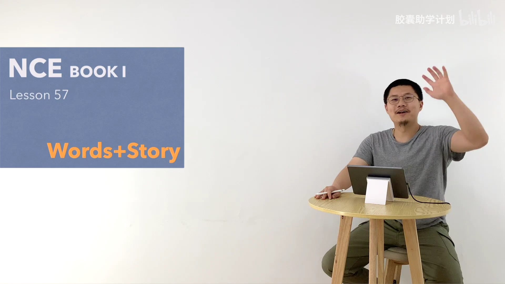

文字识别：胶囊助学计划 / NCE / BOOKI / Lesson 57 / Words+Story

### 画面 00:00:02

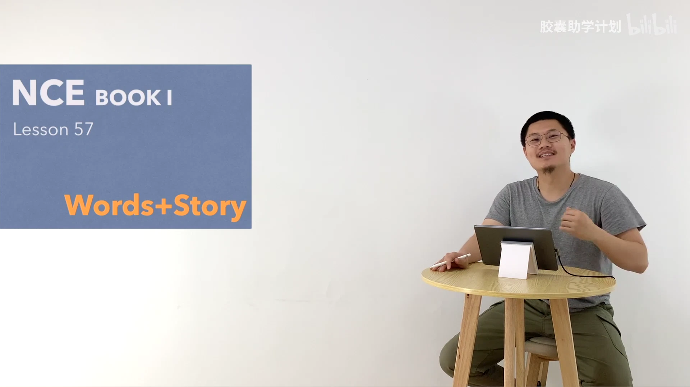

文字识别：胶囊助学计划 / NCE / BOOKI / Lesson 57 / Words+Story

### 画面 00:00:06

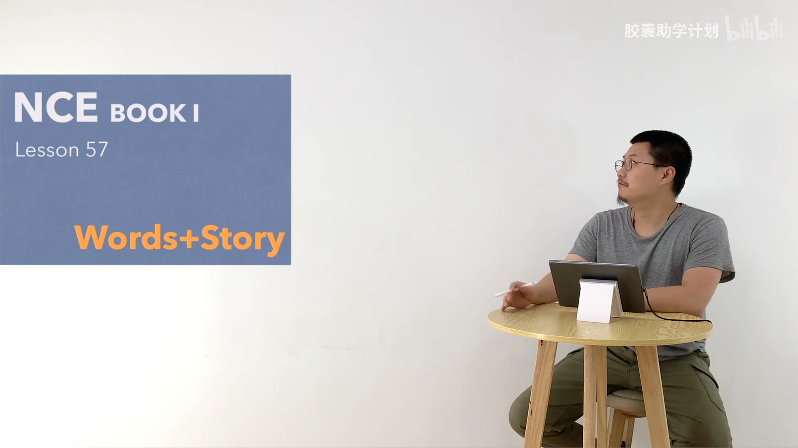

文字识别：胶囊助学计划 / NCE / BOOKI / Lesson 57 / Words+Story

### 画面 00:00:10

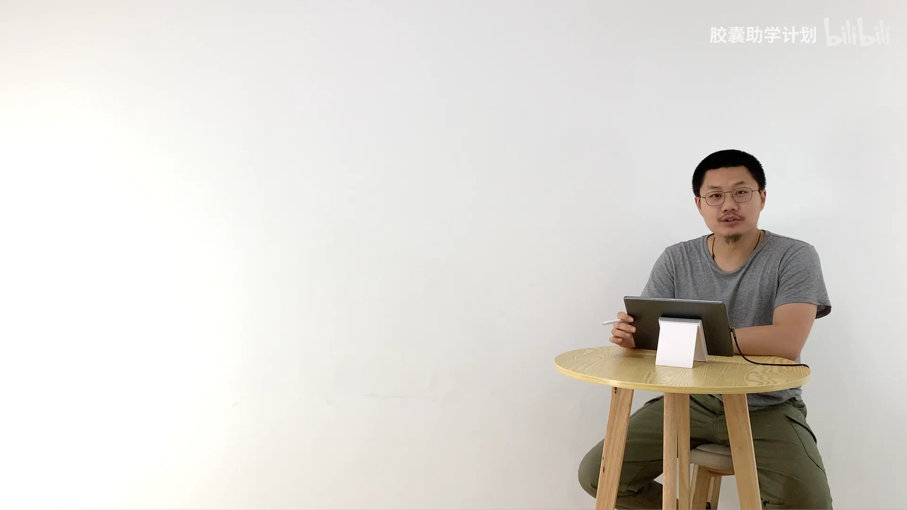

文字识别：胶囊助学计划

### 画面 00:00:12

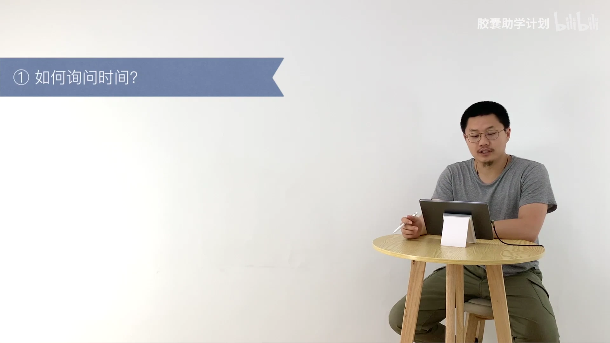

文字识别：胶囊助学计划 / ①如何询问时间？

### 画面 00:00:18

文字识别：胶囊助学计划bill / ••

### 画面 00:00:22

文字识别：胶囊助学计划

### 画面 00:00:24

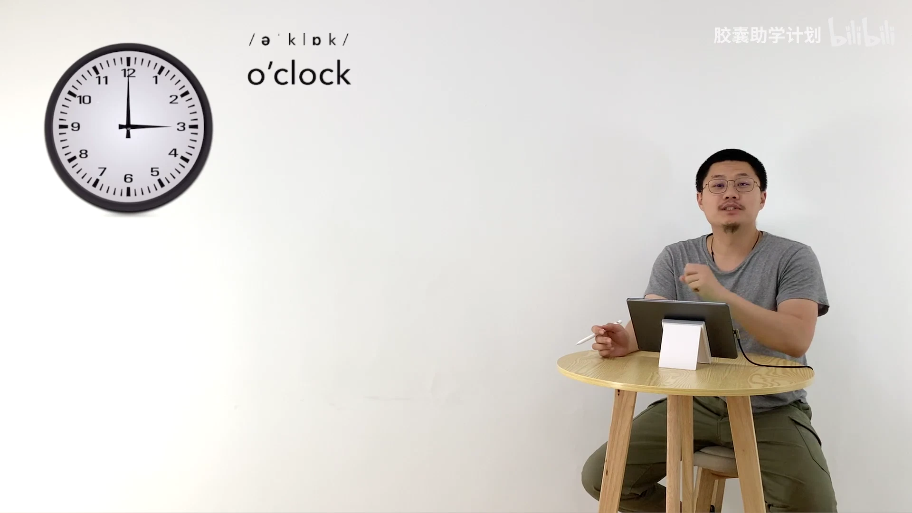

文字识别：胶囊助学计划 / /a^k lok / / o'clock / 11 / 2 / 9 / 3 / 8 / 4 / 7 / 5 / 6

## 00:00:30–00:01:00

一下啊！来，a clock, a clock啊，其实翻译成汉语就类似于点钟啊，几点钟的那个点钟啊。那像 clock 这个单词，各位可能就认得，它指的是表的意思。那 a clock 就是几点钟的那个点钟。那我们先说一下怎么问时间呢？非常简单的两个句子。第一个句子叫做 What time is it？注意这地方有一个小的连读，我们不读成 is it。当然您这么读没有

### 画面 00:00:30

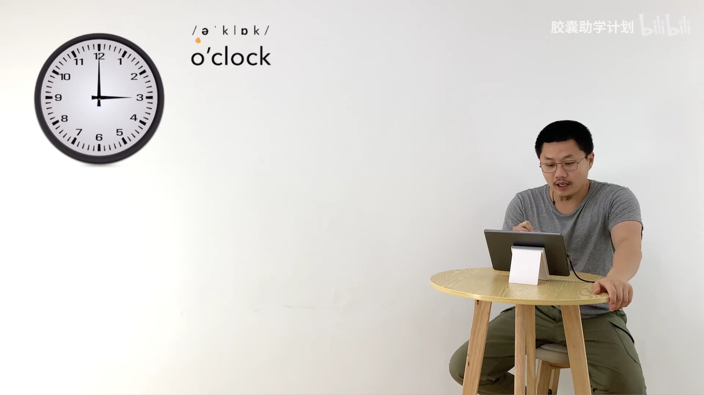

文字识别：胶囊助学计划 / /a^k lpk / / o'clock / 11 / 10 / 2 / 9 / 3 / 8 / 7 / 5 / 6

### 画面 00:00:36

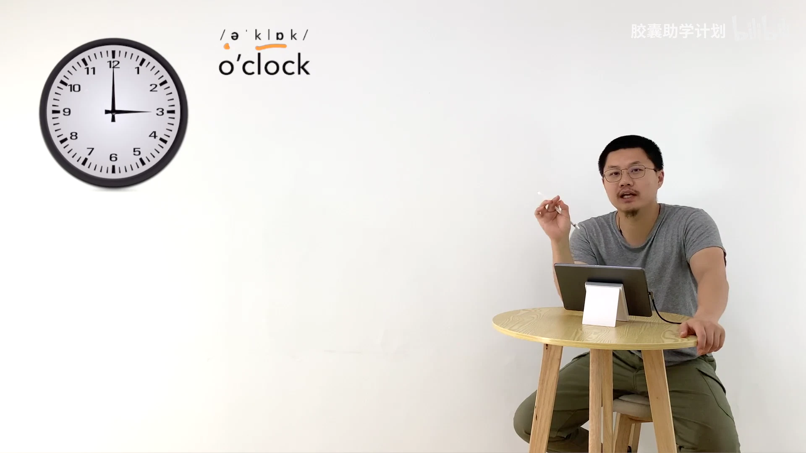

文字识别：胶囊助学计划 / /a^k lok / / o'clock / 11 / 0 / 2 / 9 / 3 / 8 / 4 / 7 / 5 / 6

### 画面 00:00:41

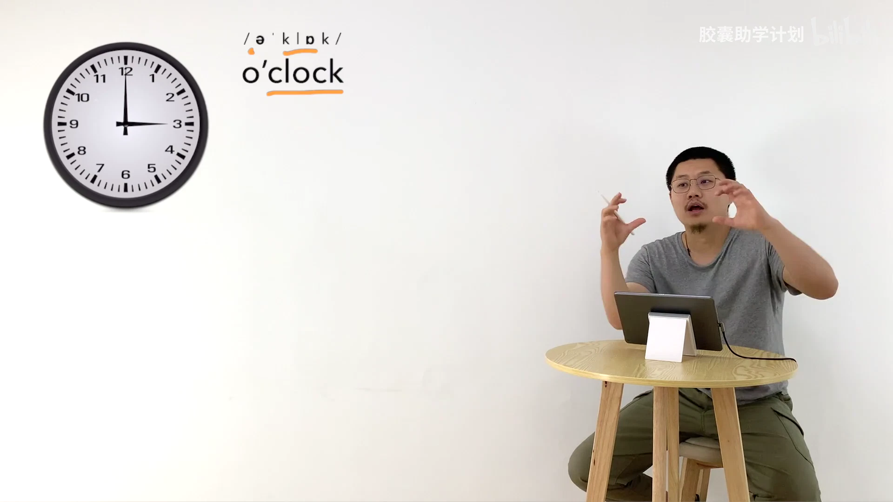

文字识别：胶囊助学计划 / /a^k lpk / / o'clock / 11 / 2 / 9 / 3 / 8 / 4 / 7 / 5 / 6

### 画面 00:00:45

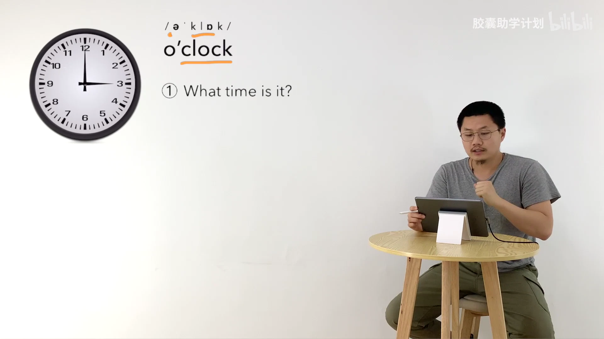

文字识别：胶囊助学计划 / /a^k lnk / / o'clock / 11 / 9 / ① What time is it? / 8 / 7 / 5 / 6

### 画面 00:00:47

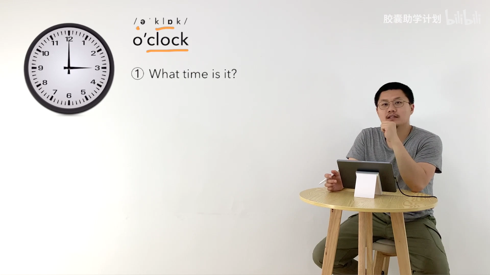

文字识别：胶囊助学计划 / /a'k lpk / / o'clock / 11 / 0 / 9 / 3 / ① What time is it? / 8 / 7 / 5 / 6

### 画面 00:00:51

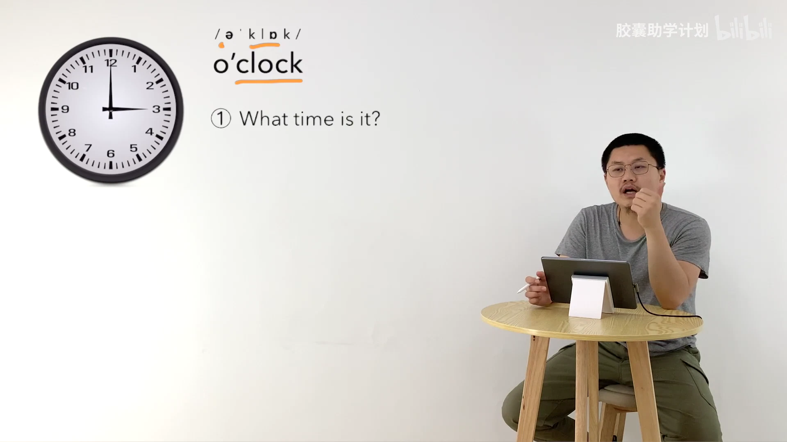

文字识别：胶囊助学计划 / /a'k lpk / / o'clock / 11 / 9 / 3 / ① What time is it? / 8 / 7 / 5 / 6

### 画面 00:00:56

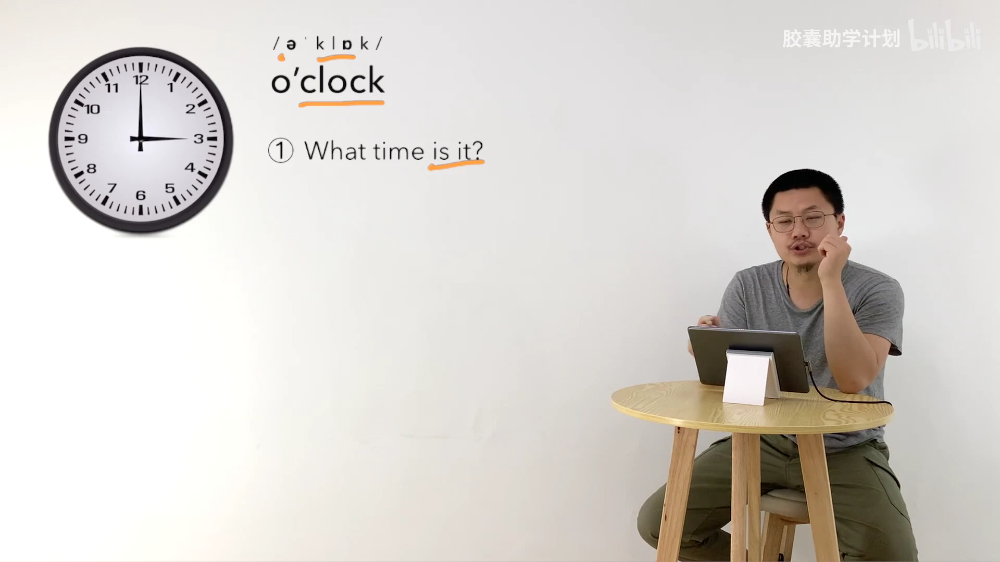

文字识别：胶囊助学计划 / /a'k lpk / / o'clock / 11 / 9 / 3 / ① What time is it? / 8 / 7 / 5 / 6 / 1

## 00:01:00–00:01:30

错啊。那为了我们能听懂英语是母语的人说话，因为他们可能是连读的。这地方我们把它读成 is it，也就是 is 的那个 z，我们实际上是跟后边连起来的，所以读出来叫做 is it is it. What time is it? Okay.好，另一种问法叫做 What's the time? Okay, What's the time?问几点钟了？那我们回答呢？很简单，比如说三

### 画面 00:01:02

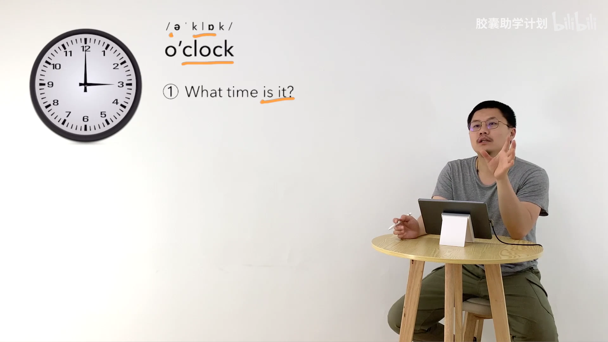

文字识别：胶囊助学计划 / /a^k lpk / / o'clock / 11 / 2 / 9 / 3 / ① What time is it? / 8 / 4 / 7 / 5 / 6

### 画面 00:01:06

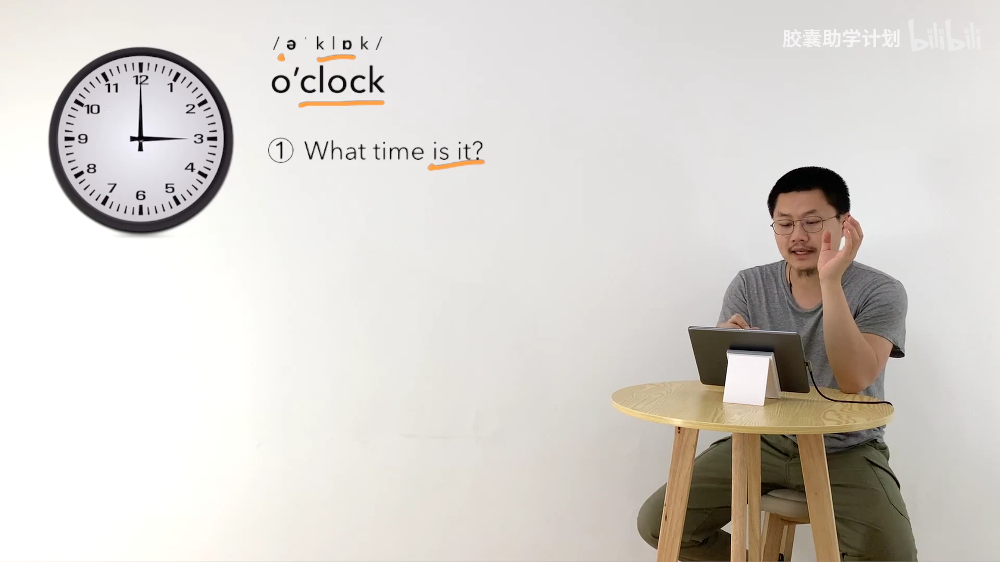

文字识别：胶囊助学计划 / /a^k lpk / / o'clock / 11 / 2 / 9 / 3 / ① What time is it? / 8 / 7 / 5 / 6

### 画面 00:01:15

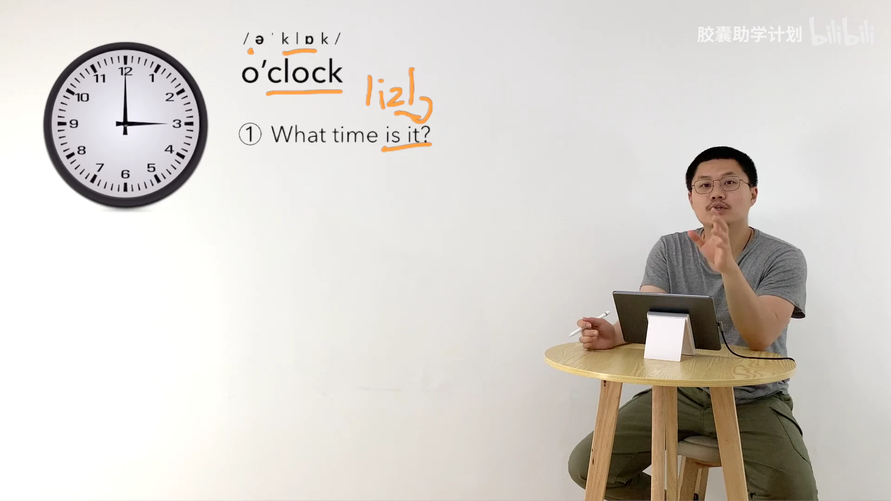

文字识别：胶囊助学计划 / /a'k lpk / / o'clock / i2l / 11 / 9 / ① What time is it? / 8 / 7 / 5 / 6

### 画面 00:01:26

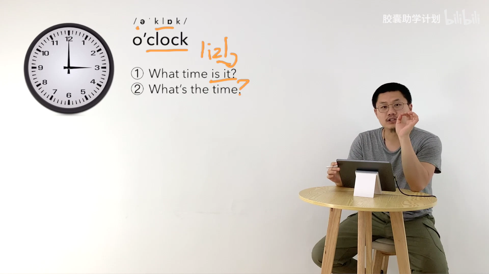

文字识别：胶囊助学计划 / /a^k lpk / / o'clock / 11 / 9 / ① / What time is it? / 8 / What's the time / 7 / 5 / 6

## 00:01:30–00:02:00

三点钟了，叫做 It's three o'clock. 好，在这地方我提一个小点，我问你几点钟了，你说三点钟了，可能就稍微会显得有一点点怎么样重复，对吧？冗余。我们实际上 o'clock 在口语当中大部分的时候可以不加。如果您可以直接说 It's three，就不用说 It's three o'clock. OK，那我们在这只是为了带这个单词啊，各位以后见到要懂就行了。我们想问三点钟了吗？

### 画面 00:01:30

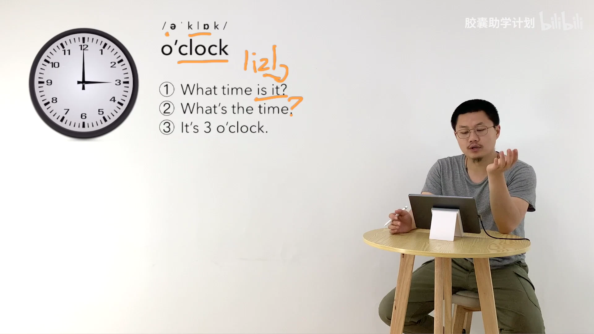

文字识别：胶囊助学计划 / /a'k lpk / / o'clock / i2l / 11 / 9 / What time is it? / 8 / What's the time / 7 / 5 / 6 / 3 / It's 3 o'clock.

### 画面 00:01:39

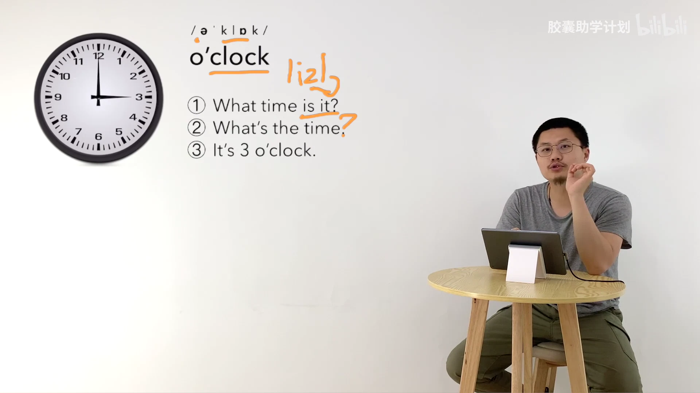

文字识别：胶囊助学计划 / /a'k lpk / / o'clock / 11 / ① / What time is it? / 8 / What's the time: / 7 / 5 / 6 / 3 / It's 3 o'clock.

### 画面 00:01:46

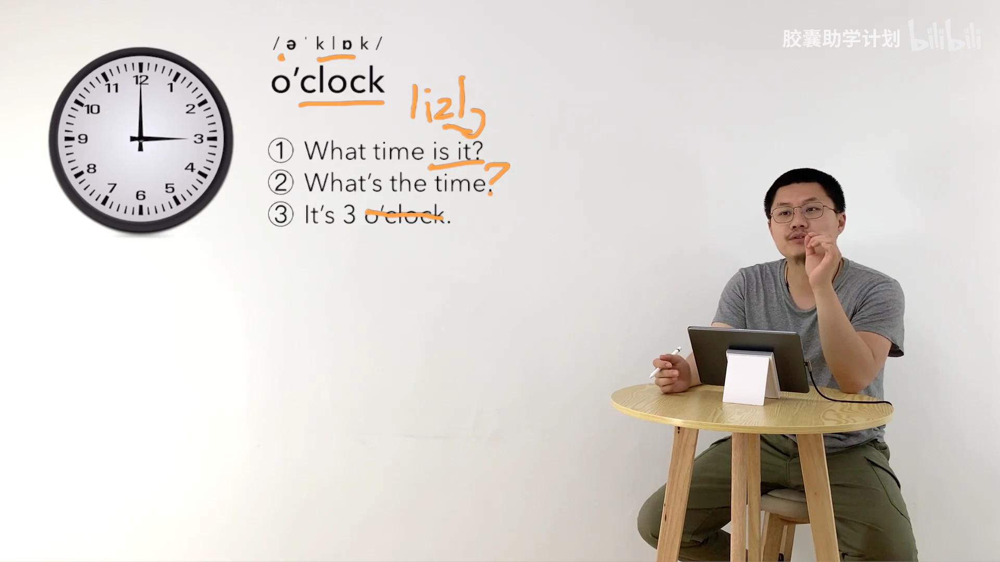

文字识别：胶囊助学计划 / /a'klｏk/ / o'clock / i2l / 11 / 3 / 1 / What time is it? / 8 / What's the time: / 7 / 5 / 6 / 3 / It's 3 / oelock.

### 画面 00:01:52

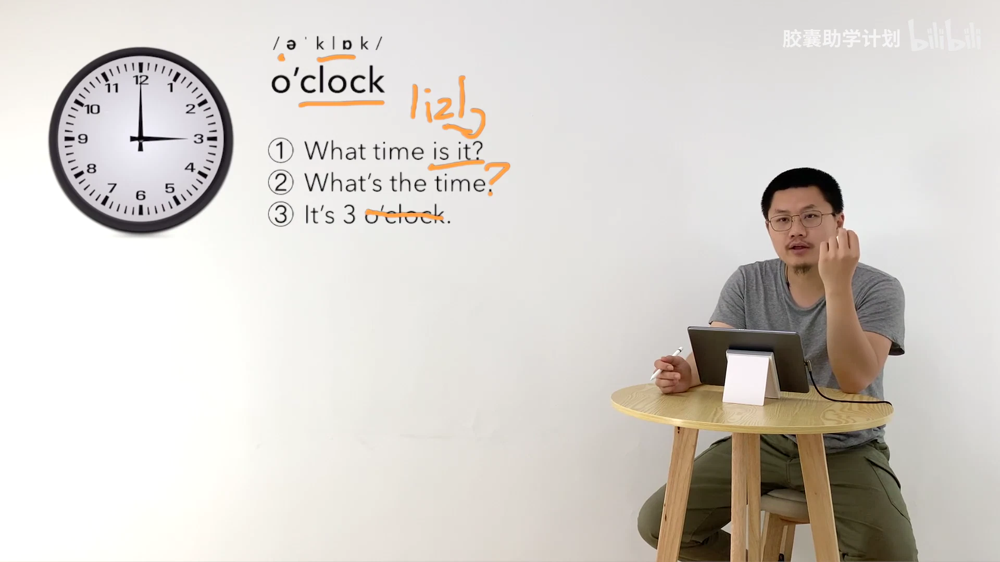

文字识别：胶囊助学计划 / /a^ k lpk / / o'clock / 11 / 3 / 1 / What time is it? / 8 / What's the time / 7 / 5 / 6 / 3 / It's 3 / oelock.

### 画面 00:01:55

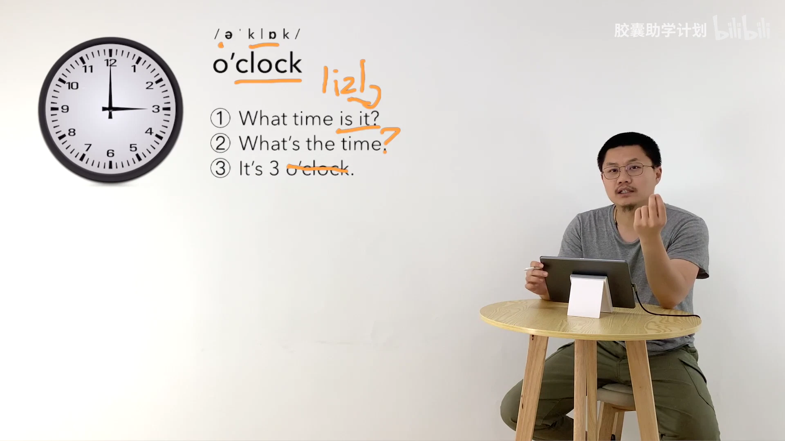

文字识别：胶囊助学计划 / /a'k lpk / / o'clock / 11 / 1 / What time is it? / 8 / What's the time / 7 / 5 / 6 / 3 / It's 3 / oelock.

## 00:02:00–00:02:30

其实很简单，叫做 Is it?还还是一个连读 Is it three o'clock?好，注意，我现在想对 three o'clock 提问，用 What 加 time。于是 What time 放到前面去，后边接 Is it 就变成了 What time is it?这个用法各位记住啊。那当然，第二个我是这么变过来，但是各位也要把它记出来，叫做 What's the time? Okay, very good.接下来下一个小的

### 画面 00:02:02

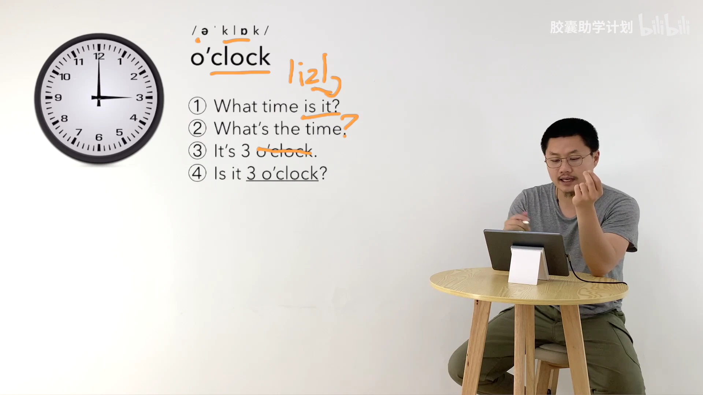

文字识别：胶囊助学计划 / la'k lok / / o'clock / 11 / 1 / What time is it? / 8 / What's the time: / 7 / 5 / 6 / 3 / It's 3 / oelock. / Is it 3 o'clock? / 4

### 画面 00:02:05

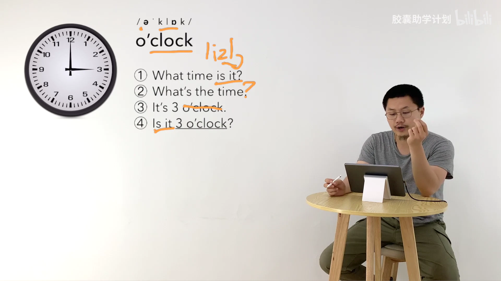

文字识别：胶囊助学计划 / /a'k lpk / / o'clock / 2 / 11 / 9 / 1 / What time is it? / 8 / What's the time: / 7 / 5 / 6 / 3 / It's 3 / oelock. / Is it 3 o'clock? / 1

### 画面 00:02:11

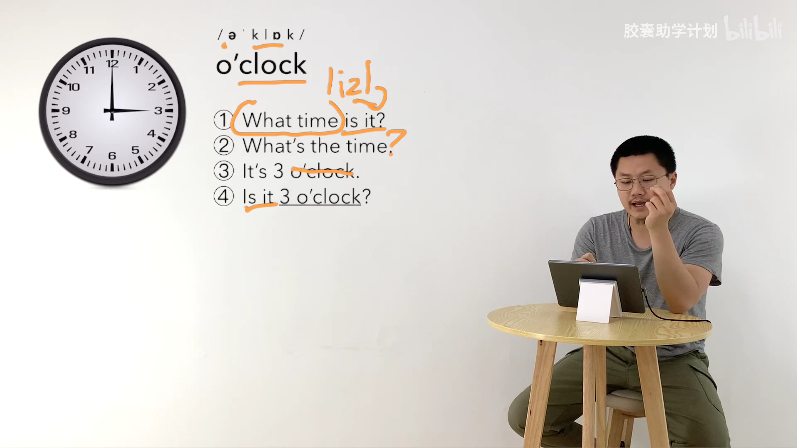

文字识别：胶囊助学计划 / /a'klpk/ / o'clock / 2 / 11 / What timeis it? / 8 / What's / the time / 7 / 5 / 6 / 3 / It's 3 / oelock. / Is it 3 o'clock?

### 画面 00:02:13

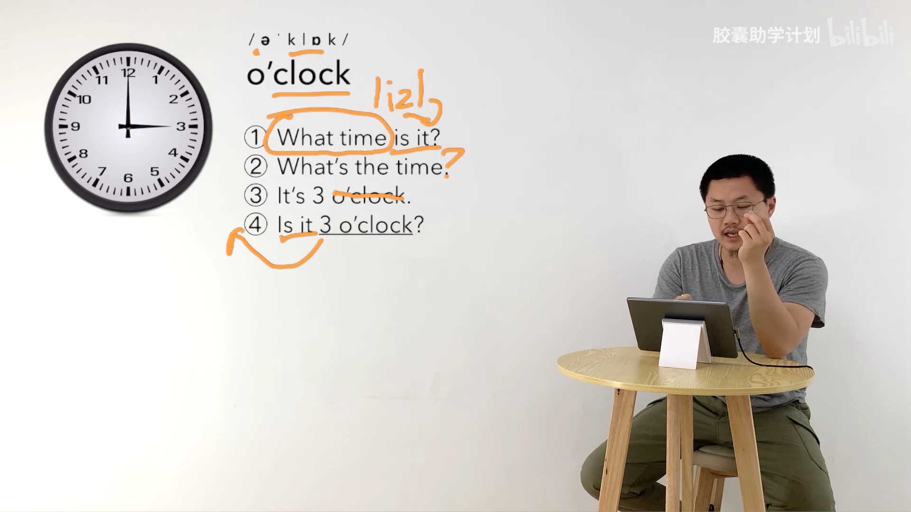

文字识别：胶囊助学计划 / /a'klｐk/ / o'clock / 11 / 9 / What timeis it? / 8 / What's / the time / 7 / 5 / 6 / 3 / It's 3 / oelock. / Is it 3 o'clock?

### 画面 00:02:16

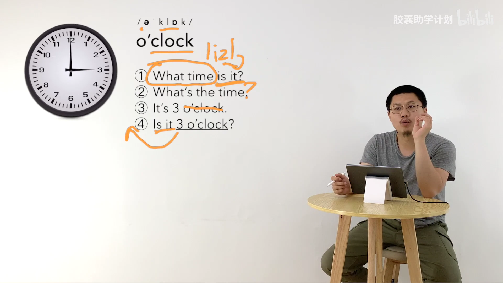

文字识别：胶囊助学计划 / /a'k lｏk / / o'clock / 11 / What timeis it? / 8 / What's / the time / 7 / 5 / 6 / 3 / It's 3 / oelock. / Is it 3 o'clock?

### 画面 00:02:21

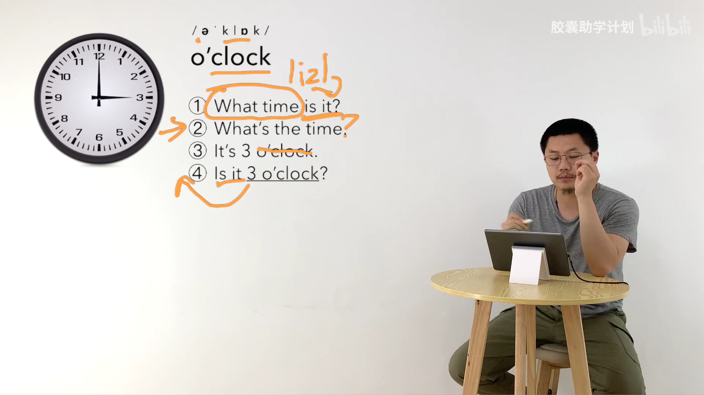

文字识别：胶囊助学计划 / /a'klｐk/ / o'clock / li2l / 11 / C / What timeis it? / 8 / What's / the time / 7 / 5 / 6 / 3 / It's 3 / oelock. / Is it 3 o'clock?

### 画面 00:02:24

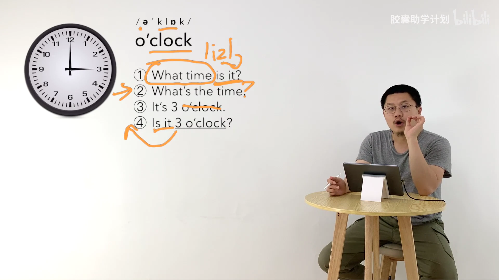

文字识别：胶囊助学计划 / /a'k lnk / / o'clock / 11 / 0 / What timeis it? / 8 / What's / the time / 7 / 5 / 6 / 3 / It's 3 / oelock. / Is it 3 o'clock?

### 画面 00:02:27

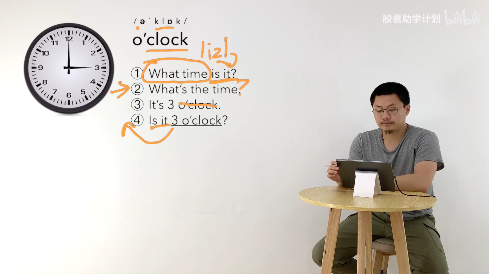

文字识别：胶囊助学计划 / /a'k lｐk/ / o'clock / li2l / 11 / 0 / What timeis it? / 8 / What's / the time / 7 / 5 / 6 / 3 / It's 3 / oelock. / Is it 3 o'clock?

### 画面 00:02:29

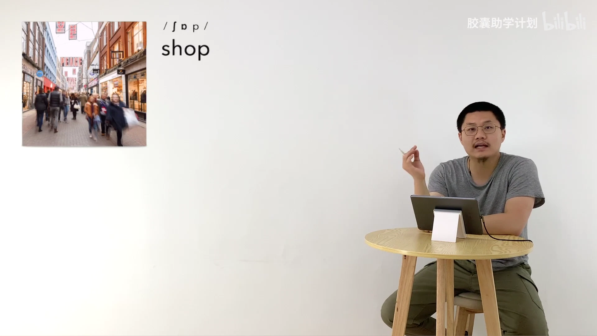

文字识别：胶囊助学计划 / shop / PEACE

## 00:02:30–00:03:00

单词，我们实际上应该在三十五、三十六课就见过了。但是我们依旧再看一下它的音标，来，sh，op，连起来，shop，包括自然拼读法则，对吧？p放在单词当中去发的是p，sh放在单词当中去发的是sh。比如说我们之前学过的shirt，OK，very good。那接着往下走，我们造一句话，用there be句型，它是名词，对不对？好，我们说there are many shops in this street。

### 画面 00:02:44

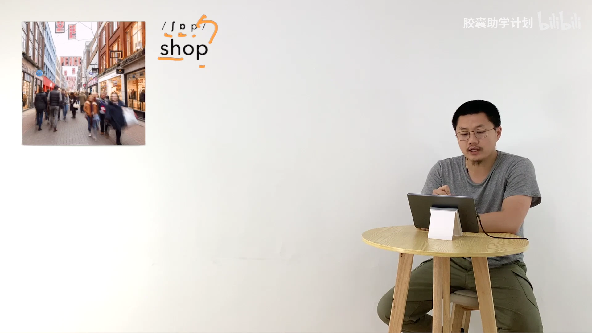

文字识别：胶囊助学计划 / /Jpp / shop / PEACE

### 画面 00:02:58

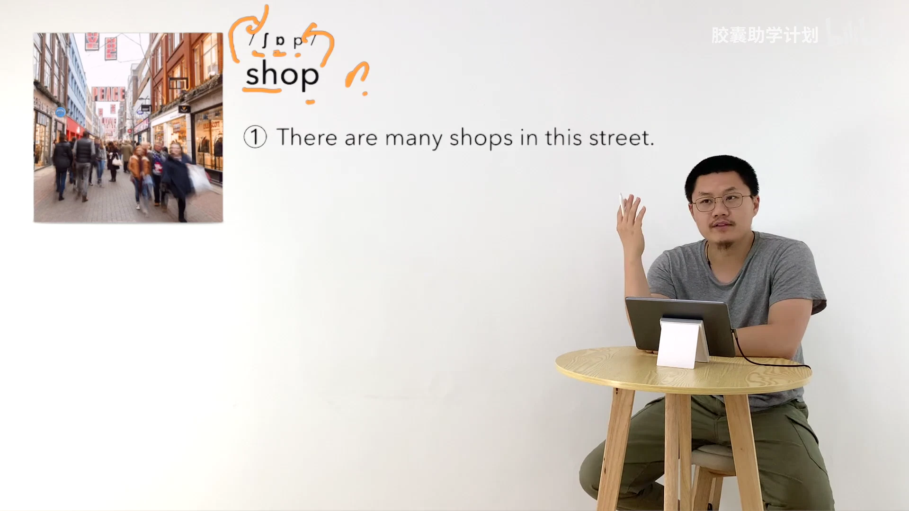

文字识别：胶囊助学计划 / shop / EACE / ① There are many shops in this street.

## 00:03:00–00:03:30

这个街上啊，有许多的商店，或者我们把many换掉，直接用我们之前学过的某个单词叫做some啊。There are some shops in this street. 那你也可以把它变一般疑问句，各位还记不记得把are提到前面去，some换成any？这条街上有商店吗？Very good. 好，叫Are there any shops in this street？Very good. Continue下一个单词啊，先看一下两个元音中间一

### 画面 00:03:05

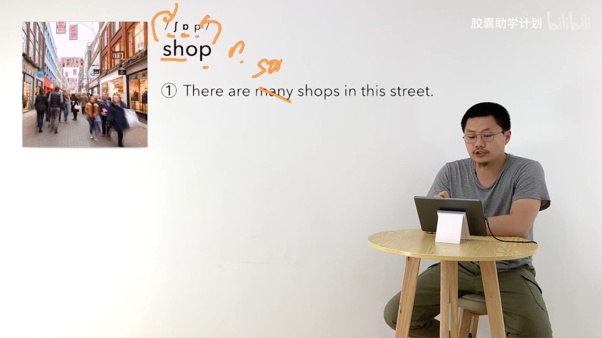

文字识别：胶囊助学计划 / shop / PEACE / So / ) There are rany shops in this street.

### 画面 00:03:08

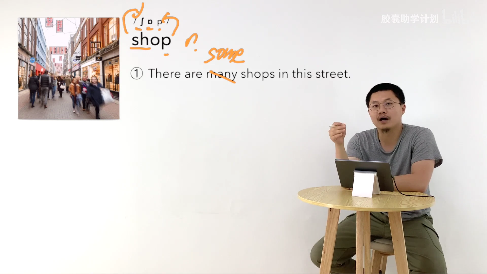

文字识别：胶囊助学计划 / shop / SoMe / EACE /  There are rany shops in this street. / 1

### 画面 00:03:25

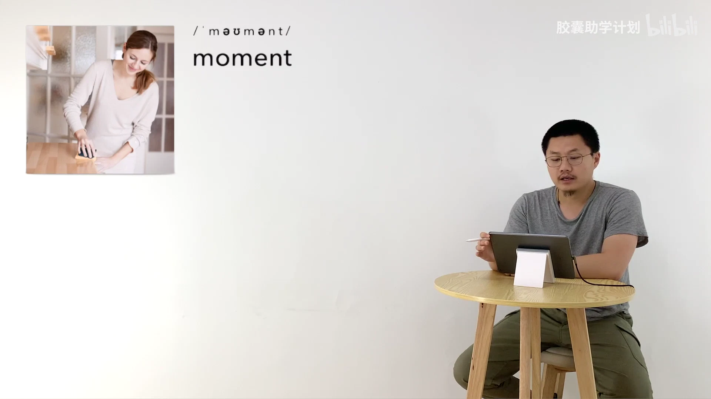

文字识别：胶囊助学计划 / /'maumant/ / moment

## 00:03:30–00:04:00

个辅音给后面来 moment moment OK 叫做这一刻。那实际上它经常出现的一个小的短语叫做 at the moment 等于咱们之前学过的一个单词叫做 now 叫现在 OK 好，我们造一句话说 she is doing the housework at the moment now at the moment now 现在正在做家务劳动 be

### 画面 00:03:44

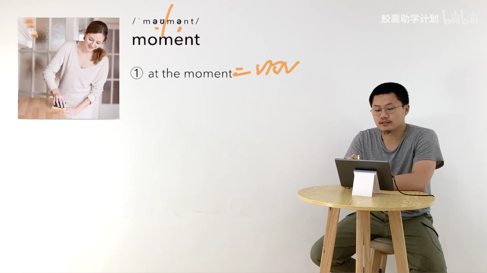

文字识别：胶囊助学计划 / /'maumant/ / moment / ① at the moment二 VV

### 画面 00:03:51

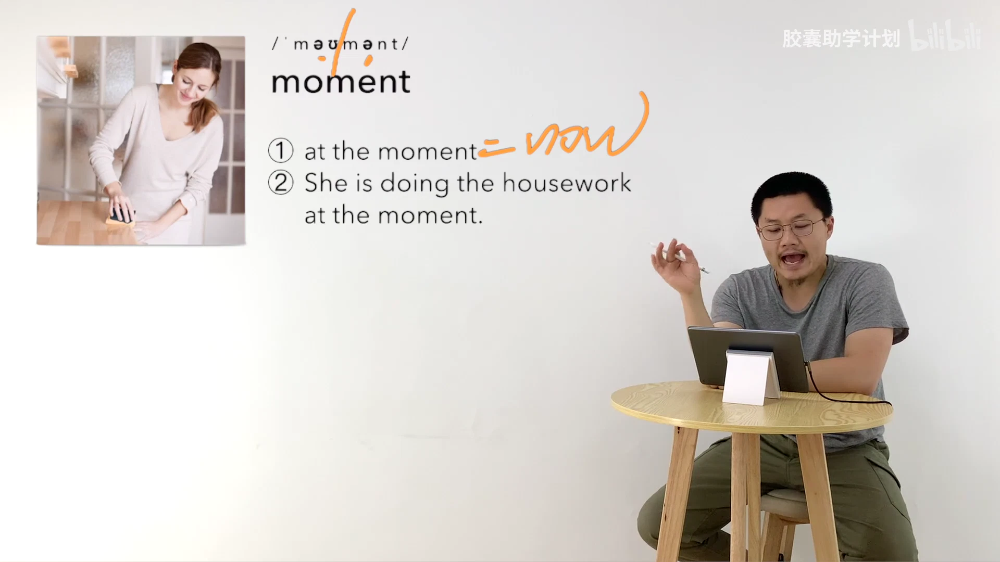

文字识别：胶囊助学计划 / /'maumant/ / moment / at the moment二 VV / She is doing the housework / at the moment.

### 画面 00:03:57

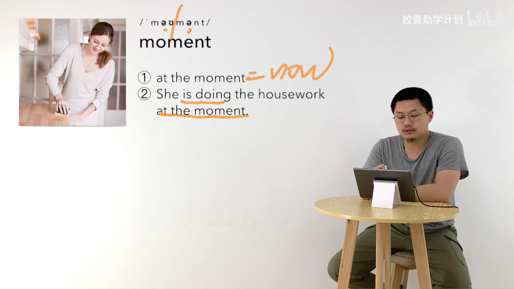

文字识别：胶囊助学计划 / /'maumant/ / moment / at the moment二 Vo / She is doing the housework / at the moment.

## 00:04:00–00:04:30

加 doing 三十一课咱们学过叫做现在进行时，那 do the housework 我们也是刚刚学过的这个短语，我们也可以再问说他每天都做家务劳动吗？叫做 Does she do the housework every day？这是我们从四十七课到今天一直学的，对吧？一般现在时描述的是一种生活习惯，每天都做家庭家务劳动这样的一个生活习惯。 There you go。那接下来呢，我们进入文章。好，这

### 画面 00:04:05

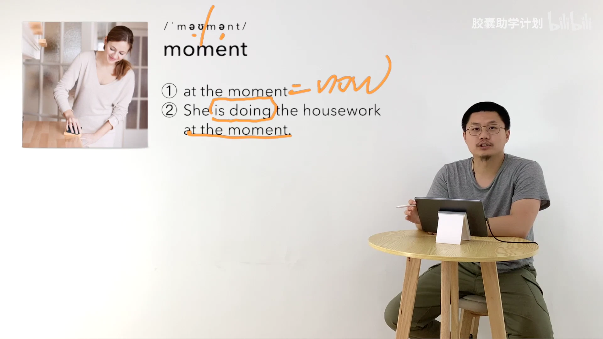

文字识别：胶囊助学计划 / /'maumant/ / moment / at the moment二 VW / Sheis doing the housework / at the moment.

### 画面 00:04:08

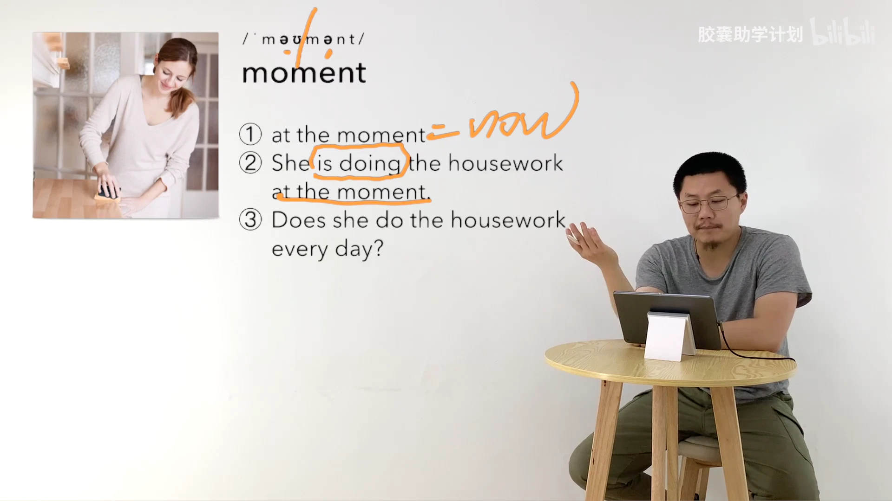

文字识别：胶囊助学计划 / /'maumant/ / moment / at the moment二 VoW / Sheis doingthe housework / at the moment. / Does she do the housework / every day?

### 画面 00:04:26

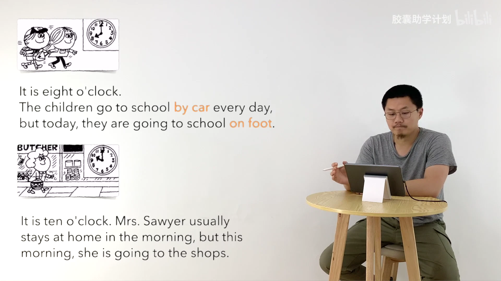

文字识别：胶囊助学计划 / It is eight o'clock. / The children go to school by car every day, / but today, they are going to school on foot. / BUTSHER / 10 / 8 / It is ten o'clock. Mrs. Sawyer usually / stays at home in the morning, but this / morning, she is going to the shops.

## 00:04:30–00:05:00

篇文章并不难，但是各位注意，这篇文章是把两个时态进行了一下对比，一个是一般现在时 do that，描述的是生活习惯，每天都怎么样，但就算是生活习惯，有的时候也会被打破，对吧？比如说我的生活习惯，每天下午一点半的时候我是睡午觉的，啊，我有的时候可能是刚睡醒的，对吧？但是今天的习，今天我现在还是在这正在给大家上

### 画面 00:04:56

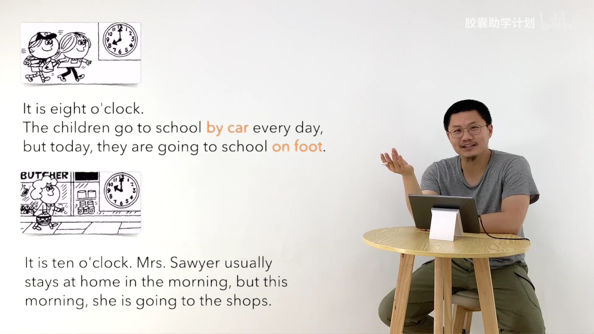

文字识别：胶囊助学计划 / It is eight o'clock. / The children go to school by car every day, / but today, they are going to school on foot. / BUTSHER / 10 / 9 / 8 / It is ten o'clock. Mrs. Sawyer usually / stays at home in the morning, but this / morning, she is going to the shops.

## 00:05:00–00:05:30

课，OK？所以这就是现在进行时，am/is/are加doing。文章就是进行这两个时态的对比。那我们不多说，直接进入文章。It is eight o'clock，现在八点钟了，那早上八点啊。The children go to school by car，这个小短语各位把它记起来，就是坐车。但坐车在汉语当中啊，一般是动词，对吧？怎么

### 画面 00:05:26

文字识别：It is eight o'clock. / The children go to school by car every day, / but today, they are going to school on foot. / BUTSHER / 10 / It is ten o'clock. Mrs. Sawyer usually / stays at home in the morning, but this / morning, she is going to the shops.

## 00:05:30–00:06:00

去坐车去啊？这个时候可能更多的是动词或名词，当然这个小的短语啊。那在这个地方你注意，它这是一个介词引导的啊，by car坐车去。Every day每天都是，既然是every day，就是生活习惯，那就是一般现在时。其次，你再看children主语是非三单，所谓的是不是第三人称单数，所以动词用原形对吧？But today但是今天呢，They are

### 画面 00:05:38

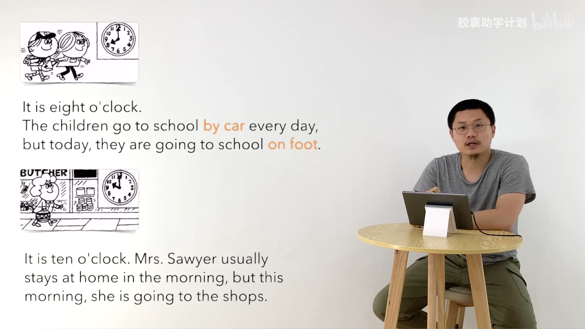

文字识别：胶囊助学计划 / It is eight o'clock. / The children go to school by car every day, / but today, they are going to school on foot. / BUTSHER / 10 / It is ten o'clock. Mrs. Sawyer usually / stays at home in the morning, but this / morning, she is going to the shops.

## 00:06:00–00:06:30

going to school.他们正在去上学，怎么去呢？On foot.这也是一个小的短语，各位记住，就是走着去啊。呃，你可以把这地方叫做换成，比如说，They are walking to school，等于They are going to school on foot. OK，这就是两个时态的对比了，对吧？平常的生活习惯，今天是正在做什么事情？接下来全是这样的。我们稍微快一点。It is ten o'clock.十点钟了。Mrs

### 画面 00:06:08

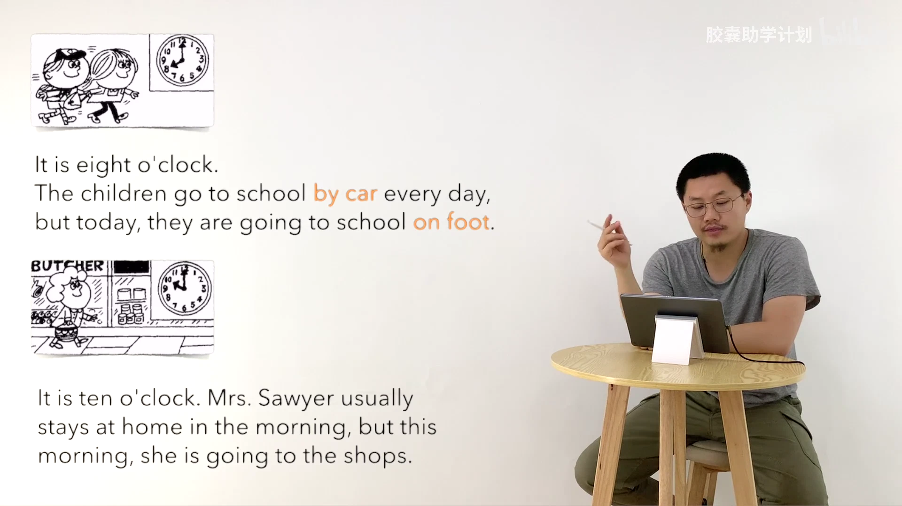

文字识别：胶囊助学计划 / It is eight o'clock. / The children go to school by car every day, / but today, they are going to school on foot. / BUTSHER / 10 / It is ten o'clock. Mrs. Sawyer usually / stays at home in the morning, but this / morning, she is going to the shops.

### 画面 00:06:27

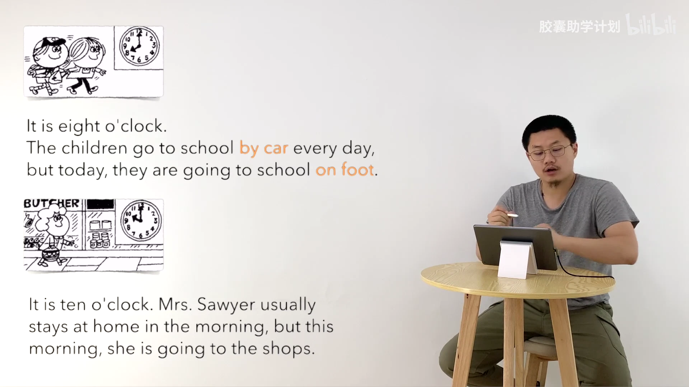

文字识别：胶囊助学计划 / It is eight o'clock. / The children go to school by car every day, / but today, they are going to school on foot. / BUTSHER / 10 / It is ten o'clock. Mrs. Sawyer usually / stays at home in the morning, but this / morning, she is going to the shops.

## 00:06:30–00:07:00

Sawyer usually stays at home in the morning. 好，我们注意几个小点。第一，Mrs Sawyer，所以是stays。第二，usually放在了stays的前面。我们上一节课刚刚讲过，在家in the morning，早晨。But但是呢，this morning，今儿早晨怎么样呢？She's going to the shops. 她正在去这些商店。哎，正在去这些商店。OK，那注意shops加了一个s，告诉你她不是去

### 画面 00:06:57

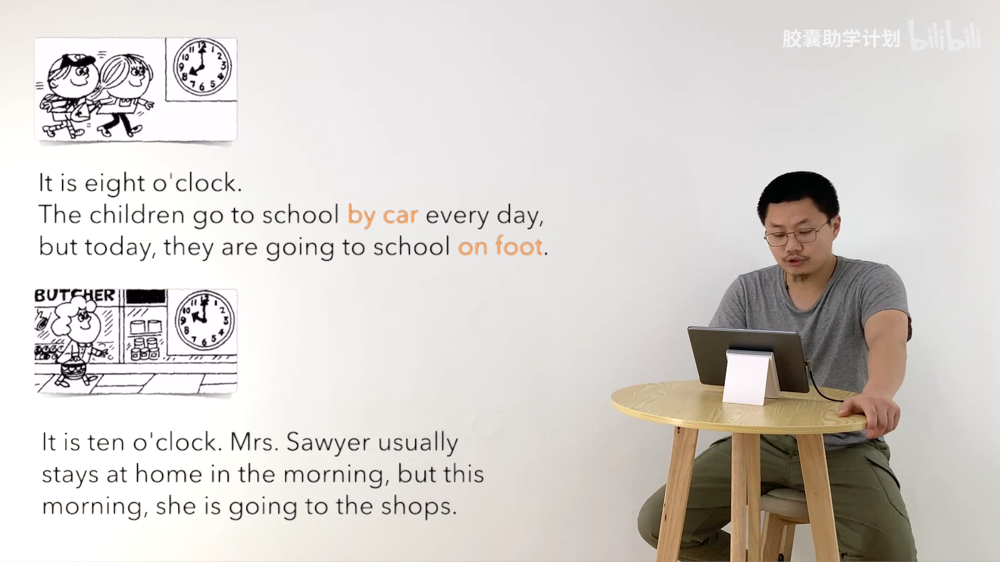

文字识别：胶囊助学计划 / It is eight o'clock. / The children go to school by car every day, / but today, they are going to school on foot. / BUTSHER / 10 / It is ten o'clock. Mrs. Sawyer usually / stays at home in the morning, but this / morning, she is going to the shops.

## 00:07:00–00:07:30

一个商店。 It is four o'clock. 现在是四点钟了。 In the afternoon, 下午的时候呢。 Mrs Sawyer usually drinks tea in the living room. 好， in the living room 叫做在客厅喝茶。那注意两个小点：第一，usually 放在 drinks 的前面；第二，主语是第三人称单数，动词用第三人称单数，对吧？好，你比如说，我们拿这句话，其实，在五十五课我们就提到了，今天再提一次啊，就是这

### 画面 00:07:00

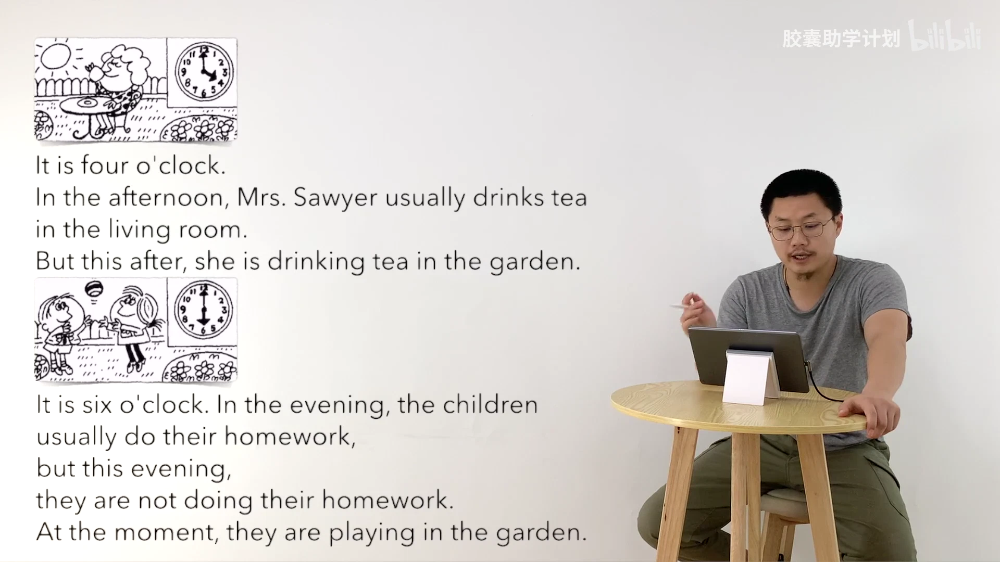

文字识别：胶囊助学计划 / 3 / 8 / 111 / 111 / It is four o'clock. / In the afternoon, Mrs. Sawyer usually drinks tea / in the living room. / But this after, she is drinking tea in the garden. / 10 / 9 / 3 / It is six o'clock. In the evening, the children / usually do their homework, / but this evening, / they are not doing their homework. / At the moment, they are playing in the garden.

## 00:07:30–00:08:00

句话对于各位来说，把它读熟了之后，下一步事情不是继续说把每个字啊，这个 the 啊，包括这个 s 啊，这些小的语言细节，包括前面这个 the，后边这个 the，都把它背的一点儿都没有问题，不是这一步啊，应该是去做什么四句型转换，肯定句，比如说我们现在想把它变一般疑问句，谁提前，as 提前，drink 换回原形，对吧？然后我们说想把它变成特殊疑问句，我们可以用什么？比如说

### 画面 00:07:30

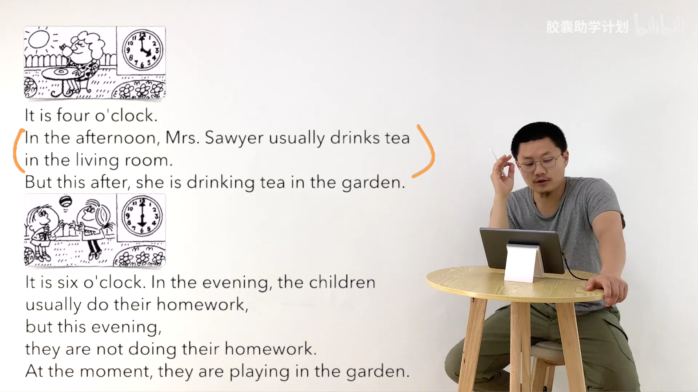

文字识别：胶囊助学计划 / 3 / 8 / 111 / 11 / It is four o'clock. / In the afternoon, Mrs. Sawyer usually drinks tea / in the living room. / But this after, she is drinking tea in the garden. / 10 / 2 / 9 / 3 / 8 / It is six o'clock. In the evening, the children / usually do their homework, / but this evening, / they are not doing their homework. / At the moment, they are playing in the garden.

### 画面 00:07:41

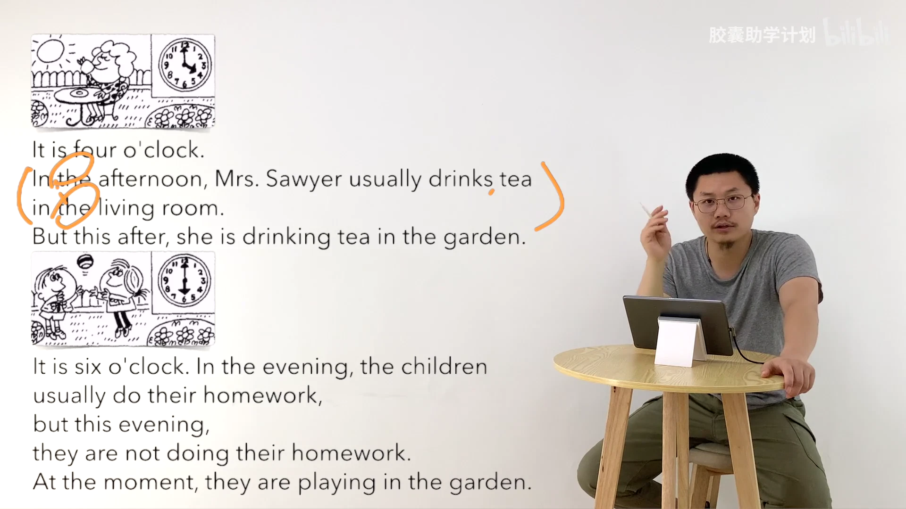

文字识别：胶囊助学计划 / 3 / 8 / 11111 / It is four o'clock. / th / afternoon, Mrs. Sawyer usually drinks tea / n / che living room. / in / But this after, she is drinking tea in the garden. / 10 / 2 / 9 / 3 / 8 / It is six o'clock. In the evening, the children / usually do their homework, / but this evening, / they are not doing their homework. / At the moment, they are playing in the garden.

### 画面 00:07:47

文字识别：3 / 8 / 11111 / It is four o'clock. / th / afternoon, Mrs. Sawyer usually drinks tea / n / nche living room. / in / But this after, she is drinking tea in the garden. / 10 / 2 / 0 / 3 / It is six o'clock. In the evening, the children / usually do their homework, / but this evening, / they are not doing their homework. / At the moment, they are playing in the garden.

### 画面 00:07:57

文字识别：胶囊助学计划 / 8 / It is four o'clock. / n / th / afternoon, Mrs. Sawyer usually drinks tea / inche living room. / But this after, she is drinking tea in the garden. / 10 / 2 / 9 / It is six o'clock. In the evening, the children / usually do their homework, / but this evening, / they are not doing their homework. / At the moment, they are playing in the garden.

### 画面 00:07:59

文字识别：胶囊助学计划 / 3 / 8 / 11111 / It is four o'clock. / th / afternoon, Mrs. Sawyer usually drinks tea / n / in/cheliving room. / But this after, she is drinking tea in the garden. / 10 / 2 / 9 / 3 / It is six o'clock. In the evening, the children / usually do their homework, / but this evening, / they are not doing their homework. / At the moment, they are playing in the garden. / D

## 00:08:00–00:08:30

我现在想对 in the afternoon 提问，问对吧？ Mrs. Sawyer 提问， who 对吧？对主语提问还怎么样来着？各位想一下，新概念一册三十一课我们学过，对主语提问直接替代，对吧？如果我想对 usually 提问，用谁？ How often 对 T 提问，用 what 对 in the living room 用 where。你看一句话，我们拆出来了五个特殊疑问句，一个否定句，一个一般疑问句，也就是一个肯定句背后，它只是冰山

### 画面 00:08:21

文字识别：胶囊助学计划出 / 5 / 8 / 1111 / It is four o'clock. / th / afternoon, Mrs. Sawyer usually drinks tea / In / incheliving room. / But this after, she is drinking tea in the garden. / 10 / 2 / 9 / 3 / It is six o'clock. In the evening, the children / usually do their homework, / but this evening, / they are not doing their homework. / At the moment, they are playing in the garden.

## 00:08:30–00:09:00

一角，对吧？底下大部分的那些东西，还有七句话，各位要自己下课去变来了。But this afternoon, she's drinking tea in the garden.他说，但今天下午啊，这个地方有一个小 typo啊，注意，它应该是 afternoon。但是今儿下午呢， she's drinking tea，她正在喝茶 in the garden，在花园当自家花园当中正在喝茶，表示的是现在一个动作正在进行，与她是不是

### 画面 00:08:35

文字识别：胶囊助学计划 / 5 / 1111 / It is four o'clock. / th / afternoon, Mrs. Sawyer usually drinks tea / n / inche living room. / But this after, she is drinking tea in the garden. / 10 / 2 / 0 / 3 / It is six o'clock. In the evening, the children / usually do their homework, / but this evening, / they are not doing their homework. / At the moment, they are playing in the garden. / 1

### 画面 00:08:44

文字识别：胶囊助学计划 / 5 / 8 / 1111 / It is four o'clock. / afternoon, Mrs. Sawyer usually drinks tea / n / th / heliving room. / in / But this after, she is drinking tea in the garden. / 10 / 9 / 3 / It is six o'clock. In the evening, the children / usually do their homework, / but this evening, / they are not doing their homework. / At the moment, they are playing in the garden.

### 画面 00:08:59

文字识别：胶囊助学计划 / 3 / 8 / 11111 / It is four o'clock. / n / th / afternoon, Mrs. Sawyer usually drinks tea / inche living room. / But this after, she is drinking tea in the garden. / 10 / 2 / 9 / 3 / 8 / It is six o'clock. In the evening, the children / usually do their homework, / but this evening, / they are not doing their homework. / At the moment, they are playing in the garden.

## 00:09:00–00:09:30

每天这个时候都做没有关系。这汉语当中也会这样说，对吧？但是汉语当中没有这个结构，各位要注意一下。It is six o'clock, 六点钟了。In the evening, 晚上的时候呢，The children usually do their homework, 总是通常状态下是做他们家庭作业。But this evening, 但是今天晚上呢，They are not doing their homework, 他们没有正在做他们在家庭作业。否定。At the moment, 现在呢，They are playing

### 画面 00:09:08

文字识别：胶囊助学计划 / 5 / 8 / 11 / It is four o'clock. / th / afternoon, Mrs. Sawyer usually drinks tea / che living room. / in / But this after, she is drinking tea in the garden. / 10 / 9 / 3 / It is six o'clock. In the evening, the children / usually do their homework, / but this evening, / they are not doing their homework. / At the moment, they are playing in the garden.

## 00:09:30–00:10:00

in the garden.他们正在自家花园当中玩耍，两个人正在玩呢，对吧？Okay,叫they are playing. There you go. Let's continue. It is nine o'clock.九点钟了。注意啊，at night叫在夜晚，对吧？In the evening和at night的区别，你看他之前说六点钟叫做in the evening，对吧？那九点钟是at night。这个实际上它没有一个严格的标准，说呃八点半之前是in the evening，八点半之后要用at night，没

### 画面 00:09:38

文字识别：胶囊助学计划 / 5 / 8 / 1111 / It is four o'clock. / tb / afternoon, Mrs. Sawyer usually drinks tea / n / in/che living room. / But this after, she is drinking tea in the garden. / 1o / 9 / 3 / 8 / It is six o'clock. In the evening, the children / usually do their homework, / but this evening, / they are not doing their homework. / At the moment, they are playing in the garden.

### 画面 00:09:40

文字识别：胶囊助学计划 / 10 / 6 / 5 / It is nine o'clock. / Mr. Sawyer usually reads his newspaper at night. / But he's not reading his newspaper tonight. / At the moment, he's reading an interesting book. / D

### 画面 00:09:47

文字识别：胶囊助学计划 / 10 / 6 / It is nine o'clock. / Mr. Sawyer usually reads his newspaper at night. / But he's not reading his newspaper tonight. / At the moment, he's reading an interesting book.

### 画面 00:09:52

文字识别：胶囊助学计划 / 10 / 6 / It is nine o'clock. / Mr. Sawyer usually reads his newspaper at night. / But he's not reading his newspaper tonight. / At the moment, he's reading an interesting book.

## 00:10:00–00:10:30

有这个明显的感觉，就是 in the evening 偏向于是从黄昏到夜晚，然后 at night 偏向于是深夜，对吧？但是鉴于大城市当中很多人可能对深夜的理解已经从九点延伸到了两三点，甚至四五点，对吧？所以这个你自己去把握了。OK，你说半夜十二点也可以说 at night，没有问题啊。现在是九点钟，Mr. Sawyer usually reads his newspaper at night. 好了，两个点 usually 放在 reads 的

### 画面 00:10:16

文字识别：胶囊助学计划 / 10 / 6 / 5 / It is nine o'clock. / Mr. Sawyer usually reads his newspaper at night. / But he's not reading his newspaper tonight. / At the moment, he's reading an interesting book.

### 画面 00:10:22

文字识别：胶囊助学计划 / 10 / 6 / t is nine o'clock. / Mr. Sawyer usually reads his newspaper at night. / But he's not reading his newspaper tonight. / At the moment, he's reading an interesting book.

## 00:10:30–00:11:00

前面，主语第三人称单数，动词第三人称单数，读他的报纸在晚上。But he's not reading his newspaper tonight.但是呢，他没有正在读报纸 tonight，叫今晚，他没有正在读报纸。At the moment,现在 now he's reading an interesting book.他正在读一本很有趣的书。这地方只有一个小的语言点，我想提醒各位一下，就是为什么用an？想一下，因

### 画面 00:10:51

文字识别：胶囊助学计划 / 10 / a / 6 / It is nine o'clock. / Mr. Sawyer usually reads his newspaper at night. / But he's not reading his newspaper tonight. / At the moment, he's reading an interesting book.

### 画面 00:10:56

文字识别：胶囊助学计划 / 10 / 6 / 0 / It is nine o'clock. / Mr. Sawyer usually reads his newspaper at night. / But he's not reading his newspaper tonight. / At the moment, he's reading aninteresting book.

## 00:11:00–00:11:30

为 interesting 的首音标是 e，所以它是元音音标，于是前面用 an 而不用 a。这个小知识点，带着各位复习一下。接下来各位看眼睛，要么完全脱离课本，要么看着课本，但不要看我的屏幕。我们做一些口语听力练习，我问您答。来了，第一题，What's the time? Look at the first picture. 看第一幅图，It's eight o'clock in the morning.

### 画面 00:11:00

文字识别：胶囊助学计划 / 10 / 6 / 5 / It is nine o'clock. / Mr. Sawyer usually reads his newspaper at night. / But he's not reading his newsgaper tonight. / At the moment, he's reading / ani / interesting book.

### 画面 00:11:07

文字识别：胶囊助学计划 / 10 / 6 / It is nine o'clock. / Mr. Sawyer usually reads his newspaper at night. / But he's not reading his newsgaper tonight. / At the moment, he's reading / aninteresting book.

### 画面 00:11:10

文字识别：胶囊助学计划 / Comprehension

### 画面 00:11:12

文字识别：胶囊助学计划 / Comprehension

### 画面 00:11:18

文字识别：胶囊助学计划 / Comprehension

## 00:11:30–00:12:00

Okay, continue. Do the children usually go to school by car every day? Yes, they do. Next one, what are they doing today? They are going to school on foot. Ah,看着文章由上往下找答案啊，我们由上往下问. Continue. What does Mrs Sawyer usually do in the morning?

### 画面 00:11:31

文字识别：胶囊助学计划 / Comprehension

### 画面 00:11:49

文字识别：胶囊助学计划 / Comprehension / 3 T: What are they doing today? / S: They are going to school on foot.

### 画面 00:11:54

文字识别：胶囊助学计划 / Comprehension / 4 T: What does Mrs. Sawyer usually do in the morning.

## 00:12:00–00:12:30

She usually stays at home. Next one. What is she doing this morning? What's she doing this morning? She's going to the shops. Next one. Who usually drinks tea in the living room? Mrs Sawyer does. Continue. Where is she drinking tea this afternoon? In the garden.

### 画面 00:12:11

文字识别：胶囊助学计划 / Comprehension / 5 T: What is she doing this morning? / S: She's going to the shops.

### 画面 00:12:15

文字识别：胶囊助学计划 / Comprehension / 6 T: Who usually drinks tea in the living room?

## 00:12:30–00:13:00

注意问的是 Is she drinking? Right. Now, she is drinking. She is

### 画面 00:12:31

文字识别：胶囊助学计划 / Comprehension / 7 T: Where is she drinking tea this afternoon? / S: In the garden.

### 画面 00:12:37

文字识别：胶囊助学计划 / Comprehension / 8 T: When do the children usually do their homework?

### 画面 00:12:47

文字识别：胶囊助学计划 / Comprehension / 9 T: What are they doing at the moment?

### 画面 00:12:50

文字识别：胶囊助学计划 / Comprehension / 9 T: What are they doing at the moment? / S: They're playing in the garden.

### 画面 00:12:54

文字识别：胶囊助学计划 / Comprehension / 10T: What is Mr. Sawyer doing tonight?

## 00:13:00–00:13:30

He's reading an interesting book.好，下一题，asking questions，肯定句否啊，肯定句变一般疑问句变特殊疑问句，还是听力口语练习来了。第一题，ask me if the children go to school by car. 答案，do the children go to school by car? 好，对，by car提问，你想一下，应该用特殊疑问词的谁？啊，

### 画面 00:13:03

文字识别：胶囊助学计划 / Comprehension / 10 T: What is Mr. Sawyer doing tonight? / S: He's reading an interesting book.

### 画面 00:13:05

文字识别：胶囊助学计划 / Asking questions / 0

### 画面 00:13:19

文字识别：胶囊助学计划 / Asking questions / 1 T: Ask me if the children go to school by car. / S: Do the Children go to school by car?

### 画面 00:13:26

文字识别：胶囊助学计划 / Asking questions / 1 T: Ask me if the children go to school by car. / S: Do the Children go to school by car?

### 画面 00:13:29

文字识别：胶囊助学计划 / Asking questions / 1 T: Ask me if the children go to school by car. / S: Do the Children go to school by car?

## 00:13:30–00:14:00

你你最终的问题是问他们怎么去上学的？那哪个特殊疑问词问的是如何？怎么？How吧，对吧？Okay, 那答案就是 How do the children go to school? 孩子们是怎么去上的学呢？答案是 By car. Very good. Let's continue. Ask me if Mrs Sawyer is going to the shops. 答案 Is Mrs Sawyer going to the shops?

### 画面 00:13:37

文字识别：胶囊助学计划 / Asking questions / 1 T: Ask me if the children go to school by car. / S: Do the Children go to school by car?

### 画面 00:13:40

文字识别：胶囊助学计划 / Asking questions / 1 T: Ask me if the children go to school by car. / S: Do the Children go to school by car? / T: How...?

### 画面 00:13:49

文字识别：胶囊助学计划 / Asking questions / 2 T: Ask me if Mrs. Sawyer is going to the shops.

## 00:14:00–00:14:30

特殊疑问词 where 答案 where is Mrs. Sawyer going? Next one, ask me if she drinks tea at four o'clock. Does she drink tea at four o'clock? 好，特殊疑问词 what，那叫做 what does she drink at four o'clock? 好，这个地方抬头看一下。

### 画面 00:14:03

文字识别：胶囊助学计划 / Asking questions / 2 T: Ask me if Mrs. Sawyer is going to the shops. / S: Is Mrs. Sawyer going to the shops? / T: Where...? / S: Where is Mrs. Sawyergoing?

### 画面 00:14:09

文字识别：胶囊助学计划 / Asking questions / 3 T: Ask me if she drinks tea at four o' clock.

### 画面 00:14:23

文字识别：胶囊助学计划 / Asking questions / 3 T: Ask me if she drinks tea at four o'clock. / S: Does she drink tea at four o'clock? / T:What...? / S: What does she drink at four o'clock?

## 00:14:30–00:15:00

我如果想对 at four o'clock 提问，用谁来着？我们刚刚讲过，是不是该用 what time，对吧？那就是 what time does she drink tea？她具体在几点钟去喝茶？Okay, there we go. Continue. Ask me if they do their homework in the evening. Do they do their homework in the evening? When? When do they do their

### 画面 00:14:36

文字识别：胶囊助学计划 / Asking questions / 3 T: Ask me if she drinks tea at four o'clock. / S: Does she drink teaat four o'clock? / T: What...? / S: What does she drink at four o'clock?

### 画面 00:14:43

文字识别：胶囊助学计划 / Asking questions

### 画面 00:14:46

文字识别：胶囊助学计划 / Asking questions / 4T: Ask me if they do their homework in the / evening. / 0

### 画面 00:14:50

文字识别：胶囊助学计划 / Asking questions / 4T: Ask me if they do their homework in the / evening. / 0

### 画面 00:14:53

文字识别：胶囊助学计划 / Asking questions / 4T: Ask me if they do their homework in the / evening. / S: Do they do their homework in the evening?

### 画面 00:14:58

文字识别：胶囊助学计划 / Asking questions / 4T: Ask me if they do their homework in the / evening. / S: Do they do their homework in the evening? / T: When...? / S: When do they do their homework?

## 00:15:00–00:15:30

homework?好，注意一个小点，when和what time有没有什么区别？好，简单来说是有一点点区别的，不是说完全没有啊。What time?更多的时候是问具体几点钟。那他能不能问呃，比如说in the evening去回答他呢？也是可以的，你不一定非得要给回答几点钟。那when更多的不是问具体几点钟，就是问何时。答

### 画面 00:15:04

文字识别：胶囊助学计划 / Asking questions / 4T: Ask me if they do their homework in the / evening. / S: Do they do their homework in the evening? / T: Wnon...? / S: (Wheh do they do their homework? / 0

### 画面 00:15:06

文字识别：胶囊助学计划 / Asking questions / 4T: Ask me if they do their homework in the / evening. / S: Do they do their homework in the evening? / T: Wnon...? / S: (Whe do they do their homework? / WaA

### 画面 00:15:09

文字识别：胶囊助学计划 / Asking questions / 4T: Ask me if they do their homework in the / evening. / S: Do they do their homework in the evening? / T: Wnon..? / S: (When do they do their homework? / WheA +'im

### 画面 00:15:18

文字识别：胶囊助学计划 / Asking questions / 4T: Ask me if they do their homework in the / evening. / S: Do they do their homework in the evening? / T: Wnon...? / S: (Wheh do they do their homework? / WhaA +'ime

## 00:15:30–00:16:00

案可以是具体的几点钟。比如说我问你啊，When do they do their homework？你说 at six o'clock，没有任何错误。OK，我就提这样一个小点啊，二者几乎可以重叠去用啊，有一点点很小的区别。最后一个，Ask me if Mr. Sawyer is reading an interesting book.一般疑问句 is Mr. Sawyer reading an interesting book？What？那对 an interesting book 提问，

### 画面 00:15:39

文字识别：胶囊助学计划 / Asking questions / 4T: Ask me if they do their homework in the / evening. / S: Do they do their homework in the evening? / T: Wnon...? / S: Wheh do they do their homework? / WheA +im / 1

### 画面 00:15:41

文字识别：胶囊助学计划 / Asking questions

### 画面 00:15:44

文字识别：胶囊助学计划 / Asking questions / 5 T: Ask me if Mr. Sawyer is reading an / interesting book. / 0

### 画面 00:15:49

文字识别：胶囊助学计划 / Asking questions / 5 T: Ask me if Mr. Sawyer is reading an / interesting book.

### 画面 00:15:51

文字识别：胶囊助学计划 / Asking questions / 5 T: Ask me if Mr. Sawyer is reading an / interesting book.

### 画面 00:15:53

文字识别：胶囊助学计划 / Asking questions / 5 T: Ask me if Mr. Sawyer is reading an / interesting book. / S: Is Mr. Sawyer reading an interesting book?

### 画面 00:15:59

文字识别：胶囊助学计划 / Asking questions / 5 T: Ask me if Mr. Sawyer is reading an / interesting book. / S: Is Mr. Sawyer reading an interesting book? / T: What...?

## 00:16:00–00:16:30

What is Mr Sawyer reading? Okay, very good. Now recap. 本课我们做的关键的一个语法对比就是一般现在时的 do does 与现在进行时一个动作正在进行 am is are 加 doing 在文章当中做了一个很好的对比。接下来偶数课我们继续去做练习啊。那 expression 我们学到了两个小的句子叫做 What time is it? 和 What's the

### 画面 00:16:05

文字识别：胶囊助学计划 / Recap / Patterns / do/does / VS / Grammar / am/is/are+doing / Words / What time is it? / Expression / What's the time.

### 画面 00:16:10

文字识别：胶囊助学计划 / Recap / Patterns / do/does / VS / Grammar / am/is/are+doing / Words / What time is it? / Expression / What's thet / time.

### 画面 00:16:12

文字识别：胶囊助学计划 / Recap / Patterns / do/does / VS / Grammar / am/is/are+doing / Words / What time is it? / Expression / What's the / time.

### 画面 00:16:25

文字识别：胶囊助学计划 / Recap / Patterns / do/does / VS / Grammar / am/is/are+doing / Words / What time is it? / Expression / What's the / time.

### 画面 00:16:27

文字识别：胶囊助学计划 / Recap / Patterns / do/does / VS / Grammar / am/is/are+doing / Words / What time / is it? / Expression / What's the / time.

## 00:16:30–00:17:00

time?都是问时间，哪两二者啊？我给各位的建议是这样的，您不用把它都背下来啊。你挑一个你读着舒服的，what's the time or what time is it？然后把它稍微记一下就可以了啊。你有一万种方法去问时间，对吧？如果这个世界上存在一万种，你会一种这个就够了，是吧？剩下你只要能听懂就OK了。OK，好，那接下来本课家庭作业，首先五十七课绿皮书各位可以去写了，再然后文

### 画面 00:16:33

文字识别：胶囊助学计划 / Recap / Patterns / do/does / VS / Grammar / am/is/are+doing / Words / What time is it? / Expression / What's the / time.

### 画面 00:16:54

文字识别：胶囊助学计划

### 画面 00:16:58

文字识别：胶囊助学计划 / 绿皮书第57课的写作练习

## 00:17:00–00:17:30

章要跟读至熟读成诵，这是我们老习惯的。最后一个，为了提高我们的吸收率，我们要去讲解一遍今天的核心知识点。那这个我再给大家录制的，呃，导致英语学习失败的十大原因一啊，这个视频当中给各位解释了为什么要去这样去做一个练习。OK，好，那如果大家喜欢我们的课程呢，欢迎大家关注、订阅、一键三连，并分享给那些需要的朋友。最后，我们再来

### 画面 00:17:21

文字识别：胶囊助学计划 / D

### 画面 00:17:29

文字识别：胶囊助学计划 / Be happy for this moment. This moment / is your life. / Omar Khayyam

## 00:17:30–00:17:50

看一句名人名言：Be happy for this moment. This moment is your life. See you next time.

### 画面 00:17:32

文字识别：胶囊助学计划 / 2 / Be happy for this moment. This moment / is your life. / - Omar Khayyam

### 画面 00:17:34

文字识别：胶囊助学计划 / Be happy for this moment. This moment / is your life. / Omar Khayyam

### 画面 00:17:37

文字识别：胶囊助学计划 / Be happy for this moment. This moment / is your life. / Omar Khayyam

### 画面 00:17:39

文字识别：CAPSULEACADEMY / 胶囊助学计划 / 小红书 / Leo.irer / OE

### 画面 00:17:41

文字识别：CAPSULEACADEMY / 胶囊助学计划 / 小红书 / □ / Photographer / OE

### 画面 00:17:44

文字识别：CAPSULEACADEMY / 胶囊助学计划 / 小红书 / Editor / □ / Berlin / OE

### 画面 00:17:47

文字识别：CAPSULEACADEMY / 胶囊助学计划 / 小红书

### 画面 00:17:49

文字识别：bilibili / 胶囊助学计划

### 画面 00:17:50

文字识别：bilibili / 胶囊助学计划

