# 058 单词 语法 练习

快速机器解析：语音为单模型转写，未进行独立交叉校对或人工复核；画面每秒采样并按变化选帧，短时文字和标记可能遗漏。截图时间约有 1 秒误差。图片有损压缩；遇到疑点请按时间查看 Google Drive 原视频。

## 00:00:00–00:00:30

Hello, everyone. Welcome to Capsule Academy. This is Liu. Today, we are going to learn New Concept English Book One, Lesson Fifty Eight, Grammar Practices and Words. Okay,那老习惯进入正式课程之前，我们先看几个问题。第一个问题叫如何表达几点几分？我们上一节课刚刚学过如何去问，对吧？现在我们来学习如何去回答。接下来呢，下一个问题就是现在进行时与一般现在

### 画面 00:00:00

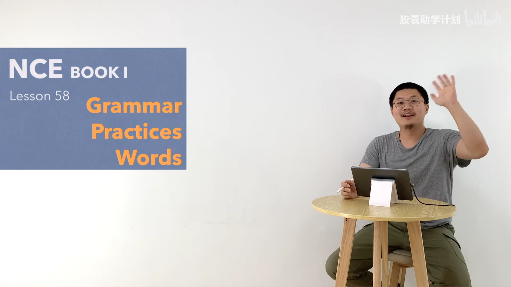

文字识别：胶囊助学计划 / NCE / BOOKI / Lesson 58 / Grammar / Practices / Words

### 画面 00:00:02

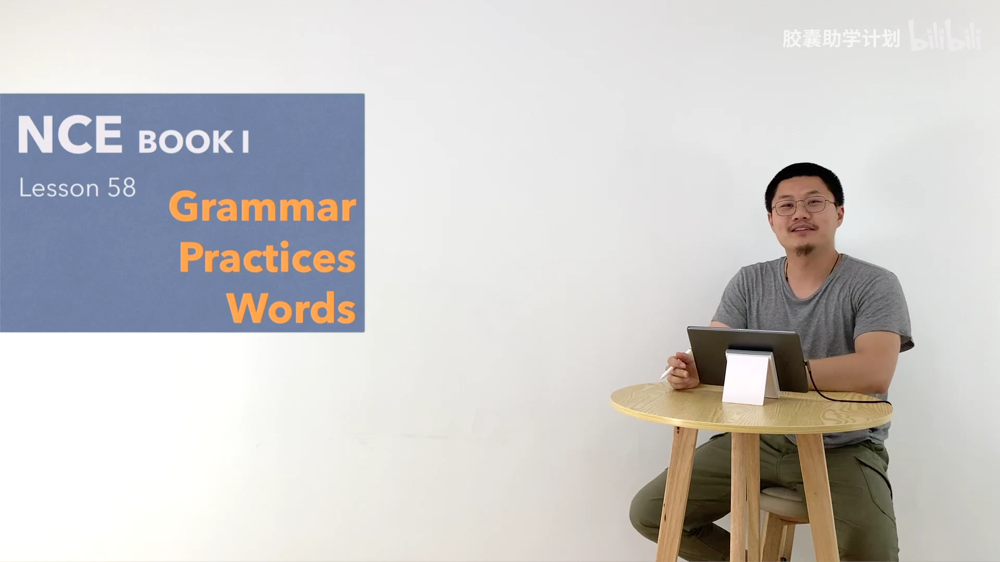

文字识别：胶囊助学计划 / NCE / BOOKI / Lesson 58 / Grammar / Practices / Words

### 画面 00:00:10

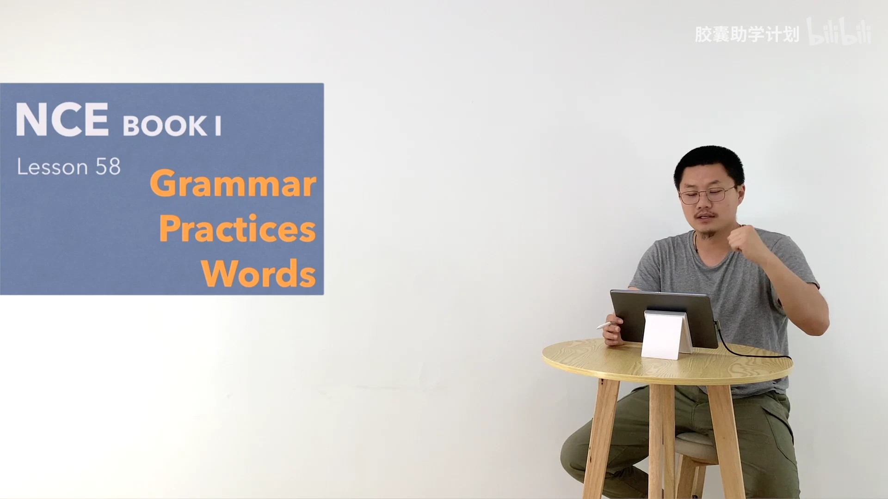

文字识别：胶囊助学计划 / NCE / BOOKI / Lesson 58 / Grammar / Practices / Words

### 画面 00:00:12

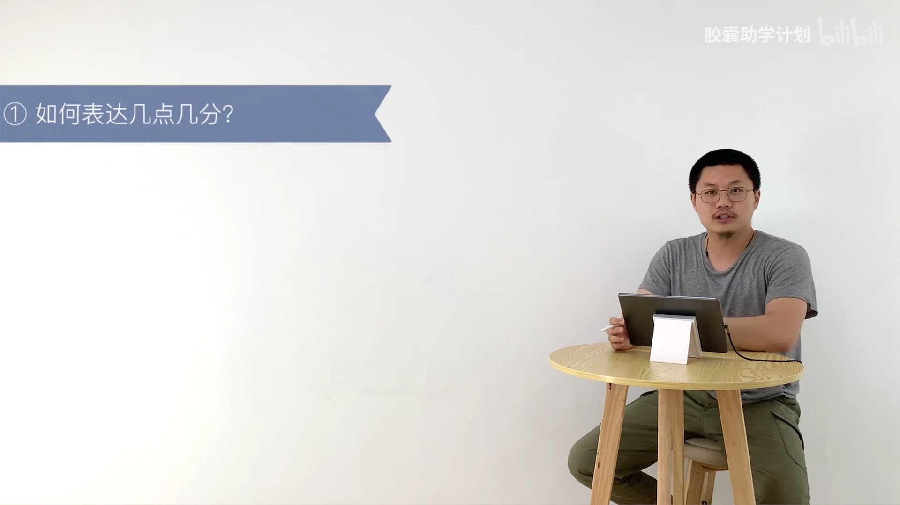

文字识别：胶囊助学计划 / ① 如何表达几点几分？

### 画面 00:00:14

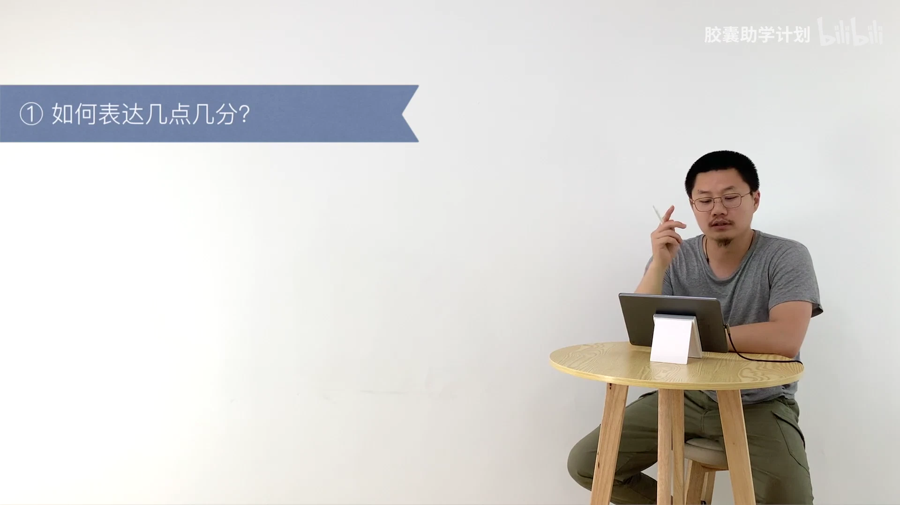

文字识别：胶囊助学计划 / ①如何表达几点几分？ / 2

### 画面 00:00:16

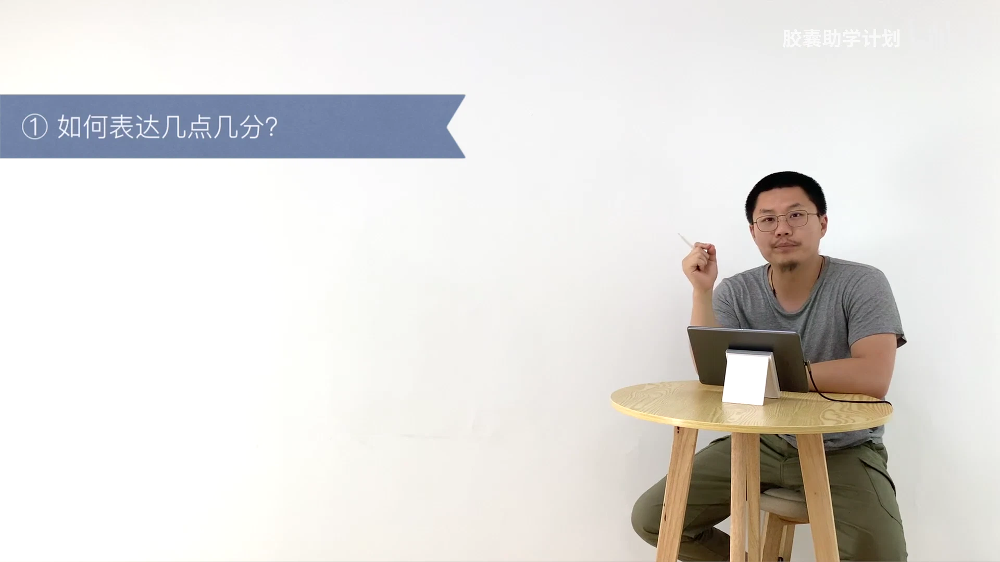

文字识别：① 如何表达几点几分？

### 画面 00:00:24

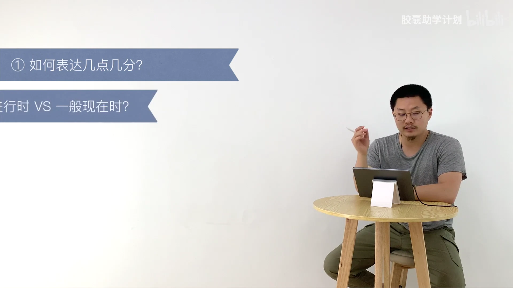

文字识别：胶囊助学计划 / ① 如何表达几点几分？ / 行时VS一般现在时？

### 画面 00:00:26

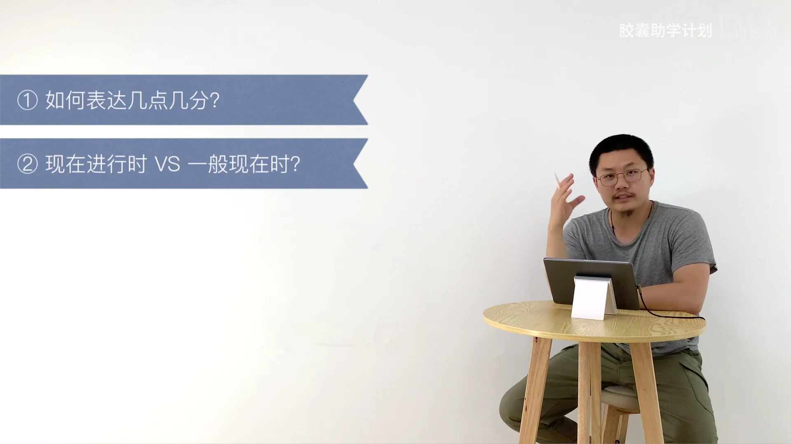

文字识别：胶囊助学计划 / ①如何表达几点几分？ / 现在进行时VS一般现在时?

## 00:00:30–00:01:00

时啊，这两个时态我们在上一篇文章当中已经进行了一些对比。那今天呢，在本课当中，我们继续拿练习去做一些对比。OK，那带着这两个问题，Hope you guys enjoyed。好，那我们上来先看一下时间。上节课我们提到了叫 What time is it？叫做几点钟了，对吧？那我们的回答可以非常的简单，比如说 It is six o'clock。我们正好复习一下，那 o'clock 加不加是没有问

### 画面 00:00:32

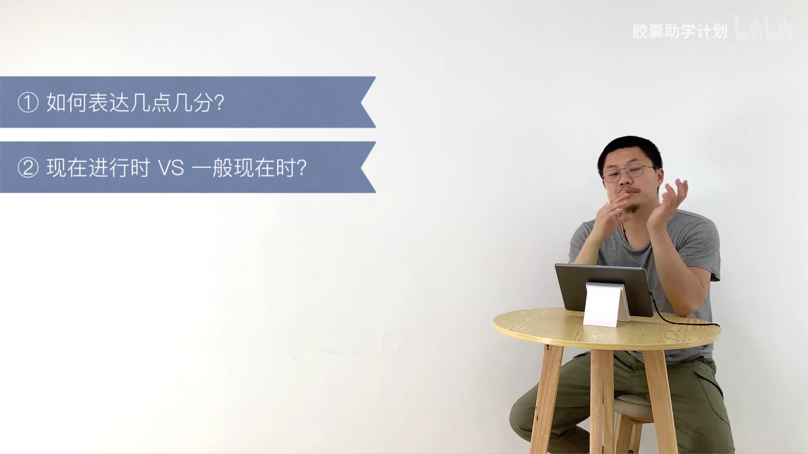

文字识别：胶囊助学计划 / ①如何表达几点几分？ / 现在进行时VS一般现在时?

### 画面 00:00:42

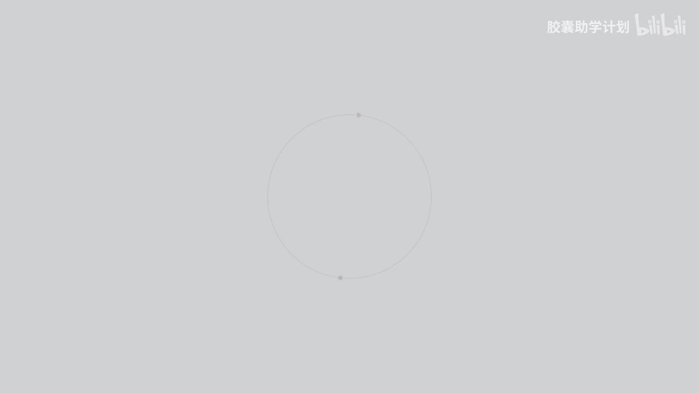

文字识别：胶囊助学计划bll

### 画面 00:00:45

文字识别：胶囊助学计划 / 胶囊助学计划

### 画面 00:00:47

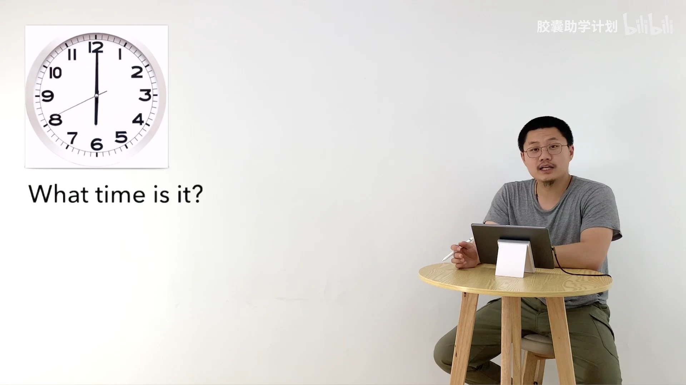

文字识别：胶囊助学计划 / 10 / 2 / 9 / 3 / 8 / 4 / 5 / 6 / What time is it?

### 画面 00:00:50

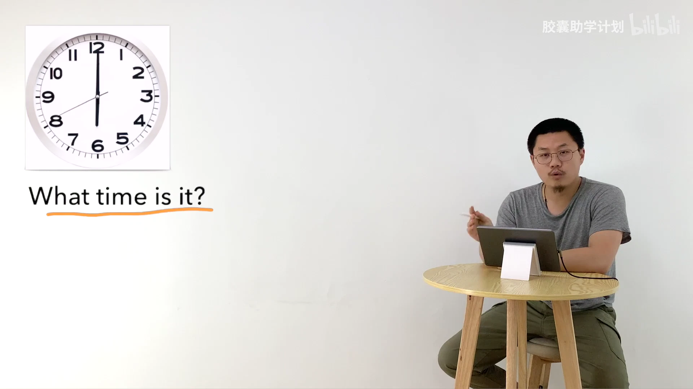

文字识别：胶囊助学计划 / 17 / 10 / 2 / 9 / 3 / 8 / 4 / 5 / 6 / What time is it?

## 00:01:00–00:01:30

题的，您直接说 it is six，或者直接说 six 都没有问题啊。好，那我们现在想把它变一般疑问句，就是 is it six o'clock？然后我对 six o'clock 提问就用 what time？啊，我实际上又给大家推导了一遍 what time is it 这句话是怎么来的？那我们问啊，啊，当然还有一句话说是 what's the time？这两这两个表达都可以去问时间，含义相同。OK，好，接下

### 画面 00:01:01

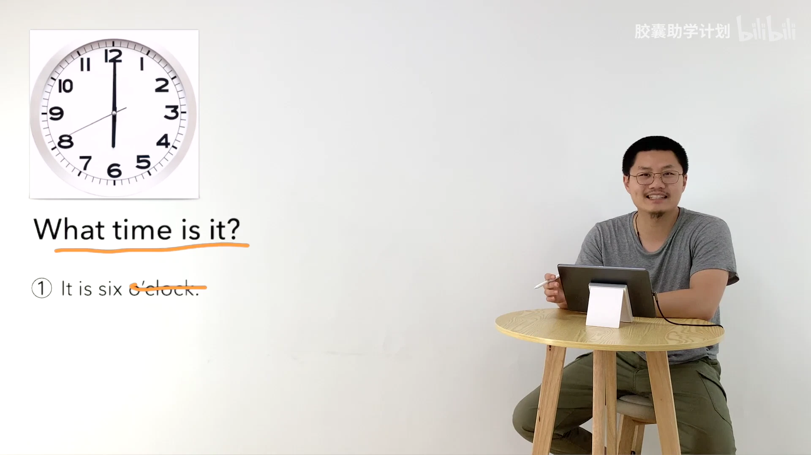

文字识别：胶囊助学计划 / 10 / 2 / 9 / 3 / 8 / 4 / 5 / 6 / What time is it? / It is six / C

### 画面 00:01:20

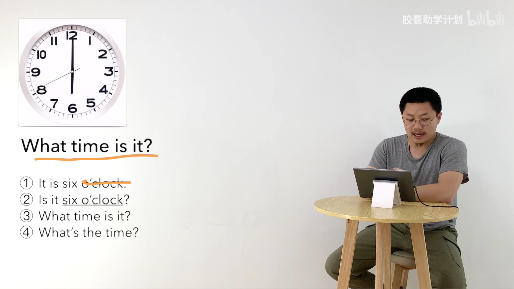

文字识别：胶囊助学计划 / 10 / 2 / 9 / 3 / 8 / 4 / 5 / 6 / What time is it? / 1 / It is six / Cel / Is it six o'clock? / What time is it? / What's the time?

### 画面 00:01:22

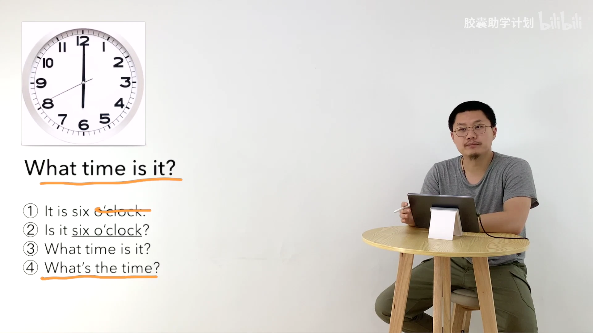

文字识别：胶囊助学计划 / 10 / 2 / 9 / 3 / 8 / 4 / 5 / 6 / What time is it? / 1 / It is six / cel / Is it six o'clock? / What time is it? / What's the time?

### 画面 00:01:27

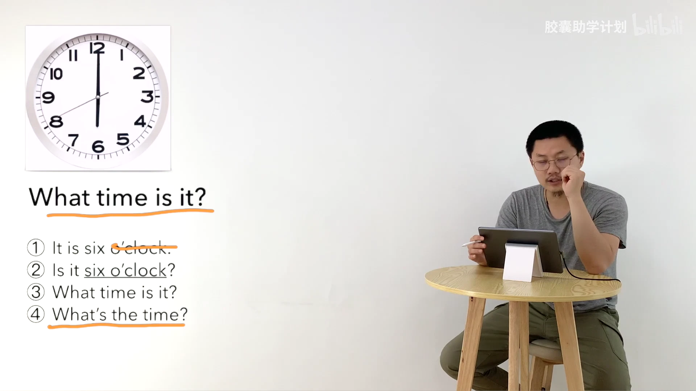

文字识别：胶囊助学计划 / 10 / 2 / 9 / 3 / 4 / 5 / 6 / What time is it? / 1 / It is six / cei / Is it six o'clock? / What time is it? / What's the time?

### 画面 00:01:29

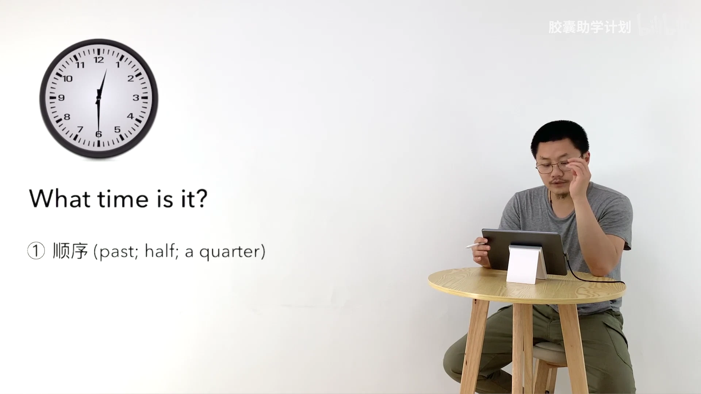

文字识别：胶囊助学计划 / 12 / 11 / 10 / 2 / 9 / 3 / 8 / 4 / 7 / 6 / 5 / What time is it? / 顺序(past; half; a quarter)

## 00:01:30–00:02:00

来呢？那我们说如何去回答它呢？还有不同的几个方式。第一个方式，我们管它叫做顺序回答。那什么叫顺序呢？好，我们接下来看一下啊，需要借助这么几个单词。第一个单词叫做past，叫做过啊。第二个单词叫做half，half就是一半。那一个小时的一半就是三十分钟，对吧？A quarter，我们四十一课也学过这个单词，叫做四分之一啊。四十一个学的

### 画面 00:01:34

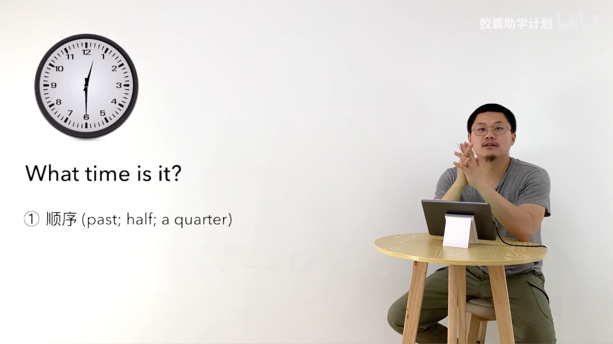

文字识别：胶囊助学计划 / 12 / 11 / 10 / 2 / 9 / 3 / 8 / 4 / 7 / 5 / What time is it? / 顺序(past; half; a quarter)

### 画面 00:01:52

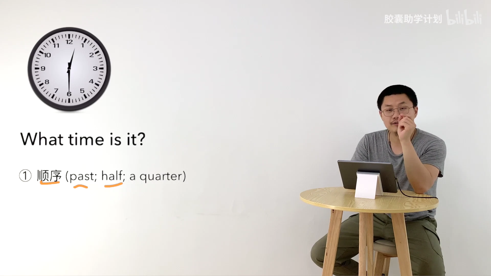

文字识别：胶囊助学计划 / 12 / 11 / 2 / 9 / 3 / 8 / 4 / 7 / 5 / What time is it? / 顺序(past; half;a quarter)

## 00:02:00–00:02:30

四分之一，OK，那一个小时的四分之一就是十五分钟，对吧？Fifteen minutes，OK，那我们看一下啊，首先这个小的公式给大家在这，叫做分 past 十。什么叫分 past 十？前面是分钟，后面是时间。比如说我们现在看图，各位能看到这个地方显示的时间是十二点半，那分就是三十分钟，对吧？十

### 画面 00:02:05

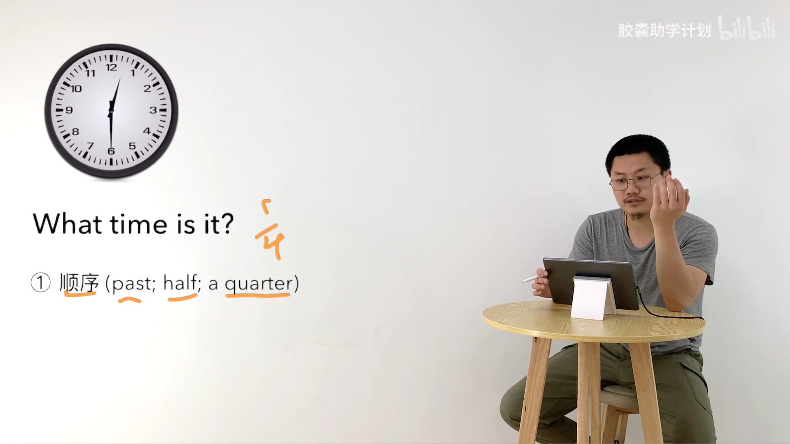

文字识别：胶囊助学计划 / 12 / 11 / 10 / 2 / 9 / 3 / 8 / 4 / 7 / 6 / 5 / What time is it? / 4 / 顺序(past; half; a quarter)

### 画面 00:02:09

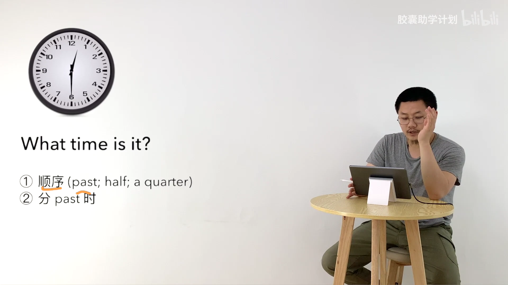

文字识别：胶囊助学计划 / 12 / 11 / 10 / 2 / 9 / 3 / 8 / 4 / 7 / 6 / 5 / What time is it? / 顺序(past; half; a quarter) / ) / ②分past时

## 00:02:30–00:03:00

就是十二小时，对吧？十二点半嘛。OK，那我们接下来的答案就是 half past twelve。注意一个小点，half，我们讲到了它就是三十分钟，对不对？OK，一半嘛，一个小时的一半，所以这儿你不用 half，你用 thirty 也行了啊。过十二，也就是十二点过三十，也就是十二点三十啊。英文

### 画面 00:02:32

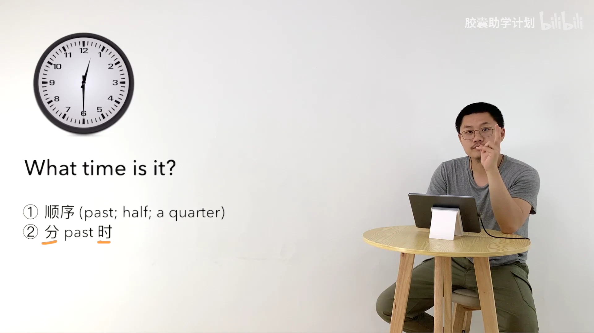

文字识别：胶囊助学计划 / 12 / 11 / 10 / 2 / 9 / 3 / 8 / 4 / 7 / 6 / 5 / What time is it? / 顺序(past; half; a quarter) / ②分past时

### 画面 00:02:37

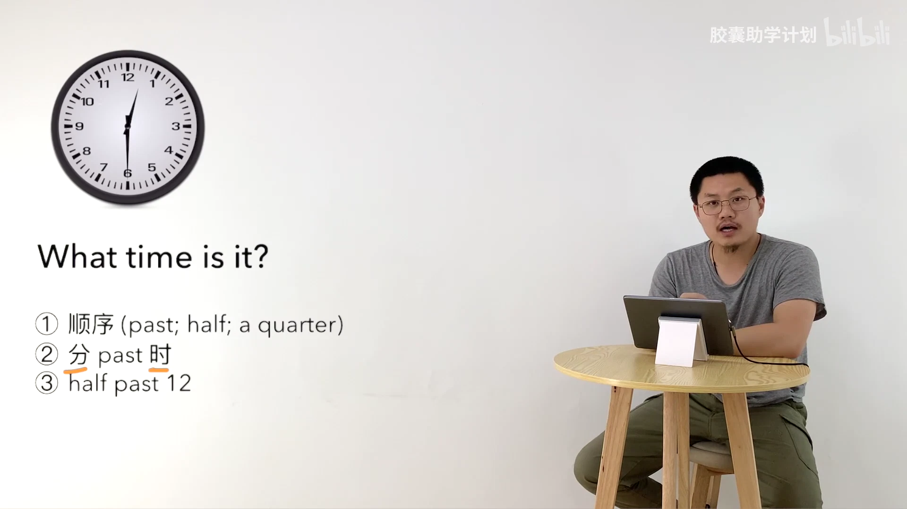

文字识别：胶囊助学计划 / 12 / 11 / 10 / 2 / 9 / 3 / 8 / 4 / 7 / 6 / 5 / What time is it? / 顺序(past; half; a quarter) / ②分past时 / ③half past 12

### 画面 00:02:43

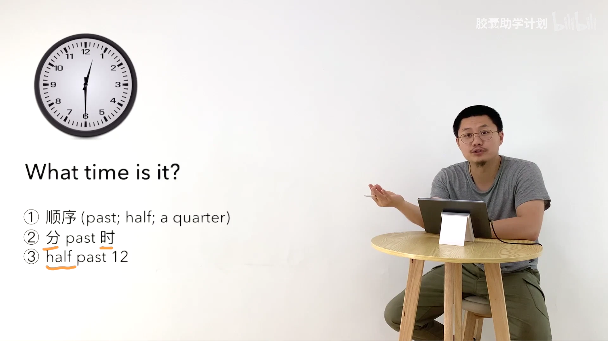

文字识别：胶囊助学计划 / 12 / 11 / 2 / 9 / 3 / 8 / 4 / 7 / 6 / 5 / What time is it? / 顺序(past; half; a quarter) / ②分past时 / ③half past 12

### 画面 00:02:46

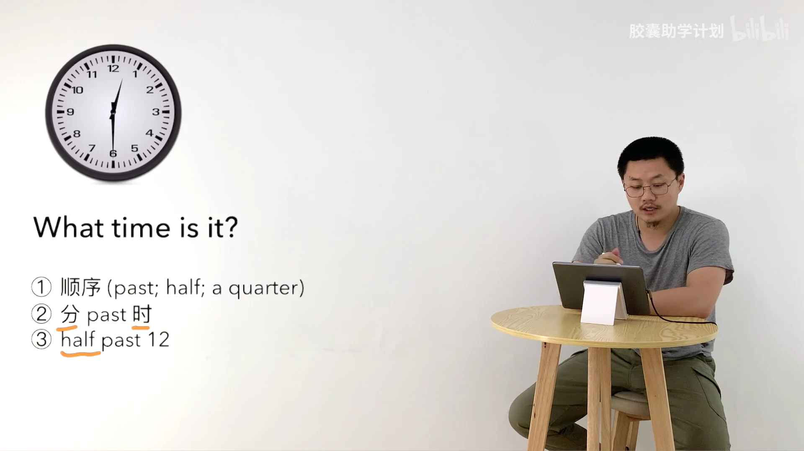

文字识别：胶囊助学计划 / 12 / 11 / 10 / 2 / 9 / 3 / 8 / 4 / 7 / 6 / 5 / What time is it? / 顺序(past; half; a quarter) / ②分past时 / 3 / half past 12

## 00:03:00–00:03:30

的习惯。那你也可以说，比如说我们现在不看上面这个时间了啊，我们现在想表达另一个时间叫做 a quarter past twelve。首先我们要注意，只要你用了 past，前面就是分钟，后边就是小时。那 a quarter 指的是四分之一，一个小时的四分之一就是十五分钟，对吧？那就是十五分钟过十二点。你想一下这句话是什么意思？就是十二

### 画面 00:03:03

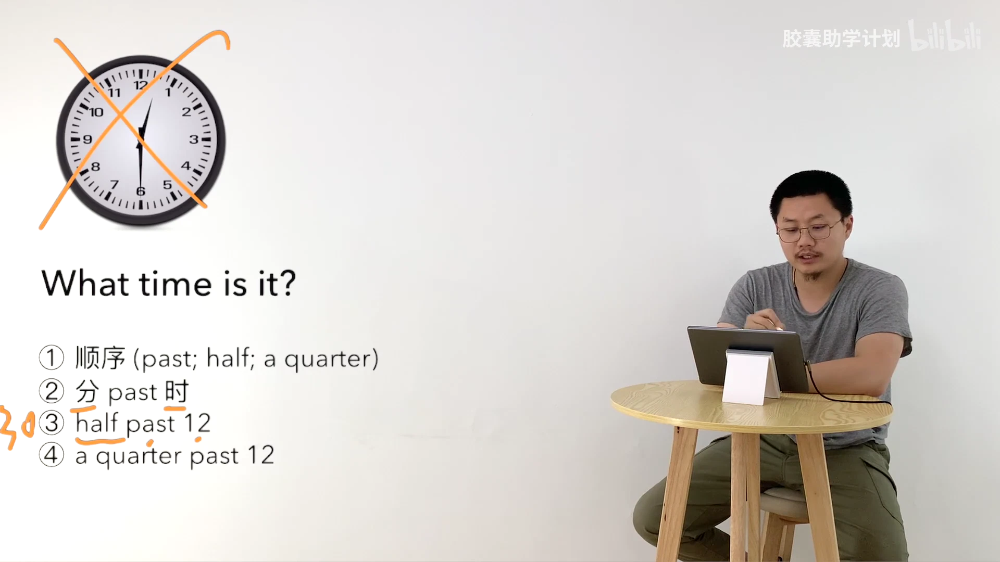

文字识别：胶囊助学计划 / 12 / i1 / 2 / 9 / 3 / 8 / 4 / 7 / 5 / What time is it? / 顺序(past; half; a quarter) / 分past时 / 2 / half past 12 / 3 / a quarter past 12

### 画面 00:03:05

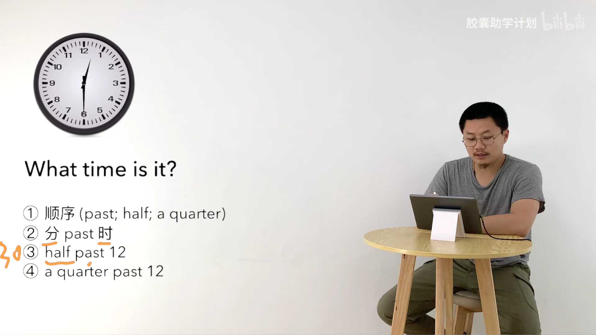

文字识别：胶囊助学计划 / 12 / 11 / 10 / 2 / 9 / 3 / 8 / 4 / 7 / 6 / 5 / What time is it? / 顺序(past; half; a quarter) / ②分past时 / ③half past 12 / a quarter past 12

### 画面 00:03:12

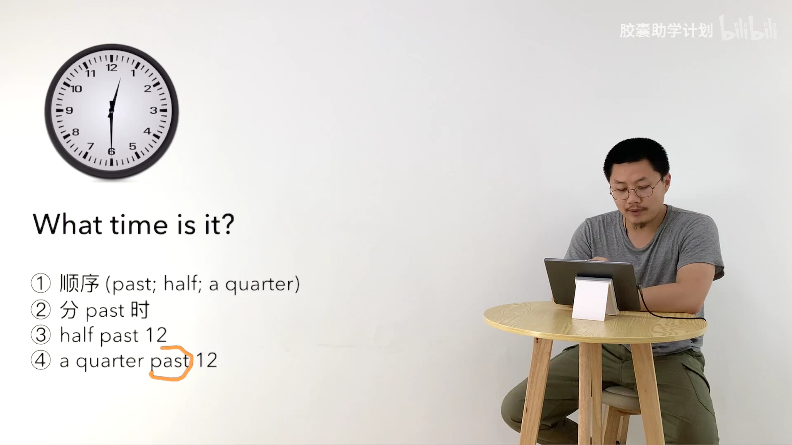

文字识别：胶囊助学计划 / 12 / 11 / 10 / 2 / 9 / 3 / 8 / 4 / 7 / 6 / 5 / What time is it? / 顺序(past; half; a quarter) / ②分past时 / ③half past 12 / ④a quarter past12

### 画面 00:03:18

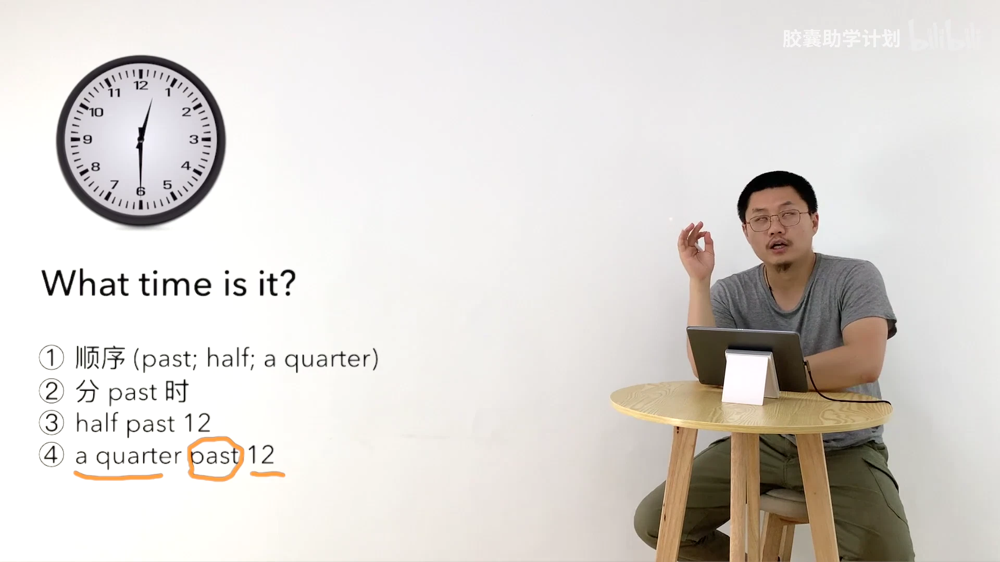

文字识别：胶囊助学计划 / 12 / i1 / 10 / 2 / 9 / 3 / 8 / 4 / 7 / 6 / 5 / What time is it? / 顺序(past; half; a quarter) / 分past时 / 2 / ) / 3 / half past 12 / a quarter / past / 12

### 画面 00:03:27

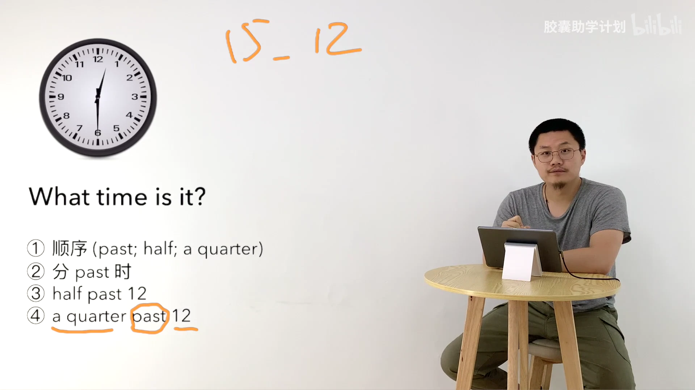

文字识别：12 / 胶囊助学计划 / 12 / 11 / 10 / 2 / 9 / 3 / 8 / 4 / 7 / 5 / What time is it? / 顺序(past; half; a quarter) / 分past时 / 2 / half past 12 / 3 / a quarter / past / 12

## 00:03:30–00:04:00

二点十五，对吧？没问题吧？OK，十二点十五啊啊啊啊啊！应该是反过来啊，应该是十二点十五。OK，玩一个，那这是其中的一种表达。在这种表达之下呢，各位要注意一个小点，这个小点就是看好啊，什么时候用past？当分钟数小于等于三十分钟的时候，我们采用past。

### 画面 00:03:31

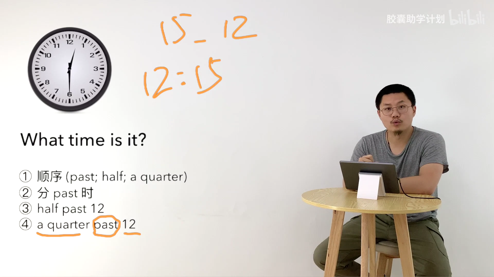

文字识别：12 / 胶囊助学计划 / 12 / 11 / 2 / 9 / 3 / (2:15 / 8 / 7 / 6 / 5 / What time is it? / 顺序(past; half; a quarter) / 分past时 / 2 / half past 12 / 3 / a quarter / past / 12

### 画面 00:03:35

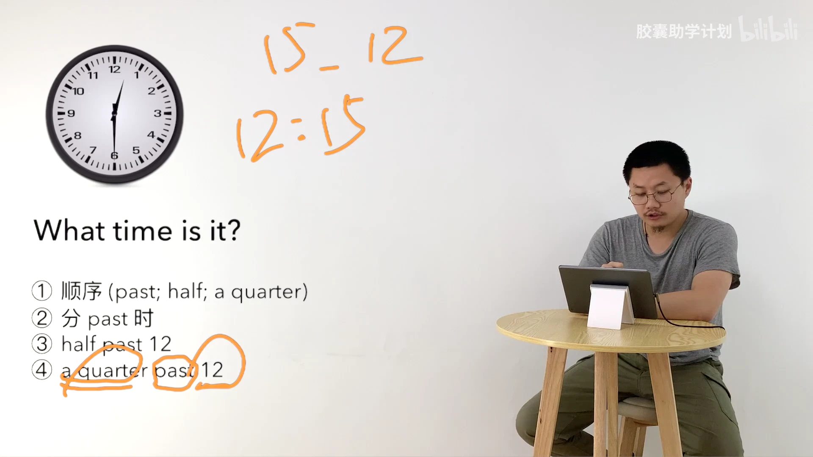

文字识别：12 / 胶囊助学计划 / 12 / 11 / 10 / 2 / 9 / 3 / (2:5 / 8 / 5 / 6 / What time is it? / 顺序(past; half; a quarter) / 分past时 / half past 12 / a / aquarte / baso / 12

### 画面 00:03:38

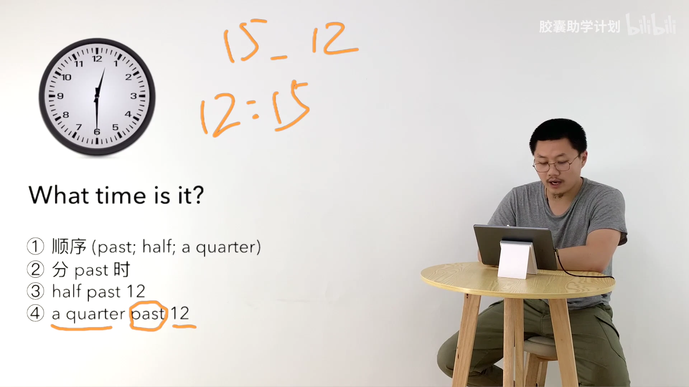

文字识别：12 / 胶囊助学计划 / 12 / 11 / 10 / 2 / 9 / 3 / (2:5 / 8 / 7 / 5 / What time is it? / 顺序(past; half; a quarter) / 分past时 / 2 / half past 12 / 3 / a quarter / past / 12

### 画面 00:03:40

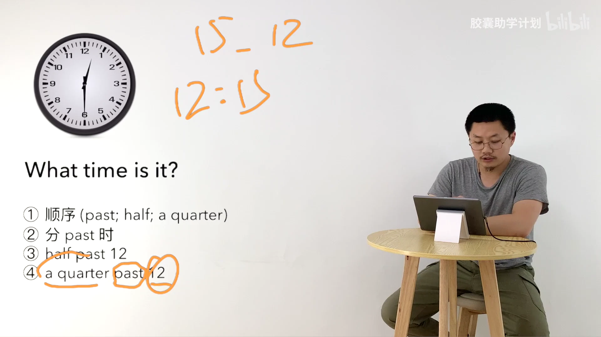

文字识别：12 / 胶囊助学计划 / 12 / 11 / 2 / 9 / 3 / (2:D / 8 / 7 / 6 / 5 / What time is it? / 顺序(past; half; a quarter) / 分past时 / balf past 12 / 3 / 4a quarter / past

### 画面 00:03:42

文字识别：12 / 胶囊助学计划 / 12 / 11 / 10 / 2 / 9 / 3 / (2:( / 8 / 7 / 6 / 5 / What time is it? / 顺序(past; half; a quarter) / 分past时 / 2 / half past 12 / 3 / a quarter / past / 12

### 画面 00:03:44

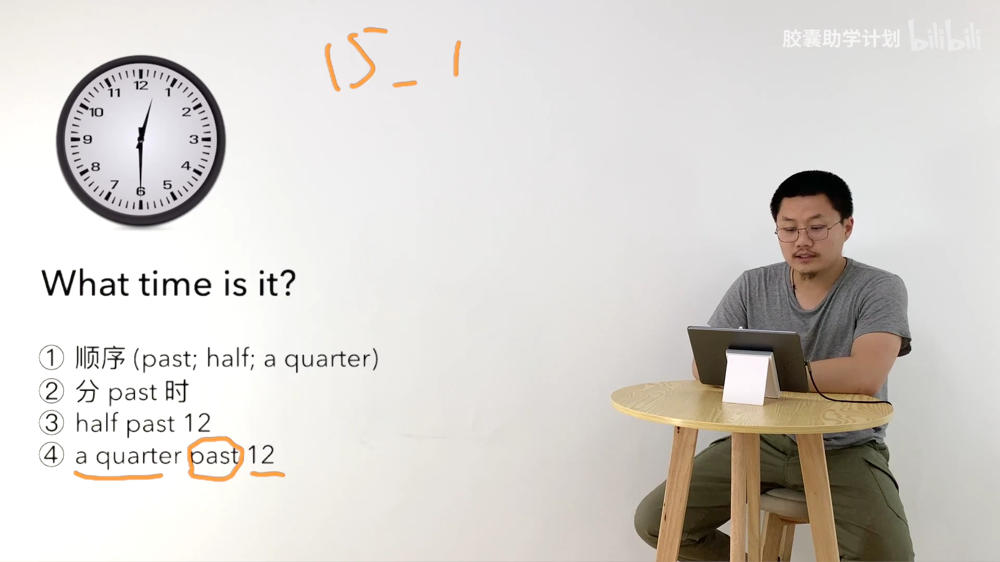

文字识别：胶囊助学计划 / 12 / 11 / 10 / 2 / 9 / 3 / 8 / 4 / 7 / 6 / 5 / What time is it? / 顺序(past; half; a quarter) / 分past时 / 2 / ③half past 12 / 3 / a quarter / past / 12

### 画面 00:03:47

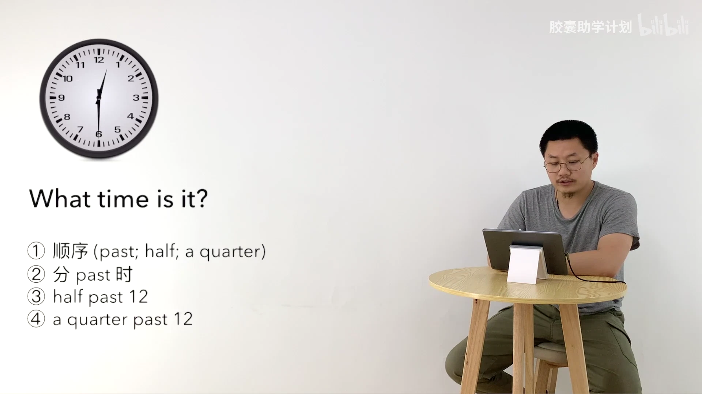

文字识别：胶囊助学计划 / 12 / i1 / 2 / 9 / 3 / 8 / 4 / 7 / 5 / What time is it? / 顺序(past; half; a quarter) / ②分past时 / ③half past 12 / ④a quarter past 12

### 画面 00:03:54

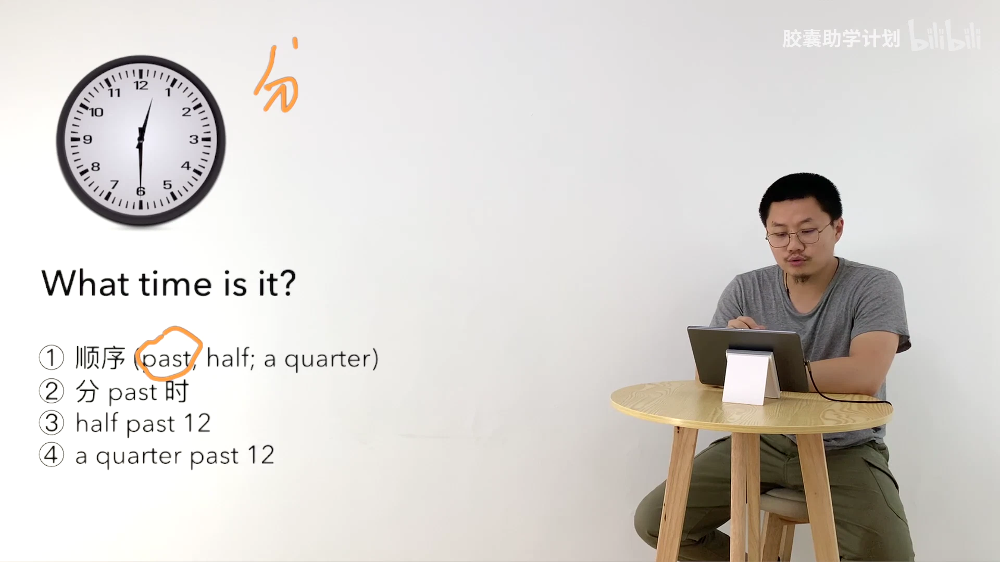

文字识别：胶囊助学计划 / 11 / 12 / N / 10 / 2 / 9 / 3 / 8 / 4 / 7 / 6 / 5 / What time is it? / 顺序 / (oast, half; a quarter) / 1 / 分past时 / 2 / 3 / ③half past 12 / ④ a quarter past 12

### 画面 00:03:57

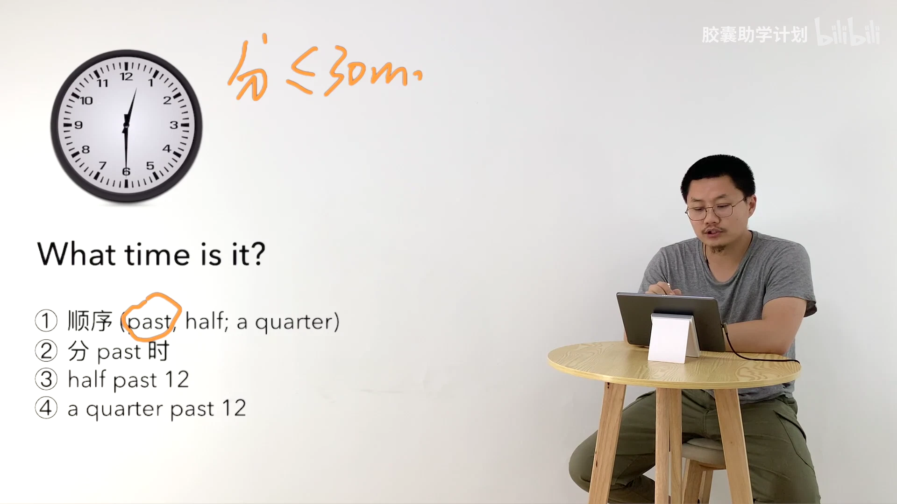

文字识别：胶囊助学计划 / 分≤30m / 12 / 11 / 10 / 2 / 9 / 3 / 8 / 7 / 6 / 5 / What time is it? / 顺序 / (oast, half; a quarter) / 分past时 / 2 / half past 12 / 3 / 4 / a quarter past 12

### 画面 00:03:59

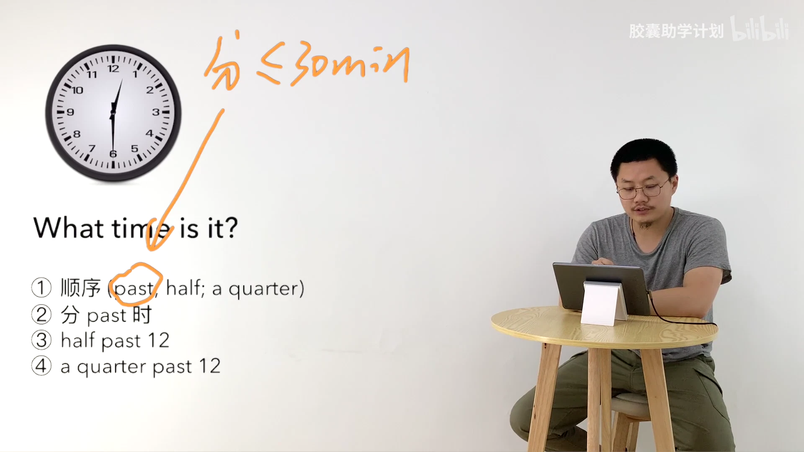

文字识别：胶囊助学计划 / 分≤3omin / 12 / 11 / 10 / 2 / 9 / 3 / 8 / 4 / 7 / 6 / 5 / What tim / is it? / 顺序 / (oast, half; a quarter) / 分past时 / 2 / half past 12 / 3 / a quarter past 12 / 4

## 00:04:00–00:04:30

也就是说，当你现在变成了三十一、三十，比如说四十啊，比如说五十的时候，分钟数就不能用 past 这个单词了。OK，极限就是三十。那这个时候怎么办呢？啊，比如说我们再举一个例子，叫做 twelve past twelve。我们来一个不灵不整的啊，十二 past 十二。你只要记住前面是分钟，后面是什么

### 画面 00:04:08

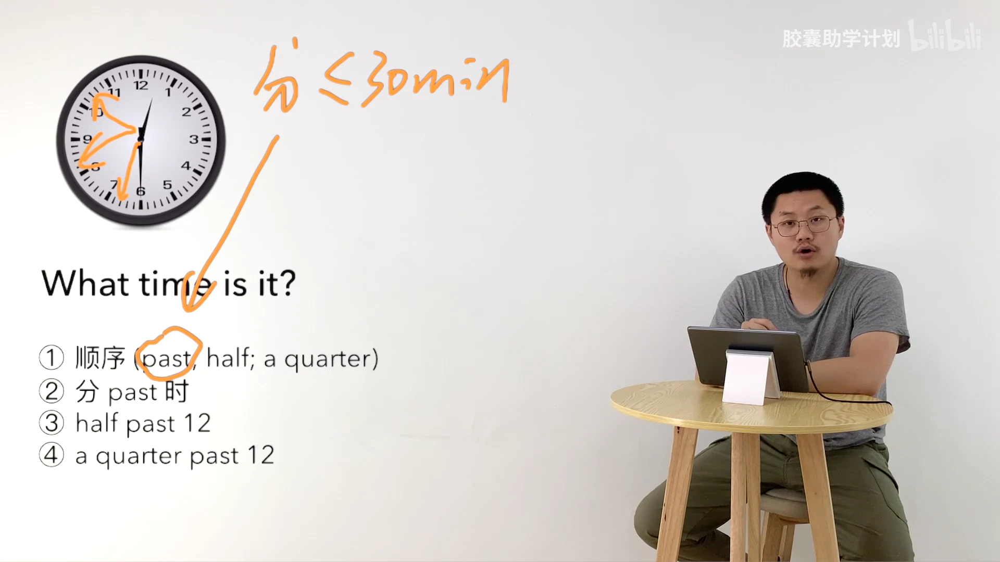

文字识别：胶囊助学计划 / 分≤3omin / 个 / 2 / 3 / 1111 / 6 / 5 / What time /  is it? / 顺序 / (Oast, half; a quarter) / 分past时 / 2 / half past 12 / 3 / a quarter past 12 / 4

## 00:04:30–00:05:00

小时这个事儿就OK了，十二十二，也就是十二点十二分。那如果是二past三呢？前面是分钟，后边是小时，那就是三点零二。各位明白这个意思了啊？应该不是特别的困难，对吧？OK，好，接下来有一种更简单的方式，更简单的方式是什么呢？直接说，比如说刚才我讲到了，对

### 画面 00:04:30

文字识别：胶囊助学计划 / ≤3omin / 个 / 2 / 3 / 1111 / 5 / What tim / is it? / 顺序 / (Dast, half; a quarter) / 分past时 / 2 / half past 12 / 3 / quarter past 12 / 12 / past12

### 画面 00:04:36

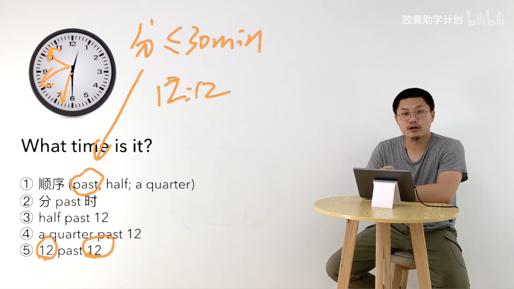

文字识别：胶囊助学计划 / ≤30min / 2 / 3 / 12:12 / 1111 / 6 / What time / is it? / 顺序 / (oast, half; a quarter) / 分past时 / 2 / half past 12 / 3 / quarter past 12 / 12past 12)

### 画面 00:04:38

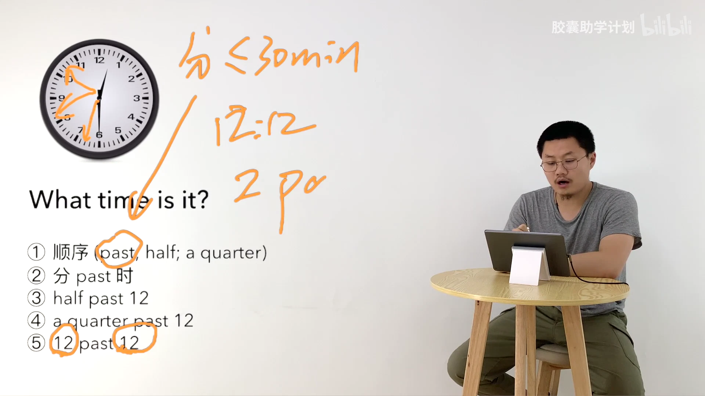

文字识别：胶囊助学计划 / ≤30min / 2 / 3 / 12:12 / 1111 / 6 / 2 / Do / What time is it? / 顺序 / (Oast, half; a quarter) / 分past时 / 2 / half past 12 / 3 / quarter past 12 / 12past 12

### 画面 00:04:41

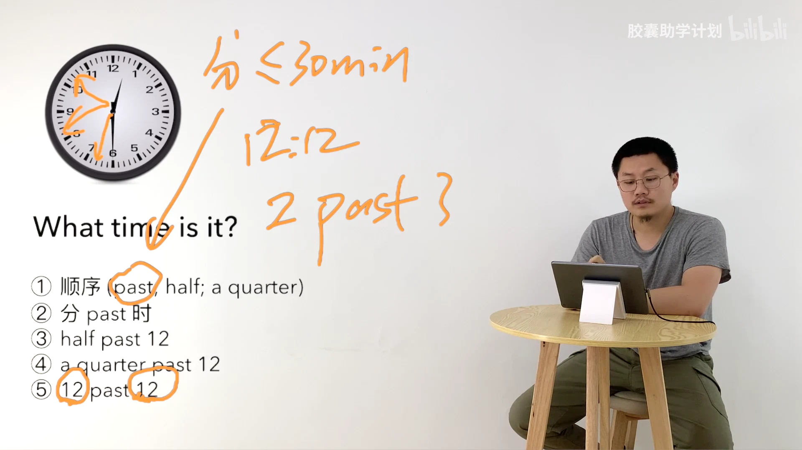

文字识别：胶囊助学计划 / ≤30min / 2 / 3 / 12:12 / 1111 / 6 / Porst / 2 / What tinle is it? / 顺序 / (Dast/ half; a quarter) / 分 / past时 / half / past12 / quarter past 12 / 12past12)

### 画面 00:04:44

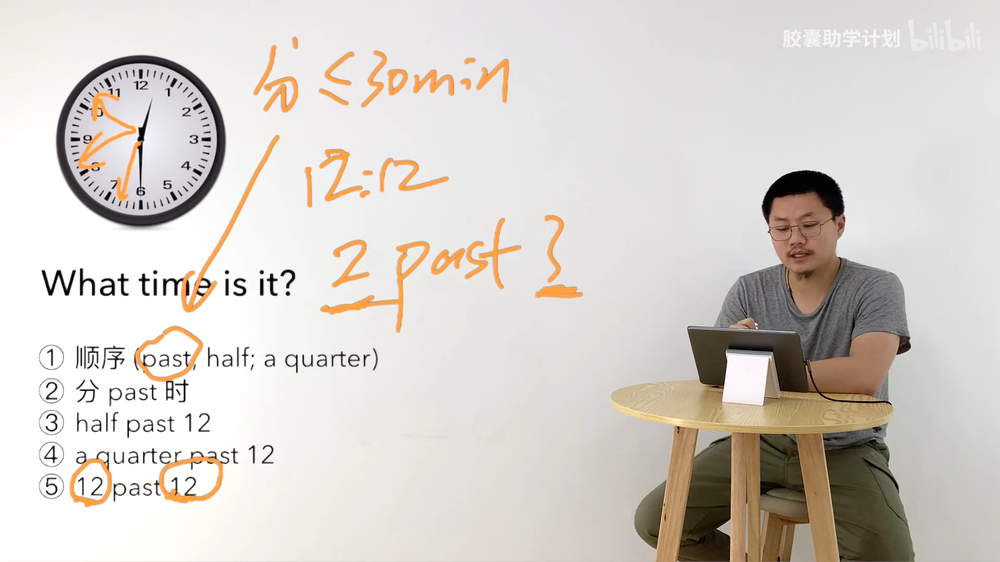

文字识别：胶囊助学计划 / ≤3omin / 1 / 2 / 3 / 12:12 / 1111 / 6 / Poarst / 2 / What tinle is it? / 顺序 / (Oast/ half; a quarter) / 分 / past时 / half / past12 / quarter past 12 / 12 past 12

### 画面 00:04:46

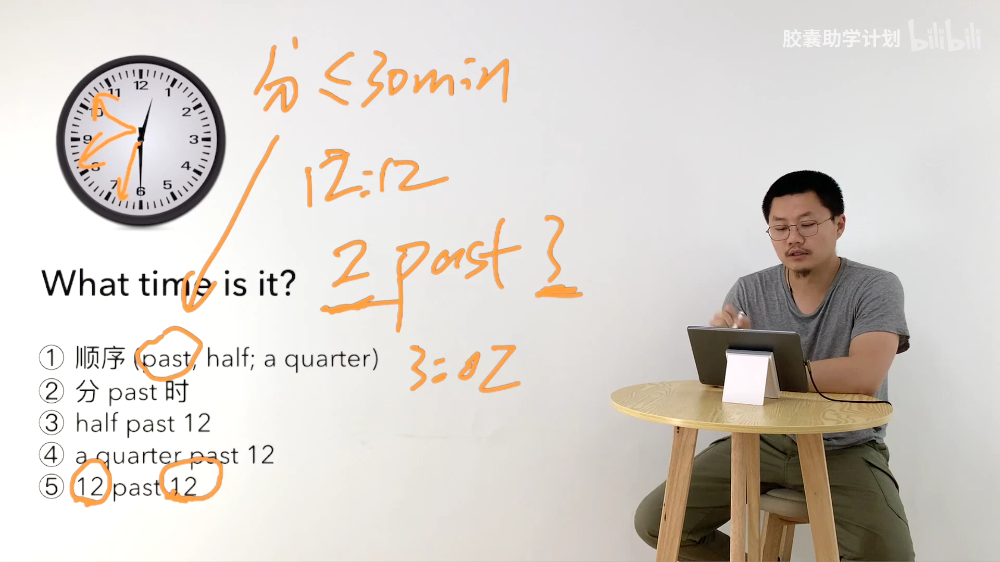

文字识别：胶囊助学计划 / ≤3omin / 2 / 3 / 12:12 / 1111 / 6 / Poarst / Y / What tinle is it? / 顺序 / (Oast, half; a quarter) / 3=0Z / 分 / past时 / half / past12 / quarter past 12 / 12 past 12

### 画面 00:04:48

文字识别：胶囊助学计划 / ≤3omin / 2 / 3 / 12:12 / 1111 / 6 / past / 2 / What tinle is it? / 顺序 / (oast/ half; a quarter) / 分 / past时 / half / past 12 / quarter past 12 / 12past12

### 画面 00:04:50

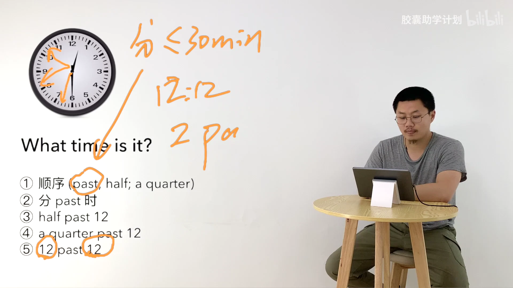

文字识别：胶囊助学计划 / ≤3omin / 2 / 3 / 12:12 / 1111 / 6 / 2 / What timle is it? / 顺序 / (oast, half; a quarter) / 分past时 / 2 / half past 12 / 3 / quarter past 12 / 12past 12

### 画面 00:04:52

文字识别：胶囊助学计划 / ≤30min / 2 / 3 / |2=1 / 1111 / 6 / What tim / is it? / 顺序 / (Dast/ half; a quarter) / 分past时 / 2 / 3 / half / past 12 / quarter past 12 / 12past12

### 画面 00:04:55

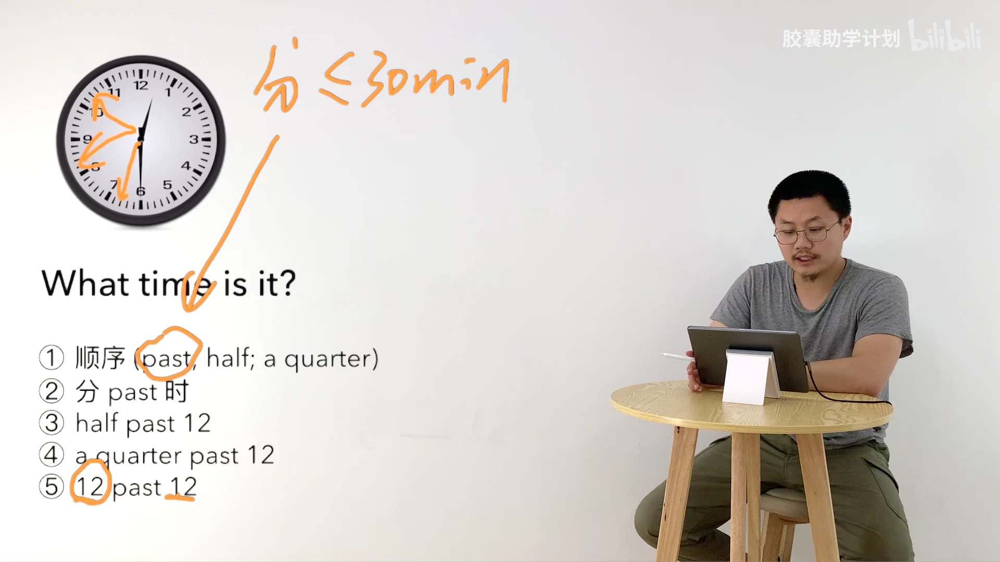

文字识别：胶囊助学计划 / ≤30min / 分 / 2 / 3 / 4 / 1111 / 6 / What tim / is it? / 顺序 / (oast, half; a quarter) / 1 / 分past时 / 2 / half past 12 / 3 / quarter past 12 / 12 / past12

### 画面 00:04:57

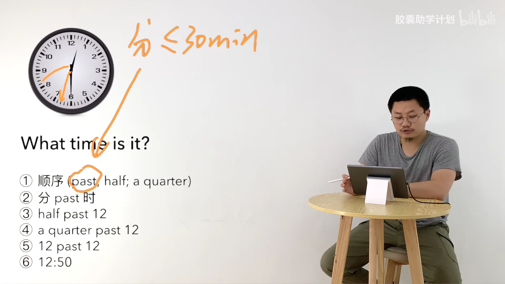

文字识别：胶囊助学计划 / 分≤3omin / 12 / 11 / 10 / 2 / 9 / 3 / 8 / 6 / 5 / What time / is it? / 顺序 / (oast, half; a quarter) / 分past时 / 2 / half past 12 / 3 / 4 / a quarter past 12 / 12 past 12 / 12:50

## 00:05:00–00:05:30

吧？Past的分钟数必须是小于等于三十的。那如果过了三十怎么办？比如说十二点五十怎么办？跟汉语一模一样，就十二点五十就行了。汉语叫十二点五十，英语叫十二五十。十二你会说叫twelve，五十叫做fifty，叫做twelve fifty，对吧？但是这个说起来就会有点多啊。就是我们有更简单的说法，比如说汉语这样说，叫做差十分钟一点啊，差十分

### 画面 00:05:01

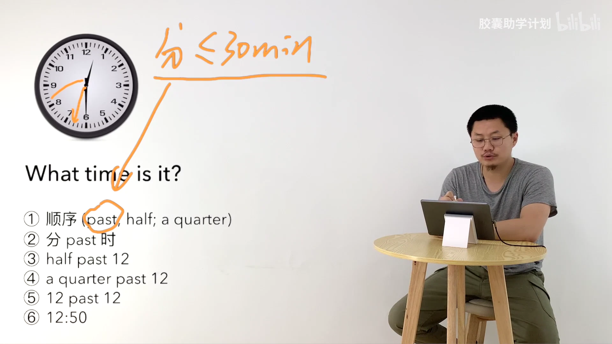

文字识别：胶囊助学计划 / 分≤3omin / 12 / 11 / 10 / 2 / 9 / 3 / 8 / 4 / 6 / 5 / What tim / is it? / 顺序 / (Dast, half; a quarter) / 分past时 / 2 / half past 12 / 3 / a quarter past 12 / 4 / 12 past 12 / 12:50

### 画面 00:05:20

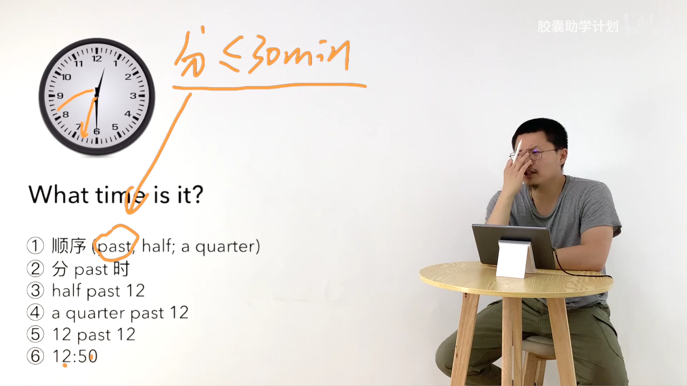

文字识别：胶囊助学计划 / 分≤3omin / 12 / 11 / 10 / 2 / 9 / 3 / 8 / 4 / 6 / What tim / is it? / 顺序 / (Dast, half; a quarter) / 分past时 / 2 / half past 12 / 3 / a quarter past 12 / 4 / 12 past 12 / 12:50 / 6

### 画面 00:05:24

文字识别：胶囊助学计划 / 分≤3omin / 12 / 11 / 10 / 2 / 9 / 3 / 8 / 4 / 6 / 5 / What timg / is it? / 顺序 / (past/ half; a quarter) / 分past时 / 2 / half past 12 / 3 / 4 / a quarter past 12 / 12 past 12 / 6 / 12:50

## 00:05:30–00:06:00

钟一点。英语也有这个表达，我们马上就讲到啊。但是我们再把这一页重复给大家说一下。目前我们在这一页实际上学到了两种说法。第一种说法叫一到五，用分 past 小时这样去表达。但是要注意，只有当分针数小于等于三十的时候，我们才用 past。如果过了怎么办呢？我们就直接说就行了，叫十二点五十，对吧？那包括比如说十二点

### 画面 00:05:44

文字识别：胶囊助学计划 / 分≤3omin / 12 / 11 / 10 / 2 / 9 / 3 / 8 / 4 / 6 / 5 / What tim / is it? / 顺序 / (oast, half; a quarter) / 1 / 分past时 / 2 / half past 12 / 3 / a quarter past 12 / 12 past 12 / 6 / 12:50

### 画面 00:05:49

文字识别：胶囊助学计划 / ≤30min / 12 / 11 / 10 / 2 / 9 / 3 / 8 / 4 / 6 / What timy / is it? / 顺序 / (Oast, half; a quarter) / 1 / 分past时 / 2 / 3 / half / past 12 / a / quarter past 12 / 12 / past12 / 6 / 12:50

### 画面 00:05:51

文字识别：胶囊助学计划 / ≤30min / 12 / 11 / 10 / 2 / 9 / 3 / 8 / What time / is it? / 顺序 / (oast, half; a quarter) / 1 / 分past时 / 2 / 3 / half  / past 12 / a quarter past 12 / 12 past 12 / 6 / 12:50

## 00:06:00–00:06:30

半，我能不能不不反着说，不说分 past 十呢？也可以，你就说十二点三十吧，叫做 twelve thirty，没有问题啊。那接下来我们再说一下，它倒过来差多少时间几点？比如说像现在这个表叫做差十分钟几点？一点吧。OK，好，那它这个时候就不用 past 了，就用 two 了。那这地方注意 two 的分钟数是大于三十分钟的，

### 画面 00:06:00

文字识别：胶囊助学计划 / ≤30min / 12 / 11 / 10 / 2 / 9 / 3 / 8 / 4 / 6 / (2 / What tim / is it? / 顺序 / (Dast, half; a quarter) / 1 / 分past时 / 2 / 3 / half / past 12 / a quarter past 12 / 12 past 12 / ⑥12:50

### 画面 00:06:02

文字识别：胶囊助学计划 / ≤30min / 12 / 11 / 10 / 2 / 9 / 3 / 8 / 6 / 5 / 12:30 / What timy / is it? / 顺序 / (Dast, half; a quarter) / 分past时 / 2 / 3 / half / past 12 / quarter / past12 / 12 / past 12 / ⑥12:50

### 画面 00:06:08

文字识别：胶囊助学计划 / ≤3omin / 12 / 11 / 10 / 2 / 9 / 3 / 8 / 4 / 6 / (2:30 / What time / is it? / 顺序 / (Oast, half; a quarter) / 分past时 / 2 / half past 12 / 3 / a quarter past 12 / 12 past 12 / ⑥12:50

### 画面 00:06:10

文字识别：胶囊助学计划 / 12 / 2 / 9 / 3 / 8 / 4 / 5 / What time is it?

### 画面 00:06:25

文字识别：胶囊助学计划 / 12 / 9 / 8 / 4 / 5 / What time is it? / 倒序(to;half;a quarter)

### 画面 00:06:29

文字识别：6>3omiv / 胶囊助学计划 / 12 / 1 / 9 / 3 / 8 / 4 / 5 / What time is it? / 倒序(to; half; a quarter)

## 00:06:30–00:07:00

刚才的 past 是小于等于三十分钟的，对吧？OK，那 half 和 a quarter 意思跟刚才没有任何区别，是一样的。我们接着往下走，它叫做分 to 五十。好，比如说 a quarter to twelve。好了，注意啊，我故意在这儿写了一个啊，我我先不说我故意写什么样，我我们先看一下它怎么翻译啊。来， a quarter 叫做分钟，叫

### 画面 00:06:31

文字识别：>30min / 胶囊助学计划 / 12 / 9 / Dos / 8 / 4 / 5 / What time is it? / 倒序(to; half; a quarter)

### 画面 00:06:33

文字识别：30min / 胶囊助学计划 / 12 / Post≤30 / 9 / 8 / 4 / 5 / What time is it? / 倒序(to; half; a quarter)

### 画面 00:06:39

文字识别：30min / 胶囊助学计划 / 12 / 如> / 9 / f≤30mm / pasts / 8 / 4 / 5 / What time is it? / 倒序(to;half; a quarter)

### 画面 00:06:50

文字识别：3omin / 胶囊助学计划 / 12 / f≤30mm / 9 / pasts / 8 / 4 / 5 / What time is it? / 倒序(to;half; a quarter) / 分to时 / 2） / 3 / a quarter to 12

### 画面 00:06:54

文字识别：30min / 胶囊助学计划 / 12 / 4> / 9 / f≤30mm / pasts / 8 / 4 / 5 / What time is it? / 倒序(to;half; a quarter) / 分to时 / 2 / 3 / a quarter to 12

### 画面 00:06:57

文字识别：30min / 胶囊助学计划 / 12 / f≤30mm / 9 / pasts / 8 / 4 / 5 / What time is it? / 倒序(to;half; a quarter) / 分to时 / a quarterto 12

## 00:07:00–00:07:30

十五分钟，叫差十五分钟到十二点。我想问一下，你看和这个图表示的是一样的吗？这是大家最容易犯的一个错误啊！我故意这样写了一个这个分钟，现在图当中显示的应该叫做差十分钟一点。那我们也可以说它差十五分钟啊。咱们不具体纠结这个，比如说差十五分钟一点。那这个地方你要注意，a quarter to的这个不是十二，应该是一，

### 画面 00:07:05

文字识别：3omin / 胶囊助学计划 / 12 / 4> / ≤30mm / 9 / 8 / 4 / 5 / What time is it? / 倒序(to;half; / a quarter) / 分 / o時 / a quarterto / 12

### 画面 00:07:07

文字识别：3omin / 胶囊助学计划 / 12 / 4> / ≤30mm / 9 / 8 / 4 / 5 / What time is it? / 倒序(to;half; / a quarter) / te時 / a quarterto / 12

### 画面 00:07:10

文字识别：3omin / 胶囊助学计划 / 12 / 9 / ≤30mM / 8 / 4 / 5 / What time is it? / 倒序(to;half; / a quarter) / 分t時 / a quarterto / 12

### 画面 00:07:27

文字识别：3omin / 胶囊助学计划 / 12 / 4> / ≤30mm / 9 / 8 / 5 / What time is it? / 倒序(to;half; / a quarter) / a quarterto12

## 00:07:30–00:08:00

对吧？所以呢，现在叫做差十五分钟十二点，那就是十一点四十五。我希望各位在这儿明白了，是吧？别太懵啊。OK，那我们接着往下走。比如说 ten to twelve，我想问的问题是，现在表达的是这个时间吗？想一下刚才我说的，各位自己想一下。ten to twelve，ten 是分钟，twelve 是小时，叫做差十分钟十二点，那是

### 画面 00:07:36

文字识别：30min / 胶囊助学计划 / 12 / 9 / ≤30mm / 8 / 4 / 5 / 川:C / What time is it? / 倒序(to;half; / a quarter) / 分e時 / a quarterto12

### 画面 00:07:40

文字识别：3omin / 胶囊助学计划 / 12 / ≤30mm / 9 / 8 / 4 / 5 / What time is it? / 倒序(to;half; a quarter) / 分to时 / a quarterto 12

### 画面 00:07:42

文字识别：3omin / 胶囊助学计划 / 12 / +≤30mm / 9 / 8 / 4 / 5 / What time is it? / 倒序(to;half; a quarter) / 分to时 / 3 / a quarter to 12 / ） / 10 to12

### 画面 00:07:47

文字识别：30min / 胶囊助学计划 / 12 / f≤30mm / 9 / pasts / 8 / 4 / 5 / What time is it? / 倒序(to;half; a quarter) / 分to时 / a quarter to 12 / 3 / 10to12

### 画面 00:07:50

文字识别：3omin / 胶囊助学计划 / 12 / f≤30mm / 4 / 5 / What time is it? / 倒序(to; half; a quarter) / 分to时 / a quarter to 12 / 3 / 10to12

### 画面 00:07:52

文字识别：3omin / 12 / f≤30mm / 4 / 5 / What time is it? / 倒序(to;half; a quarter) / 分to时 / a quarter to 12 / 3 / 10to12

## 00:08:00–00:08:30

十一点五十，是不是这个时间？你想一想，不是对吧？应该是 ten to one，对吧？差十分钟一点。OK，哪一个？好，那接下来我们看一个小的电影片段。电影片段出现了这样两句话，叫 What time is it？几点了？答案叫 Quarter one。我们先猜一下 Quarter one 是几点？啊， Quarter，我们之前我我官方给的叫做 A quarter，

### 画面 00:08:01

文字识别：3omin / 学计划 / 12 / f≤30mm / posts / 4 / 5 / What time is it? / 倒序(to;half; a quarter) / 分to时 / a quarter to 12 / 3 / 10to12

### 画面 00:08:03

文字识别：3omin / 胶囊助学计划 / 12 / 4> / +≤30mm / 4 / 5 / What time is it? / 倒序(to;half; a quarter) / 分to时 / a quarter to 12 / 3 / 10 to 12

### 画面 00:08:12

文字识别：胶囊助学计划 / What time is it? / quarter one / MEMEN / 记忆碎片Memento(2000)

### 画面 00:08:14

文字识别：胶囊助学计划 / What time is it? / quarter one / MEMEN / 记忆碎片Memento(2000)

### 画面 00:08:16

文字识别：胶囊助学计划 / What time is it? / quarter one / MEMEN / 记忆碎片Memento(2000)

### 画面 00:08:21

文字识别：胶囊助学计划 / What time is it? / quarter one / MEMENT / 记忆碎片 Memento(2000)

### 画面 00:08:23

文字识别：胶囊助学计划 / What time is it? / quarter one / MEMEN / 记忆碎片Memento(2000)

### 画面 00:08:28

文字识别：胶囊助学计划bl出 / What time is it? / quarter one / MEMENT / 记忆碎片 Memento(2000)

## 00:08:30–00:09:00

要么是 past one，要么是 two one。我是不是这么给大家说的？对吧？他现在在这个电影当中，首先 a 去掉，这个好理解，对吧？a呃 quarter啊，你你甚至可能读快了，这个 a 就没了。然后和 past two，它也没用。我们先看一下啊，来， Leonard always get a receipt. Oh yeah, write that down.

### 画面 00:08:32

文字识别：胶囊助学计划 blb出 / What time is it? / quarter one / MEMEN / 记忆碎片 Memento(2000)

### 画面 00:08:35

文字识别：Bibli / 胶囊助学计划 / What time is it? / quarter one / panst / MEMEN / to / 记忆碎片Memento(2000)

### 画面 00:08:37

文字识别：bilbii / 胶囊助学计划 / What time is it? / quarter one / ponst / one / MEMEN / 记忆碎片 Memento(2000)

### 画面 00:08:41

文字识别：bilbili / 胶囊助学计划 / What time is it? / quarter one / ponst / ene / MEMEN / 记忆碎片Memento(2000)

### 画面 00:08:43

文字识别：blbil / 胶囊助学计划 / What time is it? / quarter one / ponst / ene / MEMEN / 记忆碎片 Memento (2000)

### 画面 00:08:46

文字识别：Bilibi / 胶囊助学计划 / What time is it? / quarter one / 啤 / ponst / ene / MEMEN / t / 记忆碎片Memento(2000)

### 画面 00:08:49

文字识别： Bilbili / 胶囊助学计划 / What time is it? / ERTO / quarter one / (pnst / ene / MEMEN / 记忆碎片 Memento (2000) / -

### 画面 00:08:51

文字识别：Bilibil / 胶囊助学计划 / What time is it? / quarter one / (ponst) / ene / MEMENT / 记忆碎片 Memento(2000) / -

### 画面 00:08:53

文字识别：bilbili / 胶囊助学计划 / 莱纳每次都应该拿收据 / Leonard, always get a receipt.

### 画面 00:08:55

文字识别：bilbili / 胶囊助学计划 / 莱纳 每次都应该拿收据 / Leonard, always get a receipt.

### 画面 00:08:57

文字识别：bilbili / 胶囊助学计划 / 我会记下来 / Yeah. I'm gonna write that down.

### 画面 00:08:59

文字识别：Bilibili / 胶囊助学计划 / RiLC / St / NATALIE / 今天下午一点找娜塔莉拿消息

## 00:09:00–00:09:30

what time is it? Quarter to one. Okay,好，我不知道各位听没听到那个 to，你有没有听到？啊，quarter to one, quarter to one，是吧？那个 to，如果你没听到，那我们再去想，它没有加 to 和加了 to，没有加 to 的时候，可能是 past，可能是 two，是吧？加了 to 就不用说了，差十五分钟一点，

### 画面 00:09:01

文字识别：bilbili / 胶囊助学计划 / NATALIE / -现在几点了？-12点45分 / -What time is it? -Quarter to 1:00.

### 画面 00:09:03

文字识别：bilbli / 胶囊助学计划

### 画面 00:09:05

文字识别：Bilbili / 胶囊助学计划 / a / 对不起 / Excuse me.

### 画面 00:09:07

文字识别：胶囊助学计划 / What time is it? / quarter one / MEMEN / 记忆碎片Memento(2000)

### 画面 00:09:09

文字识别：胶囊助学计划 / What time is it? / quarter one / MEMEN / 记忆碎片Memento(2000)

### 画面 00:09:12

文字识别：胶囊助学计划 / What time is it? / quarterone / MEMEN / 记忆碎片Memento(2000)

### 画面 00:09:15

文字识别：胶囊助学计划 / What time is it? / quarterone / MEMEN / 记忆碎片Memento(2000)

### 画面 00:09:21

文字识别：胶囊助学计划 / What time is it? / quarterone / MEMEN / 记忆碎片Memento(2000)

### 画面 00:09:24

文字识别：胶囊助学计划 / 福 / - / What time is it? / quarterone / MEMEN / 记忆碎片Memento(2000)

### 画面 00:09:27

文字识别：胶囊助学计划 / - / What time is it? / ERTO / quarterone / MEMEN / 记忆碎Memento(2000)

## 00:09:30–00:10:00

这个就很容易了，对吧？那你想一下，这个地方他直接说 quarter one，没有加 to，为什么？或者说可不可以？就你想一下，它跟语法的区别在哪儿？我想简单说一下，这个地方的区别在什么地方呢？就是我们现实生活当中，你问别人时间的时候，大概还是可能有一个前后，就是大概在什么时间前后，对吧？你大概可能知道，比如说现在是一点，一点左右钟还

### 画面 00:09:31

文字识别：胶囊助学计划 / What time is it? / quarterone / MEMEN / 记忆碎片 Memento(2000)

### 画面 00:09:46

文字识别：胶囊助学计划 / What time is it? / quarterone / MEMENT / 记忆碎片 Memento(2000)

### 画面 00:09:48

文字识别：胶囊助学计划 / What time is it? / quarterone / MEMEN / 记忆碎片Memento(2000)

### 画面 00:09:53

文字识别：胶囊助学计划 / What time is it? / quarterone / MEMEN / 记忆碎片Memento(2000)

### 画面 00:09:58

文字识别：胶囊助学计划 / What time is it? / quarterone / MEMEN / 记忆碎片Memento(2000)

## 00:10:00–00:10:30

是十二点左右钟，大概是有这样一个感受的。所以他在这个地方也许就可以不加上 to 或者 past。但如果产生了歧义，我的个人建议就是一定要把 to 或者 past 加上。OK，就是现实生活一定比我们的语法要更复杂。各位记住这点就行了。好，不多说了。那接下来我们要做的对比是 do does 和 am is are doing，全是口语练习。各位张开嘴跟我读就好了。来了，What does he

### 画面 00:10:10

文字识别：胶囊助学计划 / What time is it? / quarterone / MEMEN / 记忆碎片Memento(2000)

### 画面 00:10:13

文字识别：胶囊助学计划 / What time is it? / quarterone / ?at / MEMEN / 记忆碎片 Memento(2000)

### 画面 00:10:17

文字识别：胶囊助学计划 / What time is it? / quarterone / ?at / MEMEN / 记忆碎片Memento (2000)

### 画面 00:10:19

文字识别：胶囊助学计划 / do/does VS be+v.ing

### 画面 00:10:22

文字识别：胶囊助学计划 / do/does VS be+v.ing

## 00:10:30–00:11:00

do every day? He usually shaves at seven o'clock every day. What is he doing today? He is shaving at eight o'clock today. Continue. What does she usually do in the morning? She usually drinks tea in the morning. What is she doing this morning? She is drinking

### 画面 00:10:32

文字识别：胶囊助学计划 / do/does VS be+v.ing / ① What does he usually do every day? / ② He usually shaves at 7 o'clock every day.

### 画面 00:10:39

文字识别：胶囊助学计划 / do/does VS be+v.ing / ① What does he usually do every day? / ② He usually shaves at 7 o'clock every day. / ③ What is he doing today? / 3 /  He is shaving at 8 o'clock today. / 4

### 画面 00:10:45

文字识别：胶囊助学计划 / do/does VS be+v.ing

### 画面 00:10:52

文字识别：胶囊助学计划 / do/does VS be+v.ing / D What does she usually do in the morning? / 1 / ② She usually drinks tea in the morning. / 2）

### 画面 00:10:58

文字识别：胶囊助学计划 / do/does VS be+v.ing / ① What does she usually do in the morning? / She usually drinks tea in the morning. / 2 / What is she doing this morning? / She is drinking coffee this morning.

## 00:11:00–00:11:30

coffee this morning. Next one, what do they usually do in the afternoon? Zhang Zui,跟我读. They usually play in the garden in the afternoon.一般现在时. What are they doing this afternoon?哎，现在进行时. They are swimming in the river this afternoon. Continue. What do you usually do in the evening? I usually cook a meal

### 画面 00:11:02

文字识别：胶囊助学计划 / do/does VS be+v.ing

### 画面 00:11:09

文字识别：胶囊助学计划 / do/does VS be+v.ing / ① What do they usually do in the afternoon? / ② They usually play in the garden in the afternoon. / 2）

### 画面 00:11:18

文字识别：胶囊助学计划 / do/does VS be+v.ing / ① What do they usually do in the afternoon? / They usually play in the garden in the afternoon. / 2 / What are they doing this afternoon? / 3 / D They are swimming in the river this afternoon. / 4

### 画面 00:11:23

文字识别：胶囊助学计划 / do/does VS be+v.ing

## 00:11:30–00:12:00

in the evening. What are you doing this evening? I'm reading a book this evening. Next one. What do you all usually do at night? 注意一个小的 all.来, we usually watch TV at night. What are you all doing tonight? We're listening to the stereo tonight. Okay,好了,

### 画面 00:11:32

文字识别：胶囊助学计划 / do/does VS be+v.ing / ① What do you usually do in the evening? / ②I usually cook a meal in the evening. / ③ What are you doing this evening? / 3

### 画面 00:11:39

文字识别：胶囊助学计划 / do/does VS be+v.ing / ① What do you all usually do at night?

### 画面 00:11:44

文字识别：胶囊助学计划 / do/does VS be+v.ing / ① What do you al / usually do at night?

### 画面 00:11:50

文字识别：胶囊助学计划 / do/does VS be+v.ing / ① What do you / usually do at night? / We usually watch television at night. / 2 / What are you all doing tonight?

### 画面 00:11:58

文字识别：胶囊助学计划 / Recap / Patterns / do/does / VS / Grammar / am/is/are+doing / Words / half / a quarter / Expression / past / to

## 00:12:00–00:12:30

recap.好，这一课想重点强调各位回去练习的就是这几个单词：half, a quarter past, and two.我们实际上讲了三种不同说时间的方式啊。首先，十二点、十一、三十、五十，您跟汉语没有任何区别，直接说就行了。汉语说十二点五十，英语说十二五十就可以了，就这么简单，对吧？第二种说法是由这个分去决定的。

### 画面 00:12:03

文字识别：胶囊助学计划 / Recap / Patterns / do/does / & / VS / Grammar / am/is/are+doing / Words / half / a quarter / Expression / past

### 画面 00:12:09

文字识别：胶囊助学计划 / Recap / Patterns / do/does / VS / Grammar / am/is/are+doing / Words / half / Expression / a quarter / past

### 画面 00:12:11

文字识别：Recap / 胶囊助学计划 / Patterns / do/does / VS / Grammar / am/is/are+doing / Words / half / a quarter / Expression / past

### 画面 00:12:26

文字识别：胶囊助学计划 / Recap / Patterns / do/does / VS / Grammar / am/is/aretdoing / Words / half / a quarter / Expression / past

## 00:12:30–00:13:00

如果是小于等于三十分钟，应该用 past，对吧？如果是大于三十分钟，那你就要用 to 了。然后呢， half 指的是 一半，三十分钟， a quarter 指的是十五分钟。其次，在差多少分钟几点的那个 to 那个地方，一定要注意，各位非常容易犯的错误就是，你会把它写成本来应该是差十分钟一点，你会把它写成差十分钟十二点。 OK，你翻译过来你是不会了。 OK，

### 画面 00:12:38

文字识别：Recap / 胶囊助学计划 / Patterns / do/does / VS / Grammar / am/is/are+doing / Words / half / a quarter / Expression / past

### 画面 00:12:46

文字识别：胶囊助学计划 / Recap / Patterns / do/does / VS / Grammar / am/is/are+doing / Words / half / a quarter / Expression / past

### 画面 00:12:48

文字识别：胶囊助学计划 / Recap / Patterns / do/does / VS / Grammar / am/is/aretdoing / Words / half / a quarter / Expression / past

## 00:13:00–00:13:30

其次呢，我们做了一些小的口语听力练习，去继续对比 do does 和 am is are doing。那我们看一下本课家庭作业。首先，绿皮书五十八课各位可以去写了。各位，其次再做一个小的作业。您随时看，拿手机看看表，对吧？把这个时间尝试用英文给它说出来。您基本上这一天说它个十次二十次啊，我估计这个 two past half a quarter 就记下来了。OK。

### 画面 00:13:01

文字识别：胶囊助学计划 / Recap / Patterns / do/does / VS / Grammar / am/is/are+doing / Words / half / a quarter / Expression / past

### 画面 00:13:03

文字识别：胶囊助学计划 / Recap / Patterns / do/does / VS / Grammar / am/is/are+doing / Words / half / a quarter / Expression / past

### 画面 00:13:05

文字识别：胶囊助学计划 / Recap / Patterns / do/does / VS / Grammar / am/is/are+doing / Words / half / a quarter / Expression / past

### 画面 00:13:07

文字识别：胶囊助学计划

### 画面 00:13:14

文字识别：胶囊助学计划 / 绿皮书第58课的写作练习 / 随时看表，说出时间

### 画面 00:13:29

文字识别：胶囊助学计划 / 绿皮书第58课的写作练习 / 随时看表，说出时间

## 00:13:30–00:14:00

好，最后给自己讲解一遍今天的核心知识点。那如果大家喜欢我们的课程呢，欢迎大家关注、订阅、一键三连支持，并分享给那些需要的朋友。我们再来看一句名人名言：Time is the most valuable thing a man can spend. See you next time.

### 画面 00:13:31

文字识别：胶囊助学计划 / 绿皮书第58课的写作练习 / 随时看表，说出时间 / 3.请给自己讲解一遍今天的 / 核心知识点

### 画面 00:13:34

文字识别：胶囊助学计划

### 画面 00:13:36

文字识别：胶囊助学计划

### 画面 00:13:41

文字识别：胶囊助学计划 / Theonhrasus. / Time is the most valuable thing a man can / spend. / Theophrastus

### 画面 00:13:49

文字识别：Theorhrastus. / Time is the most valuable thing a man can / spend. / Theophrastus

### 画面 00:13:51

文字识别：CAPSULEACADEMY / 胶囊助学计划 / 小红书 / Lecturer / □ / Leo / OE

### 画面 00:13:54

文字识别：CAPSULEACADEMY / 胶囊助学计划 / 小红书 / OE

### 画面 00:13:57

文字识别：CAPSULEACADEMY / 胶囊助学计划 / 小红书 / Creator / □ / Leo & Berlin / OE

### 画面 00:13:59

文字识别：Bilbili / 胶囊助学计划 / CAPSULEACADEMY / 胶囊助学计划 / 小红书 / OE

## 00:14:00–00:14:02

### 画面 00:14:01

文字识别：bilibili / 胶囊助学计划

