# 061 单词

快速机器解析：语音为单模型转写，未进行独立交叉校对或人工复核；画面每秒采样并按变化选帧，短时文字和标记可能遗漏。截图时间约有 1 秒误差。图片有损压缩；遇到疑点请按时间查看 Google Drive 原视频。

## 00:00:00–00:00:30

Hello everyone, welcome to Capsule Academy. This is Leo. Today we're going to learn New Concept English Book One, Lesson Sixty One Words. That old habit. That.进入正式课程之前，我们先看几个问题。第一，如何去使用 feel, smell 等等这一系列表示感官的动词。第二呢，如何表达重感冒？最后一个问题，如何表达我有一个好消息？那带着这三个问题，后面呢， enjoy it.

### 画面 00:00:00

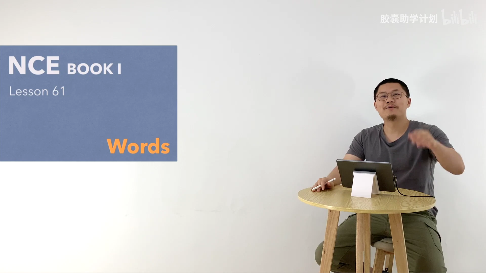

文字识别：胶囊助学计划 / NCE / BOOKI / Lesson 61 / Words

### 画面 00:00:07

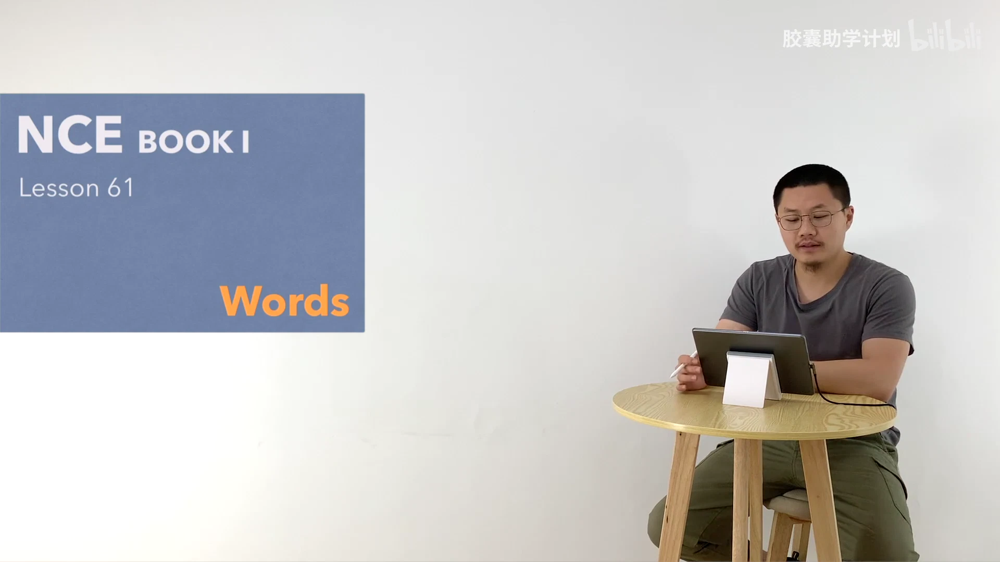

文字识别：胶囊助学计划 / NCE / BOOKI / Lesson 61 / Words

### 画面 00:00:09

文字识别：胶囊助学计划

### 画面 00:00:11

文字识别：胶囊助学计划 / ①如何使用feel/smell.?

### 画面 00:00:19

文字识别：胶囊助学计划 / ①如何使用feel/smell..? / 如何表达“重感冒”?

### 画面 00:00:21

文字识别：胶囊助学计划 / ①如何使用feel/smell..? / 如何表达“重感冒”? / 有好消息”？

### 画面 00:00:23

文字识别：胶囊助学计划 / ①如何使用feel/smell..? / 如何表达“重感冒”? / 如何表达“我有好消息”？

### 画面 00:00:28

文字识别：胶囊助学计划bil出

## 00:00:30–00:01:00

好，那我们上来先看两个单词啊，第一个是动词，第二个是一个形容词。我们先一起读一下，第一个单词叫做 feel，最后别忘了，对吧？最后这个音标一定要记得舌尖舔到上牙龈，而不是读 feel。你看你要读 feel，哎，舌尖舔上牙龈就 OK 了啊。来， feel 叫做感觉啊。我们接下来会讲五个跟感官相联系的动词，这些动词有一个共

### 画面 00:00:32

### 画面 00:00:34

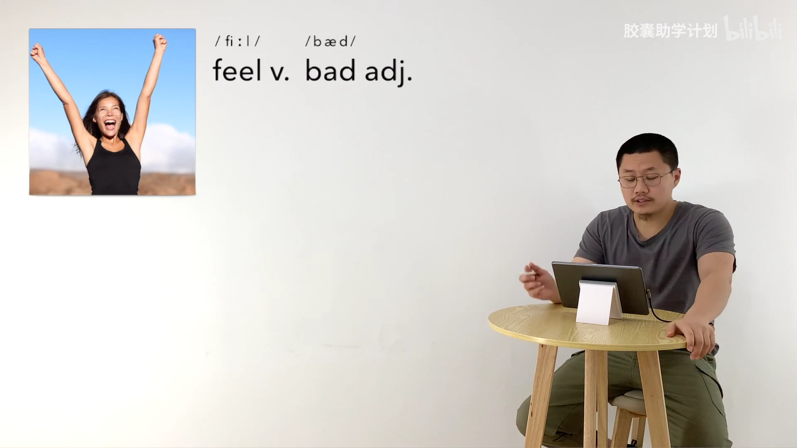

文字识别：胶囊助学计划 / / fi : | / / / bæed/ / feel v. bad adj. / /

### 画面 00:00:44

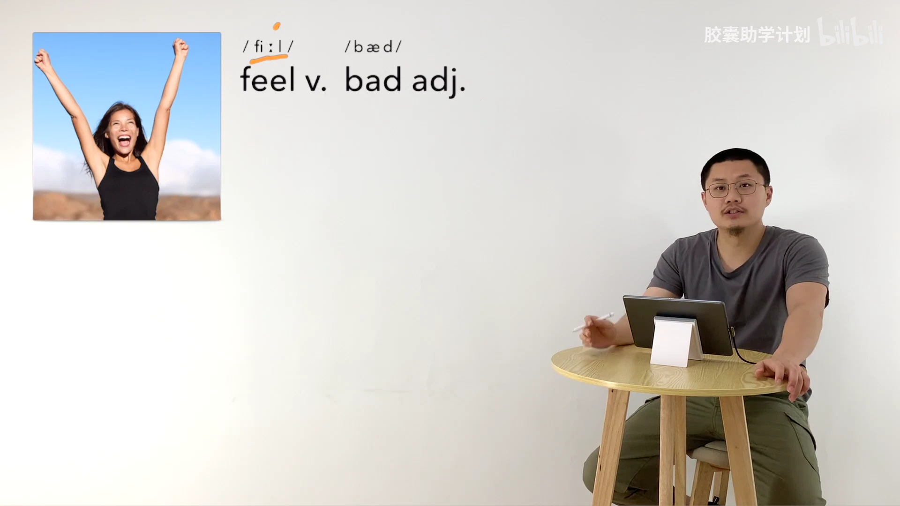

文字识别：胶囊助学计划 / / fi :1/ / /bæd/ / feel v. bad adj.

## 00:01:00–00:01:30

同的特征，就是它后面啊，一般来说动词我们不是后边都加名词嘛，对吧？这五个表示感官的动词，它们在后面可以加上形容词，比如说 bad，对吧？ good bad 好还是坏？比如说 she feels great，那叫她感觉特别的棒。那如果说她感觉很很差呢，那叫做 she feels bad。注意一个小点，你看这个地方动词后边加了 as，

### 画面 00:01:03

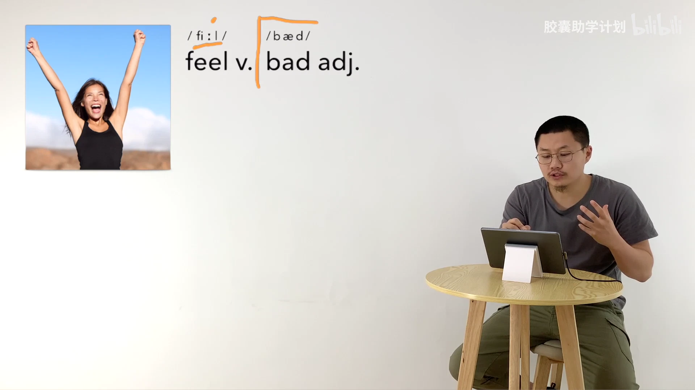

文字识别：胶囊助学计划 / / fi :1/ / / bæd/ / feel v.bad adj. / /

### 画面 00:01:06

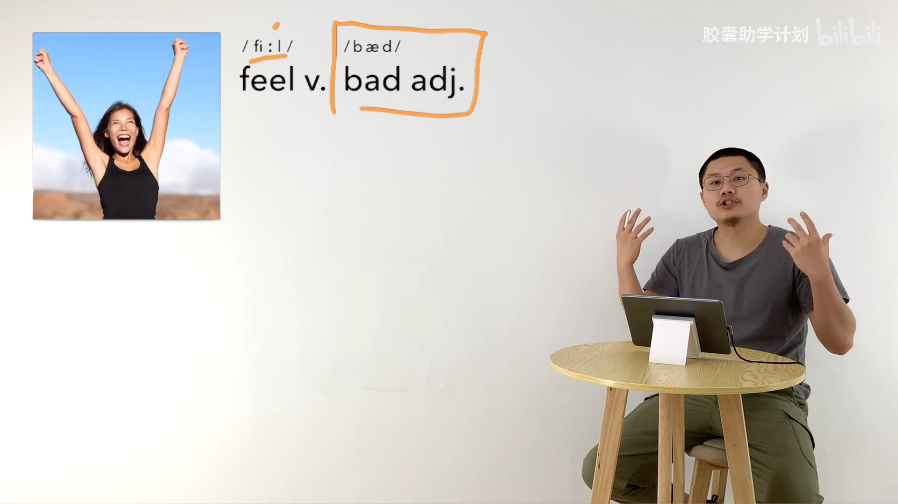

文字识别：胶囊助学计划 / / fi :1 / / / bæed/ / feel v.bad adj.

### 画面 00:01:27

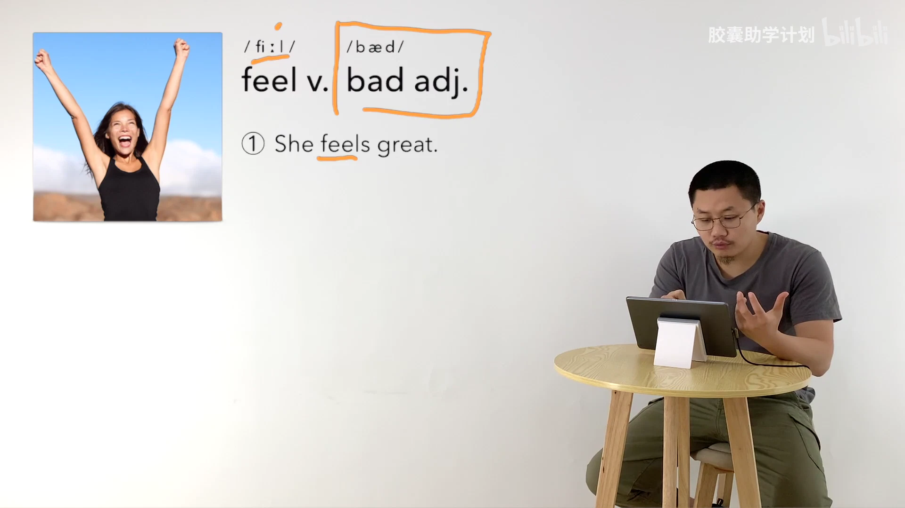

文字识别：胶囊助学计划 / / fi :1 / / / bæd/ / feel v.bad adj. / ① She feels great.

## 00:01:30–00:02:00

这个地方提醒我们什么？在陈述一个现在的客观事实，对吧？它是一个一般现在时这个时态，还是满足我们从四十七课四十九课就学到的一般现在时这个时态的用法。也就是说，当你主语是第三人称单数的时候，动词也要用第三人称单数。于是这句话变成了 She feels great. Okay. 好，那接下来如果变成否定句呢？叫做 She doesn't feel bad. 她不是

### 画面 00:01:30

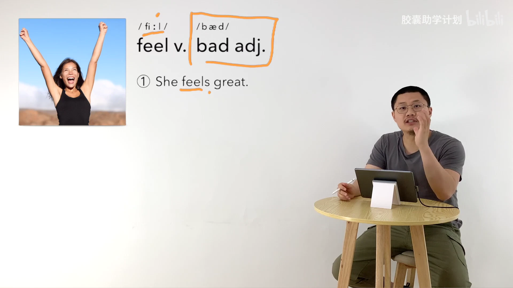

文字识别：胶囊助学计划 / / fi :1 / / / bæed/ / feel v.bad adj. / ① She feels great.

### 画面 00:01:44

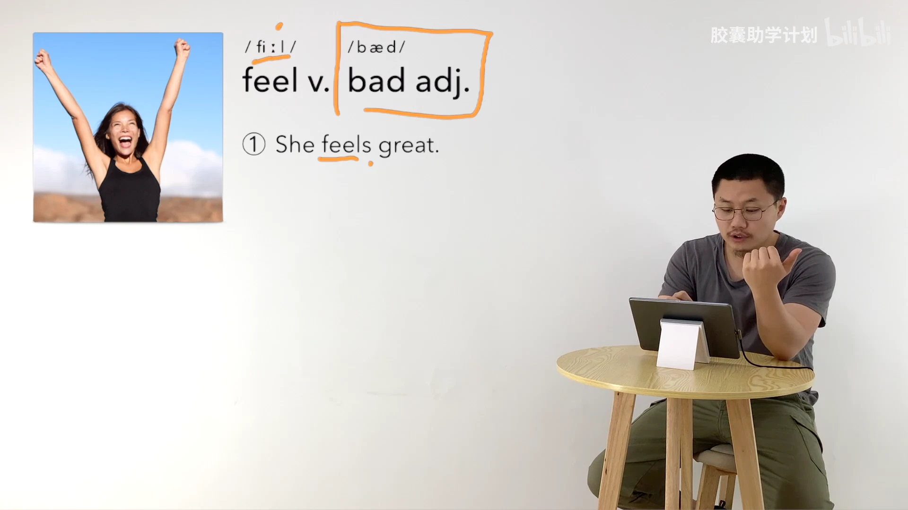

文字识别：胶囊助学计划 / / fi :1 / / / bæd/ / feel v.bad adj. / ① She feels great.

### 画面 00:01:47

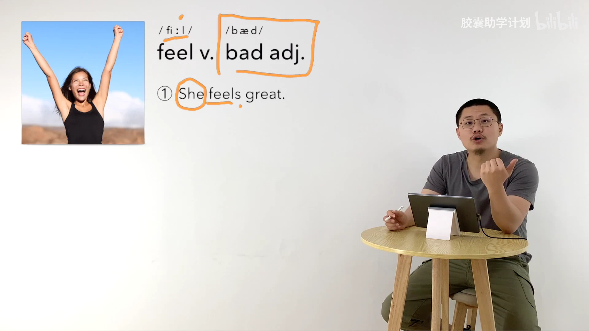

文字识别：胶囊助学计划 / / fi : 1 / / / bæd/ / feel v.bad adj. / Shefeels great.

## 00:02:00–00:02:30

feel bad. Okay,好，你看它的变化形式还是满足我们之前说的叫做 doesn't feel bad. Okay,而不是用的 don't,或者是 can't,或者是 isn't,对吧？之前我们学到的那些单词还是一般现在式。Okay,那我想把它变一般疑问句就很简单，Does 提前动词换回原形，跟我读，Does she feel great?或者是Does she feel bad?她感觉很差

### 画面 00:02:09

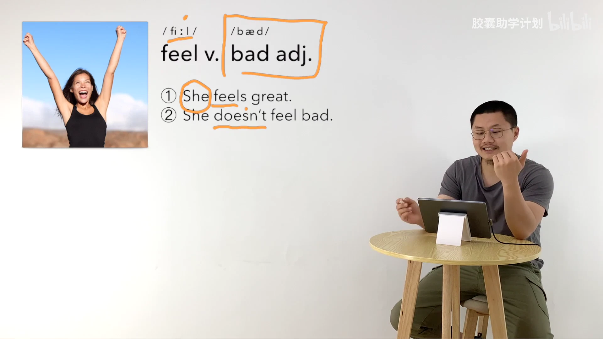

文字识别：胶囊助学计划 / / fi :1 / / / bæed/ / feel v.bad adj. / Shefeels great. / 1 / Sne doesn't feel bad.

### 画面 00:02:21

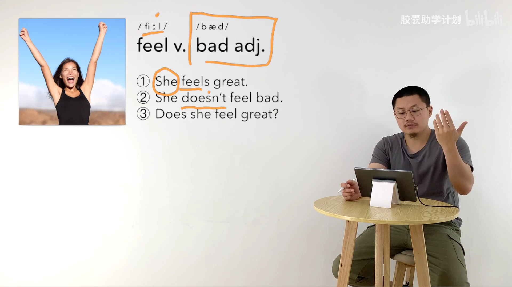

文字识别：胶囊助学计划 / / fi :1 / / / bæd/ / feel v.bad adj. / Shefeels great. / She doesn't feel bad. / Does she feel great?

### 画面 00:02:27

文字识别：胶囊助学计划 / / fi :1 / / / baæed/ / feel v.bad adj. / Shefeels great. / Sne doesn't feel bad. / Does she feel great?

## 00:02:30–00:03:00

### 画面 00:02:35

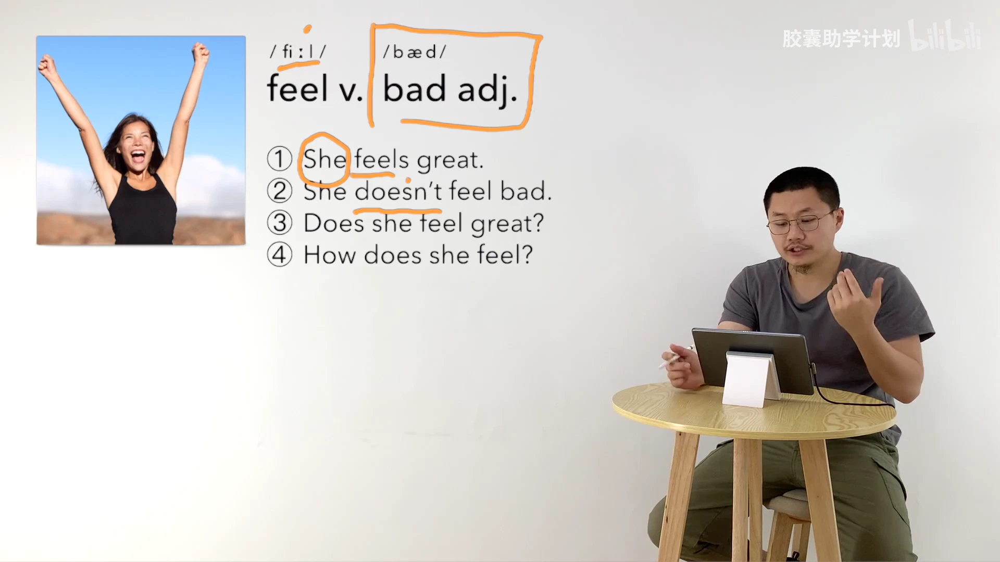

文字识别：胶囊助学计划 / / fi :1 / / / bæd/ / feel v.bad adj. / Shefeels great. / Sne doesn't feel bad. / Does she feel great? / How does she feel?

### 画面 00:02:38

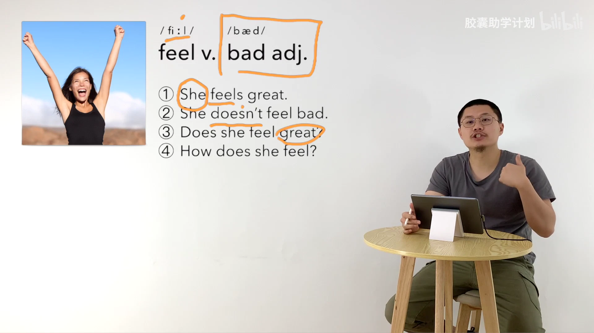

文字识别：胶囊助学计划 / / fi :1 / / / bæd/ / feel v.bad adj. / Shefeels great. / 1 / Sne doesn't feel bad. / Does she feel great / How does she feel?

### 画面 00:02:40

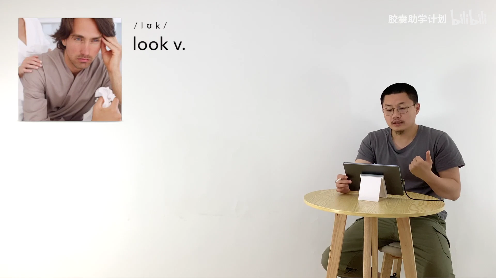

文字识别：胶囊助学计划 / / luk 1 / look v.

### 画面 00:02:43

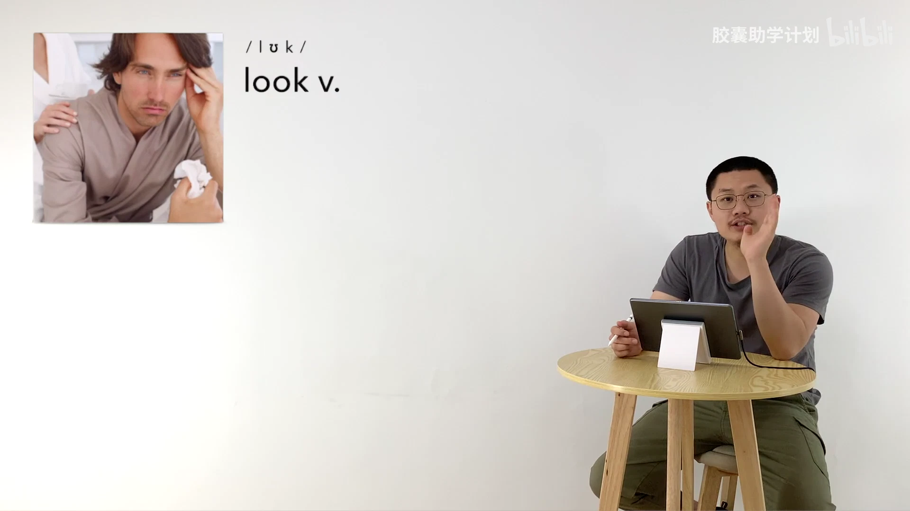

文字识别：胶囊助学计划 / / luk 1 / look v.

### 画面 00:02:46

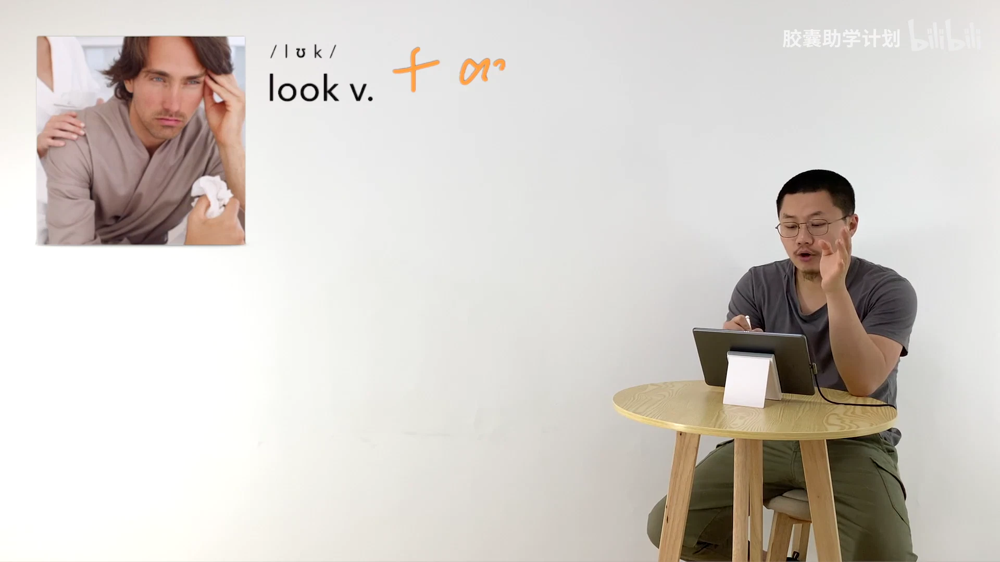

文字识别：胶囊助学计划 / / luk 1 / 十 / look v.

### 画面 00:02:50

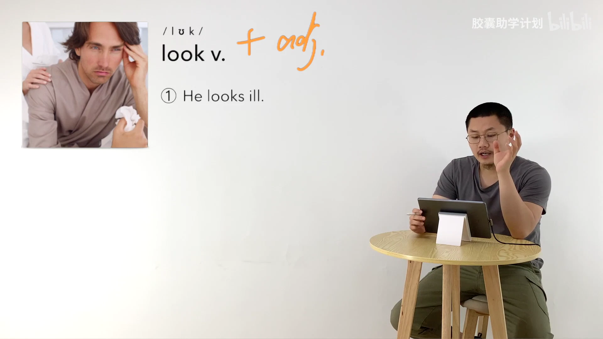

文字识别：+ ong. / 胶囊助学计划 / / luk1 / look v. / ① He looks ill.

## 00:03:00–00:03:30

病了。Ill就是一个小的形容词。Okay, 那我们现在把它变成一般疑问句，还是符合一般现在时。张嘴跟我读，Does he feel? Does he look ill? 他看起来生病了吗？Okay, 以及How does he look? 他看起来怎么样？那你的答案就可以有很多了，比如说Wonderful, beautiful, 是吧？或者Great啊，或者说Bad, terrible啊，这都是我们之前学过的一系列形容词，表示一个人好与坏的都是可以用的。

### 画面 00:03:18

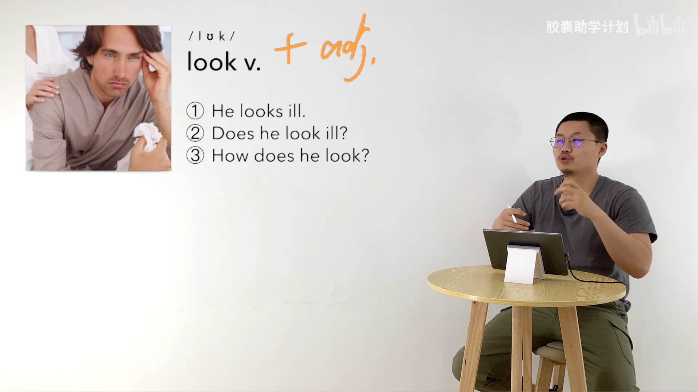

文字识别：+ ond / 胶囊助学计划 / / luk / / look v. / ① He looks ill. / ② Does he look ill? / 2 / How does he look?

## 00:03:30–00:04:00

OK，这叫我们说看起来，接下来叫听起来，跟我读一下，叫做 sound，sound，OK，very good，那是我们听起来感官动词，同理后面可以加形容词，那比如说我们造句子叫做 It sounds terrible，它听起来太糟糕了，terrible，哎，表示很糟糕很差劲一个形容词，注意 sound 后边加了 as，对吧？那如果我想把它变否定句和一般疑问句，要借

### 画面 00:03:31

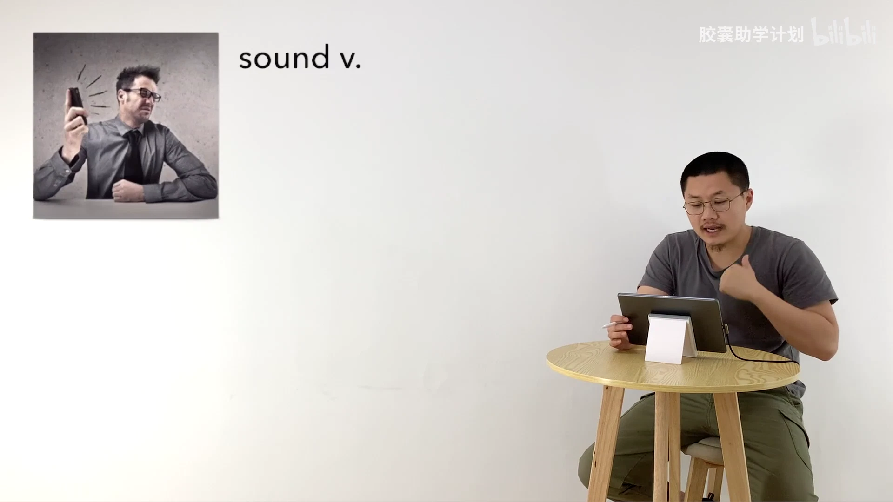

文字识别：胶囊助学计划 / sound v. / 专

### 画面 00:03:35

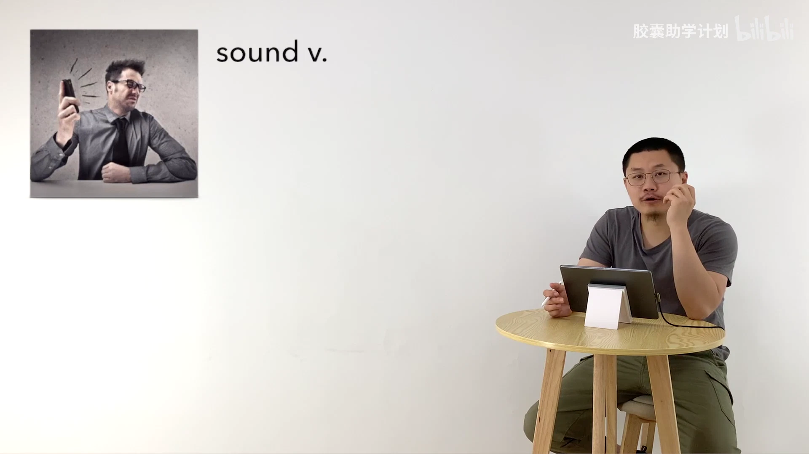

文字识别：胶囊助学计划 / sound v.

### 画面 00:03:41

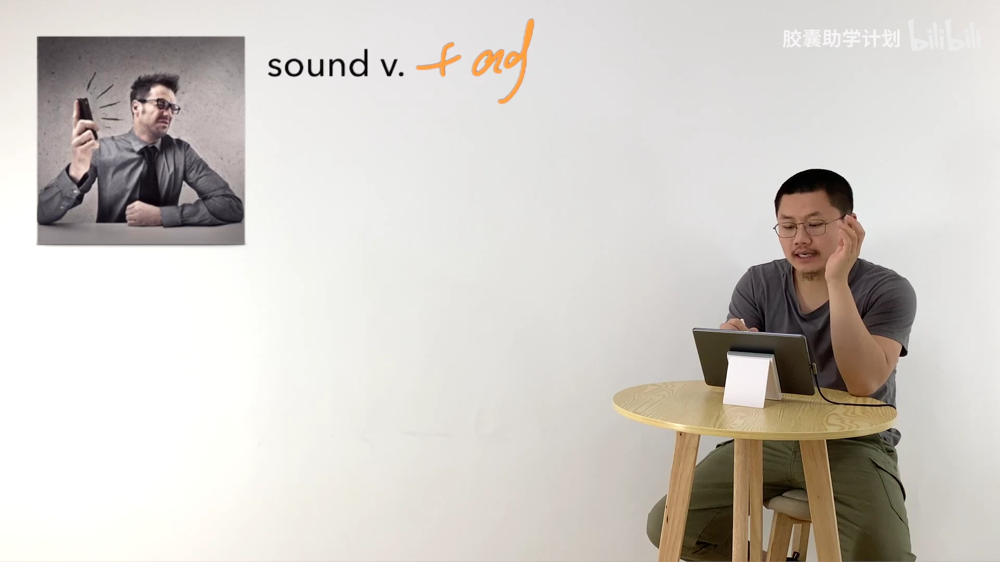

文字识别：sound v. f ond / 胶囊助学计划

## 00:04:00–00:04:30

的那个助动词就是 does 这个单词，并且注意把动词换回原形。张嘴跟我读，It doesn't sound good。嗯，它听起来并不好。OK，Next one，跟我读 smell。注意啊，因为有 l 这个字母，你去想一下，其实我们通过自然拼读法则，在这几乎就能把它这个单词的音拼出来了。除了字母 e 这个单词可能不敢完全确定以外，s 发 s，m 发嗯，对吧？我们在录自然拼读

### 画面 00:04:09

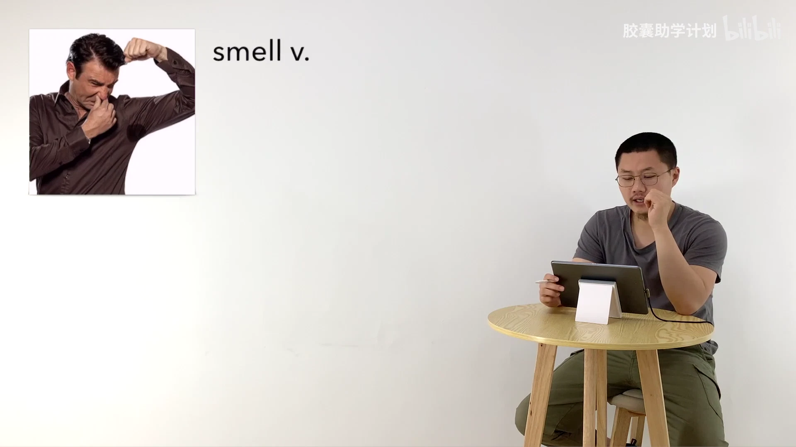

文字识别：胶囊助学计划 / smell v.

### 画面 00:04:16

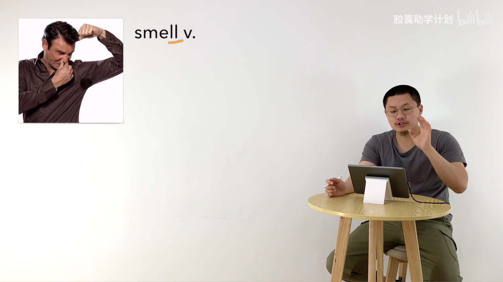

文字识别：胶囊助学计划 / smellv.

### 画面 00:04:21

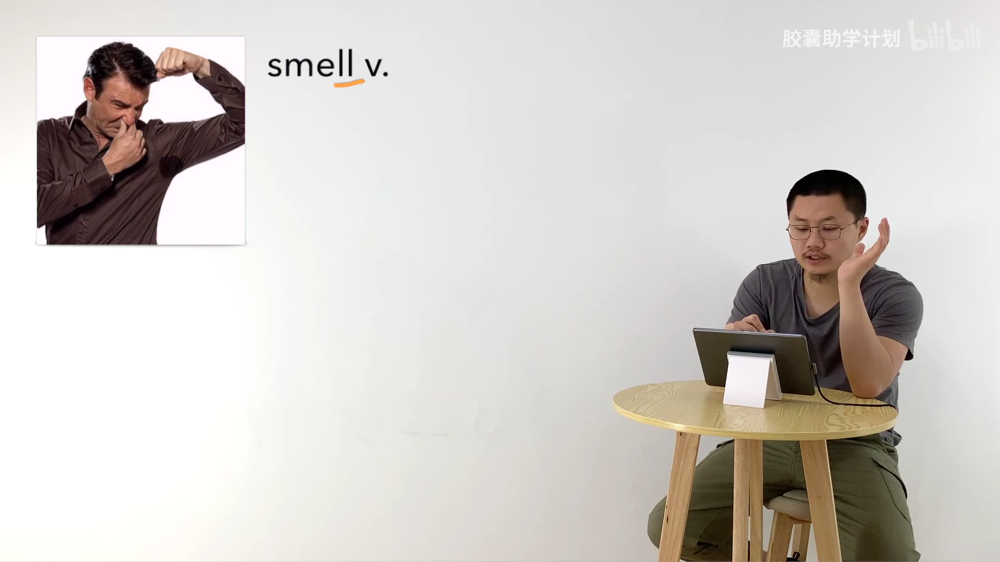

文字识别：胶囊助学计划 / smellv.

## 00:04:30–00:05:00

法则视频的时候，已经给大家讲解过了。L这个字母舔舌尖，沙哑音，于是这个单词读起来叫做smell，smell。看我的舌尖，最后舔到沙哑音，对吧？叫做闻起来。OK，同理后面加形容词，比如说I smell bad。OK，啊，刚打完篮球，I smell bad。OK，啊，特别是浑身闻起来特别的差。那Do I smell bad？啊，我闻起来是不是很差呀？以及How do I smell？我闻起来怎么

### 画面 00:04:42

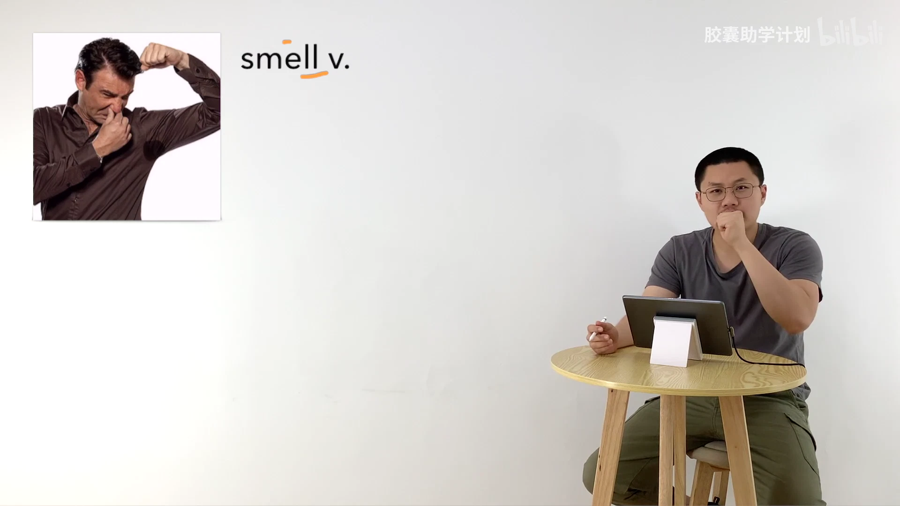

文字识别：胶囊助学计划 / smell v.

### 画面 00:04:57

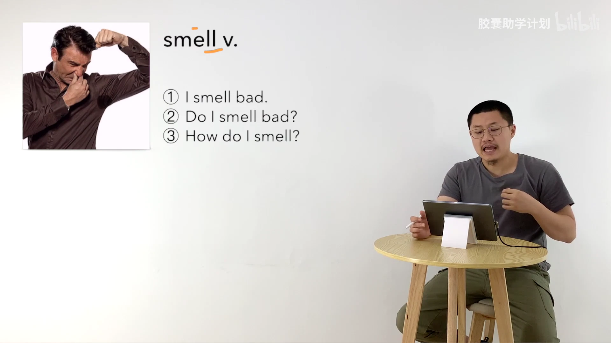

文字识别：胶囊助学计划 / smell v. / ① I smell bad. / ② DoI smell bad? / How doI smell? / 3

## 00:05:00–00:05:30

样啊？这个时候你可能一般是喷了香水问别人的。How do I smell? Okay. 那注意这个 how 是对程度提问，也就是这里边的一个形容词，形容词就能起到程度的表述，好中差一个程度。Okay. 所以 how do I smell? 我闻起来怎么样？Very good. 那下一个感官动词叫做尝起来或者吃起来，跟我读 taste. Taste. 中间是一个 a 的音，前面一个 t，后边一个 t. 啊，来

### 画面 00:05:06

文字识别：胶囊助学计划 / smellv. / ① I smell bad. / ② DoI smell bad? / 2 / How do I smell?

### 画面 00:05:10

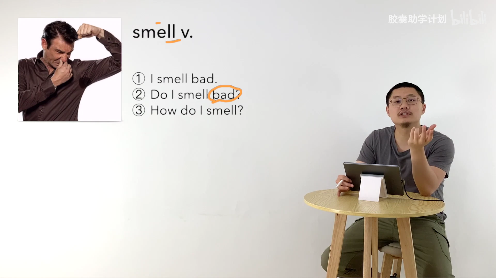

文字识别：胶囊助学计划 / smellv. / ① I smell bad. / ② Do I smellbad? / How do I smell?

### 画面 00:05:17

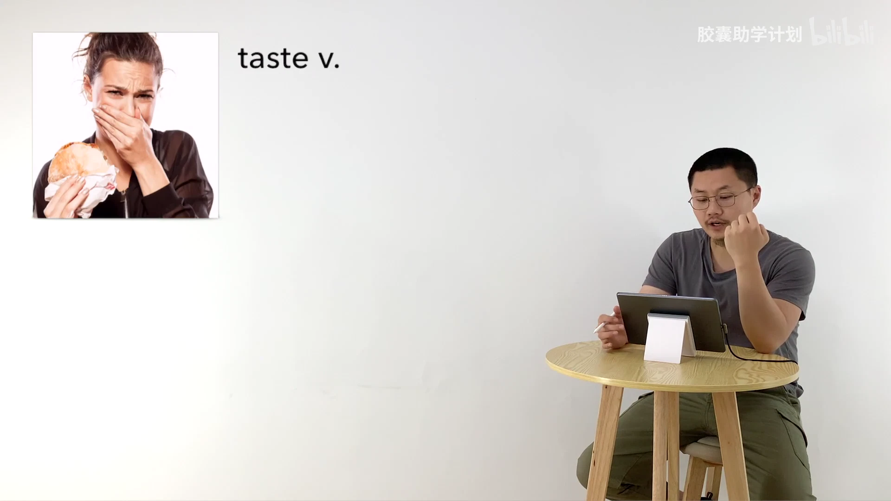

文字识别：胶囊助学计划 / taste V.

## 00:05:30–00:06:00

taste，OK，玩一个。接下来呢，我们可以说it tastes terrible，它尝起来太糟糕了，以及it doesn't taste good，它尝起来并不好。不管怎么样，目前我们讲的这五个感官动词，你看在一般现在时这个时态之下，它还是满足这个时态的一些基本变化需求的。主语三单，动词用三单，变一般疑问句和否定句，你就要用的是

### 画面 00:05:36

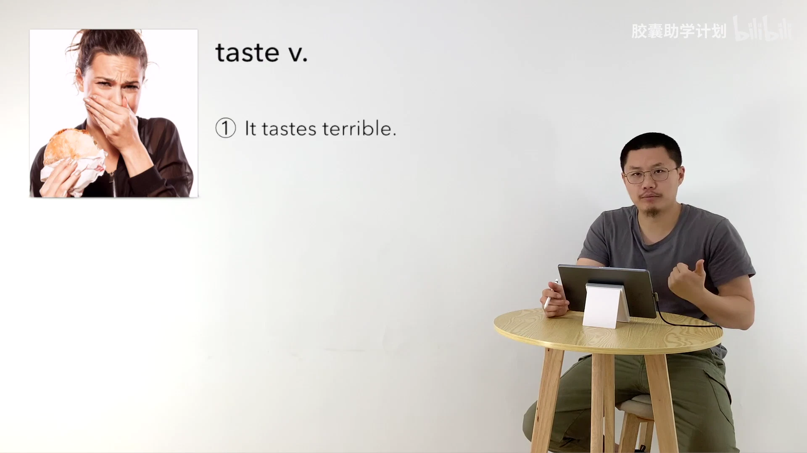

文字识别：胶囊助学计划 / taste V. / ① It tastes terrible.

### 画面 00:05:51

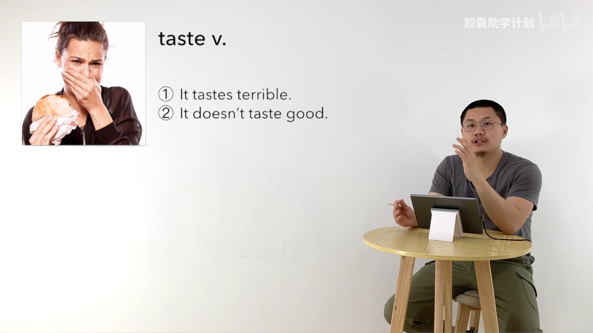

文字识别：胶囊助学计划 / taste V. / ① It tastes terrible. / ② It doesn't taste good.

## 00:06:00–00:06:30

does，对吧？如果非三单呢，那就是 do。 OK，接下来我们看一个小的电影片段，这个电影片段当中出现了这样两句话，叫做 Bacon tastes good。啊，说 Bacon 就我们说的培根是吧？那个猪猪肉啊， Bacon。那 Pork chops 指的就是猪排啊，Tastes good 啊，尝起来也不错。你注意，你看它是一个单数是吧？或者你可以理解为是不可数，在这儿于是后边是三单了，而前面呢

### 画面 00:06:03

文字识别：From the ckeator ot'Lue Romance'& Resewoik / 胶囊助学计划 / JaTaAPa / VingaSs / PulpFiction / y Quentin Tanantino / 10 / aceo ly / Lawence / Bender / Bacon tastes good. / Pork chops taste good. / 低俗小说 Pulp Fiction (1994) / Coming soon to a tker

### 画面 00:06:05

文字识别：From the cheator of Tue Romance'& Resewoi / 胶囊助学计划 / JovleaeAae / VinghaeSeseais / PulpFiction / y Quentin Tanantino / 10g / podaeo ly / Lamrence / Bender / Bacon tastes good. / Pork chops taste good. / 低俗小说 Pulp Fiction (1994) / Coming soon to a ther

### 画面 00:06:08

文字识别：From the ckeator ot Tue Romance'& Resewoik / 胶囊助学计划 / JovleaeAnP a / VinghaeSeeais / PulpTiction / y Quentin Tanantino / 10 / prodareo ly / Lanrence / Bender / Bacon tastes good. / Pork chops taste good. / 低俗小说 Pulp Fiction (1994) / Coming soon to a ther

### 画面 00:06:10

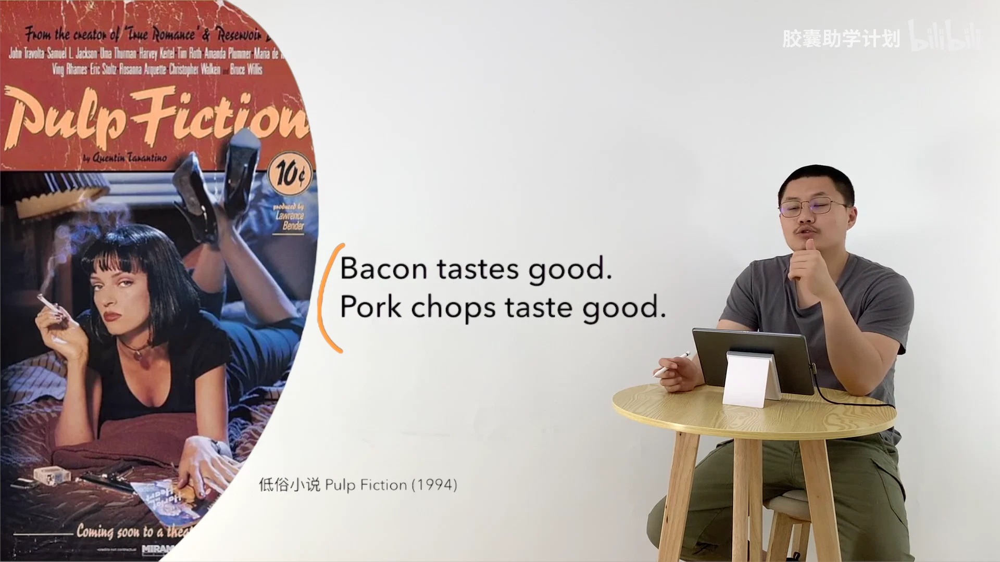

文字识别：From the cheator of Tue Romance'& Resewwoik / 胶囊助学计划 / JovaeAa / Ving fhaais / PulpFiction / y Quentin Tanantino / 10 / producco ly / Lanrence / Bender / Bacon tastes good. / Pork chops taste good. / 低俗小说 Pulp Fiction (1994) / Coming soon to a ther

### 画面 00:06:12

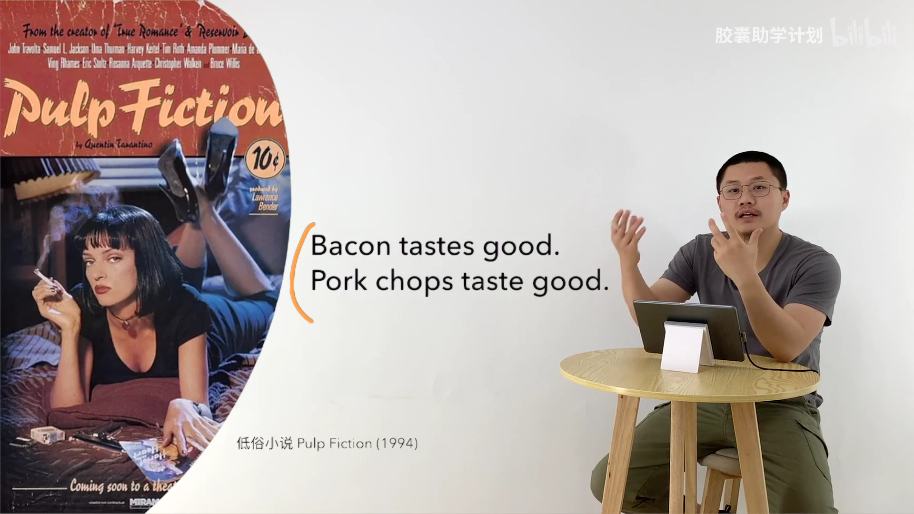

文字识别：From the ckeator of Lue Romance'& Resewoik / 胶囊助学计划 / JoIrvlaeeAPae / Vin hais / PulpFiction / y Quentin Taxantino / 10 / produeeo ly / Lamence / Bender / Bacon tastes good. / Pork chops taste good. / 低俗小说 Pulp Fiction (1994) / Coming soon to athe

### 画面 00:06:15

文字识别：From the ckeator ot Lue Romance'& Resewoik / 胶囊助学计划 / JoveaAPa / Ving fhames FiStalt isaa Aqgete nstagher blenBruce is / PulpFiction / y Qucntin Tanantino / 10 / produceo ly / Lawrence / Bender / Bacon tastes good. / Pork chops taste good. / 低俗小说 Pulp Fiction (1994) / Coming soon to a tker

### 画面 00:06:18

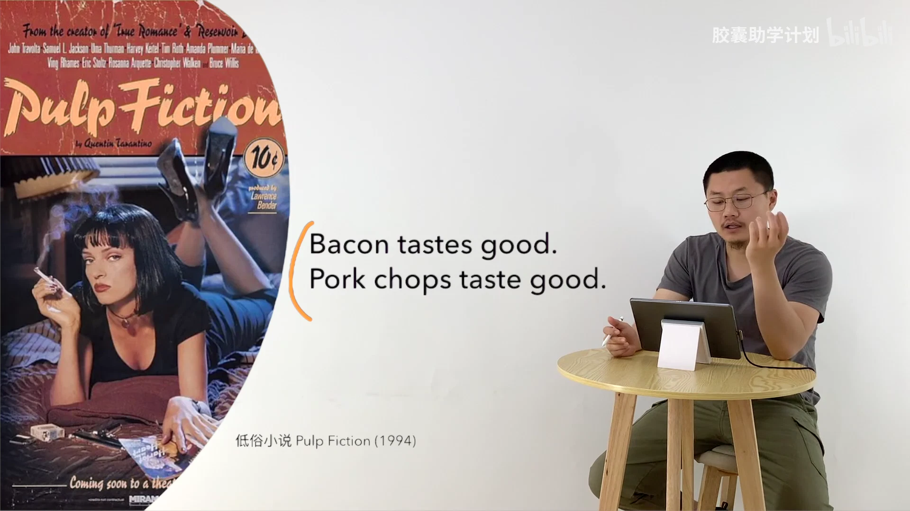

文字识别：From the ckeator of Tue Romance'& Resewoik / 胶囊助学计划 / JovAPa / VinghaeSAeseWas / PulpFiction / y Quentin Tanantino / 10 / prodaceoly / Lawrence / Bender / Bacon tastes good. / Pork chops taste good. / 低俗小说 Pulp Fiction (1994) / Coming soon to ather

### 画面 00:06:20

文字识别：From the ckeator ot Te Romance'& Resewvoi / 胶囊助学计划 / JorvaeAa / PulpFiction / y Qucntin Tanantino / 10 / produced ly / Lawence / Bender / Bacon tastes good. / Pork chops taste good. / 低俗小说 Pulp Fiction (1994) / Coming soon to a ther

### 画面 00:06:22

文字识别：From the cheator ot Tue Romance'& Resewvoik / 胶囊助学计划 / JorvlaeAa / Ving fhrames FiStit isana Aqgee Dnsagher blenBruce is / PulpFiction / y Qucntin Tanantino / 10 / produceo ly / Lawence / Bender / Bacort / tastes good. / Pork chops taste good. / 低俗小说 Pulp Fiction (1994) / Coming soon to a ther

### 画面 00:06:24

文字识别：From the ckeator of Lue Romance'& Resewoi / 胶囊助学计划 / JorvleaeAa / Ving fhames n StatRosamaAqgee Drstaphe WalenBnce Wis / PulpFiction / y Qucntin Tanantino / 10 / produceo ly / Lawrence / Bender / Bacort / tastes good. / Pork chops taste good. / 低俗小说 Pulp Fiction(1994) / Coming soon to a ther

### 画面 00:06:26

文字识别：From the ckeator of Tue Romance'& Resewvoi / 胶囊助学计划 / JoTveaAPa / Ving fhames FicStit Rssaa Aqgete nstpher blenBruce is / PulpFiction / y Quentin Tanantino / 104 / prduco ly / Lamrence / Bender / Bacort / tastes good. / Pork chops taste good. / 低俗小说 Pulp Fiction (1994) / Coming soon to atker

## 00:06:30–00:07:00

是个复数，在这个地方就是非三单，这是一个很小的点，依旧满足一般现在时的变化需求。那我们接下来一起看一下这个电影片段。 Want some bacon? No man, I don't eat pork. Are you Jewish? No, I ain't Jewish. I just don't dig on swine. That's all. Why not? Pigs are filthy animals. I don't eat filthy animals. Yeah, but bacon tastes good. Pork chops taste good. Okay,啊，the bacon tastes good啊，

### 画面 00:06:30

文字识别：From the cheator of Lue Romance'& Resewwoi / 胶囊助学计划 / JoTvlSeaeAPae / Ving fhames FiStat Roaa Aqgetenstgher ablenBruce is / PulpFiction / y Quentin Tanantino / 10 / produzedly / Lawrence / Bender / Bacor / tastes good. / Pork chops taste good. / 低俗小说 Pulp Fiction (1994) / Coming soon to a ther

### 画面 00:06:35

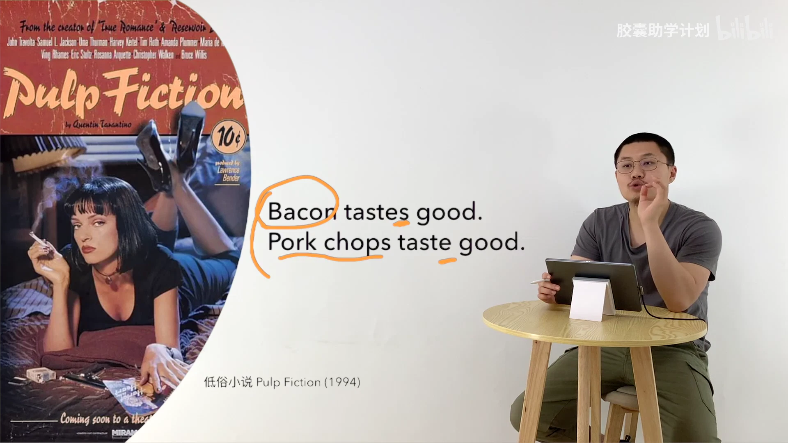

文字识别：From the cheator of Tue Romance'& Resewvoi / 胶囊助学计划 / JoTrvlSaeAPa / Ving fhrames FiStt osama AgueteChnstagerWalenBnue is / PulpFiction / y Quentin Taxantiuno / 10 / poduo ly / Lamence / Bender / Bacor / tastes good. / Pork chops taste good. / 低俗小说 Pulp Fiction (1994) / Coming soon to a ther

### 画面 00:06:40

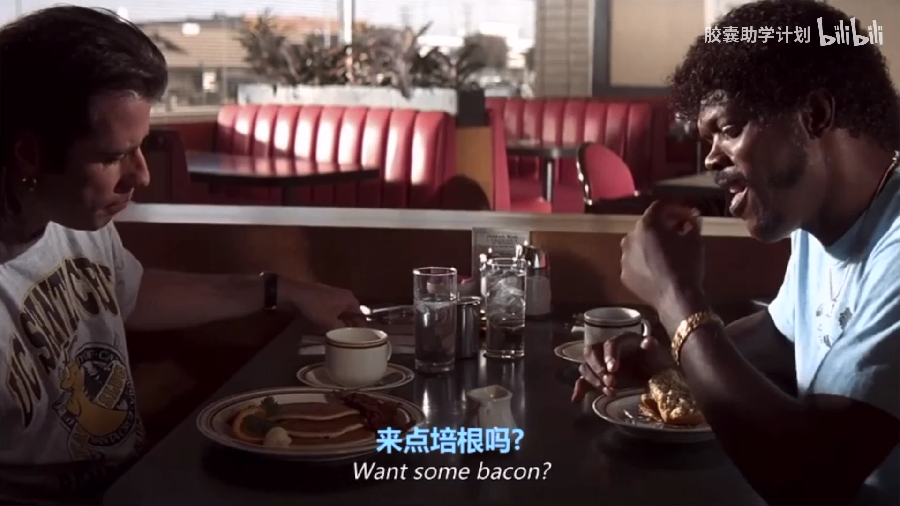

文字识别：Bilbili / 胶囊助学计划 / 来点培根吗？ / Want some bacon?

### 画面 00:06:42

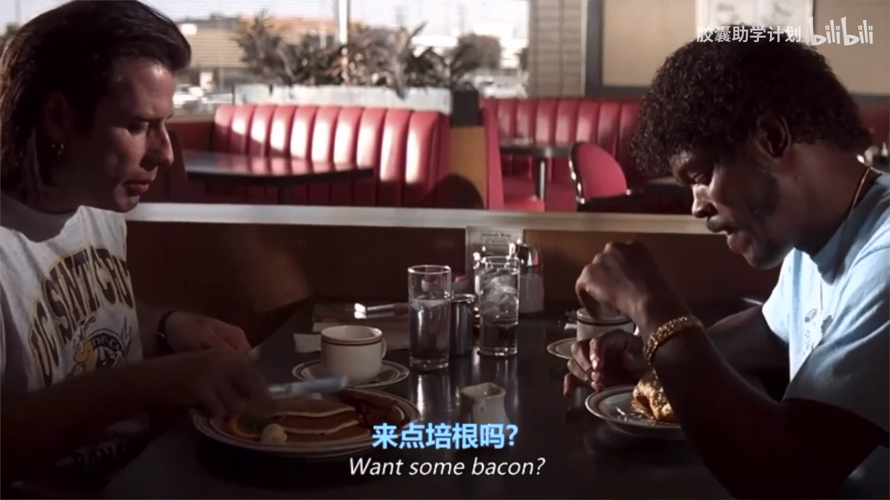

文字识别：胶囊助学计划i / 来点培根吗？ / Want some bacon?

### 画面 00:06:44

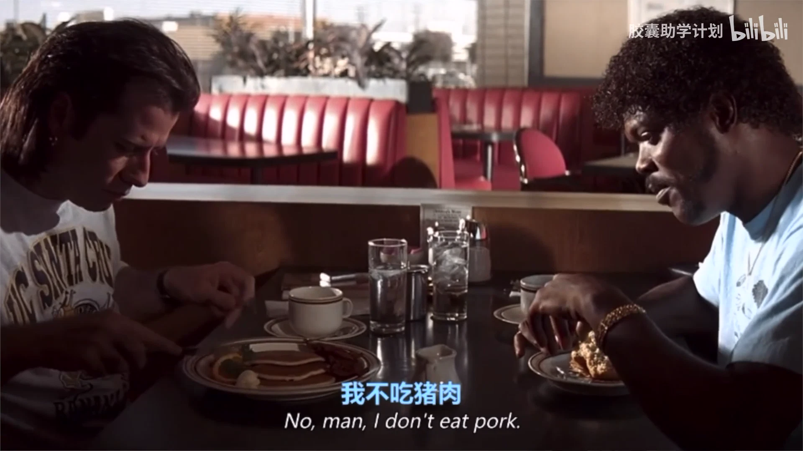

文字识别：bilibli / 胶囊助学计划 / 我不吃猪肉 / No, man, I don't eat pork.

### 画面 00:06:46

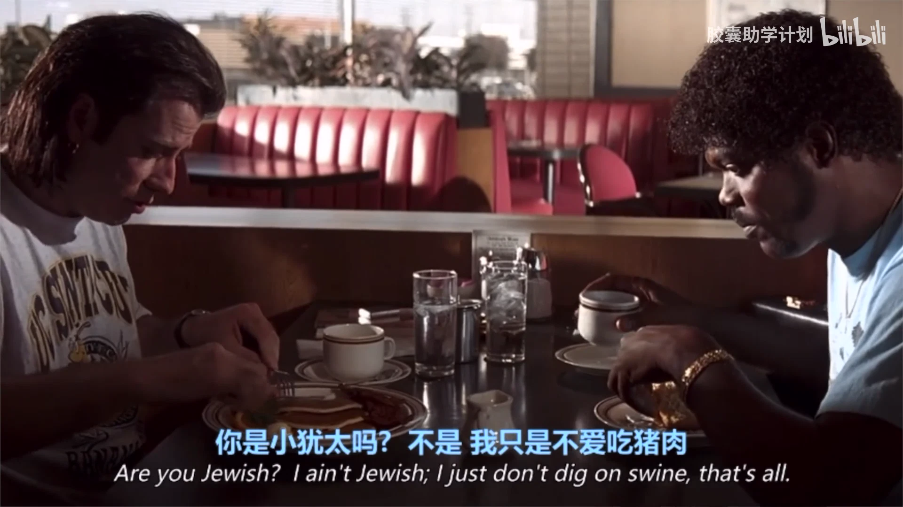

文字识别：Dilibli / 胶囊助学计划 / 你是小犹太吗？不是我只是不爱吃猪肉 / Are you Jewish? I ain't Jewish; Ijust don't dig on swine, that's all

### 画面 00:06:48

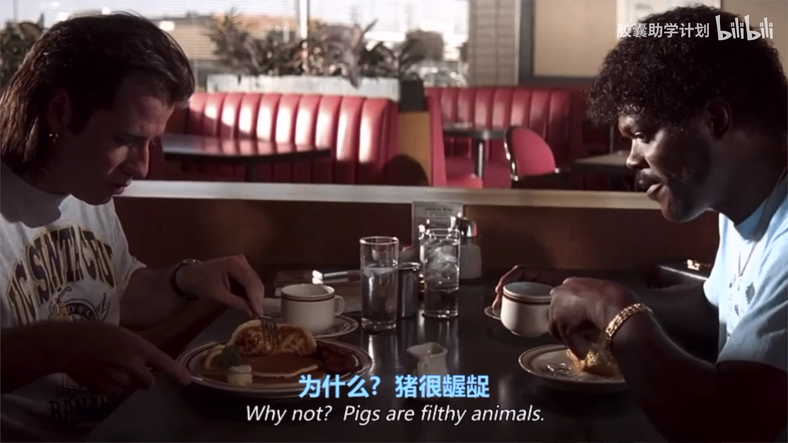

文字识别：bilfbili / 交囊助学计划 / 为什么？猪很龌龊 / Why not? Pigs are filthy animals.

### 画面 00:06:50

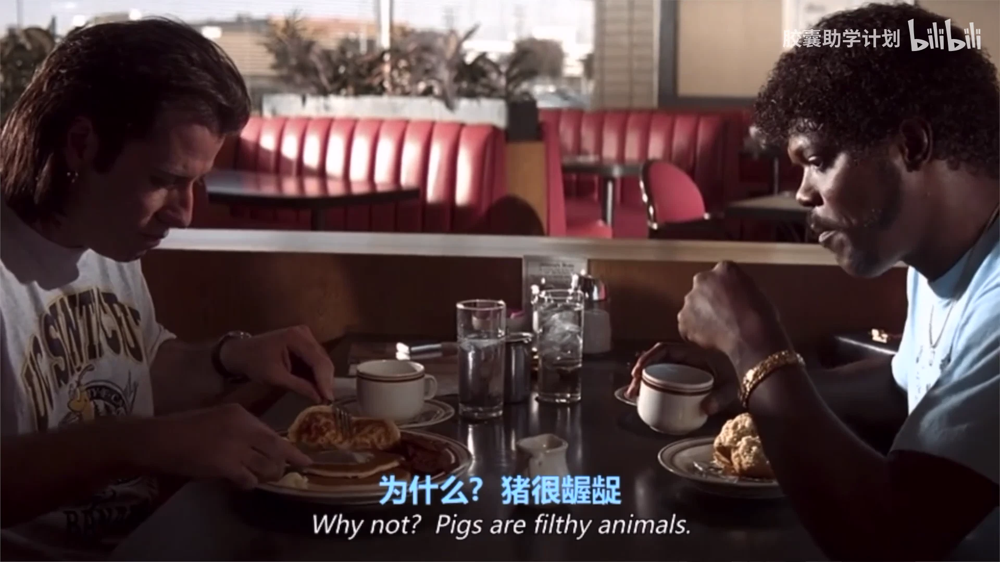

文字识别：Bilbili / 囊助学计划 / 为什么？猪很龌龊 / Why not? Pigs are filthy animals.

### 画面 00:06:52

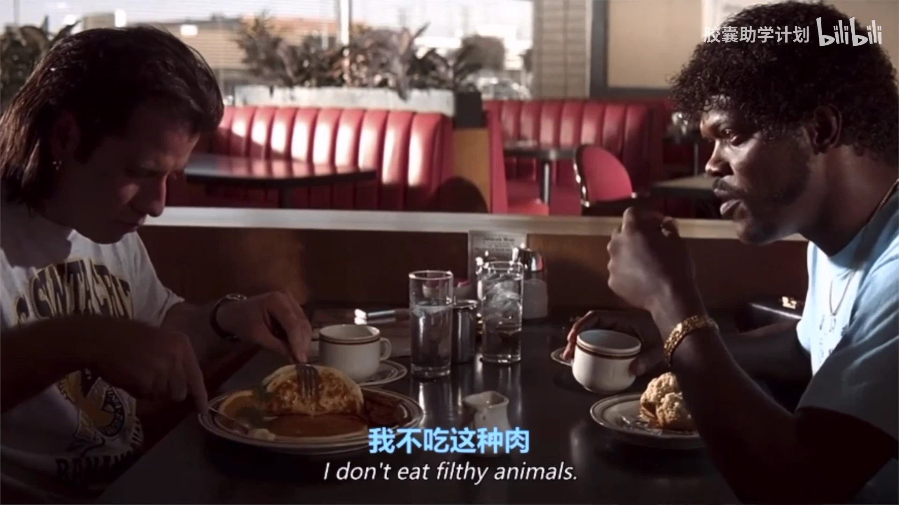

文字识别：Bilbili / 胶囊助学计划 / 我不吃这种肉 / I don't eat filthy animals.

### 画面 00:06:54

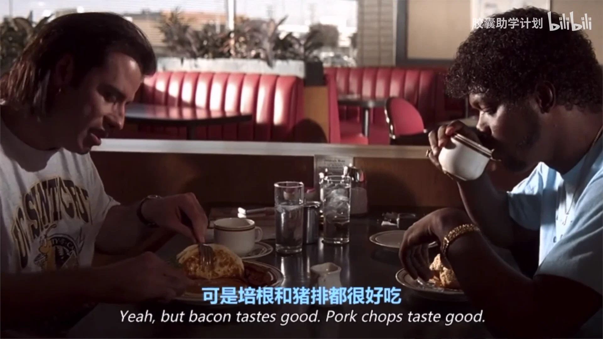

文字识别：Bilibili / 胶囊助学计划 / 可是培根和猪排都很好吃 / Yeah, but bacon tastes good. Pork chops taste good.

### 画面 00:06:56

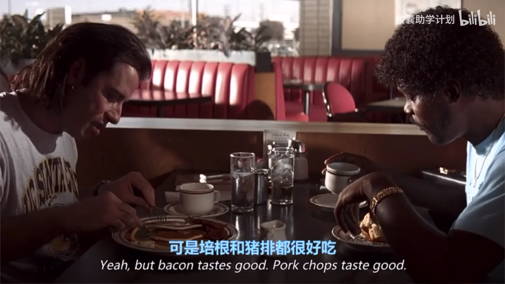

文字识别：Dilibili / 囊助学计划 / 可是培根和猪排都很好吃 / Yeah, but bacon tastes good. Pork chops taste good.

### 画面 00:06:58

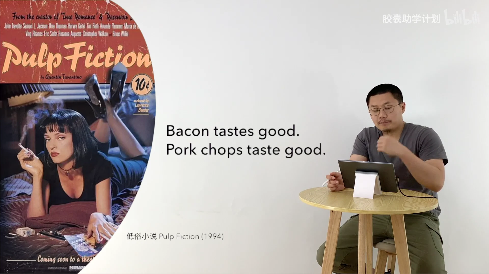

文字识别：From the cheator of Tue Romance'& Resewoi / 胶囊助学计划 / JovAPa / VinghaeSAeeas / PulpFiction / Ly Quentin Tanantino / 10 / Lawrence / aceo 6y / Bender / Bacon tastes good. / Pork chops taste good. / 低俗小说 Pulp Fiction (1994) / Coming soon to a ther

## 00:07:00–00:07:30

培根尝起来非常好吃。Pork chops,猪排taste good. 啊，尝起来也非常的棒。Okay, 好，那接下来我们继续看别的一些小的单词啊。张嘴跟我读第一个单词来，call, call. Okay, 啊，打电话啊，call me. 啊，给我打个电话。下一个单词，我们实际上在二十九课，我没有记错的话，我们就学过What must I do? 啊，What must I do, Mrs. Jones? Okay, 我必

### 画面 00:07:00

文字识别：From the ckeator ot' Te Romance'& Resewoi / 胶囊助学计划 / JoSaTeAPa / VingaSesaes / PulpFiction / y Qucntin Tanantino / 10 / dueco ly / Lawence / Bendes / Bacon tastes good. / Pork chops taste good. / 低俗小说 Pulp Fiction (1994) / Coming soon to a ther

### 画面 00:07:05

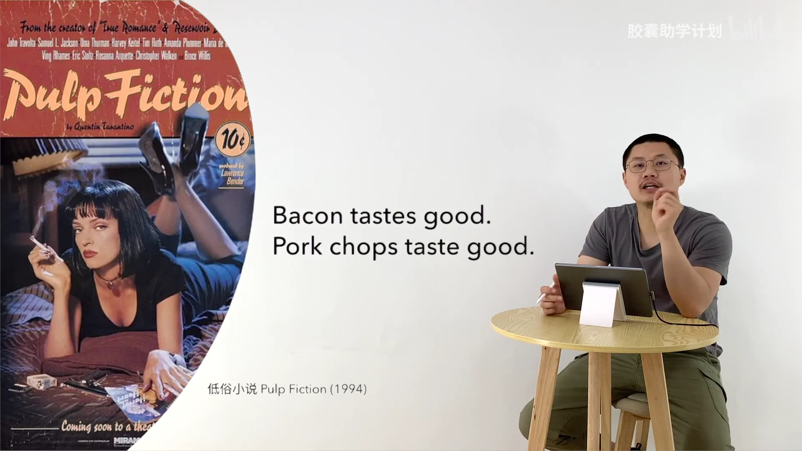

文字识别：From the ckeator ot'Tue Romance'& Resewvoi / 胶囊助学计划 / JoIlaaTAPa / VinghaeSteeas / PulpFiction / y Qucntin TanAntino / 10 / poduccd ly / Lamence / Bender / Bacon tastes good. / Pork chops taste good. / 低俗小说 Pulp Fiction (1994) / Coming soon to a tke

### 画面 00:07:08

文字识别：胶囊助学计划 / /ko:1/ / /mΛst/ /'dpkta/ / call v.n. must doctor

### 画面 00:07:21

文字识别：胶囊助学计划 / /ko:1/ / /mΛst/ /'dpkta/ / call v.n. must doctor

## 00:07:30–00:08:00

see him again. Next word, break down the syllables. Doctor, doctor, very good. Next, we try to make some small sentences. First, let's fill in some small phrases. This we can use in life. Call me, call me. Give me a call. Pay attention. Give me a call. This is the grammar in Lesson 21. If you have a book, turn to it quickly.

### 画面 00:07:51

文字识别：胶囊助学计划 / /ko:1/ / /mΛst/ / 1 /dpkta/ / call v.n. must doctor / ① call me / give me a call

### 画面 00:07:58

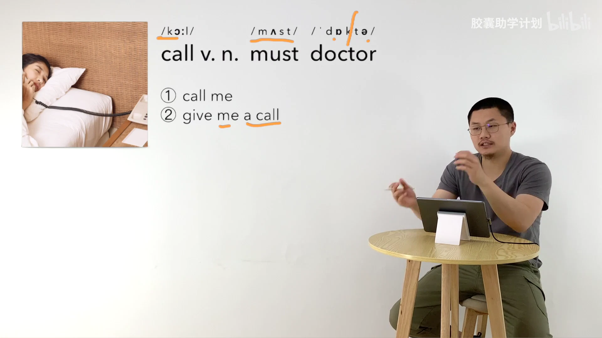

文字识别：胶囊助学计划 / /ko:1/ / /mΛst/ / /dpktal / call v.n. must / doctor / ① call me / give me a call

## 00:08:00–00:08:30

边有书的话，迅速翻过去，就是 give somebody something，对吧？给某人某物。只不过这个地方说的是给我，给我的东西是什么呢？是一个电话，对吧？给我打一个电话，OK，叫 give me a call，啊，和 call me 意思是一样的。再来，张嘴跟我读，说 you look ill，你看起来病了。I must call the doctor，我必须要给医生打电话了。这个我们在六十三课会重点花时间和篇幅给大家去讲 must，

### 画面 00:08:02

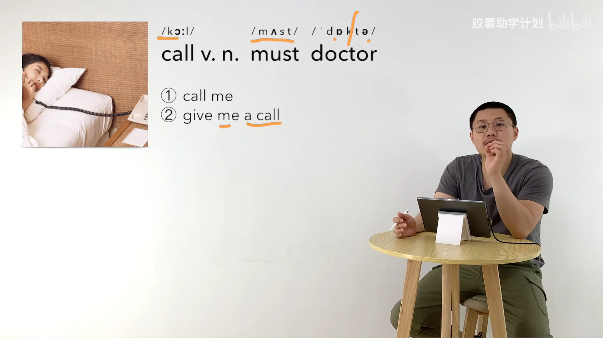

文字识别：胶囊助学计划 / /ko:1/ / /mΛst/ / /'dpktal / call v.n. must / doctor / ① call me / give me a call

### 画面 00:08:13

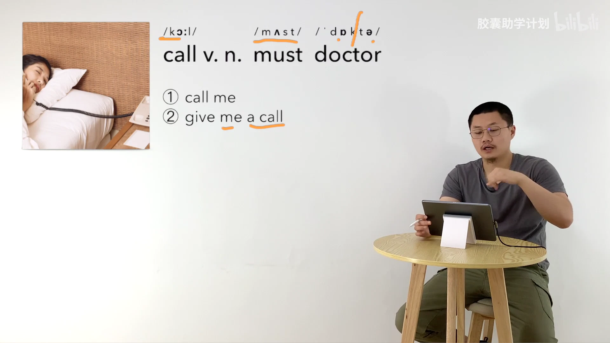

文字识别：胶囊助学计划 / /ko:1/ / /mΛst/ / /dpktal / call v.n. must c / doctor / ① call me / give me a call / 2

### 画面 00:08:16

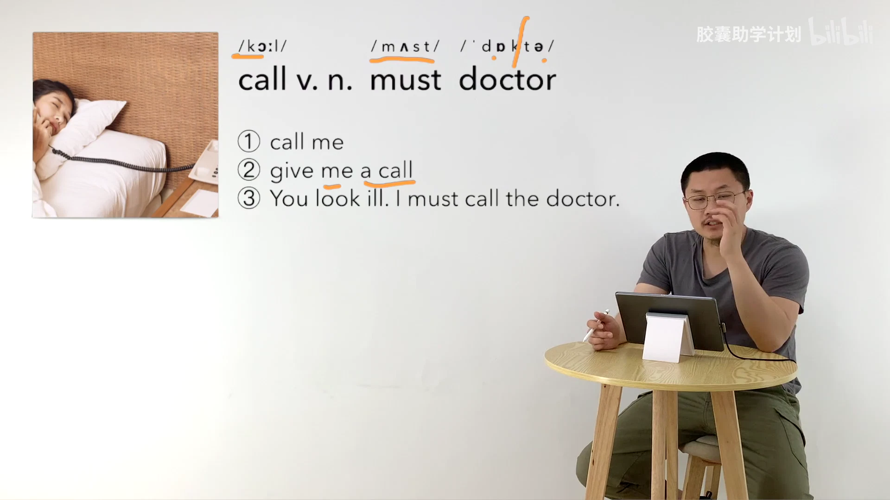

文字识别：胶囊助学计划 / /ko:1/ / /mst/ / /dpktal / call v.n. must / doctor / ① call me / give me a call / You look ill.I must call the doctor.

### 画面 00:08:27

文字识别：胶囊助学计划 / /ko:1/ / /mΛst/ / /dpkta/ / call v.n. must / doctor / ① / call me / give me a call / You look ill.I must call the doctor.

## 00:08:30–00:09:00

但是因为它跟 can 这个单词在用法上，在结构的用法上是有一些类似的，而且跟汉语差别并不大啊。我们先拿它尝试去造一些句子，比如说你看啊，我们跟汉语尝试去对应翻译一下，我必须给医生打电话。你看它这个必须 must 这个单词在英汉当中的位置几乎可以说是差不太多的，对吧？至少在肯定句当中。

### 画面 00:08:46

文字识别：胶囊助学计划 / /ko:1/ / /mΛst/ / /'dpkta/ / call v.n. must / doctor / ① / call me / give me a call / You look ill.I must call the doctor.

### 画面 00:08:48

文字识别：胶囊助学计划 / /ko:1/ / /mΛst/ / /'dpktal / call v.n. must / doctor / 1 / call me / give me a call / You look ill.I must Call the doctor.

### 画面 00:08:57

文字识别：胶囊助学计划 / /ko:1/ / /mΛst/ / /'dpkta/ / call v.n.must / doctor / ① / call me / give me a call / You look ill.l must / call the doctor.

## 00:09:00–00:09:30

好，我们接下来继续造句。张嘴跟我读，说，Do you know that doctor? 你看，一般现在时，你认识那个医生吗？以及 I don't have the doctor's number. 好，注意 doctor's number 叫做医生的数字。 number 最基本的意思叫数字，对吧？它还有另外一个意思，在这种状态之下，P.S. 表示的，对吧？表示的是什么意思呢？就是医生的手机号码。 Okay, doctor's number. There you go.

### 画面 00:09:00

文字识别：胶囊助学计划 / /ko:1/ / /mΛst/ / /'dpkta/ / call v.n. must / doctor / ① / call me / give me a call / You look ill.I must call the doctor. / ④ Do you know that doctor? / +

### 画面 00:09:03

文字识别：胶囊助学计划 / /ko:1/ / /mΛst/ / /dpkta/ / call v.n. must / doctor / ① / call me / give me a call / You look ill.I must call the doctor. / 3 / ④ Do you know that doctor?

### 画面 00:09:09

文字识别：胶囊助学计划 / /ko:1/ / /mΛst/ / 1 / dp kta/ / call v.n. must doctor / ① call me / give me a call / You look ill.I must call the doctor. / ④ Do you know that doctor? / ⑤ I don't have the doctor's number.

### 画面 00:09:12

文字识别：胶囊助学计划 / /ko:1/ / /mΛst/ / /dpkta/ / call v.n. must / doctor / ① call me / give me a call / You look ill.I must call the doctor. / ④ Do you know that doctor? / ⑤ I don't have the doctor's number.

## 00:09:30–00:10:00

Continue.下一个单词，下一个单词应该对于大部分同学并不是很陌生。跟我一起读一下，叫做 telephone，连起来读 telephone telephone。好，后面的单词实际上就是大部分情况下我们不一定非得把把它的全程说出来 telephone，对吧？直接说 the phone 就 OK 了。名词表示的是我们这种电话，OK。好，接下来我们尝试拿它造句。张嘴跟我读，Where is the

### 画面 00:09:30

文字识别：胶囊助学计划 / /ko:1/ / /mΛst/ / /dpkta/ / call v.n. must / doctor / ① call me / give me a call / You lōok ill.I must call the doctor. / 3 / ④ Do you know that doctor? / ⑤ I don't have the doctor's number.

### 画面 00:09:32

文字识别：胶囊助学计划 / / 'telifaun/ / telephone n. phone / 000 / 000 / 000

### 画面 00:09:36

文字识别：胶囊助学计划 / / 'telifaun/ / telephone n. phone / 000 / 000

### 画面 00:09:44

文字识别：胶囊助学计划 / /'telifaun/ / telephone n. phone / 000 / 000 / 000 / 000

## 00:10:00–00:10:30

phone? There is a phone in the living room.玩一个，你看第一句话实际上是前二十课咱们学的，第二句话是咱们二十五课学的关键句型 There be 句型，对吧？ Continue 说 Can you clean this phone, please? 你能把这个电话稍微打扫一下吗？上面比如说都是烟灰，对吧？或者说都是脏物，OK？那注意这是咱们四十三课学的，叫 Can you do something？对吧？玩一个，接下来 I'm cleaning

### 画面 00:10:05

文字识别：胶囊助学计划 / / 'teli faun / / telephone n. phone / ① Where is the phone? / 000 / 000 / 000 / There is a phone in the living room.

### 画面 00:10:17

文字识别：胶囊助学计划 / / ' teli faun / / telephone n. phone / ① Where is the phone? / 000 / There is a phone in the living room.) / 000 / ③ Can you clean this phone, please? / 3

### 画面 00:10:25

文字识别：胶囊助学计划 / / 'telifaun / / telephone n. phone / ① Where is the phone? / 000 / There is a phone in the living room.) / ③ Can you clean this phone, please?

## 00:10:30–00:11:00

the phone now. Ah, can you clean the phone, please? Hey, come on! I'm cleaning the phone now. Okay, 我现在正在擦拭它呀. Be doing. 啊，这是我们三十一、三十五课、三十一课啊，应该是三十一课咱们学的一个语法点，对吧？Okay, 啊，三十五课应该也学用到了。三十五课是介词啊。Okay, 那下一个单词跟我读, remember, remember. 好，叫做想起来、记起来、记得。Okay,

### 画面 00:10:31

文字识别：胶囊助学计划 / / 'telifaun/ / telephone n. phone / ① Where is the phone? 1 / 000 / 000 / There is a phone in the living room.) / ③ Can you clean this phone, please? / ④ I am cleaning the phone now.

### 画面 00:10:39

文字识别：胶囊助学计划 / / ' teli faun / / telephone n. phone / ① Where is the phone? T / 000 / 000 / There is a phone in the living room.) / 000 / ③ Can you clean this phone, please? / ④ I am cleaning the phone now.

### 画面 00:10:50

文字识别：胶囊助学计划 / /rI'membar/ / remember v.

### 画面 00:10:56

文字识别：胶囊助学计划 / /ri'membar/ / remember v.

## 00:11:00–00:11:30

那我们最常用的一句话叫做 Can you remember something? 叫你能记起来什么什么事情吗？能不能记起来这件事情？比如说，我们说 Can you remember the doctor's phone number? 你能想起来医生的电话号码吗？大多数情况下，phone可以直接不加，我只是放在这，为了让大家把之前刚刚学到的单词再背一遍啊。张嘴跟我读 Can you remember the doctor's phone number? OK, very good.

### 画面 00:11:00

文字识别：胶囊助学计划 / /rI'membar/ / remember v. / ① Can you remember the doctor's / phone number?

### 画面 00:11:03

文字识别：胶囊助学计划 / /rI'membar/ / remember v. / ① Can you remember the doctor's / phone number?

### 画面 00:11:10

文字识别：胶囊助学计划 / /ri'membar/ / remember v. / ① Can you rememberthe doctor's / phone number?

### 画面 00:11:13

文字识别：胶囊助学计划 / /ri'membar/ / remember v. / ① Can you rememberthe doctor's / phone number?

### 画面 00:11:19

文字识别：胶囊助学计划 / /rI'membar / / remember v. / ① Can you remember the doctor's / phie number?

### 画面 00:11:21

文字识别：胶囊助学计划 / /rI'membar/ / remember v. / ① Can you remember the doctor's / phie number?

### 画面 00:11:25

文字识别：胶囊助学计划 / /rI'membar/ / remember v. / ① Can you remember the doctor's / phie number?

## 00:11:30–00:12:00

Sorry, I can't remember that. 我没有办法记起来. I can't remember that. Very good. 接下来两个小单词，我们身体的部位，首先是嘴，OK。第一个注意这个双元音，啊，嘴要张开，mouth。哎，最后要咬舌，对吧？mouth， OK。啊，你要想发音好听一点，嘴就要稍微大一点。不同的语言习惯是不一样的，英语它的

### 画面 00:11:38

文字识别：胶囊助学计划 / /mauθ / / / t Λ n / / mouth n. tongue n.

### 画面 00:11:40

文字识别：胶囊助学计划 / /mauθ 1 / / t Λ n / / mouth n. tongue n.

### 画面 00:11:45

文字识别：胶囊助学计划 / /mauθ 1 / / t Λ η / / mouth n. tongue n.

## 00:12:00–00:12:30

嘴的变化幅度相对是比较大的，跟我们汉语去比的话，OK，下一个单词来读一下，叫做，哎，最后一个辅音，人是往后走，后鼻音，tong，tong，OK，好，那tong就是我们的舌头，来，mouth，嘴，tong，舌头，OK，两个身体位置，我们尝试去做一些小的短语，最简单，第一个叫做open your

### 画面 00:12:06

文字识别：胶囊助学计划 / /mauθ / / / tΛn / mouth n. tongue n.

### 画面 00:12:10

文字识别：胶囊助学计划 / /mauθ/ / / tΛn / mouth n. tongue n.

### 画面 00:12:23

文字识别：胶囊助学计划 / /mauθ 1 / / t Λn / mouth n. tongue n. / ① Open your mouth.

### 画面 00:12:28

文字识别：胶囊助学计划 / /mauθ/ / /tλn / mouth n. tongue n. / ① Open your mouth.

## 00:12:30–00:13:00

mouth，叫做张开你的嘴。Next one叫做 Show me your tongue，叫做让我看一下你的舌头。这是医生可能经常说的，对吧？那你看这地方的习惯用法叫做 Show somebody something，是我们三十九课四十课学过的这样的一个习惯用法。其实跟 Give somebody something 的语序是一样的，叫展示给某人某物。OK，接下来我们拿 There be 句型造一个句子，叫做张嘴跟我读。There is

### 画面 00:12:36

文字识别：胶囊助学计划 / /mauθ / / /tλn / mouth n. tongue n. / ① Open your mouth. / Show me your tongue.

### 画面 00:12:42

文字识别：胶囊助学计划 / /mauθ / / / tΛn / mouth n. tongue n. / ① Open your mouth. / Show me your tongue.

### 画面 00:12:45

文字识别：胶囊助学计划 / /mauθ 1 / /tΛn / mouth n. tongue n. / ① Open your mouth. / Show me your tongue.

### 画面 00:12:55

文字识别：胶囊助学计划 / /mauθ1 / / tλn / mouth n. t / tongue n. / ① Open your mouth. / Show me your tongue. / There / is something in my mouth, / on the tongue.

## 00:13:00–00:13:30

something in my mouth on the tongue. Okay,说嘴里边有个东西在舌头上，不知道是什么，可能是比如说溃疡了。Okay, I don't know.接下来下一个单词跟我读cold, cold. Okay,我们原来学到这个单词的时候学的它是形容词，它的形容词词性，对吧？表示的是冷。I'm cold and I'm hot.啊，too hot，太热了，对吧？当然hot还有另外一个意思了。Okay，那在

### 画面 00:13:09

文字识别：胶囊助学计划 / /mauθ/ / / t Λ n / mouth n. tongue n. / ① Open your mouth. / Show me your tongue. / There /  is something in my mouth, / on the tongue.

### 画面 00:13:11

文字识别：胶囊助学计划 / /kauld/ / cold n.

### 画面 00:13:14

文字识别：胶囊助学计划 / /kauld/ / cold n.

### 画面 00:13:17

文字识别：ad, / 胶囊助学计划 / /kauld/ / cold n.

### 画面 00:13:21

文字识别：ad; / 胶囊助学计划 / /kauld/ / cold n.

## 00:13:30–00:14:00

这个地方的 cold 它是一个名词，指的是感冒了啊。OK，那我们说造句子，接下来跟我读。They look ill。哎，look 我们说到了，学到了，刚刚学过。说 they have a bad cold。首先重感冒就叫做 a bad cold。啊，说得了重感冒，或者说哎这个患有这个重感冒，那叫做 have a bad cold。这是我们本课以及六十二课要学到非常重

### 画面 00:13:30

文字识别：adj / 胶囊助学计划 / /kauld/ / cold n.

### 画面 00:13:36

文字识别：ad / 胶囊助学计划 / /kauld/ / cold n. / ① They look ill.

### 画面 00:13:46

文字识别：ad / 胶囊助学计划 / /kauld/ / cold n. / ① They look ill. / They have a bad cold.

### 画面 00:13:50

文字识别：ad / 胶囊助学计划 / /kauld/ / cold n. / ① Theylook ill. / ② Theyhave a bad cold.

### 画面 00:13:52

文字识别：ad / 胶囊助学计划 / /kauld/ / cold n. / ① Theylook ill. /  Theyhave a bad cold.

## 00:14:00–00:14:30

要的一个点，就是得病了怎么说呢？你可以用 have 这个单词啊，得了重感冒，OK，叫做 have a bad cold。你注意，他在去变的时候，说他们得了重感冒，说他们得了重感冒吗？一般疑问句怎么办呢？他依旧满足一般现在是 do 提前，叫做 do they have a bad cold？OK，好，do they have a cold？啊，bad cold？OK，very good。比如说没有重感冒，叫做 they don't

### 画面 00:14:10

文字识别：ad / 胶囊助学计划 / /kauld/ / cold n. / ① They look ill. / They have a bad cold.

## 00:14:30–00:15:00

have a bad cold, 还是一般现在时，这个点要注意一下。 Next one, 下一个单词，张嘴跟我读，叫做 news, news, 叫做新闻报道。注意它是 un 啊，如果您忘了什么是 un, 四十一课我们讲过叫 uncountable nouns, 叫做不可数名词，对吧？好，怎么去体现它是不可数名词呢？我们接下来往下慢慢看啊。首先，坏消息很简单， bad news, 啊，比如说每个人都

### 画面 00:14:34

文字识别：胶囊助学计划 / /njuiz/ / news un. / ocal News / tion+++

### 画面 00:14:38

文字识别：胶囊助学计划 / /nju:z/ / news / un. / ocal News / ion+++

## 00:15:00–00:15:30

不喜欢, nobody likes bad news. Okay,那 everybody likes good news.每个人都喜欢好消息. Okay,好，比如说你看这个地方叫I have good news for you.注意一个小点啊, news的这个s不是new这个单词的复数，还是这个单词就是以s结尾的，就是news. Okay,好，其次呢，你像news这个单词，新的形

### 画面 00:15:08

文字识别：胶囊助学计划 / /njuiz/ / news / un. / ocal News / ① bad news / ion+++ / good news

### 画面 00:15:13

文字识别：胶囊助学计划 / /nju:z/ / news / un. / ocal News / ① bad news / on++ / good news / 2 / I have9 / good news / for you.

## 00:15:30–00:16:00

容词，把s去掉就变成形容词了，对吧？叫做新的这个单词你很熟悉。那你要尝试，对吧？硬往一块凑一下，那就是新的东西出炉的，那就是消息，新鲜的消息，是吧？Okay，新闻啊。I have good news for you.就给你，我有好的消息给你。Here we go.以及把它变一般疑问句，张嘴跟我读。Do you have good news? Any good news for me?啊，你有好消息给我吗？好，接下来我们看一个小的电影片段，就

### 画面 00:15:30

文字识别：胶囊助学计划 / /njuiz/ / news / un. / ocal News / ① bad news / on++ / good news / 2 / I have good news / foyou.

### 画面 00:15:57

文字识别：胶囊助学计划 / I have good / news for you. / STAR WARS / EPISODETI / ATTACK OF THE CLONES / 星球战前传2：克隆人的进攻 Star Wars:Episode ll-AttackoftheClons(202) / EFISODE / TACR / MGREGOR / NATALIE / FORTHAN / SAMUEL L.IACKSON / JOHN WILLIAMS / GEORGE / LUCAS / GEORGE

### 画面 00:15:59

文字识别：胶囊助学计划 / I have good / news for you. / STAR WARS / EPISODETI / ATTACK OF THE CLONES / 星球大战前传2：克隆人的进攻Star Wars: Episode ll-AttackoftheClons(2002) / STAR / EPISODE / TACK / EWAN MGREGORMATALIE FORTHAN / IAN M=OIA8MID / SAMUEL L.TACKSON / JOHN WELLIAMS / GEOROE LUCAS / GEORGE

## 00:16:00–00:16:30

是这句话叫做 Good news, have good news for you. 我有好消息传递给你。来了。 The force is with us, Master Sidious. Welcome home, Lord Tyrannis. You have done well. Have good news for you, my lord. War has begun. Excellent. Everything is going as planned. Okay, very good. 叫 I

### 画面 00:16:01

文字识别：胶囊助学计划 / I have aood / news for you. / STAR WARS / EPISODETI / ATTACK OF THE CLONES / 星球大战前传2：克隆人的进攻Star Wars: Episode ll-Attackofthe Clons(2002) / EFISODE / TACK / EWAN MGREGORNATALIE PORTMAN / MCDIARMID / SAHUEL L.IACKSON / JOHN WILLIAMS / GEORGE / LUCAS / GEORGE

### 画面 00:16:03

文字识别：胶囊助学计划 / I have aood / for you. / news / STAR WARS / EPISODETI / ATTACK OF THE CLONES / 星球战前传2：克隆人的进攻Star Wars: Episode ll-Attackofthe Clons(2002) / STAR / LPISODE / TACK / M-GREGORNATALIE / FORTMAN / MCDIARMID / SAHUEL L.IACKSON / JOHN WELLIAMIS / GEORGE LUCAS / GEORGE

### 画面 00:16:05

文字识别：胶囊助学计划 / I have good / news / for you. / STAR WARS / EPISODETI / ATTACK OF THE CLONES / 星球战前传2：克隆人的进攻Star Wars: Episode ll-Attackof the Clons(2o02) / STAR / EPISODE / TAC / WANMGREGOR / NATALLE / FORTMAN / MCDIA8MID / SAHUEL L.IACKSON / IOHN WILLIAMS / GEORGE / LUcAs / GEORGE

### 画面 00:16:07

文字识别：bilibli / 胶囊助学计划 / 原力属于我们西 / 西迪斯大师 / The Force is with us, Master Sidious.

### 画面 00:16:09

文字识别：bilibli / 胶囊助学计划 / 原力属于我们西 / 西迪斯大师 / The Force is with us, Master Sidious.

### 画面 00:16:11

文字识别：Bilibili / 胶囊助学计划 / 欢迎回来 泰伦斯阁下 / Welcome home, Lord Tyranus.

### 画面 00:16:13

文字识别：bilibili / 胶囊助学计划

### 画面 00:16:15

文字识别：Bilbli / 胶囊助学计划 / 你做的很好 / You have done well.

### 画面 00:16:17

文字识别：bilibli / 胶囊助学计划 / 有好消息带给您阁下 / I have good news for you, my lord.

### 画面 00:16:19

文字识别：bilibli / 胶囊助学计划 / 有好消息带给您阁下 / I have good news for you, my lord.

### 画面 00:16:21

文字识别：biibili / 胶囊助学计划 / 战争已经开始了－很好 / — / -The war has begun. - Excellent.

### 画面 00:16:23

文字识别：bilibili / 胶囊助学计划 / 战争已经开始了-很好 / — / -The war has begun. - Excellent.

### 画面 00:16:25

文字识别：bilibili / 胶囊助学计划 / 一切都已照计划进行 / Everything is going as planned.

### 画面 00:16:27

文字识别：bilibili / 胶囊助学计划

### 画面 00:16:29

文字识别：胶囊助学计划 / I have good / news for you. / STAR WARS / EPISODETI / ATTACK OF THE CLONES / 星球战前传2：克隆人的进攻StarWars:Episode ll-AttackoftheClφns(2o02) / STAR / EFISODE / TACK / EWAN MGREOORNAJALIETORTMAN / MCDIA8MID / SAHUEL L.TACKSON / JOHN WILLIAMS / GEORGE LUCAS / GEORGE

## 00:16:30–00:17:00

have good news for you.好，continue, recap本课几个小的点啊。第一，单词部分啊，当然别的也很重要，但是在这些单词当中格外重要。这些感官动词后边注意是可以加形容词的，它们稍微有一点点特殊啊。其次呢，我们有两个小的短语或一个句子，一个短语啊，叫做I have good news for you，我有好消息给你。和Have a bad cold，得了重感冒，以及一

### 画面 00:16:31

文字识别：胶囊助学计划 / I have good / news for you. / STAR WARS / EPISODETI / ATTACK OF THE CLONES / 星球大战前传2：克隆人的进攻Star Wars: Episode ll-Attackofthe Clons(2O02) / STAR / EFISODE / ATTACK / EWAN MGREGORNATALIE / PORTMAN / IAN MCDIARMID / SAHUEL L.TACKSON / JOHN WILLIAMS / GEORGE LUCAS / GIORGE

### 画面 00:16:33

文字识别：Recap / 胶囊助学计划 / Patterns / must / Grammar / Words / feel; sound; smell; taste; look+adj. / Ihave good / news / foryou. / Expression / have a bad / cold

### 画面 00:16:39

文字识别：Recap / 胶囊助学计划 / Patterns / must / Grammar / Words / feel; sound; smell; taste; look+adj. / I have / egood / news / for you. / Expression / have a / bad / cold

### 画面 00:16:41

文字识别：胶囊助学计划 / Recap / Patterns / must / Grammar / Words / feel; sound; smell; taste; look+adj. / Ihave / good / news / for you. / Expression / havea / bad / cold / Q

## 00:17:00–00:17:30

个比较关键的单词，本课以及到下一课我们都会不停的围绕着这个单词叫做 must。虽然我们之前见过了，但是本课才开始真正的学，表示的是必须。OK，那看一下本课的家庭作业。首先老习惯我们单词最重要的目的，除了会读会写以外，你学它是拿它造句的。那我们平常就要去练，于是每个单词造句三句话啊尝试。接下来呢，给自己讲解一遍今天的那些核心知识

### 画面 00:17:00

文字识别：胶囊助学计划 / Recap / Patterns / must / Grammar / Words / feel; sound; smell; taste; look+adj. / Ihave / good / news / for you. / Expression / have / bad / cold / a

### 画面 00:17:12

文字识别：胶囊助学计划

### 画面 00:17:14

文字识别：胶囊助学计划 / 单词造句3

## 00:17:30–00:18:00

点啊，我们关闭视频了之后暂停，立刻回顾一下刚才我讲了什么，看能不能回顾起来，哪些地方回顾不起来呢？再翻看视频啊，这个是让我们提高吸收率的一个方法。如果大家喜欢我们的课程呢，欢迎大家关注、订阅、一键三连，并分享给那些需要的朋友。最后的最后，我们再来看一句名人名言：No matter how you feel, get up, dress up, and show up. See you next time.

### 画面 00:17:41

文字识别：胶囊助学计划

### 画面 00:17:49

文字识别：胶囊助学计划 / No matter how you feel, get up, dress up / and show up. / Regina Brett

### 画面 00:17:58

文字识别：胶囊助学计划 / No matter how you feel, get up, dress up / and show up. / Regina Brett

## 00:18:00–00:18:11

### 画面 00:18:00

文字识别：CAPSULEACADEMY / 胶囊助学计划 / 小红书 / Lecturer / □ / Leo / OE

### 画面 00:18:02

文字识别：CAPSULEACADEMY / 胶囊助学计划 / 小红书 / Photographer / Berlin / OE

### 画面 00:18:04

文字识别：CAPSULEACADEMY / 胶囊助学计划 / 小红书 / Fditor / □ / 口 / Berlin / OE

### 画面 00:18:07

文字识别：CAPSULEACADEMY / 胶囊助学计划 / 『 / 小红书 / Creator / □ / Leo & Berlin / OE

### 画面 00:18:09

文字识别：bilibili / 胶囊助学计划

### 画面 00:18:10

文字识别：bilibili / 胶囊助学计划

