# 061 文章

快速机器解析：语音为单模型转写，未进行独立交叉校对或人工复核；画面每秒采样并按变化选帧，短时文字和标记可能遗漏。截图时间约有 1 秒误差。图片有损压缩；遇到疑点请按时间查看 Google Drive 原视频。

## 00:00:00–00:00:30

Hello everyone, welcome to Capsule Academy. This is Leo. Today we are going to learn the concept in English book one lesson sixty one story.啊，老习惯，进入正式课程之前，我们先看一个问题，如何表达你有毛病吗？好，注意啊，这是带着一个强烈感情色彩的，就是大家汉语当中常用的那句话，负面感情色彩，就你有病吗？这样的一句话，如何去表达？带着这个问题，Hope you guys enjoy.

### 画面 00:00:00

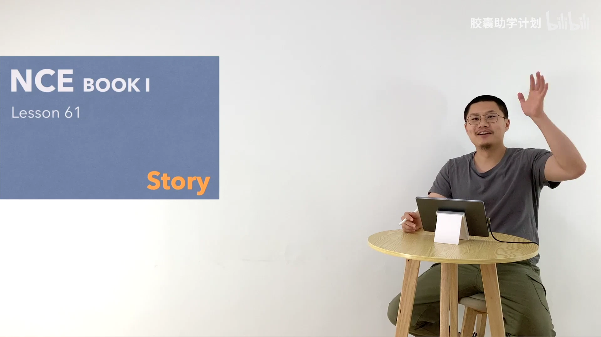

文字识别：胶囊助学计划 / NCE / BOOKI / Lesson 61 / Story

### 画面 00:00:02

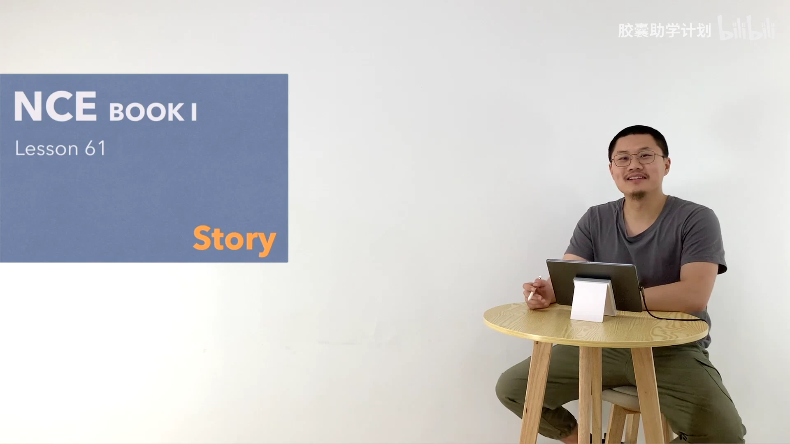

文字识别：胶囊助学计划 / NCE / BOOKI / Lesson 61 / Story

### 画面 00:00:09

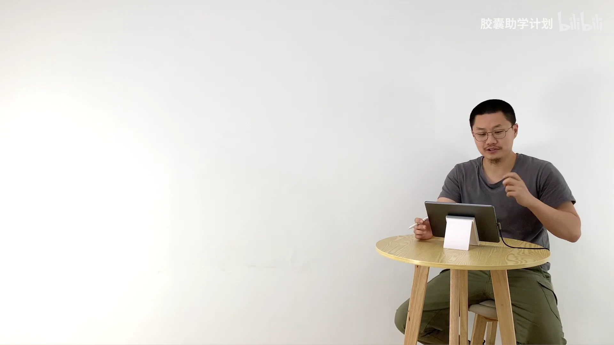

文字识别：胶囊助学计划

### 画面 00:00:11

文字识别：胶囊助学计划 / ①如何表达“你有毛病吗”？

### 画面 00:00:23

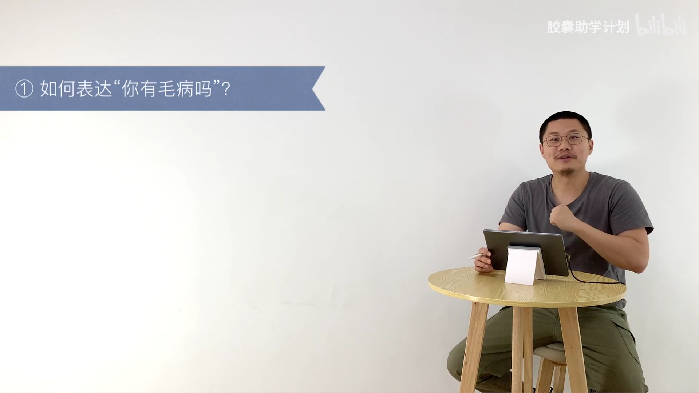

文字识别：胶囊助学计划 / ①如何表达“你有毛病吗”？

### 画面 00:00:27

文字识别：胶囊助学计划 bilbl / •

## 00:00:30–00:01:00

好，那我们上来直接看文章啊。两个人对话，我们先确定这两个人，一个叫 Mr. Williams，一个叫 Mrs. Williams。通过名字我们能判断啊，威廉先生、威廉夫人，这是一对夫妻。先生问啊，男士问说，Where's Jimmy？Jimmy 在哪儿呢？夫人回答说，He's in bed。他在床上躺着呢。然后呢，先生问说，What's the matter with him？注

### 画面 00:00:31

### 画面 00:00:33

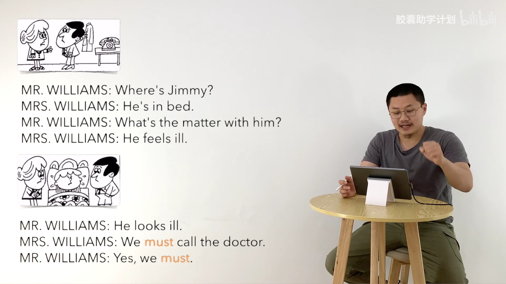

文字识别：胶囊助学计划 / MR. WILLIAMS: Where's Jimmy? / MRS. WILLIAMS: He's in bed. / MR. WILLIAMS: What's the matter with him? / MRS. WILLIAMS: He feels ill. / MR. WILLIAMS: He looks ill. / MRS. WILLIAMS: We must call the doctor. / MR. WILLIAMS: Yes, we must.

### 画面 00:00:37

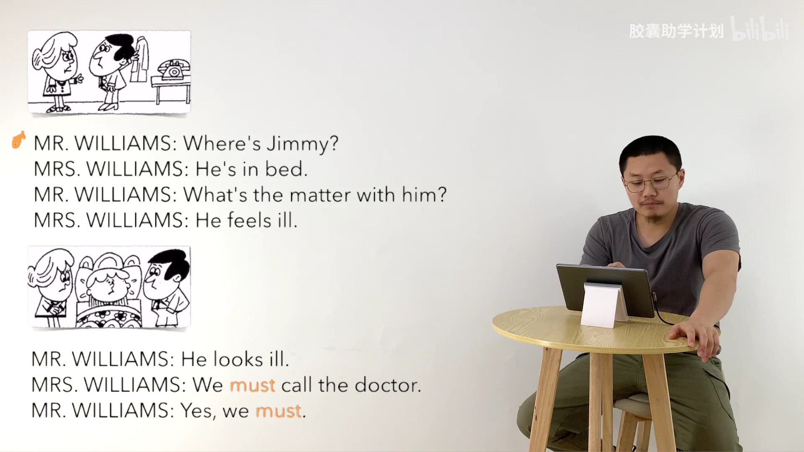

文字识别：胶囊助学计划 / MR. WILLIAMS: Where's Jimmy? / MRS. WILLIAMS: He's in bed. / MR. WILLIAMS: What's the matter with him? / MRS. WILLIAMS: He feels ilI. / MR. WILLIAMS: He looks ill. / MRS. WILLIAMS: We must call the doctor. / MR. WILLIAMS: Yes, we must.

### 画面 00:00:41

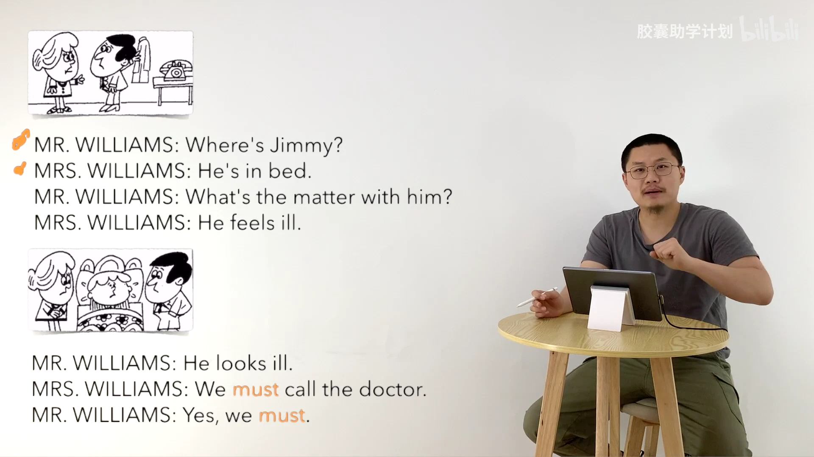

文字识别：胶囊助学计划 / MR. WILLIAMS: Where's Jimmy? /  MRS. WILLIAMS: He's in bed. / MR. WILLIAMS: What's the matter with him? / MRS. WILLIAMS: He feels ilI. / MR. WILLIAMS: He looks ill. / MRS. WILLIAMS: We must call the doctor. / MR. WILLIAMS: Yes, we must.

### 画面 00:00:48

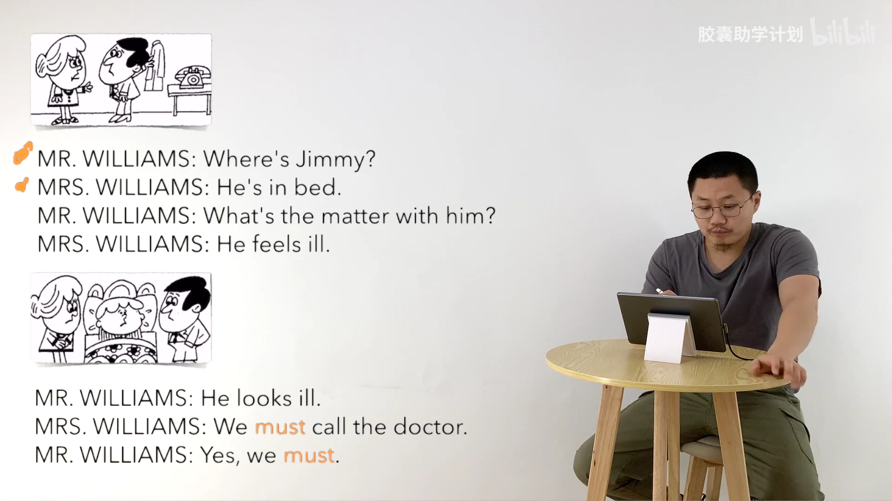

文字识别：胶囊助学计划 / MR. WILLIAMS: Where's Jimmy? / MRS. WILLIAMS: He's in bed. / MR. WILLIAMS: What's the matter with him? / MRS. WILLIAMS: He feels ilI. / MR. WILLIAMS: He looks ill. / MRS. WILLIAMS: We must call the doctor. / MR. WILLIAMS: Yes, we must.

### 画面 00:00:51

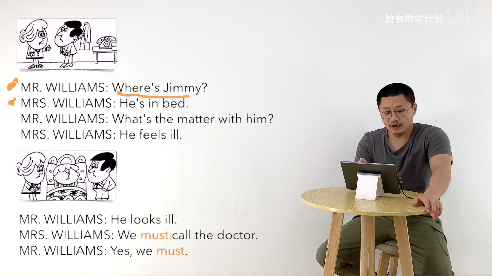

文字识别：胶囊助学计划 / MR. WILLIAMS: Where's Jimmy? / MRS. WILLIAMS: He's in bed. / MR. WILLIAMS: What's the matter with him? / MRS. WILLIAMS: He feels ilI. / MR. WILLIAMS: He looks ilIl. / MRS. WILLIAMS: We must call the doctor. / MR. WILLIAMS: Yes, we must.

### 画面 00:00:57

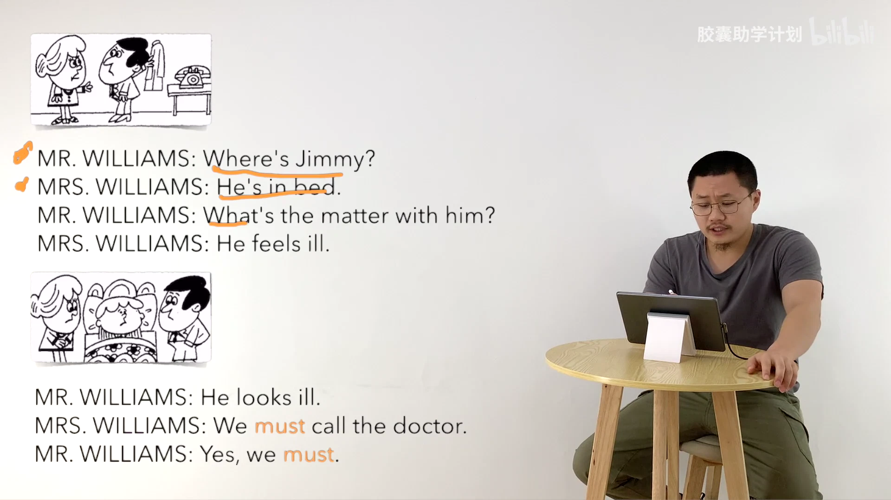

文字识别：胶囊助学计划 / MR. WILLIAMS: Where's Jimmy? /  MRS. WILLIAMS: He's in bed. / MR. WILLIAMS: What's the matter with him? / MRS. WILLIAMS: He feels ilI. / MR. WILLIAMS: He looks ilI. / MRS. WILLIAMS: We must call the doctor. / MR. WILLIAMS: Yes, we must.

### 画面 00:00:59

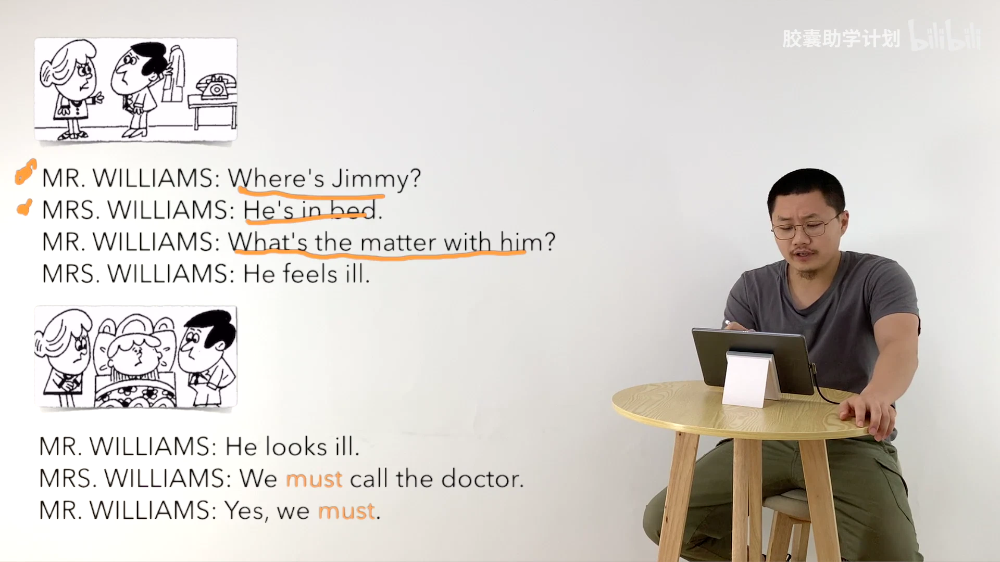

文字识别：胶嚢助学计划 / MR. WILLIAMS: Where's Jimmy? / MRS. WILLIAMS: He's in bed. / MR. WILLIAMS: What's the matter with him? / MRS. WILLIAMS: He feels ilI. / MR. WILLIAMS: He looks ilI. / MRS. WILLIAMS: We must call the doctor. / MR. WILLIAMS: Yes, we must.

## 00:01:00–00:01:30

意这句话是充满陷阱的，就是我最开始说你有什么毛病的那句话，叫 What's the matter with him? 注意这句话在本课的上下文当中表示的是他怎么了。 Okay，是一个平铺直叙，没有太多感情色彩的。但是我们在很多的现实生活当中用这句话的时候，比如说 What's the matter with you? 都是你有什么毛病？一会儿我们在接下来电影一个

### 画面 00:01:03

文字识别：胶囊助学计划 / MR. WILLIAMS: Where's Jimmy? / MRS. WILLIAMS: He's in bed. / MR. WILLIAMS: What's the matter with him? / MRS. WILLIAMS: He feels ill. / MR. WILLIAMS: He looks ill. / MRS. WILLIAMS: We must call the doctor. / MR. WILLIAMS: Yes, we must.

### 画面 00:01:05

文字识别：胶囊助学计划 / MR. WILLIAMS: Where's Jimmy? /  MRS. WILLIAMS: He's in bed. / MR. WILLIAMSWhat's the matter with him? / MRS. WILLIAMS: He feels ill. / MR. WILLIAMS: He looks ill. / MRS. WILLIAMS: We must call the doctor. / MR. WILLIAMS: Yes, we must.

### 画面 00:01:07

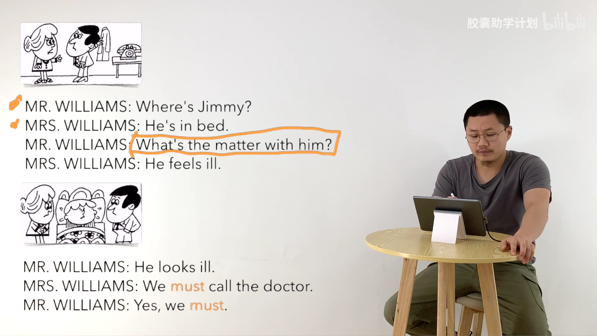

文字识别：胶囊助学计划 / MR. WILLIAMS: Where's Jimmy? / MRS. WILLIAMS: He's in bed. / MR.WILLIAMS / What's the matter with him? / MRS. WILLIAMS: He feels ilI. / MR. WILLIAMS: He looks ill. / MRS. WILLIAMS: We must call the doctor. / MR. WILLIAMS: Yes, we must.

### 画面 00:01:14

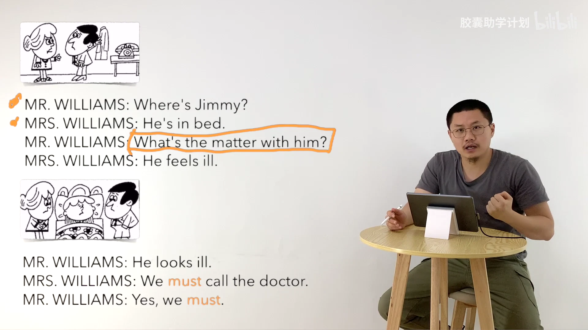

文字识别：胶囊助学计划 / MR. WILLIAMS: Where's Jimmy? /  MRS. WILLIAMS: He's in bed. / MR.WILLIAMS / What's the matter with him? / MRS. WILLIAMS: He feels ilI. / MR. WILLIAMS: He looks ill. / MRS. WILLIAMS: We must call the doctor. / MR. WILLIAMS: Yes, we must.

## 00:01:30–00:02:00

片段当中尝试去看一下，在这儿你要知道它表示的是还有什么问题吗？那回答非常简单，叫做 He feels ill. 他感觉他生病了。注意一个小点，He feels. 你看主语三单，动词还是三单，依旧是这个时态，一般现在时，陈述客观事实。我们做一个小的练习，口语把它一起变一般疑问句和否定句啊。来，一般疑问句 Does he feel ill? 否定句 He doesn't feel ill. 注意

### 画面 00:01:36

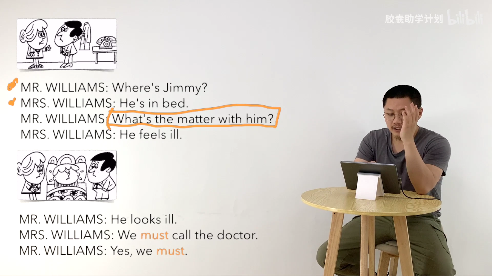

文字识别：胶囊助学计划 / MR. WILLIAMS: Where's Jimmy? / MRS. WILLIAMS: He's in bed. / MR.WILLIAMS / What's the matter with him? / MRS. WILLIAMS: He feels ilI. / MR. WILLIAMS: He looks ill. / MRS. WILLIAMS: We must call the doctor. / MR. WILLIAMS: Yes, we must.

### 画面 00:01:38

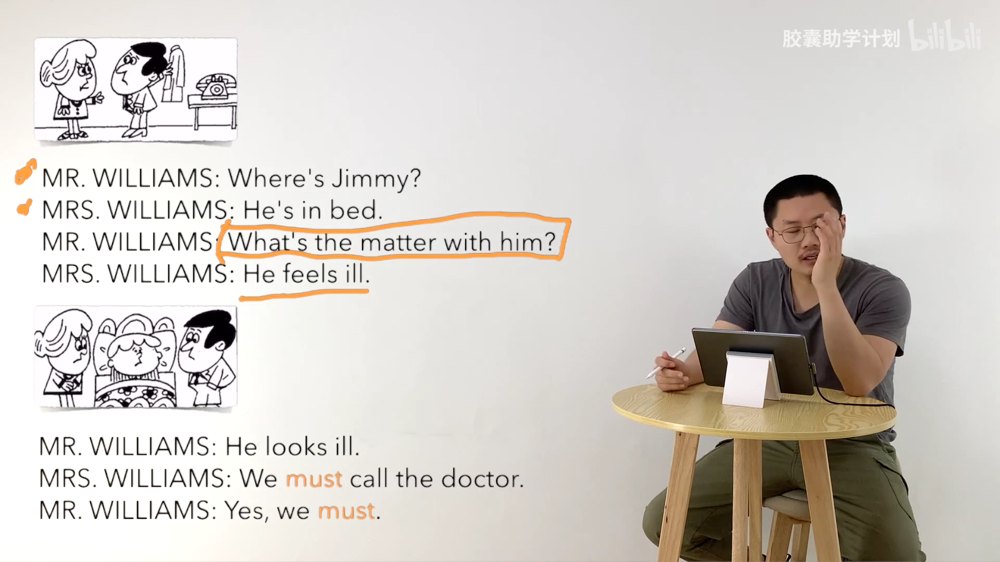

文字识别：胶囊助学计划 / MR. WILLIAMS: Where's Jimmy? / MRS. WILLIAMS: He's in bed. / MR.WILLIAMS / What's the matter with him? / MRS. WILLIAMS: He feels ilI. / MR. WILLIAMS: He looks ilIl. / MRS. WILLIAMS: We must call the doctor. / MR. WILLIAMS: Yes, we must.

### 画面 00:01:49

文字识别：胶囊助学计划 / MR. WILLIAMS: Where's Jimmy? / MRS. WILLIAMS: He's in bed. / MR.WILLIAMS / What's the matter with him? / MRS. WILLIAMS: He feels ilI. / MR. WILLIAMS: He looks ilIl. / MRS. WILLIAMS: We must call the doctor. / MR. WILLIAMS: Yes, we must.

## 00:02:00–00:02:30

doesn't和does提前，对吧？以及feel换回动词原形。然后他们两个人就上楼看了一下。他说He looks ill.他看起来也生病了。于是两个人啊，这个夫人说We must call the doctor.我们必须要给这个医生打一个电话。注意must这个位置，你看它跟can的位置是不是非常的像？We can call the doctor.虽然在这不应该用can啊，应该用的是we must。但是你注意它的位

### 画面 00:02:08

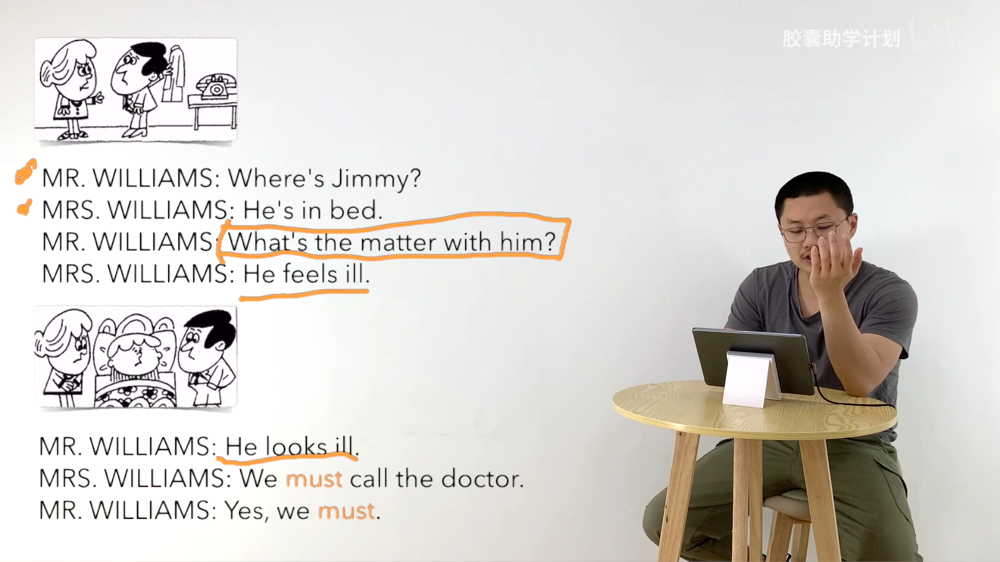

文字识别：胶囊助学计划 / MR. WILLIAMS: Where's Jimmy? / MRS. WILLIAMS: He's in bed. / MR.WILLIAMS / What's the matter with him? / MRS. WILLIAMS: He feels ill / MR. WILLIAMS: He looks ill. / MRS. WILLIAMS: We must call the doctor. / MR. WILLIAMS: Yes, we must.

### 画面 00:02:20

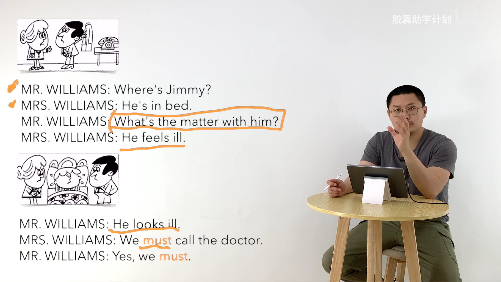

文字识别：胶囊助学计划 / MR. WILLIAMS: Where's Jimmy? / MRS. WILLIAMS: He's in bed. / MR.WILLIAMS / What's the matter with him? / MRS. WILLIAMS: He feels ill / MR. WILLIAMS: He looks ill / MRS. WILLIAMS: We must call the doctor. / MR. WILLIAMS: Yes, we must.

## 00:02:30–00:03:00

置，这对我们接下来学这个语法是有帮助的。我们必须要给医生打电话。回答是Yes, we must.跟Can也是一样，Yes, we can，对吧？Continue.接下来我们就看一个小的电影片段。我们先讲中间这句话，哎，这句话我现在标出来。这句话叫What's the matter with you？注意，刚才在文章当中说的是他有什么问题，他怎么样了？OK，那注意在很多状态之下，我说What's

### 画面 00:02:33

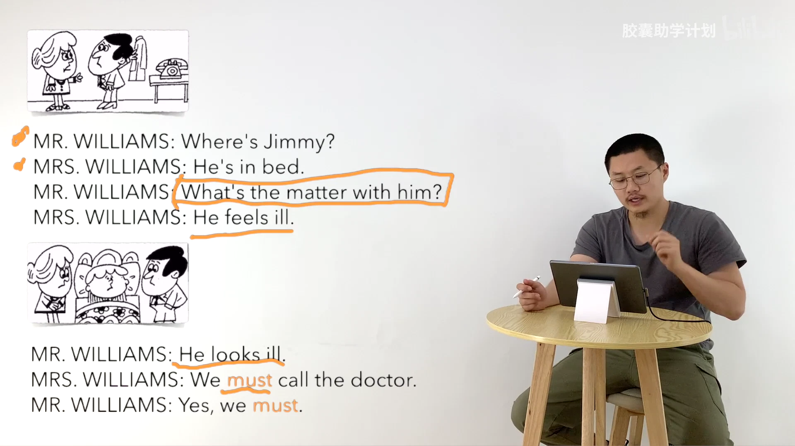

文字识别：胶囊助学计划 / MR. WILLIAMS: Where's Jimmy? / MRS. WILLIAMS: He's in bed. / MR.WILLIAMS / What's the matter with him? / MRS. WILLIAMS: He feels ill. / MR. WILLIAMS: He looks ill / MRS. WILLIAMS: We must call the doctor. / MR. WILLIAMS: Yes, we must.

### 画面 00:02:40

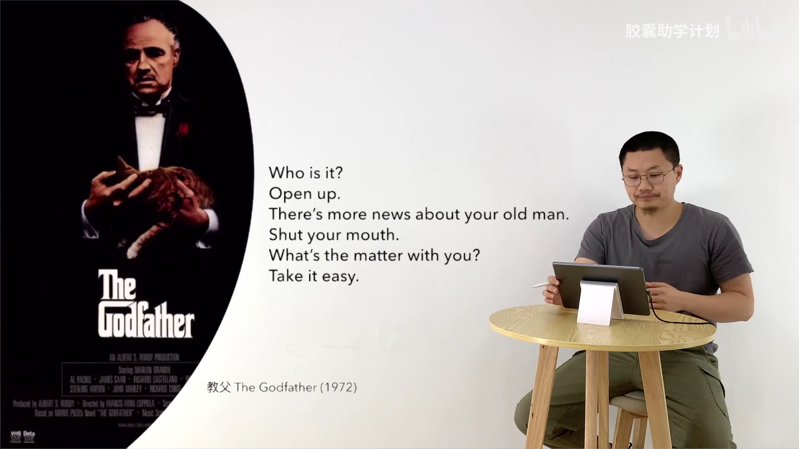

文字识别：胶囊助学计划 / Who is it? / Open up. / There's more news about your old man. / Shut your mouth. / What's the matter with you? / The / Take it easy. / Godfather / ANALBERTS. RUODY / PA00UCT / ALPACNOJAVESCAANFONARDCASTELLANO / 教父The Godfather(1972) / SEAUGBADEN-JOHIMARLEY / FICHAROO / Rodiuced by ALBERTS RU0DY / Msc / VHS Beta

### 画面 00:02:42

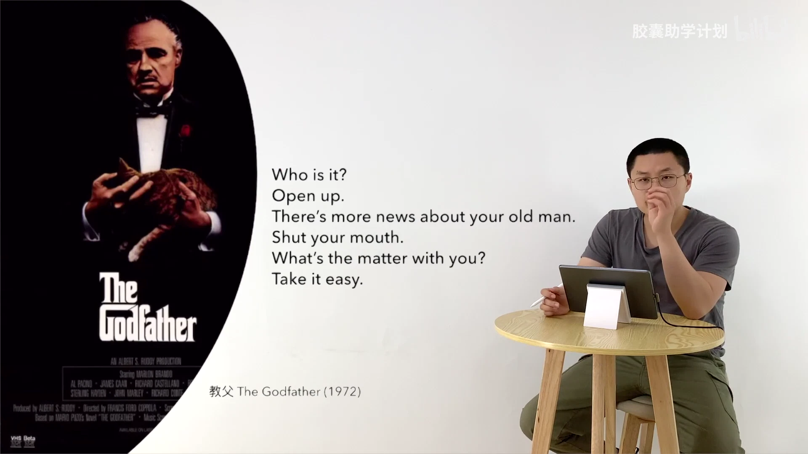

文字识别：胶囊助学计划 / Who is it? / Open up. / There's more news about your old man. / Shut your mouth. / What's the matter with you? / The / Take it easy. / Godfather / ANALBERTS RUOOY PROUCTION / AL PACINOJAMESCAAIHIONARD CASTELLANO / 教父The Godfather(1972) / SIEAUNG HOEN-JORI MARLEY-RICHAROOI / Audiced yABETSBOOYOred  FANCS FOROCOPROLA / nMAPOPUZOsMOveI"THEGODFATHER" / Msc / VHS Beta

### 画面 00:02:47

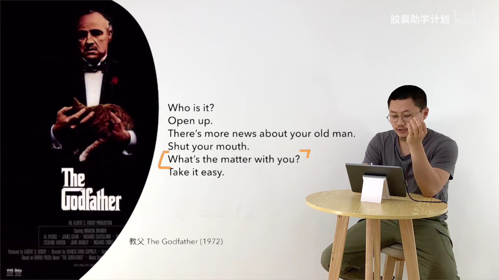

文字识别：胶囊助学计划 / Who is it? / Open up. / There's more news about your old man. / Shut your mouth. / What's the matter with you? / The / Take it easy. / Godfather / AMALBERITS. RUOOY / AL PACNO JAUES CAANHOHARD CASTELLANO / 教父 The Godfather(1972) / SIERUNGHADEN -JORIMARLEY / HICHAPOD / Produced ALEETS-HYeced yFBASFRCOPOA / Msc / VHS Beta

### 画面 00:02:51

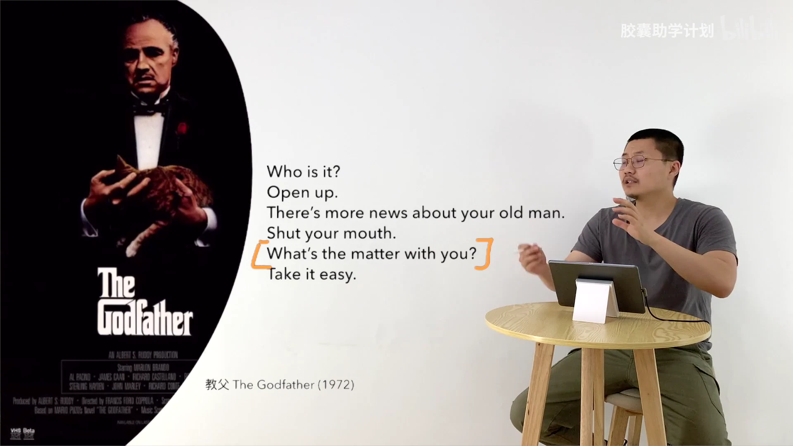

文字识别：胶囊助学计划 / Who is it? / Open up. / There's more news about your old man. / Shut your mouth. / What's the matter with you?] / The / Take it easy. / Godfather / ANALBERITSRUOOY / PRODUCION / ALPACNOJUESCAANHONARDCASTELANO / 教父 The Godfather(1972) / SIELNG RADEN- JORIMARLEY / FICHAPOD / Pudiced  ALBRTS-RUDYreCEdy FRANOSFORUCOPOLA / hsc / VHS Beta

## 00:03:00–00:03:30

the matter with you, man? What's the matter with you? 这句话的时候都是你有什么毛病啊？你这什么毛病？OK，都是在这样带有一些攻击性和负面感情色彩的。我们看一下这个片段，短短的这个电影片段当中出现了多少我们能学的东西啊？首先，Who is it？叫谁呀？我们前二十课学过，Open up，开开。OK，Open你学过，Up你没学过，但Open up告诉你表示开开开开门也很容易理解。说There is

### 画面 00:03:01

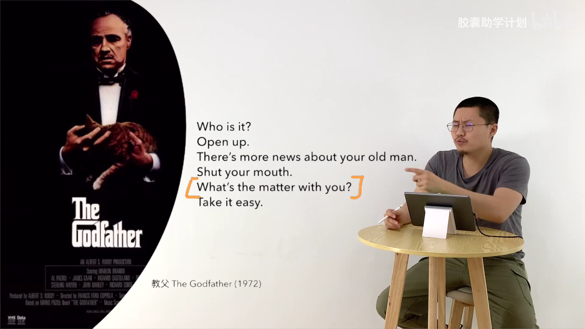

文字识别：胶囊助学计划 / Who is it? / Open up. / There's more news about your old man. / Shut your mouth. / What's the matter with you?] / The / Take it easy. / Godfather / ANALBERTS RUOOY / a10 / ALPACNOJVES CAIFIOBARO CASTELANO / 教父 The Godfather(1972) / STERUNGBROEN - JORIMALEY-HICHAROD / Hoduced yABERTS-OOOYicdyFRANCSFORUCOPOLA / HAH / hsc / VHS Beta

### 画面 00:03:11

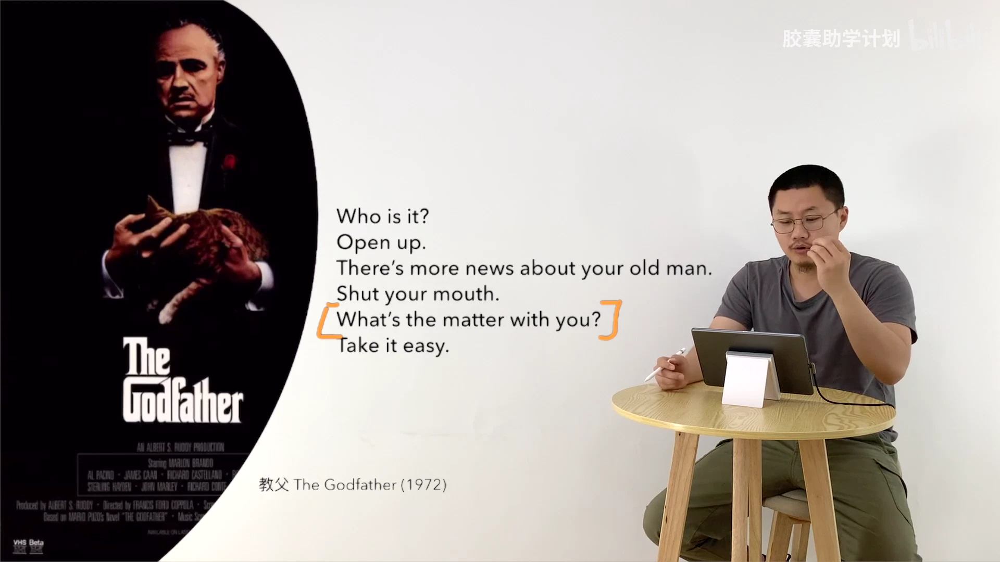

文字识别：胶囊助学计划 / Who is it? / Open up. / There's more news about your old man. / Shut your mouth. / What's the matter wit you?] / The / Take it easy. / Godfather / ANALBERITS. RUOOY / PR00UCI0 / AL PACNOJAUES CAIRIOAROCASTELAND / 教父 The Godfather(1972) / SIEALUNIG KODEN - JORNMARLEY / FICHAROD / Podced Iy AERTS-RUDOYreCdyFRANCSFOROCOPOLA / HDAH / hsc / VHS Beta

### 画面 00:03:15

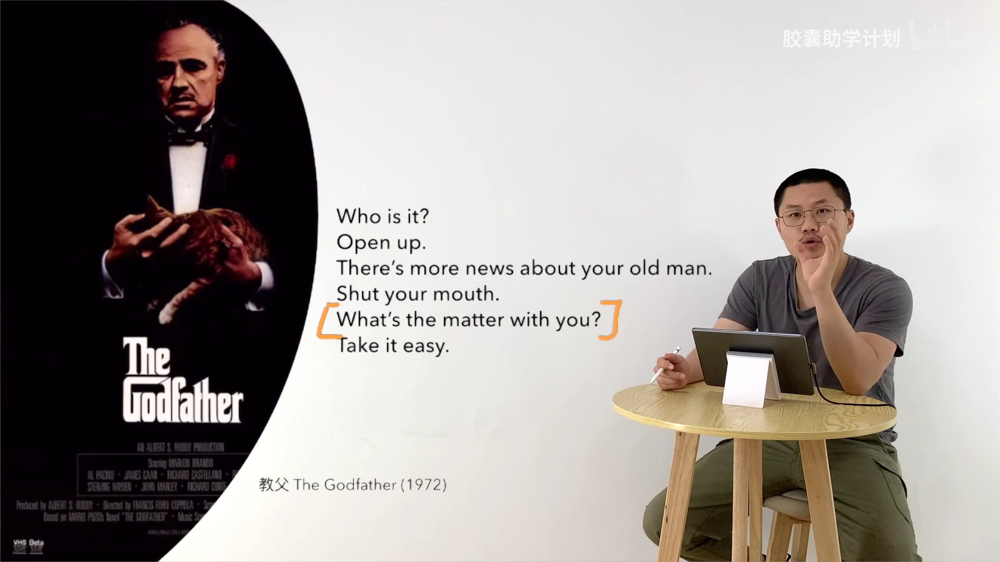

文字识别：胶囊助学计划 / Who is it? / Open up. / There's more news about your old man. / Shut your mouth. / What's the matter with you?] / The / Take it easy. / Godfather / ANALBERTS. ROOOY / PRO0UCIDD / ALPACNOJUES CANRIONARD CASTELAND / 教父 The Godfather(1972) / STERLNG KADEN -JORIMARLEY- / FICHAROD / Aodiced yAIBERTS-ROOOY-OiecEd y FRANCS FOROCOPOLA / hsc / VHS Beta

## 00:03:30–00:04:00

more news about your old man. 首先，第二 B 句型有 more。各位还没学一百零七课之后，我们才会学到叫做更多的 news。刚刚学到单词叫新闻或消息。关于你们家老爷子的，就是关于你父亲的，your father。 Okay, shut your mouth. 闭上你的嘴啊！ Shut the door. 关上门。那 shut your mouth 就闭嘴，shut up。 Okay, 那 What's the matter with you? 就你有什么毛病吗？

### 画面 00:03:45

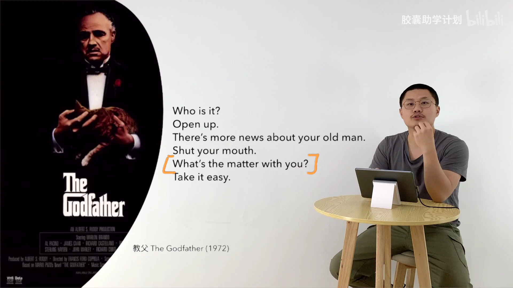

文字识别：胶囊助学计划 / Who is it? / Open up. / There's more news about your old man. / Shut your mouth. / What's the matter with you?] / The / Take it easy. / Godfather / ANALBERITS. RUOOY / FRODUCIOR / AL PACNO JAVES CANRIONARDCASTELAND / 教父 The Godfather(1972) / SIERUNIG HADEN -JOHIL MARLEY- FACHARO DO / Pudiced byABRTS-RUYDreCedy FBACSFOROCOPULA / Misc / VHS Beta

### 画面 00:03:58

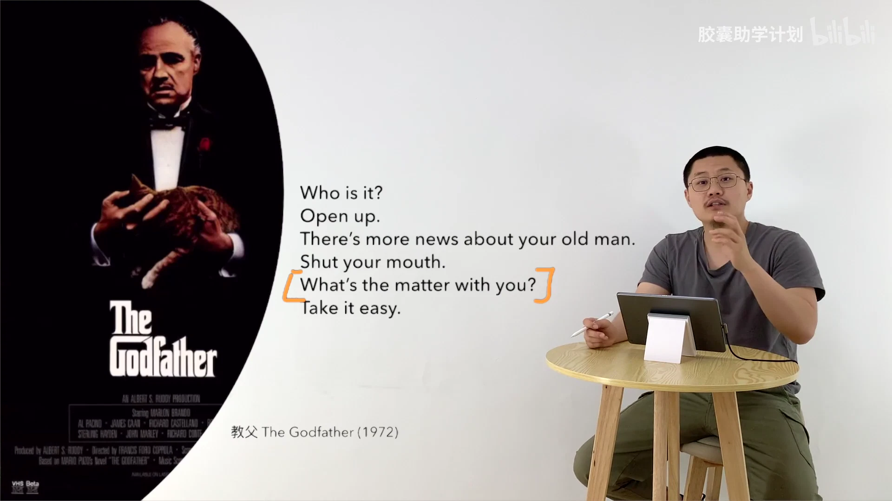

文字识别：胶囊助学计划 / Who is it? / Open up. / There's more news about your old man. / Shut your mouth. / What's the matter with you? / The / Take it easy. / Godfather / ANALBERITS. ROOOY / YRODUCID / AL PACNOJAUES CAAIRIONAROCASTELANO / 教父 The Godfather(1972) / SIERUMG BAYOEN -JORIMARLEY - HICHARO DO / Podced ALBERTS-RUDOYeCEd FRANCSFOROCOPOLA / MsC / VHS Beta

## 00:04:00–00:04:30

啊，你有什么毛病？Take it easy，放松。接下来我们看这个电影片段啊，来了。Where is it? Open up, it's gonna mention. Fine. There's more news about your old man. Word is out in the street, he's already dead. Come on, come on. Take it easy, take it easy. I was Polly. Polly was that sick. He was an old sick old man. Okay，啊，你看到了吗？他说，哎，There's rumor，说街上流

### 画面 00:04:06

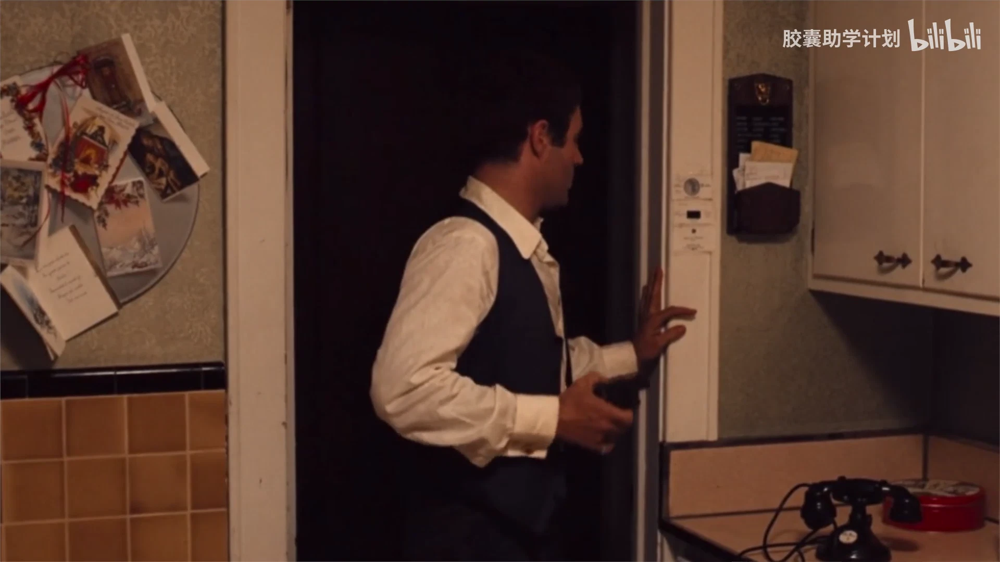

文字识别：Bilbili / 胶囊助学计划

### 画面 00:04:08

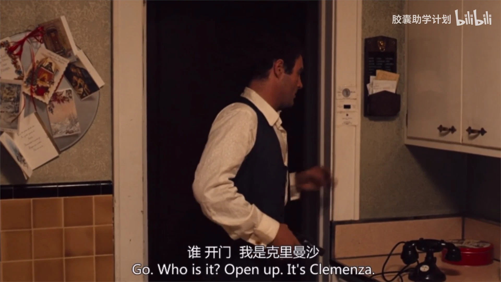

文字识别：bilbili / 胶囊助学计划 / 6 / 谁开门我是克里曼沙 / Go. Who is it? Open up. It's Clemenza.

### 画面 00:04:10

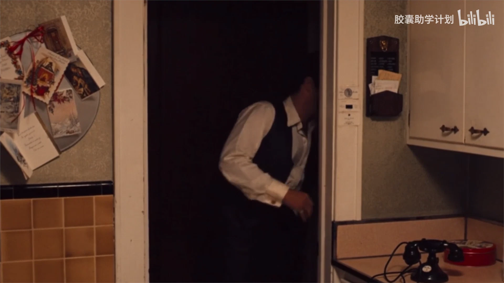

文字识别：Bilbili / 胶囊助学计划

### 画面 00:04:12

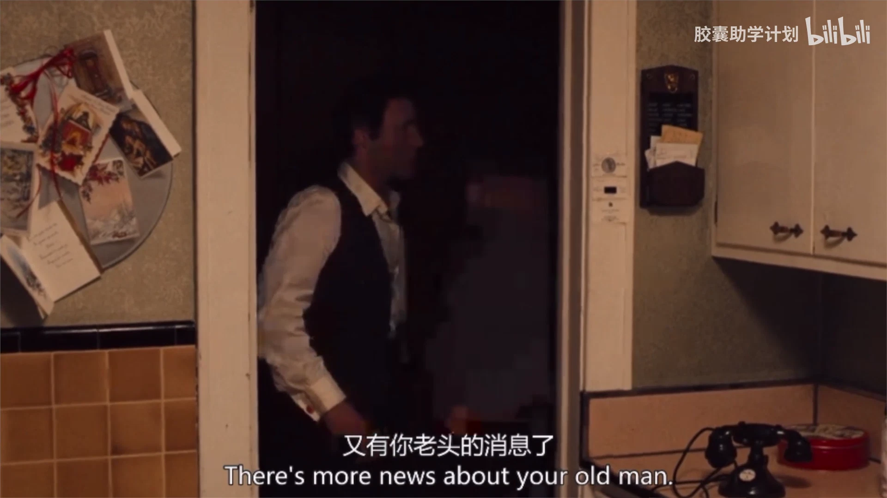

文字识别：Bilbili / 胶囊助学计划 / 又有你老头的消息了 / There's more news about your old man.

### 画面 00:04:14

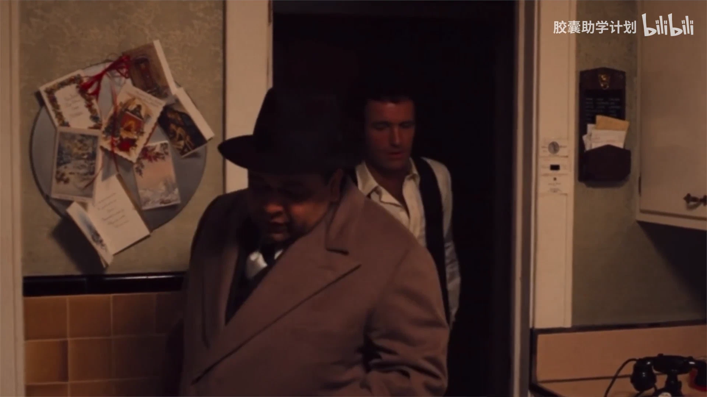

文字识别：Bilbli / 胶囊助学计划

### 画面 00:04:16

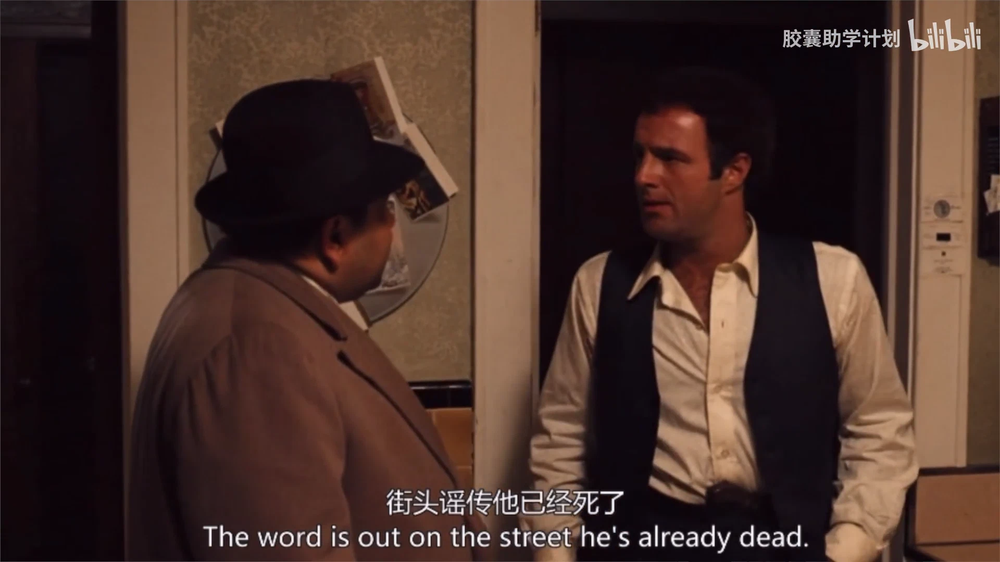

文字识别：Bilibili / 胶囊助学计划 / 街头谣传他已经死了 / The word is out on the street he's already dead.

### 画面 00:04:18

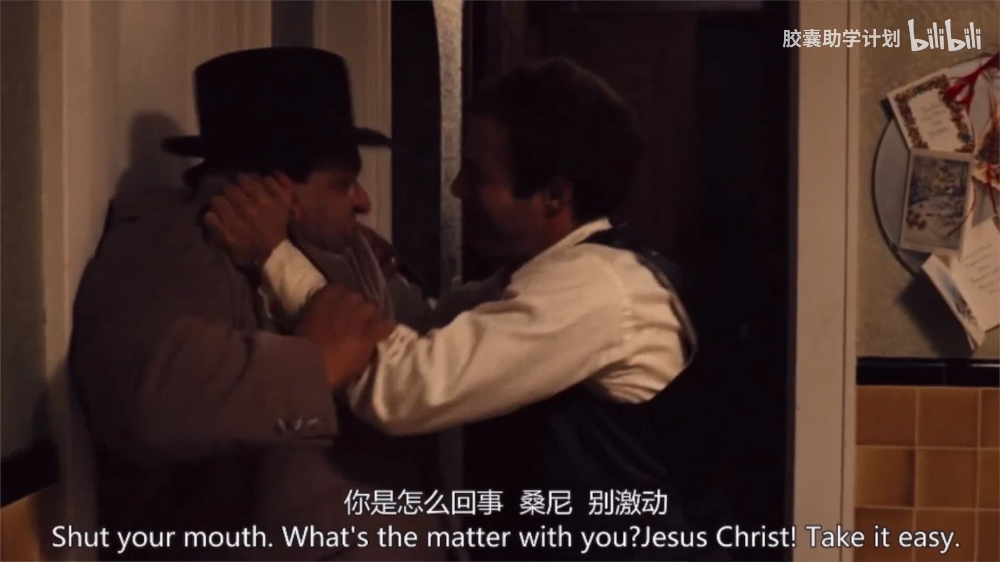

文字识别：bilbili / 胶囊助学计划 / 你是怎么回事桑尼 别激动 / Shut your mouth. What's the matter with you?Jesus Christ! Take it easy.

### 画面 00:04:20

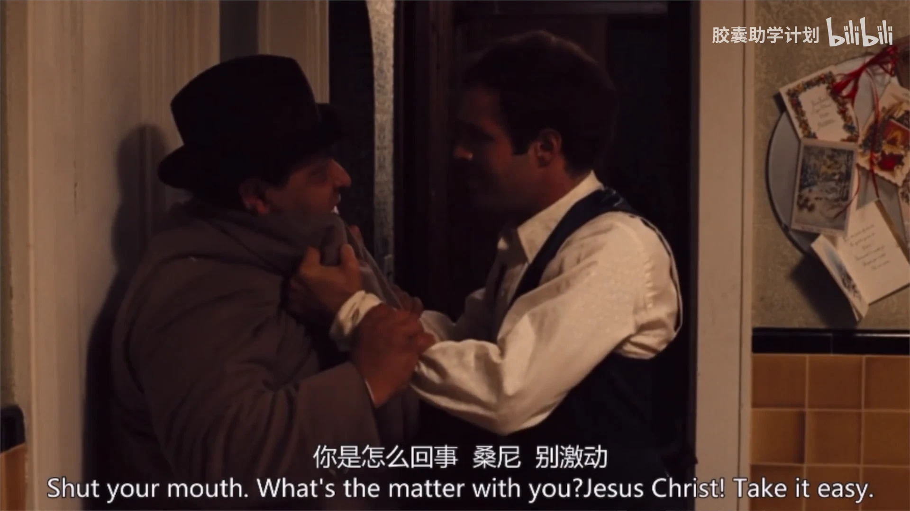

文字识别：bilbili / 胶囊助学计划 / 你是怎么回事桑尼 别激动 / Shut your mouth. What's the matter with you?Jesus Christ! Take it easy.

### 画面 00:04:22

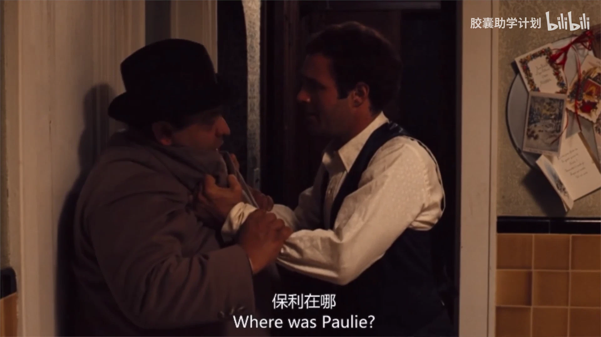

文字识别：Bilbili / 胶囊助学计划 / 保利在哪 / Where was Paulie?

### 画面 00:04:24

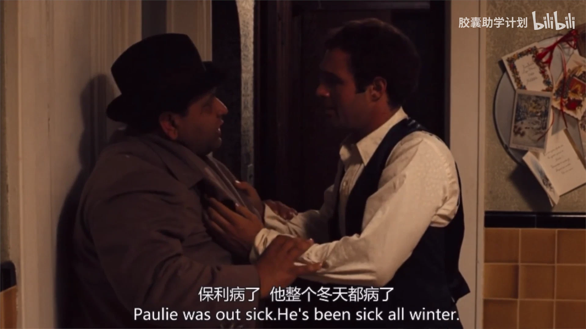

文字识别：bilbili / 胶囊助学计划 / 保利病了他整个冬天都病了 / Paulie was out sick.He's been sick all winter.

### 画面 00:04:26

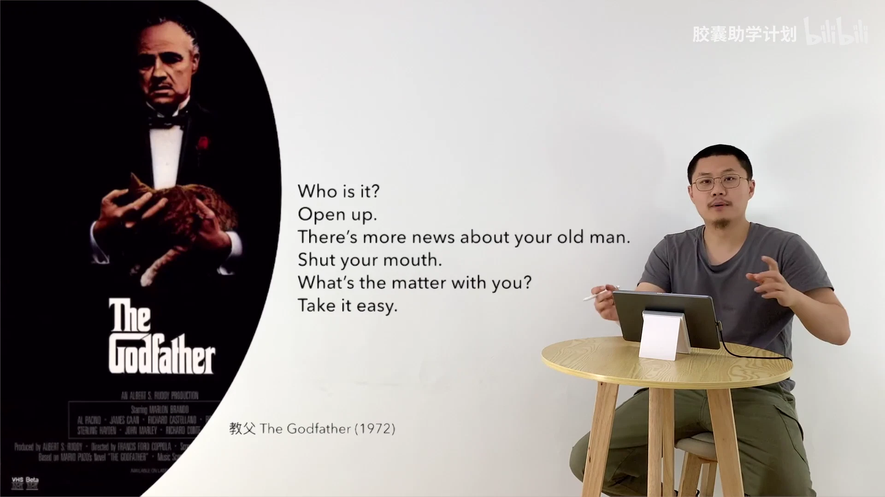

文字识别：胶囊助学计划 / Who is it? / Open up. / There's more news about your old man. / Shut your mouth. / What's the matter with you? / The / Take it easy. / Godfather / ANALBEITS. RUOOY PROOUCTION / ALPACNOJAUES CAAIFIONARO CASTELLANO / 教父 The Godfather(1972) / SIERUNG HAOEN- JORI MARLEY-HICHARO COI / Auduced yABETS-ROOYOreCed y FRACS FOROCOPPOA / MARIOPUZOSMOVEI"TIHEGODFATHER" / MscS / VHS Beta

## 00:04:30–00:05:00

传说你们家这个呃您的这个父亲是吧？就old man is dead啊，你父亲已经没了，人已经走了。然后他就立刻说shut your mouth. What's the matter with you？是吧？你闭嘴，你有什么毛病？这是啊，乱说对吧？OK，注意情绪是不一样的。所以What's the matter with you？这句话各位生活当中虽然您在课本当中是这么学的，生活当中轻易千万别乱用啊，一般吵架才这么用的。OK，continue回到文

### 画面 00:04:47

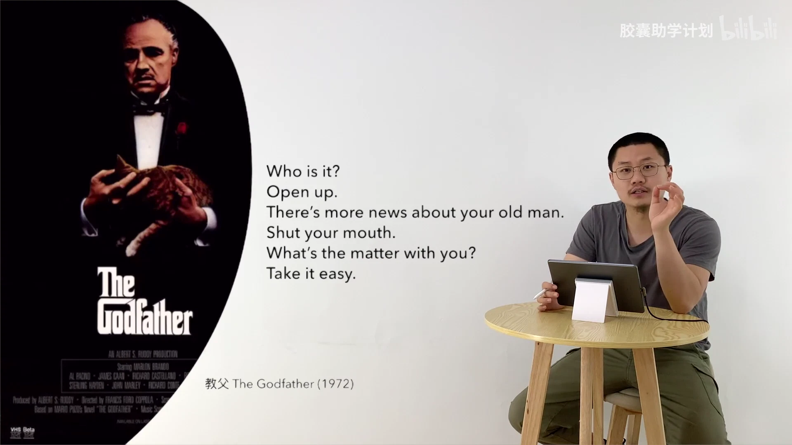

文字识别：胶囊助学计划 / Who is it? / Open up. / There's more news about your old man. / Shut your mouth. / What's the matter with you? / The / Take it easy. / Godfather / ANALBEITS RUOOY / YPROUCTON / ALPACNO JAUESCAAIRIOBARD CASTELANO / 教父 The Godfather(1972) / SIERUNG RYDEN -JORI MARLEY -HICHAFO DOI / Hudced yAETS-HUOOYrecEd y FRACS FOROCORA / mMAROPUZOs WONeI"THECODFATHER" / VHS Beta

### 画面 00:04:58

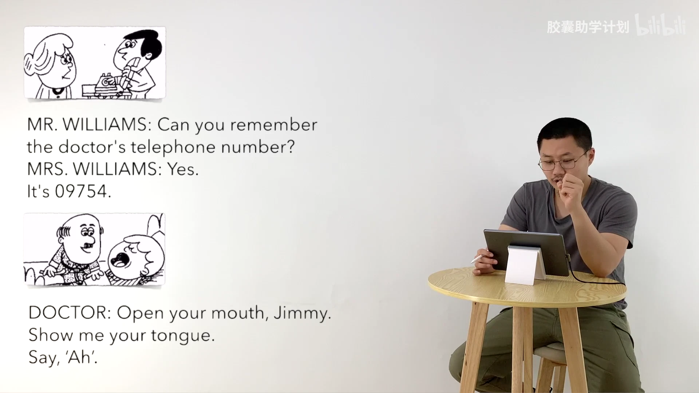

文字识别：胶囊助学计划 / MR. WILLIAMS: Can you remember / the doctor's telephone number? / MRS. WILLIAMS: Yes. / It's 09754. / DOCTOR: Open your mouth, Jimmy. / Show me your tongue. / Say,'Ah'.

## 00:05:00–00:05:30

章. Can you remember? 你能想起来吗? The doctor's telephone number.刚才我在讲单词的时候就提到了那telephone. 您可以我用. Can you remember the doctor's number? 大家都明白什么意思了. 说Yes, 没问题啊. It's. 接下来电话号码怎么读呢? 很简单，只要一到十，零到九您会读了，电话号码就会读了. 只不过零这个地方有两个选择，一个是读成字母O，一个是读成zero. 大

### 画面 00:05:01

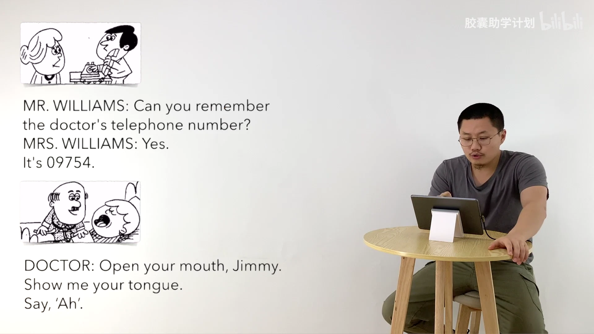

文字识别：胶囊助学计划 / MR. WILLIAMS: Can you remember / the doctor's telephone number? / MRS. WILLIAMS: Yes. / It's 09754. / DOCTOR: Open your mouth, Jimmy. / Show me your tongue. / Say,'Ah'

## 00:05:30–00:06:00

部分情况下，可能人们更习惯读的是 o 而不是 zero 啊，这是我个人的一个感受。原因可能是 zero 两个音节不太好读，而 o 就一个音节非常好读。来，it's o nine three five four 啊，这是他的电话号码。医生来了，说 open your mouth Jimmy 啊，打开你的嘴。 Show me your tongue，这个我们在讲单词部分都提到了，叫 show somebody something 啊，让我看一下你的这个舌头。 Say

### 画面 00:05:31

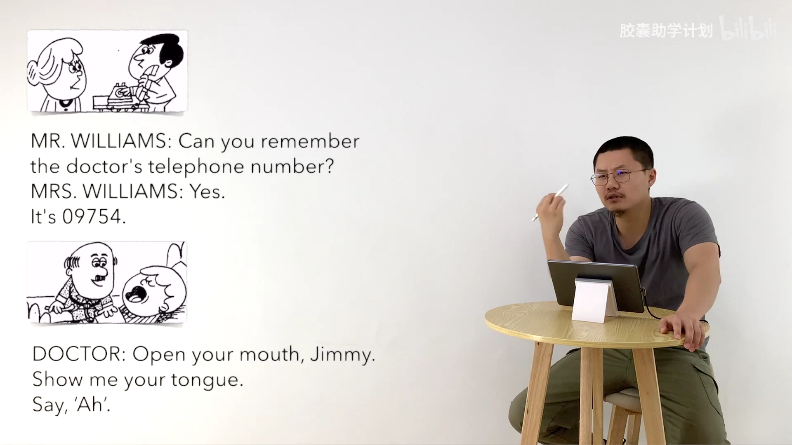

文字识别：胶囊助学计划 / MR. WILLIAMS: Can you remember / the doctor's telephone number? / MRS. WILLIAMS: Yes. / It's 09754. / DOCTOR: Open your mouth, Jimmy. / Show me your tongue. / Say,'Ah'.

## 00:06:00–00:06:30

ah, OK.这个我们小的时候看病是一样的，说啊这句话. Continue, what's the matter with him, doctor?啊，他怎么样了，doctor?啊，他有什么问题吗？他有什么病吗？OK，注意，he has a bad cold.这个单词各位要注意，have的第三人称单数是has。这个单词，他有一个重感冒。Mr.

### 画面 00:06:01

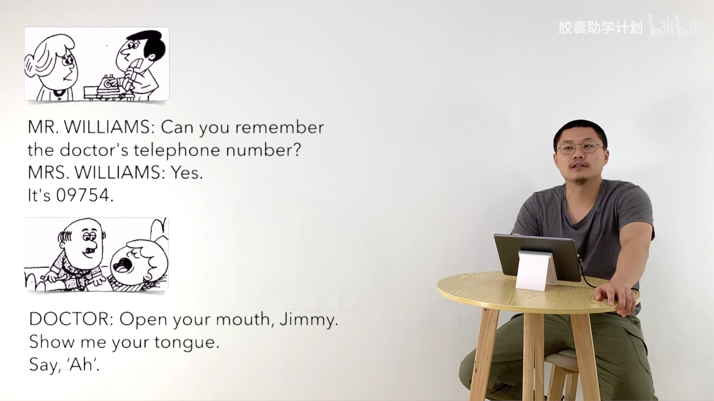

文字识别：胶囊助学计划 / MR. WILLIAMS: Can you remember / the doctor's telephone number? / MRS. WILLIAMS: Yes. / It's 09754. / DOCTOR: Open your mouth, Jimmy. / Show me your tongue. / Say,'Ah'

### 画面 00:06:05

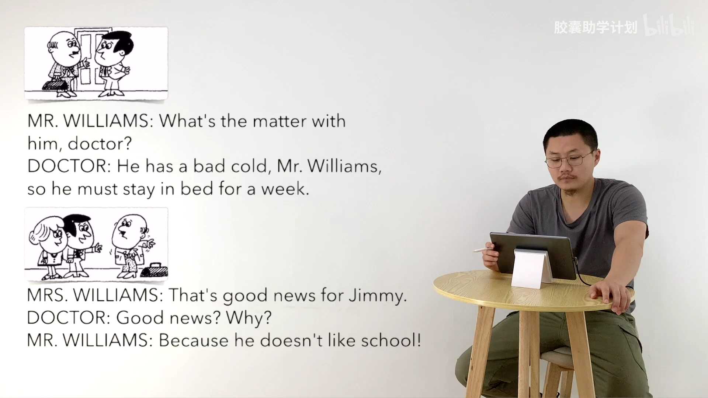

文字识别：胶囊助学计划 / MR. WILLIAMS: What's the matter with / him, doctor? / DOCTOR: He has a bad cold, Mr. Williams, / so he must stay in bed for a week. / MRS. WILLIAMS: That's good news for Jimmy. / DOCTOR: Good news? Why? / MR. WILLIAMS: Because he doesn't like school!

### 画面 00:06:13

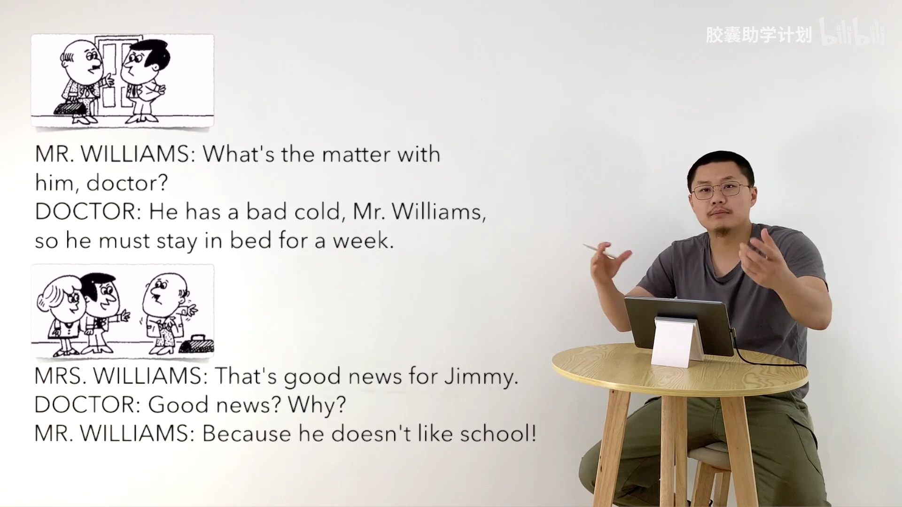

文字识别：胶囊助学计划 / MR. WILLIAMS: What's the matter with / him, doctor? / DOCTOR: He has a bad cold, Mr. Williams, / so he must stay in bed for a week. / MRS. WILLIAMS: That's good news for Jimmy. / DOCTOR: Good news? Why? / MR. WILLIAMS: Because he doesn't like school!

### 画面 00:06:20

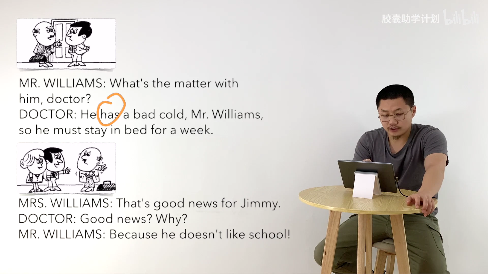

文字识别：胶囊助学计划 / MR. WILLIAMS: What's the matter with / him, doctor? / DOCTOR: Hehaa bad cold, Mr. Williams, / so he must stayin bed for a week. / MRS. WILLIAMS: That's good news for Jimmy. / DOCTOR: Good news? Why? / MR. WILLIAMS: Because he doesn't like school!

### 画面 00:06:22

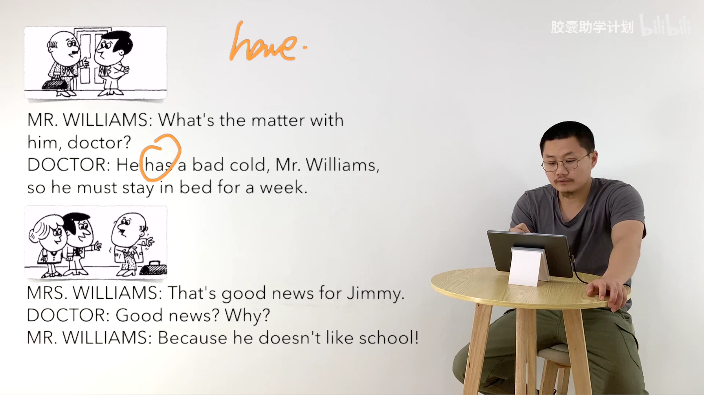

文字识别：hwe / 胶囊助学计划 / MR. WILLIAMS: What's the matter with / him, doctor? / DOCTOR: He haa bad cold, Mr. Williams, / so he must stayin bed for a week. / MRS. WILLIAMS: That's good news for Jimmy. / DOCTOR: Good news? Why? / MR. WILLIAMS: Because he doesn't like school!

### 画面 00:06:24

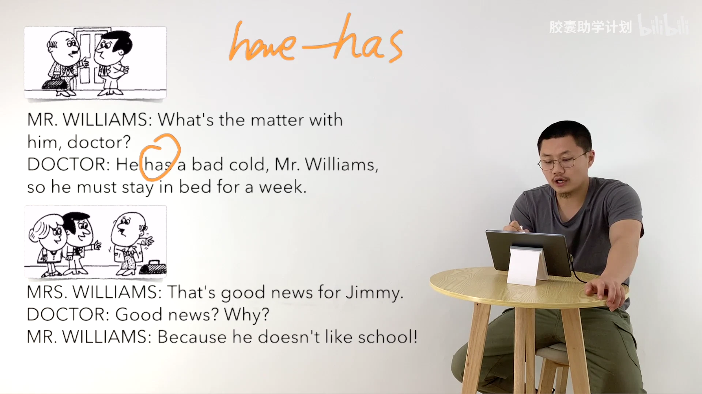

文字识别：have-has / 胶囊助学计划 / MR. WILLIAMS: What's the matter with / him, doctor? / DOCTOR: He haga bad cold, Mr. Williams, / so he must stayin bed for a week. / MRS. WILLIAMS: That's good news for Jimmy. / DOCTOR: Good news? Why? / MR. WILLIAMS: Because he doesn't like school!

## 00:06:30–00:07:00

Williams, so所以这个小单词各位可以提前记一下。虽然我们现在不讲，但以后会慢慢见到，叫做所以。He must stay in bed for a week.他必须要待在床上持续一周的时间。八十九课我们可以开始不停的接触for加一个小的时间段的这个用法啊。今天它不是重头戏。That's good news for Jimmy.啊，就是

### 画面 00:06:46

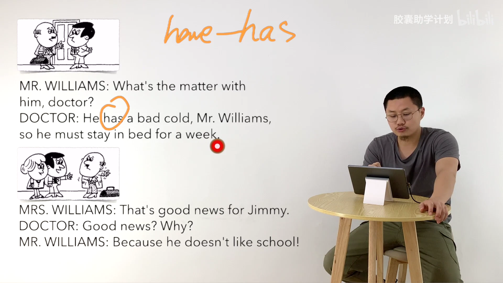

文字识别：hawe—has / 胶囊助学计划 / MR. WILLIAMS: What's the matter with / him, doctor? / DOCTOR: Hehaa bad cold, Mr. Williams, / so he must stay in bed for a week. / MRS. WILLIAMS: That's good news for Jimmy. / DOCTOR: Good news? Why? / MR. WILLIAMS: Because he doesn't like school!

## 00:07:00–00:07:30

他必须要在床上待一个礼拜。然后他妈妈说，哎，这对于Jimmy来说还是个好消息。Good news. Why?好消息，为什么呀？Because he doesn't like school.因为他不喜欢学校。Okay, who does? Okay，他并不是很喜欢学校。陈述客观事实，一般现在时。Very good.文章讲完了，接下来各位要么看着文章，要么完全闭上眼睛。我们做一些口语听力

### 画面 00:07:16

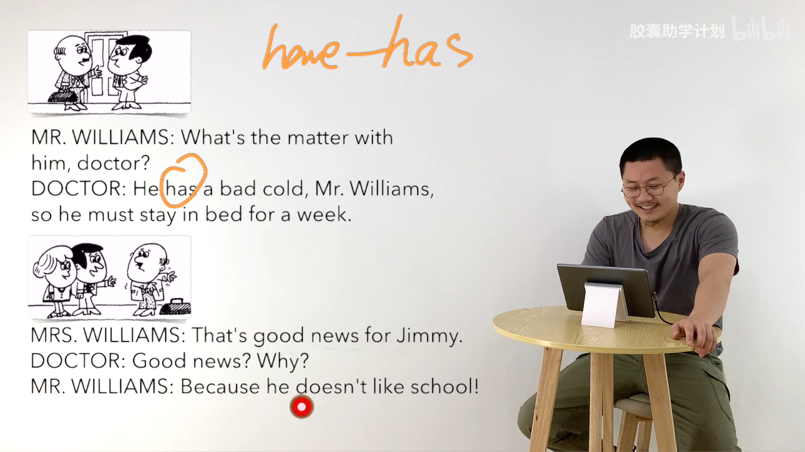

文字识别：hane—has / 胶囊助学计划 / MR. WILLIAMS: What's the matter with / him, doctor? / DOCTOR: Hehaga bad cold, Mr. Williams, / so he must stayin bed for a week. / MRS. WILLIAMS: That's good news for Jimmy. / DOCTOR: Good news? Why? / MR. WILLIAMS: Because he doesn't like school!

### 画面 00:07:21

文字识别：胶囊助学计划 / Comprehension

### 画面 00:07:24

文字识别：胶囊助学计划 / Comprehension

## 00:07:30–00:08:00

exercises. I ask you to answer in English. Here, Nidhi, where is Jimmy? Answer: He's in bed. Next one: What's the matter with Jimmy? He feels ill. Next one: Does he look ill? Yes, he does. Next one:

### 画面 00:07:34

文字识别：胶囊助学计划 / Comprehension / 1 T: Where's Jimmy?

### 画面 00:07:46

文字识别：胶囊助学计划 / Comprehension / 2 T: What's the matter with Jimmy? / S: He feels ill.

## 00:08:00–00:08:30

must Mr. and Mrs. Williams call the doctor? 好，这儿注意一点啊，各位可以抬头看一下这句话，我们提前意识一下。我刚才讲到了，我说 must 在结构上变一般疑问句或否定句的时候是非常像 can 的，can 您会了，must 很容易理解。Must 表必须，你看 must 变一般疑问句也提到句首去了，表示必须，跟 can 的位置是不是一样的？提到句首，对吧？叫必须怎么怎么样？他们必须要给医生打电话

### 画面 00:08:06

文字识别：胶囊助学计划 / Comprehension / 4 T: Must Mr. and Mrs. Williams call the doctor?

## 00:08:30–00:09:00

吗？那回答就是 Yes, they must. 好，各位继续看文章。好，上下全还会出现 must 啊。来了，Next one. Can Mrs. Williams remember the doctor's telephone number? Yes, she can. Next one. Must Jimmy open his mouth? Yes, he must. Next one. Must he show the doctor his

### 画面 00:08:35

文字识别：胶囊助学计划 / Comprehension / 4 T: Must Mr. and Mrs. Williams call the doctor? / S: Yes, they must.

### 画面 00:08:38

文字识别：胶囊助学计划 / Comprehension / 5 T: Can Mrs. Williams remember the / doctor's telephone number?

### 画面 00:08:50

文字识别：胶囊助学计划 / Comprehension / 6 T: Must Jimmy open his mouth?

## 00:09:00–00:09:30

tongue? Yes, he must. Next one, what's the matter with him? He has a bad cold. Next one, what must he do? What must Jimmy do, the little boy? He must stay in bed for a week. Continue. Why is that good news for Jimmy? Because he doesn't like school. Okay, most people doesn't like school. Okay,

### 画面 00:09:18

文字识别：胶囊助学计划 / Comprehension / 9 T: What must he do? / S: He must stay in bed for a week.

### 画面 00:09:20

文字识别：胶囊助学计划 / Comprehension / 10 T: Why is that good news for Jimmy? / 不

### 画面 00:09:23

文字识别：胶囊助学计划 / Comprehension / 10 T: Why is that good news for Jimmy?

## 00:09:30–00:10:00

but I I don't like school either. Actually, but I love learning. Continue asking questions. Ask me if Jimmy is in bed.啊，各位回想一下这道题，让你做的是肯定句变一般疑问句，对吧？Is Jimmy in bed? Where? Answer: Where is Jimmy?好，我只是对答案啊，各位自己要张开嘴变的啊。Ask me if he feels

### 画面 00:09:30

文字识别：胶囊助学计划 / Comprehension / 10 T: Why is that good news for Jimmy? / S: Because he doesn't like school.

### 画面 00:09:34

文字识别：胶囊助学计划 / Asking questions

### 画面 00:09:36

文字识别：胶囊助学计划 / Asking questions / 1 T: Ask me if Jimmy is in bed.

### 画面 00:09:38

文字识别：胶囊助学计划 / Asking questions / 1 T: Ask me if Jimmy is in bed.

### 画面 00:09:51

文字识别：胶囊助学计划 / Asking questions / 1 T: Ask me if Jimmy is in bed. / S: Is Jimmy in bed? / T: Where ...? / S: Where is Jimmy?

### 画面 00:09:55

文字识别：胶囊助学计划 / Asking questions / 2 T: Ask me if he feels ill.

## 00:10:00–00:10:30

ill.一般疑问句. Does he feel ill? How?来讲单词的时候我们提到了吧？怎么去问？How does he feel? Next one. Ask me if he looks ill. Does he look ill? How? How does he look? Next one. Ask me if the doctor's telephone

### 画面 00:10:01

文字识别：胶囊助学计划 / Asking questions / 2 T: Ask me if he feels ill.

## 00:10:30–00:11:00

number is o nine seven five four. Is提前就行了，很简单。Is the doctor's telephone number o nine seven five four? What? 那What你想对什么提问？那他的电话号码是多少？叫做What is the doctor's telephone number? Okay. One. Ask me if this is good news for Jimmy. Is提前Is this good news

### 画面 00:10:31

文字识别：胶囊助学计划 / Asking questions / 4T: Ask me if the doctor's telephone / number is 09754.

### 画面 00:10:37

文字识别：胶囊助学计划 / Asking questions / 4T: Ask me if the doctor's telephone / number is 09754. / S: Is the doctor's telephone number 09754?

### 画面 00:10:40

文字识别：胶囊助学计划 / Asking questions / 4T: Ask me if the doctor's telephone / number is 09754. / S: Is the doctor's telephone number 09754?

### 画面 00:10:47

文字识别：胶囊助学计划 / Asking questions / 4T: Ask me if the doctor's telephone / number is 09754. / S: Is the doctor's telephone number 09754? / T: What .? / S: What is the doctor's telephone number?

### 画面 00:10:52

文字识别：胶囊助学计划 / Asking questions

## 00:11:00–00:11:30

for Jimmy? Why? 直接加整句话。 Why is this good news for Jimmy? 为什么这对于 Jimmy 来说竟然是个好消息呢？啊，在床上躺几天还不能上学。 Because he doesn't like school. There we go. Recap. 本课关键的两个小的表达。 What's the matter with you? 和 Take it easy. Okay, take it easy. Relax. 放松啊，别紧张。和 What's the matter with you? 注意

### 画面 00:11:02

文字识别：胶囊助学计划 / Asking questions / 5 T: Ask me if this is good news for Jimmy. / S: Is this good news for Jimmy? / T: Why? / S: Why is this good news for Jimmy?

### 画面 00:11:04

文字识别：胶囊助学计划 / Asking questions / 5 T: Ask me if this is good news for Jimmy. / S: Is this good news for Jimmy? / T: Why.? / S: Why is this good news for Jimmy?

### 画面 00:11:14

文字识别：胶囊助学计划 / Recap / Patterns / Grammar / Words / What's the matter with you? / Expression / Take it easy.

### 画面 00:11:26

文字识别：Recap / 胶囊助学计划 / Patterns / & / Grammar / Words / What's the matter with you? / Expression / Take it easy.

## 00:11:30–00:12:00

你要结合语气，对吧？要结合上下文。各位以后去看电影的时候可以注意一下。大多数情况下，生活当中说 What's the matter with you? 都是觉都是在说你有什么毛病。OK，这是一个作业。绿皮书六十一课，各位可以去写了啊。接下来呢，文章跟读至熟读成诵，请给自己讲解一遍今天的核心知识点。OK，那如果大家喜欢我们的课程呢，欢迎大家关注、订阅、一键

### 画面 00:11:36

文字识别：Recap / 胶囊助学计划 / Patterns / Grammar / Words / What's the matter with you? / Expression / Take it easy.

### 画面 00:11:41

文字识别：胶囊助学计划 / Recap / Patterns / Grammar / Words / What's the matter with you? / Expression / Take it easy.

### 画面 00:11:43

文字识别：胶囊助学计划

### 画面 00:11:52

文字识别：胶囊助学计划 / 绿皮书第61课的写作练习 / .文章跟读至熟读成诵 / 3.请给自己讲解一遍今天的 / 核心知识点

### 画面 00:11:54

文字识别：胶囊助学计划 / 绿皮书第61课的写作练习 / 文章跟读至熟读成诵 / 3.请给自己讲解一遍今天的 / 核心知识点

### 画面 00:11:56

文字识别：胶囊助学计划 / 👍

### 画面 00:11:58

文字识别：胶囊助学计划

## 00:12:00–00:12:28

三连，分享给那些需要的朋友。最后，我们再来看一句名人名言：The best doctors in the world are Doctor Diet, Doctor Quiet, and Doctor Merryman. See you next time.

### 画面 00:12:02

文字识别：胶囊助学计划 / The best doctors in the world are Doctor Diet, / Doctor Quiet, and Doctor Merryman. / Jonathan Swift

### 画面 00:12:14

文字识别：胶囊助学计划 / The best doctors in the world are Doctor Diet, / Doctor Quiet, and Doctor Merryman. / Jonathan Swift

### 画面 00:12:16

文字识别：CAPSULEACADEMY / 胶囊助学计划 / 小红书 / 品

### 画面 00:12:18

文字识别：CAPSULEACADEMY / 胶囊助学计划 / 小红书

### 画面 00:12:24

文字识别：CAPSULEACADEMY / 胶囊助学计划 / 『 / 小红书 / Creator / Leo & Berlin / OE

### 画面 00:12:26

文字识别：bilibili / 胶囊助学计划

### 画面 00:12:27

文字识别：bilibili / 胶囊助学计划

