# 062 单词 练习

快速机器解析：语音为单模型转写，未进行独立交叉校对或人工复核；画面每秒采样并按变化选帧，短时文字和标记可能遗漏。截图时间约有 1 秒误差。图片有损压缩；遇到疑点请按时间查看 Google Drive 原视频。

## 00:00:00–00:00:30

Hello everyone, welcome to Capsule Academy. This is Leo. Today we're going to learn New Concept English Book One Lesson Sixty Two Practices and Words.老习惯进入正式课程之前，我们先看几个问题。第一，如何表达头疼啊、牙疼啊等一系列的疼？接下来呢，如何去表达看医生？那包括看牙医。最后，如何表达要吃药了？这个表达习惯。OK，表达方法。那带着这三个问题，Hope you guys enjoyed.

### 画面 00:00:00

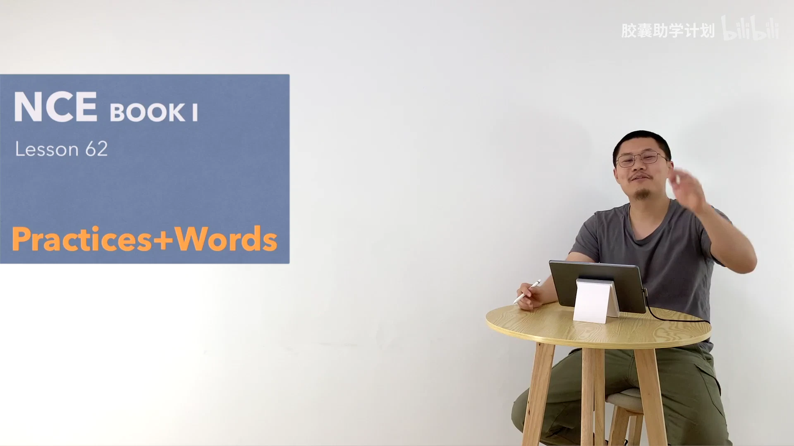

文字识别：胶囊助学计划 / NCE / BOOKI / Lesson 62 / Practices+Words

### 画面 00:00:03

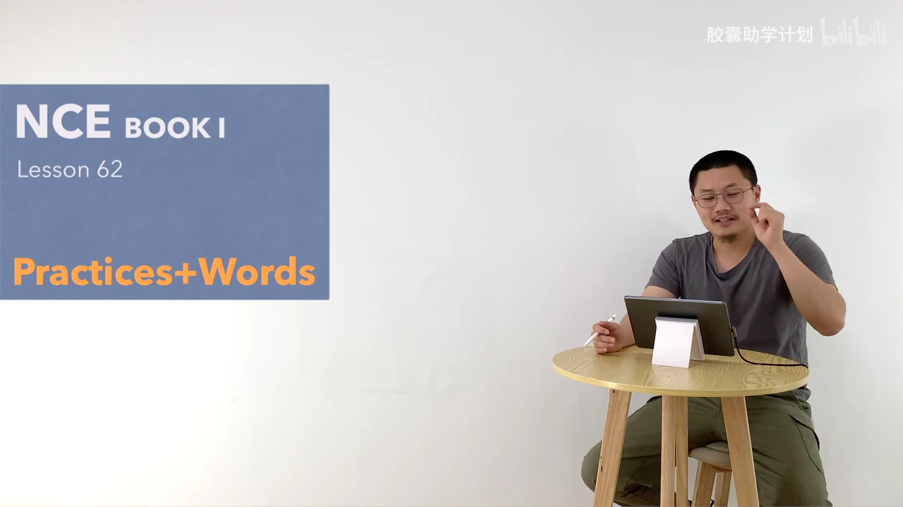

文字识别：胶囊助学计划 / NCE / BOOKI / Lesson 62 / Practices+Words

### 画面 00:00:05

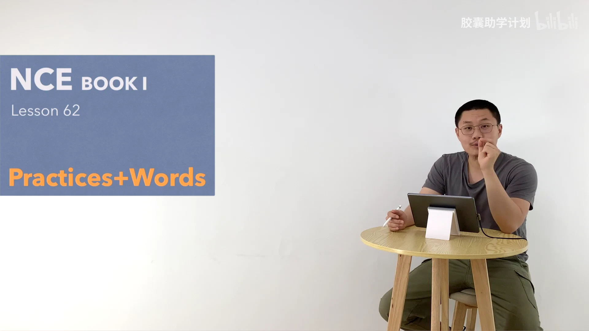

文字识别：胶囊助学计划 / NCE / BOOKI / Lesson 62 / Practices+Words

### 画面 00:00:10

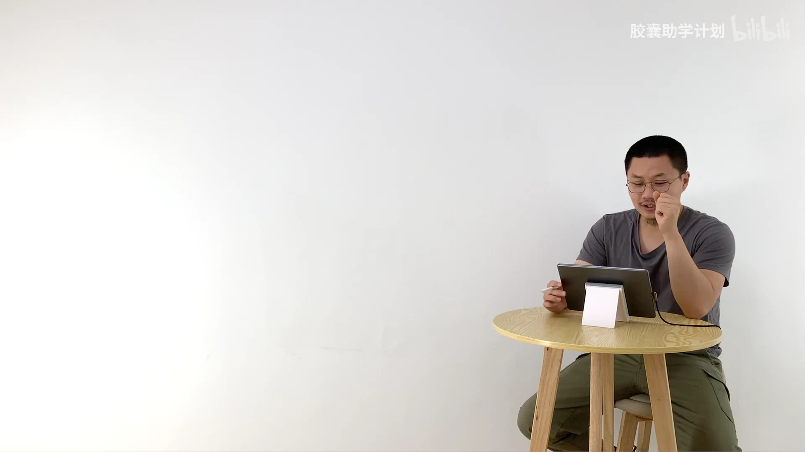

文字识别：胶囊助学计划

### 画面 00:00:12

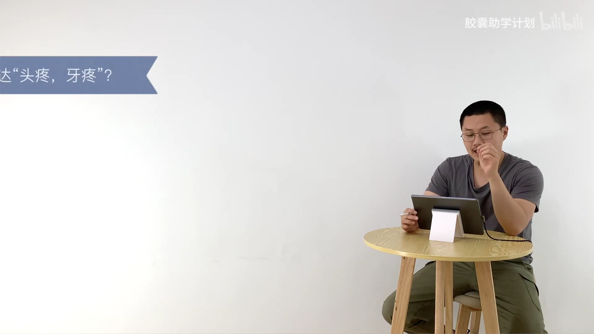

文字识别：胶囊助学计划 / 达“头疼，牙疼”？

### 画面 00:00:14

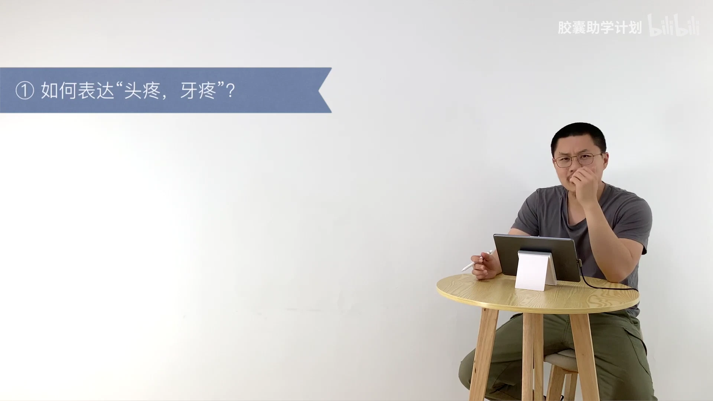

文字识别：胶囊助学计划 / ①如何表达“头疼，牙疼”？

### 画面 00:00:18

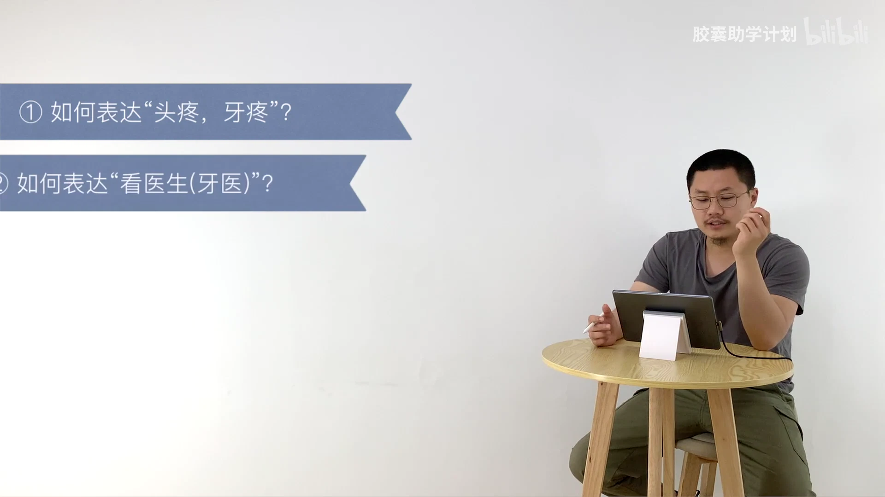

文字识别：胶囊助学计划 / ①如何表达“头疼，牙疼”？ / 如何表达“看医生(牙医)”?

### 画面 00:00:22

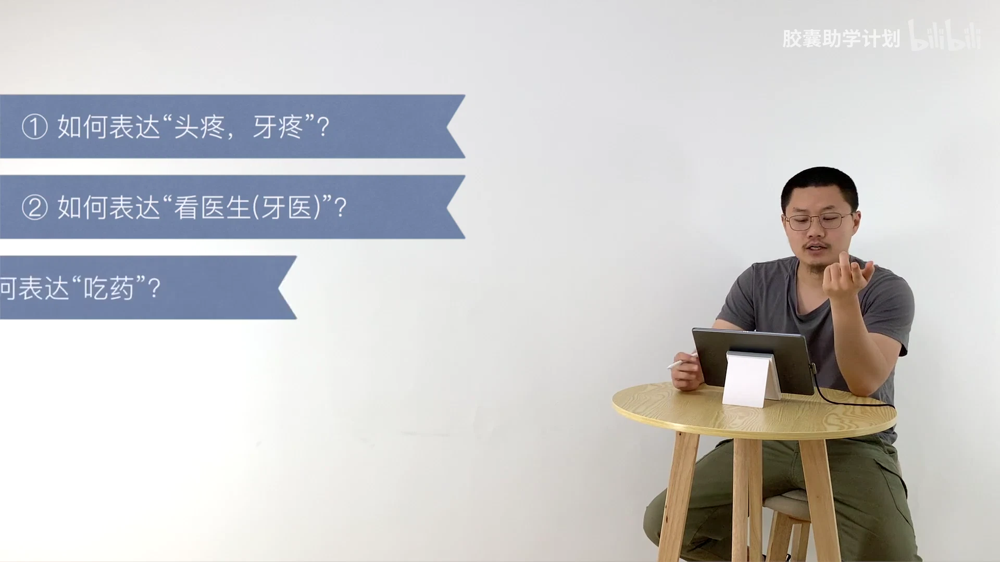

文字识别：胶囊助学计划 / ①如何表达“头疼，牙疼”？ / 如何表达“看医生(牙医)”? / 可表达“吃药”？

### 画面 00:00:24

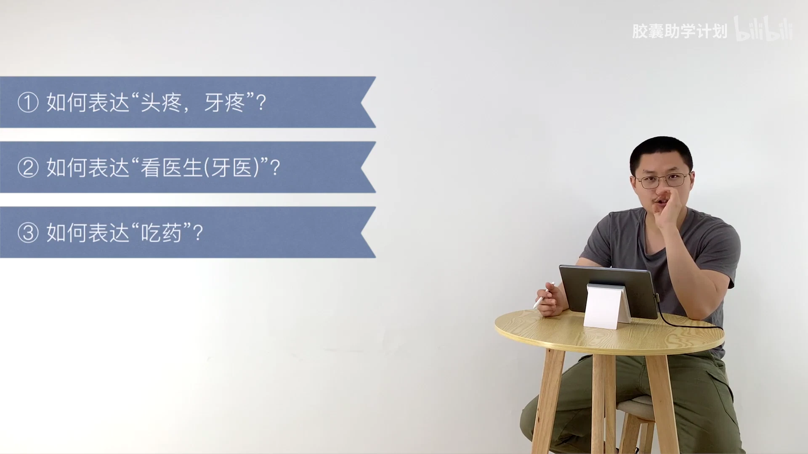

文字识别：胶囊助学计划 / ①如何表达“头疼，牙疼”？ / 如何表达“看医生(牙医)”? / 如何表达“吃药”？

### 画面 00:00:27

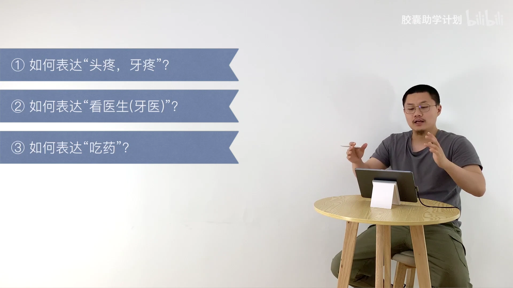

文字识别：胶囊助学计划 / ①如何表达“头疼，牙疼”？ / 如何表达“看医生(牙医)”? / 如何表达“吃药”？

## 00:00:30–00:01:00

好，那我们引出第一个单词，直接用电影去引啊。电影当中出现了这样一个小的片段对话啊，叫 I have a headache. 好，注意，你看这个单词，我们先看 headache 这个单词，实际上是由两个单词组成的。首先 head 是我们的头，H E A D，那后面的四个字母 A C H E，它的发音叫 ache

### 画面 00:00:30

文字识别：胶囊助学计划b出出 / •

### 画面 00:00:34

### 画面 00:00:36

文字识别：胶囊助学计划 / /·hedeI k / / I have a headache. / sit up / take off these glasses / 金刚狼 X-Men Origins: Wolverine (2009) / X-MEN ORIGI / W O LV ER

### 画面 00:00:40

文字识别：胶囊助学计划 / /·hedeI k / / I have a headache. / sit up / take off these glasses / 金刚狼 X-Men Origins: Wolverine (2009) / X-MEN ORIGI / W O LVER

### 画面 00:00:48

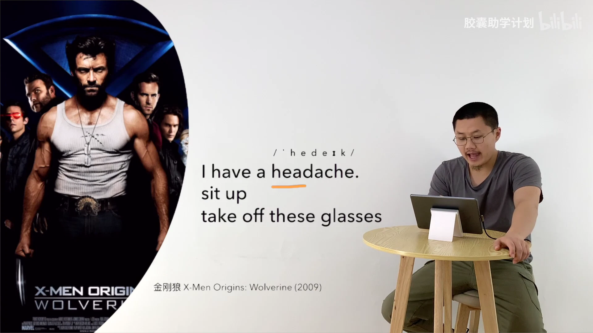

文字识别：胶囊助学计划 / / ·hedeI k / / I have a headache. / sit up / take off these glasses / 金刚狼 X-Men Origins: Wolverine (2009) / X-MEN ORIGI / W O LV ER

### 画面 00:00:55

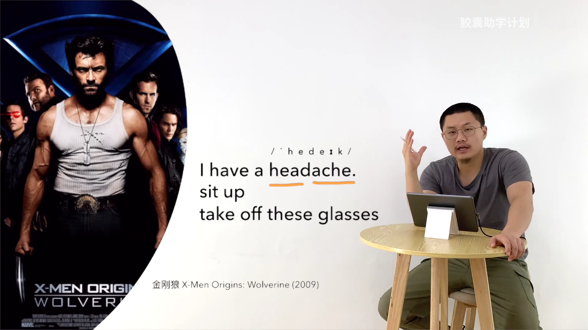

文字识别：/·hedei k / / I have a headache. / sit up / take off these glasses / 金刚狼X-Men Origins: Wolverine (2009) / X-MEN ORIGI / W O LV ER

## 00:01:00–00:01:30

啊，表示的是疼的意思。接下来很多表示这儿疼那儿疼，都是由身体的这个部位再加上ache疼这个单词放在一起。头疼啊，头痛啊，都OK的。那如何表达疼呢？你注意它本身前面还加了个a，它实际上是个名词。你想把它动词化，前面就要用一个have。于是说have a headache，表示的叫

### 画面 00:01:00

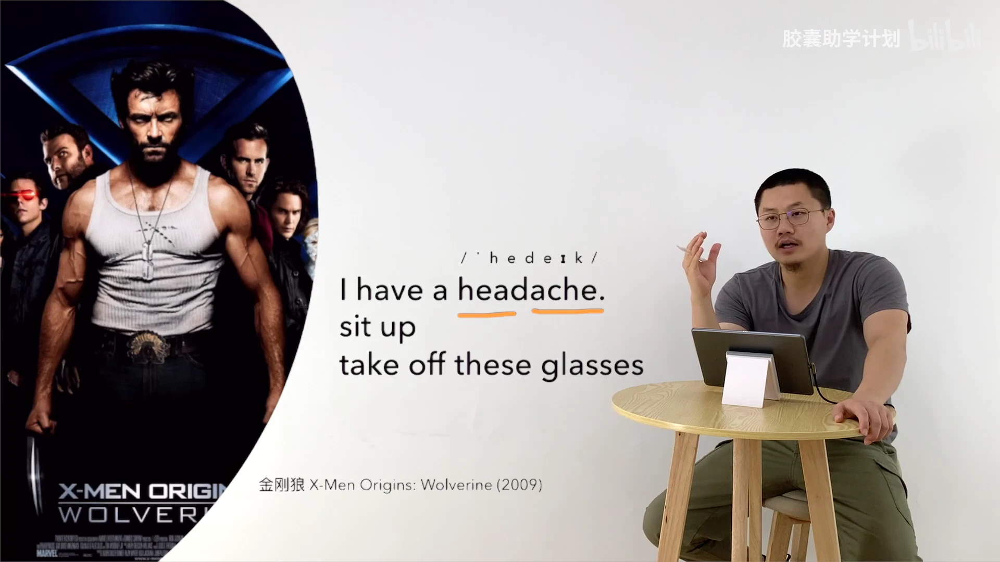

文字识别：胶囊助学计划 / / ·he dei k / / I have a headache. / sit up / take off these glasses / 金刚狼 X-Men Origins: Wolverine (2009) / X-MEN ORIGI / W O LV E R

### 画面 00:01:06

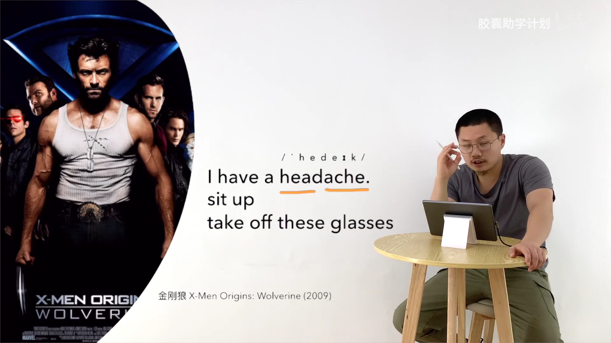

文字识别：/·hedei k / / I have a headache. / sit up / take off these glasses / 金刚狼X-Men Origins: Wolverine (2009) / X-MEN ORIGI / W O LV E R

### 画面 00:01:11

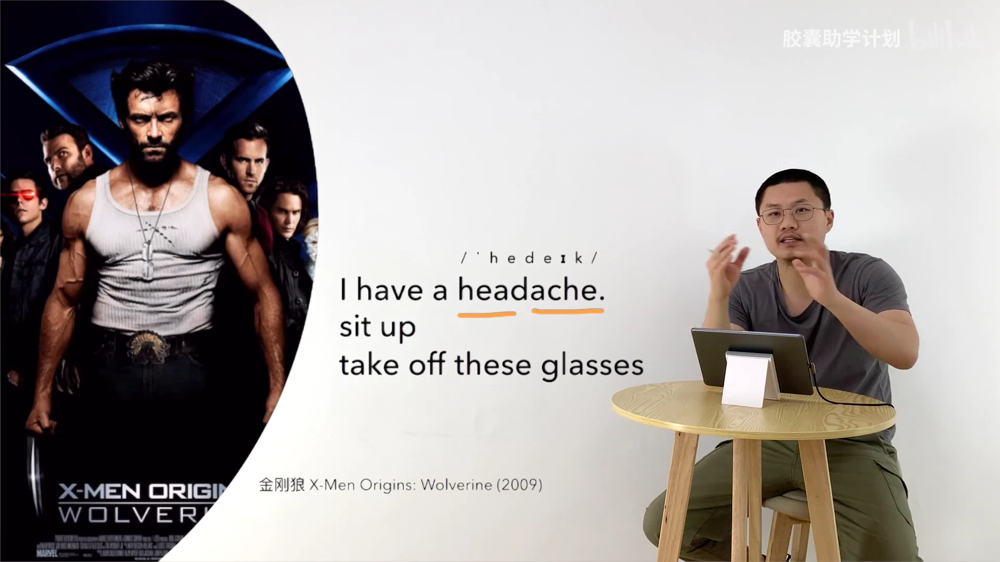

文字识别：胶囊助学计划 / /·hedeIk / / I have a headache. / sit up / take off these glasses / 金刚狼 X-Men Origins: Wolverine (2009) / X-MEN ORIGI / W O LV E R

### 画面 00:01:16

文字识别：胶囊助学计划 / /·hedeI k / / I have a headache. / sit up / take off these glasses / 金刚狼 X-Men Origins: Wolverine (2009) / X-MEN ORIGI / W O LV E R

### 画面 00:01:20

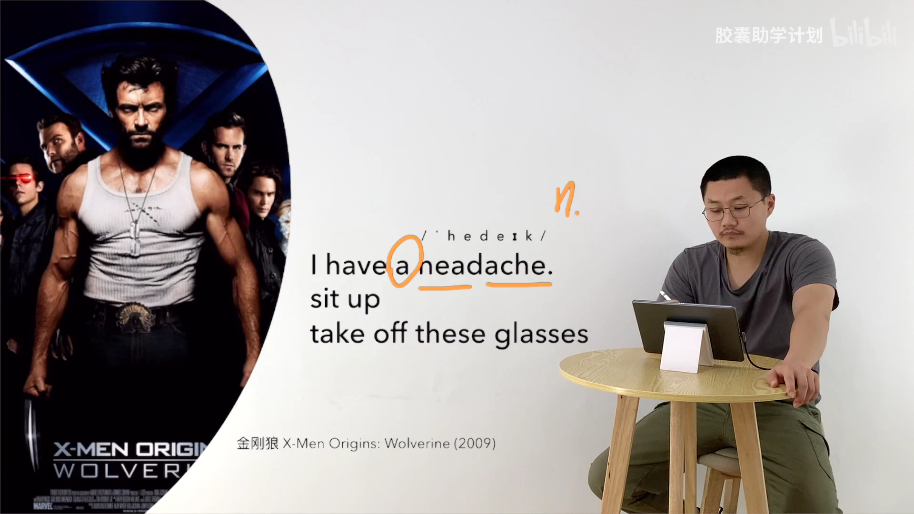

文字识别：胶囊助学计划 / n. / ·ｈedelk/ / I have / aneadache. / sit up / take off these glasses / 金刚狼 X-Men Origins: Wolverine(2009) / X-MEN ORIGI / W □ LV E R

### 画面 00:01:24

文字识别：胶囊助学计划 / ·hedelk/ / have / aheadache. / sit up / take off these glasses / 金刚狼 X-Men Origins: Wolverine (2009) / X-MEN ORIGI / W O LV E R

### 画面 00:01:26

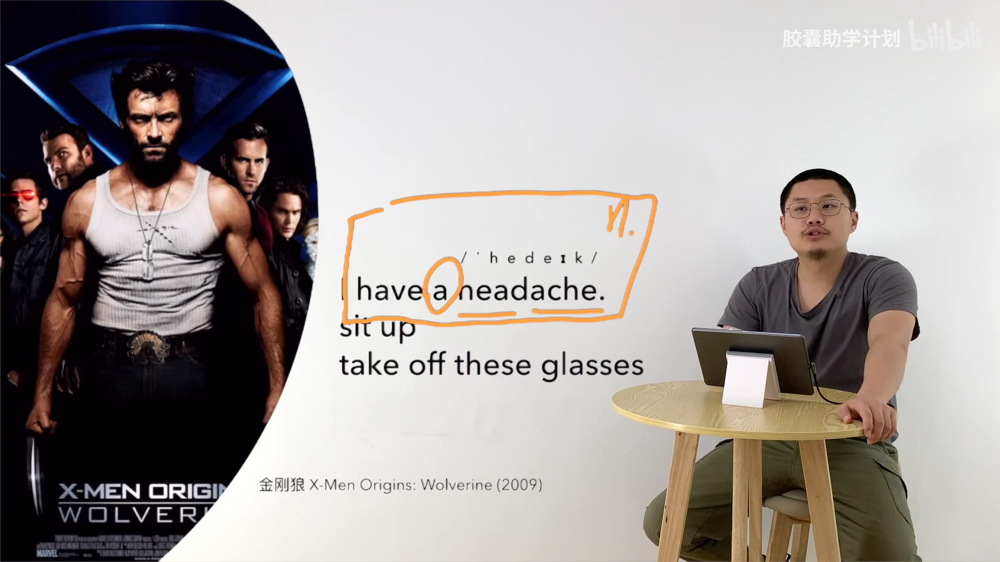

文字识别：胶囊助学计划 / ·hedelk/ / have / eaneadache. / sTt up / take off these glasses / 金刚狼X-Men Origins: Wolverine(2009) / X-MEN ORIGI / W O LV E R

## 00:01:30–00:02:00

做我头疼。这儿的have你不用单独去思考说have如何去翻译，你只要知道have a headache这些单词放在一起表示头疼，这个就OK了。OK，那它还有接下来一个小的短语叫sit up啊，sit叫做坐，up叫起来，sit up。你看我现在这样做就是sit，但是没有up，坐起来的。哎，正襟危坐是吧？让你坐直了啊，咱们翻译成汉语叫sit

### 画面 00:01:31

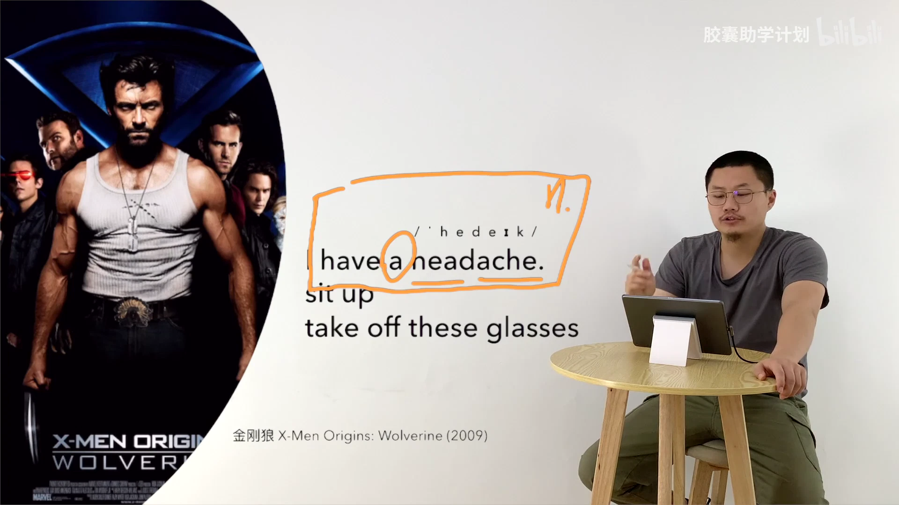

文字识别：胶囊助学计划 / 'hedelk/ / haveaneadache. / sTt up / take off these glasses / 金刚狼 X-Men Origins: Wolverine(2009) / X-MEN ORIGIN / W O LV E R

### 画面 00:01:33

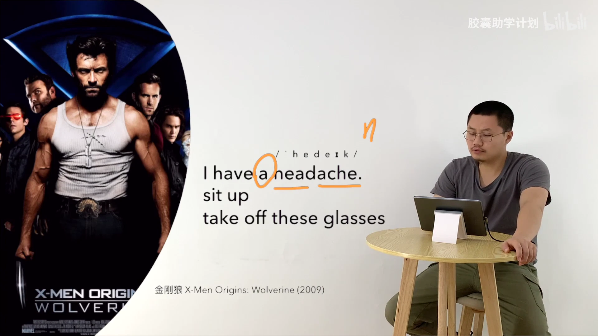

文字识别：胶囊助学计划 / ·ｈedｅlｋ/ / I have / eaheadache. / sit up / take off these glasses / 金刚狼X-Men Origins: Wolverine(2009) / X-MEN ORIGI / W O LVE R

### 画面 00:01:35

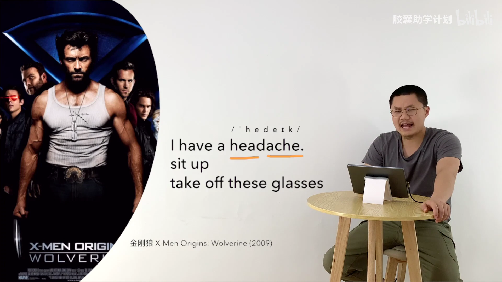

文字识别：胶囊助学计划 / / ·hedei k / / I have a headache. / sit up / take off these glasses / 金刚狼 X-Men Origins: Wolverine (2009) / X-MEN ORIGI / W O LV ER

### 画面 00:01:38

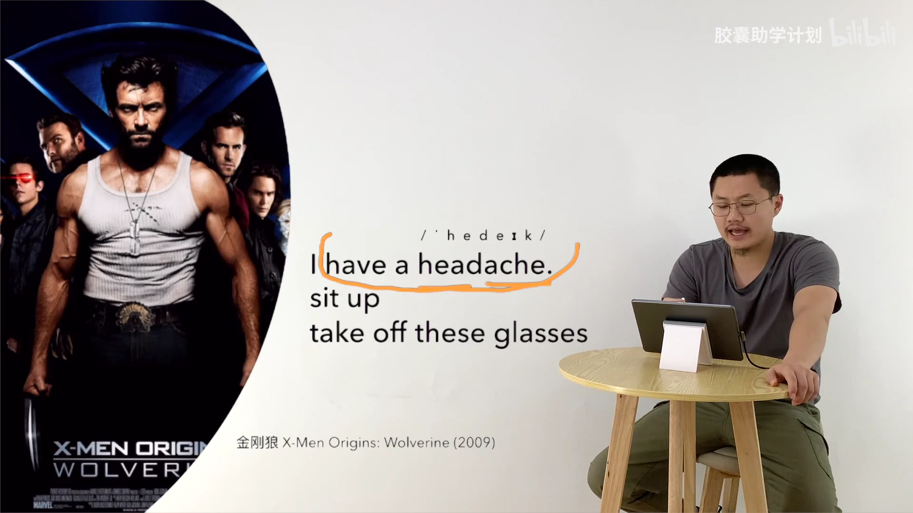

文字识别：胶囊助学计划 / / ·hedei k / / Ihave a headache. / sit up / take off these glasses / 金刚狼 X-Men Origins: Wolverine (2009) / X-MEN ORIGI / W O LV E R

### 画面 00:01:40

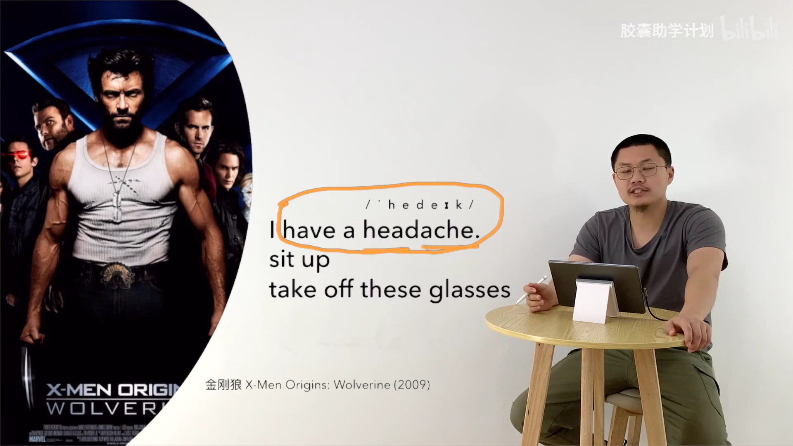

文字识别：胶囊助学计划 / /·hedelk/ / Ihave a headache. / sit up / take off these glasses / 金刚狼 X-Men Origins: Wolverine(2009) / X-MEN ORIGI / W O LV ER

### 画面 00:01:43

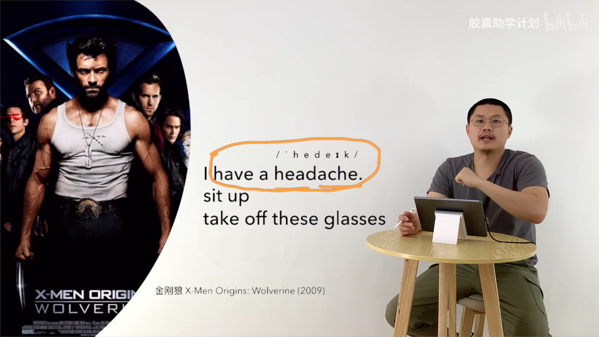

文字识别：胶囊助学计划 / /·hedeIk/ / Ihave a headache. / sit up / take off these glasses / 金刚狼 X-Men Origins: Wolverine (2009) / X-MEN ORIGI / W O LV E R

### 画面 00:01:45

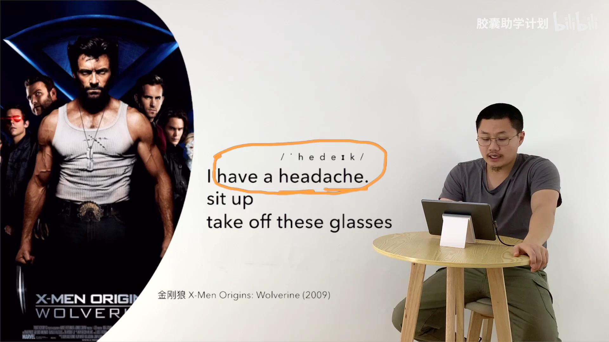

文字识别：胶囊助学计划 / /·hedeIk/ / Ihave a headache. / sit up / take off these glasses / 金刚狼 X-Men Origins: Wolverine (2009) / X-MEN ORIGI / W O LV E R

### 画面 00:01:48

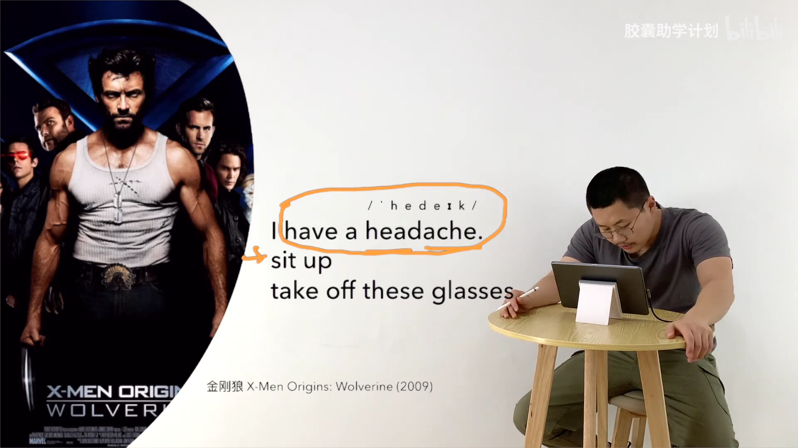

文字识别：胶囊助学计划 / /·hedeIk/ / Ihave a headache. / sit up / take off these glasses / 金刚狼 X-Men Origins: Wolverine (2009) / X-MEN ORIGI / W O LV E R

### 画面 00:01:50

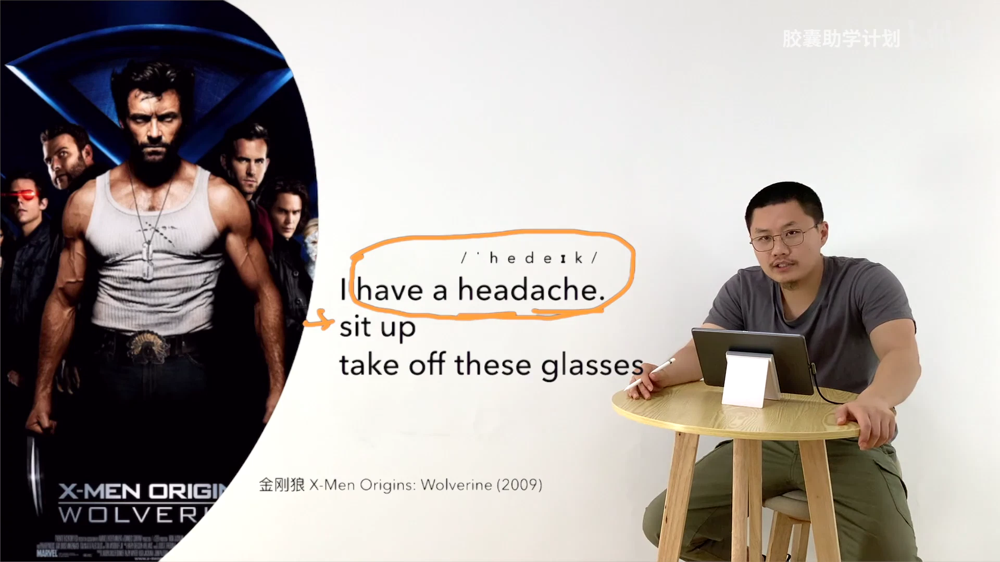

文字识别：/·hedeIk/ / Ihave a headache. / sit up / take off these glasses / 金刚狼X-Men Origins: Wolverine (2009) / X-MEN ORIGI / W O LV E R

### 画面 00:01:52

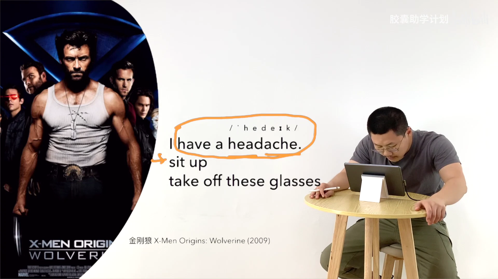

文字识别：/·he deI k / / Ihave a headache. / sit up / take off these glasses / 金刚狼X-Men Origins: Wolverine(2009) / X-MEN ORIGI / W O LV E R

### 画面 00:01:55

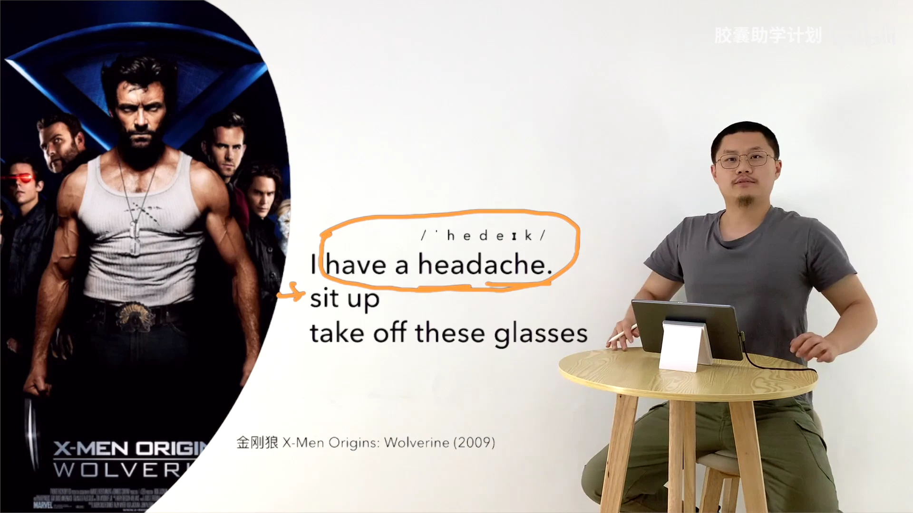

文字识别：/·hedeIk/ / Ihave a headache. / sit up / take off these glasses / 金刚狼X-Men Origins: Wolverine (2009) / X-MEN ORIGI / W O LV E R

### 画面 00:01:58

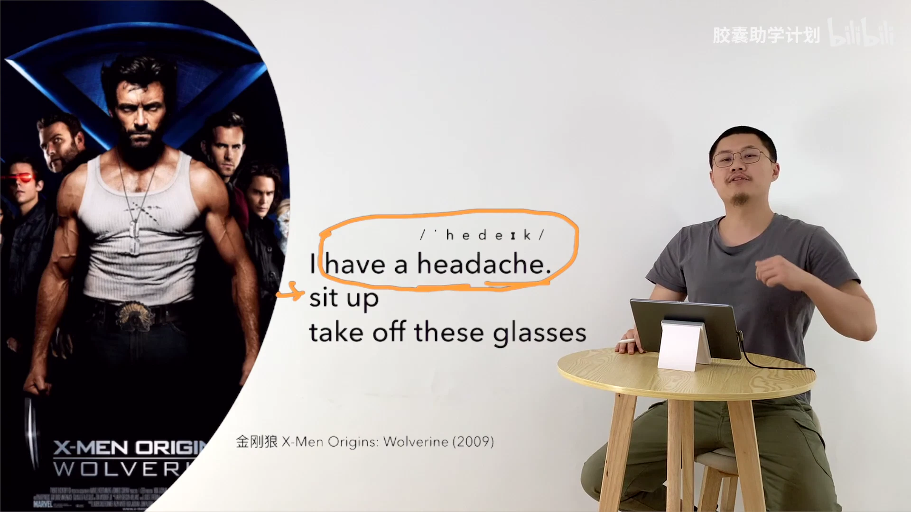

文字识别：胶囊助学计划 / /·hedeIk/ / Ihave a headache. / sit up / take off these glasses / 金刚狼 X-Men Origins: Wolverine (2009) / X-MEN ORIGI / W O LV E R

## 00:02:00–00:02:30

up. Okay,接下来呢 take off these glasses. 这我们之前就学过了短语叫 take off，叫做脱掉。那当然了，你把它摘下来也是 OK 的啊. Take off these glasses, 把这些眼镜摘下来。接下来我们看一下这个电影片段. Summers, sit up and take off those glasses. I have a headache. Then you can wear them in detention after school while you write out this conjugation one hundred times. Somebody else. He talks.

### 画面 00:02:02

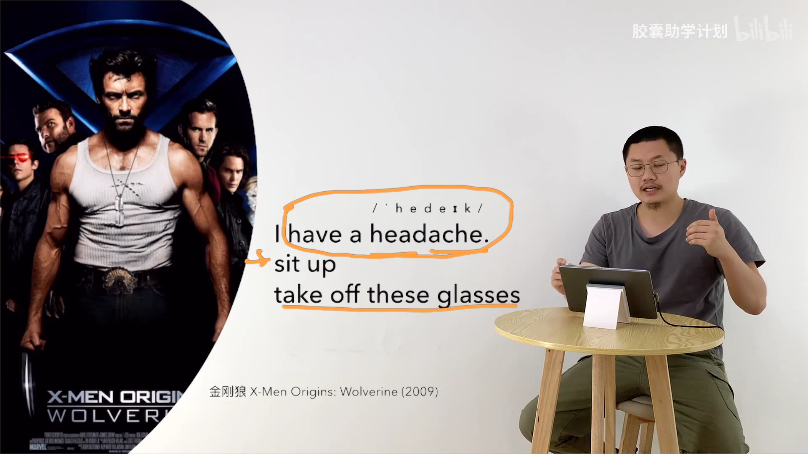

文字识别：胶囊助学计划 / /·hedelk/ / Ihave a headache. / →sit up / take off these glasses / 金刚狼 X-Men Origins: Wolverine (2009) / X-MEN ORIGI / W O LV E R

### 画面 00:02:15

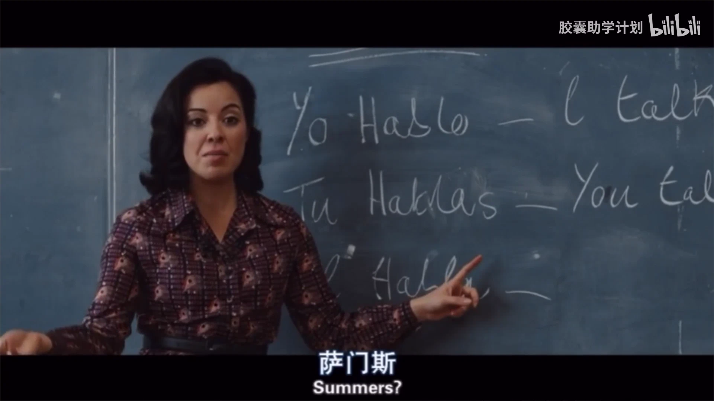

文字识别：bilibili / 胶囊助学计划 / talk / Haslo / /0 / Haklas / You / tal / Halls / 萨门斯 / Summers?

### 画面 00:02:17

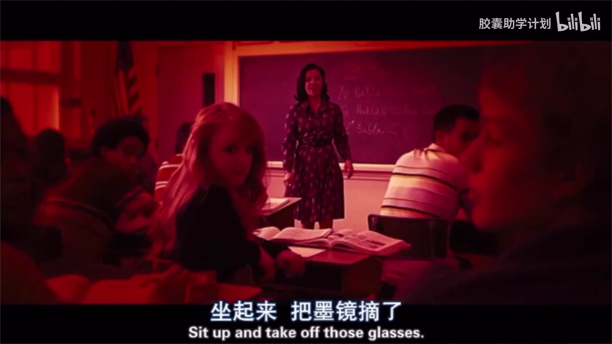

文字识别：bilbli / 胶囊助学计划 / 坐起来把墨镜摘了 / Sit up and take off those glasses.

### 画面 00:02:19

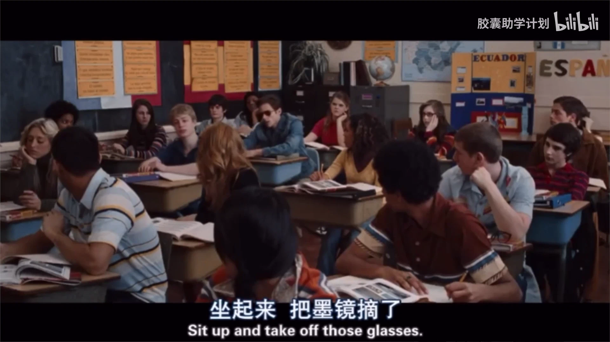

文字识别：bilibili / 胶囊助学计划 / ECUADOR / ESPA / 坐起来把墨镜摘了 / Sit up and take off those glasses.

### 画面 00:02:21

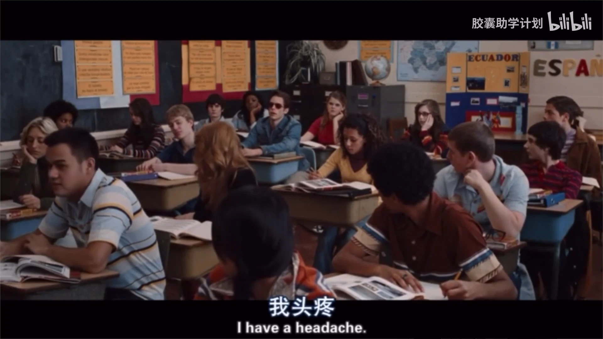

文字识别：bilibili / 胶囊助学计划 / ECUADOR) / ESPAI / 我头疼 / I have a headache.

### 画面 00:02:23

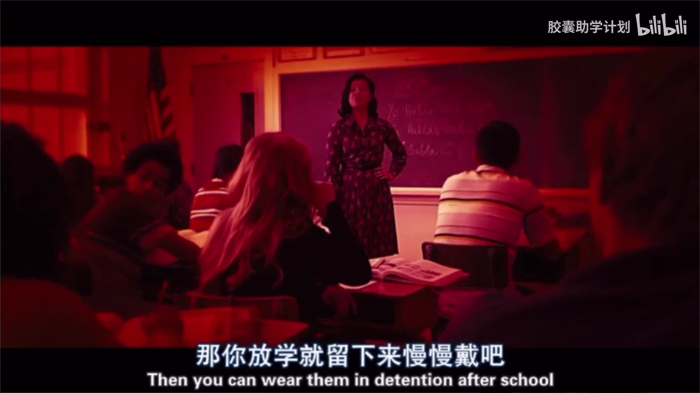

文字识别：bilibli / 胶囊助学计划 / 那你放学就留下来慢慢戴吧 / Then you can wear them in detention after school

### 画面 00:02:25

文字识别：bilibli / 胶囊助学计划 / 那你放学就留下来慢慢戴吧 / Then you can wear them in detention after school

### 画面 00:02:27

文字识别：bilibli / 胶囊助学计划 / 把这个词组写100遍 / While you add up this conjugation 100 times.

### 画面 00:02:29

文字识别：bilibili / 胶囊助学计划 / 还有谁来翻译一下 / Somebody else?

## 00:02:30–00:03:00

Thank you, he talks. And I'm okay. I have a headache. 我有一个头疼是吧？当然汉语应该不翻译成有是吧？汉语就是说我头疼就OK了。 There we go. 接下来下一个小单词来跟我一起读，叫做 aspirin. Aspirin, aspirin. Okay. 那接下来 take an aspirin. 要吃一片阿司匹林。 There we go. Next one. 说 I have a headache. 啊，我头疼。 And I'm gonna take an aspirin. 啊，我要吃一

### 画面 00:02:31

文字识别：bilibili / 胶囊助学计划 / 很好 他说-一(西语） / Thank you, he talks. EI habla.

### 画面 00:02:33

文字识别：胶囊助学计划 / /·hedeI k / / I have a headache. / sit up / take off these glasses / 金刚狼 X-Men Origins: Wolverine (2009) / X-MEN ORIGI / W O LV E R

### 画面 00:02:36

文字识别：胶囊助学计划 / / ·hedei k / / I have a headache. / sit up / take off these glasses / 金刚狼 X-Men Origins: Wolverine (2009) / X-MEN ORIGI / W O LV E R

### 画面 00:02:41

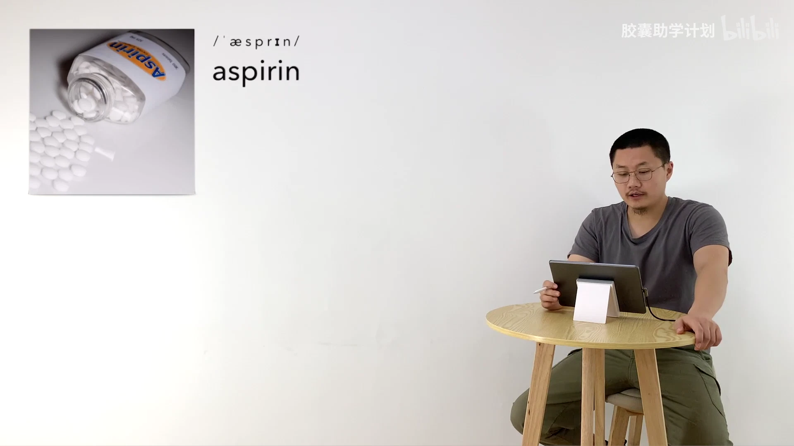

文字识别：胶囊助学计划 / uudsy / /æsprin/ / aspirin

### 画面 00:02:51

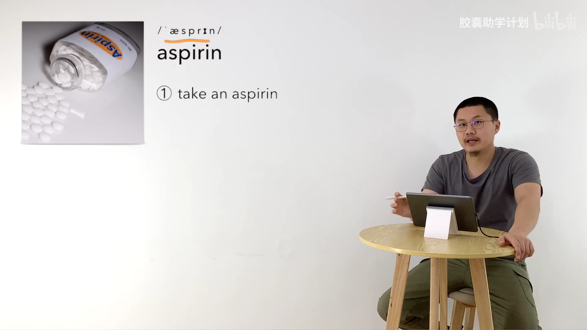

文字识别：胶囊助学计划 / uudsy / /'æsprin/ / aspirin / ① take an aspirin

### 画面 00:02:55

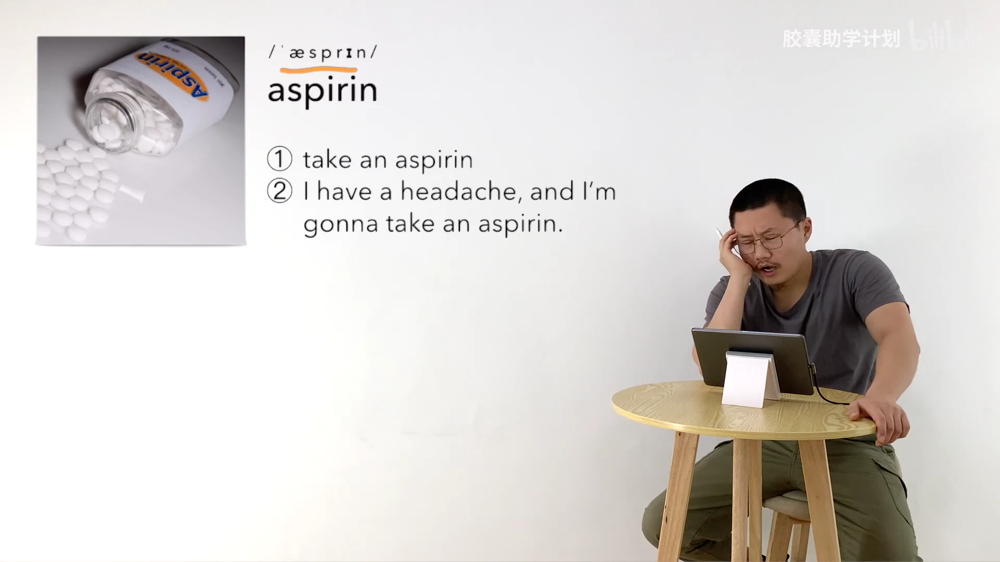

文字识别：胶囊助学计划 / uuidsy / /'æsprin/ / aspirin / ①take an aspirin / Ihave a headache, and I'm / gonna take an aspirin.

## 00:03:00–00:03:30

an aspirin.注意, I'm gonna.哎，这个我们之前学过了，对吧？三十七克、三十九克，就是be going to do的一个口语最常见的表达叫做gonna。口语当中其实用be going to do反而会少一点点啊，用的大多数都是它的缩略形式叫做I'm gonna take an aspirin。那这就有一个小的短语，各位要把它记下来了啊。吃是可以用take的啊，摄入这个可以用take。Next one,看下

### 画面 00:03:03

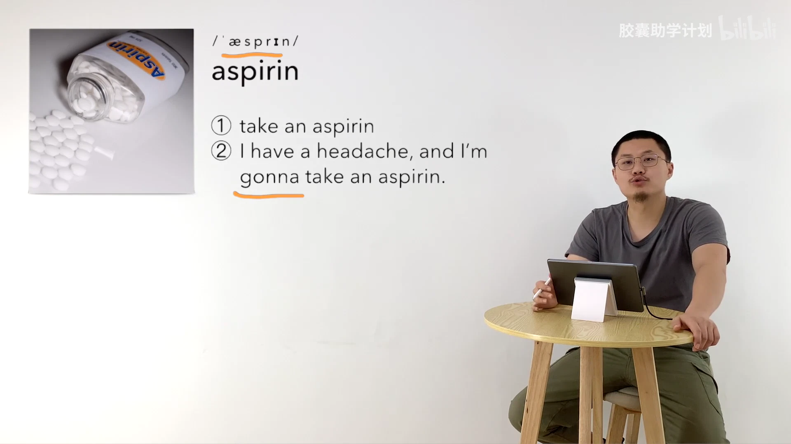

文字识别：胶囊助学计划 / uidsy / /'æsprin/ / aspirin / ① take an aspirin / Ihave a headache, and I'm / gonna take an aspirin.

### 画面 00:03:21

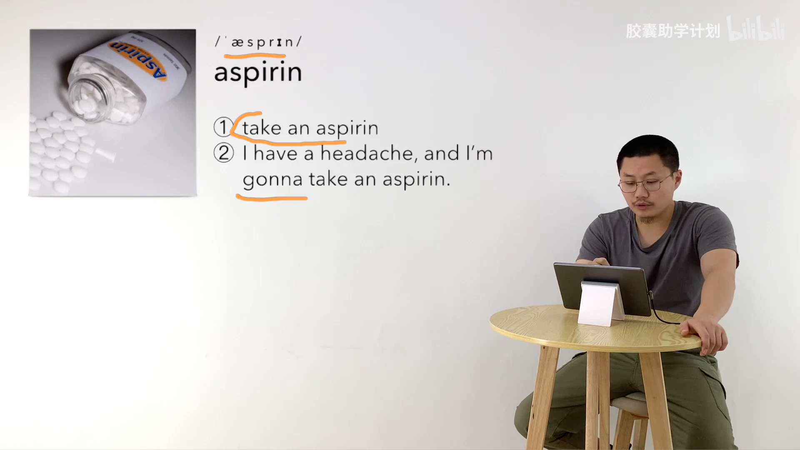

文字识别：胶囊助学计划 / muidsy / /'æsprin/ / aspirin / 1take an aspirin / I have a headache, and I'm / gonna take an aspirin.

### 画面 00:03:23

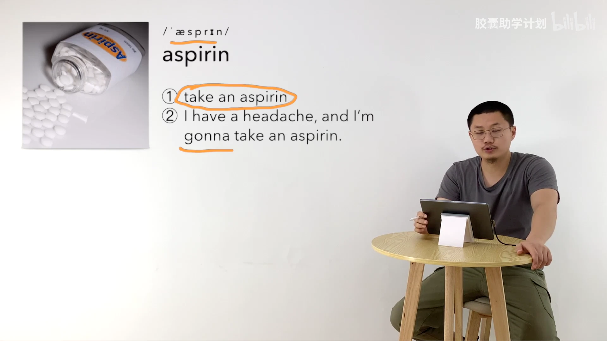

文字识别：胶囊助学计划 / uidsy / /'æesprin/ / aspirin / 1take an aspirin / I have a headache, and I'm / gonna take an aspirin.

### 画面 00:03:28

文字识别：胶囊助学计划 / /'iarelk/ / earache

## 00:03:30–00:04:00

一个单词跟我读earache.你看注意一个小点，这个单词其实读ear，但是它后边有一个儿化音跟后边的ache连起来了，所以读的是earache, earache, OK, earache, OK, very good. Have an earache,跟刚才是一样的. Have a headache,现在是have an earache, OK,把它连起来叫做Does he have an headache?他是不是头疼啊？

### 画面 00:03:32

文字识别：胶囊助学计划 / Iarｅik/ / earache

### 画面 00:03:38

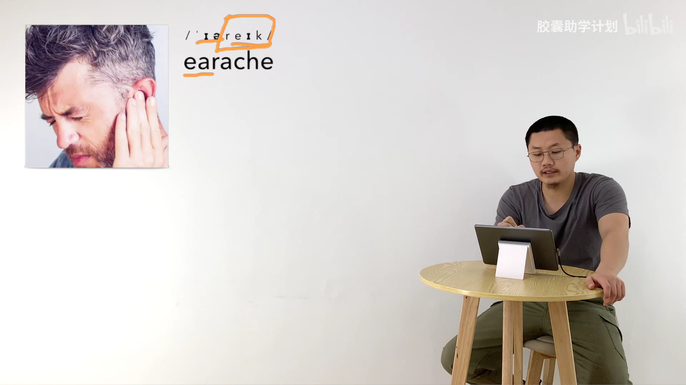

文字识别：胶囊助学计划 / 'Iareik / earache

### 画面 00:03:41

文字识别：胶囊助学计划 / 'Iareik / earache

### 画面 00:03:45

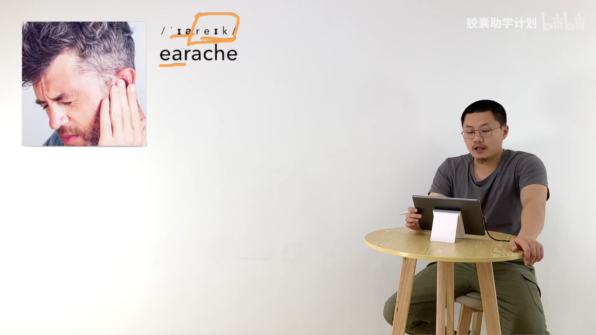

文字识别：胶囊助学计划 / Iareik / earache

### 画面 00:03:59

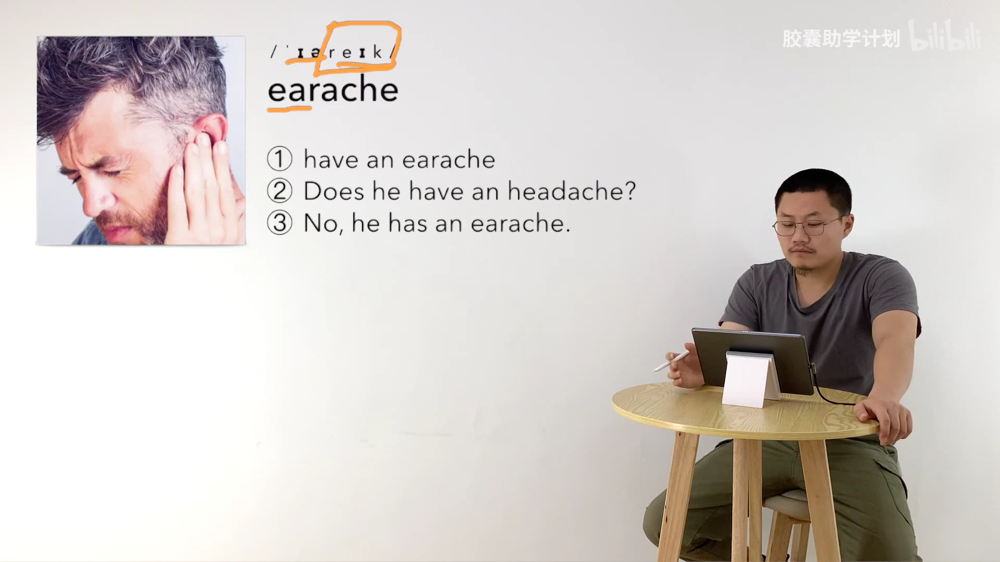

文字识别：胶囊助学计划 / 'Iareik / earache / ① have an earache / Does he have an headache? / No, he has an earache.

## 00:04:00–00:04:30

No, he has an earache. Oh,不，他是耳朵疼。你看，它其实是ear加ache，耳朵和a c h e四个字母组成的这个单词表示的是疼或痛，对吧？Okay, one. Next one,你看tooth这个单词你应该是有印象的，包括它的复数叫teeth，对吧？Tooth应该是我们的一个牙齿。那toothache，注意这儿是一样的，这两个变在一起的时候，那个不

### 画面 00:04:05

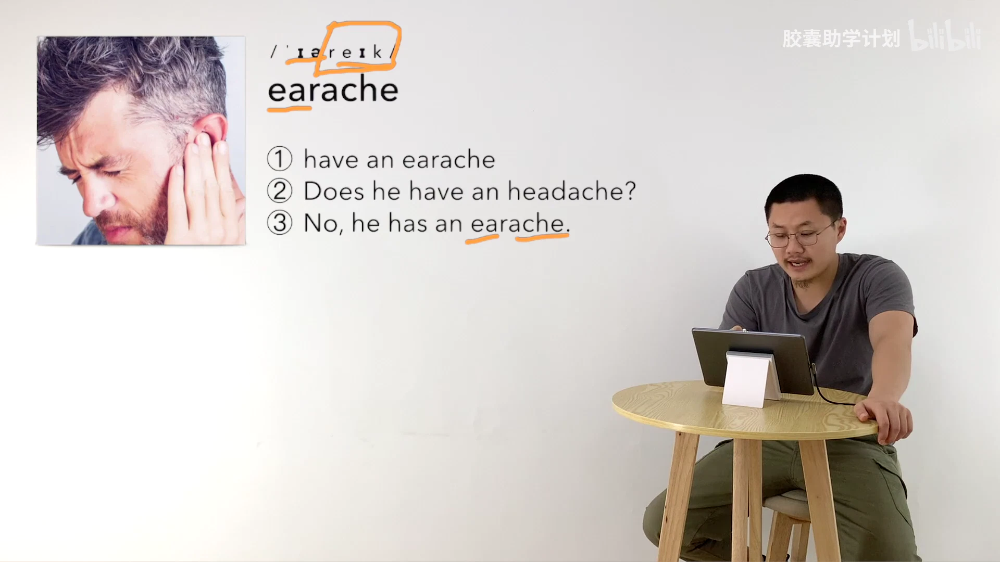

文字识别：胶囊助学计划 / 'Iareik / earache / ① have an earache / Does he have an headache? / No, he has an earache.

### 画面 00:04:14

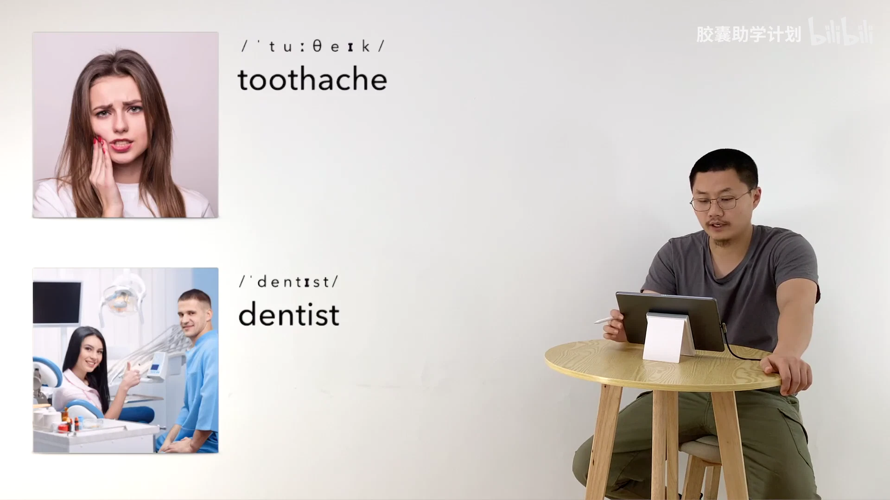

文字识别：胶囊助学计划 / /'tu:θeтk/ / toothache / /'dentist/ / dentist

### 画面 00:04:18

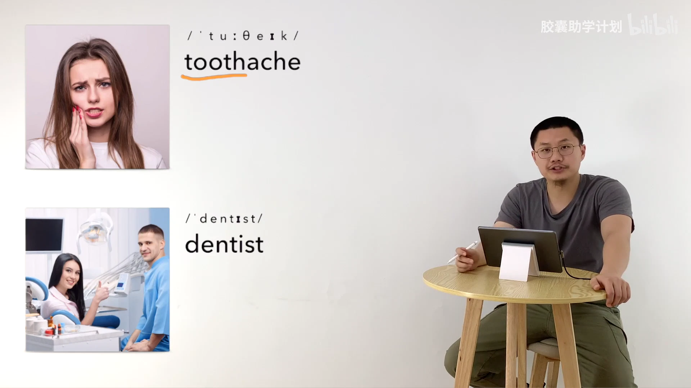

文字识别：胶囊助学计划 / /'tuiθeik/ / toothache / /'dentist/ / dentist

### 画面 00:04:21

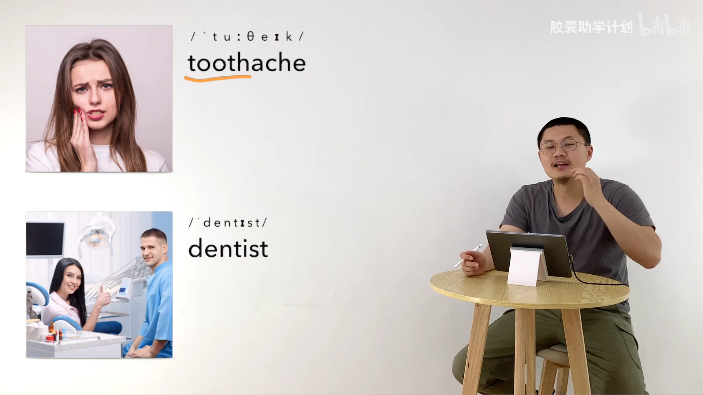

文字识别：胶囊助学计划 / /'tuiθeik/ / toothache / /'dentist/ / dentist

### 画面 00:04:26

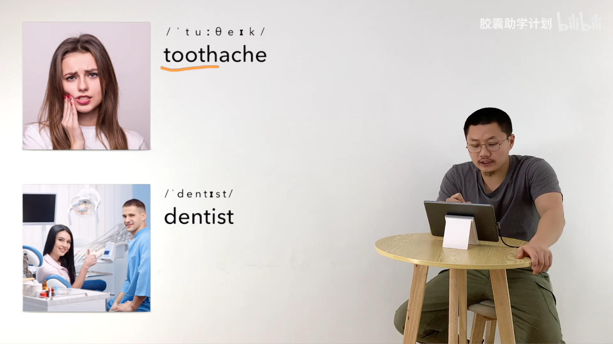

文字识别：胶囊助学计划 / /'tuiθeтk/ / toothache / /'dentist/ / dentist

## 00:04:30–00:05:00

是读 toothache 了，读的是 toothache。注意啊，跟后边连起来了。 toothache， toothache，玩一个，连起来。 Does he have an headache? Does she? Okay. Does she have an headache? No. She has a toothache. 注意几个小点。第一，这是 a 对吧？好，接下来呢， have a tooth， has a toothache。啊，这

### 画面 00:04:30

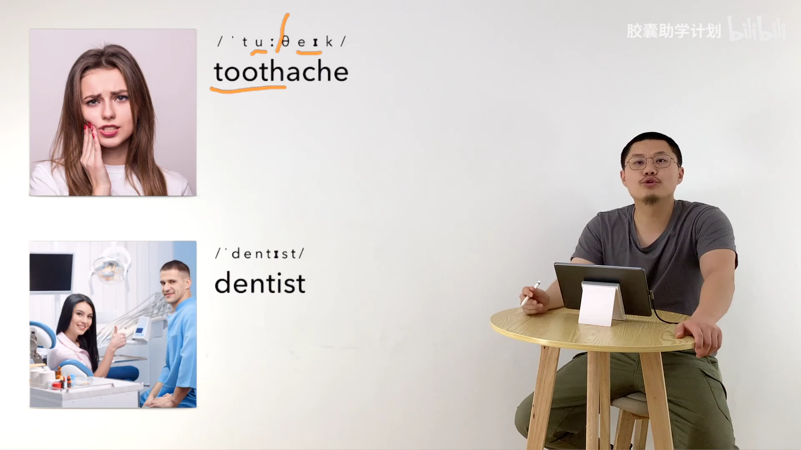

文字识别：胶囊助学计划 / / 'tu:θeik/ / toothache / /'dentist/ / dentist

### 画面 00:04:40

文字识别：胶囊助学计划 / / ' t u :θe i k / / toothache / ① Does she have an headache? / /'dentist/ / dentist

### 画面 00:04:43

文字识别：胶囊助学计划 / / ' t u :θe I k / / toothache / ① Does she have an headache? / /'dentist/ / dentist

### 画面 00:04:48

文字识别：胶囊助学计划 / / ' tu:θei k / / toothache / ① Does she have an headache? / ② No, she has a toothache. / /'dentist/ / dentist

### 画面 00:04:53

文字识别：胶囊助学计划 / /  tu:θei k / / toothache / ① Does she have an headache? / ② No, she has a toothache. / /'dentist/ / dentist

### 画面 00:04:56

文字识别：胶囊助学计划 / /  t u :θei k / / toothache / ① Does she have an headache? / ② No, she has a toothache. / /'dentist/ / dentist

## 00:05:00–00:05:30

个地方当然应该是a啊，不应该是an啊。She has a toothache. Very good.那注意啊，has三单。下一个单词跟我读一下，叫做dentist啊，高薪职业，牙医是吧？Dentist. Very good.说I'm gonna see a dentist.我要去看一个牙医。I have a a toothache.啊，我牙疼。那我要去看一个牙医。I have a toothache. Very good.那你你牙疼，我怎么问？

### 画面 00:05:07

文字识别：胶囊助学计划 / / 'tu:θei k/ / toothache / ① Does she have a headache? / ② No, shehasa toothache. / /'dentist/ / dentist

### 画面 00:05:12

文字识别：胶囊助学计划 / / tu:θei k / / toothache / ① Does she have a headache? /  No, shehasa toothache. / /'dentist/ / dentist

### 画面 00:05:16

文字识别：胶囊助学计划 / /  tu:θei k / / toothache / ① Does she have a headache? / ② No, shehasa toothache. / /'dentist/ / dentist / ① I'm gonna see a dentist.

### 画面 00:05:29

文字识别：胶囊助学计划 / / tu:θei k / / toothache / ① Does she have a headache? / ② No, shehas a toothache. / /'dentist/ / dentist / ① I'm gonna see a dentist. / ② I have a toothache.

## 00:05:30–00:06:00

举一反三，你会说我牙疼了，那我现在想问你牙疼吗？怎么问？Do you have a toothache? Okay, there you go. Continue.下一个单词，注意你看这个单词跟之前那个单词稍有不同。首先，stomach表示的是胃口啊，胃口。那个ache还是疼，但你注意现在它中间多了一个空格啊。之前的很多单词中间是没空格的，这个单词各位不妨自己去仔细看一下

### 画面 00:05:32

文字识别：胶囊助学计划 / / 'tu:aeik/ / toothache / ① Does she bave ar headache? / ② No, she has a toothache. / /dentist/ / dentist / ① I'm gonna see a dentist. / ②I have a toothache.

### 画面 00:05:37

文字识别：胶囊助学计划 / /  tu:θeik / / toothache / ① Does she have a headache? / ② No, shehasa toothache. / /dentist/ / dentist / ① I'm gonna see a dentist. / ② I have a toothache.

### 画面 00:05:39

文字识别：胶囊助学计划 / /'stΛmak eik/ / stomach ache / 2 / /'medi san/ / medicine / sblets USP / 40mg

### 画面 00:05:42

文字识别：胶囊助学计划 / /'stΛmak eIk/ / stomach ache / /'medlsan/ / medicine / ablets USP / 40mg

### 画面 00:05:45

文字识别：胶囊助学计划 / /'stΛmakeik / / stomach ache / /'medIsan/ / medicine / ablets USP / 40mg

### 画面 00:05:50

文字识别：胶囊助学计划 / / 'stnmak eⅠk / / stomach ache / /'medIsan / / medicine / aolets USP / 40mg

### 画面 00:05:59

文字识别：胶囊助学计划 / /'stΛmak eIk / / stomach ache / /'m edrsan/ / medicine / ablets USP / 40mg

## 00:06:00–00:06:30

你六十二课那个课本单词部分啊，别的单词没有空格，这个单词是有一个小的空格的，但读的时候还是连起来读，于是读成的是stomachache，不读成stomach，stomachache不这么读啊，太费劲了，读成stomachache，这是一个什么？肚子疼，胃疼，张嘴跟我读，He has a stomachache. Does he have a stomachache?

### 画面 00:06:08

文字识别：胶囊助学计划 / / 'st Λmak eik / / stomach ache / /'medlsan/ / medicine / ablets USP / 40mg

### 画面 00:06:11

文字识别：胶囊助学计划 / / 'st Λmak eik/ / stomach ache / /'medisan/ / medicine / aolets USP / 40mg

### 画面 00:06:16

文字识别：胶囊助学计划 / / stΛmakeik/ / stomach ache / /'med Isan / / medicine / aoblets USP / 40mg

### 画面 00:06:19

文字识别：胶囊助学计划 / / stΛmakeik/ / stomach ache / /'medIsan / / medicine / ablats USP / 40mg

### 画面 00:06:21

文字识别：胶囊助学计划 / / 'stΛmak eik/ / stomach ache / ① He has a stomach ache. / /medi san / / medicine / ablets USP / 40mg

### 画面 00:06:25

文字识别：胶囊助学计划 / / 's t Λm ak eⅠk / / stomach ache / ① He has a stomach ache. / ② Does he have a stomach ache? / /medIsan/ / medicine / ablets UusP / 40mg

### 画面 00:06:29

文字识别：胶囊助学计划 / / 's t Λm ak eⅠk / / stomach ache / ① He has a stomach ache. / ② Does he have a stomach ache? / /medisan / / medicine / ablets UusP / 40mg

## 00:06:30–00:07:00

Next one, medicine. Ah,药. Now, what are you doing? Is I'm taking some medicine. 我正在吃一些药。注意take some medicine和take an aspirin. 各位还记得这个呃说法吧？对吧？叫吃一片阿司匹林。那现在说吃一些药叫take some medicine. 注意，你看medicine后边加没加s吗？没加s，没有加s，前面还有some，可数不可数？不可数啊，这个

### 画面 00:06:31

文字识别：胶囊助学计划 / / 's t Λ m ak eⅠk / / stomach ache / ① He has a stomach ache. /  Does he have a stomach ache? / /'medI san / / medicine / blets Usp / 40mg

### 画面 00:06:34

文字识别：胶囊助学计划 / / 'stΛmak eik/ / stomach ache / ① He has a stomach ache. /  Does he have a stomach ache? / /'medIsan / / medicine / ① What are you doing? / bletsUSP / 40mg

### 画面 00:06:37

文字识别：胶囊助学计划 / / s t Λm ak eⅠk / / stomach ache / ① He has a stomach ache. / ② Does he have a stomach ache? / /medIs an/ / medicine / ablets usP / ① What are you doing? / 40mg / ② I'm taking some medicine.

### 画面 00:06:40

文字识别：胶囊助学计划 / /  s t Λ m ak eⅠk / / stomach ache / ① He has a stomach ache. / ② Does he have a stomach ache? / /medIsan/ / medicine / tabets UsP / ① What are you doing? / 40mg / ② I'm taking some medicine.

### 画面 00:06:42

文字识别：胶囊助学计划 / / 'st Λm ak eⅠk / / stomach ache / ① He has a stomach ache. / ② Does he have a stomach ache? / /'medIsan/ / medicine / talets Usp / ① What are you doing? / 40mg / ② I'm taking some medicine.

### 画面 00:06:45

文字识别：胶囊助学计划 / / st Λm ak eⅠk / / stomach ache / ① He has a stomach ache. / ② Does he have a stomach ache? / /'medIsan / / medicine / abletsUSP / ① What are you doing? / 40mg / ② I'm taking some medicine.

### 画面 00:06:52

文字识别：胶囊助学计划 / / 'st Λmak eik/ / stomach ache / ① He has a stomach ache. / ② Does he have a stomach ache? / /medIsan / / medicine / ablets USP / D What are you doing? / 40mg / ② I'm taking some medicine.

## 00:07:00–00:07:30

要注意一下。接下来下一个单词跟我读，叫做 temperature， temperature， temperature。 OK，表示其实 temperature 这个单词它本身最常用的意思表示的是温度啊，三十八度对吧？三十二度啊，指的是温度。那在这个地方呢，如果你这么去说，说 she has a temperature，这个时候不是说她有一个温度啊，她很有风度，不是，表示的是她发烧了。

### 画面 00:07:00

文字识别：胶囊助学计划 / / 'temparatfa/ / temperature

### 画面 00:07:05

文字识别：胶囊助学计划 / /'temparat ∫a/ / temperature

### 画面 00:07:08

文字识别：胶囊助学计划 / /'temparat ∫a/ / temperature

### 画面 00:07:12

文字识别：胶囊助学计划 / / 'temparat∫a/ / temperature

### 画面 00:07:21

文字识别：胶囊助学计划 / / 'temparat ∫a/ / temperature / ① She has a temperature.

### 画面 00:07:25

文字识别：胶囊助学计划 / / 'temparat ∫a/ / temperature / ① She / bas a temperature.

### 画面 00:07:27

文字识别：胶囊助学计划 / /'temparat∫a/ / temperature / ① She / has a temperature

## 00:07:30–00:08:00

She has a temperature.变一般疑问句、否定句还是之前那一套。Does提前，张嘴跟我读。Does she have a temperature?啊，她发烧了吗？One go.接下来下一个单词跟我读。Flu叫流行性感冒。这儿要注意一下，前面不加a an了。前面那些单词认为还可以加a an啊，是可数的，在这儿它不加a an，不可数单词。Have flu，它是

### 画面 00:07:39

文字识别：胶囊助学计划 / /'temparat ∫a/ / temperature / ① She bas a temperature, / Does she have a temperature?

### 画面 00:07:41

文字识别：胶囊助学计划 / /'temparat∫a/ / temperature / ① Shebas a temperature, / Does she have a temperature?

### 画面 00:07:43

文字识别：胶囊助学计划 / /flu:/ / flu

### 画面 00:07:46

文字识别：胶囊助学计划 / - / /flu:/ / flu

### 画面 00:07:49

文字识别：胶囊助学计划 / /flu:/ / flu / ① Does he have flu?

### 画面 00:07:55

文字识别：胶囊助学计划 / /flu:/ / flu / ① Does he have flu?

## 00:08:00–00:08:30

不符合逻辑的，各位啊，语言不是完全符合逻辑的。你只要知道这个语言习惯，并把它记下来就好了。OK,那Does he have flu?他是不是得流感了呢？Yes, he does. OK,接下来最后两个小的单词啊，我们没有放这个真人的图啊，可能会让引起大家的不适，所以我们就找了两个卡通图片。先读第一个，叫做Measles啊，

### 画面 00:08:10

文字识别：胶囊助学计划 / /flu:/ / flu / ① Does hehave flu?

### 画面 00:08:17

文字识别：胶囊助学计划 / /'mi:zalz/ / measles / /m Λ m ps / / mumps

### 画面 00:08:20

文字识别：胶囊助学计划 / /'mi:za|z/ / measles / /mΛmρs / / mumps

## 00:08:30–00:09:00

麻疹啊，麻疹。下一个单词叫做 mumps 啊，叫做腮腺炎。Very good. 接下来呢，其实你如果表达生病还是用 have，只不过注意一个小点，不加 a 了，跟 flu 是一样的，叫做 have measles。那包括 have mumps，前面也是不加 a 了啊。这两个单词跟之前的病是一模一啊，就用法是一模一样的。我们不再做过多的讲解了，直接接下来我们做一些口语

### 画面 00:08:32

文字识别：胶囊助学计划 / /'m i:zalz1 / measles / /mΛmρs / / mumps

### 画面 00:08:56

文字识别：胶囊助学计划 / headache

## 00:09:00–00:09:30

练习。各位张开嘴跟我读就好了。来了，What's the matter with her? Does she have an earache? She doesn't have an earache. She has a headache. What must she do? 啊，你看，What must she do? 这句话三三十二十九课咱们就学过，对吧？What must I do? She must take an aspirin.

### 画面 00:09:03

文字识别：胶囊助学计划 / headache / What's the matter with her?

### 画面 00:09:06

文字识别：胶囊助学计划 / headache / What's the matter with her? / 1

### 画面 00:09:14

文字识别：胶囊助学计划 / headache / What's the matter with her? / Does she have an earache? / She doesn't have an earache. / She has a headache.

## 00:09:30–00:10:00

Next one,张嘴跟我读. What's matter with George? Does he have a headache? He doesn't have a headache. He has an earache. Continue. What must he do? He must see a doctor. Next one, toothache. Toothache. What's the matter with him? Does he

### 画面 00:09:31

文字识别：胶囊助学计划 / earache

### 画面 00:09:35

文字识别：胶囊助学计划 / earache / What's the matter with George? / Does he have a headache?

### 画面 00:09:45

文字识别：胶囊助学计划 / earache /  What's the matter with George? / Does he have a headache? / He doesn't have a headache. / He has an earache. / What must he do?

### 画面 00:09:53

文字识别：胶囊助学计划 / toothache

## 00:10:00–00:10:30

have a stomachache? He doesn't have a stomachache. He has a toothache. Actually, I have a toothache too right now. What must he do? He must see a dentist. Okay, next one, stomachache. What's the matter with Jean? Does

### 画面 00:10:01

文字识别：胶囊助学计划 / toothache / What's the matter with him? / ② Does he have a stomach ache? / 2)

### 画面 00:10:05

文字识别：胶囊助学计划 / toothache /  What's the matter with him? / Does he have a stomach ache? / He doesn't have a stomach ache. / He has a toothache.

### 画面 00:10:21

文字识别：胶囊助学计划 / stomach ache

### 画面 00:10:25

文字识别：胶囊助学计划 / stomach ache / What's the matter with Jane?

## 00:10:30–00:11:00

she have a toothache? She doesn't have a toothache. She has a stomachache. What must she do? She must take some medicine.注意吃药，take some medicine，对吧？我们不说 eat some medicine. Temperature too hot,发烧啊。What's the matter with Sam?张嘴跟我读。Does he have a stomachache?

### 画面 00:10:33

文字识别：胶囊助学计划 / stomach ache /  What's the matter with Jane? / Does she have a toothache? /  She doesn't have a toothache. / 3

### 画面 00:10:39

文字识别：胶囊助学计划 / stomach ache / What's the matter with Jane? / 1 /  Does she have a toothache? / 2 /  She doesn't have a toothache. / 3 / She has a stomach ache. / What must she do? / 5 / ⑥ She must take some medicine.

### 画面 00:10:42

文字识别：胶囊助学计划 / stomach ache / What's the matter with Jane? /  Does she have a toothache? / She doesn't have a toothache. / She has a stomach ache. / What must she do? / ⑥ She must take some medicine.

### 画面 00:10:47

文字识别：胶囊助学计划 / C / temperature

### 画面 00:10:54

文字识别：胶囊助学计划 / temperature / What's the matter with Sam? / Does he have a stomach ache?

## 00:11:00–00:11:30

He doesn't have a stomachache. He has a temperature. What must he do? He must go to bed. Next one, flu. What's the matter with Dave? Does he have a headache? He doesn't have a headache. He has flu. What must he do? He must

### 画面 00:11:04

文字识别：胶囊助学计划 / temperature /  What's the matter with Sam? / Does he have a stomach ache? / 2 / He doesn't have a stomach ache. / He has a temperature. / What must he do?

### 画面 00:11:11

文字识别：胶囊助学计划 / flu

### 画面 00:11:20

文字识别：胶囊助学计划 / flu / What's the matter with Dave? /  Does he have a headache? / 2 /  He doesn't have a headache. / 3

## 00:11:30–00:12:00

stay in bed. Continue, measles. What's the matter with Jimmy? Does he have a headache? He doesn't have a headache. He has measles. What must we do? We must call the doctor. Next one, mumps,腮腺炎. What's the matter with Susan?

### 画面 00:11:32

文字识别：胶囊助学计划 / measles

### 画面 00:11:42

文字识别：胶囊助学计划 / measles /  What's the matter with jimmy? /  Does he have a headache? /  He doesn't have a headache.

### 画面 00:11:54

文字识别：胶囊助学计划 / G / mumps

## 00:12:00–00:12:30

Does she have an earache? Earache. She doesn't have an earache. She has aches. What must we do? We must call the doctor. Okay, very good. Recap.本课单词ache是最重要的本课的一个单词啊，表示的是疼或者痛啊，连起来

### 画面 00:12:01

文字识别：胶囊助学计划 / mumps / What's the matter with Susan? /  Does she have an earache?

### 画面 00:12:15

文字识别：胶囊助学计划 / mumps /  What's the matter with Susan? / Does she have an earache? / She doesn't have an earache. / She has mumps. / What must we do? /  We must call the doctor. / 6

### 画面 00:12:20

文字识别：Recap / 胶囊助学计划 / Patterns / Grammar / Words / ache / have a headache / Expression / see a dentist/doctor / take some medicine

### 画面 00:12:23

文字识别：Recap / 胶囊助学计划 / Patterns / Grammar / Words / ache / have a headache / Expression / seea / dentist/doctor / take some medicine

### 画面 00:12:26

文字识别：Recap / 胶囊助学计划 / Patterns / Grammar / Words / ache / have a headache / Expression / see a dentist/doctor / take some medicine

## 00:12:30–00:13:00

身体的某个部位。当然您不能自己瞎连啊，不能自己去创造单词。今天学了哪些单词，您就先把哪些单词用起来。OK，接下来呢有一些小的表达，比如说 have a headache，头疼啊，注意是 have。那当然很多地方疼用的也是 have，或者得了各种病也是 have 啊。接下来看牙医看医生叫 see a dentist，以及吃药叫做 take some medicine。不要说 eat some medicine，会很

### 画面 00:12:39

文字识别：Recap / 胶囊助学计划 / Patterns / Grammar / Words / ache / have a headache / Expression / seea / a dentist/doctor / take some medicine

### 画面 00:12:41

文字识别：Recap / 胶囊助学计划 / Patterns / Grammar / Words / ache / have a headache / Expression / see a dentist/doctor / take / some medicine

## 00:13:00–00:13:30

怪的。OK, eat更多指的是我们吃饭的那种享受，慢慢咀嚼这个过程，美味的过程。那take some medicine就是指摄入这个营养，或者说摄入这个药啊，就是这样一个感受。家庭作业，绿皮书六十二课，各位可以写了。单词老习惯要去造一下句子，最后给自己讲解一遍今天的核心知识点啊。得了各种病，怎么看医生，怎么吃药，这些表达非常的重要，对于各位啊。

### 画面 00:13:03

文字识别：Recap / 胶囊助学计划 / Patterns / Grammar / Words / ache / have a headache / Expression / see a dentist/doctor / take some medicine

### 画面 00:13:14

文字识别：胶囊助学计划

### 画面 00:13:29

文字识别：胶囊助学计划

## 00:13:30–00:14:00

那如果大家喜欢我们的课程呢，欢迎大家关注、订阅、一键三连支持我们，并分享给那些需要的朋友们。最后的最后，我们再来看一句名人名言：Always love when you can. It is cheap medicine. See you next time.

### 画面 00:13:38

文字识别：胶囊助学计划 / Always laugh when you can. It is cheap / medicine. / - Lord Byron

### 画面 00:13:41

文字识别：胶囊助学计划 / Always laugh when you can. It is cheap / medicine. / - Lord Byron

### 画面 00:13:48

### 画面 00:13:50

文字识别：CAPSULEACADEMY / 胶囊助学计划 / 小红书 / Lecturer / Leo / OE

### 画面 00:13:53

文字识别：CAPSULEACADEMY / 胶囊助学计划 / 小红书 / Editor / OE

### 画面 00:13:56

文字识别：CAPSULEACADEMY / 胶囊助学计划 / 『 / 小红书 / Creator / Leo & Berlin / OE

### 画面 00:13:58

文字识别：bilibili / 胶囊助学计划 / 胶囊助学计划 / 小红书 / OE

## 00:14:00–00:14:00

### 画面 00:14:00

文字识别：bilibili / 胶囊助学计划

