# 063 文章

快速机器解析：语音为单模型转写，未进行独立交叉校对或人工复核；画面每秒采样并按变化选帧，短时文字和标记可能遗漏。截图时间约有 1 秒误差。图片有损压缩；遇到疑点请按时间查看 Google Drive 原视频。

## 00:00:00–00:00:30

Hello everyone, welcome to Capsule Academy. This is Leo. Today we're going to learn New Concept English Book One Lesson Sixty Three Story. Hope you can enjoy it. 好啊，那我们接下来看文章啊。首先注意六十三课的文章和六十一课实际上是连着的啊。六十一课不是说生病了吗？六十三课家庭医生又来了。来看一下啊。首先我们看说话的人，Doctor. Doctor来

### 画面 00:00:00

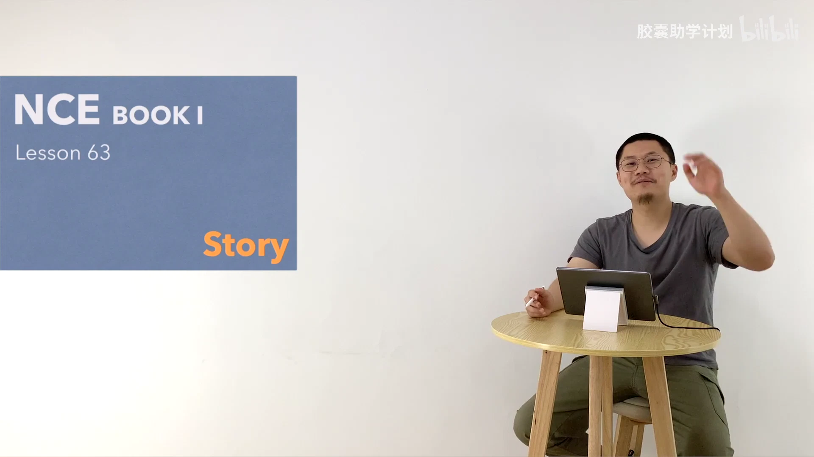

文字识别：胶囊助学计划 / NCE / BOOKI / Lesson 63 / Story

### 画面 00:00:03

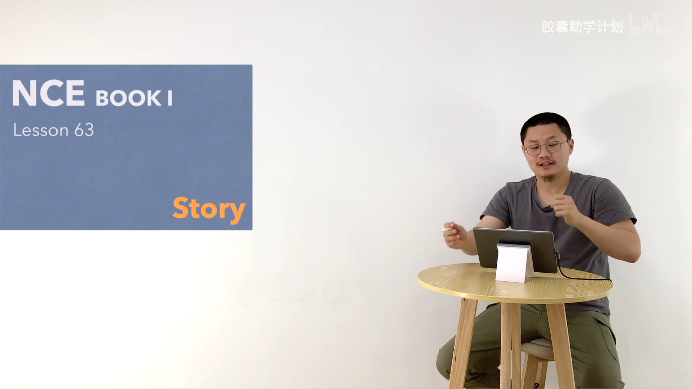

文字识别：胶囊助学计划 / NCE / BOOKI / Lesson 63 / Story

### 画面 00:00:10

文字识别：胶囊助学计划bill / ••

### 画面 00:00:14

文字识别：胶囊助学计划

### 画面 00:00:16

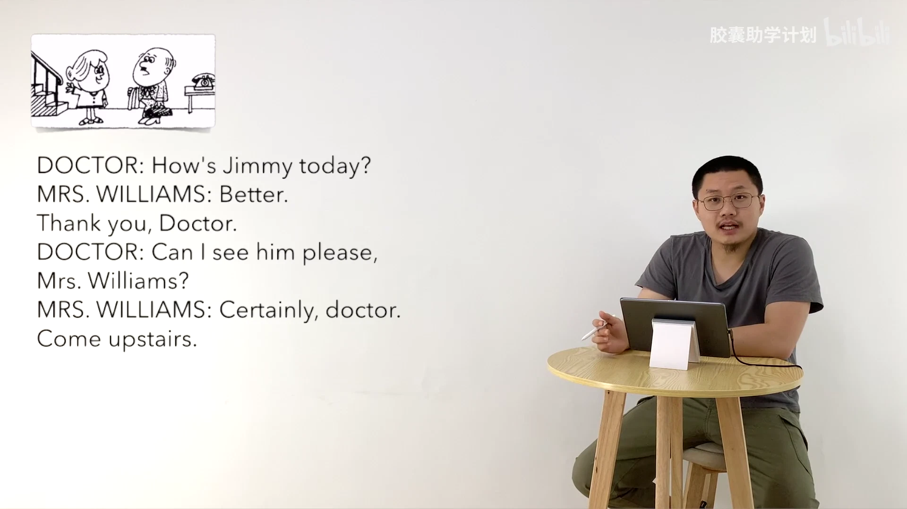

文字识别：胶囊助学计划 / DOCTOR: How's Jimmy today? / MRS. WILLIAMS: Better. / Thank you, Doctor. / DOCTOR: Can I see him please, / Mrs. Williams? / MRS. WILLIAMS: Certainly, doctor. / Come upstairs.

### 画面 00:00:28

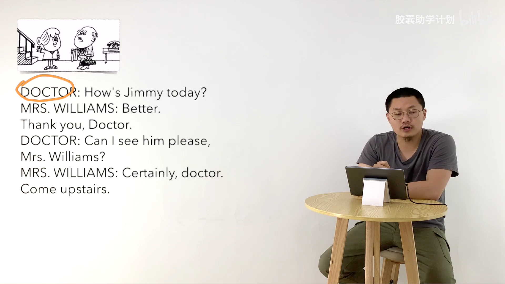

文字识别：胶囊助学计划 / DOCTOR: How's Jimmy today? / MRS. WILLIAMS: Better. / Thank you, Doctor. / DOCTOR: Can I see him please, / Mrs. Williams? / MRS. WILLIAMS: Certainly, doctor. / Come upstairs.

## 00:00:30–00:01:00

家里问了一句话，说How's Jimmy today？今天Jimmy怎么样了？Mrs. Williams啊，威廉夫人回答说Better，好多了。Thank you，Doctor。哎，注意Better这个小单词，您以后就会用了。就身体怎么样了？Better比之前好一点点了。Thank you，Doctor。感谢你，医生。Can I see him please？好，我能怎么怎么样吗？Can I？Okay，please表

### 画面 00:00:31

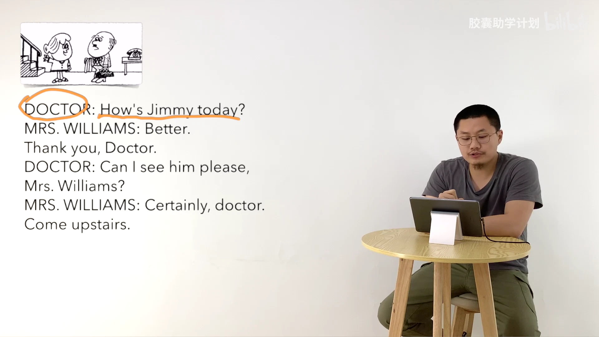

文字识别：胶囊助学计划 / DOCTOR: How's Jimmy today? / MRS. WILLIAMS: Better. / Thank you, Doctor. / DOCTOR: Can I see him please, / Mrs. Williams? / MRS. WILLIAMS: Certainly, doctor. / Come upstairs.

### 画面 00:00:33

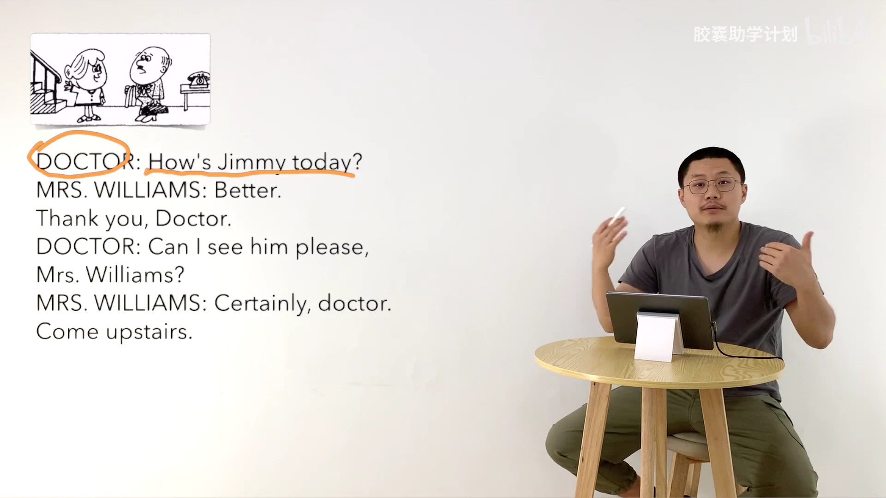

文字识别：胶囊助学计划 / DOCTOR: How's Jimmy today? / MRS. WILLIAMS: Better. / Thank you, Doctor. / DOCTOR: Can I see him please, / Mrs. Williams? / MRS. WILLIAMS: Certainly, doctor. / Come upstairs.

### 画面 00:00:35

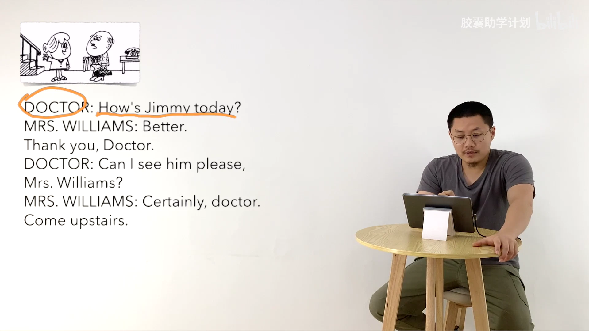

文字识别：胶囊助学计划 / DOCTOR: How's Jimmy today? / MRS. WILLIAMS: Better. / Thank you, Doctor. / DOCTOR: Can I see him please, / Mrs. Williams? / MRS. WILLIAMS: Certainly, doctor. / Come upstairs.

### 画面 00:00:37

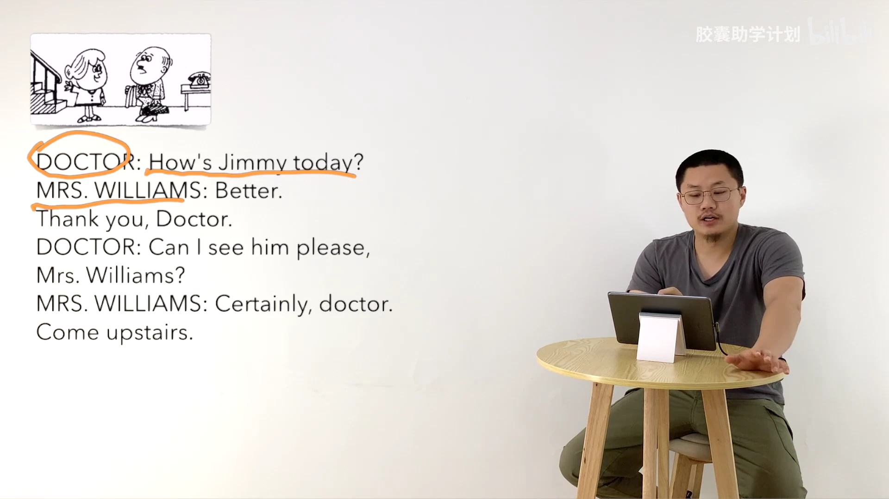

文字识别：胶囊助学计划 / DOCTOR: How's Jimmy today? / MRS. WILLIAMS: Better. / Thank you, Doctor. / DOCTOR: Can I see him please, / Mrs. Williams? / MRS. WILLIAMS: Certainly, doctor. / Come upstairs.

### 画面 00:00:40

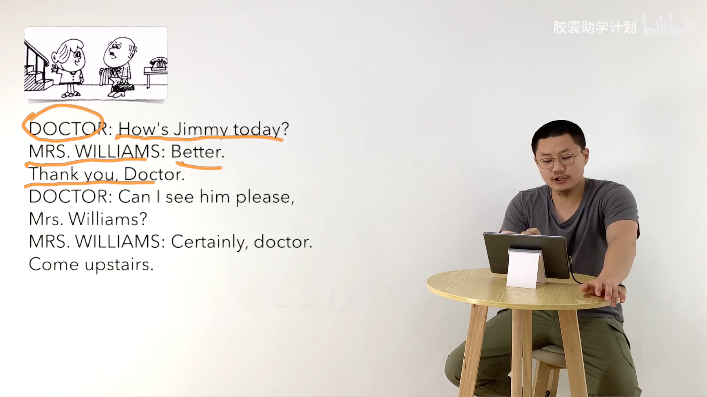

文字识别：胶囊助学计划 / DOCTOR: How's Jimmy today? / MRS. WILLIAMS: Better. / Thank you, Doctor. / DOCTOR: Can I see him please, / Mrs. Williams? / MRS. WILLIAMS: Certainly, doctor. / Come upstairs.

### 画面 00:00:42

文字识别：胶囊助学计划 / DOCTOR: How's Jimmy today? / MRS. WILLIAMS: Better. / Thank you, Doctor. / DOCTOR: Can I see him please, / Mrs. Williams? / MRS. WILLIAMS: Certainly, doctor. / Come upstairs. / 7

### 画面 00:00:44

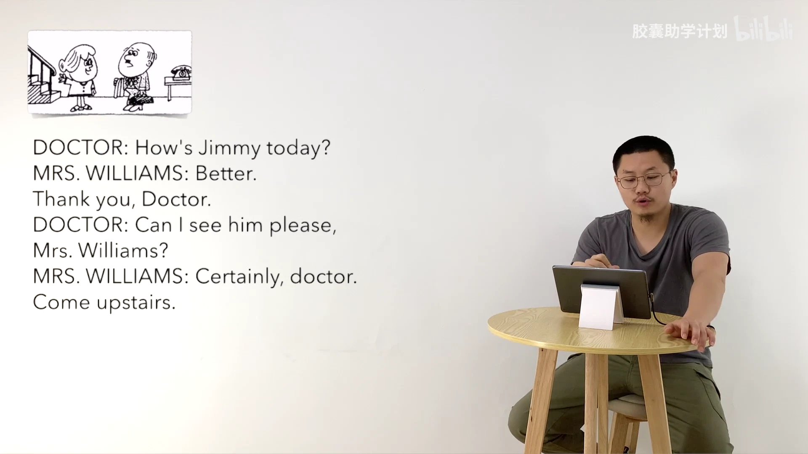

文字识别：胶囊助学计划 / DOCTOR: How's Jimmy today? / MRS. WILLIAMS: Better. / Thank you, Doctor. / DOCTOR: Can I see him please, / Mrs. Williams? / MRS. WILLIAMS: Certainly, doctor. / Come upstairs.

### 画面 00:00:47

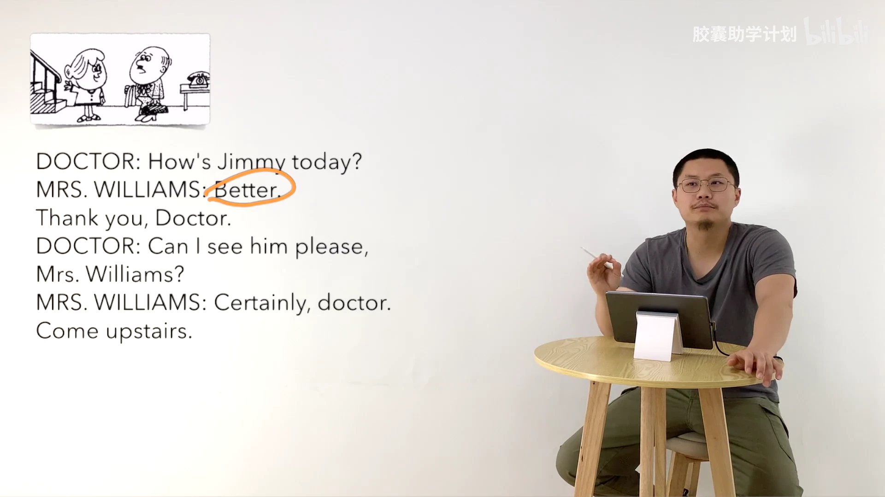

文字识别：胶囊助学计划 / DOCTOR: How's Jimmy today? / MRS. WILLIAMS:Better. / Thank you, Doctor. / DOCTOR: Can I see him please, / Mrs. Williams? / MRS. WILLIAMS: Certainly, doctor. / Come upstairs.

### 画面 00:00:54

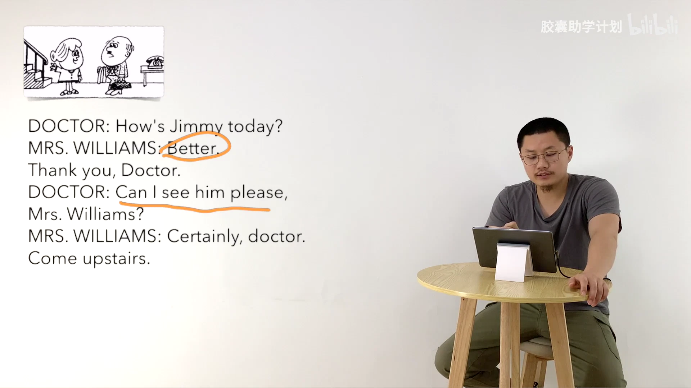

文字识别：胶囊助学计划 / DOCTOR: How's Jimmy today? / MRS. WILLIAMS:Better. / Thank you, Doctor. / DOCTOR: Can I see him please, / Mrs. Williams? / MRS. WILLIAMS: Certainly, doctor. / Come upstairs.

### 画面 00:00:59

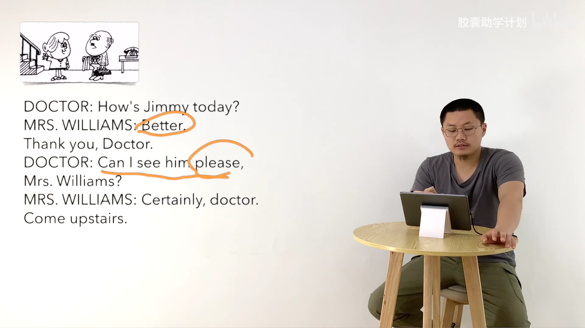

文字识别：胶囊助学计划 / DOCTOR: How's Jimmy today? / MRS. WILLIAMS:Better. / Thank you, Doctor. / DOCTOR: Can I see him(please, / Mrs. Williams? / MRS. WILLIAMS: Certainly, doctor. / Come upstairs.

## 00:01:00–00:01:30

达一种礼貌. Mrs. Williams,威廉夫人. Certainly, Doctor,当然没有问题了，医生. Come upstairs,啊，十三课咱们就学过. Come upstairs,上楼吧. Continue,说You look very well.你看起来啊，非常的好啊. Very well,你看起来很好, Jimmy. You are better now.你现在好多了. But,但是注意，他是医生，所以他说了一句话.You mustn't get up yet.

### 画面 00:01:02

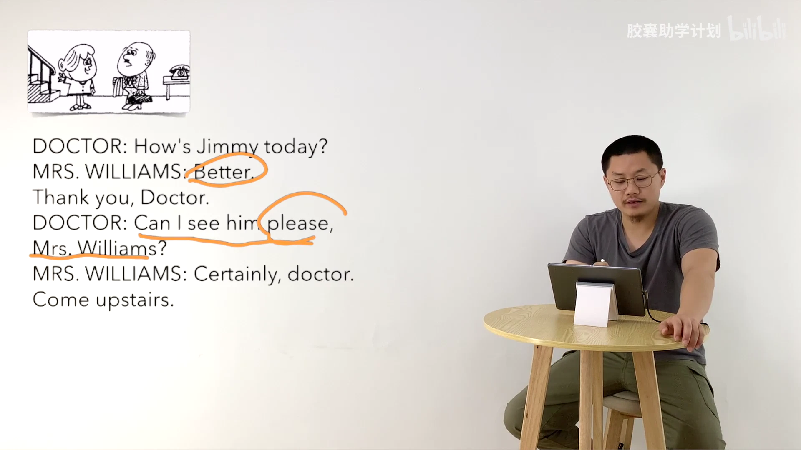

文字识别：胶囊助学计划 / DOCTOR: How's Jimmy today? / MRS. WILLIAMS:Better. / Thank you, Doctor. / DOCTOR: Can I see himplease, / Mrs. Williams? / MRS. WILLIAMS: Certainly, doctor. / Come upstairs.

### 画面 00:01:05

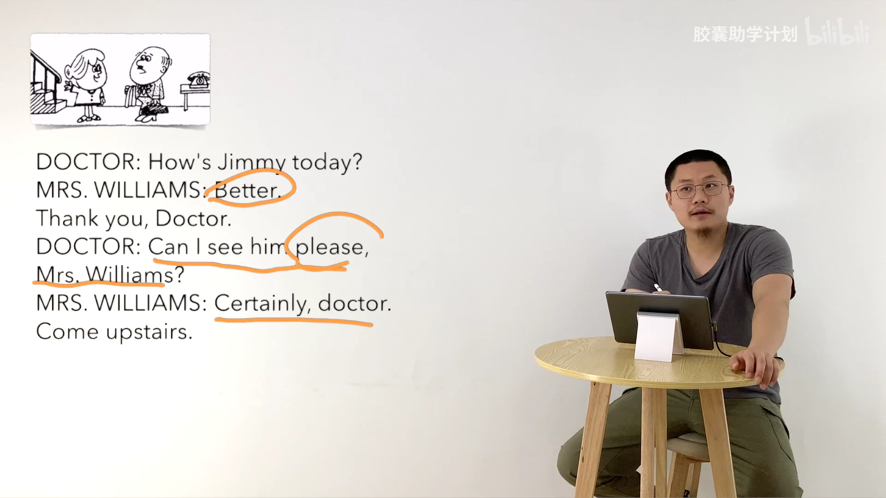

文字识别：胶囊助学计划 / DOCTOR: How's Jimmy today? / MRS.WILLIAMS:Better. / Thank you, Doctor. / DOCTOR: Can I see himplease, / Mrs. Williams? / MRS. WILLIAMS: Certainly, doctor. / Come upstairs.

### 画面 00:01:12

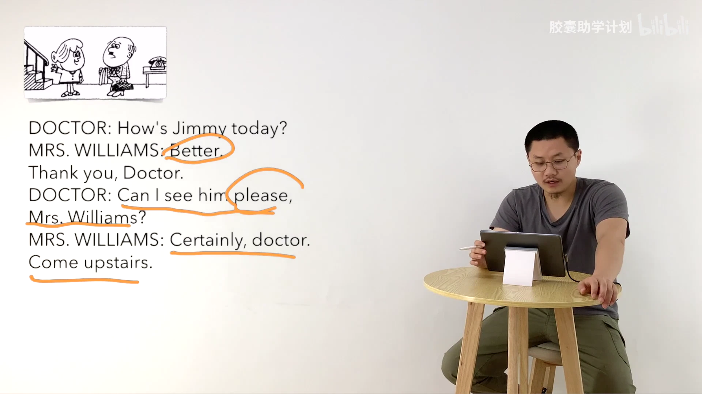

文字识别：胶囊助学计划 / DOCTOR: How's Jimmy today? / MRS. WILLIAMS:Better. / Thank you, Doctor. / DOCTOR: Can I see himplease, / Mrs. Williams? / MRS. WILLIAMS: Certainly, doctor. / Come upstairs.

### 画面 00:01:14

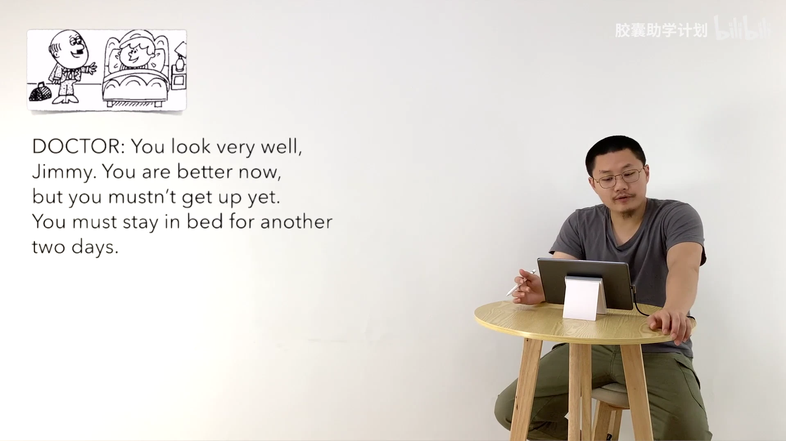

文字识别：胶囊助学计划 / DOCTOR: You look very well, / Jimmy. You are better now, / but you mustn't get up yet. / You must stay in bed for another / two days.

### 画面 00:01:21

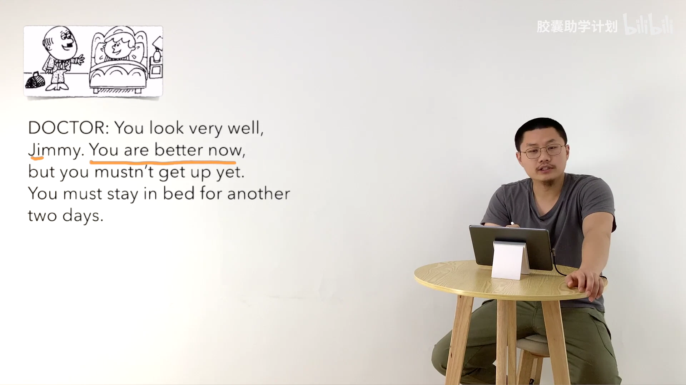

文字识别：胶囊助学计划 / DOCTOR: You look very well, / Jimmy. You are better now, / but you mustn't get up yet. / You must stay in bed for another / two days.

### 画面 00:01:28

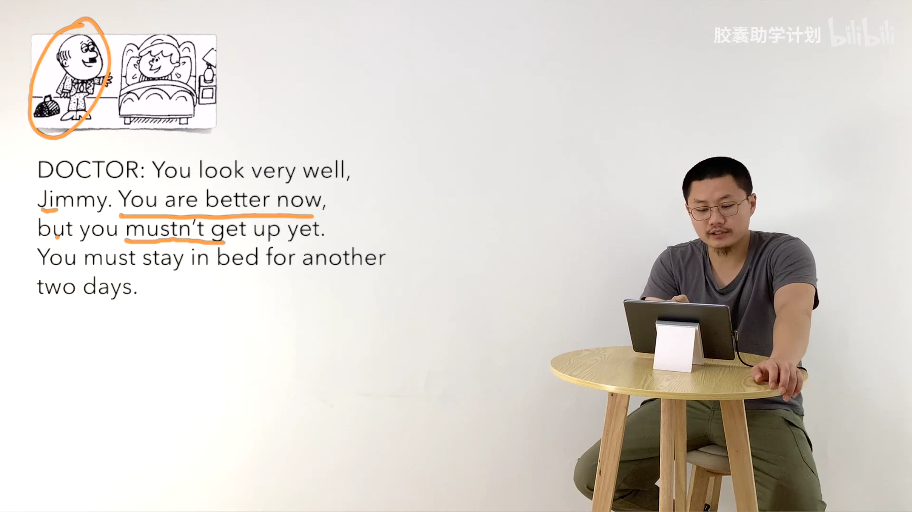

文字识别：胶囊助学计划 / DOCTOR: You look very well, / Jimmy. You are better now, / but you mustn't get up yet. / You must stay in bed for another / two days.

## 00:01:30–00:02:00

Yet,还啊，仍然，你还不能起来，你还不可以起来，你还禁止起床啊。这件事情你还不能做。You must stay in bed.你必须要在床上待着 for another two days.再多待两天。Okay.啊，那another啊，这个实际上我们应该是在三十五课说。Here is another photograph of our village.

### 画面 00:01:31

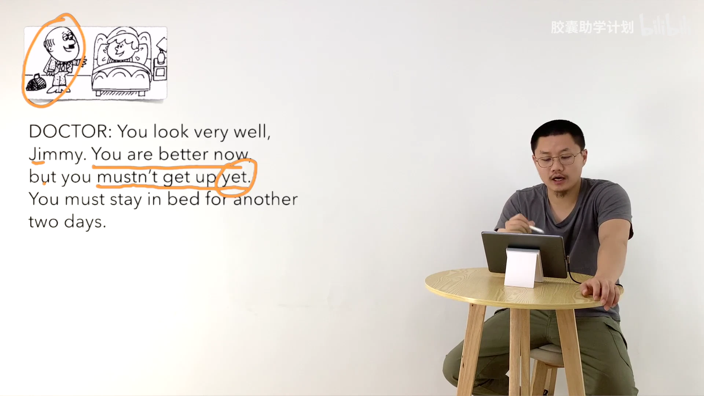

文字识别：胶囊助学计划 / DOCTOR: You look very well, / Jimmy. You are better now / but you mustn't get up yet. / You must stay in bed for another / two days.

### 画面 00:01:43

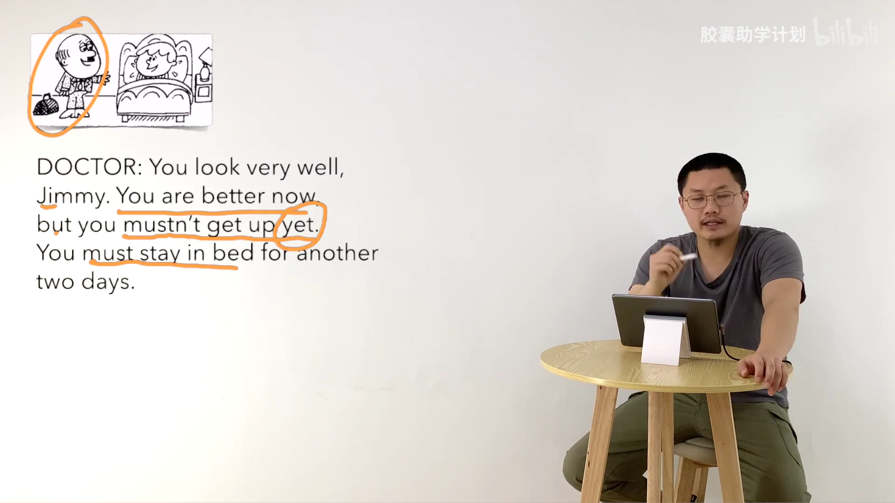

文字识别：胶囊助学计划 / DOCTOR: You look very well, / Jimmy. You are better now / but you mustn't get up yet. / You must stay in bed for another / two days.

### 画面 00:01:55

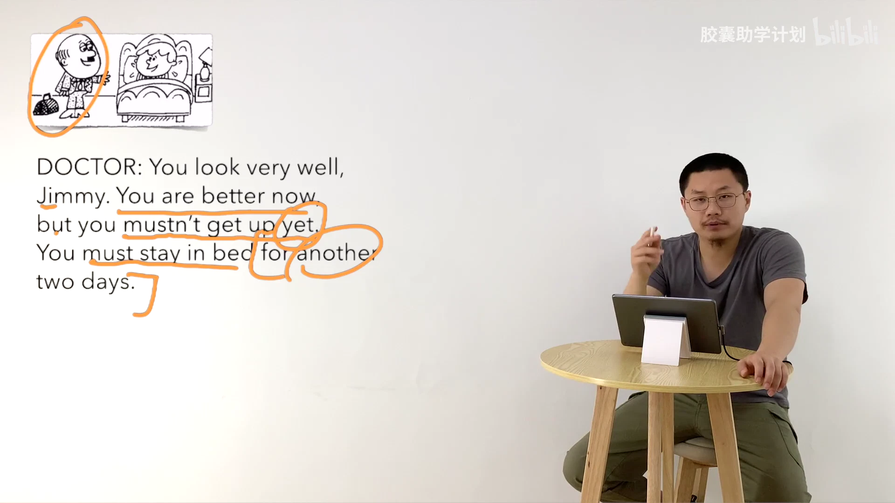

文字识别：胶囊助学计划 / DOCTOR: You look very well, / Jimmy. / You are better now / but you mustn't get up yet. / You must stay in bed / foranother / two / days.

## 00:02:00–00:02:30

This is another one, right? Another two days,就是另待再待两天啊. Continue.接下来医生下来了。医生跟他说，跟夫人说，The boy mustn't go to school yet.还不允许去上学。Mr. Williams and Mrs. Williams.啊，这注意有一个小 typo. And he mustn't eat rich food.注意，他还一定不要吃

### 画面 00:02:05

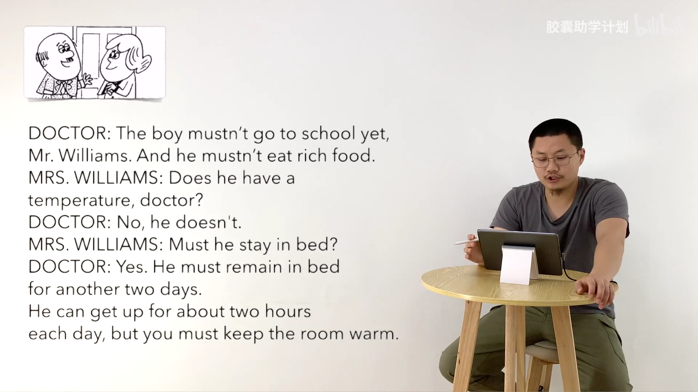

文字识别：胶囊助学计划 / DOCTOR: The boy mustn't go to school yet, / Mr. Williams. And he mustn't eat rich food. / MRS. WILLIAMS: Does he have a / temperature, doctor? / DOCTOR: No, he doesn't. / MRS. WILLIAMS: Must he stay in bed? / DOCTOR: Yes. He must remain in bed / for another two days. / He can get up for about two hours / each day, but you must keep the room warm.

### 画面 00:02:11

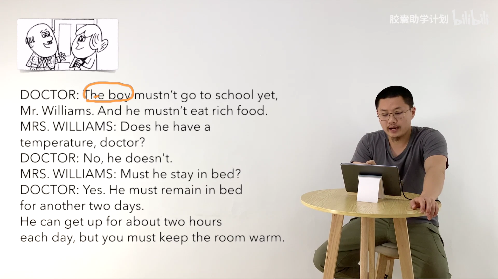

文字识别：胶囊助学计划 / DOCTOR: The boymustn't go to school yet, / Mr. Williams. And he mustn't eat rich food. / MRS. WILLIAMS: Does he have a / temperature, doctor? / DOCTOR: No, he doesn't. / MRS. WILLIAMS: Must he stay in bed? / DOCTOR: Yes. He must remain in bed / for another two days. / He can get up for about two hours / each day, but you must keep the room warm.

## 00:02:30–00:03:00

太油腻的食物啊，他可能会身体出问题，尤其是小孩子，对吧？接下来，Mrs. Williams说，Does he have a temperature? Doctor说他是不是 have a temperature，发烧了呀？No, he doesn't.没有，他没有发烧。Must he stay in bed?他必须要在床上停留吗？待着吗？Yes, he must remain in bed.停留在床上

### 画面 00:02:30

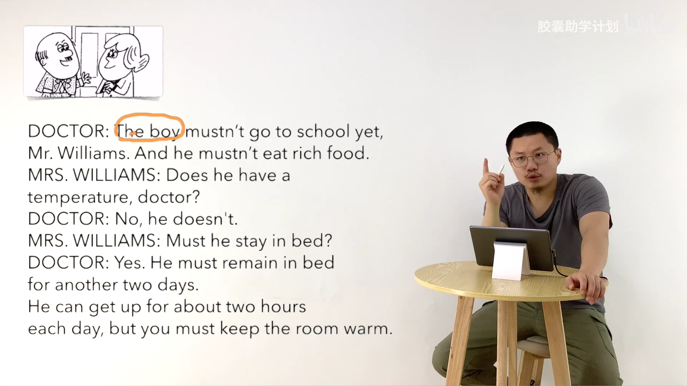

文字识别：胶囊助学计划 / DOCTOR: The boymustn't go to school yet, / Mr. Williams. And he mustn't eat rich food. / MRS. WILLIAMS: Does he have a / temperature, doctor? / DOCTOR: No, he doesn't. / MRS. WILLIAMS: Must he stay in bed? / DOCTOR: Yes. He must remain in bed / for another two days. / He can get up for about two hours / each day, but you must keep the room warm.

### 画面 00:02:36

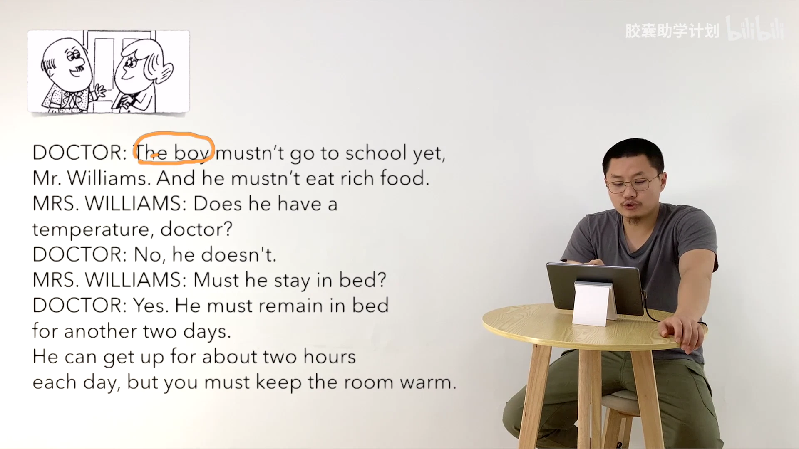

文字识别：胶囊助学计划 / DOCTOR: The boymustn't go to school yet, / Mr. Williams. And he mustn't eat rich food. / MRS. WILLIAMS: Does he have a / temperature, doctor? / DOCTOR: No, he doesn't. / MRS. WILLIAMS: Must he stay in bed? / DOCTOR: Yes. He must remain in bed / for another two days. / He can get up for about two hours / each day, but you must keep the room warm.

## 00:03:00–00:03:30

for another two days. This刚才我们讲了，再停留两天。注意这个地方的 must，这个地方的 must. Okay, 提前变一般疑问句. He can get up for about two hours each day. He can, 他能 get up 起床，他能起来。持续多长时间呢？ About two hours each day. 注意 about 是一个很小的单词，叫做大概啊。比如说 What about you? 啊，这个大概呢，

### 画面 00:03:06

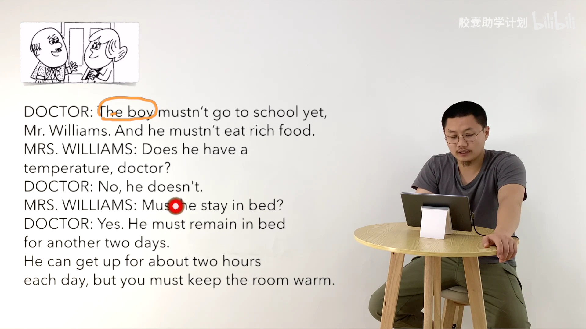

文字识别：胶囊助学计划 / DOCTOR: The boymustn't go to school yet, / Mr. Williams. And he mustn't eat rich food. / MRS. WILLIAMS: Does he have a / temperature, doctor? / DOCTOR: No, he doesn't. / MRS. WILLIAMS: MusOhe stay in bed? / DOCTOR: Yes. He must remain in bed / for another two days. / He can get up for about two hours / each day, but you must keep the room warm.

### 画面 00:03:28

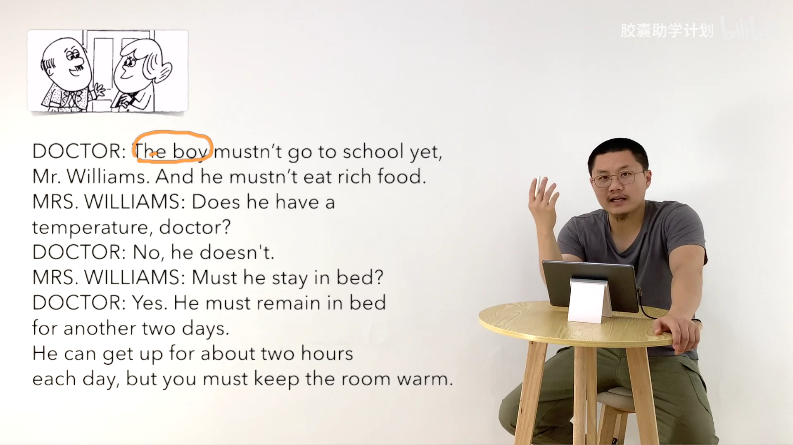

文字识别：胶囊助学计划 / DOCTOR: The boymustn't go to school yet, / Mr. Williams. And he mustn't eat rich food. / MRS. WILLIAMS: Does he have a / temperature, doctor? / DOCTOR: No, he doesn't. / MRS. WILLIAMS: Must he stay in bed? / DOCTOR: Yes. He must remain in bed / for another two days. / He can get up for about two hours / each day, but you must keep the room warm.

## 00:03:30–00:04:00

两个小时 each day，每一天大概能停留两个小时。But但是，you must keep the room warm.你必须，你看，must还是放在can的这个位置上，没区别，对吧？Keep the room warm.注意这个keep the room warm的keep指的是保持，保持房间温暖。你看，跟汉语的语序又是很像，对吧？保持房间的温暖。注

### 画面 00:03:36

文字识别：胶囊助学计划 / DOCTOR: The boymustn't go to school yet, / Mr. Williams. And he mustn't eat rich food. / MRS. WILLIAMS: Does he have a / temperature, doctor? / DOCTOR: No, he doesn't. / MRS. WILLIAMS: Must he stay in bed? / DOCTOR: Yes. He must remain in bed / for another two days. / He can get up for about two hours / each day, but you must keep the room warm.

### 画面 00:03:53

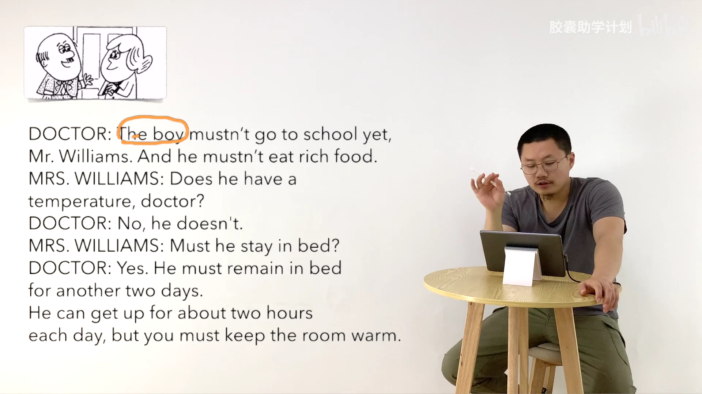

文字识别：胶囊助学计划 / DOCTOR: The boymustn't go to school yet, / Mr. Williams. And he mustn't eat rich food. / MRS. WILLIAMS: Does he have a / temperature, doctor? / DOCTOR: No, he doesn't. / MRS. WILLIAMS: Must he stay in bed? / DOCTOR: Yes. He must remain in bed / for another two days. / He can get up for about two hours / each day, but you must keep the room warm.

### 画面 00:03:58

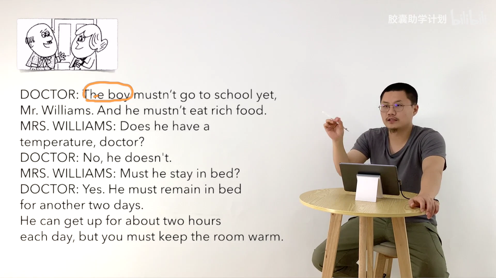

文字识别：胶囊助学计划 / DOCTOR: The boymustn't go to school yet, / Mr. Williams. And he mustn't eat rich food. / MRS. WILLIAMS: Does he have a / temperature, doctor? / DOCTOR: No, he doesn't. / MRS. WILLIAMS: Must he stay in bed? / DOCTOR: Yes. He must remain in bed / for another two days. / He can get up for about two hours / each day, but you must keep the room warm.

## 00:04:00–00:04:30

意这个 keep 啊。好，接下来说 Where's Mr. Williams this evening? 那威廉先生今晚在哪儿呢？ He's in bed, doctor. 他在床上待着呢。医生，Can you see him, please? 你能看一下他吗？ He has a bad cold too. 啊，他也得了重感冒啊，让孩子给传染上了。注意 has 是 have 的三单，这个点要注意一下就好了。 Okay, 接下来我们做一些口语听力练习。各位

### 画面 00:04:01

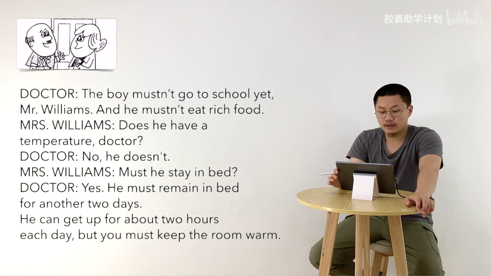

文字识别：胶囊助学计划 / DOCTOR: The boy mustn't go to school yet, / Mr. Williams. And he mustn't eat rich food. / MRS. WILLIAMS: Does he have a / temperature, doctor? / DOCTOR: No, he doesn't. / MRS. WILLIAMS: Must he stay in bed? / DOCTOR: Yes. He must remain in bed / for another two days. / He can get up for about two hours / each day, but you must keep the room warm. / 7

### 画面 00:04:03

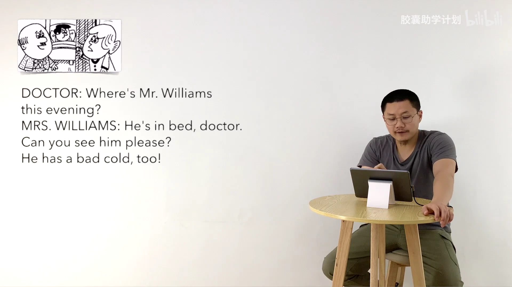

文字识别：胶囊助学计划 / DOCTOR: Where's Mr. Williams / this evening? / MRS. WILLIAMS: He's in bed, doctor. / Can you see him please? / He has a bad cold, too! / 7

### 画面 00:04:05

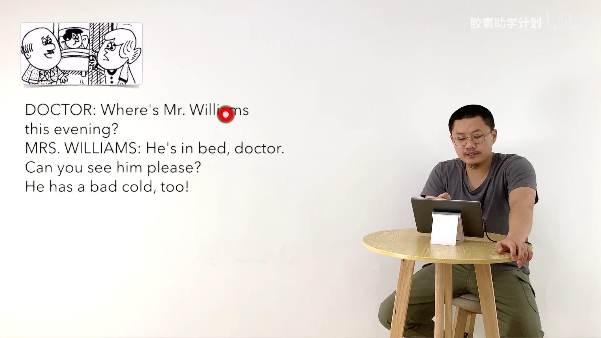

文字识别：胶囊助学计划 / DOCTOR: Where's Mr. Willi / ns / this evening? / MRS. WILLIAMS: He's in bed, doctor. / Can you see him please? / He has a bad cold, too!

### 画面 00:04:20

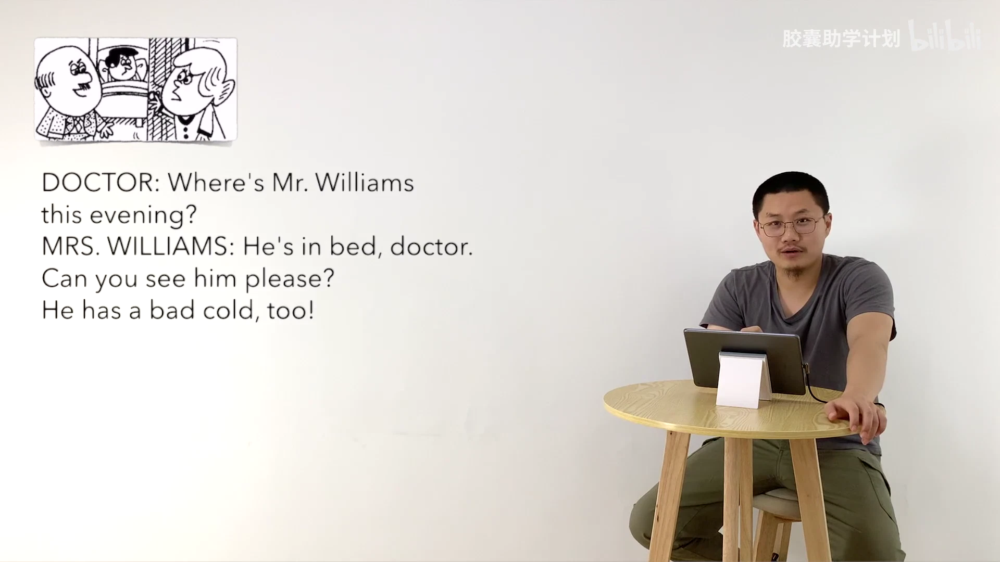

文字识别：胶囊助学计划 / DOCTOR: Where's Mr. Williams / this evening? / MRS. WILLIAMS: He's in bed, doctor. / Can you see him please? / He has a bad cold, too!

### 画面 00:04:25

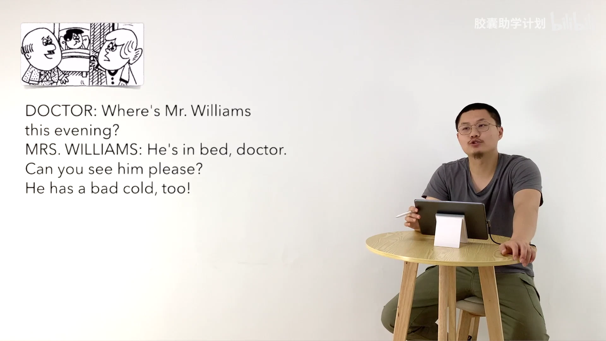

文字识别：胶囊助学计划 / DOCTOR: Where's Mr. Williams / this evening? / MRS. WILLIAMS: He's in bed, doctor. / Can you see him please? / He has a bad cold, too!

### 画面 00:04:27

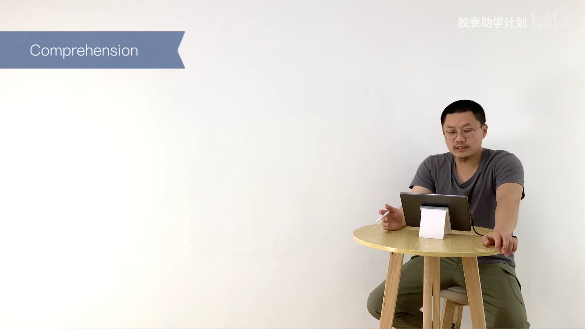

文字识别：胶囊助学计划 / Comprehension

### 画面 00:04:29

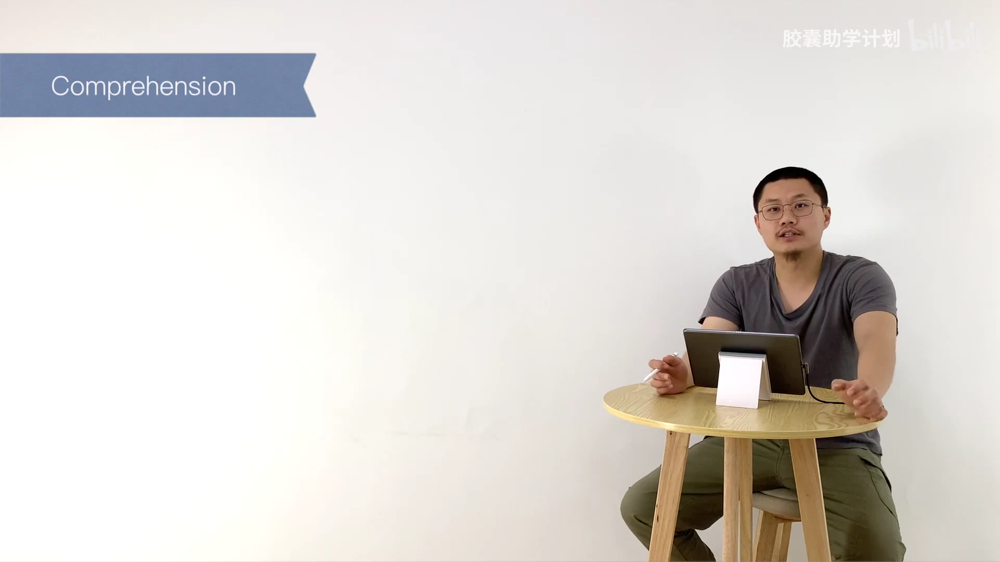

文字识别：胶囊助学计划 / Comprehension

## 00:04:30–00:05:00

要做的事情呢也很简单，看着文章啊。您现在如果文章没读熟，看着文章，我们做口语听力练习。例题来了，How's Jimmy today? 找答案，He's better. Next one, Can the doctor see Jimmy? Yes, he can. Next one, Does Jimmy look very

### 画面 00:04:31

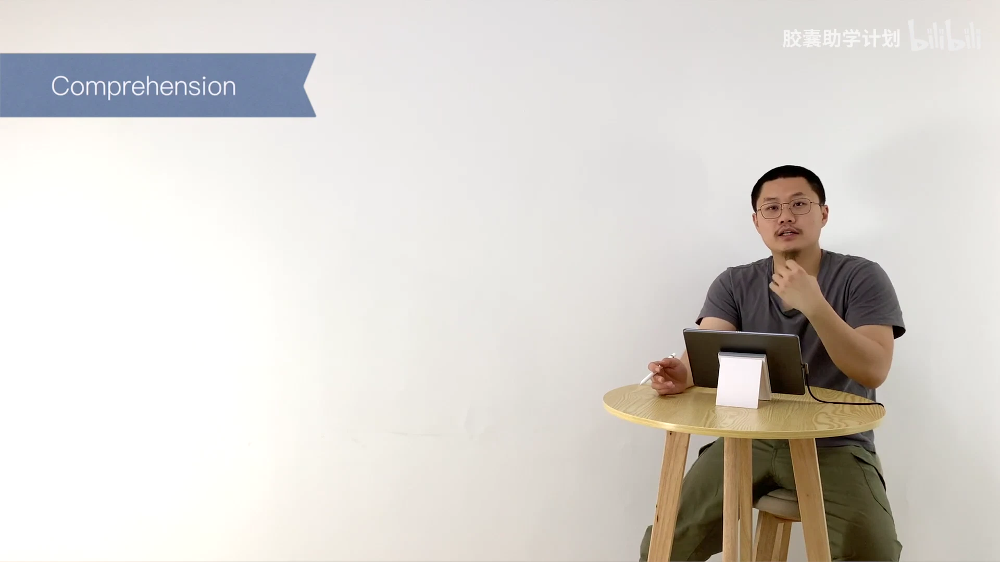

文字识别：胶囊助学计划 / Comprehension

### 画面 00:04:33

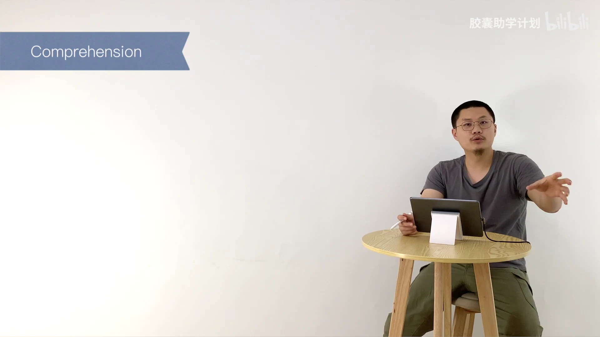

文字识别：胶囊助学计划 / Comprehension

### 画面 00:04:36

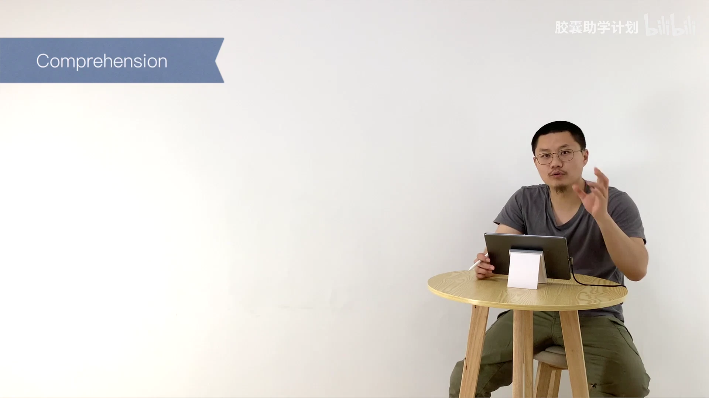

文字识别：胶囊助学计划 / Comprehension

### 画面 00:04:38

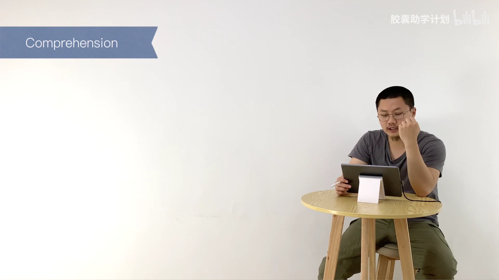

文字识别：胶囊助学计划 / Comprehension

### 画面 00:04:41

文字识别：胶囊助学计划 / Comprehension / 1 T: How is Jimmy today?

### 画面 00:04:49

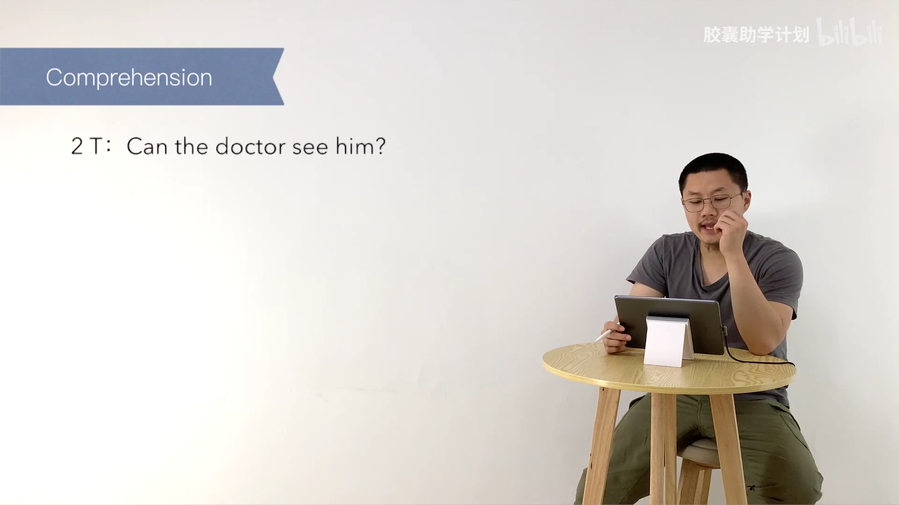

文字识别：胶囊助学计划 / Comprehension / 2 T: Can the doctor see him?

### 画面 00:04:53

文字识别：胶囊助学计划 / Comprehension

### 画面 00:04:57

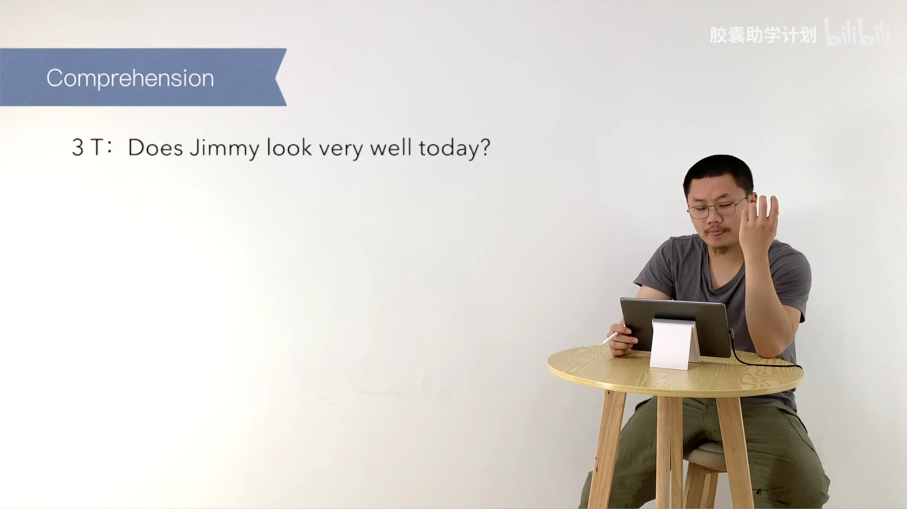

文字识别：胶囊助学计划 / Comprehension / 3 T: Does Jimmy look very well today?

## 00:05:00–00:05:30

well today? Yes, he does. Next one, can Jimmy get up now? No, he mustn't get up yet.或者你直接回答No, he can't啊也没有问题. Next one, how long must he stay in bed?他必须要在床上停留多长时间？这个how long稍微有点超纲啊，我们可能要八十九课才能学到持续多长时间。其实你只

### 画面 00:05:06

文字识别：胶囊助学计划 / Comprehension / 4 T: Can Jimmy get up now?

### 画面 00:05:28

文字识别：胶囊助学计划 / Comprehension / 5 T: How long must he stay in bed? / S: He must stay in bed for another two days.

## 00:05:30–00:06:00

要把后边答案给我就行了，叫做 for another two days. Next one, can Jimmy go to school now? No, he mustn't go to school yet. 或者是 No, he can't. 都可以这个答案啊，只不过这句话是原文给的. Next one, can he get up? Yes, he can get up for about two hours each day.

### 画面 00:05:36

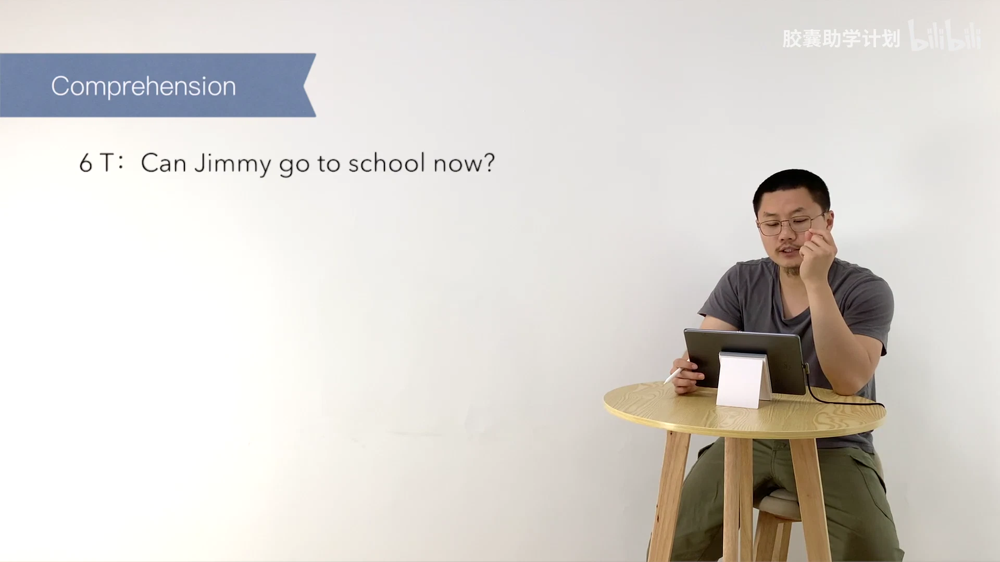

文字识别：胶囊助学计划 / Comprehension / 6 T: Can Jimmy go to school now?

### 画面 00:05:45

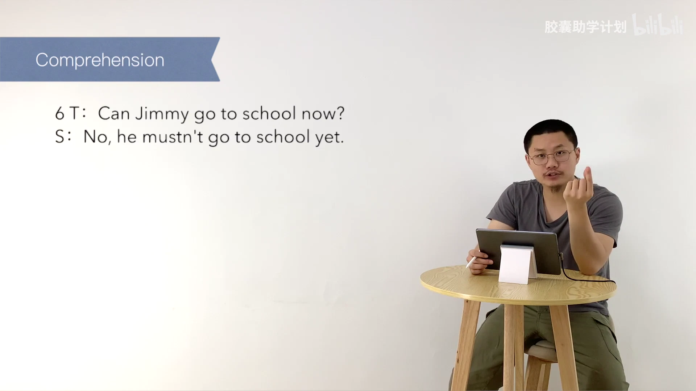

文字识别：胶囊助学计划 / Comprehension / 6 T: Can Jimmy go to school now? / S: No, he mustn't go to school yet.

### 画面 00:05:50

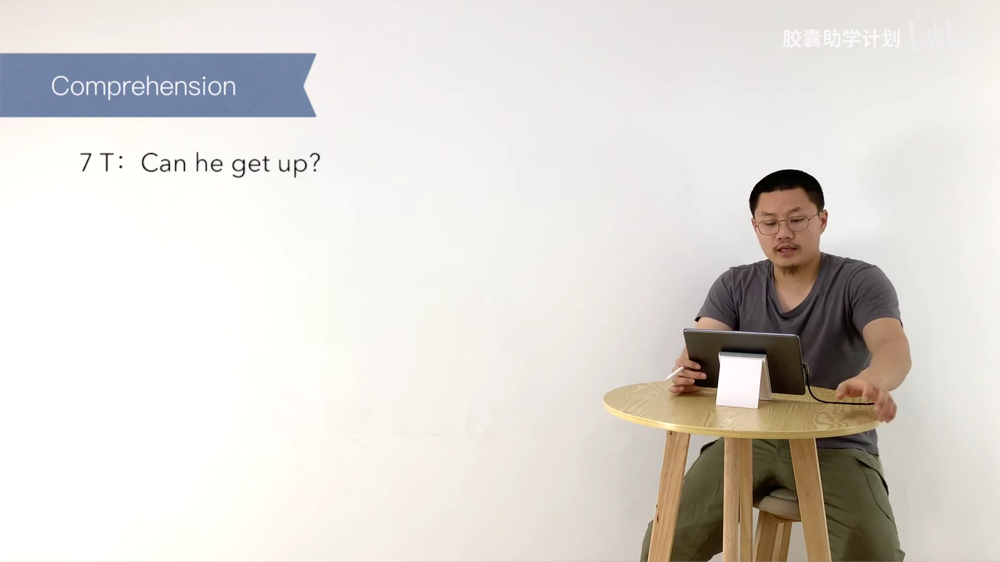

文字识别：胶囊助学计划 / Comprehension / 7 T: Can he get up?

### 画面 00:05:53

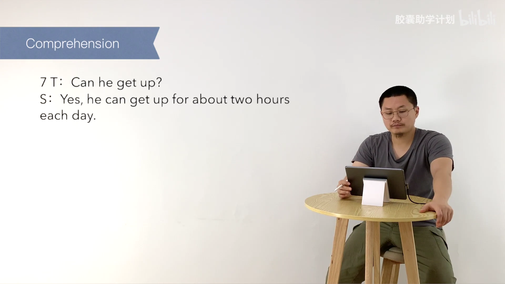

文字识别：胶囊助学计划 / Comprehension / 7 T: Can he get up? / S: Yes, he can get up for about two hours / each day.

## 00:06:00–00:06:30

Next one, what must Mrs. Williams do? He must keep the room warm. Next one, where's Mr. Williams this evening? He's in bed. Next one, why is Mr. Williams in bed? He has a bad cold. There you go. 接下来四句型转换，

### 画面 00:06:01

文字识别：胶囊助学计划 / Comprehension / 8 T: What must Mrs. Williams do?

### 画面 00:06:23

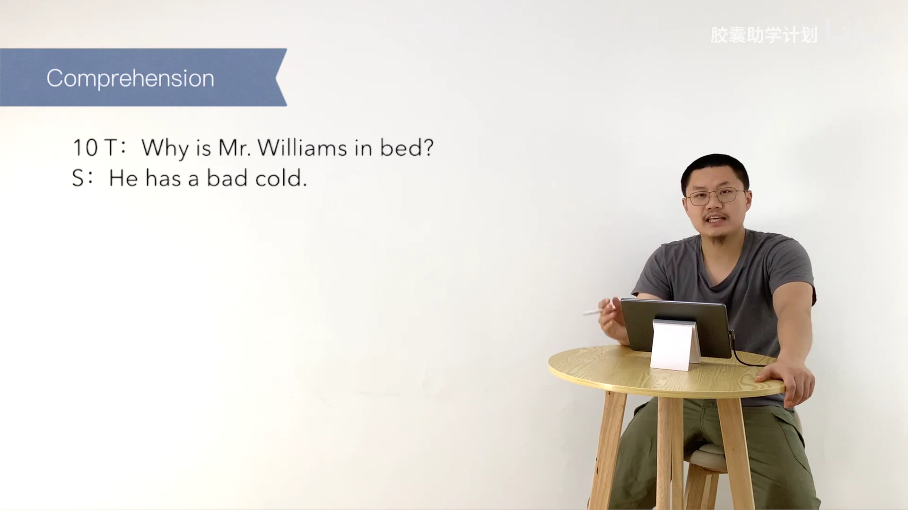

文字识别：胶囊助学计划 / Comprehension / 10 T: Why is Mr. Williams in bed? / S: He has a bad cold.

### 画面 00:06:26

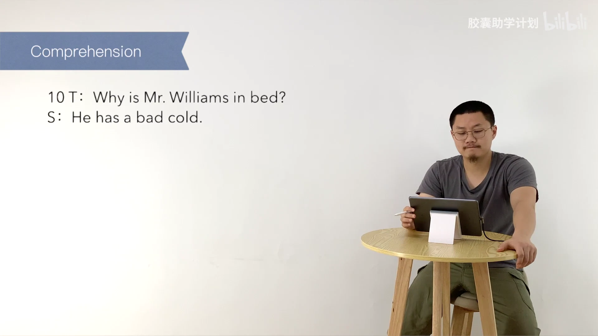

文字识别：胶囊助学计划 / Comprehension / 10 T: Why is Mr. Williams in bed? / S: He has a bad cold.

### 画面 00:06:28

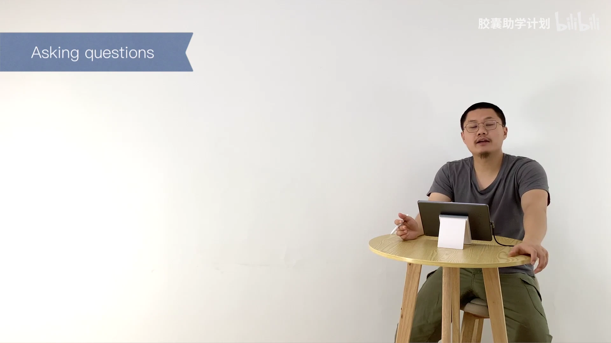

文字识别：胶囊助学计划 / Asking questions

## 00:06:30–00:07:00

对吧？只不过没有否定句啊。来，第一题，Ask me if Jimmy is better now. Is Jimmy better today? How How is Jimmy today? Next one, Ask me if Jimmy is upstairs.啊，判断的撇s就只有是is，对吧？目前，Is Jimmy upstairs? Where Where is Jimmy?

### 画面 00:06:32

文字识别：胶囊助学计划 / Asking questions / 1 T: Ask me if Jimmy is better today.

### 画面 00:06:34

文字识别：胶囊助学计划 / Asking questions / 1 T: Ask me if Jimmy is better today.

### 画面 00:06:38

文字识别：胶囊助学计划 / Asking questions / 1 T: Ask me if Jimmy is better today.

### 画面 00:06:51

文字识别：胶囊助学计划 / Asking questions / 2 T: Ask me if Jimmy's upstairs.

### 画面 00:06:57

文字识别：胶囊助学计划 / Asking questions / 2 T: Ask me if Jimmy's upstairs. / S: Is Jimmy upstairs? / T: Where ...?

## 00:07:00–00:07:30

Next one, ask me if Jimmy must stay in bed. Must Jimmy stay in bed? Why? Why must Jimmy stay in bed? Next one, ask me if Jimmy has a temperature. Does Jimmy have a temperature? Who?

### 画面 00:07:03

文字识别：胶囊助学计划 / Asking questions / 3 T: Ask me if Jimmy must stay in bed.

### 画面 00:07:11

文字识别：胶囊助学计划 / Asking questions / 3 T: Ask me if Jimmy must stay in bed. / S: Must Jimmy stay in bed?

### 画面 00:07:26

文字识别：胶囊助学计划 / Asking questions / 4 T: Ask me if Jimmy has a temperature. / S: Does Jimmy have a temperature?

## 00:07:30–00:08:00

Who has a temperature? 这注意一个小点，对主语提问不跟一般疑问句没关系，直接替代主语啊。最后一个，Ask me if Mrs. Williams must keep the room warm. Must Mrs. Williams keep the room warm? Why? Why must Mrs. Williams keep the room warm?

### 画面 00:07:30

文字识别：胶囊助学计划 / Asking questions / 4 T: Ask me if Jimmy has a temperature. / S: Does Jimmy have a temperature? / T: Who...? / S: Who has a temperature?

### 画面 00:07:40

文字识别：胶囊助学计划 / Asking questions / 5 T: Ask me if Mrs. Williams must keep the room warm.

### 画面 00:07:54

文字识别：胶囊助学计划 / Asking questions / 5 T: Ask me if Mrs. Williams must keep the room warm. / S: Must Mrs. Williams keep the room warm? / T：Why ….? / S: Why must Mrs. Williams Keep the room warm?

### 画面 00:07:59

文字识别：胶囊助学计划 / Asking questions / 5 T: Ask me if Mrs. Williams must keep the room warm. / S: Must Mrs. Williams keep the room warm? / T：Why …..? / S: Why must Mrs. Williams Keep the room warm?

## 00:08:00–00:08:30

OK， here we go. Recap，本课还是这个点，must是核心。注意，mustn't表示的往往是禁止，当然语气可以比它稍微再缓和一点，但是您生活当中也轻易不要去用它啊。OK，作业，绿皮书六十三课，各位可以去写了，不要忘了对一下后边的答案啊。第一本儿书啊，新概念一册的绿皮书是非常重要的。接下来，文章要跟读至熟读成

### 画面 00:08:01

文字识别：胶囊助学计划 / Recap / Patterns / must / must+not=mustn't / Grammar / Words / Expression

### 画面 00:08:03

文字识别：胶囊助学计划 / Recap / Patterns / must / must+not=mustn't / Grammar / Words / Expression

### 画面 00:08:12

文字识别：胶囊助学计划 / Recap / Patterns / must / & / must+not=mustn't / Grammar / Words / Expression / 2

### 画面 00:08:16

文字识别：胶囊助学计划 / Recap / Patterns / must / must+not=mustn't / Grammar / Words / Expression

### 画面 00:08:18

文字识别：胶囊助学计划 / 绿皮书第63课的写作练习

### 画面 00:08:21

文字识别：胶囊助学计划 / 绿皮书第63课的写作练习

### 画面 00:08:24

文字识别：胶囊助学计划 / 绿皮书第63课的写作练习

## 00:08:30–00:09:00

诵，最后给自己讲解一遍今天的核心知识点。那如果大家喜欢我们的课程呢，欢迎大家关注、订阅、一键三连，分享给那些需要的朋友来支持我们。最后的最后，我们再来看一句马克吐温的名人名言：It is better to keep your mouth closed and let people think you are a fool, rather than to open it and remove all doubt. See you next time.

### 画面 00:08:34

文字识别：胶囊助学计划

### 画面 00:08:36

文字识别：胶囊助学计划

### 画面 00:08:43

文字识别：胶囊助学计划 / It is better to keep your mouth closed and / let people think you are a fool than to / open it and remove all doubt. / Mark Twain

### 画面 00:08:47

文字识别：胶囊助学计划 / It is better to keep your mouth closed and / let people think you are a fool than to / open it and remove all doubt. / Mark Twain

### 画面 00:08:50

文字识别：胶囊助学计划 / It is better to keep your mouth closed and / let people think you are a fool than to / open it and remove all doubt. /  Mark Twain

### 画面 00:08:53

文字识别：It is better to keep your mouth closed and / let people think you are a fool than to / open it and remove all doubt. /  Mark Twain

## 00:09:00–00:09:12

### 画面 00:09:00

### 画面 00:09:02

文字识别：CAPSULEACADEMY / 胶囊助学计划 / 小红书 / Lecturer / □ / 口 / Leo / OE

### 画面 00:09:05

文字识别：CAPSULEACADEMY / 胶囊助学计划 / 『 / 小红书 / □ / Editor / OE

### 画面 00:09:08

文字识别：CAPSULEACADEMY / 胶囊助学计划 / 『 / 小红书 / Creator / □ / Leo & Berlin / OE

### 画面 00:09:10

文字识别：bilibili / 胶囊助学计划 / 胶囊助学计划 / 小红书 / 控□ / 品

### 画面 00:09:12

文字识别：bilibili / 胶囊助学计划

