# 064 单词 文章

快速机器解析：语音为单模型转写，未进行独立交叉校对或人工复核；画面每秒采样并按变化选帧，短时文字和标记可能遗漏。截图时间约有 1 秒误差。图片有损压缩；遇到疑点请按时间查看 Google Drive 原视频。

## 00:00:00–00:00:30

Hello everyone, welcome to Capsule Academy. This is Leo. Today we are going to learn new concept English Book One Lesson Sixty Four Practices and Words.进入正式课程之前，我们老习惯先看一下几个问题。第一，如何表达与某人玩？第二，如何表达同某人讲话？最后一个问题，如何表达探出窗外？带着这三个问题，Hope you gonna enjoy.好，

### 画面 00:00:00

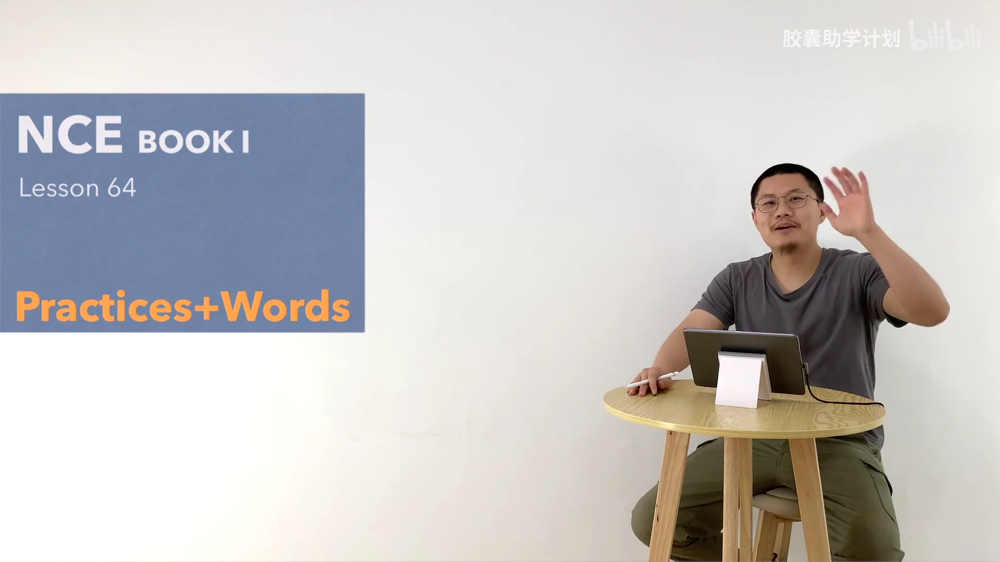

文字识别：胶囊助学计划 / NCE / BOOKI / Lesson 64 / Practices+Words

### 画面 00:00:04

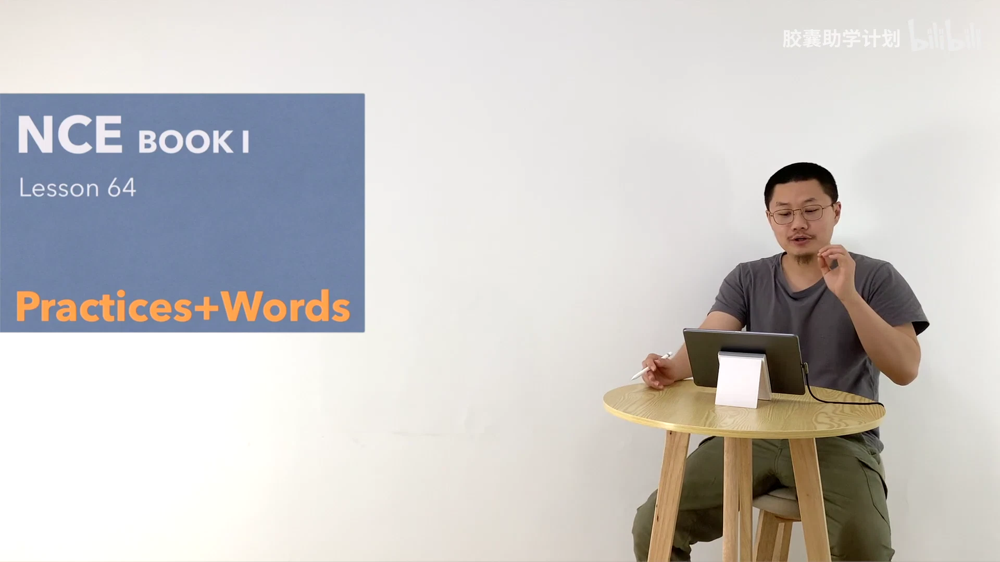

文字识别：胶囊助学计划 / NCE / BOOKI / Lesson 64 / Practices+Words

### 画面 00:00:07

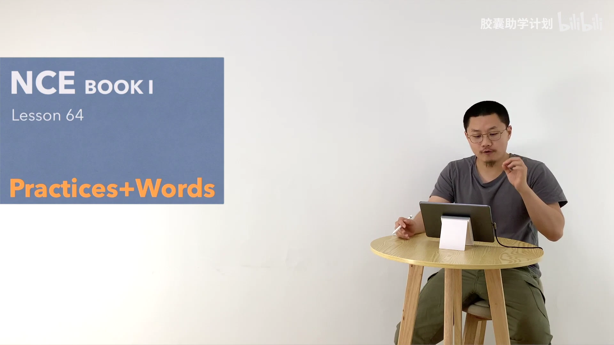

文字识别：胶囊助学计划 / NCE / BOOKI / Lesson 64 / Practices+Words

### 画面 00:00:09

文字识别：胶囊助学计划 / NCE / BOOKI / Lesson 64 / Practices+Words

### 画面 00:00:11

文字识别：胶囊助学计划 / ①如何表达“与某人玩”？

### 画面 00:00:15

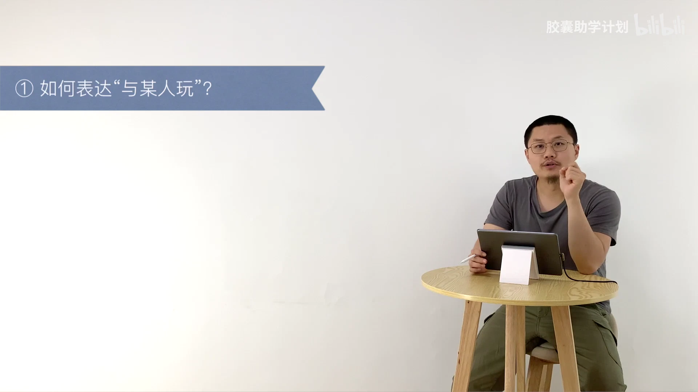

文字识别：胶囊助学计划 / ①如何表达“与某人玩”？

### 画面 00:00:17

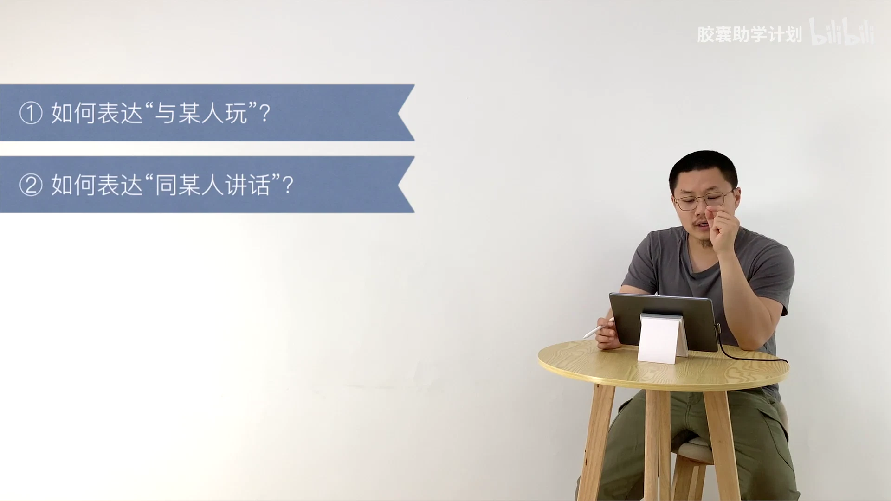

文字识别：胶囊助学计划 / ①如何表达“与某人玩”？ / 如何表达“同某人讲话”?

### 画面 00:00:19

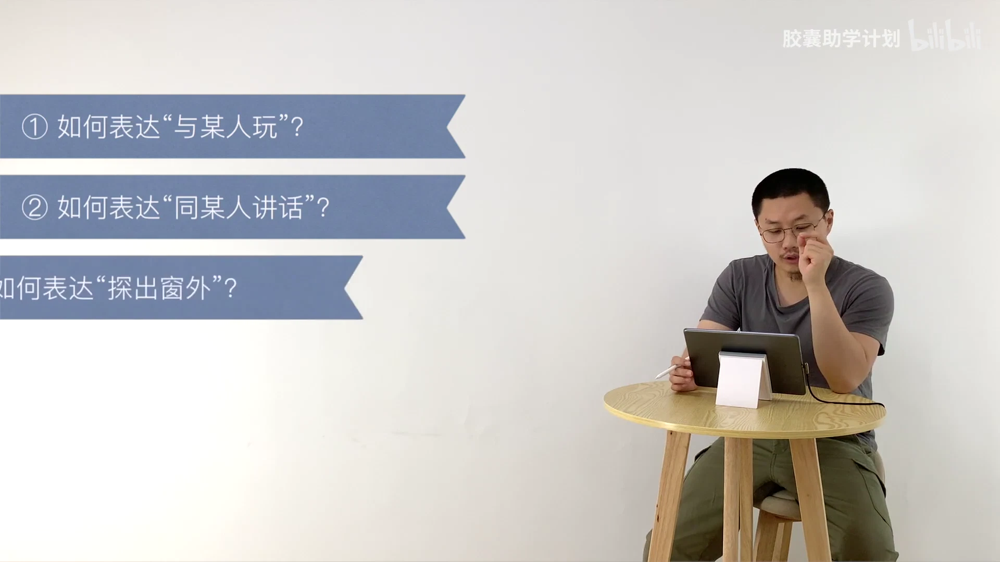

文字识别：胶囊助学计划 / ①如何表达“与某人玩”？ / 如何表达“同某人讲话”? / 如何表达“探出窗外”?

### 画面 00:00:21

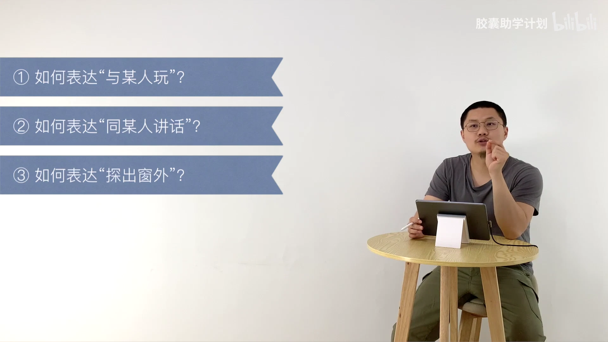

文字识别：胶囊助学计划 / ①如何表达“与某人玩”？ / 如何表达“同某人讲话”? / 如何表达“探出窗外”?

### 画面 00:00:25

文字识别：胶囊助学计划 bilbl / •

### 画面 00:00:29

文字识别：胶囊助学计划

## 00:00:30–00:01:00

好，那我们先看第一个小的单词，先看音标啊，双元音来 a 连起来 play 啊，它就是玩的意思。这个单词大家应该是非常熟悉的。那和谁玩怎么说呢？叫 play with somebody 啊， with 你看我们之前也见过这个单词，叫和谁谁在一起，对吧？ OK，那我们造一个句子，说你别和他一块玩，Don't play with him. He's a bad boy 啊，这这这这这孩子不行，是吧？ Don't play with him

### 画面 00:00:31

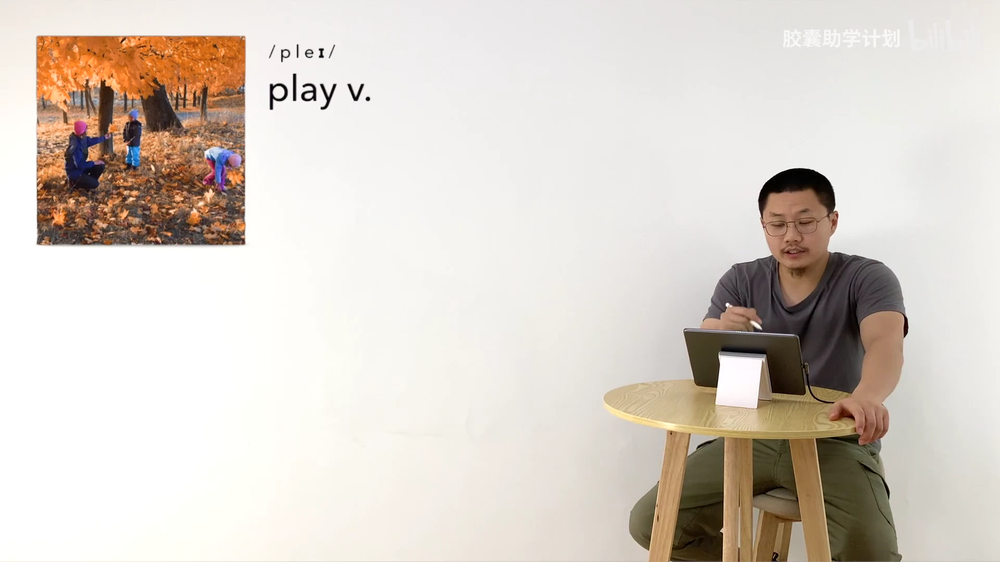

文字识别：胶囊助学计划 / /plei/ / play v.

### 画面 00:00:35

文字识别：胶囊助学计划 / /plei/ / play v.

### 画面 00:00:39

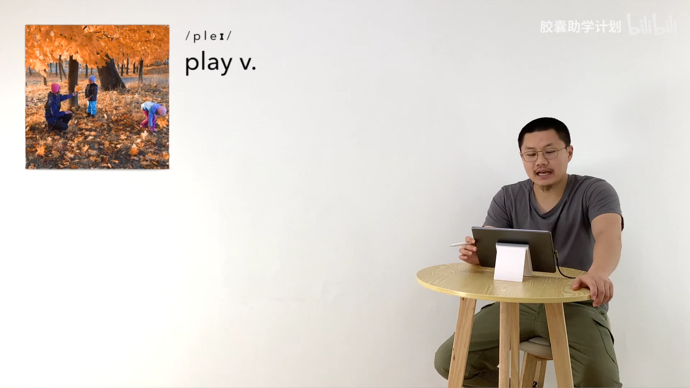

文字识别：胶囊助学计划 / /plei/ / play v.

### 画面 00:00:42

文字识别：胶囊助学计划 / /plei/ / play v. / ① play with sb.

### 画面 00:00:55

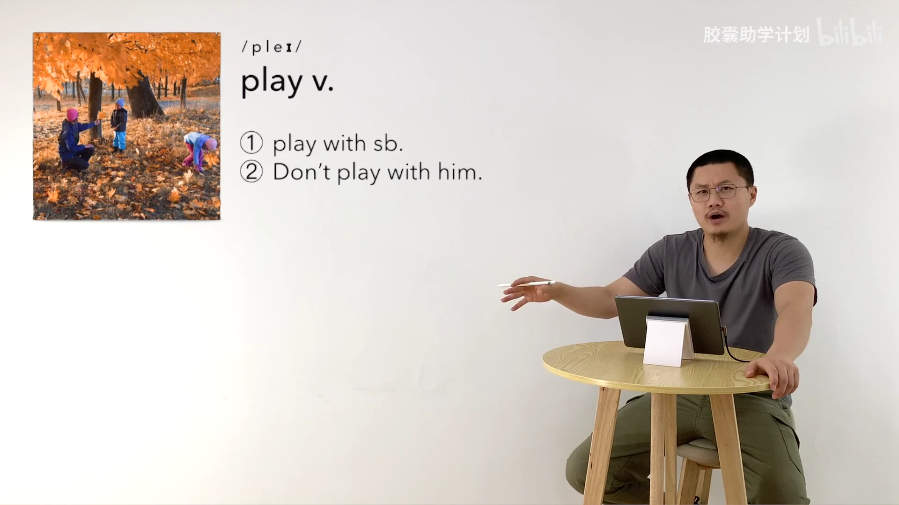

文字识别：胶囊助学计划 / /plei/ / play v. / ① play with sb. /  Don't play with him.

## 00:01:00–00:01:30

### 画面 00:01:08

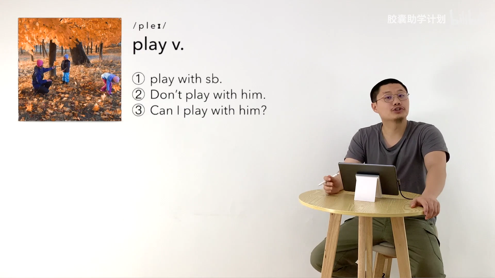

文字识别：胶囊助学计划 / /plei/ / play v. / ①play with sb. / Don't play with him. / ) Can I play with him?

### 画面 00:01:10

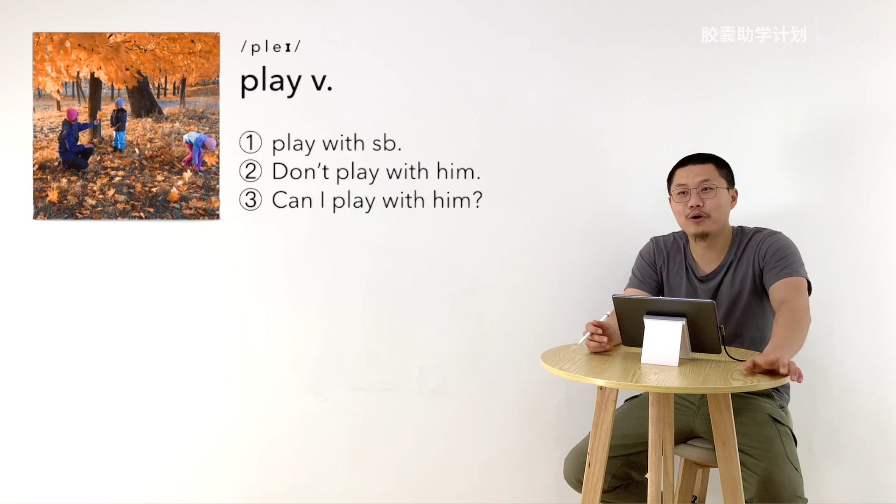

文字识别：/plei/ / play v. / ①play with sb. / Don't play with him. / Can I play with him?

### 画面 00:01:13

文字识别：胶囊助学计划 / /plei/ / play v. / ①play with sb. / Don't play with him. / )Can I play with him? / 3

### 画面 00:01:17

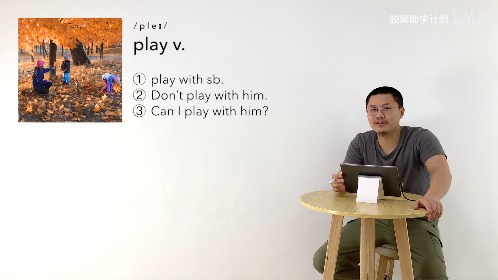

文字识别：胶囊助学计划 / /plei/ / play v. / ① play with sb. / Don't play with him. /  Can I play with him?

### 画面 00:01:20

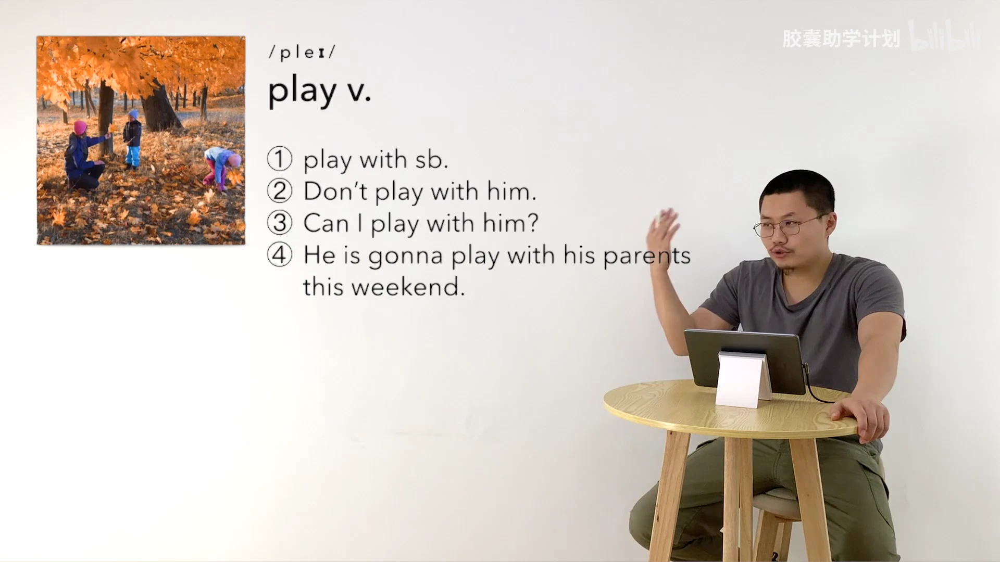

文字识别：胶囊助学计划 / /plei/ / play v. / ① play with sb. / Don't play with him. / Can I play with him? / He is gonna play with his parents / this weekend.

## 00:01:30–00:02:00

be gonna，对吧？Gonna be going to do的口语用法，OK。Continue，下一个单词叫做match，注意这个嘴是吧？稍微大一点，match。好，ch放在单词当中发ch，m放在单词当中去发的是m，这是一个自然拼读法则的基础知识。OK，对我们背这个单词其实很有用，对吧？OK，那接下来呢？比如说play with matches，那你看刚才说play叫玩儿，玩

### 画面 00:01:35

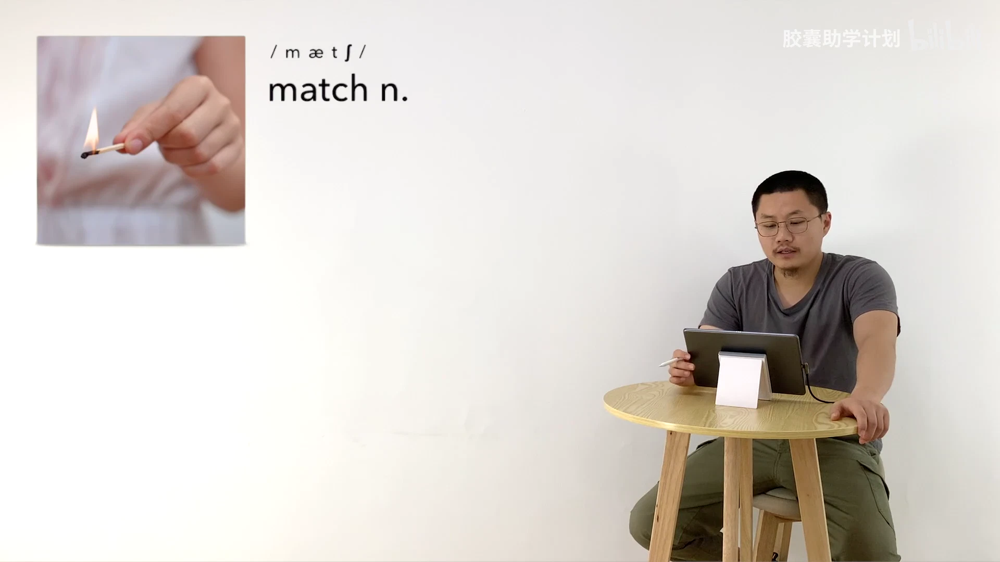

文字识别：胶囊助学计划 / / m æet ∫ 1 / match n.

### 画面 00:01:55

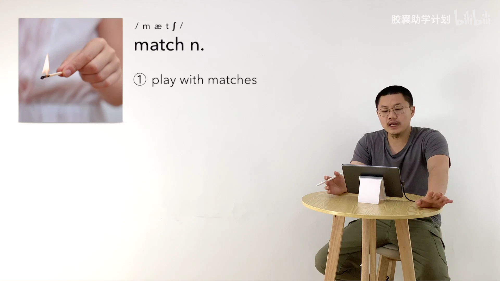

文字识别：胶囊助学计划 / / m æet ∫ 1 / match n. / ① play with matches

### 画面 00:01:58

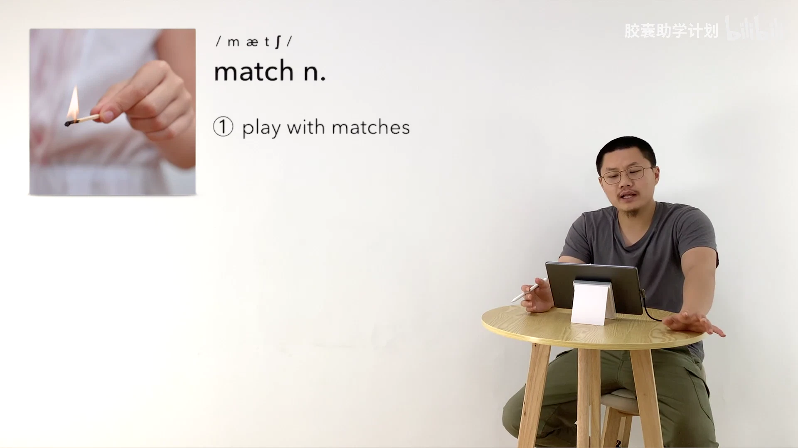

文字识别：胶囊助学计划 / / mæet ∫ 1 / match n. / ① play with matches

## 00:02:00–00:02:30

火柴，玩火柴其实就是玩火的意思，对吧？比如说别玩火啊，哎，我我找不到这个火柴，那叫做 I can't find the matches。那比如说别玩火，就是 don't play with matches。 OK，好，别玩这个火柴啊，别玩火。那什么时候说 you mustn't play with matches 呢？家长一般都不会这么说啊，就不要说禁止怎么怎么样做去做，对吧？一般来说，可能是还是特

### 画面 00:02:01

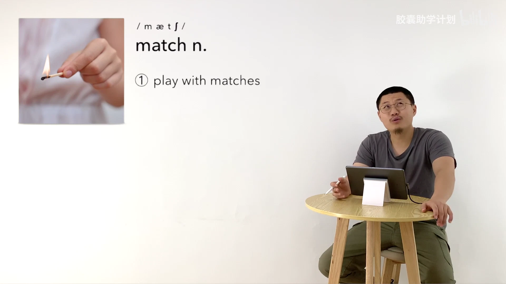

文字识别：胶囊助学计划 / / m æet ∫ 1 / match n. / ① play with matches / 2

### 画面 00:02:05

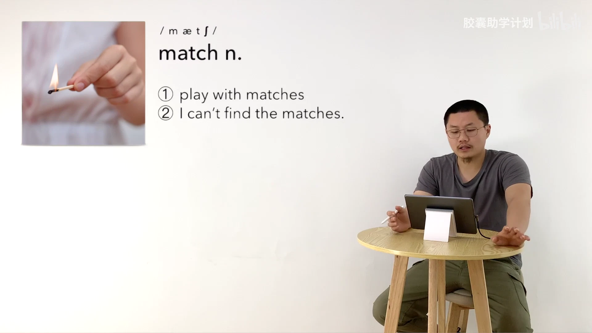

文字识别：胶囊助学计划 / / m æet ∫ / / match n. / ①play with matches / ② I can't find the matches.

### 画面 00:02:11

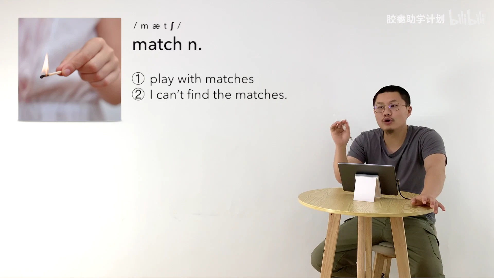

文字识别：胶囊助学计划 / / m æe t ∫ 1 / match n. / ① play with matches / ② I can't find the matches.

### 画面 00:02:17

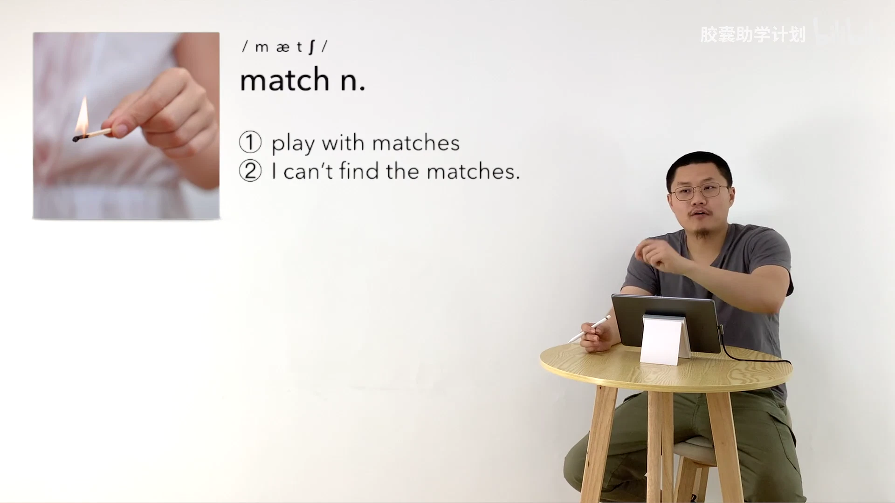

文字识别：胶囊助学计划 / / m æ t ∫/ / match n. / ① play with matches / ② I can't find the matches.

### 画面 00:02:20

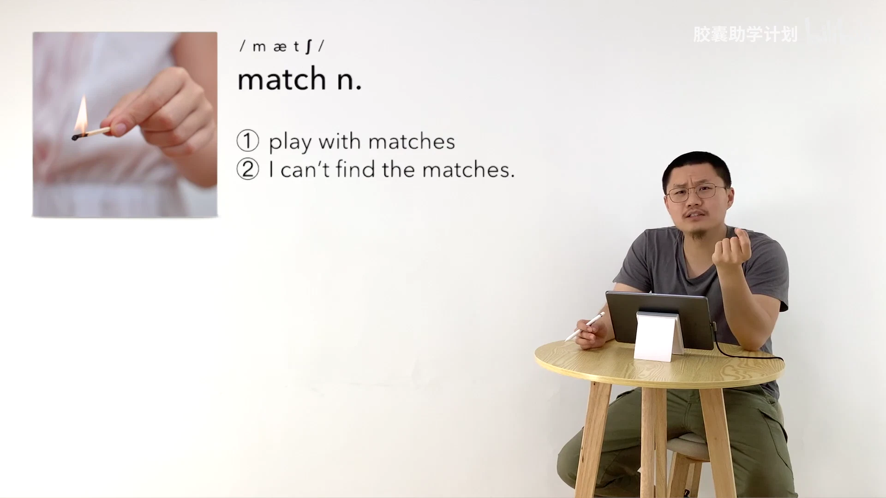

文字识别：胶囊助学计划 / / m æe t ∫ / / match n. / ① play with matches / ② I can't find the matches.

## 00:02:30–00:03:00

定的场合，人家会跟你说这地方禁止明火，对吧？OK， continue说Can you find the matches？你能找到这个火柴吗？啊啊啊！I I need it，是吧？我需要它。那一个，接下来下一个小单词跟我读，叫做talk，叫做说话。那同谁谁说话，或与谁谁说话，或者对着谁说话，怎么说呢？叫talk to somebody，就我说你听啊，我要和你说

### 画面 00:02:34

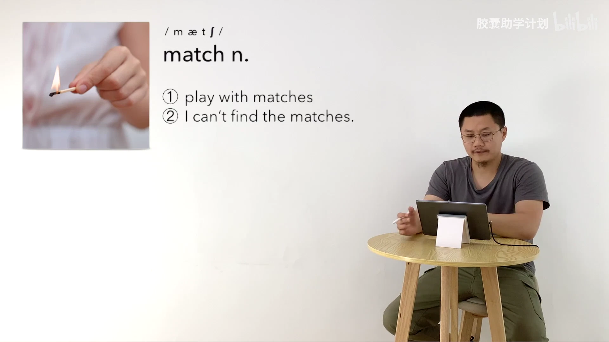

文字识别：胶囊助学计划 / / m æet ∫ / / match n. / ① play with matches / ② I can't find the matches.

### 画面 00:02:37

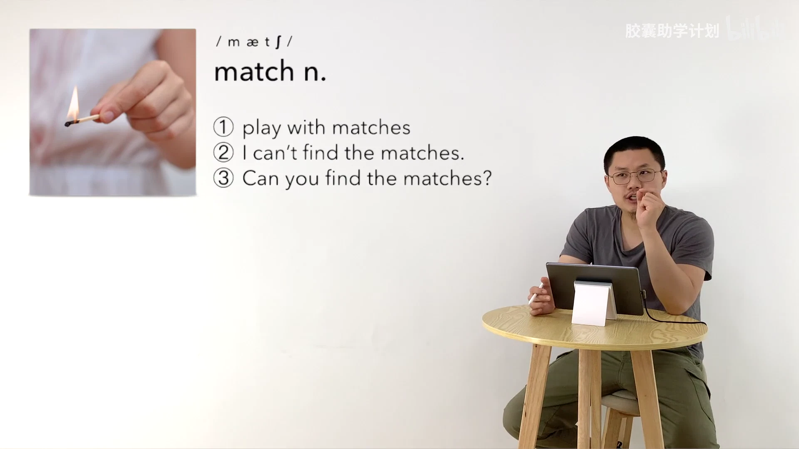

文字识别：胶囊助学计划 / / m æet ∫ / / match n. / ① play with matches / ② I can't find the matches. / ③ Can you find the matches? / 2

### 画面 00:02:42

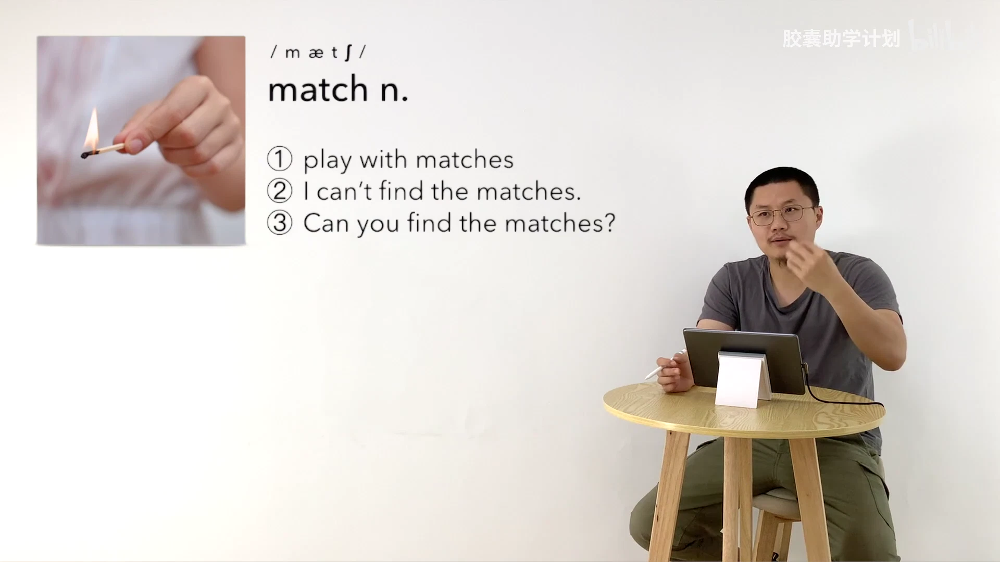

文字识别：胶囊助学计划 / / m æ t ∫ / / match n. / ① play with matches / ② I can't find the matches. / ③ Can you find the matches?

### 画面 00:02:44

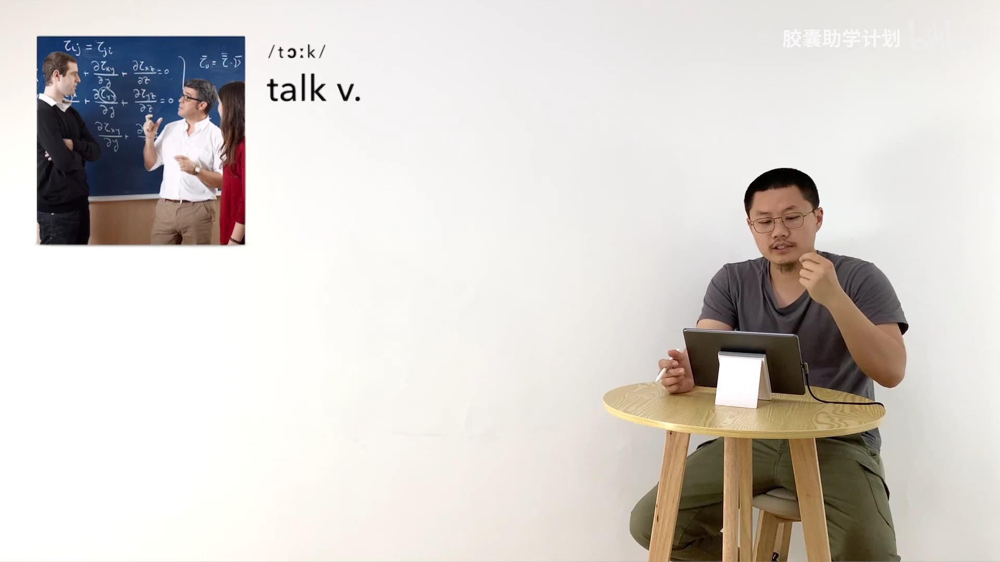

文字识别：胶囊助学计划 / Cij= ji$ / /to:k/ / a{xy$ / ∂{x2=0 / $\=$\{\a$ / at / tallk v.

### 画面 00:02:46

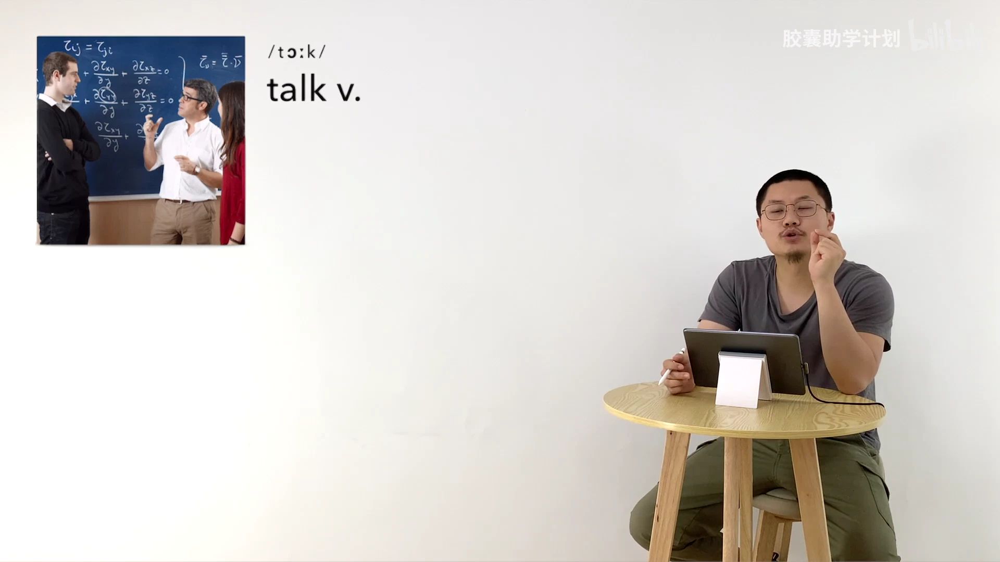

文字识别：胶囊助学计划 / Cij= \ji / /to:k/ / $∂{x2=0 / $\=\\$ / at / tallk v. / $ / D

### 画面 00:02:50

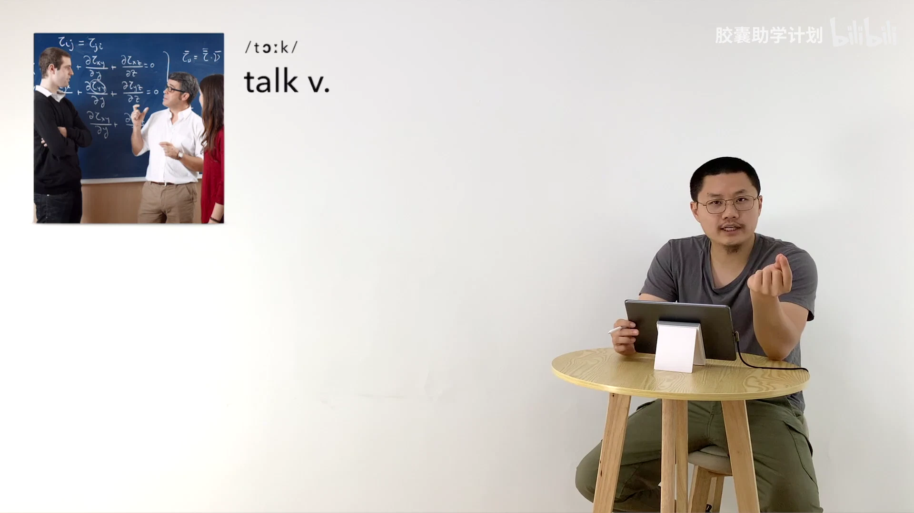

文字识别：胶囊助学计划 / Cij = yi / /to:k/ / ∂2x2=0 / $\=\\$ / at / talk v. / $

### 画面 00:02:55

文字识别：胶囊助学计划 / Cij= ji$ / /to:k/ / $\=\\r$ / ∂{xy$ / ∂{x2=0 / talk v. / $ / $ / ① talk to sb. / 2

### 画面 00:02:57

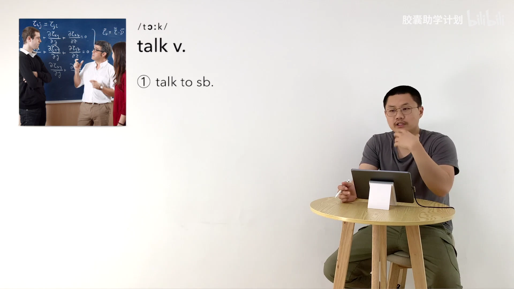

文字识别：胶囊助学计划 / Cij= \ji$ / /to:k/ / $\=\\$ / ∂{xy$ / ∂{x2=0 / at / talk v. / $ / ① talk to sb.

## 00:03:00–00:03:30

Okay,那比如说现在别跟我说话，叫Don't talk to me now. I'm busy. I'm too busy.我现在太忙了，先别跟我说话啊。Don't talk to me.好，你也可以怎么说呢？叫I'm gonna talk to him.我要和他聊一聊。I'm gonna还是be going to do？那他的，我们把他的这个全称说出来，叫I'm going to talk to him，或者是I'm gonna talk to him. Okay，我要和他聊一聊。There you go.那这个小短语，希望各

### 画面 00:03:01

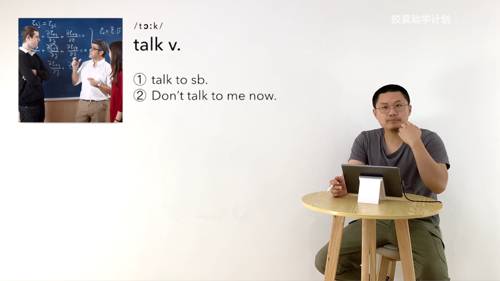

文字识别：Cij= \ji / /to:k/ / $\=\\r$ / ∂{x$ / $∂{x2=0$ / $at$ / talk v. / $ / ① talk to sb. / Don't talk to me now.

### 画面 00:03:03

文字识别：胶囊助学计划 / Cij= \ji$ / /to:k/ / $\=\\$ / ∂2x2=0 / $at$ / talk v. / 2{42=0 / $ / ①talk to sb. / Don't talk to me now.

### 画面 00:03:05

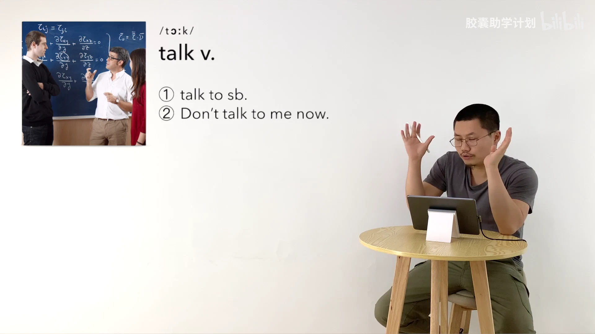

文字识别：胶囊助学计划 / Cij= \ji / /to:k/ / $\=\{\a$ / ∂{x2=0 / $\t$ / talk v. / $ / ① talk to sb. / ) Don't talk to me now.

### 画面 00:03:08

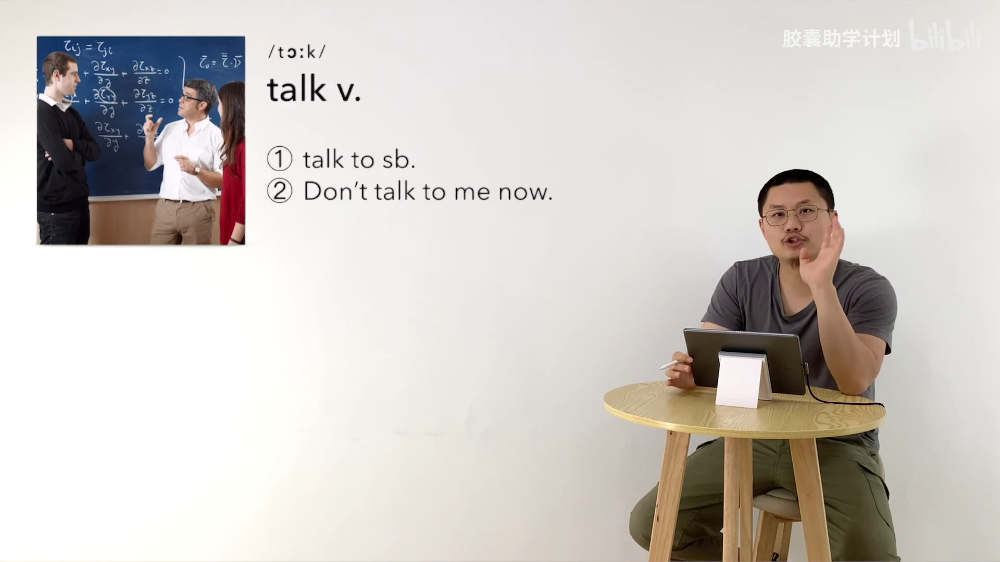

文字识别：胶囊助学计划 / Cij= \ji / /to:k/ / $\=$\\ra$ / ∂{xy$ / ∂2x2=0 / $at$ / tallk v. / $ / ① talk to sb. / ) Don't talk to me now.

### 画面 00:03:11

文字识别：胶囊助学计划 / Cij= \ji / /to:k/ / $\=\\fr$ / ∂2x2=0 / $at$ / talk v. / $ / ① talk to sb. / Don't talk to me now. / 2 / ③ I'm gonna talk to him.

### 画面 00:03:15

文字识别：胶囊助学计划 / Cij= \ji / /to:k/ / $\=$\.\a$ / ∂2x2=0 / $at$ / talk v. / $2{4=0$ / $ / y / ① talk to sb. / ② Don't talk to me now. / 2 / ③ I'm gonna talk to him.

### 画面 00:03:18

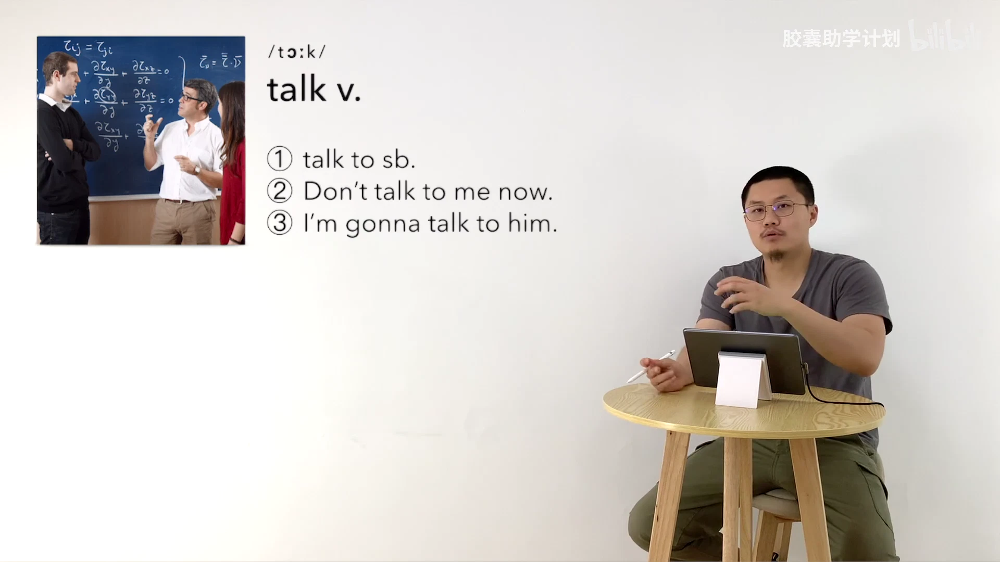

文字识别：胶囊助学计划 / Cij= \ji / /to:k/ / ∂{x2=0 / $\=\{\a$ / $at$ / talk v. / 3{42=0 / $$ / ① talk to sb. / ② Don't talk to me now. / ③ I'm gonna talk to him.

### 画面 00:03:21

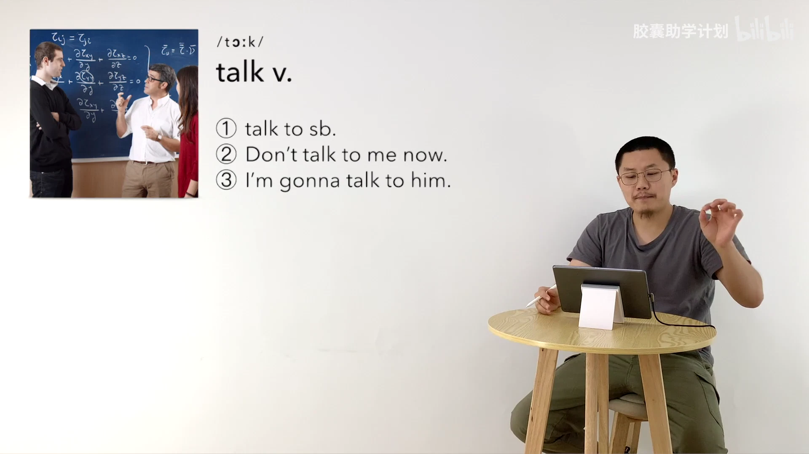

文字识别：胶囊助学计划 / Cij= \ji / /to:k/ / $\=\\a$ / ∂{xy}$ / ∂{x2=0 / talk v. / 2{42=0 / $ / ① talk to sb. / ② Don't talk to me now. / 2 / ③ I'm gonna talk to him.

### 画面 00:03:25

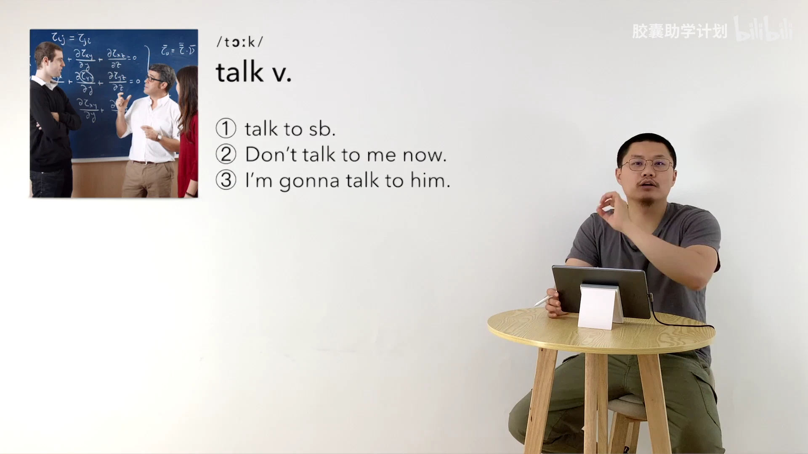

文字识别：胶囊助学计划 / Cij= \ji$ / /to:k/ / ∂{xy$ / ∂{x2=0 / $\=$\.\$ / at / talk v. / $2{42=0$ / $ / ① talk to sb. / ② Don't talk to me now. / 2） / ③ I'm gonna talk to him.

### 画面 00:03:28

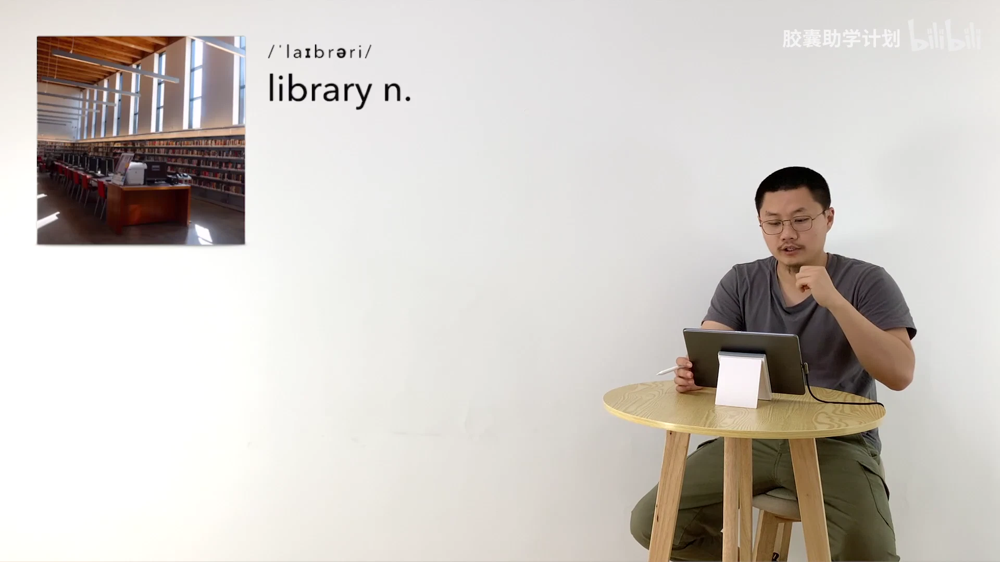

文字识别：胶囊助学计划 / /'laibrari/ / library n. / 20

## 00:03:30–00:04:00

位记住啊。接下来一个小的单词也比较常见，叫做 library library啊，图书馆。图书馆名词最常见的一个小的短语叫 go to the library，叫做去图书馆。好，比如说 he goes to the library on Sundays.啊，在周日啊，他一般就会去图书馆。你看这是个什么时态啊？On Sundays，在不是一个周日，是很多个

### 画面 00:03:31

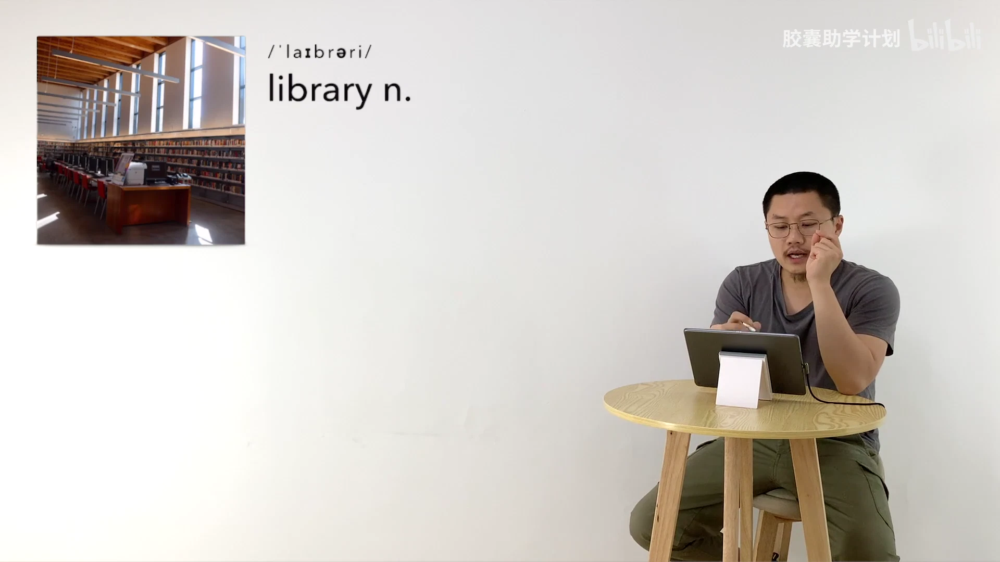

文字识别：胶囊助学计划 / /'laibrari/ / library n.

### 画面 00:03:46

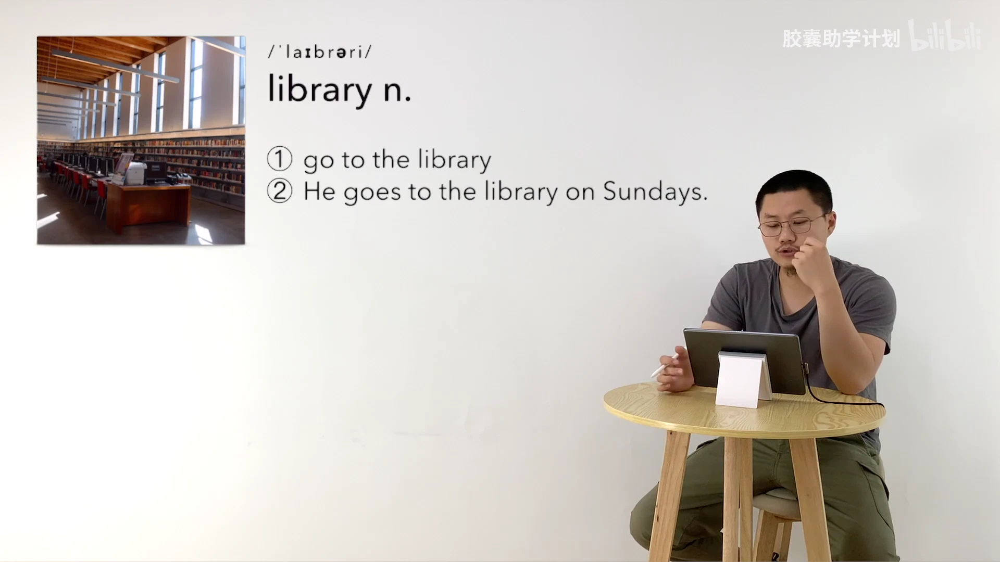

文字识别：胶囊助学计划 / /'laibrari/ / library n. / ① go to the library / He goes to the library on Sundays.

## 00:04:00–00:04:30

周日。只要是周日，他就去。一种生活习惯，一般现在时。于是用的是 go 的第三人称单数 goes，对吧？我们早在五十五课、五十七课就见过很多次 go 的第三人称单数了。那把它想变一般疑问句， does 提前，叫 Does he go to the library on Sundays？一般疑问句出来了，你看是不是各种什么特殊疑问句就有了？ Who，对吧？啊， When，啊， Where，是不是都可以有了？我

### 画面 00:04:16

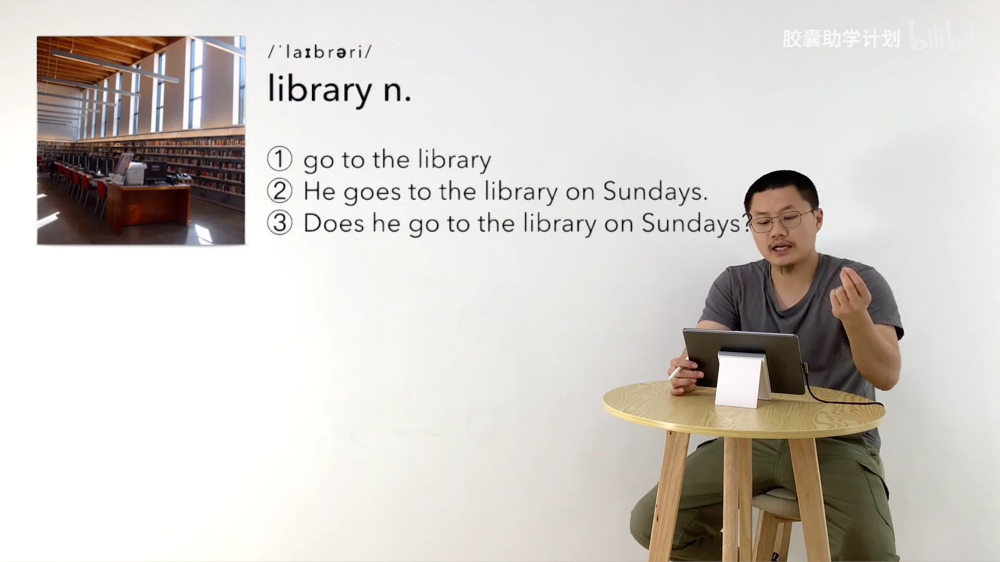

文字识别：胶囊助学计划 / /'laibrari/ / library n. / ① / go to the library / He goes to the library on Sundays. / Does he go to the library on Sundays?

### 画面 00:04:22

文字识别：胶囊助学计划 / /'laibrari/ / library n. / ① / go to the library / He goes to the library on Sundays. / Does he go to the library on Sundays?

## 00:04:30–00:05:00

们给大家几个例子，各位张嘴跟我读就行了啊。来，When does he go to the library？以及Where does he go on Sundays？Very good.下一个单词，张嘴跟我读，drive，drive。好，你看第二啊，dr对吧？然后v这个字母发的是v啊，drive开车。比如说drive my car，这就是一个小短语，叫开我的车，对吧？好，比如

### 画面 00:04:33

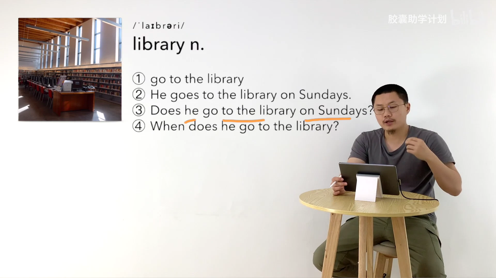

文字识别：胶囊助学计划 / /'laibrari/ / library n. / ① / go to the library / He goes to the library on Sundays. / Does he go to the library on Sundays? / When does he go to the library?

### 画面 00:04:38

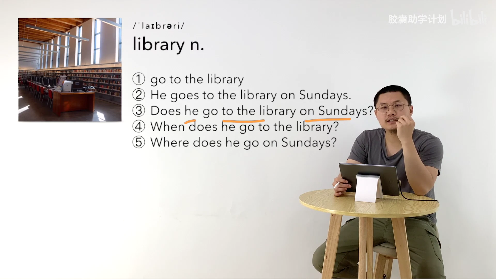

文字识别：胶囊助学计划 / /'laibrari/ / library n. / 1 / go to the library / He goes to the library on Sundays. / Does he go to the library on Sundays? / When does he go to the library? / Where does he go on Sundays? / 5

### 画面 00:04:42

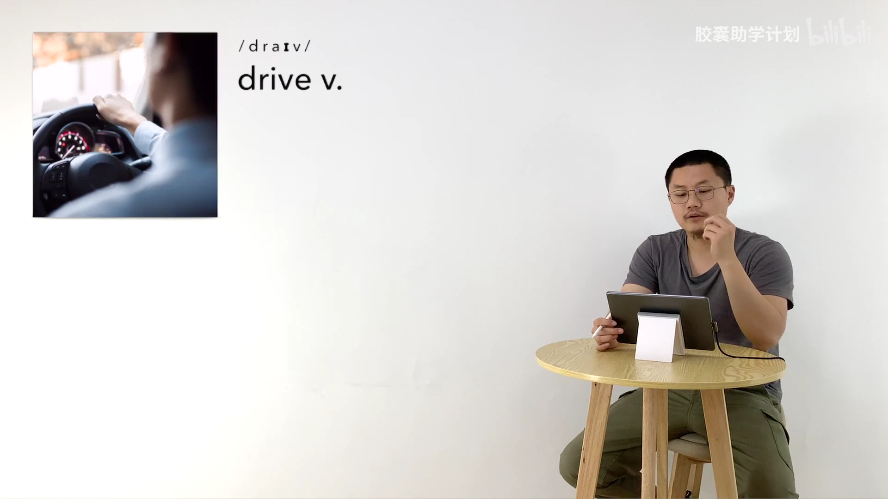

文字识别：胶囊助学计划 / /draiv/ / drive v.

### 画面 00:04:54

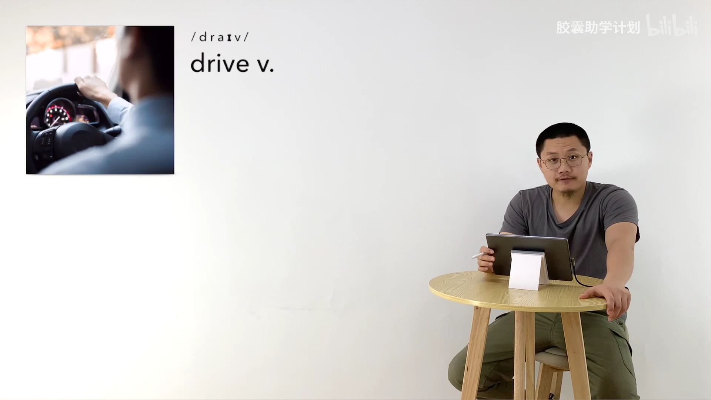

文字识别：胶囊助学计划 / /draiv/ / drive v.

### 画面 00:04:59

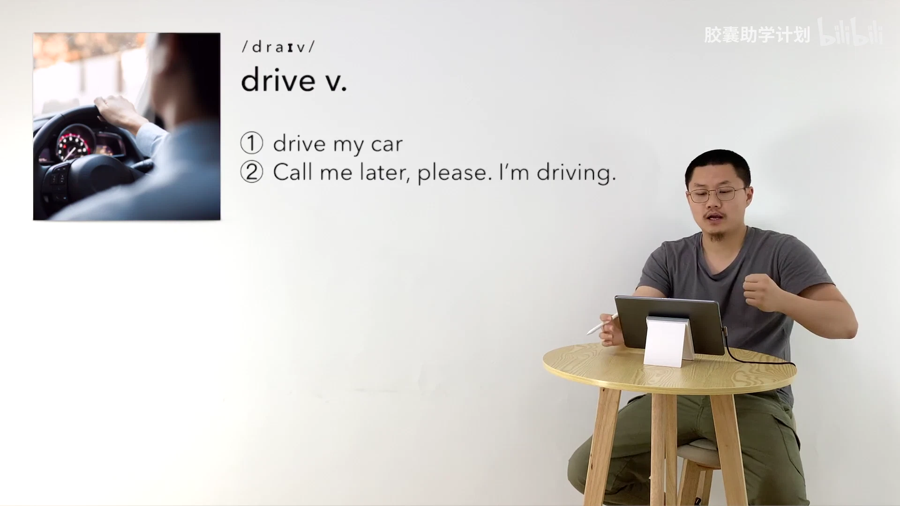

文字识别：胶囊助学计划 / /draiv/ / drive V. / ① drive my car / ) Call me later, please.I'm driving.

## 00:05:00–00:05:30

说 call me later, please. I'm driving. 你能不能稍后给我打？叫 call me，这是我们刚刚学过的一个小的短语，叫给我打个电话。那 later 多了一个小单词，给大家补充一下，就是稍后啊。那 call me later 叫稍后给我打电话，拜托了。 I'm driving. 我现在正在开车呢，对不对？好，以及我们可以用 can 呢？说 you can drive my car to school. 你今天你能开我的车去学校，对吧？你 you're in a hurry. 啊，你现在不是

### 画面 00:05:10

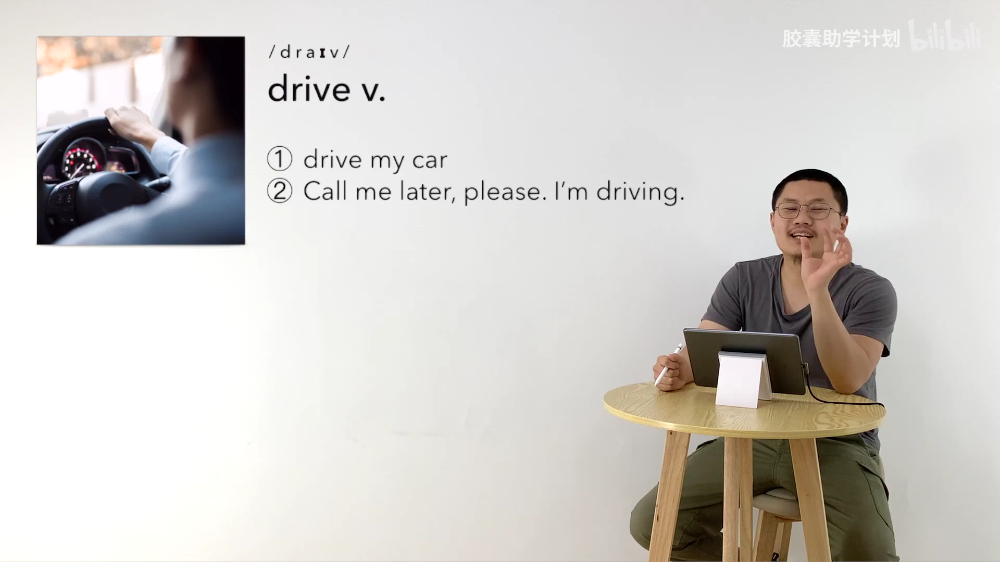

文字识别：胶囊助学计划 / CS / /draiv/ / drive v. / ① drive my car / ) Call me later, please. I'm driving.

### 画面 00:05:18

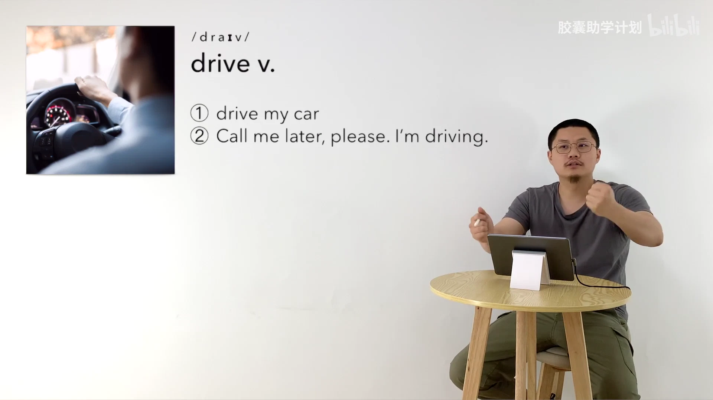

文字识别：胶囊助学计划 / /draiv/ / drive V. / ① drive my car /  Call me later, please. I'm driving.

## 00:05:30–00:06:00

着急吗？你能开我的车去学校？OK.接下来两个小的ADV点儿，我们到七十三课、七十四课会重点去讲解副词。今天各位只要知道ADV点儿表示的是副词就够了。So叫做如此地，quickly叫做快地，对吧？如此地快，两个单词可以放在一起叫so quickly，如此的快。比如说，You are driving so quickly.你现在这车开

### 画面 00:05:33

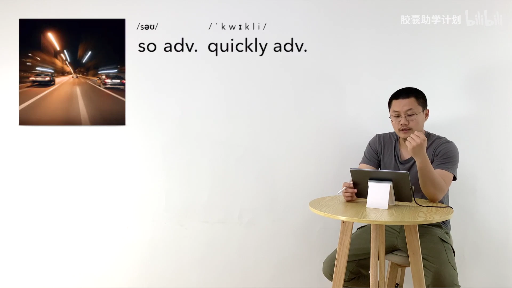

文字识别：胶囊助学计划 / /sau/ / / 'kwIkli/ / so adv. quickly adv. / /

### 画面 00:05:35

文字识别：胶囊助学计划 / /sau/ / / 'kwIkli/ / so adv. quickly adv.

### 画面 00:05:40

文字识别：胶囊助学计划 / /sau/ / / ^kwIkli/ / so adv. quickly adv.

### 画面 00:05:45

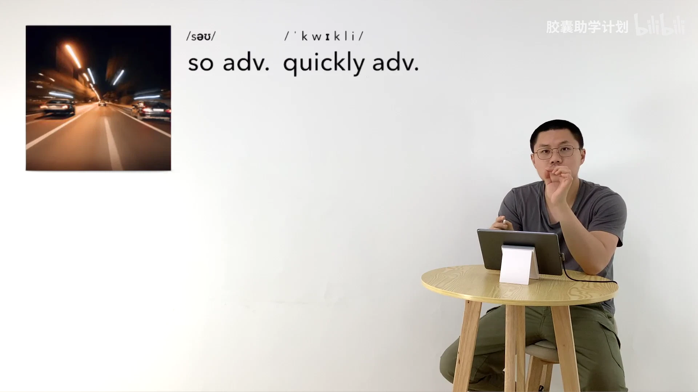

文字识别：胶囊助学计划 / /sau/ / / 'kwIkli/ / so adv. quickly adv.

### 画面 00:05:51

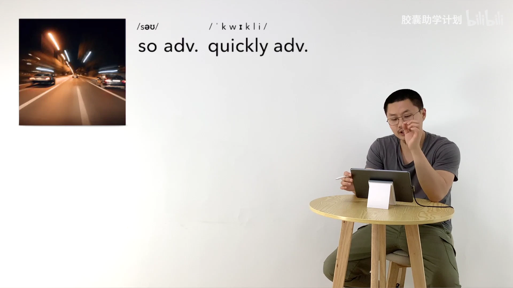

文字识别：胶囊助学计划 / /sau/ / /'kwIkli/ / so adv. quickly adv.

### 画面 00:05:55

文字识别：胶囊助学计划 / /sau/ / / 'kwikli/ / so adv. quickly adv.

### 画面 00:05:58

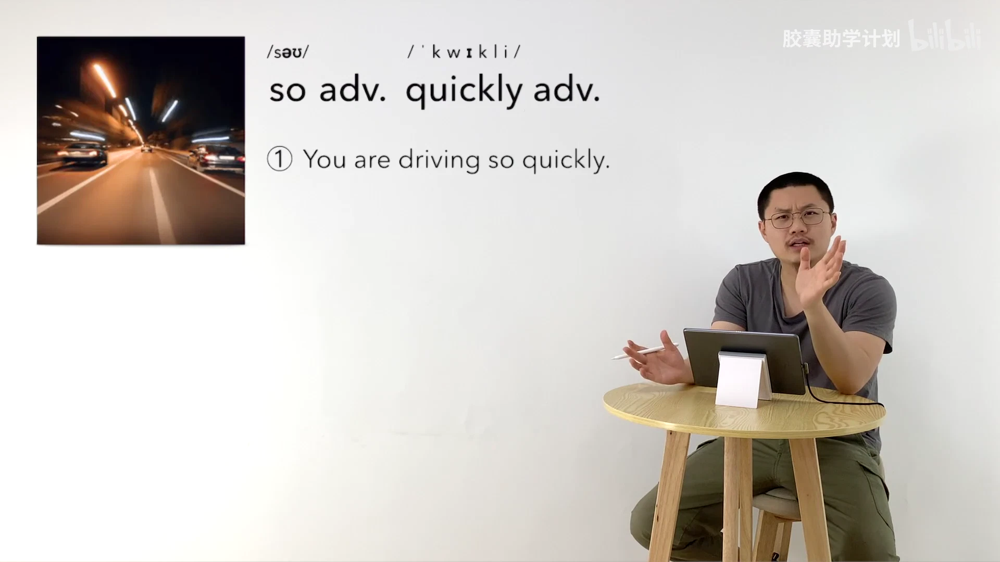

文字识别：胶囊助学计划 / /sau/ / / ' k wIk li/ / so adv. quickly adv. / ① You are driving so quickly.

## 00:06:00–00:06:30

的太快了。Slow down, 慢下来，对吧？Slow down. Oh, sorry, D O W N. 啊，Slow down, 稍微慢下来。Please slow down. Okay. 那 Don't drive so quickly. 叫不要开的如此的快啊，而不是说禁止开的如此的快，对吧？啊，当然了，如果是换成交警，那可能就不跟你商量了。Mustn't, 就直接开罚单了。

### 画面 00:06:00

文字识别：胶囊助学计划 / /sau/ / / ^kwIkli/ / so adv. quickly adv. / ① You are driving so quickly.

### 画面 00:06:05

文字识别：胶囊助学计划 / /sau/ / /'kwikli/ / so adv. quickly adv. / ① You are driving so quickly. / Sl

### 画面 00:06:07

文字识别：胶囊助学计划 / /sau/ / / ' kwIkli/ / so adv. quickly adv. / ① You are driving so quickly. / Sl / ow / don

### 画面 00:06:09

文字识别：胶囊助学计划 / /sau/ / / 'kwIkli / / so adv. quickly adv. / ① You are driving so quickly. / Sl / ow

### 画面 00:06:11

文字识别：胶囊助学计划 / /sau/ / / 'kwIkli/ / so adv. quickly adv. / ① You are driving so quickly. / Sl / ow / down

### 画面 00:06:14

文字识别：/sau/ / / 'kwIkli/ / so adv. quickly adv. / ① You are driving so quickly. /  Please slow down. / Sl / ow / aown

### 画面 00:06:16

文字识别：胶囊助学计划 / /sau/ / / 'kwikli/ / so adv. quickly adv. / ① You are driving so quickly. / Please slow down. / Don't rive og / aown室

### 画面 00:06:19

文字识别：胶囊助学计划 / /sau/ / /'kwIkli/ / so adv. quickly adv. / ① You are driving so quickly. / Please slow down. / Don't rive o ck / aown经

### 画面 00:06:22

文字识别：胶囊助学计划 / /sau/ / /'kwIkli/ / so adv. quickly adv. / ① You are driving so quickly. / Please slow down. / Don't rive so ky / Cowne

### 画面 00:06:25

文字识别：/sau/ / / 'kwIkli/ / so adv. quickly adv. / ① You are driving so quickly. / Please slow down. /  Don't rive so gdk / aown

### 画面 00:06:27

文字识别：胶囊助学计划 / /sau/ / / 'kwIkli/ / so adv. quickly adv. / ① You are driving so quickly. / Please slow down. / Don't drive so quickly. / 3

## 00:06:30–00:07:00

Okay, next one叫做lean out of lean这个单词指的是倚靠啊，或者说我们说，当然它也有探出，在这个地方lean out of就倚靠出嘛，对吧？那就是探出了。好，比如说Look, they are leaning out of the window.瞧，他们正在探出窗外. It's dangerous.啊，非常的危险。于是我们就可以说Don't lean out of the window.不要倚靠出这个

### 画面 00:06:30

文字识别：胶囊助学计划 / lean out of

### 画面 00:06:34

文字识别：胶囊助学计划 / lean out of

### 画面 00:06:37

文字识别：胶囊助学计划 / lean out of

### 画面 00:06:45

文字识别：胶囊助学计划 / lean out of / ① Look, they are leaning out of the / window.

### 画面 00:06:55

文字识别：胶囊助学计划 / lean out of / ① Look, they are leaning out of the / window. / Don't lean out of the window.

## 00:07:00–00:07:30

窗户，OK？那你看现在我们的这个动车已经没有这个机会，你自己再去打开这个窗户了，对吧？但是原来绿皮车火车的这个时代还是能打开这个窗户的，对吧？那这个时候列车员可能看到你，如果把身体探出去了，那他说的可能就不是 don't， mustn't，对吧？呃，他的身份在那儿表示，当然他也可以用 don't，对吧？提醒你一下，接下来我们看一个小的电影片段，他就讲述了一个小的故

### 画面 00:07:11

文字识别：胶囊助学计划 / lean out of / ① Look, they are leaning out of the / window. / Don't lean out of the window.

### 画面 00:07:22

文字识别：胶囊助学计划 / lean out of / ① Look, they are leaning out of the / window. / Don't lean out of the window.

### 画面 00:07:25

文字识别：than hawke / julie d / Can the greatest romance of your life / last only one night? / BEFORE / SUNRISE / lean out of ... / A Richard Linklater Film / 爱在黎明破晓前Before Sunrise(1995) / ATTHEATER

### 画面 00:07:27

文字识别：than hawke / julie d / Can the greatest romance of your life / last only one night? / BEFORE / SUNRISE / lean out of ... / A Richard Linklater Film / 爱在黎明破晓前Before Sunrise(1995) / ATTHEATER

## 00:07:30–00:08:00

事，就用到了叫做 lean out of，叫做探出窗外。 Well, I was driving around with this buddy of mine. He's a big atheist. We came to a stop next to this homeless guy. My buddy takes that hundred dollar bill. He leans out the window and he says, "Do you believe in God?" The guy looks at looks at my friend. He looks at the money. He says, "Yes, I do."

### 画面 00:07:30

文字识别：than hawke / julie d / 胶囊助学计划 / Can the greatest romance of your life / last only one night? / BEFORE / SUNRISE / lean out of ... / A Richard Linklater Film / 爱在黎明破晓前 Before Sunrise(1995) / AT THEATER

### 画面 00:07:32

文字识别：than hawke / julie d / 胶囊助学计划 / Can the greatest romance of your life / last only one night? / BEFORE / SUNRISE / lean out of ... / A Richard Linklater Film / 爱在黎明破晓前Before Sunrise(1995) / ATTHEATER / /

### 画面 00:07:35

文字识别：bilibili / 胶囊助学计划 / 我曾经跟一个哥们开车兜风 / Well, I was driving around with this buddy of mine,

### 画面 00:07:37

文字识别：bilibili / 胶囊助学计划 / 我曾经跟一个哥们开车兜风 / Well, I was driving around with this buddy of mine,

### 画面 00:07:39

文字识别：bilibili / 胶囊助学计划 / 他是个无神论者 / he was a big atheist,

### 画面 00:07:41

文字识别：bilibili / 胶囊助学计划 / 我们停在了一个流浪汉旁边 / and we came to a stop, next to this homeless guy.

### 画面 00:07:43

文字识别：bilibli / 胶囊助学计划 / 我哥们掏出了一百美元 / And my buddy takes out a 100 dollar bill,

### 画面 00:07:45

文字识别：bilibli / 胶囊助学计划 / 伸出车窗外 / and leans out the window,

### 画面 00:07:47

文字识别：bilibli / 胶囊助学计划 / 然后说"你相信上帝吗 / and he says, 'do you believe in God?'

### 画面 00:07:51

文字识别：Bilbli / 胶囊助学计划 / 那个流浪汉看了看我的朋友 / And the guy looks at, uh, he looks at my friend,

### 画面 00:07:53

文字识别：bilbili / 胶囊助学计划 / 那个流浪汉看了看我的朋友 / And the guy looks at, uh, he looks at my friend,

### 画面 00:07:55

文字识别：Bilibili / 胶囊助学计划 / 💖

### 画面 00:07:57

文字识别：Bilbili / 胶囊助学计划 / 💖 / 他说 / he says, uh,

### 画面 00:07:59

文字识别：bilbili / 胶囊助学计划 / 我的朋友说"答错了”我们就开走了 / My friend says, 'Wrong answer.' And we drove away.

## 00:08:00–00:08:30

My friend's wrong answer. Throw away. That's me. No. Yeah. Okay. Lean out of the window, is吧？探出窗外。来一个。好，下一个单词是一个小的动词，以后我们会经常不停的见到这个动词，叫做 break，叫做打碎啊，或者敲碎，或者弄折弄坏啊。比如说 break the window，那你就是把玻璃弄碎了，或者说 break my arm，叫把我的胳

### 画面 00:08:01

文字识别：Bilibli / 胶囊助学计划 / 我的朋友说"答错了”我们就开走了 / My friend says, 'Wrong answer.' And we drove away.

### 画面 00:08:03

文字识别：Bilbili / 胶囊助学计划

### 画面 00:08:05

文字识别：Bilibili / 胶囊助学计划 / 太恶毒了 / That's mean.

### 画面 00:08:07

文字识别：Bilibili / 胶囊助学计划 / 没错 / Yeah.

### 画面 00:08:09

文字识别：than hawke / julie d / 胶囊助学计划 / Can the greatest romance of your life / last only one night? / BEFORE / SUNRISE / lean out of ... / A Richard Linklater Film / 爱在黎明破晓前 Before Sunrise(1995) / AT THEATER

### 画面 00:08:11

文字识别：胶囊助学计划 / /breik/ / break v. + n.

### 画面 00:08:13

文字识别：胶囊助学计划 / /breik/ / break v. + n.

### 画面 00:08:17

文字识别：胶囊助学计划 / /breik/ / break v. + n.

### 画面 00:08:29

文字识别：胶囊助学计划 / /breik/ / break v. + n. / ① break the window / ② break my arm

## 00:08:30–00:09:00

膊弄折了。OK，好。说Are you going to break that window?你要把那个窗户弄碎吗？Are you going to break that window?记住这个小的单词，再跟我读一遍，break。OK，好。接下来是一个小的名词，有一个双元音，noise，连起来读noise。孙杨，你看变化还是挺大的。Noise，where you go，就是声音啊。那make a noise

### 画面 00:08:32

文字识别：胶囊助学计划 / /breik/ / break v. + n. / ① break the window / ② break my arm / Are you going to break that / 3 / window?

### 画面 00:08:35

文字识别：胶囊助学计划 / /breik / break v. + n. / ① break the window / ② break my arm / Are you going to break that / 3 / window?

### 画面 00:08:45

文字识别：胶囊助学计划 / noise n.

### 画面 00:08:58

文字识别：胶囊助学计划 / /no1z/ / noise n. / D

## 00:09:00–00:09:30

啊，声音噪音其实更多的像那 make a noise 叫做弄出声响。注意这儿的 make 是一个动词啊，你翻译成制作可能就不太好了，对吧？制作出声响啊，别发声，别弄出声响啊。 Okay，那 don't make a noise 叫别制造啊，别弄出来任何的声响啊。嘘，就是这个动作。其实，我们接下来做一些小的口语练习，这些练习当中全是如此的。我们会把 don't

### 画面 00:09:08

文字识别：胶囊助学计划 / /noⅠz1 / noise n. / V / make a noise

### 画面 00:09:23

文字识别：胶囊助学计划 / take any aspirins / D

### 画面 00:09:26

文字识别：胶囊助学计划 / take any aspirins

### 画面 00:09:28

文字识别：胶囊助学计划 / take any aspirins / ① Don't take any aspirins! / You mustn't take any aspirins.

## 00:09:30–00:10:00

don't 跟 mustn't 放在一起。上面的语气都是稍微不是那么强烈的，而笔下的语气都非常的强烈，都类似于禁止，甚至或者比禁止稍微淡一点点。但一般我们不用。初期各位多用 don't 就好了，只要知道 mustn't 是什么意思就够了，好吧？张嘴跟我读啊！这个阶段，来，don't take any aspirins. You mustn't take any aspirins.

### 画面 00:09:58

文字识别：胶囊助学计划 / take any aspirins / ①Don't take any aspirins! / You mustn't take any aspirins.

## 00:10:00–00:10:30

one, don't take this medicine. You mustn't take this medicine. You mustn't禁止吃. Okay, very good. Continue. Don't call the doctor. You mustn't call the doctor.你禁止给医生打电话。你看啊，不知道各位看没看过这样的电影？我们还是要因为mustn't啊，一定要是配合场景你才能明白的。我们尝试去讲几个啊，比如说你想一下这个电影片段，

### 画面 00:10:01

文字识别：胶囊助学计划 / take this medicine / ① Don't take this medicine!

### 画面 00:10:10

文字识别：胶囊助学计划 / call the doctor

### 画面 00:10:17

文字识别：胶囊助学计划 / call the doctor / ① Don't call the doctor! / 2 / ② You mustn't call the doctor.

## 00:10:30–00:11:00

呃，比如说有的一些电影表表演抢银行，对吧？然后枪战，然后呢被打伤了。这个时候呢，然后他说：“哎呀，你这个再再不叫医生叫叫没了人，对吧？那也不能打，你打了就可能永远就进去了，对吧？”所以说，你禁止给医生打电话。不知道各位看没看过这样的电影场景啊？叫做禁止给医生打电话。Continue.来，Don't play with matches. You mustn't play with matches.

### 画面 00:10:47

文字识别：胶囊助学计划 / call the doctor / ① Don't call the doctor! / ② You mustn't call the doctor. / /

### 画面 00:10:51

文字识别：胶囊助学计划 / call the doctor / ① Don't call the doctor! / ② You mustn't call the doctor. / 2

### 画面 00:10:53

文字识别：胶囊助学计划 / play with matches / ① Don't play with matches!

## 00:11:00–00:11:30

Don't talk in the library. You mustn't talk in the library. 你想一下，这回谁跟你说 mustn't talk in the library，是吧？可能就是图书管理员了。 Okay. Don't make noise. Shh. You mustn't make noise. Continue. Don't drive so quickly. 别开这么快. You mustn't drive so quickly. Next one.

### 画面 00:11:00

文字识别：胶囊助学计划 / talk in the library / ① Don't talk in the library!

### 画面 00:11:14

文字识别：胶囊助学计划 / make a noise

### 画面 00:11:21

文字识别：胶囊助学计划 / drive so quickly

### 画面 00:11:23

文字识别：胶囊助学计划 / drive so quickly / ① Don't drive so quickly!

### 画面 00:11:26

文字识别：胶囊助学计划 / drive so quickly / ① Don't drive so quickly! / You mustn't drive so quickly.

### 画面 00:11:29

文字识别：胶囊助学计划 / lean out of / ① Don't lean out of the window!

## 00:11:30–00:12:00

don't lean out of the window. You mustn't lean out of the window. Next one, don't break that vase. You mustn't break that vase. Ah, you go.好了, recap本课底下这些小的短语还真都算本课比较重要的一些表达，能极大的拓展我们的表达维度啊。他们大多数都能和我们之前学过的那些大

### 画面 00:11:37

文字识别：胶囊助学计划 / break that vase / ① Don't break that vase!

### 画面 00:11:44

文字识别：Recap / 胶囊助学计划 / Patterns / Don'tv. / You mustn't v. / Grammar / Words / play with / sb. / play / with / matches / talk to sb. / Expression / talk / with / sb. / go to the / library / lean out of

### 画面 00:11:48

文字识别：胶囊助学计划 / Recap / Patterns / Don'tv. / You mustn't v. / Grammar / Words / play / /with / sb. / play / with / matches / talk / to sb. / Expression / tallk / with / sb. / go to the / library / leanout / of

### 画面 00:11:50

文字识别：胶囊助学计划 / Recap / Patterns / Don'tv. / You / mustn't v. / Grammar / Words / play / with / sb. / play / with / matches / talk / to sb. / Expression / tallk / with / sb. / go to / the / library / leanout / of

### 画面 00:11:52

文字识别：胶囊助学计划 / Recap / Patterns / Don'tv. / You mustn't v. / Grammar / Words / play / with / sb. / play / with / matches / talk / to sb. / Expression / tallk / with / sb. / go to / the / library / leanout / of

## 00:12:00–00:12:30

的结构 be doing 啊 can 啊，包括我们刚刚学过的 must 啊 be going to do 啊 be going to do 啊 be going to do 啊这些大的结构 do does 啊联系起来造句，你能造出来非常多的句子。那本课的关键练习练的就是 must 的否定 don't 和 mustn't。 OK，家庭作业首先六十四课各位可以去写了单词造句，各位可以开始了，然后给自己讲解一遍今天的核心知识点。那如果大家喜欢我们的课程呢，欢

### 画面 00:12:08

文字识别：胶囊助学计划 / Recap / Patterns / Don'tv. / You mustn't v. / Grammar / Words / play / with / sb. / play / with / matches / talk / to sb. / Expression / tallk / with / sb. / go to / the / library / leanout / of

### 画面 00:12:13

文字识别：胶囊助学计划 / Recap / Patterns / Don'tv. / You / mustn't v. / Grammar / Words / play / with / sb. / play / with / matches / talk / to / sb. / Expression / tallk / with / sb. / go to / the / library / lean out / of

### 画面 00:12:15

文字识别：胶囊助学计划 / Recap / Patterns / Don'tv. / You / mustn't v. / Grammar / Words / play / with / sb. / play / with / matches / talk / to / sb. / Expression / tallk / with / sb. / go to / the / library / lean out / of

### 画面 00:12:18

文字识别：胶囊助学计划 / 专

### 画面 00:12:27

文字识别：胶囊助学计划 / 专 / D

## 00:12:30–00:12:57

迎大家关注、订阅、一键三连，分享给那些需要的朋友来支持我们。最后，我们再来看一句名人名言：All work and no play makes Jack a dull boy. See you next time.

### 画面 00:12:36

文字识别：胶囊助学计划 / All work and no play makes Jack a dull boy. / anonymous

### 画面 00:12:41

文字识别：胶囊助学计划 / All work and no play makes Jack a dull boy. / -anonymous

### 画面 00:12:45

### 画面 00:12:47

文字识别：CAPSULEACADEMY / 胶囊助学计划 / 小红书 / Lecturer / Leo / OE

### 画面 00:12:50

文字识别：CAPSULEACADEMY / 胶囊助学计划 / 小红书 / □ / Editor / OE

### 画面 00:12:53

文字识别：CAPSULEACADEMY / 胶囊助学计划 / 小红书 / Creator / 回 / Leo & Berlin / OE

### 画面 00:12:55

文字识别：BiliBili / 胶囊助学计划 / 足品 / 小红书 / 1

### 画面 00:12:57

文字识别：bilibili / 胶囊助学计划

