# 065 单词 文章

快速机器解析：语音为单模型转写，未进行独立交叉校对或人工复核；画面每秒采样并按变化选帧，短时文字和标记可能遗漏。截图时间约有 1 秒误差。图片有损压缩；遇到疑点请按时间查看 Google Drive 原视频。

## 00:00:00–00:00:30

Hello everyone, welcome to Capsule Academy. This is Leo. Today we are going to learn new concept English Book One Lesson Sixty Five Words and Story. 那老习惯进入正式课程之前，我们先看几个小的问题。第一，如何用英文去表达你能听见我说话吗？OK。第二，如何表达玩的很开心？带着这两个问题，Hope you gonna enjoy it. 好，我们先看本课的两

### 画面 00:00:00

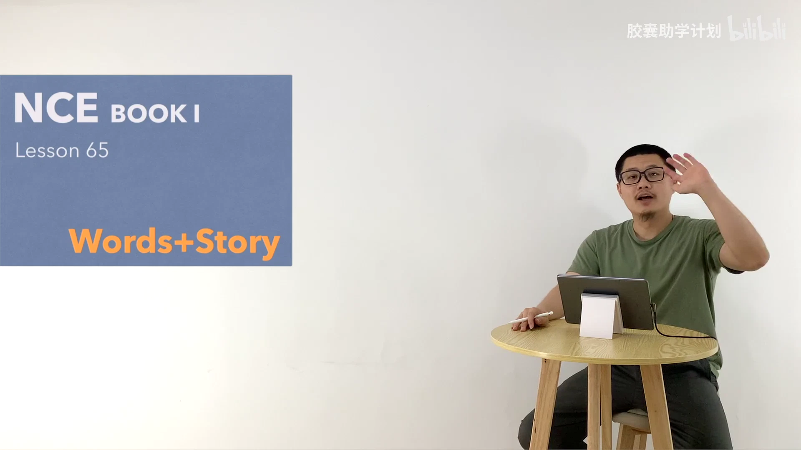

文字识别：胶囊助学计划 / NCE / BOOKI / Lesson 65 / Words+Story

### 画面 00:00:08

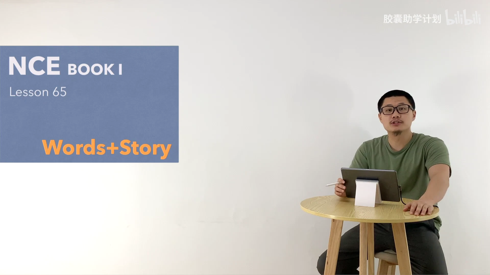

文字识别：胶囊助学计划 / NCE / BOOKI / Lesson 65 / Words+Story

### 画面 00:00:10

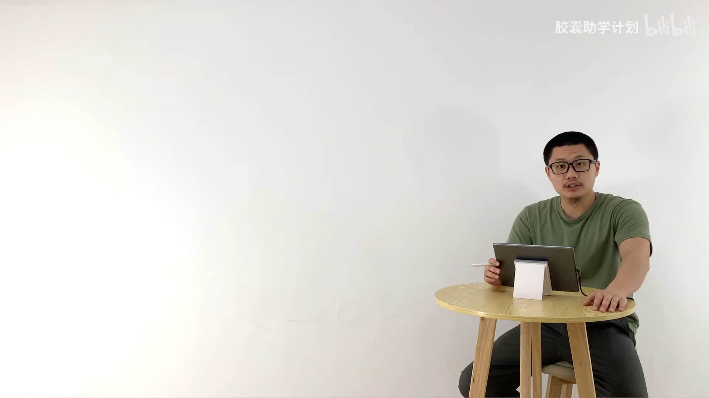

文字识别：胶囊助学计划

### 画面 00:00:12

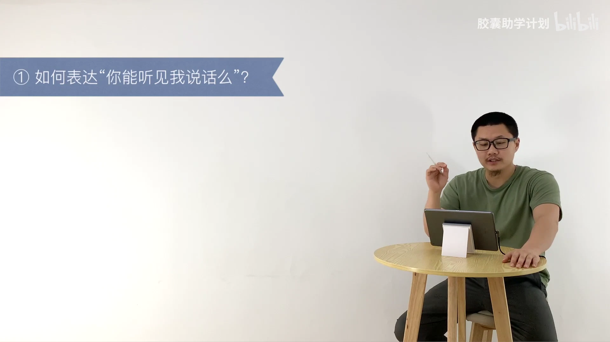

文字识别：胶囊助学计划 / ①如何表达“你能听见我说话么”?

### 画面 00:00:17

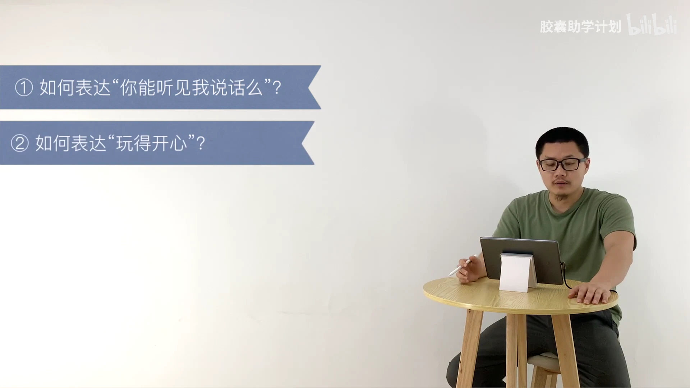

文字识别：胶囊助学计划 / ①如何表达“你能听见我说话么”? / 如何表达“玩得开心”?

### 画面 00:00:22

文字识别：胶囊助学计划 bilbl

### 画面 00:00:26

文字识别：胶囊助学计划

### 画面 00:00:28

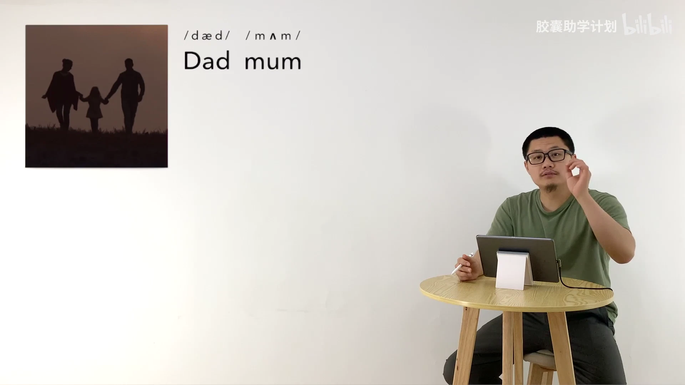

文字识别：胶囊助学计划 / /dæed/ /mΛm/ / Dad mum

## 00:00:30–00:01:00

个儿童用语是吧？两个小单词，一个叫 dad，一个叫 mom。它其实是 father 和 mother 的一个比较随意的，并且相对来说是比较儿童化的一个用语啊，妈爸啊，就有点像咱们汉语当中这么说啊。那 dad 这个单词很有意思，我们在文章当中啊，各我们在我们的教材当中，这个 dad 这个 d 它给大写了，我在这儿尊重它，也给大写了，对吧？但实

### 画面 00:00:31

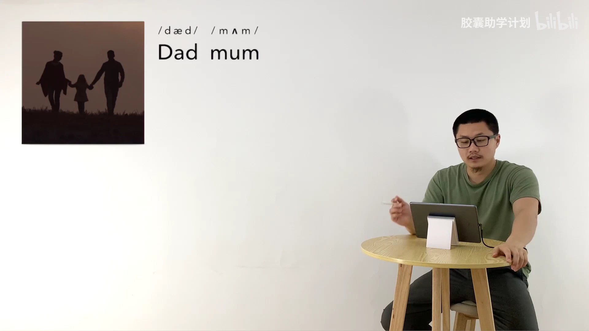

文字识别：胶囊助学计划 / /dæd/ /mΛm/ / Dad mum

### 画面 00:00:36

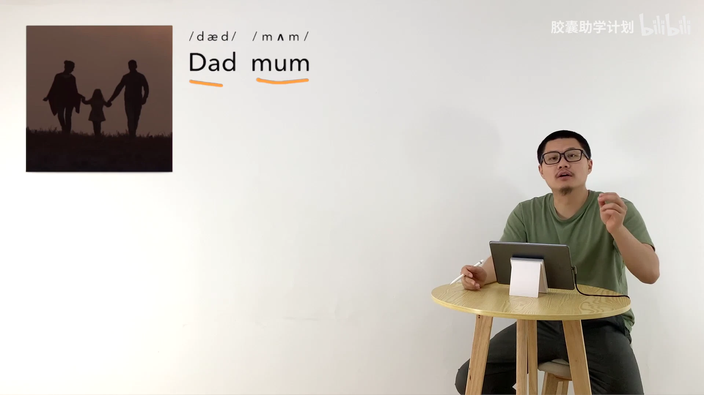

文字识别：胶囊助学计划 / /dæed/ /mΛm/ / Dad mum

### 画面 00:00:41

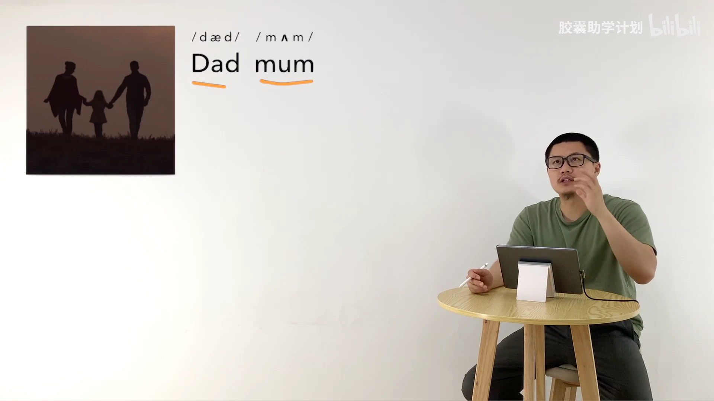

文字识别：胶囊助学计划 / /dæed/ /mΛm/ / Dad mum

### 画面 00:00:47

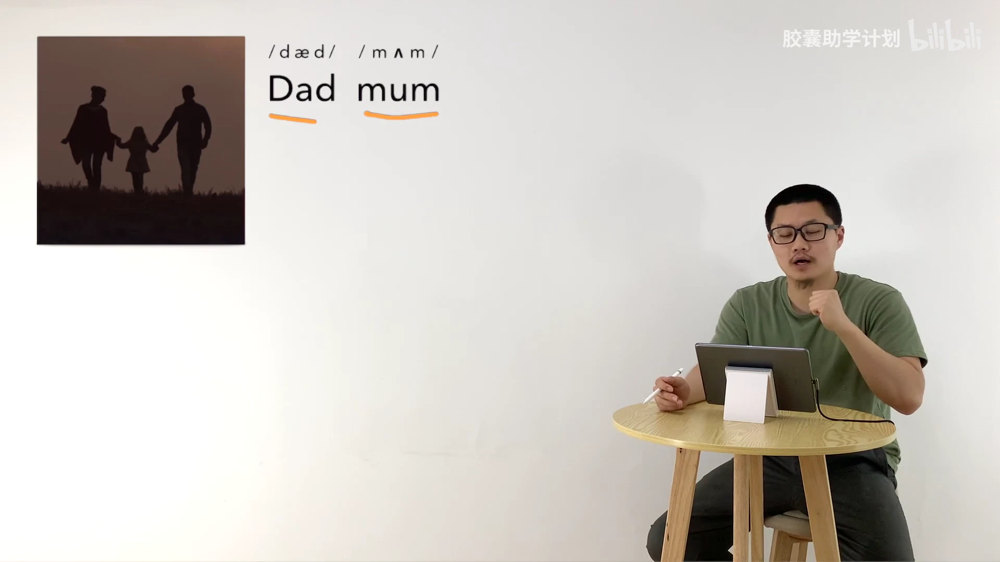

文字识别：胶囊助学计划 / /dæed/ /mΛm/ / Dad mum

### 画面 00:00:49

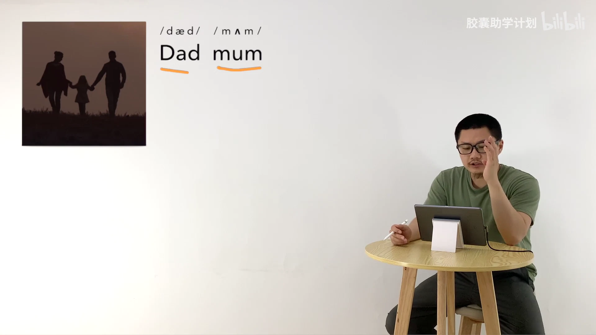

文字识别：胶囊助学计划 / /dæd/ /mΛm/ / Dad mum

### 画面 00:00:51

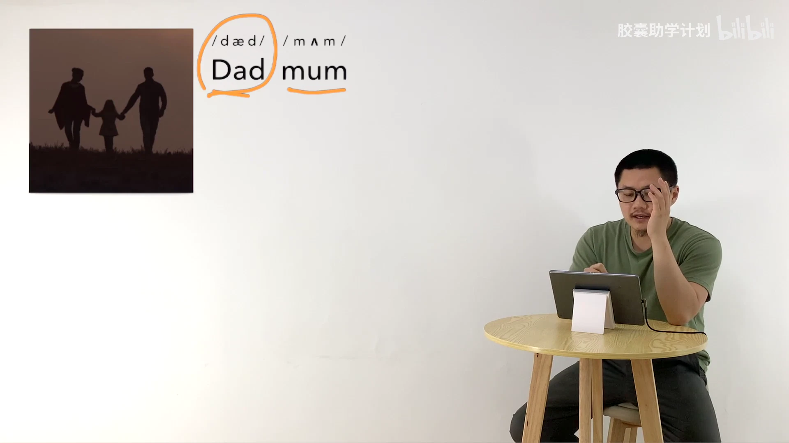

文字识别：胶囊助学计划 / / d æe d/ / 1mΛm1 / Dad / mum

## 00:01:00–00:01:30

际上各位要知道的是，我们去真正啊，首先它在大多数情况下在口语当中而不会写出来，这是第一件事儿。第二，就算它写出来，一般可能也不是文章当中啊，也可能是什么状态。比如说，我们给别人发一封发一个短信啊，这个短信当中用到了 D， OK，那这个 D 是可以不用大写的。虽然我们的书中给了大写，但是各位要注意啊，这是可以不大写的。 OK，好，那既然是妈妈爸爸，我们就拿他们造一

### 画面 00:01:00

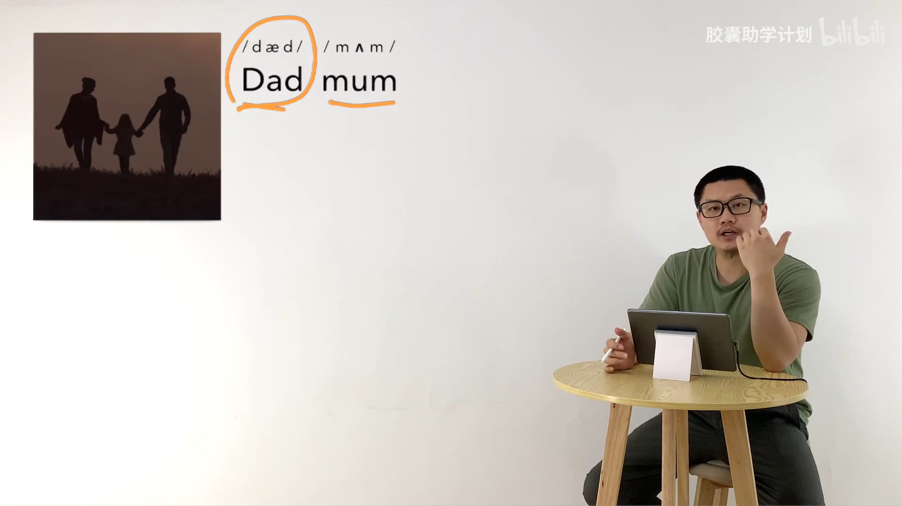

文字识别：胶囊助学计划 / / d æd/ / /mΛm/ / Dad / mum

### 画面 00:01:03

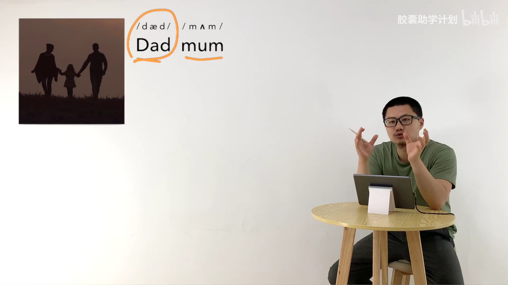

文字识别：胶囊助学计划 / / d æd/ / 1mΛm/ / Dad / mum

### 画面 00:01:05

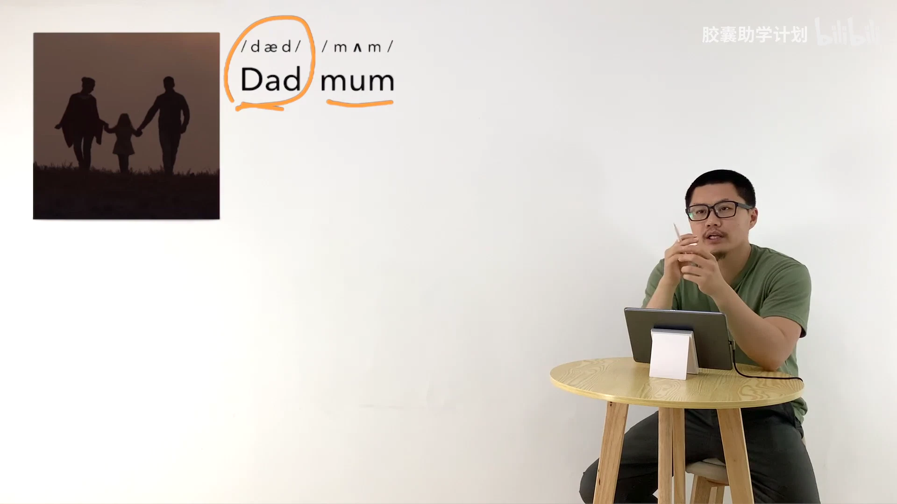

文字识别：胶囊助学计划 / / d æd / / /mΛm1 / Dad / mum

### 画面 00:01:27

文字识别：胶囊助学计划 / / d æed/ / /mΛm1 / Dad / mum

## 00:01:30–00:02:00

些小的句子啊，这些单词，比如说 My dad is driving now，啊，这个 dad 这个单词并不是很难，重点是我们拿它正好顺手复习一下之前学过的知识点。哎，正在开车，或者说 My mom is going to call my dad，说我妈妈呀要给我爸爸打一个电话，call somebody，啊，这个小短语我们之前学过，be going to do，我们也学过，一般将来时。OK， next one，下一个单词，张嘴跟我看着一下音标，对吧？K放在单词当中去发的

### 画面 00:01:35

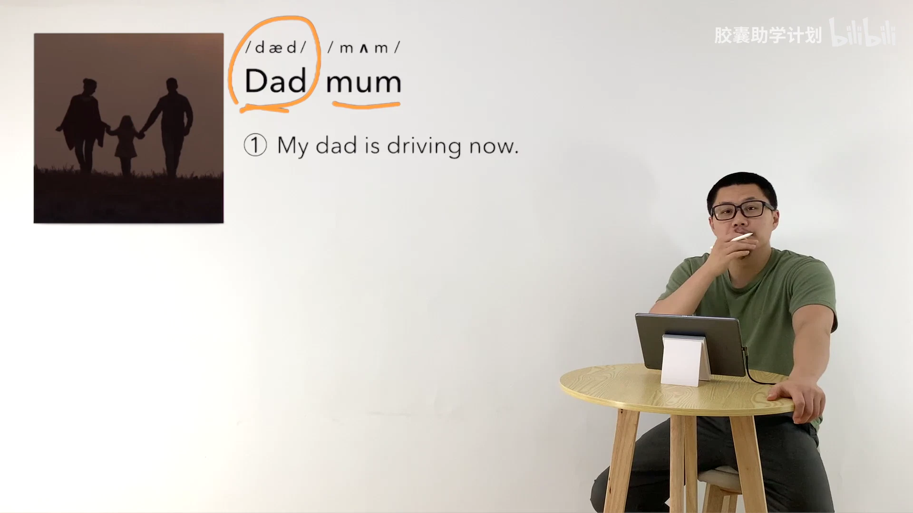

文字识别：胶囊助学计划 / / d æd / / /mΛm1 / Dad / mum / ① My dad is driving now.

### 画面 00:01:53

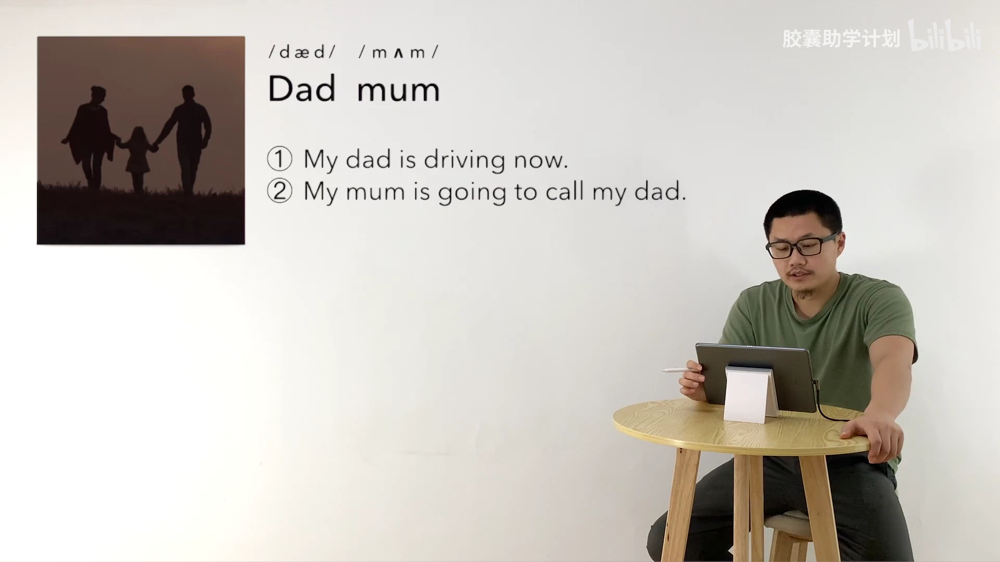

文字识别：胶囊助学计划 / /dæd/ /mΛm/ / Dad mum / ① My dad is driving now. / ② My mum is going to call my dad.

### 画面 00:01:55

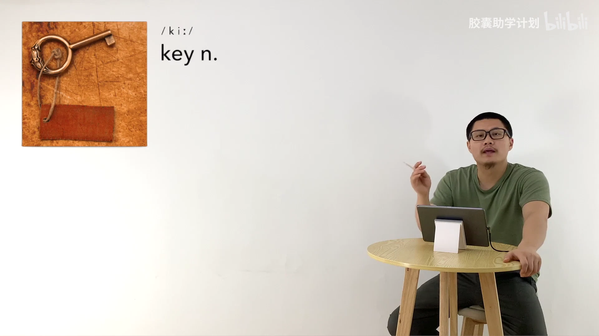

文字识别：胶囊助学计划 / / ki:/ / key n.

## 00:02:00–00:02:30

的是，这是一个自然拼读法则。然后连起来读的是key，OK，就是我们的钥匙啊。注意，它是一个名词。名词造句的时候，当然这个我们进入新二啊，从第一课开始就给大家整理出来了。其实新一用过的一些，包括新一没用过的一些单词造句的思路啊，那个时候我们才正式开始。现在呢，零零散散的给大家分享一下。比如说名词你要造句，那必须要找的肯定是一个动词，对吧？一个句子当中是

### 画面 00:02:25

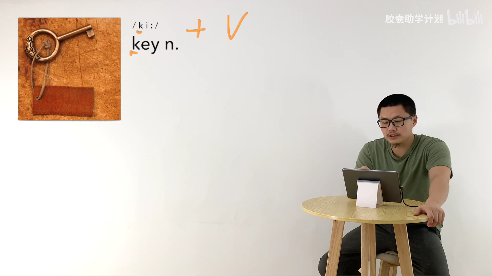

文字识别：+V / 胶囊助学计划 / /ki:/ / key n.

## 00:02:30–00:03:00

不能缺少动词的。动词呢，往往又跟我们前这么多课，对吧？前六十五课学过的，比如说 can，比如说 must，比如说 be doing，be going to do，啊，do does 这些单词连在一起去用。我给大家在这儿简单的总结一下，比如说 Can you find the key？啊，can 是我们四十三课、四十五课学过的，叫能。你能找到这个钥匙吗？或者说 I'm cleaning the key now, is very dirty。我

### 画面 00:02:55

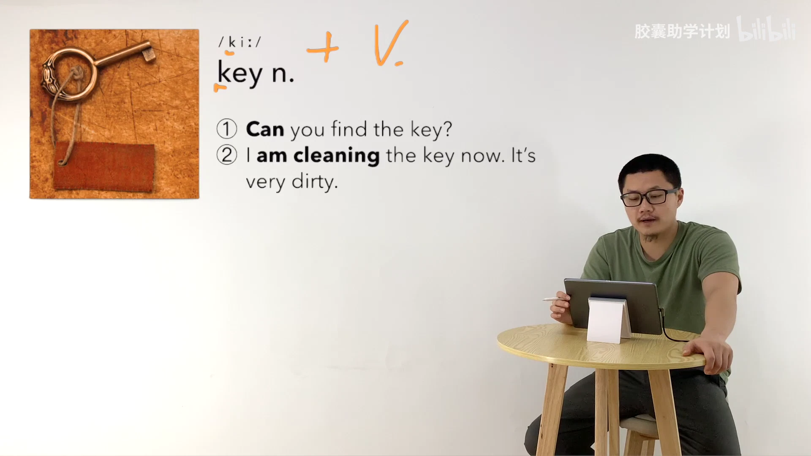

文字识别：V / 胶囊助学计划 / /ki:/ / key n. / Can you find the key? /  I am cleaning the key now. It's / very dirty.

## 00:03:00–00:03:30

正在哎清洗这个钥匙，这个钥匙特别的脏，掉在泥里了。OK，现在进行时，三十一课、三十三课学的。接下来说，She is going to give me the key. OK，说她打算把这钥匙啊给我。三十七课、三十九课学的一般将来时。Continue. He takes the key to school every day. 他每天都拿着钥匙去上学啊。你看我小的时候就是挂着钥匙去上学，对吧？怕回家家里没有大人，自己开门。OK，叫 He takes the key to school

### 画面 00:03:00

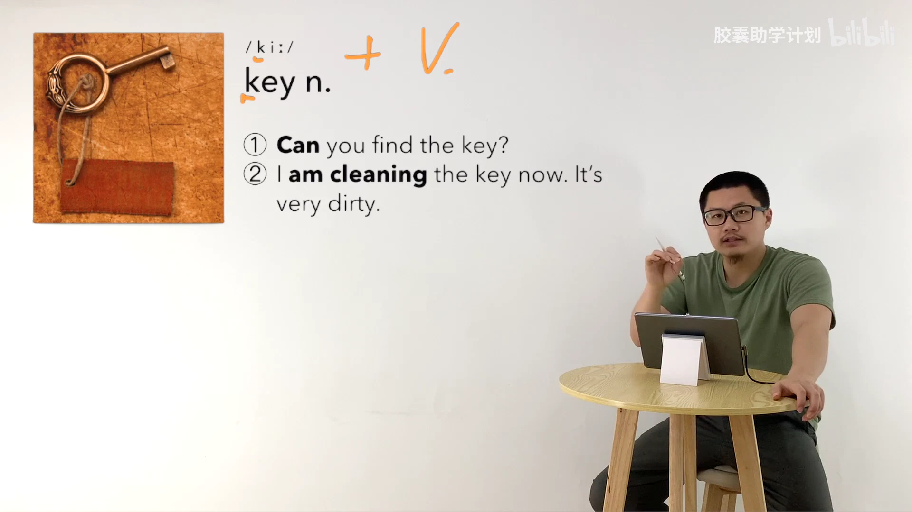

文字识别：V / 胶囊助学计划 / /ki:/ / key n. / Can you find the key? / ① /  I am cleaning the key now.Ilt's / very dirty.

### 画面 00:03:16

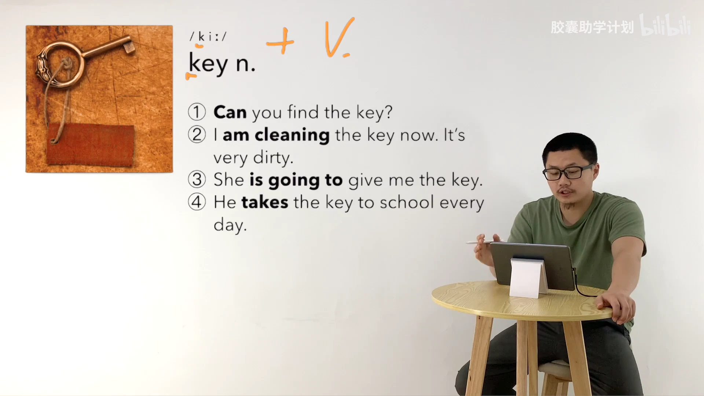

文字识别：V / 胶囊助学计划 / / ki:1 / key n. / ① Can you find the key? /  I am cleaning the key now. It's / 2 / very dirty. / She is going to give me the key. / He takes the key to school every / day.

### 画面 00:03:27

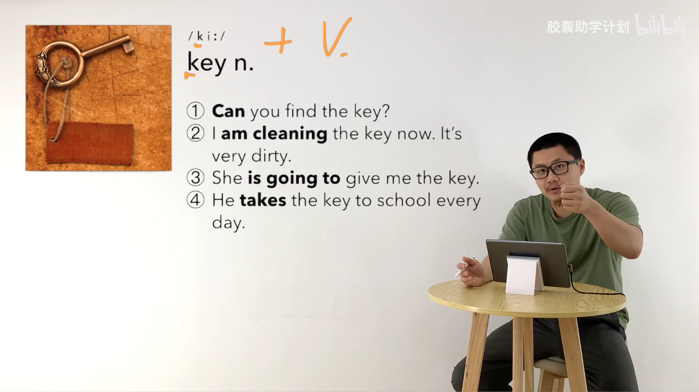

文字识别：V / 胶囊助学计划 / / ki:/ / key n. / ① Can you find the key? / ② | am cleaning the key now. Ilt's / very dirty. / She is going to give me the key. / He takes the key to school every / day.

## 00:03:30–00:04:00

every day. 好，这地方注意小夏 takes 为什么加了 s 呢？因为你看后面有 every day，每天的一个生活习惯是我们从四十七课开始学，对吧？一直学到六十课，一般现在时这个时态表示生活习惯，主语是第三人称单数，哎，动词也是第三人称单数。 OK， continue，这是我们刚刚学过的，对吧？六十一、六十二、六十三、六十四，我们刚刚学过的 must，说 You must take the key with you，说你必须要随

### 画面 00:03:30

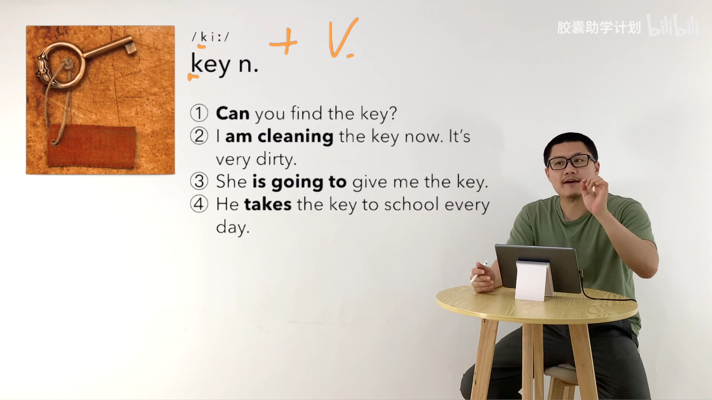

文字识别：V / 胶囊助学计划 / / ki:/ / key n. / ① Can you find the key? / ② I am cleaning the key now. lt's / very dirty. / She is going to give me the key. / He takes the key to school every / 4 / day.

### 画面 00:03:35

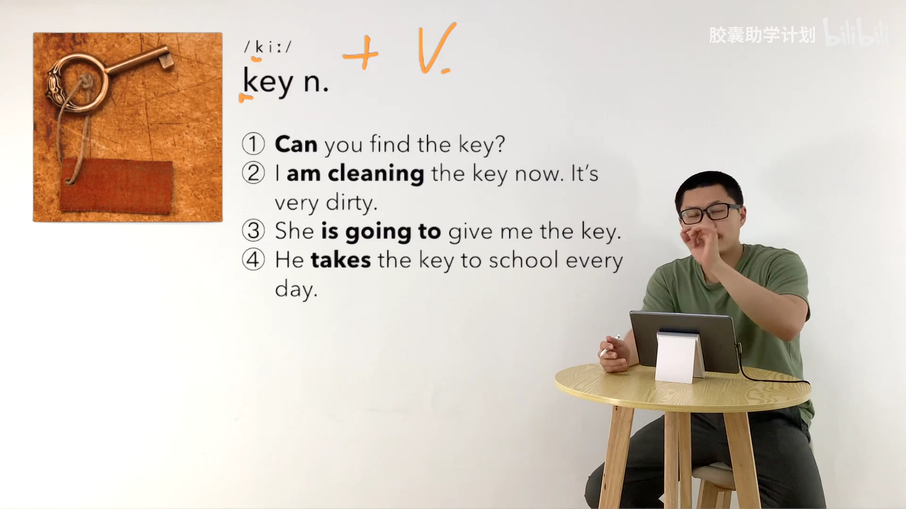

文字识别：V / 胶囊助学计划 / /ki:/ / key n. / ① Can you find the key? /  I am cleaning the key now. It's / 2 / very dirty. / She is going to give me the key. / He takes the key to school every / day.

### 画面 00:03:43

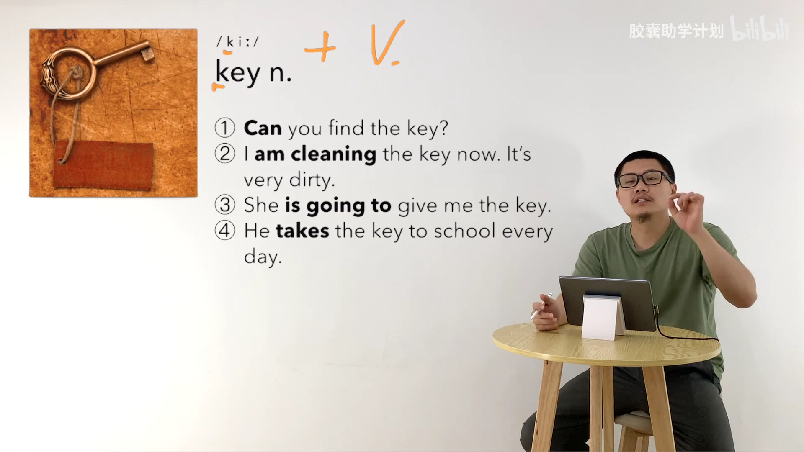

文字识别：V / 胶囊助学计划 / /ki:/ / key n. / ① Can you find the key? / ② I am cleaning the key now. It's / very dirty. / She is going to give me the key. /  He takes the key to school every / day.

### 画面 00:03:47

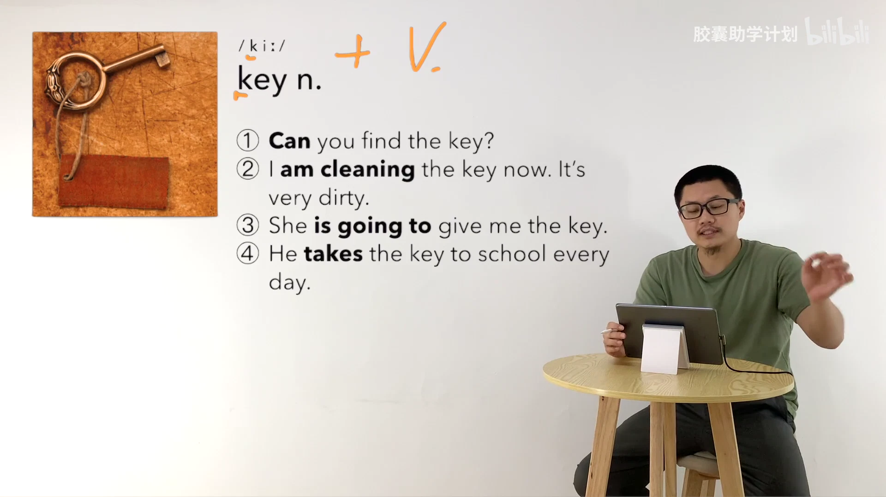

文字识别：V / 胶囊助学计划 / /ki:/ / key n. / ① Can you find the key? / ② I am cleaning the key now. It's / 2 / very dirty. / She is going to give me the key. / He takes the key to school every / day.

### 画面 00:03:52

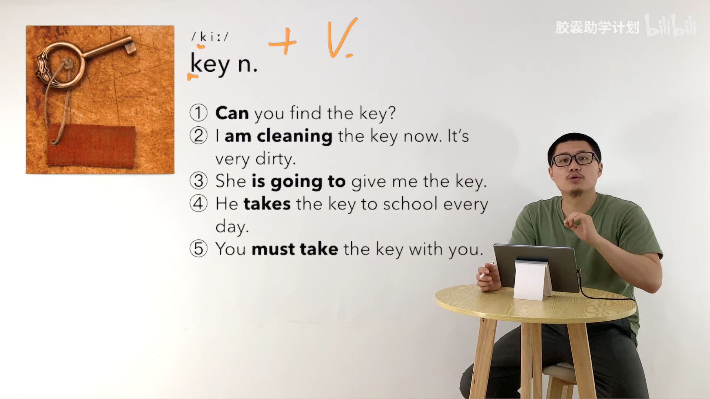

文字识别：V / 胶囊助学计划 / / ki:/ / key n. / ① Can you find the key? / ② | am cleaning the key now. It's / very dirty. / She is going to give me the key. / ④ He takes the key to school every / day. / ⑤ You must take the key with you.

### 画面 00:03:58

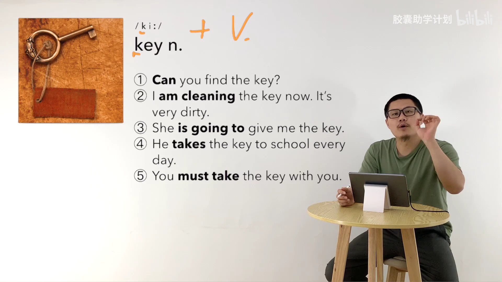

文字识别：V / 胶囊助学计划 / / ki:/ / key n. / ① Can you find the key? / ② I am cleaning the key now. It's / very dirty. / She is going to give me the key. / ④ He takes the key to school every / day. / ⑤ You must take the key with you.

## 00:04:00–00:04:30

身拿着这个钥匙，否则回家里面家里没人，你开不开门，对吧？各位看，我现在拿黑色的给大家标出来的这些，都是非常重要的一些，要么情态动词，要么时态。每一个句子，如果它是肯定句，它都能变成一般疑问句、特殊疑问句，还是各种特殊疑问句以及否定句。这个是我们将来能张开嘴去表达自己真正想表达的一些想法的时候，非常重

### 画面 00:04:04

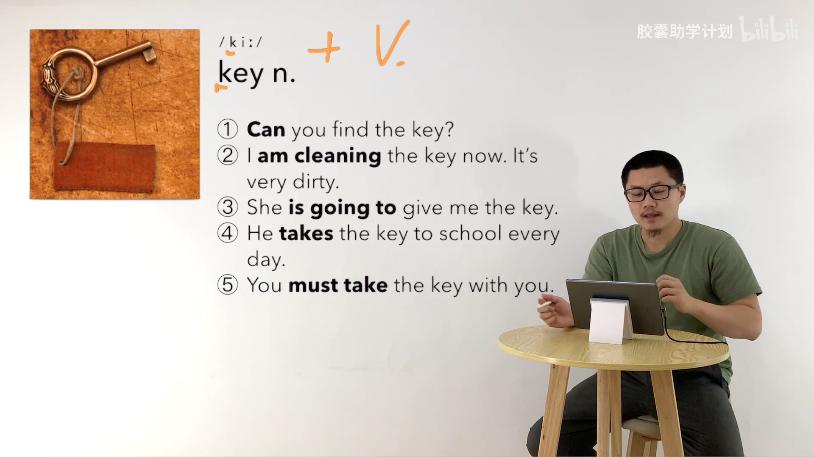

文字识别：V / 胶囊助学计划 / /ki:1 / key n. / ① Can you find the key? / ② I am cleaning the key now. It's / very dirty. / She is going to give me the key. / ④ He takes the key to school every / day. / ⑤ You must take the key with you.

### 画面 00:04:06

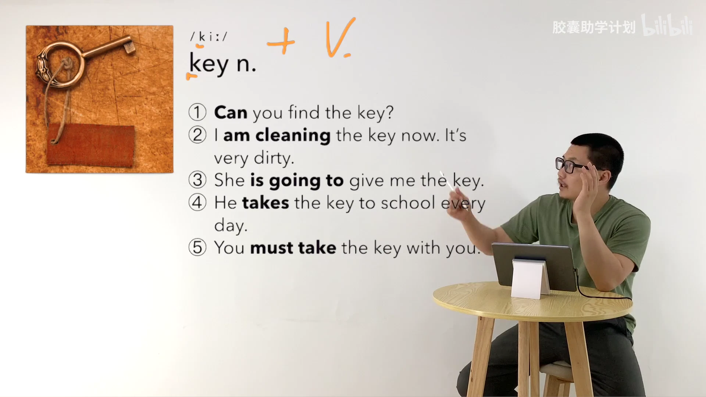

文字识别：V / 胶囊助学计划 / /ki:/ / key n. / ① Can you find the key? / ② |am cleaning the key now. It's / very dirty. / She is going to give me thè key. / He takes the key to school every / day. / ⑤ You must take the key with you.

### 画面 00:04:10

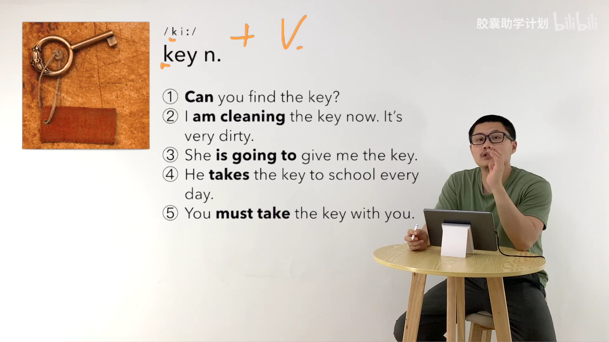

文字识别：V / 胶囊助学计划 / / ki:/ / key n. / ① Can you find the key? / ② | am cleaning the key now. lt's / very dirty. / She is going to give me the key. / 人 / ④ He takes the key to school every / day. / ⑤ You must take the key with you.

### 画面 00:04:25

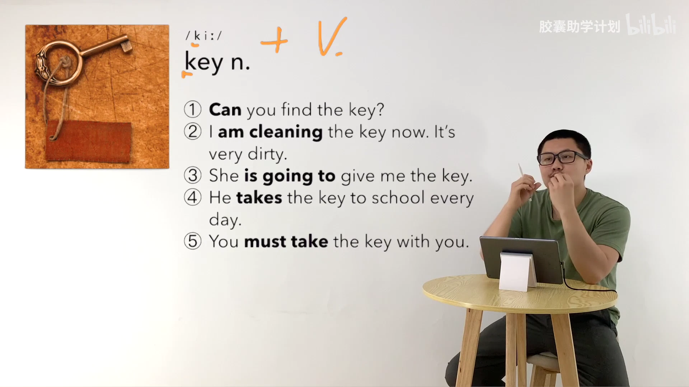

文字识别：V / 胶囊助学计划 / / ki:/ / key n. / ① Can you find the key? / ② I am cleaning the key now. It's / very dirty. / She is going to give me the key. / ④ He takes the key to school every / day. / ⑤ You must take the key with you.

## 00:04:30–00:05:00

要的一些结构，也是我让各位啊把它整理下来，以后造句的时候要不停用到的一些结构。OK，好，那不多说，下一个单词，张嘴跟我读，baby，baby，OK，就是小宝宝、小婴儿啊，很简单，你看两个b，自然拼读法则放在单词当中去发的都是b，对吧？其次呢，注意一个小点，就是字母y，也是一个小的自然拼读法则，但是我们在视频当中没有讲到，在这简单提一句，就是y这个字母放在字

### 画面 00:04:34

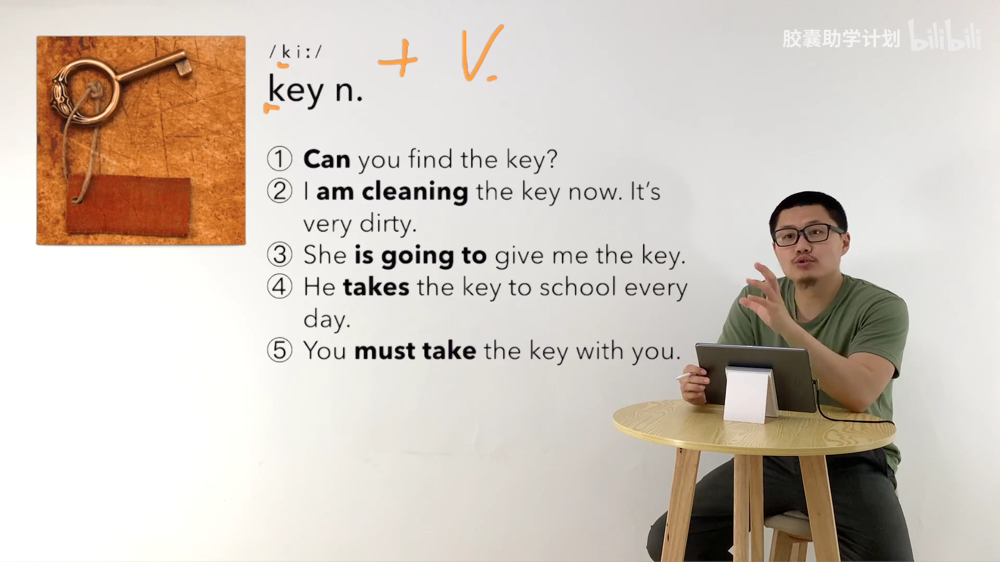

文字识别：V / 胶囊助学计划 / /ki:1 / key n. / ① Can you find the key? / ② I am cleaning the key now. It's / very dirty. / She is going to give me the key. / ④ He takes the key to school every / day. / ⑤ You must take the key with you.

### 画面 00:04:37

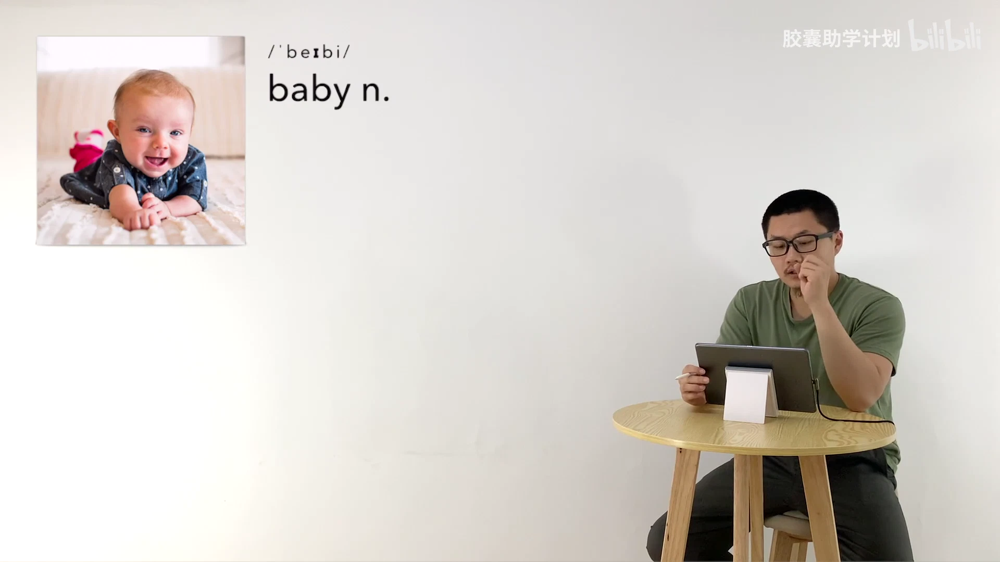

文字识别：胶囊助学计划 / /'beibi/ / baby n. / O

### 画面 00:04:39

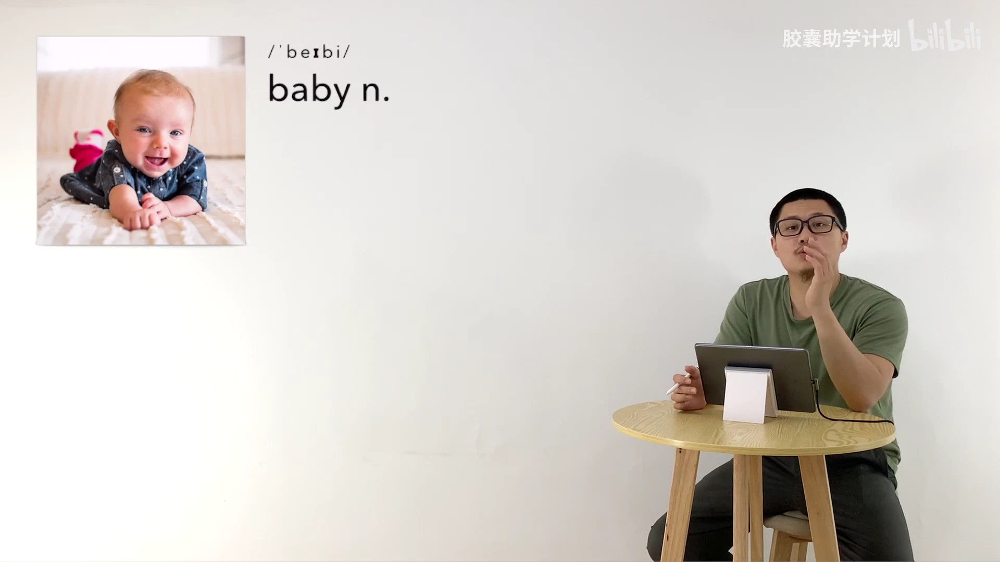

文字识别：胶囊助学计划 / /'beibi/ / baby n.

### 画面 00:04:44

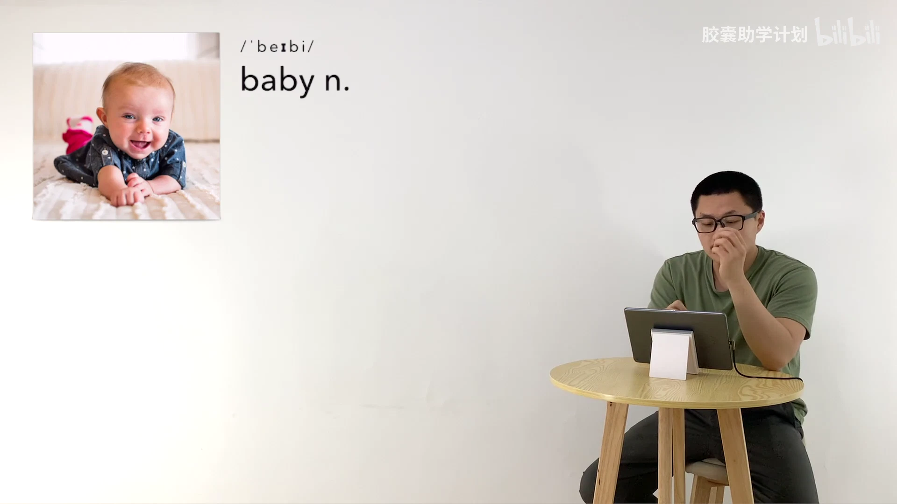

文字识别：胶囊助学计划 / /'beibi/ / baby n.

### 画面 00:04:53

文字识别：胶囊助学计划 / /'beibi/ / babyn.

## 00:05:00–00:05:30

母结尾、单词结尾的时候，很多的时候它可以发E这个音。但是咱们拼读法则不好用，就不好用在这里了。它有例外，对吧？那我们不多说。名词啊，直接造一个句子，前二十课的叫This is her baby。变一般疑问句怎么办？Is this her baby?然后我想对her提问，或者对who用whose提问，对吧？这就不一样了啊！我对her提问肯定是用whose，对吧？所以说Whose baby is this?啊，这是谁家宝宝

### 画面 00:05:05

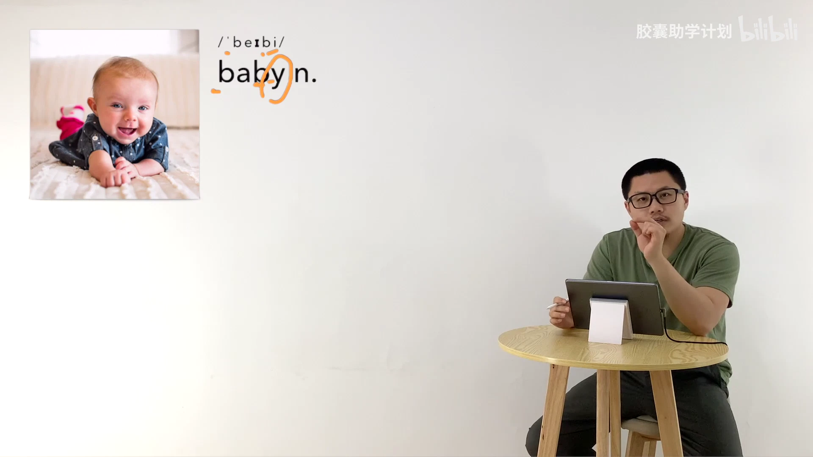

文字识别：胶囊助学计划 / /'beibi/ / bakyn.

### 画面 00:05:10

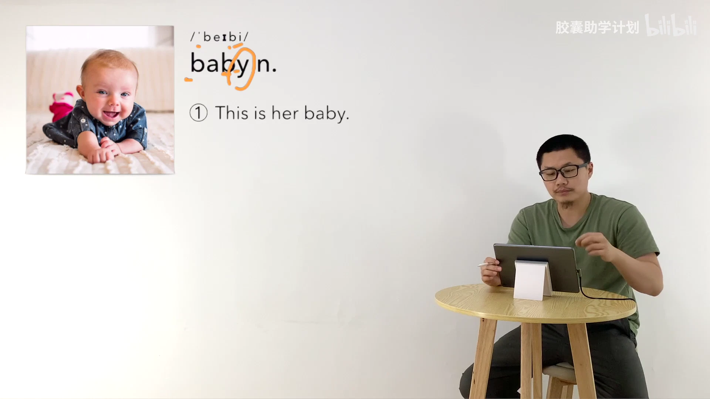

文字识别：胶囊助学计划 / /'beibi/ / babyr / n. / ① This is her baby.

### 画面 00:05:15

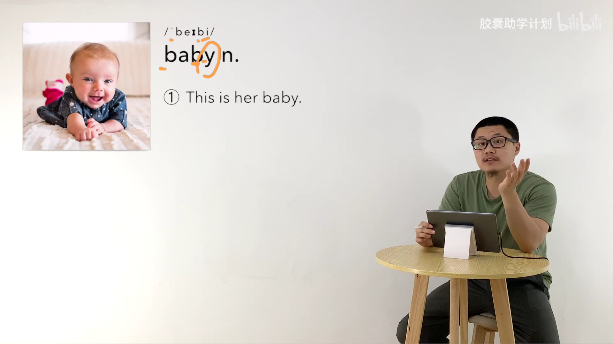

文字识别：胶囊助学计划 / /'beibi/ / bakyn. / ① This is her baby.

### 画面 00:05:26

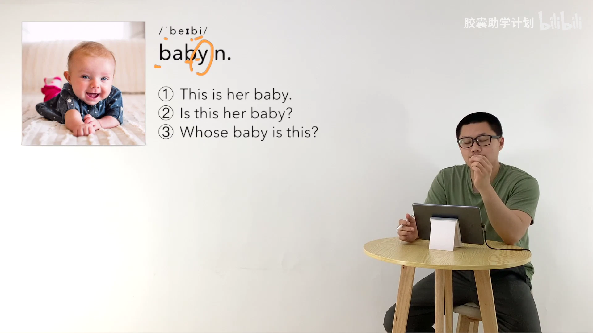

文字识别：胶囊助学计划 / /'beibi/ / baby / n. / ) This is her baby. / ② Is this her baby? / Whose baby is this? / 3

### 画面 00:05:29

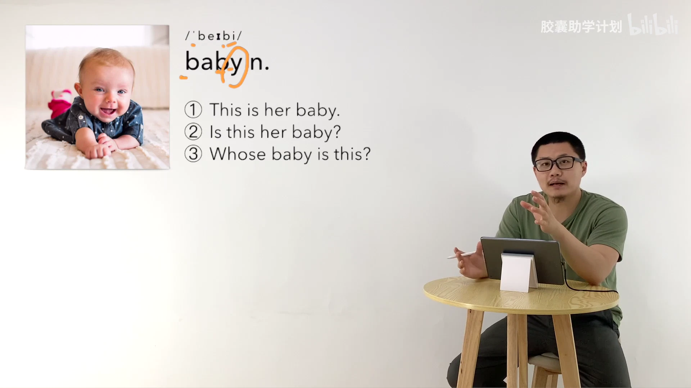

文字识别：胶囊助学计划 / /'beibi/ / baky / n. / D This is her baby. / 1 / ② Is this her baby? / Whose baby is this? / 3

## 00:05:30–00:06:00

啊？怎么放在这儿没有人看管呢？Okay, very good.我还可以造一个六十一课六十三课咱们刚刚学的，说The baby looks ill.我现在想问说他看起来病了吗？这个宝宝是一般疑问句，首先确定，然后要提谁？我们现在能提的am is are was were啊was were还没学到对吧？am is are呃can must啊这些都是可以往前提的do does对吧？在这儿提谁呢？Looks把does提到句首去，动词化还原形叫做Does

### 画面 00:05:32

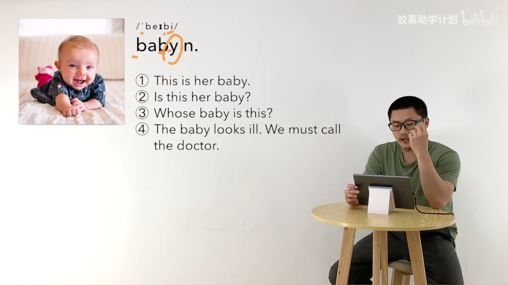

文字识别：胶囊助学计划 / /'beibi/ / bab / ① This is her baby. / ② Is this her baby? / 2 / Whose baby is this? / The baby looks ill. We must call / the doctor.

### 画面 00:05:34

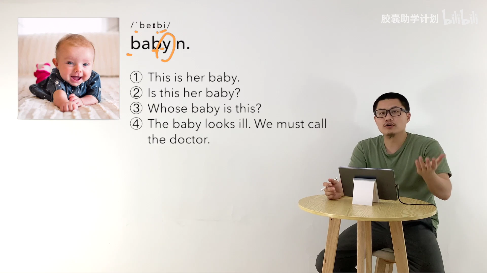

文字识别：胶囊助学计划 / /'beibi/ / bab / ① This is her baby. / ② Is this her baby? / 2 / Whose baby is this? / The baby looks ill. We must call / the doctor.

### 画面 00:05:38

文字识别：胶囊助学计划 / /'berbi/ / bab / ① This is her baby. / ② Is this her baby? / Whose baby is this? / 3 / The baby looks ill. We must call / the doctor.

### 画面 00:05:47

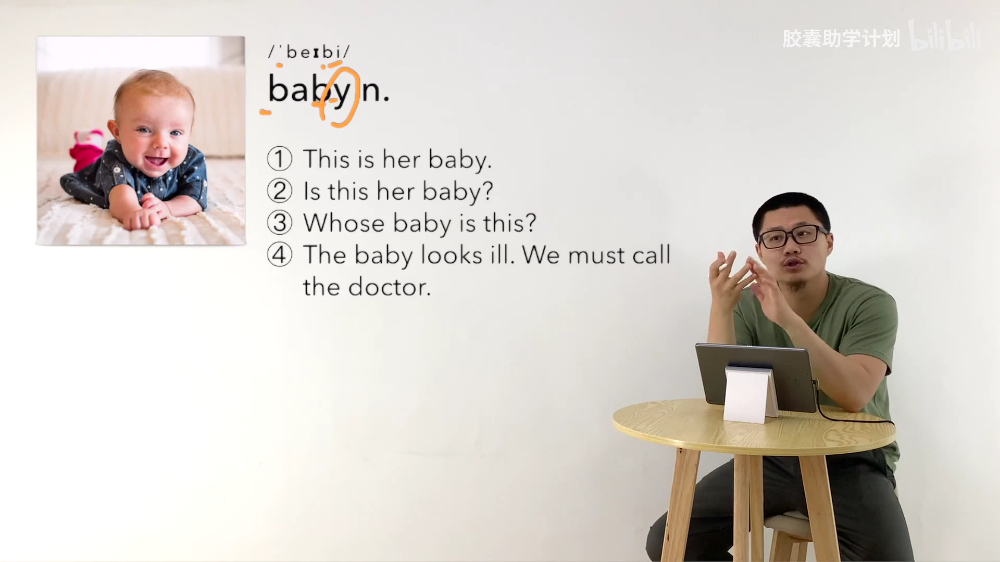

文字识别：胶囊助学计划 / /'beibi/ / bak / ① This is her baby. / ② Is this her baby? / Whose baby is this? / 3 / The baby looks ill. We must call / the doctor.

### 画面 00:05:56

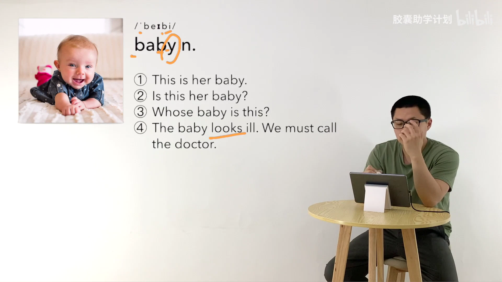

文字识别：胶囊助学计划 / /'beibi/ / bab / ① This is her baby. / ② Is this her baby? / 2 / Whose baby is this? / The baby looks ill. We must call / the doctor.

## 00:06:00–00:06:30

the baby look ill? Okay, 这是我们反复要练习的一些英文当中的知识点. We must call the doctor. 我们必须要给医生打个电话了。我都说，我们接着往下走。下一个单词叫做 hear. 注意，它指的不是听这个动作，指的是听这个结果。什么意思呢？其实就是听到没听到，听见没听见。比如说 Can you hear me? 啊，比如我在这块儿，你在那边，我大声喊，我说 Can you hear me? Okay, 啊，你能听见我说话吗？

### 画面 00:06:03

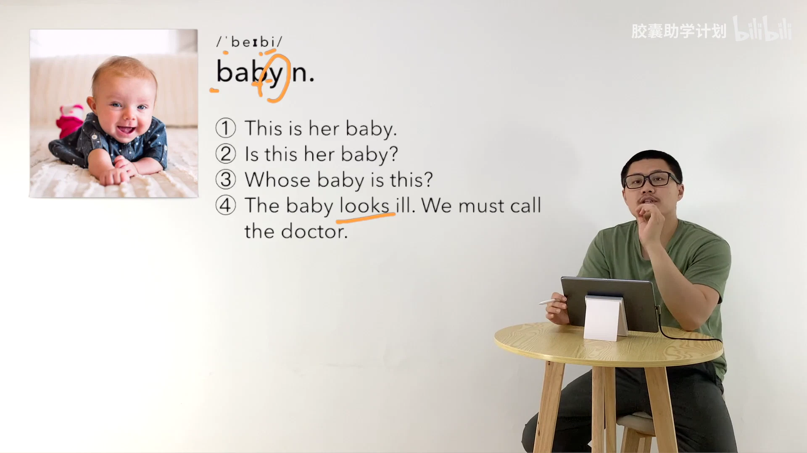

文字识别：胶囊助学计划 / /'beibi/ / bab / ① This is her baby. / ② Is this her baby? / Whose baby is this? / 3 / The baby looks ill. We must call / the doctor.

### 画面 00:06:05

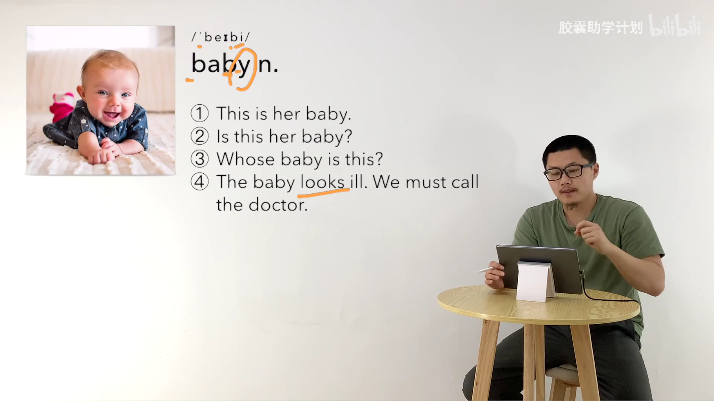

文字识别：胶囊助学计划 / /'beibi/ / bab / ① This is her baby. / ② Is this her baby? / Whose baby is this? / 3 / The baby looks ill. We must call / the doctor.

### 画面 00:06:09

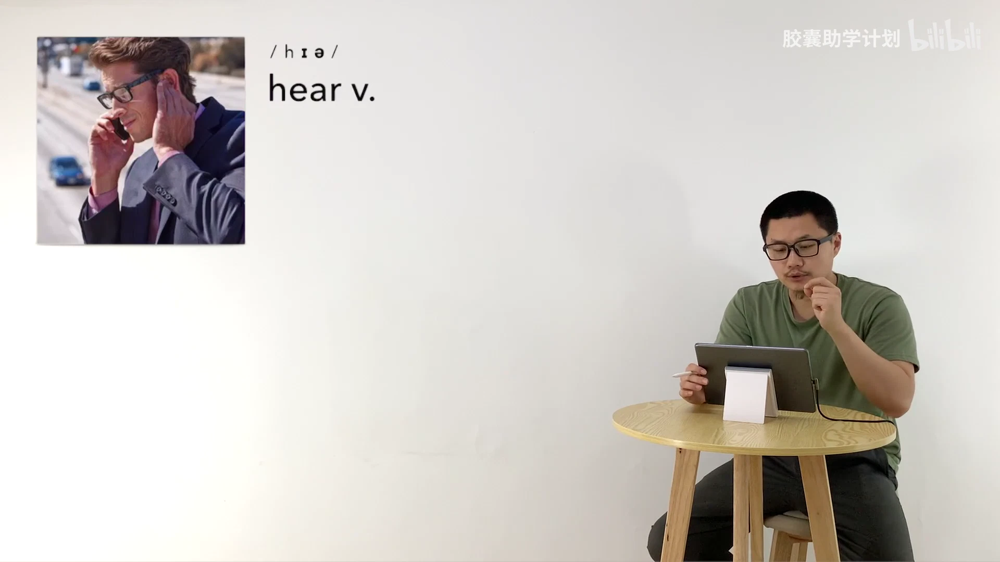

文字识别：胶囊助学计划 / /hia/ / hear v.

### 画面 00:06:11

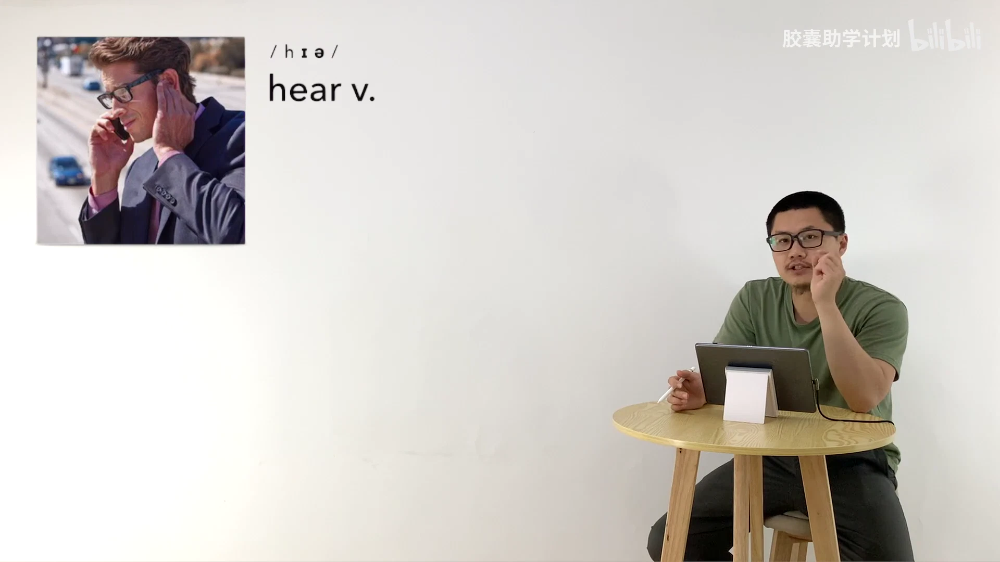

文字识别：胶囊助学计划 / /hia/ / hear v. / ODOD

### 画面 00:06:17

文字识别：胶囊助学计划 / /hia/ / hear v.

### 画面 00:06:25

文字识别：胶囊助学计划 / /hia/ / hear v. / ① Can you hear me?

## 00:06:30–00:07:00

叫做 Can you hear me? OK. 好，那 Do you hear that? 不是问你能不能听见，就是陈述客观事实，你听到了吗？ OK. 稍有不太一样，有一点点不太一样。 OK. 好，你说我听不到，那叫做 I can't hear it. 啊，我没有这个，我这耳朵不够灵，听不见，对吧？ OK. Very good. 以及这个我们见过很多次了，叫 Why can't? 叫为什么不能啊？比如说我们最常用的一句

### 画面 00:06:30

文字识别：胶囊助学计划 / /hia/ / hear v. / ① Can you hear me? / ODOD

### 画面 00:06:33

文字识别：胶囊助学计划 / /hia/ / hear v. / ① Can you hear me? / ② Do you hear that?

### 画面 00:06:37

文字识别：胶囊助学计划 / /hial / hear v. / ① Can you hear me? / ② Do you hear that?

### 画面 00:06:41

文字识别：胶囊助学计划 / /hial / hear v. / ① Can you hear me? / ② Do you hear that?

### 画面 00:06:45

文字识别：胶囊助学计划 / /hia/ / hear v. / ① Can you hear me? / ② Do you hear that? / ③ I can't hear it.

### 画面 00:06:55

文字识别：胶囊助学计划 / /hial / hear v. / ① Can you hear me? / ② Do you hear that? / I can't hear it. / Why can't you hear it?

## 00:07:00–00:07:30

话叫 Why can't you help me, man? 说为什么你不能帮我一下呢？不能帮我一下呢？或者 Why can't you hear it? 为什么你听不见它？ Okay, one more. 那接下来我们看一个小的电影片段当中出现了叫 Can you hear me? 你能听见我说话吗？还说了两次，各位注意力集中了，来了。 Can you hear me? Can you hear me, Jim? You believe such as good. Can the

### 画面 00:07:00

文字识别：胶囊助学计划 / /hia/ / hear v. / ① Can you hear me? / ② Do you hear that? / I can't hear it. / Why can't you hear it?

### 画面 00:07:07

文字识别：胶囊助学计划 / /hial / hear v. / ① Can you hear me? / ② Do you hear that? / I can't hear it. / Why can't you hear it?

### 画面 00:07:09

文字识别：ROM THE DIRECTOR OF / 胶囊助学计划 / Can you hear me? / ENTER THE WORLD / AVATA / 阿凡达Avatar (2009) / IN / CINEMAS DECE

### 画面 00:07:11

文字识别：ROM THE DIRECTOR OF / 胶囊助学计划 / Can you hear me? / ENTER THE WORLD / AVATAI / 阿凡达Avatar (2009) / IN / CINEMAS DECE

### 画面 00:07:14

文字识别：ROM THE DIRECTOR OF / 胶囊助学计划 / Can you hear me? / ENTERTHE WORLD / AVATA / 阿凡达Avatar(2009) / IN CINEMAS DECE

### 画面 00:07:19

文字识别：胶囊助学计划

### 画面 00:07:21

文字识别：胶囊助学计划 / 他进来了杰克你能听到吗 杰克 / He's in. Jake, can you hear me? Can you hear me, Jake?

### 画面 00:07:23

文字识别：bilbili / 胶囊助学计划 / 他进来了 / 杰克你能听到吗杰克 / He's in. Jake, can you hear me? Can you hear me, Jake?

### 画面 00:07:25

文字识别：囊助学计划 / 瞳孔反应正常 / Pupillary reflex is good.

### 画面 00:07:27

文字识别：Bilbili / 胶囊助学计划

### 画面 00:07:29

文字识别：bibii / 胶囊助学计划

## 00:07:30–00:08:00

response normal. How are you feeling, Jake? Hey guys, welcome to your new body, Jake. Good. Okay, very good. Can you hear me?啊，你能听见我吗？Okay, very good.接下来这两个小的单词我们放到一起去用就行了。在这个课当中啊，首先enjoy啊，我们先看一下单词啊，enjoy啊，你看啊，刚才我们说说说y y啊，放在

### 画面 00:07:31

文字识别：胶囊助学计划 / 听力反应正常 / 觉得怎么样杰克 / Pinna response normal. How you feeling, Jake?

### 画面 00:07:33

文字识别：Bilbii / 胶囊助学计划

### 画面 00:07:35

文字识别：胶囊助学计划il

### 画面 00:07:37

文字识别：胶囊助学计划bilb出 / 欢迎进入新身体 傑克 / Welcome to your new body, Jake.

### 画面 00:07:39

文字识别：胶囊助学计划州 / 很好 / Good!

### 画面 00:07:41

文字识别：ROM THE DIRECTOR OF / 胶囊助学计划 / Can you hear me? / ENTER THE WORLD / AVATAI / 阿凡达Avatar (2009) / IN / CINEMAS DECE

### 画面 00:07:43

文字识别：ROM THE DIRECTOR OF / 胶囊助学计划 / Can you hear me? / ENTER THE WORLD / AVATA / 阿凡达Avatar (2009) / IN CINEMAS DECE

### 画面 00:07:45

文字识别：ROM THE DIRECTOR OF / 胶囊助学计划 / Can you hear me? / ENTER THE WORLD / AVATA / 阿凡达Avatar (2009) / IN CINEMAS DECE

### 画面 00:07:47

文字识别：胶囊助学计划 / /In'd3o1/ / /jo:'self / / enjoy yourself

### 画面 00:07:50

文字识别：胶囊助学计划 / /In'd3oi/ / /jo:'self / / enjoy yourself

## 00:08:00–00:08:30

单词结尾往往 e 对吧，读 e，但其实这个地方是 o y 结尾发的 o i 对吧，所以我说这个自然拼读法则对于各位来说不是那么好使，但有一些地方比较好使，比如说字母 n 一定就发的是嗯这个音对吧，当然也可能是后鼻音了。 OK，好，连起来读 enjoy。 OK，表示很享受啊，比如说 I enjoy the moment 啊，我很喜欢上课这个时光啊， I enjoy my course 啊。好， continue，好

### 画面 00:08:02

文字识别：胶囊助学计划 / /In'd3oi/ / /jo:'self/ / enjoy / yourself

### 画面 00:08:05

文字识别：胶囊助学计划 / /In'd3o1/ / /jo:'se lf/ / enjoy / yourself

### 画面 00:08:08

文字识别：胶囊助学计划 / /In'd3o1/ / /jo:'se lf / / enj / joy / yourself

### 画面 00:08:11

文字识别：胶囊助学计划 / /In'd3o1/ / /jo:'self/ / enj / joy / yourself

### 画面 00:08:15

文字识别：胶囊助学计划 / /In'd3o1/ / /jo:'self / / enioy / yourself

### 画面 00:08:21

文字识别：胶囊助学计划 / /In'd3o1/ / /jo:'se lf / / enioy / yourself

## 00:08:30–00:09:00

I enjoy teaching. Ah, I enjoy teaching. Ah,我很享受上课。那yourself是什么呢？我们不说它的学术术语了。啊，这个学术术语大家知不知道是无所谓的。你只要知道它的意思叫做你自己就可以了。那enjoy yourself什么意思呢？叫享受你自己啊。其实就类似于我们八十一课学会学到的短语叫have a good time啊，就玩的开心啊。Enjoy yourself翻译成汉语就是玩的开心，享

### 画面 00:08:30

文字识别：胶囊助学计划 / /In'd3o1/ / /jo:'self / / enjoy / yourself

### 画面 00:08:36

文字识别：胶囊助学计划 / /In'd3o1/ / /jo:'self/ / enjoy / yourself

### 画面 00:08:52

文字识别：胶囊助学计划 / /In'd3o1/ / /jo:'self/ / enioy / yourself

## 00:09:00–00:09:30

受你自己啊。OK，享受。OK，好，比如说 we gonna we gonna have a party tonight 啊，我们今天晚上啊，这其实也是八十一课才会学到的，我们提前拿出来啊。我们今天晚上要举办一个聚会啊，今天晚上我们要 party 一下。OK，好，那你就可以说 enjoy yourself。注意，你看我在这儿把它变了一下，换成了 selves， f 变成了 ves，有没有让你想起来十五课、十七课我们学过的叫做

### 画面 00:09:02

文字识别：胶囊助学计划 / /In'd3o1/ / /jo:'self/ / enjoy / yourself /  We're gonna have a party / tonight.

### 画面 00:09:05

文字识别：胶囊助学计划 / /In'd3o1/ / /jo:'self/ / enioy / yourself / ① We're gonna have a party / tonight.

### 画面 00:09:08

文字识别：胶囊助学计划 / /In'd3o1/ / /jo:'se lf / / enioy / yourself / ) We're gonna have a party / 1 / tonight.

### 画面 00:09:10

文字识别：胶囊助学计划 / /In'd3o1/ / /jo:'se lf/ / enioy / yourself / D We're gonna have a party / 1 / tonight.

### 画面 00:09:13

文字识别：胶囊助学计划 / /In'd3o1/ / /jo:'self / / enióy / yourself / D We're gonna have a party / 1 / tonight.

### 画面 00:09:19

文字识别：胶囊助学计划 / /In'd3o1/ / /jo:'self/ / enjoy / yourself / ① We're gonna have a party / tonight. / enjoy yourselves

### 画面 00:09:21

文字识别：胶囊助学计划 / /In'd3o1 / /jo:'se lf / / enióy / yourself /  We're gonna have a party / 1 / tonight. / enjoy yourselves

### 画面 00:09:26

文字识别：胶囊助学计划 / /In'd3o1/ / / j o:'se lf / / enióy / yourself / We're gonna have a party / 1 / tonight. / enjoy yourselves

### 画面 00:09:28

文字识别：胶囊助学计划 / /In'd3o1/ / /jo:se lf / / enjóy / yourself / ) We're gonna have a party / 1 / tonight. / enjoy yourselves

## 00:09:30–00:10:00

名词变复数的时候，f变成或fe变成了ves，一模一样，对吧？好，yourselves指指的是你们自己，那享受你们自己就是祝你们玩的开心。为什么呢？因为它上面说的是we are。OK，好，当然这个单词我们在偶数课的下一课马上会给大家做一个小的表格，给大家整体上的呃罗列一下，让大家看一下，好吧？

### 画面 00:09:37

文字识别：胶囊助学计划 / /In'd3o1/ / / j o:'se lf / / enióy / yourself / We're gonna have a party / 1 / tonight. / enjoy yourselves

### 画面 00:09:43

文字识别：胶囊助学计划 / /In'd3o1/ / /jo:'self/ / enioy / yourself / ① We're gonna have a party / tonight. / enjoy yourselves

### 画面 00:09:47

文字识别：胶囊助学计划 / /In'd3o1/ / /jo:'se lf / / enióy / yourself / We're / gonna have a party / 1 / tonight. / enjoy yourselves

### 画面 00:09:50

文字识别：胶囊助学计划 / /In'd3o1/ / /jo:'self / / enioy / yourself / We're / gonna have a party / tonight. / enjoy yourselves

## 00:10:00–00:10:30

Okay, 那不多说，接下来是一个道理。你看，enjoy你认得了，our你认得，selves在yourselves那个地方你见过了，our叫我们的，对吧？那ourselves叫做我们自己，那enjoy ourselves就是祝我们自己玩的开心。Okay, very good. 比如说，We gonna have a party tonight，还是这句话。然后我接下来说的是，We gonna enjoy ourselves，就等同于We gonna have a good time啊，我们会玩的很

### 画面 00:10:00

文字识别：胶囊助学计划 / /in'dzoi/ /aua'selvz/ / enjoy / ourselves

### 画面 00:10:02

文字识别：胶囊助学计划 / /in'd3oi/ /aua'selvz/ / enjoy / ourselves

### 画面 00:10:05

文字识别：胶囊助学计划 / /In'd3oI/ / /ａｕａ'sｅlvｚ/ / enjoy / ourselves

### 画面 00:10:08

文字识别：胶囊助学计划 / /In'd3oI/ / /ａｕａｓｅlvｚ/ / enjoy / ourselves

### 画面 00:10:11

文字识别：胶囊助学计划 / /In'd3oI/ / /ａｕａ'ｓｅlvｚ/ / enjoy / ourselves

### 画面 00:10:15

文字识别：胶囊助学计划 / /In'd3oi/ / /ａuａ'ｓｅlvz/ / enjoy / ourselves

### 画面 00:10:17

文字识别：胶囊助学计划 / /In'd3oi/ / /ａｕａ'sｅlvz/ / enjoy / ourselves /  We're gonna have a party / tonight. We're gonna enjoy / ourselves.

### 画面 00:10:19

文字识别：胶囊助学计划 / /In'd3oi/ / /ａuａ'ｓｅlνｚ/ / enjoy / ourselves / ) We're gonna have a party / tonight. We're gonna enjoy / ourselves.

### 画面 00:10:27

文字识别：胶囊助学计划 / /In'd3oi/ / /ａuａ'sｅlvz/ / enjoy / ourselves /  We're gonna have a party / tonight. We're gonna enjoy / ourselves.

## 00:10:30–00:11:00

开心的。OK，接下来看一个小的电影片段，连续出现了两次 enjoy yourself 啊，玩的开心。各位当一个听力练习去做。来了， Otherwise, it is your rookie and enjoy your stay. Right? Why are you doing this to me? She's here with some guy already, kind of messed up. Okay, right? Yeah. Thank you. Really, it's not a big deal. Go,

### 画面 00:10:30

文字识别：胶囊助学计划 / /In'd3oi/ / /ａuａ'ｓｅｌνｚ/ / enjoy / ourselves /  We're gonna have a party / tonight. We're gonna enjoy / ourselves.

### 画面 00:10:32

文字识别：胶囊助学计划 / enjoy yourself / FORGETTING / 忘掉莎拉·马歇尔 Forgetting Sarah Marshall(2008) / SARAH MAR

### 画面 00:10:34

文字识别：胶囊助学计划 / enjoy yourself / FORGETTING / 忘掉莎拉·马歇尔 Forgetting Sarah Marshall(2008) / SARAHMARS

### 画面 00:10:36

文字识别：胶囊助学计划 / enjoy yourself / FORGETTING / 忘掉莎拉·马歇尔 Forgetting Sarah Marshall(2008) / SARAHMARS

### 画面 00:10:40

文字识别：bilbli / 胶囊助学计划 / 还有这是房间钥匙 / Thn / Otherwise, here is your room key

### 画面 00:10:42

文字识别：bilbili / 胶囊助学计划 / 还有这是房间钥匙 / Thn / Otherwise, here is your room key

### 画面 00:10:44

文字识别：Bilibili / 胶囊助学计划 / 祝你住宿愉快 / Thn / and enjoy your stay.

### 画面 00:10:46

文字识别：Bilbii / 胶囊助学计划

### 画面 00:10:48

文字识别：bilibili / 胶囊助学计划 / 你为何如此款待我 / Why are you doing this for me?

### 画面 00:10:50

文字识别：bilibili / 胶囊助学计划

### 画面 00:10:52

文字识别：bilibili / 胶囊助学计划 / 她和别人在这里这已经够惨的了 /  She's here with some guy already? Kind of messed up.

### 画面 00:10:54

文字识别：bilibili / 胶囊助学计划 / 她和别人在这里 这已经够惨的了 / She's here with some guy already? Kind of messed up.

### 画面 00:10:56

文字识别：Bilbili / 胶囊助学计划

### 画面 00:10:58

文字识别：Bilibili / 胶囊助学计划 / -谢谢-别客气 /  - Thank you. - Really, it's not a big deal.

## 00:11:00–00:11:30

go, enjoy yourself. Rachel Jensen. I mean, thousand times, thank you. You know what I mean? Enjoy yourself. Okay,啊，你看这地方其实还有好好几个我们之前学过的是吧？Here is your room key.啊，这是你的房间钥匙。想一下，前五课、前十课咱们就学过了，对吧？Okay,好，那包括Why are you doing this for me?啊，你为什么要为了我去做这件事情，正在做的这件事情啊？For me, for somebody.啊，Why?啊，Are doing,对吧？

### 画面 00:11:00

文字识别：bilibili / 胶囊助学计划 / 去享受吧 / Go enjoy yourself.

### 画面 00:11:02

文字识别：bilibili / 胶囊助学计划 / 你叫蕾切尔·詹森 我感恩不尽. / Rachel Jansen. A thousand times, thank you, you know what I mean...

### 画面 00:11:04

文字识别：bilbili / 胶囊助学计划 / 你叫蕾切尔·詹森 我感恩不尽. / Rachel Jansen. A thousand times, thank you, you know what I mean..

### 画面 00:11:06

文字识别：bilibili / 胶囊助学计划 / 去享受吧-谢谢 / - Go enjoy yourself. - Thank you.

### 画面 00:11:08

文字识别：胶囊助学计划 / enjoy yourself / FORGETTING / 忘掉莎拉·马歇尔 Forgetting Sarah Marshall(2008) / SARAH MARS

### 画面 00:11:10

文字识别：胶囊助学计划 / enjoy yourself / FORGETTING / 忘掉莎拉·马歇尔 Forgetting Sarah Marshall(2008) / SARAHMARS

### 画面 00:11:13

文字识别：胶囊助学计划 / enjoy yourself / FORGETTING / 忘掉莎拉·马歇尔 Forgetting Sarah Marshall(2008) / SARAHMAR

### 画面 00:11:15

文字识别：胶囊助学计划 / enjoy yourself / FORGETTING / 忘掉莎拉·马歇尔 Forgetting Sarah Marshall(2008) / SARAHMARS

### 画面 00:11:19

文字识别：胶囊助学计划 / enjoy yourself / FORGETTING / 忘掉莎拉·马歇尔 Forgetting Sarah Marshall(2008) / SARAHMAR

### 画面 00:11:22

文字识别：胶囊助学计划 / enjoy yourself / FORGETTING / 忘掉莎拉·马歇尔 Forgetting Sarah Marshall(2008) / SARAHMARS

### 画面 00:11:25

文字识别：胶囊助学计划 / enjoy yourself / FORGETTING / 忘掉莎拉·马歇尔 Forgetting Sarah Marshall(2008) / SARAHMARS

## 00:11:30–00:12:00

都是我们之前学过的，包括了enjoy yourself，玩的开心啊，have a good time. Continue.我们直接进入文章啊。我们来看一下。首先啊，我们要先确定几下人物啊。这个是爸爸啊，这个是女儿啊。爸爸说说What are you going to do this evening, Jill?好，这很简单。What are you going to do?三十七课我们就学过了。你今天打算做什么？This evening，今晚，Jill，她的名字。I'm going to meet some friends, Dad.说，我准备要

### 画面 00:11:30

文字识别：胶囊助学计划 / enjoy yourself / FORGETTING / 忘掉莎拉·马歇尔 Forgetting Sarah Marshall(2008) / SARAHMARS

### 画面 00:11:35

文字识别：胶囊助学计划 / FATHER: What are you going to do / this evening, Jill? / JILL: I'm going to meet some friends. / Dad.

## 00:12:00–00:12:30

去 meet. Nice to meet you. 遇见，见，对吧？我准备去见一些朋友，父亲啊，这都是我们三十七课就学过的了。Kenny 说，You mustn't come home late. 注意，mustn't 我们刚刚学过，你看是不是就来了？叫做你禁止怎么怎么样。我跟各位其实说过，说 mustn't 表示禁止，这个语气轻易都不要用，甚至父母对孩子轻易都不要用，对吧？但只是他在

### 画面 00:12:05

文字识别：胶囊助学计划 / FATHER: What are you going to do / this evening, Jill? / JILL: I'm going to meet some friends. / Dad.

### 画面 00:12:08

文字识别：胶囊助学计划

### 画面 00:12:10

文字识别：胶囊助学计划 / FATHER: You mustn't come home late. / You must be home at half past ten. / JILL: I can't get home so early, Dad!

### 画面 00:12:16

文字识别：胶囊助学计划 / FATHER: You mustn't come home late. / You must be home at half past ten. / JILL: I can't get home so early, Dad!

### 画面 00:12:28

文字识别：胶囊助学计划 / FATHER: You mustn't come home late. / You must be home at half past ten. / JILL: I can't get home so early, Dad!

## 00:12:30–00:13:00

这地方选择用了啊。说你禁止回家 late，叫晚回家啊。你不允许晚回家啊。OK，或者其实在这儿更相对缓和一点的语气是我们刚刚学过的，叫做 don't come home late。OK，所以 you must be home at half past ten。说你必须在家回到家里面了，在几点钟呢？这是我们之前学过的 half past ten，十点半。好，这儿注意一个小点，叫做 be

### 画面 00:12:40

文字识别：胶囊助学计划 / FATHER: You mustn't come home late. / You must be home at half past ten. / JILL: I can't get home so early, Dad!

### 画面 00:12:46

文字识别：胶囊助学计划 / FATHER: You mustn't come home late. / You must be home at half past ten. / JILL: I can't get home so early, Dad!

## 00:13:00–00:13:30

be 可能我们以前见它并不多，对吧？简单说一下 be 是什么？ be 它有很多啊，其实简单来说，它是一是三个单词的原型，这三个单词你非常熟，叫 am is are， am is are 的原型就是 be，对吧？那当然了，那想表达过去用什么呢？哎，六十七课、六十九课开始再往后走，咱们就学到了。那我想表达正

### 画面 00:13:03

文字识别：胶囊助学计划 / FATHER: Yoy mustn't come home late. / You must be home at half past ten. / JILL: I can't get home so early, Dad!

### 画面 00:13:09

文字识别：be / 胶囊助学计划 / FATHER: Yey mustn't come home late. / You must be home at half past ten. / JILL: I can't get home so early, Dad!

### 画面 00:13:12

文字识别：be -a / 胶囊助学计划 / FATHER: Yey mustn't come home late. / You must be home at half past ten. / JILL: I can't get home so early, Dad!

### 画面 00:13:14

文字识别：be —am i's an / 胶囊助学计划 / FATHER: Yey mustn't come home late. / You must behome at half past ten. / JILL: I can't get home so early, Dad!

### 画面 00:13:16

文字识别：be -am is are / 胶囊助学计划 / FATHER: Yey mustn't come home late. / You must be home at half past ten. / JILL: I can't get home so early, Dad!

### 画面 00:13:21

文字识别：be / am i's are / 胶囊助学计划 / FATHER: Yey mustn't come home late. / You must be home at half past ten. / JILL: I can't get home so early, Dad!

### 画面 00:13:27

文字识别：be / am i's are / 胶囊助学计划 / FATHER: Yy mustn't come home late. / You must be home at half past ten. / JILL: I can't get home so early, Dad!

## 00:13:30–00:14:00

在进行用什么呢？这个到新二第十课咱们可能才会见到啊，或者说新一的最后一课我们才会见到。那我如果想表达完成啊，这是一个现在完成时，八十九课咱们再见啊，当然八十七课也有对吧？它叫 be。这个各位现在都不需要知道，你知道未来我们会学就行了。你只要知道所有这些单词的原形就是 be，这个就足够了。为什么呢？因为 you must be

### 画面 00:13:36

文字识别：be / am is are / 胶囊助学计划 / FATHER: Yey mustn't come home late. / You must behome at half past ten. / JILL: I can't get home so early, Dad!

### 画面 00:13:43

文字识别：be / am i's are / 胶囊助学计划 / FATHER: Yey mustn't come Iome late. / You must be home at half past ten. / JILL: I can't get home so earlyDad!

### 画面 00:13:47

文字识别：be / am i's are / 胶囊助学计划 / FATHER: Yey mustn't come Iome late. / You must be home at half past ten. / JILL: I can't get home so earlyDad!

### 画面 00:13:49

文字识别：be / am is are / 胶囊助学计划 / FATHER: Yoy mustn't come Iome late. / You must be home at half past ten. / JILL: I can't get home so earlyDad! / en

### 画面 00:13:53

文字识别：is are / be / am / 胶囊助学计划 / FATHER: Yoy mustn't comeIome late. / You must be home at half past ten. / JILL: I can't get home so ealy / Dad! / en

### 画面 00:13:55

文字识别：be / am / i's are / 胶囊助学计划 / FATHER: Yoy mustn't comeIome late, / You must be home at half past ten. / JILL: I can't get home so ealy / Dad!

### 画面 00:13:58

文字识别：be / am i's are / 胶囊助学计划 / FATHER: Yey mustn't come Iome late. / You must behome at half past ten. / JILL: I can't get home so earlyDad!

## 00:14:00–00:14:30

at home. 你看 must 后边加动词原形，目前我们学到的是这样的，对吧？以后我们还会学到 must 后边加喊蛋呢，等等等等，这个以后再说。目前就是动词加原形啊。 You must be home at half past ten. 这不多说了。 I can't get home so early that 说我没有办法 get home so early. 我们先看后面 so quickly. 我希望各位还记得如此的快。那 so early 就是如此的早呗，对吧？ That 叫父亲。

### 画面 00:14:00

文字识别：be / am i's are / 胶囊助学计划 / FATHER: Yey mustn't come home late. / You must be home at half past ten. / JILL: I can't get home so early, Dad!

## 00:14:30–00:15:00

注意这个地方叫做get home。Get这个单词，首先各位啊，在这儿我稍微岔开一点。各位要理解的是，汉语越好，英语学起来越简单。原因很简单，如果除了我们说现在这个对话，除了get这个单词您不认的，剩下您全读懂了。Get对于各位来说，想一下是不是就变成汉语填空题了？啊，你不允许晚回家，你必须十点半回家。我没有办

### 画面 00:14:30

文字识别：be / am is are / 胶囊助学计划 / FATHER: Yey mustn't come home late. / You must be home at half past ten. / JILL: I can't get home so early, Dad!

### 画面 00:14:33

文字识别：be / am i's are / 胶囊助学计划 / FATHER: Yey mustn't come home late. / You must be home at half past ten. / JILL: I can't get home so early, Dad!

### 画面 00:14:44

文字识别：be / am i's are / 胶囊助学计划 / FATHER: Yey mustn't come home late. / You must behome at half past ten. / JILL: I can't get home so early, Dad!

### 画面 00:14:49

文字识别：be / am is are / 胶囊助学计划 / FATHER: Yey mustn't come home late. / You must be home at half past ten. / JILL: I can't get home so early, Dad!

## 00:15:00–00:15:30

法下划线加如此的早。父亲只是语序稍有不同，是不是这个地方的 get 就翻译成到家或者回家？能理解我说这意思吧？汉语越好，英语学的越快，因为你看懂了别的东西，很多东西你是可以猜的，这是我们一个重要的语言能力。其次呢， get 这个单词从今天各位第一次见到，以后会不停的出现，尤其到新二当中，我们管它叫做万金油动词。您其实大部分情况下，它翻译成获得

### 画面 00:15:08

文字识别：be / am is are / 胶囊助学计划 / FATHER: Yey mustn't come home late. / You must behome at half past ten. / JILL: I can't get home so early, Dad!

## 00:15:30–00:16:00

呀，或者变得呀，这都不重要。重要的是各位记住啊，上下结合上下文语境，get在这个地方一般是怎么翻译舒服，怎么翻译就行了。这地方的get非常像arrive，叫到家，对吧？我没有办法如此早的回家。Okay, continue. Can I have the key to the front door, please?好了，Can I我能不能have the key拥有啊？其实就是Can you give me the key啊？就是你能不能把钥

### 画面 00:15:31

文字识别：be / am is are / 胶囊助学计划 / FATHER: Yey mustn't come home late. / You must behome at half past ten. / JILL: I can't get home so early, Dad!

### 画面 00:15:34

文字识别：be / am i's are / 胶囊助学计划 / FATHER: Yey mustn't come home late. / You must be home at half past ten. / JILL: I can't get home so early, Dad!

### 画面 00:15:47

文字识别：be / am i's are / 胶囊助学计划 / FATHER: Yey mustn't come home late. / You must behome at half past ten. / JILL: I can't get home so early, Dad!

### 画面 00:15:49

文字识别：胶囊助学计划 / JILL: Can I have the key to the / front door please? / FATHER: No, you can't.

## 00:16:00–00:16:30

匙给我？那Can I have the key？是一样的啊。我能有这个钥匙吗？什么钥匙呢？To the front door，这是一个相对来说稍微靠后一点的语法。我们今天能看懂就行了，暂时先不讲。To the front door，to各位不用管它。The front door叫做前门，对吧？那你想啊，我能拥有这个钥匙，前门，你猜也能猜出来，它表示的是能不能把前门的钥匙给我？这就是我说的，有一些情况下，有一点点语法

### 画面 00:16:09

文字识别：胶囊助学计划 / JILL: Can I have the key to the / front door please? / FATHER: No, you can't.

### 画面 00:16:18

文字识别：胶囊助学计划 / JILL: Can I have the key to the / front door pleaseO / FATHER: No, you can't.

### 画面 00:16:22

文字识别：胶囊助学计划 / JILL: Can I have the key to the / front door please? / FATHER: No, you can't.

## 00:16:30–00:17:00

啊，一部分语法，我们就算不懂每个单词读懂啊，我们也能翻译过来，对吧？我们最终不是要把所有语法都学懂，而是把每个句子都看懂。句子看懂的前提之下，这句话是什么语法？是否要做语法分析？也许就不那么重要了。各位自己去想一下。No, you can't.不，你不能。Continue.他妈妈来了，说Jill's eighteen years old, Tom.她十八了。She's not a baby.她又不是个小孩了，

### 画面 00:16:48

文字识别：胶囊助学计划 / JILL: Can I have the key to the / front door please? / FATHER: No, you can't.

### 画面 00:16:52

文字识别：胶囊助学计划 / "MOTHER: Jill's eighteen years old, Tom. / She's not a baby. Give her the key. / She always comes home early. / FATHER: Oh, all right!

## 00:17:00–00:17:30

right? But baby,刚才我讲有婴儿的意思，那当然也有小孩的意思，对吧？他又不是个小孩了。Give her the key.二十一课咱们就学过，把give somebody something，把钥匙给他。She always comes home early.哎，一个时态来了，一般现在时，陈述一个习惯，她总是会早早回家的。Oh, alright.好，好吧，啊，妈妈说话好使了。Okay, continue.说Here you are.前二十

### 画面 00:17:03

文字识别：胶囊助学计划 / "MOTHER: Jil's eighteen years old, Tom. / She's not a baby. Give her the key. / She always comes home early. / FATHER: Oh, all right!

### 画面 00:17:08

文字识别：胶囊助学计划 / "MOTHER: Jil's eighteen years old, Tom. / She's not a baby. Give her the key. / She always comes home early. / FATHER: Oh, all right!

### 画面 00:17:27

文字识别：胶囊助学计划

## 00:17:30–00:18:00

课就学过了，给你。 But但是呢，当爹的这个权威又来了，说 You mustn't啊，又说禁止。 Come home after a quarter past eleven。说你禁止啊，刚才是十点半，现在说禁止多少了呢？ A quarter past eleven，十一点十五，你禁止十一点十五之后回家，也就是必须在那之前回家，对吧？其实这句话你把它转换一下，就是 You must come home before a quarter past eleven。各位自己去想一下啊。

### 画面 00:17:46

文字识别：胶囊助学计划 / FATHER: Here you are. / But you mustn't come home after a / quarter past eleven. Do you hear? / JILL: Yes. Dad.

### 画面 00:17:55

文字识别：胶囊助学计划 / FATHER: Here you are. / But you mustn't come home after a / quarter past eleven. Do you hear? / JILL: Yes. Dad.

### 画面 00:17:58

文字识别：胶囊助学计划 / FATHER: Here you are. / But you mustn't come home after a / quarter past eleven. Do you hear? / JILL: Yes. Dad.

## 00:18:00–00:18:30

Do you hear? 啊，听到了吗？啊，注意这个不是问你听没听到，不是是听清楚了吗？啊，不是 Can you hear? 啊，Can you hear? 你有没有这个能力听到？并不是啊，Do you hear? 啊，就你听到了吗？OK, Yes, Dad. 是的，父亲。好，Thanks, Mom. 谢谢妈妈。哎，很开心了。That's all right. Goodbye. Enjoy yourself. 你看妈妈说的话就是没问题啊，拜拜啊，玩的开心。这又说 We always enjoy ourselves,

### 画面 00:18:06

文字识别：胶囊助学计划 / FATHER: Here you are. / But you mustn't come home after a / quarter past eleven. Do you hear? / JILL: Yes. Dad.

### 画面 00:18:10

文字识别：胶囊助学计划 / FATHER: Here you are. / But you mustn't come home after a / quarter past eleven. Do you hear? / JILL: Yes. Dad.

### 画面 00:18:16

文字识别：胶囊助学计划

### 画面 00:18:18

文字识别：胶囊助学计划 / JILL: Thanks, Mum. / MOTHER: That's all right. Goodbye. / Enjoy yourself! / JILL: We always enjoy ourselves, Mum. / Bye-bye.

## 00:18:30–00:19:00

Mom. Bye bye. Say we always enjoy ourselves, Mom. Bye bye. You pay attention. First, always. Fifty-one. We learned the verb before the auxiliary verb, right? Second, generally, now is to state a habit, right? Or, of course, you can understand it as an objective fact. We always have a good time. So this sentence, we attack it. Ah, attack it. Say this sentence becomes a general sentence. Who is the first? Do it, right? Do you always enjoy yourselves? Ah, you always

### 画面 00:18:48

文字识别：胶囊助学计划 / JILL: Thanks, Mum. / MOTHER: That's all right. Goodbye. / Enjoy yourself! / JILL: We always enjoy ourselves, Mum. / Bye-bye.

### 画面 00:18:53

文字识别：胶囊助学计划 / JILL: Thanks, Mum. / MOTHER: That's all right. Goodbye. / Enjoy yourself! / JILL: We always enjoy ourselves, Mum. / Bye-bye.

## 00:19:00–00:19:30

Ah,你们总是玩的很开心吗？Okay, there you go.接下来 comprehension，我问各位答，各位眼睛看课本或者完全不看，尽量不看屏幕。来了，听力口语练习第一题。Is Jill going to stay at home this evening? No, she isn't. Next one. What is Jill going to do? She's going to meet some friends. Continue. When must

### 画面 00:19:01

文字识别：胶囊助学计划 / JILL: Thanks, Mum. / MOTHER: That's all right. Goodbye. / Enjoy yourself! / JILL: We always enjoy ourselves, Mum. / Bye-bye.

### 画面 00:19:03

文字识别：胶囊助学计划 / Comprehension

### 画面 00:19:11

文字识别：胶囊助学计划 / Comprehension / 1 T: Is Jill going to stay at home this evening?

### 画面 00:19:24

文字识别：胶囊助学计划 / Comprehension / 2 T: What is Jill going to do? / S: She's going to meet some friends.

## 00:19:30–00:20:00

she come home? She must be home at half past ten. Continue, can she get home at half past ten? No, she can't. Continue, what does she want to do? She wants to have the key to the front door. Next one, does her father want to give her the key? No, he doesn't. Next one, how old is Jill?

### 画面 00:19:36

文字识别：胶囊助学计划 / Comprehension / 4 T: Can she get home at half past ten?

### 画面 00:19:46

文字识别：胶囊助学计划 / Comprehension / 5 T: What does she want to do ? / S: she wants to have the key to the front door.

### 画面 00:19:50

文字识别：胶囊助学计划 / Comprehension / 6 T: Does her father want to give her the key? / 文

## 00:20:00–00:20:30

She's eighteen years old. Next one, does Jill always come home early? Yes, she does. Next one, does Jill's father give her the key? Yes, he does. Continue. Do she and her friends always enjoy themselves? Ah,你看themselves, them你认的, themselves猜也猜出来了. Yes, they do. Okay,下一题asking

### 画面 00:20:14

文字识别：胶囊助学计划 / Comprehension / 9 T: Does Jil's father give her the key? / S: Yes, he does.

### 画面 00:20:16

文字识别：胶囊助学计划 / Comprehension / 10 T: Do she and her friends always enjoy themselves?

### 画面 00:20:28

文字识别：胶囊助学计划 / Asking questions

## 00:20:30–00:21:00

questions. 好，我说肯定句，各位变一般疑问句。我给特殊疑问词变位，各位变特殊疑问句。来了， ask me if Jill is going to meet some friends this evening. 来，各位张嘴把答案说出来啊。一般疑问句。来， is Jill going to meet any friends this evening? Who, who 其实在这儿可以对两个东西提问，可以对主语的 Jill 对吧，也可以对宾语

### 画面 00:20:44

文字识别：胶囊助学计划 / Asking questions / 1 T: Ask me if Jill is going to meet some / friends this evening.

### 画面 00:20:56

文字识别：胶囊助学计划 / Asking questions / 1 T: Ask me if Jill is going to meet some / friends this evening. / S: Is Jill going to meet any friends this / evening? / T: Who …..?

## 00:21:00–00:21:30

的那个 some friends 提问，对吧？Okay,那我们随便给一个，我们对 some friends 提问，叫做 Who is Jill going to meet this evening？两个答案都是对的啊。Okay, next one, ask me if she must be home at half past ten.一般疑问句，Must she be home at half past ten？What time？What time？就是问嘛，对吧？What time must she be home？Okay,

### 画面 00:21:02

文字识别：胶囊助学计划 / Asking questions / 1 T: Ask me if Jill is going to meet some / friends this evening. / S: Is Jill going to meet any friends this / evening? / T: Who ...? / S: Who is Jill going to meet this evening?

### 画面 00:21:10

文字识别：胶囊助学计划 / Asking questions

### 画面 00:21:22

文字识别：胶囊助学计划 / Asking questions / 2 T: Ask me if she must be home at half / past ten. / S: Must she be home at half past ten? / T: What time ...?

## 00:21:30–00:22:00

Okay, next one. She's eighteen. 翻译问句 Is she eighteen? How old? How old is she? Next one. Ask me if her father gives her a key. 陈述客观事实，对吧? Does her father give her a key? What What does her father give her? Next one. Ask me if

### 画面 00:21:31

文字识别：胶囊助学计划 / Asking questions / 3 T: Ask me if she is eighteen.

### 画面 00:21:51

文字识别：胶囊助学计划 / Asking questions / 4 T: Ask me if her father gives her a key. / S: Does her father give her a key? / T: What ...? / S: What does her father give her?

### 画面 00:21:56

文字识别：胶囊助学计划 / Asking questions / 5 T: Ask me if they always enjoy / themselves.

## 00:22:00–00:22:30

they always enjoy themselves. Do they always enjoy themselves? How? How do they always enjoy themselves? 就是他们怎么能每次玩的都特别开心呢？Okay, recap. 本课啊没有新的语法点，只有一个小的新的表达叫做 enjoy yourselves. Okay, 好，那家庭作业呢？首先六十五课红皮书啊绿皮书，

### 画面 00:22:10

文字识别：胶囊助学计划 / Asking questions / 5 T: Ask me if they always enjoy / themselves. / S: Do they always enjoy themselves? / T: How ...? / S: How do they always enjoy themselves?

### 画面 00:22:16

文字识别：胶囊助学计划 / Recap / Patterns / Grammar / Words / Expression / enjoy yourself

### 画面 00:22:26

文字识别：胶囊助学计划

## 00:22:30–00:23:00

各位可以搞定了。文章老习惯熟读成诵，这非常的重要的，尤其对各位进入接下来新二的学习，甚至接下来晋级的人在纽约的学习都有非常大的帮助。然后呢，给自己讲解一遍今天的核心知识点。OK，好，那如果大家喜欢我们的课程呢，欢迎大家关注订阅，一键三连支持，并分享给那些需要的朋友。OK，好，那最后我们再来看一句名人名言：All we have today, all we have

### 画面 00:22:41

文字识别：胶囊助学计划 / 绿皮书第65课的写作练习 / 文章跟读至熟读成诵 / 3.请给自己讲解一遍今天的 / 核心知识点

### 画面 00:22:46

文字识别：胶囊助学计划biL

### 画面 00:22:54

文字识别：胶囊助学计划 / All we have is today. Just live it. We don't know / about tomorrow. So, enjoy the day. Love yourself, / and spread love around. / Charlotte Rae

## 00:23:00–00:23:23

is today. Just live it. We don't know about tomorrow, so enjoy the day. Love yourself and spread, spread love around. See you next time.

### 画面 00:23:11

### 画面 00:23:13

文字识别：CAPSULEACADEMY / 胶囊助学计划 / 小红书 / Lecturer / 口 / Leo / OE

### 画面 00:23:16

文字识别：CAPSULEACADEMY / 胶囊助学计划 / 小红书 / Editor / OE

### 画面 00:23:19

文字识别：CAPSULEACADEMY / 胶囊助学计划 / 小红书 / Creator / Leo & Berlin / OE

### 画面 00:23:21

文字识别：bilibili / 胶囊助学计划 / 胶囊助学计划 / 小红书 / OE

### 画面 00:23:23

文字识别：bilibili / 胶囊助学计划

