# 066 单词 练习

快速机器解析：语音为单模型转写，未进行独立交叉校对或人工复核；画面每秒采样并按变化选帧，短时文字和标记可能遗漏。截图时间约有 1 秒误差。图片有损压缩；遇到疑点请按时间查看 Google Drive 原视频。

## 00:00:00–00:00:30

Hello everyone, welcome to Capsule Academy. This is Leo. Today we are going to learn new concept English Book One Lesson Sixty Six. Okay, practices and words. Hope you gonna enjoy.好，那我们上一节课其实见到了 yourself, yourselves, themselves，对吧？啊，包括 ourselves。我们今天呢，把人称在这个地方给大家

### 画面 00:00:00

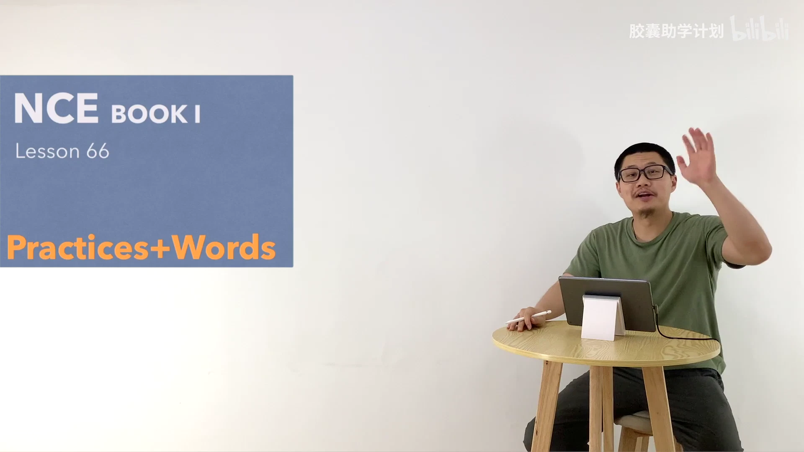

文字识别：胶囊助学计划 / NCE / BOOKI / Lesson 66 / Practices+Words

### 画面 00:00:02

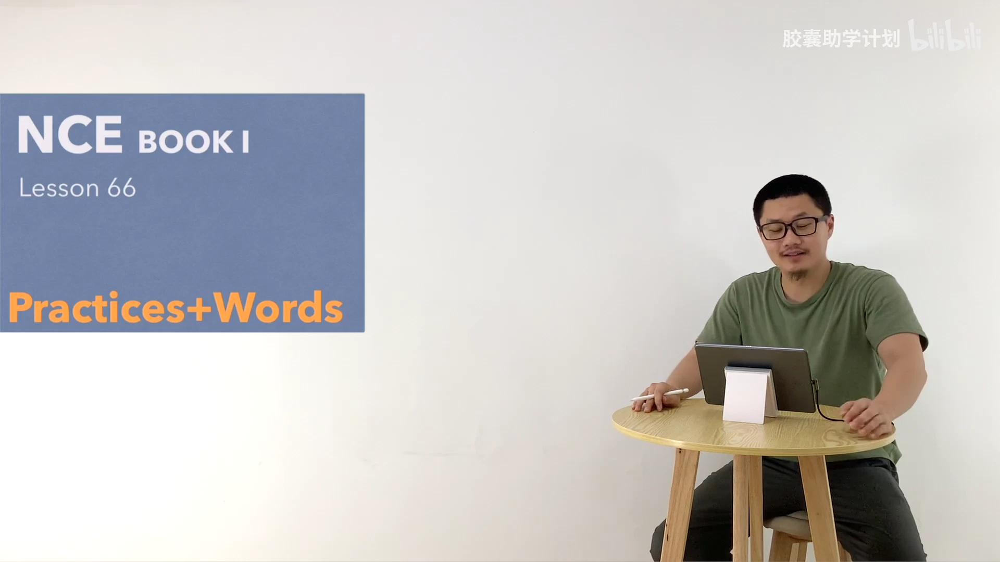

文字识别：胶囊助学计划 / NCE / BOOKI / Lesson 66 / Practices+Words

### 画面 00:00:05

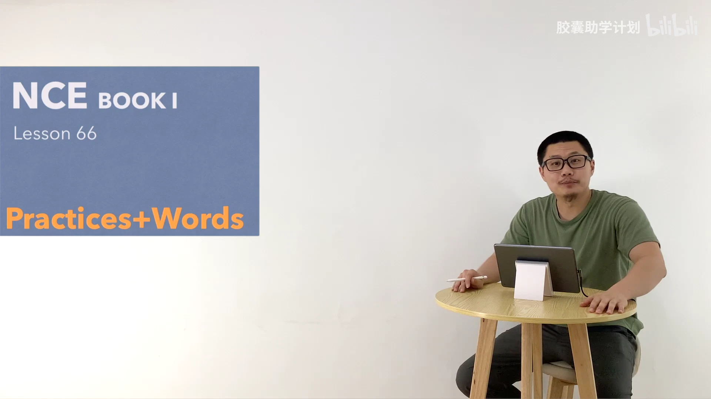

文字识别：胶囊助学计划 / NCE / BOOKI / Lesson 66 / Practices+Words

### 画面 00:00:11

文字识别：胶囊助学计划bilil / •

### 画面 00:00:15

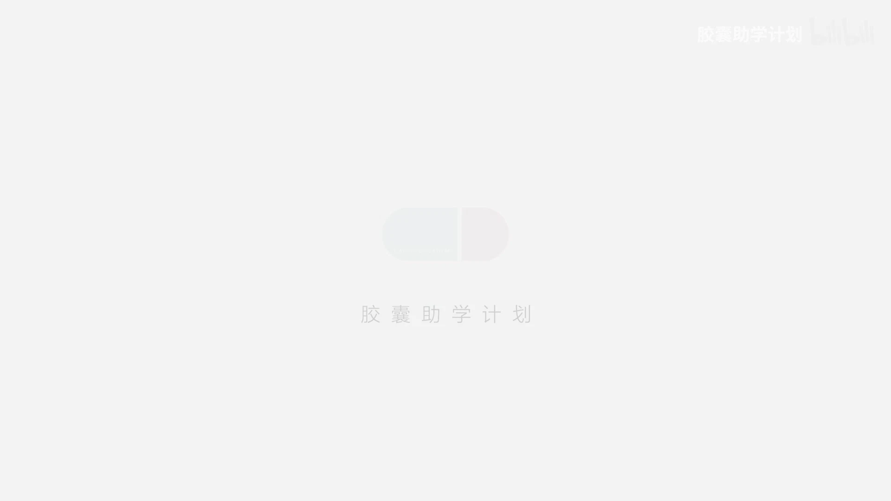

文字识别：胶囊助学计划

### 画面 00:00:17

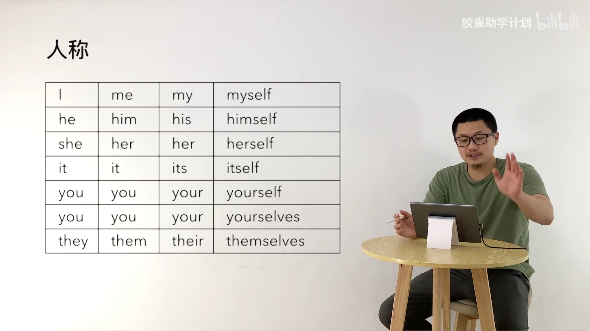

文字识别：胶囊助学计划 / 人称 / | / me / my / myself / he / him / his / himself / she / her / her / herself / it / it / its / itself / you / you / your / yourself / you / you / your / yourselves / they / them / their / themselves

### 画面 00:00:25

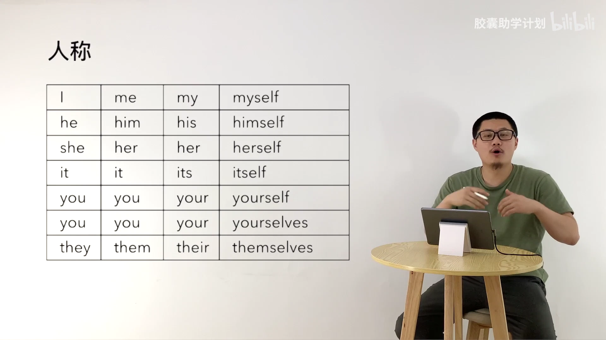

文字识别：胶囊助学计划 / 人称 / me / my / myself / he / him / his / himself / she / her / her / herself / it / it / its / itself / you / you / your / yourself / you / you / your / yourselves / they / them / their / themselves

## 00:00:30–00:01:00

合起来，简单的整理一下啊。比如说，首先这一行和这一行，各位应该是比较熟悉的了啊。包括这一行，其实对吧？那他们呢，看上去啊，对于各位来说是有一点点小的压力的。但如果其实您前二十课学的好，前三啊这个列啊，我们应该基本上就已经学完了，学会了对吧？区别是什么呢？就是动词啊，第一第一列和第二列，

### 画面 00:00:35

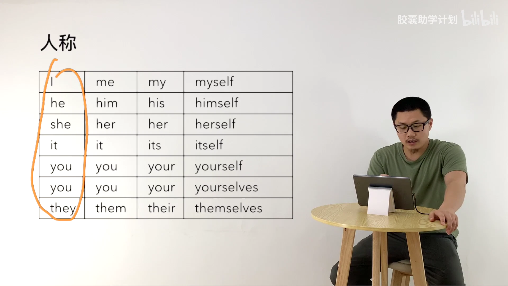

文字识别：胶囊助学计划 / 人称 / me / my / myself / he / him / his / himself / she / her / her / herself / it / it / its / itself / you / you / your / yourself / you / you / your / yourselves / they / them / their / themselves

### 画面 00:00:37

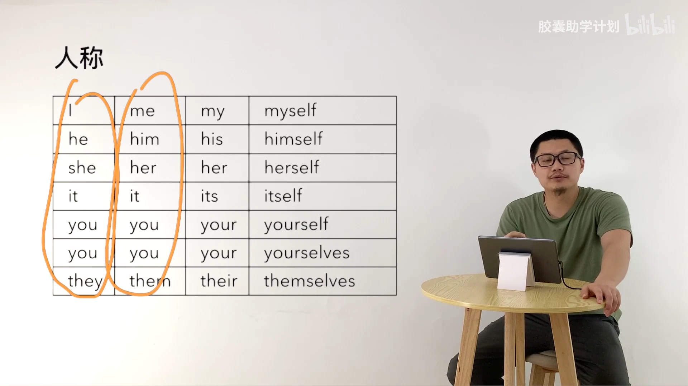

文字识别：胶囊助学计划 / 人称 / me / my / myself / he / him / his / himself / she / her / her / herself / it / it / its / itself / you / you / your / yourself / you / you / your / yourselves / they / then / their / themselves

### 画面 00:00:39

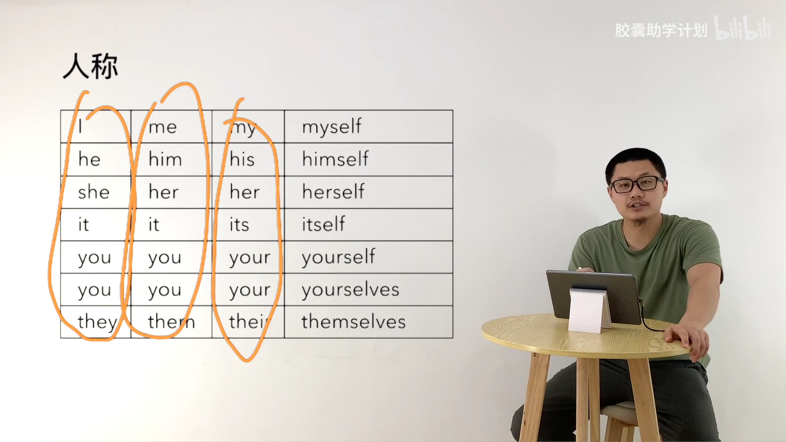

文字识别：胶囊助学计划 / 人称 / me / myself / he / him / his / himself / she / her / her / herself / it / it / its / itself / you / you / your / yourself / you / you / your / yourselves / they / then / thei / themselves

### 画面 00:00:41

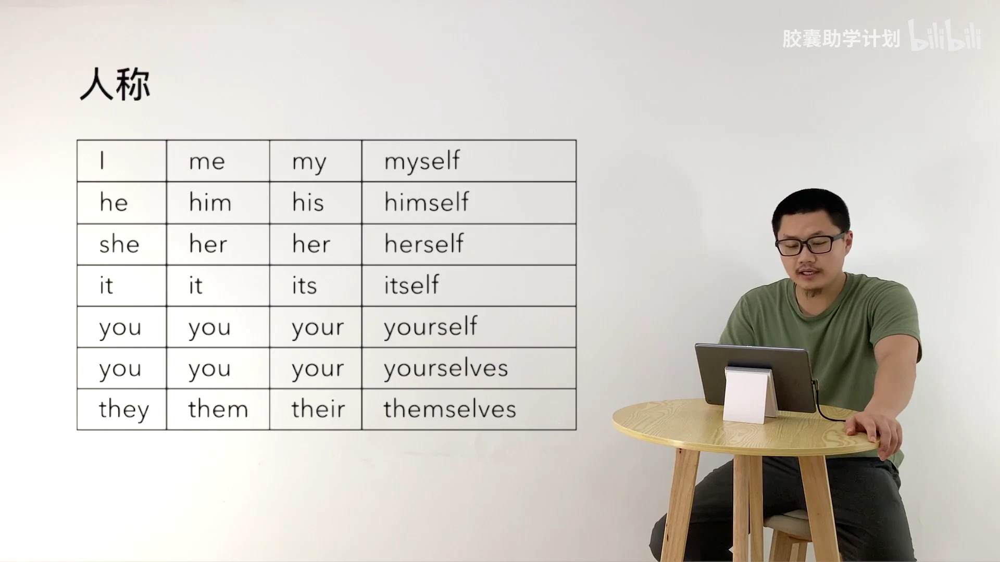

文字识别：胶囊助学计划 / 人称 / me / my / myself / he / him / his / himself / she / her / her / herself / it / it / its / itself / you / you / your / yourself / you / you / your / yourselves / they / them / their / themselves

### 画面 00:00:58

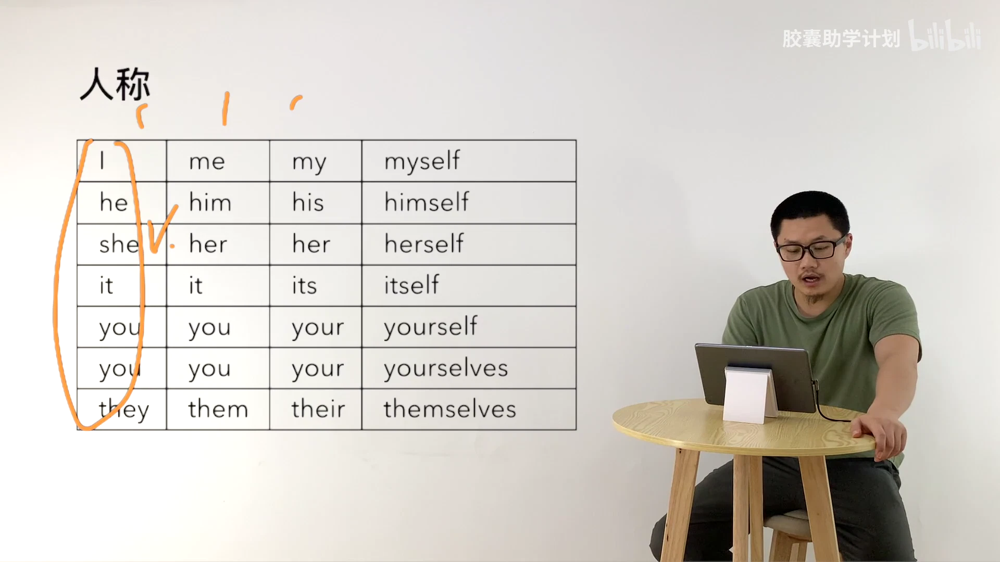

文字识别：胶囊助学计划 / 人称 / C / me / my / myself / he / him / his / himself / she / her / her / herself / it / it / its / itself / you / you / your / yourself / yoy / you / your / yourselves / th / rey / them / their / themselves

## 00:01:00–00:01:30

其实就是动词前、动词后啊。目前简单来说不是非常严谨，但是对于各位够了。比如说给我就 give me 啊，给他就 give him 啊，各位还记得对吧？主语呢说我是就是 I am 啊，我们不一一带着大家复习了，这个表格只是给大家整理一下，好吧？接下来呢，你看如果是我的啊，这一行都是谁的对吧？这一行是新的，但是你看它的构成方式还都有点像，比如说 myself，

### 画面 00:01:00

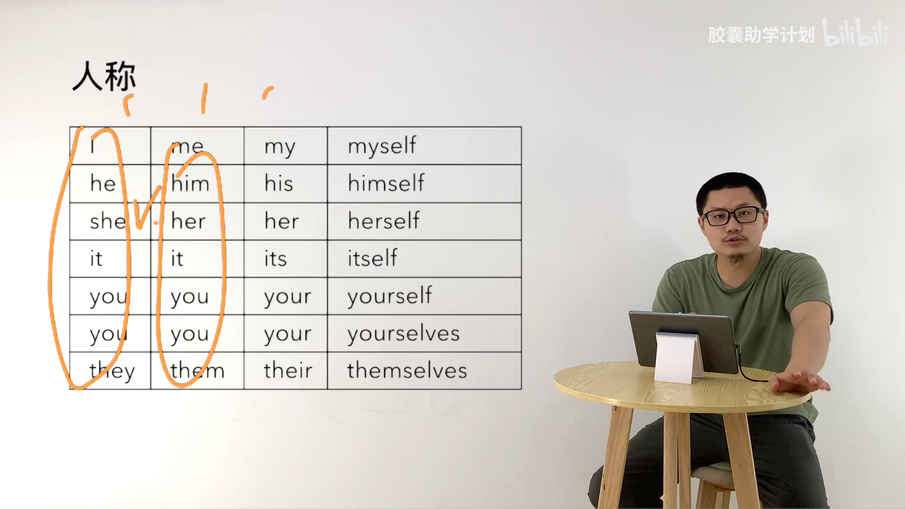

文字识别：胶囊助学计划 / 人称 / - / my / myself / he / his / himself / him / V / she / her / her / herself / it / it / its / itself / yoy / you / your / yourself / yoy / you / your / yourselves / tb / ey / them / their / themselves

### 画面 00:01:03

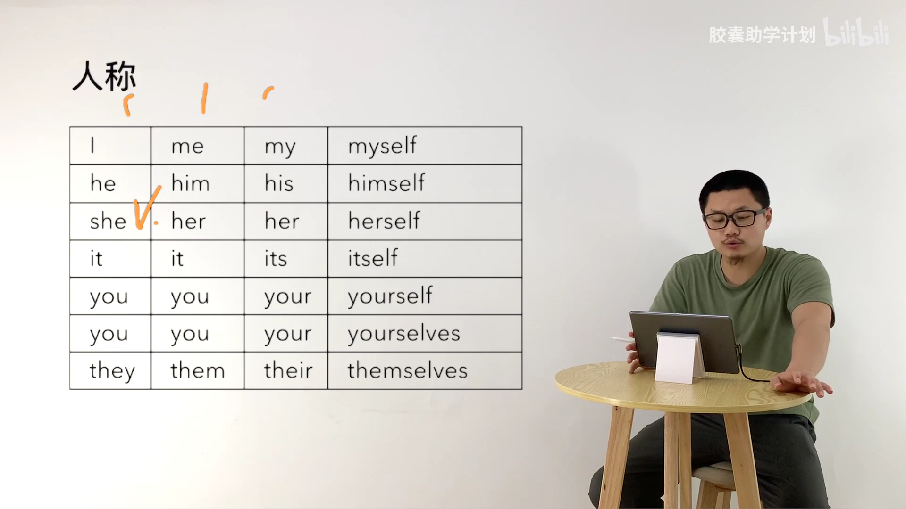

文字识别：胶囊助学计划 / 人称 / | / me / my / myself / he / him / his / himself / she / her / her / herself / it / it / its / itself / you / you / your / yourself / you / you / your / yourselves / they / them / their / themselves

### 画面 00:01:23

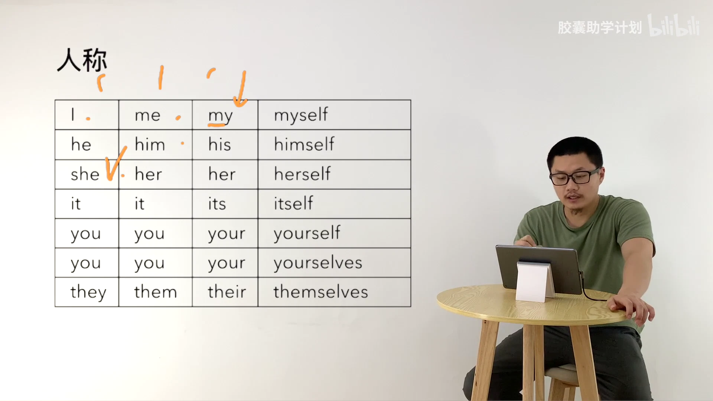

文字识别：胶囊助学计划 / 人称 / ( / me / my / myself / he / him / his / himself / she / her / her / herself / it / it / its / itself / you / you / your / yourself / you / you / your / yourselves / they / them / their / themselves

### 画面 00:01:29

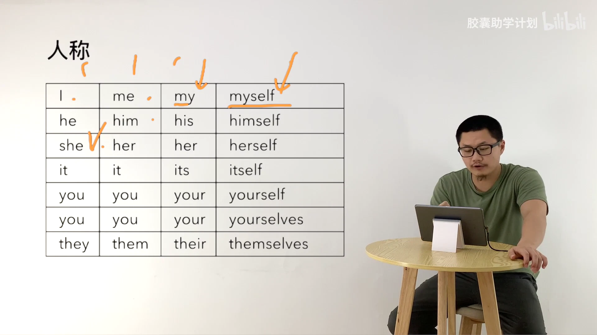

文字识别：胶囊助学计划 / 人称 / C / me / my / myself / he / him / his / himself / she / her / her / herself / it / it / its / itself / you / you / your / yourself / you / you / your / yourselves / they / them / their / themselves

## 00:01:30–00:02:00

我自己，但是他用的是 my，对吧？Himself 呢，他用的是 him；，Herself 呢，你不确定他到底用的是谁，是吧？Itself 呢，用的是 its；，Yourself 呢，用的是 your；，Yourselves 呢，用的是 your，啊，叫你们自己，对吧？后边这一排都是谁谁自己，那 themselves 呢，就是他们自己。还有一行，各位要自己去想一下，就是我们，哎，这三个你能不

### 画面 00:01:33

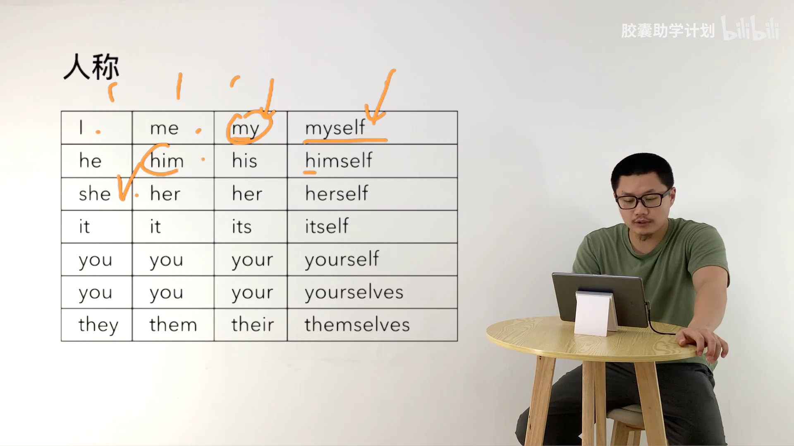

文字识别：胶囊助学计划 / 人称 / me / my / myself / he / him / his / himself / she / V / her / her / herself / it / it / its / itself / you / you / your / yourself / you / you / your / yourselves / they / them / their / themselves

### 画面 00:01:35

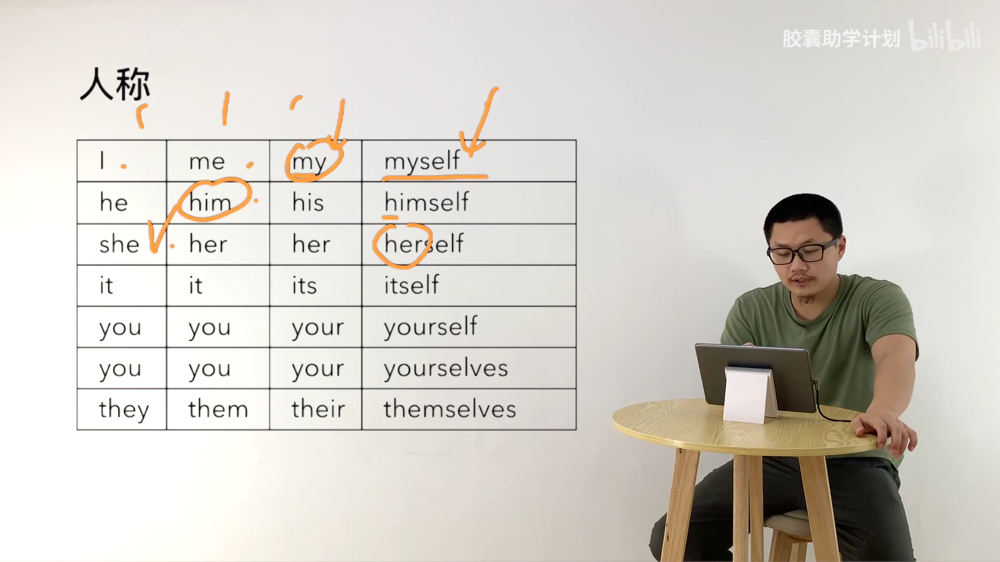

文字识别：胶囊助学计划 / 人称 / me / my / myself / he / him / his / himself / she / her / her / herself / it / it / its / itself / you / you / your / yourself / you / you / your / yourselves / they / them / their / themselves

### 画面 00:01:39

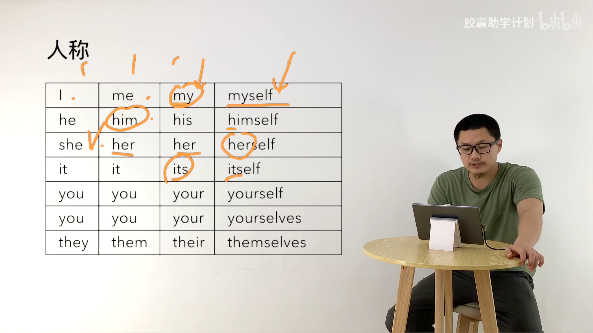

文字识别：胶囊助学计划 / 人称 / - / me / my / myself / he / him / his / himself / she / V. / her / her / herself / it / it / its / itself / you / you / your / yourself / you / you / your / yourselves / they / them / their / themselves

### 画面 00:01:42

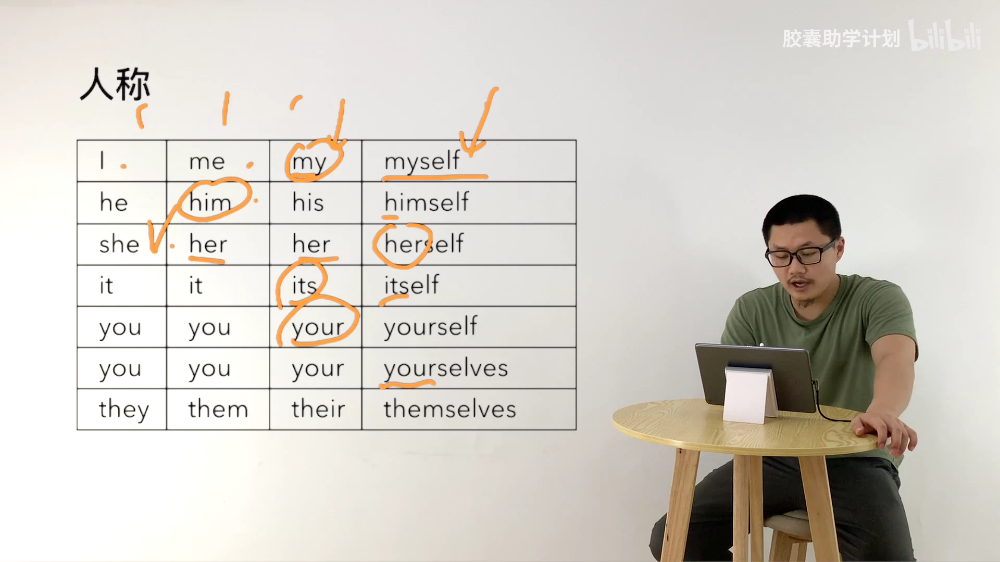

文字识别：胶囊助学计划 / 人称 / me / my / myself / he / him / his / himself / she / V. / her / her / herself / it / it / its / itself / you / you / your / yourself / you / you / your / yourselves / they / them / their / themselves

### 画面 00:01:45

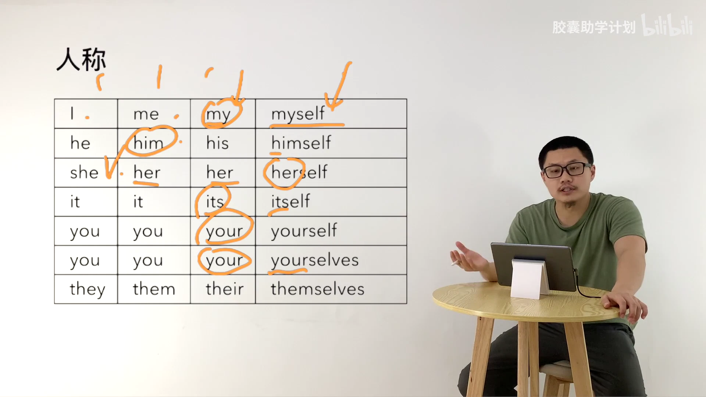

文字识别：胶囊助学计划 / 人称 / me / my / myself / he / him / his / himself / she / V / her / her / herself / it / it / its / itself / you / you / your / yourself / you / you / your / yourselves / they / them / their / themselves

### 画面 00:01:53

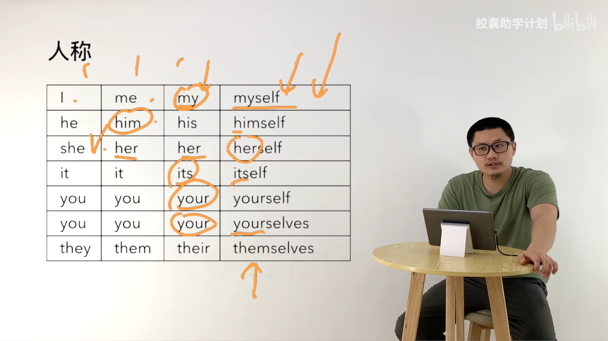

文字识别：胶囊助学计划 / 人称 / me / my / myself / he / him / his / himself / she / V. / her / her / herself / it / it / its / itself / you / you / your / yourself / you / you / your / yourselves / they / them / their / themselves

### 画面 00:01:57

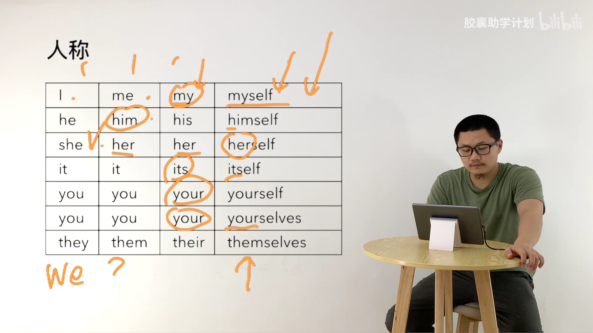

文字识别：胶囊助学计划 / 人称 / me / my / myself / he / him / his / himself / she / V. / her / her / herself / it / it / its / itself / you / you / your / yourself / you / you / your / yourselves / they / them / their / themselves / We / ↑

## 00:02:00–00:02:30

能想起来是什么？这个小的作业留给各位课下自己去完成，稍微查一下就可以找到答案。OK，好，接下来呢，我们就是做一些非常简单的练习。各位张嘴啊，跟我读就可以了。来，When must you come home? I must come home at one o'clock. Next one, When must she go to the library? She must go to the library at a quarter past one.

### 画面 00:02:02

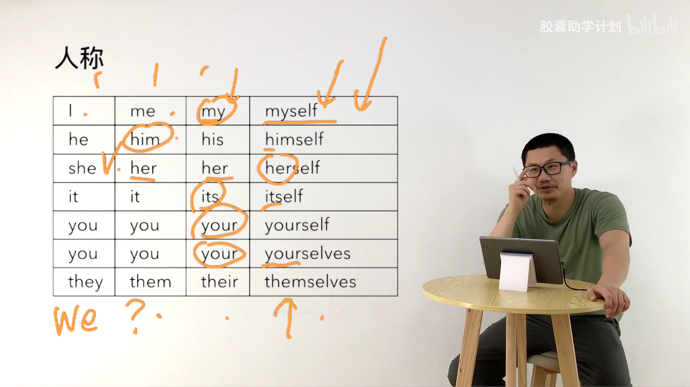

文字识别：胶囊助学计划 / 人称 / me / my / myself / he / him / his / himself / she / her / her / herself / it / it / its / itself / you / you / your / yourself / you / you / your / yourselves / they / them / their / themselves / We / ↑

### 画面 00:02:07

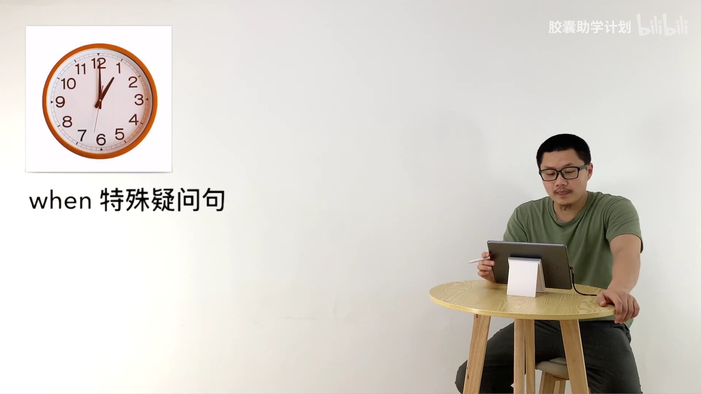

文字识别：Bilibi / 胶囊助学计划 / 1P / 11 / 10 / 2 / 3 / 9 / 4 / 8 / 7 / 5 / 6 / when特殊疑问句

### 画面 00:02:10

文字识别：bilblt / 胶囊助学计划 / 11 / 12 / 10 / 2 / 3 / 9 / 4 / 8 / 7 / 6 / 5 / when 特殊疑问句

### 画面 00:02:14

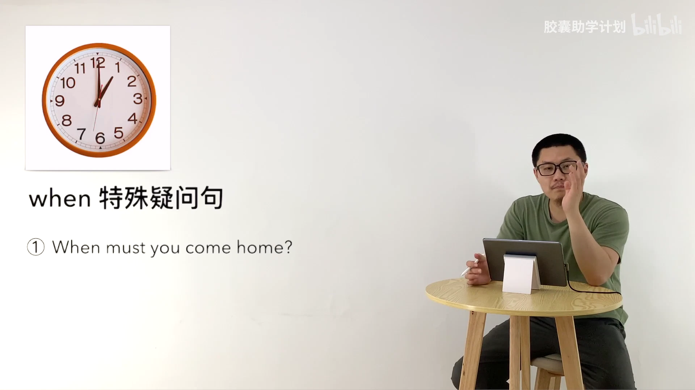

文字识别：胶囊助学计划 / 12 / 11 / 10 / 2 / 3 / 9 / 4 / 8 / 7 / 6 / 5 / when 特殊疑问句 / When must you come home?

### 画面 00:02:17

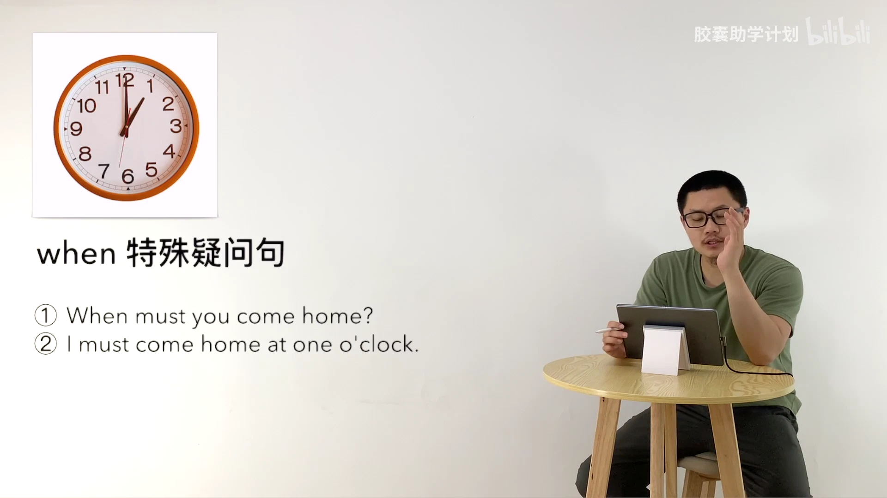

文字识别：胶囊助学计划 / 11 / 12 / 10 / 2 / 3 / 9 / 4 / 8 / 7 / 6 / 5 / when 特殊疑问句 / When must you come home? /  I must come home at one o'clock. / 2

### 画面 00:02:20

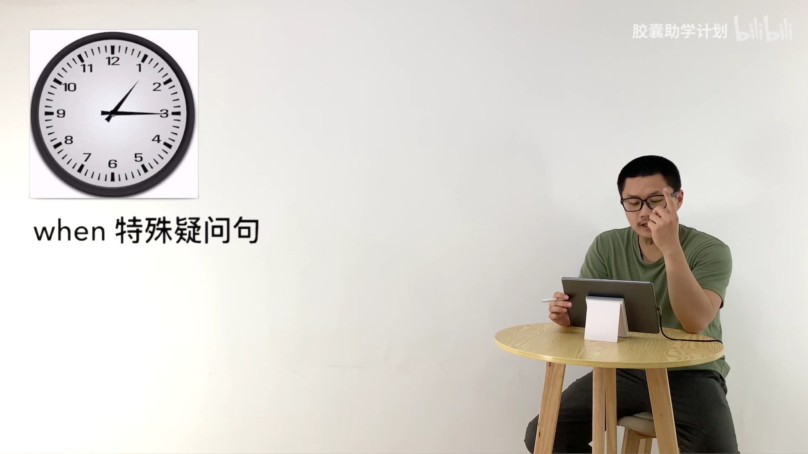

文字识别：Bilbil / 胶囊助学计划 / 17 / 10 / 9 / 8 / 7 / 5 / when 特殊疑问句

## 00:02:30–00:03:00

Next one, when must you and Tom see the dentist? We must see the dentist at a quarter to four. Next one, when must you type this letter? I must type this letter at two o'clock. Next one, when must Sam and Penny see the boss? They must see their boss at half past one.

### 画面 00:02:31

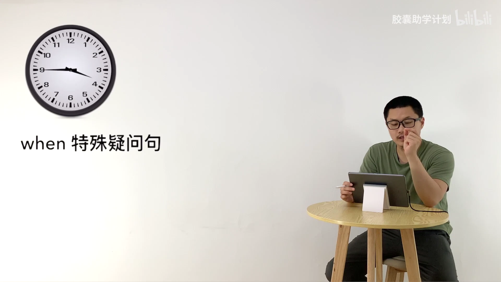

文字识别：Bilibil / 胶囊助学计划 / 11 / 10 / 9 / 8 / 7 / 5 / 6 / when特殊疑问句

### 画面 00:02:41

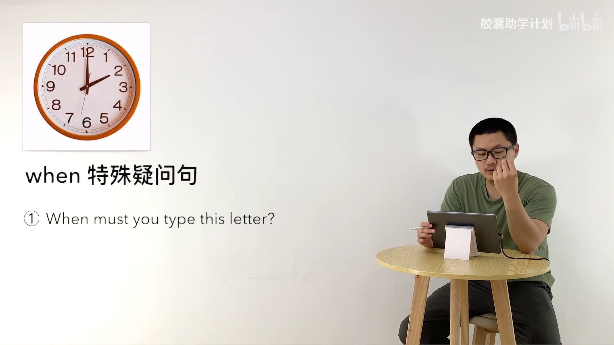

文字识别：胶囊助学计划 / 12 / 11 / 10 / 9 / 8 / 4 / 7 / 6 / 5 / when 特殊疑问句 / When must you type this letter?

### 画面 00:02:49

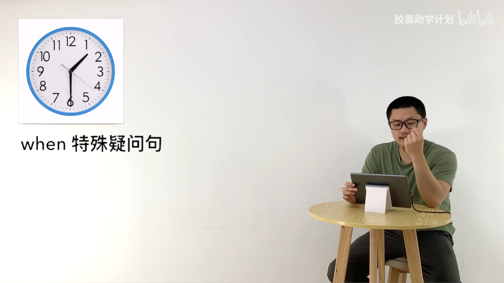

文字识别：胶囊助学计划 / 11 / 12 / 1 / 10 / 23 / 98 / 4. / 5 / when 特殊疑问句

## 00:03:00–00:03:30

Next one. When must George take his medicine? He must take his medicine at a quarter past three. Next one. When must Sophie drive to London? She must drive to London at half past two. Next one. When must I catch the bus? 好注意一个小点，catch the bus单词你都认的，能不能猜出来是什么意

### 画面 00:03:01

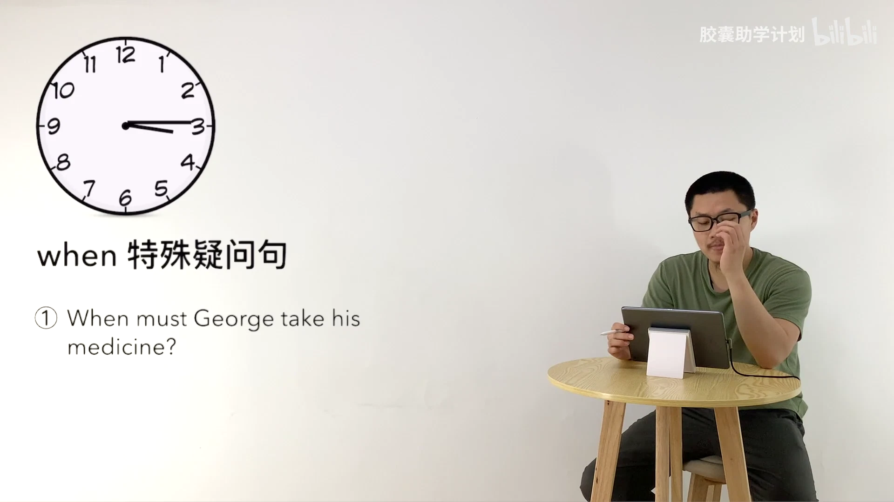

文字识别：胶囊助学计划 / 12 / 11 / 1 / ho / 2 / 9 / 3 / 8 / S / when特殊疑问句 /  When must George take his / medicine?

### 画面 00:03:12

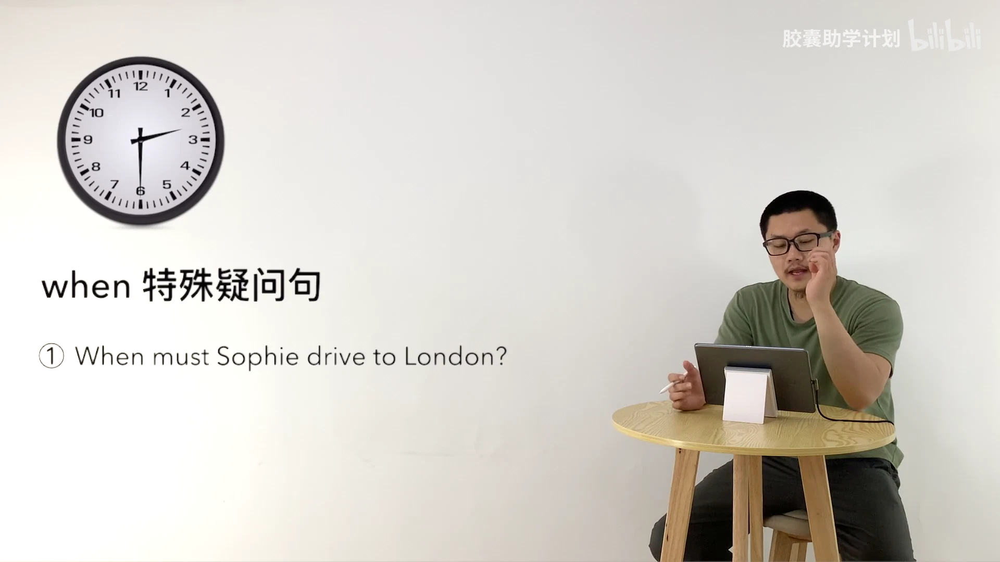

文字识别：胶囊助学计划 / 11 / 10 / 9 / 8 / 7 / 5 / when 特殊疑问句 /  When must Sophie drive to London?

### 画面 00:03:15

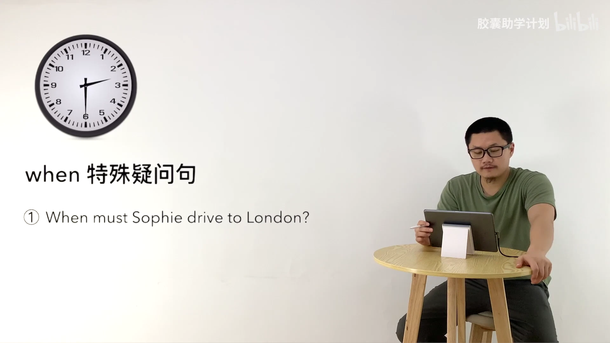

文字识别：胶囊助学计划 / 11 / 2 / 10 / 9 / 8 / 7 / 6 / 5 / when 特殊疑问句 /  When must Sophie drive to London?

### 画面 00:03:21

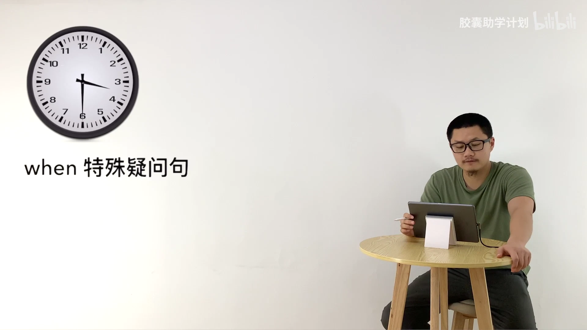

文字识别：胶囊助学计划 / 11 / 10 / 2 / 9 / 3 / 8 / 4 / 7 / 5 / 6 / when特殊疑问句

### 画面 00:03:26

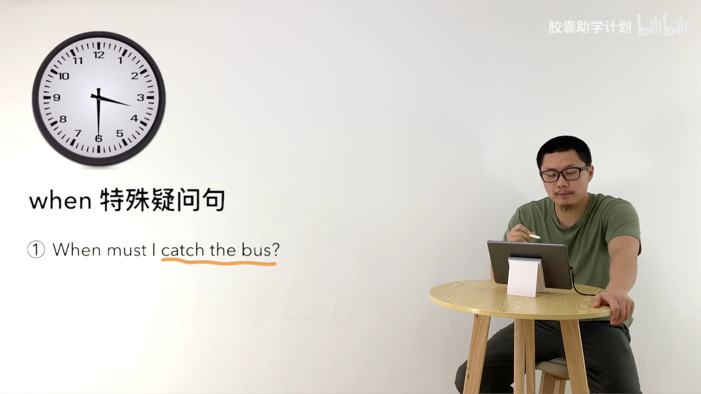

文字识别：胶囊助学计划 / 1111 / 11 / 9 / 3 / 8 / 5 / when 特殊疑问句 / When must I catch the bus?

### 画面 00:03:28

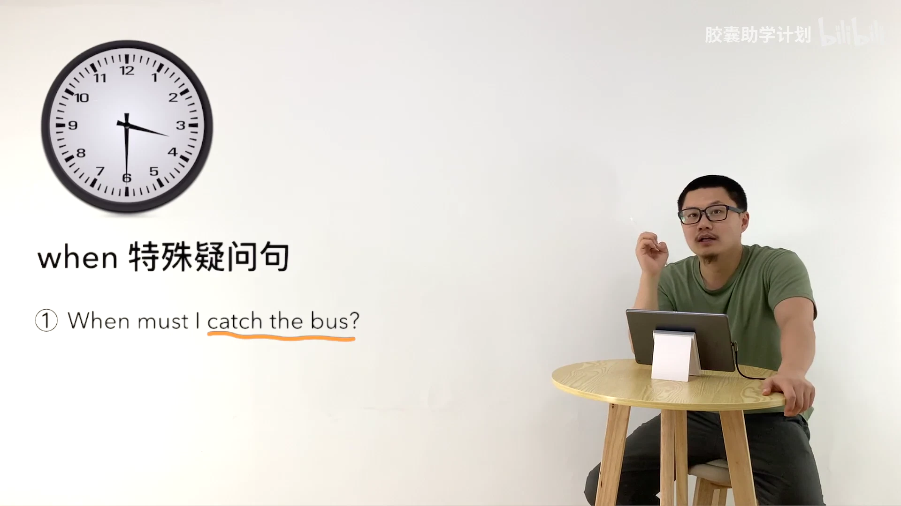

文字识别：胶囊助学计划 / 11 / 9 / 3 / 8 / 4 / 5 / when 特殊疑问句 / When must I catch the bus?

## 00:03:30–00:04:00

思？Catch就是抓，对吧？早在Who's那课我们就学过，十三课啊，还是十一课啊，我们就学过。要抓住啊，那抓住公交车，赶上公交车，对吧？来了。You must catch the bus at half past three.张嘴跟我读。Next one, when must you arrive there?到达那里。I must arrive there at three o'clock. Next one, when must

### 画面 00:03:32

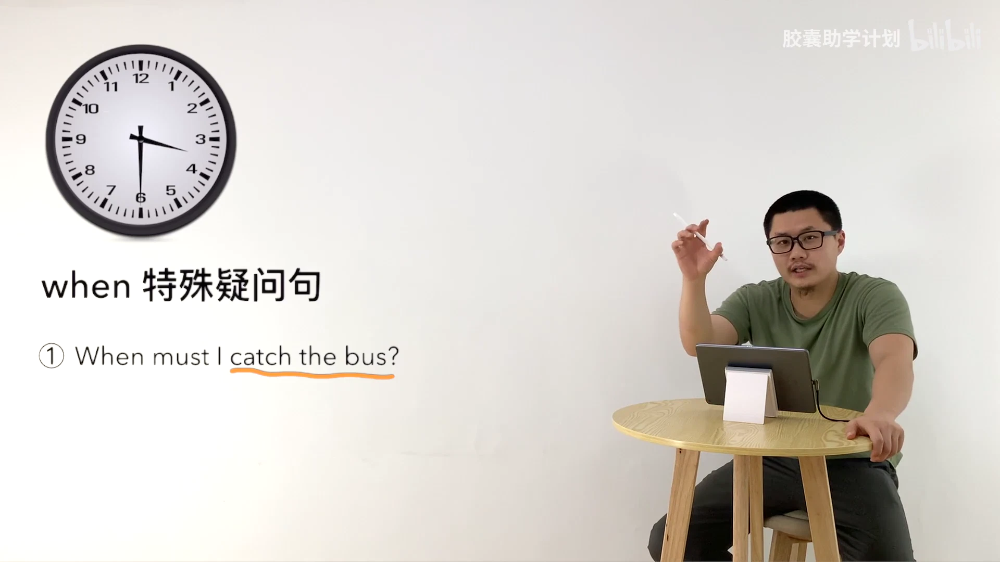

文字识别：胶囊助学计划 / 11 / 2 / 9 / 3 / 8 / 4 / 5 / 6 / when 特殊疑问句 / When must I catch the bus?

### 画面 00:03:36

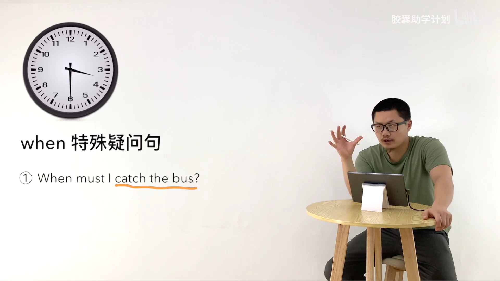

文字识别：胶囊助学计划 / 11 / 9 / 3 / 8 / 4 / 5 / when 特殊疑问句 / When must I catch the bus?

### 画面 00:03:41

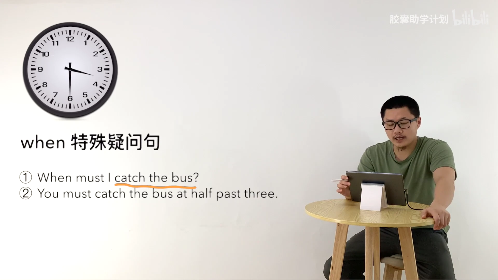

文字识别：胶囊助学计划 / 11 / 3 / 8 / 4 / 5 / 6 / when 特殊疑问句 / When must I catch the bus? /  You must catch the bus at half past three.

### 画面 00:03:48

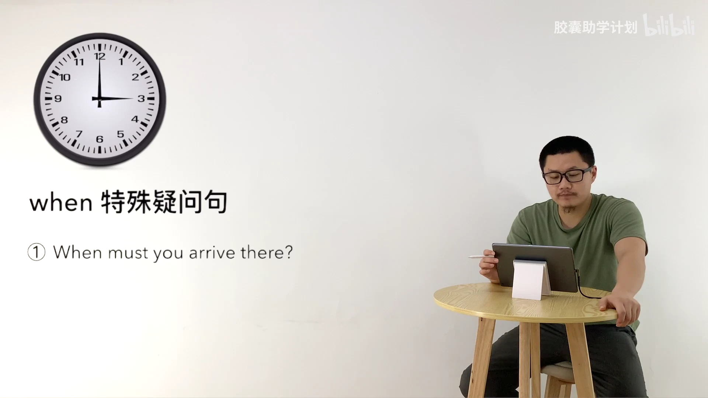

文字识别：胶囊助学计划 / 11 / 10 / 8 / 4 / 5 / 6 / when 特殊疑问句 / When must you arrive there?

### 画面 00:03:57

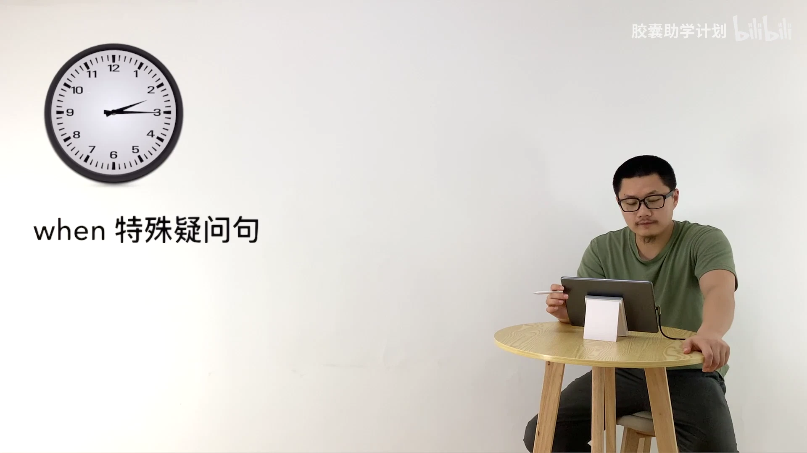

文字识别：胶囊助学计划 / 12 / 11 / 10 / 2 / 9 / 8 / 4 / 5 / 6 / when 特殊疑问句

## 00:04:00–00:04:30

they come home? They must come home at a quarter past two. Next one, when must you meet Tom? I must meet Tom at a quarter to two. 好了，这个小点回顾一下，a quarter to two，差十五分钟，两点，对吧？Two啊，用two这个介词。OK, next one, when must he telephone you? He must telephone me at a

### 画面 00:04:07

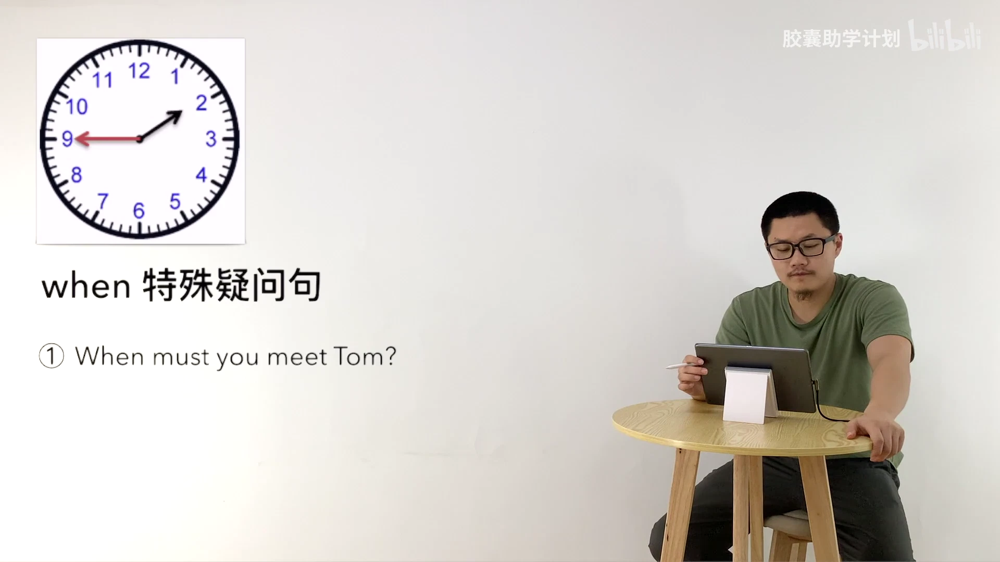

文字识别：胶囊助学计划 / 12 / 11 / 10 / 2 / 9 / 3 / 8 / 4 / 7 / 6 / 5 / when 特殊疑问句 / When must you meet Tom?

### 画面 00:04:16

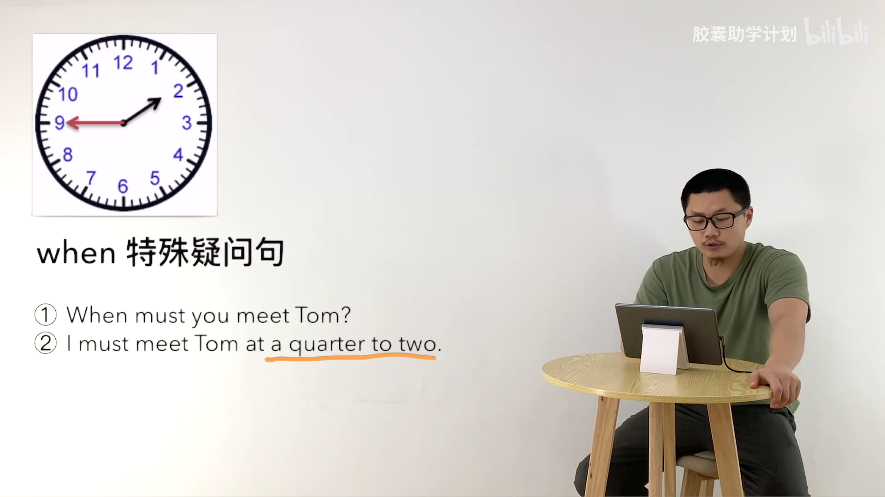

文字识别：胶囊助学计划 / 12 / 11 / 10 / 2 / 9 / 3 / 8 / 4 / 5 / 6 / when 特殊疑问句 / When must you meet Tom? / I must meet Tom at a quarter to two.

### 画面 00:04:22

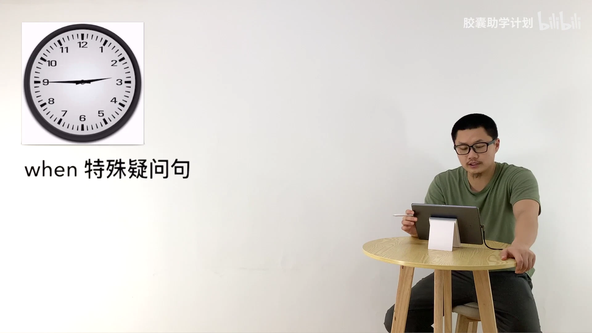

文字识别：胶囊助学计划 / 12 / 11 / 10 / 9 / 3 / 8 / 4 / 7 / 6 / 5 / when 特殊疑问句

## 00:04:30–00:05:00

quarter to three. A quarter to three,差十五分钟到三点. Okay.好，那本课其实就是各种谁自己啊，也不要求各位今天都背下来。今天各位只要知道它的变化规则就行了。其实就是前面一个你认识的谁谁谁，对吧？后边再加上self或者是selves，如果是复数的话，只要见到这单词，你以后能反应过来它表示谁自己就可以了，就这么简单. Okay.那本

### 画面 00:04:33

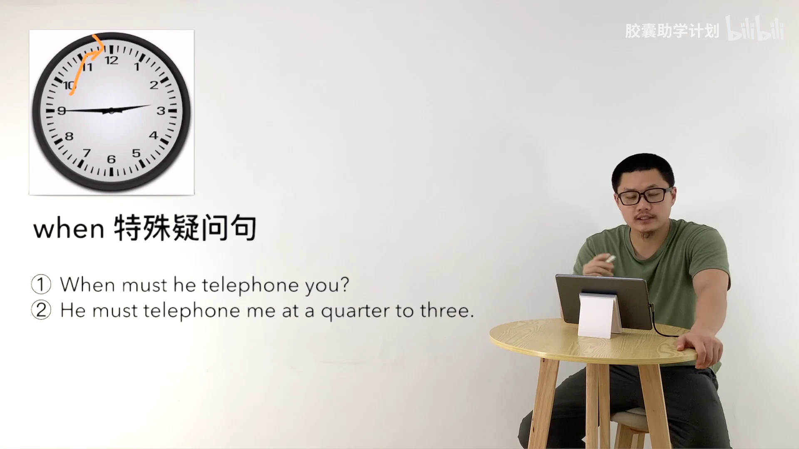

文字识别：胶囊助学计划 / 12 / 1 / 9 / 3 / 8 / 4 / 5 / 6 / 1 / 1 / 1 / when 特殊疑问句 / When must he telephone you? /  He must telephone me at a quarter to three.

### 画面 00:04:36

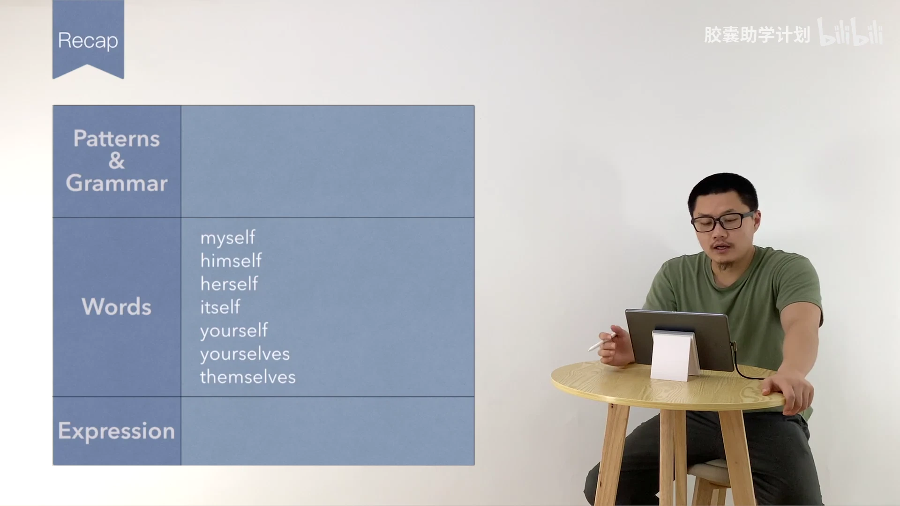

文字识别：胶囊助学计划 / Recap / Patterns / Grammar / myself / himself / herself / Words / itself / yourself / yourselves / themselves / Expression

### 画面 00:04:40

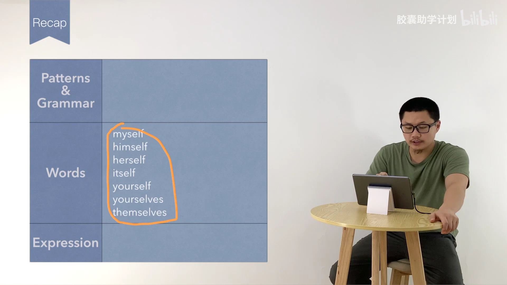

文字识别：胶囊助学计划 / Recap / Patterns / Grammar / myself / himself / herself / Words / itself / yourself / yourselves / themselves / Expression

### 画面 00:04:44

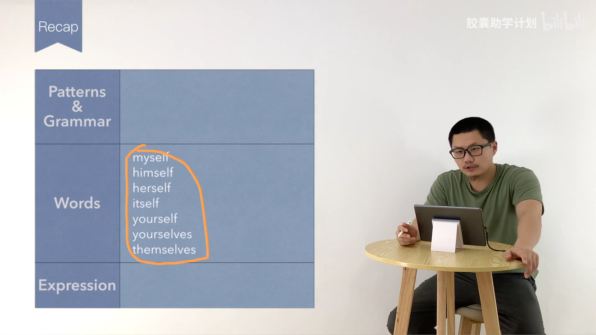

文字识别：胶囊助学计划 / Recap / Patterns / & / Grammar / myself / himself / herself / Words / itself / yourself / yourselves / themselves / Expression

### 画面 00:04:47

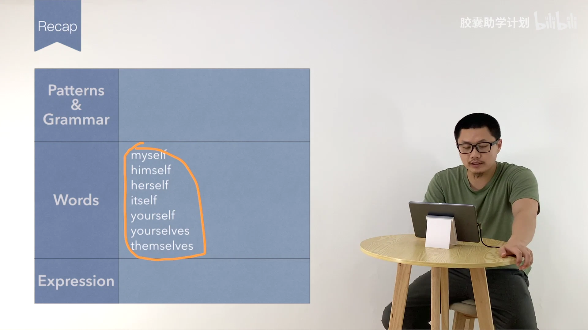

文字识别：胶囊助学计划 / Recap / Patterns / Grammar / myself / himself / herself / Words / itself / yourself / yourselves / themselves / Expression

### 画面 00:04:55

文字识别：胶囊助学计划 / Recap / Patterns / & / Grammar / myselr / himself / herself / Words / itself / yourself / yourselves / themselves / Expression

### 画面 00:04:59

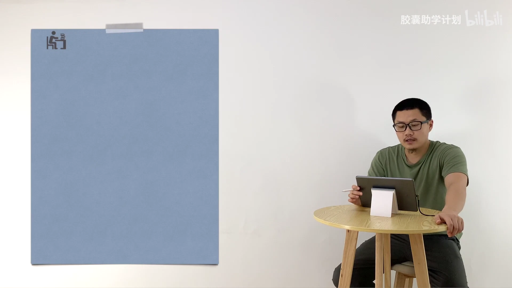

文字识别：胶囊助学计划

## 00:05:00–00:05:30

课家庭作业呢？绿皮书六十六课，各位可以去写了。同时，整理一下与人称相关的这些词汇，我都已经给各位整理在第一页的这个 PowerPoint 当中了，对吧？各位要做的事情就是去红皮书当中，不妨再查一下。如果有能力的话，顺便再把右边的练习去写一下。红皮书到现在还不知道怎么用的，看我们的开篇，新概念一册开篇。好，接下来请给自己讲解一遍今天的

### 画面 00:05:05

文字识别：胶囊助学计划 / 绿皮书第66课的写作练习 / 整理与人称相关的词汇 / （红皮书）

### 画面 00:05:09

文字识别：胶囊助学计划 / 绿皮书第66课的写作练习 / 整理与人称相关的词汇 / （红皮书）

### 画面 00:05:14

文字识别：胶囊助学计划 / 绿皮书第66课的写作练习 / 整理与人称相关的词汇 / （红皮书）

### 画面 00:05:22

文字识别：胶囊助学计划 / 绿皮书第66课的写作练习 / 整理与人称相关的词汇 / （红皮书）

## 00:05:30–00:06:00

核心知识点。OK，那如果大家喜欢我们的课程呢，欢迎大家关注、订阅、一键三连支持，并分享给那些需要的朋友。最后，我们再来看一句名人名言。I remind myself every morning, nothing I say this day will teach me anything. So if I'm going to learn, I must do it by listening. See you next time.

### 画面 00:05:31

文字识别：胶囊助学计划

### 画面 00:05:39

文字识别：胶囊助学计划 / I remind / myself / every / morning: Nothing 1 / say / this / day / willt / teach / me / anything. So if / I'm going / to learn, I must 0 / do it by / listening. / - Larry King

### 画面 00:05:42

文字识别：胶囊助学计划 / I remind / myself / every / morning: Nothing 1 / say / this / day will teach /  me anything. So if / I'm going t / tolearn, I must do it by /  listening. / - Larry King

### 画面 00:05:49

文字识别：胶囊助学计划 / I remind / myself / every / morning: Nothing 1 / say / this / dayv / will / teach / me / anything. So if / I'm going / tolearn, I must do it by / listening. / - Larry King

### 画面 00:05:53

文字识别：胶囊助学计划 / I remind / myself / every / morning: Nothing 1 / say / this / dayv / will / teach / me / anything. So if / I'm going / to learn, I must 0 / do it by / listening. / - Larry King

### 画面 00:05:55

### 画面 00:05:57

文字识别：CAPSULEACADEMY / 胶囊助学计划 / 『 / 小红书 / Lecturer / Leo / 8 / OE

## 00:06:00–00:06:07

### 画面 00:06:00

文字识别：CAPSULEACADEMY / 胶囊助学计划 / 『 / 小红书 / Editor / OE

### 画面 00:06:03

文字识别：CAPSULEACADEMY / 胶囊助学计划 / 『 / 小红书 / Creator / Leo & Berlin / OE

### 画面 00:06:05

文字识别：bilibili / 胶囊助学计划 / 胶囊助学计划 / 小红书 / OE

### 画面 00:06:07

文字识别：bilibili / 胶囊助学计划

